# Chương 11 — Học từ kinh nghiệm theo cách Bayes (Learning from Experience the Bayesian Way)

## Ý chính

Spiegelhalter muốn người đọc hiểu rằng **cách tiếp cận Bayes dùng xác suất để diễn đạt sự thiếu hiểu biết của chính ta về thế giới — kể cả về những điều đã xảy ra nhưng ta chưa biết — và định lý Bayes là cơ chế chính thức để học từ kinh nghiệm: tỷ lệ cược ban đầu (tiên nghiệm) nhân với tỷ số khả năng của bằng chứng cho ra tỷ lệ cược sau cùng (hậu nghiệm); dữ liệu không tự nói lên điều gì, hiểu biết bên ngoài và cả phán đoán của ta luôn đóng vai trò trung tâm, và cách tiếp cận Bayes đưa vai trò đó vào một cách minh bạch, có toán học.**

Phần mở đầu thừa nhận nền tảng của suy luận thống kê "hơi lộn xộn": có ba trường phái (Fisher, Neyman–Pearson, Bayes) và chưa lý thuyết thống nhất nào được chấp nhận hoàn toàn.

Mục "What Is the Bayesian Approach?" giải thích hai đóng góp của Thomas Bayes (xác suất cho bất định do thiếu hiểu biết, và định lý cập nhật xác suất), rồi minh hoạ bằng bài toán ba đồng xu (thấy mặt ngửa thì xác suất đồng xu hai mặt ngửa là 2/3, không phải ½) và bài toán xét nghiệm doping "chính xác 95%" với 1/50 vận động viên dùng doping (chỉ 19/68 = 28% người dương tính thật sự dùng doping); "cây đảo chiều" chính là việc định lý Bayes làm, nên trước thập niên 1950 cách nghĩ này được gọi là "xác suất ngược".

Mục "Odds and Likelihood Ratios" định nghĩa tỷ lệ cược và tỷ số khả năng (doping: 0,95/0,05 = 19) và phát biểu định lý Bayes ở dạng tỷ lệ cược: 1/49 × 19 = 19/49, tức xác suất 28%.

Mục "Likelihood Ratios and Forensic Science" áp dụng cho bộ xương tìm thấy dưới bãi đỗ xe ở Leicester năm 2012: với xác suất ban đầu thận trọng 1/400 và tỷ số khả năng kết hợp khoảng 6,5–6,7 triệu, tỷ lệ cược sau cùng khoảng 17.000 ăn 1 rằng đó là vua Richard III; giải thích xác suất trùng khớp ngẫu nhiên trong chứng cứ ADN và việc toà án Anh cho dùng tỷ số khả năng riêng lẻ nhưng cấm nhân chúng với nhau.

Khung câu hỏi về Tổng giám mục Canterbury chơi bài poker (thí nghiệm tưởng tượng của Keynes) cho thấy bằng chứng "rất mạnh" (tỷ số khả năng 72.000) vẫn chỉ cho xác suất gian lận khoảng 7% khi tỷ lệ cược ban đầu là 1 ăn 1.000.000.

Mục "Bayesian Statistical Inference" mở rộng sang đại lượng chưa biết nhận nhiều giá trị: bàn bi-a của Bayes (2 bi đỏ bên trái, 3 bên phải thì ước lượng vị trí vạch là 3/7, khoảng 95% từ 0,12 tới 0,78), quy tắc "cộng 1 trên, cộng 2 dưới", hiện tượng co về giữa (shrinkage), và tranh cãi chính về nguồn gốc phân phối tiên nghiệm.

Khung câu hỏi về thăm dò trước bầu cử giới thiệu mô hình phân cấp và hồi quy đa mức kèm hậu phân tầng (MRP): đoán đúng 50 trong 51 đơn vị bầu cử ở Mỹ năm 2016 chỉ với 9.485 người, và đoán đúng quốc hội treo ở Anh năm 2017. Phần tiếp theo nói về làm mượt Bayes, "bộ não Bayes", xe tự lái, rồi hệ số Bayes cho giả thuyết khoa học: thang Kass–Raftery, P = 0,05 tương ứng hệ số Bayes chỉ 2,4–3,4, và giá trị P của hạt Higgs tương ứng hệ số Bayes tối đa khoảng 80.000.

Mục "An Ideological Battle" kể cuộc chiến ba bên trong thập niên 1930 (Bowley gọi khoảng tin cậy là "trò lừa tin cậy"; Fisher đối đầu Neyman và Pearson), sự pha trộn thực dụng ngày nay, và kết luận của tác giả: các nhà thống kê hợp lý thường đi tới kết luận giống nhau; vấn đề thật nằm ở thiết kế kém, dữ liệu thiên lệch, giả định không phù hợp và thực hành khoa học tồi.

## Sơ đồ

### Phần mở đầu chương — nền tảng của suy luận thống kê "hơi lộn xộn" (trang PDF 203)

```text
       Lời thú nhận thay mặt giới thống kê: cơ sở hình thức của việc học
       từ dữ liệu "hơi lộn xộn"
       · nhiều nỗ lực xây một lý thuyết suy luận thống nhất, chưa cái nào
         được chấp nhận hoàn toàn
                                │
                                ▼
       Ba trường phái suy luận:
       1. Fisher (hàm khả năng, giá trị P)          — đã gặp ở Chương 10
       2. Neyman–Pearson (sai lầm loại I, loại II)  — đã gặp ở Chương 10
       3. Bayes — chương này
          · nổi bật chỉ khoảng 50 năm gần đây
          · gốc từ mục sư Thomas Bayes ở Tunbridge Wells, mất năm 1761;
            bài báo của ông công bố sau khi ông mất, năm 1763
                                │
                ┌───────────────┴───────────────┐
                ▼                               ▼
       Tin tốt: mở ra khả năng          Tin xấu: phải gác lại gần như
       mới để khai thác dữ liệu         mọi thứ đã học về ước lượng,
       phức tạp                         khoảng tin cậy, giá trị P,
                                        kiểm định giả thuyết
```

### Mục "What Is the Bayesian Approach?" — Cách tiếp cận Bayes là gì? (trang PDF 203–209)

```text
       Đóng góp thứ nhất của Bayes: dùng xác suất để diễn đạt sự THIẾU
       HIỂU BIẾT của ta
       · bất định ngẫu nhiên (aleatory): sự kiện tương lai do may rủi
       · bất định do thiếu hiểu biết (epistemic): điều đã có thật, có thể
         người khác biết, nhưng ta không biết
         (lá bài sắp chia, vé cào, giới tính thai nhi, số hổ hoang dã...)
       · xác suất Bayes là CHỦ QUAN: phụ thuộc quan hệ của ta với thế
         giới, thay đổi khi có thông tin mới
                                │
                                ▼
       Đóng góp thứ hai: ĐỊNH LÝ BAYES — cơ chế chính thức để cập nhật xác
       suất khi có bằng chứng mới, tức "học từ kinh nghiệm"
       · dữ liệu không tự nói lên điều gì: hiểu biết bên ngoài và phán
         đoán luôn có vai trò trung tâm
       · tác giả thuộc trường phái Bayes "chủ quan" từ đầu sự nghiệp
                                │
                                ▼
       BA ĐỒNG XU: một đồng hai mặt ngửa, một đồng cân, một đồng hai mặt
       sấp; chọn ngẫu nhiên, tung ra NGỬA. Mặt kia cũng là ngửa?
       · trực giác: ½
       · cây 6 lần: mỗi đồng chọn 2 lần → 3 lần ra ngửa, 2 trong số đó từ
         đồng hai mặt ngửa → đáp án 2/3
                                │
                                ▼
       DOPING: xét nghiệm "chính xác 95%", 1/50 vận động viên dùng doping
       · 1.000 người: 20 dùng (19 dương tính, 1 âm tính);
                       980 không dùng (49 dương tính, 931 âm tính)
       · 68 người dương tính, chỉ 19 dùng doping: 19/68 = 28%
       · 72% người dương tính là bị buộc tội oan
                                │
                                ▼
       "Đảo chiều cây": đặt kết quả xét nghiệm trước, sự thật sau
       · dương tính 68 (19 dùng, 49 không); âm tính 932 (1 dùng, 931 không)
       · đúng thứ tự ta BIẾT sự việc, ngược thứ tự NHÂN QUẢ
       · đây chính là việc định lý Bayes làm → trước thập niên 1950 gọi là
         "xác suất ngược" (inverse probability)
                                │
                                ▼
       Nhầm "A khi biết B" với "B khi biết A":
       · doping: 28% (doping khi dương tính) với 95% (dương tính khi doping)
       · giá trị P: P(bằng chứng | H0) với P(H0 | bằng chứng)
       · ngộ nhận của bên công tố: P(bằng chứng | vô tội) với
         P(vô tội | bằng chứng)
       · định lý Bayes gần như bị CẤM ở toà án Anh; tỷ số khả năng thì được
         phép
```

### Mục "Odds and Likelihood Ratios" — Tỷ lệ cược và tỷ số khả năng (trang PDF 209–210)

```text
       Xác suất doping khi dương tính (19/68) phụ thuộc ba con số:
       · tỷ lệ dùng doping: 1/50 (20/1.000)
       · tỷ lệ người dùng doping có kết quả dương tính: 95% (19/20)
       · tỷ lệ người không dùng có kết quả dương tính: 5% (49/980)
                                │
                                ▼
       TỶ LỆ CƯỢC = xác suất xảy ra ÷ xác suất không xảy ra
       · mặt ngửa: ½ ÷ ½ = 1 ("evens", ngang nhau)
       · mặt sáu: 1/6 ÷ 5/6 = 1/5 ("5 ăn 1 ngược")
                                │
                                ▼
       TỶ SỐ KHẢ NĂNG = P(bằng chứng | giả thuyết A) ÷ P(bằng chứng | B)
       · doping: 0,95 ÷ 0,05 = 19 — kết quả dương tính dễ xảy ra gấp 19 lần
         nếu vận động viên dùng doping so với nếu không dùng
                                │
                                ▼
       ĐỊNH LÝ BAYES (dạng tỷ lệ cược):
       tỷ lệ cược ban đầu × tỷ số khả năng = tỷ lệ cược sau cùng
       · doping: 1/49 × 19 = 19/49 → xác suất 19/(19 + 49) = 19/68 = 28%
       · tiên nghiệm (prior) → hậu nghiệm (posterior)
       · bằng chứng độc lập mới: hậu nghiệm cũ thành tiên nghiệm mới;
         tương đương nhân các tỷ số khả năng thành tỷ số kết hợp
```

### Mục "Likelihood Ratios and Forensic Science" — Tỷ số khả năng và pháp y (trang PDF 210–213)

```text
       25/8/2012: khảo cổ học đào bãi đỗ xe ở Leicester, vài giờ sau thấy
       bộ xương đầu tiên. Có phải vua Richard III không?
       · Richard III tử trận ở Bosworth 22/8/1485, 32 tuổi; được chôn ở
         tu viện Greyfriars, nơi sau thành bãi đỗ xe
                                │
                                ▼
       XÁC SUẤT BAN ĐẦU (giả định bi quan):
       · được chôn ở Greyfriars thật: 1/2
       · hài cốt không bị dời đi trong 527 năm: 1/2
       · bộ xương đầu tiên đúng là ông (tới 100 thi thể khác): 1/100
       · 1/2 × 1/2 × 1/100 = 1/400 (nhóm nghiên cứu dùng 1/40)
                                │
                                ▼
       BẰNG CHỨNG PHÁP Y, tỷ số khả năng (ước tính thận trọng):
       · niên đại carbon 1456–1530: 1,8 · tuổi, giới tính: 5,3
       · cong vẹo cột sống: 212 · vết thương sau khi chết: 42
       · ADN ti thể khớp: 478 · nhiễm sắc thể Y không khớp: 0,16
       · nhân lại (giả định độc lập): khoảng 6,5 triệu
         (lời văn ghi 6,7 triệu)
                                │
                                ▼
       Tỷ lệ cược sau cùng ≈ 6,7 triệu / 400 ≈ 16.750 → sách: "khoảng
       17.000 ăn 1" (với 6,5 triệu: khoảng 16.000 ăn 1)
       · nhóm nghiên cứu: 167.000 ăn 1, xác suất 0,999994 → cải táng ở
         nhà thờ chính toà Leicester
                                │
                                ▼
       CHỨNG CỨ ADN ở toà án:
       tỷ số khả năng = P(khớp | nghi phạm để lại dấu vết)
                        ÷ P(khớp | người khác để lại)
       · tử số thường lấy bằng 1; mẫu số là XÁC SUẤT TRÙNG KHỚP NGẪU NHIÊN
       · tỷ số khả năng có thể tới hàng triệu, hàng tỷ
       · toà án Anh cho dùng tỷ số riêng lẻ nhưng KHÔNG cho nhân chúng —
         việc kết hợp bằng chứng để cho bồi thẩm đoàn
```

### Khung câu hỏi "Would the Archbishop of Canterbury cheat at poker?" — Tổng giám mục Canterbury có gian lận khi chơi poker không? (trang PDF 213)

```text
       Thí nghiệm tưởng tượng của John Maynard Keynes: ván đầu, Tổng giám
       mục tự chia cho mình thùng phá sảnh. Có nên nghi ông gian lận?
                                │
                                ▼
       Tỷ số khả năng = P(thùng phá sảnh | gian lận)
                        ÷ P(thùng phá sảnh | chỉ may mắn)
                      = 1 ÷ (1/72.000) = 72.000 → "rất mạnh" theo thang
                        dùng ở toà
                                │
                                ▼
       Tỷ lệ cược ban đầu: 1 ăn 1.000.000 (người tu hành đáng kính)
       · tỷ lệ cược sau cùng ≈ 72.000/1.000.000 ≈ 7/100
       · xác suất gian lận ≈ 7/107 ≈ 7%
                                │
                                ▼
       Cho ông hưởng lợi thế của nghi ngờ (nhưng vẫn để mắt tới ông);
       với người lạ trong quán rượu, tỷ lệ cược ban đầu khác hẳn
```

### Mục "Bayesian Statistical Inference" — Suy luận thống kê Bayes (trang PDF 213–216)

```text
       Hai giả thuyết thì dễ (cây tần số); khó hơn khi đại lượng chưa
       biết nhận cả một DẢI giá trị (tham số của mô hình)
                                │
                                ▼
       Câu hỏi gốc của Bayes (1763): một việc đã xảy ra hoặc không xảy ra
       trong một số lần đã biết; xác suất nó xảy ra lần tới là bao nhiêu?
       · đinh ghim: 20 lần, 15 mũi lên, 5 mũi xuống
         → cách thường: 15/20 = 75%; cách của Bayes: 16/22 = 73%
           (đây là xác suất mũi LÊN; mũi xuống là 25% và 6/22 = 27%)
                                │
                                ▼
       BÀN BI-A CỦA BAYES (khuất tầm nhìn):
       · bi trắng ném ngẫu nhiên, đánh dấu vạch, rồi nhặt ra
       · ném 5 bi đỏ; chỉ được biết 2 bên trái, 3 bên phải vạch
       · niềm tin về vị trí vạch: phân phối Beta(3, 4), 60p²(1 − p)³
       · ước lượng = (số bi bên trái + 1)/(tổng số bi + 2) = 3/7
         (không phải 2/5)
       · khoảng 95%: 0,12 tới 0,78
                                │
                                ▼
       Ý nghĩa của "+1, +2":
       · chưa ném bi nào: (0 + 1)/(0 + 2) = ½
       · như đã ném trước 2 bi "tưởng tượng", mỗi bên một bi
       · 0 trong 5 bi bên trái → 1/7 chứ không phải 0
       · CO VỀ GIỮA (shrinkage): ước lượng luôn bị kéo về tâm ½ của phân
         phối ban đầu, không bao giờ bằng 0 hay 1
                                │
                                ▼
       KHUNG CHUNG: phân phối tiên nghiệm + hàm khả năng (từ dữ liệu)
                    → phân phối hậu nghiệm
       · thêm dữ liệu thì khoảng hẹp dần, hội tụ về đáp án đúng
                                │
                                ▼
       TRANH CÃI CHÍNH: tiên nghiệm lấy từ đâu?
       · bàn bi-a: ai cũng đồng ý là phân phối đều trên 0–1
       · không có hiểu biết vật lý: phán đoán chủ quan, dữ liệu lịch sử,
         hoặc tiên nghiệm "khách quan"
       · không có tiên nghiệm "đúng" → luôn phân tích độ nhạy với nhiều
         lựa chọn
```

### Khung câu hỏi "How can we better analyse pre-election polls?" — Phân tích thăm dò trước bầu cử tốt hơn thế nào? (trang PDF 216–218)

```text
       Mô hình đa mức / phân cấp: phân tích đồng thời nhiều đại lượng riêng
                                │
                                ▼
       Vấn đề: mẫu ngẫu nhiên lớn thì đắt, người dân ngày càng không trả lời
       · các hãng dùng nhóm khảo sát trực tuyến, không đại diện
       · cần kết luận ở cấp địa phương, nhưng dữ liệu mỗi địa phương rất ít
                                │
                                ▼
       HỒI QUY ĐA MỨC VÀ HẬU PHÂN TẦNG (MRP):
       1. chia cử tri thành hàng nghìn "ô" đồng nhất (khu vực, tuổi, giới,
          hành vi bỏ phiếu trước đây...); số người mỗi ô lấy từ dữ liệu
          nhân khẩu học
       2. hồi quy xác suất bỏ phiếu theo đặc điểm của ô
       3. quá nhiều hệ số → giả định các hệ số khu vực "TƯƠNG TỰ NHAU"
          (giữa "giống hệt" và "không liên quan"), tức cùng rút từ một
          phân phối tiên nghiệm → các ước lượng kéo lại gần nhau
       4. cộng các ô lại để ra dự báo toàn quốc
                                │
                                ▼
       Kết quả:
       · Mỹ 2016: đúng 50 trong 51 đơn vị (50 bang và Đặc khu Columbia),
         chỉ sai Michigan, với 9.485 người được phỏng vấn
       · Anh 2017: YouGov phỏng vấn 50.000 người/tuần, không cần mẫu đại
         diện; đoán quốc hội treo, Bảo thủ 42% — đúng như kết quả
       · các thăm dò truyền thống thất bại nặng
       · giới hạn: nếu nhiều người trả lời sai lệch có hệ thống, không
         phân tích nào sửa được thiên lệch đó
```

### Phần tiếp theo của mục "Bayesian Statistical Inference": làm mượt Bayes và hệ số Bayes (trang PDF 218–219)

```text
       Làm mượt Bayes cho dữ liệu thưa: lan truyền bệnh theo không gian,
       thời gian
       · "bộ não Bayes": ta có kỳ vọng ban đầu, chỉ chú ý điều bất ngờ để
         cập nhật nhận thức
       · xe tự lái: "bản đồ tinh thần" xác suất, liên tục cập nhật
                                │
                                ▼
       Kiểm định giả thuyết khoa học theo Bayes (gây tranh cãi hơn):
       H0 (không có gì: không có hạt Higgs, thuốc không tác dụng) với H1
       · HỆ SỐ BAYES: tương đương tỷ số khả năng, nhưng phải lấy trung bình
         theo phân phối tiên nghiệm của tham số chưa biết
       · phê phán: sau mỗi hệ số Bayes ẩn giấu các tiên nghiệm giả định
                                │
                                ▼
       Thang Kass–Raftery: 1–3 không đáng nhắc; 3–20 dương tính;
       20–150 mạnh; >150 rất mạnh
       · khoa học: "rất mạnh" từ 150; toà án: "rất mạnh" từ 10.000
                                │
                                ▼
       · P = 0,05 ≈ hệ số Bayes 2,4–3,4 → bằng chứng yếu → đề xuất ngưỡng
         0,005
       · hệ số Bayes đối xứng: có thể ỦNG HỘ giả thuyết không
       · Higgs: P ≈ 1/3.500.000 → hệ số Bayes tối đa ≈ 80.000; tiên nghiệm
         50:50 → hậu nghiệm 80.000 ăn 1, xác suất 0,99999
       · cả giới luật lẫn giới khoa học nói chung không chấp nhận kiểu
         phân tích này
```

### Mục "An Ideological Battle" — Cuộc chiến ý thức hệ (trang PDF 219–221)

```text
       Tần suất (cổ điển): dựa trên tính chất lấy mẫu dài hạn
       Bayes: tiên nghiệm + hàm khả năng → hậu nghiệm; tính chất lấy mẫu
       không còn liên quan
       · khoảng tin cậy 95% KHÔNG có nghĩa 95% xác suất chứa giá trị thật;
         khoảng bất định Bayes 95% thì CÓ đúng nghĩa đó
                                │
                                ▼
       Thập niên 1930, Hội Thống kê Hoàng gia:
       · 1934: Neyman trình bày khoảng tin cậy; Bowley (phái Bayes): "trò
         lừa tin cậy"
       · 1935: Fisher (hàm khả năng, giá trị P) đối đầu Neyman–Pearson
         ("hành vi quy nạp", sai lầm loại I/II, "chấp nhận" H0)
       · tranh cãi gay gắt kéo dài hàng chục năm
                                │
                                ▼
       Sau Thế chiến II: pha trộn thực dụng
       · thiết kế theo Neyman–Pearson, phân tích theo Fisher (giá trị P)
       · Cornfield: một cấu trúc vững chắc đã hình thành, chỉ thiếu nền
         móng logic mà người ta tưởng nó dựa vào
                                │
                ┌───────────────┴───────────────┐
                ▼                               ▼
       Lợi thế của phương pháp         Lợi thế của Bayes: dùng được
       truyền thống: tách bằng         thông tin bên ngoài, kể cả chủ
       chứng khỏi yếu tố chủ quan,     quan, nên suy luận và dự báo
       dễ tính, được chấp nhận rộng,   mạnh hơn
       có phần mềm, có phương pháp
       vững không cần giả định mạnh
                └───────────────┬───────────────┘
                                ▼
       Nay: "đình chiến dè chừng", chọn phương pháp theo bối cảnh thực tế
       · tác giả: nhà thống kê hợp lý thường ra kết luận giống nhau
       · vấn đề thật: thiết kế kém, dữ liệu thiên lệch, giả định không phù
         hợp, thực hành khoa học tồi → Chương 12
```

### Phần "Summary" — Tóm tắt (trang PDF 222)

```text
       · Bayes: bằng chứng từ dữ liệu (hàm khả năng) + niềm tin ban đầu
         (phân phối tiên nghiệm) → phân phối hậu nghiệm
       · Hai giả thuyết: tỷ lệ cược hậu nghiệm = tỷ số khả năng × tỷ lệ
         cược tiên nghiệm
       · Tỷ số khả năng đo mức ủng hộ tương đối của bằng chứng; dùng cho
         chứng cứ pháp y
       · Tiên nghiệm từ quá trình lấy mẫu vật lý: không gây tranh cãi;
         thường thì cần phán đoán
       · Mô hình phân cấp gộp bằng chứng từ nhiều phân tích nhỏ có tham số
         chung
       · Hệ số Bayes: tương đương tỷ số khả năng cho giả thuyết khoa học;
         thay thế gây tranh cãi cho kiểm định ý nghĩa
       · Lý thuyết suy luận nhiều tranh cãi, nhưng chất lượng dữ liệu và
         độ tin cậy khoa học quan trọng hơn
```

## Ba câu hỏi chương này trả lời

1. **Học từ bằng chứng theo cách Bayes nghĩa là gì, và vì sao trực giác hay sai?** Nghĩa là dùng xác suất cho cả những điều đã có thật mà ta chưa biết (bất định do thiếu hiểu biết), rồi cập nhật xác suất đó bằng định lý Bayes: tỷ lệ cược ban đầu nhân với tỷ số khả năng của bằng chứng bằng tỷ lệ cược sau cùng. Trực giác hay sai vì ta nhầm "xác suất của bằng chứng khi giả thuyết đúng" với "xác suất của giả thuyết khi có bằng chứng". Một xét nghiệm doping "chính xác 95%", khi chỉ 1/50 vận động viên dùng doping, cho tỷ số khả năng 19, tỷ lệ cược ban đầu 1/49, tỷ lệ cược sau cùng 19/49: chỉ 28% người dương tính thật sự dùng doping. Bài toán ba đồng xu cho 2/3 chứ không phải ½. Cây tần số kỳ vọng và "cây đảo chiều" cho cùng đáp án mà không cần công thức.
2. **Tỷ số khả năng được dùng thế nào khi đánh giá bằng chứng, và giới hạn của nó ở đâu?** Tỷ số khả năng đo bằng chứng ủng hộ giả thuyết này hơn giả thuyết kia bao nhiêu lần; với các bằng chứng độc lập, có thể nhân chúng với nhau. Bộ xương ở Leicester: xác suất ban đầu thận trọng 1/400, sáu bằng chứng pháp y có tỷ số khả năng kết hợp khoảng 6,5 triệu (lời văn ghi 6,7 triệu), nên tỷ lệ cược sau cùng khoảng 16.000–17.000 ăn 1 rằng đó là Richard III. Nhưng bằng chứng mạnh chưa chắc đủ: Tổng giám mục Canterbury chia cho mình thùng phá sảnh có tỷ số khả năng 72.000 ("rất mạnh"), nhưng tỷ lệ cược ban đầu 1 ăn 1.000.000 khiến xác suất gian lận chỉ khoảng 7%. Toà án Anh cho dùng tỷ số khả năng riêng lẻ (đặc biệt cho chứng cứ ADN, với mẫu số là xác suất trùng khớp ngẫu nhiên) nhưng không cho nhân chúng hay dùng định lý Bayes.
3. **Suy luận Bayes cho đại lượng chưa biết khác gì suy luận cổ điển, và vì sao gây tranh cãi?** Ta bắt đầu bằng một phân phối tiên nghiệm cho đại lượng chưa biết, kết hợp với hàm khả năng từ dữ liệu, và được phân phối hậu nghiệm; khoảng bất định Bayes 95% thật sự có nghĩa "95% xác suất chứa giá trị thật", điều mà khoảng tin cậy cổ điển không nói được. Bàn bi-a của Bayes: 2 trong 5 bi bên trái vạch cho ước lượng 3/7 (không phải 2/5) và khoảng 95% từ 0,12 tới 0,78; ước lượng luôn bị kéo về tâm (co về giữa). Mô hình phân cấp dùng ý này để "mượn sức" giữa các khu vực, giúp thăm dò bằng MRP đoán đúng 50 trong 51 đơn vị bầu cử ở Mỹ năm 2016. Tranh cãi nằm ở chỗ tiên nghiệm lấy từ đâu: không có tiên nghiệm "đúng", nên cần phân tích độ nhạy; hệ số Bayes cho giả thuyết khoa học phụ thuộc mạnh vào tiên nghiệm. Cũng từ hệ số Bayes mà P = 0,05 chỉ được coi là bằng chứng yếu (hệ số Bayes 2,4–3,4). Kết luận của tác giả: tranh cãi triết học kém quan trọng hơn chất lượng dữ liệu và thực hành khoa học.

## Khái niệm cần biết

- **Cách tiếp cận Bayes (Bayesian approach):** trường phái suy luận thống kê dùng xác suất không chỉ cho may rủi trong tương lai mà cả cho sự thiếu hiểu biết của ta về những điều cố định nhưng chưa biết, rồi dùng định lý Bayes để sửa niềm tin khi có bằng chứng mới. Ví dụ: sau khi tung một đồng xu chọn ngẫu nhiên trong ba đồng và thấy mặt ngửa, ta gán xác suất 2/3 cho việc mặt kia cũng là ngửa, dù kết quả đã cố định. Quan trọng vì đây là đề tài của cả chương và là đối trọng của các phương pháp ở Chương 7–10.
- **Bất định ngẫu nhiên và bất định do thiếu hiểu biết (aleatory / epistemic uncertainty):** bất định ngẫu nhiên là tính không đoán trước được của sự kiện tương lai (đồng xu sắp tung); bất định do thiếu hiểu biết là việc ta không biết một điều đã có thật (đồng xu đã tung nhưng bị che, số hổ còn trong tự nhiên, giới tính của thai nhi). Ví dụ: trước khi tung, xác suất ngửa ½ là bất định ngẫu nhiên; sau khi tung mà chưa nhìn, ½ là bất định do thiếu hiểu biết. Quan trọng vì cách tiếp cận Bayes cho phép dùng xác suất cho loại thứ hai.
- **Xác suất chủ quan (subjective probability):** xác suất phụ thuộc vào hiểu biết hiện tại của người đánh giá chứ không phải thuộc tính của thế giới; nó thay đổi khi có thông tin mới. Ví dụ: xác suất đồng xu đã tung ra ngửa là ½ với người chưa nhìn và 0 hoặc 1 với người đã nhìn. Quan trọng vì đây là điểm bị phê phán nhiều nhất của trường phái Bayes, và là lập trường riêng của tác giả.
- **Cây tần số kỳ vọng (expected frequency tree) và cây đảo chiều (reversed tree):** cây chia một nhóm giả định (1.000 vận động viên) theo các nhánh với số người kỳ vọng ở mỗi nhánh; cây đảo chiều sắp lại các nhánh theo thứ tự ta biết sự việc (kết quả xét nghiệm trước, sự thật sau). Ví dụ: cây doping cho 20 người dùng (19 dương tính) và 980 người không dùng (49 dương tính); cây đảo chiều cho 68 người dương tính, trong đó 19 dùng doping. Quan trọng vì cây đảo chiều chính là việc định lý Bayes làm.
- **Xác suất ngược (inverse probability):** tên gọi cũ của cách suy luận Bayes, dùng tới thập niên 1950, vì nó "đảo chiều" từ xác suất của bằng chứng khi biết nguyên nhân sang xác suất của nguyên nhân khi biết bằng chứng. Ví dụ: từ 95% (dương tính khi dùng doping) suy ra 28% (dùng doping khi dương tính).
- **Ngộ nhận của bên công tố (prosecutor's fallacy):** nhầm xác suất của bằng chứng khi bị cáo vô tội với xác suất bị cáo vô tội khi có bằng chứng. Ví dụ tương tự trong chương: nhầm 95% (dương tính khi dùng doping) với 28% (dùng doping khi dương tính); nhầm giá trị P với xác suất giả thuyết không đúng. Quan trọng vì định lý Bayes là cách sửa lỗi này.
- **Tỷ lệ cược (odds):** xác suất một sự kiện xảy ra chia cho xác suất nó không xảy ra. Ví dụ: tung đồng xu ra ngửa: ½ ÷ ½ = 1 (gọi là "evens", ngang nhau); tung xúc xắc ra mặt sáu: 1/6 ÷ 5/6 = 1/5 ("5 ăn 1 ngược"). Đổi ngược: tỷ lệ cược a/b ứng với xác suất a/(a + b). Quan trọng vì định lý Bayes đơn giản nhất ở dạng tỷ lệ cược.
- **Tỷ số khả năng (likelihood ratio):** xác suất của bằng chứng nếu giả thuyết A đúng chia cho xác suất của bằng chứng nếu giả thuyết B đúng; đo bằng chứng ủng hộ A hơn B bao nhiêu lần. Ví dụ: xét nghiệm doping dương tính có tỷ số khả năng 0,95/0,05 = 19; niên đại carbon của bộ xương Leicester có tỷ số 1,8; nhiễm sắc thể Y không khớp có tỷ số 0,16 (bằng chứng hơi chống lại). Quan trọng vì đây là đại lượng được phép dùng ở toà án Anh và đang được đào tạo cho thẩm phán, luật sư.
- **Định lý Bayes (Bayes' theorem), dạng tỷ lệ cược:** tỷ lệ cược ban đầu của một giả thuyết nhân với tỷ số khả năng bằng tỷ lệ cược sau cùng. Ví dụ: doping 1/49 × 19 = 19/49, tức xác suất 19/68 = 28%. Nhiều bằng chứng độc lập thì áp dụng lặp lại, tương đương nhân các tỷ số khả năng. Quan trọng vì đây là "cơ chế học từ kinh nghiệm" mà tên chương nhắc tới.
- **Tỷ lệ cược tiên nghiệm và hậu nghiệm (prior / posterior odds):** tên kỹ thuật của tỷ lệ cược trước và sau khi xét bằng chứng. Ví dụ: Richard III, tiên nghiệm khoảng 1 ăn 400, hậu nghiệm khoảng 16.000–17.000 ăn 1. Hậu nghiệm của bước này trở thành tiên nghiệm của bước sau khi có bằng chứng độc lập mới.
- **Xác suất trùng khớp ngẫu nhiên (random match probability):** trong giám định ADN, xác suất một người chọn ngẫu nhiên từ quần thể liên quan tình cờ khớp với dấu vết ADN ở hiện trường; là mẫu số của tỷ số khả năng (tử số thường lấy bằng 1). Ví dụ: xác suất trùng khớp ngẫu nhiên 1 phần triệu cho tỷ số khả năng 1.000.000. Quan trọng vì tỷ số khả năng của ADN thường tới hàng triệu, hàng tỷ, nhưng giá trị chính xác có thể bị tranh cãi (chẳng hạn khi dấu vết lẫn ADN của nhiều người).
- **Phân phối tiên nghiệm (prior distribution):** phân phối xác suất ban đầu cho đại lượng chưa biết, trước khi xét dữ liệu. Ví dụ: vị trí vạch bi trắng trên bàn bi-a có phân phối đều từ 0 tới 1, vì bi trắng được ném ngẫu nhiên. Quan trọng vì đây là phần gây tranh cãi nhất của phân tích Bayes.
- **Hàm khả năng (likelihood):** bằng chứng từ dữ liệu, rút ra từ mô hình xác suất của dữ liệu, cho biết dữ liệu ủng hộ từng giá trị của tham số đến đâu. Ví dụ: với 2 bi đỏ bên trái và 3 bên phải, hàm khả năng cho vị trí vạch p tỷ lệ với p²(1 − p)³. Quan trọng vì nó là phần chung của cả Fisher lẫn Bayes.
- **Phân phối hậu nghiệm (posterior distribution):** phân phối của đại lượng chưa biết sau khi kết hợp tiên nghiệm với hàm khả năng; diễn đạt tất cả những gì ta hiện tin. Ví dụ: Beta(3, 4), tức 60p²(1 − p)³, có trung bình 3/7 và khoảng 95% từ 0,12 tới 0,78. Quan trọng vì mọi kết luận Bayes đều rút ra từ đây.
- **Quy tắc kế tục của Bayes (cộng 1 trên, cộng 2 dưới):** với tiên nghiệm đều, ước lượng xác suất một sự kiện là (số lần xảy ra + 1)/(tổng số lần + 2). Ví dụ: 2 trong 5 bi bên trái cho 3/7; chưa có bi nào cho ½; 0 trong 5 cho 1/7. Tên "quy tắc kế tục" (rule of succession) là theo hiểu biết của người tổng hợp; sách không dùng tên này. Quan trọng vì nó cho thấy tiên nghiệm tương đương với "hai bi tưởng tượng".
- **Co về giữa (shrinkage):** ước lượng Bayes luôn bị kéo về phía tâm của phân phối tiên nghiệm, nên không bao giờ bằng 0 hay 1 và luôn gần ½ hơn tỷ lệ đơn thuần. Ví dụ: 0/5 bị kéo thành 1/7 ≈ 0,14. Bảng thuật ngữ của sách gọi đây cũng là "mượn sức" (borrowing strength). Quan trọng vì đây là cơ chế làm mô hình phân cấp ổn định với dữ liệu thưa.
- **Tiên nghiệm khách quan (objective priors):** phân phối tiên nghiệm được chọn sẵn để diễn đạt "không biết gì", nhằm để dữ liệu tự nói mà không đưa phán đoán chủ quan vào. Theo bảng thuật ngữ của sách, chưa có quy trình chung nào để đặt các tiên nghiệm này. Quan trọng vì đây là một trong ba nguồn tiên nghiệm (cùng với phán đoán chủ quan và dữ liệu lịch sử).
- **Phân tích độ nhạy (sensitivity analysis):** chạy lại phân tích với nhiều phân phối tiên nghiệm khác nhau, đại diện cho các quan điểm khác nhau, để xem kết luận có thay đổi không. Ví dụ trong chương: tác giả dùng xác suất ban đầu 1/400 cho Richard III, nhóm nghiên cứu dùng 1/40; cả hai đều ra kết luận rất chắc chắn. Quan trọng vì không có tiên nghiệm "đúng".
- **Mô hình phân cấp / đa mức (hierarchical / multi-level modelling):** mô hình trong đó các tham số của nhiều đơn vị (khu vực, trường học) được giả định cùng rút từ một phân phối tiên nghiệm chung, nên các ước lượng riêng lẻ được kéo lại gần nhau. Ví dụ: hệ số của các khu vực bầu cử trong mô hình thăm dò được giả định "tương tự nhau". Quan trọng vì cho kết luận ổn định khi mỗi đơn vị có rất ít dữ liệu.
- **Hồi quy đa mức và hậu phân tầng (multi-level regression and post-stratification, MRP):** chia cử tri thành hàng nghìn ô đồng nhất, ước lượng xác suất bỏ phiếu của từng ô bằng hồi quy đa mức (mô hình phân cấp), rồi cộng các ô theo số người thật của từng ô (lấy từ dữ liệu nhân khẩu học) để ra dự báo địa phương và toàn quốc. Ví dụ: Mỹ 2016, 9.485 người được phỏng vấn, đúng 50 trong 51 đơn vị. Quan trọng vì cho thấy mô hình Bayes có thể bù cho mẫu không ngẫu nhiên — nhưng không bù được câu trả lời sai lệch có hệ thống.
- **Bộ não Bayes (Bayesian Brain):** ý tưởng rằng nhận thức của con người hoạt động theo kiểu học Bayes: ta có kỳ vọng ban đầu về điều sẽ thấy và chỉ cần để ý những điểm bất ngờ để cập nhật. Quan trọng vì cho thấy cách nghĩ Bayes đã lan sang khoa học thần kinh và trí tuệ nhân tạo (xe tự lái).
- **Hệ số Bayes (Bayes factor):** tương đương tỷ số khả năng cho giả thuyết khoa học; khác ở chỗ giả thuyết khoa học có tham số chưa biết (như độ lớn hiệu ứng thật dưới giả thuyết đối), nên phải lấy trung bình theo phân phối tiên nghiệm của tham số. Ví dụ: P = 0,05 tương ứng hệ số Bayes 2,4–3,4; dữ liệu hạt Higgs tương ứng hệ số Bayes tối đa khoảng 80.000. Quan trọng vì đang có đề xuất thay kiểm định ý nghĩa bằng hệ số Bayes, nhất là trong tâm lý học.
- **Thang Kass–Raftery:** thang diễn giải hệ số Bayes của hai nhà thống kê Robert Kass và Adrian Raftery: 1–3 "không đáng nhắc tới", 3–20 "dương tính", 20–150 "mạnh", trên 150 "rất mạnh". So với thang dùng ở toà án, nơi phải từ 10.000 mới là "rất mạnh". Quan trọng vì cho thấy khoa học đòi bằng chứng nhẹ hơn nhiều so với kết tội "vượt mọi nghi ngờ hợp lý".
- **Phương pháp cổ điển / tần suất (classical / frequentist methods):** các công cụ suy luận dựa trên tính chất lấy mẫu dài hạn của thống kê: khoảng tin cậy, giá trị P, kiểm định giả thuyết. Ví dụ: khoảng tin cậy 95% nghĩa là về lâu dài 95% các khoảng như vậy chứa giá trị thật, nhưng không nói gì về một khoảng cụ thể. Quan trọng vì đây là cái mà trường phái Bayes đối lập.
- **Khoảng bất định Bayes 95% (Bayesian 95% uncertainty interval):** khoảng chứa 95% xác suất của phân phối hậu nghiệm; có đúng nghĩa "95% xác suất giá trị thật nằm trong khoảng". Ví dụ: 0,12 tới 0,78 cho vị trí vạch bi trắng. Theo hiểu biết của người tổng hợp, khoảng này thường được gọi là khoảng khả tín (credible interval); sách không dùng tên đó.

## Nội dung chi tiết

### 1. Nền tảng "hơi lộn xộn" của suy luận thống kê (phần mở đầu chương, trang PDF 203)

Chương mở bằng câu của nhà thống kê Arthur Bowley năm 1934: "Tôi hoàn toàn không chắc rằng 'độ tin cậy' (confidence) không phải là một 'trò lừa tin cậy' (confidence trick)." Câu này sẽ được giải thích ở mục cuối chương.

Spiegelhalter mở đầu bằng một lời thú nhận thay mặt giới thống kê: cơ sở hình thức của việc học từ dữ liệu "hơi lộn xộn". Đã có rất nhiều nỗ lực xây dựng một lý thuyết thống nhất duy nhất cho suy luận thống kê, nhưng chưa lý thuyết nào được chấp nhận hoàn toàn. Tác giả nói đùa rằng chẳng lạ gì các nhà toán học thường không thích dạy thống kê.

Người đọc đã gặp hai ý tưởng cạnh tranh của Fisher và của Neyman–Pearson ở Chương 10. Chương này khám phá cách tiếp cận thứ ba: cách tiếp cận Bayes. Nó chỉ nổi bật trong khoảng năm mươi năm gần đây, nhưng các nguyên lý cơ bản có từ lâu hơn nhiều, từ mục sư Thomas Bayes — một mục sư "không theo quốc giáo" (Nonconformist) ở Tunbridge Wells trở thành nhà lý thuyết xác suất và triết gia, mất năm 1761. (Chú thích của tác giả: Bayes mất mà hoàn toàn không biết gì về di sản lâu dài của mình; bài báo nền tảng của ông chỉ được công bố sau khi ông mất, năm 1763, và tên ông chỉ gắn với cách tiếp cận này từ thế kỷ XX.)

Tin tốt là cách tiếp cận Bayes mở ra những khả năng mới để khai thác tối đa dữ liệu phức tạp. Tin xấu là nó đòi hỏi gác lại gần như mọi thứ người đọc có thể đã học trong cuốn sách này và ở nơi khác về ước lượng, khoảng tin cậy, giá trị P, kiểm định giả thuyết, v.v.

### 2. Cách tiếp cận Bayes là gì? (What Is the Bayesian Approach?, trang PDF 203–209)

#### Đóng góp thứ nhất: xác suất cho sự thiếu hiểu biết

Đóng góp lớn đầu tiên của Thomas Bayes là dùng xác suất để diễn đạt sự thiếu hiểu biết của ta về thế giới, hay nói cách khác, sự không biết của ta về điều đang diễn ra. Ông chỉ ra rằng xác suất có thể dùng không chỉ cho các sự kiện tương lai chịu sự may rủi — **bất định ngẫu nhiên (aleatory uncertainty)**, theo thuật ngữ ở Chương 8 — mà cả cho các sự kiện đã là sự thật, thậm chí có người khác biết, nhưng ta không được biết — gọi là **bất định do thiếu hiểu biết (epistemic uncertainty)**.

Nghĩ một chút sẽ thấy ta bị bao quanh bởi bất định do thiếu hiểu biết về những điều cố định nhưng chưa biết: người đánh bạc cược vào lá bài sắp được chia; ta mua vé số cào; ta bàn về giới tính có thể của em bé sắp sinh; ta đau đầu với truyện trinh thám "ai là hung thủ"; ta tranh luận về số hổ còn lại trong tự nhiên; ta được nghe các ước tính về số người di cư hay số người thất nghiệp. Tất cả là sự thật hay con số có ở ngoài kia, chỉ là ta không biết chúng là gì.

Từ góc nhìn Bayes, hoàn toàn ổn khi dùng xác suất để biểu diễn sự không biết của cá nhân ta về những sự thật và con số này. Ta thậm chí có thể nghĩ tới việc gán xác suất cho các lý thuyết khoa học cạnh tranh, nhưng điều này gây tranh cãi hơn.

Các xác suất này dĩ nhiên phụ thuộc hiểu biết hiện tại của ta. Như Chương 8 đã nói, xác suất ta gán cho việc một đồng xu đã ra ngửa hay sấp phụ thuộc vào việc ta đã nhìn nó hay chưa. Vì vậy, xác suất Bayes nhất thiết là **chủ quan**: chúng phụ thuộc quan hệ của ta với thế giới bên ngoài, không phải thuộc tính của chính thế giới, và chúng phải thay đổi khi ta nhận được thông tin mới.

#### Đóng góp thứ hai: định lý Bayes

Điều đó dẫn tới đóng góp then chốt thứ hai: một kết quả trong lý thuyết xác suất cho phép liên tục sửa xác suất hiện tại dựa trên bằng chứng mới. Kết quả này được gọi là **định lý Bayes (Bayes' theorem)**, và về cơ bản nó cung cấp một cơ chế hình thức để học từ kinh nghiệm — một thành tựu phi thường của một giáo sĩ vô danh ở một thị trấn suối khoáng nhỏ của Anh.

Di sản của Bayes là nhận thức nền tảng rằng **dữ liệu không tự nói lên điều gì — hiểu biết bên ngoài, và cả phán đoán của ta, có vai trò trung tâm**. Điều này có vẻ không hợp với quá trình khoa học, nhưng thật ra hiểu biết nền luôn là một yếu tố của việc học từ dữ liệu; điểm khác là trong cách tiếp cận Bayes nó được xử lý một cách hình thức, bằng toán học.

Hệ quả của công trình Bayes bị tranh cãi sâu sắc; nhiều nhà thống kê và triết gia phản đối ý tưởng rằng phán đoán chủ quan có bất kỳ vai trò nào trong khoa học thống kê. Vì vậy tác giả nói rõ lập trường cá nhân: ông được đưa vào trường phái lập luận thống kê Bayes "chủ quan" ngay đầu sự nghiệp (chú thích của tác giả: "Có người còn nói tôi đã bị nhồi sọ"), và với ông nó vẫn là cách tiếp cận thoả đáng nhất.

#### Bài toán ba đồng xu

> Bạn có ba đồng xu trong túi: một đồng hai mặt ngửa, một đồng cân, một đồng hai mặt sấp. Bạn chọn ngẫu nhiên một đồng và tung, nó ra mặt ngửa. Xác suất mặt kia của đồng xu cũng là ngửa là bao nhiêu?

Đây là bài toán kinh điển về bất định do thiếu hiểu biết: sau khi tung, không còn chút ngẫu nhiên nào trong đồng xu, và bất kỳ xác suất nào cũng chỉ là cách diễn đạt sự không biết hiện tại của bạn về mặt kia.

Nhiều người vội kết luận đáp án là ½, vì đồng xu phải là đồng cân hoặc đồng hai mặt ngửa, và mỗi đồng có khả năng được chọn như nhau. Có nhiều cách kiểm tra, nhưng dễ nhất là dùng ý tưởng tần số kỳ vọng ở Chương 8: hình dung làm thí nghiệm này sáu lần.

**Hình: Cây tần số kỳ vọng cho bài toán ba đồng xu, sáu lần lặp (Figure 11.1 trong sách)**

```text
                     Đồng nào được chọn?        Kết quả tung?
                                            ┌── Ngửa ──► 2
                  ┌── Hai mặt ngửa ──► 2 ───┤
                  │                         └── Sấp  ──► 0
                  │                         ┌── Ngửa ──► 1
       6 lần ─────┼── Đồng cân ──────► 2 ───┤
                  │                         └── Sấp  ──► 1
                  │                         ┌── Ngửa ──► 0
                  └── Hai mặt sấp ───► 2 ───┤
                                            └── Sấp  ──► 2
```

Trung bình mỗi đồng được chọn hai lần, và mỗi mặt của mỗi đồng xuất hiện một lần. Ba lần tung ra ngửa (2 từ đồng hai mặt ngửa, 1 từ đồng cân), và trong hai lần đó đồng xu là đồng hai mặt ngửa. Vậy xác suất đồng xu được chọn là đồng hai mặt ngửa chứ không phải đồng cân phải là **2/3**, không phải ½. Về bản chất, thấy mặt ngửa làm tăng khả năng đồng hai mặt ngửa đã được chọn, vì đồng này cho hai cơ hội để mặt ngửa hiện lên, còn đồng cân chỉ cho một.

#### Bài toán xét nghiệm doping

Nếu kết quả trên có vẻ phản trực giác, ví dụ sau còn bất ngờ hơn.

> Giả sử một xét nghiệm sàng lọc doping trong thể thao được quảng cáo là "chính xác 95%", nghĩa là 95% người dùng doping và 95% người không dùng sẽ được phân loại đúng. Giả định tại một thời điểm, 1 trong 50 vận động viên thật sự dùng doping. Nếu một vận động viên có kết quả dương tính, xác suất người đó thật sự dùng doping là bao nhiêu?

Loại bài toán có thể khó này một lần nữa được giải tốt nhất bằng tần số kỳ vọng, giống phân tích sàng lọc ung thư vú ở Chương 8 và các lập luận ở Chương 10 rằng một tỷ lệ cao các kết quả khoa học đã công bố là sai.

**Hình: Cây tần số kỳ vọng cho xét nghiệm doping, 1.000 vận động viên, 1/50 dùng doping, xét nghiệm "chính xác 95%" (Figure 11.2 trong sách)**

```text
                    Dùng doping?          Kết quả xét nghiệm
                                       ┌── Dương tính ──► 19
                 ┌── Dùng ──────► 20 ──┤
                 │                     └── Âm tính ─────► 1
       1.000 ────┤
                 │                     ┌── Dương tính ──► 49
                 └── Không dùng ► 980 ─┤
                                       └── Âm tính ─────► 931
```

Cây bắt đầu với 1.000 vận động viên, trong đó 20 người dùng doping (1/50 của 1.000) và 980 người không dùng. Gần như tất cả người dùng doping bị phát hiện (95% của 20 là 19, chỉ 1 người lọt), nhưng 49 người không dùng doping cũng có kết quả dương tính (5% của 980 là 49; 931 người còn lại có kết quả âm tính đúng). Vậy tổng cộng dự kiến có 19 + 49 = 68 kết quả dương tính, trong đó chỉ 19 người thật sự dùng doping.

Nếu một người có kết quả dương tính, khả năng người đó thật sự dùng doping chỉ là 19/68 = 28%; **72% kết quả dương tính còn lại là buộc tội oan**. Dù xét nghiệm có thể được quảng cáo là "chính xác 95%", đa số người có kết quả dương tính thật ra vô tội. Không cần nhiều trí tưởng tượng để thấy nghịch lý bề ngoài này có thể gây hậu quả gì trong đời thực, khi vận động viên bị kết án một cách hời hợt chỉ vì trượt một lần xét nghiệm.

#### Cây đảo chiều

Một cách nghĩ về quá trình trên là ta "đảo thứ tự" của cây, đặt xét nghiệm lên trước rồi mới tới việc sự thật được tiết lộ.

**Hình: Cây tần số kỳ vọng "đảo chiều" cho xét nghiệm doping, kết quả xét nghiệm đặt trước, sự thật về vận động viên đặt sau (Figure 11.3 trong sách)**

```text
                    Kết quả xét nghiệm      Dùng doping?
                                         ┌── Dùng ──────► 19
                 ┌── Dương tính ──► 68 ──┤
                 │                       └── Không dùng ► 49
       1.000 ────┤
                 │                       ┌── Dùng ──────► 1
                 └── Âm tính ─────► 932 ─┤
                                         └── Không dùng ► 931
```

Cây đảo chiều cho đúng các con số cuối cùng như cây ban đầu, nhưng tôn trọng thứ tự thời gian mà ta **biết** sự việc (xét nghiệm trước, rồi mới biết sự thật về doping), thay vì dòng thời gian của **nhân quả** thực (dùng doping trước, rồi mới xét nghiệm). Cây cũng cho thấy (người tổng hợp tính) trong 932 người âm tính chỉ có 1 người dùng doping, khoảng 0,1%. "Sự đảo chiều" này chính xác là việc định lý Bayes làm — thật vậy, cách tư duy Bayes được gọi là **"xác suất ngược" (inverse probability)** cho tới thập niên 1950.

#### Nhầm "A khi biết B" với "B khi biết A"

Ví dụ doping cho thấy dễ nhầm đến thế nào giữa xác suất dùng doping khi có kết quả dương tính (28%) với xác suất có kết quả dương tính khi dùng doping (95%). Sách đã gặp những bối cảnh khác mà xác suất "A khi biết B" bị nhầm với "B khi biết A":

- Hiểu sai giá trị P: xác suất của bằng chứng khi giả thuyết không đúng bị nhầm với xác suất giả thuyết không đúng khi có bằng chứng.
- Ngộ nhận của bên công tố trong các vụ án: xác suất của bằng chứng khi bị cáo vô tội bị nhầm với xác suất bị cáo vô tội khi có bằng chứng.

Một người quan sát hợp lý có thể nghĩ rằng tư duy Bayes hình thức sẽ đem lại sự rõ ràng và chặt chẽ cho việc xử lý bằng chứng trong các vụ án, và có thể ngạc nhiên khi biết **định lý Bayes về cơ bản bị cấm ở toà án Anh**. Trước khi nói lý do của lệnh cấm, cần xem đại lượng thống kê **được** phép dùng ở toà: tỷ số khả năng.

### 3. Tỷ lệ cược và tỷ số khả năng (Odds and Likelihood Ratios, trang PDF 209–210)

#### Ba con số quyết định

Ví dụ doping trình bày các bước logic cần thiết để đi tới đại lượng thật sự đáng quan tâm khi ra quyết định: *trong số những người có kết quả dương tính, tỷ lệ người thật sự dùng doping*, hoá ra là 19/68. Cây tần số kỳ vọng cho thấy con số này phụ thuộc ba con số then chốt:

| Con số | Giá trị | Trong cây 1.000 người |
|---|---|---|
| Tỷ lệ vận động viên dùng doping | 1/50 | 20/1.000 |
| Tỷ lệ người dùng doping có kết quả dương tính đúng | 95% | 19/20 |
| Tỷ lệ người không dùng doping có kết quả dương tính sai | 5% | 49/980 |

Phân tích trở nên (khá) trực quan nhờ cây tần số kỳ vọng, nhưng định lý Bayes cũng có thể được viết thành một công thức tiện lợi bằng xác suất. Trước hết cần quay lại ý tưởng tỷ lệ cược ở Chương 1.

#### Tỷ lệ cược

Người chơi cá cược lâu năm không cần giới thiệu khái niệm này, ít nhất nếu họ là người Anh. **Tỷ lệ cược (odds)** của một sự kiện là xác suất nó xảy ra chia cho xác suất nó *không* xảy ra.

- Tung đồng xu ra mặt ngửa: tỷ lệ cược là ½ (xác suất ngửa) chia ½ (xác suất sấp), bằng 1. (Chú thích của tác giả: tỷ lệ cược bằng 1 đôi khi được gọi là "evens", vì hai khả năng ngang nhau, cân bằng.)
- Tung xúc xắc ra mặt sáu: tỷ lệ cược là 1/6 chia 5/6, bằng 1/5; theo cách nói cá cược kiểu Anh là "1 to 5 on" hoặc "5 to 1 against" (5 ăn 1 ngược).

#### Tỷ số khả năng

Tiếp theo là ý tưởng **tỷ số khả năng (likelihood ratio)**, một khái niệm đã trở nên then chốt trong việc truyền đạt sức nặng của chứng cứ pháp y trong các vụ án hình sự. Thẩm phán và luật sư ngày càng được đào tạo để hiểu tỷ số khả năng, về cơ bản là so sánh mức ủng hộ tương đối mà một bằng chứng dành cho hai giả thuyết cạnh tranh, gọi là A và B, thường là có tội và vô tội. Về kỹ thuật:

> tỷ số khả năng = xác suất của bằng chứng nếu giả thuyết A đúng ÷ xác suất của bằng chứng nếu giả thuyết B đúng

Áp dụng cho ví dụ doping: "bằng chứng" pháp y là kết quả xét nghiệm dương tính, giả thuyết A là vận động viên dùng doping, giả thuyết B là vận động viên vô tội. Ta giả định 95% người dùng doping có kết quả dương tính, nên xác suất của bằng chứng khi A đúng là 0,95. Ta biết 5% người không dùng có kết quả dương tính, nên xác suất của bằng chứng khi B đúng là 0,05. Tỷ số khả năng là 0,95/0,05 = **19**: kết quả dương tính dễ xảy ra gấp 19 lần nếu vận động viên có tội so với nếu vô tội. Lúc đầu điều này có vẻ là bằng chứng khá mạnh, nhưng phần sau sẽ gặp tỷ số khả năng hàng triệu, hàng tỷ.

#### Định lý Bayes ở dạng tỷ lệ cược

Ghép tất cả lại, định lý Bayes chỉ đơn giản nói:

> **tỷ lệ cược ban đầu cho một giả thuyết × tỷ số khả năng = tỷ lệ cược sau cùng cho giả thuyết đó**

Với ví dụ doping, tỷ lệ cược ban đầu cho giả thuyết "vận động viên dùng doping" là 1/49 (20 người dùng so với 980 người không dùng, tức 1 so với 49), và tỷ số khả năng là 19, nên định lý Bayes cho tỷ lệ cược sau cùng:

> 1/49 × 19 = 19/49

Tỷ lệ cược 19/49 đổi thành xác suất là 19/(19 + 49) = 19/68 = 28%. Vậy xác suất này, vốn đã có được từ cây tần số kỳ vọng một cách khá đơn giản, cũng có thể rút ra từ phương trình tổng quát của định lý Bayes.

Theo ngôn ngữ kỹ thuật hơn, tỷ lệ cược ban đầu gọi là tỷ lệ cược **tiên nghiệm (prior)**, tỷ lệ cược sau cùng gọi là tỷ lệ cược **hậu nghiệm (posterior)**. Công thức có thể áp dụng lặp lại: khi đưa vào một bằng chứng mới, độc lập, tỷ lệ cược hậu nghiệm trở thành tỷ lệ cược tiên nghiệm của bước sau. Khi gộp mọi bằng chứng, quá trình này tương đương với nhân các tỷ số khả năng độc lập với nhau để có một tỷ số khả năng kết hợp. Định lý Bayes trông đơn giản đến mức dễ đánh lừa, nhưng hoá ra gói gọn một cách học từ dữ liệu cực kỳ mạnh mẽ.

### 4. Tỷ số khả năng và pháp y (Likelihood Ratios and Forensic Science, trang PDF 210–213)

#### Bộ xương dưới bãi đỗ xe ở Leicester

> Thứ Bảy 25/8/2012, các nhà khảo cổ bắt đầu khai quật tìm hài cốt của Richard III bằng cách đào một bãi đỗ xe ở Leicester. Chỉ trong vài giờ họ đã tìm thấy bộ xương đầu tiên. Xác suất đó là Richard III là bao nhiêu?

Trong truyền thuyết dân gian, được William Shakespeare — người biện hộ cho nhà Tudor — cổ suý, Richard III (vị vua cuối cùng của nhà York) là một kẻ gù độc ác. Quan điểm này bị tranh cãi nhiều, nhưng sử sách ghi rõ ông tử trận ở trận Bosworth Field ngày 22/8/1485, khi 32 tuổi, và cái chết của ông về thực chất kết thúc Chiến tranh Hoa Hồng. Thi thể ông được cho là đã bị cắt xẻo rồi đưa về chôn ở tu viện Greyfriars ở Leicester; tu viện sau đó bị phá bỏ, và cuối cùng bị một bãi đỗ xe phủ lên.

**Xác suất ban đầu.** Chỉ xét thông tin đã nêu, ta có thể coi bộ xương này là hài cốt của Richard III nếu **tất cả** những điều sau đều đúng:

- ông thật sự đã được chôn ở Greyfriars;
- thi thể ông không bị đào lên, di chuyển hay rải rác trong 527 năm qua (1485 tới 2012);
- bộ xương đầu tiên được tìm thấy tình cờ chính là ông.

Giả định khá bi quan: chỉ 50% xác suất các câu chuyện về việc chôn cất là đúng, 50% xác suất bộ xương vẫn ở chỗ được chôn ban đầu ở Greyfriars, và có tới 100 thi thể khác cũng được chôn ở khu vực đã xác định (các nhà khảo cổ biết khá rõ chỗ cần đào, vì Richard được ghi là chôn ở khu ca đoàn của tu viện). Khi đó xác suất mọi sự kiện trên đều đúng là:

> 1/2 × 1/2 × 1/100 = 1/400

Đây là khả năng khá thấp; các nhà nghiên cứu ban đầu (King và cộng sự, *Nature Communications*, 2014) giả định một xác suất tiên nghiệm "hoài nghi" là 1/40, nên tác giả ở đây hoài nghi hơn nhiều.

**Bằng chứng pháp y.** Khi xem xét bộ xương kỹ lưỡng, các nhà khảo cổ thấy một loạt phát hiện pháp y ủng hộ đáng chú ý: niên đại carbon phóng xạ của xương (95% xác suất xương có niên đại từ năm 1456 tới năm 1530); đó là một người nam khoảng ba mươi tuổi; bộ xương bị cong vẹo cột sống (scoliosis); và có dấu hiệu thi thể bị cắt xẻo sau khi chết. Phân tích di truyền với hậu duệ đã biết của họ hàng gần của Richard (bản thân ông không có con) cho thấy chung ADN ti thể (di truyền qua mẹ). Nhiễm sắc thể Y của dòng nam thì không ủng hộ quan hệ họ hàng, nhưng điều này dễ giải thích bằng những chỗ đứt trong dòng nam do nhầm lẫn cha ruột.

Giá trị chứng cứ của mỗi bằng chứng được tóm tắt bằng tỷ số khả năng của nó, trong tình huống này định nghĩa là:

> tỷ số khả năng = xác suất của bằng chứng nếu bộ xương LÀ Richard III ÷ xác suất của bằng chứng nếu bộ xương KHÔNG PHẢI Richard III

**Bảng: Tỷ số khả năng ước tính cho các bằng chứng trên bộ xương tìm thấy ở Leicester, so sánh giả thuyết bộ xương là và không là Richard III; tỷ số kết hợp có được bằng cách nhân tất cả các tỷ số riêng lẻ (Table 11.1 trong sách)**

| Bằng chứng | Tỷ số khả năng (ước tính thận trọng) | Diễn giải bằng lời |
|---|---:|---|
| Niên đại carbon phóng xạ năm 1456–1530 | 1,8 | Ủng hộ yếu |
| Tuổi và giới tính của bộ xương | 5,3 | Ủng hộ yếu |
| Cong vẹo cột sống | 212 | Ủng hộ khá mạnh |
| Vết thương sau khi chết | 42 | Ủng hộ vừa phải |
| ADN ti thể khớp | 478 | Ủng hộ khá mạnh |
| Nhiễm sắc thể Y không khớp | 0,16 | Bằng chứng chống lại yếu |
| Bằng chứng kết hợp | 6,5 triệu | Ủng hộ hơn cả cực mạnh |

Bảng cho thấy không bằng chứng nào riêng lẻ thật sự thuyết phục, và các nhà nghiên cứu đã thận trọng, cố ý nghiêng về các tỷ số khả năng thấp hơn, không thiên vị giả thuyết bộ xương là Richard III. Với nhiễm sắc thể Y, tỷ số 0,16 nhỏ hơn 1 nghĩa là bằng chứng này nghiêng về giả thuyết "không phải Richard" (gấp khoảng 1/0,16 ≈ 6 lần), nhưng yếu.

Nếu giả định các phát hiện pháp y độc lập với nhau, ta được phép nhân các tỷ số khả năng để có đánh giá tổng thể về sức nặng của bằng chứng kết hợp. Người tổng hợp nhân lại: 1,8 × 5,3 = 9,54; × 212 = 2.022; × 42 = 84.944; × 478 = 40.603.000; × 0,16 ≈ **6.496.000**, tức khoảng 6,5 triệu như bảng ghi. (Lời văn của sách ghi "6,7 triệu", xem mục Lưu ý cuối chương.)

Các thuật ngữ bằng lời trong bảng lấy từ thang được khuyến nghị dùng ở toà án (theo hướng dẫn của Mạng lưới các Viện Khoa học Pháp y châu Âu, ENFSI, năm 2016, nêu trong chú thích cuối chương):

**Bảng: Diễn giải bằng lời được khuyến nghị cho tỷ số khả năng khi báo cáo phát hiện pháp y ở toà (Table 11.2 trong sách)**

| Giá trị tỷ số khả năng | Diễn giải bằng lời |
|---|---|
| 1–10 | Ủng hộ yếu cho mệnh đề |
| 10–100 | Ủng hộ vừa phải |
| 100–1.000 | Ủng hộ khá mạnh |
| 1.000–10.000 | Ủng hộ mạnh |
| 10.000–100.000 | Rất mạnh |
| 100.000–1.000.000 | Cực mạnh |

**Kết hợp với xác suất ban đầu.** Bằng chứng này có thuyết phục không? Xác suất ban đầu thận trọng là 1 trên 400 rằng bộ xương là Richard III, trước khi tính tới các phát hiện pháp y chi tiết. Điều này tương ứng với tỷ lệ cược ban đầu khoảng 1 ăn 400 (chính xác là 1 ăn 399). Định lý Bayes bảo ta nhân con số này với tỷ số khả năng để có tỷ lệ cược sau cùng. Sách tính 6,7 triệu/400 = 16.750 và kết luận: dù cực kỳ thận trọng khi đánh giá tỷ lệ cược tiên nghiệm và các tỷ số khả năng, ta vẫn có thể nói **tỷ lệ cược khoảng 17.000 ăn 1** rằng bộ xương là Richard III. (Người tổng hợp tính với 6,5 triệu của bảng: khoảng 16.200–16.300 ăn 1, tức xác suất khoảng 0,99994; kết luận không đổi.)

Phân tích "hoài nghi" của chính nhóm nghiên cứu (xác suất ban đầu 1/40, tức tỷ lệ cược 1 ăn 39) cho tỷ lệ cược hậu nghiệm 167.000 ăn 1, hay xác suất 0,999994 rằng họ đã tìm thấy Richard III (người tổng hợp kiểm tra: 6.496.000/39 ≈ 166.600). Bằng chứng này được coi là đủ để cải táng bộ xương với đầy đủ nghi lễ ở nhà thờ chính toà Leicester.

#### Chứng cứ ADN ở toà án

Trong các vụ án, tỷ số khả năng thường được gắn với chứng cứ ADN, khi tìm thấy một mức "khớp" nào đó giữa ADN của nghi phạm và dấu vết ở hiện trường. Hai giả thuyết cạnh tranh là nghi phạm đã để lại dấu vết ADN, hoặc một người khác để lại, nên có thể viết:

> tỷ số khả năng = xác suất ADN khớp nếu nghi phạm để lại dấu vết ÷ xác suất ADN khớp nếu người khác để lại dấu vết

Tử số thường được lấy bằng 1, còn mẫu số được giả định là khả năng một người chọn ngẫu nhiên từ quần thể tình cờ khớp — gọi là **xác suất trùng khớp ngẫu nhiên (random match probability)**. Tỷ số khả năng điển hình cho chứng cứ ADN có thể lên tới hàng triệu hoặc hàng tỷ, dù giá trị chính xác có thể bị tranh cãi, chẳng hạn khi dấu vết chứa hỗn hợp ADN của nhiều người.

Tỷ số khả năng riêng lẻ được phép dùng ở toà án Anh, nhưng **không được nhân với nhau** như trong trường hợp Richard III, vì quá trình kết hợp các bằng chứng riêng biệt được coi là việc của bồi thẩm đoàn. (Chú thích cuối chương dẫn bài "A Formula for Justice" trên *The Guardian*, 2/10/2011, về việc dùng Bayes ở toà án.) Tác giả bình luận rằng hệ thống pháp luật dường như chưa sẵn sàng đón nhận logic khoa học.

### 5. Tổng giám mục Canterbury có gian lận khi chơi poker không? (khung câu hỏi "Would the Archbishop of Canterbury cheat at poker?", trang PDF 213)

Ít người biết rằng nhà kinh tế học nổi tiếng John Maynard Keynes từng nghiên cứu xác suất, và ông nghĩ ra một thí nghiệm tưởng tượng để minh hoạ tầm quan trọng của việc tính tới tỷ lệ cược ban đầu khi đánh giá hệ quả của bằng chứng. Ông bảo ta hình dung đang chơi poker với Tổng giám mục Canterbury, và ngay ván đầu ông tự chia cho mình một **thùng phá sảnh (royal flush)** thắng ván. Ta có nên nghi ông gian lận?

Tỷ số khả năng cho sự kiện này là:

> tỷ số khả năng = xác suất ra thùng phá sảnh nếu Tổng giám mục gian lận ÷ xác suất ra thùng phá sảnh nếu Tổng giám mục chỉ gặp may

Ta có thể giả định tử số bằng 1 (gian lận thì chắc chắn chia được), còn mẫu số theo sách tính được là 1/72.000, nên tỷ số khả năng là 72.000. Theo thang ở bảng diễn giải tỷ số khả năng dùng ở toà (10.000–100.000 là "rất mạnh"), đây là bằng chứng **rất mạnh** rằng Tổng giám mục gian lận. (Người tổng hợp lưu ý: xác suất chia được thùng phá sảnh lớn trong 5 lá là 4/2.598.960 = 1/649.740; con số 1/72.000 khớp với xác suất sảnh đồng chất thường. Xem mục Lưu ý cuối chương.)

Nhưng có nên kết luận ông thật sự gian lận? Định lý Bayes bảo tỷ lệ cược sau cùng phải dựa trên tích của tỷ số khả năng này với tỷ lệ cược ban đầu. Có vẻ hợp lý khi giả định rằng, ít nhất trước khi bắt đầu chơi, ta đặt tỷ lệ cược rất thấp cho việc Tổng giám mục gian lận, có lẽ 1 ăn 1.000.000, vì ông được cho là một người tu hành đáng kính. Khi đó:

| Bước | Giá trị |
|---|---|
| Tỷ lệ cược ban đầu (gian lận so với không gian lận) | 1/1.000.000 |
| Tỷ số khả năng của thùng phá sảnh | 72.000 |
| Tỷ lệ cược sau cùng | 72.000/1.000.000 = 0,072, khoảng 7/100 |
| Xác suất gian lận | 7/107 ≈ 7% (chính xác hơn 0,072/1,072 ≈ 6,7%) |

Vậy ở giai đoạn này nên cho ông hưởng lợi thế của nghi ngờ, trong khi có lẽ ta sẽ không rộng lượng như vậy với một người vừa gặp trong quán rượu (người đó có tỷ lệ cược ban đầu cao hơn nhiều). Và có lẽ ta nên để mắt kỹ tới Tổng giám mục: nếu ông lại chia cho mình thùng phá sảnh ở ván sau, tỷ lệ cược hậu nghiệm 0,072 sẽ thành tỷ lệ cược tiên nghiệm mới và lại được nhân với 72.000 (người tổng hợp suy ra từ quy tắc cập nhật lặp lại ở mục 3: khoảng 5.000 ăn 1 là gian lận).

### 6. Suy luận thống kê Bayes (Bayesian Statistical Inference, trang PDF 213–216)

#### Từ hai giả thuyết sang một đại lượng chưa biết

Dù không được phép dùng ở toà án Anh, định lý Bayes là cách đúng về mặt khoa học để thay đổi suy nghĩ dựa trên bằng chứng mới. Tần số kỳ vọng làm phân tích Bayes khá dễ hiểu trong các tình huống đơn giản chỉ có hai giả thuyết — một người có hay không có bệnh, có hay không phạm tội. Mọi thứ khó hơn khi muốn áp dụng cùng ý tưởng để suy luận về các đại lượng chưa biết có thể nhận cả một dải giá trị, chẳng hạn các tham số của mô hình thống kê.

Bài báo gốc của mục sư Thomas Bayes năm 1763 đặt ra để trả lời đúng một câu hỏi cơ bản thuộc loại này: biết một việc đã xảy ra hay không xảy ra trong một số lần tương tự đã biết, ta nên gán xác suất bao nhiêu cho việc nó *xảy ra lần tới*? (Chú thích của tác giả, nguyên văn của Bayes: "Cho biết số lần một sự kiện chưa biết đã xảy ra và đã không xảy ra: Cần tìm khả năng (chance) rằng xác suất (probability) nó xảy ra trong một lần thử nằm đâu đó giữa hai mức xác suất bất kỳ có thể nêu ra" — khá rõ ràng, trừ việc theo thuật ngữ hiện đại có lẽ ta sẽ đảo cách dùng hai chữ "chance" và "probability" của ông.)

**Ví dụ đinh ghim.** Một chiếc đinh ghim được tung 20 lần, 15 lần rơi mũi lên và 5 lần mũi xuống. Sách hỏi xác suất nó rơi mũi xuống lần tới, rồi nói đáp án có vẻ hiển nhiên là 15/20 = 75%, nhưng mục sư Bayes có lẽ sẽ trả lời 16/22 = 73%. Người tổng hợp lưu ý: hai con số này là xác suất rơi **mũi lên**; với mũi xuống, cách thông thường cho 5/20 = 25% và cách của Bayes cho (5 + 1)/(20 + 2) = 6/22 ≈ 27%. Dù theo chiều nào, cách của Bayes cũng kéo con số về gần 50% hơn. Bayes đi tới con số đó như thế nào?

#### Bàn bi-a của Bayes

Bayes dùng hình ảnh một chiếc bàn bi-a bị che khuất khỏi tầm nhìn của người quan sát. (Chú thích của tác giả, chơi chữ: "Là một mục sư Trưởng lão, ông chỉ gọi nó là một cái bàn" — ông không nói tới bi-a.) Giả sử một viên bi trắng được ném ngẫu nhiên lên bàn, vị trí của nó theo chiều dài bàn được đánh dấu bằng một vạch, rồi bi trắng được nhặt ra. Sau đó một số bi đỏ được ném ngẫu nhiên lên bàn, và người quan sát chỉ được biết bao nhiêu viên nằm bên trái và bao nhiêu viên bên phải vạch. Người đó nghĩ vạch có thể ở đâu, và xác suất viên bi đỏ tiếp theo rơi bên trái vạch nên là bao nhiêu?

Ví dụ: ném năm bi đỏ, được báo hai viên bên trái và ba viên bên phải vạch do bi trắng để lại.

**Hình: Bàn bi-a của Bayes (Figure 11.4 trong sách; hình không ghi số, vị trí dưới đây là ước lượng của người tổng hợp đọc từ hình, theo tỷ lệ chiều dài bàn từ 0 ở mép trái tới 1 ở mép phải)**

- **(a) Cái bàn thật:** vạch nét đứt thẳng đứng đánh dấu chỗ bi trắng dừng lại, ở khoảng 0,37 chiều dài bàn. Năm bi đỏ (vẽ màu đen) nằm ở khoảng 0,12 và 0,27 (bên trái vạch) và khoảng 0,60, 0,75, 0,81 (bên phải vạch).
- **(b) Cái người quan sát biết:** người quan sát không thấy bàn, chỉ được biết hai bi bên trái, ba bi bên phải. Đường cong vẽ chồng lên mặt bàn biểu diễn phân phối xác suất của người quan sát cho vị trí bi trắng. Đường cong bằng 0 ở hai mép bàn, lên dần, đạt đỉnh ở khoảng 0,4 chiều dài bàn, rồi giảm dần về gần 0 ở mép phải; phần bên phải đỉnh thoải hơn phần bên trái. Trung bình của đường cong là 3/7, cũng là xác suất hiện tại của người quan sát rằng viên bi đỏ tiếp theo rơi bên trái vạch.

Bayes chỉ ra rằng niềm tin về vị trí vạch nên được mô tả bằng phân phối xác suất ở hình (b). Phần toán khá phức tạp và được trình bày trong chú thích cuối chương: công thức của phân phối là **60p²(1 − p)³**, về kỹ thuật gọi là phân phối Beta(3, 4). Tổng quát hơn, với tiên nghiệm đều, sau khi ném n bi đỏ và có r viên rơi bên trái bi trắng, phân phối hậu nghiệm cho vị trí bi trắng p là:

> (n + 1)! / [r! × (n − r)!] × p^r × (1 − p)^(n − r), tức phân phối Beta(r + 1, n − r + 1)

(Công thức tổng quát bị mất trong lớp chữ của ebook; người tổng hợp viết lại theo dạng chuẩn và kiểm tra: với n = 5, r = 2, hệ số là 6!/(2! × 3!) = 720/12 = 60, khớp với 60p²(1 − p)³ của sách. Theo tính toán của người tổng hợp, đỉnh của phân phối này nằm ở p = 2/5 = 0,4, khớp với hình.)

Vị trí vạch nét đứt (chỗ bi trắng rơi) được ước lượng là **3/7** chiều dài bàn, tức trung bình (kỳ vọng) của phân phối này, khoảng 0,43.

#### Quy tắc "cộng 1 ở trên, cộng 2 ở dưới"

Giá trị 3/7 có vẻ lạ, vì ước lượng trực giác có lẽ là 2/5 — tỷ lệ bi đỏ rơi bên trái vạch. Bayes chỉ ra rằng trong hoàn cảnh này nên ước lượng vị trí bằng:

> (số bi đỏ nằm bên trái + 1) ÷ (tổng số bi đỏ + 2)

Với ví dụ: (2 + 1)/(5 + 2) = 3/7. Điều này có nghĩa là trước khi ném bất kỳ bi đỏ nào, ta đã có thể ước lượng vị trí là (0 + 1)/(0 + 2) = ½, trong khi cách trực giác có lẽ cho rằng không thể trả lời vì chưa có dữ liệu. Về bản chất, Bayes dùng thông tin về cách vị trí vạch được quyết định ban đầu: ta biết nó được chọn ngẫu nhiên bằng cách ném bi trắng.

Thông tin ban đầu này đóng vai trò giống như tỷ lệ mắc bệnh trong sàng lọc ung thư vú hay tỷ lệ dùng doping trong xét nghiệm doping — nó được gọi là **thông tin tiên nghiệm (prior information)** và ảnh hưởng tới kết luận cuối cùng. Thật ra, vì công thức của Bayes cộng 1 vào số bi bên trái và cộng 2 vào tổng số bi, ta có thể coi nó tương đương với việc đã ném trước hai viên bi đỏ "tưởng tượng", mỗi bên vạch một viên.

#### Co về giữa

Nếu không viên nào trong năm viên rơi bên trái vạch, ta sẽ không ước lượng vị trí là 0/5, mà là 1/7 (khoảng 0,14) — hợp lý hơn nhiều, vì vạch gần như chắc chắn không nằm đúng ở mép bàn. Ước lượng Bayes không bao giờ bằng 0 hay 1, và luôn gần ½ hơn tỷ lệ đơn thuần: hiện tượng này gọi là **co về giữa (shrinkage)**, vì các ước lượng luôn bị kéo vào, hay co lại, về phía tâm của phân phối ban đầu, ở đây là ½.

| Số bi bên trái / tổng số bi | Tỷ lệ đơn thuần | Ước lượng Bayes (r + 1)/(n + 2) |
|---|---:|---:|
| 0/0 (chưa ném) | không xác định | 1/2 = 0,50 |
| 0/5 | 0 | 1/7 ≈ 0,14 |
| 2/5 | 0,40 | 3/7 ≈ 0,43 |
| 15/20 (đinh ghim mũi lên) | 0,75 | 16/22 ≈ 0,73 |
| 5/20 (đinh ghim mũi xuống) | 0,25 | 6/22 ≈ 0,27 |

(Ba dòng cuối do người tổng hợp lập từ các ví dụ của sách để thấy hướng co về ½.)

#### Tiên nghiệm, hàm khả năng, hậu nghiệm

Phân tích Bayes dùng hiểu biết về cách vạch nét đứt được quyết định để lập một **phân phối tiên nghiệm (prior distribution)** cho vị trí của nó, kết hợp với bằng chứng từ dữ liệu, gọi là **hàm khả năng (likelihood)**, để cho kết luận cuối cùng gọi là **phân phối hậu nghiệm (posterior distribution)**, diễn đạt tất cả những gì ta hiện tin về đại lượng chưa biết.

Ví dụ, phần mềm máy tính có thể tính được rằng khoảng từ **0,12 tới 0,78** chứa 95% xác suất của phân phối hậu nghiệm Beta(3, 4) nói trên, nên ta có thể khẳng định với 95% chắc chắn rằng vạch đánh dấu bi trắng nằm giữa hai giới hạn này. Khoảng này sẽ hẹp dần khi ngày càng nhiều bi đỏ được ném lên bàn và vị trí của chúng so với vạch được thông báo, cho tới khi cuối cùng ta hội tụ về đáp án đúng.

#### Tranh cãi chính: tiên nghiệm lấy từ đâu?

Tranh cãi chính về phân tích Bayes là nguồn gốc của phân phối tiên nghiệm. Với bàn bi-a của Bayes, bi trắng được ném ngẫu nhiên lên bàn, nên ai cũng đồng ý rằng phân phối tiên nghiệm trải đều trên toàn bộ đoạn từ 0 tới 1. Khi không có loại hiểu biết vật lý này, các đề xuất để có phân phối tiên nghiệm gồm:

1. dùng phán đoán chủ quan;
2. học từ dữ liệu lịch sử;
3. đặt ra **tiên nghiệm khách quan (objective priors)**, cố gắng để dữ liệu tự nói mà không đưa phán đoán chủ quan vào.

Có lẽ nhận thức quan trọng nhất là **không có phân phối tiên nghiệm "đúng"**, và mọi phân tích nên kèm một **phân tích độ nhạy** với một số lựa chọn khác nhau, bao quát một dải các quan điểm có thể có.

### 7. Phân tích thăm dò trước bầu cử tốt hơn thế nào? (khung câu hỏi "How can we better analyse pre-election polls?", trang PDF 216–218)

Phân tích Bayes cung cấp một cơ chế hình thức để dùng hiểu biết nền nhằm suy luận thực tế hơn về vấn đề cụ thể trước mắt. Các ý tưởng này có thể được (theo nghĩa đen) đưa lên một tầng nữa: **mô hình đa mức hay mô hình phân cấp (multi-level / hierarchical modelling)** phân tích đồng thời nhiều đại lượng riêng lẻ. Sức mạnh của các mô hình này thấy rõ qua thành công trong thăm dò trước bầu cử.

**Vấn đề.** Lý tưởng nhất, thăm dò nên dựa trên mẫu lớn, ngẫu nhiên, đại diện, nhưng những mẫu như vậy ngày càng đắt để lập, và người dân ngày càng không muốn trả lời khảo sát. Vì vậy các công ty thăm dò hiện chủ yếu dựa vào **nhóm khảo sát trực tuyến (online panels)** — được biết là không thật sự đại diện — rồi dùng mô hình thống kê tinh vi để cố tìm ra câu trả lời sẽ là gì nếu họ lấy được một mẫu ngẫu nhiên đúng nghĩa. Tác giả nhắc câu tục ngữ Anh cảnh báo việc cố "làm ví lụa từ tai lợn nái" (biến nguyên liệu tồi thành sản phẩm tốt).

Với thăm dò trước bầu cử còn tệ hơn, vì quan điểm không đồng đều trên cả nước, nên kết luận về bức tranh toàn quốc phải đến từ việc gộp kết quả của nhiều bang hay khu vực bầu cử. Lý tưởng là phải kết luận ở cấp địa phương, nhưng người trong nhóm khảo sát trực tuyến phân tán thưa thớt và không ngẫu nhiên trên các địa phương đó, nên dữ liệu cho phân tích địa phương rất hạn chế.

**Lời giải Bayes: hồi quy đa mức và hậu phân tầng (multi-level regression and post-stratification, MRP).**

1. **Chia ô.** Chia toàn bộ cử tri có thể có thành các "ô" nhỏ, mỗi ô là một nhóm rất đồng nhất — chẳng hạn sống cùng khu vực, cùng độ tuổi, giới tính, hành vi bỏ phiếu trước đây và các đặc điểm đo được khác. Dùng dữ liệu nhân khẩu học nền để ước tính số người trong mỗi ô; mọi người trong một ô được giả định có cùng xác suất bỏ phiếu cho một đảng. Vấn đề là tìm xác suất đó khi dữ liệu không ngẫu nhiên có thể chỉ có vài người, hoặc không có ai, trong một ô.
2. **Hồi quy.** Xây một mô hình hồi quy cho xác suất bỏ phiếu theo một cách nhất định, dựa trên đặc điểm của ô; bài toán được quy về ước lượng các hệ số của phương trình hồi quy.
3. **Giả định "tương tự nhau".** Vẫn còn quá nhiều hệ số để ước lượng đáng tin bằng phương pháp thông thường, và đây là chỗ ý tưởng Bayes vào cuộc. Các hệ số ứng với các khu vực khác nhau được giả định là *tương tự nhau* — một điểm trung gian giữa giả định chúng giống hệt nhau và giả định chúng hoàn toàn không liên quan. Về toán học, giả định này tương đương với việc cho rằng mọi đại lượng chưa biết đó cùng được rút ra từ một phân phối tiên nghiệm chung. Điều này cho phép kéo nhiều ước lượng riêng lẻ, khá thiếu chính xác, lại gần nhau, cho kết luận trơn hơn, tự tin hơn và ít bị vài quan sát kỳ quặc chi phối.
4. **Hậu phân tầng.** Sau khi có các ước lượng vững hơn về hành vi bỏ phiếu trong mỗi ô của hàng nghìn ô, kết quả được gộp lại (theo số người của từng ô) để dự báo cả nước sẽ bỏ phiếu thế nào.

**Kết quả.**

| Cuộc bầu cử | Dữ liệu | Kết quả của MRP |
|---|---|---|
| Bầu cử tổng thống Mỹ 2016 | Phỏng vấn chỉ 9.485 cử tri trong các tuần trước bầu cử | Đoán đúng người thắng ở 50 trong 51 đơn vị (50 bang và Đặc khu Columbia), chỉ sai ở Michigan |
| Bầu cử Anh 2017 | YouGov phỏng vấn 50.000 người mỗi tuần, không cần lấy mẫu đại diện | Dự báo quốc hội treo (không đảng nào quá bán), đảng Bảo thủ được 42% phiếu — đúng như kết quả thực |

Các thăm dò theo phương pháp truyền thống thì thất bại thảm hại. (Chú thích cuối chương dẫn Park, Gelman và Bafumi, *Political Analysis*, 2004, về phương pháp, và bài của YouGov năm 2017 giải thích cách họ đoán đúng quốc hội treo.)

**Giới hạn.** Vậy có thể làm "ví lụa" từ một "tai lợn nái" tiện lợi, không ngẫu nhiên không? MRP không phải thuốc chữa bách bệnh: nếu nhiều người trả lời đưa ra câu trả lời sai lệch có hệ thống và do đó không đại diện cho "ô" của mình, thì không phân tích thống kê tinh vi nào chống lại được thiên lệch đó. Nhưng mô hình Bayes cho từng khu vực bỏ phiếu có vẻ có lợi, và Chương 13 sẽ cho thấy cách này đã thành công rực rỡ trong thăm dò sau khi bỏ phiếu (exit poll) vào ngày bầu cử.

### 8. Làm mượt Bayes, bộ não Bayes và hệ số Bayes (phần tiếp theo của mục "Bayesian Statistical Inference", trang PDF 218–219)

#### Làm mượt Bayes và học Bayes ngoài thống kê

"Làm mượt" (smoothing) kiểu Bayes có thể đem lại độ chính xác cho dữ liệu rất thưa, và các kỹ thuật này ngày càng được dùng, chẳng hạn để mô hình hoá cách bệnh lan truyền theo không gian và thời gian.

Học Bayes nay cũng được coi là một quá trình nền tảng của nhận thức con người về môi trường: ta có kỳ vọng ban đầu về điều sẽ thấy trong mỗi bối cảnh, và chỉ cần để ý những đặc điểm bất ngờ trong thị giác, rồi dùng chúng để cập nhật nhận thức hiện tại. Đây là ý tưởng đằng sau cái gọi là **bộ não Bayes (Bayesian Brain)** (chú thích cuối chương dẫn K. Friston, *Neuroimage*, 2012).

Cùng các quy trình học đó đã được cài vào xe tự lái, vốn có một "bản đồ tinh thần" xác suất về môi trường xung quanh, liên tục được cập nhật khi nhận ra đèn giao thông, người đi bộ, xe khác, v.v. Sách trích Polson và Scott (*AIQ*, 2018): "Về bản chất, một chiếc xe robot 'nghĩ' về bản thân như một đốm xác suất, đang chạy trên một con đường Bayes."

#### Hệ số Bayes cho giả thuyết khoa học

Các bài toán trên là ước lượng những đại lượng mô tả thế giới; dùng phương pháp Bayes để đánh giá giả thuyết khoa học thì vẫn gây tranh cãi hơn. Giống kiểm định Neyman–Pearson, trước hết cần đặt hai giả thuyết cạnh tranh: giả thuyết không H0, thường là sự vắng mặt của một điều gì đó (không có hạt Higgs, một phương pháp điều trị không có tác dụng), và giả thuyết đối H1, nói rằng có một điều quan trọng tồn tại.

Ý tưởng của kiểm định giả thuyết theo Bayes về cơ bản giống các vụ án: giả thuyết không thường là vô tội, giả thuyết đối là có tội, và mức ủng hộ tương đối mà một bằng chứng dành cho hai giả thuyết được diễn đạt bằng tỷ số khả năng. Với kiểm định giả thuyết khoa học, đại lượng tương đương chính xác của tỷ số khả năng là **hệ số Bayes (Bayes factor)**, với khác biệt là giả thuyết khoa học thường chứa tham số chưa biết, chẳng hạn hiệu ứng thật dưới giả thuyết đối. Hệ số Bayes chỉ có được bằng cách lấy trung bình theo phân phối tiên nghiệm của các tham số chưa biết, điều này khiến phân phối tiên nghiệm — phần gây tranh cãi nhất của phân tích Bayes — trở nên cực kỳ quan trọng. (Theo bảng thuật ngữ của sách, với giả thuyết H0, H1 và dữ liệu x, hệ số Bayes là p(x | H0)/p(x | H1), tức đặt H0 ở tử số; trong chương, hệ số Bayes được nói theo chiều ủng hộ giả thuyết đang xét.)

Vì vậy các nỗ lực thay kiểm định ý nghĩa thông thường bằng hệ số Bayes, đặc biệt trong tâm lý học, là nguồn tranh cãi lớn; giới phê bình chỉ ra rằng sau mỗi hệ số Bayes luôn ẩn giấu các phân phối tiên nghiệm giả định cho mọi tham số chưa biết, ở cả giả thuyết không lẫn giả thuyết đối.

Robert Kass và Adrian Raftery, hai nhà thống kê Bayes nổi tiếng, đề xuất một thang diễn giải hệ số Bayes được dùng rộng rãi (chú thích cuối chương dẫn Kass và Raftery, *Journal of the American Statistical Association*, 1995):

**Bảng: Thang Kass–Raftery để diễn giải hệ số Bayes ủng hộ một giả thuyết (Table 11.3 trong sách)**

| Hệ số Bayes | Mức bằng chứng |
|---|---|
| 1 tới 3 | không đáng nhắc tới hơn một lời đề cập |
| 3 tới 20 | dương tính (positive) |
| 20 tới 150 | mạnh |
| trên 150 | rất mạnh |

Đối chiếu với thang diễn giải tỷ số khả năng trong các vụ án ở mục 4: ở toà, tỷ số khả năng phải tới 10.000 mới được gọi là bằng chứng "rất mạnh", còn với giả thuyết khoa học chỉ cần hệ số Bayes trên 150. Có lẽ điều này phản ánh nhu cầu chứng minh tội phạm "vượt mọi nghi ngờ hợp lý", trong khi các tuyên bố khoa học được đưa ra trên bằng chứng yếu hơn, và nhiều tuyên bố bị lật lại khi nghiên cứu thêm.

#### Vì sao P = 0,05 chỉ là bằng chứng yếu

Chương 10 có nói rằng giá trị P bằng 0,05 chỉ tương đương "bằng chứng yếu". Lý do một phần dựa trên hệ số Bayes: có thể chứng minh rằng P = 0,05 tương ứng — với một số tiên nghiệm hợp lý dưới giả thuyết đối — với hệ số Bayes từ **2,4 tới 3,4**, mà thang Kass–Raftery cho là bằng chứng yếu (dưới hoặc vừa chạm ngưỡng 3). Như Chương 10 đã kể, điều này dẫn tới đề xuất giảm giá trị P cần thiết để tuyên bố một "phát hiện" xuống 0,005.

Khác với kiểm định ý nghĩa giả thuyết không, hệ số Bayes đối xử với hai giả thuyết một cách đối xứng, nên có thể **chủ động ủng hộ** một giả thuyết không (trong khi kiểm định cổ điển chỉ có thể "không bác bỏ" nó). Và nếu sẵn lòng gán xác suất tiên nghiệm cho các giả thuyết, ta thậm chí có thể tính xác suất hậu nghiệm của các lý thuyết cạnh tranh về cách thế giới vận hành.

#### Ví dụ hạt Higgs

Giả sử chỉ dựa trên cơ sở lý thuyết, ta đánh giá khả năng hạt Higgs tồn tại là 50:50, tương ứng tỷ lệ cược tiên nghiệm bằng 1. Dữ liệu bàn ở Chương 10 cho giá trị P khoảng 1/3.500.000, và có thể đổi con số này thành **hệ số Bayes tối đa khoảng 80.000** ủng hộ hạt Higgs — bằng chứng rất mạnh ngay cả theo cách dùng ở toà án. Kết hợp với tỷ lệ cược tiên nghiệm 1, ta được tỷ lệ cược hậu nghiệm 80.000 ăn 1 cho sự tồn tại của hạt Higgs, tức xác suất khoảng 0,99999 (người tổng hợp tính: 80.000/80.001 ≈ 0,999988). Nhưng cả giới luật lẫn giới khoa học nói chung đều không tán thành kiểu phân tích này, dù nó có thể dùng được cho Richard III.

(Theo hiểu biết của người tổng hợp, cả hai con số "2,4–3,4" và "80.000" khớp với một cận trên phổ biến của hệ số Bayes tính từ giá trị P, bằng 1/(−e × P × ln P): với P = 0,05 được khoảng 2,46; với P = 1/3.500.000 được khoảng 85.000. Sách không nêu công thức này.)

### 9. Cuộc chiến ý thức hệ (An Ideological Battle, trang PDF 219–221)

#### Tần suất và Bayes

Cuốn sách đã đi từ việc khảo sát dữ liệu không chính thức, qua truyền đạt bằng thống kê tóm tắt, tới việc dùng mô hình xác suất để có khoảng tin cậy, giá trị P, v.v. Những công cụ suy luận tiêu chuẩn này — mà nhiều thế hệ sinh viên đôi khi vật lộn với — được gọi là phương pháp **"cổ điển" hay "tần suất" (classical / frequentist)**, vì chúng dựa trên tính chất lấy mẫu dài hạn của các thống kê.

Cách tiếp cận Bayes thay thế dựa trên những nguyên lý khác hẳn. Như đã thấy, bằng chứng bên ngoài về các đại lượng chưa biết, diễn đạt bằng một phân phối tiên nghiệm, được kết hợp với bằng chứng từ mô hình xác suất của dữ liệu, gọi là hàm khả năng, để cho một phân phối hậu nghiệm cuối cùng, làm cơ sở cho mọi kết luận.

Nếu nghiêm túc theo triết lý thống kê này, tính chất lấy mẫu của các thống kê trở nên không liên quan. Vì vậy, sau nhiều năm học rằng khoảng tin cậy 95% *không* có nghĩa là có 95% xác suất giá trị thật nằm trong khoảng (chú thích của tác giả: hãy nhớ, nó có nghĩa là về lâu dài 95% các khoảng như vậy sẽ chứa giá trị thật, nhưng ta không nói được gì về một khoảng cụ thể), người sinh viên tội nghiệp giờ phải quên hết điều đó: **một khoảng bất định Bayes 95% có đúng nghĩa thứ hai** — 95% xác suất giá trị thật nằm trong khoảng.

| | Cách tiếp cận tần suất (cổ điển) | Cách tiếp cận Bayes |
|---|---|---|
| Xác suất dùng cho | may rủi trong dữ liệu lặp lại (bất định ngẫu nhiên) | cả may rủi lẫn sự thiếu hiểu biết của ta (bất định do thiếu hiểu biết) |
| Thông tin bên ngoài | không đưa chính thức vào phân tích | đưa vào qua phân phối tiên nghiệm |
| Cơ sở kết luận | tính chất lấy mẫu dài hạn | phân phối hậu nghiệm |
| Khoảng 95% nghĩa là | 95% các khoảng lập theo cách này chứa giá trị thật | 95% xác suất giá trị thật nằm trong khoảng này |
| Kiểm định giả thuyết | giá trị P; chỉ bác bỏ hoặc không bác bỏ H0 | hệ số Bayes, xác suất hậu nghiệm; có thể ủng hộ H0 |

(Bảng do người tổng hợp lập từ nội dung của chương.)

Nhưng tranh cãi về cách suy luận thống kê "đúng" còn phức tạp hơn một cuộc tranh chấp đơn giản giữa phái tần suất và phái Bayes. Giống các phong trào chính trị, mỗi trường phái lại chia thành nhiều phe, thường xung đột với nhau.

#### Cuộc chiến ba bên thập niên 1930

Trong thập niên 1930, một cuộc chiến ba bên bùng lên trước công chúng. Diễn đàn là Hội Thống kê Hoàng gia, nơi khi ấy cũng như bây giờ ghi chép và công bố tỉ mỉ phần thảo luận các bài báo trình bày tại các cuộc họp.

- **1934 — Bowley chống Neyman.** Khi Jerzy Neyman đề xuất lý thuyết khoảng tin cậy năm 1934, Arthur Bowley, một người ủng hộ mạnh cách tiếp cận Bayes (khi đó gọi là xác suất ngược), nói: "Tôi hoàn toàn không chắc rằng 'độ tin cậy' không phải là một 'trò lừa tin cậy'", rồi gợi ý rằng cần cách tiếp cận Bayes: "Điều đó có thật sự đưa ta đi xa hơn không?… Nó có thật sự dẫn ta tới điều ta cần — khả năng rằng trong vũ trụ mà ta đang lấy mẫu, tỷ lệ nằm trong… những giới hạn nhất định? Tôi nghĩ là không." Việc gắn khoảng tin cậy với trò lừa đảo một cách chế giễu tiếp tục trong các thập niên sau.
- **1935 — Fisher chống Neyman và Pearson.** Năm sau, chiến tranh công khai nổ ra giữa hai phe không theo Bayes: Ronald Fisher một bên, Jerzy Neyman và Egon Pearson bên kia. Cách tiếp cận của Fisher dựa trên ước lượng bằng hàm "khả năng" (likelihood) — diễn đạt mức ủng hộ tương đối mà dữ liệu dành cho các giá trị tham số khác nhau — và kiểm định giả thuyết dựa trên giá trị P. Ngược lại, cách tiếp cận Neyman–Pearson, như đã thấy được gọi là "hành vi quy nạp" (inductive behaviour), tập trung vào việc ra quyết định: nếu bạn quyết định đáp án đúng nằm trong một khoảng tin cậy 95%, bạn sẽ đúng 95% số lần; và khi kiểm định giả thuyết, bạn nên kiểm soát sai lầm loại I và loại II. Họ thậm chí đề nghị "chấp nhận" giả thuyết không khi nó nằm trong khoảng tin cậy 95%, một khái niệm Fisher căm ghét (và về sau bị giới thống kê bác bỏ).

Fisher trước tiên buộc tội Neyman "rơi vào một loạt hiểu lầm mà bài báo của ông ta bộc lộ". Pearson đứng lên bênh Neyman, nói rằng "dù ông biết có niềm tin rộng rãi vào sự không thể sai lầm của Giáo sư Fisher, trước hết ông phải xin phép nghi ngờ sự khôn ngoan của việc buộc tội một đồng nghiệp là thiếu năng lực mà không đồng thời chứng tỏ rằng mình đã nắm vững lập luận." Cuộc tranh chấp gay gắt giữa Fisher và Neyman kéo dài hàng chục năm.

#### Sự pha trộn thực dụng

Cuộc đấu tranh giành ưu thế ý thức hệ thống kê tiếp tục sau Thế chiến thứ hai, nhưng theo thời gian các trường phái tiêu chuẩn, không theo Bayes, đã hoà vào một hỗn hợp thực dụng: thí nghiệm thường được **thiết kế** theo cách tiếp cận Neyman–Pearson với sai lầm loại I và loại II, nhưng rồi được **phân tích** theo góc nhìn của Fisher, dùng giá trị P làm thước đo bằng chứng.

Như đã thấy trong bối cảnh thử nghiệm lâm sàng, sự pha trộn kỳ lạ này có vẻ vận hành khá tốt, khiến nhà thống kê (theo trường phái Bayes) nổi tiếng Jerome Cornfield nhận xét: "nghịch lý là một cấu trúc vững chắc có giá trị lâu dài vẫn đã hình thành, chỉ thiếu mỗi nền móng logic vững chắc mà ban đầu người ta tưởng nó được xây trên đó." (Chú thích cuối chương dẫn Cornfield, *American Statistician*, 1966.)

#### Ưu thế được nêu của mỗi bên

| Ưu thế được nêu của phương pháp thông thường | Lập luận của phía Bayes |
|---|---|
| Có vẻ tách được bằng chứng trong dữ liệu khỏi các yếu tố chủ quan | Chính khả năng dùng các yếu tố bên ngoài, thậm chí chủ quan một cách công khai, là điều cho phép suy luận và dự báo mạnh hơn |
| Nói chung dễ tính toán | |
| Được chấp nhận rộng rãi, có tiêu chuẩn "có ý nghĩa" đã định hình | |
| Có sẵn phần mềm | |
| Có các phương pháp vững (robust), không cần giả định mạnh về hình dạng phân phối | |

#### Đình chiến và quan điểm của tác giả

Giới thống kê từng tranh cãi dài và cay độc về nền tảng của môn học, nhưng nay một cuộc đình chiến dè chừng đã được tuyên bố, và cách tiếp cận "đa giáo phái" thành chuẩn mực: phương pháp được chọn theo bối cảnh thực tế thay vì theo gốc gác ý thức hệ từ Fisher, Neyman–Pearson hay Bayes. Tác giả thấy đây là một thoả hiệp hợp lý, thực dụng trong một cuộc tranh luận mà với người ngoài ngành có thể khá khó hiểu.

Quan điểm riêng của tác giả: dù có thể bất đồng về nền tảng của môn học, **các nhà thống kê hợp lý nói chung sẽ đi tới những kết luận tương tự**. Các vấn đề nảy sinh trong khoa học thống kê thường không đến từ triết lý đằng sau phương pháp cụ thể được dùng. Thay vào đó, chúng nhiều khả năng do **thiết kế không đầy đủ, dữ liệu thiên lệch, giả định không phù hợp và, có lẽ quan trọng nhất, thực hành khoa học tồi**. Chương sau sẽ nhìn vào mặt tối này của thống kê. (Chú thích của tác giả, ở cuối chương: "Nhưng tôi vẫn thích cách tiếp cận Bayes hơn.")

### 10. Tóm tắt (Summary, trang PDF 222)

- Phương pháp Bayes kết hợp bằng chứng từ dữ liệu (tóm tắt bằng hàm khả năng) với niềm tin ban đầu (gọi là phân phối tiên nghiệm) để tạo ra một phân phối xác suất hậu nghiệm cho đại lượng chưa biết.
- Định lý Bayes cho hai giả thuyết cạnh tranh có thể viết là: tỷ lệ cược hậu nghiệm = tỷ số khả năng × tỷ lệ cược tiên nghiệm.
- Tỷ số khả năng diễn đạt mức ủng hộ tương đối mà một bằng chứng dành cho hai giả thuyết, và đôi khi được dùng để tóm tắt chứng cứ pháp y trong các phiên toà hình sự.
- Khi phân phối tiên nghiệm đến từ một quá trình lấy mẫu vật lý nào đó, phương pháp Bayes không gây tranh cãi. Tuy nhiên nói chung cần một mức độ phán đoán.
- Mô hình phân cấp cho phép gộp bằng chứng qua nhiều phân tích nhỏ được giả định có chung tham số.
- Hệ số Bayes là đại lượng tương đương tỷ số khả năng cho giả thuyết khoa học, và là một thay thế gây tranh cãi cho kiểm định ý nghĩa giả thuyết không.
- Lý thuyết suy luận thống kê có lịch sử tranh cãi lâu dài, nhưng các vấn đề về chất lượng dữ liệu và độ tin cậy khoa học quan trọng hơn.

## Luận điểm cốt lõi

### Mệnh đề

Xác suất có thể và nên được dùng để diễn đạt sự thiếu hiểu biết của ta, kể cả về những điều đã xảy ra; định lý Bayes — tỷ lệ cược tiên nghiệm nhân tỷ số khả năng bằng tỷ lệ cược hậu nghiệm, hay tổng quát hơn, tiên nghiệm kết hợp hàm khả năng cho ra hậu nghiệm — là cách đúng về mặt khoa học để thay đổi suy nghĩ khi có bằng chứng mới. Dữ liệu không tự nói lên điều gì; hiểu biết nền và phán đoán luôn có vai trò, và trường phái Bayes đưa vai trò đó ra minh bạch. Tuy vậy, tranh cãi giữa các trường phái suy luận ít quan trọng hơn chất lượng dữ liệu và thực hành khoa học.

### Giả định

- Xác suất là chủ quan: nó mô tả quan hệ giữa người đánh giá và thế giới, không phải một thuộc tính khách quan của thế giới (lập trường riêng của tác giả, đã nêu ở Chương 8).
- Có thể gán một tỷ lệ cược hay phân phối tiên nghiệm có ý nghĩa cho giả thuyết hoặc tham số trước khi xét dữ liệu; khi tiên nghiệm đến từ một quá trình vật lý (bi trắng ném ngẫu nhiên, tỷ lệ dùng doping đã biết) thì không ai tranh cãi.
- Các bằng chứng được nhân tỷ số khả năng với nhau phải **độc lập** với nhau (điều kiện then chốt trong ví dụ Richard III).
- Tỷ số khả năng ước tính đủ chính xác hoặc thận trọng (nhóm nghiên cứu Richard III cố ý chọn giá trị thấp).
- Trong mô hình phân cấp, các đơn vị (khu vực) "tương tự nhau", tức tham số của chúng có thể coi như rút từ một phân phối chung; và người trả lời trong mỗi ô đại diện cho ô của mình (không có thiên lệch hệ thống trong câu trả lời).

### Cơ chế

1. Xác định các giả thuyết cạnh tranh (hoặc đại lượng chưa biết cần ước lượng).
2. Đặt tỷ lệ cược hoặc phân phối tiên nghiệm, từ hiểu biết vật lý, dữ liệu lịch sử, phán đoán, hoặc tiên nghiệm "khách quan".
3. Tính tỷ số khả năng (hai giả thuyết), hàm khả năng (tham số), hoặc hệ số Bayes (giả thuyết khoa học có tham số chưa biết, lấy trung bình theo tiên nghiệm).
4. Nhân tiên nghiệm với bằng chứng để có hậu nghiệm; với bằng chứng độc lập mới, hậu nghiệm thành tiên nghiệm và lặp lại.
5. Đổi tỷ lệ cược thành xác suất (a/b thành a/(a + b)), hoặc tóm tắt phân phối hậu nghiệm bằng trung bình và khoảng bất định 95%.
6. Kiểm tra độ nhạy của kết luận với các tiên nghiệm khác nhau.
7. Khi có nhiều đơn vị nhỏ, dùng mô hình phân cấp để các ước lượng "mượn sức" của nhau (co về giữa), rồi gộp lại theo cơ cấu dân số thật (hậu phân tầng).

### Bằng chứng và ví dụ tác giả đưa ra

- Ba đồng xu: thấy mặt ngửa, xác suất đồng hai mặt ngửa là 2/3 (cây tần số 6 lần).
- Doping: xét nghiệm "chính xác 95%", 1/50 dùng doping; 19 trong 68 người dương tính dùng doping (28%); tỷ số khả năng 19; 1/49 × 19 = 19/49.
- Richard III: tiên nghiệm 1/400 (nhóm nghiên cứu 1/40); sáu tỷ số khả năng 1,8; 5,3; 212; 42; 478; 0,16, kết hợp khoảng 6,5 triệu (lời văn 6,7 triệu); hậu nghiệm khoảng 17.000 ăn 1 (tác giả) và 167.000 ăn 1, xác suất 0,999994 (nhóm nghiên cứu); cải táng ở nhà thờ chính toà Leicester.
- Thang lời cho tỷ số khả năng ở toà (1–10 yếu tới 100.000–1.000.000 cực mạnh); chứng cứ ADN với xác suất trùng khớp ngẫu nhiên; toà án Anh cấm nhân tỷ số khả năng.
- Tổng giám mục Canterbury (Keynes): tỷ số khả năng 72.000, tiên nghiệm 1 ăn 1.000.000, xác suất gian lận khoảng 7%.
- Đinh ghim 15/20 và 16/22; bàn bi-a của Bayes: 2 trái, 3 phải, ước lượng 3/7, phân phối Beta(3, 4), khoảng 95% từ 0,12 tới 0,78; 0/5 thành 1/7.
- MRP: Mỹ 2016, 9.485 người, đúng 50/51 đơn vị (sai Michigan); Anh 2017, YouGov 50.000 người/tuần, đúng quốc hội treo và Bảo thủ 42%.
- Làm mượt Bayes cho dịch bệnh, bộ não Bayes, xe tự lái.
- Thang Kass–Raftery (1–3, 3–20, 20–150, trên 150); P = 0,05 tương ứng hệ số Bayes 2,4–3,4; Higgs: P khoảng 1/3.500.000, hệ số Bayes tối đa khoảng 80.000, xác suất hậu nghiệm 0,99999 với tiên nghiệm 50:50.
- Lịch sử: Bowley 1934 ("trò lừa tin cậy"), Fisher và Neyman–Pearson 1935, nhận xét của Cornfield về "hỗn hợp kỳ lạ" thiết kế theo Neyman–Pearson, phân tích theo Fisher.

### Kết luận và hàm ý cho người đọc số liệu

- Khi nghe "xét nghiệm chính xác 95%" hay "bằng chứng khớp", hãy hỏi tỷ lệ nền (tiên nghiệm) là bao nhiêu và xác suất dương tính giả là bao nhiêu; dựng cây 1.000 người để thấy trong số kết quả dương tính có bao nhiêu là thật.
- Phân biệt "xác suất của bằng chứng khi giả thuyết đúng" với "xác suất giả thuyết đúng khi có bằng chứng"; nhầm hai thứ này là lỗi chung của việc đọc giá trị P, của ngộ nhận bên công tố và của việc kết tội vận động viên.
- Bằng chứng "rất mạnh" (tỷ số khả năng lớn) chưa đủ để kết luận nếu tiên nghiệm rất thấp (Tổng giám mục); ngược lại, nhiều bằng chứng yếu nhưng độc lập có thể cộng dồn thành bằng chứng áp đảo (Richard III).
- Một giá trị P vừa dưới 0,05 tương ứng bằng chứng yếu; đừng coi nó là phát hiện chắc chắn.
- Với ước lượng từ mẫu nhỏ (tỷ lệ 0/5, 5/5, khu vực có vài người trả lời), ước lượng có co về giữa thường hợp lý hơn tỷ lệ thô.
- Khi đọc một phân tích Bayes, hãy hỏi tiên nghiệm là gì và kết luận có đổi không nếu đổi tiên nghiệm.
- Điều quan trọng hơn việc chọn trường phái là chất lượng thiết kế, dữ liệu và thực hành khoa học.

### Trong ngôn ngữ thống kê

Định lý Bayes cho hai giả thuyết A, B và bằng chứng E: P(A | E)/P(B | E) = [P(E | A)/P(E | B)] × [P(A)/P(B)], tức tỷ lệ cược hậu nghiệm bằng tỷ số khả năng nhân tỷ lệ cược tiên nghiệm; với các bằng chứng độc lập có điều kiện E1, …, Ek, tỷ số khả năng kết hợp là tích các tỷ số riêng. Cho tham số liên tục θ: p(θ | x) ∝ p(x | θ) × p(θ), tức hậu nghiệm tỷ lệ với hàm khả năng nhân tiên nghiệm.

Bàn bi-a là mô hình nhị thức với tiên nghiệm đều Beta(1, 1): sau r thành công trong n lần thử, hậu nghiệm là Beta(r + 1, n − r + 1), trung bình (r + 1)/(n + 2) — theo hiểu biết của người tổng hợp, đây là "quy tắc kế tục" của Laplace — cũng là xác suất dự báo cho lần thử tiếp theo. Co về giữa: trung bình hậu nghiệm là bình quân có trọng số giữa tỷ lệ quan sát r/n (trọng số n/(n + 2)) và trung bình tiên nghiệm ½ (trọng số 2/(n + 2)). Mô hình phân cấp: θ_j ~ G(φ) cho các đơn vị j, ước lượng của từng đơn vị co về trung bình chung với mức co càng mạnh khi dữ liệu của đơn vị càng ít; MRP gộp các ô theo trọng số dân số thật (hậu phân tầng).

Hệ số Bayes: B10 = p(x | H1)/p(x | H0), trong đó p(x | H) = ∫ p(x | θ, H) p(θ | H) dθ là khả năng biên (lấy trung bình theo tiên nghiệm), nên phụ thuộc vào tiên nghiệm của tham số. Theo hiểu biết của người tổng hợp, cận trên 1/(−e × P × ln P) (Sellke, Bayarri và Berger, 2001) cho hệ số Bayes ủng hộ H1 từ một giá trị P, giải thích các con số 2,4–3,4 và khoảng 80.000 trong chương. Khoảng bất định Bayes 95% (khoảng khả tín) là khoảng chứa 95% xác suất hậu nghiệm; khoảng tin cậy tần suất 95% có độ phủ 95% theo nghĩa lấy mẫu lặp lại.

## Thuật ngữ

| Tiếng Anh | Tiếng Việt | Giải thích ngắn |
|---|---|---|
| Bayesian approach | cách tiếp cận Bayes | dùng xác suất cho cả sự thiếu hiểu biết, cập nhật bằng định lý Bayes |
| aleatory uncertainty | bất định ngẫu nhiên | tính không đoán trước được của sự kiện tương lai |
| epistemic uncertainty | bất định do thiếu hiểu biết | không biết một điều đã có thật |
| subjective probability | xác suất chủ quan | xác suất phụ thuộc hiểu biết của người đánh giá |
| Bayes' theorem | định lý Bayes | quy tắc cập nhật xác suất khi có bằng chứng mới |
| inverse probability | xác suất ngược | tên cũ (tới thập niên 1950) của cách suy luận Bayes |
| expected frequency tree | cây tần số kỳ vọng | cây chia một nhóm giả định theo các nhánh với số người kỳ vọng |
| reversed tree | cây đảo chiều | cây sắp lại theo thứ tự ta biết sự việc |
| prosecutor's fallacy | ngộ nhận của bên công tố | nhầm P(bằng chứng \| vô tội) với P(vô tội \| bằng chứng) |
| odds | tỷ lệ cược | xác suất xảy ra chia xác suất không xảy ra |
| evens | ngang nhau | tỷ lệ cược bằng 1 |
| likelihood ratio | tỷ số khả năng | P(bằng chứng \| A) chia P(bằng chứng \| B) |
| prior / posterior odds | tỷ lệ cược tiên nghiệm / hậu nghiệm | tỷ lệ cược trước / sau khi xét bằng chứng |
| random match probability | xác suất trùng khớp ngẫu nhiên | xác suất một người ngẫu nhiên tình cờ khớp dấu vết ADN |
| mitochondrial DNA (mtDNA) | ADN ti thể | ADN di truyền theo dòng mẹ |
| radiocarbon dating | định niên đại bằng carbon phóng xạ | xác định tuổi của xương bằng đồng vị carbon |
| scoliosis | cong vẹo cột sống | độ cong bất thường của cột sống |
| prior distribution | phân phối tiên nghiệm | phân phối ban đầu cho đại lượng chưa biết |
| likelihood | hàm khả năng | mức dữ liệu ủng hộ từng giá trị tham số |
| posterior distribution | phân phối hậu nghiệm | phân phối sau khi kết hợp tiên nghiệm với dữ liệu |
| prior information | thông tin tiên nghiệm | hiểu biết có trước dữ liệu |
| Beta distribution | phân phối Beta | phân phối trên khoảng 0–1; ở đây Beta(3, 4) |
| shrinkage | co về giữa | ước lượng bị kéo về tâm của tiên nghiệm |
| objective priors | tiên nghiệm khách quan | tiên nghiệm chọn sẵn để diễn đạt "không biết gì" |
| sensitivity analysis | phân tích độ nhạy | kiểm tra kết luận với nhiều tiên nghiệm khác nhau |
| hierarchical / multi-level modelling | mô hình phân cấp / đa mức | tham số nhiều đơn vị rút từ một phân phối chung |
| online panel | nhóm khảo sát trực tuyến | tập người trả lời qua mạng, không ngẫu nhiên |
| multi-level regression and post-stratification (MRP) | hồi quy đa mức và hậu phân tầng | ước lượng theo ô bằng mô hình phân cấp rồi gộp theo dân số thật |
| hung parliament | quốc hội treo | không đảng nào chiếm quá bán số ghế |
| exit poll | thăm dò sau khi bỏ phiếu | phỏng vấn cử tri ngay khi rời điểm bỏ phiếu |
| Bayesian smoothing | làm mượt Bayes | dùng co về giữa để ước lượng ổn định từ dữ liệu thưa |
| Bayesian Brain | bộ não Bayes | giả thuyết rằng nhận thức hoạt động theo kiểu cập nhật Bayes |
| Bayes factor | hệ số Bayes | tương đương tỷ số khả năng cho giả thuyết khoa học có tham số chưa biết |
| Kass–Raftery scale | thang Kass–Raftery | thang lời diễn giải hệ số Bayes |
| classical / frequentist methods | phương pháp cổ điển / tần suất | suy luận dựa trên tính chất lấy mẫu dài hạn |
| confidence interval | khoảng tin cậy | khoảng mà 95% các khoảng lập như vậy chứa giá trị thật |
| Bayesian uncertainty interval | khoảng bất định Bayes | khoảng chứa 95% xác suất hậu nghiệm |
| inductive behaviour | hành vi quy nạp | quan điểm Neyman–Pearson coi suy luận là quy tắc ra quyết định |
| Type I / Type II error | sai lầm loại I / loại II | bác bỏ H0 đúng / không bác bỏ H0 sai |

## Câu nói đáng nhớ

> "I am not at all sure that the 'confidence' is not a 'confidence trick'." — Arthur Bowley, 1934, câu mở chương và được trích lại trong mục "An Ideological Battle"
>
> *Dịch: Tôi hoàn toàn không chắc rằng "độ tin cậy" không phải là một "trò lừa tin cậy".*

> "The formal basis for learning from data is a bit of a mess." — phần mở đầu chương
>
> *Dịch: Cơ sở hình thức của việc học từ dữ liệu hơi lộn xộn.*

> "Bayes' legacy is the fundamental insight that the data does not speak for itself—our external knowledge, and even our judgement, has a central role." — mục "What Is the Bayesian Approach?"
>
> *Dịch: Di sản của Bayes là nhận thức nền tảng rằng dữ liệu không tự nói lên điều gì — hiểu biết bên ngoài của ta, và cả phán đoán của ta, có vai trò trung tâm.*

> "The initial odds for a hypothesis × the likelihood ratio = the final odds for the hypothesis." — mục "Odds and Likelihood Ratios"
>
> *Dịch: Tỷ lệ cược ban đầu cho một giả thuyết × tỷ số khả năng = tỷ lệ cược sau cùng cho giả thuyết đó.*

> "The legal system is apparently not yet ready to embrace scientific logic." — mục "Likelihood Ratios and Forensic Science"
>
> *Dịch: Hệ thống pháp luật dường như chưa sẵn sàng đón nhận logic khoa học.*

> "Perhaps the most important insight is that there is no 'true' prior distribution." — mục "Bayesian Statistical Inference"
>
> *Dịch: Có lẽ nhận thức quan trọng nhất là không có phân phối tiên nghiệm "đúng".*

> "In essence, a robot car 'thinks' of itself as a blob of probability, traveling down a Bayesian road." — Polson và Scott, được trích trong chương
>
> *Dịch: Về bản chất, một chiếc xe robot "nghĩ" về bản thân như một đốm xác suất, đang chạy trên một con đường Bayes.*

> "The paradox is that a solid structure of permanent value has, nevertheless, emerged, lacking only the firm logical foundation on which it was originally thought to have been built." — Jerome Cornfield, được trích trong mục "An Ideological Battle"
>
> *Dịch: Nghịch lý là một cấu trúc vững chắc có giá trị lâu dài vẫn đã hình thành, chỉ thiếu mỗi nền móng logic vững chắc mà ban đầu người ta tưởng nó được xây trên đó.*

> "Reasonable statisticians will generally come to similar conclusions." — mục "An Ideological Battle"
>
> *Dịch: Các nhà thống kê hợp lý nói chung sẽ đi tới những kết luận tương tự.*

## Đánh giá và phát hiện đáng chú ý

### Điểm mạnh: dạy định lý Bayes không cần công thức trước

Tác giả không mở đầu bằng P(A | B) = P(B | A)P(A)/P(B) mà bằng cây tần số kỳ vọng và "cây đảo chiều": chỉ cần đếm 19 trên 68 là người đọc hiểu vì sao một xét nghiệm "chính xác 95%" lại buộc tội oan 72% người dương tính. Sau đó, dạng tỷ lệ cược (tiên nghiệm × tỷ số khả năng) được giới thiệu như một cách viết gọn cho điều người đọc đã tự tính được. Dạng tỷ lệ cược còn có lợi thế thực tế: nó tách rõ phần "trước khi có bằng chứng" và phần "sức nặng của bằng chứng", và cho phép cộng dồn bằng chứng độc lập bằng phép nhân, như ví dụ Richard III. Đây là cách trình bày rất phù hợp cho người làm phân tích không chuyên toán.

### Điểm mạnh: ví dụ đối xứng nhau

Hai ví dụ Richard III và Tổng giám mục được đặt cạnh nhau một cách khéo léo: một bên là các bằng chứng riêng lẻ yếu nhưng nhân lại thành áp đảo, bên kia là một bằng chứng "rất mạnh" nhưng bị tiên nghiệm rất thấp vô hiệu hoá. Cùng một công thức cho hai kết luận ngược nhau, và người đọc thấy rõ vì sao không thể chỉ nhìn sức nặng của bằng chứng. Bàn bi-a của Bayes cũng là ví dụ hiếm hoi mà tiên nghiệm không gây tranh cãi, giúp tách bạch phần toán (không ai phản đối) khỏi phần triết học (nguồn của tiên nghiệm).

### Điểm mạnh: thẳng thắn về lập trường cá nhân

Tác giả nói rõ ông là người theo Bayes "chủ quan" (và tự giễu "có người còn nói tôi bị nhồi sọ"), nhưng vẫn trình bày công bằng ưu điểm của phương pháp thông thường, nêu tranh cãi về hệ số Bayes và tiên nghiệm, và kết luận rằng triết lý ít quan trọng hơn chất lượng dữ liệu. Sự minh bạch này đúng với tinh thần Bayes: nêu rõ tiên nghiệm của mình.

### Điểm yếu và đơn giản hoá

- **Lỗi số liệu và câu chữ** (đã nêu ở mục Lưu ý cuối chương): tỷ số khả năng 6,7 triệu trong lời văn so với 6,5 triệu trong bảng (dẫn tới "17.000 ăn 1" thay vì khoảng 16.000); bài toán đinh ghim hỏi mũi xuống nhưng trả lời cho mũi lên; xác suất thùng phá sảnh 1/72.000 có lẽ là của sảnh đồng chất thường; "50 of 51 states and the District of Columbia". Không lỗi nào làm đổi bài học, nhưng với một chương dạy tính toán xác suất cẩn thận, đây là những chỗ đáng tiếc.
- **Giả định độc lập trong ví dụ Richard III được nêu nhưng không bàn.** Theo hiểu biết của người tổng hợp, một số bằng chứng có thể không độc lập hoàn toàn (chẳng hạn tuổi và giới tính của bộ xương với vết thương sau khi chết, vì người bị giết và bị cắt xẻo sau một trận đánh thường là nam giới trưởng thành); nhân các tỷ số khả năng phụ thuộc nhau sẽ thổi phồng bằng chứng kết hợp. Theo hiểu biết của người tổng hợp, chính lỗi nhân xác suất của các sự kiện không độc lập đã góp phần gây ra một án oan nổi tiếng ở Anh (vụ Sally Clark, khi xác suất hai trẻ trong một gia đình đột tử được tính bằng cách bình phương xác suất của một trẻ). Chương không nhắc tới rủi ro này, dù nó là một lý do chính đáng khiến toà án thận trọng với việc nhân tỷ số khả năng.
- **Ví dụ thăm dò bầu cử thiên về câu chuyện thành công.** Tác giả có nêu giới hạn (thiên lệch hệ thống trong câu trả lời), nhưng chỉ đưa các lần MRP đúng; theo hiểu biết của người tổng hợp, các mô hình MRP cũng có lúc sai đáng kể, và kết quả 2016 "đúng 50/51 đơn vị" phụ thuộc vào việc chọn mô hình nào để kể.
- **"Hệ số Bayes tối đa" chưa được giải thích.** Sách nói P = 0,05 "có thể chứng minh" tương ứng hệ số Bayes 2,4–3,4 và giá trị P của Higgs "có thể đổi" thành hệ số Bayes tối đa 80.000, mà không cho biết phép đổi là gì. Người đọc không biết đây là cận trên (trường hợp thuận lợi nhất cho H1), nên hệ số Bayes thật thường còn nhỏ hơn.
- **Hướng của hệ số Bayes không nhất quán giữa chương và bảng thuật ngữ.** Bảng thuật ngữ định nghĩa hệ số Bayes là p(x | H0)/p(x | H1), trong khi chương dùng theo chiều ủng hộ giả thuyết đang xét (ủng hộ hạt Higgs, tức H1). Người đọc kỹ có thể bối rối.
- **Bộ não Bayes và xe tự lái chỉ được nhắc lướt**, không có ví dụ cụ thể nào cho thấy cập nhật Bayes diễn ra ra sao trong các hệ thống đó.

### Điều đã thay đổi từ 2019 (theo hiểu biết của người tổng hợp, không tra cứu)

- Phương pháp Bayes được dùng rộng hơn nhiều nhờ phần mềm (như Stan, PyMC, brms) và sức máy tính; trong đại dịch COVID-19, nhiều mô hình ước tính tỷ lệ nhiễm theo khu vực, hệ số lây nhiễm và hiệu quả vắc-xin là mô hình Bayes phân cấp, và một số thử nghiệm lâm sàng thích ứng (theo hiểu biết của người tổng hợp, như REMAP-CAP) dùng thiết kế Bayes, báo cáo trực tiếp xác suất hậu nghiệm rằng thuốc có lợi.
- MRP tiếp tục được dùng trong các cuộc bầu cử ở Anh (2019, 2024) và Mỹ (2020, 2024) với kết quả lẫn lộn; theo hiểu biết của người tổng hợp, năm 2020 nhiều thăm dò ở Mỹ đánh giá thấp phiếu của đảng Cộng hoà, cho thấy đúng giới hạn tác giả nêu: thiên lệch hệ thống trong người trả lời không mô hình nào sửa được.
- Tranh luận về giá trị P, ngưỡng 0,005 và hệ số Bayes vẫn tiếp diễn sau số đặc biệt năm 2019 của *The American Statistician*; hệ số Bayes được dùng nhiều hơn trong tâm lý học (các phần mềm như JASP), kèm đúng những phê phán về sự phụ thuộc vào tiên nghiệm mà chương nêu.
- Theo hiểu biết của người tổng hợp, toà án Anh vẫn chưa chấp nhận việc nhân tỷ số khả năng hay dùng định lý Bayes trực tiếp trước bồi thẩm đoàn, dù hướng dẫn của giới pháp y về cách diễn đạt tỷ số khả năng bằng lời ngày càng phổ biến.
- Các mô hình ngôn ngữ lớn và hệ thống trí tuệ nhân tạo hiện nay chủ yếu không phải Bayes theo nghĩa hình thức, nhưng ý tưởng về bất định của mô hình, hiệu chỉnh xác suất dự báo và cập nhật niềm tin vẫn là chủ đề trung tâm; xe tự lái vẫn dùng các bộ lọc xác suất (như bộ lọc Kalman, bộ lọc hạt) đúng như mô tả "đốm xác suất".

### Liên hệ các chương khác

- [00-gioi-thieu.md](00-gioi-thieu.md): chu trình PPDAC; chương này thuộc bước Phân tích, nhưng kết luận rằng bước Kế hoạch và Dữ liệu quan trọng hơn tranh cãi về phương pháp phân tích.
- [C01-ty-le-du-lieu-phan-loai-va-phan-tram.md](C01-ty-le-du-lieu-phan-loai-va-phan-tram.md): khái niệm tỷ lệ cược và tỷ số chênh, được dùng lại làm nền cho định lý Bayes dạng tỷ lệ cược.
- [C03-tong-the-va-do-luong.md](C03-tong-the-va-do-luong.md): mẫu ngẫu nhiên, đại diện và thiên lệch trong khảo sát; MRP là cách xử lý mẫu không đại diện, nhưng không sửa được thiên lệch trong câu trả lời.
- [C05-mo-hinh-hoa-quan-he-bang-hoi-quy.md](C05-mo-hinh-hoa-quan-he-bang-hoi-quy.md): hồi quy và hồi quy logistic, được dùng trong bước đầu của MRP; hiện tượng hồi quy về trung bình có họ hàng với co về giữa.
- [C06-thuat-toan-phan-tich-va-du-bao.md](C06-thuat-toan-phan-tich-va-du-bao.md): thuật toán dự báo và trí tuệ nhân tạo; xe tự lái với "bản đồ tinh thần" xác suất.
- [C07-uoc-luong-va-khoang.md](C07-uoc-luong-va-khoang.md) và [C09-ket-hop-xac-suat-va-thong-ke.md](C09-ket-hop-xac-suat-va-thong-ke.md): khoảng tin cậy tần suất, mà chương này so với khoảng bất định Bayes.
- [C08-xac-suat-ngon-ngu-cua-bat-dinh.md](C08-xac-suat-ngon-ngu-cua-bat-dinh.md): bất định ngẫu nhiên và do thiếu hiểu biết, xác suất chủ quan, cây tần số kỳ vọng, sàng lọc ung thư vú và ngộ nhận của bên công tố — nền trực tiếp của chương này.
- [C10-tra-loi-cau-hoi-va-tuyen-bo-phat-hien.md](C10-tra-loi-cau-hoi-va-tuyen-bo-phat-hien.md): giá trị P, Neyman–Pearson, hạt Higgs, cây 1.000 nghiên cứu và đề xuất ngưỡng 0,005 — chương này giải thích vì sao P = 0,05 là bằng chứng yếu và kể lịch sử tranh cãi giữa Fisher và Neyman–Pearson.
- [C12-nhung-dieu-co-the-sai.md](C12-nhung-dieu-co-the-sai.md): "mặt tối" của thống kê — thiết kế kém, dữ liệu thiên lệch, thực hành khoa học tồi — mà tác giả cho là quan trọng hơn tranh cãi triết học.
- [C13-lam-thong-ke-tot-hon.md](C13-lam-thong-ke-tot-hon.md): thăm dò sau khi bỏ phiếu với mô hình Bayes cho từng khu vực; [C14-ket-luan.md](C14-ket-luan.md): các nguyên tắc chung về học từ dữ liệu; [PL-bang-thuat-ngu.md](PL-bang-thuat-ngu.md): định nghĩa hệ số Bayes, tỷ số khả năng, phân phối tiên nghiệm và hậu nghiệm, co về giữa, MRP, tiên nghiệm khách quan.

### Vận dụng

- **Cho người đọc báo:** khi nghe "xét nghiệm chính xác 99%", "ADN khớp", "camera nhận diện khuôn mặt chính xác 95%", hãy tự dựng cây 1.000 người: bao nhiêu người thật sự có điều đó (tỷ lệ nền), bao nhiêu kết quả dương tính giả trong số còn lại; với tỷ lệ nền thấp, phần lớn "trúng" có thể là oan. Câu "xác suất trùng khớp ngẫu nhiên 1 phần triệu" không có nghĩa "xác suất nghi phạm vô tội 1 phần triệu" — nếu quần thể có hàng triệu người, có thể có vài người khác cũng khớp.
- **Cho nhà phân tích:** dùng dạng tỷ lệ cược để ghép nhiều tín hiệu độc lập (chẳng hạn trong phát hiện gian lận, chấm điểm rủi ro), nhưng kiểm tra tính độc lập trước khi nhân; với tỷ lệ tính trên mẫu nhỏ (tỷ lệ chuyển đổi của sản phẩm mới, tỷ lệ nợ xấu của chi nhánh ít khách), dùng ước lượng co về giữa (tối thiểu là (r + 1)/(n + 2), tốt hơn là mô hình phân cấp) thay vì xếp hạng theo tỷ lệ thô; khi báo cáo phân tích Bayes, nêu rõ tiên nghiệm và chạy phân tích độ nhạy; khi đọc giá trị P quanh 0,05, coi đó là tín hiệu yếu cần lặp lại.
- **Cho người làm chính sách:** chương trình sàng lọc (doping, ma tuý, y tế, an ninh) phải được đánh giá theo tỷ lệ kết quả dương tính là thật, không chỉ theo "độ chính xác" của xét nghiệm, và cần xét nghiệm khẳng định trước khi xử phạt; với số liệu thống kê địa phương từ mẫu nhỏ (huyện, xã, trường học), mô hình phân cấp cho ước lượng ổn định hơn và tránh "bảng xếp hạng" bị chi phối bởi may rủi; khi dùng thăm dò từ nhóm trực tuyến, đòi công khai phương pháp điều chỉnh và nhớ rằng mô hình không sửa được câu trả lời sai lệch có hệ thống.

## Bản đồ tư duy

Toàn cảnh Chương 11 trên một trang: năm nhánh theo các mục 1–9 của phần Nội dung chi tiết (xác suất cho sự thiếu hiểu biết, định lý Bayes dạng tỷ lệ cược, tỷ số khả năng trong pháp y, suy luận Bayes cho đại lượng chưa biết, hệ số Bayes và cuộc chiến ý thức hệ), mỗi nhánh ghi luận điểm, ví dụ và con số then chốt; nhánh cuối là thông điệp xuyên suốt.

```mermaid
%%{init: {"flowchart": {"curve": "step", "nodeSpacing": 18, "rankSpacing": 50}}}%%
flowchart LR
  classDef root fill:#b4c7e7,stroke:#333,color:#000,font-weight:bold
  classDef branch fill:#d4e0f0,stroke:#333,color:#000,font-weight:bold
  classDef leaf fill:#eef3fa,stroke:#333,color:#000
  n0["`Chương 11: định lý Bayes là cơ chế học từ kinh nghiệm — tiên nghiệm nhân bằng chứng ra hậu nghiệm, và dữ liệu không tự nói lên điều gì`"]
  n1["`Mục 1–2 — Xác suất cho sự thiếu hiểu biết`"]
  n0 --- n1
  n2["`Nền tảng suy luận thống kê hơi lộn xộn: ba trường phái Fisher, Neyman–Pearson, Bayes`"]
  n1 --- n2
  n3["`Thomas Bayes, mục sư ở Tunbridge Wells, mất 1761 — bài báo công bố sau khi mất, năm 1763`"]
  n1 --- n3
  n4["`Bất định do thiếu hiểu biết (epistemic): điều đã có thật nhưng ta chưa biết, như lá bài sắp chia`"]
  n1 --- n4
  n5["`Xác suất Bayes là chủ quan: phụ thuộc hiểu biết của ta, đổi khi có thông tin mới`"]
  n1 --- n5
  n6["`Ba đồng xu: thấy mặt ngửa thì xác suất đồng hai mặt ngửa là 2/3, không phải ½`"]
  n1 --- n6
  n7["`Doping: xét nghiệm chính xác 95%, 1/50 dùng doping → chỉ 19/68 = 28% người dương tính thật sự dùng`"]
  n1 --- n7
  n8["`Cây đảo chiều xếp theo thứ tự ta biết sự việc — chính là việc định lý Bayes làm, xưa gọi là xác suất ngược`"]
  n1 --- n8
  n9["`Mục 3 — Định lý Bayes dạng tỷ lệ cược`"]
  n0 --- n9
  n10["`Tỷ lệ cược = xác suất xảy ra ÷ xác suất không xảy ra — mặt sáu của xúc xắc là 1/5`"]
  n9 --- n10
  n11["`Tỷ số khả năng = P(bằng chứng khi A đúng) ÷ P(bằng chứng khi B đúng) — doping 0,95/0,05 = 19`"]
  n9 --- n11
  n12["`Tỷ lệ cược ban đầu × tỷ số khả năng = tỷ lệ cược sau cùng: 1/49 × 19 = 19/49, tức 28%`"]
  n9 --- n12
  n13["`Bằng chứng độc lập mới: hậu nghiệm cũ thành tiên nghiệm mới, tương đương nhân các tỷ số khả năng`"]
  n9 --- n13
  n14["`Nhầm A khi biết B với B khi biết A: lỗi chung của giá trị P và ngộ nhận của bên công tố`"]
  n9 --- n14
  n15["`Mục 4–5 — Tỷ số khả năng trong pháp y`"]
  n0 --- n15
  n16["`Bộ xương dưới bãi đỗ xe Leicester 2012: xác suất ban đầu thận trọng 1/2 × 1/2 × 1/100 = 1/400`"]
  n15 --- n16
  n17["`Sáu bằng chứng: cong vẹo cột sống 212, ADN ti thể 478, nhiễm sắc thể Y 0,16 bằng chứng chống lại`"]
  n15 --- n17
  n18["`Nhân lại khoảng 6,5 triệu (lời văn ghi 6,7 triệu) → khoảng 17.000 ăn 1 là Richard III`"]
  n15 --- n18
  n19["`Nhóm nghiên cứu dùng 1/40 → 167.000 ăn 1, xác suất 0,999994, cải táng ở nhà thờ chính toà Leicester`"]
  n15 --- n19
  n20["`ADN ở toà: mẫu số là xác suất trùng khớp ngẫu nhiên, tỷ số khả năng tới hàng triệu, hàng tỷ`"]
  n15 --- n20
  n21["`Toà án Anh cho dùng từng tỷ số khả năng nhưng cấm nhân chúng — việc kết hợp để cho bồi thẩm đoàn`"]
  n15 --- n21
  n22["`Tổng giám mục Canterbury của Keynes: tỷ số khả năng 72.000 nhưng tiên nghiệm 1 ăn 1 triệu → chỉ khoảng 7% gian lận`"]
  n15 --- n22
  n23["`Mục 6–7 — Suy luận Bayes cho đại lượng chưa biết`"]
  n0 --- n23
  n24["`Bàn bi-a của Bayes: 2 bi đỏ trái, 3 phải → ước lượng vị trí vạch 3/7, khoảng 95% từ 0,12 tới 0,78`"]
  n23 --- n24
  n25["`Quy tắc cộng 1 trên, cộng 2 dưới: như đã ném trước hai bi tưởng tượng, mỗi bên một bi`"]
  n23 --- n25
  n26["`Co về giữa: 0/5 thành 1/7, ước lượng không bao giờ bằng 0 hay 1`"]
  n23 --- n26
  n27["`Tiên nghiệm + hàm khả năng → hậu nghiệm — thêm dữ liệu thì khoảng hẹp dần`"]
  n23 --- n27
  n28["`Không có tiên nghiệm đúng: luôn kèm phân tích độ nhạy với nhiều lựa chọn`"]
  n23 --- n28
  n29["`MRP: chia hàng nghìn ô, giả định hệ số các khu vực tương tự nhau, rồi gộp theo dân số thật`"]
  n23 --- n29
  n30["`Mỹ 2016: chỉ 9.485 người mà đoán đúng 50 trong 51 đơn vị — Anh 2017 đoán đúng quốc hội treo`"]
  n23 --- n30
  n31["`MRP không sửa được câu trả lời sai lệch có hệ thống`"]
  n23 --- n31
  n32["`Mục 8–9 — Hệ số Bayes và cuộc chiến ý thức hệ`"]
  n0 --- n32
  n33["`Bộ não Bayes và xe tự lái: kỳ vọng ban đầu, chỉ cập nhật theo điều bất ngờ`"]
  n32 --- n33
  n34["`Hệ số Bayes: tỷ số khả năng cho giả thuyết khoa học, phụ thuộc tiên nghiệm của tham số chưa biết`"]
  n32 --- n34
  n35["`Thang Kass–Raftery: trên 150 là rất mạnh, trong khi ở toà phải từ 10.000`"]
  n32 --- n35
  n36["`P = 0,05 chỉ ứng với hệ số Bayes 2,4–3,4 → bằng chứng yếu, đề xuất ngưỡng 0,005`"]
  n32 --- n36
  n37["`Hạt Higgs: hệ số Bayes tối đa khoảng 80.000, với tiên nghiệm 50:50 cho xác suất 0,99999`"]
  n32 --- n37
  n38["`Khoảng bất định Bayes 95% thật sự có nghĩa 95% xác suất chứa giá trị thật — khoảng tin cậy thì không`"]
  n32 --- n38
  n39["`Thập niên 1930: Bowley gọi khoảng tin cậy là trò lừa tin cậy — Fisher đối đầu Neyman và Pearson`"]
  n32 --- n39
  n40["`Ngày nay pha trộn thực dụng: thiết kế theo Neyman–Pearson, phân tích bằng giá trị P của Fisher`"]
  n32 --- n40
  n41["`Thông điệp xuyên suốt`"]
  n0 --- n41
  n42["`Hiểu biết nền luôn có vai trò — trường phái Bayes đưa nó vào minh bạch, bằng toán học`"]
  n41 --- n42
  n43["`Bằng chứng mạnh chưa đủ khi tiên nghiệm rất thấp — nhiều bằng chứng yếu độc lập có thể thành áp đảo`"]
  n41 --- n43
  n44["`Nhà thống kê hợp lý thường ra kết luận giống nhau — vấn đề thật là thiết kế kém, dữ liệu thiên lệch, thực hành tồi`"]
  n41 --- n44
  class n0 root
  class n1,n9,n15,n23,n32,n41 branch
  class n2,n3,n4,n5,n6,n7,n8,n10,n11,n12,n13,n14,n16,n17,n18,n19,n20,n21,n22,n24,n25,n26,n27,n28,n29,n30,n31,n33,n34,n35,n36,n37,n38,n39,n40,n42,n43,n44 leaf
```



## Nguồn

David Spiegelhalter, *The Art of Statistics: How to Learn from Data*, Basic Books (Hachette), bản Mỹ đầu tiên tháng 9/2019 (bản gốc Pelican/Penguin, Anh, tháng 3/2019), Chương 11 "Learning from Experience the Bayesian Way", trang PDF 203–222 (ebook không có số trang in; vị trí ghi theo chỉ số trang PDF và tên tiểu mục).

## Tác giả

Sir David Spiegelhalter, nhà thống kê, chủ tịch Trung tâm Winton về Truyền đạt Rủi ro và Bằng chứng (Winton Centre for Risk and Evidence Communication), Phòng Thí nghiệm Thống kê, Đại học Cambridge; nguyên chủ tịch Hội Thống kê Hoàng gia Anh (Royal Statistical Society); được phong tước hiệp sĩ vì đóng góp cho thống kê.

## Vị trí trong lập luận của cả cuốn sách

Chương 8 ([C08-xac-suat-ngon-ngu-cua-bat-dinh.md](C08-xac-suat-ngon-ngu-cua-bat-dinh.md)) đưa ra ngôn ngữ xác suất, phân biệt bất định ngẫu nhiên (aleatory) với bất định do thiếu hiểu biết (epistemic), dạy cách nghĩ bằng cây tần số kỳ vọng (ví dụ sàng lọc ung thư vú: trong 1.000 phụ nữ, 108 người dương tính nhưng chỉ 9 người thật sự mắc bệnh) và nêu ngộ nhận của bên công tố. Chương 7 ([C07-uoc-luong-va-khoang.md](C07-uoc-luong-va-khoang.md)) và Chương 9 ([C09-ket-hop-xac-suat-va-thong-ke.md](C09-ket-hop-xac-suat-va-thong-ke.md)) xây khoảng tin cậy; Chương 10 ([C10-tra-loi-cau-hoi-va-tuyen-bo-phat-hien.md](C10-tra-loi-cau-hoi-va-tuyen-bo-phat-hien.md)) xây kiểm định giả thuyết, giá trị P và lý thuyết Neyman–Pearson. Tất cả những công cụ đó thuộc trường phái "cổ điển" hay "tần suất".

Chương 11 giới thiệu trường phái thứ ba, trường phái Bayes, vốn đòi người đọc gác lại gần như mọi thứ đã học về ước lượng, khoảng tin cậy, giá trị P và kiểm định: xác suất được dùng cho cả sự kiện đã xảy ra mà ta chưa biết, và định lý Bayes cho phép cập nhật xác suất đó khi có bằng chứng mới. Chương cũng giải thích lý do Chương 10 nói P = 0,05 chỉ là "bằng chứng yếu". Chương 12 ([C12-nhung-dieu-co-the-sai.md](C12-nhung-dieu-co-the-sai.md)) chuyển sang "mặt tối" của thống kê — thiết kế kém, dữ liệu thiên lệch, thực hành khoa học tồi — mà tác giả cho là quan trọng hơn mọi tranh cãi triết học; Chương 13 ([C13-lam-thong-ke-tot-hon.md](C13-lam-thong-ke-tot-hon.md)) quay lại thăm dò sau khi bỏ phiếu (exit poll), nơi mô hình Bayes theo từng khu vực bầu cử đã thành công lớn.

## Lưu ý

- **Tỷ số khả năng kết hợp cho bộ xương Richard III: lời văn ghi 6,7 triệu, bảng ghi 6,5 triệu (mục "Likelihood Ratios and Forensic Science", trang PDF 211–212).** Lời văn viết "an 'extremely strong' value of 6.7 million" và tính "6.7 million / 400 = 16,750", làm tròn thành "khoảng 17.000 ăn 1". Nhưng Table 11.1 và chú thích bảng ghi 6,5 triệu, và người tổng hợp nhân lại sáu tỷ số khả năng trong bảng: 1,8 × 5,3 × 212 × 42 × 478 × 0,16 = 6.496.529 ≈ **6,5 triệu**. Với 6,5 triệu, tỷ lệ cược sau cùng là 6.496.529/400 ≈ **16.240** (hoặc ≈ 16.280 nếu đổi xác suất 1/400 thành tỷ lệ cược chính xác 1/399), tức "khoảng 16.000 ăn 1" chứ không phải 17.000. Con số 167.000 ăn 1 của nhóm nghiên cứu (xác suất ban đầu 1/40) lại khớp với 6,5 triệu: tỷ lệ cược ban đầu 1/39 nhân 6.496.529 ≈ 166.600 ≈ 167.000, xác suất 0,999994. Ngoài ra lời văn gọi giá trị kết hợp là "extremely strong", trong khi bảng ghi "more than extremely strong" (vì thang lời của Table 11.2 dừng ở 1.000.000). Lời văn còn viết "Table 11–1" thay vì "Table 11.1". Kết luận không đổi.
- **Bài toán đinh ghim bị đảo chiều (mục "Bayesian Statistical Inference", trang PDF 214).** Sách hỏi xác suất đinh ghim rơi **mũi xuống (point-down)** lần tới, khi 20 lần tung có 15 lần mũi lên và 5 lần mũi xuống, rồi trả lời "15/20 = 75%" và theo cách của Bayes "16/22 = 73%". Hai con số này là xác suất **mũi lên**. Với câu hỏi mũi xuống, đáp án đúng là 5/20 = 25% và theo quy tắc của Bayes (5 + 1)/(20 + 2) = 6/22 ≈ 27%. Nhận xét của người tổng hợp; bản tổng hợp ghi cả hai.
- **Xác suất ra thùng phá sảnh lớn (royal flush) trong ví dụ Tổng giám mục (trang PDF 213) bị nhầm (nhận xét của người tổng hợp; đã đối chiếu nguyên văn: sách viết "royal flush").** Sách nói mẫu số "có thể tính được là 1/72.000". Theo tính toán của người tổng hợp, xác suất chia được một thùng phá sảnh lớn (10-J-Q-K-A cùng chất) trong 5 lá là 4/C(52,5) = 4/2.598.960 = 1/649.740; con số 1/72.000 khớp với xác suất ra **sảnh đồng chất không phải loại lớn nhất** (straight flush), 36/2.598.960 ≈ 1/72.193. Nếu dùng 1/649.740, tỷ số khả năng là khoảng 650.000 ("cực mạnh" theo Table 11.2), tỷ lệ cược sau cùng khoảng 0,65 và xác suất gian lận khoảng 39%, không phải 7%. Bài học của ví dụ (phải tính tới tỷ lệ cược ban đầu) không đổi, nhưng con số cụ thể nhạy với giả định này.
- **Câu chữ gây nhầm trong ví dụ doping (trang PDF 206):** sách viết "49 non-dopers also have positive tests (95% of 980 = 931)". Con số 49 là 5% của 980; con số 931 trong ngoặc là số người không dùng doping có kết quả âm tính đúng. Cây tần số (Figure 11.2) ghi đúng cả hai.
- **"50 of 51 states and the District of Columbia" (trang PDF 217):** nước Mỹ có 50 bang; cộng Đặc khu Columbia là 51 đơn vị bầu cử. Ý đúng là mô hình MRP đoán đúng người thắng ở 50 trong 51 đơn vị (50 bang và Đặc khu Columbia), chỉ sai ở Michigan.
- **Thang tỷ lệ cược kiểu Anh (trang PDF 209):** sách nói tỷ lệ cược 1/5 thường gọi là "1 to 5 on" hoặc "5 to 1 against". Cách nói "5 ăn 1 ngược" (5 to 1 against) là chuẩn; cách nói "1 to 5 on" về hình thức tương đương nhưng theo hiểu biết của người tổng hợp hiếm dùng, vì "on" (odds-on) thường dành cho biến cố có khả năng xảy ra hơn không.
- **Chú thích cuối chương bị lỗi trong ebook:** chú thích 4 (công thức của phân phối hậu nghiệm tổng quát) mất phần công thức trong lớp chữ; người tổng hợp viết lại theo dạng chuẩn, và kiểm tra hằng số 60 trong 60p²(1 − p)³: 6!/(2! × 3!) = 720/12 = 60, khớp. Chú thích 7 (sách *AIQ* của Polson và Scott) ghi "p. 000" — số trang chưa được điền khi in.
- **Các phép tính đã tự kiểm tra và khớp:** ba đồng xu 2/3; doping 1.000 × 1/50 = 20, 95% × 20 = 19, 5% × 980 = 49, 19/68 = 27,9% ≈ 28%, nhánh âm tính 1/932 ≈ 0,1%; tỷ lệ cược mặt ngửa ½ ÷ ½ = 1, mặt sáu 1/6 ÷ 5/6 = 1/5; tỷ số khả năng doping 0,95/0,05 = 19; 1/49 × 19 = 19/49, 19/(19 + 49) = 19/68; Richard III 1/2 × 1/2 × 1/100 = 1/400, 1485 + 527 = 2012; Tổng giám mục 72.000/1.000.000 = 0,072, xác suất 0,072/1,072 ≈ 6,7% (sách viết 7/107 ≈ 6,5%, làm tròn 7%); bàn bi-a (2 + 1)/(5 + 2) = 3/7 ≈ 0,43, (0 + 1)/(0 + 2) = ½, (0 + 1)/(5 + 2) = 1/7; khoảng 95% của phân phối Beta(3, 4) từ 0,12 tới 0,78 (người tổng hợp tính tay: xác suất dưới 0,12 khoảng 2,6%, trên 0,78 khoảng 2,4%, tổng khoảng 5%); Higgs: hệ số Bayes 80.000 với tỷ lệ cược ban đầu 1 cho xác suất 80.000/80.001 ≈ 0,99999. Theo hiểu biết của người tổng hợp, các con số "P = 0,05 tương ứng hệ số Bayes 2,4–3,4" và "P = 1/3.500.000 tương ứng hệ số Bayes tối đa khoảng 80.000" khớp với cận trên 1/(−e × P × ln P) thường dùng: với P = 0,05 được khoảng 2,46; với P = 1/3.500.000 được khoảng 85.000.
- **Hình và bảng:** Figure 11.1, 11.2, 11.3 là cây tần số có ghi số, được chép đủ. Figure 11.4 là sơ đồ và đường cong không ghi số; vị trí các viên bi và hình dạng đường cong trong bản tổng hợp là **ước lượng** của người tổng hợp đọc từ hình (vạch trắng ở khoảng 0,37 chiều dài bàn; đỉnh đường cong ở khoảng 0,4, khớp với đỉnh lý thuyết 2/5 của phân phối Beta(3, 4)). Table 11.1, 11.2, 11.3 là ảnh trong ebook; số liệu được chép từ ảnh trang và từ chú thích dấu sao, khớp nhau.
- **Chú thích dấu sao:** danh sách chú thích dấu sao đi kèm bundle của chương này bị lệch (là chú thích của Chương 5, 6, 7 và 9). Người tổng hợp đã đối chiếu `footnotes-all.txt` và xác định 7 chú thích chữ của chương (về cái chết của Bayes và bài báo công bố năm 1763; "có người còn nói tôi đã bị nhồi sọ"; tỷ lệ cược bằng 1 gọi là "evens"; nguyên văn câu hỏi của Bayes; "là mục sư Trưởng lão, ông chỉ gọi nó là cái bàn"; nghĩa đúng của khoảng tin cậy 95%; "nhưng tôi vẫn thích cách tiếp cận Bayes hơn") cùng 3 bảng (Table 11.1–11.3). Nội dung các chú thích được đưa vào đúng chỗ trong phần Nội dung chi tiết.
- **Một chi tiết nhỏ:** sách gọi Bayes là "Nonconformist minister" ở phần mở đầu và "Presbyterian minister" ở chú thích; hai cách gọi không mâu thuẫn (giáo hội Trưởng lão là một nhánh "không theo quốc giáo" ở Anh). Sách viết "War of the Roses"; tên thường dùng là "Wars of the Roses" (Chiến tranh Hoa Hồng).
