# Chương 12 — Những điều có thể sai (How Things Go Wrong)

## Ý chính

Spiegelhalter muốn người đọc hiểu rằng **thực hành thống kê kém là một phần nguyên nhân của "khủng hoảng tái lập" trong khoa học; gian lận dữ liệu cố ý có vẻ khá hiếm, lỗi về phương pháp thống kê thì thường gặp, nhưng vấn đề lớn hơn cả là các "thực hành nghiên cứu đáng ngờ" — những điều chỉnh nhỏ, có ý thức hay vô thức, tuỳ theo dữ liệu trông thế nào — làm thổi phồng ý nghĩa thống kê; và trên đường bằng chứng tới công chúng, văn phòng báo chí, nhà báo và biên tập viên thêm vào dòng tuyên bố thống kê thiếu cơ sở qua các "thực hành diễn giải và truyền đạt đáng ngờ".**

Chương mở bằng câu hỏi ngoại cảm có thật không: năm 2011, nhà tâm lý học Daryl Bem công bố rằng sinh viên đoán đúng vị trí ảnh khiêu dâm 53% số lần thay vì 50% (P = 0,01), và tám trên chín nghiên cứu của ông có ý nghĩa thống kê.

Mục "The 'Reproducibility Crisis'" kể Dự án Tái lập (Reproducibility Project) làm lại 100 nghiên cứu tâm lý học: 97% nghiên cứu gốc có ý nghĩa nhưng chỉ 36% nghiên cứu lặp lại có ý nghĩa; tuy vậy chỉ 23% cặp gốc và lặp lại khác nhau có ý nghĩa, và hiệu ứng lặp lại bằng khoảng một nửa hiệu ứng gốc — "hồi quy về giá trị không".

Phần tiếp theo đi lần lượt qua năm khâu PPDAC: câu hỏi không thể trả lời (vì sao tỷ lệ mang thai tuổi teen ở Anh giảm), kế hoạch hỏng (mẫu tiện lợi, câu hỏi dẫn dắt, so sánh không công bằng, cỡ mẫu nhỏ), dữ liệu thiếu, phân tích sai (lỗi bảng tính của Reinhart và Rogoff, lỗi lập trình làm AXA Rosenberg bị phạt 242 triệu USD, phân tích sai thử nghiệm ngẫu nhiên theo cụm, so sánh "có ý nghĩa" với "không có ý nghĩa") và kết luận chọn lọc (giám đốc Harkonen bị kết tội lừa đảo vì công bố một phân tích nhóm con; bài báo "sô-cô-la giúp giảm cân" của nhà báo John Bohannon).

Mục "Deliberate Fraud" cho biết khoảng 2% nhà khoa học thừa nhận làm giả dữ liệu, và kể cách Uri Simonsohn dùng thống kê bắt gian lận (ba độ lệch chuẩn đều bằng 25,11) cùng nghi án Cyril Burt (hệ số tương quan IQ của cặp sinh đôi 0,770, 0,771, 0,771 qua ba thập kỷ).

Mục "'Questionable Research Practices'" định nghĩa mức tự do của nhà nghiên cứu, phân biệt nghiên cứu khám phá và khẳng định, kể thí nghiệm nghe bài "When I'm Sixty-Four" làm người ta "trẻ ra" và khảo sát 2.155 nhà tâm lý học Mỹ (94% thừa nhận ít nhất một thực hành đáng ngờ).

Mục "Communication Breakdown" mô tả đường ống thông tin từ nguồn số liệu tới công chúng với ba bộ lọc: tài liệu khoa học (thiên lệch "ngăn kéo hồ sơ"), văn phòng báo chí (trong 462 thông cáo của các đại học Anh, 40% có lời khuyên phóng đại, 33% có tuyên bố nhân quả phóng đại) và truyền thông (mười một thực hành đáng ngờ, nổi bật nhất là chỉ nêu rủi ro tương đối; tít "xem TV liền mạch có thể giết bạn" ứng với khoảng 12.000 năm xem TV hơn 5 giờ mỗi tối mới gặp một ca).

Chương khép lại với Bem: ông điều chỉnh thiết kế theo dữ liệu và chọn nhóm để nhấn mạnh, một ví dụ kinh điển của lạm dụng mức tự do của nhà nghiên cứu, nhưng bài báo của ông đã thúc đẩy giới khoa học tự xét lại mình.

## Sơ đồ

### Phần mở đầu chương và khung câu hỏi "Does extra-sensory perception (ESP) exist?" — ngoại cảm có thật không? (trang PDF 223)

```text
       Daryl Bem (2011), nhà tâm lý học xã hội Mỹ có tiếng, đăng một bài
       lớn trên một tạp chí tâm lý học nổi bật
                                │
                                ▼
       Thí nghiệm: 100 sinh viên nhìn màn hình có hai tấm rèm, đoán ảnh
       nằm sau rèm trái hay phải; lặp lại 36 ảnh
       · mấu chốt: vị trí ảnh được chọn ngẫu nhiên SAU khi người tham gia
         đã chọn → đoán đúng vượt mức may rủi được quy cho "tiên tri"
                                │
                                ▼
       Kết quả: với ảnh khiêu dâm, đoán đúng 53% thay vì 50% kỳ vọng dưới
       giả thuyết không (P = 0,01)
       · bài báo còn 8 thí nghiệm khác, hơn 1.000 người, kéo dài 10 năm
       · 8 trên 9 nghiên cứu có ý nghĩa thống kê ủng hộ "tiên tri"
                                │
                                ▼
       Câu hỏi: đây có phải bằng chứng thuyết phục rằng ngoại cảm tồn tại?
       → tác giả để dành câu trả lời tới cuối chương
                                │
                                ▼
       Lý do chương này quan trọng: thực hành thống kê kém bị đổ lỗi cho
       "khủng hoảng tái lập" trong khoa học
```

### Mục "The 'Reproducibility Crisis'" — khủng hoảng tái lập (trang PDF 223–224)

```text
       Ioannidis (2005): phần lớn kết quả nghiên cứu được công bố là sai
       (dựa trên một mô hình lý thuyết)
       · từ y sinh lan sang tâm lý học và khoa học xã hội; tỷ lệ thật bị
         phóng đại hoặc sai vẫn còn tranh cãi
                                │
                                ▼
       Cách kiểm tra thực nghiệm: làm lại các nghiên cứu cũ
       DỰ ÁN TÁI LẬP: lặp lại 100 nghiên cứu tâm lý học, cỡ mẫu lớn hơn,
       lực kiểm định cao hơn
       · nghiên cứu gốc có ý nghĩa: 97%
       · nghiên cứu lặp lại có ý nghĩa: 36%
                                │
                                ▼
       Báo chí: "63% còn lại là tuyên bố sai" → mắc bẫy chia đôi
       "có ý nghĩa / không có ý nghĩa"
       · Gelman: chênh lệch giữa "có ý nghĩa" và "không có ý nghĩa" tự nó
         không có ý nghĩa thống kê
       · chỉ 23% cặp gốc–lặp lại khác nhau có ý nghĩa → ước lượng hợp lý
         hơn cho tỷ lệ tuyên bố phóng đại hoặc sai
                                │
                                ▼
       Nên nhìn độ lớn hiệu ứng: hiệu ứng lặp lại cùng chiều nhưng chỉ
       bằng khoảng MỘT NỬA hiệu ứng gốc
       → thiên lệch: nghiên cứu tìm thấy điều "lớn" (một phần nhờ may)
         dễ được đăng nổi bật → "hồi quy về giá trị không"
                                │
                                ▼
       Gốc rễ: áp lực phải có "phát hiện" và đăng ở tạp chí danh tiếng,
       vốn phụ thuộc vào ý nghĩa thống kê; không ai riêng phải chịu lỗi
       · kể cả thực hành hoàn hảo: 1.000 nghiên cứu, 10% hiệu ứng thật,
         lực 80%, α 5% → 45 trong 125 "phát hiện" (36%) là sai
       · và thực hành thường xa mới hoàn hảo
```

### Phần tiếp theo (không có tiêu đề riêng) — thống kê có thể bị làm tồi ở mọi khâu PPDAC (trang PDF 224–226)

```text
       VẤN ĐỀ (Problem): câu hỏi không thể trả lời bằng thông tin có sẵn
       · vì sao tỷ lệ mang thai tuổi teen ở Anh giảm mạnh trong thập kỷ
         qua? dữ liệu quan sát không giải thích được (sự giảm bắt đầu
         ngay sau khi Facebook ra đời, nhưng không biết là tương quan hay
         nhân quả)
                                │
                                ▼
       KẾ HOẠCH (Plan):
       · mẫu tiện lợi, rẻ thay vì đại diện (thăm dò qua điện thoại)
       · câu hỏi dẫn dắt ("Bạn nghĩ mua trực tuyến tiết kiệm được bao
         nhiêu?")
       · so sánh không công bằng (chỉ quan sát người tình nguyện dùng
         vi lượng đồng căn)
       · nghiên cứu quá nhỏ, lực thấp
       · không thu dữ liệu biến gây nhiễu, không làm mù ...
       Fisher: hỏi nhà thống kê sau khi thí nghiệm xong là nhờ khám
       nghiệm tử thi — họ chỉ nói được thí nghiệm "chết vì gì"
                                │
                                ▼
       DỮ LIỆU (Data): thiếu trả lời, bỏ cuộc, tuyển chậm, mã hoá
       → lẽ ra phải lường trước bằng chạy thử (pilot)
                                │
                                ▼
       PHÂN TÍCH (Analysis):
       a. LỖI ĐƠN GIẢN
          · Reinhart & Rogoff (2010): lỗi bảng tính bỏ sót 5 nước
          · AXA Rosenberg: rủi ro bị tính nhỏ đi 10.000 lần → khách hàng
            mất 217 triệu USD; SEC (2011): 217 + 25 = 242 triệu USD
       b. TÍNH ĐÚNG NHƯNG PHƯƠNG PHÁP SAI
          · thử nghiệm ngẫu nhiên theo cụm mà phân tích như ngẫu nhiên
            từng người
          · nhóm A thay đổi có ý nghĩa, nhóm B không → kết luận hai nhóm
            khác nhau (đúng ra phải kiểm định tương tác)
          · "không có ý nghĩa" bị hiểu là "không có hiệu ứng" (rượu: nam
            50–64 tuổi, 15–20 đơn vị/tuần)
                                │
                                ▼
       KẾT LUẬN (Conclusion): làm nhiều kiểm định, chỉ báo cáo cái có ý
       nghĩa nhất (như cá hồi chết; như chỉ chiếu bàn thắng, không chiếu
       bàn thua)
       · ranh giới giữa kém cỏi và sai phạm khoa học
       · Harkonen (InterMune): thử nghiệm không có lợi ích chung; thông
         cáo nhấn mạnh nhóm con bệnh nhẹ–vừa → 2009 bị kết tội lừa đảo
         qua phương tiện điện tử; thử nghiệm sau: không có lợi ích
       · "sô-cô-la giúp giảm cân": 5 người/nhóm, nhiều kiểm định, chỉ báo
         cáo chênh lệch có ý nghĩa (P = 0,04) → tạp chí nhận đăng với
         600 euro, báo chí khắp nơi đưa tin → hoá ra là trò lừa có chủ ý
         để vạch yếu kém của bình duyệt
```

### Mục "Deliberate Fraud" — gian lận cố ý (trang PDF 226–227)

```text
       Bịa dữ liệu có xảy ra nhưng được cho là tương đối hiếm
       · tổng quan các khảo sát ẩn danh: 2% nhà khoa học thừa nhận làm
         giả dữ liệu
       · NSF và Văn phòng Liêm chính Nghiên cứu Mỹ xử lý ít vụ, nhưng số
         bị phát hiện chắc chắn thấp hơn thực tế
                                │
                                ▼
       Dùng thống kê để bắt gian lận thống kê
       · Simonsohn: số liệu "quá giống" hoặc "quá khác" so với biến thiên
         ngẫu nhiên tự nhiên
       · ba độ lệch chuẩn của ba nhóm 15 người đều bằng 25,11 → mô phỏng
         cho thấy xác suất gần như bằng 0 → nhà nghiên cứu từ chức
                                │
                                ▼
       Cyril Burt (di truyền IQ): tương quan IQ của cặp sinh đôi nuôi
       riêng 0,770 (1943), 0,771 (1955), 0,771 (1966) dù số cặp tăng dần
       · bị buộc tội bịa số sau khi mất; hồ sơ đã bị đốt; vẫn còn tranh
         cãi (có người cho là nhầm lẫn vì gian lận "lộ liễu quá")
                                │
                                ▼
       Kém cỏi và gian dối có thể chữa bằng giáo dục, kiểm tra, lặp lại,
       mở dữ liệu; nhưng còn một vấn đề lớn và tinh vi hơn
```

### Mục "'Questionable Research Practices'" — thực hành nghiên cứu đáng ngờ (trang PDF 227–228)

```text
       Dữ liệu không bịa, phân tích phù hợp, giá trị P tính đúng — vẫn khó
       diễn giải nếu không biết nhà nghiên cứu đã làm gì trên đường đi
                                │
                                ▼
       MỨC TỰ DO CỦA NHÀ NGHIÊN CỨU (Simonsohn) / KHU VƯỜN NHỮNG LỐI RẼ
       (Gelman): điều chỉnh nhỏ tuỳ theo dữ liệu trông thế nào
       · đổi thiết kế, khi nào dừng thu, loại dữ liệu nào, hiệu chỉnh gì,
         nhấn mạnh nhóm nào, chọn thước đo kết quả nào, chia biến liên
         tục ra sao, xử lý dữ liệu thiếu thế nào
       → đều làm tăng khả năng có "ý nghĩa thống kê" (QRP)
                                │
                                ▼
       Phân biệt hai loại nghiên cứu:
       · KHÁM PHÁ: linh hoạt, gợi giả thuyết → điều chỉnh bao nhiêu cũng
         được
       · KHẲNG ĐỊNH: theo đề cương định trước, tốt nhất là công khai
       · cả hai dùng giá trị P, nhưng phải phân biệt và diễn giải khác hẳn
                                │
                                ▼
       "P-hacking": mọi hoạt động nhằm tạo ra kết quả có ý nghĩa
                                │
                                ▼
       KHUNG "When I'm Sixty-Four": nghe Beatles có làm bạn trẻ ra?
       · sinh viên ngẫu nhiên nghe 1 trong 3 bài; hỏi ngày sinh, cảm thấy
         bao nhiêu tuổi và hàng loạt câu không liên quan (tuổi bố...)
       · phân tích mọi cách, tuyển thêm người tới khi có ý nghĩa: sau 34
         người; chỉ so 2 bài; hồi quy có hiệu chỉnh tuổi bố → P < 0,05
       · chỉ báo cáo phân tích có ý nghĩa; thú nhận ở cuối bài → ví dụ
         kinh điển của HARKing (đặt giả thuyết sau khi biết kết quả)
                                │
                                ▼
       "How Much Do People Actually Engage...?" — khảo sát 2012, 2.155
       nhà tâm lý học Mỹ:
       · 2% thừa nhận làm giả dữ liệu
       · 35% báo cáo phát hiện bất ngờ như đã dự đoán từ đầu
       · 58% thu thêm dữ liệu sau khi xem kết quả có ý nghĩa chưa
       · 67% không báo cáo hết các đáp ứng của nghiên cứu
       · 94% thừa nhận ít nhất một thực hành đáng ngờ
       → họ thường cho là bào chữa được; gốc rễ: lẫn lộn khám phá với
         khẳng định
```

### Mục "Communication Breakdown" — đổ vỡ trong truyền đạt (trang PDF 228–232)

```text
       Không chỉ nhà khoa học: chính phủ, chính trị gia, tổ chức từ thiện,
       phi chính phủ đều dùng số liệu làm nền "khách quan"; mạng xã hội
       làm nguồn tin đa dạng, ít kiểm soát
                                │
                                ▼
       ĐƯỜNG ỐNG THÔNG TIN (Hình 12.1, sơ đồ khối):

       Nghiên cứu phân tích và         Nghiên cứu khoa học của
       khảo sát theo đặt hàng          giới học thuật/công nghiệp
                │                                │
                ▼                                ▼
       Nhà hoạch định chính sách/       Ấn phẩm khoa học
       tổ chức phi chính phủ...                  │
                └──────────────┬─────────────────┘
                               ▼
                 Văn phòng báo chí / bộ phận truyền thông
                               ▼
                           Nhà báo
                               ▼
                         Biên tập viên
                               ▼
                       Từng người dân
       · ở mỗi khâu có bộ lọc: báo cáo chọn lọc, thiếu bối cảnh, phóng
         đại tầm quan trọng...
                                │
                                ▼
       BỘ LỌC 1 — "What Appears in the Literature?": cái gì được đăng
       · nghiên cứu "không thú vị" hoặc bất lợi (hãng dược) nằm trong
         "ngăn kéo hồ sơ" → thiên lệch dương
       · tạp chí lớn chuộng "phát hiện", ngại đăng nghiên cứu lặp lại
                                │
                                ▼
       BỘ LỌC 2 — "The Press Office": văn phòng báo chí
       · 462 thông cáo của đại học Anh (2011): 40% lời khuyên phóng đại,
         33% tuyên bố nhân quả phóng đại, 36% suy từ động vật sang người;
         phần lớn phóng đại trên báo bắt nguồn từ thông cáo
       · 534 thông cáo của tạp chí y sinh lớn: 21% phóng đại; phóng đại
         không làm tăng mức độ đưa tin
       · đóng khung: 10% mang gen bảo vệ → "9 trên 10 người mang gen tăng
         nguy cơ cao huyết áp" → lên báo quốc tế
                                │
                                ▼
       BỘ LỌC 3 — "The Media": truyền thông
       · nhà báo phụ thuộc thông cáo; biên tập viên đặt tít
       · vấn đề chính không phải bịa đặt mà là diễn giải "sự thật" sai
         lệch → 11 thực hành diễn giải và truyền đạt đáng ngờ
       · phổ biến nhất: chỉ nêu rủi ro tương đối
         "Xem TV liền mạch có thể giết bạn": rủi ro tương đối 2,5 (>5 giờ
         so với <2,5 giờ/tối); 13 ca / 158.000 người-năm → khoảng 12.000
         năm xem TV mới gặp một ca
       · "nguyên tắc Groucho" của tác giả: chính việc một tuyên bố thống
         kê lọt tới tai mình đã là lý do để nghi ngờ nó
```

### Phần kết khung câu hỏi Bem (không có tiêu đề riêng) — Bem đã đi tới kết quả bằng cách nào (trang PDF 232–233)

```text
       Bem khuyến khích lặp lại và cung cấp vật liệu → người khác lặp lại
       và thất bại → tạp chí đăng bài gốc TỪ CHỐI đăng các lần lặp lại
       thất bại
                                │
                                ▼
       Bem điều chỉnh thiết kế theo dữ liệu, chọn nhóm để nhấn mạnh
       · báo cáo kết quả dương với ảnh khiêu dâm, không báo cáo kết quả
         âm với ảnh thường
       · "bắt đầu một thí nghiệm, không ra gì thì bỏ, làm lại với thay
         đổi"; có thay đổi được báo cáo, có thay đổi không
       · Bem: dữ liệu với ông là "công cụ thuyết phục"
                                │
                                ▼
       Gelman: giá trị P nói về dữ liệu trông thế nào NẾU dữ liệu khác đi,
       nhưng Bem không chứng tỏ phân tích sẽ giữ nguyên nếu dữ liệu khác
       đi; chín nghiên cứu dùng đủ kiểu phân tích khác nhau
                                │
                                ▼
       Kết luận: ví dụ kinh điển của lạm dụng mức tự do của nhà nghiên
       cứu — nhưng bài báo 2011 đã thúc đẩy giới khoa học tự xét lại
       (thậm chí có người cho rằng Bem cố ý làm vậy)
```

### Phần "Summary" — tóm tắt (trang PDF 234)

```text
       1. Thực hành thống kê kém chịu một phần trách nhiệm cho khủng
          hoảng tái lập của khoa học
                                │
                                ▼
       2. Bịa dữ liệu cố ý có vẻ khá hiếm; lỗi phương pháp thống kê thì
          thường gặp
                                │
                                ▼
       3. Vấn đề lớn hơn: thực hành nghiên cứu đáng ngờ, dẫn tới tuyên bố
          phóng đại về ý nghĩa thống kê
                                │
                                ▼
       4. Trên đường ống tới công chúng, văn phòng báo chí, nhà báo, biên
          tập viên thêm tuyên bố thiếu cơ sở qua thực hành diễn giải và
          truyền đạt đáng ngờ
```

## Ba câu hỏi chương này trả lời

1. **Vì sao nhiều kết quả khoa học đã công bố không lặp lại được?** Một phần vì ngay cả khi thực hành thống kê hoàn hảo, hiệu ứng thật và đáng kể vốn hiếm, nên một tỷ lệ đáng kể "phát hiện có ý nghĩa" tất yếu là dương tính giả (1.000 nghiên cứu với 10% hiệu ứng thật, lực 80%, mức 5%: 45 trong 125 phát hiện, tức 36%, là sai). Phần còn lại do thực hành kém: nghiên cứu nhỏ, lực thấp; kết quả "lớn" nhờ may mắn được đăng nổi bật rồi co lại khi lặp lại (Dự án Tái lập: hiệu ứng lặp lại chỉ bằng khoảng một nửa); và áp lực phải có "phát hiện" có ý nghĩa thống kê để được đăng ở tạp chí danh tiếng.
2. **Thống kê bị làm tồi theo những cách nào?** Ở mọi khâu PPDAC: đặt câu hỏi không thể trả lời; lập kế hoạch với mẫu tiện lợi, câu hỏi dẫn dắt, so sánh không công bằng, cỡ mẫu nhỏ; thu dữ liệu thiếu, bỏ cuộc; phân tích với lỗi bảng tính (Reinhart và Rogoff bỏ sót năm nước), lỗi lập trình (AXA Rosenberg, 242 triệu USD), hay phương pháp sai (phân tích thử nghiệm theo cụm như thử nghiệm cá nhân, so "có ý nghĩa" với "không có ý nghĩa"); kết luận bằng báo cáo chọn lọc. Hiếm hơn là bịa dữ liệu (khoảng 2% nhà khoa học thừa nhận). Phổ biến và tinh vi hơn cả là các thực hành nghiên cứu đáng ngờ — 94% trong 2.155 nhà tâm lý học Mỹ thừa nhận ít nhất một.
3. **Bằng chứng thống kê bị bóp méo thế nào trên đường tới công chúng?** Qua ba bộ lọc: tài liệu khoa học (nghiên cứu bất lợi hoặc "không thú vị" nằm trong ngăn kéo), văn phòng báo chí (40% thông cáo của đại học Anh có lời khuyên phóng đại; đổi khung "10% mang gen bảo vệ" thành "9 trên 10 người mang gen nguy cơ") và truyền thông với mười một thực hành đáng ngờ, phổ biến nhất là chỉ nêu rủi ro tương đối (rủi ro tương đối 2,5 nghe đáng sợ, nhưng tương đương khoảng 12.000 năm xem TV hơn 5 giờ mỗi tối mới gặp một ca thuyên tắc phổi tử vong).

## Khái niệm cần biết

- **Khủng hoảng tái lập (reproducibility crisis):** theo bảng thuật ngữ của sách, là nhận định rằng nhiều phát hiện khoa học đã công bố dựa trên công trình chất lượng chưa đủ, nên người khác làm lại không ra kết quả tương tự. Ví dụ: Dự án Tái lập lặp lại 100 nghiên cứu tâm lý học; 97% nghiên cứu gốc có ý nghĩa thống kê nhưng chỉ 36% nghiên cứu lặp lại có ý nghĩa. Quan trọng vì đây là bối cảnh khiến thực hành thống kê kém bị chú ý.
- **Lặp lại nghiên cứu (replication):** làm lại một nghiên cứu cũ với dữ liệu mới, thường cỡ mẫu lớn hơn, để xem có ra kết quả tương tự không. Ví dụ: các nhà nghiên cứu làm lại thí nghiệm "tiên tri" của Bem và không ra kết quả dương. Quan trọng vì đây là phép thử thực nghiệm cho độ tin cậy của tài liệu khoa học.
- **"Chênh lệch giữa có ý nghĩa và không có ý nghĩa tự nó không có ý nghĩa thống kê":** câu của Andrew Gelman. Một kết quả có P = 0,04 và một kết quả có P = 0,06 rơi vào hai phía của ngưỡng 0,05 nhưng gần như giống nhau. Ví dụ: trong Dự án Tái lập, dù 97% so với 36% nghe như chênh lớn, chỉ 23% cặp nghiên cứu gốc và lặp lại có kết quả khác nhau một cách có ý nghĩa. Quan trọng vì nó xuất hiện ba lần trong chương: khi đọc kết quả tái lập, khi so hai nhóm trong thử nghiệm, và khi diễn giải ví dụ rượu.
- **Hồi quy về giá trị không (regression to the null):** cách gọi của tác giả, tương tự hồi quy về giá trị trung bình: ước lượng hiệu ứng ban đầu bị phóng đại (vì một phần là may mắn) sẽ co lại về phía giả thuyết không ở các nghiên cứu sau. Ví dụ: hiệu ứng trong các nghiên cứu lặp lại của Dự án Tái lập trung bình chỉ bằng khoảng một nửa hiệu ứng gốc. Quan trọng vì nó giải thích vì sao "phát hiện" mới thường nhỏ đi theo thời gian.
- **Lực kiểm định (power) thấp:** xác suất phát hiện đúng một hiệu ứng có thật (bằng 1 trừ xác suất sai lầm loại II). Nghiên cứu quá nhỏ có lực thấp, nên bỏ sót nhiều hiệu ứng thật, và những hiệu ứng nó "bắt được" thường là những lần ước lượng bị may mắn đẩy lên cao. Ví dụ: Dự án Tái lập dùng cỡ mẫu lớn hơn để có lực cao hơn bản gốc. Quan trọng vì đây là một trong năm cách lập kế hoạch hỏng mà chương liệt kê.
- **Thử nghiệm ngẫu nhiên theo cụm (cluster randomized trial):** cả một nhóm người (ví dụ mọi bệnh nhân của một phòng khám đa khoa) được phân ngẫu nhiên cùng lúc vào một can thiệp. Phân tích như thể từng người được phân ngẫu nhiên là sai, vì người trong cùng cụm giống nhau hơn, nên kết quả trông chắc chắn hơn thực tế. Quan trọng vì đây là ví dụ đầu tiên của "tính đúng nhưng dùng sai phương pháp".
- **Kiểm định tương tác (test of interaction):** phép kiểm định chính thức xem hiệu ứng ở hai nhóm có khác nhau không. Ví dụ: nhóm A thay đổi có ý nghĩa so với lúc đầu, nhóm B thì không; muốn nói hai nhóm khác nhau phải kiểm định trực tiếp chênh lệch giữa hai mức thay đổi, chứ không so hai giá trị P. Quan trọng vì đây là lỗi phổ biến trong nghiên cứu y học và tâm lý học.
- **Báo cáo chọn lọc (selective reporting):** làm nhiều kiểm định rồi chỉ báo cáo cái có ý nghĩa nhất và diễn giải theo bề ngoài. Ví dụ: chỉ chiếu các bàn thắng của một đội mà không chiếu bàn thua. Quan trọng vì nó làm tăng mạnh xác suất có giá trị P "có ý nghĩa" giả, và có thể vượt sang sai phạm khoa học (vụ Harkonen bị kết án hình sự).
- **Phân tích nhóm con (subset/subgroup analysis):** xét riêng một phần bệnh nhân sau khi thử nghiệm chung không cho kết quả. Ví dụ: thử nghiệm thuốc trị xơ phổi vô căn của InterMune không có lợi ích chung, nhưng tử vong giảm có ý nghĩa ở nhóm bệnh nhẹ–vừa; thử nghiệm sau không xác nhận. Quan trọng vì nhóm con càng nhiều, càng dễ có một nhóm "có ý nghĩa" do may rủi.
- **Gian lận cố ý (deliberate fraud):** bịa hoặc làm giả dữ liệu. Ví dụ: tổng quan các khảo sát ẩn danh cho thấy 2% nhà khoa học thừa nhận làm giả dữ liệu. Quan trọng vì tuy hiếm, nó có thể bị phát hiện bằng chính thống kê: số liệu thật phải có biến thiên ngẫu nhiên điển hình, không "quá giống" cũng không "quá khác".
- **Mức tự do của nhà nghiên cứu (researcher degrees of freedom) và khu vườn những lối rẽ (garden of forking paths):** những quyết định nhỏ, có ý thức hoặc vô thức, mà nhà nghiên cứu đưa ra tuỳ theo dữ liệu trông thế nào: đổi thiết kế, khi nào dừng thu, loại dữ liệu nào, hiệu chỉnh yếu tố nào, nhấn mạnh nhóm nào, chọn thước đo kết quả nào, chia biến liên tục thành nhóm ra sao, xử lý dữ liệu thiếu thế nào. Ví dụ: thí nghiệm "When I'm Sixty-Four" đạt P < 0,05 nhờ tuyển thêm người tới khi có ý nghĩa, bỏ một nhóm và hiệu chỉnh theo tuổi bố. Quan trọng vì mỗi lựa chọn làm tăng xác suất có ý nghĩa thống kê giả.
- **Thực hành nghiên cứu đáng ngờ (questionable research practices, QRPs):** tên chung cho các điều chỉnh trên và báo cáo chọn lọc. Ví dụ: 58% trong 2.155 nhà tâm lý học Mỹ thừa nhận đã thu thêm dữ liệu sau khi xem kết quả có ý nghĩa chưa. Quan trọng vì tác giả coi đây là vấn đề lớn hơn cả gian lận.
- **Nghiên cứu khám phá và nghiên cứu khẳng định (exploratory and confirmatory studies):** theo bảng thuật ngữ, nghiên cứu khám phá là nghiên cứu ban đầu linh hoạt, cho phép thay đổi thiết kế và phân tích để theo đuổi các hướng có triển vọng, nhằm tạo giả thuyết; nghiên cứu khẳng định là nghiên cứu chặt chẽ, lý tưởng là theo đề cương định trước, nhằm xác nhận hoặc bác bỏ giả thuyết đó. Ví dụ: HARKing chấp nhận được trong nghiên cứu khám phá nhưng phải bị cấm trong nghiên cứu tuyên bố chứng minh điều gì. Quan trọng vì phần lớn thực hành đáng ngờ xuất phát từ việc lẫn lộn hai loại.
- **P-hacking:** mọi hoạt động nhằm tạo ra kết quả có ý nghĩa thống kê; cách lộ liễu nhất là làm nhiều kiểm định và báo cáo cái có ý nghĩa nhất, còn nhiều cách tinh vi hơn qua mức tự do của nhà nghiên cứu. Ví dụ: nếu thử 18 thước đo độc lập ở một can thiệp vô dụng, xác suất có ít nhất một kết quả P < 0,05 là 1 − 0,95^18 ≈ 60% (tính toán minh hoạ của người tổng hợp).
- **HARKing (Hypothesizing After the Results are Known):** đặt giả thuyết sau khi đã biết kết quả, rồi trình bày như thể giả thuyết có từ đầu. Ví dụ: 35% nhà tâm lý học trong khảo sát 2012 thừa nhận đã báo cáo một phát hiện bất ngờ như đã dự đoán từ đầu. Quan trọng vì nó biến một kết quả khám phá thành vẻ ngoài của một kết quả khẳng định.
- **Thiên lệch ngăn kéo hồ sơ (file-drawer bias):** nghiên cứu không được gửi đăng vì kết quả "không thú vị" hoặc bất lợi cho tổ chức tài trợ nằm lại trong ngăn kéo, làm tài liệu đã đăng nghiêng về kết quả dương. Ví dụ: các hãng dược từng bị cáo buộc giấu nghiên cứu có kết quả bất lợi. Quan trọng vì "ta không biết những gì ta không được kể".
- **Đóng khung (framing):** theo bảng thuật ngữ, là cách chọn diễn đạt con số, từ đó ảnh hưởng tới ấn tượng của người nghe. Ví dụ: "10% số người mang gen bảo vệ khỏi cao huyết áp" được đổi thành "9 trên 10 người mang gen làm tăng nguy cơ cao huyết áp" và lên báo quốc tế. Quan trọng vì đó là một trong mười một thực hành truyền đạt đáng ngờ.
- **Thực hành diễn giải và truyền đạt đáng ngờ (questionable interpretation and communication practices):** cách làm "sự thật" về mặt kỹ thuật đúng nhưng bị bóp méo khi diễn giải và đưa tin. Ví dụ: chỉ nêu rủi ro tương đối 2,5 mà không nêu tỷ lệ tuyệt đối 13 ca trên 158.000 người-năm. Quan trọng vì đây là cơ chế chính khiến công chúng nhận được tuyên bố thiếu cơ sở.
- **Rủi ro tương đối, tỷ số tỷ suất, tỷ số nguy cơ (relative risk, rate ratio, hazard ratio):** rủi ro tương đối là p / q, với p và q là rủi ro tuyệt đối ở nhóm phơi nhiễm và không phơi nhiễm; tỷ số tỷ suất là mức tăng tương đối của số sự kiện kỳ vọng trong một khoảng thời gian (hệ số của hồi quy Poisson là log của nó); tỷ số nguy cơ là rủi ro tương đối của việc gặp sự kiện trong một khoảng thời gian cố định khi phân tích thời gian sống (hệ số của hồi quy Cox là log của nó).

  Ví dụ: rủi ro tương đối 2,5 trong nghiên cứu xem TV. Quan trọng vì đây là đầu ra chuẩn của hầu hết nghiên cứu y sinh, nên báo chí luôn có sẵn con số "tăng nguy cơ" để giật tít.
- **Rủi ro tuyệt đối (absolute risk):** tỷ lệ người trong một nhóm xác định gặp sự kiện trong một khoảng thời gian xác định. Ví dụ: 13 ca thuyên tắc phổi tử vong trên 158.000 người-năm ở nhóm xem TV nhiều, tức khoảng 8,2 ca trên 100.000 người mỗi năm. Quan trọng vì đây là con số giúp người đọc thấy rủi ro thật nhỏ đến đâu.

## Nội dung chi tiết

### 1. Ngoại cảm có thật không? (phần mở đầu chương và khung câu hỏi "Does extra-sensory perception (ESP) exist?", trang PDF 223)

Năm 2011, nhà tâm lý học xã hội lừng danh người Mỹ Daryl Bem công bố một bài báo lớn trên một tạp chí tâm lý học nổi bật, trong đó có thí nghiệm sau. Một trăm sinh viên ngồi trước màn hình máy tính hiển thị hai tấm rèm và chọn xem tấm rèm bên trái hay bên phải đang che một bức ảnh. Sau đó rèm "mở ra" cho thấy họ đoán đúng hay sai, và việc này lặp lại với một chuỗi 36 bức ảnh. Điểm mấu chốt là, người tham gia không hề biết, vị trí bức ảnh được chọn ngẫu nhiên *sau khi* họ đã chọn; vì thế mọi lựa chọn đúng vượt mức may rủi sẽ được quy cho khả năng *tiên tri* (precognition) vị trí ảnh sẽ xuất hiện.

Bem báo cáo rằng, thay vì tỷ lệ đúng 50% kỳ vọng dưới giả thuyết không (không có khả năng tiên tri), người tham gia chọn đúng 53% số lần khi bức ảnh là ảnh khiêu dâm (P = 0,01). Bài báo còn chứa kết quả của tám thí nghiệm khác về tiên tri, với hơn 1.000 người tham gia, trải dài mười năm, và ông quan sát được kết quả có ý nghĩa thống kê ủng hộ tiên tri ở tám trên chín nghiên cứu. Đây có phải bằng chứng thuyết phục rằng ngoại cảm (extra-sensory perception, ESP) tồn tại?

*Minh hoạ của người tổng hợp về độ lớn của chênh lệch:* 53% chỉ cao hơn mức may rủi 50% đúng 3 điểm phần trăm. Một chênh lệch nhỏ như vậy chỉ đạt P khoảng 0,01 (một phía) khi có rất nhiều lần đoán: nếu coi mọi lần đoán là độc lập, cần n sao cho 0,03 / √(0,25 / n) ≈ 2,33, tức n ≈ (2,33 × 0,5 / 0,03)² ≈ 1.500 lần đoán. Nghĩa là "có ý nghĩa thống kê" ở đây đến từ số lần đoán lớn, không phải từ một hiệu ứng lớn — và một chênh lệch nhỏ cỡ đó rất dễ bị tạo ra bởi các lựa chọn phân tích mà cuối chương sẽ kể.

Tác giả nói ông hy vọng cuốn sách đã minh hoạ những ứng dụng mạnh mẽ của khoa học thống kê vào các vấn đề thực, được người làm nghề thực hiện khéo léo và cẩn thận, ý thức về giới hạn và cạm bẫy. Nhưng thế giới thực không phải lúc nào cũng đáng ngưỡng mộ như vậy. Đã đến lúc xem điều gì xảy ra khi khoa học và nghệ thuật thống kê không được làm tốt, rồi sau đó quay lại xem bài báo của Bem được đón nhận và phê bình ra sao. Lý do có nhiều chú ý tới thực hành thống kê kém như vậy là vì nó bị đổ lỗi cho cái gọi là khủng hoảng tái lập trong khoa học.

### 2. Khủng hoảng tái lập (The 'Reproducibility Crisis', trang PDF 223–224)

Chương 10 đã bàn tuyên bố nổi tiếng năm 2005 của John Ioannidis rằng phần lớn kết quả nghiên cứu được công bố là sai. Từ đó nhiều nhà nghiên cứu khác lập luận rằng tài liệu khoa học đã công bố thiếu độ tin cậy một cách căn bản. Các nhà khoa học đã không lặp lại được nghiên cứu của đồng nghiệp, cho thấy các nghiên cứu gốc không đáng tin như từng nghĩ. Ban đầu cáo buộc tập trung vào y học và sinh học, sau lan sang tâm lý học và các khoa học xã hội khác, dù tỷ lệ thật của các tuyên bố bị phóng đại hoặc sai vẫn còn tranh cãi.

Để chương tự đứng được, đây là lập luận lý thuyết của Chương 10 mà tác giả nhắc lại: xét 1.000 nghiên cứu, mỗi nghiên cứu thiết kế với mức α = 5% và lực 80%, và giả sử chỉ 10% giả thuyết không được kiểm định là thật sự sai.

| | Bác bỏ giả thuyết không ("phát hiện") | Không bác bỏ | Tổng |
|---|---:|---:|---:|
| Có hiệu ứng thật (giả thuyết không sai) | 80 | 20 | 100 |
| Không có hiệu ứng (giả thuyết không đúng) | 45 | 855 | 900 |
| Tổng | 125 | 875 | 1.000 |

Từng bước: 10% của 1.000 là 100 hiệu ứng thật; lực 80% phát hiện được 80. Trong 900 trường hợp không có hiệu ứng, mức 5% cho 900 × 0,05 = 45 dương tính giả. Tổng số "phát hiện" là 80 + 45 = 125, trong đó 45 / 125 = 36% là sai. Đó là khi thực hành hoàn hảo.

Tuyên bố gốc của Ioannidis dựa trên một mô hình lý thuyết như vậy. Một cách tiếp cận khác là lấy các nghiên cứu cũ và thử lặp lại chúng, theo nghĩa làm các thí nghiệm tương tự và xem có quan sát được kết quả tương tự không. Dự án Tái lập (Reproducibility Project) là một hợp tác lớn, trong đó 100 nghiên cứu tâm lý học được làm lại với cỡ mẫu lớn hơn, nên có lực cao hơn để phát hiện một hiệu ứng thật nếu nó tồn tại (Open Science Collaboration, *Science*, 28/8/2015). Dự án cho thấy: 97% nghiên cứu gốc có kết quả có ý nghĩa thống kê, nhưng chỉ 36% nghiên cứu lặp lại có.

Đáng tiếc, kết quả này được đưa tin rộng rãi như thể 63% nghiên cứu "có ý nghĩa" còn lại là tuyên bố sai. (Người tổng hợp lưu ý: 100% − 36% = 64%; theo hiểu biết của người tổng hợp, con số gốc là 35 trên 97 nghiên cứu có ý nghĩa được lặp lại có ý nghĩa, phần còn lại khoảng 64%.) Cách đọc đó rơi vào cái bẫy chia cứng các nghiên cứu thành "có ý nghĩa" hoặc "không có ý nghĩa".

Nhà thống kê và blogger nổi tiếng người Mỹ Andrew Gelman đã chỉ ra rằng "chênh lệch giữa 'có ý nghĩa' và 'không có ý nghĩa' tự nó không có ý nghĩa thống kê" (Gelman và Stern, *American Statistician*, 2006). Thực tế, chỉ 23% cặp nghiên cứu gốc và lặp lại có kết quả khác nhau một cách có ý nghĩa — đây có lẽ là ước lượng phù hợp hơn cho tỷ lệ nghiên cứu gốc có tuyên bố phóng đại hoặc sai.

Thay vì coi "có ý nghĩa" hay "không có ý nghĩa" là thứ quyết định một "phát hiện", tốt hơn nên tập trung vào độ lớn của hiệu ứng ước lượng. Dự án Tái lập thấy rằng hiệu ứng trong các nghiên cứu lặp lại trung bình cùng chiều với nghiên cứu gốc, nhưng chỉ bằng khoảng một nửa. Điều này chỉ ra một thiên lệch quan trọng trong tài liệu khoa học: một nghiên cứu tìm thấy điều gì đó "lớn" — mà ít nhất một phần trong đó có lẽ do may mắn — dễ dẫn tới một bài đăng nổi bật. Tương tự hồi quy về giá trị trung bình, hiện tượng này có thể gọi là "hồi quy về giá trị không" (regression to the null): các ước lượng hiệu ứng ban đầu bị phóng đại sau đó giảm dần về phía giả thuyết không.

*Minh hoạ của người tổng hợp (không có trong sách) về cơ chế "chỉ đăng cái lớn":* giả sử một hiệu ứng thật bằng 0,2 (đơn vị độ lệch chuẩn), và mỗi nghiên cứu nhỏ ước lượng nó với sai số chuẩn 0,15. Nghiên cứu chỉ "có ý nghĩa" (và được đăng) khi ước lượng vượt 1,96 × 0,15 = 0,294. Chỉ khoảng 26% nghiên cứu vượt ngưỡng đó (lực thấp), và trung bình các ước lượng được đăng là khoảng 0,385 — gần gấp đôi giá trị thật. Một nghiên cứu lặp lại lớn sẽ ước lượng gần 0,2, tức khoảng một nửa hiệu ứng "đã công bố", đúng như Dự án Tái lập quan sát được.

Khủng hoảng tái lập được tuyên bố là một vấn đề phức tạp, bắt rễ từ áp lực quá lớn đặt lên nhà nghiên cứu phải có "phát hiện" và đăng trên các tạp chí khoa học danh tiếng, mà mọi thứ đó lại phụ thuộc cốt yếu vào việc tìm ra kết quả có ý nghĩa thống kê. Không một tổ chức hay nghề nghiệp nào phải chịu lỗi riêng. Như tác giả đã chỉ ra khi bàn kiểm định giả thuyết, ngay cả khi thực hành thống kê hoàn hảo, sự hiếm hoi của hiệu ứng thật và đáng kể có nghĩa là một tỷ lệ đáng kể kết quả được tuyên bố "có ý nghĩa" tất yếu sẽ là dương tính giả (36% trong cây tần số ở trên). Nhưng như ta sắp thấy, thực hành thống kê thường còn xa mới hoàn hảo.

### 3. Thống kê có thể bị làm tồi ở mọi khâu của chu trình PPDAC (phần tiếp theo, không có tiêu đề riêng, trang PDF 224–226)

#### Vấn đề (Problem)

Ngay từ đầu, ta có thể cố giải quyết một vấn đề đơn giản là không thể trả lời được bằng thông tin có sẵn. Ví dụ, nếu đặt mục tiêu tìm hiểu vì sao tỷ lệ mang thai ở tuổi thiếu niên tại Anh đã giảm mạnh như vậy trong thập kỷ qua, không gì trong dữ liệu quan sát có thể đưa ra lời giải thích. (Chú thích của tác giả: sự sụt giảm bắt đầu ngay sau khi Facebook ra đời, nhưng dữ liệu không thể cho biết đó là tương quan hay nhân quả.)

#### Kế hoạch (Plan)

Khâu lập kế hoạch có thể hỏng, chẳng hạn bằng cách:

- Chọn một mẫu tiện lợi và rẻ thay vì một mẫu đại diện, ví dụ các cuộc thăm dò qua điện thoại trước bầu cử.
- Đặt câu hỏi dẫn dắt hoặc dùng từ ngữ gây hiểu lầm trong khảo sát, như "Bạn nghĩ mình có thể tiết kiệm được bao nhiêu khi mua trực tuyến?" (câu hỏi giả định sẵn rằng mua trực tuyến tiết kiệm được tiền).
- Không so sánh công bằng, như đánh giá liệu pháp vi lượng đồng căn (homeopathy) chỉ bằng cách quan sát những người tình nguyện dùng liệu pháp đó.
- Thiết kế một nghiên cứu quá nhỏ nên có lực thấp, nghĩa là phát hiện được ít giả thuyết đối thật hơn.
- Không thu dữ liệu về các biến gây nhiễu tiềm năng, không làm mù trong thử nghiệm ngẫu nhiên, v.v.

Như Ronald Fisher từng nói nổi tiếng (diễn văn tại Đại hội Thống kê Ấn Độ đầu tiên, 1938): "Hỏi ý kiến nhà thống kê sau khi thí nghiệm đã xong thường chỉ là nhờ ông ta khám nghiệm tử thi. Có lẽ ông ta nói được thí nghiệm đã chết vì cái gì."

#### Dữ liệu (Data)

Khi thu thập dữ liệu, các vấn đề thường gặp gồm: quá nhiều câu trả lời bị thiếu, người tham gia bỏ cuộc giữa chừng, tuyển người chậm hơn nhiều so với dự kiến, và đơn giản là việc mã hoá mọi thứ cho hiệu quả. Tất cả những vấn đề này lẽ ra phải được lường trước và tránh bằng cách chạy thử (piloting) cẩn thận.

#### Phân tích (Analysis): lỗi đơn giản

Cách dễ nhất để khâu phân tích hỏng đơn giản là mắc lỗi. Nhiều người trong chúng ta từng mắc lỗi khi viết mã hay dùng bảng tính, nhưng có lẽ không với hậu quả như hai ví dụ sau:

- Hai nhà kinh tế học nổi tiếng Carmen Reinhart và Kenneth Rogoff công bố năm 2010 một bài báo có ảnh hưởng mạnh tới thái độ đối với chính sách thắt lưng buộc bụng. Sau đó một nghiên cứu sinh tiến sĩ phát hiện năm quốc gia đã vô tình bị bỏ ra khỏi phân tích chính do một lỗi bảng tính đơn giản. (Chú thích của tác giả: lỗi này, cùng với các phê bình khác, được cho là làm thay đổi kết luận của nghiên cứu, nhưng các tác giả gốc phản bác mạnh mẽ điều đó.)
- Một lập trình viên của AXA Rosenberg, một công ty đầu tư cổ phiếu toàn cầu, đã lập trình sai một mô hình thống kê khiến một số thành phần rủi ro được tính ra nhỏ đi mười nghìn lần, dẫn tới khoản lỗ 217 triệu USD cho khách hàng. Năm 2011, Uỷ ban Chứng khoán và Giao dịch Mỹ (SEC) buộc AXA Rosenberg trả khoản này cộng thêm 25 triệu USD tiền phạt, tổng cộng 217 + 25 = 242 triệu USD, vì đã không báo cho nhà đầu tư về lỗi của mô hình rủi ro.

#### Phân tích (Analysis): tính đúng nhưng dùng phương pháp sai

Phép tính có thể đúng về mặt tính toán nhưng dùng phương pháp thống kê không đúng. Vài "ứng viên" phổ biến:

- Làm một thử nghiệm ngẫu nhiên theo cụm, trong đó cả nhóm người — chẳng hạn mọi bệnh nhân của một phòng khám đa khoa — được phân ngẫu nhiên cùng lúc vào một can thiệp, nhưng lại phân tích dữ liệu như thể từng người được phân ngẫu nhiên riêng.
- Đo hai nhóm lúc ban đầu và sau một can thiệp, rồi nói hai nhóm khác nhau nếu một nhóm thay đổi có ý nghĩa so với ban đầu còn nhóm kia thì không. Thủ tục đúng là làm một kiểm định thống kê chính thức xem hai nhóm có khác nhau không — gọi là kiểm định tương tác. (Minh hoạ của người tổng hợp: nếu nhóm A giảm 5 đơn vị với P = 0,03 và nhóm B giảm 4 đơn vị với P = 0,08, hai mức giảm gần như bằng nhau; câu hỏi đúng là chênh lệch 1 đơn vị giữa hai nhóm có ý nghĩa không, và với cùng độ chính xác thì gần như chắc chắn là không.)
- Diễn giải "không có ý nghĩa" thành "không có hiệu ứng". Ví dụ, trong nghiên cứu về rượu và tử vong đã nhắc ở Chương 10 (Knott và cộng sự, *British Medical Journal*, 2015, gộp số liệu từ tới 10 nhóm thuần tập), nam giới 50–64 tuổi uống 15–20 đơn vị rượu mỗi tuần có nguy cơ tử vong giảm có ý nghĩa, trong khi mức giảm ở nam giới uống ít hơn hoặc nhiều hơn một chút không khác 0 một cách có ý nghĩa. Bài báo coi đây là một khác biệt quan trọng, nhưng các khoảng tin cậy cho thấy khác biệt giữa các nhóm này là không đáng kể.

  (Ở Chương 10, cùng nghiên cứu này được kể với kết luận "chỉ phụ nữ lớn tuổi có thể được lợi", trong khi các nhóm khác cũng có lợi ích ước lượng nhưng khoảng tin cậy rộng, chứa 0, vẫn tương thích với mức giảm tử vong 10% tới 20% từng được đề xuất.) Một lần nữa, chênh lệch giữa có ý nghĩa và không có ý nghĩa không nhất thiết có ý nghĩa.

#### Kết luận (Conclusion): báo cáo chọn lọc

Ở khâu rút kết luận, có lẽ dạng thực hành kém lộ liễu nhất là làm nhiều kiểm định thống kê rồi chỉ báo cáo những kiểm định có ý nghĩa nhất và diễn giải chúng theo bề ngoài.

Như Chương 10 đã cho thấy, cách này làm tăng mạnh khả năng tìm được một giá trị P có ý nghĩa, thậm chí "làm sống lại một con cá chết": một con cá hồi Đại Tây Dương đã chết được chụp cộng hưởng từ chức năng khi "xem" ảnh người biểu lộ cảm xúc, và 16 trong 8.064 điểm trên não nó "phản ứng có ý nghĩa" ở ngưỡng P < 0,001 — đúng cỡ 8.064 × 0,001 ≈ 8 kết quả kỳ vọng chỉ do ngẫu nhiên. Báo cáo chọn lọc giống như chỉ chiếu trên TV các bàn thắng một đội ghi được mà không chiếu bàn họ thua: không thể có ấn tượng đúng khi việc báo cáo chọn lọc như vậy.

*Minh hoạ của người tổng hợp:* với một can thiệp hoàn toàn vô dụng, nếu làm k kiểm định độc lập ở mức 5%, xác suất có ít nhất một kết quả "có ý nghĩa" là 1 − 0,95^k: k = 10 cho 1 − 0,599 = 40%; k = 18 cho 1 − 0,397 = 60%; k = 20 cho 1 − 0,358 = 64%.

#### Từ kém cỏi tới sai phạm: vụ Harkonen

Báo cáo chọn lọc bắt đầu vượt qua ranh giới giữa sự kém cỏi đơn thuần và sai phạm khoa học, và có bằng chứng đáng lo rằng điều này không hiếm. Ở Mỹ thậm chí đã có một bản án hình sự vì báo cáo chọn lọc kết quả có ý nghĩa trong một phân tích nhóm con. Scott Harkonen là giám đốc điều hành của InterMune, công ty đã làm một thử nghiệm lâm sàng thuốc mới của họ cho bệnh xơ phổi vô căn (idiopathic pulmonary fibrosis). Thử nghiệm không cho thấy lợi ích chung, nhưng tử vong giảm có ý nghĩa ở một nhóm con nhỏ gồm bệnh nhân bệnh nhẹ đến vừa.

Harkonen ra thông cáo báo chí cho nhà đầu tư báo cáo kết quả này, cho thấy ông tin rằng nghiên cứu sẽ đem lại doanh số rất lớn. Dù ông không nói điều gì có thể chứng minh là sai, năm 2009 một bồi thẩm đoàn kết tội ông lừa đảo qua phương tiện điện tử (wire fraud), với ý định cụ thể lừa nhà đầu tư. Chính phủ đề nghị mức án 10 năm tù và phạt 20.000 USD, nhưng ông bị tuyên sáu tháng quản thúc tại gia và ba năm quản chế. Một thử nghiệm lâm sàng sau đó không tìm thấy lợi ích nào của thuốc ở nhóm bệnh nhân này.

#### Sai phạm có chủ ý để vạch yếu kém: "sô-cô-la giúp giảm cân"

Sai phạm thống kê có thể là quyết định có ý thức hoặc không. Nó thậm chí từng được cố ý dùng để vạch ra những bất cập của quy trình bình duyệt và xuất bản khoa học. "Johannes Bohannon" của "Viện Dinh dưỡng và Sức khoẻ Đức" (German Institute of Diet and Health) tiến hành một nghiên cứu, trong đó người tham gia được phân ngẫu nhiên vào ba nhóm: chế độ ăn chuẩn, chế độ ít tinh bột, hoặc chế độ ít tinh bột có thêm sô-cô-la.

Họ được đo hàng loạt chỉ số trong ba tuần, và nghiên cứu kết luận rằng mức giảm cân ở nhóm sô-cô-la vượt nhóm ít tinh bột 10% (P = 0,04). Kết quả "có ý nghĩa" này được gửi tới một tạp chí; tạp chí đánh giá đây là "bản thảo xuất sắc" và gợi ý rằng với 600 euro, bài "có thể được nhận đăng thẳng trên tạp chí hàng đầu của chúng tôi". Khi bài được đăng, thông cáo báo chí của "viện" dẫn tới tin bài trên rất nhiều cơ quan báo chí, với những tít như "Sô-cô-la đẩy nhanh giảm cân".

Nhưng sau đó mọi chuyện được tiết lộ là một trò lừa có chủ ý. "Johannes Bohannon" thực ra là John Bohannon, một nhà báo; "Viện Dinh dưỡng và Sức khoẻ" không tồn tại; và thứ duy nhất có thật là dữ liệu, vốn không bị bịa. Nhưng mỗi nhóm chỉ có năm người, rất nhiều kiểm định đã được làm, và chỉ những chênh lệch có ý nghĩa được báo cáo. Các tác giả của bài báo giả này lập tức thú nhận trò lừa; nhưng không phải mọi gian lận thống kê đều được làm để vạch yếu kém của bình duyệt.

### 4. Gian lận cố ý (Deliberate Fraud, trang PDF 226–227)

Bịa dữ liệu một cách cố ý có xảy ra, nhưng được cho là tương đối hiếm. Một tổng quan các khảo sát tự báo cáo ẩn danh (Fanelli, *PLOS ONE*, 2009) ước tính 2% nhà khoa học thừa nhận đã làm giả dữ liệu, trong khi Quỹ Khoa học Quốc gia Mỹ (National Science Foundation) và Văn phòng Liêm chính Nghiên cứu (Office of Research Integrity) xử lý một số khá nhỏ hành vi cố ý gian dối — dù số bị phát hiện chắc chắn thấp hơn thực tế.

Thật hợp lý khi gian lận thống kê có thể bị phát hiện bằng khoa học thống kê. Uri Simonsohn, nhà tâm lý học ở Đại học Pennsylvania, đã xem xét các thống kê mô tả của những thử nghiệm được cho là ngẫu nhiên — lẽ ra phải cho thấy biến thiên ngẫu nhiên điển hình — nhưng lại giống nhau hoặc khác nhau tới mức khó tin. Ví dụ, ông nhận thấy ba độ lệch chuẩn ước lượng nêu trong một báo cáo, lẽ ra đến từ ba nhóm khác nhau, mỗi nhóm 15 người, đều bằng đúng 25,11. Simonsohn lấy được dữ liệu thô và chứng minh bằng mô phỏng rằng xác suất có các độ lệch chuẩn giống nhau đến thế là nhỏ không đáng kể; nhà nghiên cứu chịu trách nhiệm cho báo cáo về sau đã từ chức (Simonsohn, *Psychological Science*, 2013).

Vì sao điều đó khó tin: với nhóm chỉ 15 người, độ lệch chuẩn mẫu dao động khá nhiều giữa các nhóm ngay cả khi độ lệch chuẩn thật như nhau (theo hiểu biết của người tổng hợp, sai số chuẩn tương đối của độ lệch chuẩn mẫu xấp xỉ 1 / √(2(n − 1)) = 1 / √28 ≈ 19%), nên ba nhóm trùng nhau tới hai chữ số thập phân là gần như không thể xảy ra một cách tự nhiên.

Cyril Burt, nhà tâm lý học người Anh nổi tiếng với nghiên cứu về tính di truyền của chỉ số IQ, bị buộc tội gian lận sau khi qua đời, khi người ta thấy các hệ số tương quan ông nêu cho IQ của những cặp sinh đôi được nuôi dạy riêng hầu như không đổi theo thời gian, dù nhóm cặp sinh đôi tăng dần: tương quan là 0,770 năm 1943, 0,771 năm 1955 và 0,771 năm 1966. Ông bị buộc tội bịa dữ liệu, nhưng toàn bộ hồ sơ của ông đã bị đốt sau khi ông mất. Vấn đề vẫn còn tranh cãi, vì có người cho rằng đây hẳn là một nhầm lẫn, bởi đó là một vụ gian lận quá lộ liễu để ông phạm phải.

Mọi chuyện sẽ dễ hơn nếu sự kém cỏi và gian dối thuần tuý là những vấn đề duy nhất của thống kê, dù chúng nghiêm trọng. Ta có thể giáo dục, kiểm tra, lặp lại, mở dữ liệu cho người khác xem xét, v.v., như chương bàn cách làm thống kê tốt sẽ trình bày. Nhưng còn một vấn đề lớn hơn và tinh vi hơn, mà một số người cho là một nguyên nhân chính của khủng hoảng tái lập.

### 5. Thực hành nghiên cứu đáng ngờ ('Questionable Research Practices', trang PDF 227–228)

Ngay cả khi dữ liệu không bị bịa, phân tích cuối cùng phù hợp, và một thống kê cùng giá trị P đi kèm đúng về mặt số học, vẫn có thể khó biết nên diễn giải kết quả thế nào nếu ta không biết chính xác nhà nghiên cứu đã làm gì trong quá trình đi tới kết luận.

Ta đã thấy các vấn đề xảy ra khi nhà nghiên cứu chỉ báo cáo các phát hiện có ý nghĩa. Nhưng có lẽ quan trọng hơn là cả loạt quyết định nhỏ, có ý thức hoặc vô thức, mà nhà nghiên cứu có thể đưa ra tuỳ theo dữ liệu dường như đang cho thấy gì. Những "điều chỉnh" (tweaks) này có thể là quyết định về:

- thay đổi thiết kế thí nghiệm;
- khi nào dừng thu thập dữ liệu;
- loại bỏ dữ liệu nào;
- hiệu chỉnh theo những yếu tố nào;
- nhấn mạnh những nhóm nào;
- tập trung vào thước đo kết quả nào;
- chia biến liên tục thành nhóm ra sao;
- xử lý dữ liệu thiếu thế nào, v.v.

Simonsohn gọi các quyết định này là "mức tự do của nhà nghiên cứu" (researcher degrees of freedom), còn Andrew Gelman gọi một cách thi vị hơn là "khu vườn những lối rẽ" (garden of forking paths). Mọi điều chỉnh như vậy đều có khả năng làm tăng cơ hội đạt ý nghĩa thống kê, và tất cả đều thuộc nhóm chung gọi là "thực hành nghiên cứu đáng ngờ" (questionable research practices), đôi khi viết tắt là QRPs.

Điều quan trọng là phân biệt nghiên cứu khám phá (exploratory) và nghiên cứu khẳng định (confirmatory). Thí nghiệm khám phá đúng như tên gọi: những cuộc tìm hiểu linh hoạt, nhằm xem xét nhiều khả năng và gợi ra giả thuyết để kiểm định sau này trong các nghiên cứu khẳng định chính thức hơn. Điều chỉnh bao nhiêu cũng được trong nghiên cứu khám phá, nhưng nghiên cứu khẳng định phải được thực hiện theo một đề cương xác định trước, và tốt nhất là công khai. Cả hai loại đều có thể dùng giá trị P để tóm tắt sức mạnh bằng chứng cho kết luận của mình, nhưng các giá trị P này phải được phân biệt rõ và diễn giải rất khác nhau.

Các hoạt động nhằm tạo ra kết quả có ý nghĩa thống kê được gọi là "P-hacking". Kỹ thuật lộ liễu nhất là làm nhiều kiểm định và báo cáo cái có ý nghĩa nhất, nhưng còn nhiều cách tinh vi hơn để nhà nghiên cứu sử dụng mức tự do của mình.

#### Khung câu hỏi "Does listening to the Beatles' song 'When I'm Sixty-Four' make you younger?" — nghe bài "When I'm Sixty-Four" có làm bạn trẻ ra?

Có lẽ bạn khá tự tin về câu trả lời đúng cho câu hỏi này. Chính vì vậy mà càng ấn tượng khi Simonsohn và đồng nghiệp (Simmons, Nelson và Simonsohn, *Psychological Science*, 2011) đã xoay xở — phải thừa nhận là bằng những cách khá láu cá — để có được một kết quả dương có ý nghĩa.

Sinh viên đại học của Đại học Pennsylvania được phân ngẫu nhiên nghe một trong ba bài: "When I'm Sixty-Four" của Beatles, "Kalimba", hoặc "Hot Potato" của nhóm Wiggles. Sau đó họ được hỏi ngày sinh, họ cảm thấy mình bao nhiêu tuổi, và một loạt câu hỏi không liên quan một cách thú vị. (Chú thích của tác giả liệt kê các câu hỏi đó: họ sẽ thích ăn ở một quán ăn bình dân tới mức nào, căn bậc hai của 100, mức đồng ý với câu "máy tính là những cỗ máy phức tạp", tuổi của bố, tuổi của mẹ, họ có tận dụng ưu đãi "đến sớm" không, khuynh hướng chính trị, ai trong bốn tiền vệ người Canada họ tin đã đoạt một giải thưởng, họ có hay gọi quá khứ là "những ngày tươi đẹp" không, v.v.)

Simonsohn và đồng nghiệp phân tích đi phân tích lại dữ liệu theo mọi cách họ nghĩ ra, và tiếp tục tuyển thêm người tham gia cho tới khi tìm được một liên hệ có ý nghĩa nào đó. Điều này xảy ra sau 34 người. Dù không có liên hệ có ý nghĩa giữa tuổi của người tham gia và bài hát họ nghe, nhưng bằng cách chỉ so sánh "When I'm Sixty-Four" với "Kalimba", họ đạt được P < 0,05 trong một mô hình hồi quy có hiệu chỉnh theo tuổi của bố.

Tất nhiên, ban đầu họ chỉ báo cáo phân tích có ý nghĩa mà không nhắc tới vô số điều chỉnh, sửa đổi và báo cáo chọn lọc đã diễn ra; những thứ này được tiết lộ ở cuối bài báo, và bài báo đã trở thành một minh hoạ cố ý kinh điển cho thực hành mà nay gọi là HARKing — đặt ra giả thuyết sau khi đã biết kết quả (Hypothesizing After the Results are Known).

Các mức tự do được dùng trong thí nghiệm này, theo đúng lời kể của sách:

| Mức tự do | Cách dùng trong thí nghiệm |
|---|---|
| Khi nào dừng thu thập | tuyển thêm người tới khi có ý nghĩa (dừng ở 34 người) |
| Nhấn mạnh nhóm nào | bỏ nhóm "Hot Potato", chỉ so hai bài |
| Hiệu chỉnh theo yếu tố nào | đưa tuổi của bố vào hồi quy |
| Chọn thước đo kết quả nào | hỏi nhiều câu, chọn câu cho kết quả |
| Báo cáo | chỉ báo cáo phân tích có ý nghĩa |

#### Thực tế người ta làm các thực hành này nhiều đến đâu? (How Much Do People Actually Engage in These Questionable Research Practices?)

Trong một khảo sát năm 2012 với 2.155 nhà tâm lý học học thuật ở Mỹ (John, Loewenstein và Prelec, *Psychological Science*, 2012), chỉ 2% thừa nhận đã làm giả dữ liệu (khoảng 43 người). Nhưng khi được hỏi về một danh sách mười thực hành nghiên cứu đáng ngờ:

| Thực hành | Tỷ lệ thừa nhận |
|---|---:|
| Làm giả dữ liệu | 2% |
| Báo cáo một phát hiện bất ngờ như thể đã dự đoán từ đầu (HARKing) | 35% |
| Thu thêm dữ liệu sau khi xem kết quả đã có ý nghĩa chưa | 58% |
| Không báo cáo hết mọi đáp ứng (thước đo) của một nghiên cứu | 67% |
| Ít nhất một trong các thực hành đáng ngờ được liệt kê | 94% |

Nhìn chung họ lập luận rằng các thực hành này có thể bào chữa — suy cho cùng, sao lại không báo cáo một phát hiện thú vị dù bất ngờ? Một lần nữa, vấn đề nảy sinh do ranh giới giữa nghiên cứu khám phá và khẳng định bị xoá mờ: nhiều thực hành, kể cả HARKing, có thể ổn trong một nghiên cứu khám phá được thiết kế có chủ đích để phát triển ý tưởng mới cần kiểm định, nhưng phải bị cấm tuyệt đối trong các nghiên cứu tuyên bố chứng minh được điều gì.

### 6. Đổ vỡ trong truyền đạt (Communication Breakdown, trang PDF 228–232)

Dù công việc thống kê tốt hay không tốt lắm, tới một lúc nào đó nó phải được truyền đạt tới người nghe, dù là đồng nghiệp hay công chúng rộng hơn. Nhà khoa học không phải những người duy nhất đưa ra tuyên bố dựa trên bằng chứng thống kê. Chính phủ, chính trị gia, tổ chức từ thiện và các tổ chức phi chính phủ khác đều cạnh tranh để thu hút sự chú ý của ta, dùng con số và khoa học để tạo nền tảng có vẻ "khách quan" cho các khẳng định của họ. Công nghệ đã thay đổi, khuyến khích ngày càng nhiều nguồn đa dạng dùng mạng trực tuyến và mạng xã hội để truyền đạt, với rất ít cơ chế kiểm soát bảo đảm bằng chứng được dùng đáng tin cậy.

Tác giả đưa ra một sơ đồ rất đơn giản hoá về quá trình ta nghe được bằng chứng thống kê (lấy từ bài "Trust in Numbers" của chính ông, *Journal of the Royal Statistical Society: Series A*, 2017). Đường ống bắt đầu từ những người tạo ra dữ liệu, rồi qua các "cơ quan có thẩm quyền", qua văn phòng báo chí và truyền thông của họ, tới nhà báo viết bài và biên tập viên đặt tít, và cuối cùng tới chúng ta, từng thành viên của xã hội. Lỗi và bóp méo có thể xảy ra trên toàn bộ quá trình.

**Sơ đồ: Dòng thông tin truyền thống từ nguồn thống kê tới công chúng (Figure 12.1 trong sách; sơ đồ khối, không có số)**

```text
  Nghiên cứu phân tích và khảo sát          Nghiên cứu khoa học của giới
  theo đặt hàng                             học thuật / công nghiệp
  (Commissioned analytic and                (Academic/industry scientific
   survey research)                          research)
              │                                         │
              ▼                                         ▼
  Nhà hoạch định chính sách /               Ấn phẩm khoa học
  tổ chức phi chính phủ...                  (Scientific publications)
  (Policy-makers/NGOs etc)                              │
              │                                         │
              └──────────────────┬──────────────────────┘
                                 ▼
               Văn phòng báo chí / bộ phận truyền thông
                    (Press offices/comms depts)
                                 ▼
                         Nhà báo (Journalists)
                                 ▼
                      Biên tập viên (Editors)
                                 ▼
             Từng người dân (Individual members of public)
```

Chú thích hình trong sách: một sơ đồ đơn giản hoá về dòng thông tin truyền thống từ nguồn thống kê tới công chúng; ở mỗi khâu có các "bộ lọc" phát sinh từ các thực hành nghiên cứu, diễn giải và truyền đạt đáng ngờ, như báo cáo chọn lọc, thiếu bối cảnh, phóng đại tầm quan trọng, v.v. Sơ đồ chỉ vẽ các ô và mũi tên; các bộ lọc được mô tả trong lời văn ba mục sau.

#### Cái gì xuất hiện trong tài liệu khoa học? (What Appears in the Literature?)

Bộ lọc đầu tiên xuất hiện ở khâu công bố công trình thống kê do nhà nghiên cứu thực hiện. Nhiều nghiên cứu không hề được gửi đăng, hoặc vì kết quả có vẻ không đủ "thú vị", hoặc vì không hợp với mục tiêu của tổ chức nghiên cứu: các công ty dược phẩm nói riêng từng bị cáo buộc giấu những nghiên cứu có kết quả bất lợi cho họ. Điều này để lại những dữ liệu quý giá nằm trong "ngăn kéo hồ sơ" (file drawer), và tạo ra thiên lệch dương cho những gì xuất hiện trong tài liệu khoa học. Ta không biết những gì ta không được kể.

Thiên lệch dương này còn tệ hơn vì: các "phát hiện" dễ được nhận đăng ở các tạp chí nổi bật hơn; các tạp chí không muốn đăng nghiên cứu lặp lại; và tất nhiên mọi thực hành nghiên cứu đáng ngờ đã thấy ở trên có thể dẫn tới ý nghĩa thống kê bị phóng đại.

#### Văn phòng báo chí (The Press Office)

Thêm vấn đề tiềm tàng nảy sinh ở khâu tiếp theo, khi câu chuyện khoa học được chuyển tới văn phòng báo chí để tìm cách được truyền thông đưa tin. Ta đã thấy (Chương 4 và 10) một thông cáo báo chí quá hăng hái cho một nghiên cứu Thuỵ Điển về địa vị kinh tế xã hội và nguy cơ u não đã dẫn tới cái tít kinh điển "Vì sao học đại học làm tăng nguy cơ u não" — trong khi mức tăng tương đối chỉ 19% giữa nhóm học vấn thấp nhất và cao nhất, và có thể chỉ do người có học vấn cao đi khám nhiều hơn.

Văn phòng báo chí đó không đơn độc trong việc phóng đại: một nghiên cứu về 462 thông cáo báo chí của các trường đại học Anh năm 2011 (Sumner và cộng sự, *British Medical Journal*, 2014) cho thấy:

| Loại phóng đại trong thông cáo báo chí | Tỷ lệ |
|---|---:|
| Chứa lời khuyên phóng đại | 40% |
| Chứa tuyên bố nhân quả phóng đại | 33% |
| Chứa suy luận phóng đại từ nghiên cứu trên động vật sang người | 36% |

và phần lớn các phóng đại xuất hiện trên báo chí có thể truy ngược về chính thông cáo báo chí. (Người tổng hợp lưu ý: theo hiểu biết của người tổng hợp, chưa chắc chắn, tỷ lệ 36% có lẽ được tính trên các thông cáo về nghiên cứu động vật hoặc tế bào, không phải trên cả 462 thông cáo.)

Cùng nhóm nghiên cứu tìm thấy kết quả có phần yên tâm hơn ở 534 thông cáo báo chí của các tạp chí y sinh lớn: tuyên bố nhân quả hoặc lời khuyên trong bài báo bị phóng đại ở 21% thông cáo tương ứng (khoảng 112 thông cáo), dù các phóng đại này — vốn thường được đưa lên báo — không làm tăng mức độ đưa tin.

Chương 1 đã cho thấy cách "đóng khung" con số có thể ảnh hưởng tới cách diễn giải: "90% không béo" nghe dễ chịu hơn "10% béo". Một ví dụ điển hình của kể chuyện giàu trí tưởng tượng xảy ra khi một nghiên cứu đáng giá nhưng khá nhạt phát hiện rằng 10% số người mang một gen bảo vệ họ khỏi cao huyết áp. Nhóm truyền thông đóng khung lại thành "chín trên mười người mang một gen làm tăng nguy cơ cao huyết áp"; thông điệp đóng khung tiêu cực này lập tức được báo chí quốc tế đưa tin (*Daily Telegraph*, 15/2/2010). Hai câu nói cùng một sự thật: 10% mang gen bảo vệ thì 90% không mang, và "không mang gen bảo vệ" được gọi lại thành "mang gen tăng nguy cơ".

#### Truyền thông (The Media)

Nhà báo thường bị đổ lỗi vì đưa tin kém về khoa học và thống kê, nhưng ở mức độ lớn họ phụ thuộc vào những gì được cung cấp trong thông cáo báo chí và bài báo khoa học, và vào cách tít của biên tập viên đóng khung câu chuyện sau đó. Ít độc giả báo biết rằng người viết bài thường hầu như không kiểm soát được tít, và tít tất nhiên tồn tại để thu hút người đọc.

Vấn đề chính trong đưa tin không phải những điều sai trắng trợn, mà là sự thao túng và phóng đại qua cách diễn giải không phù hợp các "sự thật": chúng có thể đúng về mặt kỹ thuật, nhưng bị bóp méo bởi cái có thể gọi là "thực hành diễn giải và truyền đạt đáng ngờ". Dưới đây là danh sách ngắn những cách truyền thông có thể "thêm gia vị" cho tin bài thống kê. Nhiều thực hành này sẽ được coi là bào chữa được bởi những người có sự nghiệp phụ thuộc vào việc thu hút người đọc, người nghe hay lượt nhấp.

| # | Thực hành diễn giải và truyền đạt đáng ngờ |
|---:|---|
| 1 | Chọn những câu chuyện đi ngược đồng thuận hiện tại |
| 2 | Quảng bá câu chuyện bất kể chất lượng nghiên cứu |
| 3 | Không báo cáo độ bất định |
| 4 | Không đưa bối cảnh hay góc nhìn so sánh, như xu hướng dài hạn |
| 5 | Gợi ý nguyên nhân khi chỉ quan sát được mối liên hệ |
| 6 | Phóng đại mức liên quan và tầm quan trọng của phát hiện |
| 7 | Tuyên bố bằng chứng ủng hộ một chính sách cụ thể |
| 8 | Dùng khung tích cực hay tiêu cực tuỳ mục đích trấn an hay gây sợ |
| 9 | Bỏ qua xung đột lợi ích hoặc quan điểm khác |
| 10 | Dùng hình minh hoạ sống động nhưng không chứa thông tin |
| 11 | Chỉ nêu rủi ro tương đối, không nêu rủi ro tuyệt đối |

Thực hành cuối gần như phổ biến khắp nơi. Chương 1 đã cho thấy một tin về thịt xông khói làm tăng nguy cơ ung thư ruột có thể nghe ấn tượng thế nào khi nêu rủi ro tương đối thay vì rủi ro tuyệt đối: "tăng 18%" nghe đáng sợ, nhưng tính theo tần số kỳ vọng, đó là từ 6 lên khoảng 7 người trên 100 người (6 × 1,18 = 7,08), tức thêm 1 ca trên 100 người ăn thịt xông khói hằng ngày cả đời.

Nhà báo biết rằng rủi ro tương đối — thường được truyền thông gọi đơn giản là "tăng nguy cơ" bất kể độ lớn — là cách hiệu quả để làm câu chuyện hấp dẫn hơn. Thêm vào đó, rủi ro tương đối dưới dạng tỷ số chênh (odds ratio), tỷ số tỷ suất (rate ratio) và tỷ số nguy cơ (hazard ratio) lại là đầu ra chuẩn của hầu hết các nghiên cứu y sinh.

Tít báo gây sốc "Vì sao xem liền mạch các bộ phim truyền hình có thể giết bạn" (*Why Binge Watching Your TV Box-Sets Could Kill You*, *Daily Telegraph*, 25/7/2016) bắt nguồn từ một nghiên cứu dịch tễ học ước tính rủi ro tương đối đã hiệu chỉnh là 2,5 cho thuyên tắc phổi gây tử vong, gắn với việc xem TV hơn 5 giờ mỗi tối so với dưới 2,5 giờ. Nhưng xem kỹ tỷ lệ tuyệt đối ở nhóm nguy cơ cao — 13 ca trên 158.000 người-năm — có thể diễn đạt thành: bạn có thể kỳ vọng xem TV hơn 5 giờ mỗi tối trong 12.000 năm rồi mới gặp sự kiện này. Điều đó làm câu chuyện bớt ấn tượng đi phần nào.

Từng bước:

1. Tỷ lệ ở nhóm xem nhiều: 13 / 158.000 = 0,0000823 mỗi người-năm, tức khoảng 8,2 ca trên 100.000 người mỗi năm.
2. Số năm kỳ vọng cho tới một ca: 158.000 / 13 = 12.154 năm, sách làm tròn "12.000 năm".
3. *Minh hoạ thêm của người tổng hợp (gần đúng, vì 2,5 là rủi ro tương đối đã hiệu chỉnh):* nếu nhóm xem ít có tỷ lệ bằng 8,2 / 2,5 ≈ 3,3 trên 100.000 người-năm, thì chênh lệch tuyệt đối khoảng 8,2 − 3,3 = 4,9 ca trên 100.000 người mỗi năm, tức khoảng 1 ca tăng thêm trên mỗi 20.000 người-năm xem TV nhiều.

Tít này được viết để thu hút sự chú ý và lượt nhấp, và đã thành công — chính tác giả thú nhận ông thấy nó không thể cưỡng lại.

Khi tất cả chúng ta đều tìm kiếm sự mới lạ và kích thích tức thì, không ngạc nhiên khi truyền thông "thêm gia vị" cho tin về các nghiên cứu và ưu ái những tuyên bố khác thường (và có lẽ bị phóng đại) hơn là bằng chứng thống kê vững chắc. (Chú thích của tác giả: ông đôi khi theo cái có thể gọi là "nguyên tắc Groucho", theo câu nói nghịch lý của Groucho Marx rằng ông sẽ không bao giờ tham gia một câu lạc bộ chịu nhận ông làm thành viên. Vì các câu chuyện đã đi qua quá nhiều bộ lọc khuyến khích bóp méo và chọn lọc, chính việc ông đang nghe thấy một tuyên bố dựa trên thống kê đã là lý do để không tin nó.)

Chương sau sẽ bàn cách cải thiện, nhưng trước hết tác giả quay lại tuyên bố đáng chú ý của Daryl Bem về khả năng tiên tri.

### 7. Bem đã đi tới kết quả bằng cách nào (phần kết khung câu hỏi về ngoại cảm, không có tiêu đề riêng, trang PDF 232–233)

Daryl Bem biết ông đang công bố những tuyên bố phi thường, và — điều rất đáng ghi nhận — ông tích cực khuyến khích người khác lặp lại và cung cấp vật liệu để làm việc đó. Tuy nhiên, khi các nhà nghiên cứu khác nhận lời thách thức, thử lặp lại (và thất bại), tạp chí đã đăng nghiên cứu gốc của Bem lại từ chối đăng các nghiên cứu lặp lại thất bại — đúng bộ lọc "ngại đăng nghiên cứu lặp lại" của mục trước.

Vậy Bem đi tới kết quả bằng cách nào? Có nhiều điểm ông điều chỉnh thiết kế theo dữ liệu và chọn nhấn mạnh những nhóm cụ thể — ví dụ báo cáo khả năng tiên tri dương khi cho xem ảnh khiêu dâm, mà không báo cáo kết quả âm với ảnh không khiêu dâm. Chính Bem thừa nhận: "Tôi bắt đầu một [thí nghiệm], và nếu nó chẳng đi tới đâu, tôi bỏ nó và bắt đầu lại với một vài thay đổi" (*Slate*, 17/5/2017).

Một số thay đổi được báo cáo trong bài báo; số khác thì không. (Chú thích của tác giả dẫn một bài trực tuyến, trong đó Bem nói: "Tôi hoàn toàn ủng hộ sự chặt chẽ… nhưng tôi thích để người khác làm việc đó. Tôi thấy tầm quan trọng của nó — với một số người thì vui — nhưng tôi không đủ kiên nhẫn… Nếu bạn xem mọi thí nghiệm trước đây của tôi, chúng luôn là công cụ tu từ. Tôi thu dữ liệu để cho thấy luận điểm của mình sẽ được chứng minh thế nào. Tôi dùng dữ liệu như một phương tiện thuyết phục, và chưa bao giờ thật sự lo lắng 'Cái này có lặp lại được không?'")

Andrew Gelman nhận xét rằng kết luận của Bem dựa trên giá trị P, tức những phát biểu về việc các thống kê tóm tắt của dữ liệu sẽ trông thế nào *nếu dữ liệu ra khác đi*; nhưng Bem không đưa ra bằng chứng nào cho thấy, nếu dữ liệu ra khác đi, phân tích của ông vẫn sẽ như cũ. Thật vậy, chín nghiên cứu trong bài báo dùng đủ loại phân tích dữ liệu khác nhau. (Chú thích của tác giả: tóm tắt ngắn gọn của Gelman là "nghiên cứu của Bem là rác".)

Đây là điểm sâu nhất của chương: giá trị P chỉ có ý nghĩa như đã định nghĩa (xác suất có kết quả cực đoan ít nhất như vậy nếu giả thuyết không đúng) khi quy trình phân tích được cố định trước. Nếu cách phân tích phụ thuộc vào dữ liệu — chọn nhóm, chọn thước đo, chọn lúc dừng — thì "các bộ dữ liệu khác có thể đã xảy ra" sẽ được phân tích theo những cách khác, và xác suất thật để có một kết quả "có ý nghĩa" ở đâu đó lớn hơn nhiều so với giá trị P được báo cáo.

Trường hợp của Bem là ví dụ kinh điển về một người khai thác quá nhiều mức tự do của nhà nghiên cứu. Nhưng Bem đã làm một việc rất có ích cho tâm lý học và cho khoa học nói chung: bài báo năm 2011 của ông là chất xúc tác cho một cuộc tự vấn tập thể của giới khoa học về những lý do có thể khiến tài liệu khoa học thiếu tin cậy. Thậm chí có người cho rằng toàn bộ việc này, giống như một số nghiên cứu khác được kể trong chương, đã được Bem cố ý dàn dựng để vạch ra những yếu kém của nghiên cứu tâm lý học.

### 8. Tóm tắt (Summary, trang PDF 234)

- Thực hành thống kê kém chịu một phần trách nhiệm cho cuộc khủng hoảng về khả năng tái lập của khoa học.
- Bịa dữ liệu cố ý có vẻ khá hiếm, nhưng lỗi trong phương pháp thống kê thì thường gặp.
- Một vấn đề còn lớn hơn là các thực hành nghiên cứu đáng ngờ, có xu hướng dẫn tới những tuyên bố phóng đại về ý nghĩa thống kê.
- Trên đường ống đưa bằng chứng thống kê tới công chúng, văn phòng báo chí, nhà báo và biên tập viên làm tăng thêm dòng tuyên bố thống kê thiếu cơ sở qua việc dùng các thực hành diễn giải và truyền đạt đáng ngờ.

## Luận điểm cốt lõi

### Mệnh đề

Một phần đáng kể của "khủng hoảng tái lập" trong khoa học đến từ cách thống kê được làm và được truyền đạt: lỗi phương pháp thường gặp, gian lận cố ý thì hiếm, còn vấn đề lớn nhất là các thực hành nghiên cứu đáng ngờ — lựa chọn phân tích tuỳ theo dữ liệu — làm thổi phồng ý nghĩa thống kê; sau đó các bộ lọc công bố, văn phòng báo chí và truyền thông tiếp tục khuếch đại các tuyên bố thiếu cơ sở trước khi chúng tới công chúng.

### Giả định

- Hiệu ứng thật và đáng kể là hiếm trong số các giả thuyết được kiểm định, nên ngay cả thực hành hoàn hảo cũng sinh ra một tỷ lệ đáng kể dương tính giả.
- Giá trị P chỉ có ý nghĩa như định nghĩa khi quy trình phân tích được cố định trước khi xem dữ liệu.
- Hệ thống khen thưởng khoa học (đăng bài ở tạp chí danh tiếng, phụ thuộc vào kết quả "có ý nghĩa") tạo động cơ cho các thực hành đáng ngờ, kể cả ở những nhà nghiên cứu trung thực.
- Người trung gian (văn phòng báo chí, nhà báo, biên tập viên) bị thúc đẩy bởi nhu cầu thu hút sự chú ý, không phải bởi độ chính xác.
- Phần lớn các thực hành đáng ngờ không phải gian dối có ý thức, mà là những điều chỉnh có vẻ hợp lý từng bước một.

### Cơ chế

1. **Chọn lọc theo ý nghĩa thống kê tạo thiên lệch:** nghiên cứu nhỏ, lực thấp chỉ "có ý nghĩa" khi ước lượng bị may mắn đẩy lên cao; chỉ những kết quả đó được đăng nổi bật, nên hiệu ứng đã công bố bị phóng đại và co lại khi lặp lại ("hồi quy về giá trị không"; Dự án Tái lập: khoảng một nửa).
2. **Nhiều lối rẽ làm tăng tỷ lệ dương tính giả:** mỗi lựa chọn (dừng thu khi nào, loại dữ liệu nào, hiệu chỉnh gì, nhóm nào, thước đo nào) là một cơ hội thêm để có P < 0,05; với k lựa chọn độc lập, xác suất có ít nhất một kết quả có ý nghĩa xấp xỉ 1 − 0,95^k.
3. **Ranh giới khám phá–khẳng định bị xoá mờ:** kết quả tìm được bằng khám phá linh hoạt được trình bày như kết quả khẳng định (HARKing), nên giá trị P báo cáo không còn phản ánh xác suất thật.
4. **Lỗi kỹ thuật và phương pháp:** lỗi bảng tính, lỗi lập trình, phân tích sai cấu trúc dữ liệu (cụm), so sánh hai giá trị P thay vì kiểm định tương tác, đọc "không có ý nghĩa" thành "không có hiệu ứng".
5. **Bộ lọc công bố:** kết quả âm hoặc bất lợi nằm trong ngăn kéo; tạp chí ngại đăng nghiên cứu lặp lại; tài liệu khoa học nghiêng về kết quả dương.
6. **Bộ lọc truyền thông:** văn phòng báo chí phóng đại lời khuyên, nhân quả, suy từ động vật sang người và đổi khung con số; biên tập viên đặt tít giật gân; truyền thông dùng rủi ro tương đối, bỏ độ bất định và bối cảnh.

### Bằng chứng và ví dụ tác giả đưa ra

- **Khủng hoảng tái lập:** Ioannidis (2005); Dự án Tái lập 100 nghiên cứu tâm lý học (97% gốc có ý nghĩa, 36% lặp lại có ý nghĩa, 23% cặp khác nhau có ý nghĩa, hiệu ứng lặp lại bằng khoảng một nửa); cây tần số 1.000 nghiên cứu (36% phát hiện là sai).
- **Lỗi phân tích:** Reinhart và Rogoff (năm nước bị bỏ sót do lỗi bảng tính); AXA Rosenberg (lỗi lập trình, 217 + 25 = 242 triệu USD).
- **Phương pháp sai:** thử nghiệm theo cụm phân tích như cá nhân; so hai nhóm bằng hai giá trị P; nghiên cứu rượu (nam 50–64 tuổi uống 15–20 đơn vị/tuần).
- **Báo cáo chọn lọc và sai phạm:** cá hồi chết; vụ Harkonen (InterMune, kết án 2009); trò lừa "sô-cô-la giúp giảm cân" của John Bohannon (5 người/nhóm, P = 0,04, tạp chí nhận đăng với 600 euro).
- **Gian lận:** 2% nhà khoa học thừa nhận làm giả dữ liệu; Simonsohn phát hiện ba độ lệch chuẩn đều bằng 25,11; nghi án Cyril Burt (0,770, 0,771, 0,771).
- **Thực hành đáng ngờ:** thí nghiệm "When I'm Sixty-Four" (34 người, chỉ so hai bài, hiệu chỉnh tuổi bố, P < 0,05); khảo sát 2.155 nhà tâm lý học (35%, 58%, 67%, 94%).
- **Truyền thông:** 462 thông cáo của đại học Anh (40%, 33%, 36%); 534 thông cáo của tạp chí y sinh (21%); "9 trên 10 người mang gen nguy cơ"; mười một thực hành đáng ngờ; tít về xem TV (rủi ro tương đối 2,5, 13 ca / 158.000 người-năm, khoảng 12.000 năm).
- **Ví dụ khung:** Daryl Bem và khả năng tiên tri (53% so với 50%, P = 0,01; tám trên chín nghiên cứu có ý nghĩa; lặp lại thất bại; tạp chí từ chối đăng lặp lại).

### Kết luận và hàm ý cho người đọc số liệu

- Một kết quả "có ý nghĩa thống kê" chưa lặp lại được nên được coi là tạm thời, và độ lớn hiệu ứng của nó có lẽ bị phóng đại; hãy kỳ vọng nó nhỏ đi khi được kiểm tra lại.
- Đừng so "có ý nghĩa" với "không có ý nghĩa"; hãy nhìn vào ước lượng và khoảng tin cậy của chênh lệch.
- Khi đọc một nghiên cứu, hãy hỏi: đây là nghiên cứu khám phá hay khẳng định; có đề cương định trước không; đã làm bao nhiêu phân tích; vì sao chọn nhóm con, thước đo, cách hiệu chỉnh này.
- Khi đọc tin, hãy tìm rủi ro tuyệt đối, độ bất định, bối cảnh dài hạn, và nhớ rằng câu chuyện đã qua nhiều bộ lọc; tít báo thường không do người viết bài đặt.
- Người làm phân tích phải tự kiểm tra lỗi tính toán (bảng tính, mã), dùng phương pháp đúng với cấu trúc dữ liệu, và báo cáo mọi phân tích đã làm.

### Trong ngôn ngữ thống kê

Chương này bàn về:

- sai lệch giữa tỷ lệ sai lầm loại I danh nghĩa và thực tế khi có so sánh bội và phân tích phụ thuộc dữ liệu (data-dependent analysis)
- về tỷ lệ phát hiện sai (false discovery rate) phụ thuộc vào xác suất tiên nghiệm của giả thuyết và lực kiểm định
- về "lời nguyền người thắng" (winner's curse) hay sai lầm loại M (magnitude, theo Gelman và Carlin) khi chọn lọc theo ý nghĩa thống kê ở nghiên cứu lực thấp, làm ước lượng hiệu ứng đã công bố bị chệch lên
- về thiên lệch công bố (publication bias) và thiên lệch báo cáo kết quả (outcome reporting bias)
- về sai lầm khi suy luận khác biệt giữa các nhóm từ ý nghĩa thống kê riêng của từng nhóm thay vì kiểm định số hạng tương tác
- về phân tích sai đơn vị ngẫu nhiên hoá trong thử nghiệm theo cụm (bỏ qua tương quan trong cụm, làm sai số chuẩn bị đánh giá thấp)
- về phát hiện gian lận bằng kiểm tra tính hợp lý của biến thiên mẫu
- và về truyền đạt rủi ro với rủi ro tương đối so với rủi ro tuyệt đối.

(Các thuật ngữ "winner's curse" và "sai lầm loại M" không có trong sách; người tổng hợp thêm vào để nối với ngôn ngữ chuyên môn.)

## Thuật ngữ

| Tiếng Anh | Tiếng Việt | Giải thích ngắn |
|---|---|---|
| extra-sensory perception (ESP) | ngoại cảm | khả năng nhận biết ngoài các giác quan thông thường |
| precognition | tiên tri | biết trước sự kiện sẽ xảy ra |
| reproducibility crisis | khủng hoảng tái lập | nhiều kết quả công bố không được người khác làm lại thành công |
| replication / replicate | lặp lại nghiên cứu | làm lại nghiên cứu với dữ liệu mới |
| Reproducibility Project | Dự án Tái lập | hợp tác làm lại 100 nghiên cứu tâm lý học (2015) |
| regression to the null | hồi quy về giá trị không | hiệu ứng ban đầu bị phóng đại co lại về phía giả thuyết không |
| regression to the mean | hồi quy về giá trị trung bình | quan sát cực đoan có xu hướng được tiếp nối bởi quan sát ít cực đoan hơn |
| power | lực kiểm định | xác suất phát hiện đúng một hiệu ứng có thật |
| convenience sample | mẫu tiện lợi | mẫu dễ lấy, rẻ, không đại diện |
| leading question | câu hỏi dẫn dắt | câu hỏi gợi sẵn câu trả lời |
| blinding | làm mù | người tham gia hoặc người đánh giá không biết ai nhận can thiệp nào |
| piloting | chạy thử | làm thử quy mô nhỏ để lường trước vấn đề |
| cluster randomized trial | thử nghiệm ngẫu nhiên theo cụm | phân ngẫu nhiên theo nhóm (phòng khám, trường) |
| test of interaction | kiểm định tương tác | kiểm định trực tiếp xem hiệu ứng ở hai nhóm có khác nhau |
| selective reporting | báo cáo chọn lọc | chỉ báo cáo kết quả có ý nghĩa |
| subset (subgroup) analysis | phân tích nhóm con | phân tích riêng một phần đối tượng |
| scientific misconduct | sai phạm khoa học | hành vi vi phạm liêm chính nghiên cứu |
| wire fraud | lừa đảo qua phương tiện điện tử | tội danh trong vụ Harkonen |
| peer review | bình duyệt | đồng nghiệp thẩm định bài trước khi đăng |
| deliberate fraud / fabrication / falsification | gian lận cố ý / bịa dữ liệu / làm giả dữ liệu | tạo hoặc sửa dữ liệu không có thật |
| researcher degrees of freedom | mức tự do của nhà nghiên cứu | các lựa chọn phân tích đưa ra tuỳ theo dữ liệu |
| garden of forking paths | khu vườn những lối rẽ | cách gọi của Gelman cho cùng hiện tượng |
| questionable research practices (QRPs) | thực hành nghiên cứu đáng ngờ | các điều chỉnh làm tăng khả năng có ý nghĩa thống kê |
| exploratory / confirmatory study | nghiên cứu khám phá / khẳng định | linh hoạt để tạo giả thuyết / theo đề cương định trước để kiểm định |
| pre-specified protocol | đề cương định trước | kế hoạch nghiên cứu và phân tích viết trước khi có dữ liệu |
| P-hacking | P-hacking (săn giá trị P) | mọi hoạt động nhằm tạo ra kết quả có ý nghĩa |
| HARKing | HARKing (đặt giả thuyết sau khi biết kết quả) | trình bày phát hiện bất ngờ như đã dự đoán |
| file drawer | ngăn kéo hồ sơ | nơi các nghiên cứu không được đăng nằm lại |
| positive bias (publication bias) | thiên lệch dương (thiên lệch công bố) | tài liệu khoa học nghiêng về kết quả dương |
| press release / press office | thông cáo báo chí / văn phòng báo chí | khâu chuyển nghiên cứu thành tin tức |
| framing | đóng khung | cách diễn đạt con số ảnh hưởng tới ấn tượng |
| questionable interpretation and communication practices | thực hành diễn giải và truyền đạt đáng ngờ | bóp méo "sự thật" đúng về kỹ thuật |
| relative risk / absolute risk | rủi ro tương đối / rủi ro tuyệt đối | p / q / tỷ lệ gặp sự kiện trong nhóm |
| odds ratio / rate ratio / hazard ratio | tỷ số chênh / tỷ số tỷ suất / tỷ số nguy cơ | các dạng rủi ro tương đối trong nghiên cứu y sinh |
| person-years | người-năm | tổng thời gian theo dõi của mọi người tham gia |
| pulmonary embolism | thuyên tắc phổi | cục máu đông làm tắc động mạch phổi |

## Câu nói đáng nhớ

> "The difference between 'significant' and 'not significant' is not itself statistically significant." — Andrew Gelman, dẫn trong mục "The 'Reproducibility Crisis'"
>
> *Dịch: Chênh lệch giữa "có ý nghĩa" và "không có ý nghĩa" tự nó không có ý nghĩa thống kê.*

> "To consult the statistician after an experiment is finished is often merely to ask him to conduct a post mortem examination. He can perhaps say what the experiment died of." — Ronald Fisher, dẫn trong chương
>
> *Dịch: Hỏi ý kiến nhà thống kê sau khi thí nghiệm đã xong thường chỉ là nhờ ông ta khám nghiệm tử thi. Có lẽ ông ta nói được thí nghiệm đã chết vì cái gì.*

> "It is the equivalent of only televising the goals a team scores, and not the goals they let in." — Spiegelhalter, về báo cáo chọn lọc
>
> *Dịch: Điều đó giống như chỉ chiếu trên TV những bàn thắng một đội ghi được, mà không chiếu những bàn họ để thủng lưới.*

> "Any amount of tweaking is fine in exploratory studies, but confirmatory studies should be carried out according to a pre-specified, and preferably public, protocol." — Spiegelhalter, mục "'Questionable Research Practices'"
>
> *Dịch: Điều chỉnh bao nhiêu cũng được trong nghiên cứu khám phá, nhưng nghiên cứu khẳng định phải được thực hiện theo một đề cương định trước, và tốt nhất là công khai.*

> "We do not know what we are not being told." — Spiegelhalter, mục "What Appears in the Literature?"
>
> *Dịch: Ta không biết những gì ta không được kể.*

> "Because stories have gone through so many filters that encourage distortion and selection, the very fact that I am hearing a claim based on statistics is reason to disbelieve it." — Spiegelhalter, chú thích về "nguyên tắc Groucho"
>
> *Dịch: Vì các câu chuyện đã đi qua quá nhiều bộ lọc khuyến khích bóp méo và chọn lọc, chính việc tôi đang nghe thấy một tuyên bố dựa trên thống kê đã là lý do để không tin nó.*

> "I would start one [experiment], and if it just wasn't going anywhere, I would abandon it and restart it with changes." — Daryl Bem, dẫn ở cuối chương
>
> *Dịch: Tôi bắt đầu một thí nghiệm, và nếu nó chẳng đi tới đâu, tôi bỏ nó và làm lại với một vài thay đổi.*

## Đánh giá và phát hiện đáng chú ý

### Điểm mạnh: chương đặt trách nhiệm vào cả hệ thống, không đổ lỗi cho một nhóm

Spiegelhalter không biến chương thành bản cáo trạng nhà khoa học hay nhà báo. Ông nhấn mạnh "không một tổ chức hay nghề nghiệp nào phải chịu lỗi riêng": áp lực xuất bản tạo động cơ cho thực hành đáng ngờ; tạp chí chuộng "phát hiện" và ngại đăng lặp lại; văn phòng báo chí phóng đại; nhà báo phụ thuộc thông cáo và không đặt tít. Ông còn công bằng với Bem — người là "phản diện" của chương nhưng cũng được ghi nhận vì khuyến khích lặp lại và vì đã châm ngòi cho cuộc tự vấn của giới khoa học. Cách nhìn hệ thống này khiến các đề xuất ở Chương 13 (đăng ký trước, mở dữ liệu, cải thiện truyền đạt) có nền tảng rõ ràng.

### Điểm mạnh: nối chặt với kỹ thuật của các chương trước

Chương dùng lại gần như mọi khái niệm đã học: lực kiểm định và cây tần số dương tính giả (Chương 10), kiểm định nhiều lần và cá hồi chết (Chương 10), hồi quy về giá trị trung bình (Chương 5), rủi ro tương đối và tuyệt đối, đóng khung (Chương 1), nhân quả và liên hệ (Chương 4), giá trị P không phải xác suất giả thuyết đúng (Chương 10). Nhờ vậy, người đọc thấy rằng hiểu kỹ thuật là điều kiện để nhận ra thực hành kém. Nhận xét của Gelman về Bem — giá trị P nói về "dữ liệu khác có thể đã xảy ra", nên chỉ có nghĩa khi phân tích được cố định — là lời giải thích sâu nhất trong sách về vì sao mức tự do của nhà nghiên cứu phá hỏng giá trị P.

### Điểm yếu hoặc đơn giản hoá

- **Ước lượng "23%" được trình bày hơi dễ dãi.** Tỷ lệ cặp gốc–lặp lại khác nhau có ý nghĩa cũng chịu đúng vấn đề lực thấp mà chương phê phán: nhiều nghiên cứu gốc nhỏ, nên khoảng tin cậy rộng và kiểm định chênh lệch có lực thấp. Vì vậy 23% có lẽ là cận dưới hơn là "ước lượng phù hợp" cho tỷ lệ tuyên bố phóng đại hoặc sai (nhận xét của người tổng hợp).
- **Một số chi tiết thực tế được kể giản lược:** con số "63%" (đúng hơn là 64%); khoản 242 triệu USD của AXA Rosenberg gộp bồi hoàn và tiền phạt dưới chữ "fine"; thuật ngữ "researcher degrees of freedom" gán cho riêng Simonsohn; mẫu số của tỷ lệ 36% về suy luận từ động vật sang người có thể không phải 462. Không chi tiết nào làm thay đổi lập luận.
- **Ví dụ rượu được kể khác nhau ở hai chương** (Chương 10: "chỉ phụ nữ lớn tuổi"; Chương 12: nam 50–64 tuổi), mà không có câu nối; người đọc dễ tưởng là hai nghiên cứu khác nhau.
- **Thiếu con số về quy mô của từng loại vấn đề.** Chương nói gian lận "hiếm", lỗi phương pháp "thường gặp", thực hành đáng ngờ là "vấn đề lớn hơn", nhưng ngoài khảo sát tự báo cáo, không có ước lượng định lượng về việc mỗi loại đóng góp bao nhiêu vào tỷ lệ kết quả không tái lập được.
- **Danh sách mười một thực hành truyền thông không kèm ví dụ cho từng mục**; chỉ mục 11 (rủi ro tương đối) và mục 8 (đóng khung) có ví dụ cụ thể trong chương.
- **Chương tập trung vào y sinh và tâm lý học;** các lĩnh vực khác như kinh tế học thực nghiệm hay khoa học dữ liệu trong doanh nghiệp chỉ được chạm tới qua Reinhart–Rogoff và AXA Rosenberg.

### Những gì đã thay đổi từ 2019 (theo hiểu biết của người tổng hợp, không tra cứu)

- Các dự án lặp lại quy mô lớn tiếp tục được làm ở nhiều lĩnh vực (kinh tế học thực nghiệm, khoa học xã hội đăng trên *Nature* và *Science*, sinh học ung thư), với tỷ lệ lặp lại thành công dao động, thường quanh một nửa đến hai phần ba, và hiệu ứng lặp lại thường nhỏ hơn bản gốc — cùng mẫu hình mà chương mô tả.
- Đăng ký trước nghiên cứu và hình thức "báo cáo đăng ký trước" (registered reports) lan rộng trong tâm lý học và các ngành khác; nhiều tạp chí yêu cầu chia sẻ dữ liệu và mã.
- Đại dịch COVID-19 (2020–2022) là một ví dụ lớn về các vấn đề trong chương: nhiều bản thảo chưa bình duyệt (preprint) được báo chí đưa tin rộng; một số nghiên cứu nổi tiếng (ví dụ về hydroxychloroquine và ivermectin) về sau bị phát hiện có vấn đề nghiêm trọng về dữ liệu, có trường hợp bị rút bài; điều này minh hoạ cả gian lận, lỗi phương pháp lẫn bộ lọc truyền thông.
- Các công cụ tự động phát hiện bất thường thống kê trong bài báo (kiểm tra tính nhất quán của giá trị P và thống kê mô tả) và các vụ việc gian lận dữ liệu bị phát hiện bằng phân tích thống kê tiếp tục xuất hiện trong khoa học hành vi, nối dài truyền thống của Simonsohn.
- Mạng xã hội và nội dung do trí tuệ nhân tạo tạo ra làm đường ống thông tin phức tạp hơn sơ đồ đơn giản của chương: nhiều tuyên bố thống kê tới công chúng mà không qua nhà báo hay biên tập viên nào.

### Liên hệ các chương khác

- **Phần Giới thiệu** ([00-gioi-thieu.md](00-gioi-thieu.md)): chu trình PPDAC là khung để chương liệt kê lỗi ở từng khâu; phần Giới thiệu cũng đã nêu khủng hoảng tái lập như một lý do cần năng lực đọc hiểu dữ liệu.
- **Chương 1** ([C01-ty-le-du-lieu-phan-loai-va-phan-tram.md](C01-ty-le-du-lieu-phan-loai-va-phan-tram.md)): đóng khung ("90% không béo"), rủi ro tương đối và tuyệt đối, ví dụ thịt xông khói (6 lên 7 người trên 100).
- **Chương 3** ([C03-tong-the-va-do-luong.md](C03-tong-the-va-do-luong.md)): mẫu tiện lợi không đại diện và câu hỏi dẫn dắt trong khảo sát.
- **Chương 4** ([C04-cai-gi-gay-ra-cai-gi.md](C04-cai-gi-gay-ra-cai-gi.md)): thử nghiệm ngẫu nhiên, làm mù, biến gây nhiễu; tít "học đại học làm tăng nguy cơ u não"; gợi ý nhân quả khi chỉ có liên hệ.
- **Chương 5** ([C05-mo-hinh-hoa-quan-he-bang-hoi-quy.md](C05-mo-hinh-hoa-quan-he-bang-hoi-quy.md)): hồi quy về giá trị trung bình, nền của khái niệm "hồi quy về giá trị không".
- **Chương 10** ([C10-tra-loi-cau-hoi-va-tuyen-bo-phat-hien.md](C10-tra-loi-cau-hoi-va-tuyen-bo-phat-hien.md)): Ioannidis, cây tần số 1.000 nghiên cứu, lực kiểm định, kiểm định nhiều lần và cá hồi chết, nguyên tắc ASA về giá trị P, ví dụ rượu.
- **Chương 11** ([C11-hoc-tu-kinh-nghiem-theo-cach-bayes.md](C11-hoc-tu-kinh-nghiem-theo-cach-bayes.md)): cách nhìn Bayes giải thích vì sao tuyên bố phi thường như ngoại cảm cần bằng chứng phi thường — xác suất tiên nghiệm rất thấp nên một giá trị P = 0,01 không đủ để làm thay đổi niềm tin nhiều (nhận xét của người tổng hợp).
- **Chương 13** ([C13-lam-thong-ke-tot-hon.md](C13-lam-thong-ke-tot-hon.md)): các biện pháp chữa — khoa học tái lập được, đăng ký trước, truyền đạt đáng tin cậy, và cách người đọc đánh giá một tuyên bố thống kê.
- **Chương 14** ([C14-ket-luan.md](C14-ket-luan.md)): quy tắc 3 (lập kế hoạch trước, tránh mức tự do của nhà nghiên cứu), quy tắc 7 (khoảng sai số thường lớn hơn tuyên bố), quy tắc 9 và 10 (lặp lại, tái lập).

### Vận dụng

- **Cho người đọc báo:** dùng danh sách mười một thực hành đáng ngờ như bảng kiểm khi đọc tin về nghiên cứu: tin có đi ngược đồng thuận không; có nêu độ bất định không; có xu hướng dài hạn không; có gợi ý nhân quả từ một mối liên hệ không; có nêu rủi ro tuyệt đối không. Khi chỉ thấy "tăng X% nguy cơ", hãy tự hỏi "từ bao nhiêu lên bao nhiêu trên 100 người" (hoặc "bao nhiêu năm mới gặp một ca", như ví dụ 12.000 năm xem TV). Áp dụng "nguyên tắc Groucho" ở mức vừa phải: một tuyên bố gây chú ý càng mạnh, càng nên chờ lặp lại.
- **Cho nhà phân tích:** trước khi mở dữ liệu, viết ra câu hỏi, thước đo kết quả chính, cỡ mẫu, tiêu chí dừng và kế hoạch phân tích; tách rõ phần khám phá và phần khẳng định trong báo cáo; ghi lại mọi phân tích đã thử và báo cáo số lượng đó; khi so hai nhóm, kiểm định chênh lệch trực tiếp (tương tác); với dữ liệu theo cụm, dùng phương pháp tính tới tương quan trong cụm; kiểm tra chéo bảng tính và mã (một đồng nghiệp chạy lại, kiểm tra tổng, kiểm tra số dòng) — bài học Reinhart–Rogoff và AXA Rosenberg; khi viết thông cáo hay tóm tắt cho lãnh đạo, tự rà xem có phóng đại lời khuyên, nhân quả hay mức tổng quát hoá không.
- **Cho người làm chính sách:** đừng dựa quyết định lớn vào một nghiên cứu đơn lẻ, nhất là nghiên cứu nhỏ có hiệu ứng lớn bất ngờ; ưu tiên tổng quan có hệ thống và kết quả đã được lặp lại độc lập; khi đặt hàng nghiên cứu, yêu cầu đề cương định trước, công bố kết quả bất kể chiều hướng, và chia sẻ dữ liệu, mã; nhớ rằng chính cơ quan mình cũng là một "nguồn" trong đường ống, và thông cáo của mình phải tránh các thực hành truyền đạt đáng ngờ.

## Bản đồ tư duy

Toàn cảnh Chương 12 trên một trang: sáu nhánh theo các phần của bản gốc (khung câu hỏi Bem về ngoại cảm, khủng hoảng tái lập, lỗi ở từng khâu PPDAC, gian lận cố ý, thực hành nghiên cứu đáng ngờ, đổ vỡ trong truyền đạt), mỗi nhánh ghi luận điểm, ví dụ và con số then chốt; nhánh cuối là thông điệp xuyên suốt.

```mermaid
%%{init: {"flowchart": {"curve": "step", "nodeSpacing": 18, "rankSpacing": 50}}}%%
flowchart LR
  classDef root fill:#b4c7e7,stroke:#333,color:#000,font-weight:bold
  classDef branch fill:#d4e0f0,stroke:#333,color:#000,font-weight:bold
  classDef leaf fill:#eef3fa,stroke:#333,color:#000
  n0["`Chương 12: thống kê bị làm tồi – lỗi phương pháp, thực hành nghiên cứu đáng ngờ và truyền đạt bóp méo – góp phần gây khủng hoảng tái lập`"]
  n1["`Phần mở đầu và phần kết chương — Daryl Bem và ngoại cảm`"]
  n0 --- n1
  n2["`2011: sinh viên đoán đúng vị trí ảnh khiêu dâm 53% thay vì 50% (P = 0,01)`"]
  n1 --- n2
  n3["`Tám trên chín nghiên cứu của Bem có ý nghĩa thống kê ủng hộ tiên tri`"]
  n1 --- n3
  n4["`Người khác lặp lại và thất bại, nhưng tạp chí từ chối đăng các lần lặp lại`"]
  n1 --- n4
  n5["`Bem điều chỉnh thiết kế theo dữ liệu, chỉ báo cáo ảnh khiêu dâm, bỏ thí nghiệm không ra gì`"]
  n1 --- n5
  n6["`Gelman: giá trị P chỉ có nghĩa khi phân tích cố định trước, chín nghiên cứu dùng chín kiểu phân tích`"]
  n1 --- n6
  n7["`Ví dụ kinh điển của lạm dụng mức tự do của nhà nghiên cứu, nhưng đã thúc đẩy khoa học tự xét lại`"]
  n1 --- n7
  n8["`Mục The Reproducibility Crisis — khủng hoảng tái lập`"]
  n0 --- n8
  n9["`Ioannidis 2005: phần lớn kết quả nghiên cứu công bố là sai`"]
  n8 --- n9
  n10["`Thực hành hoàn hảo vẫn sai: 1.000 nghiên cứu, 10% hiệu ứng thật, lực 80% → 45 trong 125 phát hiện (36%) là sai`"]
  n8 --- n10
  n11["`Dự án Tái lập 100 nghiên cứu tâm lý học: 97% gốc có ý nghĩa, chỉ 36% lặp lại có ý nghĩa`"]
  n8 --- n11
  n12["`Gelman: chênh lệch giữa có ý nghĩa và không có ý nghĩa tự nó không có ý nghĩa thống kê`"]
  n8 --- n12
  n13["`Chỉ 23% cặp gốc và lặp lại khác nhau có ý nghĩa`"]
  n8 --- n13
  n14["`Hiệu ứng lặp lại chỉ bằng khoảng một nửa hiệu ứng gốc – hồi quy về giá trị không`"]
  n8 --- n14
  n15["`Gốc rễ: áp lực phải có phát hiện có ý nghĩa để đăng tạp chí danh tiếng, không ai chịu lỗi riêng`"]
  n8 --- n15
  n16["`Phần tiếp theo — lỗi ở từng khâu PPDAC`"]
  n0 --- n16
  n17["`Vấn đề: câu hỏi không trả lời được, như vì sao tỷ lệ mang thai tuổi teen ở Anh giảm`"]
  n16 --- n17
  n18["`Kế hoạch: mẫu tiện lợi, câu hỏi dẫn dắt, so sánh không công bằng, nghiên cứu quá nhỏ`"]
  n16 --- n18
  n19["`Fisher: hỏi nhà thống kê sau thí nghiệm là nhờ khám nghiệm tử thi`"]
  n16 --- n19
  n20["`Dữ liệu: thiếu trả lời, bỏ cuộc, tuyển chậm – lẽ ra phải chạy thử`"]
  n16 --- n20
  n21["`Phân tích – lỗi đơn giản`"]
  n16 --- n21
  n22["`Reinhart và Rogoff 2010: lỗi bảng tính bỏ sót năm nước`"]
  n21 --- n22
  n23["`AXA Rosenberg: lỗi lập trình làm rủi ro nhỏ đi 10.000 lần, trả 242 triệu USD`"]
  n21 --- n23
  n24["`Phân tích – tính đúng nhưng phương pháp sai`"]
  n16 --- n24
  n25["`Thử nghiệm ngẫu nhiên theo cụm bị phân tích như ngẫu nhiên từng người`"]
  n24 --- n25
  n26["`So hai nhóm bằng hai giá trị P thay vì kiểm định tương tác`"]
  n24 --- n26
  n27["`Đọc không có ý nghĩa thành không có hiệu ứng, như ví dụ rượu và tử vong`"]
  n24 --- n27
  n28["`Kết luận: báo cáo chọn lọc như chỉ chiếu bàn thắng, không chiếu bàn thua`"]
  n16 --- n28
  n29["`Vụ Harkonen: công bố phân tích nhóm con, bị kết tội lừa đảo năm 2009`"]
  n16 --- n29
  n30["`Trò lừa sô-cô-la giúp giảm cân của John Bohannon: 5 người mỗi nhóm, P = 0,04, báo chí khắp nơi đưa tin`"]
  n16 --- n30
  n31["`Mục Deliberate Fraud — gian lận cố ý`"]
  n0 --- n31
  n32["`Khoảng 2% nhà khoa học thừa nhận làm giả dữ liệu – hiếm nhưng có thật`"]
  n31 --- n32
  n33["`Simonsohn bắt gian lận: ba độ lệch chuẩn của ba nhóm 15 người đều bằng 25,11`"]
  n31 --- n33
  n34["`Cyril Burt: tương quan IQ cặp sinh đôi 0,770, 0,771, 0,771 qua ba thập kỷ`"]
  n31 --- n34
  n35["`Kém cỏi và gian dối chữa được bằng giáo dục, kiểm tra, lặp lại, mở dữ liệu`"]
  n31 --- n35
  n36["`Mục Questionable Research Practices — thực hành nghiên cứu đáng ngờ`"]
  n0 --- n36
  n37["`Mức tự do của nhà nghiên cứu hay khu vườn những lối rẽ: điều chỉnh nhỏ tuỳ dữ liệu trông thế nào`"]
  n36 --- n37
  n38["`Mỗi điều chỉnh – lúc dừng thu, loại dữ liệu, hiệu chỉnh, nhóm, thước đo – tăng khả năng có ý nghĩa`"]
  n36 --- n38
  n39["`Nghiên cứu khám phá được điều chỉnh tuỳ ý, nghiên cứu khẳng định phải theo đề cương định trước`"]
  n36 --- n39
  n40["`P-hacking: mọi hoạt động nhằm tạo ra kết quả có ý nghĩa thống kê`"]
  n36 --- n40
  n41["`Thí nghiệm When I'm Sixty-Four: dừng ở 34 người, chỉ so hai bài, hiệu chỉnh tuổi bố → P dưới 0,05`"]
  n36 --- n41
  n42["`HARKing: đặt giả thuyết sau khi đã biết kết quả`"]
  n36 --- n42
  n43["`Khảo sát 2.155 nhà tâm lý học Mỹ: 58% thu thêm dữ liệu, 67% không báo cáo hết, 94% có ít nhất một thực hành`"]
  n36 --- n43
  n44["`Mục Communication Breakdown — ba bộ lọc trên đường tới công chúng`"]
  n0 --- n44
  n45["`Đường ống: nguồn nghiên cứu → văn phòng báo chí → nhà báo → biên tập viên → công chúng`"]
  n44 --- n45
  n46["`Bộ lọc tài liệu khoa học: kết quả bất lợi nằm trong ngăn kéo hồ sơ, tạp chí ngại đăng lặp lại`"]
  n44 --- n46
  n47["`Bộ lọc văn phòng báo chí: 462 thông cáo đại học Anh, 40% lời khuyên phóng đại, 33% nhân quả phóng đại`"]
  n44 --- n47
  n48["`Đóng khung: 10% mang gen bảo vệ thành 9 trên 10 người mang gen tăng nguy cơ cao huyết áp`"]
  n44 --- n48
  n49["`Bộ lọc truyền thông: 11 thực hành diễn giải và truyền đạt đáng ngờ, phổ biến nhất là chỉ nêu rủi ro tương đối`"]
  n44 --- n49
  n50["`Tít xem TV có thể giết bạn: rủi ro tương đối 2,5 nhưng khoảng 12.000 năm xem TV mới gặp một ca`"]
  n44 --- n50
  n51["`Nguyên tắc Groucho: tuyên bố thống kê lọt tới tai mình đã là lý do để nghi ngờ`"]
  n44 --- n51
  n52["`Thông điệp xuyên suốt`"]
  n0 --- n52
  n53["`Gian lận hiếm, lỗi phương pháp thường gặp, thực hành đáng ngờ là vấn đề lớn hơn cả`"]
  n52 --- n53
  n54["`Kết quả có ý nghĩa chưa lặp lại là tạm thời, độ lớn hiệu ứng có lẽ bị phóng đại`"]
  n52 --- n54
  n55["`Khi đọc tin hãy tìm rủi ro tuyệt đối, độ bất định và bối cảnh`"]
  n52 --- n55
  class n0 root
  class n1,n8,n16,n31,n36,n44,n52 branch
  class n2,n3,n4,n5,n6,n7,n9,n10,n11,n12,n13,n14,n15,n17,n18,n19,n20,n21,n22,n23,n24,n25,n26,n27,n28,n29,n30,n32,n33,n34,n35,n37,n38,n39,n40,n41,n42,n43,n45,n46,n47,n48,n49,n50,n51,n53,n54,n55 leaf
```



## Nguồn

David Spiegelhalter, *The Art of Statistics: How to Learn from Data*, Basic Books (Hachette), 2019 (bản gốc Pelican, Anh, 3/2019), Chương 12 "How Things Go Wrong", trang PDF 223–234. Ebook không có số trang in, nên vị trí được ghi bằng chỉ số trang PDF và tên tiểu mục của sách.

## Tác giả

Sir David Spiegelhalter, nhà thống kê, chủ tịch Trung tâm Winton về Truyền đạt Rủi ro và Bằng chứng (Winton Centre for Risk and Evidence Communication), Phòng Thí nghiệm Thống kê, Đại học Cambridge; nguyên chủ tịch Hội Thống kê Hoàng gia Anh (Royal Statistical Society); được phong tước hiệp sĩ vì đóng góp cho thống kê.

## Vị trí trong lập luận của cả cuốn sách

Phần Giới thiệu ([00-gioi-thieu.md](00-gioi-thieu.md)) đặt khung chu trình PPDAC (Vấn đề, Kế hoạch, Dữ liệu, Phân tích, Kết luận). Chương 1–7 ([C01-ty-le-du-lieu-phan-loai-va-phan-tram.md](C01-ty-le-du-lieu-phan-loai-va-phan-tram.md) đến [C07-uoc-luong-va-khoang.md](C07-uoc-luong-va-khoang.md)) dạy cách tóm tắt, truyền đạt, suy ra tổng thể, tìm nhân quả, lập mô hình và ước lượng; Chương 8–11 ([C08-xac-suat-ngon-ngu-cua-bat-dinh.md](C08-xac-suat-ngon-ngu-cua-bat-dinh.md) đến [C11-hoc-tu-kinh-nghiem-theo-cach-bayes.md](C11-hoc-tu-kinh-nghiem-theo-cach-bayes.md)) dựng nền xác suất, khoảng tin cậy, kiểm định giả thuyết và suy luận Bayes. Chương 10 ([C10-tra-loi-cau-hoi-va-tuyen-bo-phat-hien.md](C10-tra-loi-cau-hoi-va-tuyen-bo-phat-hien.md)) đã cảnh báo về kiểm định nhiều lần và cho thấy, ngay cả khi thực hành hoàn hảo, khoảng 36% "phát hiện" có thể là sai.

Chương 12 là chương "phản diện" của cuốn sách: sau mười một chương giới thiệu thống kê được làm tốt, nó chỉ ra thống kê bị làm tồi ở từng khâu của PPDAC, từ lỗi bảng tính, gian lận cố ý, "thực hành nghiên cứu đáng ngờ", tới các bộ lọc bóp méo trên đường bằng chứng đi từ phòng thí nghiệm tới công chúng. Chương 13 ([C13-lam-thong-ke-tot-hon.md](C13-lam-thong-ke-tot-hon.md)) trả lời câu hỏi ngược lại: làm sao để thống kê tốt hơn; Chương 14 ([C14-ket-luan.md](C14-ket-luan.md)) gói bài học thành mười quy tắc.

## Lưu ý

- **Lỗi chính tả trong sách:** đoạn đầu trang PDF 224 viết "Ioannadis's original claim"; đúng là Ioannidis (John Ioannidis), như chính sách viết ở câu trước.
- **Con số "63% còn lại" chưa khớp (nhận xét của người tổng hợp):** sách nói 36% nghiên cứu lặp lại có ý nghĩa, rồi gọi "63% còn lại" là bị báo chí coi là sai. 100% − 36% = 64%. Theo hiểu biết của người tổng hợp, trong bài của Open Science Collaboration (2015), 35 trên 97 nghiên cứu gốc có ý nghĩa cho kết quả lặp lại có ý nghĩa (35 / 97 = 36,1%), phần còn lại là 62 / 97 = 63,9%, nên con số đúng hơn là khoảng 64%. Sai lệch nhỏ, không đổi lập luận.
- **"Chương cuối về làm thống kê tốt" (trang PDF 227):** sách viết "as we shall see in the final chapter on doing stats well", nhưng chương bàn cách làm thống kê tốt hơn là Chương 13; chương cuối cùng (Chương 14) là phần kết ngắn với mười quy tắc.
- **Ví dụ rượu và tử vong không khớp hẳn với Chương 10 (nhận xét của người tổng hợp):** Chương 10 kể nghiên cứu này (Knott và cộng sự, 2015) "khẳng định chỉ phụ nữ lớn tuổi có thể được lợi"; Chương 12 lại nói nam giới 50–64 tuổi uống 15–20 đơn vị rượu mỗi tuần có nguy cơ tử vong giảm có ý nghĩa. Theo hiểu biết của người tổng hợp, bài báo gốc báo cáo cả hai kết quả (nam 50–64 tuổi ở mức 15–20 đơn vị, và nữ từ 65 tuổi trở lên), nên hai chương không mâu thuẫn mà mỗi chương kể một nửa. Bản tổng hợp ghi rõ điều này.
- **Ai đặt ra thuật ngữ "researcher degrees of freedom":** sách viết "Simonsohn calls these decisions 'researcher degrees of freedom'". Thuật ngữ xuất hiện trong bài của Simmons, Nelson và Simonsohn (2011) — chính bài được dẫn ở chú thích 9 của chương — nên chính xác hơn là của nhóm ba tác giả.
- **Khoản phạt của AXA Rosenberg:** sách gọi tổng 242 triệu USD là "fine" (tiền phạt). Phép cộng đúng (217 + 25 = 242), nhưng theo hiểu biết của người tổng hợp, 217 triệu USD là tiền bồi hoàn thiệt hại cho khách hàng, chỉ 25 triệu USD là tiền phạt dân sự.
- **Mẫu số của ba tỷ lệ về thông cáo báo chí (chỗ chưa chắc):** sách viết như thể 40%, 33% và 36% đều tính trên 462 thông cáo. Theo hiểu biết của người tổng hợp (không chắc chắn), tỷ lệ 36% "suy từ nghiên cứu trên động vật sang người" được tính trên các thông cáo về nghiên cứu động vật hoặc tế bào, không phải trên cả 462 thông cáo. Bản tổng hợp giữ cách viết của sách và ghi chú điều này.
- **Các phép tính đã tự kiểm tra:** 217 + 25 = 242 triệu USD; 158.000 / 13 = 12.154 năm, sách làm tròn "12.000 năm", đúng; 13 / 158.000 = 8,2 ca trên 100.000 người-năm; tỷ lệ đoán đúng 53% của Bem cao hơn mức may rủi 50% đúng 3 điểm phần trăm; 2% của 2.155 nhà tâm lý học là khoảng 43 người; 45 / 125 = 36% (cây tần số của Chương 10 được chép lại để chương tự đứng được). Các phép tính minh hoạ thêm (xác suất có ít nhất một kết quả "có ý nghĩa" khi làm nhiều kiểm định; mức chênh tuyệt đối trong ví dụ xem TV) là của người tổng hợp và được ghi rõ.
- **Hình 12.1 là sơ đồ khối, không có số:** gồm sáu ô và mũi tên (hai nguồn bằng chứng hội tụ vào văn phòng báo chí, rồi đi qua nhà báo, biên tập viên tới công chúng). Chú thích hình nói "ở mỗi khâu có các bộ lọc", nhưng sơ đồ không vẽ bộ lọc; bản tổng hợp chép lại sơ đồ và ghi bộ lọc theo lời văn. Hình nằm riêng ở trang PDF 229 (chỉ có ảnh), chú thích nằm ở trang PDF 230.
- **Chú thích dấu sao:** trong bản trích, danh sách footnote ghép sau chương bị lệch sang các chương khác (bảng hồi quy Galton, bảng khoanh tay, bảng giết người, bảng statin). Sáu footnote thật của chương (về Facebook và tỷ lệ mang thai tuổi teen, về tranh cãi Reinhart–Rogoff, danh sách câu hỏi "không liên quan" trong thí nghiệm Beatles, "nguyên tắc Groucho", câu nói của Bem và lời nhận xét của Gelman) được lấy từ danh sách footnote của cả sách bằng cách khớp nội dung, và đã đưa vào đúng chỗ.
- **Chương không có bảng số liệu lớn**; mọi con số đều nằm trong lời văn và đã được chép đủ.
