# Chương 13 — Làm thống kê tốt hơn (How We Can Do Statistics Better)

## Ý chính

Spiegelhalter muốn người đọc hiểu rằng **muốn thống kê được dùng tốt hơn trong xã hội thì cả người tạo ra, người truyền đạt và người nghe đều phải hành động: người tạo ra phải làm khoa học tái lập được và chứng tỏ sự đáng tin cậy bằng thông tin truy cập được, hiểu được, đánh giá được và dùng được; người truyền đạt phải cảnh giác với việc nhét câu chuyện thống kê vào khuôn kể chuyện quen thuộc; còn người nghe phải lên tiếng chỉ ra thực hành kém bằng cách hỏi về độ đáng tin của con số, của nguồn và của cách diễn giải — trước hết là tự cảm nhận xem tuyên bố có hợp lý không.**

Chương mở bằng thử nghiệm sàng lọc ung thư buồng trứng lớn nhất nước Anh (UKCTOCS): hơn 200.000 phụ nữ, đề cương định trước chặt chẽ, phân tích chính sau trung bình 11 năm không có ý nghĩa thống kê, nhưng báo *Independent* giật tít "đột phá".

Mục "Improving What Is Produced" giới thiệu "tuyên ngôn về khoa học tái lập" và Khung Khoa học Mở (Open Science Framework), bàn ưu nhược của đăng ký trước, rồi quay lại thử nghiệm ung thư buồng trứng: nếu bỏ các ca đã mắc trước khi thử nghiệm bắt đầu, sàng lọc đa phương thức giảm tử vong 20% (P = 0,02), và giảm 23% trong giai đoạn 7–14 năm sau phân nhóm — đề cương định trước đã không lường được tác dụng muộn của sàng lọc.

Mục "Improving Communication" bàn hướng dẫn đưa tin, báo chí dữ liệu, rủi ro của việc biến con số thành câu chuyện, và ví dụ nhà báo Christie Aschwanden cùng bạn bà đi tới hai quyết định khác nhau về chụp nhũ ảnh với cùng bằng chứng.

Mục "Helping to Call Out Poor Practice" nêu vai trò của người bình duyệt và "cái mũi" nghi ngờ của tác giả, với ví dụ "người đẹp sinh nhiều con gái hơn" (44% con đầu lòng là trai so với 52%) — hiệu ứng quá lớn để tin được. Mục "Publication Bias" giải thích "đường cong P" (P-curve): nếu không có hiệu ứng, giá trị P phân bố đều từ 0 tới 1, nên các giá trị P có ý nghĩa dồn sát 0,05 hoặc rải đều từ 0 tới 0,05 là dấu hiệu đáng ngờ.

Mục "Assessing a Statistical Claim or Story" dựa trên Onora O'Neill: không nên đòi được tin mà phải chứng tỏ sự đáng tin cậy, qua "minh bạch thông minh", rồi đưa ra mười câu hỏi chia ba nhóm (con số, nguồn, cách diễn giải) khi gặp một tuyên bố thống kê. Mục "Data Ethics" bàn đạo đức dữ liệu.

Mục cuối "An Example of Good Statistical Science" kể dự báo thăm dò sau bỏ phiếu (exit poll) ở bầu cử Anh 8/6/2017: chỉ vài phút sau khi đóng cửa, nhóm của David Firth, Jouni Kuha và John Curtice dự báo quốc hội treo, và số ghế dự báo lệch kết quả cuối cùng nhiều nhất 4 ghế.

## Sơ đồ

### Phần mở đầu chương và khung câu hỏi "What is the benefit of screening for ovarian cancer?" — sàng lọc ung thư buồng trứng có lợi ích gì? (trang PDF 235)

```text
       Thử nghiệm sàng lọc ung thư buồng trứng rất lớn ở Anh (bắt đầu
       2001, công bố 2015)
       · tính lực kiểm định cẩn thận → hơn 200.000 phụ nữ được phân ngẫu
         nhiên vào 2 cách sàng lọc hoặc nhóm đối chứng
       · đề cương định trước: phân tích chính là mức giảm tử vong do ung
         thư buồng trứng, giả định mức giảm tương đối như nhau suốt thời
         gian theo dõi
                                │
                                ▼
       Sau trung bình 11 năm: phân tích chính KHÔNG có ý nghĩa thống kê
       → các tác giả báo cáo đúng như vậy làm kết luận chính
                                │
                                ▼
       Báo Independent: "Đột phá xét nghiệm máu ung thư buồng trứng: thành
       công lớn ... có thể dẫn tới sàng lọc toàn quốc"
       → vì sao? (trả lời ở mục sau)
                                │
                                ▼
       Thực hành kém xảy ra suốt đường ống → ba nhóm cần hành động:
       · NGƯỜI TẠO RA (nhà khoa học, nhà thống kê, công ty khảo sát,
         doanh nghiệp): làm thống kê tốt hơn
       · NGƯỜI TRUYỀN ĐẠT (tạp chí, tổ chức từ thiện, bộ ngành, văn phòng
         báo chí, nhà báo, biên tập viên): truyền đạt tốt hơn
       · NGƯỜI NGHE (công chúng, nhà hoạch định chính sách, người làm
         nghề): kiểm tra tốt hơn
```

### Mục "Improving What Is Produced" — cải thiện những gì được tạo ra (trang PDF 235–236)

```text
       "Tuyên ngôn về khoa học tái lập" (Munafò và cộng sự, 2017):
       · cải thiện phương pháp và đào tạo
       · đăng ký trước thiết kế và phân tích
       · báo cáo rõ hơn những gì thực sự đã làm
       · khuyến khích nghiên cứu lặp lại
       · đa dạng hoá bình duyệt
       · khen thưởng sự cởi mở, minh bạch
       + Khung Khoa học Mở (OSF): chia sẻ dữ liệu, đăng ký trước
                                │
                                ▼
       Đăng ký trước chống lại việc chỉnh thiết kế, giả thuyết, phân tích
       theo dữ liệu (như Chương 12)
       · phản biện: định trước hoàn toàn là phi thực tế, bó buộc trí tưởng
         tượng; linh hoạt trước dữ liệu mới cũng là ưu điểm
       · lời giải: phân biệt rõ khám phá / khẳng định, báo cáo rõ chuỗi
         lựa chọn đã làm
                                │
                                ▼
       Nhược điểm của định trước: có thể trói vào một phân tích hoá ra
       không phù hợp
       VÍ DỤ UNG THƯ BUỒNG TRỨNG:
       · đề cương: tính mọi người được phân ngẫu nhiên
       · bỏ các ca đã mắc trước thử nghiệm → sàng lọc đa phương thức giảm
         tử vong 20% (P = 0,02)
       · tính mọi ca, nhưng xét giai đoạn 7–14 năm sau phân nhóm → giảm
         23% có ý nghĩa
       · tác giả: "hạn chế chính là không lường trước tác dụng muộn của
         sàng lọc trong thiết kế thống kê"
                                │
                                ▼
       Một số báo hiểu "không có ý nghĩa" là "sàng lọc không có tác dụng"
       (sai); tít Independent, dù hơi táo bạo, có lẽ phản ánh kết luận
       nghiên cứu sát hơn
```

### Mục "Improving Communication" — cải thiện việc truyền đạt (trang PDF 236–237)

```text
       Khó tác động tới báo chí (cạnh tranh với mạng xã hội, quảng cáo
       giảm), nhưng:
       · nhà thống kê hợp tác soạn hướng dẫn đưa tin và đào tạo nhà báo,
         nhân viên văn phòng báo chí
       · báo chí dữ liệu đang phát triển mạnh → câu chuyện giàu dữ liệu,
         hình ảnh phù hợp
                                │
                                ▼
       Rủi ro khi biến con số thành câu chuyện:
       · câu chuyện truyền thống cần cú đánh cảm xúc, mạch kể mạnh, kết
         thúc trọn vẹn; khoa học hiếm khi có đủ → dễ đơn giản hoá, nói
         quá
       · câu chuyện phải trung thực với bằng chứng: điểm mạnh, điểm yếu,
         độ bất định
       · lý tưởng: thuốc không "tốt" hay "xấu" — có lợi và có hại, người
         khác nhau cân nhắc khác nhau
                                │
                                ▼
       Ví dụ: Christie Aschwanden (FiveThirtyEight) — cùng bằng chứng về
       chụp nhũ ảnh, bà chọn không chụp, bạn bà chọn chụp
       → tôn trọng bằng chứng VÀ giá trị cá nhân
                                │
                                ▼
       Cần nghiên cứu thêm: truyền đạt độ bất định mà không mất lòng tin;
       điều chỉnh theo người nghe; tranh luận thống kê "thảm hại" trong
       trưng cầu Brexit cho thấy cần cách truyền đạt tác động chính sách
```

### Mục "Helping to Call Out Poor Practice" — giúp chỉ ra thực hành kém (trang PDF 237)

```text
       Ai có vai trò: người bình duyệt, người làm tổng quan hệ thống, nhà
       báo và tổ chức kiểm chứng thông tin, từng người dân
                                │
                                ▼
       Simonsohn: người bình duyệt nên
       · chặt hơn: tác giả tuân thủ yêu cầu của tạp chí, kết quả vững,
         không phụ thuộc lựa chọn tuỳ tiện, đòi lặp lại nếu nghi ngờ
       · khoan dung hơn với kết quả không hoàn hảo → khuyến khích báo cáo
         trung thực
                                │
                                ▼
       Tác giả (đã bình duyệt hàng trăm bài): không dễ phát hiện
       · bảng kiểm hữu ích nhưng có thể bị "lách"
       · cần "cái mũi" nghi ngờ: nhiều phép so sánh, chỉ báo cáo cái
         "thú vị"; kết quả QUÁ ĐẸP ĐỂ LÀ THẬT (hiệu ứng lớn, mẫu nhỏ)
                                │
                                ▼
       VÍ DỤ "người hấp dẫn sinh nhiều con gái hơn" (2007):
       · thiếu niên Mỹ được chấm "độ hấp dẫn" thang 5 bậc; 15 năm sau
       · nhóm "rất hấp dẫn": 44% con đầu lòng là trai, so với 52% ở mọi
         người khác
       · có ý nghĩa thống kê, nhưng Gelman: hiệu ứng quá lớn để hợp lý, và
         chỉ có ở nhóm "hấp dẫn nhất"
       · trong bài báo không có gì cho thấy điều đó → cần kiến thức bên
         ngoài
```

### Mục "Publication Bias" — thiên lệch công bố (trang PDF 237–238)

```text
       Tổng quan hệ thống gom tài liệu để tổng hợp hiểu biết
       → hỏng nếu tài liệu đã đăng là tập con thiên lệch (kết quả âm không
         gửi đăng; thực hành đáng ngờ tạo thừa kết quả có ý nghĩa)
                                │
                                ▼
       Lý thuyết: nếu can thiệp KHÔNG có tác dụng, giá trị P phân bố đều
       từ 0 tới 1; nếu CÓ tác dụng, giá trị P lệch về phía nhỏ
                                │
                                ▼
       ĐƯỜNG CONG P: xét mọi giá trị P có ý nghĩa (P < 0,05) đã báo cáo
       Hai dấu hiệu đáng ngờ:
       1. cụm giá trị P ngay dưới 0,05 → có "xoa nắn" để vượt ngưỡng
       2. các P có ý nghĩa rải đều từ 0 tới 0,05, không dồn về 0 → đúng
          mẫu hình khi giả thuyết không đúng và chỉ 1/20 kết quả "lọt"
          ngưỡng nhờ may
                                │
                                ▼
       Ví dụ: tài liệu tâm lý học ủng hộ ý "quá nhiều lựa chọn gây hậu
       quả xấu" → đường cong P cho thấy thiên lệch công bố đáng kể, không
       có bằng chứng tốt cho hiệu ứng
```

### Mục "Assessing a Statistical Claim or Story" — đánh giá một tuyên bố hay câu chuyện thống kê (trang PDF 238–239)

```text
       Đánh giá độ đáng tin của tuyên bố thống kê là kỹ năng sống còn
                                │
                                ▼
       Onora O'Neill: đừng tìm cách được tin (đó là thứ người khác trao),
       hãy CHỨNG TỎ sự đáng tin cậy (trung thực, năng lực, ổn định)
       → cần MINH BẠCH THÔNG MINH, không phải đổ đống dữ liệu; thông tin
         phải:
         · truy cập được   · hiểu được
         · đánh giá được   · dùng được
                                │
                                ▼
       Không chỉ là bảng kiểm: cần kinh nghiệm và thái độ hoài nghi
                                │
                                ▼
       MƯỜI CÂU HỎI
       CON SỐ ĐÁNG TIN ĐẾN ĐÂU?
        1. nghiên cứu làm chặt chẽ đến đâu?
        2. độ bất định thống kê / độ tin cậy của kết quả?
        3. cách tóm tắt có phù hợp?
       NGUỒN ĐÁNG TIN ĐẾN ĐÂU?
        4. nguồn có đáng tin? ("vì sao nguồn muốn tôi nghe chuyện này?")
        5. câu chuyện có bị "xoay"?
        6. tôi KHÔNG được kể điều gì? (câu quan trọng nhất)
       CÁCH DIỄN GIẢI ĐÁNG TIN ĐẾN ĐÂU?
        7. tuyên bố khớp thế nào với những gì đã biết?
        8. lời giải thích được đưa ra là gì?
        9. câu chuyện liên quan tới người nghe đến đâu?
       10. hiệu ứng được tuyên bố có quan trọng không?
```

### Mục "Data Ethics" — đạo đức dữ liệu (trang PDF 239–240)

```text
       Lo ngại lạm dụng dữ liệu cá nhân (nhất là thu từ mạng xã hội)
       · nhà thống kê nhà nước: có bộ quy tắc ứng xử chính thức
       · đạo đức dữ liệu nói chung: còn đang hình thành
                                │
                                ▼
       Sách đã bàn: thuật toán công bằng và minh bạch; khoa học trung thực
       và tái lập được; truyền đạt đáng tin cậy; tác hại của xung đột lợi
       ích hay chỉ là quá hăng hái
       Chưa bàn: quyền riêng tư, sở hữu dữ liệu, đồng ý có hiểu biết, pháp
       lý về giải thích thuật toán ...
                                │
                                ▼
       Thống kê luôn diễn ra trong xã hội và người làm thống kê có trách
       nhiệm với xã hội → đạo đức dữ liệu sẽ thành phần không thể thiếu
       trong đào tạo thống kê
```

### Mục "An Example of Good Statistical Science" và khung bầu cử Anh 8/6/2017 — một ví dụ thống kê tốt (trang PDF 240–242)

```text
       Khung câu hỏi: thăm dò trước bầu cử dự báo Bảo thủ thắng lớn; vài
       phút sau 22 giờ, nhóm thống kê dự báo Bảo thủ mất nhiều ghế, mất
       đa số → quốc hội treo; mọi người không tin
                                │
                                ▼
       Kết quả đã cố định nhưng chưa biết → BẤT ĐỊNH NHẬN THỨC (như số
       người thất nghiệp)
                                │
                                ▼
       PPDAC
       · VẤN ĐỀ: dự báo nhanh kết quả vài phút sau khi đóng cửa
       · KẾ HOẠCH: Firth, Kuha (thống kê), Curtice (bầu cử học); thăm dò
         sau bỏ phiếu ~200 người ở mỗi điểm × 144 / ~40.000 điểm bỏ
         phiếu, CÙNG các điểm như các lần trước
       · DỮ LIỆU: bầu cho ai lần này VÀ lần trước
       · PHÂN TÍCH theo các bước suy luận:
         dữ liệu → mẫu: nói việc đã làm, không phải ý định → khá chính xác
         mẫu → tổng thể nghiên cứu: mẫu đại diện ở mỗi điểm → ước lượng
           "dịch chuyển phiếu" (swing) của khu vực đó
         tổng thể nghiên cứu → tổng thể mục tiêu: hồi quy dịch chuyển
           phiếu theo đặc điểm dân cư; áp vào ~600 (thực tế 650) khu vực
           bầu cử với kết quả lần trước → dự báo từng khu vực (MRP)
       · bất định của hệ số → phân phối xác suất phiếu → xác suất thắng
         từng khu vực → cộng lại: số ghế kỳ vọng kèm bất định
                                │
                                ▼
       KẾT LUẬN: 2017 lệch nhiều nhất 4 ghế mỗi đảng; 2015 dự báo Dân chủ
       Tự do 57 → 10 ghế (thực tế 8), Paddy Ashdown hứa "ăn mũ" nếu đúng
       · sai số cho tổng số ghế của đảng thắng khoảng 20 ghế; thực tế
         chính xác hơn → có phần may mắn, nhưng "xứng đáng được may"
       · công chúng ít biết độ phức tạp và sự tỉ mỉ đằng sau
```

### Phần "Summary" — tóm tắt (trang PDF 243)

```text
       1. Người tạo ra, người truyền đạt và người nghe đều có vai trò cải
          thiện cách xã hội dùng khoa học thống kê
                                │
                                ▼
       2. Người tạo ra: bảo đảm khoa học tái lập được; để chứng tỏ sự đáng
          tin cậy, thông tin phải truy cập được, hiểu được, đánh giá được,
          dùng được
                                │
                                ▼
       3. Người truyền đạt: cảnh giác khi nhét câu chuyện thống kê vào
          khuôn kể chuyện chuẩn
                                │
                                ▼
       4. Người nghe: chỉ ra thực hành kém bằng câu hỏi về độ đáng tin của
          con số, nguồn và cách diễn giải
                                │
                                ▼
       5. Gặp một tuyên bố thống kê: trước hết cảm nhận xem nó có hợp lý
          không
```

## Ba câu hỏi chương này trả lời

1. **Ai phải làm gì để thống kê được dùng tốt hơn?** Ba nhóm. Người tạo ra (nhà khoa học, nhà thống kê, công ty khảo sát, doanh nghiệp) làm khoa học tái lập được: cải thiện phương pháp và đào tạo, đăng ký trước thiết kế và phân tích, báo cáo rõ những gì đã làm, khuyến khích lặp lại, chia sẻ dữ liệu. Người truyền đạt (tạp chí, tổ chức từ thiện, bộ ngành, văn phòng báo chí, nhà báo, biên tập viên) trung thực với bằng chứng, kể cả điểm yếu và độ bất định, thay vì ép nó vào một câu chuyện có cú đánh cảm xúc và kết thúc trọn vẹn. Người nghe (công chúng, nhà hoạch định chính sách, người làm nghề) kiểm tra và lên tiếng chỉ ra thực hành kém.
2. **Làm sao nhận ra một tuyên bố thống kê đáng ngờ?** Bằng "cái mũi" nghi ngờ khi kết quả quá đẹp để là thật (hiệu ứng lớn trong mẫu nhỏ: "người đẹp" có 44% con đầu lòng là trai so với 52%); bằng công cụ phát hiện thiên lệch công bố như đường cong P (giá trị P có ý nghĩa dồn sát 0,05 hoặc rải đều từ 0 tới 0,05 là dấu hiệu xấu); và bằng mười câu hỏi chia ba nhóm: con số đáng tin đến đâu (độ chặt chẽ, độ bất định, cách tóm tắt), nguồn đáng tin đến đâu (độ tin cậy của nguồn, có bị "xoay" không, điều gì không được kể), cách diễn giải đáng tin đến đâu (khớp với hiểu biết khác không, lời giải thích là gì, có liên quan tới người nghe không, hiệu ứng có quan trọng không).
3. **Thống kê làm tốt trông như thế nào?** Như thử nghiệm sàng lọc ung thư buồng trứng — tính lực cẩn thận, đề cương định trước, báo cáo trung thực kết quả chính không có ý nghĩa và tự nhận hạn chế của thiết kế — và như thăm dò sau bỏ phiếu ở bầu cử Anh 2017: kế hoạch dùng cùng 144 điểm bỏ phiếu qua các lần bầu cử, hỏi cả phiếu lần này lẫn lần trước, mô hình hồi quy dịch chuyển phiếu theo đặc điểm dân cư áp cho mọi khu vực bầu cử, kèm độ bất định — dự báo quốc hội treo ngay sau khi đóng cửa và lệch kết quả cuối nhiều nhất 4 ghế mỗi đảng.

## Khái niệm cần biết

- **Người tạo ra, người truyền đạt, người nghe (producers, communicators, audiences):** ba nhóm trong đường ống thống kê mà chương giao nhiệm vụ. Ví dụ: nhóm nghiên cứu UKCTOCS là người tạo ra, báo *Independent* là người truyền đạt, phụ nữ cân nhắc có đi sàng lọc hay không là người nghe. Quan trọng vì đây là khung tổ chức của cả chương.
- **Khoa học tái lập được (reproducible science) và tuyên ngôn về khoa học tái lập (manifesto for reproducible science):** tuyên ngôn của một nhóm nhà nghiên cứu hàng đầu (Munafò và cộng sự, 2017) gồm sáu nhóm đề xuất: phương pháp và đào tạo tốt hơn, đăng ký trước thiết kế và phân tích, báo cáo rõ những gì đã làm, khuyến khích nghiên cứu lặp lại, đa dạng hoá bình duyệt, khen thưởng sự cởi mở và minh bạch. Quan trọng vì nó là phản ứng trực tiếp với khủng hoảng tái lập của Chương 12.
- **Đăng ký trước (pre-registration) và đề cương định trước (pre-specified protocol):** ghi lại thiết kế, giả thuyết và kế hoạch phân tích trước khi có dữ liệu, tốt nhất là công khai. Ví dụ: UKCTOCS định trước phân tích chính là mức giảm tử vong do ung thư buồng trứng trên mọi người được phân ngẫu nhiên. Quan trọng vì nó chặn việc chỉnh phân tích theo dữ liệu, nhưng cũng có thể trói vào một phân tích hoá ra không phù hợp.
- **Khung Khoa học Mở (Open Science Framework, OSF):** một nền tảng trực tuyến (osf.io) đặc biệt khuyến khích chia sẻ dữ liệu và đăng ký trước nghiên cứu. Quan trọng vì đó là công cụ thực tế để thực hiện tuyên ngôn.
- **Ca hiện mắc (prevalent cases):** người đã mắc bệnh trước khi thử nghiệm bắt đầu. Ví dụ: trong UKCTOCS, bỏ các ca này ra khỏi phân tích thì sàng lọc đa phương thức giảm tử vong 20% (P = 0,02). Quan trọng vì sàng lọc không thể cứu những người đã mắc từ trước, nên tính họ vào làm loãng hiệu ứng.
- **Giả định tỷ lệ nguy cơ không đổi (proportional reduction in risk over the whole follow-up):** phương pháp phân tích chính của UKCTOCS giả định mức giảm tương đối của nguy cơ là như nhau trong suốt thời gian theo dõi. Ví dụ: thực tế sàng lọc chỉ có tác dụng muộn — giảm 23% ở giai đoạn 7–14 năm. Quan trọng vì giả định sai về hình dạng hiệu ứng có thể làm một phân tích định trước bỏ lỡ hiệu ứng thật.
- **Báo chí dữ liệu (data journalism):** báo chí dựa trên phân tích và trình bày dữ liệu, thường hợp tác với nhà thống kê. Ví dụ: *FiveThirtyEight*, nơi Christie Aschwanden viết về chụp nhũ ảnh. Quan trọng vì đây là "tin tốt" trong bối cảnh truyền thông chung khá ảm đạm.
- **Người bình duyệt (referee) và tổng quan hệ thống (systematic review):** người bình duyệt thẩm định bài trước khi đăng; tổng quan hệ thống là việc gom và tổng hợp toàn bộ tài liệu đã công bố về một câu hỏi. Ví dụ: Simonsohn đề nghị người bình duyệt đòi hỏi kết quả vững và đòi lặp lại khi nghi ngờ. Quan trọng vì đây là hai "cửa" chính để chặn thực hành kém.
- **Quá đẹp để là thật (too good to be true):** dấu hiệu nghi ngờ khi một hiệu ứng lớn được quan sát trong một mẫu nhỏ. Ví dụ: nhóm thiếu niên "rất hấp dẫn" về sau có 44% con đầu lòng là trai so với 52% ở người khác — chênh 8 điểm phần trăm, lớn hơn nhiều so với bất kỳ yếu tố nào được biết là ảnh hưởng tới tỷ lệ giới tính khi sinh. Quan trọng vì muốn nhận ra cần kiến thức bên ngoài, không có trong bài báo.
- **Thiên lệch công bố (publication bias):** tài liệu đã đăng là một tập con thiên lệch của nghiên cứu đã làm, vì kết quả âm không được gửi đăng hoặc thực hành nghiên cứu đáng ngờ tạo ra thừa kết quả có ý nghĩa. Ví dụ: tài liệu ủng hộ ý "quá nhiều lựa chọn gây hậu quả xấu". Quan trọng vì nó làm hỏng mọi tổng quan hệ thống dựa trên tài liệu đó.
- **Phân phối đều của giá trị P dưới giả thuyết không:** nếu can thiệp thật sự không có tác dụng, bất kể thí nghiệm là gì, giá trị P của phép kiểm định giả thuyết không có khả năng như nhau để nhận mọi giá trị từ 0 tới 1. Ví dụ: 5% giá trị P sẽ nhỏ hơn 0,05, 1% nhỏ hơn 0,01, và trong số các P < 0,05, một nửa nằm giữa 0,025 và 0,05. Quan trọng vì đây là nền lý thuyết của đường cong P.
- **Đường cong P (P-curve):** phân phối của mọi giá trị P có ý nghĩa (P < 0,05) đã báo cáo về một hiệu ứng. Nếu hiệu ứng có thật, đường cong lệch mạnh về phía 0; nếu các giá trị P dồn sát 0,05 hoặc rải đều từ 0 tới 0,05, đó là dấu hiệu "xoa nắn" hoặc không có hiệu ứng. Ví dụ: đường cong P của tài liệu về "quá nhiều lựa chọn" cho thấy thiên lệch công bố đáng kể. Quan trọng vì đây là công cụ thống kê để phát hiện thiên lệch chỉ từ các kết quả đã đăng.
- **Sự đáng tin cậy (trustworthiness) và minh bạch thông minh (intelligent transparency):** theo triết gia Onora O'Neill, người ta không nên tìm cách được tin (lòng tin là thứ người khác trao) mà nên chứng tỏ sự đáng tin cậy của công việc — đòi hỏi trung thực, năng lực và ổn định, và cần bằng chứng, tức minh bạch; nhưng minh bạch "thông minh", không phải đổ đống dữ liệu lên người nghe. Ví dụ: một cơ quan công bố con số kèm phương pháp, độ bất định và dữ liệu để người muốn kiểm tra có thể kiểm tra. Quan trọng vì đây là chuẩn mực tác giả đặt ra cho người tạo ra và người truyền đạt.
- **Bốn tiêu chí của thông tin đáng tin: truy cập được, hiểu được, đánh giá được, dùng được (accessible, intelligible, assessable, useable):** người nghe phải lấy được thông tin, hiểu được nó, nếu muốn thì kiểm tra được độ tin cậy, và khai thác được cho nhu cầu của mình. Quan trọng vì đây là cách cụ thể hoá "minh bạch thông minh".
- **Mười câu hỏi khi gặp một tuyên bố dựa trên bằng chứng thống kê (ten questions to ask when confronted by a claim based on statistical evidence):** bộ câu hỏi tác giả đúc kết từ cả cuốn sách, chia ba nhóm: độ đáng tin của con số, của nguồn, của cách diễn giải. Ví dụ: câu 6 "Tôi không được kể điều gì?" được tác giả coi là quan trọng nhất. Quan trọng vì đây là công cụ thực hành chính của chương cho người nghe.
- **Đạo đức dữ liệu (data ethics):** các khía cạnh đạo đức của khoa học dữ liệu và thống kê: thuật toán công bằng và minh bạch, khoa học trung thực và tái lập được, truyền đạt đáng tin cậy, quyền riêng tư và sở hữu dữ liệu, đồng ý có hiểu biết, pháp lý về giải thích thuật toán. Ví dụ: dữ liệu cá nhân thu từ tài khoản mạng xã hội. Quan trọng vì tác giả dự đoán nó sẽ thành phần không thể thiếu trong đào tạo thống kê.
- **Thăm dò sau bỏ phiếu (exit poll):** phỏng vấn cử tri ngay khi họ rời điểm bỏ phiếu về việc họ vừa bầu cho ai. Ví dụ: khoảng 200 cử tri ở mỗi điểm trong 144 điểm bỏ phiếu ở Anh. Quan trọng vì người trả lời kể việc đã làm, không phải ý định, nên chính xác hơn thăm dò trước bầu cử.
- **Bất định nhận thức (epistemic uncertainty):** bất định về một điều đã cố định nhưng ta chưa biết. Ví dụ: ngay sau khi đóng cửa bỏ phiếu, kết quả bầu cử đã xác định nhưng chưa ai biết — giống như số người thất nghiệp thật. Quan trọng vì nó cho thấy xác suất dùng được cho cả những điều không còn ngẫu nhiên.
- **Dịch chuyển phiếu (swing):** mức thay đổi tỷ lệ phiếu của các đảng giữa hai lần bầu cử ở một khu vực. Ví dụ: ở mỗi điểm bỏ phiếu, so tỷ lệ bầu cho mỗi đảng lần này với lần trước. Quan trọng vì mô hình của nhóm Firth dự báo dịch chuyển phiếu, không dự báo trực tiếp tỷ lệ phiếu, và cho phép nó khác nhau giữa các vùng.
- **Hồi quy đa mức và hậu phân tầng (multi-level regression and post-stratification, MRP):** lập mô hình hồi quy cho đáp ứng (ở đây là dịch chuyển phiếu) theo đặc điểm dân cư từ mẫu, rồi áp mô hình vào đặc điểm dân cư đã biết của từng khu vực để dự báo, kể cả khu vực không có ai được phỏng vấn. Ví dụ: dự báo cho khoảng 650 khu vực bầu cử từ dữ liệu của 144 điểm bỏ phiếu. Quan trọng vì đây là kỹ thuật cốt lõi giúp thăm dò sau bỏ phiếu chính xác.

## Nội dung chi tiết

### 1. Sàng lọc ung thư buồng trứng có lợi ích gì? (phần mở đầu chương và khung câu hỏi "What is the benefit of screening for ovarian cancer?", trang PDF 235)

Năm 2015, một thử nghiệm khổng lồ ở Anh về sàng lọc ung thư buồng trứng công bố kết quả (Thử nghiệm Hợp tác Sàng lọc Ung thư Buồng trứng của Vương quốc Anh, UKCTOCS; Jacobs và cộng sự, *The Lancet*, 2016). Thử nghiệm bắt đầu từ năm 2001, khi — sau một phép tính lực kiểm định cẩn thận — hơn 200.000 phụ nữ được phân ngẫu nhiên vào một trong hai cách sàng lọc ung thư buồng trứng hoặc vào nhóm đối chứng. Các nhà nghiên cứu xác định trước một đề cương chặt chẽ, trong đó phân tích chính là mức giảm tử vong do ung thư buồng trứng, được đánh giá bằng một phương pháp thống kê giả định rằng mức giảm tương đối của nguy cơ là như nhau trong toàn bộ thời gian theo dõi.

Khi dữ liệu cuối cùng được phân tích sau thời gian theo dõi trung bình 11 năm, phân tích chính đã định trước không cho thấy lợi ích có ý nghĩa thống kê, và các tác giả đã báo cáo đúng kết quả không có ý nghĩa này làm kết luận chính. Vậy tại sao báo *Independent* (5/5/2015) lại có tít "Đột phá xét nghiệm máu ung thư buồng trứng: thành công lớn của phương pháp xét nghiệm mới có thể dẫn tới sàng lọc toàn quốc ở Anh"? Tác giả sẽ quay lại câu hỏi kết quả của nghiên cứu đồ sộ và rất tốn kém này có được diễn giải đúng không.

Chương trước đã cho thấy thực hành kém có thể xảy ra dọc theo toàn bộ đường ống của các câu chuyện thống kê. Điều đó có nghĩa là nếu muốn việc dùng thống kê được cải thiện, ba nhóm cần hành động:

| Nhóm | Gồm những ai | Có thể làm gì |
|---|---|---|
| Người tạo ra thống kê (producers) | nhà khoa học, nhà thống kê, công ty khảo sát, doanh nghiệp | làm thống kê tốt hơn |
| Người truyền đạt (communicators) | tạp chí khoa học, tổ chức từ thiện, bộ ngành chính phủ, văn phòng báo chí, nhà báo, biên tập viên | truyền đạt thống kê tốt hơn |
| Người nghe (audiences) | công chúng, nhà hoạch định chính sách, người làm nghề chuyên môn | kiểm tra thống kê tốt hơn |

Các mục tiếp theo lần lượt xét mỗi nhóm có thể làm gì.

### 2. Cải thiện những gì được tạo ra (Improving What Is Produced, trang PDF 235–236)

Làm sao để toàn bộ quá trình khoa học đáng tin cậy hơn? Một nhóm hợp tác đa dạng gồm các nhà nghiên cứu nổi bật đã soạn một "tuyên ngôn về khoa học tái lập" (Munafò và cộng sự, *Nature Human Behaviour*, 2017), bao gồm:

1. cải thiện phương pháp nghiên cứu và đào tạo;
2. thúc đẩy đăng ký trước thiết kế và phân tích của nghiên cứu;
3. báo cáo tốt hơn những gì thực sự đã làm;
4. khuyến khích nghiên cứu lặp lại;
5. đa dạng hoá bình duyệt;
6. khen thưởng sự cởi mở và minh bạch.

Nhiều ý tưởng trong số này được thể hiện trong Khung Khoa học Mở (Open Science Framework, osf.io), một nền tảng đặc biệt khuyến khích chia sẻ dữ liệu và đăng ký trước nghiên cứu.

Sau các ví dụ ở chương trước, không có gì ngạc nhiên khi nhiều đề xuất của tuyên ngôn liên quan tới thực hành thống kê, và cụ thể là lời kêu gọi đăng ký trước nghiên cứu nhằm phòng ngừa đúng kiểu hành vi đã được minh hoạ sống động ở chương trước — khi thiết kế, giả thuyết và phân tích của một nghiên cứu được điều chỉnh theo dữ liệu khi dữ liệu tới. (Để chương tự đứng được: đó là những "mức tự do của nhà nghiên cứu" như quyết định khi nào dừng thu thập, loại dữ liệu nào, hiệu chỉnh yếu tố nào, nhấn mạnh nhóm nào, chọn thước đo kết quả nào — điển hình là thí nghiệm "tiên tri" của Daryl Bem và thí nghiệm "nghe bài When I'm Sixty-Four làm người ta trẻ ra".)

Nhưng cũng có thể lập luận rằng định trước hoàn toàn là phi thực tế và phủ nhận trí tưởng tượng của nhà nghiên cứu, và rằng khả năng linh hoạt thích ứng với dữ liệu mới là một đặc điểm tích cực. Một lần nữa, lời giải có vẻ nằm ở sự phân biệt rõ giữa nghiên cứu khám phá và nghiên cứu khẳng định, luôn đi kèm báo cáo rõ ràng chuỗi lựa chọn mà nhà nghiên cứu đã đưa ra.

Định trước một phân tích không phải không có vấn đề, vì nó có thể trói nhà nghiên cứu vào một phân tích mà, khi dữ liệu tới, họ nhận ra là không phù hợp. Quay lại thử nghiệm sàng lọc ung thư buồng trứng:

| Cách phân tích | Kết quả cho nhóm sàng lọc đa phương thức (multi-modal) |
|---|---|
| Phân tích chính định trước: mọi người được phân ngẫu nhiên, giả định mức giảm tương đối không đổi suốt thời gian theo dõi | không có lợi ích có ý nghĩa thống kê |
| Bỏ các ca "hiện mắc" (người đã có ung thư buồng trứng trước khi thử nghiệm bắt đầu) — một việc có thể coi là khá hợp lý | giảm tử vong do ung thư buồng trứng 20%, có ý nghĩa (P = 0,02) |
| Tính mọi ca, nhưng xét riêng giai đoạn 7–14 năm sau phân nhóm ngẫu nhiên | giảm tử vong 23%, có ý nghĩa |

Đội thực hiện thử nghiệm đã lên kế hoạch đưa mọi bệnh nhân được phân ngẫu nhiên vào phân tích. Nhưng họ nhận thấy rằng nếu loại các ca hiện mắc ra, chiến lược sàng lọc đa phương thức *có* cho thấy mức giảm tử vong 20% có ý nghĩa; và ngay cả khi tính mọi ca, mức giảm 23% có ý nghĩa cũng xuất hiện ở giai đoạn 7 tới 14 năm sau phân nhóm. Như vậy, những vấn đề có thể chưa được lường trước — người đã mắc ung thư buồng trứng vẫn được phân ngẫu nhiên vào thử nghiệm, và sàng lọc cần thời gian mới phát huy tác dụng — đã khiến kết cục chính đã lên kế hoạch không đạt ý nghĩa thống kê.

Vì sao hai vấn đề này làm loãng hiệu ứng (giải thích của người tổng hợp): sàng lọc không thể cứu một người đã mắc bệnh trước khi được sàng lọc, nên đưa những người đó vào cả hai nhóm chỉ thêm các ca tử vong "không thể tránh" vào cả hai bên, kéo mức giảm tương đối về 0. Còn nếu sàng lọc chỉ giảm tử vong sau nhiều năm (vì phải có thời gian để ung thư phát hiện sớm khác biệt về kết cục so với ung thư phát hiện muộn), thì một phương pháp giả định mức giảm như nhau ở mọi thời điểm sẽ "trung bình hoá" những năm đầu không có tác dụng với những năm sau có tác dụng, làm hiệu ứng trông nhỏ và không có ý nghĩa.

Các tác giả rất cẩn trọng khi báo cáo rằng phân tích chính không cho kết quả có ý nghĩa, và nhận xét một cách tiếc nuối: "hạn chế chính của thử nghiệm này là chúng tôi đã không lường trước tác dụng muộn của sàng lọc trong thiết kế thống kê". Điều đó không ngăn được một số cơ quan truyền thông diễn giải kết quả không có ý nghĩa như thể nó xác nhận giả thuyết không, và đưa tin sai rằng nghiên cứu cho thấy sàng lọc hoàn toàn không có tác dụng. Tít của *Independent* nói sàng lọc có thể cứu hàng nghìn sinh mạng, dù khá táo bạo, có lẽ lại phản ánh kết luận của nghiên cứu sát hơn.

Bài học kép ở đây là: đăng ký trước bảo vệ khỏi việc chỉnh phân tích theo dữ liệu, nhưng nó không thay được tư duy; và một kết quả "không có ý nghĩa" ở phân tích chính không có nghĩa là "không có hiệu ứng" — đúng nguyên tắc đã gặp ở Chương 10 và 12.

### 3. Cải thiện việc truyền đạt (Improving Communication, trang PDF 236–237)

Cuốn sách đã kể nhiều trường hợp truyền thông đưa tin tồi tệ về các câu chuyện dựa trên thống kê. Không có cách đơn giản nào để tác động tới thực hành của báo chí và truyền thông, nhất là trong thời kỳ ngành này bị thách thức bởi cạnh tranh từ mạng xã hội và các ấn phẩm trực tuyến không bị quản lý, trong khi doanh thu quảng cáo sụt giảm.

Dù vậy, các nhà thống kê đã hợp tác soạn hướng dẫn đưa tin cho các cơ quan truyền thông và chương trình đào tạo cho nhà báo và nhân viên văn phòng báo chí. Tin tốt là báo chí dữ liệu (data journalism) đang phát triển mạnh, và hợp tác với nhà báo có thể dẫn tới những câu chuyện phong phú dựa trên dữ liệu, với mạch kể và hình ảnh phù hợp, hấp dẫn.

Tuy nhiên, biến con số thành câu chuyện có rủi ro. Câu chuyện truyền thống cần một cú đánh cảm xúc, một mạch kể mạnh và một kết thúc trọn vẹn; khoa học hiếm khi cung cấp đủ những thứ đó, nên dễ bị cám dỗ đơn giản hoá quá mức và nói quá. Câu chuyện phải trung thực với bằng chứng: điểm mạnh, điểm yếu và độ bất định của nó.

Lý tưởng là câu chuyện có thể nói rằng một loại thuốc hay can thiệp y tế khác không tốt cũng không xấu: nó có lợi ích và tác dụng phụ, người khác nhau có thể cân nhắc chúng theo những cách khác nhau, và đi tới những kết luận khác nhau một cách hoàn toàn hợp lý. Nhà báo có vẻ né tránh những mạch kể nhiều sắc thái như vậy, nhưng (chẳng hạn bằng cách đưa lời kể của những người có quan điểm khác nhau) một người truyền đạt giỏi phải làm được cho những câu chuyện này hấp dẫn.

Ví dụ, Christie Aschwanden của trang *FiveThirtyEight* (bài "Science Won't Settle the Mammogram Debate", 20/10/2015) đã bàn các số liệu thống kê về sàng lọc ung thư vú bằng chụp nhũ ảnh, rồi nói rằng bà quyết định không làm thủ thuật này, trong khi một người bạn thông minh của bà, được cung cấp chính xác cùng bằng chứng đó, lại đưa ra quyết định ngược lại. Câu chuyện này khẳng định gọn gàng tầm quan trọng của giá trị và mối bận tâm cá nhân, trong khi vẫn tôn trọng bằng chứng thống kê.

Ta cũng có thể nghiên cứu tốt hơn về cách cải thiện việc truyền đạt thống kê. Ví dụ: làm sao truyền đạt tốt nhất độ bất định về các sự kiện và về tương lai mà không làm tổn hại lòng tin và uy tín; và làm sao điều chỉnh kỹ thuật truyền đạt cho những người nghe có thái độ và hiểu biết khác nhau? Đây là những câu hỏi quan trọng và có thể nghiên cứu được. Ngoài ra, mức độ tranh luận thống kê thảm hại trong chiến dịch trưng cầu dân ý Brexit ở Anh cho thấy cần nghiên cứu những cách khác nhau để truyền đạt việc các quyết định chính sách có thể tác động tới xã hội ra sao.

### 4. Giúp chỉ ra thực hành kém (Helping to Call Out Poor Practice, trang PDF 237)

Nhiều cá nhân và nhóm có vai trò trong việc phát hiện thực hành thống kê kém: người bình duyệt các bài báo được gửi đăng, những người làm tổng quan hệ thống về bằng chứng đã công bố, nhà báo và các tổ chức kiểm chứng thông tin, và từng người dân.

Uri Simonsohn đặc biệt thẳng thắn khi lập luận rằng người bình duyệt nên chặt chẽ hơn trong việc bảo đảm tác giả bài báo đã tuân thủ các yêu cầu tạp chí đặt ra, chứng minh được kết quả của mình vững và không phụ thuộc vào các quyết định tuỳ tiện trong phân tích, và đòi lặp lại nếu có bất kỳ nghi ngờ nào. Mặt khác, ông đề nghị người bình duyệt nên khoan dung hơn với những điểm không hoàn hảo trong kết quả, vì điều đó khuyến khích báo cáo trung thực (Simmons, Nelson và Simonsohn, 2011).

Nhưng, với tư cách người đã tự mình bình duyệt hàng trăm bài báo khoa học, tác giả nói không phải lúc nào cũng dễ nhận ra vấn đề. Bảng kiểm có thể hữu ích nhưng có thể bị tác giả bài báo "lách" để bài trông hợp lý. Ông thừa nhận đã phát triển một "cái mũi" đa nghi, bắt đầu đánh hơi những dấu hiệu, chẳng hạn, đã có rất nhiều phép so sánh được làm và chỉ những phép "thú vị" được báo cáo.

Cái mũi đó chắc chắn phải bắt đầu phản ứng khi một kết quả có vẻ quá đẹp để là thật, chẳng hạn khi quan sát được một hiệu ứng lớn trong một mẫu nhỏ. Một ví dụ kinh điển là một nghiên cứu năm 2007 được quảng bá rộng rãi, tuyên bố cho thấy người hấp dẫn sinh nhiều con gái hơn.

Trong một khảo sát thanh thiếu niên ở Mỹ, "độ hấp dẫn ngoại hình" của họ được chấm trên thang năm bậc; mười lăm năm sau, trong số những người từng được chấm "rất hấp dẫn" khi ở tuổi thiếu niên, chỉ 44% con đầu lòng là con trai, so với mức chuẩn 52% ở mọi người "bình thường hơn" (như John Arbuthnot đã chỉ ra từ năm 1710, trung bình số bé trai sinh ra hơi nhiều hơn bé gái). Phát hiện này có ý nghĩa thống kê, nhưng như Andrew Gelman đã chỉ ra (Gelman và Weakliem, *American Scientist*, 2009), hiệu ứng này quá lớn để có thể hợp lý, và lại chỉ xuất hiện ở nhóm "hấp dẫn nhất". Không có gì trong bài báo cho thấy kết quả này hoàn toàn phi lý — cần kiến thức bên ngoài.

*Minh hoạ của người tổng hợp (số liệu giả định, không có trong sách) vì sao "có ý nghĩa" ở đây vẫn gần như chắc chắn là nhiễu.* Giả sử nhóm "rất hấp dẫn" có 300 người. Sai số chuẩn của tỷ lệ con trai là √(0,52 × 0,48 / 300) = √0,000832 ≈ 0,029, tức 2,9 điểm phần trăm. Chênh lệch 8 điểm phần trăm bằng khoảng 2,8 sai số chuẩn, nên "có ý nghĩa" (P hai phía khoảng 0,006).

Nhưng theo hiểu biết của người tổng hợp, các yếu tố được biết rõ là ảnh hưởng tới tỷ lệ giới tính khi sinh chỉ làm thay đổi nó cỡ dưới 1 điểm phần trăm. Nếu hiệu ứng thật là 0,5 điểm phần trăm, một nghiên cứu với sai số chuẩn 2,9 điểm chỉ có khoảng 5% cơ hội cho kết quả có ý nghĩa — gần như bằng mức may rủi — và bất kỳ kết quả nào đạt ý nghĩa cũng phải có chênh lệch ít nhất 1,96 × 2,9 ≈ 5,7 điểm, tức phóng đại hơn mười lần. Đó chính là ý "hiệu ứng lớn trong mẫu nhỏ là đáng ngờ".

### 5. Thiên lệch công bố (Publication Bias, trang PDF 237–238)

Các nhà khoa học xem xét số lượng khổng lồ bài báo đã công bố khi làm tổng quan hệ thống, tức cố gắng gom tài liệu lại và tổng hợp hiểu biết hiện tại. Công việc đó sẽ hỏng hoàn toàn nếu những gì được công bố là một tập con thiên lệch của các nghiên cứu đã làm, chẳng hạn vì kết quả âm không được gửi đăng, hoặc vì các thực hành nghiên cứu đáng ngờ đã tạo ra một lượng thừa kết quả có ý nghĩa không chính đáng.

Các kỹ thuật thống kê đã được phát triển để phát hiện thiên lệch công bố như vậy. Giả sử có một tập nghiên cứu, tất cả đều nhằm kiểm định cùng một giả thuyết không rằng một can thiệp không có tác dụng. Bất kể các thí nghiệm cụ thể là gì, nếu can thiệp thật sự không có tác dụng, có thể chứng minh bằng lý thuyết rằng mọi giá trị P kiểm định giả thuyết không đều có khả năng như nhau nhận bất kỳ giá trị nào từ 0 tới 1, nên giá trị P từ nhiều nghiên cứu kiểm định hiệu ứng đó sẽ có xu hướng rải đều. Ngược lại, nếu hiệu ứng thật sự tồn tại, giá trị P sẽ có xu hướng lệch về các giá trị nhỏ.

Ý tưởng của "đường cong P" (P-curve) là xem xét mọi giá trị P thực sự được báo cáo cho các kết quả kiểm định có ý nghĩa — tức khi P < 0,05. Hai đặc điểm gây nghi ngờ:

1. Nếu có một cụm giá trị P nằm ngay dưới 0,05, điều đó gợi ý đã có "xoa nắn" để đẩy một số giá trị vượt qua ranh giới then chốt này.
2. Giả sử các giá trị P có ý nghĩa này không lệch về 0 mà rải khá đều từ 0 tới 0,05. Đó chính là mẫu hình sẽ xảy ra nếu giả thuyết không đúng, và các kết quả được báo cáo là có ý nghĩa chỉ là 1 trên 20 kết quả tình cờ vượt ngưỡng P < 0,05 nhờ may mắn.

*Minh hoạ của người tổng hợp bằng số:* trong số các giá trị P < 0,05, tỷ lệ nằm dưới 0,01 và dưới 0,025 sẽ là:

| Tình huống | Trong các P < 0,05: tỷ lệ P < 0,01 | Tỷ lệ P < 0,025 | Hình dạng đường cong P |
|---|---:|---:|---|
| Không có hiệu ứng (giả thuyết không đúng) | 0,01 / 0,05 = 20% | 0,025 / 0,05 = 50% | phẳng, rải đều từ 0 tới 0,05 |
| Có hiệu ứng thật, nghiên cứu có lực 80% | khoảng 74% | khoảng 89% | lệch mạnh về phía 0 |
| Có "xoa nắn" (P-hacking) | thấp | thấp | dồn lên ngay dưới 0,05 |

Cách tính dòng thứ hai (kiểm định z hai phía, bỏ qua phần đuôi ngược chiều): lực 80% ở mức 5% nghĩa là thống kê z có trung bình khoảng 1,96 + 0,84 = 2,80. P < 0,05 khi z > 1,96, xác suất P(Z > 1,96 − 2,80) = P(Z > −0,84) ≈ 0,80; P < 0,01 khi z > 2,576, xác suất P(Z > −0,224) ≈ 0,589; P < 0,025 khi z > 2,241, xác suất P(Z > −0,559) ≈ 0,712. Chia cho 0,80 được 0,589 / 0,80 ≈ 74% và 0,712 / 0,80 ≈ 89%.

Simonsohn và cộng sự (Simonsohn, Nelson và Simmons, *Perspectives on Psychological Science*, 2014) đã xem xét tài liệu tâm lý học đã công bố ủng hộ một ý tưởng phổ biến: cho người ta quá nhiều lựa chọn dẫn tới hậu quả tiêu cực. Phân tích đường cong P cho thấy có thiên lệch công bố đáng kể và không có bằng chứng tốt cho hiệu ứng này.

### 6. Đánh giá một tuyên bố hay câu chuyện thống kê (Assessing a Statistical Claim or Story, trang PDF 238–239)

Dù ta là nhà báo, người kiểm chứng thông tin, học giả, người làm nghề trong chính phủ, doanh nghiệp hay tổ chức phi chính phủ, hay đơn giản là thành viên của công chúng, ta thường xuyên được nghe những tuyên bố dựa trên bằng chứng thống kê. Đánh giá độ đáng tin của tuyên bố thống kê có vẻ là một kỹ năng sống còn trong thế giới hiện đại.

Hãy đưa ra giả định táo bạo rằng mọi người tham gia thu thập, phân tích và sử dụng thống kê đều tuân theo một khung đạo đức trong đó lòng tin là tối thượng. Onora O'Neill, một triết gia lỗi lạc về Kant và là người có thẩm quyền về lòng tin, nhấn mạnh rằng người ta không nên tìm cách được tin, vì lòng tin là thứ người khác trao, mà nên chứng tỏ sự đáng tin cậy (trustworthiness) của công việc mình. O'Neill đưa ra một số bảng kiểm ngắn sắc sảo: chẳng hạn, sự đáng tin cậy đòi hỏi trung thực, năng lực và tính ổn định.

Nhưng bà cũng chỉ ra rằng cần có bằng chứng của sự đáng tin cậy, và điều đó có nghĩa là phải minh bạch — không phải bằng cách chỉ đổ đống dữ liệu lên người nghe, mà là "minh bạch thông minh" (intelligent transparency). (Chú thích cuối chương dẫn báo cáo *Science as an Open Enterprise* của Hội Hoàng gia Anh năm 2012 về "sự cởi mở thông minh", và bài nói TEDx của O'Neill "What We Don't Understand About Trust", tháng 6/2013.) Điều này có nghĩa là các tuyên bố dựa trên dữ liệu cần:

| Tiêu chí | Nghĩa |
|---|---|
| Truy cập được (accessible) | người nghe lấy được thông tin |
| Hiểu được (intelligible) | người nghe hiểu được thông tin |
| Đánh giá được (assessable) | nếu muốn, người nghe kiểm tra được độ tin cậy của các tuyên bố |
| Dùng được (useable) | người nghe khai thác được thông tin cho nhu cầu của mình |

Nhưng đánh giá độ đáng tin không phải việc đơn giản. Nhà thống kê và những người khác mất hàng chục năm học cách cân nhắc các tuyên bố và đặt ra những câu hỏi giúp phát hiện sai sót. Đó không phải chuyện một bảng kiểm đơn giản: có thể cần kinh nghiệm và một thái độ có phần hoài nghi. Với lời lưu ý đó, tác giả đưa ra một bộ câu hỏi cố gắng gói lại bất cứ sự khôn ngoan nào có trong cuốn sách. Các thuật ngữ và vấn đề cần xét cho mỗi câu hoặc tự giải thích được, hoặc đã được bàn ở các chương trước; tác giả thấy danh sách này hữu ích và hy vọng người đọc cũng vậy.

#### Mười câu hỏi khi gặp một tuyên bố dựa trên bằng chứng thống kê (Ten Questions to Ask When Confronted by a Claim Based on Statistical Evidence)

**Nhóm 1 — Con số đáng tin đến đâu? (How trustworthy are the numbers?)**

1. **Nghiên cứu được làm chặt chẽ đến đâu?** (*How rigorously has the study been done?*) Ví dụ, kiểm tra "giá trị nội tại" (internal validity — kết luận của nghiên cứu có thật sự đúng với tổng thể của chính nghiên cứu đó không), thiết kế và cách diễn đạt câu hỏi có phù hợp không, đề cương có được đăng ký trước không, mẫu có đại diện không, có dùng ngẫu nhiên hoá không, và có so sánh công bằng với nhóm đối chứng không.
2. **Độ bất định thống kê, độ tin cậy của kết quả là gì?** (*What is the statistical uncertainty / confidence in the findings?*) Kiểm tra khoảng sai số, khoảng tin cậy, ý nghĩa thống kê, cỡ mẫu, so sánh bội, thiên lệch hệ thống.
3. **Cách tóm tắt có phù hợp không?** (*Is the summary appropriate?*) Kiểm tra việc dùng trung bình, độ biến thiên, rủi ro tương đối và tuyệt đối có phù hợp không.

**Nhóm 2 — Nguồn đáng tin đến đâu? (How trustworthy is the source?)**

4. **Nguồn của câu chuyện đáng tin đến đâu?** (*How reliable is the source of the story?*) Xét khả năng nguồn thiên lệch, có xung đột lợi ích, và kiểm tra bài đã được bình duyệt độc lập chưa. Tự hỏi: "Vì sao nguồn này muốn tôi nghe câu chuyện này?"
5. **Câu chuyện có đang bị "xoay" (spin) không?** (*Is the story being spun?*) Cảnh giác với việc dùng đóng khung, đánh vào cảm xúc bằng giai thoại về các trường hợp cực đoan, đồ thị gây hiểu lầm, tít phóng đại, những con số nghe thật lớn.
6. **Tôi không được kể điều gì?** (*What am I not being told?*) Đây có lẽ là câu hỏi quan trọng nhất. Nghĩ về kết quả được chọn lọc, thông tin bị thiếu mà lẽ ra mâu thuẫn với câu chuyện, và việc thiếu bình luận độc lập.

**Nhóm 3 — Cách diễn giải đáng tin đến đâu? (How trustworthy is the interpretation?)**

7. **Tuyên bố khớp thế nào với những gì đã biết?** (*How does the claim fit with what else is known?*) Xét bối cảnh, các đối tượng so sánh phù hợp, kể cả dữ liệu lịch sử, và các nghiên cứu khác đã cho thấy gì, lý tưởng là trong một phân tích gộp (meta-analysis — phương pháp thống kê chính thức để kết hợp kết quả của nhiều nghiên cứu).
8. **Lời giải thích được đưa ra cho điều đã thấy là gì?** (*What's the claimed explanation for whatever has been seen?*) Các vấn đề then chốt: tương quan so với nhân quả, hồi quy về giá trị trung bình, tuyên bố sai rằng kết quả không có ý nghĩa nghĩa là "không có hiệu ứng", biến gây nhiễu, quy kết nguyên nhân, ngộ nhận của bên công tố.
9. **Câu chuyện liên quan tới người nghe đến đâu?** (*How relevant is the story to the audience?*) Nghĩ về khả năng khái quát hoá, liệu những người được nghiên cứu có phải trường hợp đặc biệt không, có ngoại suy từ chuột sang người không.
10. **Hiệu ứng được tuyên bố có quan trọng không?** (*Is the claimed effect important?*) Kiểm tra độ lớn của hiệu ứng có ý nghĩa thực tế không, và đặc biệt cảnh giác với các tuyên bố "tăng nguy cơ".

Để mười câu hỏi tự đứng được, bảng dưới nối mỗi câu với một ví dụ đã gặp trong sách (cột ví dụ do người tổng hợp chọn):

| # | Câu hỏi | Ví dụ minh hoạ trong sách |
|---:|---|---|
| 1 | Độ chặt chẽ | UKCTOCS: tính lực, phân ngẫu nhiên hơn 200.000 phụ nữ, đề cương định trước |
| 2 | Độ bất định | sai số khoảng 20 ghế của dự báo thăm dò sau bỏ phiếu; cá hồi chết và so sánh bội |
| 3 | Cách tóm tắt | rủi ro tương đối 2,5 của xem TV so với 13 ca trên 158.000 người-năm |
| 4 | Nguồn | thông cáo báo chí của InterMune về một nhóm con bệnh nhân |
| 5 | Bị "xoay" | "9 trên 10 người mang gen nguy cơ cao huyết áp" (đổi khung từ 10% mang gen bảo vệ) |
| 6 | Điều không được kể | Bem không báo cáo kết quả âm với ảnh không khiêu dâm; "ngăn kéo hồ sơ" |
| 7 | Khớp với hiểu biết khác | "người đẹp sinh con gái": hiệu ứng lớn trái với hiểu biết về tỷ lệ giới tính khi sinh |
| 8 | Lời giải thích | "học đại học làm tăng nguy cơ u não": liên hệ, có thể do người học cao đi khám nhiều hơn |
| 9 | Liên quan tới người nghe | suy từ nghiên cứu trên động vật sang người (36% thông cáo đại học Anh) |
| 10 | Tầm quan trọng | thịt xông khói "tăng 18% nguy cơ" ung thư ruột, tức từ 6 lên khoảng 7 người trên 100 |

### 7. Đạo đức dữ liệu (Data Ethics, trang PDF 239–240)

Mối lo ngày càng tăng về khả năng lạm dụng dữ liệu cá nhân, nhất là khi dữ liệu được thu gom từ tài khoản mạng xã hội, đã hướng sự chú ý tới các khía cạnh đạo đức của khoa học dữ liệu và thống kê. Trong khi các nhà thống kê nhà nước bị ràng buộc bởi một bộ quy tắc ứng xử chính thức, lĩnh vực rộng hơn của đạo đức dữ liệu vẫn đang ở giai đoạn phát triển.

Cuốn sách đã bàn nhu cầu các thuật toán ảnh hưởng tới con người phải công bằng và minh bạch, tầm quan trọng của việc làm khoa học trung thực và tái lập được, và yêu cầu về truyền đạt đáng tin cậy. Tất cả những điều này là một phần của đạo đức dữ liệu, và các câu chuyện trong sách đã cho thấy tác hại khi để xung đột lợi ích, hay thậm chí chỉ là sự quá hăng hái, bóp méo thực hành có nguyên tắc. Nhiều chủ đề then chốt khác lẽ ra cũng có thể được bàn: quyền riêng tư và quyền sở hữu dữ liệu, sự đồng ý có hiểu biết cho việc dùng dữ liệu rộng hơn, các khía cạnh pháp lý của việc giải thích thuật toán, v.v.

Dù khoa học thống kê có vẻ là một môn rất kỹ thuật, nó luôn diễn ra trong bối cảnh một xã hội mà những người thực hành nó có trách nhiệm. Trong tương lai gần, có thể kỳ vọng đạo đức dữ liệu sẽ trở thành một phần không thể thiếu trong đào tạo thống kê.

### 8. Một ví dụ về khoa học thống kê tốt (An Example of Good Statistical Science, trang PDF 240–242)

**Khung câu hỏi về bầu cử Anh 8/6/2017.** Trước cuộc tổng tuyển cử ở Anh ngày 8 tháng 6 năm 2017, phần lớn các cuộc thăm dò cho thấy Đảng Bảo thủ sẽ giành đa số đáng kể. Vài phút sau khi việc bỏ phiếu kết thúc lúc 22 giờ, một nhóm nhà thống kê dự báo Đảng Bảo thủ đã mất nhiều ghế và mất đa số tổng thể, nghĩa là sẽ có một quốc hội treo (không đảng nào chiếm đa số). Tuyên bố này bị đón nhận với sự hoài nghi. Nhóm đã đưa ra dự báo táo bạo này bằng cách nào, và họ có đúng không?

Trong một cuốn sách cố gắng tôn vinh thực hành tốt trong nghệ thuật và khoa học học từ dữ liệu, chứ không chỉ dừng lại ở các nghiên cứu gây hiểu lầm, có vẻ phù hợp khi kết thúc bằng một ví dụ xuất sắc của khoa học thống kê.

Hỏi ai thắng cử ngay sau khi cuộc bầu cử diễn ra có vẻ là một câu hỏi kỳ lạ: suy cho cùng, ta có thể thức cả đêm chờ kết quả. Nhưng đã thành một phần của "sân khấu" bầu cử rằng chỉ vài phút sau khi đóng cửa điểm bỏ phiếu, các bình luận viên đã đưa ra dự báo về kết quả. Lưu ý rằng kết quả lúc này đã cố định, chỉ là chưa ai biết, nên đây là một ví dụ kinh điển của bất định nhận thức (epistemic uncertainty) — loại bất định xuất hiện khi xét tỷ lệ thất nghiệp và các đại lượng khác "có sẵn ngoài kia" nhưng chưa được biết.

Xét theo chu trình PPDAC:

- **Vấn đề (Problem):** đưa ra một dự báo nhanh về kết quả bầu cử ở Anh trong vòng vài phút sau khi đóng cửa bỏ phiếu.
- **Kế hoạch (Plan):** nhóm gồm hai nhà thống kê David Firth và Jouni Kuha, và nhà bầu cử học (psephologist) John Curtice, lập kế hoạch tiến hành thăm dò sau bỏ phiếu: phỏng vấn khoảng 200 cử tri khi họ rời mỗi điểm trong 144 điểm bỏ phiếu, trên tổng số khoảng 40.000 điểm. Điều then chốt là 144 điểm bỏ phiếu này chính là những điểm đã được dùng trong các cuộc thăm dò sau bỏ phiếu trước đó. (Tính nhanh: 200 × 144 ≈ 28.800 cuộc phỏng vấn, ở 144 / 40.000 = 0,36% số điểm bỏ phiếu.)
- **Dữ liệu (Data):** câu trả lời của người tham gia, không chỉ về việc họ đã bầu thế nào, mà quan trọng nhất là về việc họ đã bầu thế nào ở lần bầu cử trước.
- **Phân tích (Analysis):** dùng một loạt kỹ thuật, dễ thấy nhất qua các bước suy luận đã trình bày ở Chương 3 (từ dữ liệu tới mẫu, từ mẫu tới tổng thể nghiên cứu, từ tổng thể nghiên cứu tới tổng thể mục tiêu):
  - *Từ dữ liệu tới mẫu:* vì đây là thăm dò sau bỏ phiếu và người trả lời nói điều họ đã làm, không phải điều họ định làm, kinh nghiệm cho thấy câu trả lời phải là thước đo khá chính xác của việc người ta thực sự đã bầu ở lần này và lần trước.
  - *Từ mẫu tới tổng thể nghiên cứu:* một mẫu đại diện được lấy trong số những người thực sự đã đi bầu ở mỗi điểm bỏ phiếu, nên kết quả của mẫu có thể dùng để ước lượng gần đúng mức thay đổi phiếu, hay "dịch chuyển phiếu" (swing), trong khu vực nhỏ đó.
  - *Từ tổng thể nghiên cứu tới tổng thể mục tiêu:* dùng hiểu biết về đặc điểm dân cư của mỗi điểm bỏ phiếu, người ta dựng một mô hình hồi quy nhằm giải thích tỷ lệ người đổi phiếu giữa hai lần bầu cử phụ thuộc thế nào vào đặc điểm của cử tri ở khu vực đó. Bằng cách này, không phải giả định dịch chuyển phiếu như nhau trên cả nước, mà cho phép nó thay đổi theo vùng — chẳng hạn tuỳ dân cư nông thôn hay thành thị. Sau đó, dùng mô hình hồi quy đã ước lượng, hiểu biết về đặc điểm dân cư của từng khu vực trong "khoảng 600" khu vực bầu cử (thực tế là 650), và số phiếu ở lần bầu cử trước, người ta dự báo được số phiếu ở lần bầu cử này cho từng khu vực bầu cử riêng lẻ — dù phần lớn các khu vực không hề có cử tri nào được phỏng vấn. Về cơ bản đây là thủ tục hồi quy đa mức và hậu phân tầng (MRP) đã nêu ở Chương 11.

Mẫu có hạn nên có độ bất định về các hệ số trong mô hình hồi quy. Khi nhân rộng ra toàn bộ cử tri, độ bất định này tạo ra các phân phối xác suất về việc người ta đã bầu thế nào, và từ đó ra xác suất để mỗi ứng cử viên nhận nhiều phiếu nhất trong khu vực của mình. Cộng các xác suất này trên mọi khu vực bầu cử cho ra số ghế kỳ vọng của mỗi đảng, mỗi con số đi kèm độ bất định (dù khoảng sai số không được công bố trong đêm bầu cử). (Chú thích cuối chương: phương pháp được David Firth giải thích trên trang web của Khoa Thống kê, Đại học Warwick.)

*Giải thích thêm của người tổng hợp về chuỗi tính:* với một khu vực bầu cử, mô hình cho dự báo tỷ lệ phiếu của mỗi đảng kèm độ bất định; từ đó tính được, chẳng hạn, Đảng A có xác suất 0,7 thắng khu vực này và Đảng B có 0,3. Số ghế kỳ vọng của một đảng là tổng các xác suất thắng của đảng đó trên mọi khu vực (một khu vực "chắc thắng" đóng góp gần 1 ghế, một khu vực "năm ăn năm thua" đóng góp khoảng 0,5 ghế).

**Bảng: Dự báo của thăm dò sau bỏ phiếu về số ghế mỗi đảng ở ba cuộc tổng tuyển cử gần đây của Anh, ngay sau khi đóng cửa bỏ phiếu, so với kết quả thực tế (Table 13.1 trong sách; dự báo là ước lượng và có khoảng sai số đi kèm)**

| Năm | Số ghế | Bảo thủ (Conservative) | Công đảng (Labour) | Dân chủ Tự do (Liberal Democrat) | Đảng Quốc gia Scotland (SNP) | Các đảng khác | Tổng |
|---|---|---:|---:|---:|---:|---:|---:|
| 2010 | Dự báo | 307 | 255 | 59 | (tính trong "các đảng khác") | 29 | 650 |
| 2010 | Thực tế | 307 | 258 | 57 | (tính trong "các đảng khác") | 28 | 650 |
| 2015 | Dự báo | 316 | 239 | 10 | 58 | 27 | 650 |
| 2015 | Thực tế | 331 | 232 | 8 | 56 | 23 | 650 |
| 2017 | Dự báo | 314 | 266 | 14 | 34 | 21 | 649 |
| 2017 | Thực tế | 318 | 262 | 12 | 35 | 22 | 649 |

(Cột "Tổng" do người tổng hợp cộng; tổng 649 của năm 2017, theo hiểu biết của người tổng hợp, không tính ghế Chủ tịch Hạ viện.)

Sai lệch giữa dự báo và thực tế (thực tế trừ dự báo, người tổng hợp tính):

| Năm | Bảo thủ | Công đảng | Dân chủ Tự do | SNP | Các đảng khác | Sai lệch lớn nhất |
|---|---:|---:|---:|---:|---:|---:|
| 2010 | 0 | +3 | −2 | — | −1 | 3 |
| 2015 | +15 | −7 | −2 | −2 | −4 | 15 |
| 2017 | +4 | −4 | −2 | +1 | +1 | 4 |

Như sách viết, ở cuộc bầu cử tháng 6/2017 số ghế dự báo gần một cách đáng kinh ngạc, lệch nhiều nhất bốn ghế so với kết quả cuối cùng ở mọi đảng. Bảng cho thấy trong ba cuộc bầu cử gần nhất ở Anh, phương pháp thống kê tinh vi này có độ chính xác đặc biệt. Năm 2015, họ dự báo Đảng Dân chủ Tự do mất ghế rất nặng, từ 57 ghế xuống 10, và một chính trị gia nổi bật của đảng này, Paddy Ashdown, nói trong một cuộc phỏng vấn truyền hình trực tiếp rằng ông sẽ "ăn mũ của mình" nếu họ đúng.

Thực tế Đảng Dân chủ Tự do chỉ giành được 8 ghế. (Chú thích của tác giả: không có ghi chép nào cho thấy Paddy Ashdown đã thực hiện lời hứa, dù ông vẫn bị trêu về chuyện đó; và tác giả đang trong một cuộc phỏng vấn radio bàn về cuộc thăm dò này thì có người mang vào một chiếc mũ sô-cô-la lớn để mọi người cùng ăn.) Người tổng hợp lưu ý thêm: năm 2015, dự báo cho Đảng Bảo thủ lệch 15 ghế — vẫn trong phạm vi sai số khoảng 20 ghế mà sách nêu, và vẫn đúng chiều quan trọng (Bảo thủ dẫn đầu xa), nhưng kém chính xác hơn hẳn hai năm còn lại.

Truyền thông chỉ đưa ra một ước lượng cho số ghế dự báo, nhưng khoảng sai số cho tổng số ghế của đảng thắng được cho là khoảng 20 ghế. Độ chính xác trong quá khứ tốt hơn mức đó một chút, nên có lẽ các nhà thống kê đã khá may mắn. Nhưng họ xứng đáng với sự may mắn đó: họ đã minh hoạ tuyệt đẹp cách khoa học thống kê có thể dẫn tới những kết luận mạnh mẽ, gây ấn tượng với cả công chúng lẫn giới chuyên môn. Những người nghe này ít hình dung được độ phức tạp của các phương pháp bên dưới, và rằng thành tích phi thường này là nhờ sự chú ý tỉ mỉ tới từng chi tiết trong toàn bộ chu trình giải quyết vấn đề.

Ví dụ này khớp với gần như mọi tiêu chí của chương (nhận xét của người tổng hợp): kế hoạch được chuẩn bị kỹ và nhất quán qua nhiều lần bầu cử (đúng tinh thần "định trước"), dữ liệu được thu theo cách giảm sai số đo (hỏi việc đã làm, hỏi cả phiếu lần trước), mô hình xử lý được sự khác biệt giữa các vùng, độ bất định được tính (dù không công bố trong đêm), và kết quả được kiểm chứng công khai vài giờ sau đó — một dạng "lặp lại" tự nhiên.

### 9. Tóm tắt (Summary, trang PDF 243)

- Người tạo ra, người truyền đạt và người nghe đều có vai trò trong việc cải thiện cách khoa học thống kê được dùng trong xã hội.
- Người tạo ra cần bảo đảm khoa học tái lập được. Để chứng tỏ sự đáng tin cậy, thông tin phải truy cập được, hiểu được, đánh giá được và dùng được.
- Người truyền đạt cần cảnh giác khi cố nhét các câu chuyện thống kê vào những khuôn kể chuyện chuẩn.
- Người nghe cần lên tiếng chỉ ra thực hành kém bằng cách đặt câu hỏi về độ đáng tin của con số, của nguồn và của cách diễn giải.
- Khi gặp một tuyên bố dựa trên bằng chứng thống kê, trước hết hãy cảm nhận xem nó có vẻ hợp lý không.

## Luận điểm cốt lõi

### Mệnh đề

Việc dùng thống kê trong xã hội chỉ được cải thiện khi cả ba nhóm trong đường ống cùng hành động: người tạo ra làm khoa học tái lập được và chứng tỏ sự đáng tin cậy bằng "minh bạch thông minh"; người truyền đạt trung thực với điểm mạnh, điểm yếu và độ bất định của bằng chứng thay vì ép nó vào khuôn kể chuyện; người nghe chủ động kiểm tra độ đáng tin của con số, nguồn và cách diễn giải — bắt đầu từ cảm nhận xem tuyên bố có hợp lý không.

### Giả định

- Thực hành kém có ở mọi khâu của đường ống (kết luận của Chương 12), nên không khâu nào tự sửa được toàn bộ.
- Lòng tin không thể đòi hỏi; nó chỉ được trao khi có bằng chứng của sự đáng tin cậy.
- Phần lớn người làm thống kê muốn làm đúng, nên các thể chế (đăng ký trước, chia sẻ dữ liệu, bình duyệt chặt hơn nhưng khoan dung với kết quả không hoàn hảo) có thể thay đổi hành vi.
- Người nghe bình thường có thể học được cách đặt câu hỏi đúng, dù không học được mọi kỹ thuật.
- Quyết định cá nhân dựa trên bằng chứng thống kê vẫn phụ thuộc vào giá trị cá nhân, nên cùng bằng chứng có thể dẫn tới những lựa chọn khác nhau một cách hợp lý.

### Cơ chế

1. **Đăng ký trước và báo cáo minh bạch** tách nghiên cứu khẳng định khỏi khám phá, nên giá trị P của nghiên cứu khẳng định giữ đúng nghĩa; báo cáo chuỗi lựa chọn cho phép người đọc biết điều gì đã định trước, điều gì được điều chỉnh sau.
2. **Chia sẻ dữ liệu và khuyến khích lặp lại** cho phép người khác kiểm tra và xác nhận, thay cho lòng tin mù quáng.
3. **Bình duyệt và kiểm chứng** chặn kết quả đáng ngờ: đòi kết quả vững với các lựa chọn phân tích, đòi lặp lại, dùng kiến thức bên ngoài để nhận ra kết quả "quá đẹp để là thật".
4. **Công cụ thống kê phát hiện thiên lệch** (đường cong P) dựa vào tính chất giá trị P phân bố đều khi không có hiệu ứng, để nhận ra tài liệu bị "xoa nắn" hoặc không có hiệu ứng thật.
5. **Truyền đạt có sắc thái** giữ độ bất định và lựa chọn cá nhân trong câu chuyện, thay vì kết thúc trọn vẹn giả tạo.
6. **Mười câu hỏi** cho người nghe một quy trình có cấu trúc: con số, nguồn, cách diễn giải.
7. **Thực hành tỉ mỉ trọn chu trình PPDAC** (ví dụ thăm dò sau bỏ phiếu) cho thấy thống kê làm tốt tạo ra kết luận mạnh và kiểm chứng được.

### Bằng chứng và ví dụ tác giả đưa ra

- **UKCTOCS:** hơn 200.000 phụ nữ, theo dõi trung bình 11 năm; phân tích chính không có ý nghĩa; bỏ ca hiện mắc thì giảm 20% (P = 0,02); giai đoạn 7–14 năm giảm 23%; tác giả tự nhận "không lường trước tác dụng muộn"; báo chí vừa giật tít "đột phá" vừa đưa tin sai là "sàng lọc không có tác dụng".
- **Tuyên ngôn về khoa học tái lập** (Munafò và cộng sự, 2017) và Khung Khoa học Mở.
- **Christie Aschwanden** và bạn: cùng bằng chứng về chụp nhũ ảnh, hai quyết định ngược nhau.
- **Brexit:** tranh luận thống kê "thảm hại" cho thấy cần nghiên cứu cách truyền đạt tác động chính sách.
- **Simonsohn** về vai trò người bình duyệt; "cái mũi" của tác giả sau hàng trăm lần bình duyệt.
- **"Người hấp dẫn sinh nhiều con gái hơn"** (2007): 44% so với 52% con đầu lòng là trai; Gelman: quá lớn để hợp lý.
- **Đường cong P** của tài liệu "quá nhiều lựa chọn gây hậu quả xấu": thiên lệch công bố đáng kể, không có bằng chứng tốt.
- **Onora O'Neill:** sự đáng tin cậy, minh bạch thông minh, bốn tiêu chí.
- **Thăm dò sau bỏ phiếu 2010, 2015, 2017:** lệch nhiều nhất 4 ghế mỗi đảng năm 2017; Dân chủ Tự do dự báo 10 ghế năm 2015, thực tế 8; lời hứa "ăn mũ" của Paddy Ashdown.

### Kết luận và hàm ý cho người đọc số liệu

- Khi đọc một nghiên cứu, hãy tìm xem nó có đăng ký trước không, phân tích chính là gì, và kết quả chính có được báo cáo trung thực không — kể cả khi không có ý nghĩa.
- "Không có ý nghĩa ở phân tích chính" không đồng nghĩa với "không có tác dụng"; hãy xem các phân tích phụ và lý do của chúng, nhưng coi chúng là bằng chứng yếu hơn vì không được định trước.
- Kết quả nghe quá ấn tượng, nhất là từ mẫu nhỏ, cần được đối chiếu với hiểu biết bên ngoài trước khi tin.
- Mười câu hỏi là bảng kiểm thực hành; câu "tôi không được kể điều gì?" là câu quan trọng nhất.
- Bằng chứng tốt không bắt mọi người phải ra cùng một quyết định; giá trị cá nhân có vai trò chính đáng.
- Thống kê làm tốt có thể đúng một cách ngoạn mục; sự hoài nghi không có nghĩa là bác bỏ mọi con số.

### Trong ngôn ngữ thống kê

Chương bàn về: đăng ký trước đề cương và kế hoạch phân tích thống kê (statistical analysis plan) để kiểm soát tỷ lệ sai lầm loại I; đánh đổi giữa định trước và linh hoạt (phân tích độ nhạy, phân tích hậu định — post hoc — được báo cáo minh bạch); vi phạm giả định tỷ lệ nguy cơ không đổi (proportional hazards) trong mô hình sống sót khi hiệu ứng điều trị thay đổi theo thời gian (tác dụng muộn của sàng lọc); pha loãng hiệu ứng do đưa vào các ca hiện mắc; lực thấp và sai lầm về độ lớn khi hiệu ứng thật nhỏ (ví dụ tỷ lệ giới tính khi sinh); thiên lệch công bố và phương pháp đường cong P dựa trên phân phối đều của giá trị P dưới giả thuyết không (P-curve, liên quan tới các công cụ như biểu đồ phễu trong phân tích gộp); tiêu chí chất lượng bằng chứng và truyền đạt rủi ro; đạo đức dữ liệu; và trong ví dụ thăm dò sau bỏ phiếu, thiết kế mẫu bảng (panel) ở cấp điểm bỏ phiếu, mô hình hồi quy cho dịch chuyển phiếu với hiệu ứng theo đặc điểm dân cư, hậu phân tầng (MRP) để ước lượng cho khu vực nhỏ không có mẫu, và lan truyền độ bất định tham số thành phân phối dự báo số ghế. (Các thuật ngữ "statistical analysis plan", "proportional hazards", "panel" không có trong chương; người tổng hợp thêm vào để nối với ngôn ngữ chuyên môn.)

## Thuật ngữ

| Tiếng Anh | Tiếng Việt | Giải thích ngắn |
|---|---|---|
| producers / communicators / audiences | người tạo ra / người truyền đạt / người nghe | ba nhóm trong đường ống thống kê |
| ovarian cancer screening | sàng lọc ung thư buồng trứng | ví dụ mở đầu (UKCTOCS) |
| multi-modal screening | sàng lọc đa phương thức | một trong hai cách sàng lọc trong UKCTOCS |
| power calculation | tính lực kiểm định | xác định cỡ mẫu cần thiết trước khi làm |
| primary analysis / primary outcome | phân tích chính / kết cục chính | phân tích và kết cục được định trước là trọng tâm |
| follow-up | thời gian theo dõi | thời gian quan sát người tham gia sau phân nhóm |
| prevalent cases | ca hiện mắc | người đã mắc bệnh trước khi thử nghiệm bắt đầu |
| proportional reduction in risk | mức giảm tương đối của nguy cơ | giả định không đổi theo thời gian trong UKCTOCS |
| manifesto for reproducible science | tuyên ngôn về khoa học tái lập | sáu nhóm đề xuất cải thiện độ tin cậy của khoa học |
| pre-registration | đăng ký trước | ghi lại thiết kế, phân tích trước khi có dữ liệu |
| Open Science Framework (OSF) | Khung Khoa học Mở | nền tảng chia sẻ dữ liệu và đăng ký trước |
| exploratory / confirmatory study | nghiên cứu khám phá / khẳng định | tạo giả thuyết / kiểm định theo đề cương định trước |
| data journalism | báo chí dữ liệu | báo chí dựa trên phân tích, trình bày dữ liệu |
| reporting guidelines | hướng dẫn đưa tin | hướng dẫn cho cơ quan truyền thông |
| narrative arc | mạch kể | cấu trúc câu chuyện có cao trào và kết thúc |
| mammography / breast screening | chụp nhũ ảnh / sàng lọc ung thư vú | ví dụ của Aschwanden |
| referee | người bình duyệt | người thẩm định bài trước khi đăng |
| systematic review | tổng quan hệ thống | gom và tổng hợp mọi nghiên cứu về một câu hỏi |
| fact-checking organization | tổ chức kiểm chứng thông tin | tổ chức kiểm tra tính đúng của tuyên bố |
| too good to be true | quá đẹp để là thật | hiệu ứng lớn trong mẫu nhỏ |
| publication bias | thiên lệch công bố | tài liệu đã đăng là tập con thiên lệch |
| P-curve | đường cong P | phân phối các giá trị P có ý nghĩa đã báo cáo |
| uniform distribution (of P-values) | phân phối đều (của giá trị P) | tính chất của giá trị P khi không có hiệu ứng |
| trustworthiness | sự đáng tin cậy | phẩm chất phải chứng tỏ, không thể đòi |
| intelligent transparency | minh bạch thông minh | minh bạch có chọn lọc, giúp người nghe hiểu và kiểm tra |
| accessible / intelligible / assessable / useable | truy cập được / hiểu được / đánh giá được / dùng được | bốn tiêu chí của thông tin đáng tin |
| internal validity | giá trị nội tại | kết luận đúng với tổng thể của chính nghiên cứu |
| spin | "xoay" câu chuyện | trình bày lệch để gây ấn tượng mong muốn |
| cherry-picking | chọn lọc kết quả | chỉ chọn kết quả có lợi |
| meta-analysis | phân tích gộp | phương pháp thống kê kết hợp nhiều nghiên cứu |
| attribution | quy kết nguyên nhân | gán một kết cục cụ thể cho một nguyên nhân |
| prosecutor's fallacy | ngộ nhận của bên công tố | nhầm xác suất có dữ liệu này nếu vô tội với xác suất vô tội khi đã có dữ liệu này |
| generalizability | khả năng khái quát hoá | kết quả có áp dụng được cho người khác không |
| data ethics | đạo đức dữ liệu | khía cạnh đạo đức của khoa học dữ liệu và thống kê |
| informed consent | đồng ý có hiểu biết | đồng ý sau khi được thông tin đầy đủ |
| exit poll | thăm dò sau bỏ phiếu | phỏng vấn cử tri khi rời điểm bỏ phiếu |
| polling station / constituency | điểm bỏ phiếu / khu vực bầu cử | đơn vị lấy mẫu / đơn vị bầu một ghế |
| hung parliament | quốc hội treo | không đảng nào chiếm đa số |
| psephologist | nhà bầu cử học | chuyên gia nghiên cứu bầu cử |
| swing | dịch chuyển phiếu | thay đổi tỷ lệ phiếu giữa hai lần bầu |
| epistemic uncertainty | bất định nhận thức | bất định về điều đã cố định nhưng chưa biết |
| multi-level regression and post-stratification (MRP) | hồi quy đa mức và hậu phân tầng | dự báo cho khu vực nhỏ từ mô hình theo đặc điểm dân cư |

## Câu nói đáng nhớ

> "The main limitation of this trial was our failure to anticipate the late effect of screening in our statistical design." — nhóm tác giả UKCTOCS, dẫn trong mục "Improving What Is Produced"
>
> *Dịch: Hạn chế chính của thử nghiệm này là chúng tôi đã không lường trước tác dụng muộn của sàng lọc trong thiết kế thống kê.*

> "Stories should be true to the evidence: its strengths, weaknesses and uncertainties." — Spiegelhalter, mục "Improving Communication"
>
> *Dịch: Câu chuyện phải trung thực với bằng chứng: điểm mạnh, điểm yếu và độ bất định của nó.*

> "Such a nose should definitely start reacting when a result seems too good to be true, such as when a large effect has been observed in a small sample." — Spiegelhalter, mục "Helping to Call Out Poor Practice"
>
> *Dịch: Cái mũi đó chắc chắn phải bắt đầu phản ứng khi một kết quả có vẻ quá đẹp để là thật, chẳng hạn khi quan sát được một hiệu ứng lớn trong một mẫu nhỏ.*

> "People should not seek to be trusted, since that is granted by others, but to demonstrate the trustworthiness of their work." — diễn ý của Onora O'Neill, mục "Assessing a Statistical Claim or Story"
>
> *Dịch: Người ta không nên tìm cách được tin, vì lòng tin là thứ người khác trao, mà nên chứng tỏ sự đáng tin cậy của công việc mình.*

> "What am I not being told? This is perhaps the most important question of all." — câu hỏi 6
>
> *Dịch: Tôi không được kể điều gì? Đây có lẽ là câu hỏi quan trọng nhất.*

> "Although statistical science may appear a highly technical subject, it always takes place in the context of a society to which its exponents bear a responsibility." — Spiegelhalter, mục "Data Ethics"
>
> *Dịch: Dù khoa học thống kê có vẻ là một môn rất kỹ thuật, nó luôn diễn ra trong bối cảnh một xã hội mà những người thực hành nó có trách nhiệm.*

> "But they deserve their luck." — Spiegelhalter, về nhóm thăm dò sau bỏ phiếu
>
> *Dịch: Nhưng họ xứng đáng với sự may mắn đó.*

## Đánh giá và phát hiện đáng chú ý

### Điểm mạnh: ví dụ mở đầu không phải chuyện "người tốt, kẻ xấu"

Tác giả chọn một ví dụ khó: UKCTOCS là thử nghiệm làm gần như mọi thứ đúng — tính lực, phân ngẫu nhiên hơn 200.000 người, đề cương định trước, báo cáo trung thực — vậy mà chính sự định trước lại khiến phân tích chính bỏ lỡ một tác dụng có vẻ có thật. Ví dụ này buộc người đọc thấy rằng đăng ký trước là công cụ, không phải phép màu, và rằng "không có ý nghĩa" ở phân tích chính có thể đi cùng bằng chứng gợi ý khá mạnh ở phân tích phụ. Nghịch lý thú vị: tít "đột phá" của *Independent*, kiểu tít mà Chương 12 phê phán, lại gần với kết luận của nghiên cứu hơn những bài viết "sàng lọc không có tác dụng".

### Điểm mạnh: công cụ thực hành cho người nghe

Mười câu hỏi chia ba nhóm là đóng góp hữu ích nhất của chương cho người đọc phổ thông: mỗi câu gợi lại một chương (thiết kế ở Chương 3–4, bất định ở Chương 7–10, tóm tắt và rủi ro ở Chương 1–2, nhân quả và hồi quy về giá trị trung bình ở Chương 4–5, ngộ nhận của bên công tố ở Chương 8 và 10). Bốn tiêu chí của O'Neill cho người tạo ra và người truyền đạt một chuẩn rõ ràng hơn "hãy minh bạch". Ví dụ đường cong P cho thấy thống kê không chỉ là đối tượng bị kiểm tra mà còn là công cụ để kiểm tra chính tài liệu khoa học.

### Điểm yếu hoặc đơn giản hoá

- **Đăng ký trước được bàn ngắn:** chương nêu phản biện "định trước bó buộc trí tưởng tượng" rồi giải quyết bằng phân biệt khám phá–khẳng định, nhưng không nói gì về cách xử lý tình huống như UKCTOCS — khi nào được phép tin phân tích phụ sau khi thấy dữ liệu. Người đọc dễ rút ra hai kết luận ngược nhau: "phân tích chính không có ý nghĩa, vậy sàng lọc vô ích" hoặc "phân tích phụ có ý nghĩa, vậy sàng lọc có ích". Theo hiểu biết của người tổng hợp, cách nhìn chuẩn là coi các phân tích phụ là bằng chứng gợi ý cần được xác nhận, không phải bằng chứng khẳng định.
- **Ví dụ "người đẹp sinh con gái" thiếu số liệu cỡ mẫu**, nên người đọc không tự kiểm tra được vì sao hiệu ứng "quá lớn"; bản tổng hợp phải thêm minh hoạ giả định.
- **Đường cong P chỉ được mô tả bằng lời,** không có hình hay con số; người đọc khó hình dung "lệch về 0" mạnh đến đâu (người tổng hợp đã thêm bảng 20% / 74%).
- **Ví dụ thăm dò sau bỏ phiếu được tôn vinh hơi đơn phương.** Sách thừa nhận "có lẽ khá may mắn", nhưng không bàn năm 2015 dự báo Bảo thủ lệch 15 ghế, cũng không nhắc các lần thăm dò sau bỏ phiếu kém chính xác trước đó (theo hiểu biết của người tổng hợp, ví dụ năm 1992). Cách nói "600 or so constituencies" cũng thấp hơn con số thật 650.
- **Mục đạo đức dữ liệu chỉ là phác thảo** — tác giả tự thừa nhận nhiều chủ đề quan trọng chưa được bàn.
- **Phần Tóm tắt có một ý ("trước hết hãy cảm nhận xem có hợp lý không") không được triển khai riêng** trong thân chương; nó chỉ ngầm có trong ý "cái mũi" và "quá đẹp để là thật".

### Những gì đã thay đổi từ 2019 (theo hiểu biết của người tổng hợp, không tra cứu)

- **UKCTOCS:** theo hiểu biết của người tổng hợp, kết quả theo dõi dài hơn công bố khoảng năm 2021 không xác nhận lợi ích giảm tử vong của sàng lọc ung thư buồng trứng, dù sàng lọc phát hiện được nhiều ca ở giai đoạn sớm hơn. Nếu đúng, điều này làm ví dụ mở đầu càng có giá trị: phân tích chính định trước (không có ý nghĩa) hoá ra gần sự thật hơn các phân tích phụ hấp dẫn, và tít "đột phá" của *Independent* không đứng vững — ngược với nhận xét của tác giả năm 2019.
- **Thăm dò sau bỏ phiếu ở Anh** tiếp tục được đánh giá là chính xác ở các cuộc bầu cử 2019 và 2024 (theo hiểu biết của người tổng hợp, không chắc chi tiết số ghế).
- **Đăng ký trước, báo cáo đăng ký trước và chia sẻ dữ liệu** ngày càng phổ biến; công cụ đường cong P bị tranh luận về giới hạn (nhạy với các giả định về sự đồng nhất của hiệu ứng), và được dùng cùng các phương pháp hiệu chỉnh thiên lệch công bố khác.
- **Đạo đức dữ liệu** phát triển nhanh: các quy định về bảo vệ dữ liệu và trí tuệ nhân tạo (ví dụ Đạo luật AI của Liên minh châu Âu) đưa yêu cầu giải thích và minh bạch thuật toán vào luật; nhiều chương trình đào tạo thống kê và khoa học dữ liệu đã có học phần đạo đức, đúng như tác giả dự đoán.
- **Đại dịch COVID-19** làm truyền đạt độ bất định trở thành vấn đề công cộng lớn, và chính tác giả cùng Trung tâm Winton tham gia nhiều vào việc giải thích số liệu dịch bệnh cho công chúng.

### Liên hệ các chương khác

- **Phần Giới thiệu** ([00-gioi-thieu.md](00-gioi-thieu.md)): chu trình PPDAC, được dùng trọn vẹn trong ví dụ thăm dò sau bỏ phiếu.
- **Chương 1** ([C01-ty-le-du-lieu-phan-loai-va-phan-tram.md](C01-ty-le-du-lieu-phan-loai-va-phan-tram.md)): rủi ro tương đối và tuyệt đối, đóng khung (câu hỏi 3, 5, 10).
- **Chương 3** ([C03-tong-the-va-do-luong.md](C03-tong-the-va-do-luong.md)): các bước suy luận từ dữ liệu tới mẫu, tổng thể nghiên cứu, tổng thể mục tiêu, dùng để phân tích thăm dò sau bỏ phiếu; giá trị nội tại (câu hỏi 1).
- **Chương 4** ([C04-cai-gi-gay-ra-cai-gi.md](C04-cai-gi-gay-ra-cai-gi.md)): thử nghiệm ngẫu nhiên có đối chứng (UKCTOCS), tương quan và nhân quả, biến gây nhiễu (câu hỏi 8).
- **Chương 6** ([C06-thuat-toan-phan-tich-va-du-bao.md](C06-thuat-toan-phan-tich-va-du-bao.md)): thuật toán công bằng và minh bạch, một phần của đạo đức dữ liệu.
- **Chương 7 và 8** ([C07-uoc-luong-va-khoang.md](C07-uoc-luong-va-khoang.md), [C08-xac-suat-ngon-ngu-cua-bat-dinh.md](C08-xac-suat-ngon-ngu-cua-bat-dinh.md)): bất định nhận thức (số người thất nghiệp, kết quả bầu cử đã cố định nhưng chưa biết), ngộ nhận của bên công tố.
- **Chương 10** ([C10-tra-loi-cau-hoi-va-tuyen-bo-phat-hien.md](C10-tra-loi-cau-hoi-va-tuyen-bo-phat-hien.md)): "không có ý nghĩa" không phải "không có hiệu ứng"; tỷ lệ giới tính khi sinh của Arbuthnot; giá trị P và so sánh bội.
- **Chương 11** ([C11-hoc-tu-kinh-nghiem-theo-cach-bayes.md](C11-hoc-tu-kinh-nghiem-theo-cach-bayes.md)): hồi quy đa mức và hậu phân tầng (MRP).
- **Chương 12** ([C12-nhung-dieu-co-the-sai.md](C12-nhung-dieu-co-the-sai.md)): đường ống thông tin và các bộ lọc mà chương này tìm cách sửa; mức tự do của nhà nghiên cứu; thiên lệch ngăn kéo hồ sơ.
- **Chương 14** ([C14-ket-luan.md](C14-ket-luan.md)): mười quy tắc thực hành, nhiều quy tắc trùng với đề xuất của chương này (lập kế hoạch trước, đánh giá biến thiên, lặp lại, tái lập).

### Vận dụng

- **Cho người đọc báo:** khi đọc tin về một nghiên cứu, chạy nhanh mười câu hỏi, ít nhất là ba câu: nguồn muốn tôi nghe điều này vì sao (câu 4), tôi không được kể điều gì (câu 6), hiệu ứng có quan trọng về mặt thực tế không (câu 10). Trước khi đọc kỹ, tự hỏi: kết quả này có hợp lý với những gì tôi biết không; nếu nghe "quá đẹp", hãy tìm cỡ mẫu. Với quyết định cá nhân như đi sàng lọc, chấp nhận rằng cùng bằng chứng có thể dẫn tới lựa chọn khác nhau tuỳ giá trị của mỗi người.
- **Cho nhà phân tích:** đăng ký trước kế hoạch phân tích cho các nghiên cứu khẳng định, nhưng suy nghĩ kỹ về hình dạng hiệu ứng có thể có (tác dụng muộn, ca hiện mắc) trước khi khoá kế hoạch; báo cáo phân tích chính trung thực, trình bày phân tích phụ rõ ràng là phân tích phụ; chia sẻ dữ liệu và mã; khi bình duyệt hoặc rà soát, kiểm tra độ vững của kết quả với các lựa chọn phân tích và đối chiếu độ lớn hiệu ứng với hiểu biết bên ngoài; khi tổng hợp tài liệu, kiểm tra thiên lệch công bố (đường cong P, các kết quả dồn sát 0,05); trình bày theo bốn tiêu chí truy cập được, hiểu được, đánh giá được, dùng được.
- **Cho người làm chính sách:** coi thăm dò sau bỏ phiếu như hình mẫu cho các hệ thống dự báo chính thức — thiết kế ổn định qua thời gian, mô hình theo đặc điểm dân cư, có độ bất định, và kiểm chứng công khai sau khi có kết quả; khi truyền đạt chính sách, tránh tình trạng tranh luận thống kê "thảm hại" như chiến dịch Brexit bằng cách nêu cả lợi, hại và độ bất định; với các quyết định sàng lọc hay can thiệp y tế, đừng dựa riêng vào phân tích phụ hấp dẫn khi phân tích chính định trước không có ý nghĩa — chờ xác nhận; xây dựng quy tắc đạo đức dữ liệu cho cơ quan mình, nhất là khi dùng dữ liệu cá nhân và thuật toán ra quyết định.

## Bản đồ tư duy

Toàn cảnh Chương 13 trên một trang: sáu nhánh đi theo thứ tự các mục của bản gốc (phần mở đầu về thử nghiệm sàng lọc ung thư buồng trứng và ba nhóm trong đường ống, cải thiện điều được tạo ra, cải thiện truyền đạt, chỉ ra thực hành kém và thiên lệch công bố, đánh giá tuyên bố và đạo đức dữ liệu, ví dụ thăm dò sau bỏ phiếu), mỗi nhánh ghi luận điểm, công cụ và ví dụ có số liệu; nhánh cuối là thông điệp xuyên suốt.

```mermaid
%%{init: {"flowchart": {"curve": "step", "nodeSpacing": 18, "rankSpacing": 50}}}%%
flowchart LR
  classDef root fill:#b4c7e7,stroke:#333,color:#000,font-weight:bold
  classDef branch fill:#d4e0f0,stroke:#333,color:#000,font-weight:bold
  classDef leaf fill:#eef3fa,stroke:#333,color:#000
  n0["`Chương 13: người tạo ra, người truyền đạt và người nghe đều phải hành động để thống kê được dùng tốt hơn`"]
  n1["`Phần mở đầu chương — thử nghiệm sàng lọc ung thư buồng trứng UKCTOCS`"]
  n0 --- n1
  n2["`Hơn 200 000 phụ nữ phân ngẫu nhiên, tính lực cẩn thận, đề cương định trước`"]
  n1 --- n2
  n3["`Sau trung bình 11 năm, phân tích chính không có ý nghĩa thống kê và được báo cáo trung thực`"]
  n1 --- n3
  n4["`Báo Independent vẫn giật tít “đột phá” xét nghiệm máu`"]
  n1 --- n4
  n5["`Ba nhóm cần hành động`"]
  n1 --- n5
  n6["`Người tạo ra (nhà khoa học, công ty khảo sát) làm thống kê tốt hơn`"]
  n5 --- n6
  n7["`Người truyền đạt (tạp chí, văn phòng báo chí, nhà báo) truyền đạt tốt hơn`"]
  n5 --- n7
  n8["`Người nghe (công chúng, nhà hoạch định chính sách) kiểm tra tốt hơn`"]
  n5 --- n8
  n9["`Mục Improving What Is Produced — cải thiện điều được tạo ra`"]
  n0 --- n9
  n10["`Tuyên ngôn về khoa học tái lập (Munafò và cộng sự, 2017) gồm sáu nhóm đề xuất`"]
  n9 --- n10
  n11["`Đăng ký trước thiết kế và phân tích, báo cáo rõ điều đã làm`"]
  n10 --- n11
  n12["`Khuyến khích lặp lại, đa dạng hoá bình duyệt, khen thưởng minh bạch`"]
  n10 --- n12
  n13["`Khung Khoa học Mở (OSF) khuyến khích chia sẻ dữ liệu và đăng ký trước`"]
  n9 --- n13
  n14["`Phản biện: định trước hoàn toàn phi thực tế — lời giải là tách khám phá với khẳng định và báo cáo chuỗi lựa chọn`"]
  n9 --- n14
  n15["`Định trước có thể trói vào phân tích không phù hợp`"]
  n9 --- n15
  n16["`Bỏ ca hiện mắc: sàng lọc đa phương thức giảm tử vong 20% (P = 0,02)`"]
  n15 --- n16
  n17["`Giai đoạn 7–14 năm sau phân nhóm: giảm 23% có ý nghĩa`"]
  n15 --- n17
  n18["`Nhóm tác giả: không lường trước tác dụng muộn của sàng lọc`"]
  n15 --- n18
  n19["`Không có ý nghĩa ở phân tích chính không có nghĩa là không có hiệu ứng`"]
  n9 --- n19
  n20["`Mục Improving Communication — cải thiện việc truyền đạt`"]
  n0 --- n20
  n21["`Nhà thống kê soạn hướng dẫn đưa tin và đào tạo nhà báo — báo chí dữ liệu phát triển mạnh`"]
  n20 --- n21
  n22["`Khuôn kể chuyện cần cú đánh cảm xúc và kết thúc trọn vẹn nên dễ đơn giản hoá, nói quá`"]
  n20 --- n22
  n23["`Câu chuyện phải trung thực với điểm mạnh, điểm yếu và độ bất định của bằng chứng`"]
  n20 --- n23
  n24["`Christie Aschwanden (FiveThirtyEight) không chụp nhũ ảnh, bạn bà chọn chụp — cùng bằng chứng, khác giá trị`"]
  n20 --- n24
  n25["`Cần nghiên cứu cách truyền đạt bất định mà không mất lòng tin, sau tranh luận Brexit thảm hại`"]
  n20 --- n25
  n26["`Mục Helping to Call Out Poor Practice và Publication Bias — chỉ ra thực hành kém`"]
  n0 --- n26
  n27["`Simonsohn: người bình duyệt chặt hơn về độ vững, khoan dung hơn với kết quả không hoàn hảo`"]
  n26 --- n27
  n28["`Cái mũi nghi ngờ của tác giả: kết quả quá đẹp để là thật, hiệu ứng lớn trong mẫu nhỏ`"]
  n26 --- n28
  n29["`Người hấp dẫn sinh nhiều con gái hơn (2007)`"]
  n26 --- n29
  n30["`Nhóm rất hấp dẫn có 44% con đầu lòng là trai so với 52%`"]
  n29 --- n30
  n31["`Gelman: hiệu ứng quá lớn để hợp lý — cần kiến thức bên ngoài bài báo`"]
  n29 --- n31
  n32["`Thiên lệch công bố làm hỏng tổng quan hệ thống`"]
  n26 --- n32
  n33["`Đường cong P`"]
  n26 --- n33
  n34["`Không có hiệu ứng thì giá trị P phân bố đều từ 0 tới 1`"]
  n33 --- n34
  n35["`Đáng ngờ: P dồn ngay dưới 0,05 hoặc rải đều từ 0 tới 0,05`"]
  n33 --- n35
  n36["`Tài liệu “quá nhiều lựa chọn gây hậu quả xấu” cho thấy thiên lệch công bố đáng kể`"]
  n33 --- n36
  n37["`Mục Assessing a Statistical Claim or Story và Data Ethics — đánh giá tuyên bố`"]
  n0 --- n37
  n38["`Onora O'Neill: đừng đòi được tin, hãy chứng tỏ sự đáng tin cậy`"]
  n37 --- n38
  n39["`Minh bạch thông minh: thông tin truy cập được, hiểu được, đánh giá được, dùng được`"]
  n37 --- n39
  n40["`Mười câu hỏi chia ba nhóm`"]
  n37 --- n40
  n41["`Con số đáng tin đến đâu — độ chặt chẽ, độ bất định, cách tóm tắt`"]
  n40 --- n41
  n42["`Nguồn đáng tin đến đâu — nguồn có thiên lệch, có bị xoay, tôi không được kể điều gì`"]
  n40 --- n42
  n43["`Cách diễn giải — khớp hiểu biết khác, lời giải thích, liên quan người nghe, tầm quan trọng`"]
  n40 --- n43
  n44["`Câu tôi không được kể điều gì là câu quan trọng nhất`"]
  n37 --- n44
  n45["`Đạo đức dữ liệu còn đang hình thành và sẽ thành phần bắt buộc trong đào tạo thống kê`"]
  n37 --- n45
  n46["`Mục An Example of Good Statistical Science — thăm dò sau bỏ phiếu bầu cử Anh 2017`"]
  n0 --- n46
  n47["`Vài phút sau 22 giờ dự báo quốc hội treo, trái với các thăm dò trước bầu cử`"]
  n46 --- n47
  n48["`Kết quả đã cố định nhưng chưa biết — bất định nhận thức`"]
  n46 --- n48
  n49["`Kế hoạch của Firth, Kuha và Curtice: khoảng 200 cử tri ở mỗi điểm trong cùng 144 điểm bỏ phiếu`"]
  n46 --- n49
  n50["`Hỏi cả phiếu lần này và lần trước để ước lượng dịch chuyển phiếu`"]
  n46 --- n50
  n51["`Hồi quy dịch chuyển phiếu theo đặc điểm dân cư rồi áp cho khoảng 650 khu vực (MRP)`"]
  n46 --- n51
  n52["`Năm 2017 lệch nhiều nhất 4 ghế mỗi đảng — năm 2015 dự báo Dân chủ Tự do 10 ghế, thực tế 8`"]
  n46 --- n52
  n53["`Sai số khoảng 20 ghế, có phần may mắn nhưng xứng đáng nhờ tỉ mỉ trọn chu trình PPDAC`"]
  n46 --- n53
  n54["`Thông điệp xuyên suốt`"]
  n0 --- n54
  n55["`Đăng ký trước là công cụ, không thay được tư duy`"]
  n54 --- n55
  n56["`Trước hết hãy cảm nhận xem tuyên bố có hợp lý không`"]
  n54 --- n56
  n57["`Thống kê làm tốt có thể đúng ngoạn mục — hoài nghi không có nghĩa là bác bỏ mọi con số`"]
  n54 --- n57
  class n0 root
  class n1,n9,n20,n26,n37,n46,n54 branch
  class n2,n3,n4,n5,n6,n7,n8,n10,n11,n12,n13,n14,n15,n16,n17,n18,n19,n21,n22,n23,n24,n25,n27,n28,n29,n30,n31,n32,n33,n34,n35,n36,n38,n39,n40,n41,n42,n43,n44,n45,n47,n48,n49,n50,n51,n52,n53,n55,n56,n57 leaf
```



## Nguồn

David Spiegelhalter, *The Art of Statistics: How to Learn from Data*, Basic Books (Hachette), 2019 (bản gốc Pelican, Anh, 3/2019), Chương 13 "How We Can Do Statistics Better", trang PDF 235–243. Ebook không có số trang in, nên vị trí được ghi bằng chỉ số trang PDF và tên tiểu mục của sách.

## Tác giả

Sir David Spiegelhalter, nhà thống kê, chủ tịch Trung tâm Winton về Truyền đạt Rủi ro và Bằng chứng (Winton Centre for Risk and Evidence Communication), Phòng Thí nghiệm Thống kê, Đại học Cambridge; nguyên chủ tịch Hội Thống kê Hoàng gia Anh (Royal Statistical Society); được phong tước hiệp sĩ vì đóng góp cho thống kê.

## Vị trí trong lập luận của cả cuốn sách

Chương 12 ([C12-nhung-dieu-co-the-sai.md](C12-nhung-dieu-co-the-sai.md)) chỉ ra thống kê bị làm tồi dọc theo cả "đường ống" từ người tạo số liệu tới công chúng: lỗi phương pháp, gian lận, thực hành nghiên cứu đáng ngờ, và các thực hành diễn giải, truyền đạt đáng ngờ của văn phòng báo chí và truyền thông. Chương 13 là mặt tích cực của cùng bức tranh: ba nhóm trong đường ống — người tạo ra thống kê, người truyền đạt, và người nghe — mỗi nhóm có thể làm gì để thống kê được dùng tốt hơn.

Chương dùng lại nhiều công cụ đã học: kiểm định giả thuyết và giá trị P (Chương 10, [C10-tra-loi-cau-hoi-va-tuyen-bo-phat-hien.md](C10-tra-loi-cau-hoi-va-tuyen-bo-phat-hien.md)), các bước suy luận từ dữ liệu tới tổng thể mục tiêu (Chương 3, [C03-tong-the-va-do-luong.md](C03-tong-the-va-do-luong.md)), hồi quy đa mức và hậu phân tầng MRP (Chương 11, [C11-hoc-tu-kinh-nghiem-theo-cach-bayes.md](C11-hoc-tu-kinh-nghiem-theo-cach-bayes.md)), độ bất định nhận thức (Chương 7 và 8, [C07-uoc-luong-va-khoang.md](C07-uoc-luong-va-khoang.md), [C08-xac-suat-ngon-ngu-cua-bat-dinh.md](C08-xac-suat-ngon-ngu-cua-bat-dinh.md)), tính công bằng và minh bạch của thuật toán (Chương 6, [C06-thuat-toan-phan-tich-va-du-bao.md](C06-thuat-toan-phan-tich-va-du-bao.md)), và kết bằng một ví dụ "thống kê tốt" đi trọn chu trình PPDAC của phần Giới thiệu ([00-gioi-thieu.md](00-gioi-thieu.md)). Chương 14 ([C14-ket-luan.md](C14-ket-luan.md)) sau đó gói bài học thành mười quy tắc.

## Lưu ý

- **Lỗi chính tả trong sách:** trang PDF 237 viết "the total implausibily of this result"; đúng là "implausibility".
- **"600 or so constituencies" (trang PDF 241):** Hạ viện Anh có 650 khu vực bầu cử (chính các dòng của Bảng 13.1 cộng lại 649–650 ghế). "Khoảng 600" là cách nói rất tròn, hơi thấp; bản tổng hợp ghi cả hai.
- **Bảng 13.1 (trang PDF 241) đã đối chiếu ảnh trang:** năm 2010 không có cột riêng cho Đảng Quốc gia Scotland (SNP), số ghế của SNP nằm trong cột "Các đảng khác". Tổng mỗi dòng: 2010 dự báo 307 + 255 + 59 + 29 = 650, thực tế 307 + 258 + 57 + 28 = 650; 2015 dự báo 316 + 239 + 10 + 58 + 27 = 650, thực tế 331 + 232 + 8 + 56 + 23 = 650; 2017 dự báo 314 + 266 + 14 + 34 + 21 = 649, thực tế 318 + 262 + 12 + 35 + 22 = 649. Dòng 2017 thiếu 1 ghế ở cả hai hàng; theo hiểu biết của người tổng hợp, đó là ghế của Chủ tịch Hạ viện (Speaker), không thuộc đảng nào, nên không làm sai so sánh.
- **Tuyên bố "lệch nhiều nhất bốn ghế" cho năm 2017 đã kiểm tra:** Bảo thủ 318 − 314 = 4; Công đảng 266 − 262 = 4; Dân chủ Tự do 14 − 12 = 2; SNP 35 − 34 = 1; các đảng khác 22 − 21 = 1. Đúng. Với năm 2015, dự báo cho Đảng Bảo thủ lệch 331 − 316 = 15 ghế; sách gọi độ chính xác của cả ba lần là "đặc biệt", điều này vẫn hợp lý so với sai số khoảng 20 ghế mà sách nêu, nhưng năm 2015 không chính xác tới mức năm 2010 và 2017 (nhận xét của người tổng hợp).
- **Các phép tính khác đã tự kiểm tra:** 200 người × 144 điểm bỏ phiếu ≈ 28.800 cuộc phỏng vấn; 144 / 40.000 = 0,36% số điểm bỏ phiếu; Dân chủ Tự do được dự báo giảm từ 57 xuống 10 ghế năm 2015 và thực tế còn 8; tỷ lệ con trai 44% so với 52% là chênh 8 điểm phần trăm. Các phép tính minh hoạ về đường cong P và về ví dụ "người đẹp sinh con gái" là của người tổng hợp và được ghi rõ.
- **Con số 52% bé trai** được sách gọi là "chuẩn"; theo hiểu biết của người tổng hợp, tỷ lệ bé trai khi sinh thường khoảng 51–51,5%, nên 52% là con số làm tròn của nghiên cứu được dẫn. Không ảnh hưởng lập luận.
- **Chương không có hình (Figure).** Bảng duy nhất là Bảng 13.1; trong lớp chữ ebook, bảng này bị tách khỏi chương và dồn về cuối sách (trang PDF 394–395) dưới dạng chú thích dấu sao, nên đã được dựng lại theo ảnh trang PDF 241. Dòng "Others" trong lớp chữ bị gõ thành "0thers" (số 0 thay cho chữ O).
- **Chú thích dấu sao:** chương có một footnote thật (về lời hứa "ăn mũ" của Paddy Ashdown), lấy từ danh sách footnote của cả sách bằng cách khớp nội dung; danh sách footnote ghép sau chương trong bản trích bị lệch sang chương khác (bảng sai lầm loại I/II, bảng tỷ số khả năng của Richard III).
- **Ý cuối của phần Tóm tắt** ("trước hết hãy cảm nhận xem tuyên bố có hợp lý không") không được trình bày thành một tiểu mục trong chương; nó tương ứng với "cái mũi" nghi ngờ khi một kết quả "quá đẹp để là thật" trong mục "Helping to Call Out Poor Practice".
