# Chương 14 — Kết luận (In Conclusion)

## Ý chính

Spiegelhalter thừa nhận thẳng rằng thống kê có thể khó, và thay vì tự rút gọn mười ba chương thành vài lời khuyên, ông mượn **"mười quy tắc đơn giản cho thực hành thống kê hiệu quả" của Kass và cộng sự (2016) — một bộ quy tắc gần như không có gì kỹ thuật, nhấn mạnh đúng những điều mà các khoá thống kê thường không dạy, và tóm gọn các vấn đề cuốn sách đã bàn.**

Mười quy tắc là:

1. phương pháp thống kê phải giúp dữ liệu trả lời câu hỏi khoa học — hỏi "vì sao tôi làm việc này" thay vì chọn kỹ thuật nào;
2. tín hiệu luôn đi kèm nhiễu, biến thiên là tất yếu và mô hình xác suất là một sự trừu tượng hữu ích;
3. lập kế hoạch trước, thật sự trước — kể cả xác định trước phân tích trong thí nghiệm khẳng định để tránh "mức tự do của nhà nghiên cứu";
4. lo về chất lượng dữ liệu, vì mọi thứ dựa trên dữ liệu;
5. phân tích thống kê không chỉ là tính toán — đừng nhét số vào công thức hay chạy phần mềm mà không biết vì sao;
6. giữ cho đơn giản — đừng phô diễn mô hình phức tạp khi không cần;
7. đánh giá sự biến thiên, với cảnh báo rằng khoảng sai số thường lớn hơn mức được tuyên bố;
8. kiểm tra giả định, và nói rõ khi không kiểm tra được;
9. khi có thể, hãy lặp lại nghiên cứu, hoặc khuyến khích người khác làm;
10. làm cho phân tích tái lập được — người khác phải truy cập được dữ liệu và mã.

Chương kết bằng một nhận xét cá nhân: thống kê luôn thay đổi theo lượng và độ sâu của dữ liệu, ảnh hưởng tới cả xã hội lẫn từng cá nhân, và việc viết cuốn sách khiến tác giả nhận ra đời ông đã phong phú lên nhiều nhờ gắn bó với thống kê.

## Sơ đồ

### Phần mở đầu chương (trước danh sách quy tắc) — vì sao mượn mười quy tắc (trang PDF 244)

```text
       Nói thẳng: thống kê có thể khó
       · sách cố bàn vấn đề nền tảng, tránh chi tiết kỹ thuật, nhưng vẫn
         phải dựa vào vài khái niệm thách thức
       · "chúc mừng bạn đã đọc tới cuối"
                                │
                                ▼
       Thay vì tự rút gọn các chương thành vài lời khuyên khôn ngoan, tác
       giả dùng "mười quy tắc đơn giản cho thực hành thống kê hiệu quả"
       · tác giả: một nhóm nhà thống kê hàng đầu (Kass và cộng sự, 2016)
       · giống tinh thần cuốn sách: nhấn mạnh vấn đề KHÔNG kỹ thuật, thứ
         thường không được dạy trong các khoá thống kê
       · tác giả thêm lời bình riêng cho từng quy tắc
       · các "quy tắc" khá hiển nhiên, nhưng tóm gọn gàng những vấn đề
         cuốn sách đã xử lý
```

### Danh sách "ten simple rules for effective statistical practice" — mười quy tắc thực hành thống kê hiệu quả (trang PDF 244)

```text
       NHÓM VẤN ĐỀ VÀ KẾ HOẠCH (khâu Problem, Plan của PPDAC)
       1. Phương pháp thống kê phải giúp dữ liệu trả lời câu hỏi khoa học
          → hỏi "vì sao tôi làm việc này?", đừng chỉ chú tâm chọn kỹ thuật
       3. Lập kế hoạch trước, thật sự trước
          → gồm cả việc xác định trước phân tích trong thí nghiệm khẳng
            định, để tránh "mức tự do của nhà nghiên cứu"
                                │
                                ▼
       NHÓM DỮ LIỆU (khâu Data)
       4. Lo về chất lượng dữ liệu
          → mọi thứ đều dựa trên dữ liệu
                                │
                                ▼
       NHÓM PHÂN TÍCH (khâu Analysis)
       2. Tín hiệu luôn đi kèm nhiễu
          → tách hai thứ đó ra là điều làm môn học thú vị; biến thiên là
            tất yếu, mô hình xác suất là sự trừu tượng hữu ích
       5. Phân tích thống kê không chỉ là một chuỗi phép tính
          → đừng nhét số vào công thức hay chạy phần mềm mà không biết
            vì sao làm vậy
       8. Kiểm tra giả định
          → và nói rõ khi không kiểm tra được
                                │
                                ▼
       NHÓM KẾT LUẬN VÀ TRUYỀN ĐẠT (khâu Conclusion)
       6. Giữ cho đơn giản
          → thông điệp chính phải cơ bản nhất có thể; đừng phô diễn mô
            hình phức tạp nếu không thật cần
       7. Đưa ra đánh giá về sự biến thiên
          → kèm cảnh báo: khoảng sai số thường lớn hơn mức được tuyên bố
                                │
                                ▼
       NHÓM KIỂM CHỨNG (vòng tiếp theo của chu trình)
       9. Khi có thể, hãy lặp lại nghiên cứu!
          → hoặc khuyến khích người khác làm
       10. Làm cho phân tích tái lập được
          → người khác phải truy cập được dữ liệu và mã của bạn

       (Cách gom nhóm theo PPDAC là của người tổng hợp; sách giữ thứ tự
        đánh số 1–10)
```

### Phần kết chương — thống kê và đời sống (trang PDF 244)

```text
       Khoa học thống kê có vai trò quan trọng trong đời sống mọi người
       và liên tục thay đổi theo lượng và độ sâu ngày càng tăng của dữ liệu
                                │
                                ▼
       Thống kê tác động không chỉ tới xã hội nói chung mà tới từng cá
       nhân
                                │
                                ▼
       Lời riêng của tác giả: viết cuốn sách khiến ông nhận ra đời mình
       phong phú lên nhiều nhờ gắn bó với thống kê; ông mong người đọc
       cũng cảm thấy vậy — nếu không phải bây giờ thì trong tương lai
```

### Trang "Discover Your Next Great Read" và "About the Author" — trang nhà xuất bản và tiểu sử tác giả (trang PDF 245–246)

```text
       Trang 245: quảng cáo của nhà xuất bản (xem trước sách, gợi ý sách,
       tin về tác giả yêu thích) — không có nội dung chuyên môn
                                │
                                ▼
       Trang 246: Sir David John Spiegelhalter
       · nhà thống kê, chủ tịch Trung tâm Winton về Truyền đạt Rủi ro và
         Bằng chứng, Phòng Thí nghiệm Thống kê, Đại học Cambridge
       · nguyên chủ tịch Hội Thống kê Hoàng gia
       · được phong tước hiệp sĩ vì đóng góp cho thống kê
       · sống ở Cambridge, Anh
```

### Phần "Summary" — tóm tắt

```text
       Chương 14 không có mục "Summary" riêng như các chương khác; chính
       danh sách mười quy tắc đóng vai trò bản tóm tắt của cả cuốn sách:
       câu hỏi → kế hoạch → dữ liệu → phân tích có ý thức → truyền đạt
       đơn giản kèm độ bất định → kiểm chứng và tái lập
```

## Ba câu hỏi chương này trả lời

1. **Toàn bộ cuốn sách có thể gói lại thành những nguyên tắc nào?** Thành mười quy tắc của Kass và cộng sự (2016): để dữ liệu trả lời câu hỏi khoa học; tín hiệu luôn đi kèm nhiễu; lập kế hoạch thật sớm; lo về chất lượng dữ liệu; phân tích không chỉ là tính toán; giữ cho đơn giản; đánh giá sự biến thiên; kiểm tra giả định; lặp lại nghiên cứu; làm phân tích tái lập được.
2. **Vì sao các quy tắc tóm tắt lại hầu như không có gì kỹ thuật?** Vì, như cả cuốn sách lập luận, phần lớn rủi ro trong thực hành thống kê không nằm ở phép tính mà ở câu hỏi đặt sai, kế hoạch lỏng lẻo, dữ liệu kém, giả định không được kiểm tra, mô hình phức tạp không cần thiết và độ bất định bị đánh giá thấp — những thứ mà các khoá thống kê thường không dạy.
3. **Người đọc nên mang theo điều gì ngoài các quy tắc?** Một thái độ: thống kê khó, luôn thay đổi theo dữ liệu, nhưng ảnh hưởng tới từng cá nhân chứ không chỉ xã hội; gắn bó với nó có thể làm đời sống phong phú hơn, như tác giả tự nhận về bản thân.

## Khái niệm cần biết

- **Mười quy tắc thực hành thống kê hiệu quả (ten simple rules for effective statistical practice):** bộ quy tắc của Kass và cộng sự đăng trên *PLOS Computational Biology* năm 2016, tập trung vào vấn đề không kỹ thuật. Ví dụ: quy tắc 6 "giữ cho đơn giản". Quan trọng vì Spiegelhalter dùng nó làm bản tóm tắt cả cuốn sách.
- **Tín hiệu và nhiễu (signal and noise):** tín hiệu là mẫu hình hay quan hệ thật ta muốn phát hiện; nhiễu là sự biến thiên ngẫu nhiên che lấp nó. Ví dụ từ phần Giới thiệu: đỉnh khoảng 14% số ca chết trong một giờ quanh 14–15 giờ ở bệnh nhân của bác sĩ Shipman là tín hiệu, vì nó vượt xa mức dao động khoảng 2–6% của nhóm so sánh. Quan trọng vì tách hai thứ này là việc cốt lõi của thống kê.
- **Mô hình xác suất như một sự trừu tượng (probability models as an abstraction):** mô hình xác suất không nhất thiết mô tả một cơ chế ngẫu nhiên có thật, mà là cách hữu ích để biểu diễn sự biến thiên. Ví dụ: Chương 8 và 10 coi số vụ giết người mỗi ngày ở Anh và xứ Wales như tuân theo phân phối Poisson dù không có ai "tung xúc xắc". Quan trọng vì nó giải thích vì sao thống kê dùng được xác suất cho dữ liệu không phải mẫu ngẫu nhiên.
- **Xác định trước (pre-specification) và thí nghiệm khẳng định (confirmatory experiments):** nghiên cứu khẳng định nhằm xác nhận hoặc bác bỏ giả thuyết mà nghiên cứu khám phá gợi ra, và theo bảng thuật ngữ, lý tưởng là được làm theo một đề cương xác định trước. Ví dụ: ghi rõ từ đầu thước đo kết quả chính, cỡ mẫu, cách xử lý dữ liệu thiếu, rồi mới thu thập dữ liệu. Quan trọng vì đây là cách chính để tránh mức tự do của nhà nghiên cứu.
- **Mức tự do của nhà nghiên cứu (researcher degrees of freedom):** những lựa chọn nhỏ mà nhà nghiên cứu đưa ra tuỳ theo dữ liệu trông thế nào — khi nào dừng thu thập, loại dữ liệu nào, hiệu chỉnh yếu tố nào, nhấn mạnh nhóm nào, chọn thước đo kết quả nào, chia biến liên tục thế nào, xử lý dữ liệu thiếu ra sao; Andrew Gelman gọi đó là "khu vườn những lối rẽ". Ví dụ: thử năm thước đo kết quả rồi chỉ báo cáo thước đo cho kết quả có ý nghĩa thống kê. Quan trọng vì mỗi lựa chọn như vậy làm tăng xác suất có kết quả "có ý nghĩa" giả.
- **Khoảng sai số (margin of error) và sai số hệ thống:** khoảng sai số thể hiện độ bất định do biến thiên ngẫu nhiên, nhưng thường không tính tới sai số hệ thống do nguyên nhân không ngẫu nhiên (thiên lệch chọn mẫu, câu hỏi gây hiểu lầm, mô hình sai). Ví dụ từ phần Giới thiệu: số cây trên Trái Đất được công bố là 3,04 ± 0,1 nghìn tỷ, và chính tác giả cho rằng khoảng này "hơi quá chính xác" so với các giả định của mô hình. Quan trọng vì giải thích lời cảnh báo ở quy tắc 7.
- **Lặp lại nghiên cứu (replication) và tái lập phân tích (reproducibility):** lặp lại nghiên cứu là làm lại một nghiên cứu với dữ liệu mới, lý tưởng là do nhóm độc lập, xem có ra kết quả tương tự không; tái lập phân tích là dùng đúng dữ liệu và mã của nghiên cứu gốc để ra lại đúng kết quả đã công bố. Ví dụ: tác giả công bố mã R và dữ liệu của sách để ai cũng tái lập được các hình; còn tranh cãi "tư thế quyền lực" là chuyện lặp lại nghiên cứu. Quan trọng vì quy tắc 9 và 10 nói về hai việc khác nhau, cùng là phản ứng với khủng hoảng tái lập.

## Nội dung chi tiết

### 1. Vì sao kết bằng mười quy tắc (phần mở đầu chương, trang PDF 244)

Spiegelhalter mở chương bằng một lời thú nhận: nói thẳng ra, thống kê có thể khó. Dù ông đã cố bàn các vấn đề nền tảng thay vì sa vào chi tiết kỹ thuật, mạch kể vẫn không tránh khỏi phải dựa vào một số khái niệm đầy thách thức — vì vậy ông chúc mừng người đọc đã đi tới cuối sách.

Thay vì cố cô đọng các chương trước thành một danh sách ngắn những lời khuyên khôn ngoan, ông tận dụng "mười quy tắc đơn giản cho thực hành thống kê hiệu quả". Các quy tắc này đến từ một nhóm nhà thống kê cao cấp (R. E. Kass và cộng sự, bài "Ten Simple Rules for Effective Statistical Practice", *PLOS Computational Biology*, tháng 6/2016). Giống như chính cuốn sách, nhóm này muốn nhấn mạnh những vấn đề không kỹ thuật, vốn thường không được dạy trong các khoá thống kê. Tác giả thêm lời bình của riêng mình cho từng quy tắc. Ông cho rằng các "quy tắc" này khá hiển nhiên, nhưng tóm gọn một cách gọn gàng những vấn đề cuốn sách đã xử lý.

### 2. Mười quy tắc (trang PDF 244)

Bảng dưới chép đủ mười quy tắc và lời bình của tác giả theo đúng thứ tự trong sách. Cột cuối là đối chiếu của người tổng hợp với các chương trước, không có trong sách.

| # | Quy tắc (tên tiếng Anh) | Lời bình của Spiegelhalter | Chương liên quan |
|---|---|---|---|
| 1 | Phương pháp thống kê phải giúp dữ liệu trả lời câu hỏi khoa học (*Statistical methods should enable data to answer scientific questions*) | Hãy hỏi "vì sao tôi làm việc này?", thay vì tập trung vào việc dùng kỹ thuật cụ thể nào. | Giới thiệu (khâu Vấn đề của PPDAC), Chương 13 |
| 2 | Tín hiệu luôn đi kèm nhiễu (*Signals always come with noise*) | Chính việc cố tách hai thứ đó ra làm môn học thú vị. Sự biến thiên là tất yếu, và mô hình xác suất hữu ích như một sự trừu tượng. | Chương 5 (hồi quy về giá trị trung bình), 6 (quá khớp), 8 |
| 3 | Lập kế hoạch trước, thật sự trước (*Plan ahead, really ahead*) | Bao gồm ý tưởng xác định trước trong thí nghiệm khẳng định — tránh mức tự do của nhà nghiên cứu. | Chương 4 (thử nghiệm ngẫu nhiên), 10 (kiểm định bội), 12 |
| 4 | Lo về chất lượng dữ liệu (*Worry about data quality*) | Mọi thứ đều dựa trên dữ liệu. | Giới thiệu, Chương 2, 3 |
| 5 | Phân tích thống kê không chỉ là một chuỗi phép tính (*Statistical analysis is more than a set of computations*) | Đừng chỉ nhét số vào công thức hay chạy thủ tục trong phần mềm mà không biết vì sao mình làm vậy. | Chương 9, 10 (hiểu sai giá trị P), 11 |
| 6 | Giữ cho đơn giản (*Keep it simple*) | Thông điệp chính phải cơ bản nhất có thể — đừng phô diễn kỹ năng lập mô hình phức tạp trừ khi thật sự cần. | Chương 1 (truyền đạt rủi ro), 6 (đánh đổi độ chính xác lấy tính minh bạch) |
| 7 | Đưa ra đánh giá về sự biến thiên (*Provide assessments of variability*) | Kèm lời cảnh báo rằng khoảng sai số nói chung lớn hơn mức được tuyên bố. | Chương 7, 9 |
| 8 | Kiểm tra giả định (*Check your assumptions*) | Và nói rõ khi việc đó không làm được. | Chương 5 ("mọi mô hình đều sai"), 9 |
| 9 | Khi có thể, hãy lặp lại nghiên cứu! (*When possible, replicate!*) | Hoặc khuyến khích người khác làm. | Chương 10, 12 |
| 10 | Làm cho phân tích tái lập được (*Make your analysis reproducible*) | Người khác phải truy cập được dữ liệu và mã của bạn. | Chương 12, 13 |

Dưới đây người tổng hợp diễn giải từng quy tắc, nối với nội dung đã có trong sách để người đọc thấy vì sao tác giả nói các quy tắc "tóm gọn" cuốn sách.

**Quy tắc 1 — bắt đầu từ câu hỏi.** Đây là khâu Vấn đề của chu trình PPDAC. Phần Giới thiệu nói điều tra thống kê "luôn bắt đầu bằng một câu hỏi", và cả cuốn sách được tổ chức quanh những câu hỏi đóng khung (Shipman giết ai; Trái Đất có bao nhiêu cây; statin có giảm đau tim không). Câu hỏi "vì sao tôi làm việc này?" là phản đề của quan niệm thống kê là "túi công cụ" mà sách phê phán từ đầu.

**Quy tắc 2 — tín hiệu và nhiễu.** Đây là thách thức thứ hai trong hai giới hạn của dữ liệu mà phần Giới thiệu nêu: mọi thứ ta đo đều biến thiên, và việc của thống kê là rút hiểu biết từ sự biến thiên có vẻ ngẫu nhiên đó. Lời bình "mô hình xác suất hữu ích như một sự trừu tượng" nhắc lại ý của các chương về xác suất: ta có thể dùng xác suất ngay cả khi không có cơ chế ngẫu nhiên thật sự, coi dữ liệu như được rút ra từ một "tổng thể ẩn dụ" của những gì lẽ ra có thể xảy ra.

**Quy tắc 3 — lập kế hoạch thật sớm.** Đây là khâu Kế hoạch, mà phần Giới thiệu than phiền là "thường bị lướt qua trong cơn vội lấy dữ liệu". Lời bình nối nó với mức tự do của nhà nghiên cứu: những điều chỉnh nhỏ, có ý thức hoặc vô thức, đưa ra tuỳ theo dữ liệu trông thế nào — thay đổi thiết kế thí nghiệm, khi nào dừng thu thập, loại dữ liệu nào, hiệu chỉnh yếu tố nào, nhấn mạnh nhóm nào, tập trung vào thước đo kết quả nào, chia biến liên tục thành nhóm ra sao, xử lý dữ liệu thiếu thế nào.

Mỗi điều chỉnh như vậy làm tăng khả năng đạt "ý nghĩa thống kê". Cách phòng ngừa là phân biệt nghiên cứu khám phá (được phép linh hoạt, mục đích là gợi giả thuyết) với nghiên cứu khẳng định (phải làm theo một đề cương xác định trước, tốt nhất là công khai).

**Quy tắc 4 — chất lượng dữ liệu.** "Mọi thứ đều dựa trên dữ liệu." Phần Giới thiệu đã cho thấy dữ liệu được dựng từ định nghĩa (cây, thất nghiệp, GDP, cái chết), rằng "dữ liệu nhặt được" từ nguồn thường nhật thường lộn xộn và cần làm sạch, và rằng nguồn dữ liệu có thể mang thiên lệch hệ thống. Không phương pháp phân tích nào sửa được dữ liệu sai từ gốc.

**Quy tắc 5 — không chỉ là tính toán.** Phần mềm cho phép chạy bất kỳ thủ tục nào chỉ bằng một lệnh; nguy cơ là dùng mà không hiểu. Ví dụ điển hình trong sách là cách giá trị P thường bị hiểu sai: nó không phải xác suất giả thuyết không là đúng, và một kết quả không có ý nghĩa thống kê không chứng minh giả thuyết không là đúng.

**Quy tắc 6 — giữ cho đơn giản.** Áp dụng cho khâu truyền đạt: thông điệp chính phải cơ bản nhất có thể. Sách đã minh hoạ nhiều lần rằng một đồ thị tốt (biểu đồ phân tán nạn nhân Shipman) hay một cách nói bằng tần suất kỳ vọng ("trong 100 người như bạn...") thường hữu ích hơn một mô hình phức tạp; và ở chương thuật toán, có khi nên đánh đổi một ít độ chính xác để có một quy tắc dễ hiểu, minh bạch.

**Quy tắc 7 — đánh giá sự biến thiên.** Mọi ước lượng cần đi kèm một thước đo độ bất định (khoảng tin cậy, khoảng bất định từ bootstrap). Lời cảnh báo "khoảng sai số thường lớn hơn mức được tuyên bố" phản ánh điểm sách đã nêu: khoảng sai số thông thường chỉ tính biến thiên do lấy mẫu ngẫu nhiên, không tính sai số hệ thống do nguyên nhân không ngẫu nhiên — muốn đánh giá phần này phải dùng hiểu biết bên ngoài và phán đoán. Ví dụ nhỏ từ phần Giới thiệu: khoảng ±0,1 nghìn tỷ cây mà chính tác giả thấy "hơi quá chính xác".

**Quy tắc 8 — kiểm tra giả định.** Mọi phương pháp đều dựa trên giả định (mẫu ngẫu nhiên, phân phối có dạng nhất định, quan hệ tuyến tính, không có yếu tố gây nhiễu chưa đo). Câu "mọi mô hình đều sai, nhưng một số có ích" ở chương hồi quy là tinh thần của quy tắc này. Phần bình của tác giả thêm một yêu cầu trung thực: khi không kiểm tra được giả định, phải nói rõ ra.

**Quy tắc 9 — lặp lại nghiên cứu.** Một nghiên cứu đơn lẻ không nên được diễn giải quá mức; phần Giới thiệu đã nêu nhu cầu "các tuyên bố khoa học được những nhà nghiên cứu độc lập lặp lại" như một phần của năng lực đọc hiểu dữ liệu. Lặp lại ở đây là làm lại nghiên cứu với dữ liệu mới. Nếu tự mình không làm được, hãy khuyến khích người khác làm.

**Quy tắc 10 — làm phân tích tái lập được.** Tái lập ở đây là việc người khác, với cùng dữ liệu và mã, ra được đúng kết quả đã công bố. Điều kiện là dữ liệu và mã phải truy cập được. Chính tác giả đã làm điều này với cuốn sách: mã R và dữ liệu để tái lập phần lớn phân tích và hình vẽ được công bố công khai trên GitHub (kho "dspiegel29/ArtofStatistics", theo phần lời cảm ơn đầu sách).

### 3. Thống kê và đời sống cá nhân (phần kết chương, trang PDF 244)

Khoa học thống kê đóng vai trò quan trọng trong đời sống của mọi người và liên tục thay đổi trước lượng và độ sâu ngày càng tăng của dữ liệu sẵn có. Nhưng việc học thống kê không chỉ tác động tới xã hội nói chung mà tới từng cá nhân nói riêng. Từ góc nhìn hoàn toàn cá nhân, tác giả nói việc soạn cuốn sách đã khiến ông nhận ra đời mình đã phong phú lên biết bao nhờ gắn bó với thống kê. Ông hy vọng người đọc cũng có cảm nhận như vậy — nếu không phải bây giờ thì trong tương lai.

### 4. Trang nhà xuất bản và tiểu sử tác giả (Discover Your Next Great Read; About the Author, trang PDF 245–246)

Trang tiếp theo là trang quảng cáo của nhà xuất bản, mời người đọc đăng ký nhận xem trước sách mới, gợi ý sách và tin tức về các tác giả yêu thích; trang này không có nội dung chuyên môn.

Trang cuối là tiểu sử tác giả, kèm ảnh do Hội Thống kê Hoàng gia cung cấp: Sir David John Spiegelhalter là nhà thống kê, chủ tịch Trung tâm Winton về Truyền đạt Rủi ro và Bằng chứng thuộc Phòng Thí nghiệm Thống kê, Đại học Cambridge. Ông từng là chủ tịch Hội Thống kê Hoàng gia và được phong tước hiệp sĩ vì đóng góp cho thống kê. Ông sống ở Cambridge, Anh.

## Luận điểm cốt lõi

### Mệnh đề

Thực hành thống kê hiệu quả dựa chủ yếu vào những nguyên tắc không kỹ thuật — bắt đầu từ câu hỏi, lập kế hoạch sớm, coi trọng chất lượng dữ liệu, hiểu điều mình tính, truyền đạt đơn giản kèm độ bất định trung thực, kiểm tra giả định, lặp lại và tái lập — và mười quy tắc của Kass và cộng sự tóm được toàn bộ bài học của cuốn sách.

### Giả định

- Những sai lầm quan trọng nhất trong thống kê đến từ cách đặt vấn đề, thiết kế, xử lý dữ liệu và diễn giải, hơn là từ lỗi tính toán.
- Các nguyên tắc này áp dụng chung cho mọi lĩnh vực và mọi phương pháp (cổ điển, Bayes, thuật toán).
- Người đọc đã đi qua các chương trước, nên những quy tắc ngắn gọn có thể gợi lại cả một chương.
- Khoa học vận hành tốt hơn khi kết quả được lặp lại và phân tích được tái lập công khai.

### Cơ chế

1. Quy tắc 1 và 3 bảo đảm phân tích phục vụ một câu hỏi và được thiết kế trước khi nhìn dữ liệu, nên giảm nguy cơ "tìm thấy" điều do chính lựa chọn phân tích tạo ra.
2. Quy tắc 4 bảo vệ nền móng: phân tích không thể tốt hơn dữ liệu.
3. Quy tắc 2, 5 và 8 giữ cho người phân tích hiểu điều mình làm: tách tín hiệu khỏi nhiễu bằng mô hình mà mình biết giả định và đã kiểm tra.
4. Quy tắc 6 và 7 đưa kết quả tới người nghe một cách dễ hiểu nhưng trung thực về độ bất định, kể cả phần bất định chưa tính được.
5. Quy tắc 9 và 10 đưa kết quả vào vòng kiểm chứng của cộng đồng: người khác lặp lại với dữ liệu mới, và tái lập với cùng dữ liệu và mã.

### Bằng chứng và ví dụ tác giả đưa ra

- Chương không đưa bằng chứng mới; sức thuyết phục đến từ việc mười quy tắc khớp với mười ba chương trước và từ uy tín của nhóm tác giả bài báo năm 2016.
- Lời bình của Spiegelhalter thêm vào ba ý riêng: mô hình xác suất là sự trừu tượng (quy tắc 2), tránh mức tự do của nhà nghiên cứu (quy tắc 3), và khoảng sai số thường bị đánh giá thấp (quy tắc 7).
- Bằng chứng ngầm là chính cách tác giả làm sách: bắt đầu mỗi chương bằng câu hỏi, dùng đồ thị đơn giản, công bố mã và dữ liệu.

### Kết luận và hàm ý cho người đọc số liệu

- Dùng mười quy tắc như một danh mục kiểm tra khi đọc hoặc tự làm một phân tích: câu hỏi là gì; kế hoạch có được định trước không; dữ liệu tốt đến đâu; có hiểu phương pháp không; thông điệp có đơn giản không; độ bất định có được nêu và có đủ rộng không; giả định có được kiểm tra không; kết quả đã được lặp lại chưa; dữ liệu và mã có công khai không.
- Khi thấy một khoảng sai số, hãy coi nó là cận dưới của độ bất định thật.
- Khi một kết quả chưa được ai lặp lại, hãy coi nó là tạm thời.
- Thống kê là kỹ năng sống, không chỉ là kỹ năng nghề.

### Trong ngôn ngữ thống kê

Mười quy tắc tương ứng với các nguyên lý quen thuộc của phương pháp luận thống kê: định hướng câu hỏi nghiên cứu và ước lượng mục tiêu (estimand) trước khi chọn phương pháp; mô hình hoá thống kê như sự trừu tượng của quá trình sinh dữ liệu; đăng ký trước đề cương và kế hoạch phân tích thống kê để kiểm soát "khu vườn những lối rẽ" và so sánh bội; đánh giá chất lượng và nguồn gốc dữ liệu; hiểu tính chất của thủ tục suy luận thay vì áp dụng máy móc; ưu tiên mô hình tiết kiệm (parsimony) và truyền đạt dễ hiểu; định lượng độ bất định, bao gồm cả bất định cấu trúc và sai số không lấy mẫu; chẩn đoán mô hình và phân tích độ nhạy; lặp lại độc lập (replication) để kiểm chứng tính tổng quát; và tái lập tính toán (computational reproducibility) thông qua chia sẻ dữ liệu và mã.

## Thuật ngữ

| Tiếng Anh | Tiếng Việt | Giải thích ngắn |
|---|---|---|
| effective statistical practice | thực hành thống kê hiệu quả | làm thống kê sao cho kết luận đúng và hữu ích |
| scientific question | câu hỏi khoa học | điều mà dữ liệu được dùng để trả lời |
| signal / noise | tín hiệu / nhiễu | mẫu hình thật / biến thiên ngẫu nhiên che lấp nó |
| variability | sự biến thiên | khác biệt tất yếu giữa các lần đo |
| probability model | mô hình xác suất | cách trừu tượng để biểu diễn sự biến thiên |
| pre-specification | xác định trước | định rõ thiết kế và phân tích trước khi thu dữ liệu |
| confirmatory experiment / study | thí nghiệm (nghiên cứu) khẳng định | kiểm tra giả thuyết theo đề cương định trước |
| exploratory study | nghiên cứu khám phá | tìm kiếm linh hoạt để gợi giả thuyết |
| researcher degrees of freedom | mức tự do của nhà nghiên cứu | các lựa chọn phân tích đưa ra sau khi thấy dữ liệu |
| garden of forking paths | khu vườn những lối rẽ | cách gọi của Gelman cho cùng hiện tượng trên |
| data quality | chất lượng dữ liệu | mức độ chính xác, đầy đủ, phù hợp của dữ liệu |
| assessment of variability | đánh giá sự biến thiên | nêu độ bất định đi kèm ước lượng |
| margin of error | khoảng sai số | thường nhỏ hơn độ bất định thật |
| assumptions | giả định | điều kiện mà phương pháp cần để cho kết quả đúng |
| replicate / replication | lặp lại nghiên cứu | làm lại nghiên cứu với dữ liệu mới |
| reproducible / reproducibility | tái lập được / tính tái lập | ra lại đúng kết quả với cùng dữ liệu và mã |
| code | mã (chương trình) | lệnh dùng để thực hiện phân tích |

## Câu nói đáng nhớ

> "To put it bluntly, statistics can be difficult." — mở đầu Chương 14
>
> *Dịch: Nói thẳng ra, thống kê có thể khó.*

> "Statistical methods should enable data to answer scientific questions: Ask 'why am I doing this?', rather than focusing on which particular technique to use." — quy tắc 1
>
> *Dịch: Phương pháp thống kê phải giúp dữ liệu trả lời câu hỏi khoa học: hãy hỏi "vì sao tôi làm việc này?", thay vì tập trung vào việc dùng kỹ thuật cụ thể nào.*

> "Signals always come with noise: It is trying to separate out the two that makes the subject interesting." — quy tắc 2
>
> *Dịch: Tín hiệu luôn đi kèm nhiễu: chính việc cố tách hai thứ đó ra làm môn học thú vị.*

> "Provide assessments of variability: With the warning that margins of error are generally bigger than claimed." — quy tắc 7
>
> *Dịch: Hãy đưa ra đánh giá về sự biến thiên, kèm lời cảnh báo rằng khoảng sai số nói chung lớn hơn mức được tuyên bố.*

> "Putting this book together has made me realize how much my life has been enriched by engaging with statistics." — kết chương
>
> *Dịch: Việc soạn cuốn sách này khiến tôi nhận ra đời mình đã phong phú lên biết bao nhờ gắn bó với thống kê.*

## Đánh giá và phát hiện đáng chú ý

### Kết bằng quy tắc của người khác là một lựa chọn khiêm tốn và hợp lý

Thay vì tự viết một bản tóm tắt mười ba chương, tác giả mượn một danh sách đã được giới thống kê thừa nhận và chỉ bình thêm vài câu. Cách này nhất quán với thông điệp của sách: thống kê tốt là một thực hành cộng đồng, không phải tài nghệ cá nhân. Danh sách cũng khớp tự nhiên với chu trình PPDAC của phần Giới thiệu (người tổng hợp gom được mười quy tắc vào năm khâu Vấn đề, Kế hoạch, Dữ liệu, Phân tích, Kết luận, cộng thêm vòng kiểm chứng).

### Điểm yếu: quá ngắn, và người đọc phải tự nối quy tắc với chương

Chương chỉ dài một trang. Các quy tắc không kèm dẫn chiếu tới chương nào đã minh hoạ chúng, và một thuật ngữ quan trọng — "mức tự do của nhà nghiên cứu" — được nêu mà không giải thích. Người chỉ đọc chương này sẽ thấy các quy tắc "khá hiển nhiên" như tác giả nói, mà không thấy được những ví dụ khiến chúng trở nên cấp thiết: hàng nghìn bác sĩ bị báo động giả nếu giám sát tử vong bằng kiểm định lặp lại (Chương 10), các phát hiện không tái lập được (Chương 12), sàng lọc ung thư buồng trứng với kết quả khó diễn giải (Chương 13). Sách cũng không có mục "Summary" riêng cho chương này như các chương khác.

### Phân biệt lặp lại và tái lập chưa được làm rõ

Quy tắc 9 (lặp lại nghiên cứu) và 10 (tái lập phân tích) nói về hai việc khác nhau, nhưng sách không giải thích; ở phần Giới thiệu, "reproducibility crisis" và "replication crisis" lại được dùng như đồng nghĩa. Người đọc nên giữ phân biệt: tái lập được là điều kiện tối thiểu (cùng dữ liệu, cùng mã, ra cùng kết quả); lặp lại được với dữ liệu mới mới là bằng chứng kết quả có thật.

### Những gì đã thay đổi từ 2019 (theo hiểu biết của người tổng hợp, không tra cứu)

- Đăng ký trước đề cương và kế hoạch phân tích (quy tắc 3) và chia sẻ dữ liệu, mã (quy tắc 10) ngày càng trở thành yêu cầu của nhiều tạp chí và quỹ tài trợ; hình thức "báo cáo đăng ký trước" (registered reports), nơi bài báo được duyệt dựa trên đề cương trước khi có kết quả, lan rộng hơn.
- Đại dịch COVID-19 là phép thử thực tế cho mười quy tắc: các mô hình dự báo có khoảng bất định rộng hơn nhiều so với cách chúng thường được truyền thông (quy tắc 7); chất lượng dữ liệu về ca bệnh và ca tử vong là vấn đề trung tâm (quy tắc 4); nhiều nghiên cứu sơ bộ đăng vội không được lặp lại (quy tắc 9).
- Với các mô hình học máy lớn, quy tắc 6 (giữ cho đơn giản) và 10 (tái lập) gặp thách thức mới: mô hình rất phức tạp, dữ liệu huấn luyện thường không công khai, và kết quả có thể không tái lập được ngay cả với cùng đầu vào.
- Năm 2024, Spiegelhalter xuất bản *The Art of Uncertainty*, tiếp nối chủ đề độ bất định của quy tắc 2 và 7.

### Liên hệ các chương khác

- **Phần Giới thiệu** ([00-gioi-thieu.md](00-gioi-thieu.md)): quy tắc 1, 3, 4 tương ứng với các khâu Vấn đề, Kế hoạch, Dữ liệu của chu trình PPDAC; quy tắc 4 nối với các ví dụ định nghĩa cây, thất nghiệp, cái chết.
- **Chương 4** ([C04-cai-gi-gay-ra-cai-gi.md](C04-cai-gi-gay-ra-cai-gi.md)): thử nghiệm ngẫu nhiên có đối chứng với đề cương định trước là hình mẫu của quy tắc 3.
- **Chương 5** ([C05-mo-hinh-hoa-quan-he-bang-hoi-quy.md](C05-mo-hinh-hoa-quan-he-bang-hoi-quy.md)): "mọi mô hình đều sai, nhưng một số có ích" là nền của quy tắc 2 và 8.
- **Chương 6** ([C06-thuat-toan-phan-tich-va-du-bao.md](C06-thuat-toan-phan-tich-va-du-bao.md)): quá khớp là khớp vào nhiễu thay vì tín hiệu (quy tắc 2); đánh đổi độ chính xác lấy tính dễ hiểu (quy tắc 6).
- **Chương 7** ([C07-uoc-luong-va-khoang.md](C07-uoc-luong-va-khoang.md)) và **Chương 9** ([C09-ket-hop-xac-suat-va-thong-ke.md](C09-ket-hop-xac-suat-va-thong-ke.md)): khoảng bất định, và việc khoảng sai số không tính sai số hệ thống (quy tắc 7).
- **Chương 10** ([C10-tra-loi-cau-hoi-va-tuyen-bo-phat-hien.md](C10-tra-loi-cau-hoi-va-tuyen-bo-phat-hien.md)): hiểu đúng giá trị P (quy tắc 5), kiểm định bội và kiểm định tuần tự (quy tắc 3).
- **Chương 12** ([C12-nhung-dieu-co-the-sai.md](C12-nhung-dieu-co-the-sai.md)): định nghĩa mức tự do của nhà nghiên cứu và thực hành nghiên cứu đáng ngờ (quy tắc 3, 9).
- **Chương 13** ([C13-lam-thong-ke-tot-hon.md](C13-lam-thong-ke-tot-hon.md)): khoa học tái lập được và các tiêu chí để thông tin đáng tin — truy cập được, hiểu được, đánh giá được, dùng được (quy tắc 6, 10).

### Vận dụng

- **Cho người đọc báo:** dùng ba quy tắc làm bộ lọc nhanh — kết quả có trả lời một câu hỏi rõ ràng không (quy tắc 1); có nêu độ bất định không, và nếu có, hãy hình dung nó còn rộng hơn (quy tắc 7); đã có ai lặp lại chưa (quy tắc 9).
- **Cho nhà phân tích:** trước khi mở dữ liệu, viết ra câu hỏi, thước đo kết quả chính và kế hoạch phân tích; ghi lại mọi phân tích đã thử; viết rõ giả định nào đã kiểm tra và giả định nào chưa; lưu mã và dữ liệu sao cho đồng nghiệp chạy lại được; trình bày kết quả chính bằng hình hay câu đơn giản nhất có thể.
- **Cho người làm chính sách:** khi đặt hàng hoặc dùng một phân tích làm căn cứ quyết định, yêu cầu đề cương định trước, nguồn và chất lượng dữ liệu, khoảng bất định, và khả năng tái lập; ưu tiên các kết quả đã được lặp lại độc lập trước khi ra quyết định có hệ quả lớn.

## Bản đồ tư duy

Toàn bộ Chương 14 trên một trang: năm nhánh theo trình tự của chương (phần mở đầu, mười quy tắc gom theo các khâu của chu trình PPDAC, phần kết chương, trang nhà xuất bản và tiểu sử), nhánh cuối là thông điệp xuyên suốt cả cuốn sách.

```mermaid
%%{init: {"flowchart": {"curve": "step", "nodeSpacing": 18, "rankSpacing": 50}}}%%
flowchart LR
  classDef root fill:#b4c7e7,stroke:#333,color:#000,font-weight:bold
  classDef branch fill:#d4e0f0,stroke:#333,color:#000,font-weight:bold
  classDef leaf fill:#eef3fa,stroke:#333,color:#000
  n0["`Chương 14: thực hành thống kê hiệu quả dựa chủ yếu vào nguyên tắc không kỹ thuật, gói trong mười quy tắc của Kass và cộng sự (2016)`"]
  n1["`Phần mở đầu chương (trang PDF 244) — vì sao kết bằng mười quy tắc`"]
  n0 --- n1
  n2["`Tác giả nói thẳng: thống kê có thể khó, dù sách đã tránh chi tiết kỹ thuật`"]
  n1 --- n2
  n3["`Thay vì tự rút gọn 13 chương, ông mượn bài Ten Simple Rules for Effective Statistical Practice (PLOS Computational Biology, 6/2016)`"]
  n1 --- n3
  n4["`Các quy tắc nhấn mạnh vấn đề không kỹ thuật, thứ các khoá thống kê thường không dạy`"]
  n1 --- n4
  n5["`Quy tắc khá hiển nhiên nhưng tóm gọn đúng những vấn đề cuốn sách đã xử lý`"]
  n1 --- n5
  n6["`Mười quy tắc, nhóm Vấn đề và Kế hoạch (cách gom theo PPDAC là của người tổng hợp)`"]
  n0 --- n6
  n7["`Quy tắc 1 — phương pháp phải giúp dữ liệu trả lời câu hỏi khoa học`"]
  n6 --- n7
  n8["`Hỏi “vì sao tôi làm việc này?” thay vì chọn kỹ thuật nào`"]
  n7 --- n8
  n9["`Quy tắc 3 — lập kế hoạch trước, thật sự trước`"]
  n6 --- n9
  n10["`Xác định trước phân tích trong thí nghiệm khẳng định`"]
  n9 --- n10
  n11["`Tránh mức tự do của nhà nghiên cứu: chọn lúc dừng, loại dữ liệu, thước đo sau khi thấy dữ liệu`"]
  n9 --- n11
  n12["`Nghiên cứu khám phá được linh hoạt, nghiên cứu khẳng định theo đề cương định trước`"]
  n9 --- n12
  n13["`Mười quy tắc, nhóm Dữ liệu và Phân tích`"]
  n0 --- n13
  n14["`Quy tắc 4 — lo về chất lượng dữ liệu: mọi thứ đều dựa trên dữ liệu`"]
  n13 --- n14
  n15["`Không phương pháp nào sửa được dữ liệu sai từ gốc`"]
  n14 --- n15
  n16["`Quy tắc 2 — tín hiệu luôn đi kèm nhiễu`"]
  n13 --- n16
  n17["`Biến thiên là tất yếu, mô hình xác suất là sự trừu tượng hữu ích`"]
  n16 --- n17
  n18["`Quy tắc 5 — phân tích không chỉ là chuỗi phép tính`"]
  n13 --- n18
  n19["`Đừng nhét số vào công thức hay chạy phần mềm mà không biết vì sao`"]
  n18 --- n19
  n20["`Ví dụ: giá trị P không phải xác suất giả thuyết không là đúng`"]
  n18 --- n20
  n21["`Quy tắc 8 — kiểm tra giả định, và nói rõ khi không kiểm tra được`"]
  n13 --- n21
  n22["`Tinh thần “mọi mô hình đều sai, nhưng một số có ích” (Chương 5)`"]
  n21 --- n22
  n23["`Mười quy tắc, nhóm Kết luận và Kiểm chứng`"]
  n0 --- n23
  n24["`Quy tắc 6 — giữ cho đơn giản`"]
  n23 --- n24
  n25["`Thông điệp chính phải cơ bản nhất có thể, không phô diễn mô hình phức tạp`"]
  n24 --- n25
  n26["`Đồ thị tốt hay tần suất kỳ vọng thường hữu ích hơn mô hình rắc rối`"]
  n24 --- n26
  n27["`Quy tắc 7 — đưa ra đánh giá về sự biến thiên`"]
  n23 --- n27
  n28["`Khoảng sai số nói chung lớn hơn mức được tuyên bố vì bỏ qua sai số hệ thống`"]
  n27 --- n28
  n29["`Ví dụ: 3,04 ± 0,1 nghìn tỷ cây mà chính tác giả thấy hơi quá chính xác`"]
  n27 --- n29
  n30["`Quy tắc 9 — khi có thể, hãy lặp lại nghiên cứu, hoặc khuyến khích người khác làm`"]
  n23 --- n30
  n31["`Lặp lại là làm lại nghiên cứu với dữ liệu mới, lý tưởng do nhóm độc lập`"]
  n30 --- n31
  n32["`Quy tắc 10 — làm cho phân tích tái lập được`"]
  n23 --- n32
  n33["`Tái lập là ra lại đúng kết quả với cùng dữ liệu và mã`"]
  n32 --- n33
  n34["`Tác giả công bố mã R và dữ liệu của sách trên GitHub`"]
  n32 --- n34
  n35["`Phần kết chương và trang cuối sách (trang PDF 244–246)`"]
  n0 --- n35
  n36["`Thống kê liên tục thay đổi theo lượng và độ sâu ngày càng tăng của dữ liệu`"]
  n35 --- n36
  n37["`Thống kê tác động tới từng cá nhân, không chỉ xã hội nói chung`"]
  n35 --- n37
  n38["`Tác giả: viết sách khiến ông thấy đời mình phong phú lên nhờ gắn bó với thống kê`"]
  n35 --- n38
  n39["`Trang 245 là quảng cáo nhà xuất bản, trang 246 là tiểu sử Sir David Spiegelhalter`"]
  n35 --- n39
  n40["`Thông điệp xuyên suốt`"]
  n0 --- n40
  n41["`Phần lớn rủi ro nằm ở câu hỏi, kế hoạch, dữ liệu và diễn giải, không ở phép tính`"]
  n40 --- n41
  n42["`Dùng mười quy tắc làm danh mục kiểm tra khi đọc hay tự làm một phân tích`"]
  n40 --- n42
  n43["`Coi khoảng sai số là cận dưới của độ bất định thật`"]
  n40 --- n43
  n44["`Kết quả chưa được ai lặp lại thì chỉ là tạm thời`"]
  n40 --- n44
  n45["`Thống kê là kỹ năng sống, không chỉ là kỹ năng nghề`"]
  n40 --- n45
  class n0 root
  class n1,n6,n13,n23,n35,n40 branch
  class n2,n3,n4,n5,n7,n8,n9,n10,n11,n12,n14,n15,n16,n17,n18,n19,n20,n21,n22,n24,n25,n26,n27,n28,n29,n30,n31,n32,n33,n34,n36,n37,n38,n39,n41,n42,n43,n44,n45 leaf
```



## Nguồn

David Spiegelhalter, *The Art of Statistics: How to Learn from Data*, Basic Books (Hachette), 2019 (bản gốc Pelican, Anh, 3/2019), Chương 14 "In Conclusion", trang PDF 244–246 (gồm cả trang quảng cáo "Discover Your Next Great Read" của nhà xuất bản và trang "About the Author"). Ebook không có số trang in, nên vị trí được ghi bằng chỉ số trang PDF.

## Tác giả

Sir David Spiegelhalter, nhà thống kê, chủ tịch Trung tâm Winton về Truyền đạt Rủi ro và Bằng chứng (Winton Centre for Risk and Evidence Communication), Phòng Thí nghiệm Thống kê, Đại học Cambridge; nguyên chủ tịch Hội Thống kê Hoàng gia Anh (Royal Statistical Society); được phong tước hiệp sĩ vì đóng góp cho thống kê.

## Vị trí trong lập luận của cả cuốn sách

Đây là chương khép lại cuốn sách. Phần Giới thiệu ([00-gioi-thieu.md](00-gioi-thieu.md)) đặt khung: thống kê là học từ dữ liệu theo chu trình PPDAC (Vấn đề, Kế hoạch, Dữ liệu, Phân tích, Kết luận), không phải một túi công cụ. Chương 1–7 ([C01-ty-le-du-lieu-phan-loai-va-phan-tram.md](C01-ty-le-du-lieu-phan-loai-va-phan-tram.md) đến [C07-uoc-luong-va-khoang.md](C07-uoc-luong-va-khoang.md)) làm việc với dữ liệu, tổng thể, nhân quả, hồi quy, thuật toán và khoảng bất định; Chương 8–11 ([C08-xac-suat-ngon-ngu-cua-bat-dinh.md](C08-xac-suat-ngon-ngu-cua-bat-dinh.md) đến [C11-hoc-tu-kinh-nghiem-theo-cach-bayes.md](C11-hoc-tu-kinh-nghiem-theo-cach-bayes.md)) dựng nền xác suất, khoảng tin cậy, kiểm định và suy luận Bayes; Chương 12 ([C12-nhung-dieu-co-the-sai.md](C12-nhung-dieu-co-the-sai.md)) chỉ ra những gì có thể sai, và Chương 13 ([C13-lam-thong-ke-tot-hon.md](C13-lam-thong-ke-tot-hon.md)) bàn cách làm thống kê tốt hơn. Chương 14 không thêm kiến thức mới mà thu toàn bộ bài học về mười quy tắc thực hành, mượn từ một nhóm nhà thống kê hàng đầu, kèm lời bình ngắn của tác giả. Bảng thuật ngữ cuối sách được tổng hợp ở [PL-bang-thuat-ngu.md](PL-bang-thuat-ngu.md).

## Lưu ý

- **Chương không có hình, bảng hay phép tính nào**, nên không có số liệu cần kiểm tra lại. Bảng mười quy tắc trong bản tổng hợp do người tổng hợp lập từ danh sách đánh số của sách; cột "chương liên quan" là đối chiếu của người tổng hợp, không có trong sách.
- **Nguồn của mười quy tắc:** R. E. Kass và cộng sự, "Ten Simple Rules for Effective Statistical Practice", *PLOS Computational Biology* 12:6 (9/6/2016), e1004961. Tên mười quy tắc trong sách khớp với tên quy tắc trong bài báo (theo hiểu biết của người tổng hợp); phần sau dấu hai chấm của mỗi quy tắc là lời bình của Spiegelhalter, không phải của bài báo, dù nhiều ý trùng với nội dung bài báo.
- **Lớp chữ ebook:** câu bình của quy tắc 3 bị thiếu dấu chấm cuối ("…avoiding researcher degrees of freedom"); ở quy tắc 8 dấu chấm bị tách thành một dòng riêng. Không ảnh hưởng nội dung.
- **Thuật ngữ "researcher degrees of freedom" (mức tự do của nhà nghiên cứu)** chỉ được nêu tên ở chương này mà không giải thích; khái niệm được định nghĩa ở Chương 12 (theo Simonsohn): những điều chỉnh nhỏ, có ý thức hoặc vô thức, mà nhà nghiên cứu đưa ra tuỳ theo dữ liệu trông thế nào — khi nào dừng thu thập, loại dữ liệu nào, hiệu chỉnh yếu tố nào, nhấn mạnh nhóm nào, chọn thước đo kết quả nào, chia biến liên tục thành nhóm ra sao, xử lý dữ liệu thiếu thế nào. Bản tổng hợp chép định nghĩa này vào để chương tự đứng được.
- **Trang PDF 245** là trang quảng cáo của nhà xuất bản ("Discover Your Next Great Read — Get sneak peeks, book recommendations, and news about your favorite authors"), không có nội dung chuyên môn. **Trang PDF 246** là tiểu sử tác giả kèm ảnh (ảnh do Hội Thống kê Hoàng gia cung cấp).
- **Quy tắc 9 và 10 dễ bị lẫn (nhận xét của người tổng hợp):** sách dùng "replicate" (lặp lại nghiên cứu, với dữ liệu mới, do người khác làm) ở quy tắc 9 và "reproducible" (tái lập phân tích, với cùng dữ liệu và mã) ở quy tắc 10, nhưng không giải thích sự khác nhau; trong khi ở phần Giới thiệu, "reproducibility crisis" và "replication crisis" được dùng như hai tên của cùng một cuộc khủng hoảng. Bản tổng hợp phân biệt rõ hai khái niệm.
- **Thông tin tiểu sử đã cũ (theo hiểu biết của người tổng hợp, không tra cứu):** tiểu sử ghi tác giả là chủ tịch Trung tâm Winton; theo hiểu biết của người tổng hợp (chưa chắc chắn về mốc thời gian), trung tâm này về sau ngừng hoạt động và tác giả nay là giáo sư danh dự của Đại học Cambridge. Năm 2024 ông xuất bản thêm cuốn *The Art of Uncertainty*.
