# Bảng thuật ngữ (Glossary)

Ngay trong phần Giới thiệu, tác giả báo trước rằng mọi thuật ngữ in đậm trong sách đều có mặt ở bảng thuật ngữ cuối sách, và bảng này đưa ra **cả định nghĩa cơ bản lẫn định nghĩa kỹ thuật**. Trên thực tế, sách không tách hai loại định nghĩa thành hai mục riêng: mỗi mục mở đầu bằng một câu định nghĩa bằng lời thường, rồi với những khái niệm có nội dung toán học thì viết tiếp phần kỹ thuật (ký hiệu, công thức, ví dụ tính).

Bản dịch dưới đây tách hai phần đó ra cho dễ đọc: dòng **Định nghĩa cơ bản** là phần lời, dòng **Định nghĩa kỹ thuật** là phần ký hiệu và công thức. Mục nào sách chỉ có phần lời thì chỉ có dòng định nghĩa cơ bản; vài mục sách đi thẳng vào ký hiệu (ví dụ Bernoulli distribution, least-squares, normal distribution) thì chỉ có dòng định nghĩa kỹ thuật.

Bảng có 158 mục, giữ đúng thứ tự của sách (thứ tự chữ cái tiếng Anh; riêng mục "cox regression" sách đặt sau "cross-validation", bản dịch giữ nguyên chỗ đó). Công thức được viết bằng ký hiệu Unicode: x̄ là trung bình mẫu của các giá trị x, ŷ là giá trị dự báo của y, Σ là phép lấy tổng, √ là căn bậc hai, ∫ là tích phân, p(A | B) là xác suất của A khi biết B. Dòng **Xuất hiện ở** chỉ chương dùng thuật ngữ nhiều nhất (đếm số lần xuất hiện trong chữ của từng chương), sau đó là các chương khác có dùng đáng kể. Cuối file có bảng tra nhanh Anh–Việt.

## Các thuật ngữ

### absolute risk — rủi ro tuyệt đối

**Định nghĩa cơ bản:** tỷ lệ những người trong một nhóm xác định gặp một biến cố đang quan tâm trong một khoảng thời gian xác định.

*Xuất hiện ở:* [Chương 1](C01-ty-le-du-lieu-phan-loai-va-phan-tram.md); cũng ở [Chương 10](C10-tra-loi-cau-hoi-va-tuyen-bo-phat-hien.md), [Chương 12](C12-nhung-dieu-co-the-sai.md).

### adjustment/stratification — điều chỉnh/phân tầng

**Định nghĩa cơ bản:** đưa vào mô hình hồi quy những biến gây nhiễu đã biết, tuy bản thân chúng không phải điều ta quan tâm trực tiếp, nhằm làm cho phép so sánh giữa các nhóm cân bằng hơn. Hy vọng là khi đó các tác động ước lượng được gắn với những biến giải thích đang quan tâm sẽ gần với tác động nhân quả hơn.

*Xuất hiện ở:* [Chương 4](C04-cai-gi-gay-ra-cai-gi.md); cũng ở [Chương 5](C05-mo-hinh-hoa-quan-he-bang-hoi-quy.md), [Chương 10](C10-tra-loi-cau-hoi-va-tuyen-bo-phat-hien.md).

### aleatory uncertainty — bất định ngẫu nhiên

**Định nghĩa cơ bản:** tính không thể đoán trước, không tránh được, về tương lai; còn gọi là may rủi, tính ngẫu nhiên, vận may, v.v.

*Xuất hiện ở:* [Chương 9](C09-ket-hop-xac-suat-va-thong-ke.md); cũng ở [Chương 11](C11-hoc-tu-kinh-nghiem-theo-cach-bayes.md).

### algorithm — thuật toán

**Định nghĩa cơ bản:** một quy tắc hoặc công thức nhận các biến đầu vào và cho ra một đầu ra, chẳng hạn một dự báo, một kết quả phân loại hoặc một xác suất.

*Xuất hiện ở:* [Chương 6](C06-thuat-toan-phan-tich-va-du-bao.md).

### artificial intelligence (AI) — trí tuệ nhân tạo

**Định nghĩa cơ bản:** các chương trình máy tính nhằm thực hiện một nhiệm vụ mà thông thường người ta gắn với năng lực của con người.

*Xuất hiện ở:* [Chương 6](C06-thuat-toan-phan-tich-va-du-bao.md).

### ascertainment bias — thiên lệch phát hiện

**Định nghĩa cơ bản:** khi khả năng một người được đưa vào mẫu, hoặc khả năng một đặc điểm được quan sát thấy, phụ thuộc vào một yếu tố nền nào đó. Ví dụ: những người ở nhánh được điều trị của một thử nghiệm ngẫu nhiên được theo dõi sát hơn nhóm đối chứng.

*Xuất hiện ở:* [Chương 4](C04-cai-gi-gay-ra-cai-gi.md).

### average — số trung bình (nghĩa chung)

**Định nghĩa cơ bản:** thuật ngữ chung chỉ một giá trị duy nhất đại diện cho một tập hợp số, ví dụ trung bình cộng (mean), trung vị (median) hoặc yếu vị (mode).

*Xuất hiện ở:* [Chương 2](C02-tom-tat-va-truyen-dat-con-so.md).

### Bayes factor — nhân tố Bayes

**Định nghĩa cơ bản:** mức ủng hộ tương đối mà một tập dữ liệu dành cho hai giả thuyết thay thế nhau.

**Định nghĩa kỹ thuật:** với hai giả thuyết H₀ và H₁ và dữ liệu x, nhân tố Bayes là tỷ số p(x | H₀) / p(x | H₁).

*Xuất hiện ở:* [Chương 11](C11-hoc-tu-kinh-nghiem-theo-cach-bayes.md).

### Bayesian — (cách tiếp cận) Bayes

**Định nghĩa cơ bản:** cách tiếp cận suy luận thống kê trong đó xác suất được dùng không chỉ cho bất định ngẫu nhiên mà còn cho bất định nhận thức về những sự kiện chưa biết. Sau đó dùng định lý Bayes để điều chỉnh các niềm tin này khi có bằng chứng mới.

*Xuất hiện ở:* [Chương 11](C11-hoc-tu-kinh-nghiem-theo-cach-bayes.md).

### Bayes' theorem — định lý Bayes

**Định nghĩa cơ bản:** một quy tắc xác suất cho biết bằng chứng A cập nhật niềm tin ban đầu (tiên nghiệm) về một mệnh đề B như thế nào để tạo ra niềm tin sau (hậu nghiệm) p(B | A).

**Định nghĩa kỹ thuật:** công thức là

  p(B | A) = p(A | B) · p(B) / p(A).

Chứng minh rất dễ: vì p(B AND A) = p(A AND B), quy tắc nhân của xác suất cho p(B | A) · p(A) = p(A | B) · p(B); chia cả hai vế cho p(A) ta được định lý.

*Xuất hiện ở:* [Chương 11](C11-hoc-tu-kinh-nghiem-theo-cach-bayes.md).

### Bernoulli distribution — phân phối Bernoulli

**Định nghĩa kỹ thuật:** nếu X là biến ngẫu nhiên nhận giá trị 1 với xác suất p và giá trị 0 với xác suất 1 − p, thì X được gọi là một phép thử Bernoulli, có phân phối Bernoulli. X có trung bình p và phương sai p(1 − p).

*Xuất hiện ở:* [Chương 9](C09-ket-hop-xac-suat-va-thong-ke.md).

### bias/variance trade-off — đánh đổi độ chệch – phương sai

**Định nghĩa cơ bản:** khi khớp một mô hình để dùng cho dự báo, tăng độ phức tạp của mô hình đến một lúc nào đó sẽ cho một mô hình có độ chệch thấp hơn, theo nghĩa nó có nhiều khả năng thích ứng với chi tiết của quá trình nền hơn, nhưng lại có phương sai lớn hơn, vì không đủ dữ liệu để tin chắc vào các tham số của mô hình. Hai yếu tố này phải được cân đối với nhau để tránh quá khớp.

*Xuất hiện ở:* [Chương 6](C06-thuat-toan-phan-tich-va-du-bao.md).

### big data — dữ liệu lớn

**Định nghĩa cơ bản:** một cụm từ ngày càng lỗi thời, đôi khi được mô tả bằng bốn chữ V: khối lượng dữ liệu khổng lồ (Volume), nguồn đa dạng như hình ảnh, tài khoản mạng xã hội hay giao dịch (Variety), tốc độ thu thập cao (Velocity), và có thể thiếu độ xác thực (Veracity) do được thu thập một cách thường quy.

*Xuất hiện ở:* [Chương 6](C06-thuat-toan-phan-tich-va-du-bao.md); cũng ở [Giới thiệu](00-gioi-thieu.md).

### binary data — dữ liệu nhị phân

**Định nghĩa cơ bản:** các biến chỉ có thể nhận hai giá trị, thường là câu trả lời có/không cho một câu hỏi. Về mặt toán học có thể biểu diễn bằng phân phối Bernoulli.

*Xuất hiện ở:* [Chương 1](C01-ty-le-du-lieu-phan-loai-va-phan-tram.md).

### binomial distribution — phân phối nhị thức

**Định nghĩa cơ bản:** khi có n cơ hội độc lập để một biến cố xảy ra, mỗi cơ hội có cùng xác suất, thì số biến cố quan sát được có phân phối nhị thức.

**Định nghĩa kỹ thuật:** với n phép thử Bernoulli độc lập X₁, X₂, …, Xₙ, mỗi phép thử có xác suất thành công p, tổng R = X₁ + X₂ + … + Xₙ có phân phối nhị thức với trung bình np và phương sai np(1 − p), trong đó

  P(R = r) = C(n, r) · pʳ · (1 − p)ⁿ⁻ʳ,

với C(n, r) là số tổ hợp chập r của n. Tỷ lệ quan sát được R/n có trung bình p và phương sai p(1 − p)/n; vì vậy R/n có thể coi là một ước lượng của p, với sai số chuẩn √[p(1 − p)/n].

*Xuất hiện ở:* [Chương 9](C09-ket-hop-xac-suat-va-thong-ke.md).

### blinding — làm mù

**Định nghĩa cơ bản:** khi những người tham gia một thử nghiệm lâm sàng không biết bệnh nhân đã được dùng phương pháp điều trị nào, để tránh thiên lệch khi đánh giá kết cục. Làm mù đơn là khi bệnh nhân không biết mình được điều trị bằng gì; làm mù kép nghĩa là những người theo dõi bệnh nhân cũng không biết bệnh nhân được điều trị bằng gì; làm mù ba là khi các phương pháp điều trị được gắn nhãn, chẳng hạn A và B, và các nhà thống kê phân tích dữ liệu cùng hội đồng giám sát kết quả đều không biết nhãn nào ứng với phương pháp điều trị mới.

*Xuất hiện ở:* [Chương 4](C04-cai-gi-gay-ra-cai-gi.md); cũng ở [Chương 12](C12-nhung-dieu-co-the-sai.md).

### Bonferroni correction — hiệu chỉnh Bonferroni

**Định nghĩa cơ bản:** một phương pháp điều chỉnh mức của kiểm định (sai lầm loại I) hoặc khoảng tin cậy để tính đến việc kiểm định đồng thời nhiều giả thuyết.

**Định nghĩa kỹ thuật:** khi kiểm định n giả thuyết, để có mức tổng thể (sai lầm loại I) là α, mỗi giả thuyết được kiểm định với mức α/n. Tương đương, với mỗi đại lượng ước lượng người ta báo cáo khoảng tin cậy 100(1 − α/n)%. Ví dụ, khi kiểm định 10 giả thuyết với α tổng thể là 5%, giá trị P được so với 0,05/10 = 0,005, và dùng khoảng tin cậy 99,5%.

*Xuất hiện ở:* [Chương 10](C10-tra-loi-cau-hoi-va-tuyen-bo-phat-hien.md).

### bootstrapping — bootstrap (lấy mẫu lại)

**Định nghĩa cơ bản:** một cách tạo khoảng tin cậy và phân phối của các thống kê kiểm định bằng cách lấy mẫu lại từ chính dữ liệu quan sát được, thay vì giả định một mô hình xác suất cho biến ngẫu nhiên nền.

**Định nghĩa kỹ thuật:** một mẫu bootstrap cơ bản của tập dữ liệu x₁, x₂, …, xₙ là một mẫu cỡ n rút có hoàn lại, nên mẫu bootstrap được rút từ tập các giá trị phân biệt ban đầu nhưng nói chung không theo đúng tỷ lệ như tập dữ liệu gốc.

*Xuất hiện ở:* [Chương 7](C07-uoc-luong-va-khoang.md); cũng ở [Chương 9](C09-ket-hop-xac-suat-va-thong-ke.md).

### Brier score — điểm Brier

**Định nghĩa cơ bản:** một thước đo độ chính xác của các dự báo xác suất, dựa trên sai số dự báo bình phương trung bình.

**Định nghĩa kỹ thuật:** nếu p₁, …, pₙ là các xác suất được đưa ra cho n quan sát nhị phân x₁, …, xₙ (nhận giá trị 0 hoặc 1), thì điểm Brier là

  (1/n) · Σᵢ (xᵢ − pᵢ)².

Về bản chất đây là tiêu chí sai số bình phương trung bình áp dụng cho dữ liệu nhị phân.

*Xuất hiện ở:* [Chương 6](C06-thuat-toan-phan-tich-va-du-bao.md); cũng ở [Chương 11](C11-hoc-tu-kinh-nghiem-theo-cach-bayes.md).

### calibration — hiệu chuẩn

**Định nghĩa cơ bản:** yêu cầu tần suất quan sát được của các biến cố phải khớp với tần suất mà các dự báo xác suất kỳ vọng. Ví dụ, trong những lần các biến cố được gán xác suất 0,7, thì các biến cố đó thực sự phải xảy ra khoảng 70% số lần.

*Xuất hiện ở:* [Chương 6](C06-thuat-toan-phan-tich-va-du-bao.md).

### case-control study — nghiên cứu bệnh–chứng

**Định nghĩa cơ bản:** một thiết kế nghiên cứu hồi cứu, trong đó những người mắc bệnh hoặc có kết cục đang quan tâm (nhóm bệnh, the cases) được ghép cặp với một hoặc vài người không mắc bệnh (nhóm chứng, the controls), rồi so sánh tiền sử của hai nhóm để xem có những phơi nhiễm nào khác nhau một cách hệ thống giữa hai nhóm hay không. Thiết kế này chỉ ước lượng được rủi ro tương đối gắn với các phơi nhiễm.

*Xuất hiện ở:* [Chương 4](C04-cai-gi-gay-ra-cai-gi.md).

### categorical variable — biến phân loại

**Định nghĩa cơ bản:** một biến có thể nhận hai hoặc nhiều giá trị rời rạc, các giá trị này có thể có thứ tự hoặc không.

*Xuất hiện ở:* [Chương 1](C01-ty-le-du-lieu-phan-loai-va-phan-tram.md); cũng ở [Chương 6](C06-thuat-toan-phan-tich-va-du-bao.md).

### Central Limit Theorem — định lý giới hạn trung tâm

**Định nghĩa cơ bản:** xu hướng trung bình mẫu của một tập biến ngẫu nhiên có phân phối lấy mẫu dạng chuẩn, bất kể (trừ một số ngoại lệ) hình dạng phân phối nền của biến ngẫu nhiên.

**Định nghĩa kỹ thuật:** nếu n quan sát độc lập, mỗi quan sát có trung bình μ và phương sai σ², thì với những giả định khá rộng, trung bình mẫu của chúng là một ước lượng của μ và có phân phối xấp xỉ chuẩn với trung bình μ, phương sai σ²/n và độ lệch chuẩn σ/√n (độ lệch chuẩn này còn gọi là sai số chuẩn của ước lượng).

*Xuất hiện ở:* [Chương 9](C09-ket-hop-xac-suat-va-thong-ke.md); cũng ở [Chương 7](C07-uoc-luong-va-khoang.md).

### chi-squared test of association / goodness-of-fit test — kiểm định khi bình phương về liên hệ / về độ khớp

**Định nghĩa cơ bản:** một kiểm định thống kê cho biết mức độ dữ liệu không tương thích với một mô hình thống kê giả định chứa giả thuyết không; giả thuyết không đó có thể là "không có liên hệ", hoặc một dạng toán học cụ thể nào khác.

**Định nghĩa kỹ thuật:** kiểm định so sánh m số đếm quan sát được o₁, o₂, …, oₘ với m giá trị kỳ vọng e₁, e₂, …, eₘ đã được tính theo giả thuyết không. Dạng đơn giản nhất của thống kê kiểm định là

  X² = Σⱼ₌₁ᵐ (oⱼ − eⱼ)² / eⱼ.

Nếu giả thuyết không đúng, X² có phân phối lấy mẫu xấp xỉ phân phối khi bình phương, nhờ đó tính được giá trị P tương ứng.

*Xuất hiện ở:* [Chương 10](C10-tra-loi-cau-hoi-va-tuyen-bo-phat-hien.md).

### classification tree — cây phân loại

**Định nghĩa cơ bản:** một dạng thuật toán phân loại trong đó các đặc trưng được xem xét lần lượt, câu trả lời ở mỗi bước cho biết đặc trưng nào cần xét tiếp theo, cho đến khi đưa ra được kết quả phân loại.

*Xuất hiện ở:* [Chương 6](C06-thuat-toan-phan-tich-va-du-bao.md).

### confidence interval — khoảng tin cậy

**Định nghĩa cơ bản:** một khoảng được ước lượng, trong đó một tham số chưa biết có thể nằm một cách hợp lý.

**Định nghĩa kỹ thuật:** dựa trên một tập dữ liệu quan sát được x, khoảng tin cậy 95% cho μ là một khoảng có cận dưới L(x) và cận trên U(x) với tính chất: trước khi quan sát dữ liệu, xác suất để khoảng ngẫu nhiên (L(X), U(X)) chứa μ là 95%. Định lý giới hạn trung tâm, cộng với hiểu biết rằng gần 95% phân phối chuẩn nằm trong khoảng trung bình ± 2 độ lệch chuẩn, dẫn tới một xấp xỉ thông dụng cho khoảng tin cậy 95% là: ước lượng ± 2 sai số chuẩn.

Giả sử cần tìm khoảng tin cậy cho hiệu μ₂ − μ₁ giữa hai tham số μ₂ và μ₁. Nếu T₁ là ước lượng của μ₁ với sai số chuẩn SE₁, và T₂ là ước lượng của μ₂ với sai số chuẩn SE₂, thì T₂ − T₁ là ước lượng của μ₂ − μ₁. Phương sai của hiệu hai ước lượng bằng tổng phương sai của chúng (điều này đúng khi hai ước lượng độc lập với nhau, sách không nói rõ — nhận xét của người tổng hợp), nên sai số chuẩn của T₂ − T₁ là √(SE₁² + SE₂²). Từ đó dựng được khoảng tin cậy 95% cho hiệu μ₂ − μ₁.

*Xuất hiện ở:* [Chương 9](C09-ket-hop-xac-suat-va-thong-ke.md); cũng ở [Chương 10](C10-tra-loi-cau-hoi-va-tuyen-bo-phat-hien.md), [Chương 11](C11-hoc-tu-kinh-nghiem-theo-cach-bayes.md).

### confirmatory studies and analyses — nghiên cứu và phân tích khẳng định

**Định nghĩa cơ bản:** các nghiên cứu chặt chẽ, lý tưởng là được thực hiện theo một đề cương xác định trước, nhằm khẳng định hoặc bác bỏ những giả thuyết do các nghiên cứu và phân tích khám phá gợi ra.

*Xuất hiện ở:* [Chương 12](C12-nhung-dieu-co-the-sai.md); cũng ở [Chương 13](C13-lam-thong-ke-tot-hon.md).

### confounder — biến gây nhiễu

**Định nghĩa cơ bản:** một biến có liên hệ với cả biến phản hồi lẫn biến dự báo, và có thể giải thích một phần mối quan hệ bề ngoài giữa hai biến đó. Ví dụ, chiều cao và cân nặng của trẻ em tương quan mạnh với nhau, nhưng phần lớn liên hệ này được giải thích bằng tuổi của trẻ.

*Xuất hiện ở:* [Chương 4](C04-cai-gi-gay-ra-cai-gi.md); cũng ở [Chương 5](C05-mo-hinh-hoa-quan-he-bang-hoi-quy.md).

### continuous variable — biến liên tục

**Định nghĩa cơ bản:** một biến ngẫu nhiên X mà ít nhất về nguyên tắc có thể nhận bất kỳ giá trị nào trong một khoảng xác định.

**Định nghĩa kỹ thuật:** X có một hàm mật độ xác suất f sao cho P(X ≤ x) = ∫₋∞ˣ f(t) dt, và kỳ vọng là E(X) = ∫₋∞^∞ x f(x) dx. Xác suất để X nằm trong khoảng (A, B) tính bằng ∫ₐᴮ f(x) dx (tích phân của f từ A đến B).

*Xuất hiện ở:* [Chương 2](C02-tom-tat-va-truyen-dat-con-so.md); cũng ở [Chương 5](C05-mo-hinh-hoa-quan-he-bang-hoi-quy.md).

### control group — nhóm đối chứng

**Định nghĩa cơ bản:** một tập hợp cá thể không chịu phơi nhiễm đang quan tâm, chẳng hạn do được phân bổ ngẫu nhiên vào nhóm không phơi nhiễm.

*Xuất hiện ở:* [Chương 4](C04-cai-gi-gay-ra-cai-gi.md); cũng ở [Chương 13](C13-lam-thong-ke-tot-hon.md).

### control limits — giới hạn kiểm soát

**Định nghĩa cơ bản:** các giới hạn xác định trước cho một biến ngẫu nhiên, được dùng trong kiểm soát chất lượng để theo dõi mức lệch khỏi một chuẩn mong muốn, chẳng hạn được vẽ trên biểu đồ phễu.

*Xuất hiện ở:* [Chương 9](C09-ket-hop-xac-suat-va-thong-ke.md).

### count variables — biến đếm

**Định nghĩa cơ bản:** các biến có thể nhận giá trị nguyên 0, 1, 2, v.v.

*Xuất hiện ở:* [Chương 2](C02-tom-tat-va-truyen-dat-con-so.md).

### counter-factual — phản thực tế

**Định nghĩa cơ bản:** một kịch bản "nếu như", trong đó người ta xem xét một diễn biến lịch sử khác của các sự kiện.

*Xuất hiện ở:* [Chương 4](C04-cai-gi-gay-ra-cai-gi.md); cũng ở [Chương 3](C03-tong-the-va-do-luong.md), [Chương 6](C06-thuat-toan-phan-tich-va-du-bao.md).

### cross-sectional study — nghiên cứu cắt ngang

**Định nghĩa cơ bản:** khi phân tích chỉ dựa trên tình trạng hiện tại của các cá thể, không có bất kỳ sự theo dõi nào theo thời gian.

*Xuất hiện ở:* [Chương 4](C04-cai-gi-gay-ra-cai-gi.md).

### cross-validation — kiểm định chéo

**Định nghĩa cơ bản:** một cách đánh giá chất lượng của thuật toán dự báo hoặc phân loại bằng cách lần lượt, có hệ thống, tách bớt một số trường hợp ra để dùng làm tập kiểm tra.

*Xuất hiện ở:* [Chương 6](C06-thuat-toan-phan-tich-va-du-bao.md).

### cox regression — hồi quy Cox

**Định nghĩa cơ bản:** sách chỉ ghi "xem **hazard ratio**" (tỷ số nguy cơ); định nghĩa nằm ở mục đó.

*Xuất hiện ở:* [Chương 5](C05-mo-hinh-hoa-quan-he-bang-hoi-quy.md).

### data literacy — năng lực đọc hiểu dữ liệu

**Định nghĩa cơ bản:** khả năng hiểu các nguyên lý đằng sau việc học hỏi từ dữ liệu, thực hiện được những phân tích dữ liệu cơ bản, và phê phán được chất lượng của những khẳng định đưa ra dựa trên dữ liệu.

*Xuất hiện ở:* [Giới thiệu](00-gioi-thieu.md).

### data science — khoa học dữ liệu

**Định nghĩa cơ bản:** việc nghiên cứu và ứng dụng các kỹ thuật rút ra hiểu biết từ dữ liệu, bao gồm cả xây dựng thuật toán dự báo. Khoa học thống kê truyền thống là một bộ phận của khoa học dữ liệu; khoa học dữ liệu còn có thành phần lớn về lập trình và quản lý dữ liệu.

*Xuất hiện ở:* [Giới thiệu](00-gioi-thieu.md); cũng ở [Chương 6](C06-thuat-toan-phan-tich-va-du-bao.md).

### deep learning — học sâu

**Định nghĩa cơ bản:** một kỹ thuật học máy mở rộng các mô hình mạng nơ-ron nhân tạo thông thường thành nhiều lớp, mỗi lớp biểu diễn một mức trừu tượng khác nhau, chẳng hạn đi từ từng điểm ảnh riêng lẻ của một bức ảnh cho tới việc nhận ra các vật thể.

*Xuất hiện ở:* [Chương 6](C06-thuat-toan-phan-tich-va-du-bao.md).

### dependent events — biến cố phụ thuộc

**Định nghĩa cơ bản:** khi xác suất của một biến cố phụ thuộc vào kết cục của một biến cố khác.

*Xuất hiện ở:* [Chương 8](C08-xac-suat-ngon-ngu-cua-bat-dinh.md).

### dependent, response or outcome variable — biến phụ thuộc, biến phản hồi hay biến kết cục

**Định nghĩa cơ bản:** biến được quan tâm chính, mà ta muốn dự báo hoặc giải thích.

*Xuất hiện ở:* [Chương 5](C05-mo-hinh-hoa-quan-he-bang-hoi-quy.md); cũng ở [Chương 6](C06-thuat-toan-phan-tich-va-du-bao.md).

### epidemiology — dịch tễ học

**Định nghĩa cơ bản:** ngành nghiên cứu tỷ lệ xảy ra bệnh tật và nguyên nhân gây ra bệnh tật.

*Xuất hiện ở:* [Chương 4](C04-cai-gi-gay-ra-cai-gi.md).

### epistemic uncertainty — bất định nhận thức

**Định nghĩa cơ bản:** sự thiếu hiểu biết về các sự kiện, các con số hoặc các giả thuyết khoa học.

*Xuất hiện ở:* [Chương 9](C09-ket-hop-xac-suat-va-thong-ke.md); cũng ở [Chương 11](C11-hoc-tu-kinh-nghiem-theo-cach-bayes.md).

### error matrix — ma trận sai số

**Định nghĩa cơ bản:** bảng chéo các kết quả phân loại đúng và sai của một thuật toán.

*Xuất hiện ở:* [Chương 6](C06-thuat-toan-phan-tich-va-du-bao.md).

### expectation (mean) — kỳ vọng (trung bình)

**Định nghĩa cơ bản:** giá trị trung bình cộng của một biến ngẫu nhiên.

**Định nghĩa kỹ thuật:** kỳ vọng được định nghĩa là Σ x·p(x) với biến ngẫu nhiên rời rạc X, và ∫ x·p(x) dx với biến ngẫu nhiên liên tục. Ví dụ, nếu X là kết quả gieo một con xúc xắc cân đối thì P(X = x) = 1/6 với x = 1, 2, 3, 4, 5, 6, nên E(X) = (1/6)(1 + 2 + 3 + 4 + 5 + 6) = 21/6 = 3,5.

*Xuất hiện ở:* [Chương 9](C09-ket-hop-xac-suat-va-thong-ke.md); cũng ở [Chương 3](C03-tong-the-va-do-luong.md), [Chương 11](C11-hoc-tu-kinh-nghiem-theo-cach-bayes.md).

### expected frequencies — tần số kỳ vọng

**Định nghĩa cơ bản:** số biến cố được kỳ vọng sẽ xảy ra trong tương lai, theo một mô hình xác suất giả định.

*Xuất hiện ở:* [Chương 11](C11-hoc-tu-kinh-nghiem-theo-cach-bayes.md); cũng ở [Chương 8](C08-xac-suat-ngon-ngu-cua-bat-dinh.md), [Chương 1](C01-ty-le-du-lieu-phan-loai-va-phan-tram.md).

### exploratory studies and analyses — nghiên cứu và phân tích khám phá

**Định nghĩa cơ bản:** những nghiên cứu ban đầu, linh hoạt, cho phép thay đổi thiết kế và phân tích trong quá trình làm để đeo đuổi những hướng có triển vọng, và nhằm tạo ra các giả thuyết để sau đó kiểm định trong các nghiên cứu khẳng định.

*Xuất hiện ở:* [Chương 12](C12-nhung-dieu-co-the-sai.md).

### exposure — phơi nhiễm

**Định nghĩa cơ bản:** một yếu tố mà tác động của nó lên bệnh tật, tử vong hay một kết cục y khoa khác đang được quan tâm, chẳng hạn một khía cạnh của môi trường hay của hành vi.

*Xuất hiện ở:* [Chương 4](C04-cai-gi-gay-ra-cai-gi.md).

### external validity — giá trị bên ngoài

**Định nghĩa cơ bản:** khi kết luận của một nghiên cứu có thể khái quát hoá cho một nhóm mục tiêu rộng hơn tổng thể trực tiếp được nghiên cứu. Tiêu chí này nói về mức độ liên quan (tính phù hợp) của nghiên cứu.

*Xuất hiện ở:* [Chương 3](C03-tong-the-va-do-luong.md).

### false discovery rate — tỷ lệ phát hiện sai

**Định nghĩa cơ bản:** khi kiểm định nhiều giả thuyết, tỷ lệ các khẳng định dương tính (tuyên bố có phát hiện) hoá ra là dương tính giả.

*Xuất hiện ở:* [Chương 10](C10-tra-loi-cau-hoi-va-tuyen-bo-phat-hien.md).

### false-positive — dương tính giả

**Định nghĩa cơ bản:** việc phân loại sai một trường hợp "âm tính" thành một trường hợp "dương tính".

*Xuất hiện ở:* [Chương 10](C10-tra-loi-cau-hoi-va-tuyen-bo-phat-hien.md); cũng ở [Chương 12](C12-nhung-dieu-co-the-sai.md).

### feature engineering — kỹ thuật đặc trưng

**Định nghĩa cơ bản:** trong học máy, quá trình giảm số chiều của các biến đầu vào bằng cách tạo ra những thước đo tóm tắt nhằm gói gọn thông tin có trong toàn bộ dữ liệu.

*Xuất hiện ở:* [Chương 6](C06-thuat-toan-phan-tich-va-du-bao.md).

### forensic epidemiology — dịch tễ học pháp y

**Định nghĩa cơ bản:** dùng hiểu biết về nguyên nhân gây bệnh trong các quần thể để đưa ra nhận định về nguyên nhân gây bệnh ở từng cá nhân.

*Xuất hiện ở:* [Chương 4](C04-cai-gi-gay-ra-cai-gi.md).

### framing — đóng khung (cách trình bày con số)

**Định nghĩa cơ bản:** việc lựa chọn cách diễn đạt các con số, điều này đến lượt nó có thể ảnh hưởng tới ấn tượng mà người nghe nhận được.

*Xuất hiện ở:* [Chương 1](C01-ty-le-du-lieu-phan-loai-va-phan-tram.md); cũng ở [Chương 3](C03-tong-the-va-do-luong.md), [Chương 12](C12-nhung-dieu-co-the-sai.md).

### funnel plot — biểu đồ phễu

**Định nghĩa cơ bản:** biểu đồ vẽ một tập quan sát từ các đơn vị khác nhau theo một thước đo độ chính xác của chúng; đơn vị có thể là cơ sở (như bệnh viện), khu vực hoặc nghiên cứu. Thường có hai "phễu" chỉ ra vùng mà ta kỳ vọng 95% và 99,8% số quan sát rơi vào, nếu thực sự không có khác biệt nền nào giữa các đơn vị.

**Định nghĩa kỹ thuật:** khi phân phối của các quan sát xấp xỉ chuẩn, giới hạn kiểm soát 95% và 99,8% về cơ bản là trung bình ± 2 và ± 3 sai số chuẩn.

*Xuất hiện ở:* [Chương 9](C09-ket-hop-xac-suat-va-thong-ke.md).

### hazard ratio — tỷ số nguy cơ

**Định nghĩa cơ bản:** khi phân tích thời gian sống, đó là rủi ro tương đối, gắn với một phơi nhiễm, của việc gặp một biến cố trong một khoảng thời gian cố định.

**Định nghĩa kỹ thuật:** hồi quy Cox là một dạng hồi quy bội khi biến phản hồi là thời gian sống; các hệ số của nó tương ứng với log(tỷ số nguy cơ).

*Xuất hiện ở:* [Chương 5](C05-mo-hinh-hoa-quan-he-bang-hoi-quy.md); cũng ở [Chương 12](C12-nhung-dieu-co-the-sai.md).

### hierarchical modelling — mô hình phân cấp

**Định nghĩa cơ bản:** trong phân tích Bayes, khi các tham số nằm dưới một số đơn vị, chẳng hạn khu vực hay trường học, bản thân chúng được giả định là rút ra từ một phân phối tiên nghiệm chung. Điều này dẫn tới sự co kéo các ước lượng tham số của từng đơn vị về phía một trung bình chung.

*Xuất hiện ở:* [Chương 11](C11-hoc-tu-kinh-nghiem-theo-cach-bayes.md).

### hypergeometric distribution — phân phối siêu bội

**Định nghĩa cơ bản:** xác suất có k lần thành công trong n lần rút không hoàn lại từ một tổng thể hữu hạn cỡ N, trong đó có đúng K đối tượng mang đặc điểm đó.

**Định nghĩa kỹ thuật:** xác suất đó là

  P = C(K, k) · C(N − K, n − k) / C(N, n),

với C(a, b) là số tổ hợp chập b của a.

*Xuất hiện ở:* [Chương 10](C10-tra-loi-cau-hoi-va-tuyen-bo-phat-hien.md).

### hypothesis testing — kiểm định giả thuyết

**Định nghĩa cơ bản:** một thủ tục chính thức để đánh giá mức ủng hộ mà dữ liệu dành cho các giả thuyết; thường là sự pha trộn giữa kiểm định giả thuyết không kiểu Fisher cổ điển dùng giá trị P, và cấu trúc Neyman–Pearson gồm giả thuyết không, giả thuyết đối cùng sai lầm loại I và loại II.

*Xuất hiện ở:* [Chương 10](C10-tra-loi-cau-hoi-va-tuyen-bo-phat-hien.md); cũng ở [Chương 11](C11-hoc-tu-kinh-nghiem-theo-cach-bayes.md).

### icon arrays — mảng biểu tượng

**Định nghĩa cơ bản:** một cách hiển thị tần số bằng đồ hoạ, dùng một tập hình nhỏ, chẳng hạn hình người.

*Xuất hiện ở:* [Chương 1](C01-ty-le-du-lieu-phan-loai-va-phan-tram.md).

### independent events — biến cố độc lập

**Định nghĩa cơ bản:** A và B độc lập nếu việc A xảy ra không ảnh hưởng tới xác suất của B.

**Định nghĩa kỹ thuật:** p(B | A) = p(B), hoặc tương đương p(B, A) = p(B)·p(A), trong đó p(B, A) là xác suất cả B và A cùng xảy ra.

*Xuất hiện ở:* [Chương 8](C08-xac-suat-ngon-ngu-cua-bat-dinh.md); cũng ở [Chương 10](C10-tra-loi-cau-hoi-va-tuyen-bo-phat-hien.md).

### independent variable / predictor — biến độc lập / biến dự báo

**Định nghĩa cơ bản:** một biến được cố định theo thiết kế hoặc theo quan sát, và mối liên hệ của nó với một biến kết cục có thể là điều ta quan tâm.

*Xuất hiện ở:* [Chương 5](C05-mo-hinh-hoa-quan-he-bang-hoi-quy.md); cũng ở [Chương 6](C06-thuat-toan-phan-tich-va-du-bao.md).

### induction / inductive inference — quy nạp / suy luận quy nạp

**Định nghĩa cơ bản:** quá trình học hỏi về các nguyên lý chung từ những ví dụ cụ thể.

*Xuất hiện ở:* [Chương 3](C03-tong-the-va-do-luong.md).

### inductive behaviour — hành vi quy nạp

**Định nghĩa cơ bản:** đề xuất của Jerzy Neyman và Egon Pearson trong thập niên 1930, đặt kiểm định giả thuyết vào khuôn khổ ra quyết định. Các khái niệm mức của kiểm định, lực kiểm định, sai lầm loại I và loại II là những gì còn lại của đề xuất này.

*Xuất hiện ở:* [Chương 10](C10-tra-loi-cau-hoi-va-tuyen-bo-phat-hien.md); cũng ở [Chương 11](C11-hoc-tu-kinh-nghiem-theo-cach-bayes.md).

### intention to treat — phân tích theo ý định điều trị

**Định nghĩa cơ bản:** nguyên tắc theo đó người tham gia thử nghiệm ngẫu nhiên được phân tích theo can thiệp mà họ lẽ ra được nhận, bất kể họ có thực sự nhận can thiệp đó hay không.

*Xuất hiện ở:* [Chương 4](C04-cai-gi-gay-ra-cai-gi.md).

### interactions — tương tác

**Định nghĩa cơ bản:** khi nhiều biến giải thích kết hợp với nhau tạo ra một tác động khác với tác động kỳ vọng từ phần đóng góp riêng của từng biến.

*Xuất hiện ở:* [Chương 6](C06-thuat-toan-phan-tich-va-du-bao.md); cũng ở [Chương 12](C12-nhung-dieu-co-the-sai.md).

### internal validity — giá trị nội tại

**Định nghĩa cơ bản:** khi kết luận của một nghiên cứu thực sự đúng với tổng thể của chính nghiên cứu đó. Tiêu chí này nói về mức độ chặt chẽ khi tiến hành nghiên cứu.

*Xuất hiện ở:* [Chương 3](C03-tong-the-va-do-luong.md); cũng ở [Chương 13](C13-lam-thong-ke-tot-hon.md).

### inter-quartile range — khoảng tứ phân vị

**Định nghĩa cơ bản:** một thước đo độ phân tán của một mẫu hoặc một phân phối tổng thể, cụ thể là khoảng cách giữa bách phân vị thứ 25 và thứ 75; tương đương hiệu giữa tứ phân vị thứ nhất và thứ ba.

*Xuất hiện ở:* [Chương 2](C02-tom-tat-va-truyen-dat-con-so.md).

### Law of Large Numbers — luật số lớn

**Định nghĩa cơ bản:** quá trình theo đó trung bình mẫu của một tập biến ngẫu nhiên tiến dần về trung bình tổng thể.

*Xuất hiện ở:* [Chương 9](C09-ket-hop-xac-suat-va-thong-ke.md).

### least-squares — bình phương nhỏ nhất

**Định nghĩa kỹ thuật:** giả sử có n cặp số (x₁, y₁), (x₂, y₂), …, (xₙ, yₙ); x̄ và sₓ là trung bình mẫu và độ lệch chuẩn mẫu của các x; ȳ và s_y là trung bình mẫu và độ lệch chuẩn mẫu của các y. Đường hồi quy bình phương nhỏ nhất là

  ŷ = b₀ + b₁(x − x̄),

trong đó:

- ŷ là giá trị dự báo của biến phụ thuộc y tại một giá trị cho trước của biến độc lập x.
- Độ dốc là b₁ = Σᵢ (yᵢ − ȳ)(xᵢ − x̄) / Σᵢ (xᵢ − x̄)².
- Tung độ gốc là b₀ = ȳ (sách in nhầm là y). Đường bình phương nhỏ nhất đi qua trọng tâm (x̄, ȳ).
- Phần dư thứ i là hiệu giữa quan sát thứ i và giá trị dự báo của nó: yᵢ − ŷᵢ.
- Giá trị điều chỉnh của quan sát thứ i là phần dư cộng với tung độ gốc, tức yᵢ − ŷᵢ + ȳ. Đây là giá trị lẽ ra ta quan sát được nếu đó là một trường hợp "trung bình", tức là với x = x̄ thay vì x = xᵢ.
- Tổng bình phương phần dư (residual sum of squares, RSS) là tổng các bình phương của phần dư: RSS = Σᵢ₌₁ⁿ (yᵢ − ŷᵢ)². Đường bình phương nhỏ nhất được định nghĩa là đường làm cho tổng bình phương phần dư nhỏ nhất.
- Độ dốc b₁ và hệ số tương quan Pearson r liên hệ qua công thức b₁ = r·s_y / sₓ. Vì vậy nếu độ lệch chuẩn của các x và các y bằng nhau thì độ dốc đúng bằng hệ số tương quan.

*Xuất hiện ở:* [Chương 5](C05-mo-hinh-hoa-quan-he-bang-hoi-quy.md); cũng ở [Chương 4](C04-cai-gi-gay-ra-cai-gi.md).

### likelihood — hàm khả năng

**Định nghĩa cơ bản:** một thước đo mức ủng hộ về mặt bằng chứng mà dữ liệu dành cho những giá trị tham số cụ thể.

**Định nghĩa kỹ thuật:** khi phân phối xác suất của một biến ngẫu nhiên phụ thuộc vào một tham số, chẳng hạn θ, thì sau khi quan sát dữ liệu x, hàm khả năng của θ tỷ lệ với p(x | θ).

*Xuất hiện ở:* [Chương 11](C11-hoc-tu-kinh-nghiem-theo-cach-bayes.md); cũng ở [Chương 13](C13-lam-thong-ke-tot-hon.md).

### likelihood ratio — tỷ số khả năng

**Định nghĩa cơ bản:** một thước đo mức ủng hộ tương đối mà một tập dữ liệu dành cho hai giả thuyết cạnh tranh nhau.

**Định nghĩa kỹ thuật:** với hai giả thuyết H₀ và H₁, tỷ số khả năng do dữ liệu x mang lại là p(x | H₀) / p(x | H₁).

*Xuất hiện ở:* [Chương 11](C11-hoc-tu-kinh-nghiem-theo-cach-bayes.md); cũng ở [Chương 13](C13-lam-thong-ke-tot-hon.md).

### logarithmic scale — thang logarit

**Định nghĩa kỹ thuật:** logarit cơ số 10 của một số dương x được ký hiệu là y = log₁₀ x, tương đương với x = 10ʸ. Trong phân tích thống kê, log x thường dùng để chỉ logarit tự nhiên y = logₑ x, tương đương với x = eʸ, trong đó e là hằng số mũ 2,718.

*Xuất hiện ở:* [Chương 2](C02-tom-tat-va-truyen-dat-con-so.md).

### logistic regression — hồi quy logistic

**Định nghĩa cơ bản:** một dạng hồi quy bội khi biến phản hồi là một tỷ lệ; các hệ số tương ứng với log(tỷ số odds).

**Định nghĩa kỹ thuật:** giả sử ta quan sát một dãy tỷ lệ yᵢ = rᵢ / nᵢ, được giả định là sinh ra từ một biến nhị thức với xác suất nền pᵢ, cùng với tập biến dự báo tương ứng (xᵢ₁, xᵢ₂, …, xᵢₚ). Logarit của odds của xác suất ước lượng p̂ᵢ được giả định là một hồi quy tuyến tính:

  log [p̂ᵢ / (1 − p̂ᵢ)] = b₀ + b₁xᵢ₁ + b₂xᵢ₂ + … + bₚxᵢₚ.

Giả sử một trong các biến dự báo, chẳng hạn x₁, là biến nhị phân, với x₁ = 0 ứng với không phơi nhiễm một mối nguy tiềm tàng và x₁ = 1 ứng với có phơi nhiễm. Khi đó hệ số b₁ là log(tỷ số odds).

*Xuất hiện ở:* [Chương 5](C05-mo-hinh-hoa-quan-he-bang-hoi-quy.md); cũng ở [Chương 6](C06-thuat-toan-phan-tich-va-du-bao.md).

### lurking factor — yếu tố ẩn

**Định nghĩa cơ bản:** trong dịch tễ học, một phơi nhiễm chưa được đo nhưng có thể là biến gây nhiễu chịu trách nhiệm cho một phần liên hệ quan sát được. Ví dụ: khi địa vị kinh tế – xã hội không được đo trong một nghiên cứu về liên hệ giữa chế độ ăn và bệnh tật.

*Xuất hiện ở:* [Chương 4](C04-cai-gi-gay-ra-cai-gi.md).

### machine learning — học máy

**Định nghĩa cơ bản:** các thủ tục rút ra thuật toán từ dữ liệu phức tạp, chẳng hạn để phân loại, dự báo hoặc phân cụm.

*Xuất hiện ở:* [Chương 6](C06-thuat-toan-phan-tich-va-du-bao.md); cũng ở [Chương 5](C05-mo-hinh-hoa-quan-he-bang-hoi-quy.md).

### margin of error — biên sai số

**Định nghĩa cơ bản:** sau một cuộc khảo sát, một khoảng hợp lý mà một đặc trưng thật của tổng thể có thể nằm trong đó. Đây thường là khoảng tin cậy 95%, xấp xỉ ± 2 sai số chuẩn, nhưng đôi khi các thanh sai số (error bars) được dùng để biểu diễn ± 1 sai số chuẩn.

*Xuất hiện ở:* [Chương 9](C09-ket-hop-xac-suat-va-thong-ke.md); cũng ở [Chương 7](C07-uoc-luong-va-khoang.md).

### mean (of a population) — trung bình (của tổng thể)

**Định nghĩa cơ bản:** sách chỉ ghi "xem **expectation**" (kỳ vọng); định nghĩa nằm ở mục đó.

*Xuất hiện ở:* [Chương 9](C09-ket-hop-xac-suat-va-thong-ke.md); cũng ở [Chương 3](C03-tong-the-va-do-luong.md).

### mean (of a sample) — trung bình (của mẫu)

**Định nghĩa kỹ thuật:** giả sử có n điểm dữ liệu, ký hiệu x₁, x₂, …, xₙ. Trung bình mẫu của chúng là m = (x₁ + x₂ + … + xₙ)/n, có thể viết là m = (1/n) Σᵢ₌₁ⁿ xᵢ = x̄. Ví dụ, nếu 5 người trong một mẫu cho biết số con của họ là 3, 2, 1, 0, 1, thì trung bình mẫu là (3 + 2 + 1 + 0 + 1)/5 = 7/5 = 1,4.

*Xuất hiện ở:* [Chương 2](C02-tom-tat-va-truyen-dat-con-so.md).

### mean-squared-error (MSE) — sai số bình phương trung bình

**Định nghĩa cơ bản:** một thước đo hiệu quả khi đưa ra các dự báo cho các quan sát.

**Định nghĩa kỹ thuật:** với các dự báo t₁, …, tₙ cho các quan sát x₁, …, xₙ, MSE = (1/n) Σᵢ₌₁ⁿ (xᵢ − tᵢ)².

*Xuất hiện ở:* [Chương 6](C06-thuat-toan-phan-tich-va-du-bao.md); cũng ở [Chương 11](C11-hoc-tu-kinh-nghiem-theo-cach-bayes.md).

### median (of a sample) — trung vị (của mẫu)

**Định nghĩa cơ bản:** giá trị nằm ở chính giữa tập điểm dữ liệu đã sắp thứ tự.

**Định nghĩa kỹ thuật:** khi xếp các điểm dữ liệu theo thứ tự, ký hiệu giá trị thấp nhất là x₍₁₎, giá trị thấp thứ hai là x₍₂₎, và cứ thế cho tới giá trị lớn nhất x₍ₙ₎. Nếu n lẻ, trung vị mẫu là giá trị ở giữa x₍₍ₙ₊₁₎/₂₎; nếu n chẵn, lấy trung bình của hai điểm "ở giữa" làm trung vị.

*Xuất hiện ở:* [Chương 2](C02-tom-tat-va-truyen-dat-con-so.md).

### meta-analysis — phân tích gộp

**Định nghĩa cơ bản:** một phương pháp thống kê chính thức để kết hợp kết quả từ nhiều nghiên cứu.

*Xuất hiện ở:* [Chương 4](C04-cai-gi-gay-ra-cai-gi.md); cũng ở [Chương 12](C12-nhung-dieu-co-the-sai.md).

### mode (of a population distribution) — yếu vị (của phân phối tổng thể)

**Định nghĩa cơ bản:** giá trị phản hồi có xác suất xảy ra lớn nhất.

*Xuất hiện ở:* [Chương 2](C02-tom-tat-va-truyen-dat-con-so.md).

### mode (of a sample) — yếu vị (của mẫu)

**Định nghĩa cơ bản:** giá trị thường gặp nhất trong một tập dữ liệu.

*Xuất hiện ở:* [Chương 2](C02-tom-tat-va-truyen-dat-con-so.md).

### multi-level regression and post-stratification (MRP) — hồi quy đa mức và hậu phân tầng

**Định nghĩa cơ bản:** một bước phát triển hiện đại của khảo sát chọn mẫu, trong đó người ta thu được số người trả lời khá nhỏ ở mỗi khu vực nhưng từ rất nhiều khu vực. Sau đó dựng một mô hình hồi quy liên hệ câu trả lời với các yếu tố nhân khẩu học, có tính thêm biến thiên giữa các khu vực bằng mô hình phân cấp. Biết cơ cấu nhân khẩu học của mọi khu vực, người ta có thể đưa ra dự báo cho cả từng địa phương lẫn toàn quốc, kèm mức bất định phù hợp.

*Xuất hiện ở:* [Chương 11](C11-hoc-tu-kinh-nghiem-theo-cach-bayes.md); cũng ở [Chương 13](C13-lam-thong-ke-tot-hon.md).

### multiple linear regression — hồi quy tuyến tính bội

**Định nghĩa kỹ thuật:** giả sử với mỗi giá trị phản hồi yᵢ có một tập p biến dự báo (xᵢ₁, xᵢ₂, …, xᵢₚ). Hồi quy tuyến tính bội theo bình phương nhỏ nhất là

  ŷᵢ = b₀ + b₁(xᵢ₁ − x̄₁) + b₂(xᵢ₂ − x̄₂) + … + bₚ(xᵢₚ − x̄ₚ),

trong đó các hệ số b₀, b₁, …, bₚ được chọn để tổng bình phương phần dư RSS = Σᵢ₌₁ⁿ (yᵢ − ŷᵢ)² nhỏ nhất. Tung độ gốc b₀ đơn giản là trung bình ȳ; công thức của các hệ số còn lại phức tạp nhưng dễ tính bằng máy. Lưu ý rằng b₀ = ȳ là giá trị dự báo của một quan sát y có các biến dự báo đúng bằng các giá trị trung bình (x̄₁, x̄₂, …, x̄ₚ); và giống như với hồi quy tuyến tính (đơn), giá trị yᵢ điều chỉnh bằng phần dư cộng tung độ gốc, tức yᵢ − ŷᵢ + ȳ.

*Xuất hiện ở:* [Chương 5](C05-mo-hinh-hoa-quan-he-bang-hoi-quy.md).

### multiple testing — kiểm định nhiều lần

**Định nghĩa cơ bản:** khi tiến hành một loạt kiểm định giả thuyết, qua đó làm tăng khả năng có ít nhất một khẳng định dương tính giả (sai lầm loại I).

*Xuất hiện ở:* [Chương 10](C10-tra-loi-cau-hoi-va-tuyen-bo-phat-hien.md).

### normal distribution — phân phối chuẩn

**Định nghĩa kỹ thuật:** X có phân phối chuẩn (phân phối Gauss) với trung bình μ và phương sai σ² nếu nó có hàm mật độ xác suất

  f(x) = [1 / √(2πσ²)] · e^(−(x − μ)² / (2σ²)), với −∞ ≤ x ≤ ∞.

Khi đó E(X) = μ, V(X) = σ², SD(X) = σ. Biến chuẩn hoá Z = (X − μ)/σ có trung bình 0 và phương sai 1, và được gọi là có phân phối chuẩn tắc. Ký hiệu Φ là xác suất tích luỹ của một biến chuẩn tắc Z.

Ví dụ, Φ(−1) = 0,16 là xác suất để một biến chuẩn tắc nhỏ hơn −1, hay tương đương, xác suất để một biến chuẩn bất kỳ thấp hơn trung bình quá một độ lệch chuẩn. Bách phân vị 100p% của phân phối chuẩn tắc là zₚ, với P(Z ≤ zₚ) = p. Giá trị của Φ có sẵn trong phần mềm chuẩn hoặc trong bảng tra, các điểm phần trăm zₚ cũng vậy: ví dụ, bách phân vị thứ 75 của phân phối chuẩn tắc là z₀,₇₅ = 0,67.

*Xuất hiện ở:* [Chương 3](C03-tong-the-va-do-luong.md); cũng ở [Chương 9](C09-ket-hop-xac-suat-va-thong-ke.md), [Chương 7](C07-uoc-luong-va-khoang.md).

### null hypothesis — giả thuyết không

**Định nghĩa cơ bản:** một lý thuyết khoa học mặc định, thường biểu thị việc không có tác động hoặc không có phát hiện đáng quan tâm, được kiểm định bằng giá trị P. Thường ký hiệu là H₀.

*Xuất hiện ở:* [Chương 10](C10-tra-loi-cau-hoi-va-tuyen-bo-phat-hien.md); cũng ở [Chương 12](C12-nhung-dieu-co-the-sai.md).

### objective priors — tiên nghiệm khách quan

**Định nghĩa cơ bản:** một nỗ lực loại bỏ yếu tố chủ quan trong phân tích Bayes, bằng cách xác định trước các phân phối tiên nghiệm nhằm biểu thị sự không biết gì về các tham số, để "dữ liệu tự nói". Chưa có thủ tục chung nào được thống nhất để đặt các tiên nghiệm như vậy.

*Xuất hiện ở:* [Chương 11](C11-hoc-tu-kinh-nghiem-theo-cach-bayes.md).

### odds, odds ratios — odds (tỷ lệ cược), tỷ số odds

**Định nghĩa kỹ thuật:** nếu xác suất của một biến cố là p, thì odds của biến cố đó được định nghĩa là p / (1 − p). Nếu odds của biến cố ở nhóm có phơi nhiễm là p / (1 − p) và ở nhóm không phơi nhiễm là q / (1 − q), thì tỷ số odds là

  [p / (1 − p)] / [q / (1 − q)].

Nếu p và q nhỏ, tỷ số odds sẽ gần với rủi ro tương đối p / q; nhưng tỷ số odds và rủi ro tương đối bắt đầu khác nhau khi các rủi ro tuyệt đối vượt xa mức 20%.

*Xuất hiện ở:* [Chương 11](C11-hoc-tu-kinh-nghiem-theo-cach-bayes.md); cũng ở [Chương 1](C01-ty-le-du-lieu-phan-loai-va-phan-tram.md).

### one-sided and two-sided tests — kiểm định một phía và hai phía

**Định nghĩa cơ bản:** kiểm định giả thuyết một phía được dùng khi giả thuyết không phát biểu rằng, chẳng hạn, tác dụng của một phương pháp điều trị là âm. Giả thuyết này chỉ bị bác bỏ khi thống kê kiểm định (biểu thị tác dụng điều trị ước lượng) có giá trị dương lớn. Kiểm định hai phía phù hợp với giả thuyết không rằng tác dụng điều trị, chẳng hạn, đúng bằng 0, nên cả ước lượng dương lẫn âm (đủ lớn) đều có thể dẫn tới bác bỏ giả thuyết không.

*Xuất hiện ở:* [Chương 10](C10-tra-loi-cau-hoi-va-tuyen-bo-phat-hien.md).

### one-tailed and two-tailed P-values — giá trị P một đuôi và hai đuôi

**Định nghĩa cơ bản:** các giá trị P tương ứng với kiểm định một phía và hai phía.

*Xuất hiện ở:* [Chương 10](C10-tra-loi-cau-hoi-va-tuyen-bo-phat-hien.md).

### over-fitting — quá khớp

**Định nghĩa cơ bản:** xây dựng một mô hình thống kê thích ứng quá mức với dữ liệu huấn luyện, đến mức khả năng dự báo của nó bắt đầu giảm.

*Xuất hiện ở:* [Chương 6](C06-thuat-toan-phan-tich-va-du-bao.md).

### parameters — tham số

**Định nghĩa cơ bản:** các đại lượng chưa biết trong một mô hình thống kê, thường ký hiệu bằng chữ cái Hy Lạp.

*Xuất hiện ở:* [Chương 6](C06-thuat-toan-phan-tich-va-du-bao.md); cũng ở [Chương 9](C09-ket-hop-xac-suat-va-thong-ke.md), [Chương 11](C11-hoc-tu-kinh-nghiem-theo-cach-bayes.md).

### Pearson correlation coefficient — hệ số tương quan Pearson

**Định nghĩa kỹ thuật:** với n cặp số (x₁, y₁), (x₂, y₂), …, (xₙ, yₙ), trong đó x̄ và sₓ là trung bình mẫu và độ lệch chuẩn mẫu của các x, ȳ và s_y là trung bình mẫu và độ lệch chuẩn mẫu của các y, hệ số tương quan Pearson là

  r = Σᵢ₌₁ⁿ (xᵢ − x̄)(yᵢ − ȳ) / √[Σᵢ₌₁ⁿ (xᵢ − x̄)² · Σᵢ₌₁ⁿ (yᵢ − ȳ)²].

(Sách in mẫu số thiếu dấu căn; công thức trên là dạng đúng — nhận xét của người tổng hợp.)

Giả sử các x và các y đều đã được chuẩn hoá thành điểm Z, ký hiệu lần lượt là các u và các v, tức uᵢ = (xᵢ − x̄)/sₓ và vᵢ = (yᵢ − ȳ)/s_y. Sách viết khi đó hệ số tương quan Pearson có thể biểu diễn là Σᵢ₌₁ⁿ uᵢvᵢ, tức là "tích chéo" của các điểm Z. (Nói chính xác, tổng này phải chia cho n − 1 khi độ lệch chuẩn tính với mẫu số n − 1 — nhận xét của người tổng hợp.)

*Xuất hiện ở:* [Chương 2](C02-tom-tat-va-truyen-dat-con-so.md); cũng ở [Chương 5](C05-mo-hinh-hoa-quan-he-bang-hoi-quy.md).

### percentile (of a population) — bách phân vị (của tổng thể)

**Định nghĩa cơ bản:** ví dụ, có 70% khả năng rút ngẫu nhiên được một quan sát nằm dưới bách phân vị thứ 70. Với một tổng thể có thật, đó là giá trị mà 70% tổng thể nằm dưới nó.

*Xuất hiện ở:* [Chương 3](C03-tong-the-va-do-luong.md); cũng ở [Chương 2](C02-tom-tat-va-truyen-dat-con-so.md).

### percentile (of a sample) — bách phân vị (của mẫu)

**Định nghĩa cơ bản:** ví dụ, bách phân vị thứ 70 của một mẫu là giá trị nằm ở vị trí 70% dọc theo tập dữ liệu đã sắp thứ tự; vì vậy trung vị là bách phân vị thứ 50. Có thể cần nội suy giữa các điểm.

*Xuất hiện ở:* [Chương 3](C03-tong-the-va-do-luong.md); cũng ở [Chương 2](C02-tom-tat-va-truyen-dat-con-so.md).

### permutation/randomization test — kiểm định hoán vị/ngẫu nhiên hoá

**Định nghĩa cơ bản:** một dạng kiểm định giả thuyết trong đó phân phối của thống kê kiểm định theo giả thuyết không có được bằng cách hoán vị nhãn của dữ liệu, thay vì dựa vào một mô hình thống kê chi tiết cho các biến ngẫu nhiên.

**Định nghĩa kỹ thuật:** giả sử giả thuyết không là một "nhãn", chẳng hạn là nam hay nữ, không liên hệ với một kết cục. Kiểm định ngẫu nhiên hoá xét mọi cách có thể để sắp xếp lại nhãn của từng điểm dữ liệu; theo giả thuyết không, mọi cách sắp xếp đó có khả năng như nhau. Tính thống kê kiểm định cho từng hoán vị, và giá trị P là tỷ lệ các hoán vị cho thống kê kiểm định cực đoan hơn giá trị thực sự quan sát được.

*Xuất hiện ở:* [Chương 10](C10-tra-loi-cau-hoi-va-tuyen-bo-phat-hien.md).

### placebo — giả dược

**Định nghĩa cơ bản:** một phương pháp điều trị giả được dùng cho nhánh đối chứng của thử nghiệm lâm sàng ngẫu nhiên, chẳng hạn một viên đường được làm cho trông giống phương pháp điều trị đang được thử.

*Xuất hiện ở:* [Chương 4](C04-cai-gi-gay-ra-cai-gi.md); cũng ở [Chương 10](C10-tra-loi-cau-hoi-va-tuyen-bo-phat-hien.md), [Chương 12](C12-nhung-dieu-co-the-sai.md).

### Poisson distribution — phân phối Poisson

**Định nghĩa kỹ thuật:** một phân phối cho biến ngẫu nhiên đếm X, với

  P(X = x | μ) = e^(−μ) · μˣ / x!, với x = 0, 1, 2, …

Khi đó E(X) = μ và V(X) = μ.

*Xuất hiện ở:* [Chương 8](C08-xac-suat-ngon-ngu-cua-bat-dinh.md); cũng ở [Chương 10](C10-tra-loi-cau-hoi-va-tuyen-bo-phat-hien.md), [Chương 9](C09-ket-hop-xac-suat-va-thong-ke.md).

### population — tổng thể

**Định nghĩa cơ bản:** một nhóm mà ta giả định dữ liệu mẫu được rút ra từ đó, và nhóm này cung cấp phân phối xác suất cho một quan sát đơn lẻ. Trong một cuộc khảo sát, đó có thể là một tổng thể có thật; nhưng khi tiến hành đo lường, hoặc khi đã có toàn bộ dữ liệu có thể có, tổng thể trở thành một khái niệm lý tưởng hoá về mặt toán học.

*Xuất hiện ở:* [Chương 3](C03-tong-the-va-do-luong.md); cũng ở [Chương 9](C09-ket-hop-xac-suat-va-thong-ke.md), [Chương 7](C07-uoc-luong-va-khoang.md).

### population distribution — phân phối tổng thể

**Định nghĩa cơ bản:** khi tổng thể thực sự tồn tại, đó là hình thái của các quan sát có thể có trong toàn bộ tổng thể. Thuật ngữ này cũng dùng để chỉ phân phối xác suất của một biến ngẫu nhiên tổng quát.

*Xuất hiện ở:* [Chương 3](C03-tong-the-va-do-luong.md); cũng ở [Chương 9](C09-ket-hop-xac-suat-va-thong-ke.md).

### posterior distribution — phân phối hậu nghiệm

**Định nghĩa cơ bản:** trong phân tích Bayes, phân phối xác suất của các tham số chưa biết sau khi đã tính tới dữ liệu quan sát được thông qua định lý Bayes.

*Xuất hiện ở:* [Chương 11](C11-hoc-tu-kinh-nghiem-theo-cach-bayes.md).

### power of a test — lực kiểm định

**Định nghĩa cơ bản:** xác suất bác bỏ đúng giả thuyết không khi giả thuyết đối là đúng. Lực kiểm định bằng một trừ tỷ lệ sai lầm loại II của kiểm định thống kê, và thường ký hiệu là 1 − β.

*Xuất hiện ở:* [Chương 10](C10-tra-loi-cau-hoi-va-tuyen-bo-phat-hien.md).

### PPDAC — chu trình PPDAC

**Định nghĩa cơ bản:** một cấu trúc được đề xuất cho "chu trình dữ liệu", gồm Vấn đề (Problem), Kế hoạch (Plan), Thu thập dữ liệu (Data collection), Phân tích (Analysis — khám phá hoặc khẳng định), và Kết luận cùng truyền đạt (Conclusions and communication).

*Xuất hiện ở:* [Giới thiệu](00-gioi-thieu.md); cũng ở [Chương 6](C06-thuat-toan-phan-tich-va-du-bao.md).

### practical significance — ý nghĩa thực tế

**Định nghĩa cơ bản:** khi một phát hiện thực sự có tầm quan trọng. Các nghiên cứu lớn có thể cho ra những kết quả có ý nghĩa thống kê nhưng không có ý nghĩa thực tế.

*Xuất hiện ở:* [Chương 10](C10-tra-loi-cau-hoi-va-tuyen-bo-phat-hien.md); cũng ở [Chương 13](C13-lam-thong-ke-tot-hon.md).

### predictive analytics — phân tích dự báo

**Định nghĩa cơ bản:** dùng dữ liệu để tạo ra các thuật toán đưa ra dự báo.

*Xuất hiện ở:* [Chương 6](C06-thuat-toan-phan-tich-va-du-bao.md).

### prior distribution — phân phối tiên nghiệm

**Định nghĩa cơ bản:** trong phân tích Bayes, phân phối xác suất ban đầu của các tham số chưa biết. Sau khi quan sát dữ liệu, nó được điều chỉnh thành phân phối hậu nghiệm bằng định lý Bayes.

*Xuất hiện ở:* [Chương 11](C11-hoc-tu-kinh-nghiem-theo-cach-bayes.md).

### probabilistic forecast — dự báo xác suất

**Định nghĩa cơ bản:** một dự báo dưới dạng phân phối xác suất cho một biến cố tương lai, thay vì một phán đoán dứt khoát về điều sẽ xảy ra.

*Xuất hiện ở:* [Chương 6](C06-thuat-toan-phan-tich-va-du-bao.md).

### probability — xác suất

**Định nghĩa cơ bản:** cách biểu đạt toán học chính thức của sự bất định.

**Định nghĩa kỹ thuật:** gọi P(A) là xác suất của biến cố A. Các quy tắc của xác suất là:

1. Giới hạn: 0 ≤ P(A) ≤ 1, với P(A) = 0 nếu A không thể xảy ra và P(A) = 1 nếu A chắc chắn xảy ra.
2. Phần bù: P(A) = 1 − P(NOT A) (NOT A là biến cố "A không xảy ra").
3. Quy tắc cộng: nếu A và B xung khắc (tức là nhiều nhất chỉ một trong hai có thể xảy ra), thì P(A OR B) = P(A) + P(B).
4. Quy tắc nhân: với mọi biến cố A và B, P(A AND B) = P(A | B)·P(B), trong đó P(A | B) là xác suất của A khi biết B đã xảy ra. A và B độc lập khi và chỉ khi P(A | B) = P(A), tức là việc B xảy ra không ảnh hưởng tới xác suất của A. Trong trường hợp này ta có P(A AND B) = P(A)·P(B), là quy tắc nhân cho các biến cố độc lập.

*Xuất hiện ở:* [Chương 8](C08-xac-suat-ngon-ngu-cua-bat-dinh.md); cũng ở [Chương 11](C11-hoc-tu-kinh-nghiem-theo-cach-bayes.md).

### probability distribution — phân phối xác suất

**Định nghĩa cơ bản:** thuật ngữ chung chỉ một biểu thức toán học cho khả năng một biến ngẫu nhiên nhận những giá trị cụ thể.

**Định nghĩa kỹ thuật:** một biến ngẫu nhiên X có hàm phân phối xác suất định nghĩa bởi F(x) = P(X ≤ x) với mọi −∞ < x < ∞ (sách in nhầm thành −Г < x < Г), tức là xác suất để X nhiều nhất bằng x.

*Xuất hiện ở:* [Chương 9](C09-ket-hop-xac-suat-va-thong-ke.md); cũng ở [Chương 8](C08-xac-suat-ngon-ngu-cua-bat-dinh.md).

### prosecutor's fallacy — ngụy biện của công tố viên

**Định nghĩa cơ bản:** khi xác suất nhỏ của bằng chứng, với điều kiện người đó vô tội, bị hiểu nhầm thành xác suất người đó vô tội, với điều kiện có bằng chứng.

*Xuất hiện ở:* [Chương 10](C10-tra-loi-cau-hoi-va-tuyen-bo-phat-hien.md); cũng ở [Chương 8](C08-xac-suat-ngon-ngu-cua-bat-dinh.md), [Chương 11](C11-hoc-tu-kinh-nghiem-theo-cach-bayes.md), [Chương 13](C13-lam-thong-ke-tot-hon.md).

### prospective cohort study — nghiên cứu đoàn hệ tiến cứu

**Định nghĩa cơ bản:** khi một tập cá thể được xác định, các yếu tố nền của họ được đo, rồi họ được theo dõi và các kết cục liên quan được ghi nhận. Những nghiên cứu như vậy kéo dài và tốn kém, và có thể không ghi nhận được nhiều biến cố hiếm.

*Xuất hiện ở:* [Chương 4](C04-cai-gi-gay-ra-cai-gi.md).

### P-value — giá trị P

**Định nghĩa cơ bản:** một thước đo mức chênh lệch giữa dữ liệu và một giả thuyết không.

**Định nghĩa kỹ thuật:** với giả thuyết không H₀, gọi T là một thống kê mà giá trị lớn của nó cho thấy dữ liệu không nhất quán với H₀. Giả sử ta quan sát được giá trị t. Khi đó giá trị P (một phía) là xác suất quan sát được một giá trị cực đoan như vậy nếu H₀ đúng, tức là P(T ≥ t | H₀). Nếu cả giá trị nhỏ lẫn giá trị lớn của T đều cho thấy không nhất quán với H₀, thì giá trị P hai phía là xác suất quan sát được một giá trị lớn như vậy theo bất kỳ chiều nào. Giá trị P hai phía thường được lấy đơn giản bằng gấp đôi giá trị P một phía, còn phần mềm R thì dùng tổng xác suất của những kết quả có xác suất xảy ra thấp hơn kết quả thực sự quan sát được.

*Xuất hiện ở:* [Chương 10](C10-tra-loi-cau-hoi-va-tuyen-bo-phat-hien.md).

### quartiles (of a population) — tứ phân vị (của tổng thể)

**Định nghĩa cơ bản:** các bách phân vị thứ 25, 50 và 75.

*Xuất hiện ở:* [Chương 2](C02-tom-tat-va-truyen-dat-con-so.md); cũng ở [Chương 3](C03-tong-the-va-do-luong.md).

### randomized controlled trial (RCT) — thử nghiệm ngẫu nhiên có đối chứng

**Định nghĩa cơ bản:** một thiết kế thực nghiệm trong đó người hoặc các đơn vị khác được thử nghiệm được phân bổ ngẫu nhiên vào các can thiệp khác nhau, nhờ đó bảo đảm (chỉ trừ yếu tố may rủi) rằng các nhóm cân bằng về cả những yếu tố nền đã biết lẫn chưa biết. Nếu sau đó các nhóm có kết cục khác nhau, thì hoặc tác động đó phải do can thiệp gây ra, hoặc một sự kiện bất ngờ đã xảy ra, và xác suất của sự kiện bất ngờ này có thể biểu thị bằng một giá trị P.

*Xuất hiện ở:* [Chương 4](C04-cai-gi-gay-ra-cai-gi.md).

### random match probability — xác suất trùng khớp ngẫu nhiên

**Định nghĩa cơ bản:** trong xét nghiệm ADN pháp y, xác suất để một người rút ngẫu nhiên từ một tổng thể liên quan khớp với hồ sơ ADN quan sát được, hồ sơ nối một nghi phạm với một vụ án.

*Xuất hiện ở:* [Chương 11](C11-hoc-tu-kinh-nghiem-theo-cach-bayes.md).

### random variable — biến ngẫu nhiên

**Định nghĩa cơ bản:** một đại lượng được giả định có một phân phối xác suất. Trước khi được quan sát, biến ngẫu nhiên thường được ký hiệu bằng chữ in hoa như X, còn giá trị quan sát được ký hiệu là x.

*Xuất hiện ở:* [Chương 9](C09-ket-hop-xac-suat-va-thong-ke.md); cũng ở [Chương 8](C08-xac-suat-ngon-ngu-cua-bat-dinh.md).

### range (of a sample) — khoảng biến thiên (của mẫu)

**Định nghĩa cơ bản:** giá trị lớn nhất trừ giá trị nhỏ nhất, ký hiệu x₍ₙ₎ − x₍₁₎.

*Xuất hiện ở:* [Chương 2](C02-tom-tat-va-truyen-dat-con-so.md).

### rate ratio — tỷ số tỷ suất

**Định nghĩa cơ bản:** mức tăng tương đối của số biến cố kỳ vọng trong một khoảng thời gian cố định, gắn với một phơi nhiễm.

**Định nghĩa kỹ thuật:** hồi quy Poisson là một dạng hồi quy bội khi biến phản hồi là tỷ suất quan sát được; các hệ số tương ứng với log(tỷ số tỷ suất).

*Xuất hiện ở:* [Chương 5](C05-mo-hinh-hoa-quan-he-bang-hoi-quy.md); cũng ở [Chương 12](C12-nhung-dieu-co-the-sai.md).

### Receiver Operating Characteristic (ROC) curve — đường cong ROC (đặc tính hoạt động của bộ thu)

**Định nghĩa cơ bản:** với một thuật toán cho ra một điểm số, ta có thể chọn một ngưỡng điểm cụ thể mà trên ngưỡng đó một đơn vị được xếp là "dương tính". Khi ngưỡng này thay đổi, đường cong ROC được tạo ra bằng cách vẽ độ nhạy thu được (tỷ lệ dương tính thật) trên trục tung theo một trừ độ đặc hiệu (tỷ lệ dương tính giả) trên trục hoành.

*Xuất hiện ở:* [Chương 6](C06-thuat-toan-phan-tich-va-du-bao.md); cũng ở [Chương 11](C11-hoc-tu-kinh-nghiem-theo-cach-bayes.md).

### regression coefficient — hệ số hồi quy

**Định nghĩa cơ bản:** một tham số ước lượng trong mô hình thống kê, biểu thị độ mạnh của mối quan hệ giữa một biến giải thích và một kết cục trong phân tích hồi quy bội. Hệ số được diễn giải khác nhau tuỳ theo biến kết cục là biến liên tục (hồi quy tuyến tính bội), một tỷ lệ (hồi quy logistic), một số đếm (hồi quy Poisson) hay một thời gian sống (hồi quy Cox).

*Xuất hiện ở:* [Chương 5](C05-mo-hinh-hoa-quan-he-bang-hoi-quy.md).

### regression to the mean — hồi quy về giá trị trung bình

**Định nghĩa cơ bản:** khi một quan sát cao hoặc thấp được nối tiếp bởi một quan sát ít cực đoan hơn, do quá trình biến thiên tự nhiên. Hiện tượng này xảy ra vì một phần lý do khiến trường hợp ban đầu cực đoan là may rủi, và may rủi khó lặp lại ở cùng mức độ.

*Xuất hiện ở:* [Chương 5](C05-mo-hinh-hoa-quan-he-bang-hoi-quy.md); cũng ở [Chương 12](C12-nhung-dieu-co-the-sai.md), [Chương 13](C13-lam-thong-ke-tot-hon.md).

### relative risk — rủi ro tương đối

**Định nghĩa kỹ thuật:** nếu rủi ro tuyệt đối ở những người có phơi nhiễm với một yếu tố đang quan tâm là p, và rủi ro tuyệt đối ở những người không phơi nhiễm là q, thì rủi ro tương đối là p / q.

*Xuất hiện ở:* [Chương 1](C01-ty-le-du-lieu-phan-loai-va-phan-tram.md); cũng ở [Chương 10](C10-tra-loi-cau-hoi-va-tuyen-bo-phat-hien.md), [Chương 12](C12-nhung-dieu-co-the-sai.md).

### reproducibility crisis — khủng hoảng tái lập

**Định nghĩa cơ bản:** nhận định rằng nhiều phát hiện khoa học đã công bố dựa trên công trình có chất lượng không đủ, nên các nhà nghiên cứu khác không tái lập được kết quả.

*Xuất hiện ở:* [Chương 12](C12-nhung-dieu-co-the-sai.md).

### residual — phần dư

**Định nghĩa cơ bản:** hiệu giữa một giá trị quan sát được và giá trị mà mô hình thống kê dự báo.

*Xuất hiện ở:* [Chương 5](C05-mo-hinh-hoa-quan-he-bang-hoi-quy.md).

### residual error — sai số phần dư

**Định nghĩa cơ bản:** thuật ngữ chung chỉ thành phần của dữ liệu mà mô hình thống kê không giải thích được, và vì vậy được coi là do biến thiên ngẫu nhiên.

*Xuất hiện ở:* [Chương 5](C05-mo-hinh-hoa-quan-he-bang-hoi-quy.md).

### retrospective cohort study — nghiên cứu đoàn hệ hồi cứu

**Định nghĩa cơ bản:** khi một tập cá thể được xác định tại một thời điểm trong quá khứ, và các kết cục sau đó của họ được truy lại cho tới hiện tại. Nghiên cứu như vậy không cần thời gian theo dõi dài, nhưng phụ thuộc vào việc các biến giải thích phù hợp đã được đo trong quá khứ.

*Xuất hiện ở:* [Chương 4](C04-cai-gi-gay-ra-cai-gi.md).

### reverse causation — nhân quả ngược

**Định nghĩa cơ bản:** khi một liên hệ giữa hai biến thoạt đầu có vẻ là quan hệ nhân quả, nhưng thực ra có thể đi theo chiều ngược lại. Ví dụ, người không uống rượu có xu hướng có kết cục sức khoẻ kém hơn người uống vừa phải, nhưng điều này ít nhất một phần là do một số người không uống rượu đã bỏ rượu vì sức khoẻ kém.

*Xuất hiện ở:* [Chương 4](C04-cai-gi-gay-ra-cai-gi.md); cũng ở [Chương 5](C05-mo-hinh-hoa-quan-he-bang-hoi-quy.md).

### sample distribution — phân phối mẫu (phân phối dữ liệu)

**Định nghĩa cơ bản:** hình thái tạo bởi một tập quan sát dạng số hoặc dạng phân loại. Còn gọi là phân phối thực nghiệm hay phân phối dữ liệu.

*Xuất hiện ở:* [Chương 2](C02-tom-tat-va-truyen-dat-con-so.md).

### sample mean — trung bình mẫu

**Định nghĩa cơ bản:** sách chỉ ghi "xem **mean (of a sample)**" (trung bình của mẫu); định nghĩa nằm ở mục đó.

*Xuất hiện ở:* [Chương 7](C07-uoc-luong-va-khoang.md); cũng ở [Chương 9](C09-ket-hop-xac-suat-va-thong-ke.md).

### sampling distribution — phân phối lấy mẫu

**Định nghĩa cơ bản:** phân phối xác suất của một thống kê.

*Xuất hiện ở:* [Chương 7](C07-uoc-luong-va-khoang.md); cũng ở [Chương 9](C09-ket-hop-xac-suat-va-thong-ke.md).

### sensitivity — độ nhạy

**Định nghĩa cơ bản:** tỷ lệ các trường hợp "dương tính" được một bộ phân loại hay một xét nghiệm nhận ra đúng, thường gọi là tỷ lệ dương tính thật. Một trừ độ nhạy còn được gọi là sai lầm loại II quan sát được, hay tỷ lệ âm tính giả.

*Xuất hiện ở:* [Chương 6](C06-thuat-toan-phan-tich-va-du-bao.md); cũng ở [Chương 11](C11-hoc-tu-kinh-nghiem-theo-cach-bayes.md).

### sequential testing — kiểm định tuần tự

**Định nghĩa cơ bản:** khi một kiểm định thống kê được thực hiện lặp đi lặp lại trên dữ liệu đang tích luỹ dần, qua đó làm tăng khả năng mắc sai lầm loại I tại một thời điểm nào đó. Nếu quá trình được kéo dài đủ lâu thì chắc chắn sẽ có một "kết quả có ý nghĩa".

*Xuất hiện ở:* [Chương 10](C10-tra-loi-cau-hoi-va-tuyen-bo-phat-hien.md).

### shrinkage — co kéo (về trung bình)

**Định nghĩa cơ bản:** ảnh hưởng của phân phối tiên nghiệm trong phân tích Bayes, khiến một ước lượng có xu hướng bị kéo về phía một trung bình tiên nghiệm giả định hoặc ước lượng được. Điều này còn được gọi là "mượn sức mạnh" (borrowing strength), vì chẳng hạn tỷ lệ bệnh ước lượng ở một khu vực địa lý cụ thể chịu ảnh hưởng của tỷ lệ ở các khu vực khác.

*Xuất hiện ở:* [Chương 11](C11-hoc-tu-kinh-nghiem-theo-cach-bayes.md).

### signal and the noise — tín hiệu và nhiễu

**Định nghĩa cơ bản:** ý tưởng cho rằng dữ liệu quan sát được sinh ra từ hai thành phần: một tín hiệu tất định mà ta thực sự quan tâm, và nhiễu ngẫu nhiên tạo thành sai số phần dư. Thách thức của suy luận thống kê là nhận diện đúng hai thành phần này, và không bị đánh lừa mà nghĩ rằng nhiễu thực ra là tín hiệu.

*Xuất hiện ở:* [Chương 5](C05-mo-hinh-hoa-quan-he-bang-hoi-quy.md); cũng ở [Chương 6](C06-thuat-toan-phan-tich-va-du-bao.md), [Giới thiệu](00-gioi-thieu.md).

### Simpson's paradox — nghịch lý Simpson

**Định nghĩa cơ bản:** khi một mối quan hệ bề ngoài đảo dấu lúc tính đến một biến gây nhiễu.

*Xuất hiện ở:* [Chương 4](C04-cai-gi-gay-ra-cai-gi.md).

### size of a test — mức của kiểm định

**Định nghĩa cơ bản:** tỷ lệ sai lầm loại I của một kiểm định thống kê, thường ký hiệu là α.

*Xuất hiện ở:* [Chương 10](C10-tra-loi-cau-hoi-va-tuyen-bo-phat-hien.md).

### skewed distribution — phân phối lệch

**Định nghĩa cơ bản:** khi một phân phối mẫu hoặc phân phối tổng thể rất bất đối xứng, có một đuôi dài về bên trái hoặc bên phải. Điều này thường xảy ra với những biến như thu nhập hay doanh số sách, khi có bất bình đẳng cực lớn. Các thước đo thông thường (như trung bình cộng) và độ lệch chuẩn có thể rất dễ gây hiểu lầm với những phân phối như vậy.

*Xuất hiện ở:* [Chương 2](C02-tom-tat-va-truyen-dat-con-so.md).

### Spearman's rank correlation — tương quan hạng Spearman

**Định nghĩa cơ bản:** hạng của một quan sát là vị trí của nó trong tập dữ liệu đã sắp thứ tự, trong đó các giá trị "bằng nhau" được coi là cùng hạng. Ví dụ, với dữ liệu (3, 2, 1, 0, 1) thì các hạng là (5, 4, 2,5, 1, 2,5): giá trị 0 nhỏ nhất có hạng 1; hai giá trị 1 chiếm hạng 2 và 3 nên mỗi giá trị nhận hạng trung bình 2,5; giá trị 2 hạng 4; giá trị 3 hạng 5. Tương quan hạng Spearman đơn giản là tương quan Pearson khi các x và các y được thay bằng hạng tương ứng của chúng.

*Xuất hiện ở:* [Chương 2](C02-tom-tat-va-truyen-dat-con-so.md).

### specificity — độ đặc hiệu

**Định nghĩa cơ bản:** tỷ lệ các trường hợp "âm tính" được một bộ phân loại hay một xét nghiệm nhận ra đúng. Một trừ độ đặc hiệu còn được gọi là sai lầm loại I quan sát được, hay tỷ lệ dương tính giả.

*Xuất hiện ở:* [Chương 6](C06-thuat-toan-phan-tich-va-du-bao.md).

### standard deviation — độ lệch chuẩn

**Định nghĩa cơ bản:** căn bậc hai của phương sai của một mẫu hoặc một phân phối. Với những phân phối dữ liệu "dễ chịu", khá đối xứng và không có đuôi dài, ta kỳ vọng phần lớn các quan sát nằm trong phạm vi hai độ lệch chuẩn mẫu tính từ trung bình mẫu.

*Xuất hiện ở:* [Chương 3](C03-tong-the-va-do-luong.md); cũng ở [Chương 2](C02-tom-tat-va-truyen-dat-con-so.md), [Chương 10](C10-tra-loi-cau-hoi-va-tuyen-bo-phat-hien.md).

### standard error — sai số chuẩn

**Định nghĩa cơ bản:** độ lệch chuẩn của trung bình mẫu, khi trung bình mẫu được xem là một biến ngẫu nhiên.

**Định nghĩa kỹ thuật:** giả sử X₁, X₂, …, Xₙ là các biến ngẫu nhiên độc lập và có cùng phân phối, rút từ một phân phối tổng thể có trung bình μ và độ lệch chuẩn σ. Khi đó trung bình của chúng Y = (X₁ + X₂ + … + Xₙ)/n có trung bình μ và phương sai σ²/n. Độ lệch chuẩn của Y là σ/√n, được gọi là sai số chuẩn, và được ước lượng bằng s/√n, trong đó s là độ lệch chuẩn mẫu của các X quan sát được.

*Xuất hiện ở:* [Chương 10](C10-tra-loi-cau-hoi-va-tuyen-bo-phat-hien.md); cũng ở [Chương 9](C09-ket-hop-xac-suat-va-thong-ke.md), [Chương 12](C12-nhung-dieu-co-the-sai.md).

### statistic — thống kê (một con số tính từ dữ liệu)

**Định nghĩa cơ bản:** một con số có ý nghĩa được tính ra từ một tập dữ liệu.

*Xuất hiện ở:* [Chương 10](C10-tra-loi-cau-hoi-va-tuyen-bo-phat-hien.md); cũng ở [Chương 7](C07-uoc-luong-va-khoang.md), [Chương 9](C09-ket-hop-xac-suat-va-thong-ke.md).

### statistical inference — suy luận thống kê

**Định nghĩa cơ bản:** quá trình dùng dữ liệu mẫu để tìm hiểu về các tham số chưa biết nằm dưới một mô hình thống kê.

*Xuất hiện ở:* [Chương 8](C08-xac-suat-ngon-ngu-cua-bat-dinh.md); cũng ở [Chương 11](C11-hoc-tu-kinh-nghiem-theo-cach-bayes.md), [Chương 9](C09-ket-hop-xac-suat-va-thong-ke.md).

### statistical model — mô hình thống kê

**Định nghĩa cơ bản:** một biểu diễn toán học, có chứa các tham số chưa biết, cho phân phối xác suất của một tập biến ngẫu nhiên.

*Xuất hiện ở:* [Chương 10](C10-tra-loi-cau-hoi-va-tuyen-bo-phat-hien.md); cũng ở [Chương 5](C05-mo-hinh-hoa-quan-he-bang-hoi-quy.md).

### statistical science — khoa học thống kê

**Định nghĩa cơ bản:** ngành học hỏi về thế giới từ dữ liệu, thường gồm một chu trình giải quyết vấn đề như PPDAC.

*Xuất hiện ở:* [Giới thiệu](00-gioi-thieu.md); cũng ở [Chương 13](C13-lam-thong-ke-tot-hon.md).

### statistical significance — ý nghĩa thống kê

**Định nghĩa cơ bản:** một tác động quan sát được được coi là có ý nghĩa thống kê khi giá trị P ứng với một giả thuyết không nhỏ hơn một mức xác định trước, chẳng hạn 0,05 hoặc 0,001; nghĩa là một kết quả cực đoan như vậy khó có thể xảy ra nếu giả thuyết không, cùng mọi giả định mô hình khác, là đúng.

*Xuất hiện ở:* [Chương 10](C10-tra-loi-cau-hoi-va-tuyen-bo-phat-hien.md); cũng ở [Chương 12](C12-nhung-dieu-co-the-sai.md).

### supervised learning — học có giám sát

**Định nghĩa cơ bản:** xây dựng một thuật toán phân loại dựa trên những trường hợp đã được xác nhận thuộc lớp nào.

*Xuất hiện ở:* [Chương 6](C06-thuat-toan-phan-tich-va-du-bao.md).

### t-statistic — thống kê t

**Định nghĩa cơ bản:** một thống kê kiểm định dùng để kiểm định giả thuyết không rằng một tham số bằng 0, được tạo thành bằng tỷ số giữa một ước lượng và sai số chuẩn của nó.

**Định nghĩa kỹ thuật:** với mẫu lớn, giá trị lớn hơn 2 hoặc nhỏ hơn −2 tương ứng với giá trị P hai phía bằng 0,05; giá trị P chính xác có thể lấy từ phần mềm thống kê.

*Xuất hiện ở:* [Chương 10](C10-tra-loi-cau-hoi-va-tuyen-bo-phat-hien.md).

### Type I error — sai lầm loại I

**Định nghĩa cơ bản:** khi một giả thuyết không đúng bị bác bỏ một cách sai lầm để chấp nhận một giả thuyết đối, tức là đưa ra một khẳng định dương tính giả.

*Xuất hiện ở:* [Chương 10](C10-tra-loi-cau-hoi-va-tuyen-bo-phat-hien.md).

### Type II error — sai lầm loại II

**Định nghĩa cơ bản:** khi giả thuyết đối là đúng nhưng kiểm định giả thuyết không bác bỏ giả thuyết không, tức là kết luận âm tính giả.

*Xuất hiện ở:* [Chương 10](C10-tra-loi-cau-hoi-va-tuyen-bo-phat-hien.md).

### unsupervised learning — học không giám sát

**Định nghĩa cơ bản:** nhận diện các lớp dựa trên những trường hợp chưa được xác định thuộc lớp nào, bằng một dạng thủ tục phân cụm nào đó.

*Xuất hiện ở:* [Chương 6](C06-thuat-toan-phan-tich-va-du-bao.md).

### variability — sự biến thiên

**Định nghĩa cơ bản:** những khác biệt không tránh được giữa các lần đo hoặc các quan sát; một phần khác biệt có thể giải thích bằng các yếu tố đã biết, phần còn lại được quy cho nhiễu ngẫu nhiên.

*Xuất hiện ở:* [Chương 9](C09-ket-hop-xac-suat-va-thong-ke.md); cũng ở [Chương 7](C07-uoc-luong-va-khoang.md), [Giới thiệu](00-gioi-thieu.md).

### variance — phương sai

**Định nghĩa kỹ thuật:** với một mẫu x₁, …, xₙ có trung bình x̄, phương sai thường được định nghĩa là

  s² = [1/(n − 1)] · Σᵢ₌₁ⁿ (xᵢ − x̄)²

(tuy mẫu số cũng có thể là n thay vì n − 1). Với một biến ngẫu nhiên X có trung bình μ, phương sai là V(X) = E(X − μ)². Độ lệch chuẩn là căn bậc hai của phương sai, nên SD(X) = √V(X).

*Xuất hiện ở:* [Chương 2](C02-tom-tat-va-truyen-dat-con-so.md); cũng ở [Chương 6](C06-thuat-toan-phan-tich-va-du-bao.md).

### wisdom of crowds — trí tuệ đám đông

**Định nghĩa cơ bản:** ý tưởng cho rằng một giá trị tóm tắt rút ra từ ý kiến của cả nhóm gần với sự thật hơn ý kiến của đa số các cá nhân trong nhóm.

*Xuất hiện ở:* [Chương 2](C02-tom-tat-va-truyen-dat-con-so.md).

### Z-score — điểm Z

**Định nghĩa cơ bản:** một cách chuẩn hoá một quan sát theo khoảng cách của nó tới trung bình mẫu, đo bằng số độ lệch chuẩn mẫu.

**Định nghĩa kỹ thuật:** với quan sát xᵢ, trung bình mẫu m và độ lệch chuẩn mẫu s, điểm Z là zᵢ = (xᵢ − m)/s. Một quan sát có điểm Z bằng 3 nghĩa là nằm trên trung bình 3 độ lệch chuẩn, đó là một giá trị ngoại lai khá cực đoan. Điểm Z cũng có thể định nghĩa theo trung bình tổng thể μ và độ lệch chuẩn tổng thể σ, khi đó zᵢ = (xᵢ − μ)/σ.

*Xuất hiện ở:* [Chương 3](C03-tong-the-va-do-luong.md).

## Bảng tra nhanh Anh – Việt

| # | Tiếng Anh | Tiếng Việt |
|---|---|---|
| 1 | absolute risk | rủi ro tuyệt đối |
| 2 | adjustment/stratification | điều chỉnh/phân tầng |
| 3 | aleatory uncertainty | bất định ngẫu nhiên |
| 4 | algorithm | thuật toán |
| 5 | artificial intelligence (AI) | trí tuệ nhân tạo |
| 6 | ascertainment bias | thiên lệch phát hiện |
| 7 | average | số trung bình (nghĩa chung) |
| 8 | Bayes factor | nhân tố Bayes |
| 9 | Bayesian | (cách tiếp cận) Bayes |
| 10 | Bayes' theorem | định lý Bayes |
| 11 | Bernoulli distribution | phân phối Bernoulli |
| 12 | bias/variance trade-off | đánh đổi độ chệch – phương sai |
| 13 | big data | dữ liệu lớn |
| 14 | binary data | dữ liệu nhị phân |
| 15 | binomial distribution | phân phối nhị thức |
| 16 | blinding | làm mù |
| 17 | Bonferroni correction | hiệu chỉnh Bonferroni |
| 18 | bootstrapping | bootstrap (lấy mẫu lại) |
| 19 | Brier score | điểm Brier |
| 20 | calibration | hiệu chuẩn |
| 21 | case-control study | nghiên cứu bệnh–chứng |
| 22 | categorical variable | biến phân loại |
| 23 | Central Limit Theorem | định lý giới hạn trung tâm |
| 24 | chi-squared test of association / goodness-of-fit test | kiểm định khi bình phương về liên hệ / về độ khớp |
| 25 | classification tree | cây phân loại |
| 26 | confidence interval | khoảng tin cậy |
| 27 | confirmatory studies and analyses | nghiên cứu và phân tích khẳng định |
| 28 | confounder | biến gây nhiễu |
| 29 | continuous variable | biến liên tục |
| 30 | control group | nhóm đối chứng |
| 31 | control limits | giới hạn kiểm soát |
| 32 | count variables | biến đếm |
| 33 | counter-factual | phản thực tế |
| 34 | cross-sectional study | nghiên cứu cắt ngang |
| 35 | cross-validation | kiểm định chéo |
| 36 | cox regression | hồi quy Cox |
| 37 | data literacy | năng lực đọc hiểu dữ liệu |
| 38 | data science | khoa học dữ liệu |
| 39 | deep learning | học sâu |
| 40 | dependent events | biến cố phụ thuộc |
| 41 | dependent, response or outcome variable | biến phụ thuộc, biến phản hồi hay biến kết cục |
| 42 | epidemiology | dịch tễ học |
| 43 | epistemic uncertainty | bất định nhận thức |
| 44 | error matrix | ma trận sai số |
| 45 | expectation (mean) | kỳ vọng (trung bình) |
| 46 | expected frequencies | tần số kỳ vọng |
| 47 | exploratory studies and analyses | nghiên cứu và phân tích khám phá |
| 48 | exposure | phơi nhiễm |
| 49 | external validity | giá trị bên ngoài |
| 50 | false discovery rate | tỷ lệ phát hiện sai |
| 51 | false-positive | dương tính giả |
| 52 | feature engineering | kỹ thuật đặc trưng |
| 53 | forensic epidemiology | dịch tễ học pháp y |
| 54 | framing | đóng khung (cách trình bày con số) |
| 55 | funnel plot | biểu đồ phễu |
| 56 | hazard ratio | tỷ số nguy cơ |
| 57 | hierarchical modelling | mô hình phân cấp |
| 58 | hypergeometric distribution | phân phối siêu bội |
| 59 | hypothesis testing | kiểm định giả thuyết |
| 60 | icon arrays | mảng biểu tượng |
| 61 | independent events | biến cố độc lập |
| 62 | independent variable / predictor | biến độc lập / biến dự báo |
| 63 | induction / inductive inference | quy nạp / suy luận quy nạp |
| 64 | inductive behaviour | hành vi quy nạp |
| 65 | intention to treat | phân tích theo ý định điều trị |
| 66 | interactions | tương tác |
| 67 | internal validity | giá trị nội tại |
| 68 | inter-quartile range | khoảng tứ phân vị |
| 69 | Law of Large Numbers | luật số lớn |
| 70 | least-squares | bình phương nhỏ nhất |
| 71 | likelihood | hàm khả năng |
| 72 | likelihood ratio | tỷ số khả năng |
| 73 | logarithmic scale | thang logarit |
| 74 | logistic regression | hồi quy logistic |
| 75 | lurking factor | yếu tố ẩn |
| 76 | machine learning | học máy |
| 77 | margin of error | biên sai số |
| 78 | mean (of a population) | trung bình (của tổng thể) |
| 79 | mean (of a sample) | trung bình (của mẫu) |
| 80 | mean-squared-error (MSE) | sai số bình phương trung bình |
| 81 | median (of a sample) | trung vị (của mẫu) |
| 82 | meta-analysis | phân tích gộp |
| 83 | mode (of a population distribution) | yếu vị (của phân phối tổng thể) |
| 84 | mode (of a sample) | yếu vị (của mẫu) |
| 85 | multi-level regression and post-stratification (MRP) | hồi quy đa mức và hậu phân tầng |
| 86 | multiple linear regression | hồi quy tuyến tính bội |
| 87 | multiple testing | kiểm định nhiều lần |
| 88 | normal distribution | phân phối chuẩn |
| 89 | null hypothesis | giả thuyết không |
| 90 | objective priors | tiên nghiệm khách quan |
| 91 | odds, odds ratios | odds (tỷ lệ cược), tỷ số odds |
| 92 | one-sided and two-sided tests | kiểm định một phía và hai phía |
| 93 | one-tailed and two-tailed P-values | giá trị P một đuôi và hai đuôi |
| 94 | over-fitting | quá khớp |
| 95 | parameters | tham số |
| 96 | Pearson correlation coefficient | hệ số tương quan Pearson |
| 97 | percentile (of a population) | bách phân vị (của tổng thể) |
| 98 | percentile (of a sample) | bách phân vị (của mẫu) |
| 99 | permutation/randomization test | kiểm định hoán vị/ngẫu nhiên hoá |
| 100 | placebo | giả dược |
| 101 | Poisson distribution | phân phối Poisson |
| 102 | population | tổng thể |
| 103 | population distribution | phân phối tổng thể |
| 104 | posterior distribution | phân phối hậu nghiệm |
| 105 | power of a test | lực kiểm định |
| 106 | PPDAC | chu trình PPDAC |
| 107 | practical significance | ý nghĩa thực tế |
| 108 | predictive analytics | phân tích dự báo |
| 109 | prior distribution | phân phối tiên nghiệm |
| 110 | probabilistic forecast | dự báo xác suất |
| 111 | probability | xác suất |
| 112 | probability distribution | phân phối xác suất |
| 113 | prosecutor's fallacy | ngụy biện của công tố viên |
| 114 | prospective cohort study | nghiên cứu đoàn hệ tiến cứu |
| 115 | P-value | giá trị P |
| 116 | quartiles (of a population) | tứ phân vị (của tổng thể) |
| 117 | randomized controlled trial (RCT) | thử nghiệm ngẫu nhiên có đối chứng |
| 118 | random match probability | xác suất trùng khớp ngẫu nhiên |
| 119 | random variable | biến ngẫu nhiên |
| 120 | range (of a sample) | khoảng biến thiên (của mẫu) |
| 121 | rate ratio | tỷ số tỷ suất |
| 122 | Receiver Operating Characteristic (ROC) curve | đường cong ROC (đặc tính hoạt động của bộ thu) |
| 123 | regression coefficient | hệ số hồi quy |
| 124 | regression to the mean | hồi quy về giá trị trung bình |
| 125 | relative risk | rủi ro tương đối |
| 126 | reproducibility crisis | khủng hoảng tái lập |
| 127 | residual | phần dư |
| 128 | residual error | sai số phần dư |
| 129 | retrospective cohort study | nghiên cứu đoàn hệ hồi cứu |
| 130 | reverse causation | nhân quả ngược |
| 131 | sample distribution | phân phối mẫu (phân phối dữ liệu) |
| 132 | sample mean | trung bình mẫu |
| 133 | sampling distribution | phân phối lấy mẫu |
| 134 | sensitivity | độ nhạy |
| 135 | sequential testing | kiểm định tuần tự |
| 136 | shrinkage | co kéo (về trung bình) |
| 137 | signal and the noise | tín hiệu và nhiễu |
| 138 | Simpson's paradox | nghịch lý Simpson |
| 139 | size of a test | mức của kiểm định |
| 140 | skewed distribution | phân phối lệch |
| 141 | Spearman's rank correlation | tương quan hạng Spearman |
| 142 | specificity | độ đặc hiệu |
| 143 | standard deviation | độ lệch chuẩn |
| 144 | standard error | sai số chuẩn |
| 145 | statistic | thống kê (một con số tính từ dữ liệu) |
| 146 | statistical inference | suy luận thống kê |
| 147 | statistical model | mô hình thống kê |
| 148 | statistical science | khoa học thống kê |
| 149 | statistical significance | ý nghĩa thống kê |
| 150 | supervised learning | học có giám sát |
| 151 | t-statistic | thống kê t |
| 152 | Type I error | sai lầm loại I |
| 153 | Type II error | sai lầm loại II |
| 154 | unsupervised learning | học không giám sát |
| 155 | variability | sự biến thiên |
| 156 | variance | phương sai |
| 157 | wisdom of crowds | trí tuệ đám đông |
| 158 | Z-score | điểm Z |

## Bản đồ tư duy

Toàn cảnh bảng thuật ngữ trên một trang: 158 mục của phần Glossary cuối sách được gom thành sáu nhóm chủ đề (dữ liệu và tóm tắt, thiết kế nghiên cứu và nhân quả, xác suất và phân phối, ước lượng và kiểm định, Bayes, thuật toán và dự báo), mỗi lá là một thuật ngữ kèm nghĩa ngắn theo định nghĩa của sách; nhánh cuối là các lỗi đáng chú ý trong bảng gốc.

```mermaid
%%{init: {"flowchart": {"curve": "step", "nodeSpacing": 18, "rankSpacing": 50}}}%%
flowchart LR
  classDef root fill:#b4c7e7,stroke:#333,color:#000,font-weight:bold
  classDef branch fill:#d4e0f0,stroke:#333,color:#000,font-weight:bold
  classDef leaf fill:#eef3fa,stroke:#333,color:#000
  n0["`Bảng thuật ngữ: 158 thuật ngữ in đậm của sách, mỗi mục có định nghĩa bằng lời và, khi cần, định nghĩa kỹ thuật bằng công thức`"]
  n1["`Dữ liệu, tóm tắt và truyền đạt con số`"]
  n0 --- n1
  n2["`Rủi ro tuyệt đối: tỷ lệ người trong một nhóm gặp biến cố trong một khoảng thời gian`"]
  n1 --- n2
  n3["`Rủi ro tương đối: rủi ro ở nhóm phơi nhiễm chia rủi ro ở nhóm không phơi nhiễm`"]
  n1 --- n3
  n4["`Odds và tỷ số odds: odds = p ÷ (1 − p), tỷ số odds so odds giữa hai nhóm`"]
  n1 --- n4
  n5["`Trung bình, trung vị, yếu vị: ba cách lấy một giá trị đại diện cho tập số`"]
  n1 --- n5
  n6["`Độ lệch chuẩn: căn bậc hai của phương sai, đo độ phân tán`"]
  n1 --- n6
  n7["`Khoảng tứ phân vị: khoảng cách giữa bách phân vị thứ 25 và 75`"]
  n1 --- n7
  n8["`Phân phối lệch: bất đối xứng, có đuôi dài về một phía`"]
  n1 --- n8
  n9["`Đóng khung: cách diễn đạt con số làm đổi ấn tượng của người nghe`"]
  n1 --- n9
  n10["`Mảng biểu tượng: hiển thị tần số bằng tập hình nhỏ như hình người`"]
  n1 --- n10
  n11["`Chu trình PPDAC: Vấn đề, Kế hoạch, Dữ liệu, Phân tích, Kết luận`"]
  n1 --- n11
  n12["`Thiết kế nghiên cứu và nhân quả`"]
  n0 --- n12
  n13["`Thử nghiệm ngẫu nhiên có đối chứng: phân bổ ngẫu nhiên để các nhóm cân bằng`"]
  n12 --- n13
  n14["`Làm mù: người tham gia hoặc người đánh giá không biết ai nhận điều trị nào`"]
  n12 --- n14
  n15["`Phân tích theo ý định điều trị: phân tích theo nhóm được phân bổ, bất kể có nhận can thiệp hay không`"]
  n12 --- n15
  n16["`Nghiên cứu bệnh–chứng: so sánh tiền sử phơi nhiễm của người bệnh với người không bệnh`"]
  n12 --- n16
  n17["`Nghiên cứu đoàn hệ: theo dõi một nhóm theo thời gian, tiến cứu hoặc hồi cứu`"]
  n12 --- n17
  n18["`Biến gây nhiễu: liên hệ với cả biến dự báo lẫn biến phản hồi, như tuổi với chiều cao và cân nặng của trẻ`"]
  n12 --- n18
  n19["`Nghịch lý Simpson: quan hệ bề ngoài đảo dấu khi tính tới biến gây nhiễu`"]
  n12 --- n19
  n20["`Nhân quả ngược: liên hệ tưởng là nhân quả nhưng đi theo chiều ngược lại`"]
  n12 --- n20
  n21["`Giá trị nội tại và giá trị bên ngoài: kết luận đúng cho chính nghiên cứu và khái quát được ra ngoài`"]
  n12 --- n21
  n22["`Xác suất và phân phối`"]
  n0 --- n22
  n23["`Xác suất: cách biểu đạt toán học chính thức của sự bất định`"]
  n22 --- n23
  n24["`Bất định ngẫu nhiên và bất định nhận thức: may rủi tương lai và sự thiếu hiểu biết`"]
  n22 --- n24
  n25["`Biến cố độc lập: A xảy ra không làm đổi xác suất của B`"]
  n22 --- n25
  n26["`Tần số kỳ vọng: số biến cố kỳ vọng theo một mô hình xác suất giả định`"]
  n22 --- n26
  n27["`Phân phối nhị thức: số thành công trong n phép thử độc lập, trung bình np`"]
  n22 --- n27
  n28["`Phân phối Poisson: phân phối cho biến đếm các biến cố hiếm`"]
  n22 --- n28
  n29["`Phân phối chuẩn: hình chuông, khoảng 95% nằm trong trung bình ± 2 độ lệch chuẩn`"]
  n22 --- n29
  n30["`Luật số lớn: trung bình mẫu tiến dần về trung bình tổng thể`"]
  n22 --- n30
  n31["`Định lý giới hạn trung tâm: trung bình mẫu có phân phối gần chuẩn, độ lệch chuẩn σ ÷ √n`"]
  n22 --- n31
  n32["`Hồi quy về giá trị trung bình: quan sát cực đoan thường được nối tiếp bởi quan sát ít cực đoan hơn`"]
  n22 --- n32
  n33["`Ước lượng, mô hình và kiểm định`"]
  n0 --- n33
  n34["`Mô hình thống kê: biểu diễn toán học có tham số chưa biết cho phân phối của dữ liệu`"]
  n33 --- n34
  n35["`Bình phương nhỏ nhất: chọn hệ số để tổng bình phương phần dư nhỏ nhất`"]
  n33 --- n35
  n36["`Sai số chuẩn: độ lệch chuẩn của trung bình mẫu`"]
  n33 --- n36
  n37["`Khoảng tin cậy 95%: xấp xỉ ước lượng ± 2 sai số chuẩn`"]
  n33 --- n37
  n38["`Bootstrap: lấy mẫu lại có hoàn lại từ chính dữ liệu để có khoảng tin cậy`"]
  n33 --- n38
  n39["`Giá trị P: thước đo mức chênh lệch giữa dữ liệu và giả thuyết không`"]
  n33 --- n39
  n40["`Sai lầm loại I và loại II: dương tính giả và âm tính giả của kiểm định`"]
  n33 --- n40
  n41["`Lực kiểm định: xác suất bác bỏ đúng giả thuyết không, bằng 1 trừ tỷ lệ sai lầm loại II`"]
  n33 --- n41
  n42["`Hiệu chỉnh Bonferroni: 10 giả thuyết thì so P với 0,05 ÷ 10 = 0,005`"]
  n33 --- n42
  n43["`Tỷ lệ phát hiện sai: tỷ lệ các tuyên bố phát hiện hoá ra là dương tính giả`"]
  n33 --- n43
  n44["`Ý nghĩa thực tế: nghiên cứu lớn có thể có ý nghĩa thống kê mà không quan trọng`"]
  n33 --- n44
  n45["`Bayes`"]
  n0 --- n45
  n46["`Định lý Bayes: p(B khi biết A) = p(A khi biết B) × p(B) ÷ p(A)`"]
  n45 --- n46
  n47["`Tỷ số khả năng: mức ủng hộ tương đối của dữ liệu cho hai giả thuyết cạnh tranh`"]
  n45 --- n47
  n48["`Nhân tố Bayes: tỷ số khả năng cho giả thuyết khoa học, sách viết p(x khi H₀) ÷ p(x khi H₁)`"]
  n45 --- n48
  n49["`Phân phối tiên nghiệm và hậu nghiệm: niềm tin trước và sau khi xét dữ liệu`"]
  n45 --- n49
  n50["`Co kéo về trung bình: ước lượng bị kéo về phía trung bình tiên nghiệm`"]
  n45 --- n50
  n51["`Mô hình phân cấp: tham số các đơn vị rút từ một phân phối chung`"]
  n45 --- n51
  n52["`MRP: ít người trả lời ở mỗi khu vực nhưng từ rất nhiều khu vực, rồi gộp theo dân số thật`"]
  n45 --- n52
  n53["`Ngụy biện của công tố viên: nhầm P(bằng chứng khi vô tội) với P(vô tội khi có bằng chứng)`"]
  n45 --- n53
  n54["`Thuật toán, học máy và dự báo`"]
  n0 --- n54
  n55["`Thuật toán: quy tắc nhận biến đầu vào, cho ra dự báo, phân loại hoặc xác suất`"]
  n54 --- n55
  n56["`Học có giám sát và không giám sát: có hay không có nhãn lớp đã biết`"]
  n54 --- n56
  n57["`Quá khớp: mô hình bám quá sát dữ liệu huấn luyện nên dự báo kém đi`"]
  n54 --- n57
  n58["`Đánh đổi độ chệch – phương sai: mô hình phức tạp hơn thì ít chệch nhưng phương sai lớn`"]
  n54 --- n58
  n59["`Kiểm định chéo: lần lượt tách bớt dữ liệu làm tập kiểm tra`"]
  n54 --- n59
  n60["`Độ nhạy và độ đặc hiệu: tỷ lệ nhận đúng ca dương tính và ca âm tính`"]
  n54 --- n60
  n61["`Đường cong ROC: độ nhạy theo 1 trừ độ đặc hiệu khi đổi ngưỡng điểm`"]
  n54 --- n61
  n62["`Điểm Brier: sai số bình phương trung bình của dự báo xác suất`"]
  n54 --- n62
  n63["`Hiệu chuẩn: biến cố được gán xác suất 0,7 phải xảy ra khoảng 70% số lần`"]
  n54 --- n63
  n64["`Lỗi đáng chú ý trong bảng gốc`"]
  n0 --- n64
  n65["`Công thức tương quan Pearson in thiếu dấu căn ở mẫu số`"]
  n64 --- n65
  n66["`Mục least-squares in b₀ = y thay vì b₀ = ȳ`"]
  n64 --- n66
  n67["`Nhân tố Bayes và tỷ số khả năng đặt H₀ ở tử số, ngược chiều với Chương 11`"]
  n64 --- n67
  n68["`Mục probability distribution in chữ Г thay cho ∞`"]
  n64 --- n68
  class n0 root
  class n1,n12,n22,n33,n45,n54,n64 branch
  class n2,n3,n4,n5,n6,n7,n8,n9,n10,n11,n13,n14,n15,n16,n17,n18,n19,n20,n21,n23,n24,n25,n26,n27,n28,n29,n30,n31,n32,n34,n35,n36,n37,n38,n39,n40,n41,n42,n43,n44,n46,n47,n48,n49,n50,n51,n52,n53,n55,n56,n57,n58,n59,n60,n61,n62,n63,n65,n66,n67,n68 leaf
```

## Nguồn

David Spiegelhalter, *The Art of Statistics: How to Learn from Data*, Basic Books, 2019 (bản gốc Pelican/Penguin, Anh, 2019), phần "Glossary" cuối sách, trang PDF 247–259 của bản ebook (ebook không có số trang in).

## Lưu ý

- Mọi công thức đã được đọc lại từ ảnh trang, vì trong lớp chữ của ebook các công thức dạng ảnh bị mất hoàn toàn (ví dụ lớp chữ của mục Bayes' theorem chỉ còn "through the formula ." mà không có công thức).
- **Mục Pearson correlation coefficient — công thức in thiếu dấu căn** (nhận xét của người tổng hợp). Ảnh trang PDF 254 in r = Σ(xᵢ − x̄)(yᵢ − ȳ) / [Σ(xᵢ − x̄)² · Σ(yᵢ − ȳ)²]. Công thức đúng phải có căn bậc hai ở mẫu số: r = Σ(xᵢ − x̄)(yᵢ − ȳ) / √[Σ(xᵢ − x̄)² · Σ(yᵢ − ȳ)²]. Không có dấu căn thì r không nằm trong khoảng từ −1 đến 1 và phụ thuộc vào đơn vị đo.
- **Cùng mục đó, cách viết r bằng điểm Z thiếu hệ số chia** (nhận xét của người tổng hợp). Sách viết r = Σ uᵢvᵢ ("tích chéo" của các điểm Z). Nếu uᵢ = (xᵢ − x̄)/sₓ và vᵢ = (yᵢ − ȳ)/s_y với độ lệch chuẩn mẫu dùng mẫu số n − 1, thì Σ uᵢvᵢ = (n − 1)·r, nên đúng ra r = Σ uᵢvᵢ / (n − 1) (hoặc chia cho n nếu độ lệch chuẩn tính với mẫu số n).
- **Mục least-squares in "b₀ = y"** thay vì b₀ = ȳ (thiếu dấu gạch trên). Vì đường thẳng được viết dưới dạng ŷ = b₀ + b₁(x − x̄), tung độ gốc b₀ phải là trung bình mẫu ȳ; chính sách cũng viết đúng là b₀ = ȳ ở mục multiple linear regression.
- **Mục probability distribution in "−Г < x < Г"**: chữ Г (gamma hoa) là lỗi phông chữ, đúng ra là −∞ < x < ∞.
- Ở mục Central Limit Theorem và standard error, ký hiệu căn trong ảnh nhỏ trông giống "Σn"; theo ngữ cảnh đó là √n (σ/√n và s/√n). Lớp chữ của mục standard error ghi "variance σ 2/n", đúng là σ²/n.
- **Bayes factor và likelihood ratio** (nhận xét của người tổng hợp). Bảng thuật ngữ cho hai mục này cùng một công thức p(x | H₀) / p(x | H₁), tức là đặt giả thuyết không ở tử số (đo mức dữ liệu ủng hộ H₀ so với H₁). Trong Chương 11, tác giả lại dùng chiều ngược lại: tỷ số khả năng là "xác suất của bằng chứng nếu giả thuyết A đúng chia cho xác suất của bằng chứng nếu giả thuyết B đúng", với A là bị cáo có tội (ví dụ doping: 0,95/0,05 = 19), và nhân tố Bayes khoảng 80.000 được nói là "ủng hộ hạt Higgs", tức ủng hộ giả thuyết đối. Người đọc cần để ý chiều của tỷ số trước khi diễn giải. Ngoài ra, Chương 11 nói rõ nhân tố Bayes khác tỷ số khả năng ở chỗ các giả thuyết khoa học thường chứa tham số chưa biết, và nhân tố Bayes chỉ tính được bằng cách lấy trung bình theo phân phối tiên nghiệm của các tham số đó; bảng thuật ngữ bỏ qua khác biệt này.
- **Mục Central Limit Theorem dùng sai từ "sampling distribution"** (nhận xét của người tổng hợp). Sách viết định lý đúng "bất kể hình dạng của phân phối lấy mẫu nền (underlying sampling distribution) của biến ngẫu nhiên". Theo chính bảng thuật ngữ, phân phối lấy mẫu là phân phối của một thống kê; điều định lý nói là trung bình mẫu có phân phối gần chuẩn bất kể hình dạng phân phối của **từng quan sát** (phân phối tổng thể).
- **Mục case-control study** nói thiết kế này "chỉ ước lượng được rủi ro tương đối". Theo hiểu biết của người tổng hợp, nói chính xác thì nghiên cứu bệnh–chứng ước lượng tỷ số odds, và tỷ số này xấp xỉ rủi ro tương đối khi bệnh hiếm; nghiên cứu bệnh–chứng không ước lượng được rủi ro tuyệt đối.
- **Mục one-sided and two-sided tests** lấy ví dụ giả thuyết không "tác dụng của thuốc là âm". Nói chặt hơn, giả thuyết không của kiểm định một phía ở đây là "tác dụng nhỏ hơn hoặc bằng 0".
- **Mục hazard ratio** định nghĩa tỷ số nguy cơ là "rủi ro tương đối của việc gặp biến cố trong một khoảng thời gian cố định". Theo hiểu biết của người tổng hợp, tỷ số nguy cơ là tỷ số giữa hai mức nguy cơ tức thời (hazard), chỉ xấp xỉ rủi ro tương đối trong một khoảng thời gian khi biến cố hiếm.
- **Các số xấp xỉ "±2" và "±3"**: 95% phân phối chuẩn nằm trong trung bình ± 1,96 độ lệch chuẩn (± 2 độ lệch chuẩn chứa 95,4%); 99,8% nằm trong ± 3,09 độ lệch chuẩn (± 3 chứa 99,7%). Sách dùng chữ "essentially" (về cơ bản) nên đây là làm tròn có chủ ý, không phải lỗi. Tương tự, giá trị t vượt ±2 tương ứng P hai phía xấp xỉ 0,05.
- **Ký hiệu không thống nhất giữa các mục**: xác suất khi viết p(·) chữ thường, khi viết P(·) chữ hoa; biến cố đồng thời khi viết p(B, A), khi viết P(A AND B); mục expectation dùng p(x) cho cả hàm khối xác suất và hàm mật độ, trong khi mục continuous variable dùng f(x) cho hàm mật độ; mục multiple testing viết "Type 1 error" thay vì "Type I error". Bản dịch giữ ký hiệu của từng mục.
- Các phép tính ví dụ trong bảng thuật ngữ đã được kiểm tra lại và đều đúng: Bonferroni với 10 giả thuyết (0,05/10 = 0,005, khoảng tin cậy 99,5%); kỳ vọng của xúc xắc (21/6 = 3,5); trung bình mẫu (7/5 = 1,4); hạng của dãy (3, 2, 1, 0, 1) là (5, 4, 2,5, 1, 2,5); Φ(−1) = 0,1587 ≈ 0,16; z₀,₇₅ = 0,674 ≈ 0,67.
