# Chương 1 — Không thể khống chế (Containment Is Not Possible)

## Ý chính

**Gần như mọi công nghệ nền tảng đều rẻ dần, dễ dùng dần và cuối cùng lan rộng khắp nơi; làn sóng sắp tới, gồm AI và sinh học tổng hợp, trao cho con người khả năng thiết kế lại chính hai nền móng của thế giới loài người là trí tuệ và sự sống, và từ chỗ ta đứng hôm nay, khống chế nó có vẻ không thể.**

Suleyman kể việc ông lập DeepMind năm 2010 với mục tiêu tái tạo trí tuệ con người, và dự đoán AI có vẻ sẽ đạt mức con người ở rất nhiều nhiệm vụ "trong ba năm tới".

Rủi ro đuôi (tấn công mạng nhờ AI, chiến tranh tự động, đại dịch do con người thiết kế) có xác suất nhỏ nhưng hậu quả rất lớn.

Phản ứng bằng giám sát toàn diện dẫn tới phản địa đàng, còn cấm đoán kiểu Luddite thì khó thực hiện và làm xã hội trì trệ, dễ sụp đổ. Đó là thế lưỡng nan, "siêu vấn đề" của thế kỷ 21.

Hai câu chuyện (bài thuyết trình trước khoảng mười hai lãnh đạo công nghệ ở Bờ Tây nước Mỹ, và hội thảo ở một trường đại học về máy tổng hợp DNA giá vài chục nghìn USD, theo chú thích của sách khởi điểm 25.000 USD, khiến một người có thể "giết một tỷ người") minh họa bẫy né tránh bi quan.

Chương kết bằng dàn ý bốn phần và câu: khống chế nhìn bề ngoài là không thể, nhưng vì tất cả chúng ta, khống chế *phải* khả thi.

## Sơ đồ

### Trang PDF 18 và tiêu đề chương (tên do người tổng hợp đặt) (trang PDF 18–19)

```text
       Trang PDF 18 chỉ có hai chữ "AI"
                                │
                                ▼
       Trang PDF 19 in tiêu đề "CONT  NMENT IS NOT POSSIBLE", thiếu
       đúng hai chữ "AI"
                                │
                                ▼
       Tiêu đề đúng là "CONTAINMENT IS NOT POSSIBLE"
       (Không thể khống chế); ebook đã tách hai chữ ra trang riêng
```

### The Wave — Làn sóng (trang PDF 19–20)

```text
       Hầu như nền văn hóa nào cũng có huyền thoại về đại hồng thủy
       · kinh văn Hindu: Manu, người đầu tiên, được báo trước và là
         người sống sót duy nhất
       · Sử thi Gilgamesh: thần Enlil hủy diệt thế giới bằng lũ lớn
       · Cựu Ước: con thuyền của Noah
       · Plato: thành Atlantis bị nước cuốn mất
                                │
                                ▼
       Lũ lụt cũng in dấu lịch sử theo nghĩa đen
       · lũ theo mùa của các sông lớn
       · mực nước biển dâng sau Kỷ Băng hà
       · sóng thần bất ngờ
       · tiểu hành tinh diệt khủng long tạo ra con sóng cao khoảng một
         dặm (khoảng 1,6 km) và đổi hướng tiến hóa
                                │
                                ▼
       Lịch sử cũng có những làn sóng theo nghĩa bóng
       · đế chế và tôn giáo trỗi dậy rồi suy tàn
       · Kitô giáo và Hồi giáo bắt đầu như gợn sóng nhỏ rồi lan khắp
         những vùng đất rộng lớn
       · các đợt bùng nổ thương mại, bùng nổ và suy thoái kinh tế
                                │
                                ▼
       Công nghệ cũng lan rộng thành từng làn sóng; từ lửa và công cụ
       đá, gần như mọi công nghệ nền tảng tuân theo một quy luật:
       ┌──────────────────────────────────────────────────────────────┐
       │ nó RẺ DẦN, DỄ DÙNG DẦN, và cuối cùng LAN RỘNG khắp nơi       │
       │ (cuốc chim, cày, đồ gốm, nhiếp ảnh, điện thoại, máy bay)     │
       └──────────────────────────────────────────────────────────────┘
                                │
                                ▼
       Homo technologicus (loài người công nghệ): con người luôn muốn
       cải thiện bản thân, số phận, năng lực và ảnh hưởng lên môi trường
       · phát minh là quá trình tự tổ chức, cạnh tranh gay gắt giữa nhà
         phát minh, học giả, doanh nhân, lãnh đạo
       · hệ sinh thái phát minh mặc định sẽ MỞ RỘNG; đó là bản chất của
         công nghệ
```

### "Look around you" — Hãy nhìn quanh bạn (tên do người tổng hợp đặt theo các chữ mở đầu đoạn) (trang PDF 20–21)

```text
       Gần như mọi vật trong tầm mắt đều do trí tuệ con người tạo ra
       hoặc biến đổi; ngôn ngữ vừa là sản phẩm vừa là động lực của trí
       tuệ ấy
                                │
                                ▼
       Lực thứ hai có mặt khắp nơi là SỰ SỐNG SINH HỌC
       · trước thời hiện đại, phần lớn đồ vật (nhà gỗ, áo bông, lửa
         than) đến từ những thứ từng sống
                                │
                                ▼
       Toàn bộ thế giới loài người dựa trên HAI NỀN MÓNG:
       hệ thống sống và trí tuệ con người
                                │
                                ▼
       Làn sóng mới cho phép THIẾT KẾ LẠI cả hai nền móng
       ┌──────────────────────────────┬────────────────────────────────┐
       │ TRÍ TUỆ NHÂN TẠO (AI) thiết  │ SINH HỌC TỔNG HỢP thiết kế lại │
       │ kế lại trí tuệ               │ sự sống                        │
       └──────────────────────────────┴────────────────────────────────┘
                                │
               ┌────────────────┴────────────────┐
               ▼                                 ▼
       Mặt tốt: mở ra bình minh mới,     Mặt xấu: sự lan rộng nhanh trao
       tạo ra của cải và thặng dư        sức mạnh cho nhiều chủ thể xấu
       chưa từng thấy                    gây rối loạn, bất ổn, thậm chí
                                         thảm họa quy mô khó tưởng tượng
               └────────────────┬────────────────┘
                                ▼
       Tương lai của ta vừa PHỤ THUỘC vào các công nghệ này vừa bị chúng
       ĐE DỌA
                                │
                                ▼
       Từ chỗ ta đứng hôm nay, khống chế làn sóng (kiểm soát, kìm hãm,
       thậm chí dừng nó) có vẻ là KHÔNG THỂ
       · Suleyman đã nói điều này nhiều lần sau cánh cửa đóng suốt một
         thập niên; nay ông nói công khai
```

### The Dilemma — Thế lưỡng nan: DeepMind và tốc độ của AI (trang PDF 22–23)

```text
       Câu hỏi của Suleyman: có thể chưng cất bản chất của trí tuệ con
       người vào phần mềm, vào một thuật toán không?
                                │
                                ▼
       Mùa hè 2010, văn phòng kiểu thời Regency nhìn ra quảng trường
       Russell Square, London: lập DEEPMIND cùng Demis Hassabis và
       Shane Legg
       · mục tiêu: tái tạo trí tuệ, thứ làm loài người độc nhất
       · hệ thống cần bắt chước rồi vượt mọi năng lực nhận thức (thị
         giác, lời nói, lập kế hoạch, tưởng tượng, thấu cảm, sáng tạo)
       · siêu máy tính và dữ liệu khổng lồ từ web mở sẽ giúp hệ thống;
         vì vậy chỉ cần tiến bộ nhỏ đã có tác động xã hội sâu sắc
                                │
                                ▼
       Năm 2010 ý tưởng này giống mơ mộng, chỉ của vài học giả và người
       mê khoa học viễn tưởng
                                │
                                ▼
       Hơn một thập niên sau: DeepMind thành một trong các công ty AI
       hàng đầu; trong lúc viết sách, mô hình và sản phẩm mới ra hằng
       tuần, có khi hằng ngày; AI lúc viết sách làm được những việc sau:
       · nhận diện khuôn mặt và vật thể gần như hoàn hảo
       · chuyển giọng nói thành chữ, dịch tức thì
       · tự lái xe trong một số điều kiện
       · tạo ảnh và văn bản chi tiết, mạch lạc từ vài câu lệnh
       · giọng nói tổng hợp giống thật, sáng tác nhạc
       · tiến bộ cả ở lập kế hoạch dài hạn, tưởng tượng, mô phỏng
                                │
                                ▼
       DỰ ĐOÁN: AI có vẻ sẽ đạt mức con người ở rất nhiều nhiệm vụ
       trong BA NĂM tới
                                │
                                ▼
       AI còn thúc đẩy công nghệ di truyền và robot; các lĩnh vực xúc
       tác chéo cho nhau, vượt khỏi sự điều khiển trực tiếp của bất kỳ
       ai
                                │
                                ▼
       Nỗi lo của Suleyman tăng dần: nếu làn sóng thật ra là sóng thần
       thì sao?
```

### "In 2010 almost no one…" — Rủi ro đuôi và hai phản ứng có thể xảy ra (tên do người tổng hợp đặt theo các chữ mở đầu đoạn) (trang PDF 24–25)

```text
       Năm 2010 hầu như không ai bàn nghiêm túc về AI; nay AI có mặt
       khắp nơi, công ty và quốc gia giàu nhất đổ hàng chục tỷ USD vào
       AI và kỹ thuật di truyền
                                │
                                ▼
       Khi chín muồi, công nghệ sẽ RẺ HƠN, DỄ TIẾP CẬN HƠN, LAN RỘNG
       · lợi ích: tiến bộ y học, đột phá năng lượng sạch, ngành mới
       · RỦI RO ĐUÔI: đe dọa sự tồn tại của nhà nước dân tộc, có thể lật
         đổ trật tự địa chính trị
           - tấn công mạng quy mô lớn nhờ AI
           - chiến tranh tự động tàn phá cả quốc gia
           - đại dịch do con người thiết kế
           - thế giới bị chi phối bởi những sức mạnh không giải thích
             được mà dường như toàn năng
         Xác suất mỗi rủi ro có thể nhỏ, hậu quả thì rất lớn
                                │
               ┌────────────────┴────────────────┐
               ▼                                 ▼
       Phản ứng 1: CHỦ NGHĨA ĐỘC ĐOÁN    Phản ứng 2: KIỂU LUDDITE
       DỰA TRÊN CÔNG NGHỆ                · ra lệnh cấm, tẩy chay, tạm hoãn
       · đòi giám sát quy mô lớn,        · khó xảy ra: giá trị địa chiến
         xâm phạm đời tư                   lược và thương mại quá lớn
       · trượt dần tới hệ thống giám     · bản thân việc cấm cũng là rủi
         sát toàn cầu kiểu phản địa        ro: xã hội trì trệ công nghệ
         đàng                              bất ổn, dễ sụp đổ, mất khả
                                           năng giải quyết vấn đề
               └────────────────┬────────────────┘
                                ▼
       THẾ LƯỠNG NAN: theo đuổi hay không theo đuổi công nghệ mới đều
       đầy rủi ro
       · CON ĐƯỜNG HẸP giữa phản địa đàng độc đoán-công nghệ và thảm
         họa do mở cửa ngày càng hẹp khi công nghệ rẻ hơn, mạnh hơn,
         phổ biến hơn và rủi ro tích tụ
       · Suleyman gọi đây là SIÊU VẤN ĐỀ của thế kỷ 21
                                │
                                ▼
       Thảo luận hiện nay về đạo đức và an toàn công nghệ chưa đủ: hầu
       như không ai nói tới KHỐNG CHẾ, tức một tập hợp cơ chế kỹ thuật,
       xã hội và pháp lý đan cài, hoạt động ở mọi cấp độ
```

### The Trap — Cái bẫy: hai câu chuyện về né tránh bi quan (trang PDF 25–28)

```text
       CÂU CHUYỆN 1 (vài năm sau khi lập DeepMind)
       Phòng họp ở Bờ Tây nước Mỹ, khoảng 12 nhà sáng lập, CEO, nhà
       công nghệ có ảnh hưởng nhất
       · cảnh báo: xâm phạm đời tư, "tận thế" thông tin sai lệch, vũ
         khí mạng mới
       · AI thay thế "lao động chân tay trí óc" trong vài thập niên,
         trước khi robot thay lao động chân tay
       · slide cuối: cảnh trong The Simpsons, dân Springfield cầm gậy
         và đuốc; "The pitchforks are coming" (đám đông cầm chĩa đang
         tới)
                                │
                                ▼
       Phản ứng: ánh mắt trống rỗng; "chỉ số kinh tế đâu có cho thấy",
       "AI sẽ tạo việc làm mới", "con người thông minh, luôn tìm ra giải
       pháp"; chuyển sang bài thuyết trình tiếp theo
                                │
                                ▼
       CÂU CHUYỆN 2 (ít lâu trước đại dịch COVID-19)
       Hội thảo về rủi ro công nghệ ở một trường đại học nổi tiếng
       · giá MÁY TỔNG HỢP DNA giảm nhanh: vài chục nghìn USD (theo chú
         thích của sách: máy Kilobaser từ 25.000 USD), đặt vừa trên bàn
         trong ga-ra
       · người có trình độ sau đại học về sinh học, hoặc tự học trên
         mạng, đã dùng được
       · có thể tạo mầm bệnh mới lây và chết người hơn tự nhiên, né biện
         pháp đối phó, lây không triệu chứng, kháng thuốc
       · DNA đặt mua trên mạng rồi lắp ráp ở nhà: "tận thế, đặt hàng
         qua bưu điện"
       · giáo sư thuyết trình: một người hôm nay có lẽ "có khả năng giết
         một tỷ người"; chỉ cần động cơ
                                │
                                ▼
       Phản ứng: khán giả cựa quậy, ho, rồi bắt đầu "chắc chắn là…"
       (chắc có cơ chế kiểm soát, chắc khó tạo bệnh, chắc khóa được cơ
       sở dữ liệu, chắc bảo vệ được phần cứng); tối đó ăn pizza, nói
       chuyện bình thường; Suleyman cũng vậy
                                │
                                ▼
       BẪY NÉ TRÁNH BI QUAN: phân tích sai lệch sinh ra khi ta bị nỗi sợ
       đối mặt thực tế đen tối áp đảo, và xu hướng quay mặt đi
       · gần như ai cũng có; gần như là phản ứng sinh lý bẩm sinh
       · loài người không được "lập trình" để đối mặt biến đổi ở quy mô
         này
       · vượt qua nó là điều kiện để khống chế công nghệ
```

### "This book is my attempt…" — Mục đích của sách và phản bác (tên do người tổng hợp đặt theo các chữ mở đầu đoạn) (trang PDF 28–30)

```text
       Mục đích: nhận diện đường nét làn sóng, xét khống chế có khả thi
       không, đặt vào bối cảnh lịch sử, đối diện thế lưỡng nan
       · viết với tinh thần cởi mở; Suleyman muốn nhất là bị chứng minh
         sai
                                │
                                ▼
       Suleyman là người lạc quan mặc định
       · tuổi thiếu niên: cài Netscape trên máy Packard Bell 486, modem
         quay số 56 Kbps, diễn đàn và phòng chat dạy ông rất nhiều
       · nhưng người tạo ra công nghệ phải dám dự đoán và chịu trách
         nhiệm về nơi nó dẫn tới; cần phản ứng chính trị-xã hội, bắt đầu
         từ chính giới công nghệ
                                │
                                ▼
       Các phản bác dự kiến: thổi phồng; thay đổi diễn ra từ từ; chỉ là
       chu kỳ cường điệu; hệ thống đủ vững; nhìn bản chất con người quá
       đen tối; lịch sử đầy tiên tri sai
                                │
                                ▼
       Né tránh bi quan đến từ người ở vị trí an toàn, quyền lực; họ gật
       đầu với phê phán nhưng không hành động ("ta sẽ xoay xở được")
       · "vùi đầu vào cát" là hệ tư tưởng mặc định trong giới công nghệ
         và chính sách; Suleyman tự nhận từng mắc kẹt quá lâu
                                │
                                ▼
       Thảo luận đã thay đổi phần nào: tranh luận tự động hóa việc làm;
       đại dịch cho thấy rủi ro và sức mạnh của sinh học tổng hợp; làn
       sóng phản đối công nghệ (techlash) ở Washington, Brussels, Bắc
       Kinh; hoài nghi của công chúng tăng
                                │
                                ▼
       Nhưng trước làn sóng và giới tinh hoa công nghệ né tránh bi quan,
       chừng đó CHƯA ĐỦ
```

### The Argument — Lập luận: dàn ý bốn phần của sách (trang PDF 30–32)

```text
       Làn sóng này có thật, như sóng thần nổi lên giữa đại dương;
       Suleyman thừa nhận mình thiên lệch vì xuất thân AI nhưng tin đây
       là biến đổi quan trọng nhất đời ta
                                │
                                ▼
       Không có khống chế thì mọi bàn luận khác về công nghệ (đạo đức,
       lợi ích) trở nên vô nghĩa; hiện chưa ai có kế hoạch
                                │
                                ▼
       ┌──────────────────────────────────────────────────────────────┐
       │ PHẦN 1 xét lịch sử công nghệ và cách nó lan rộng, hỏi xã hội │
       │ có từng nói "không" với công nghệ mới không, và định nghĩa   │
       │ BÀI TOÁN KHỐNG CHẾ                                           │
       ├──────────────────────────────────────────────────────────────┤
       │ PHẦN 2: làn sóng sắp tới: AI và sinh học tổng hợp là hai công│
       │ nghệ đa mục đích, kèm robot, máy tính lượng tử                │
       │ · BỐN ĐẶC ĐIỂM: đa dụng toàn diện, siêu tiến hoá, bất đối     │
       │   xứng, tự chủ                                               │
       │ · ĐỘNG LỰC: cạnh tranh địa chính trị, phần thưởng tài chính   │
       │   khổng lồ, văn hóa nghiên cứu mở và phân tán                 │
       ├──────────────────────────────────────────────────────────────┤
       │ PHẦN 3: hệ quả chính trị: nhà nước dân tộc, chủ thể khống chế│
       │ quan trọng nhất, bị suy yếu bởi bạo lực kiểu mới, thông tin  │
       │ sai lệch, mất việc làm, tai nạn thảm khốc; quyền lực vừa tập │
       │ trung vừa phân tán; thỏa thuận mong manh của nhà nước chịu   │
       │ áp lực cực lớn; đó là cách ta rơi vào thế lưỡng nan           │
       ├──────────────────────────────────────────────────────────────┤
       │ PHẦN 4: ta làm được gì: MƯỜI BƯỚC từ cấp mã và DNA tới cấp    │
       │ hiệp ước quốc tế, tạo thành một tập ràng buộc lồng nhau       │
       └──────────────────────────────────────────────────────────────┘
```

### "This is a book about confronting failure" — Hai kiểu thất bại của công nghệ (tên do người tổng hợp đặt theo các chữ mở đầu đoạn) (trang PDF 33)

```text
       ┌──────────────────────────────┬────────────────────────────────┐
       │ THẤT BẠI KIỂU 1 (thông       │ THẤT BẠI KIỂU 2 (sâu hơn)      │
       │ thường): công nghệ không chạy│ Công nghệ gây hại cho đời sống,│
       │ · động cơ không nổ           │ làm xã hội đầy tác hại hoặc    │
       │ · cầu sập                    │ không thể cai quản vì trao sức │
       │                              │ mạnh cho "đuôi dài" hỗn loạn   │
       │ Ta ngày càng giỏi tránh nó:  │ các chủ thể xấu                │
       │ ít máy bay rơi hơn, xe sạch  │ · không nằm ở bản thân công    │
       │ và an toàn hơn, máy tính     │   nghệ, mà ở bối cảnh, cơ chế  │
       │ mạnh và bảo mật hơn          │   cai quản, mạng lưới quyền lực│
       │                              │ · ta CHƯA tính đến nó          │
       └──────────────────────────────┴────────────────────────────────┘
                                │
                                ▼
       Công nghệ đã nâng phúc lợi của hàng tỷ người (y học, dư thừa lương
       thực, giáo dục, hòa bình); nhưng lạc quan phải đặt trên thực tế
                                │
                                ▼
       Làn sóng sắp tới có thể thất bại NHANH HƠN và RỘNG HƠN mọi thứ
       từng thấy; cần sự chú ý của cả thế giới và những câu trả lời chưa
       ai có
                                │
                                ▼
       KẾT: khống chế nhìn bề ngoài là không thể; nhưng vì tất cả chúng
       ta, khống chế PHẢI khả thi
```

## Ba câu hỏi chương này trả lời

1. **Làn sóng sắp tới là gì và vì sao nó khác các làn sóng trước?** Đó là làn sóng công nghệ xoay quanh trí tuệ nhân tạo và sinh học tổng hợp. Nó khác vì lần đầu tiên con người có thể thiết kế lại chính hai nền móng của mọi thứ trong thế giới loài người là trí tuệ và sự sống; nó lại tuân theo quy luật chung của công nghệ là rẻ dần, dễ dùng dần và lan rộng, nên sức mạnh rơi vào tay rất nhiều người, kể cả chủ thể xấu.
2. **Vì sao Suleyman nói khống chế có vẻ không thể, và vì sao đó là một thế lưỡng nan?** Vì công nghệ có giá trị địa chiến lược và thương mại quá lớn để các nước và công ty tự nguyện từ bỏ, và nó ngày càng rẻ, mạnh, phổ biến. Nếu để công nghệ mở, rủi ro đuôi (tấn công mạng, chiến tranh tự động, đại dịch nhân tạo) có thể dẫn tới thảm họa; nếu kiểm soát bằng giám sát toàn diện thì dẫn tới phản địa đàng; nếu cấm hẳn thì xã hội trì trệ và dễ sụp đổ. Con đường hẹp ở giữa ngày càng hẹp.
3. **Vì sao xã hội, nhất là giới tinh hoa công nghệ, không bàn nghiêm túc về điều này?** Vì bẫy né tránh bi quan: khi phải đối mặt với một thực tế quá đen tối, con người có phản ứng gần như sinh lý là gạt đi, tìm lý do để tin rằng mọi việc sẽ ổn. Suleyman thấy điều đó ở phòng họp Bờ Tây và ở hội thảo về máy tổng hợp DNA, và thừa nhận chính ông cũng từng mắc kẹt trong đó.

## Khái niệm cần biết

**Làn sóng (công nghệ) (wave).** Là hình ảnh Suleyman dùng cho sự trỗi dậy và lan rộng của một thế hệ công nghệ, giống như lũ lụt và sóng thần định hình lục địa. Ví dụ trong chương: từ lửa và công cụ đá tới cuốc chim, cày, đồ gốm, nhiếp ảnh, điện thoại, máy bay, công nghệ nào cũng rẻ dần, dễ dùng dần và lan rộng. Khái niệm này quan trọng vì nó là khung để Suleyman lập luận rằng làn sóng mới cũng sẽ lan rộng, bất kể ta muốn hay không.

**Làn sóng sắp tới (the coming wave).** Là làn sóng xác định bởi hai công nghệ lõi: trí tuệ nhân tạo và sinh học tổng hợp. Ví dụ trong chương: hàng chục tỷ USD đầu tư của các công ty và quốc gia giàu nhất vào AI và kỹ thuật di truyền. Khái niệm này quan trọng vì nó là đối tượng của cả cuốn sách.

**Homo technologicus (loài người công nghệ).** Là cách Suleyman gọi con người như một "động vật công nghệ", luôn tìm cách cải thiện bản thân, số phận, năng lực và ảnh hưởng lên môi trường. Ví dụ: hệ sinh thái phát minh gồm nhà phát minh, học giả, doanh nhân, lãnh đạo, mỗi người chạy theo động cơ riêng, mặc định mở rộng. Khái niệm này quan trọng vì nó cho thấy sự lan rộng của công nghệ bắt nguồn từ bản chất loài người, nên khó chặn.

**Khống chế (containment).** Trong chương, khống chế được giải thích là kiểm soát, kìm hãm hoặc thậm chí dừng làn sóng, và được hình dung như một tập hợp đan cài các cơ chế kỹ thuật, xã hội và pháp lý ràng buộc công nghệ ở mọi cấp độ. Ví dụ: Phần 4 của sách đề xuất mười bước từ cấp mã và DNA tới hiệp ước quốc tế. Khái niệm này quan trọng vì tên chương khẳng định nó "không thể", còn câu kết đòi nó "phải khả thi".

**Rủi ro đuôi (tail risk).** Là những kết cục có xác suất rất thấp nhưng hậu quả cực lớn, nằm ở "đuôi" của phân phối xác suất. Ví dụ trong chương: tấn công mạng quy mô lớn nhờ AI, chiến tranh tự động, đại dịch do con người thiết kế. Suleyman nói xác suất của mỗi rủi ro có thể nhỏ, nhưng ngay cả một khả năng nhỏ cũng cần được chú ý khẩn cấp. Khái niệm này quan trọng vì nó giải thích vì sao ông không chấp nhận lập luận "khó xảy ra nên không cần lo".

**Thế lưỡng nan (the dilemma).** Là tình thế mà sớm hay muộn, một thế hệ công nghệ mạnh sẽ đẩy nhân loại tới kết cục thảm họa hoặc phản địa đàng; theo đuổi hay không theo đuổi công nghệ mới đều đầy rủi ro. Ví dụ: một bên là giám sát toàn cầu kiểu phản địa đàng, bên kia là thảm họa do mở cửa. Suleyman gọi đây là "siêu vấn đề" của thế kỷ 21. Khái niệm này quan trọng vì nó là xương sống của cả cuốn sách và được phân tích ở Chương 12.

**Con đường hẹp (the narrow path).** Là lối đi giữa hai kết cục xấu: phản địa đàng độc đoán dựa trên công nghệ và thảm họa do mở cửa. Ví dụ: chương nói cơ hội "lách qua" con đường này nhỏ dần khi công nghệ rẻ hơn, mạnh hơn, phổ biến hơn và rủi ro tích tụ. Khái niệm này quan trọng vì đó là mục tiêu thực tế duy nhất mà sách đề ra.

**Phản ứng kiểu Luddite (Luddite reaction).** Là phản ứng chống công nghệ bằng cấm đoán, tẩy chay, tạm hoãn; tên gọi lấy từ phong trào công nhân Anh đập phá máy dệt đầu thế kỷ 19 (theo hiểu biết của người tổng hợp). Ví dụ: Suleyman cho rằng khó có nước hay công ty nào tự nguyện từ bỏ công nghệ, và xã hội trì trệ công nghệ thì bất ổn, dễ sụp đổ. Khái niệm này quan trọng vì nó loại bỏ phương án "cứ cấm hết là xong".

**Bẫy né tránh bi quan (pessimism-aversion trap).** Là phân tích sai lệch nảy sinh khi ta bị nỗi sợ đối mặt với thực tế đen tối áp đảo, kèm xu hướng quay mặt đi. Ví dụ: sau khi nghe một người có thể "giết một tỷ người" bằng DNA tổng hợp, khán giả hội thảo tìm đủ lý do "chắc chắn là…" rồi đi ăn pizza. Khái niệm này quan trọng vì nó là rào cản tâm lý đầu tiên phải vượt qua.

**Máy tổng hợp DNA (DNA synthesizer).** Là máy "in" ra các chuỗi DNA theo thiết kế. Ví dụ: giá vài chục nghìn USD, theo chú thích của sách máy Kilobaser bán từ 25.000 USD, đặt vừa trên bàn trong ga-ra. Khái niệm này quan trọng vì nó minh họa quy luật "rẻ dần và lan rộng" áp dụng vào một công nghệ nguy hiểm.

**Hai kiểu thất bại của công nghệ.** Kiểu thứ nhất là công nghệ không hoạt động (động cơ không nổ, cầu sập); kiểu thứ hai là công nghệ hoạt động nhưng tổng thể gây hại, làm xã hội đầy tác hại hoặc không cai quản được. Ví dụ: máy bay ít rơi hơn (ta giỏi tránh kiểu 1), nhưng ta chưa tính đến kiểu 2. Khái niệm này quan trọng vì nó định nghĩa "thất bại" mà cả cuốn sách bàn tới: không nằm ở bản thân công nghệ mà ở bối cảnh, cơ chế cai quản và quyền lực.

**Làn sóng phản đối công nghệ (techlash).** Là làn sóng chỉ trích các công ty công nghệ trong báo chí, sách và ở các thủ đô ban hành quy định (Washington, Brussels, Bắc Kinh). Khái niệm này quan trọng vì Suleyman cho rằng dù có nó, phản ứng của xã hội vẫn chưa đủ.

## Nội dung chi tiết

### 1. Trang PDF 18 và tiêu đề chương (tên do người tổng hợp đặt) (trang PDF 18–19)

Trong bản ebook, trang PDF 18 chỉ có hai chữ "AI" in đậm, còn trang PDF 19 in tiêu đề chương với một khoảng trống: "CONT NMENT IS NOT POSSIBLE". Hai chữ "AI" chính là phần bị thiếu của chữ "CONTAINMENT". Tiêu đề đầy đủ là "Containment Is Not Possible", tức "Không thể khống chế". Tên này đối xứng với tên Chương 13, "Containment Must Be Possible" ("Khống chế phải khả thi"), và với câu cuối của chính Chương 1.

### 2. The Wave — Làn sóng (trang PDF 19–20)

**Huyền thoại về đại hồng thủy.** Chương mở bằng nhận xét rằng hầu như nền văn hóa nào cũng có huyền thoại về một trận lũ lớn. Trong kinh văn Hindu cổ, Manu, người đàn ông đầu tiên của vũ trụ, được báo trước về trận đại hồng thủy và là người duy nhất sống sót. Sử thi *Gilgamesh* kể thần Enlil hủy diệt thế giới bằng một trận lũ khổng lồ, câu chuyện mà ai biết chuyện con thuyền của Noah trong Cựu Ước sẽ thấy quen. Plato kể về thành Atlantis bị một dòng nước dữ dội cuốn mất. Xuyên suốt truyền khẩu và văn bản cổ là ý tưởng về một con sóng khổng lồ quét sạch mọi thứ trên đường đi, để lại một thế giới được làm lại và tái sinh.

**Lũ lụt theo nghĩa đen.** Lũ lụt cũng ghi dấu lịch sử theo đúng nghĩa đen: lũ theo mùa của các con sông lớn, mực nước biển dâng sau khi Kỷ Băng hà kết thúc, cú sốc hiếm hoi của một trận sóng thần hiện ra không báo trước ở chân trời. Tiểu hành tinh giết khủng long đã tạo ra một con sóng cao khoảng một dặm (khoảng 1,6 km) và làm thay đổi hướng đi của tiến hóa. Sức mạnh của những con sóng như vậy đã khắc sâu vào ý thức tập thể: những bức tường nước không thể ngăn, không thể kiểm soát, không thể khống chế. Chúng nằm trong số những lực mạnh nhất hành tinh: chúng định hình lục địa, tưới cho mùa màng và nuôi dưỡng sự phát triển của văn minh.

**Làn sóng theo nghĩa bóng.** Lịch sử còn được đánh dấu bằng những làn sóng ẩn dụ: sự trỗi dậy và suy tàn của các đế chế và tôn giáo, những đợt bùng nổ thương mại. Kitô giáo và Hồi giáo bắt đầu như những gợn sóng nhỏ rồi lớn dần và tràn qua những vùng rộng lớn của trái đất. Những làn sóng như vậy là mô-típ lặp lại, định khung cho sự lên xuống của lịch sử, các cuộc tranh giành giữa cường quốc và các chu kỳ bùng nổ, suy thoái kinh tế.

**Quy luật của công nghệ.** Sự trỗi dậy và lan rộng của công nghệ cũng mang hình thức những làn sóng thay đổi thế giới. Từ khi loài người khám phá lửa và công cụ đá, những công nghệ đầu tiên của loài, có một xu hướng bao trùm đã đứng vững trước thử thách của thời gian. Gần như mọi công nghệ nền tảng từng được phát minh, từ cuốc chim tới cái cày, từ đồ gốm tới nhiếp ảnh, từ điện thoại tới máy bay, đều theo một quy luật dường như bất biến: nó rẻ dần, dễ dùng dần, và cuối cùng lan rộng khắp nơi.

**Homo technologicus.** Sự lan rộng của công nghệ theo từng làn sóng là câu chuyện của *Homo technologicus*, loài động vật công nghệ. Khát vọng cải thiện bản thân, số phận, năng lực và ảnh hưởng của con người lên môi trường đã thúc đẩy một quá trình tiến hóa không ngừng của ý tưởng và sáng tạo. Phát minh là một quá trình tự mở ra, lan tỏa, nảy sinh, được thúc đẩy bởi các nhà phát minh, học giả, doanh nhân và lãnh đạo tự tổ chức và cạnh tranh gay gắt, mỗi người lao lên với động cơ riêng. Hệ sinh thái phát minh này mặc định là mở rộng; đó là bản chất vốn có của công nghệ. Câu hỏi là: từ đây điều gì sẽ xảy ra? Suleyman hứa sẽ kể câu chuyện về làn sóng lớn tiếp theo của lịch sử.

### 3. "Look around you" — Hãy nhìn quanh bạn (tên do người tổng hợp đặt theo các chữ mở đầu đoạn) (trang PDF 20–21)

**Trí tuệ con người.** Suleyman mời người đọc nhìn quanh: đồ đạc, nhà cửa, điện thoại, đồ ăn, một công viên được thiết kế cảnh quan. Gần như mọi vật trong tầm mắt đều do trí tuệ con người tạo ra hoặc biến đổi. Ngôn ngữ, nền tảng của giao tiếp xã hội, văn hóa, tổ chức chính trị, và có lẽ của chính ý nghĩa làm người, cũng vừa là sản phẩm vừa là động lực của trí tuệ ấy. Mọi nguyên tắc, khái niệm trừu tượng, mọi nỗ lực sáng tạo nhỏ, mọi cuộc gặp gỡ trong đời ta đều đi qua năng lực tưởng tượng, sáng tạo và lý trí độc nhất và phức tạp vô tận của loài người.

**Sự sống sinh học.** Chỉ có một lực khác có mặt khắp nơi như vậy: chính sự sống sinh học. Trước thời hiện đại, ngoài vài loại đá và khoáng chất, phần lớn đồ vật của con người, từ nhà gỗ, áo bông tới lửa than, đều đến từ những thứ từng sống. Mọi thứ xuất hiện từ đó tới nay đều bắt nguồn từ con người, tức từ việc ta là sinh vật. Vì vậy không quá lời khi nói toàn bộ thế giới loài người dựa vào hoặc hệ thống sống, hoặc trí tuệ của ta.

**Làn sóng của trí tuệ và sự sống.** Cả hai nền móng ấy giờ đang ở một thời điểm đổi mới theo cấp số nhân và đảo lộn chưa từng có, một sự gia tăng năng lực sẽ khiến ít thứ còn giữ nguyên. Một làn sóng công nghệ mới đang bắt đầu đổ ập xuống quanh ta, giải phóng sức mạnh để thiết kế lại chính hai nền móng phổ quát này: một làn sóng của không gì khác ngoài trí tuệ và sự sống.

Làn sóng sắp tới được xác định bởi hai công nghệ lõi: trí tuệ nhân tạo và sinh học tổng hợp. Cùng nhau, chúng sẽ mở ra một bình minh mới cho nhân loại, tạo ra của cải và thặng dư chưa từng thấy. Nhưng sự lan rộng nhanh của chúng cũng đe dọa trao sức mạnh cho đủ loại chủ thể xấu, để họ gây ra rối loạn, bất ổn và thậm chí thảm họa ở quy mô không thể tưởng tượng. Làn sóng này tạo ra một thách thức khổng lồ sẽ định hình thế kỷ 21: tương lai của ta vừa phụ thuộc vào các công nghệ này vừa bị chúng đe dọa.

**Luận đề.** Từ chỗ ta đứng hôm nay, khống chế làn sóng này, tức kiểm soát, kìm hãm, hay thậm chí dừng nó, có vẻ là không thể. Cuốn sách hỏi vì sao điều đó có thể đúng và nếu đúng thì nó có nghĩa là gì; câu trả lời sẽ ảnh hưởng tới mọi người đang sống và mọi thế hệ sau.

Suleyman tin làn sóng này đang đưa lịch sử loài người tới một bước ngoặt. Nếu không thể khống chế nó, hậu quả cho loài người sẽ rất lớn, có thể rất tồi tệ; nhưng nếu không có thành quả của nó, ta cũng bị phơi ra và bấp bênh. Ông kể rằng mình đã nhiều lần đưa ra lập luận này trong các cuộc họp kín suốt thập niên qua, và nay khi tác động ngày càng không thể làm ngơ, đã đến lúc trình bày công khai.

### 4. The Dilemma — Thế lưỡng nan: DeepMind và tốc độ của AI (trang PDF 22–23)

**Câu hỏi ban đầu.** Suy ngẫm về sức mạnh của trí tuệ con người dẫn Suleyman tới một câu hỏi đơn giản mà theo ông đã chiếm trọn đời ông từ đó: nếu ta chưng cất được bản chất của điều khiến con người làm việc hiệu quả và có năng lực vào phần mềm, vào một thuật toán thì sao? Câu trả lời có thể mở ra những công cụ mạnh không tưởng để giải những vấn đề khó nhất, từ biến đổi khí hậu tới dân số già và lương thực bền vững.

**Lập DeepMind.** Mùa hè năm 2010, trong một văn phòng kiểu thời Regency (đầu thế kỷ 19 ở Anh) nhìn ra quảng trường Russell Square ở London, Suleyman cùng hai người bạn là Demis Hassabis và Shane Legg đồng sáng lập DeepMind. Mục tiêu, mà nhìn lại ông vẫn thấy tham vọng, điên rồ và đầy hy vọng như lúc đó, là tái tạo chính thứ khiến loài người độc nhất: trí tuệ.

Muốn vậy, họ phải tạo ra một hệ thống bắt chước rồi cuối cùng vượt mọi năng lực nhận thức của con người, từ thị giác và lời nói tới lập kế hoạch và tưởng tượng, rồi đến thấu cảm và sáng tạo. Vì hệ thống ấy sẽ hưởng lợi từ khả năng xử lý song song khổng lồ của siêu máy tính và từ nguồn dữ liệu mới bùng nổ trên web mở, họ biết rằng ngay cả tiến bộ khiêm tốn hướng tới mục tiêu cũng sẽ có tác động xã hội sâu sắc.

**Từ mơ mộng tới thực tế.** Thời đó, việc AI được dùng rộng rãi còn là chuyện mơ mộng, của một nhóm nhỏ học giả khép kín và những người mê khoa học viễn tưởng. Nhưng hơn một thập niên sau, tiến bộ của AI là đáng kinh ngạc. DeepMind trở thành một trong những công ty AI hàng đầu thế giới với một loạt đột phá. Tốc độ và sức mạnh của cuộc cách mạng này làm bất ngờ cả những người ở sát mũi nhọn của nó; trong lúc viết sách, mô hình và sản phẩm mới ra hằng tuần, có khi hằng ngày. Làn sóng rõ ràng đang tăng tốc. Suleyman liệt kê những gì AI làm được lúc viết sách:

| Lĩnh vực | Năng lực của AI theo sách |
|---|---|
| Thị giác | Nhận diện khuôn mặt và vật thể gần như hoàn hảo |
| Ngôn ngữ | Chuyển giọng nói thành chữ và dịch tức thì, tới mức được coi là đương nhiên |
| Lái xe | Điều khiển xe trên đường đủ tốt để tự lái trong một số điều kiện |
| Tạo nội dung | Từ vài câu lệnh đơn giản, tạo ảnh mới và viết văn bản chi tiết, mạch lạc ở mức phi thường |
| Âm thanh | Tạo giọng nói tổng hợp giống thật đến kỳ lạ, sáng tác nhạc rất hay |
| Năng lực khó | Tiến bộ nhảy vọt cả ở lập kế hoạch dài hạn, tưởng tượng, mô phỏng ý tưởng phức tạp, những thứ từng được coi là của riêng con người |

**Dự đoán ba năm.** AI đã leo thang năng lực nhận thức suốt nhiều thập niên, và nay có vẻ sẽ đạt mức con người ở rất nhiều nhiệm vụ trong vòng ba năm tới. Suleyman thừa nhận đây là tuyên bố lớn, nhưng nếu ông chỉ gần đúng thôi thì hệ quả cũng rất sâu sắc. Điều từng có vẻ viển vông khi lập DeepMind giờ không chỉ hợp lý mà dường như không tránh được.

**Cuộc cách mạng rộng hơn.** Ngay từ đầu, Suleyman thấy AI sẽ là công cụ mạnh cho điều tốt phi thường, nhưng như hầu hết các dạng quyền lực, nó cũng đầy hiểm nguy và tình thế khó xử về đạo đức. Ông lo không chỉ về AI mà về hướng đi của cả hệ sinh thái công nghệ: AI đang nuôi một thế hệ công nghệ di truyền và robot mạnh mẽ đang nổi lên, và tiến bộ ở một lĩnh vực đẩy nhanh các lĩnh vực khác trong một quá trình hỗn loạn, xúc tác chéo, vượt khỏi sự điều khiển trực tiếp của bất kỳ ai.

Nếu ông hay người khác tái tạo được trí tuệ con người, đó không phải là kinh doanh có lãi như thường lệ mà là một cơn địa chấn với nhân loại, mở ra kỷ nguyên mà cơ hội chưa từng có đi cùng rủi ro chưa từng có. Theo năm tháng, nỗi lo của ông tăng dần: nếu làn sóng thật ra là một trận sóng thần thì sao?

### 5. "In 2010 almost no one…" — Rủi ro đuôi và hai phản ứng có thể xảy ra (tên do người tổng hợp đặt theo các chữ mở đầu đoạn) (trang PDF 24–25)

**Từ ngách nhỏ thành nỗ lực toàn cầu.** Năm 2010 hầu như không ai bàn nghiêm túc về AI. Thứ từng có vẻ là sứ mệnh ngách của một nhóm nhỏ nhà nghiên cứu và doanh nhân nay thành một nỗ lực toàn cầu khổng lồ. AI có mặt khắp nơi: trên tin tức, trong điện thoại, giao dịch cổ phiếu, xây website. Nhiều công ty lớn nhất và quốc gia giàu nhất thế giới lao lên phát triển mô hình AI tiên tiến và kỹ thuật di truyền, với hàng chục tỷ USD đầu tư.

**Lợi ích khi công nghệ chín muồi.** Khi chín muồi, các công nghệ mới nổi này sẽ lan nhanh, rẻ hơn, dễ tiếp cận hơn và phổ biến khắp xã hội. Chúng sẽ đem lại tiến bộ y học và đột phá năng lượng sạch phi thường, tạo ra không chỉ doanh nghiệp mới mà cả ngành mới, và cải thiện chất lượng sống ở gần như mọi lĩnh vực.

**Rủi ro đuôi.** Song song với lợi ích, AI, sinh học tổng hợp và các công nghệ tiên tiến khác tạo ra rủi ro đuôi ở quy mô rất đáng lo. Chúng có thể là mối đe dọa sống còn với nhà nước dân tộc, rủi ro sâu tới mức có thể làm rối loạn hoặc lật đổ trật tự địa chính trị hiện tại. Chúng mở đường cho:

- những cuộc tấn công mạng khổng lồ được AI tiếp sức;
- những cuộc chiến tranh tự động có thể tàn phá cả quốc gia;
- những đại dịch do con người thiết kế;
- một thế giới chịu sự chi phối của những sức mạnh không thể giải thích mà dường như toàn năng.

Xác suất của mỗi kịch bản có thể nhỏ, nhưng hậu quả có thể rất lớn; ngay cả khả năng mong manh của những kết cục như vậy cũng cần được chú ý khẩn cấp.

**Phản ứng thứ nhất: chủ nghĩa độc đoán dựa trên công nghệ.** Một số nước sẽ phản ứng trước nguy cơ thảm họa bằng một dạng chủ nghĩa độc đoán mang đậm màu công nghệ để làm chậm sự lan rộng của các sức mạnh mới. Điều này đòi hỏi giám sát ở mức khổng lồ và xâm phạm sâu vào đời tư. Việc siết chặt công nghệ có thể trở thành một phần của sự trượt dần tới chỗ mọi thứ và mọi người bị theo dõi mọi lúc, trong một hệ thống giám sát toàn cầu kiểu phản địa đàng, được biện minh bằng mong muốn phòng ngừa những kết cục cực đoan nhất.

**Phản ứng thứ hai: kiểu Luddite.** Cũng có khả năng không kém là một phản ứng kiểu Luddite: cấm đoán, tẩy chay, lệnh tạm hoãn. Nhưng liệu có thể lùi lại khỏi việc phát triển công nghệ mới và áp một loạt lệnh tạm hoãn không? Suleyman cho là khó. Vì giá trị địa chiến lược và thương mại khổng lồ, khó thấy cách thuyết phục các nhà nước hay tập đoàn đơn phương từ bỏ sức mạnh biến đổi mà các đột phá này mở ra. Hơn nữa, bản thân việc cấm phát triển công nghệ mới cũng là một rủi ro: trong lịch sử, các xã hội trì trệ công nghệ thường bất ổn và dễ sụp đổ, vì cuối cùng chúng mất khả năng giải quyết vấn đề và tiến bộ.

**Thế lưỡng nan.** Từ đây, cả theo đuổi lẫn không theo đuổi công nghệ mới đều đầy rủi ro. Cơ hội "lách qua" một "con đường hẹp" để tránh cả hai kết cục, một bên là phản địa đàng độc đoán dựa trên công nghệ, bên kia là thảm họa do mở cửa, nhỏ dần theo thời gian khi công nghệ rẻ hơn, mạnh hơn, phổ biến hơn và rủi ro tích tụ. Thế nhưng lùi lại cũng không phải là lựa chọn: ngay cả khi lo về rủi ro, ta vẫn cần lợi ích phi thường của các công nghệ này hơn bao giờ hết. Đó là thế lưỡng nan cốt lõi: sớm hay muộn, một thế hệ công nghệ mạnh sẽ dẫn nhân loại tới kết cục thảm họa hoặc phản địa đàng. Suleyman tin đây là "siêu vấn đề" (meta-problem) lớn của thế kỷ 21.

**Thiếu vắng ngôn ngữ khống chế.** Sách đặt mục tiêu giải thích vì sao thế kẹt khủng khiếp này đang trở nên không tránh được, và tìm cách đối diện nó: bằng cách nào đó ta phải lấy được điều tốt nhất từ công nghệ, thứ thiết yếu để đối mặt hàng loạt thách thức toàn cầu, đồng thời thoát khỏi thế lưỡng nan.

Theo Suleyman, thảo luận hiện nay về đạo đức và an toàn công nghệ là không đủ. Dù có rất nhiều sách, tranh luận, bài blog và chuỗi tweet về công nghệ, hiếm khi nghe ai nói về khống chế nó. Ông hình dung khống chế là một tập hợp đan cài các cơ chế kỹ thuật, xã hội và pháp lý ràng buộc và kiểm soát công nghệ, hoạt động ở mọi cấp độ có thể, về lý thuyết là một cách để né thế lưỡng nan. Ngay cả những người phê phán công nghệ gay gắt nhất cũng thường tránh ngôn ngữ của khống chế chặt chẽ. Ông muốn điều đó thay đổi.

### 6. The Trap — Cái bẫy (trang PDF 25–28)

**Câu chuyện thứ nhất: phòng họp ở Bờ Tây.** Vài năm sau khi lập DeepMind, Suleyman soạn một bộ slide về tác động kinh tế và xã hội dài hạn của AI, rồi trình bày trước khoảng mười hai nhà sáng lập, CEO và nhà công nghệ có ảnh hưởng nhất ngành, trong một phòng họp sang trọng ở Bờ Tây nước Mỹ. Ông lập luận rằng AI đem tới hàng loạt mối đe dọa cần phản ứng chủ động:

- AI có thể dẫn tới xâm phạm đời tư quy mô lớn, hoặc châm ngòi cho một "tận thế" thông tin sai lệch.
- AI có thể bị vũ khí hóa, tạo ra một bộ vũ khí mạng mới chết người và đưa lỗ hổng mới vào thế giới kết nối.
- AI có thể khiến rất nhiều người mất việc. Ông nhắc lịch sử dài của tự động hóa và cơ giới hóa: trước tiên là cách làm hiệu quả hơn cho từng nhiệm vụ, rồi cả vị trí công việc trở nên thừa, rồi cả ngành chỉ cần ít lao động hơn nhiều bậc độ lớn. Trong vài thập niên tới, AI sẽ thay thế "lao động chân tay trí óc" (intellectual manual labor) theo cách tương tự, và chắc chắn trước khi robot thay thế lao động chân tay. Trước đây việc làm mới xuất hiện cùng lúc việc cũ biến mất, nhưng nếu AI làm được phần lớn cả việc mới thì sao?
- Có rất ít tiền lệ cho những dạng quyền lực tập trung mới đang tới.

Slide cuối là một cảnh trong phim hoạt hình *The Simpsons*: dân thị trấn Springfield nổi dậy, các nhân vật quen thuộc cầm gậy và đuốc lao tới. Ông vẫn nói rõ thông điệp: "The pitchforks are coming" (những chiếc chĩa đang tới), tức đám đông giận dữ sẽ tìm tới chính những người làm ra công nghệ; trách nhiệm của họ là bảo đảm tương lai tốt hơn thế.

Đáp lại là những ánh mắt trống rỗng. Thông điệp không chạm tới ai, và lời gạt đi đến dồn dập: sao các chỉ số kinh tế không cho thấy dấu hiệu nào của điều ông nói? AI sẽ kích thích nhu cầu mới, từ đó tạo việc làm mới; nó sẽ giúp con người làm việc năng suất hơn. Họ thừa nhận có thể có rủi ro, nhưng không quá tệ; con người thông minh; giải pháp luôn được tìm ra. Họ có vẻ nghĩ: không có gì phải lo, chuyển sang bài tiếp theo.

**Câu chuyện thứ hai: hội thảo về máy tổng hợp DNA.** Vài năm sau, ít lâu trước đại dịch COVID-19, Suleyman dự một hội thảo về rủi ro công nghệ ở một trường đại học nổi tiếng. Khung cảnh tương tự: một bàn lớn khác, một cuộc thảo luận cao siêu khác, và cả ngày, những rủi ro dựng tóc gáy được nêu ra giữa cà phê, bánh quy và PowerPoint.

Một rủi ro nổi bật. Người thuyết trình cho thấy giá máy tổng hợp DNA, loại máy "in" được các chuỗi DNA theo yêu cầu, đang giảm nhanh. Với giá vài chục nghìn USD (theo chú thích của sách, ví dụ máy tổng hợp DNA và RNA Kilobaser bán từ 25.000 USD), chúng đủ nhỏ để đặt trên bàn làm việc trong ga-ra và cho phép người ta tổng hợp, tức sản xuất, DNA. Tất cả điều đó nay nằm trong tầm tay của bất kỳ ai có trình độ sau đại học về sinh học, hoặc có nhiệt huyết tự học trên mạng.

Từ việc công cụ ngày càng dễ có, người thuyết trình vẽ ra một viễn cảnh đáng sợ: ai đó có thể sớm tạo ra mầm bệnh mới dễ lây và chết người hơn nhiều so với bất cứ thứ gì trong tự nhiên. Mầm bệnh tổng hợp có thể né được các biện pháp đối phó đã biết, lây lan không triệu chứng, hoặc có sẵn khả năng kháng thuốc. Nếu cần, người đó có thể bổ sung cho thí nghiệm tự làm bằng DNA đặt mua trên mạng rồi lắp ráp lại ở nhà. Suleyman tóm lại: tận thế, đặt hàng qua bưu điện.

Người thuyết trình, một giáo sư được kính trọng với hơn hai mươi năm kinh nghiệm, khẳng định đây không phải khoa học viễn tưởng mà là rủi ro đang hiện hữu. Họ kết thúc bằng một ý đáng sợ: một người duy nhất ngày nay có lẽ "có khả năng giết một tỷ người"; tất cả những gì cần là động cơ.

Khán giả bồn chồn, cựa quậy, ho. Rồi bắt đầu những lời càu nhàu và rào đón. Không ai muốn tin điều này là có thể. Chắc chắn không phải vậy; chắc chắn phải có cơ chế kiểm soát hiệu quả; chắc chắn bệnh rất khó tạo ra; chắc chắn có thể khóa các cơ sở dữ liệu; chắc chắn có thể bảo vệ phần cứng. Phản ứng tập thể không chỉ là gạt đi: người ta đơn giản từ chối chấp nhận viễn cảnh ấy, không ai muốn đối mặt với hệ quả của những dữ kiện cứng và xác suất lạnh lùng vừa nghe.

Suleyman im lặng, thực lòng bị chấn động. Tối đó mọi người đi ăn tối và trò chuyện như bình thường: vừa có một ngày bàn về tận thế, nhưng vẫn còn pizza để ăn, chuyện cười để kể, văn phòng để quay về, và dù sao thì rồi sẽ có cách, hoặc một phần lập luận chắc chắn sai. Ông cũng hòa vào.

**Tên của cái bẫy.** Nhưng bài thuyết trình day dứt ông nhiều tháng. Vì sao ông, vì sao tất cả mọi người, không coi nó nghiêm túc hơn? Vì sao ta lúng túng né tránh thảo luận thêm? Vì sao có người mỉa mai và buộc tội người nêu câu hỏi là "thảm họa hóa" hoặc "bỏ qua điều tốt tuyệt vời" của công nghệ? Phản ứng cảm xúc lan rộng này được ông gọi là **bẫy né tránh bi quan**: kiểu phân tích sai lầm nảy sinh khi ta bị áp đảo bởi nỗi sợ phải đối mặt với thực tế có thể rất đen tối, cùng xu hướng quay mặt đi.

Gần như ai cũng có một phiên bản của phản ứng này, và hệ quả là ta bỏ qua nhiều xu hướng quan trọng đang diễn ra ngay trước mắt. Nó gần như là một phản ứng sinh lý bẩm sinh: loài người không được "lập trình" để thực sự vật lộn với biến đổi ở quy mô này, càng không phải với khả năng công nghệ làm ta thất bại theo cách ấy.

Suleyman nói ông có cảm giác này suốt sự nghiệp và thấy rất nhiều người có cùng phản ứng bản năng. Một mục đích của cuốn sách là đối diện cảm giác ấy, nhìn thẳng vào sự thật dù khó chịu đến đâu. Xử lý đúng làn sóng này, khống chế công nghệ và bảo đảm nó luôn phục vụ con người có nghĩa là phải vượt qua sự né tránh bi quan và đối diện trực tiếp với thực tế sắp tới.

### 7. "This book is my attempt…" — Mục đích của sách và các phản bác (tên do người tổng hợp đặt theo các chữ mở đầu đoạn) (trang PDF 28–30)

**Mục đích.** Cuốn sách là nỗ lực của Suleyman để làm việc đó: nhận diện và soi rõ đường nét của làn sóng sắp tới; xét xem khống chế có khả thi không; đặt mọi thứ vào bối cảnh lịch sử và lùi lại khỏi dòng bàn tán công nghệ ồn ào hằng ngày để thấy bức tranh rộng hơn. Ông muốn đối diện thế lưỡng nan và hiểu các quá trình nền tảng thúc đẩy sự xuất hiện của khoa học và công nghệ, trình bày rõ nhất có thể cho đông đảo người đọc. Ông viết với tinh thần cởi mở và tìm tòi: quan sát, theo đuổi hệ quả, nhưng sẵn sàng bị bác bỏ và đón nhận cách giải thích tốt hơn. Ông nói không mong gì hơn là được chứng minh sai, là khống chế hóa ra dễ dàng khả thi.

**Một người lạc quan mặc định.** Suleyman thừa nhận người ta có thể chờ đợi một cuốn sách lạc quan về công nghệ hơn từ người như ông, nhà sáng lập hai công ty AI. Là nhà công nghệ và doanh nhân, ông mặc định là người lạc quan. Thời niên thiếu, ông say mê khi lần đầu cài trình duyệt Netscape trên máy tính Packard Bell 486, mê tiếng quạt quay và tiếng rít méo mó của modem quay số 56 Kbps khi nó "vươn tay" tới World Wide Web, nối ông với các diễn đàn và phòng chat cho ông tự do và dạy ông rất nhiều. Ông yêu công nghệ, coi nó là động cơ của tiến bộ và lý do để tự hào về thành tựu của loài người.

**Trách nhiệm của người làm công nghệ.** Nhưng ông cũng tin những người dẫn dắt việc tạo ra công nghệ phải có can đảm dự đoán, và chịu trách nhiệm về, nơi công nghệ có thể dẫn ta tới trong các thập niên tới. Họ phải bắt đầu đề xuất phải làm gì nếu có rủi ro thật rằng công nghệ làm ta thất bại. Điều cần là một phản ứng xã hội và chính trị chứ không chỉ nỗ lực cá nhân, nhưng nó phải bắt đầu từ chính ông và những người cùng giới.

**Các phản bác dự kiến.** Sẽ có người cho rằng tất cả là thổi phồng: thay đổi diễn ra từ từ hơn nhiều; đây chỉ là một vòng nữa của chu kỳ cường điệu; các hệ thống ứng phó khủng hoảng và thay đổi thật ra khá vững; cái nhìn của ông về bản chất con người quá đen tối; thành tích của nhân loại tới giờ vẫn ổn. Lịch sử đầy những nhà tiên tri giả và kẻ báo tận thế bị chứng minh sai; tại sao lần này lại khác?

**Ai mắc bẫy.** Suleyman trả lời bằng cách mô tả kỹ hơn nguồn gốc của né tránh bi quan. Đó là một phản ứng cảm xúc, một sự từ chối từ trong ruột, đã ăn sâu, trước khả năng xảy ra những kết cục gây mất ổn định nghiêm trọng. Nó thường đến từ những người ở vị trí an toàn, quyền lực, có thế giới quan đã cố định: họ đối phó được với thay đổi bề mặt nhưng khó chấp nhận bất kỳ thách thức thật nào với trật tự thế giới của mình.

Nhiều người mà ông cho là mắc bẫy vẫn hoàn toàn đồng tình với các phê phán ngày càng nhiều về công nghệ, nhưng họ chỉ gật gù mà không hành động: "ta sẽ xoay xở được, như mọi khi".

Trong giới công nghệ và chính sách, "vùi đầu vào cát" là hệ tư tưởng mặc định; tin và hành động khác đi có nguy cơ bị nỗi sợ và phẫn nộ trước những sức mạnh khổng lồ, không cưỡng được làm tê liệt, tới mức mọi thứ có vẻ vô ích. Vì vậy "thế giới nửa vời" kỳ lạ về trí tuệ của né tránh bi quan cứ tiếp diễn. Ông thừa nhận mình đã mắc kẹt trong đó quá lâu.

**Thảo luận đã đổi, nhưng chưa đủ.** Từ khi lập DeepMind và từ các bài thuyết trình ấy, thảo luận đã thay đổi phần nào:

- Cuộc tranh luận về tự động hóa việc làm đã được lặp đi lặp lại vô số lần.
- Một đại dịch toàn cầu đã cho thấy cả rủi ro lẫn sức mạnh của sinh học tổng hợp.
- Một dạng "techlash" (làn sóng phản đối công nghệ) đã xuất hiện, với các nhà phê bình công kích công nghệ và công ty công nghệ trong bài bình luận và sách, ở các thủ đô ban hành quy định là Washington, Brussels và Bắc Kinh.
- Những nỗi sợ ngách về công nghệ đã bùng ra dòng chính, hoài nghi của công chúng tăng, phê phán từ giới học thuật, xã hội dân sự và chính trị sắc bén hơn.

Nhưng trước làn sóng sắp tới và thế lưỡng nan lớn, và trước một giới tinh hoa công nghệ né tránh bi quan, chừng đó vẫn chưa đủ.

### 8. The Argument — Lập luận (trang PDF 30–32)

**Đây là thật.** Làn sóng có mặt khắp nơi trong đời sống con người, và làn sóng này chỉ là làn sóng mới nhất. Nhiều người nghĩ nó còn xa, nghe quá viễn tưởng và vô lý, chỉ là chuyện của vài người mê công nghệ và nhà tư tưởng bên lề, thêm một lần cường điệu, thuật ngữ công nghệ rối rắm và quảng bá. Suleyman cho đó là sai lầm: làn sóng này thật như sóng thần nổi lên giữa đại dương.

Ông kêu gọi người đọc tiếp tục đọc kể cả khi không đồng ý với cách đặt vấn đề. Ông thừa nhận mình xuất thân từ AI, quen nhìn thế giới qua lăng kính công nghệ, và thiên lệch khi trả lời câu hỏi điều này có quan trọng không. Dù vậy, sau mười lăm năm ở sát cuộc cách mạng đang mở ra, ông tin ta đang ở ngưỡng cửa của biến đổi quan trọng nhất đời mình.

**Lợi ích và điều kiện tiên quyết.** Là người xây dựng các công nghệ này, ông tin chúng có thể đem lại rất nhiều điều tốt, thay đổi vô số cuộc đời và giải quyết những thách thức nền tảng, từ mở khóa thế hệ năng lượng sạch tiếp theo tới tạo ra phương pháp điều trị rẻ và hiệu quả cho những bệnh khó chữa nhất. Trong lịch sử, các nhà phát minh và doanh nhân đứng sau công nghệ đã là động lực mạnh của tiến bộ, nâng mức sống cho hàng tỷ người.

Nhưng không có khống chế thì mọi khía cạnh khác của công nghệ, mọi thảo luận về khiếm khuyết đạo đức hay lợi ích của nó, đều không còn ý nghĩa. Ta cần gấp những câu trả lời kín kẽ về cách kiểm soát và khống chế làn sóng, cách duy trì các cơ chế bảo vệ và những gì nhà nước dân tộc dân chủ đem lại; nhưng hiện chưa ai có kế hoạch như vậy. Đó là tương lai không ai muốn, nhưng ông sợ nó ngày càng có khả năng xảy ra.

**Dàn ý bốn phần.**

| Phần | Nội dung theo Chương 1 |
|---|---|
| Phần 1 | Lịch sử dài của công nghệ và cách nó lan rộng, những làn sóng hình thành qua hàng thiên niên kỷ. Điều gì thúc đẩy chúng, điều gì làm chúng thật sự tổng quát? Có xã hội nào chủ động nói "không" với công nghệ mới không? Thay vì quay lưng, quá khứ cho thấy một khuôn mẫu lan rộng rõ rệt, kéo theo những chuỗi hệ quả dự kiến và ngoài dự kiến. Suleyman gọi đây là **bài toán khống chế**: làm sao giữ được quyền kiểm soát những công nghệ giá trị nhất từng được phát minh khi chúng rẻ hơn và lan nhanh hơn mọi công nghệ trong lịch sử? |
| Phần 2 | Chi tiết về làn sóng sắp tới. Ở tâm là hai công nghệ đa mục đích đầy hứa hẹn, sức mạnh và hiểm nguy: AI và sinh học tổng hợp; quanh chúng là robot, máy tính lượng tử và các công nghệ khác giao thoa theo những cách phức tạp, hỗn loạn. Suleyman tin tầm tác động của chúng vẫn thường bị đánh giá thấp. Các công nghệ này có **bốn đặc điểm**: vốn tổng quát nên đa dụng toàn diện, siêu tiến hoá, có tác động bất đối xứng, và ở một số mặt ngày càng tự chủ. Chúng được thúc đẩy bởi các **động lực** mạnh: cạnh tranh địa chính trị, phần thưởng tài chính khổng lồ, văn hóa nghiên cứu mở và phân tán. Hàng loạt chủ thể nhà nước và phi nhà nước sẽ chạy đua phát triển chúng bất chấp nỗ lực điều tiết. |
| Phần 3 | Hệ quả chính trị của một cuộc tái phân phối quyền lực khổng lồ do làn sóng không được khống chế gây ra. Nền móng của trật tự chính trị hiện nay, và là chủ thể quan trọng nhất trong việc khống chế công nghệ, là **nhà nước dân tộc**. Vốn đã bị khủng hoảng làm rung chuyển, nó sẽ bị suy yếu thêm bởi các cú sốc được làn sóng khuếch đại: các hình thức bạo lực mới, làn sóng thông tin sai lệch, việc làm biến mất, nguy cơ tai nạn thảm khốc. Xa hơn, làn sóng sẽ gây ra những dịch chuyển quyền lực như kiến tạo địa chất, vừa tập trung vừa phân tán: tạo ra những doanh nghiệp khổng lồ mới, củng cố chủ nghĩa độc đoán, nhưng cũng giúp các nhóm và phong trào sống ngoài cấu trúc xã hội truyền thống. Thỏa thuận mong manh của nhà nước dân tộc chịu áp lực cực lớn đúng lúc ta cần nó nhất; đó là cách ta rơi vào thế lưỡng nan. |
| Phần 4 | Ta có thể làm gì. Liệu có dù chỉ một cơ hội mong manh để khống chế, để thoát khỏi thế lưỡng nan? Sách phác thảo **mười bước**, đi từ cấp mã máy tính và DNA tới cấp hiệp ước quốc tế, tạo thành một tập ràng buộc chặt chẽ lồng vào nhau: bản phác thảo kế hoạch khống chế. |

### 9. "This is a book about confronting failure" — Hai kiểu thất bại của công nghệ (tên do người tổng hợp đặt theo các chữ mở đầu đoạn) (trang PDF 33)

**Hai kiểu thất bại.** Suleyman nói đây là cuốn sách về đối mặt với thất bại. Công nghệ có thể thất bại theo nghĩa thông thường là không hoạt động: động cơ không nổ, cây cầu sập.

Nhưng nó cũng có thể thất bại theo nghĩa rộng hơn: nếu công nghệ gây hại cho đời sống con người, tạo ra những xã hội đầy tác hại, hoặc khiến xã hội không thể cai quản vì ta trao sức mạnh cho một "đuôi dài" hỗn loạn những chủ thể xấu (hoặc vô tình nguy hiểm), tức là nếu xét tổng thể công nghệ gây hại, thì nó đã thất bại theo một nghĩa khác, sâu hơn: không đáp ứng được lời hứa của nó. Thất bại theo nghĩa này không nằm trong bản thân công nghệ; nó nằm ở bối cảnh công nghệ vận hành, cơ chế cai quản nó, mạng lưới quyền lực và mục đích sử dụng nó.

**Ta giỏi tránh kiểu thứ nhất, chưa tính tới kiểu thứ hai.** Sự khéo léo đáng nể đã tạo ra bao thứ nay giúp ta tránh kiểu thất bại thứ nhất tốt hơn: ít máy bay rơi hơn, ô tô sạch và an toàn hơn, máy tính mạnh hơn mà vẫn an toàn hơn. Thách thức lớn là ta vẫn chưa tính đến kiểu thất bại thứ hai.

**Thành tựu và thực tế.** Qua nhiều thế kỷ, công nghệ đã nâng phúc lợi của hàng tỷ người lên đáng kể: ta khỏe mạnh hơn không đo đếm được nhờ y học hiện đại, phần lớn thế giới sống trong dư thừa lương thực, con người chưa bao giờ được giáo dục tốt hơn, hòa bình hơn hay sung túc hơn về vật chất. Đó là những thành tựu định hình thời đại, một phần nhờ động cơ lớn của nhân loại là khoa học và việc tạo ra công nghệ; đó cũng là lý do Suleyman dành đời mình để phát triển các công cụ này một cách an toàn.

Nhưng mọi sự lạc quan rút ra từ lịch sử ấy phải đặt trên thực tế trần trụi. Phòng ngừa thất bại nghĩa là hiểu và cuối cùng đối mặt với những gì có thể hỏng. Ta cần theo chuỗi lập luận tới điểm cuối logic của nó, không sợ nó dẫn tới đâu, và khi tới đó thì hành động.

**Kết.** Làn sóng công nghệ sắp tới có nguy cơ thất bại nhanh hơn và trên phạm vi rộng hơn mọi thứ từng thấy. Tình hình này cần sự chú ý của toàn thế giới, của mọi người, và cần những câu trả lời mà chưa ai có. Chương kết bằng hai câu: nhìn bề ngoài, khống chế là không thể; nhưng vì tất cả chúng ta, khống chế *phải* khả thi.

## Luận điểm cốt lõi

### 1. Công nghệ lan rộng là quy luật, không phải ngoại lệ

- **Lập luận:** từ lửa tới máy bay, công nghệ nền tảng nào cũng rẻ dần, dễ dùng dần và lan rộng. Nguồn gốc là bản chất Homo technologicus: hệ sinh thái phát minh tự tổ chức, cạnh tranh, mặc định mở rộng.
- **Hệ quả:** không thể trông chờ làn sóng mới tự dừng; mọi chiến lược phải bắt đầu từ giả định rằng nó sẽ lan rộng.
- **Trong ngôn ngữ hôm nay:** theo hiểu biết của người tổng hợp, chi phí suy luận của các mô hình ngôn ngữ lớn giảm mạnh qua từng năm từ 2023 tới 2026, và các mô hình có trọng số mở bám sát mô hình đóng; đó là đúng quy luật "rẻ dần và lan rộng" mà Suleyman nêu.

### 2. Làn sóng này chạm tới hai nền móng của thế giới loài người

- **Lập luận:** mọi thứ trong thế giới loài người dựa vào trí tuệ hoặc sự sống; AI và sinh học tổng hợp cho phép thiết kế lại cả hai. Vì vậy tác động của làn sóng không giới hạn ở một ngành.
- **Hệ quả:** lợi ích và rủi ro đều ở quy mô toàn hệ thống.

### 3. Thế lưỡng nan: mọi lựa chọn đều có rủi ro lớn

- **Lập luận:** để mở thì có rủi ro đuôi dẫn tới thảm họa; siết bằng giám sát thì dẫn tới phản địa đàng; cấm thì không khả thi và làm xã hội trì trệ. Con đường hẹp ở giữa hẹp dần khi công nghệ rẻ, mạnh và phổ biến hơn.
- **Hệ quả:** khống chế phải là một tổ hợp cơ chế kỹ thuật, xã hội, pháp lý ở mọi cấp, không phải một lệnh cấm duy nhất.
- **Phản bác có thể (nhận xét của người tổng hợp):** thế lưỡng nan được trình bày như hai cực; ngoài đời có thể có nhiều mức trung gian ổn định. Khái niệm con đường hẹp của sách phần nào chừa chỗ cho một vùng ở giữa như vậy, nhưng sách mô tả vùng đó là hẹp và ngày càng hẹp.

### 4. Rủi ro đuôi đáng được chú ý dù xác suất nhỏ

- **Lập luận:** xác suất của mỗi rủi ro có thể nhỏ, nhưng hậu quả cực lớn nên ngay cả một khả năng mong manh cũng cần được chú ý khẩn cấp. Ví dụ: máy tổng hợp DNA đã rẻ tới mức vài chục nghìn USD (theo chú thích của sách, có máy giá từ 25.000 USD), và người thuyết trình ở hội thảo cho rằng một người ngày nay có lẽ "có khả năng giết một tỷ người".
- **Trong ngôn ngữ hôm nay (nhận xét của người tổng hợp):** đây là tư duy quản trị rủi ro thảm họa, giống cách ngành bảo hiểm và tài chính tính các sự kiện "thiên nga đen".

### 5. Rào cản đầu tiên là tâm lý: bẫy né tránh bi quan

- **Lập luận:** người có quyền lực và an toàn có xu hướng gạt đi các kịch bản đen tối, kể cả khi họ đồng ý về lý thuyết. Hai câu chuyện (phòng họp Bờ Tây, hội thảo DNA) cho thấy phản ứng giống nhau: gạt đi, hợp lý hóa, rồi sinh hoạt như thường.
- **Phản bác có thể (nhận xét của người tổng hợp):** khái niệm này có thể bị dùng để bác mọi phản biện lạc quan. Suleyman tự đề phòng bằng cách nói ông muốn được chứng minh sai.

### 6. Thất bại sâu nhất của công nghệ là thất bại xã hội, không phải kỹ thuật

- **Lập luận:** ta đã giỏi làm công nghệ chạy đúng; ta chưa giỏi làm cho tổng tác động của nó tốt. Thất bại kiểu hai nằm ở bối cảnh, cơ chế cai quản và quyền lực.
- **Hệ quả:** giải pháp phải nằm ở thể chế, không chỉ ở kỹ thuật an toàn.

## Thuật ngữ

| Tiếng Việt | Tiếng Anh | Giải thích |
|---|---|---|
| Khống chế | containment | Năng lực giám sát, hạn chế, kiểm soát và khi cần thì dừng hẳn công nghệ |
| Làn sóng sắp tới | the coming wave | Làn sóng công nghệ xoay quanh AI và sinh học tổng hợp |
| Làn sóng (công nghệ) | wave(s) | Sự lan rộng toàn cầu của một thế hệ công nghệ |
| Sự lan rộng | proliferation | Quá trình công nghệ rẻ dần, dễ dùng dần và phổ biến khắp nơi |
| Homo technologicus | Homo technologicus | "Loài người công nghệ", con người như động vật luôn tạo công nghệ |
| Trí tuệ nhân tạo | artificial intelligence (AI) | Một trong hai công nghệ lõi của làn sóng |
| Sinh học tổng hợp | synthetic biology | Công nghệ lõi thứ hai: thiết kế, chế tạo sinh vật mới hoặc thiết kế lại hệ sinh học |
| Các chủ thể xấu | bad actors | Cá nhân, nhóm hay nhà nước dùng công nghệ để gây hại |
| Thế lưỡng nan | the dilemma | Mọi lựa chọn đều có thể dẫn tới thảm họa hoặc phản địa đàng |
| Siêu vấn đề | meta-problem | Vấn đề bao trùm các vấn đề khác; cách Suleyman gọi thế lưỡng nan |
| Con đường hẹp | the narrow path | Lối đi giữa phản địa đàng độc đoán và thảm họa do mở cửa |
| Rủi ro đuôi | tail risk | Kết cục xác suất thấp, hậu quả cực lớn |
| Nhà nước dân tộc | nation-state | Chủ thể quan trọng nhất trong khống chế công nghệ |
| Chủ nghĩa độc đoán dựa trên công nghệ | technologically charged authoritarianism | Phản ứng bằng giám sát và kiểm soát toàn diện |
| Phản địa đàng | dystopia / dystopian | Xã hội bị giám sát, kiểm soát chặt |
| Phản ứng kiểu Luddite | Luddite reaction | Chống công nghệ bằng cấm đoán, tẩy chay, tạm hoãn |
| Lệnh tạm hoãn | moratorium | Lệnh tạm dừng phát triển một công nghệ |
| Bẫy né tránh bi quan | pessimism-aversion trap | Phân tích sai lệch do sợ đối mặt thực tế đen tối, kèm xu hướng quay mặt đi |
| Né tránh bi quan | pessimism aversion | Xu hướng gạt đi câu chuyện quá tiêu cực |
| Máy tổng hợp DNA | DNA synthesizer | Máy in ra chuỗi DNA theo thiết kế |
| Mầm bệnh | pathogen | Tác nhân gây bệnh (virus, vi khuẩn…) |
| Lao động chân tay trí óc | intellectual manual labor | Việc trí óc lặp lại, có thể bị AI thay thế |
| Làn sóng phản đối công nghệ | techlash | Chỉ trích công ty công nghệ trong báo chí, chính sách |
| Công nghệ đa mục đích | general-purpose technology | Công nghệ dùng được trong rất nhiều lĩnh vực, làm neo cho một làn sóng |
| Bốn đặc điểm | four features | Đa dụng toàn diện, siêu tiến hoá, bất đối xứng, tự chủ |
| Đa dụng toàn diện | omni-use | Dùng được cho gần như mọi mục đích, tốt và xấu |
| Siêu tiến hoá | hyper-evolution | Tiến bộ cực nhanh |
| Bất đối xứng | asymmetry | Tác động lớn không cân xứng với nguồn lực bỏ ra |
| Tự chủ | autonomy | Hoạt động ngày càng ít cần con người can thiệp |
| Bài toán khống chế | the containment problem | Làm sao giữ quyền kiểm soát công nghệ khi nó rẻ hơn và lan nhanh hơn |
| Đuôi dài | long tail | Số rất lớn các chủ thể nhỏ, rải rác |

## Câu nói đáng nhớ

> "Almost every foundational technology ever invented, from pickaxes to plows, pottery to photography, phones to planes, and everything in between, follows a single, seemingly immutable law: it gets cheaper and easier to use, and ultimately it proliferates, far and wide." — mục The Wave (trang PDF 20)
>
> *Dịch: Gần như mọi công nghệ nền tảng từng được phát minh, từ cuốc chim tới cái cày, đồ gốm tới nhiếp ảnh, điện thoại tới máy bay, và mọi thứ ở giữa, đều tuân theo một quy luật duy nhất, dường như bất biến: nó rẻ dần, dễ dùng dần, và cuối cùng lan rộng khắp nơi.*
>
> Ý nghĩa: quy luật nền của cả cuốn sách, được phân tích kỹ ở Chương 2.

> "This wave is unleashing the power to engineer these two universal foundations: a wave of nothing less than intelligence and life." — trang PDF 21
>
> *Dịch: Làn sóng này đang giải phóng sức mạnh để thiết kế lại hai nền móng phổ quát này: một làn sóng của không gì khác ngoài trí tuệ và sự sống.*
>
> Ý nghĩa: giải thích vì sao làn sóng này khác mọi làn sóng trước.

> "our future both depends on these technologies and is imperiled by them." — trang PDF 21
>
> *Dịch: tương lai của ta vừa phụ thuộc vào các công nghệ này vừa bị chúng đe dọa.*
>
> Ý nghĩa: phiên bản ngắn nhất của thế lưỡng nan.

> "AI has been climbing the ladder of cognitive abilities for decades, and it now looks set to reach human-level performance across a very wide range of tasks within the next three years." — mục The Dilemma (trang PDF 23)
>
> *Dịch: AI đã leo thang năng lực nhận thức suốt nhiều thập niên, và giờ có vẻ sẽ đạt mức con người ở rất nhiều nhiệm vụ trong vòng ba năm tới.*
>
> Ý nghĩa: dự đoán có hạn cụ thể, dùng để kiểm tra độ chính xác của tác giả.

> "This is the core dilemma: that, sooner or later, a powerful generation of technology leads humanity toward either catastrophic or dystopian outcomes." — trang PDF 25
>
> *Dịch: Đây là thế lưỡng nan cốt lõi: sớm hay muộn, một thế hệ công nghệ mạnh sẽ dẫn nhân loại tới hoặc kết cục thảm họa hoặc kết cục phản địa đàng.*
>
> Ý nghĩa: định nghĩa thế lưỡng nan trong lời văn của chương.

> "The pitchforks are coming." — mục The Trap (trang PDF 26)
>
> *Dịch: Những chiếc chĩa đang tới.*
>
> Ý nghĩa: lời cảnh báo với giới công nghệ rằng xã hội sẽ phản ứng dữ dội nếu bị thiệt hại; lời cảnh báo bị gạt đi.

> "a single person today likely 'has the capacity to kill a billion people.' All it takes is motivation." — lời người thuyết trình, mục The Trap (trang PDF 27)
>
> *Dịch: một người duy nhất ngày nay có lẽ "có khả năng giết một tỷ người". Tất cả những gì cần là động cơ.*
>
> Ý nghĩa: minh họa cực đoan cho tính bất đối xứng của công nghệ sinh học.

> "the pessimism-aversion trap: the misguided analysis that arises when you are overwhelmed by a fear of confronting potentially dark realities, and the resulting tendency to look the other way." — trang PDF 28
>
> *Dịch: bẫy né tránh bi quan: kiểu phân tích sai lầm nảy sinh khi ta bị nỗi sợ phải đối mặt với thực tế có thể rất đen tối áp đảo, và xu hướng quay mặt đi kéo theo.*
>
> Ý nghĩa: tên gọi cho rào cản tâm lý mà cả cuốn sách muốn phá.

> "There is nothing I want more than to be proven wrong here, than for containment to be readily possible." — trang PDF 29
>
> *Dịch: Không có gì tôi mong hơn là bị chứng minh sai ở đây, là khống chế hóa ra dễ dàng khả thi.*
>
> Ý nghĩa: tác giả tự đặt mình ở vị thế mở trước phản biện.

> "Containment is not, on the face of it, possible. And yet for all our sakes, containment must be possible." — câu kết chương (trang PDF 33)
>
> *Dịch: Nhìn bề ngoài, khống chế là không thể. Nhưng vì tất cả chúng ta, khống chế phải khả thi.*
>
> Ý nghĩa: hai câu đóng khung cả cuốn sách, từ tên Chương 1 tới tên Chương 13.

## Đánh giá và phát hiện đáng chú ý

### Dự đoán "trong ba năm" tới năm 2026: đúng một phần lớn, nhưng chưa trọn

Theo hiểu biết của người tổng hợp, sách ra mắt tháng 9/2023 và được viết trong 2022–2023, nên hạn "ba năm tới" rơi vào khoảng 2025–2026. Cũng theo hiểu biết của người tổng hợp: các mô hình hàng đầu năm 2025–2026 (các thế hệ GPT, Gemini, Claude mới) đã đạt hoặc vượt mức chuyên gia con người ở nhiều bài kiểm tra kiến thức, lập trình và toán; năm 2025 các hệ thống AI thử nghiệm của Google DeepMind và OpenAI đạt mức huy chương vàng ở Olympic Toán quốc tế. AI tạo ảnh, video, giọng nói đã đạt độ giống thật mà sách mô tả và hơn thế.

Tuy vậy, ở nhiều nhiệm vụ thực tế dài, nhiều bước, cần độ tin cậy cao (làm trọn một dự án, tự xử lý lỗi trong môi trường lạ), AI vẫn chưa ngang người một cách ổn định. Vì vậy nhận định "mức con người ở rất nhiều nhiệm vụ" đúng nếu hiểu là nhiều nhiệm vụ rời rạc có thể đo bằng bài kiểm tra, chưa đúng nếu hiểu là thay được con người trong phần lớn công việc trọn vẹn. Cách nói "có vẻ" và "nếu tôi chỉ gần đúng" của Suleyman để lại khoảng an toàn cho cả hai cách hiểu.

### Các sự kiện sau khi sách ra đời liên quan tới chương này (theo hiểu biết của người tổng hợp)

| Chủ đề trong chương | Diễn biến sau 2023 |
|---|---|
| Suleyman, "nhà sáng lập hai công ty AI" | Tháng 3/2024 Suleyman và phần lớn đội ngũ Inflection AI chuyển sang Microsoft; ông làm CEO của Microsoft AI. Chatbot Pi của Inflection không còn là sản phẩm trọng tâm |
| Quy định ở "Washington, Brussels, Bắc Kinh" | EU thông qua Đạo luật AI (EU AI Act) năm 2024, có hiệu lực từ tháng 8/2024 và áp dụng dần theo giai đoạn; Mỹ ban hành rồi bãi bỏ sắc lệnh hành pháp về AI của chính quyền Biden (bãi bỏ đầu năm 2025); Trung Quốc ban hành quy định về AI tạo sinh năm 2023 |
| Cam kết an toàn AI | Tháng 7/2023 bảy công ty, trong đó có Inflection, ký cam kết tự nguyện với Nhà Trắng; các hội nghị thượng đỉnh về an toàn AI ở Bletchley Park (11/2023), Seoul (5/2024) và Paris (2/2025) |
| Hàng chục tỷ USD đầu tư | Đầu tư vào hạ tầng AI tăng lên mức hàng trăm tỷ USD mỗi năm, vượt xa con số "hàng chục tỷ" của sách |
| Máy tổng hợp DNA và an ninh sinh học | Các quy định sàng lọc đơn đặt hàng DNA tổng hợp được bàn và áp dụng ở một số nơi; lo ngại AI giúp thiết kế mầm bệnh trở thành một mục chính trong đánh giá an toàn của các phòng thí nghiệm AI |

### Điểm mạnh của chương (nhận xét của người tổng hợp)

- **Kể chuyện thay cho lập luận trừu tượng.** Hai câu chuyện cụ thể (phòng họp Bờ Tây, hội thảo DNA) làm khái niệm né tránh bi quan dễ nhận ra hơn bất kỳ định nghĩa nào; chi tiết ăn pizza sau một ngày bàn về tận thế rất đắt.
- **Tác giả tự nhận mình cũng mắc bẫy.** Việc Suleyman thừa nhận ông "cũng hòa vào" và "mắc kẹt quá lâu" làm lời cảnh báo bớt giọng rao giảng.
- **Định nghĩa thất bại kiểu hai.** Tách thất bại kỹ thuật khỏi thất bại xã hội là một khung hữu ích, đặt trách nhiệm vào thể chế chứ không chỉ kỹ sư.

### Điểm yếu và giả định ngầm (nhận xét của người tổng hợp)

- **Phép ẩn dụ làn sóng có xu hướng tự chứng minh.** Sóng thần thì "không thể ngăn, không thể kiểm soát, không thể khống chế"; gọi công nghệ là làn sóng đã ngầm chọn sẵn kết luận. Theo dàn ý của chính chương này, phải tới Chương 3 sách mới xét các trường hợp xã hội chủ động nói "không" với công nghệ; Chương 13 mới bàn khống chế có thể làm được thế nào.
- **Bằng chứng về rủi ro sinh học là lời kể lại.** Con số "giết một tỷ người" đến từ một người thuyết trình không nêu tên, không có nguồn trong chú thích; chú thích duy nhất của chương chỉ chứng minh giá máy. Người đọc nên coi đây là minh họa mức độ lo ngại của chuyên gia, không phải ước lượng có kiểm chứng (nhận xét của người tổng hợp).
- **Xung đột lợi ích.** Suleyman vừa là người cảnh báo vừa là người xây dựng và kinh doanh AI. Ông thừa nhận thiên lệch, nhưng người đọc nên nhớ rằng lời kêu gọi khống chế từ các công ty lớn có thể vô tình dựng rào cản cho đối thủ nhỏ (nhận xét của người tổng hợp).
- **Khái niệm né tránh bi quan khó bác bỏ.** Nếu mọi phản biện lạc quan đều có thể được giải thích là thiên kiến, lập luận khó kiểm chứng. Câu "tôi muốn được chứng minh sai" là đối trọng, nhưng chương không nêu điều gì sẽ khiến ông đổi ý.

### Liên hệ với chương khác

- Quy luật "rẻ dần và lan rộng" được chứng minh bằng lịch sử ở Chương 2 ([C02-lan-rong-bat-tan.md](C02-lan-rong-bat-tan.md)), với động cơ đốt trong và ô tô làm ví dụ chính.
- Câu hỏi "có xã hội nào nói không với công nghệ" được trả lời ở Chương 3 ([C03-bai-toan-khong-che.md](C03-bai-toan-khong-che.md)).
- Máy tổng hợp DNA trở lại ở Chương 5 ([C05-cong-nghe-cua-su-song.md](C05-cong-nghe-cua-su-song.md)); bốn đặc điểm ở Chương 7 ([C07-bon-dac-diem-cua-lan-song.md](C07-bon-dac-diem-cua-lan-song.md)); các động lực ở Chương 8 ([C08-nhung-dong-luc-khong-the-can.md](C08-nhung-dong-luc-khong-the-can.md)), nơi ba động lực nêu ở Chương 1 được mở rộng thành năm động lực (cạnh tranh giữa các cường quốc, hệ sinh thái nghiên cứu mở, lợi ích tài chính, nhu cầu giải quyết các thách thức toàn cầu, và cái tôi).
- Hai cực thảm họa và phản địa đàng được phân tích đầy đủ ở Chương 12 ([C12-the-luong-nan.md](C12-the-luong-nan.md)); câu kết "khống chế phải khả thi" thành tên Chương 13.

### Vận dụng

- **Công việc:** khi đánh giá một công nghệ mới cho tổ chức, hỏi cả hai câu: nó có hoạt động không (thất bại kiểu một) và nếu nó hoạt động tốt và lan rộng thì tổng tác động có tốt không (thất bại kiểu hai). Khi trình bày rủi ro cho lãnh đạo, lường trước phản ứng né tránh bi quan: đưa kèm số liệu cụ thể và một phương án hành động, đừng chỉ đưa viễn cảnh xấu, vì câu chuyện phòng họp Bờ Tây cho thấy cảnh báo không kèm hành động dễ bị gạt đi.
- **Đầu tư:** quy luật "rẻ dần và lan rộng" gợi ý rằng lợi thế từ riêng một mô hình AI khó bền; giá trị thường dịch chuyển sang những ai kiểm soát phân phối, dữ liệu hoặc hạ tầng (nhận xét của người tổng hợp). Rủi ro đuôi và thế lưỡng nan cũng là rủi ro quy định: theo dõi các thay đổi ở Washington, Brussels, Bắc Kinh như một biến số của định giá công ty AI và công nghệ sinh học.
- **Đời sống:** nhận ra bẫy né tránh bi quan trong chính mình, ví dụ khi gạt đi một kết quả khám sức khỏe xấu hay một khoản nợ đang tăng. Cách Suleyman đề xuất áp dụng được cho cá nhân: nhìn thẳng vào dữ kiện, theo chuỗi lập luận tới cùng, rồi làm một việc cụ thể.

## Bản đồ tư duy

Toàn cảnh Chương 1 trên một trang: sáu nhánh lớn đi theo các mục 1–9 trong phần Nội dung chi tiết (làn sóng và hai nền móng, DeepMind và tốc độ của AI, rủi ro đuôi và thế lưỡng nan, bẫy né tránh bi quan, dàn ý bốn phần của sách, hai kiểu thất bại của công nghệ), mỗi nhánh ghi luận điểm, ví dụ và con số then chốt; nhánh cuối là thông điệp xuyên suốt.

```mermaid
%%{init: {"flowchart": {"curve": "step", "nodeSpacing": 18, "rankSpacing": 50}}}%%
flowchart LR
  classDef root fill:#b4c7e7,stroke:#333,color:#000,font-weight:bold
  classDef branch fill:#d4e0f0,stroke:#333,color:#000,font-weight:bold
  classDef leaf fill:#eef3fa,stroke:#333,color:#000
  n0["`Chương 1: công nghệ nền tảng nào cũng rẻ dần và lan rộng, làn sóng AI và sinh học tổng hợp có vẻ không thể khống chế`"]
  n1["`Mục 1–3 — Làn sóng: quy luật lan rộng và hai nền móng`"]
  n0 --- n1
  n2["`Huyền thoại đại hồng thủy có ở hầu hết nền văn hóa: Manu, Gilgamesh, con thuyền Noah, Atlantis`"]
  n1 --- n2
  n3["`Tiểu hành tinh diệt khủng long tạo sóng cao khoảng một dặm (1,6 km), đổi hướng tiến hóa`"]
  n1 --- n3
  n4["`Quy luật: từ cuốc chim, cày tới điện thoại, máy bay, công nghệ rẻ dần, dễ dùng dần, lan rộng khắp nơi`"]
  n1 --- n4
  n5["`Homo technologicus: hệ sinh thái phát minh tự tổ chức, cạnh tranh gay gắt, mặc định mở rộng`"]
  n1 --- n5
  n6["`Thế giới loài người dựa trên hai nền móng: trí tuệ con người và sự sống sinh học`"]
  n1 --- n6
  n7["`AI thiết kế lại trí tuệ, sinh học tổng hợp thiết kế lại sự sống`"]
  n1 --- n7
  n8["`Tương lai của ta vừa phụ thuộc vào các công nghệ này vừa bị chúng đe dọa`"]
  n1 --- n8
  n9["`Luận đề: khống chế, tức kiểm soát, kìm hãm hay dừng làn sóng, từ hôm nay nhìn có vẻ không thể`"]
  n1 --- n9
  n10["`Mục 4 — DeepMind và tốc độ của AI`"]
  n0 --- n10
  n11["`Mùa hè 2010 Suleyman lập DeepMind ở London cùng Demis Hassabis và Shane Legg để tái tạo trí tuệ`"]
  n10 --- n11
  n12["`Năm 2010 AI còn là mơ mộng, hơn một thập niên sau mô hình mới ra hằng tuần, có khi hằng ngày`"]
  n10 --- n12
  n13["`AI lúc viết sách nhận diện khuôn mặt gần hoàn hảo, dịch tức thì, tự lái trong một số điều kiện, tạo ảnh và văn bản`"]
  n10 --- n13
  n14["`Dự đoán: AI có vẻ đạt mức con người ở rất nhiều nhiệm vụ trong ba năm tới`"]
  n10 --- n14
  n15["`Người tổng hợp đánh giá tới 2026: đạt ở bài kiểm tra kiến thức, lập trình, toán, chưa ổn định ở nhiệm vụ dài nhiều bước`"]
  n14 --- n15
  n16["`AI thúc đẩy công nghệ di truyền và robot, các lĩnh vực xúc tác chéo vượt khỏi điều khiển của bất kỳ ai`"]
  n10 --- n16
  n17["`Nỗi lo của Suleyman tăng dần: nếu làn sóng thật ra là sóng thần thì sao`"]
  n10 --- n17
  n18["`Mục 5 — Rủi ro đuôi và thế lưỡng nan`"]
  n0 --- n18
  n19["`Từ sứ mệnh ngách năm 2010 thành nỗ lực toàn cầu, hàng chục tỷ USD đầu tư vào AI và kỹ thuật di truyền`"]
  n18 --- n19
  n20["`Khi chín muồi, công nghệ đem tiến bộ y học, đột phá năng lượng sạch, ngành mới`"]
  n18 --- n20
  n21["`Rủi ro đuôi: xác suất nhỏ, hậu quả rất lớn, đe dọa sống còn với nhà nước dân tộc`"]
  n18 --- n21
  n22["`Tấn công mạng nhờ AI, chiến tranh tự động, đại dịch do con người thiết kế`"]
  n21 --- n22
  n23["`Phản ứng 1: chủ nghĩa độc đoán dựa trên công nghệ trượt tới giám sát toàn cầu kiểu phản địa đàng`"]
  n18 --- n23
  n24["`Phản ứng 2 kiểu Luddite: cấm, tẩy chay, tạm hoãn khó xảy ra vì giá trị địa chiến lược và thương mại`"]
  n18 --- n24
  n25["`Xã hội trì trệ công nghệ bất ổn, dễ sụp đổ vì mất khả năng giải quyết vấn đề`"]
  n24 --- n25
  n26["`Thế lưỡng nan: sớm hay muộn công nghệ mạnh dẫn tới thảm họa hoặc phản địa đàng, siêu vấn đề của thế kỷ 21`"]
  n18 --- n26
  n27["`Con đường hẹp giữa hai kết cục hẹp dần khi công nghệ rẻ hơn, mạnh hơn, phổ biến hơn`"]
  n18 --- n27
  n28["`Khống chế: tập hợp đan cài cơ chế kỹ thuật, xã hội, pháp lý ở mọi cấp, hiếm ai bàn tới`"]
  n18 --- n28
  n29["`Mục 6–7 — Bẫy né tránh bi quan`"]
  n0 --- n29
  n30["`Phòng họp Bờ Tây: khoảng 12 lãnh đạo công nghệ nghe cảnh báo về đời tư, thông tin sai lệch, vũ khí mạng`"]
  n29 --- n30
  n31["`AI thay lao động chân tay trí óc trong vài thập niên, trước khi robot thay lao động chân tay`"]
  n30 --- n31
  n32["`Slide The Simpsons, The pitchforks are coming, gặp ánh mắt trống rỗng và lời gạt đi AI sẽ tạo việc làm mới`"]
  n30 --- n32
  n33["`Hội thảo trước COVID-19: máy tổng hợp DNA vài chục nghìn USD, Kilobaser từ 25.000 USD, vừa bàn trong ga-ra`"]
  n29 --- n33
  n34["`Có thể tạo mầm bệnh lây và chết người hơn tự nhiên, kháng thuốc: tận thế, đặt hàng qua bưu điện`"]
  n33 --- n34
  n35["`Giáo sư thuyết trình: một người có lẽ có khả năng giết một tỷ người, chỉ cần động cơ`"]
  n33 --- n35
  n36["`Khán giả rào đón chắc chắn là… rồi đi ăn pizza, Suleyman cũng hòa vào`"]
  n33 --- n36
  n37["`Bẫy né tránh bi quan: phân tích sai lệch do sợ đối mặt thực tế đen tối, kèm xu hướng quay mặt đi`"]
  n29 --- n37
  n38["`Gần như phản ứng sinh lý bẩm sinh, thường ở người an toàn, quyền lực, gật đầu mà không hành động`"]
  n29 --- n38
  n39["`Vùi đầu vào cát là hệ tư tưởng mặc định trong giới công nghệ và chính sách, Suleyman tự nhận từng mắc kẹt`"]
  n29 --- n39
  n40["`Tranh luận tự động hóa, đại dịch, techlash ở Washington, Brussels, Bắc Kinh đã đổi thảo luận, nhưng chưa đủ`"]
  n29 --- n40
  n41["`Suleyman là người lạc quan mặc định nhưng không mong gì hơn là bị chứng minh sai`"]
  n29 --- n41
  n42["`Mục 8 — Lập luận: dàn ý bốn phần của sách`"]
  n0 --- n42
  n43["`Làn sóng thật như sóng thần giữa đại dương, không có khống chế thì bàn đạo đức hay lợi ích đều vô nghĩa`"]
  n42 --- n43
  n44["`Phần 1: lịch sử lan rộng của công nghệ và bài toán khống chế khi công nghệ rẻ hơn, lan nhanh hơn`"]
  n42 --- n44
  n45["`Phần 2: AI và sinh học tổng hợp là hai công nghệ đa mục đích, kèm robot, máy tính lượng tử`"]
  n42 --- n45
  n46["`Bốn đặc điểm: đa dụng toàn diện, siêu tiến hoá, bất đối xứng, tự chủ`"]
  n45 --- n46
  n47["`Động lực: cạnh tranh địa chính trị, phần thưởng tài chính khổng lồ, văn hóa nghiên cứu mở và phân tán`"]
  n45 --- n47
  n48["`Phần 3: nhà nước dân tộc, chủ thể khống chế quan trọng nhất, bị suy yếu, quyền lực vừa tập trung vừa phân tán`"]
  n42 --- n48
  n49["`Phần 4: mười bước từ cấp mã và DNA tới hiệp ước quốc tế, tạo thành tập ràng buộc lồng nhau`"]
  n42 --- n49
  n50["`Mục 9 — Hai kiểu thất bại của công nghệ`"]
  n0 --- n50
  n51["`Kiểu 1: công nghệ không chạy, động cơ không nổ, cầu sập, ta ngày càng giỏi tránh`"]
  n50 --- n51
  n52["`Kiểu 2: công nghệ chạy nhưng gây hại, trao sức mạnh cho đuôi dài hỗn loạn các chủ thể xấu`"]
  n50 --- n52
  n53["`Thất bại kiểu 2 nằm ở bối cảnh, cơ chế cai quản, mạng lưới quyền lực, và ta chưa tính đến nó`"]
  n50 --- n53
  n54["`Công nghệ đã nâng phúc lợi hàng tỷ người, nhưng lạc quan phải đặt trên thực tế trần trụi`"]
  n50 --- n54
  n55["`Làn sóng sắp tới có nguy cơ thất bại nhanh hơn và rộng hơn mọi thứ từng thấy`"]
  n50 --- n55
  n56["`Thông điệp xuyên suốt`"]
  n0 --- n56
  n57["`Nhìn bề ngoài khống chế là không thể, nhưng vì tất cả chúng ta khống chế phải khả thi`"]
  n56 --- n57
  n58["`Phải vượt qua né tránh bi quan, theo chuỗi lập luận tới điểm cuối rồi hành động`"]
  n56 --- n58
  n59["`Giải pháp phải nằm ở thể chế, không chỉ ở kỹ thuật an toàn`"]
  n56 --- n59
  class n0 root
  class n1,n10,n18,n29,n42,n50,n56 branch
  class n2,n3,n4,n5,n6,n7,n8,n9,n11,n12,n13,n14,n15,n16,n17,n19,n20,n21,n22,n23,n24,n25,n26,n27,n28,n30,n31,n32,n33,n34,n35,n36,n37,n38,n39,n40,n41,n43,n44,n45,n46,n47,n48,n49,n51,n52,n53,n54,n55,n57,n58,n59 leaf
```



## Nguồn

Mustafa Suleyman với Michael Bhaskar, *The Coming Wave: Technology, Power, and the Twenty-First Century's Greatest Dilemma* (Crown, Penguin Random House, 2023), bản ebook tiếng Anh, Chapter 1 "Containment Is Not Possible", trang PDF 18–33 (trang PDF 18 chỉ có hai chữ "AI" tách ra từ tiêu đề, phần chữ chính trang PDF 19–33); chú thích cuối sách của chương ở trang PDF 311.

## Tác giả

Mustafa Suleyman, người đồng sáng lập DeepMind (2010) và sau đó Inflection AI, viết cùng Michael Bhaskar; ở chương này Suleyman kể bằng ngôi thứ nhất từ trải nghiệm của chính ông.

## Vị trí trong lập luận của cả cuốn sách

Chương 1 là chương dẫn nhập, đứng ngay sau Bảng thuật ngữ và Lời mở đầu ([00-thuat-ngu-va-mo-dau.md](00-thuat-ngu-va-mo-dau.md)) và trước Phần I. Nó giới thiệu hình ảnh làn sóng, định nghĩa làn sóng sắp tới (AI và sinh học tổng hợp), nêu thế lưỡng nan, kể hai câu chuyện về bẫy né tránh bi quan, rồi đưa dàn ý bốn phần của sách.

Phần I bắt đầu ở Chương 2 ([C02-lan-rong-bat-tan.md](C02-lan-rong-bat-tan.md)) về sự lan rộng của công nghệ qua lịch sử và Chương 3 ([C03-bai-toan-khong-che.md](C03-bai-toan-khong-che.md)) về bài toán khống chế. Phần II gồm AI ([C04-cong-nghe-cua-tri-tue.md](C04-cong-nghe-cua-tri-tue.md)), sinh học tổng hợp ([C05-cong-nghe-cua-su-song.md](C05-cong-nghe-cua-su-song.md)), các công nghệ đi kèm ([C06-lan-song-rong-hon.md](C06-lan-song-rong-hon.md)), bốn đặc điểm ([C07-bon-dac-diem-cua-lan-song.md](C07-bon-dac-diem-cua-lan-song.md)) và các động lực ([C08-nhung-dong-luc-khong-the-can.md](C08-nhung-dong-luc-khong-the-can.md)).

Phần III bàn về nhà nước dân tộc ([C09-thoa-thuan-lon.md](C09-thoa-thuan-lon.md), [C10-cac-tac-nhan-khuech-dai-su-mong-manh.md](C10-cac-tac-nhan-khuech-dai-su-mong-manh.md), [C11-tuong-lai-cua-cac-quoc-gia.md](C11-tuong-lai-cua-cac-quoc-gia.md)) và thế lưỡng nan ([C12-the-luong-nan.md](C12-the-luong-nan.md)). Phần IV mở bằng Chương 13 có tên đối xứng với chương này, "Containment Must Be Possible" ([C13-khong-che-phai-kha-thi.md](C13-khong-che-phai-kha-thi.md)), và kết bằng mười bước ([C14-muoi-buoc-tien-toi-khong-che.md](C14-muoi-buoc-tien-toi-khong-che.md)).

## Lưu ý

- **Tiêu đề chương bị tách trong ebook.** Trang PDF 18 chỉ có hai chữ "AI" in đậm ở góc trên bên phải; trang PDF 19 in tiêu đề "CONT NMENT IS NOT POSSIBLE" với một khoảng trống đúng chỗ hai chữ "AI". Như vậy chữ "AI" trong "CONTAINMENT" đã bị đẩy sang một trang riêng khi chuyển thành PDF. Tiêu đề đúng là "Containment Is Not Possible", khớp với tiêu đề nhóm chú thích ở trang PDF 311. Có thể bản in đã cố ý làm nổi hai chữ "AI" nằm trong chữ "CONTAINMENT" (ví dụ in khác màu), nhưng ebook không cho xác nhận điều đó (nhận xét của người tổng hợp).
- **Chữ in hoa nhỏ bị mất trong lớp chữ trích ra** ở câu mở mỗi mục và sau mỗi dấu ngắt; đã đọc lại từ ảnh trang: "ALMOST EVERY CULTURE HAS A flood myth." (trang PDF 19), "LOOK AROUND YOU." (trang PDF 20), "IN 2010 ALMOST NO one was talking seriously about AI." (trang PDF 24), "THIS BOOK IS MY attempt to do that." (trang PDF 28), "THIS IS A BOOK about confronting failure." (trang PDF 33).
- **"the daily firehouse chatter around tech"** (trang PDF 28): theo hiểu biết của người tổng hợp, cụm quen dùng là "firehose" (vòi rồng, chỉ dòng thông tin ồ ạt); "firehouse" (trạm cứu hỏa) nhiều khả năng là lỗi chữ.
- **Dự đoán "trong ba năm tới" (trang PDF 23)** đã đến hạn vào khoảng 2026. Đánh giá chi tiết ở mục Đánh giá và phát hiện đáng chú ý; tóm tắt (theo hiểu biết của người tổng hợp): AI đã đạt hoặc vượt mức con người ở nhiều bài kiểm tra kiến thức, lập trình, toán thi đấu, nhưng chưa đáng tin cậy ở mức con người với "rất nhiều" nhiệm vụ thực tế dài, nhiều bước.
- **"a founder of two AI companies"** (trang PDF 29): hai công ty là DeepMind và Inflection AI. Theo hiểu biết của người tổng hợp, DeepMind được Google mua năm 2014; tháng 3/2024 Suleyman cùng phần lớn đội ngũ Inflection chuyển sang Microsoft, nơi ông làm CEO của Microsoft AI. Sách viết trước các sự kiện năm 2024.
- **Chương chỉ có một chú thích cuối sách:** chú thích cho cụm "Costing a few tens of thousands" nêu ví dụ máy tổng hợp DNA và RNA Kilobaser, bán từ 25.000 USD. Chú thích không nêu năm của mức giá.
- **Người thuyết trình ở hội thảo về rủi ro công nghệ không được nêu tên**; sách chỉ nói đó là một giáo sư được kính trọng, hơn hai mươi năm kinh nghiệm, và dùng đại từ "they". Bản tổng hợp không đoán danh tính.
- **"the techlash"**: sách đặt chữ này trong ngoặc kép, ghép từ "tech" (công nghệ) và "backlash" (phản ứng dữ dội); dịch là "làn sóng phản đối công nghệ".
- **Chữ "dilemma"** ở chương này được dùng cả nghĩa chung ("the core dilemma", "the great dilemma") lẫn làm thuật ngữ; bản tổng hợp dịch thống nhất là "thế lưỡng nan".
