# Chương 3 — Bài toán khống chế (The Containment Problem)

## Ý chính

**Người tạo ra công nghệ nhanh chóng mất quyền kiểm soát đường đi của phát minh, và khi công nghệ càng mạnh và càng lan rộng thì hậu quả ngoài ý muốn càng lớn; vì vậy cần khống chế, tức năng lực giám sát, hạn chế, kiểm soát và khi cần thì dừng hẳn một công nghệ ở bất kỳ giai đoạn nào, nhưng lịch sử cho thấy con người gần như chưa bao giờ làm được điều đó.**

Chương mở bằng "hiệu ứng ngược" (revenge effects): Edison làm máy hát để ghi suy nghĩ thì người ta dùng để nghe nhạc; Gutenberg muốn in Kinh Thánh kiếm tiền thì máy in lại châm ngòi cho Cải cách Tôn giáo; tủ lạnh làm thủng tầng ozone. Khống chế được định nghĩa là một kiến trúc gồm cơ chế kỹ thuật, văn hoá, pháp lý và chính trị.

Các lần nói "không" (Đế chế Ottoman với máy in tới năm 1727, Giáo hoàng Urban II với nỏ, Elizabeth I với máy dệt kim, Nhật Bản đóng cửa gần 300 năm, hoàng đế Càn Long) đều thất bại vì nhu cầu áp đảo sự kháng cự.

Vũ khí hạt nhân là ngoại lệ một phần (chỉ 9 nước có, số đầu đạn giảm từ trên 60.000 xuống khoảng 10.000) nhờ chi phí, độ phức tạp, hiệp ước và nỗi sợ, nhưng lịch sử của nó đầy tai nạn và suýt thảm hoạ (Bộ Quốc phòng Anh công bố hơn 110 lần suýt sự cố; một con chip 46 xu suýt gây sự cố năm 1980; Mỹ đã làm mất ít nhất ba vũ khí hạt nhân).

Các ví dụ khống chế khác (CFC, GMO ở EU, vũ khí hoá học) đều hẹp và lung lay.

Kết luận: thách thức của công nghệ đã đảo chiều, từ việc tạo ra sức mạnh sang việc khống chế sức mạnh đã được giải phóng.

## Sơ đồ

### Revenge Effects — Hiệu ứng ngược (trang PDF 48–50)

```text
       Người tạo ra công nghệ nhanh chóng MẤT KIỂM SOÁT đường đi của nó
       · Turing và Moore không đoán được mạng xã hội, meme, Wikipedia,
         tấn công mạng
       · cha đẻ bom nguyên tử không ngăn được chiến tranh hạt nhân, như
         Henry Ford không ngăn được tai nạn xe
                                │
                                ▼
       Công nghệ sống trong một hệ phức tạp và động (thế giới thật):
       hậu quả bậc hai, bậc ba, bậc n lan ra không đoán được, nhất là
       khi bị sao chép và chỉnh sửa ở hạ nguồn
                                │
                                ▼
       VÍ DỤ: CÔNG DỤNG THẬT KHÁC Ý ĐỊNH
       · Edison làm máy hát để ghi suy nghĩ và giúp người mù; người ta
         dùng để nghe nhạc, ông kinh hoàng
       · Nobel muốn thuốc nổ chỉ dùng cho mỏ và làm đường sắt
       · Gutenberg muốn in Kinh Thánh kiếm tiền; máy in châm ngòi Cách
         mạng Khoa học và Cải cách Tôn giáo, đe doạ Giáo hội Công giáo
       · hãng tủ lạnh không định làm thủng tầng ozone bằng CFC
       · người làm động cơ đốt trong và động cơ phản lực không nghĩ tới
         băng tan; người ủng hộ ô tô ban đầu còn khen nó sạch vì xoá
         được núi phân ngựa trên phố
                                │
                                ▼
       HIỆU ỨNG NGƯỢC: công nghệ hỏng theo cách đi ngược mục đích ban đầu
       · thuốc giảm đau opioid kê đơn gây nghiện
       · lạm dụng kháng sinh làm kháng sinh mất tác dụng
       · vệ tinh và "rác vũ trụ" đe doạ chính các chuyến bay vũ trụ
                                │
                                ▼
       Sức mạnh công cụ tăng theo hàm mũ và mức tiếp cận tăng nhanh,
       nên tác hại tiềm tàng cũng tăng: một mê cung hậu quả không ai
       đoán hết hay chặn trước được
                                │
                                ▼
       ĐỊNH NGHĨA KHỐNG CHẾ: năng lực bao trùm để kiểm soát, hạn chế và
       khi cần thì đóng hẳn một công nghệ ở BẤT KỲ giai đoạn phát triển
       hay triển khai nào; có lúc là chặn nó lan rộng ngay từ đầu
                                │
                                ▼
       Công nghệ càng mạnh thì càng ăn sâu vào đời sống, nên vấn đề của
       nó leo thang song song với năng lực, và nhu cầu khống chế ngày
       càng gắt
                                │
                                ▼
       Người làm công nghệ KHÔNG được miễn trách nhiệm: quyết định ở
       điểm nguồn vẫn định hình kết quả. Khống chế là kiểm soát có ý
       nghĩa: dừng một ứng dụng, đổi hướng nghiên cứu, chặn chủ thể xấu
```

### Containment Is the Foundation — Khống chế là nền móng (trang PDF 50–51)

```text
       Nghĩa cũ: Kennan (1947) khống chế Liên Xô thời Chiến tranh Lạnh,
       một đối thủ cần theo dõi và chặn ở mọi nơi
                                │
                                ▼
       Nghĩa đó KHÔNG ĐỦ: công nghệ không phải đối thủ mà là thuộc tính
       cơ bản của xã hội loài người. Khống chế công nghệ là cân bằng
       quyền lực giữa CON NGƯỜI và CÔNG CỤ, điều kiện cần để loài người
       sống sót trong thế kỷ tới
                                │
                                ▼
       Khống chế gồm: quy định pháp luật, an toàn kỹ thuật tốt hơn, mô
       hình quản trị và sở hữu mới, cách giải trình và minh bạch mới.
       Chúng là điều kiện CẦN nhưng CHƯA ĐỦ; khống chế là bước đầu, là
       nền móng chứ không phải lời giải cuối
                                │
               ┌────────────────┼────────────────┐
               ▼                ▼                ▼
       KỸ THUẬT            VĂN HOÁ, GIÁ TRỊ     PHÁP LÝ
       (trong phòng thí    · chấp nhận giới    · luật của quốc hội
       nghiệm, R&D)          hạn                 từng nước
       · cách ly vật lý    · cảnh giác với     · hiệp ước qua Liên
         (air gap)           tác hại và hậu      Hợp Quốc và các tổ
       · hộp cát, mô         quả ngoài ý         chức toàn cầu
         phỏng               muốn
       · công tắc tắt      · nhiều tầng quản
       · cơ chế an toàn      trị
         gắn cứng
               └────────────────┼────────────────┘
                                ▼
       Một kiến trúc phải khống chế được những thay đổi từng mất hàng
       thế kỷ nay xảy ra trong vài năm, vài tháng, với hậu quả dội
       khắp thế giới trong vài giây (bàn kỹ ở Phần IV)
```

### Have We Ever Said No? — Chúng ta đã bao giờ nói "không"? (trang PDF 51–54)

```text
       ĐẾ CHẾ OTTOMAN VÀ MÁY IN
       · sultan coi máy in là phát minh "phương Tây" xa lạ
       · Istanbul đông dân như London, Paris, Rome nhưng tới 1727 mới có
         máy in được phép, gần ba thế kỷ sau Gutenberg
       · thực ra chỉ cấm chữ Ả Rập; lý do chính là in chữ Ả Rập rất đắt
         và phức tạp, chỉ sultan đủ tiền, mà các sultan không quan tâm
       · cuối cùng máy in vẫn phổ biến ở đó như mọi nơi
                                │
                                ▼
       Lan toả không dễ: tốn kém, chậm, rủi ro; phải chống lại quyền lợi
       sẵn có. Người Luddite (đập máy) KHÔNG phải ngoại lệ mà là chuẩn mực
                                │
                                ▼
       CÁC LẦN NÓI "KHÔNG"
       · Giáo hoàng Urban II muốn cấm nỏ
       · Nữ hoàng Elizabeth I bác máy dệt kim (sợ phường hội phản đối)
       · phường hội đập máy dệt, máy tiện ở Nuremberg, Danzig, Hà Lan,
         Anh; John Kay (thoi bay) phải trốn sang Pháp
       · Nhật Bản thời Mạc phủ Tokugawa đóng cửa gần 300 năm
       · Trung Quốc (Càn Long, cuối thế kỷ 18) từ chối phái đoàn Anh:
         "Thiên triều có mọi thứ, không cần đồ của man di"
                                │
                                ▼
       KHÔNG LẦN NÀO THÀNH CÔNG
       · nỏ tồn tại tới khi súng thay thế
       · máy dệt kim trở lại thành máy dệt cơ khí, châm ngòi Cách mạng
         Công nghiệp
       · Trung Quốc, Nhật Bản nay thuộc nhóm tiên tiến và hội nhập nhất
       · Luddite không chặn được máy móc, cũng như chủ ngựa không chặn
         được ô tô
                                │
                                ▼
       Công nghệ cũ có thể mất (xe đạp bánh to, Segway, băng cassette),
       nhưng NHU CẦU nó phục vụ thì còn và được công nghệ mới đáp ứng tốt
       hơn: lửa, nến, đèn dầu, đèn khí, bóng điện, LED; điện thoại thông
       minh thay định vị, máy ảnh, PDA, máy tính, điện thoại
                                │
                                ▼
       Không thể "huỷ phát minh" hay cấm mãi tri thức
       · Thư viện Alexandria bị bỏ mặc rồi cháy, nhưng tri thức cổ đại
         về sau được tìm lại
       · bí mật làm lụa của Trung Quốc lọt ra năm 552 nhờ hai tu sĩ
         Nestorian
       Công nghệ là ý tưởng, và ý tưởng không thể bị xoá bỏ.
                                │
                                ▼
       KẾT LUẬN: làn sóng có vẻ tất yếu không phải vì không ai kháng cự
       mà vì NHU CẦU ÁP ĐẢO sự kháng cự. Bài toán khống chế đã được nhận
       ra từ lâu, nhưng chưa bao giờ được giải.
```

### The Nuclear Exception? — Ngoại lệ hạt nhân? (trang PDF 55–59)

```text
       11/9/1933: Rutherford nói ai tin khai thác được năng lượng nguyên
       tử là "nói chuyện viển vông". Ngay hôm sau Szilard nghĩ ra phản
       ứng dây chuyền hạt nhân
                                │
                                ▼
       12 năm sau
       · 16/7/1945: thử nghiệm Trinity (Dự án Manhattan, New Mexico)
       · vài tuần sau: Enola Gay thả Little Boy (64 kg uranium-235)
         xuống Hiroshima, giết 140.000 người
                                │
                                ▼
       NHƯNG VŨ KHÍ HẠT NHÂN KHÔNG LAN RỘNG BẤT TẬN
       · chỉ dùng 2 lần trong chiến tranh
       · chỉ 9 nước có; Nam Phi từ bỏ năm 1989
       · chưa chủ thể phi nhà nước nào có (theo những gì được biết)
       · khoảng 10.000 đầu đạn, so với trên 60.000 thời đỉnh Chiến tranh
         Lạnh
                                │
                                ▼
       VÌ SAO KHỐNG CHẾ ĐƯỢC MỘT PHẦN
       · nỗi sợ: bom Sa hoàng (1961) tạo cầu lửa 3 dặm (khoảng 5 km),
         nấm mây rộng 59 dặm (khoảng 95 km), mạnh gấp 10 lần tổng thuốc
         nổ thông thường dùng trong Thế chiến II; Mỹ và Liên Xô lùi lại
       · chính sách không phổ biến có chủ đích:
         - 1946: Báo cáo Acheson-Lilienthal đề xuất Cơ quan Phát triển
           Nguyên tử của Liên Hợp Quốc (không thành)
         - 1963: Hiệp ước Cấm thử một phần (Trung Quốc, Pháp đứng ngoài)
         - 1968: Hiệp ước Không phổ biến vũ khí hạt nhân (bước ngoặt)
       · huỷ diệt lẫn nhau chắc chắn (MAD): dùng bom là tự sát
       · rất đắt và khó làm: uranium-235 làm giàu, bảo trì, tháo dỡ;
         nhu cầu ít nên không có đường cong giảm giá như transistor hay
         tivi màn hình phẳng
                                │
                                ▼
       NHƯNG ĐÂY KHÔNG PHẢI CÂU CHUYỆN YÊN TÂM
       · hàng trăm sự cố đáng lo từ năm 1945
       · tới 2019 hệ thống chỉ huy hạt nhân Mỹ còn chạy phần cứng thập
         niên 1970 và đĩa mềm 8 inch
       · 1961: B-52 rơi ở North Carolina, bom hydro còn 1 trên 4 cơ chế
         an toàn
       · Bộ Quốc phòng Anh (2003): hơn 110 lần suýt sự cố và tai nạn
       · Điện Kremlin thừa nhận 15 tai nạn hạt nhân nghiêm trọng
         trong 2000–2010
       · 1980: một chip hỏng giá 46 xu suýt gây sự cố lớn
       · khủng hoảng tên lửa Cuba: Arkhipov một mình từ chối phóng ngư
         lôi hạt nhân
                                │
                                ▼
       NỖI LO HIỆN TẠI
       · Nga đe doạ hạt nhân sau khi xâm lược Ukraine
       · Bắc Triều Tiên có bom, có vẻ đã bán tên lửa và hợp tác hạt nhân
         với Iran, Syria
       · Trung Quốc, Ấn Độ, Pakistan tăng kho vũ khí
       · Thổ Nhĩ Kỳ, Ả Rập Xê Út, Nhật Bản, Hàn Quốc từng tỏ ý quan tâm;
         Brazil, Argentina từng có chương trình làm giàu uranium
       · A. Q. Khan trộm bản vẽ máy ly tâm ở Hà Lan cho Pakistan
       · vật liệu hạt nhân thất lạc (bệnh viện, doanh nghiệp, quân đội,
         Chernobyl); plutonium và cesium bị trộm khỏi xe ở San Antonio
       · Mỹ đã làm mất ít nhất 3 vũ khí hạt nhân
                                │
                                ▼
       KẾT LUẬN: hạt nhân là ngoại lệ chỉ nhờ chi phí, độ phức tạp, hàng
       chục năm nỗ lực đa phương, nỗi sợ và MAY MẮN. Với hậu quả ở mức
       sống còn, khống chế một phần là không đủ; ngay ở đây bài toán
       khống chế vẫn chưa được giải
```

### The Technological Animal — Loài vật công nghệ (trang PDF 59–61)

```text
       NHỮNG TIA SÁNG KHỐNG CHẾ HIẾM VÀ CÓ KHIẾM KHUYẾT
       ┌──────────────────────────────┬───────────────────────────────┐
       │ Nỗ lực                       │ Vì sao chưa vững              │
       ├──────────────────────────────┼───────────────────────────────┤
       │ Tạm hoãn vũ khí sinh học     │ Syria vừa dùng vũ khí hoá học;│
       │ và hoá học                   │ năng lực hoá sinh vẫn tăng    │
       │                              │ mỗi năm, vũ khí hoá dễ hơn    │
       │ Nghị định thư Montreal 1987  │ thành công vì có chất thay thế│
       │ (loại bỏ CFC)                │ rẻ hơn; CFC không phải công   │
       │                              │ nghệ đa mục đích              │
       │ EU cấm GMO trong thực phẩm   │ GMO phổ biến ở nơi khác       │
       │ Tạm hoãn chỉnh sửa gene      │ lời kêu gọi tạm hoãn toàn cầu │
       │ người (tự tổ chức)           │ bị đình trệ; khoa học lao tới │
       │ Thỏa thuận Paris (giảm phát  │ đến muộn, sau thiệt hại lớn;  │
       │ thải, mục tiêu 2 độ C)       │ thành công chưa chắc chắn     │
       └──────────────────────────────┴───────────────────────────────┘
       Không có Nghị định thư Montreal, tầng ozone có thể sụp đổ vào
       thập niên 2040 và Trái Đất nóng thêm 1,7 độ C trong thế kỷ 21
                                │
                                ▼
       Đây CHƯA PHẢI khống chế đúng nghĩa: không nỗ lực nào chặn được
       trọn một làn sóng công nghệ đa mục đích
                                │
                                ▼
       Luôn có lý do chính đáng để kháng cự công nghệ: vũ khí chết chóc
       hơn, kẻ thua cuộc, mất việc, biến đổi khí hậu
       NHƯNG công nghệ còn hữu ích, đáng muốn, vừa túi tiền, dễ tiếp cận
       và chưa bị vượt qua thì nó tồn tại và lan rộng
                                │
                                ▼
       Nhìn gần: ngẫu nhiên, phụ thuộc lộ trình, may rủi
       Nhìn xa: câu hỏi không phải "có hay không" mà là "khi nào, dưới
       dạng nào, do ai"
                                │
                                ▼
       Khống chế đã rơi khỏi vốn từ của người làm công nghệ và người
       làm chính sách; ta để các làn sóng tràn qua, xử lý rời rạc
                                │
                                ▼
       Khoảng 100 năm đưa loài người từ nến và xe ngựa tới nhà máy điện
       và trạm vũ trụ; điều tương tự sẽ xảy ra trong 30 năm tới, với các
       câu hỏi: chỉnh gene con cái? để AI thông minh hơn người ra đời?
                                │
                                ▼
       THÁCH THỨC ĐẢO CHIỀU: xưa là tạo ra và giải phóng sức mạnh của
       công nghệ; nay là KHỐNG CHẾ sức mạnh đã giải phóng. Và thách
       thức ấy sắp leo thang quyết định
```

## Ba câu hỏi chương này trả lời

1. **Khống chế là gì và vì sao công nghệ cần được khống chế?** Khống chế là năng lực bao trùm để giám sát, hạn chế, kiểm soát và khi cần thì dừng hẳn một công nghệ ở bất kỳ giai đoạn phát triển hay triển khai nào, kể cả ngăn nó lan rộng ngay từ đầu. Nó cần thiết vì người tạo ra công nghệ nhanh chóng mất kiểm soát đường đi của phát minh, hậu quả ngoài ý muốn ("hiệu ứng ngược") lan ra không đoán được, và công nghệ càng mạnh thì tác hại tiềm tàng càng lớn. Khống chế gồm ba tầng: kỹ thuật (cách ly, hộp cát, công tắc tắt), văn hoá và giá trị (chấp nhận giới hạn, cảnh giác với tác hại), và pháp lý (luật quốc gia, hiệp ước quốc tế).
2. **Con người đã bao giờ khống chế thành công một làn sóng công nghệ chưa?** Gần như chưa. Ottoman, Giáo hoàng, Elizabeth I, phường hội, Luddite, Nhật Bản thời Tokugawa, hoàng đế Càn Long đều cố nói "không" và đều thất bại, vì nhu cầu áp đảo sự kháng cự và vì ý tưởng không thể bị xoá bỏ. Vũ khí hạt nhân là ngoại lệ một phần, nhưng chỉ nhờ chi phí khổng lồ, độ phức tạp, hiệp ước, nỗi sợ và may mắn; lịch sử của nó vẫn đầy tai nạn và suýt thảm hoạ.
3. **Vì sao bài toán này bây giờ cấp bách hơn?** Vì công nghệ của làn sóng sắp tới (chỉnh sửa gene, AI có thể thông minh hơn con người) sẽ đặt ra những câu hỏi nền tảng nhất mà loài người từng gặp, trong khoảng 30 năm. Trong lịch sử, thách thức là tạo ra sức mạnh công nghệ; nay thách thức đã đảo chiều thành khống chế sức mạnh đã được giải phóng, và với hậu quả ở mức sống còn thì khống chế "một phần" như hạt nhân là không đủ.

## Khái niệm cần biết

**Khống chế (containment).** Là năng lực bao trùm để kiểm soát, hạn chế và khi cần thì đóng hẳn một công nghệ ở bất kỳ giai đoạn phát triển hay triển khai nào; trong một số trường hợp là ngăn công nghệ lan rộng ngay từ đầu. Trong đa số trường hợp, nó có nghĩa là "kiểm soát có ý nghĩa": có thể dừng một ứng dụng, đổi hướng nghiên cứu, hay chặn chủ thể có hại tiếp cận. Ví dụ của sách: Hiệp ước Không phổ biến vũ khí hạt nhân (1968) đã chặn phần lớn sự lan rộng của vũ khí hạt nhân tới nước mới. Khái niệm này quan trọng vì nó là trục của cả cuốn sách.

**Bài toán khống chế (the containment problem).** Là vấn đề làm sao giữ được quyền kiểm soát những công nghệ giá trị nhất khi chúng ngày càng rẻ và lan nhanh, trong bối cảnh người tạo ra chúng mất quyền kiểm soát hậu quả. Ví dụ của sách: ngay cả vũ khí hạt nhân, một trong những công nghệ được khống chế nhiều nhất, vẫn có hàng trăm sự cố và Mỹ đã làm mất ít nhất ba quả bom. Khái niệm này quan trọng vì Suleyman kết luận bài toán này "đã được nhận ra từ lâu nhưng chưa bao giờ được giải".

**Hiệu ứng ngược (revenge effects).** Là hậu quả ngoài ý muốn của một công nghệ đi ngược trực tiếp với mục đích ban đầu của nó (thuật ngữ của Edward Tenner, được sách dẫn trong chú thích). Ví dụ của sách: kháng sinh bị lạm dụng thì mất tác dụng; vệ tinh nhiều quá thì rác vũ trụ đe doạ chính các chuyến bay vũ trụ; opioid kê đơn để giảm đau lại gây nghiện. Khái niệm này quan trọng vì nó cho thấy ý định tốt của người làm công nghệ không bảo đảm kết quả tốt.

**Hậu quả bậc n (nth-order consequences).** Là chuỗi hậu quả lan ra từ một công nghệ: hậu quả bậc một là công dụng trực tiếp, bậc hai là thay đổi do công dụng đó gây ra, cứ thế tiếp. Ví dụ của sách: máy in (bậc một: in sách) dẫn tới Cải cách Tôn giáo và Cách mạng Khoa học, trở thành mối đe doạ lớn nhất với Giáo hội Công giáo. Khái niệm này quan trọng vì nó giải thích vì sao không ai đoán hết được tác động của một công nghệ đa mục đích.

**Ba tầng khống chế: kỹ thuật, văn hoá, pháp lý.** Khống chế kỹ thuật là những gì xảy ra trong phòng thí nghiệm (cách ly vật lý, hộp cát, mô phỏng, công tắc tắt, cơ chế an toàn gắn cứng); khống chế văn hoá là giá trị và thói quen của người làm công nghệ (chấp nhận giới hạn, cảnh giác với tác hại); khống chế pháp lý là luật quốc gia và hiệp ước quốc tế. Ví dụ của sách: với AI, khống chế kỹ thuật gồm "air gap" (máy không nối mạng) và công tắc tắt. Khái niệm này quan trọng vì Suleyman hẹn sẽ quay lại chi tiết các tầng này ở Phần IV, nơi "mười bước" đi từ an toàn kỹ thuật, qua văn hoá, tới luật pháp và hiệp ước quốc tế.

**Cách ly vật lý (air gap) và hộp cát (sandbox).** Air gap là giữ một hệ thống máy tính hoàn toàn tách khỏi mạng bên ngoài; sandbox là môi trường thử nghiệm khép kín mà chương trình chạy bên trong không tác động được ra ngoài. Ví dụ của sách: đây là hai công cụ đầu tiên Suleyman kể khi nói về khống chế kỹ thuật AI. Khái niệm này quan trọng vì nó là tầng khống chế gần người làm công nghệ nhất.

**Huỷ diệt lẫn nhau chắc chắn (mutually assured destruction, MAD).** Là thế cân bằng trong đó hai bên đều có đủ vũ khí hạt nhân để huỷ diệt bên kia ngay cả sau khi bị tấn công trước, nên dùng vũ khí là tự sát. Ví dụ của sách: MAD là một trong các lý do khiến các nước có vũ khí hạt nhân kiềm chế. Khái niệm này quan trọng vì nó cho thấy khống chế hạt nhân dựa một phần vào tính toán lạnh lùng chứ không chỉ vào thiện chí.

**Chủ nghĩa dân tộc công nghệ (techno-nationalism).** Là thái độ của một nhà nước từ chối hoặc kiểm soát công nghệ nước ngoài vì lý do bản sắc hay chính trị. Ví dụ của sách: các sử gia từng xem việc Ottoman cấm máy in là ví dụ kinh điển của chủ nghĩa dân tộc công nghệ sơ khai, dù thực tế phức tạp hơn. Khái niệm này quan trọng vì nó cho thấy nhà nước có thể nói "không", nhưng không thể nói "không" mãi.

**Phụ thuộc lộ trình (path dependent).** Là tính chất của một quá trình mà kết quả phụ thuộc vào chuỗi sự kiện ngẫu nhiên đã xảy ra trước đó. Ví dụ của sách: nhìn gần thì số phận một công nghệ phụ thuộc vào những cuộc gặp tình cờ, tính cách cá nhân và các yếu tố địa phương; nhìn xa thì câu hỏi chỉ còn là "khi nào, dưới dạng nào, do ai". Khái niệm này quan trọng vì nó dung hoà hai cách nhìn: chi tiết thì ngẫu nhiên, xu hướng thì gần như tất yếu.

## Nội dung chi tiết

### 1. Revenge Effects — Hiệu ứng ngược (trang PDF 48–50)

**Người tạo ra công nghệ mất kiểm soát.** Chương mở bằng nhận xét rằng Alan Turing và Gordon Moore không thể đoán trước, càng không thể thay đổi, sự trỗi dậy của mạng xã hội, meme, Wikipedia hay tấn công mạng. Nhiều thập kỷ sau khi làm ra bom nguyên tử, những người thiết kế nó không ngăn được chiến tranh hạt nhân, cũng như Henry Ford không ngăn được tai nạn ô tô. Thách thức không tránh được của công nghệ là người tạo ra nó nhanh chóng mất kiểm soát con đường mà phát minh đi theo sau khi được đưa ra thế giới.

Công nghệ tồn tại trong một hệ thống phức tạp và động, tức thế giới thật, nơi hậu quả bậc hai, bậc ba và bậc n lan ra không đoán trước được. Thứ trông hoàn hảo trên giấy có thể hành xử khác khi ra ngoài đời, nhất là khi bị sao chép và chỉnh sửa tiếp ở hạ nguồn. Không ai bảo đảm được người ta thật sự sẽ làm gì với phát minh của mình, dù ý định ban đầu tốt đến đâu.

**Công dụng thật khác ý định.** Suleyman đưa một loạt ví dụ:

| Người tạo ra | Ý định | Điều thật sự xảy ra |
|---|---|---|
| Thomas Edison, máy hát (phonograph) | Để người ta ghi lại suy nghĩ cho hậu thế và giúp người mù | Phần lớn người dùng chỉ muốn nghe nhạc; Edison kinh hoàng |
| Alfred Nobel, thuốc nổ | Chỉ dùng trong khai mỏ và làm đường sắt | Sách không nói tiếp; ý của sách là thuốc nổ đã được dùng ngoài phạm vi Nobel định |
| Gutenberg, máy in | Kiếm tiền bằng in Kinh Thánh | Châm ngòi Cách mạng Khoa học và Cải cách Tôn giáo, thành mối đe doạ lớn nhất với Giáo hội Công giáo kể từ khi Giáo hội thành lập |
| Các hãng tủ lạnh, chất CFC | Làm lạnh | Làm thủng tầng ozone |
| Người làm động cơ đốt trong và động cơ phản lực | Đi lại | Góp phần làm tan chỏm băng ở hai cực |

Thậm chí những người ủng hộ ô tô ban đầu còn nêu lợi ích môi trường của nó: động cơ sẽ dọn sạch những núi phân ngựa trên đường phố, thứ đang lan bẩn và bệnh tật khắp đô thị. Họ hoàn toàn không có khái niệm về nóng lên toàn cầu.

**Hiệu ứng ngược.** Theo Suleyman, hiểu công nghệ một phần là cố hiểu hậu quả ngoài ý muốn của nó, đoán không chỉ những lợi ích lan toả mà cả "hiệu ứng ngược" (theo chú thích của sách, khái niệm này lấy từ Edward Tenner, *Why Things Bite Back*, 1997; sách cũng dẫn Robert Merton về nghiên cứu kinh điển, Ulrich Beck, *Risk Society*, 1992, về việc xã hội hiện đại bị chi phối bởi việc quản lý rủi ro do chính nó tạo ra, và Charles Perrow, *Normal Accidents*, 1984, về tai nạn trong công nghệ rủi ro cao).

Nói đơn giản, công nghệ nào cũng có thể hỏng, và thường hỏng theo cách đi ngược trực tiếp mục đích ban đầu: thuốc giảm đau opioid kê đơn tạo ra sự lệ thuộc; lạm dụng kháng sinh làm kháng sinh kém hiệu quả; sự gia tăng vệ tinh và mảnh vỡ, tức "rác vũ trụ", đe doạ chính các chuyến bay vũ trụ.

**Lan rộng làm tác hại tăng theo.** Khi công nghệ lan rộng, nhiều người hơn có thể dùng, chỉnh sửa và định hình nó theo ý mình, trong những chuỗi nhân quả vượt quá hiểu biết của bất kỳ cá nhân nào. Khi sức mạnh công cụ tăng theo hàm mũ và mức tiếp cận tăng nhanh, tác hại tiềm tàng cũng tăng, thành một mê cung hậu quả không ai đoán trước hay chặn trước được hoàn toàn.

Hôm nay ai đó viết phương trình trên bảng đen hay mày mò một nguyên mẫu trong ga-ra, việc có vẻ chẳng liên quan gì tới thế giới; vài thập kỷ sau, nó đặt ra những câu hỏi sống còn cho loài người. Suleyman kể rằng khi chính ông xây những hệ thống ngày càng mạnh, khía cạnh này của công nghệ ngày càng đè nặng lên ông, và đặt câu hỏi: làm sao bảo đảm làn sóng công nghệ mới đem lại nhiều lợi hơn hại?

**Định nghĩa khống chế.** Vấn đề này của công nghệ, theo Suleyman, là một bài toán khống chế. Nếu không loại bỏ được khía cạnh này, thì có thể hạn chế nó. Khống chế là năng lực bao trùm để kiểm soát, hạn chế và khi cần thì đóng hẳn công nghệ ở bất kỳ giai đoạn phát triển hay triển khai nào. Trong một số trường hợp, nó có nghĩa là khả năng ngăn một công nghệ lan rộng ngay từ đầu, chặn làn sóng hậu quả ngoài ý muốn (cả tốt lẫn xấu).

Công nghệ càng mạnh thì càng ăn sâu vào mọi mặt đời sống và xã hội. Vì thế vấn đề của công nghệ có xu hướng leo thang song song với năng lực của nó, và nhu cầu khống chế ngày càng gay gắt theo thời gian.

**Trách nhiệm của người làm công nghệ.** Điều này có miễn trách nhiệm cho người làm công nghệ không? Suleyman trả lời: hoàn toàn không; hơn ai hết, chính họ phải đối mặt với nó. Họ có thể không kiểm soát được điểm cuối hay tác động lâu dài của công việc mình, nhưng đó không phải lý do để thoái thác. Quyết định của người làm công nghệ và của xã hội ở điểm nguồn vẫn có thể định hình kết quả; hậu quả khó đoán không có nghĩa là không nên cố đoán.

Trong đa số trường hợp, khống chế là kiểm soát có ý nghĩa: năng lực dừng một ứng dụng, đổi hướng nghiên cứu, hoặc không cho chủ thể có hại tiếp cận. Nó có nghĩa là giữ được khả năng lái các làn sóng để tác động của chúng phản ánh giá trị của ta, giúp loài người phát triển, và không gây ra tác hại đáng kể lớn hơn lợi ích. Suleyman báo trước: chương này sẽ cho thấy điều đó khó và hiếm đến mức nào.

### 2. Containment Is the Foundation — Khống chế là nền móng (trang PDF 50–51)

**Nghĩa Chiến tranh Lạnh của từ "containment".** Với nhiều người, từ "containment" gợi nhớ Chiến tranh Lạnh. Nhà ngoại giao Mỹ George F. Kennan lập luận rằng yếu tố chính của mọi chính sách Mỹ với Liên Xô phải là sự "khống chế (containment; trong tiếng Việt chính sách này quen được gọi là 'ngăn chặn') lâu dài, kiên nhẫn nhưng cứng rắn và cảnh giác" đối với xu hướng bành trướng của Nga (theo chú thích của sách, bài "The Sources of Soviet Conduct" trên *Foreign Affairs*, tháng 7/1947). Kennan xem thế giới là một chiến trường luôn thay đổi, và cho rằng các nước phương Tây phải theo dõi và chống lại sức mạnh Liên Xô ở bất cứ đâu, ngăn chặn "mối đe doạ Đỏ" và các xúc tu ý thức hệ của nó trên mọi mặt.

**Vì sao nghĩa đó không đủ.** Cách hiểu này có vài bài học hữu ích nhưng không đủ cho mục đích của sách. Công nghệ không phải đối thủ; nó là một thuộc tính cơ bản của xã hội loài người. Khống chế công nghệ phải là một chương trình nền tảng hơn nhiều: một sự cân bằng quyền lực không phải giữa các chủ thể cạnh tranh nhau mà giữa con người và công cụ của mình. Theo Suleyman, đây là điều kiện tiên quyết cần thiết để loài người sống sót qua thế kỷ tới.

**Khống chế gồm những gì.** Khống chế bao gồm quy định pháp luật, an toàn kỹ thuật tốt hơn, mô hình quản trị và sở hữu mới, các cách giải trình và minh bạch mới. Tất cả đều là điều kiện cần (nhưng chưa đủ) để có công nghệ an toàn hơn. Suleyman mô tả nó như một "ổ khoá" bao trùm gắn kết kỹ thuật tiên tiến, giá trị đạo đức và quy định của nhà nước. Khống chế không nên được coi là lời giải cuối cùng cho mọi vấn đề của công nghệ, mà là bước đầu tiên then chốt, nền móng để xây tương lai.

Vậy có thể hình dung khống chế là một tập hợp các cơ chế kỹ thuật, văn hoá, pháp lý và chính trị liên kết và củng cố lẫn nhau, nhằm giữ quyền kiểm soát của xã hội với công nghệ trong một thời kỳ thay đổi theo hàm mũ. Đó là một kiến trúc đủ sức khống chế những thay đổi công nghệ mà xưa kia mất hàng thế kỷ hay thiên niên kỷ, nay xảy ra trong vài năm thậm chí vài tháng, với hậu quả dội khắp thế giới trong vài giây.

**Ba tầng khống chế.**

| Tầng | Nội dung |
|---|---|
| Khống chế kỹ thuật | Những gì diễn ra trong phòng thí nghiệm hay cơ sở nghiên cứu và phát triển. Với AI: cách ly vật lý (air gap), hộp cát (sandbox), mô phỏng, công tắc tắt, các biện pháp an toàn và bảo mật gắn cứng bên trong; các quy trình kiểm tra độ an toàn, toàn vẹn hay tình trạng chưa bị xâm nhập của một hệ thống và đưa nó ngoại tuyến khi cần |
| Giá trị và văn hoá | Giá trị và văn hoá quanh việc tạo ra và phổ biến công nghệ, ủng hộ ranh giới, nhiều tầng quản trị, chấp nhận giới hạn, cảnh giác với tác hại và hậu quả ngoài ý muốn |
| Cơ chế pháp lý quốc gia và quốc tế | Luật do quốc hội các nước thông qua; hiệp ước vận hành qua Liên Hợp Quốc và các tổ chức toàn cầu khác |

Công nghệ luôn gắn sâu vào luật lệ, phong tục, chuẩn mực, thói quen, cấu trúc quyền lực và tri thức của mỗi xã hội, và phải xử lý từng thứ một. Suleyman hẹn sẽ quay lại chi tiết ở Phần IV. Trước mắt, ông hỏi: liệu ta đã bao giờ thật sự thử khống chế một làn sóng chưa?

### 3. Have We Ever Said No? — Chúng ta đã bao giờ nói "không"? (trang PDF 51–54)

**Đế chế Ottoman và máy in.** Khi máy in lan khắp châu Âu thế kỷ 15, Đế chế Ottoman phản ứng khác: cố cấm nó. Không vui trước viễn cảnh tri thức và văn hoá được sản xuất hàng loạt mà không ai kiểm soát, sultan coi máy in là một phát minh "phương Tây" xa lạ. Dù dân số Istanbul ngang London, Paris và Rome, thành phố này không có máy in được phép cho tới năm 1727, gần ba thế kỷ sau khi máy in ra đời. Từ lâu các sử gia xem sự kháng cự của Ottoman là ví dụ kinh điển của chủ nghĩa dân tộc công nghệ sơ khai, một sự chối bỏ hiện đại có ý thức và hướng về quá khứ.

Nhưng thực tế phức tạp hơn (theo chú thích của sách, lời kể dựa trên Anton Howes, "Did the Ottomans Ban Print?", 2021). Theo luật của đế chế, chỉ chữ Ả Rập bị cấm in, không phải toàn bộ việc in ấn. Lệnh cấm không xuất phát từ thái độ chống công nghệ mà chủ yếu từ chi phí và độ phức tạp rất lớn của việc vận hành máy in chữ Ả Rập: chỉ sultan đủ tiền tài trợ, và các đời sultan không mấy quan tâm.

Vì vậy ngành in của Ottoman đình trệ; trong một thời gian, đế chế đã nói "không, cảm ơn". Nhưng cuối cùng, như ở mọi nơi khác, in ấn trở thành một phần đời sống ở Đế chế Ottoman, ở các nước kế thừa nó và trên toàn thế giới. Suleyman kết luận: nhà nước có thể nói "không", nhưng khi công nghệ rẻ hơn và phổ biến hơn, họ không thể nói "không" mãi.

**Lan toả không dễ, và kháng cự là chuẩn mực.** Nhìn lại, các làn sóng có vẻ trơn tru và tất yếu. Nhưng có vô số yếu tố nhỏ, địa phương và thường tuỳ tiện tác động tới quỹ đạo của một công nghệ. Không nên nghĩ lan toả là dễ: nó có thể tốn kém, chậm, rủi ro, hoặc đòi hỏi thay đổi hành vi đau đớn chỉ làm được trong vài thập kỷ hay cả đời người. Nó phải chống lại quyền lợi sẵn có, tri thức đã xác lập và những người khư khư giữ cả hai.

Nỗi sợ và sự nghi ngờ với cái mới và khác là phổ biến. Từ phường hội thợ thủ công tới các quân vương đa nghi, ai cũng có lý do để chống lại. Những người Luddite, các nhóm dùng bạo lực chống lại kỹ thuật công nghiệp, không phải ngoại lệ khi công nghệ mới đến; họ là chuẩn mực.

**Các lần nói "không".**

| Ai, khi nào | Chống lại gì | Kết cục |
|---|---|---|
| Giáo hoàng Urban II, thời Trung cổ | Muốn cấm nỏ | Nỏ tồn tại cho tới khi bị súng thay thế |
| Nữ hoàng Elizabeth I, cuối thế kỷ 16 | Bác bỏ một loại máy dệt kim mới, vì sợ làm phường hội bất bình | Vài thế kỷ sau, máy dệt kim trở lại dưới dạng máy dệt cơ khí quy mô lớn, châm ngòi Cách mạng Công nghiệp |
| Các phường hội ở Nuremberg, Danzig, Hà Lan, Anh | Quấy rối và đập phá máy dệt, máy tiện kiểu mới | Máy móc công nghiệp vẫn thắng |
| John Kay, người phát minh thoi bay (flying shuttle), một công nghệ then chốt của Cách mạng Công nghiệp | Bị đe doạ trả thù bạo lực | Ông sợ đến mức bỏ Anh trốn sang Pháp (theo chú thích của sách, các ví dụ lấy từ Joel Mokyr, *The Lever of Riches*, 1990) |
| Nhật Bản thời Mạc phủ Tokugawa, từ thế kỷ 17 | Đóng cửa với thế giới, và với các phát minh "man di" của thế giới, gần ba trăm năm | Nhật Bản nay thuộc nhóm tiên tiến và hội nhập nhất thế giới |
| Hoàng đế Càn Long (Trung Quốc), cuối thế kỷ 18 | Từ chối một phái đoàn ngoại giao Anh và lời đề nghị cung cấp công nghệ phương Tây | Trung Quốc nay thuộc nhóm tiên tiến và hội nhập nhất thế giới |

Lời Càn Long được sách trích: Thiên triều có mọi thứ dồi dào, không thiếu sản vật nào trong biên giới, nên không cần nhập đồ chế tạo của man di bên ngoài (theo chú thích của sách, thư của Càn Long gửi vua George III năm 1792). Suleyman giải thích những người chống lại công nghệ mới thường cảm thấy bị đe doạ, lo sinh kế và lối sống bị phá huỷ; vì tương lai gia đình, họ sẵn sàng phá huỷ vật lý thứ đang đến nếu biện pháp hoà bình thất bại.

Không cách nào thành công. Người Luddite không chặn được công nghệ công nghiệp, cũng như chủ ngựa và thợ đóng xe ngựa không chặn được ô tô. Ở đâu có nhu cầu, công nghệ luôn bứt ra, có chỗ đứng và có người dùng. Một khi đã hình thành, làn sóng gần như không thể dừng; như người Ottoman thấy với máy in, sự kháng cự có xu hướng bị mài mòn theo thời gian. Bản chất của công nghệ là lan ra, bất kể rào cản.

**Công nghệ cũ mất, nhu cầu còn.** Nhiều công nghệ đến rồi đi: ít ai còn đi xe đạp bánh to (penny-farthing) hay Segway, nghe băng cassette hay đĩa minidisc. Nhưng điều đó không có nghĩa đi lại cá nhân và âm nhạc không còn phổ biến; công nghệ cũ chỉ bị thay bằng dạng mới hiệu quả hơn. Ta không đi tàu hơi nước hay viết bằng máy chữ, nhưng chúng vẫn sống trong những thứ kế thừa, như tàu Shinkansen và máy MacBook.

Qua các làn sóng nối tiếp, lửa nhường chỗ cho nến và đèn dầu, rồi đèn khí, bóng đèn điện và nay là đèn LED; tổng lượng ánh sáng nhân tạo vẫn tăng dù công nghệ bên dưới thay đổi. Công nghệ mới thay thế nhiều công nghệ đi trước: điện làm việc của cả nến lẫn máy hơi nước; điện thoại thông minh thay thế máy định vị, máy ảnh, thiết bị số cá nhân (PDA), máy tính và điện thoại, và còn tạo ra một loại trải nghiệm hoàn toàn mới là ứng dụng (app). Khi công nghệ cho phép làm nhiều hơn với chi phí ít hơn, sức hấp dẫn và mức phổ biến của nó chỉ tăng.

**Không có đường lui.** Hãy thử tưởng tượng xây một xã hội hiện đại không có điện, nước máy hay thuốc men. Kể cả làm được, làm sao thuyết phục ai rằng điều đó đáng làm, đáng muốn, là một sự đánh đổi hợp lý? Rất ít xã hội từng tự rút khỏi biên giới công nghệ thành công; làm vậy thường là một phần của sự sụp đổ hoặc dẫn tới sụp đổ (theo chú thích của sách, xem Joseph Tainter, *The Collapse of Complex Societies*, 1988, và Jared Diamond, *Collapse*, 2005). Không có cách thực tế nào để lùi lại.

**Ý tưởng không thể bị xoá bỏ.** Phát minh không thể bị "huỷ phát minh" hay bị chặn mãi; tri thức không thể bị quên đi hay bị ngăn lan truyền. Vài ví dụ rải rác trong lịch sử không cho nhiều lý do để nghĩ điều đó sẽ lại xảy ra. Thư viện Alexandria bị bỏ mặc cho tàn lụi rồi cuối cùng cháy rụi, nhiều mảng tri thức cổ điển mất vĩnh viễn; nhưng rồi trí tuệ của thời cổ đại vẫn được tìm lại và đánh giá lại. Nhờ thời đó chưa có phương tiện liên lạc hiện đại, Trung Quốc giữ bí mật nghề làm lụa trong nhiều thế kỷ, nhưng rốt cuộc bí mật vẫn lọt ra nhờ hai tu sĩ Nestorian quyết tâm vào năm 552. Công nghệ là ý tưởng, và ý tưởng không thể bị xoá bỏ.

**Kết luận của mục.** Công nghệ là củ cà rốt treo mãi trước mặt, luôn hứa hẹn nhiều hơn, tốt hơn, dễ hơn, rẻ hơn; cơn thèm phát minh của con người không bao giờ thoả. Tính tất yếu bề ngoài của các làn sóng không đến từ chỗ không có kháng cự, mà từ chỗ nhu cầu áp đảo kháng cự. Con người thường nói "không", từng mong muốn công nghệ bị khống chế vì vô số lý do; chỉ là chưa bao giờ đủ. Không phải lịch sử chưa nhận ra bài toán khống chế; chỉ là bài toán ấy chưa bao giờ được giải. Suleyman hỏi tiếp: có ngoại lệ không, hay rốt cuộc làn sóng luôn tràn qua mọi nơi?

### 4. The Nuclear Exception? — Ngoại lệ hạt nhân? (trang PDF 55–59)

**Từ "chuyện viển vông" tới Hiroshima.** Ngày 11/9/1933, nhà vật lý Ernest Rutherford phát biểu trước Hiệp hội Vì sự Tiến bộ của Khoa học Anh ở Leicester rằng bất kỳ ai nói có thể khai thác năng lượng nguyên tử với phương tiện và hiểu biết hiện có là đang "nói chuyện viển vông" (moonshine). Đọc bài tường thuật về lập luận của Rutherford ở một khách sạn tại London, nhà khoa học Hungary di cư Leo Szilard nghiền ngẫm nó trong bữa sáng rồi đi dạo. Một ngày sau khi Rutherford gọi đó là chuyện viển vông, Szilard hình thành khái niệm phản ứng dây chuyền hạt nhân.

Vụ nổ hạt nhân đầu tiên đến chỉ mười hai năm sau. Ngày 16/7/1945, trong khuôn khổ Dự án Manhattan, Lục quân Mỹ cho nổ một thiết bị mật danh Trinity ở sa mạc New Mexico. Vài tuần sau, chiếc pháo đài bay Boeing B-29 Superfortress mang tên Enola Gay thả thiết bị mật danh Little Boy, chứa 64 kg uranium-235, xuống thành phố Hiroshima, giết 140.000 người (theo chú thích của sách, con số dựa trên Alex Wellerstein, *Bulletin of the Atomic Scientists*, 2020). Trong khoảnh khắc, thế giới đã thay đổi. Nhưng từ đó, ngược với khuôn mẫu chung của lịch sử, vũ khí hạt nhân không lan rộng bất tận.

**Những con số của sự khống chế.**

| Chỉ số | Con số |
|---|---|
| Số lần dùng trong chiến tranh | 2 |
| Số nước có vũ khí hạt nhân | 9 |
| Nước từ bỏ | Nam Phi, năm 1989 |
| Chủ thể phi nhà nước có vũ khí hạt nhân | Chưa có, theo những gì được biết |
| Tổng số đầu đạn hiện nay | khoảng 10.000 |
| Tổng số đầu đạn thời đỉnh Chiến tranh Lạnh | trên 60.000 |

**Vì sao vũ khí hạt nhân không lan rộng.** Vũ khí hạt nhân rõ ràng đem lại lợi thế chiến lược lớn, và cuối Thế chiến II nhiều người cho rằng nó sẽ lan rộng. Sau những quả bom đầu tiên, Mỹ và Liên Xô (sách viết "Nga") lao vào phát triển vũ khí ngày càng mạnh như bom nhiệt hạch (bom hydro).

Vụ nổ lớn nhất từng ghi nhận là vụ thử bom H mang tên Tsar Bomba (bom Sa hoàng) năm 1961 trên một quần đảo hẻo lánh ở biển Barents: nó tạo quả cầu lửa rộng 3 dặm (khoảng 5 km) và đám mây hình nấm rộng 59 dặm (khoảng 95 km); sức nổ gấp mười lần tổng mọi loại thuốc nổ thông thường đã dùng trong Thế chiến II. Quy mô ấy làm mọi người khiếp sợ, và có lẽ chính điều đó đã giúp ích: cả hai siêu cường lùi lại khỏi cuộc đua tăng sức mạnh vũ khí trước sức mạnh khủng khiếp ấy.

Suleyman nhấn mạnh việc công nghệ hạt nhân được khống chế không phải tình cờ: đó là chính sách không phổ biến có ý thức của các cường quốc hạt nhân, được hỗ trợ bởi việc vũ khí hạt nhân cực kỳ phức tạp và đắt đỏ. Các mốc chính:

| Năm | Sự kiện |
|---|---|
| 1946 | Báo cáo Acheson-Lilienthal đề xuất Liên Hợp Quốc lập một "Cơ quan Phát triển Nguyên tử" kiểm soát mọi hoạt động hạt nhân trên thế giới; Suleyman gọi đây là một đề xuất cao thượng đáng khâm phục, nhưng nó không thành hiện thực |
| 1963 | Hiệp ước Cấm thử hạt nhân một phần được ký, giảm nhịp các vụ thử từng thúc đẩy cạnh tranh; Trung Quốc và Pháp đứng ngoài |
| 1968 | Hiệp ước Không phổ biến vũ khí hạt nhân (NPT), bước ngoặt khi các nước cam kết không phát triển vũ khí hạt nhân; thế giới cùng nhau chặn dứt khoát việc vũ khí hạt nhân lan tới nước mới |

Sức huỷ diệt của vũ khí hạt nhân rõ ràng ngay từ vụ thử đầu tiên, và sự ghê sợ của công chúng trước khả năng tận thế nhiệt hạch là động lực mạnh để ký hiệp ước. Nhưng vũ khí này cũng bị khống chế bởi tính toán lạnh lùng: "huỷ diệt lẫn nhau chắc chắn" (mutually assured destruction) trói tay các nước sở hữu, vì sớm thấy rõ rằng dùng chúng trong cơn giận là cách nhanh nhất để bảo đảm chính mình bị huỷ diệt.

Chúng còn đắt khủng khiếp và khó chế tạo. Chúng cần vật liệu hiếm và khó xử lý như uranium-235 làm giàu, và việc bảo trì rồi tháo dỡ chúng cũng khó. Vì không có nhu cầu rộng rãi, không có áp lực giảm chi phí và mở rộng tiếp cận; chúng không theo đường cong chi phí kinh điển của công nghệ tiêu dùng hiện đại. Chúng không bao giờ có thể lan như transistor hay tivi màn hình phẳng; sản xuất vật liệu phân hạch không giống cán nhôm. Theo Suleyman, việc không phổ biến phần lớn là do làm một quả bom hạt nhân là một trong những công cuộc lớn nhất, đắt nhất, phức tạp nhất mà một nhà nước có thể theo đuổi.

Nói vũ khí hạt nhân không lan rộng cũng sai, khi ngay lúc này rất nhiều vũ khí hạt nhân nằm trên tàu ngầm tuần tra biển hay ở trạng thái sẵn sàng phóng tức thì trong các hầm phóng lớn. Nhưng ở mức đáng kể, nhờ một dải rộng nỗ lực kỹ thuật và chính trị trong nhiều thập kỷ, chúng đã tránh được khuôn mẫu sâu xa của công nghệ.

**Không phải câu chuyện làm yên lòng.** Dù năng lực hạt nhân phần lớn được khống chế, một ngoại lệ một phần, câu chuyện này không khiến người ta yên tâm. Lịch sử hạt nhân là chuỗi tai nạn, suýt thảm hoạ và hiểu lầm rợn người. Từ vụ thử đầu tiên năm 1945, đã có hàng trăm sự cố đáng lo ngại nghiêm trọng, từ trục trặc quy trình tương đối nhỏ tới những lần leo thang đáng sợ có thể đã (và vẫn có thể) gây huỷ diệt ở quy mô khủng khiếp (theo chú thích của sách, các câu chuyện chủ yếu lấy từ Eric Schlosser, *Command and Control*, 2014, và John Hughes-Wilson, *Eve of Destruction*, 2021).

Thất bại có thể đến dưới nhiều dạng. Nếu phần mềm hỏng thì sao? Chỉ tới năm 2019, hệ thống chỉ huy và kiểm soát của Mỹ mới được nâng cấp khỏi phần cứng thập niên 1970 và đĩa mềm 8 inch. Kho vũ khí tinh vi và huỷ diệt nhất thế giới đã chạy trên công nghệ cũ tới mức hầu hết người đang sống không nhận ra (và không dùng được).

| Năm | Sự cố |
|---|---|
| 1961 | Một máy bay B-52 bị rò nhiên liệu trên bầu trời North Carolina; tổ bay nhảy dù, để máy bay và bom rơi xuống đất. Khi một quả bom hydro thật rơi xuống cánh đồng, công tắc an toàn của nó bật sang "đã kích hoạt"; trong bốn cơ chế an toàn chỉ còn một, và vụ nổ được tránh một cách thần kỳ |
| 2003 | Bộ Quốc phòng Anh công bố hơn 110 lần suýt sự cố và tai nạn trong lịch sử chương trình vũ khí hạt nhân của nước này |
| 2000–2010 | Ngay cả Điện Kremlin, vốn chẳng cởi mở gì, cũng thừa nhận 15 tai nạn hạt nhân nghiêm trọng |
| 1980 | Một con chip máy tính hỏng giá 46 xu suýt gây một sự cố hạt nhân lớn (sách ghi "trên Thái Bình Dương") |
| 1962 (khủng hoảng tên lửa Cuba) | Thảm hoạ hạt nhân chỉ được tránh khi một người, quyền chỉ huy hải đội Vasili Arkhipov (sĩ quan Liên Xô; sách viết "Russian"), từ chối ra lệnh phóng ngư lôi hạt nhân. Hai sĩ quan còn lại trên tàu ngầm, tin rằng tàu đang bị tấn công, đã đưa thế giới tới chỉ còn một khoảnh khắc trước chiến tranh hạt nhân toàn diện |

**Những nỗi lo còn nguyên.** Suleyman liệt kê:

- Nga lại khua kiếm hạt nhân sau khi xâm lược Ukraine.
- Bắc Triều Tiên đã làm mọi cách để có vũ khí hạt nhân và có vẻ đã bán tên lửa đạn đạo cho, và cùng phát triển công nghệ hạt nhân với, các nước như Iran và Syria.
- Trung Quốc, Ấn Độ và Pakistan đang tăng kho vũ khí và có hồ sơ an toàn không minh bạch.
- Từ Thổ Nhĩ Kỳ, Ả Rập Xê Út tới Nhật Bản, Hàn Quốc đều ít nhất từng bày tỏ quan tâm tới vũ khí hạt nhân; Brazil và Argentina thậm chí từng có chương trình làm giàu uranium.

**Khủng bố và vật liệu thất lạc.** Tới nay chưa nhóm khủng bố nào được biết là có đầu đạn thông thường hay đủ vật liệu phóng xạ để làm "bom bẩn". Nhưng cách làm một thiết bị như vậy không hẳn là bí mật, và một kẻ phản bội ở bên trong hoàn toàn có thể làm được. Kỹ sư A. Q. Khan đã giúp Pakistan phát triển vũ khí hạt nhân bằng cách đánh cắp bản vẽ máy ly tâm rồi trốn khỏi Hà Lan.

Rất nhiều vật liệu hạt nhân không rõ tung tích, từ bệnh viện, doanh nghiệp, quân đội, thậm chí gần đây từ Chernobyl. Năm 2018 (theo sách), plutonium và cesium bị lấy trộm khỏi xe của một quan chức Bộ Năng lượng Mỹ ở San Antonio, Texas, trong lúc họ ngủ ở khách sạn gần đó. Kịch bản ác mộng là một đầu đạn thất lạc, bị trộm khi vận chuyển hoặc bị bỏ sót khi kiểm kê. Nghe có vẻ hoang đường, nhưng Mỹ thực sự đã làm mất ít nhất ba vũ khí hạt nhân.

**Kết luận về hạt nhân.** Hạt nhân là một ngoại lệ đối với sự lan rộng không thể ngăn của công nghệ, nhưng chỉ nhờ chi phí và độ phức tạp khổng lồ, hàng chục năm nỗ lực đa phương gian khổ, sức sát thương khổng lồ gây khiếp sợ, và may mắn thuần tuý. Ở mức nào đó nó đi ngược xu hướng chung, nhưng nó cũng cho thấy luật chơi đã đổi: với hậu quả tiềm tàng và tầm ảnh hưởng ở mức sống còn, ngay cả khống chế một phần, tương đối cũng là quá thiếu.

Sự thật đáng lo về công nghệ đáng sợ này là loài người đã cố nói "không" và chỉ thành công một phần. Vũ khí hạt nhân thuộc số công nghệ được khống chế nhiều nhất lịch sử, vậy mà ngay ở đây bài toán khống chế, theo nghĩa khó nhất và đúng nghĩa đen nhất, vẫn chưa được giải.

### 5. The Technological Animal — Loài vật công nghệ (trang PDF 59–60)

**Những tia sáng hiếm hoi.** Những tia sáng khống chế hiếm và thường có khiếm khuyết. Chúng gồm: các lệnh tạm hoãn vũ khí sinh học và hoá học; Nghị định thư Montreal năm 1987, loại bỏ dần các chất phá huỷ tầng ozone, nhất là CFC; lệnh cấm sinh vật biến đổi gene (GMO) trong thực phẩm của EU; và lệnh tạm hoãn chỉnh sửa gene người do giới khoa học tự tổ chức.

Có lẽ chương trình khống chế tham vọng nhất là giảm phát thải carbon, với những biện pháp như Thỏa thuận Paris nhằm giới hạn mức tăng nhiệt độ toàn cầu ở 2 độ C; về bản chất, đó là nỗ lực toàn thế giới nhằm nói "không" với cả một bộ công nghệ nền tảng. Suleyman hẹn sẽ xem kỹ các ví dụ hiện đại này ở Phần IV, nhưng lưu ý ngay rằng dù có tính gợi mở, không thành tựu nào thật sự vững:

| Nỗ lực khống chế | Điểm yếu theo Suleyman |
|---|---|
| Tạm hoãn vũ khí hoá học và sinh học | Vũ khí hoá học vừa được dùng ở Syria. Các vũ khí này chỉ là một ứng dụng tương đối hẹp của những lĩnh vực liên tục phát triển; dù có lệnh tạm hoãn, năng lực hoá học và sinh học của thế giới tăng mỗi năm, và nếu ai thấy cần vũ khí hoá chúng thì việc đó dễ hơn bao giờ hết |
| EU cấm GMO trong chuỗi thực phẩm | GMO lại phổ biến ở các nơi khác trên thế giới |
| Tạm hoãn chỉnh sửa gene người | Khoa học chỉnh sửa gene đang lao tới; lời kêu gọi tạm hoãn toàn cầu đã bị đình trệ |
| Nghị định thư Montreal (CFC) | Thành công nhờ may mắn: có sẵn chất thay thế rẻ hơn và hiệu quả hơn, và CFC dù sao cũng không phải công nghệ đa mục đích. Theo mô hình (theo chú thích của sách, Paul J. Young và cộng sự, *Nature*, 2021), không có nghị định thư thì tầng ozone có thể đã sụp đổ vào thập niên 2040, gây thêm 1,7 độ C nóng lên trong thế kỷ 21 |
| Thỏa thuận Paris | Nhắm vượt qua các giới hạn trên, nhưng đến sau thiệt hại đáng kể và khi mối đe doạ mức sống còn ngày càng rõ; đến muộn, thành công còn xa mới chắc chắn |

Nhìn chung các nỗ lực khống chế này chỉ giới hạn ở những công nghệ rất cụ thể, có cái chỉ trong phạm vi pháp lý hẹp, và tất cả đều bám rất lỏng. Suleyman kết luận đây chưa phải khống chế đúng nghĩa: không nỗ lực nào là việc chặn trọn vẹn một làn sóng công nghệ đa mục đích, dù như sách sẽ cho thấy về sau, chúng đưa ra những chỉ dẫn quan trọng cho tương lai. Chúng không đem lại chút nào sự an tâm như ta mong, hay như ta cần.

### 6. Đoạn kết chương (tên do người tổng hợp đặt, phần cuối của mục The Technological Animal) (trang PDF 60–61)

**Luôn có lý do để kháng cự, nhưng điều đó không quan trọng.** Sau dấu ngắt đoạn, Suleyman viết rằng luôn có lý do chính đáng để chống lại hay hạn chế công nghệ. Dù lịch sử của công nghệ là lịch sử giúp con người làm được nhiều hơn, tăng năng lực, cải thiện phúc lợi, đó không phải câu chuyện một chiều: công nghệ tạo ra vũ khí chết chóc và huỷ diệt hơn cùng với công cụ tốt hơn; nó tạo ra kẻ thua cuộc, xoá bỏ một số việc làm và lối sống, và gây tác hại tới quy mô hành tinh, mức sống còn như biến đổi khí hậu. Công nghệ mới có thể gây bất an và mất ổn định, xa lạ và xâm lấn. Công nghệ gây ra vấn đề, và luôn luôn như vậy.

Nhưng dường như điều đó không quan trọng. Có thể mất thời gian, nhưng khuôn mẫu là rõ ràng: công nghệ lan rộng, rẻ hơn, hiệu quả hơn, làn sóng này nối làn sóng khác. Chừng nào một công nghệ còn hữu ích, đáng muốn, vừa túi tiền, dễ tiếp cận và chưa bị vượt qua, nó tồn tại và lan ra, và các đặc điểm đó cộng dồn. Công nghệ không bảo ta khi nào, bằng cách nào hay có nên bước qua những cánh cửa nó mở ra hay không, nhưng sớm hay muộn có vẻ ta đều bước qua. Suleyman nói rõ đây không phải quan hệ tất yếu, chỉ là một mối liên hệ thực nghiệm bền bỉ suốt lịch sử.

**Nhìn gần và nhìn xa.** Mọi thứ về một công nghệ đều ngẫu nhiên và phụ thuộc lộ trình; nó dựa trên một tập hợp phức tạp đến choáng váng gồm hoàn cảnh, sự tình cờ, vô số yếu tố địa phương, văn hoá, thể chế và kinh tế. Nhìn gần thì những cuộc gặp may mắn, sự kiện ngẫu nhiên, tính cách riêng và những hành động sáng tạo nhỏ (đôi khi là kháng cự) có vẻ rất lớn. Nhưng nhìn xa thì ta thấy một quá trình mang tính kiến tạo địa chất hơn, trong đó câu hỏi không phải là những sức mạnh này có được khai thác hay không, mà là khi nào, dưới dạng nào và do ai.

**Khống chế rơi khỏi vốn từ.** Vì khống chế cực kỳ hiếm, không ngạc nhiên khi nó đã rơi khỏi vốn từ của người làm công nghệ và người làm chính sách. Theo Suleyman, chúng ta đã cùng nhau cam chịu câu chuyện của chương này vì nó đã ăn sâu: nhìn chung ta để các làn sóng tràn qua mình, xử lý một cách rời rạc, thiếu phối hợp, chấp nhận rằng năng lực lan ra một cách tất yếu và không kiểm soát được là một sự thật của đời sống, dù ta hoan nghênh hay ghê sợ điều đó.

**Ba mươi năm tới.** Trong khoảng một trăm năm, các làn sóng nối tiếp đã đưa loài người từ thời nến và xe ngựa tới thời nhà máy điện và trạm vũ trụ. Điều tương tự sẽ xảy ra trong ba mươi năm tới. Trong những thập kỷ tới, một làn sóng công nghệ mới sẽ buộc ta đối mặt với những câu hỏi nền tảng nhất mà loài người từng gặp:

- Ta có muốn chỉnh sửa bộ gene để một số người có con miễn dịch với một số bệnh, thông minh hơn, hoặc có khả năng sống lâu hơn không?
- Ta có quyết giữ vị trí trên đỉnh kim tự tháp tiến hoá, hay sẽ để xuất hiện những hệ thống AI thông minh và có năng lực hơn ta mãi mãi không thể bằng?
- Việc khám phá những câu hỏi như vậy sẽ đem lại những hậu quả ngoài ý muốn nào?

**Thách thức đảo chiều.** Những câu hỏi này minh hoạ một sự thật then chốt về Homo technologicus ("loài người công nghệ") trong thế kỷ 21. Trong phần lớn lịch sử, thách thức của công nghệ nằm ở việc tạo ra và giải phóng sức mạnh của nó. Nay điều đó đã đảo ngược: thách thức của công nghệ hôm nay là khống chế sức mạnh đã được giải phóng, bảo đảm nó tiếp tục phục vụ con người và hành tinh. Câu cuối chương: thách thức đó sắp leo thang một cách quyết định. Câu này mở sang Phần II, nơi Suleyman mô tả làn sóng sắp tới.

## Luận điểm cốt lõi

### 1. Người tạo ra công nghệ không kiểm soát được hậu quả, nhưng vẫn có trách nhiệm

- **Lập luận:** công nghệ đi vào một hệ phức tạp, bị sao chép và chỉnh sửa; hậu quả bậc n không đoán được (Edison, Gutenberg, CFC, ô tô). Công nghệ càng mạnh thì vấn đề càng lớn.
- **Hệ quả:** không thể dựa vào ý định tốt; phải xây năng lực khống chế. Nhưng điều này không miễn trách nhiệm: quyết định ở điểm nguồn vẫn định hình kết quả.

### 2. Khống chế là một kiến trúc nhiều tầng, không phải một biện pháp

- **Lập luận:** khống chế công nghệ khác việc khống chế ("ngăn chặn") Liên Xô thời Chiến tranh Lạnh vì công nghệ không phải đối thủ mà là một phần bản chất con người. Nó cần đồng thời kỹ thuật, văn hoá và pháp lý, và các tầng phải củng cố lẫn nhau.
- **Hệ quả:** không có một luật, một hiệp ước hay một công tắc tắt nào đủ; đây là nền cho "mười bước" ở Chương 14.

### 3. Nhu cầu luôn thắng kháng cự

- **Lập luận:** mọi lần nói "không" trong lịch sử (Ottoman, Giáo hoàng, Elizabeth I, Luddite, Tokugawa, Càn Long) đều thất bại; công nghệ cũ có thể mất nhưng nhu cầu nó phục vụ được công nghệ mới đáp ứng; tri thức không thể bị xoá.
- **Hệ quả:** khống chế bằng cấm đoán đơn thuần gần như chắc chắn thất bại nếu công nghệ hữu ích, rẻ và dễ tiếp cận.

### 4. Ngoại lệ hạt nhân xác nhận quy luật

- **Lập luận:** vũ khí hạt nhân được khống chế một phần chỉ vì những điều kiện đặc biệt: rất đắt, rất khó làm, không có nhu cầu đại chúng, nỗi sợ rõ ràng, hiệp ước, và may mắn. Ngay cả vậy vẫn đầy tai nạn.
- **Hệ quả:** công nghệ thiếu những điều kiện ấy (rẻ, dễ, có nhu cầu đại chúng, như AI và sinh học tổng hợp) sẽ còn khó khống chế hơn nhiều. Với rủi ro mức sống còn, khống chế một phần là không đủ.

### 5. Thách thức của công nghệ đã đảo chiều

- **Lập luận:** xưa kia vấn đề là tạo ra sức mạnh; nay vấn đề là khống chế sức mạnh đã có. Khống chế lại đã rơi khỏi vốn từ của người làm công nghệ và chính sách.
- **Hệ quả:** cần đưa khống chế trở lại trung tâm của thảo luận về công nghệ, việc mà cả cuốn sách cố làm.

### Trong ngôn ngữ hôm nay

- **An toàn AI:** khống chế kỹ thuật (air gap, sandbox, công tắc tắt) tương ứng với các khái niệm "AI boxing", đánh giá năng lực nguy hiểm trước khi phát hành, và "kill switch" trong thảo luận chính sách AI (theo hiểu biết của người tổng hợp).
- **Quản trị rủi ro hệ thống:** "hiệu ứng ngược" và "hậu quả bậc n" gần với khái niệm "tai nạn bình thường" (normal accidents) của Charles Perrow, cuốn sách được chú thích của chương dẫn; theo hiểu biết của người tổng hợp, Perrow cho rằng trong hệ thống phức tạp và gắn chặt, tai nạn là điều tất yếu.
- **Kinh tế học chính trị:** lời giải thích "nhu cầu áp đảo kháng cự" và "nhà nước có thể nói không nhưng không thể nói mãi" gần với lập luận của Joel Mokyr, tác giả mà chú thích của chương dẫn làm nguồn cho các ví dụ phường hội và John Kay; theo hiểu biết của người tổng hợp, Mokyr cho rằng xã hội nào chặn đổi mới để bảo vệ quyền lợi sẵn có thì sẽ tụt hậu so với xã hội khác.

## Thuật ngữ

| Tiếng Việt | Tiếng Anh | Giải thích |
|---|---|---|
| Khống chế | containment | Năng lực giám sát, hạn chế, kiểm soát và khi cần thì dừng hẳn một công nghệ ở bất kỳ giai đoạn nào |
| Bài toán khống chế | the containment problem | Vấn đề giữ kiểm soát các công nghệ mạnh khi chúng rẻ và lan nhanh; chưa bao giờ được giải |
| Hiệu ứng ngược | revenge effects | Hậu quả ngoài ý muốn đi ngược mục đích ban đầu của công nghệ (Edward Tenner) |
| Hậu quả bậc hai, bậc ba, bậc n | second-, third-, nth-order consequences | Chuỗi hậu quả gián tiếp lan ra từ công dụng trực tiếp |
| Kiểm soát có ý nghĩa | meaningful control | Khả năng dừng ứng dụng, đổi hướng nghiên cứu, chặn chủ thể có hại |
| Cách ly vật lý | air gap | Hệ thống tách hoàn toàn khỏi mạng bên ngoài |
| Hộp cát | sandbox | Môi trường thử nghiệm khép kín |
| Công tắc tắt | off switch | Cơ chế dừng một hệ thống khi cần |
| Chủ nghĩa dân tộc công nghệ | techno-nationalism | Từ chối hay kiểm soát công nghệ nước ngoài vì lý do bản sắc, chính trị |
| Người Luddite | Luddites | Nhóm thợ Anh đầu thế kỷ 19 đập phá máy móc công nghiệp; nay chỉ người chống công nghệ |
| Thoi bay | flying shuttle | Phát minh của John Kay giúp dệt nhanh hơn |
| Không phổ biến (vũ khí hạt nhân) | nonproliferation | Chính sách ngăn vũ khí hạt nhân lan tới nước mới |
| Hiệp ước Không phổ biến vũ khí hạt nhân | Treaty on the Non-proliferation of Nuclear Weapons (NPT), 1968 | Hiệp ước then chốt chặn vũ khí hạt nhân lan tới nước mới |
| Hiệp ước Cấm thử một phần | Partial Test Ban Treaty, 1963 | Cấm thử hạt nhân trong khí quyển, ngoài vũ trụ và dưới nước |
| Huỷ diệt lẫn nhau chắc chắn | mutually assured destruction (MAD) | Thế cân bằng làm việc dùng vũ khí hạt nhân thành tự sát |
| Bom bẩn | dirty bomb | Thuốc nổ thường phát tán vật liệu phóng xạ |
| Chủ thể phi nhà nước | non-state actors | Nhóm, tổ chức không phải nhà nước (khủng bố, công ty…) |
| Các chủ thể xấu | bad actors | Người hay nhóm dùng công nghệ để gây hại |
| Tạm hoãn | moratorium | Lệnh ngừng tạm thời một hoạt động |
| Phụ thuộc lộ trình | path dependent | Kết quả phụ thuộc chuỗi sự kiện ngẫu nhiên trước đó |
| Homo technologicus | Homo technologicus | "Loài người công nghệ", tên Phần I |

## Câu nói đáng nhớ

> "Technology's unavoidable challenge is that its makers quickly lose control over the path their inventions take once introduced to the world." — mục Revenge Effects (trang PDF 48)
>
> *Dịch: Thách thức không tránh được của công nghệ là người tạo ra nó nhanh chóng mất kiểm soát con đường mà phát minh của họ đi theo sau khi được đưa ra thế giới.*
>
> Ý nghĩa: điểm xuất phát của bài toán khống chế.

> "Containment is the overarching ability to control, limit, and, if need be, close down technologies at any stage of their development or deployment." — mục Revenge Effects (trang PDF 49)
>
> *Dịch: Khống chế là năng lực bao trùm để kiểm soát, hạn chế và khi cần thì đóng hẳn các công nghệ ở bất kỳ giai đoạn phát triển hay triển khai nào.*
>
> Ý nghĩa: định nghĩa chuẩn của khái niệm trung tâm của cả cuốn sách.

> "Technology is not an adversary; it's a basic property of human society." — mục Containment Is the Foundation (trang PDF 50)
>
> *Dịch: Công nghệ không phải đối thủ; nó là một thuộc tính cơ bản của xã hội loài người.*
>
> Ý nghĩa: vì vậy khống chế công nghệ khác hẳn khống chế một quốc gia thù địch; đó là cân bằng giữa con người và công cụ.

> "Luddites, the groups that violently rejected industrial techniques, are not the exception to the arrival of new technologies; they are the norm." — mục Have We Ever Said No? (trang PDF 52)
>
> *Dịch: Người Luddite, những nhóm dùng bạo lực chối bỏ kỹ thuật công nghiệp, không phải ngoại lệ khi công nghệ mới xuất hiện; họ là chuẩn mực.*
>
> Ý nghĩa: kháng cự công nghệ là phổ biến; việc nó thất bại mới là điều đáng chú ý.

> "Technologies are ideas, and ideas cannot be eliminated." — mục Have We Ever Said No? (trang PDF 54)
>
> *Dịch: Công nghệ là ý tưởng, và ý tưởng không thể bị xoá bỏ.*
>
> Ý nghĩa: lý do sâu nhất khiến cấm đoán không giữ được lâu.

> "It's not that the containment problem hasn't been recognized in history; it's just that it has never been solved." — mục Have We Ever Said No? (trang PDF 54)
>
> *Dịch: Không phải lịch sử chưa nhận ra bài toán khống chế; chỉ là nó chưa bao giờ được giải.*
>
> Ý nghĩa: câu tóm tắt cả mục lịch sử kháng cự.

> "Given the potential consequences, given its looming existential reach, even partial, relative containment is woefully insufficient." — mục The Nuclear Exception? (trang PDF 58)
>
> *Dịch: Với những hậu quả tiềm tàng, với tầm ảnh hưởng mức sống còn đang lơ lửng, ngay cả khống chế một phần, tương đối cũng là thiếu sót thảm hại.*
>
> Ý nghĩa: tiêu chuẩn cho làn sóng sắp tới phải cao hơn tiêu chuẩn mà hạt nhân đạt được.

> "For most of history, the challenge of technology lay in creating and unleashing its power. That has now flipped: the challenge of technology today is about containing its unleashed power, ensuring it continues to serve us and our planet." — đoạn kết chương (trang PDF 61)
>
> *Dịch: Trong phần lớn lịch sử, thách thức của công nghệ nằm ở việc tạo ra và giải phóng sức mạnh của nó. Nay điều đó đã đảo ngược: thách thức của công nghệ hôm nay là khống chế sức mạnh đã được giải phóng, bảo đảm nó tiếp tục phục vụ chúng ta và hành tinh.*
>
> Ý nghĩa: luận điểm kết của Phần I, chuyển sang Phần II.

## Đánh giá và phát hiện đáng chú ý

### Định nghĩa khống chế rất rộng, và đó vừa là điểm mạnh vừa là điểm yếu

Suleyman định nghĩa khống chế từ "công tắc tắt" trong phòng thí nghiệm tới hiệp ước Liên Hợp Quốc, và nói nó vừa là "ổ khoá bao trùm" vừa chỉ là "bước đầu tiên". Điểm mạnh là tránh được cách nghĩ đơn giản "một đạo luật là đủ". Điểm yếu là khó đo: với định nghĩa rộng như vậy, khó biết khi nào một công nghệ được coi là "đã khống chế". Chính cuốn sách cũng cho thấy điều này: ông vừa nói khống chế "không bao giờ được giải", vừa thừa nhận hạt nhân, CFC là khống chế "một phần" (nhận xét của người tổng hợp).

### Lập luận lịch sử thiên về những lần kháng cự thất bại

Các ví dụ kháng cự trong chương đều là cấm đoán của một nhà nước đơn lẻ hay một nhóm lợi ích, chống lại công nghệ có nhu cầu đại chúng. Chương ít bàn những trường hợp xã hội *điều chỉnh* thành công cách dùng công nghệ mà không cấm nó (quy định an toàn ô tô, kiểm soát dược phẩm, quản lý hàng không dân dụng), những trường hợp gần với ý "kiểm soát có ý nghĩa" của chính Suleyman hơn là "nói không" (nhận xét của người tổng hợp). Phần IV của sách sẽ dùng một số ví dụ loại này.

### Những gì đã thay đổi tới năm 2026 (theo hiểu biết của người tổng hợp)

- **Khống chế AI đã quay lại vốn từ chính sách.** Suleyman viết rằng khống chế đã "rơi khỏi vốn từ" của người làm chính sách. Từ cuối 2023, điều này thay đổi đáng kể: Hội nghị thượng đỉnh An toàn AI ở chính Bletchley Park (11/2023) ra Tuyên bố Bletchley; Hội nghị Seoul (5/2024) có các cam kết an toàn AI tiên phong của nhiều công ty; Đạo luật AI của EU (EU AI Act) có hiệu lực từ 8/2024 và áp dụng theo lộ trình nhiều năm; một số nước lập viện an toàn AI.

  Tuy vậy, sắc lệnh hành pháp về AI của Mỹ (10/2023) bị chính quyền mới thu hồi đầu năm 2025, và hội nghị Paris (2/2025) chuyển trọng tâm từ an toàn sang "hành động" và cạnh tranh. Bức tranh vì thế đúng với chẩn đoán của Suleyman: có nỗ lực, nhưng rời rạc và dễ đảo chiều.
- **Bản thân Suleyman.** Tháng 3/2024, Microsoft tuyển Suleyman cùng phần lớn nhân sự của Inflection AI; ông trở thành CEO của Microsoft AI. Người viết về khống chế nay điều hành một bộ phận AI của một trong những công ty đầu tư nhiều nhất vào làn sóng này.
- **Vũ khí hạt nhân.** Nga tạm ngừng tham gia hiệp ước New START (2/2023) và rút phê chuẩn Hiệp ước Cấm thử hạt nhân toàn diện (11/2023). Kiểm soát vũ khí hạt nhân song phương Mỹ–Nga suy yếu rõ rệt, đúng với nhận định "nỗi lo còn nguyên" của chương.
- **Chỉnh sửa gene.** Liệu pháp chỉnh sửa gene bằng CRISPR đầu tiên (Casgevy, chữa bệnh hồng cầu hình liềm) được cấp phép ở Anh và Mỹ cuối năm 2023. Đây là chỉnh sửa tế bào cơ thể, không di truyền cho con; với chỉnh sửa gene di truyền ở người, vẫn chưa có lệnh tạm hoãn toàn cầu chính thức, đúng như sách nói lời kêu gọi đã "đình trệ".
- **Khí hậu.** Năm 2024 là năm dương lịch đầu tiên nhiệt độ trung bình toàn cầu vượt 1,5 độ C so với thời tiền công nghiệp; Mỹ lại tuyên bố rút khỏi Thỏa thuận Paris đầu năm 2025. Nhận định "đến muộn, thành công còn xa mới chắc chắn" của Suleyman vẫn đứng vững.
- **Tầng ozone.** Các đánh giá khoa học năm 2023 dự báo tầng ozone phục hồi về mức năm 1980 vào khoảng giữa thế kỷ 21 (muộn nhất ở Nam Cực, khoảng năm 2066), củng cố việc sách coi Nghị định thư Montreal là thành công.

### Giả định ngầm: khống chế được tức là có chi phí cao hoặc nhu cầu thấp

Từ ví dụ hạt nhân và CFC, Suleyman ngầm rút ra rằng khống chế chỉ thành công khi công nghệ đắt, khó làm, hoặc có chất thay thế rẻ. AI và sinh học tổng hợp không có đặc điểm nào trong số đó: chúng rẻ dần, dễ tiếp cận dần và không có thứ thay thế.

Đây là cầu nối sang Chương 7 ([C07-bon-dac-diem-cua-lan-song.md](C07-bon-dac-diem-cua-lan-song.md)) về bốn đặc điểm của làn sóng (bất đối xứng, siêu tiến hoá, đa dụng toàn diện, tự chủ) và Chương 8 ([C08-nhung-dong-luc-khong-the-can.md](C08-nhung-dong-luc-khong-the-can.md)) về các động lực không thể cản. Một hướng ngược lại mà sách sẽ khai thác ở Chương 14 ([C14-muoi-buoc-tien-toi-khong-che.md](C14-muoi-buoc-tien-toi-khong-che.md)) là tìm những "điểm nghẽn" còn đắt và khó (như chip tiên tiến) để làm chỗ bám cho khống chế.

### Vận dụng

- **Công việc:** bài học "người tạo ra mất kiểm soát hậu quả" áp dụng cho mọi sản phẩm, kể cả phần mềm nội bộ. Trước khi phát hành một tính năng, hãy tự hỏi như Suleyman: nếu nó bị dùng sai, mình có "công tắc tắt" không, có thể thu hẹp quyền truy cập không, có ghi nhật ký để biết ai dùng thế nào không? Đó là ba biện pháp khống chế kỹ thuật ở quy mô nhỏ.
- **Đầu tư:** chương cho thấy cấm đoán hiếm khi chặn được công nghệ có nhu cầu lớn, nhưng có thể làm chậm nó ở một nơi trong nhiều thập kỷ (Ottoman gần 300 năm). Khi đánh giá rủi ro pháp lý của một công nghệ, nên phân biệt quy định làm chậm hay đổi hình dạng thị trường ở một khu vực với quy định thật sự dừng được công nghệ toàn cầu; loại thứ hai rất hiếm (nhận xét của người tổng hợp; không phải khuyến nghị đầu tư).
- **Đời sống:** ví dụ opioid, kháng sinh là "hiệu ứng ngược" gần gũi nhất. Dùng kháng sinh đúng chỉ định, không tự mua dùng, là một hình thức khống chế ở cấp cá nhân góp vào việc giữ công nghệ y tế này hiệu quả cho mọi người.

## Bản đồ tư duy

Toàn cảnh Chương 3 trên một trang: năm nhánh lớn đi theo các mục 1–6 của phần Nội dung chi tiết (hiệu ứng ngược và định nghĩa khống chế, khống chế là nền móng với ba tầng, các lần nói "không" trong lịch sử, ngoại lệ hạt nhân, những tia sáng khống chế hiếm và đoạn kết chương), mỗi nhánh ghi luận điểm, ví dụ lịch sử và con số then chốt; nhánh cuối là thông điệp xuyên suốt.

```mermaid
%%{init: {"flowchart": {"curve": "step", "nodeSpacing": 18, "rankSpacing": 50}}}%%
flowchart LR
  classDef root fill:#b4c7e7,stroke:#333,color:#000,font-weight:bold
  classDef branch fill:#d4e0f0,stroke:#333,color:#000,font-weight:bold
  classDef leaf fill:#eef3fa,stroke:#333,color:#000
  n0["`Chương 3: người tạo ra công nghệ mất kiểm soát hậu quả, cần khống chế, nhưng bài toán khống chế chưa bao giờ được giải`"]
  n1["`Mục 1 — Hiệu ứng ngược: người tạo ra công nghệ mất kiểm soát`"]
  n0 --- n1
  n2["`Turing và Moore không đoán được mạng xã hội, meme, Wikipedia hay tấn công mạng`"]
  n1 --- n2
  n3["`Hậu quả bậc hai, bậc ba, bậc n lan ra không đoán được khi công nghệ bị sao chép và chỉnh sửa ở hạ nguồn`"]
  n1 --- n3
  n4["`Edison làm máy hát để ghi suy nghĩ và giúp người mù, người dùng lại chỉ muốn nghe nhạc`"]
  n1 --- n4
  n5["`Gutenberg in Kinh Thánh để kiếm tiền, máy in châm ngòi Cải cách Tôn giáo và Cách mạng Khoa học`"]
  n1 --- n5
  n6["`CFC của tủ lạnh làm thủng tầng ozone, động cơ đốt trong góp phần làm tan băng hai cực`"]
  n1 --- n6
  n7["`Hiệu ứng ngược (Edward Tenner): opioid kê đơn gây nghiện, lạm dụng kháng sinh, rác vũ trụ đe doạ chuyến bay vũ trụ`"]
  n1 --- n7
  n8["`Sức mạnh công cụ tăng theo hàm mũ, mức tiếp cận tăng nhanh nên tác hại tiềm tàng cũng tăng`"]
  n1 --- n8
  n9["`Khống chế: năng lực kiểm soát, hạn chế, khi cần đóng hẳn công nghệ ở bất kỳ giai đoạn phát triển hay triển khai nào`"]
  n1 --- n9
  n10["`Người làm công nghệ không được miễn trách nhiệm: quyết định ở điểm nguồn vẫn định hình kết quả`"]
  n1 --- n10
  n11["`Kiểm soát có ý nghĩa: dừng một ứng dụng, đổi hướng nghiên cứu, chặn chủ thể có hại tiếp cận`"]
  n1 --- n11
  n12["`Mục 2 — Khống chế là nền móng, một kiến trúc nhiều tầng`"]
  n0 --- n12
  n13["`Nghĩa cũ: Kennan (1947) khống chế Liên Xô thời Chiến tranh Lạnh`"]
  n12 --- n13
  n14["`Nghĩa đó không đủ: công nghệ không phải đối thủ mà là thuộc tính cơ bản của xã hội loài người`"]
  n12 --- n14
  n15["`Khống chế là cân bằng quyền lực giữa con người và công cụ, điều kiện tiên quyết để sống sót qua thế kỷ tới`"]
  n12 --- n15
  n16["`Gồm luật pháp, an toàn kỹ thuật, mô hình quản trị và sở hữu mới, giải trình và minh bạch: cần nhưng chưa đủ`"]
  n12 --- n16
  n17["`Ba tầng khống chế liên kết và củng cố lẫn nhau`"]
  n12 --- n17
  n18["`Kỹ thuật: air gap, sandbox, mô phỏng, công tắc tắt, cơ chế an toàn gắn cứng`"]
  n17 --- n18
  n19["`Văn hoá và giá trị: chấp nhận giới hạn, cảnh giác với tác hại, nhiều tầng quản trị`"]
  n17 --- n19
  n20["`Pháp lý: luật của quốc hội từng nước, hiệp ước qua Liên Hợp Quốc`"]
  n17 --- n20
  n21["`Thay đổi từng mất hàng thế kỷ nay xảy ra trong vài năm, vài tháng, hậu quả dội khắp thế giới trong vài giây`"]
  n12 --- n21
  n22["`Mục 3 — Các lần nói không trong lịch sử đều thất bại`"]
  n0 --- n22
  n23["`Ottoman: Istanbul tới 1727 mới có máy in được phép, gần ba thế kỷ sau Gutenberg`"]
  n22 --- n23
  n24["`Thực ra chỉ cấm in chữ Ả Rập, vì in chữ Ả Rập đắt và phức tạp, chỉ sultan đủ tiền`"]
  n23 --- n24
  n25["`Nhà nước có thể nói không, nhưng khi công nghệ rẻ và phổ biến hơn thì không thể nói không mãi`"]
  n23 --- n25
  n26["`Người Luddite đập máy không phải ngoại lệ mà là chuẩn mực khi công nghệ mới đến`"]
  n22 --- n26
  n27["`Urban II muốn cấm nỏ, nỏ tồn tại tới khi súng thay thế`"]
  n22 --- n27
  n28["`Elizabeth I bác máy dệt kim, nó trở lại thành máy dệt cơ khí châm ngòi Cách mạng Công nghiệp`"]
  n22 --- n28
  n29["`John Kay, người làm ra thoi bay, bị đe doạ phải trốn sang Pháp`"]
  n22 --- n29
  n30["`Nhật Bản Tokugawa đóng cửa gần 300 năm, Càn Long từ chối phái đoàn Anh, nay cả hai thuộc nhóm tiên tiến nhất`"]
  n22 --- n30
  n31["`Công nghệ cũ mất, nhu cầu còn: lửa, nến, đèn dầu, đèn khí, bóng điện, LED`"]
  n22 --- n31
  n32["`Ý tưởng không thể xoá: bí mật làm lụa của Trung Quốc lọt ra năm 552 nhờ hai tu sĩ Nestorian`"]
  n22 --- n32
  n33["`Nhu cầu áp đảo kháng cự: bài toán khống chế đã được nhận ra từ lâu nhưng chưa bao giờ được giải`"]
  n22 --- n33
  n34["`Mục 4 — Ngoại lệ hạt nhân: khống chế một phần và đầy suýt thảm hoạ`"]
  n0 --- n34
  n35["`1933 Rutherford gọi năng lượng nguyên tử là chuyện viển vông, hôm sau Szilard nghĩ ra phản ứng dây chuyền`"]
  n34 --- n35
  n36["`12 năm sau: thử nghiệm Trinity 16/7/1945, Little Boy 64 kg uranium-235 giết 140.000 người ở Hiroshima`"]
  n34 --- n36
  n37["`Chỉ dùng 2 lần trong chiến tranh, 9 nước có, Nam Phi từ bỏ năm 1989`"]
  n34 --- n37
  n38["`Đầu đạn giảm từ trên 60.000 thời đỉnh Chiến tranh Lạnh xuống khoảng 10.000`"]
  n37 --- n38
  n39["`Vì sao khống chế được một phần`"]
  n34 --- n39
  n40["`Nỗi sợ: bom Sa hoàng 1961 mạnh gấp 10 lần tổng thuốc nổ thông thường dùng trong Thế chiến II`"]
  n39 --- n40
  n41["`Hiệp ước: Acheson-Lilienthal 1946 không thành, Cấm thử một phần 1963, NPT 1968 là bước ngoặt`"]
  n39 --- n41
  n42["`Huỷ diệt lẫn nhau chắc chắn (MAD): dùng bom là tự sát`"]
  n39 --- n42
  n43["`Rất đắt, khó làm, không có nhu cầu đại chúng nên không có đường cong giảm giá như transistor`"]
  n39 --- n43
  n44["`Tai nạn và suýt thảm hoạ`"]
  n34 --- n44
  n45["`1961 B-52 rơi ở North Carolina, bom hydro chỉ còn 1 trên 4 cơ chế an toàn`"]
  n44 --- n45
  n46["`Anh công bố hơn 110 lần suýt sự cố, Kremlin thừa nhận 15 tai nạn nghiêm trọng trong 2000–2010`"]
  n44 --- n46
  n47["`1980 một chip hỏng giá 46 xu suýt gây sự cố lớn, tới 2019 chỉ huy hạt nhân Mỹ còn dùng đĩa mềm 8 inch`"]
  n44 --- n47
  n48["`Khủng hoảng tên lửa Cuba: Arkhipov một mình từ chối phóng ngư lôi hạt nhân`"]
  n44 --- n48
  n49["`A. Q. Khan trộm bản vẽ máy ly tâm, plutonium bị trộm ở San Antonio, Mỹ mất ít nhất 3 vũ khí hạt nhân`"]
  n44 --- n49
  n50["`Ngoại lệ chỉ nhờ chi phí, độ phức tạp, nỗ lực đa phương, nỗi sợ và may mắn, khống chế một phần là quá thiếu`"]
  n34 --- n50
  n51["`Mục 5–6 — Tia sáng khống chế hiếm và thách thức đảo chiều`"]
  n0 --- n51
  n52["`Nghị định thư Montreal 1987 thành công vì có chất thay thế rẻ hơn và CFC không phải công nghệ đa mục đích`"]
  n51 --- n52
  n53["`Không có Montreal, tầng ozone có thể sụp đổ vào thập niên 2040, Trái Đất nóng thêm 1,7 độ C`"]
  n52 --- n53
  n54["`Vũ khí hoá học vừa được dùng ở Syria, GMO phổ biến ngoài EU, tạm hoãn chỉnh sửa gene người đình trệ`"]
  n51 --- n54
  n55["`Thỏa thuận Paris đến muộn, sau thiệt hại lớn, thành công còn xa mới chắc chắn`"]
  n51 --- n55
  n56["`Chưa phải khống chế đúng nghĩa: không nỗ lực nào chặn trọn một làn sóng công nghệ đa mục đích`"]
  n51 --- n56
  n57["`Công nghệ còn hữu ích, đáng muốn, vừa túi tiền, dễ tiếp cận và chưa bị vượt qua thì tồn tại và lan ra`"]
  n51 --- n57
  n58["`Nhìn gần thì ngẫu nhiên, phụ thuộc lộ trình, nhìn xa thì câu hỏi là khi nào, dưới dạng nào, do ai`"]
  n51 --- n58
  n59["`Khống chế đã rơi khỏi vốn từ của người làm công nghệ và người làm chính sách`"]
  n51 --- n59
  n60["`100 năm đưa loài người từ nến và xe ngựa tới trạm vũ trụ, điều tương tự sẽ xảy ra trong 30 năm tới`"]
  n51 --- n60
  n61["`Câu hỏi mới: chỉnh gene cho con cái, để AI thông minh hơn con người ra đời`"]
  n60 --- n61
  n62["`Thông điệp xuyên suốt`"]
  n0 --- n62
  n63["`Thách thức đã đảo chiều: xưa là tạo ra sức mạnh công nghệ, nay là khống chế sức mạnh đã giải phóng`"]
  n62 --- n63
  n64["`Ngoại lệ hạt nhân xác nhận quy luật: AI và sinh học tổng hợp rẻ, dễ, có nhu cầu đại chúng nên còn khó khống chế hơn`"]
  n62 --- n64
  n65["`Không một luật, một hiệp ước hay một công tắc tắt nào đủ, cần kiến trúc kỹ thuật, văn hoá, pháp lý`"]
  n62 --- n65
  n66["`Cần đưa khống chế trở lại trung tâm thảo luận về công nghệ, việc cả cuốn sách cố làm`"]
  n62 --- n66
  class n0 root
  class n1,n12,n22,n34,n51,n62 branch
  class n2,n3,n4,n5,n6,n7,n8,n9,n10,n11,n13,n14,n15,n16,n17,n18,n19,n20,n21,n23,n24,n25,n26,n27,n28,n29,n30,n31,n32,n33,n35,n36,n37,n38,n39,n40,n41,n42,n43,n44,n45,n46,n47,n48,n49,n50,n52,n53,n54,n55,n56,n57,n58,n59,n60,n61,n63,n64,n65,n66 leaf
```



## Nguồn

Mustafa Suleyman với Michael Bhaskar, *The Coming Wave: Technology, Power, and the Twenty-First Century's Greatest Dilemma* (Crown, Penguin Random House, 2023), bản ebook tiếng Anh, Chương 3 "The Containment Problem", trang PDF 48–61; chú thích cuối sách của chương ở trang PDF 319–323.

## Tác giả

Mustafa Suleyman là đồng sáng lập DeepMind và Inflection AI (Chương 4 gọi Inflection AI là "công ty mới của tôi"); Michael Bhaskar là đồng tác giả (theo hiểu biết của người tổng hợp, Bhaskar là nhà văn và người làm xuất bản, còn Suleyman là CEO của Inflection AI lúc viết sách).

## Vị trí trong lập luận của cả cuốn sách

Chương 2 ([C02-lan-rong-bat-tan.md](C02-lan-rong-bat-tan.md)) chứng minh rằng lan rộng (proliferation) là trạng thái mặc định của công nghệ và kết bằng câu hỏi "Hay là không?". Chương 3 là chương thứ hai và cuối của Phần I "Homo Technologicus": nó định nghĩa khống chế (containment), gọi tên bài toán khống chế (the containment problem), rồi xét lịch sử các lần con người cố nói "không" với công nghệ và kết luận rằng bài toán này chưa bao giờ được giải, kể cả với vũ khí hạt nhân.

Chương 1 ([C01-khong-the-khong-che.md](C01-khong-the-khong-che.md)) đã nêu luận đề "khống chế là không thể"; Phần II, bắt đầu ở Chương 4 ([C04-cong-nghe-cua-tri-tue.md](C04-cong-nghe-cua-tri-tue.md)), mô tả làn sóng sắp tới (the coming wave) mà bài toán này sẽ "leo thang quyết định".

Các ví dụ khống chế hiện đại (Nghị định thư Montreal, Thỏa thuận Paris, lệnh tạm hoãn chỉnh sửa gene người) được Suleyman hẹn sẽ xét lại ở Phần IV: Chương 13 ([C13-khong-che-phai-kha-thi.md](C13-khong-che-phai-kha-thi.md)) và Chương 14 ([C14-muoi-buoc-tien-toi-khong-che.md](C14-muoi-buoc-tien-toi-khong-che.md)).

## Lưu ý

- **Chú thích cuối sách không đánh số** trong ebook; bản tổng hợp đặt nội dung chú thích vào đúng chỗ theo cụm từ mở đầu. Phần lớn chú thích của chương chỉ ghi nguồn; nguồn quan trọng được nêu trong lời văn kèm "(theo chú thích của sách)".
- **"Nga" thay cho "Liên Xô":** sách viết "the United States and Russia" khi nói về thời Chiến tranh Lạnh (bom Sa hoàng năm 1961) và gọi Vasili Arkhipov là "acting Russian commodore". Theo hiểu biết của người tổng hợp, lúc đó là Liên Xô; Arkhipov là sĩ quan hải quân Liên Xô, tham mưu trưởng hải đội tàu ngầm và là người có thẩm quyền ngang chỉ huy trên tàu B-59. Bản tổng hợp ghi "Liên Xô" kèm ghi chú.
- **"Các quốc gia cam kết không bao giờ phát triển vũ khí hạt nhân" (trang PDF 56):** theo hiểu biết của người tổng hợp, Hiệp ước Không phổ biến vũ khí hạt nhân (NPT, 1968) chỉ buộc các nước *chưa có* vũ khí hạt nhân cam kết không phát triển; năm nước đã có (Mỹ, Liên Xô, Anh, Pháp, Trung Quốc) cam kết hướng tới giải trừ. Ấn Độ, Pakistan, Israel không ký; Bắc Triều Tiên rút năm 2003.
- **Sự cố con chip 46 xu năm 1980 "trên Thái Bình Dương" (trang PDF 57):** theo hiểu biết của người tổng hợp, đó là báo động giả tháng 6/1980 tại hệ thống cảnh báo sớm của Mỹ (NORAD), khi một chip máy tính hỏng làm màn hình hiện các đợt tên lửa Liên Xô tấn công; lực lượng ném bom chiến lược Mỹ được đặt vào trạng thái sẵn sàng. Cụm "trên Thái Bình Dương" của sách không khớp với mô tả phổ biến này; nguồn sách dẫn (William Burr, National Security Archive, 2020) nói về các báo động giả năm 1979–1980.
- **Vụ mất plutonium ở San Antonio:** sách ghi năm 2018. Theo hiểu biết của người tổng hợp, vụ trộm xảy ra tháng 3/2017 và được Center for Public Integrity công bố tháng 7/2018 (nguồn sách dẫn); hai người bị mất là chuyên gia an ninh của Phòng thí nghiệm Quốc gia Idaho đi công tác cho Bộ Năng lượng Mỹ.
- **Giáo hoàng Urban II và nỏ (trang PDF 52):** theo hiểu biết của người tổng hợp, lệnh cấm nỏ được nhắc nhiều nhất là của Công đồng Lateran II năm 1139 dưới thời Giáo hoàng Innocent II; việc gán cho Urban II (cuối thế kỷ 11) có trong một số nguồn nhưng ít chắc chắn hơn.
- **"Lệnh cấm GMO trong thực phẩm của EU" (trang PDF 59):** theo hiểu biết của người tổng hợp, EU không cấm hẳn mà áp quy trình phê duyệt và dán nhãn rất chặt; một số giống biến đổi gene được phép nhập khẩu làm thực phẩm và thức ăn chăn nuôi, và nhiều nước thành viên cấm trồng. Ý của sách (đây là khống chế hẹp, chỉ ở một khu vực) vẫn đúng.
- **Mục tiêu của Thỏa thuận Paris:** sách ghi "giới hạn mức tăng nhiệt độ toàn cầu ở 2 độ C". Theo hiểu biết của người tổng hợp, văn bản Thỏa thuận Paris (2015) đặt mục tiêu giữ mức tăng "thấp hơn nhiều so với 2 độ C" và nỗ lực giới hạn ở 1,5 độ C so với thời tiền công nghiệp.
- **Bom Sa hoàng (Tsar Bomba):** sách nói nổ trên "một quần đảo hẻo lánh ở biển Barents"; theo hiểu biết của người tổng hợp, đó là quần đảo Novaya Zemlya, ngày 30/10/1961, sức nổ khoảng 50 megaton.
- **Quy đổi đơn vị:** sách dùng dặm; số km trong ngoặc là quy đổi của người tổng hợp.
