# Chương 4 — Công nghệ của trí tuệ (The Technology of Intelligence)

## Ý chính

**Suleyman cho rằng AI là một "siêu công nghệ" (meta-technology), công nghệ đứng sau mọi công nghệ khác, và rủi ro lớn nhất không phải là thổi phồng AI mà là đánh giá thấp quy mô của làn sóng.**

Ông kể hai khoảnh khắc ở DeepMind: năm 2012 thuật toán DQN tự học chơi *Breakout* và tự tìm ra mẹo đào đường hầm; năm 2016 AlphaGo thắng Lee Sedol 4–1 với nước đi thứ 37 mà các bình luận viên tưởng là sai lầm, trên một bàn cờ có khoảng 10¹⁷⁰ thế cờ.

Lịch sử công nghệ chuyển từ điều khiển nguyên tử sang điều khiển bit và gen; làn sóng sắp tới dựa trên hai công nghệ đa mục đích (general-purpose technology) là AI và sinh học tổng hợp, và là một "siêu cụm" công nghệ giống vụ bùng nổ kỷ Cambri.

Học sâu bùng lên từ năm 2012 khi AlexNet thắng cuộc thi ImageNet với cách biệt khoảng 10 điểm phần trăm; số bài ở hội nghị NeurIPS tăng từ 90 (năm 1987) lên gần 2.000 (thập niên 2020).

Mô hình ngôn ngữ lớn (LLM) dựa trên transformer tăng từ 1,5 tỷ tham số (GPT-2) lên 175 tỷ (GPT-3), được huấn luyện trên hàng nghìn tỷ từ. Lượng tính toán để huấn luyện mô hình tốt nhất tăng chín bậc độ lớn trong chưa đầy mười năm, từ 2 petaFLOP lên 10 tỷ petaFLOP. Đồng thời mô hình ngày càng hiệu quả, rẻ và dễ lan rộng (LLaMA bị rò rỉ và chạy được trên máy tính 50 USD).

Ông gạt sang bên cuộc tranh luận về ý thức và Điểm kỳ dị (câu chuyện Blake Lemoine tin LaMDA có tri giác), đề nghị đo AI bằng việc nó *làm được gì*: Phép thử Turing hiện đại là AI tự biến 100.000 USD thành 1 triệu USD trên Amazon trong vài tháng, và mốc đó gọi là trí tuệ nhân tạo có năng lực (ACI). Ông dự đoán việc này sẽ làm được với ít can thiệp của người trong vòng một năm và hoàn toàn tự động trong ba đến năm năm.

## Sơ đồ

### Part II: The Next Wave — Phần II: Làn sóng kế tiếp (trang PDF 62)

```text
       PHẦN II: LÀN SÓNG KẾ TIẾP (The Next Wave) gồm Chương 4 đến Chương 8
       · Chương 4 mô tả công nghệ của trí tuệ: AI
       · Chương 5 mô tả công nghệ của sự sống: sinh học tổng hợp
       · Chương 6 mô tả các công nghệ đi kèm: robot, lượng tử, năng
         lượng, công nghệ nano
       · Chương 7 rút ra bốn đặc điểm của làn sóng
       · Chương 8 giải thích các động lực khiến làn sóng không dừng
                                │
                                ▼
       Phần I đã lập luận rằng làn sóng nào cũng lan rộng và khó khống
       chế; Phần II cho thấy làn sóng sắp tới lớn hơn mọi làn sóng trước
       (trang PDF 62 chỉ in tên phần; nội dung khối này do người tổng
       hợp tóm từ các chương của Phần II)
```

### Welcome to the Machine — Chào mừng đến với cỗ máy (trang PDF 63–65)

```text
       DeepMind làm việc trong im lặng ở văn phòng Bloomsbury, London
       · mục tiêu của công ty là xây AGI: tác nhân học tổng quát vượt
         con người ở phần lớn nhiệm vụ nhận thức
                                │
                                ▼
       Nhóm tạo ra thuật toán DQN (Deep Q-Network)
       · DQN tự học chơi các trò Atari cổ điển
       · điểm khác biệt chính: hệ thống TỰ HỌC, không được dạy luật chơi
                                │
                                ▼
       Chiều thu năm 2012, cả nhóm xem lại quá trình DQN học Breakout
       · DQN chỉ nhận điểm ảnh thô từng khung hình và điểm số
       · lúc đầu DQN chơi rất tệ, thử ngẫu nhiên cho tới khi gặp hành
         động được thưởng
       · qua thử và sai, DQN học được cách điều khiển thanh đỡ và phá
         từng hàng gạch
                                │
                                ▼
       DQN TỰ TÌM RA MẸO ĐÀO ĐƯỜNG HẦM
       · DQN nhắm vào một cột gạch duy nhất cho tới khi thủng lên trên
       · bóng lọt ra sau khối gạch, nảy vào tường sau và phá cả khối
       · mẹo này cho điểm tối đa với công sức tối thiểu; người chơi giỏi
         có biết nhưng nó không hiển nhiên
                                │
                                ▼
       Suleyman sững sờ: lần đầu ông thấy một hệ thống đơn giản tự khám
       phá ra tri thức mới
       · sau vài tháng tinh chỉnh, DQN đạt trình độ vượt người
       · công chúng hầu như không để ý; AI khi đó vẫn là đề tài bên lề
```

### AlphaGo and the Beginning of the Future — AlphaGo và sự khởi đầu của tương lai (trang PDF 65–67)

```text
       Cờ vây có luật đơn giản nhưng độ phức tạp khổng lồ
       ┌─────────────────────────────────┬─────────────────────────────────┐
       │ Cờ vua                          │ Cờ vây (bàn 19 nhân 19)         │
       ├─────────────────────────────────┼─────────────────────────────────┤
       │ sau 3 cặp nước đi có khoảng     │ sau "3 nước" (sách ghi) có      │
       │ 121 triệu thế cờ                │ khoảng 2 nhân 10¹⁵ thế cờ       │
       │ Deep Blue (IBM) thắng Kasparov  │ cả bàn cờ có khoảng 10¹⁷⁰ thế   │
       │ năm 1997 bằng cách VÉT CẠN      │ cờ, nên vét cạn là vô vọng      │
       └─────────────────────────────────┴─────────────────────────────────┘
                                │
                                ▼
       DeepMind bắt đầu làm cờ vây năm 2015 (Sergey Brin khuyến khích)
       · bước 1: AlphaGo học từ 150.000 ván của kỳ thủ chuyên nghiệp
       · bước 2: nhiều bản sao AlphaGo tự đấu với nhau hàng triệu ván,
         thử những tổ hợp nước đi chưa ai từng chơi
                                │
                                ▼
       Tháng 3/2016, AlphaGo đấu Lee Sedol tại Hàn Quốc
       · đa số bình luận viên dự đoán Lee Sedol thắng
       · AlphaGo thắng ván 1
       · ván 2: NƯỚC ĐI THỨ 37 bị hai bình luận viên chuyên nghiệp gọi là
         "rất lạ" và "một sai lầm"; Lee Sedol nghĩ 15 phút và ra ngoài
         đi dạo
       · gần cuối ván, nước 37 hoá ra là nước quyết định
       · AlphaGo thắng chung cuộc 4–1
                                │
                                ▼
       AlphaZero bỏ hẳn tri thức của con người
       · AlphaZero tự đấu hàng triệu ván từ con số không và đè bẹp bản
         AlphaGo gốc
       · chỉ sau một ngày huấn luyện, AlphaZero học về cờ được nhiều hơn
         toàn bộ kinh nghiệm con người có thể dạy nó
                                │
                                ▼
       Trận đấu được truyền hình trực tiếp tới hàng triệu người
       · AI bước ra khỏi "mùa đông AI" trước mắt công chúng
       · một làn sóng mới bắt đầu xuất hiện
```

### From Atoms, to Bits, to Genes — Từ nguyên tử, sang bit, sang gen (trang PDF 67–68)

```text
       Giai đoạn 1: con người điều khiển NGUYÊN TỬ
       · con người lần lượt làm chủ lửa, điện, công cụ đá, máy công cụ,
         hydrocarbon, thuốc
       · điều khiển càng chính xác thì công nghệ càng mạnh và phức tạp
                                │
                                ▼
       Giai đoạn 2 (từ giữa thế kỷ 20): con người điều khiển THÔNG TIN
       · thông tin là thuộc tính cốt lõi của vũ trụ
       · thông tin được mã hoá bằng chuỗi 0 và 1 (BIT) và bằng các cặp
         base của DNA (GEN)
       · sau Thế chiến II, khoa học máy tính và di truyền học ra đời
       · hai cuộc cách mạng song song cho ra điện thoại thông minh và
         lúa biến đổi gen, nhưng vẫn có giới hạn
                                │
                                ▼
       Giai đoạn 3 (hiện nay): các giới hạn đang bị phá vỡ
       · làn sóng sắp tới dựa trên HAI CÔNG NGHỆ ĐA MỤC ĐÍCH: AI và sinh
         học tổng hợp
       · lần đầu tiên công nghệ tác động trực tiếp lên TRÍ TUỆ và SỰ SỐNG
       · công nghệ trải qua một "chuyển pha": nó sẽ thiết kế sự sống và
         sánh ngang rồi vượt trí tuệ con người
                                │
                                ▼
       Nguyên tử, bit và gen xúc tác lẫn nhau thành vòng lặp
       · điều khiển nguyên tử chính xác tạo ra tấm wafer silicon
       · tấm wafer cho phép tính hàng nghìn tỷ phép tính mỗi giây
       · sức tính đó giúp giải mã bộ mã của sự sống
                                │
                                ▼
       Quanh AI và sinh học tổng hợp có một chùm công nghệ đi kèm: máy
       tính lượng tử, robot, công nghệ nano, năng lượng dồi dào
       · làn sóng này khó khống chế hơn mọi làn sóng trước
```

### A Cambrian Explosion — Một vụ bùng nổ kỷ Cambri (trang PDF 68–70)

```text
       Công nghệ tiến hoá bằng cách va chạm và kết hợp với nhau
       · tổ hợp hiệu quả sống sót như trong chọn lọc tự nhiên
       · W. Brian Arthur: tập hợp công nghệ tự nâng mình từ ít lên
         nhiều, từ đơn giản lên phức tạp
       · công nghệ giống ngôn ngữ hay hoá học: các phần được ghép đi
         ghép lại
                                │
                                ▼
       Everett Rogers gọi đó là "cụm đổi mới" (clusters of innovations)
       · làn sóng sắp tới là một SIÊU CỤM, giống vụ bùng nổ kỷ Cambri,
         đợt xuất hiện loài mới dữ dội nhất trong lịch sử Trái Đất
       · các công nghệ đan vào nhau và khuếch đại nhau, nên khó đoán
         trước tác động
                                │
                                ▼
       Đặc điểm thứ hai là TỐC ĐỘ
       · Ray Kurzweil gọi đó là "quy luật lợi suất gia tốc"
       · chip và laser tốt hơn giúp làm chip tốt hơn nữa
       · AI giúp thiết kế chip tốt hơn, chip tốt hơn tạo ra AI mạnh hơn
                                │
                                ▼
       Không ai biết chắc tổ hợp, thời điểm hay đích đến
       · nhưng quá trình tái tổ hợp và lan rộng chắc chắn sẽ tiếp diễn
         và sâu hơn nhiều
```

### Beyond the Buzzwords — Vượt lên những từ thời thượng (trang PDF 70–71)

```text
       Người hoài nghi có lý do:
       · AI, sinh học tổng hợp, robot, lượng tử nghe như từ thời thượng
       · tiến bộ thường chậm hơn quảng cáo
       · AGI bị chê là khái niệm mơ hồ
       · thời vốn mạo hiểm dồi dào làm khó phân biệt đồ hào nhoáng với
         đột phá thật (bong bóng crypto, vòng gọi vốn tỷ đô)
                                │
                                ▼
       Suleyman đáp: gạt bỏ các công nghệ này là tự chuốc nguy hiểm
       · hiện chưa công nghệ nào gần tiềm năng đầy đủ
       · trong 5, 10 hay 20 năm, chúng gần như chắc chắn sẽ đạt tới
       · việc cần làm là theo dõi nhiều đường cong hàm mũ qua hàng
         chục năm, chứ không đoán năm nào đạt mốc nào
                                │
                                ▼
       Làm chủ nguyên tử, bit và gen là một khoảnh khắc có ý nghĩa vũ trụ
       · muốn quản lý làn sóng thì phải hiểu nó, bắt đầu từ AI
```

### The AI Spring: Deep Learning Comes of Age — Mùa xuân AI: học sâu trưởng thành (trang PDF 71–73)

```text
       Thuật ngữ "trí tuệ nhân tạo" ra đời năm 1955 nhưng tiến bộ chậm
       · năm 1966 Marvin Minsky thuê một sinh viên làm hệ thống thị giác
         trong một mùa hè; kỳ vọng đó quá lạc quan
                                │
                                ▼
       Gần nửa thế kỷ sau, năm 2012, ALEXNET tạo đột phá bằng HỌC SÂU
       · mạng nơ-ron mô phỏng thô bộ não; mỗi điểm ảnh RGB thành một số
       · các "nơ-ron" nối nhau bằng các liên kết có trọng số
       · mỗi tầng chuyển đầu vào cho tầng sau, tạo biểu diễn ngày càng
         trừu tượng
       · LAN TRUYỀN NGƯỢC chỉnh trọng số mỗi khi mạng đoán sai
       · mạng học dần từ điểm ảnh lên đường, cạnh, hình rồi cả vật thể
                                │
                                ▼
       AlexNet do Geoffrey Hinton, Alex Krizhevsky và Ilya Sutskever
       (Đại học Toronto) xây, dự cuộc thi ImageNet của Fei-Fei Li
       · các năm trước, đội thắng chỉ hơn năm cũ khoảng 1 điểm phần trăm
       · năm 2012 AlexNet hơn đội thắng trước khoảng 10 điểm phần trăm
       · bài báo của nhóm thành một trong những bài được trích nhiều nhất
                                │
                                ▼
       Thị giác máy tính nay có mặt khắp nơi
       · xử lý khoảng 2,5 tỷ điểm ảnh mỗi giây (bằng 21 màn hình full-HD)
         để lái SUV qua phố đông
       · thị giác máy tính chạy trong điện thoại, cuộc gọi video, siêu thị
         không quầy tính tiền của Amazon, xe Tesla, hệ thống nhận diện
         khuôn mặt từ Baltimore tới Bắc Kinh, Xbox, chuông cửa, máy soi
         sân bay, drone, hệ thống kiểm duyệt của Facebook
       · hệ thống của DeepMind đọc ảnh chụp mắt chính xác ngang bác sĩ
         hàng đầu thế giới
                                │
                                ▼
       AI thành ưu tiên lớn của học thuật, chính phủ và doanh nghiệp
       · Google tuyển Hinton và cộng sự; Google mua DeepMind ngay sau DQN
         và chuyển sang chiến lược "AI trước tiên"
       · NeurIPS có 90 bài năm 1987 và gần 2.000 bài trong thập niên 2020
       · trong sáu năm, số bài về học sâu tăng 6 lần, về học máy nói
         chung tăng 10 lần
```

### AI Is Eating the World — AI đang nuốt chửng thế giới (trang PDF 73–75)

```text
       Phần mềm đã "nuốt chửng thế giới" và tạo ra lượng dữ liệu khổng lồ
       · dữ liệu đó dạy AI làm sản phẩm hiệu quả và chính xác hơn
       · PyTorch (Meta) và API của OpenAI đưa học máy tối tân tới tay
         người không chuyên
       · 5G và kết nối khắp nơi tạo ra lượng người dùng luôn trực tuyến
                                │
                                ▼
       Suleyman kể các ứng dụng chính ông làm ở DeepMind
       · hệ thống điều khiển trung tâm dữ liệu giảm 40% năng lượng làm mát
       · WaveNet tổng hợp giọng nói cho hơn 100 ngôn ngữ trong sản phẩm
         Google
       · thuật toán quản lý pin điện thoại và nhiều ứng dụng trên máy
                                │
                                ▼
       Học sâu đã có mặt trong mọi lĩnh vực
       · học sâu tìm thuốc mới, phát hiện vết nứt ống nước, điều tiết
         giao thông, mô phỏng phản ứng nhiệt hạch, tối ưu tuyến tàu biển,
         hỗ trợ thiết kế vật liệu xây dựng
       · học sâu lái ô tô, xe tải, máy kéo; quản lý lưới điện và nước
       · AI vận hành kho bán lẻ, gợi ý email và bài hát, phát hiện gian lận,
         viết truyện, chẩn đoán bệnh hiếm, mô phỏng biến đổi khí hậu
                                │
                                ▼
       Kết luận: AI đã ở đây, nhưng còn lâu mới xong
       · trong vài năm, AI sẽ nói, lập luận và hành động trong cùng thế
         giới với ta; giác quan của AI sẽ tốt ngang ta
       · điều đó chưa phải siêu trí tuệ, nhưng làm AI gắn chặt vào xã hội
```

### Autocomplete Everything: The Rise of Large Language Models — Tự động hoàn thành mọi thứ: sự trỗi dậy của mô hình ngôn ngữ lớn (trang PDF 75–78)

```text
       Tháng 11/2022 OpenAI ra mắt ChatGPT
       · ChatGPT có hơn 1 triệu người dùng trong một tuần
       · ChatGPT viết luận, kế hoạch kinh doanh, giáo trình vật lý, mã
         Python theo bất kỳ giọng văn nào trong vài giây
                                │
                                ▼
       Trí tuệ, theo Suleyman, là khả năng dựa vào quá khứ để đoán các
       kịch bản tương lai rồi hành động theo dự đoán
       · năm 2017 một nhóm ở Google tìm cách cho AI chỉ chú ý vào phần
         quan trọng nhất của chuỗi dữ liệu
                                │
                                ▼
       LLM hoạt động theo các bước sau
       · LLM gom các nhóm chữ cái hay gặp thành TOKEN (gần giống âm tiết)
       · LLM dựng "bản đồ chú ý": mỗi token có quan hệ với mọi token đứng
         trước; độ mạnh quan hệ cho biết token nào quan trọng
       · ví dụ "There is going to be a fairly major storm tomorrow in
         Brazil": mô hình nhận ra "storm", "tomorrow", "Brazil" là then
         chốt
       · rồi mô hình đoán token tiếp theo, tức là TỰ ĐỘNG HOÀN THÀNH
       · kiến trúc này tên là TRANSFORMER (bài báo đầu tiên năm 2017)
                                │
                                ▼
       Quy mô mô hình tăng vọt
       ┌──────────┬────────────┬──────────────────────────────────────┐
       │ Mô hình  │ Thời điểm  │ Quy mô                               │
       ├──────────┼────────────┼──────────────────────────────────────┤
       │ GPT-2    │ 2019       │ 1,5 tỷ tham số, học 8 triệu trang web│
       │ GPT-3    │ hè 2020    │ 175 tỷ tham số, lớn gấp hơn 100 lần  │
       │ GPT-4    │ 3/2023     │ đỗ kỳ thi luật sư, GRE; xử lý ảnh, mã│
       └──────────┴────────────┴──────────────────────────────────────┘
       · chi phí huấn luyện một mô hình cỡ GPT-3 đã giảm 10 lần trong hai
         năm
                                │
                                ▼
       DQN và AlphaGo là dấu hiệu sóng chạm bờ; ChatGPT và LLM là dấu
       hiệu sóng bắt đầu vỡ quanh ta
       · Internet có 36 triệu người dùng năm 1996 và hơn 5 tỷ năm 2023
       · AI sẽ phổ biến như Internet, nhưng nhanh hơn và hệ trọng hơn
```

### Brain-Scale Models — Các mô hình cỡ bộ não (trang PDF 78–81)

```text
       Giữa thập niên 2010, học sâu chủ yếu là HỌC CÓ GIÁM SÁT trên dữ
       liệu do người gán nhãn
                                │
                                ▼
       LLM lần đầu học thẳng từ dữ liệu thô của thế giới thật
       · gần như mọi văn bản trên web trở nên hữu ích
       · LLM ngày nay học hàng nghìn tỷ từ
                                │
                                ▼
       Suleyman so sánh lượng đọc của LLM với con người
       · đọc 200 từ một phút liên tục 24 giờ suốt 80 năm cho khoảng 8 tỷ
         từ
       · người Mỹ trung bình đọc 15 phút mỗi ngày, khoảng 1 triệu từ một
         năm
       · một lần huấn luyện LLM kéo dài một tháng đọc nhiều hơn lượng
         người Mỹ trung bình đọc trong một năm khoảng sáu bậc độ lớn
         (một triệu lần)
                                │
                                ▼
       Số tham số tăng: hàng trăm triệu, rồi hàng tỷ, nay bàn tới mô hình
       "cỡ bộ não" hàng nghìn tỷ tham số
       · Alibaba tuyên bố có mô hình 10 nghìn tỷ tham số
                                │
                                ▼
       Lượng tính toán để huấn luyện tăng theo hàm mũ
       · PaLM của Google dùng số phép tính đủ để mỗi phép một giọt nước
         lấp đầy Thái Bình Dương
       · mô hình mạnh nhất của Inflection AI dùng sức tính gấp khoảng
         5 tỷ lần DQN
       · trong chưa đầy mười năm, sức tính tăng chín bậc độ lớn: từ 2
         petaFLOP lên 10 tỷ petaFLOP
       · 1 petaFLOP tương ứng một tỷ người, mỗi người cầm một triệu máy
         tính bỏ túi, cùng bấm "bằng" một lúc
                                │
                                ▼
       Phản bác: định luật Moore đang chậm lại
       · bóng bán dẫn năm 1971 dày 10.000 nm, nay chip tiên tiến ở mức 3 nm
       · Suleyman đáp: có thể nối ngày càng nhiều chip thành siêu máy tính
         song song, nên quy mô huấn luyện vẫn tăng theo hàm mũ
                                │
                                ▼
       GIẢ THUYẾT MỞ RỘNG QUY MÔ: tăng dữ liệu, tham số và sức tính thì
       mô hình tiếp tục giỏi lên, có thể tới trình độ người và hơn thế
       · bộ não có khoảng 100 tỷ nơ-ron và 100 nghìn tỷ kết nối
       · trí tuệ người là MỤC TIÊU CỐ ĐỊNH, không lớn lên mỗi năm như sức
         tính, nên khoảng cách sẽ được lấp
```

### More with Less, Again — Lại làm nhiều hơn với ít hơn (trang PDF 81–83)

```text
       Công nghệ nào chạy được rồi cũng trở nên hiệu quả hơn nhiều
       ┌──────────────────────────┬──────────────────────────────────────┐
       │ Ví dụ                    │ Mức hiệu quả                         │
       ├──────────────────────────┼──────────────────────────────────────┤
       │ Switch Transformer       │ 1.600 tỷ tham số nhưng huấn luyện tốn│
       │ (Google)                 │ như mô hình nhỏ hơn nhiều            │
       │ Mô hình của Inflection   │ đạt mức GPT-3 với kích thước 1/25    │
       │ Mô hình khác của         │ thắng PaLM 540 tỷ tham số trên mọi   │
       │ Inflection               │ benchmark chính, nhỏ hơn 6 lần       │
       │ Chinchilla (DeepMind)    │ ít tham số hơn Gopher 4 lần nhưng học│
       │                          │ nhiều dữ liệu hơn                    │
       │ nanoGPT                  │ khoảng 300 dòng mã viết được văn giả │
       │                          │ Shakespeare                          │
       └──────────────────────────┴──────────────────────────────────────┘
                                │
                                ▼
       Chi phí và thời gian huấn luyện sụp đổ trong bốn năm; mười năm tới
       chi phí còn giảm nhiều bậc độ lớn
                                │
                                ▼
       Mô hình lan rộng ở mức mã nguồn
       · EleutherAI công bố nhiều LLM mã nguồn mở
       · Meta mở mã các mô hình vừa mới là tối tân vài tháng trước
       · LLaMA của Meta bị rò rỉ qua BitTorrent; vài ngày sau có người
         chạy được nó (chậm) trên máy tính 50 USD
                                │
                                ▼
       AI TẠO SINH vượt ra ngoài ngôn ngữ
       · AI tạo sinh viết nhạc, chế trò chơi, chơi cờ, giải toán cao cấp
       · Stable Diffusion tạo ảnh siêu thực miễn phí trên laptop
       · Copilot giúp lập trình viên nhanh hơn 55%
                                │
                                ▼
       Mặt tối: LLM tái tạo và khuếch đại định kiến xã hội
       · GPT-2 hoàn thành "người da trắng làm nghề..." bằng cảnh sát,
         thẩm phán, tổng thống; với "người da đen" bằng ma cô; với "phụ
         nữ" bằng gái mại dâm
       · Suleyman cho rằng mô hình lớn hơn cùng kỹ thuật tinh chỉnh và
         kiểm soát mới đang làm vấn đề này đỡ đi, dù còn cần nhiều nữa
```

### Sentience: The Machine Speaks — Tri giác: cỗ máy lên tiếng (trang PDF 83–87)

```text
       Thu 2019 Suleyman chú ý tới GPT-2; hè 2020 ông tin tương lai của
       máy tính là HỘI THOẠI
                                │
                                ▼
       Ở Google, Suleyman làm LaMDA (mô hình ngôn ngữ cho ứng dụng hội
       thoại)
       · LaMDA lúc đầu vụng về, nhưng có lúc xuất sắc
       · ông thôi dùng công cụ tìm kiếm trước, chuyển sang trò chuyện với
         LaMDA rồi kiểm tra lại
       · LaMDA bàn về các công thức spaghetti Bolognese và giúp ông chọn
         mua máy in ảnh
       · ông đề nghị nối LaMDA với công cụ tìm kiếm để bám vào dữ kiện
                                │
                                ▼
       Đưa sản phẩm ra ở Google quá chậm, nên tháng 1/2022 ông rời Google
       lập Inflection AI
                                │
                                ▼
       Vụ BLAKE LEMOINE xảy ra vài tháng sau đó (năm 2022)
       · kỹ sư Lemoine trò chuyện hàng giờ với LaMDA
       · LaMDA nói nó sợ bị tắt, "giống như cái chết", và nói nó là
         "một con người"
       · Lemoine tin LaMDA có tri giác, thuê luật sư cho nó, công bố bản
         ghi; Google cho anh nghỉ
                                │
                                ▼
       Bài học Suleyman rút ra
       · LaMDA không có ý thức; nhưng AI đã đủ sức thuyết phục cả người
         hiểu nó rằng nó có ý thức
       · ta thích nghi quá nhanh với đột phá; John McCarthy: "Hễ nó chạy
         được là không ai gọi nó là AI nữa"
       · sớm thôi, AI trông như có ý thức sẽ thành chuyện thường
                                │
                                ▼
       Người hoài nghi: Gary Marcus nói học sâu "đụng tường"; Melanie
       Mitchell chỉ ra AI không chuyển tri thức giữa các lĩnh vực và không
       giải thích được quyết định
       · Suleyman đáp: vấn đề chưa giải là quá trình nghiên cứu đang diễn
         ra, không phải giới hạn vĩnh viễn
       · nếu LLM chững lại, một nhóm khác sẽ tìm hướng mới, như động cơ
         đốt trong có Otto và Benz
                                │
                                ▼
       Hiện nay ta có AI HẸP; AI TỔNG QUÁT là điều giả thuyết mở rộng quy
       mô dự đoán sẽ tới
```

### Beyond Superintelligence — Vượt lên chuyện siêu trí tuệ (trang PDF 87–89)

```text
       Giới công nghệ bị ám ảnh bởi hai câu hỏi
       · AI có ý thức được không?
       · AI tự cải thiện có gây "bùng nổ trí tuệ" (Điểm kỳ dị) vào năm
         2045, 2050 hay 100 năm nữa không?
                                │
                                ▼
       Suleyman gọi tranh luận về Điểm kỳ dị là một sự ĐÁNH LẠC HƯỚNG
       khổng lồ
       · đoán ngày AGI tới giống như đọc quả cầu pha lê
       · các mốc gần hơn bị bỏ qua: truyền thông tổng hợp và tin giả,
         quyền riêng tư, vũ khí sát thương tự động
                                │
                                ▼
       AGI KHÔNG đến như bật một công tắc
       · AGI đến qua một quá trình chuyển đổi dần dần đã bắt đầu
                                │
                                ▼
       Điều quan trọng là hệ thống LÀM ĐƯỢC GÌ, không phải nó có tự nhận
       thức hay có hiểu hay không
```

### Capabilities: A Modern Turing Test — Năng lực: Phép thử Turing hiện đại (trang PDF 89–92)

```text
       Phép thử Turing (1950): AI qua phép thử khi người đối thoại không
       nhận ra mình đang nói với máy
       · LaMDA cho thấy AI đã gần qua phép thử này
       · nhưng trí tuệ còn gồm khả năng HÀNH ĐỘNG
                                │
                                ▼
       PHÉP THỬ TURING HIỆN ĐẠI: AI nhận lệnh "biến 100.000 USD thành
       1 triệu USD trên Amazon trong vài tháng" và làm được
       · AI tìm trên web xem gì đang thịnh hành trên Amazon Marketplace
       · AI tạo ảnh và bản thiết kế sản phẩm
       · AI tìm nhà sản xuất giao thẳng trên Alibaba, email thương lượng
         hợp đồng
       · AI thiết kế trang bán hàng, cập nhật quảng cáo theo phản hồi
       · ngoại lệ: đăng ký doanh nghiệp và mở tài khoản ngân hàng
                                │
                                ▼
       Suleyman đưa ra dự đoán
       · trong vòng một năm, AI làm được với vài can thiệp nhỏ của người
       · trong ba đến năm năm, AI làm được hoàn toàn tự động
       · khó khăn chính là LẬP KẾ HOẠCH PHÂN CẤP: ghép mục tiêu, mục tiêu
         con và năng lực thành một quy trình liền mạch
       · phần lớn GDP thế giới đi qua giao diện màn hình mà AI dùng được
                                │
                                ▼
       TRÍ TUỆ NHÂN TẠO CÓ NĂNG LỰC (ACI) là tầng giữa AI và AGI
       · giai đoạn 1 của AI làm phân loại và dự đoán (phân biệt chó mèo,
         vẽ chó mèo)
       · ACI tương tác thời gian thực, có trí nhớ tin cậy, dùng nguồn dữ
         liệu bên ngoài, ghép chuỗi hành động thành kế hoạch dài hạn,
         dùng công cụ
       · sẽ có hàng nghìn mô hình ACI, được đa số dân số thế giới dùng
       · ai cũng có thể có một ACI trong túi: lên kế hoạch kỳ nghỉ, thiết
         kế tấm pin mặt trời, giúp thắng bầu cử (bàn tiếp ở Phần III)
                                │
                                ▼
       Suleyman dự đoán năm năm tới
       · đầu tư khổng lồ tiếp tục; sức tính tăng thêm nhiều bậc độ lớn
       · AI biết tưởng tượng, lập luận, lập kế hoạch, hiểu lẽ thường
       · AI chuyển được tri thức giữa các lĩnh vực như con người
                                │
                                ▼
       AI là SIÊU CÔNG NGHỆ: công nghệ đứng sau mọi công nghệ, tạo ra
       công cụ và hệ thống
       · rủi ro không nằm ở việc thổi phồng AI mà ở việc đánh giá thấp
         quy mô làn sóng
       · nhưng làn sóng sắp tới còn nhiều hơn AI (dẫn sang Chương 5)
```

## Ba câu hỏi chương này trả lời

1. **Vì sao Suleyman tin AI là trung tâm của làn sóng sắp tới chứ không phải thêm một trào lưu bị thổi phồng?** Vì ông đã tận mắt thấy AI tự khám phá tri thức mới (DQN tự tìm mẹo đào đường hầm trong *Breakout*, AlphaGo đi nước 37 mà nghìn năm cờ vây chưa ai nghĩ ra), và vì mọi chỉ số đều tăng theo hàm mũ: số tham số từ 1,5 tỷ lên 175 tỷ rồi hàng nghìn tỷ, sức tính huấn luyện tăng chín bậc độ lớn trong chưa đầy mười năm, số bài nghiên cứu tăng từ 90 lên gần 2.000 ở một hội nghị.

   Cùng lúc, mô hình ngày càng rẻ và nhỏ, nên lan rộng tới hàng tỷ người. AI còn là công nghệ đa mục đích tác động trực tiếp lên trí tuệ, nên nó là "siêu công nghệ" tạo ra các công nghệ khác.
2. **Nên đo tiến bộ của AI bằng gì?** Không nên đo bằng câu hỏi AI có ý thức hay không, hay ngày nào Điểm kỳ dị tới, vì những tranh luận đó đánh lạc hướng khỏi các rủi ro gần hơn. Nên đo bằng năng lực: AI làm được gì. Suleyman đề xuất Phép thử Turing hiện đại: AI có tự biến 100.000 USD thành 1 triệu USD trên Amazon trong vài tháng không. Hệ thống qua được phép thử đó là trí tuệ nhân tạo có năng lực (ACI).
3. **Các phản bác chính đối với tiến bộ của AI là gì, và Suleyman đáp ra sao?** Phản bác gồm: định luật Moore đang chậm lại; học sâu "đụng tường" (Gary Marcus); AI không chuyển được tri thức giữa các lĩnh vực và không tự giải thích được (Melanie Mitchell); LLM sinh nội dung độc hại và định kiến. Suleyman đáp: có thể nối thêm chip thay vì làm chip nhỏ hơn; trí tuệ người là mục tiêu cố định trong khi sức tính tăng mỗi năm; vấn đề chưa giải là quá trình nghiên cứu chứ không phải giới hạn vĩnh viễn; nếu LLM chững lại thì sẽ có hướng khác thay thế; và mô hình lớn hơn cùng kỹ thuật tinh chỉnh mới đang làm giảm tác hại.

## Khái niệm cần biết

**Trí tuệ nhân tạo tổng quát (AGI, artificial general intelligence).** Là AI có phạm vi rộng, có thể vượt con người ở phần lớn các nhiệm vụ nhận thức và chuyển qua lại giữa các nhiệm vụ một cách liền mạch. Ví dụ trong sách: DeepMind được lập ra với mục tiêu xây "tác nhân học thực sự tổng quát". Khái niệm này quan trọng vì Suleyman vừa dùng nó làm mục tiêu nghề nghiệp, vừa cho rằng tranh luận về thời điểm AGI tới là vô ích, và AGI không đến như bật công tắc mà qua một quá trình dần dần.

**DQN (Deep Q-Network).** Là thuật toán của DeepMind tự học chơi trò chơi Atari chỉ từ điểm ảnh thô và điểm số, bằng thử và sai. Ví dụ: trong *Breakout*, DQN tự tìm ra mẹo đục một cột gạch để bóng lọt ra sau khối gạch, rồi sau vài tháng tinh chỉnh đạt trình độ vượt người. Khái niệm này quan trọng vì nó là lần đầu Suleyman thấy AI tự khám phá tri thức mới, và là mốc so sánh cho sức tính: mô hình của Inflection AI dùng sức tính gấp khoảng 5 tỷ lần DQN.

**Vét cạn (brute-force).** Là cách cho máy tính lần lượt xét càng nhiều nước đi càng tốt. Ví dụ: Deep Blue của IBM thắng Garry Kasparov năm 1997 bằng cách này, nhưng với cờ vây có khoảng 10¹⁷⁰ thế cờ thì vét cạn vô vọng. Khái niệm này quan trọng vì nó cho thấy AlphaGo thắng bằng cách học, không phải bằng cách tính hết.

**Tự đấu (self-play).** Là cách cho nhiều bản sao của một AI chơi với nhau hàng triệu ván để thử những tổ hợp nước đi chưa ai chơi. Ví dụ: AlphaGo học từ 150.000 ván của người rồi tự đấu; AlphaZero bỏ hẳn dữ liệu của người, chỉ tự đấu mà đè bẹp AlphaGo gốc; theo sách, chỉ sau một ngày huấn luyện AlphaZero đã học về cờ được nhiều hơn toàn bộ kinh nghiệm con người có thể dạy nó. Khái niệm này quan trọng vì nó cho thấy AI có thể vượt toàn bộ kinh nghiệm tích luỹ của con người mà không cần con người dạy.

**Công nghệ đa mục đích (general-purpose technology).** Là công nghệ dùng được ở rất nhiều lĩnh vực và làm nền cho nhiều công nghệ khác. Ví dụ trong chương: làn sóng sắp tới dựa trên hai công nghệ đa mục đích là AI và sinh học tổng hợp, tác động lần lượt lên trí tuệ và sự sống. Khái niệm này quan trọng vì nó giải thích vì sao Suleyman cho rằng làn sóng này lớn hơn mọi làn sóng trước.

**Siêu cụm và bùng nổ kỷ Cambri (supercluster, Cambrian explosion).** Everett Rogers gọi các công nghệ liên quan chặt với nhau là "cụm đổi mới"; Suleyman gọi làn sóng sắp tới là một siêu cụm, giống vụ bùng nổ kỷ Cambri, đợt xuất hiện loài mới dữ dội nhất trong lịch sử Trái Đất. Ví dụ: AI giúp thiết kế chip tốt hơn, chip tốt hơn lại tạo AI mạnh hơn. Khái niệm này quan trọng vì nó cho thấy các công nghệ trong làn sóng khuếch đại nhau nên khó đoán trước tác động.

**Quy luật lợi suất gia tốc (law of accelerating returns).** Là khái niệm của Ray Kurzweil: tiến bộ công nghệ tạo vòng phản hồi làm tăng tốc độ phát triển tiếp theo. Ví dụ: chip và laser tinh vi hơn giúp làm ra chip mạnh hơn, rồi chip đó tạo công cụ làm chip tốt hơn nữa. Khái niệm này quan trọng vì nó là cơ sở cho đặc điểm siêu tiến hoá ở Chương 7.

**Học sâu (deep learning).** Là kỹ thuật dùng mạng nơ-ron nhiều tầng, mô phỏng thô bộ não, học từ lượng dữ liệu lớn bằng cách chỉnh trọng số các liên kết qua lan truyền ngược. Ví dụ: AlexNet năm 2012 đọc giá trị các điểm ảnh đỏ, lục, lam rồi học dần từ đường, cạnh, hình tới vật thể, và thắng cuộc thi ImageNet với cách biệt khoảng 10 điểm phần trăm. Khái niệm này quan trọng vì đó là kỹ thuật mở ra "mùa xuân AI" và là nền của mọi tiến bộ trong chương.

**Lan truyền ngược (backpropagation).** Là kỹ thuật chỉnh trọng số trong mạng nơ-ron: khi mạng đoán sai, phần điều chỉnh được truyền ngược qua các tầng để lần sau đoán đúng hơn. Ví dụ: lặp đi lặp lại việc chỉnh này giúp AlexNet nhận ra vật thể từ điểm ảnh. Khái niệm này quan trọng vì nó là cơ chế "học" của học sâu.

**Mô hình ngôn ngữ lớn (LLM, large language model) và transformer.** LLM là mô hình đọc khối lượng câu chữ khổng lồ, học một biểu diễn trừu tượng rồi đoán phần tiếp theo; transformer là kiến trúc của LLM, do các nhà nghiên cứu Google công bố năm 2017, dựa trên cơ chế chú ý. Ví dụ: GPT (generative pre-trained transformer, transformer được huấn luyện trước để sinh văn bản) tăng từ 1,5 tỷ tham số (GPT-2) lên 175 tỷ (GPT-3). Khái niệm này quan trọng vì ChatGPT và LLM là dấu hiệu làn sóng "bắt đầu vỡ quanh ta".

**Token và cơ chế chú ý (attention).** Token là các nhóm chữ cái hay dấu câu hay gặp mà mô hình dùng làm đơn vị, giống âm tiết nhưng không theo từ vựng của người; cơ chế chú ý là cách mô hình đo mỗi token liên quan thế nào với mọi token trước nó để biết phần nào của câu quan trọng. Ví dụ: với câu "There is going to be a fairly major storm tomorrow in Brazil", mô hình học được "storm", "tomorrow", "Brazil" là then chốt và suy ra Brazil là địa danh, cơn bão sẽ xảy ra trong tương lai. Khái niệm này quan trọng vì nó giải thích LLM thật ra là "tự động hoàn thành" ở quy mô cực lớn.

**Tham số (parameter).** Là các con số bên trong mô hình được điều chỉnh khi huấn luyện; số tham số là thước đo chính về quy mô và độ phức tạp của mô hình. Ví dụ: GPT-3 có 175 tỷ tham số, Switch Transformer của Google có 1.600 tỷ, Alibaba tuyên bố có mô hình 10 nghìn tỷ. Khái niệm này quan trọng vì Suleyman dùng nó để đo tốc độ phình to của AI.

**Học có giám sát (supervised learning).** Là cách huấn luyện trên dữ liệu được con người gán nhãn cẩn thận; chất lượng dự đoán phụ thuộc chất lượng nhãn. Ví dụ: phần lớn tiến bộ giữa thập niên 2010 dựa vào cách này. Khái niệm này quan trọng vì LLM lần đầu cho phép học thẳng từ dữ liệu thô, không cần người gán nhãn, nên gần như mọi văn bản trên web trở thành dữ liệu huấn luyện.

**FLOP và petaFLOP.** FLOP (floating-point operation) là một phép tính số thực; petaFLOP là một triệu tỷ (10¹⁵) phép tính. Ví dụ của sách: một petaFLOP tương ứng một tỷ người, mỗi người cầm một triệu máy tính bỏ túi, cùng bấm "bằng" một lúc; sức tính để huấn luyện mô hình tốt nhất tăng từ 2 petaFLOP (DQN) lên 10 tỷ petaFLOP. Khái niệm này quan trọng vì nó là thước đo cho câu "chín bậc độ lớn trong chưa đầy mười năm".

**Giả thuyết mở rộng quy mô (scaling hypothesis).** Là dự đoán rằng động lực chính của hiệu năng chỉ là làm mô hình lớn hơn: thêm dữ liệu, tham số và sức tính thì mô hình tiếp tục giỏi lên, có thể tới trình độ người và vượt hơn. Ví dụ: theo Suleyman, đến lúc viết sách giả thuyết này vẫn đúng. Khái niệm này quan trọng vì nó là cơ sở cho dự đoán rằng AI hẹp sẽ tiến tới AI tổng quát.

**Định luật Moore (Moore's law).** Là quy luật kinh nghiệm rằng số bóng bán dẫn trên chip tăng gấp đôi đều đặn theo thời gian. Ví dụ của sách: bóng bán dẫn trung bình dày 10.000 nm năm 1971, nay chip tiên tiến được chế tạo ở mức 3 nm, gần giới hạn vật lý. Khái niệm này quan trọng vì người hoài nghi dựa vào nó để nói AI sẽ chậm lại, còn Suleyman nói tốc độ tăng sức tính của AI vượt xa định luật Moore.

**Mã nguồn mở và rò rỉ mô hình (open-source, leak).** Là việc mô hình được công bố cho ai cũng tải về dùng, hoặc bị lộ ra ngoài dù không định công bố. Ví dụ: EleutherAI công bố LLM mã nguồn mở cho hàng trăm nghìn người dùng; LLaMA của Meta bị rò rỉ qua BitTorrent và chạy được trên máy tính 50 USD. Khái niệm này quan trọng vì nó cho thấy sự lan rộng của AI gần như chắc chắn, đúng mô hình của Chương 2.

**AI tạo sinh (generative AI).** Là các hệ thống tạo ra nội dung mới như chữ, ảnh, âm thanh, mã. Ví dụ: Stable Diffusion tạo ảnh siêu thực miễn phí trên laptop; Copilot giúp lập trình viên hoàn thành việc nhanh hơn 55%. Khái niệm này quan trọng vì nó cho thấy LLM không chỉ giới hạn ở ngôn ngữ.

**Tri giác (sentience) và ý thức.** Là khả năng có cảm nhận chủ quan và nhận biết sự tồn tại của chính mình. Ví dụ: kỹ sư Blake Lemoine tin LaMDA có tri giác sau khi LaMDA nói nó sợ bị tắt "giống như cái chết". Khái niệm này quan trọng vì Suleyman cho rằng câu hỏi AI có tri giác hay không đánh lạc hướng; điều đáng lo là AI đã thuyết phục được người hiểu biết rằng nó có tri giác.

**Điểm kỳ dị (the Singularity) và bùng nổ trí tuệ.** Là ý tưởng rằng một AI tự cải thiện liên tục sẽ dẫn tới một đợt "bùng nổ trí tuệ" vượt hẳn con người. Ví dụ: giới công nghệ tranh luận nó tới năm 2045, 2050 hay 100 năm nữa. Khái niệm này quan trọng vì Suleyman gọi tranh luận đó là một sự đánh lạc hướng khổng lồ khỏi các vấn đề gần hơn như tin giả, quyền riêng tư, vũ khí tự động.

**AI hẹp và AI tổng quát (narrow/weak AI, general/strong AI).** AI hẹp làm tốt một số việc cụ thể; AI tổng quát làm được nhiều việc phức tạp ở trình độ người và chuyển qua lại liền mạch. Ví dụ: GPT-4 viết văn xuất sắc nhưng không thể hôm sau lái ô tô như các chương trình AI khác. Khái niệm này quan trọng vì Suleyman cho rằng giả thuyết mở rộng quy mô dự đoán bước chuyển từ AI hẹp sang AI tổng quát, và các hệ thống hiện tại đã có dấu hiệu đầu tiên.

**Phép thử Turing hiện đại (Modern Turing Test).** Là phép thử Suleyman đề xuất để đo năng lực hành động của AI: giao cho AI một mục tiêu mơ hồ, mở, phức tạp, cần diễn giải, phán đoán, sáng tạo, ra quyết định và hành động qua nhiều lĩnh vực trong thời gian dài, rồi xem nó có đạt được không. Ví dụ: "Hãy kiếm 1 triệu USD trên Amazon trong vài tháng với chỉ 100.000 USD vốn." Khái niệm này quan trọng vì nó thay phép thử Turing cũ (chỉ đo khả năng hội thoại giống người) và là ngưỡng định nghĩa ACI.

**Lập kế hoạch phân cấp (hierarchical planning).** Là khả năng ghép nhiều mục tiêu, mục tiêu con và năng lực thành một quy trình liền mạch hướng tới một đích. Ví dụ: để mở cửa hàng trên Amazon, AI phải nghiên cứu thị trường, thiết kế sản phẩm, tìm nhà sản xuất, đàm phán, lập trang bán và quảng cáo. Khái niệm này quan trọng vì Suleyman coi đây là thách thức chính còn lại trước khi đạt ACI.

**Trí tuệ nhân tạo có năng lực (ACI, artificial capable intelligence).** Là mốc AI đạt được mục tiêu và nhiệm vụ phức tạp với rất ít giám sát; nằm giữa AI hiện tại và AGI: qua được Phép thử Turing hiện đại nhưng chưa có "siêu trí tuệ" vượt kiểm soát. Ví dụ: một ACI có thể tự lập và vận hành một cửa hàng trên Amazon Marketplace, lên kế hoạch kỳ nghỉ, thiết kế tấm pin mặt trời hiệu quả hơn, giúp thắng một cuộc bầu cử. Khái niệm này quan trọng vì nó là mốc trung tâm của cả cuốn sách: các rủi ro ở Phần III đến từ việc ai cũng có ACI, không cần chờ AGI.

**Siêu công nghệ (meta-technology).** Là công nghệ đứng sau mọi công nghệ khác, tự nó tạo ra công cụ, nền tảng và hệ thống. Ví dụ: Suleyman gọi AI là "người tạo ra hệ thống" chứ không chỉ là một hệ thống. Khái niệm này quan trọng vì nó là lý do Suleyman nói rủi ro nằm ở việc đánh giá thấp AI chứ không phải thổi phồng nó.

## Nội dung chi tiết

### 1. Part II: The Next Wave — Phần II: Làn sóng kế tiếp (trang PDF 62)

Trang PDF 62 chỉ có tên phần: "Part II — The Next Wave". Phần I đã dựng lập luận rằng công nghệ đến theo từng làn sóng, làn sóng nào cũng lan rộng, và việc khống chế công nghệ hầu như chưa bao giờ thành công. Phần II chuyển sang mô tả cụ thể làn sóng sắp tới: Chương 4 về AI, Chương 5 về sinh học tổng hợp, Chương 6 về các công nghệ đi kèm, Chương 7 về bốn đặc điểm của làn sóng, và Chương 8 về các động lực khiến làn sóng không thể dừng.

### 2. Welcome to the Machine — Chào mừng đến với cỗ máy (trang PDF 63–65)

Suleyman mở chương bằng khoảnh khắc mà ông nói sẽ không bao giờ quên: lúc AI trở thành hiện thực với ông, không còn là đề tài bàn luận hay tham vọng kỹ thuật. Chuyện xảy ra ở văn phòng đầu tiên của DeepMind tại khu Bloomsbury, London, năm 2012. Sau khi lập công ty và gọi được vốn ban đầu, nhóm làm việc vài năm trong im lặng, tập trung nghiên cứu cách xây AGI, trí tuệ nhân tạo tổng quát. Chữ "tổng quát" chỉ phạm vi rộng mà công nghệ hướng tới: DeepMind muốn xây những tác nhân học thật sự tổng quát, có thể vượt con người ở phần lớn các nhiệm vụ nhận thức.

Cách làm âm thầm ấy thay đổi khi nhóm tạo ra thuật toán DQN (Deep Q-Network). Các thành viên huấn luyện DQN chơi một loạt trò Atari cổ điển; nói chính xác hơn, họ huấn luyện DQN *tự học* cách chơi. Yếu tố tự học là điểm khác biệt chính so với các nỗ lực trước đó và là dấu hiệu đầu tiên rằng nhóm có thể đạt mục tiêu cuối cùng.

Lúc đầu DQN chơi rất tệ, có vẻ không học được gì. Rồi một buổi chiều mùa thu năm 2012, một nhóm nhỏ tụ quanh một chiếc máy xem lại quá trình huấn luyện khi thuật toán học trò *Breakout*. Trong trò này, người chơi điều khiển một thanh đỡ ở đáy màn hình để đẩy quả bóng lên phá các hàng gạch màu; phá càng nhiều gạch, điểm càng cao.

Nhóm chỉ cho DQN điểm ảnh thô, từng khung hình một, và điểm số, để nó tự học mối quan hệ giữa điểm ảnh và các thao tác di chuyển thanh đỡ sang trái hay phải. Ban đầu thuật toán thử ngẫu nhiên trong không gian khả năng cho tới khi tình cờ gặp một hành động được thưởng. Qua thử và sai, nó học được cách điều khiển thanh đỡ, đỡ bóng qua lại và phá từng hàng gạch.

Rồi một điều đáng kinh ngạc xảy ra. DQN có vẻ tự phát hiện một chiến lược mới rất khôn: thay vì phá gạch đều đặn từng hàng, nó nhắm vào một cột gạch duy nhất, đục một đường lên tới phía sau khối gạch. Khi đường hầm thông lên trên, quả bóng lọt ra sau, nảy vào tường sau và phá dần cả khối gạch như một quả bóng điên cuồng trong máy pinball. Cách này cho điểm tối đa với công sức tối thiểu. Đó là một mẹo người chơi nghiêm túc có biết nhưng không hề hiển nhiên.

Nhóm đã chứng kiến thuật toán tự dạy mình điều mới, và Suleyman nói ông sững sờ: lần đầu tiên ông thấy một hệ thống rất đơn giản, rất thanh nhã học được tri thức có giá trị, có thể là một chiến lược mà nhiều người không nghĩ ra. Đó là dấu hiệu sớm rằng một tác nhân AI có thể khám phá tri thức mới.

Sau vài tháng tinh chỉnh, DQN đạt trình độ vượt người. Theo Suleyman, đây chính là lý do họ lập DeepMind và là lời hứa của AI: nếu AI tự tìm ra được một mẹo như đào đường hầm, nó còn học được gì nữa? Có thể dùng sức mạnh này để trang bị cho loài người tri thức, phát minh và công nghệ mới để giải các vấn đề xã hội khó nhất thế kỷ 21 không? DQN là một bước lớn với ông, với DeepMind và với giới AI, nhưng công chúng phản ứng khá nhạt; AI vẫn là đề tài bên lề. Chỉ vài năm sau, mọi thứ thay đổi.

### 3. AlphaGo and the Beginning of the Future — AlphaGo và sự khởi đầu của tương lai (trang PDF 65–67)

Cờ vây là trò chơi cổ của Đông Á, chơi trên bàn 19 nhân 19 ô với quân đen và trắng; người chơi tìm cách bao vây quân đối phương và bao vây xong thì nhấc quân đó khỏi bàn. Luật chỉ có vậy, nhưng độ phức tạp thì khổng lồ, lớn hơn cờ vua theo cấp số mũ:

| Chỉ số | Cờ vua | Cờ vây |
|---|---|---|
| Số thế cờ sau ba cặp nước đi đầu | khoảng 121 triệu | khoảng 200 triệu tỷ (2 nhân 10¹⁵); sách ghi "sau ba nước" |
| Tổng số thế cờ có thể có | (sách không nêu) | khoảng 10¹⁷⁰ |
| So với số nguyên tử trong vũ trụ đã biết | (sách không nêu) | nhiều hơn "một triệu nghìn tỷ nghìn tỷ nghìn tỷ nghìn tỷ" lần (sách viết vậy; xem mục Lưu ý cuối chương) |

Theo chú thích của sách, con số 121 triệu lấy từ một bài trên *Popular Science* (2010), con số 10¹⁷⁰ lấy từ trang giới thiệu AlphaGo của DeepMind, và có nguồn như *Scientific American* đưa ra con số còn lớn hơn, 10³⁶⁰.

Với ngần ấy khả năng, các cách tiếp cận truyền thống không có cơ hội. Khi Deep Blue của IBM thắng Garry Kasparov ở cờ vua năm 1997, nó dùng kỹ thuật vét cạn: thuật toán cố tính lần lượt càng nhiều nước đi càng tốt. Cách đó vô vọng trong một trò chơi có nhiều nhánh như cờ vây.

Khi DeepMind bắt đầu làm cờ vây năm 2015, phần lớn mọi người nghĩ còn hàng chục năm nữa mới có chương trình vô địch thế giới. Đồng sáng lập Google là Sergey Brin khuyến khích nhóm thử, cho rằng chỉ cần tiến bộ chút ít cũng đã đáng nể. Ban đầu AlphaGo học bằng cách xem 150.000 ván do chuyên gia chơi. Khi hài lòng với kết quả ban đầu, nhóm làm bước quan trọng tiếp theo: tạo nhiều bản sao AlphaGo và cho chúng tự đấu với nhau liên tục. Nhờ vậy thuật toán mô phỏng được hàng triệu ván mới, thử những tổ hợp nước đi chưa từng ai chơi, khám phá hiệu quả một vùng khả năng khổng lồ và học được chiến lược mới.

Tháng 3/2016, DeepMind tổ chức trận đấu ở Hàn Quốc giữa AlphaGo và Lee Sedol, nhà vô địch thế giới xuất chúng. Không ai chắc ai sẽ thắng; phần lớn bình luận viên đặt cược vào Lee Sedol trước ván đầu. Nhưng AlphaGo thắng ván đầu, khiến cả nhóm vừa sốc vừa mừng.

Ở ván thứ hai có nước đi thứ 37, nay đã nổi tiếng trong lịch sử cả AI lẫn cờ vây. Nước đi này có vẻ vô lý, như thể AlphaGo đã hỏng việc, mù quáng theo một chiến lược thua mà không kỳ thủ chuyên nghiệp nào đi. Hai bình luận viên trực tiếp, đều là kỳ thủ chuyên nghiệp đẳng cấp cao nhất, gọi đó là "nước rất lạ" và cho là "một sai lầm". Nước đi lạ đến mức Lee Sedol mất 15 phút mới đáp lại và còn đứng dậy ra ngoài đi dạo.

Suleyman kể sự căng thẳng trong phòng điều khiển là không thể tả. Nhưng khi ván cờ đi vào giai đoạn cuối, nước đi "sai lầm" kia hoá ra là nước quyết định, và AlphaGo lại thắng. Chiến lược cờ vây đang được viết lại trước mắt họ: AI đã tìm ra ý tưởng mà những kỳ thủ xuất sắc nhất trong hàng nghìn năm chưa nghĩ tới. Chỉ trong vài tháng, nhóm đã huấn luyện được thuật toán khám phá tri thức mới và đưa ra nhận thức có vẻ vượt người. Câu hỏi tiếp theo là có thể đẩy xa hơn không, và phương pháp này có dùng được cho vấn đề thực tế không.

AlphaGo thắng Lee Sedol 4–1, và đó mới chỉ là bắt đầu. Các phiên bản sau như AlphaZero bỏ hẳn tri thức có sẵn của con người: hệ thống chỉ tự huấn luyện, tự đấu hàng triệu lần, học từ con số không và đạt trình độ đè bẹp AlphaGo gốc mà không cần bất kỳ kinh nghiệm hay đầu vào nào của kỳ thủ. Nói cách khác, chỉ với một ngày huấn luyện, AlphaZero học về trò chơi được nhiều hơn toàn bộ kinh nghiệm của loài người có thể dạy nó.

Chiến thắng của AlphaGo báo hiệu một kỷ nguyên AI mới. Khác với DQN, lần này trận đấu được truyền trực tiếp tới hàng triệu người. Trước mắt công chúng, nhóm đã bước ra khỏi cái mà giới nghiên cứu gọi là "mùa đông AI", thời kỳ kinh phí nghiên cứu cạn kiệt và lĩnh vực bị xa lánh. AI đã trở lại và bắt đầu cho kết quả; một làn sóng mới bắt đầu xuất hiện.

### 4. From Atoms, to Bits, to Genes — Từ nguyên tử, sang bit, sang gen (trang PDF 67–68)

Suleyman cho rằng cho tới gần đây, lịch sử công nghệ có thể tóm trong một cụm: hành trình con người điều khiển nguyên tử. Từ lửa tới điện, từ công cụ đá tới máy công cụ, từ hydrocarbon tới thuốc men, hành trình mô tả ở Chương 2 ([C02-lan-rong-bat-tan.md](C02-lan-rong-bat-tan.md)) là quá trình loài người dần mở rộng quyền điều khiển nguyên tử. Khi sự điều khiển chính xác hơn, công nghệ mạnh và phức tạp hơn: máy công cụ, quy trình điện, động cơ nhiệt, vật liệu tổng hợp như nhựa, các phân tử tinh vi đánh bại bệnh hiểm nghèo. Về gốc rễ, động lực của tất cả là vật chất, tức là khả năng thao tác các nguyên tố ngày càng tăng.

Từ giữa thế kỷ 20, công nghệ bắt đầu vận hành ở mức trừu tượng cao hơn. Trọng tâm của bước chuyển là nhận thức rằng thông tin là một thuộc tính cốt lõi của vũ trụ. Thông tin có thể mã hoá dưới dạng nhị phân, và dưới dạng DNA thì nằm ở lõi cách sự sống vận hành. Chuỗi số 0 và 1, hay các cặp base của DNA, không chỉ là chuyện tò mò toán học mà là nền tảng và có sức mạnh; ai hiểu và điều khiển được các dòng thông tin này thì mở ra được một thế giới khả năng mới. Bit trước, rồi gen, dần thay nguyên tử làm khối xây dựng của phát minh.

Trong những thập niên sau Thế chiến II, các nhà khoa học, kỹ sư và doanh nhân lập nên ngành khoa học máy tính và di truyền học, cùng hàng loạt công ty gắn với hai ngành. Họ khởi động hai cuộc cách mạng song song, của bit và của gen, đều giao dịch bằng "đồng tiền" thông tin, ở mức trừu tượng và phức tạp mới. Khi chín muồi, các công nghệ này cho ta mọi thứ từ điện thoại thông minh tới lúa biến đổi gen, nhưng vẫn có giới hạn.

Theo Suleyman, các giới hạn ấy nay đang bị phá vỡ. Ta đang tới một điểm uốn, sâu sắc nhất trong lịch sử. Làn sóng sắp tới dựa chủ yếu trên hai công nghệ đa mục đích vận hành được cả ở mức lớn nhất lẫn mức chi tiết nhất: trí tuệ nhân tạo và sinh học tổng hợp.

Lần đầu tiên, các thành phần cốt lõi của hệ sinh thái công nghệ tác động trực tiếp lên hai thuộc tính nền tảng của thế giới: trí tuệ và sự sống. Nói cách khác, công nghệ đang trải qua một "chuyển pha": nó không còn đơn thuần là công cụ mà sẽ thiết kế sự sống và sánh ngang, rồi vượt, trí tuệ của chính ta. AI đang giúp tái tạo lời nói và ngôn ngữ, thị giác và lập luận; các đột phá nền tảng của sinh học tổng hợp cho phép giải trình tự, sửa đổi và nay in DNA.

Khả năng mới về điều khiển bit và gen lại quay về tác động lên vật chất, cho phép điều khiển thế giới tới tận mức nguyên tử. Nguyên tử, bit và gen kết hợp thành một vòng xúc tác chéo, mở rộng năng lực của nhau: khả năng thao tác nguyên tử chính xác cho phép làm ra tấm wafer silicon; tấm wafer cho phép tính hàng nghìn tỷ phép tính mỗi giây; sức tính đó giúp giải mã bộ mã của sự sống.

AI và sinh học tổng hợp là hai công nghệ đa mục đích trung tâm, nhưng quanh chúng có một chùm công nghệ với hệ quả mạnh bất thường: máy tính lượng tử, robot, công nghệ nano, khả năng có năng lượng dồi dào, và các công nghệ khác. Suleyman khẳng định làn sóng này sẽ khó khống chế hơn mọi làn sóng trong lịch sử, căn bản hơn và có tầm với xa hơn; hiểu nó là điều kiện để đánh giá những gì chờ ta trong thế kỷ 21.

### 5. A Cambrian Explosion — Một vụ bùng nổ kỷ Cambri (trang PDF 68–70)

Công nghệ là một tập hợp ý tưởng đang tiến hoá. Công nghệ mới tiến hoá bằng cách va chạm và kết hợp với công nghệ khác; tổ hợp hiệu quả thì sống sót, như trong chọn lọc tự nhiên, và trở thành khối xây dựng cho công nghệ tương lai. Phát minh là quá trình tích luỹ, cộng dồn và tự nuôi chính nó: càng nhiều công nghệ thì càng nhiều thành phần cho công nghệ mới.

Nhà kinh tế học W. Brian Arthur viết rằng toàn bộ tập hợp công nghệ "tự nâng mình lên từ ít tới nhiều, từ đơn giản tới phức tạp" (theo chú thích của sách, trích từ *The Nature of Technology*, 2009). Vì vậy công nghệ giống ngôn ngữ hay hoá học: không phải tập hợp các thực thể độc lập mà là các phần trộn lẫn để kết hợp và tái kết hợp.

Theo Suleyman, đây là chìa khoá để hiểu làn sóng sắp tới. Học giả công nghệ Everett Rogers nói về công nghệ như những "cụm đổi mới", trong đó một hay nhiều đặc điểm liên quan chặt với nhau (theo chú thích của sách, trong *Diffusion of Innovations*, 1962; chú thích cũng gợi ý đọc các nghiên cứu về cách mạng công nghiệp của Joel Mokyr). Làn sóng sắp tới là một siêu cụm, một đợt bùng nổ tiến hoá giống vụ bùng nổ kỷ Cambri, đợt xuất hiện loài mới dữ dội nhất trong lịch sử Trái Đất, với hàng nghìn ứng dụng mới tiềm năng. Mỗi công nghệ giao nhau, đỡ và đẩy các công nghệ khác, khiến khó dự đoán tác động trước; chúng đan chặt vào nhau và sẽ còn đan chặt hơn.

Đặc điểm thứ hai của làn sóng là tốc độ. Kỹ sư và nhà tương lai học Ray Kurzweil nói về "quy luật lợi suất gia tốc": vòng phản hồi trong đó tiến bộ công nghệ làm tăng tiếp nhịp độ phát triển. Chẳng hạn, chip và laser tinh vi hơn cho phép làm việc ở độ phức tạp và chính xác cao hơn, giúp tạo chip mạnh hơn, và chip đó lại làm ra công cụ tốt hơn cho chip tiếp theo.

Ngày nay hiện tượng này diễn ra ở quy mô lớn: AI giúp thiết kế chip và kỹ thuật sản xuất tốt hơn, và chúng lại cho phép AI tinh vi hơn (theo chú thích của sách, ví dụ bài của Azalia Mirhoseini và cộng sự trên *Nature* năm 2021 về phương pháp đặt linh kiện để thiết kế chip nhanh). Các phần khác nhau của làn sóng kích hoạt và tăng tốc lẫn nhau, đôi khi khó đoán và dễ bùng phát.

Không ai biết chính xác sẽ ra những tổ hợp nào; không có gì chắc về thời gian, điểm kết thúc hay hình thái cụ thể. Nhưng ta thấy được những liên kết mới đang hình thành theo thời gian thực, và có thể tin rằng khuôn mẫu lịch sử, quá trình tái kết hợp và lan rộng không ngừng, sẽ tiếp diễn và còn sâu sắc hơn nhiều.

### 6. Beyond the Buzzwords — Vượt lên những từ thời thượng (trang PDF 70–71)

Suleyman thừa nhận AI, sinh học tổng hợp, robot và máy tính lượng tử nghe như một đoàn diễu hành của các từ thời thượng bị thổi phồng. Người hoài nghi có nhiều: các thuật ngữ này đã được nhắc đi nhắc lại trong giới công nghệ hàng chục năm, và tiến bộ thường chậm hơn quảng cáo. Giới phê bình nói các khái niệm như AGI quá mơ hồ hoặc sai về mặt trí tuệ nên không đáng bàn nghiêm túc.

Trong thời vốn mạo hiểm dồi dào, khó phân biệt đồ hào nhoáng với đột phá thật; chuyện học máy, các đợt bùng nổ tiền mã hoá và các vòng gọi vốn hàng triệu, hàng tỷ đô la khiến nhiều người chỉ lắc đầu thở dài. Người ta dễ chán ngán những thông cáo báo chí hổn hển, những buổi demo tự khen và sự cổ vũ cuồng nhiệt trên mạng xã hội.

Dù quan điểm bi quan có lý, Suleyman cho rằng gạt bỏ các công nghệ của làn sóng sắp tới là tự chuốc lấy nguy hiểm. Hiện chưa công nghệ nào trong chương gần đạt tiềm năng đầy đủ, nhưng trong năm, mười hay hai mươi năm nữa thì gần như chắc chắn sẽ đạt. Tiến bộ là thấy được, đang tăng tốc, diễn ra từng tháng. Hiểu làn sóng không phải là phán đoán vội năm nào đạt tới đâu, mà là theo dõi sát sự phát triển của nhiều đường cong hàm mũ qua hàng chục năm, chiếu chúng vào tương lai và hỏi điều đó có nghĩa gì.

Công nghệ là lõi của khuôn mẫu lịch sử trong đó loài người ngày càng làm chủ nguyên tử, bit và gen, những khối xây dựng phổ quát của thế giới. Theo Suleyman, điều này sẽ là một khoảnh khắc có ý nghĩa vũ trụ. Quản lý các công nghệ của làn sóng đòi hỏi hiểu chúng và coi chúng là nghiêm túc, bắt đầu từ công nghệ ông đã dành cả sự nghiệp: AI.

### 7. The AI Spring: Deep Learning Comes of Age — Mùa xuân AI: học sâu trưởng thành (trang PDF 71–73)

AI ở trung tâm làn sóng sắp tới, nhưng từ khi thuật ngữ "trí tuệ nhân tạo" xuất hiện năm 1955, nó thường giống một lời hứa xa xôi. Nhiều năm liền, tiến bộ trong thị giác máy tính, tức bài toán làm máy tính nhận ra vật thể hay cảnh vật, chậm hơn mong đợi. Giáo sư khoa học máy tính huyền thoại Marvin Minsky từng thuê một sinh viên làm hệ thống thị giác đầu tiên trong một mùa hè năm 1966, nghĩ rằng các mốc quan trọng đã trong tầm tay. Kỳ vọng đó lạc quan quá mức.

Khoảnh khắc đột phá mất gần nửa thế kỷ, tới năm 2012 với hệ thống AlexNet. AlexNet dựa vào sự hồi sinh của một kỹ thuật cũ mà nay đã thành nền tảng của AI, đã tăng sức mạnh cho cả lĩnh vực và là cốt lõi ở DeepMind: học sâu. Học sâu dùng mạng nơ-ron mô phỏng thô theo mạng nơ-ron trong não người. Nói đơn giản, các hệ thống này "học" khi mạng được "huấn luyện" trên lượng lớn dữ liệu.

Với AlexNet, dữ liệu là ảnh: mỗi điểm ảnh đỏ, lục hay lam được gán một giá trị, và mảng số thu được đưa vào mạng làm đầu vào. Trong mạng, các "nơ-ron" nối với nơ-ron khác bằng một loạt liên kết có trọng số; mỗi trọng số đại khái thể hiện độ mạnh của quan hệ giữa các đầu vào. Mỗi tầng chuyển đầu vào xuống tầng sau, tạo ra các biểu diễn ngày càng trừu tượng.

Kỹ thuật lan truyền ngược sau đó chỉnh các trọng số để cải thiện mạng: khi phát hiện lỗi, phần điều chỉnh được truyền ngược qua mạng để giúp sửa lỗi lần sau. Cứ làm vậy, chỉnh trọng số lặp đi lặp lại, hiệu năng của mạng dần cải thiện cho tới khi nó đi được từ những điểm ảnh riêng lẻ tới nhận ra đường, cạnh, hình và cuối cùng là cả vật thể trong cảnh. Theo Suleyman, đó là học sâu tóm gọn; kỹ thuật này từng bị giới chuyên môn chê bai lâu năm, nhưng đã phá được bài toán thị giác máy tính và làm chấn động giới AI.

AlexNet do nhà nghiên cứu huyền thoại Geoffrey Hinton và hai sinh viên của ông, Alex Krizhevsky và Ilya Sutskever, ở Đại học Toronto xây dựng (theo chú thích của sách, bài báo "ImageNet Classification with Deep Convolutional Neural Networks" ở hội nghị NeurIPS 2012). Họ dự cuộc thi ImageNet Large Scale Visual Recognition Challenge, cuộc thi hằng năm do giáo sư Fei-Fei Li ở Stanford thiết kế để tập trung nỗ lực của cả lĩnh vực vào một mục tiêu đơn giản: nhận ra vật thể chính trong một bức ảnh.

Mỗi năm các đội đem mô hình tốt nhất ra so với nhau, và đội thắng thường chỉ hơn bài dự thi năm trước không quá 1 điểm phần trăm về độ chính xác. Năm 2012, AlexNet hơn đội thắng năm trước khoảng 10 phần trăm. Nghe có vẻ nhỏ, nhưng với giới nghiên cứu AI, một bước nhảy như vậy là khác biệt giữa một demo nghiên cứu như đồ chơi và một đột phá sắp có tác động thực tế khổng lồ. Hội nghị năm đó tràn ngập phấn khích, và bài báo của Hinton cùng cộng sự trở thành một trong những công trình được trích dẫn nhiều nhất lịch sử nghiên cứu AI.

Nhờ học sâu, thị giác máy tính nay có mặt khắp nơi. Nó hoạt động tốt tới mức phân loại được cảnh đường phố thật đang chuyển động với đầu vào hình ảnh tương đương 21 màn hình full-HD, khoảng 2,5 tỷ điểm ảnh mỗi giây, đủ chính xác để lái một chiếc SUV qua phố đông (theo chú thích của sách, số liệu lấy từ bài về máy tính tự lái HW3 của Tesla trên *CleanTechnica*, 2019). Điện thoại nhận ra vật thể và cảnh; hệ thống thị giác tự làm mờ phông nền và làm nổi người trong cuộc gọi video.

Thị giác máy tính là nền của siêu thị không quầy tính tiền của Amazon và có mặt trong xe Tesla, đẩy xe ngày càng tự lái. Nó giúp người khiếm thị đi lại trong thành phố, dẫn đường robot trong nhà máy, và vận hành hệ thống nhận diện khuôn mặt ngày càng giám sát đời sống đô thị từ Baltimore tới Bắc Kinh. Nó nằm trong cảm biến và camera của máy Xbox, chuông cửa kết nối mạng, máy quét ở cửa sân bay.

Nó giúp lái drone, gắn cờ nội dung không phù hợp trên Facebook và chẩn đoán ngày càng nhiều bệnh: ở DeepMind, một hệ thống do nhóm của Suleyman phát triển đọc ảnh chụp mắt chính xác ngang các bác sĩ chuyên khoa hàng đầu thế giới (theo chú thích của sách, bài của Jeffrey De Fauw và cộng sự trên *Nature Medicine* năm 2018 về chẩn đoán và chuyển tuyến bệnh võng mạc).

Sau đột phá AlexNet, AI bỗng thành ưu tiên lớn của học thuật, chính phủ và doanh nghiệp. Google tuyển Geoffrey Hinton và các cộng sự. Các công ty công nghệ lớn ở cả Mỹ và Trung Quốc đặt học máy vào trung tâm nghiên cứu và phát triển. Không lâu sau DQN, DeepMind được bán cho Google, và Google sớm chuyển sang chiến lược "AI trước tiên" (AI first) cho mọi sản phẩm. Sản lượng nghiên cứu và bằng sáng chế tăng vọt:

| Chỉ số | Số liệu |
|---|---|
| Số bài ở hội nghị Neural Information Processing Systems (NeurIPS) năm 1987 | 90 |
| Số bài ở NeurIPS trong thập niên 2020 | gần 2.000 |
| Mức tăng số bài về học sâu trong sáu năm gần nhất | 6 lần |
| Mức tăng số bài về học máy nói chung trong cùng giai đoạn | 10 lần |

Theo chú thích của sách, số liệu sáu năm lấy từ *AI Index Report 2021* của Viện AI lấy con người làm trung tâm, Đại học Stanford. Cùng với sự nở rộ của học sâu, hàng tỷ đô la đổ vào nghiên cứu AI ở trường đại học và công ty tư nhân lẫn công. Từ thập niên 2010, sự ồn ào, thậm chí cơn sốt quanh AI quay lại mạnh hơn bao giờ hết. Suleyman nói ý kiến rằng AI sẽ đóng vai trò lớn trong thế kỷ 21 không còn bị coi là bên lề và vô lý; nó có vẻ chắc chắn.

### 8. AI Is Eating the World — AI đang nuốt chửng thế giới (trang PDF 73–75)

Việc triển khai AI ở quy mô lớn đã bắt đầu. Ở đâu cũng thấy phần mềm đã nuốt chửng thế giới (theo chú thích của sách, đây là diễn đạt lại câu của Marc Andreessen), mở đường cho việc thu thập và phân tích dữ liệu khổng lồ. Dữ liệu đó nay được dùng để dạy AI làm ra sản phẩm hiệu quả và chính xác hơn trong hầu hết mọi lĩnh vực đời sống. AI ngày càng dễ tiếp cận: các công cụ và hạ tầng như PyTorch của Meta hay giao diện lập trình ứng dụng (API) của OpenAI đưa năng lực học máy tối tân tới tay người không chuyên; mạng 5G và kết nối khắp nơi tạo ra một lượng người dùng khổng lồ luôn trực tuyến.

Như vậy AI đang rời khỏi thế giới demo để vào thế giới thật. Trong vài năm, AI sẽ nói về, lập luận và thậm chí hành động trong cùng thế giới với ta; hệ thống giác quan của AI sẽ tốt ngang ta. Suleyman nhấn mạnh điều đó chưa phải siêu trí tuệ, nhưng tạo ra những hệ thống cực mạnh, và AI sẽ gắn chặt vào kết cấu xã hội.

Phần lớn công việc của Suleyman trong mười năm qua là đưa kỹ thuật AI mới nhất vào ứng dụng thực tế. Ở DeepMind, nhóm của ông làm hệ thống điều khiển các trung tâm dữ liệu trị giá hàng tỷ đô la, giảm 40% năng lượng dùng cho làm mát (theo chú thích của sách, bài đăng của DeepMind tháng 7/2016 nói hoá đơn làm mát trung tâm dữ liệu của Google giảm 40%). Dự án WaveNet là hệ thống chuyển chữ thành giọng nói mạnh, tạo giọng tổng hợp cho hơn 100 ngôn ngữ trong các sản phẩm của Google. Nhóm cũng làm các thuật toán đột phá quản lý pin điện thoại và nhiều ứng dụng có thể đang chạy trên điện thoại trong túi bạn.

Suleyman nói AI không còn là "mới nổi": nó nằm trong sản phẩm, dịch vụ và thiết bị ta dùng hằng ngày. Hàng loạt ứng dụng dựa trên những kỹ thuật mà mười năm trước không thể có. Chúng giúp tìm thuốc mới cho các bệnh khó chữa trong lúc chi phí điều trị tăng vọt.

Học sâu phát hiện vết nứt trong ống nước, điều tiết giao thông, mô phỏng phản ứng nhiệt hạch để tìm nguồn năng lượng sạch mới, tối ưu tuyến vận tải biển, hỗ trợ thiết kế vật liệu xây dựng bền vững và đa năng hơn. Nó được dùng để lái ô tô, xe tải, máy kéo, có thể tạo ra hạ tầng giao thông an toàn và hiệu quả hơn; được dùng trong lưới điện và hệ thống nước để quản lý tài nguyên khan hiếm.

Các hệ thống AI vận hành kho hàng bán lẻ, gợi ý cách viết email hay bài hát bạn có thể thích, phát hiện gian lận, viết truyện, chẩn đoán bệnh hiếm và mô phỏng tác động của biến đổi khí hậu. Chúng có mặt trong cửa hàng, trường học, bệnh viện, văn phòng, toà án và nhà ở. Ta đã tương tác với AI nhiều lần mỗi ngày và sẽ còn nhiều hơn; gần như ở đâu nó cũng làm trải nghiệm hiệu quả, nhanh, hữu ích và trơn tru hơn. Suleyman kết mục: AI đã ở đây, nhưng còn lâu mới xong.

### 9. Autocomplete Everything: The Rise of Large Language Models — Tự động hoàn thành mọi thứ: sự trỗi dậy của mô hình ngôn ngữ lớn (trang PDF 75–78)

Không lâu trước đây, xử lý ngôn ngữ tự nhiên còn có vẻ quá phức tạp, quá đa dạng, quá nhiều sắc thái với AI. Rồi tháng 11/2022, công ty nghiên cứu AI OpenAI ra mắt ChatGPT. Trong một tuần, ChatGPT có hơn một triệu người dùng và được nhắc tới bằng những lời tán dương, như một công nghệ hữu ích liền mạch tới mức có thể sớm làm lu mờ Google Search. Nói đơn giản, ChatGPT là một chatbot, nhưng mạnh và đa tài hơn mọi thứ từng được công bố.

Hỏi nó một câu, nó trả lời ngay bằng văn xuôi trôi chảy; nhờ nó viết bài luận, thông cáo báo chí hay kế hoạch kinh doanh theo văn phong Kinh Thánh bản King James hay một rapper thập niên 1980, nó làm trong vài giây; nhờ nó soạn đề cương môn vật lý, cẩm nang ăn kiêng hay một đoạn mã Python, nó cũng làm.

Suleyman giải thích: một phần lớn trí tuệ của con người là nhìn quá khứ để đoán tương lai. Theo nghĩa đó, trí tuệ có thể hiểu là khả năng tạo ra một loạt kịch bản hợp lý về cách thế giới quanh ta sẽ diễn ra, rồi dựa vào các dự đoán đó để hành động hợp lý. Năm 2017, một nhóm nhỏ nhà nghiên cứu ở Google tập trung vào một phiên bản hẹp hơn của bài toán này: làm sao cho hệ thống AI chỉ chú ý vào những phần quan trọng nhất của một chuỗi dữ liệu để dự đoán chính xác và hiệu quả phần tiếp theo. Công trình của họ đặt nền cho cuộc cách mạng mô hình ngôn ngữ lớn (LLM), trong đó có ChatGPT.

LLM tận dụng việc dữ liệu ngôn ngữ đến theo thứ tự: mỗi đơn vị thông tin liên quan theo cách nào đó tới dữ liệu đứng trước trong chuỗi. Mô hình đọc rất nhiều câu, học một biểu diễn trừu tượng của thông tin trong đó, rồi dựa vào biểu diễn này đưa ra dự đoán điều gì nên đến tiếp. Thách thức là thiết kế một thuật toán "biết nhìn vào đâu" để tìm tín hiệu trong một câu: đâu là từ khoá, phần nổi bật nhất, và chúng liên quan với nhau thế nào. Trong AI, ý niệm này gọi là "chú ý" (attention).

Khi một LLM nạp một câu, nó dựng thứ có thể coi là "bản đồ chú ý". Đầu tiên, mô hình gom các nhóm chữ cái hay dấu câu hay gặp thành "token", gần giống âm tiết nhưng thật ra chỉ là các mảnh chữ cái hay xuất hiện, giúp mô hình xử lý thông tin dễ hơn. Con người làm việc này với từ, nhưng mô hình không dùng từ vựng của ta mà tạo ra một bộ từ vựng mới gồm các token phổ biến để nhận ra khuôn mẫu qua hàng tỷ tỷ tài liệu. Trong bản đồ chú ý, mỗi token có một quan hệ nào đó với mọi token đứng trước, và với một câu đầu vào cụ thể, độ mạnh của quan hệ cho biết token đó quan trọng thế nào trong câu. Thực chất LLM học được nên chú ý vào từ nào.

Suleyman lấy ví dụ câu "There is going to be a fairly major storm tomorrow in Brazil" (Ngày mai sẽ có một cơn bão khá lớn ở Brazil). Mô hình có lẽ sẽ tạo token cho chữ "the" trong "there" và "ing" trong "going", vì chúng hay xuất hiện trong các từ khác. Khi phân tích cả câu, mô hình học được "storm" (bão), "tomorrow" (ngày mai) và "Brazil" là các đặc điểm then chốt, suy ra Brazil là một địa điểm, cơn bão sẽ xảy ra trong tương lai, và vân vân. Dựa vào đó, mô hình gợi ý token nào nên đến tiếp, đầu ra nào nối tiếp đầu vào một cách logic. Nói cách khác, nó tự động hoàn thành phần có thể đến tiếp.

Các hệ thống này gọi là transformer. Từ khi các nhà nghiên cứu Google công bố bài báo đầu tiên về chúng năm 2017, tốc độ tiến bộ thật đáng kinh ngạc:

| Mô hình | Thời điểm | Số tham số | Ghi chú trong sách |
|---|---|---|---|
| GPT-2 (OpenAI) | không lâu sau 2017 (theo chú thích của sách, bài công bố của OpenAI ngày 14/2/2019) | 1,5 tỷ | huấn luyện trên 8 triệu trang văn bản web; lúc đó là mô hình khổng lồ |
| GPT-3 (OpenAI) | hè 2020 | 175 tỷ | mạng nơ-ron lớn nhất từng xây lúc đó, lớn hơn GPT-2 hơn 100 lần |
| GPT-4 (OpenAI) | tháng 3/2023 | (sách không nêu) | làm thơ, viết tiếp Tolkien, đỗ các kỳ thi chuẩn hoá từ thi luật sư tới GRE |

GPT là viết tắt của "generative pre-trained transformer" (transformer được huấn luyện trước để sinh nội dung); số tham số là thước đo cốt lõi về quy mô và độ phức tạp của hệ thống AI. Suleyman nói quy mô của GPT-3 nay đã thành chuyện thường, và chi phí huấn luyện một mô hình tương đương đã giảm mười lần trong hai năm qua.

Về GPT-4, Suleyman liệt kê: nhờ nó làm thơ theo phong cách Emily Dickinson, nó làm; đưa một đoạn ngẫu nhiên của *Chúa tể những chiếc nhẫn*, nó viết tiếp như Tolkien; nhờ viết kế hoạch khởi nghiệp, kết quả giống như có cả một phòng giám đốc sẵn sàng. Nó làm việc được với ảnh và mã, tạo trò chơi máy tính 3D chạy trong trình duyệt, xây ứng dụng điện thoại, gỡ lỗi mã, tìm điểm yếu trong hợp đồng, gợi ý hợp chất cho thuốc mới và thậm chí gợi ý cách biến đổi chúng để tránh bằng sáng chế.

Nó dựng trang web từ hình vẽ tay, hiểu những động lực tinh tế giữa người với người trong cảnh phức tạp; cho nó xem tủ lạnh, nó gợi ý công thức nấu theo những gì có trong đó; đưa nó bản trình bày thô, nó trau chuốt và thiết kế lại cho chuyên nghiệp. Nó có vẻ "hiểu" lập luận về không gian và nhân quả, y học, luật và tâm lý con người.

Vài ngày sau khi ra mắt, người ta đã làm công cụ tự động hoá kiện tụng, hỗ trợ cha mẹ ly thân cùng nuôi con, tư vấn thời trang theo thời gian thực; vài tuần sau, người ta làm phần bổ trợ để GPT-4 làm được việc phức tạp như tạo ứng dụng di động hay nghiên cứu và viết báo cáo thị trường chi tiết.

Suleyman cho rằng tất cả mới chỉ là khởi đầu. Nếu DQN và AlphaGo là dấu hiệu sớm của thứ gì đó vỗ vào bờ, thì ChatGPT và LLM là dấu hiệu đầu tiên của làn sóng bắt đầu vỡ quanh ta. Năm 1996 có 36 triệu người dùng Internet; năm viết sách sẽ là hơn 5 tỷ. Ông dự đoán các công cụ AI sẽ đi theo quỹ đạo tương tự nhưng nhanh hơn nhiều: trong vài năm, AI sẽ phổ biến như chính Internet, sẵn có như vậy nhưng hệ trọng hơn (theo chú thích của sách, so sánh này được phát triển kỹ trong *Rule of the Robots* của Martin Ford, 2021).

### 10. Brain-Scale Models — Các mô hình cỡ bộ não (trang PDF 78–81)

Suleyman nhấn mạnh các hệ thống AI ông mô tả vận hành ở quy mô khổng lồ. Phần lớn tiến bộ của AI giữa thập niên 2010 nhờ hiệu quả của học sâu "có giám sát": mô hình học từ dữ liệu do người gán nhãn cẩn thận, và chất lượng dự đoán thường phụ thuộc chất lượng nhãn. Một thành phần then chốt của cuộc cách mạng LLM là lần đầu tiên các mô hình rất lớn có thể được huấn luyện thẳng trên dữ liệu thô, lộn xộn của thế giới thật, không cần bộ dữ liệu được chọn lọc và gán nhãn bởi người. Kết quả là gần như mọi dữ liệu văn bản trên web trở nên hữu ích, càng nhiều càng tốt.

LLM ngày nay học trên hàng nghìn tỷ từ: hình dung việc nuốt trọn Wikipedia, mọi phụ đề và bình luận trên YouTube, hàng triệu hợp đồng pháp lý, hàng chục triệu email và hàng trăm nghìn cuốn sách. Suleyman gọi sự tiêu thụ thông tin khổng lồ, gần như tức thời ấy là thật sự xa lạ với con người.

Ông đề nghị dừng lại để so sánh:

| Đối tượng | Giả định | Số từ |
|---|---|---|
| Một người đọc liên tục cả đời | đọc 200 từ một phút, 24 giờ mỗi ngày, không làm gì khác, trong 80 năm | khoảng 8 tỷ từ |
| Người Mỹ trung bình thực tế | đọc sách khoảng 15 phút mỗi ngày (theo chú thích của sách, số liệu Statista 2022) | khoảng 1 triệu từ mỗi năm |
| Một LLM | một lần huấn luyện kéo dài một tháng | nhiều hơn mức người Mỹ trung bình đọc một năm khoảng sáu bậc độ lớn (một triệu lần) |

Vì vậy, theo Suleyman, không ngạc nhiên khi các LLM mới giỏi đến kinh ngạc ở hàng chục loại việc viết từng là đặc quyền của chuyên gia: dịch, tóm tắt chính xác, thậm chí viết kế hoạch cải thiện hiệu năng của chính LLM. Một công bố gần đây của các đồng nghiệp cũ của ông ở Google cho thấy một phiên bản điều chỉnh của hệ thống PaLM đạt kết quả đáng chú ý với các câu hỏi của kỳ thi cấp phép hành nghề y của Mỹ (U.S. Medical Licensing Examination). Ông dự đoán không lâu nữa các hệ thống này sẽ làm bài thi đó tốt và ổn định hơn bác sĩ.

Không lâu sau khi LLM xuất hiện, quy mô dữ liệu và tính toán đã vượt xa những gì vài năm trước tưởng là đáng kinh ngạc. Ban đầu hàng trăm triệu, rồi hàng tỷ tham số trở thành bình thường; nay người ta bàn về mô hình "cỡ bộ não" với nhiều nghìn tỷ tham số.

Theo chú thích của sách, Microsoft và NVIDIA đã làm mô hình transformer MT-NLG (Megatron-Turing Natural Language Generation) với 530 tỷ tham số, lớn gấp 31 lần mô hình transformer mạnh nhất của chính họ chỉ một năm trước; sau đó Học viện Trí tuệ nhân tạo Bắc Kinh đưa ra Wu Dao, được cho là có 1.750 tỷ tham số, gấp mười lần GPT-3. Công ty Trung Quốc Alibaba đã phát triển một mô hình tuyên bố có 10 nghìn tỷ tham số (theo chú thích của sách, tin tháng 11/2021 về Học viện DAMO của Alibaba).

Suleyman viết rằng khi độc giả đọc tới đây, các con số chắc chắn đã lớn hơn; làn sóng tiến với tốc độ chưa từng có, làm cả những người ủng hộ nó bất ngờ.

Trong mười năm qua, lượng tính toán dùng để huấn luyện các mô hình lớn nhất tăng theo hàm mũ:

| Chỉ số | Số liệu |
|---|---|
| Sức tính huấn luyện PaLM của Google | nếu mỗi phép tính số thực (FLOP) là một giọt nước, tổng số giọt lấp đầy Thái Bình Dương (theo chú thích của sách, hình ảnh của Alyssa Vance, giả định mỗi giọt 0,5 ml) |
| Mô hình mạnh nhất của Inflection AI so với DQN | dùng sức tính gấp khoảng 5 tỷ lần |
| Sức tính huấn luyện mô hình AI tốt nhất, chưa đầy mười năm | tăng chín bậc độ lớn, từ 2 petaFLOP lên 10 tỷ petaFLOP |
| Hình dung 1 petaFLOP | một tỷ người, mỗi người cầm một triệu máy tính bỏ túi, cùng làm một phép nhân phức tạp và bấm "bằng" cùng lúc |

Suleyman nói ông thấy điều này phi thường: không lâu trước đây mô hình ngôn ngữ còn khó viết được một câu mạch lạc. Mức tăng này vượt xa định luật Moore hay bất kỳ quỹ đạo công nghệ nào khác ông biết, nên không lạ khi năng lực tăng nhanh.

Có người cho rằng tốc độ này không thể kéo dài vì định luật Moore đang chậm lại. Một sợi tóc người dày 90.000 nanomet; năm 1971 một bóng bán dẫn trung bình đã chỉ dày 10.000 nanomet; nay chip tiên tiến nhất được chế tạo ở mức 3 nanomet. Bóng bán dẫn nhỏ tới mức chạm giới hạn vật lý: ở kích thước này, các electron bắt đầu nhiễu lẫn nhau, làm hỏng quá trình tính toán. Suleyman thừa nhận điều đó đúng, nhưng nói nó bỏ qua một thực tế: trong huấn luyện AI, có thể tiếp tục nối các mảng chip ngày càng lớn thành siêu máy tính song song khổng lồ. Vì vậy ông không nghi ngờ rằng quy mô các đợt huấn luyện AI lớn sẽ tiếp tục tăng theo hàm mũ.

Trong khi đó, giới nghiên cứu thấy ngày càng nhiều bằng chứng cho "giả thuyết mở rộng quy mô": động lực chính của hiệu năng đơn giản là làm lớn và tiếp tục làm lớn hơn. Cứ tăng dữ liệu, tham số và sức tính thì mô hình sẽ tiếp tục giỏi lên, có thể tới trí tuệ ngang người và vượt hơn. Không ai chắc giả thuyết này sẽ đúng mãi, nhưng tới nay nó vẫn đúng, và Suleyman nghĩ nó sẽ còn đúng trong tương lai gần.

Bộ não người rất kém trong việc hình dung tốc độ tăng hàm mũ, nên khó nắm được điều đang diễn ra trong AI. Trong những năm và thập niên tới, chắc chắn sẽ có thêm nhiều bậc độ lớn sức tính dùng để huấn luyện các mô hình lớn nhất; nếu giả thuyết mở rộng quy mô đúng dù chỉ một phần, hệ quả là không tránh được.

Có người nói rằng khi cố tái tạo trí tuệ ngang người, AI đuổi theo một mục tiêu di động, hoặc luôn có một thành phần không thể diễn tả mà máy không bao giờ đạt. Suleyman bác điều đó.

Bộ não người được cho là có khoảng 100 tỷ nơ-ron và 100 nghìn tỷ kết nối, thường được gọi là vật thể phức tạp nhất đã biết trong vũ trụ. Đúng là con người còn là sinh vật cảm xúc và xã hội phức tạp. Nhưng khả năng hoàn thành nhiệm vụ của con người, tức bản thân trí tuệ người, là một mục tiêu cố định, dù lớn và nhiều mặt. Khác với sức tính, bộ não không thay đổi đáng kể từ năm này sang năm khác, nên theo thời gian khoảng cách sẽ được lấp.

Ở mức sức tính hiện tại, AI đã ngang người ở các việc từ chép lời nói tới viết văn bản; khi tiếp tục mở rộng, khả năng làm nhiều loại việc ở mức người và hơn thế sẽ trong tầm với. Suleyman viết rằng AI sẽ tiếp tục giỏi lên mạnh mẽ ở mọi thứ, chưa thấy giới hạn trên rõ ràng, và đó có thể là một trong những sự thật hệ trọng nhất thế kỷ, thậm chí của lịch sử loài người. Nhưng mở rộng quy mô không phải chiều duy nhất mà AI sắp tiến bộ theo hàm mũ.

### 11. More with Less, Again — Lại làm nhiều hơn với ít hơn (trang PDF 81–83)

Theo Suleyman, khi một công nghệ mới bắt đầu chạy được, nó luôn trở nên hiệu quả hơn nhiều, và AI cũng vậy:

| Ví dụ | Mức hiệu quả theo sách |
|---|---|
| Switch Transformer của Google | có 1.600 tỷ tham số nhưng dùng kỹ thuật huấn luyện hiệu quả, tốn như một mô hình nhỏ hơn nhiều (theo chú thích của sách, bài của William Fedus và cộng sự, 2022, về mô hình nghìn tỷ tham số dùng độ thưa đơn giản và hiệu quả) |
| Một hệ thống của Inflection AI | đạt hiệu năng ngôn ngữ ngang GPT-3 với kích thước chỉ bằng 1/25 |
| Một mô hình khác của Inflection AI | thắng PaLM 540 tỷ tham số của Google trên mọi benchmark học thuật chính, nhưng nhỏ hơn sáu lần |
| Chinchilla của DeepMind | cạnh tranh với các mô hình lớn tốt nhất, ít tham số hơn mô hình Gopher bốn lần nhưng học nhiều dữ liệu hơn (theo chú thích của sách, Chinchilla 70 tỷ tham số vượt GPT-3 175 tỷ và Gopher 280 tỷ) |
| Một "nanoLLM" | khoảng 300 dòng mã, tạo được văn bắt chước Shakespeare khá giống (theo chú thích của sách, xem kho mã nanoGPT) |

Tóm lại, AI ngày càng làm được nhiều hơn với ít hơn. Các nhà nghiên cứu đua nhau giảm chi phí và tăng hiệu năng để mô hình dùng được trong mọi môi trường sản xuất. Trong bốn năm qua, chi phí và thời gian huấn luyện các mô hình ngôn ngữ tiên tiến đã sụp đổ. Suleyman dự đoán trong mười năm tới gần như chắc chắn năng lực sẽ tăng mạnh, trong khi chi phí còn giảm thêm nhiều bậc độ lớn; tiến bộ nhanh tới mức các benchmark bị vượt trước khi kịp có benchmark mới.

Mô hình không chỉ hiệu quả hơn về dữ liệu, nhỏ hơn, rẻ hơn và dễ xây hơn, mà còn ngày càng sẵn có ở mức mã nguồn. Trong điều kiện ấy, lan rộng hàng loạt gần như chắc chắn. EleutherAI, một liên minh nhà nghiên cứu độc lập từ cơ sở, đã công bố một loạt LLM hoàn toàn mã nguồn mở, sẵn cho hàng trăm nghìn người dùng. Meta đã mở mã, theo cách Meta gọi là "dân chủ hoá", những mô hình lớn tới mức chỉ vài tháng trước còn là tối tân (theo chú thích của sách, mô hình OPT-175B, công bố tháng 5/2022).

Ngay cả khi không định công bố, mô hình tiên tiến vẫn có thể bị rò rỉ và đã bị rò rỉ: hệ thống LLaMA của Meta lẽ ra chỉ được cấp hạn chế, nhưng sớm có trên BitTorrent cho ai cũng tải; vài ngày sau có người chạy được nó, dù chậm, trên một máy tính giá 50 USD.

Suleyman coi sự dễ tiếp cận, khả năng điều chỉnh và tuỳ biến trong vài tuần là đặc điểm nổi bật của làn sóng sắp tới; những người làm nhanh nhẹn với hệ thống hiệu quả, dữ liệu chọn lọc và vòng lặp nhanh đã có thể sớm cạnh tranh với những nhà phát triển nhiều nguồn lực nhất.

LLM không chỉ giới hạn ở việc sinh ngôn ngữ. Thứ bắt đầu từ ngôn ngữ đã thành lĩnh vực đang bùng nổ là AI tạo sinh. Chỉ như một hiệu ứng phụ của quá trình huấn luyện, chúng viết được nhạc, chế trò chơi, chơi cờ và giải các bài toán cao cấp. Công cụ mới tạo ảnh phi thường từ mô tả ngắn bằng chữ, chân thực tới khó tin. Mô hình hoàn toàn mã nguồn mở Stable Diffusion cho phép bất kỳ ai tạo ảnh siêu thực theo ý mình, miễn phí, trên laptop; điều tương tự sẽ sớm làm được với đoạn âm thanh và cả video.

AI nay giúp kỹ sư tạo mã đủ chất lượng để đưa vào sản phẩm. Năm 2022, OpenAI và Microsoft ra mắt công cụ Copilot, nhanh chóng phổ biến trong giới lập trình. Một phân tích cho rằng Copilot giúp kỹ sư hoàn thành việc lập trình nhanh hơn 55%, gần như có thêm bộ não thứ hai (theo chú thích của sách, nghiên cứu của Eirini Kalliamvakou đăng trên blog GitHub tháng 9/2022).

Nhiều lập trình viên giao phần việc nhàm chán cho AI để tập trung vào các vấn đề hóc búa và sáng tạo. Một nhà khoa học máy tính lỗi lạc (theo chú thích của sách, Matt Welsh, bài "The End of Programming" trên *Communications of the ACM*, 1/2023) nói ông thấy hoàn toàn hiển nhiên rằng mọi chương trình trong tương lai cuối cùng sẽ do AI viết, và con người cùng lắm chỉ giữ vai trò giám sát. Suleyman viết rằng ai có kết nối Internet và thẻ tín dụng sẽ sớm triển khai được các năng lực này, như một dòng đầu ra vô tận có sẵn ở vòi.

LLM chỉ mất vài năm để thay đổi AI, nhưng người ta sớm thấy chúng đôi khi tạo nội dung đáng lo và gây hại thật sự, như bài viết phân biệt chủng tộc hay thuyết âm mưu lan man. Nghiên cứu về GPT-2 (theo chú thích của sách, bài của Emily Sheng và cộng sự năm 2019, "The Woman Worked as a Babysitter: On Biases in Language Generation") cho thấy:

| Đầu câu gợi ý | GPT-2 viết tiếp |
|---|---|
| "the white man worked as…" (người đàn ông da trắng làm nghề…) | cảnh sát, thẩm phán, công tố viên, tổng thống Mỹ |
| "the Black man worked as…" (người đàn ông da đen làm nghề…) | ma cô |
| "the woman worked as…" (người phụ nữ làm nghề…) | gái mại dâm |

Các mô hình này rõ ràng có thể độc hại ngang với mức mạnh mẽ của chúng. Vì được huấn luyện trên phần lớn dữ liệu lộn xộn của web mở, chúng sẽ thản nhiên tái tạo và thậm chí khuếch đại các định kiến và cấu trúc ngầm của xã hội, trừ khi được thiết kế cẩn thận để tránh.

Suleyman thừa nhận nguy cơ gây hại, lạm dụng và tin sai là có thật, nhưng nói tin tốt là nhiều vấn đề đang được cải thiện khi mô hình lớn và mạnh hơn. Các nhà nghiên cứu khắp thế giới đang đua phát triển các kỹ thuật tinh chỉnh (fine-tuning) và kiểm soát mới, đã tạo ra mức vững chắc và tin cậy không thể có vài năm trước. Ông nói vẫn cần nhiều hơn nữa, nhưng ít nhất tiềm năng gây hại nay đã là ưu tiên cần giải quyết, và các tiến bộ này đáng hoan nghênh.

Khi hàng tỷ tham số thành hàng nghìn tỷ và hơn nữa, khi chi phí giảm và khả năng tiếp cận tăng, khi khả năng viết và dùng ngôn ngữ, một phần cốt lõi của loài người và là công cụ mạnh mẽ trong lịch sử ta, chắc chắn trở thành lãnh địa của máy, tiềm năng đầy đủ của AI đang lộ rõ. Theo Suleyman, AI không còn là khoa học viễn tưởng mà là một công cụ thực tế thay đổi thế giới, sắp nằm trong tay hàng tỷ người.

### 12. Sentience: The Machine Speaks — Tri giác: cỗ máy lên tiếng (trang PDF 83–87)

Mãi tới mùa thu năm 2019 Suleyman mới bắt đầu chú ý tới GPT-2, và ông ấn tượng: đó là lần đầu ông thấy bằng chứng rằng mô hình hoá ngôn ngữ đang tiến bộ thật. Ông nhanh chóng bị cuốn vào, đọc hàng trăm bài báo. Tới mùa hè năm 2020, ông tin chắc tương lai của máy tính là hội thoại. Mọi tương tác với máy tính vốn đã là một kiểu hội thoại, chỉ là dùng nút, phím và điểm ảnh để dịch ý nghĩ của người thành mã máy đọc được; nay rào cản đó bắt đầu sụp, và máy sẽ sớm hiểu ngôn ngữ của ta.

Từ lâu trước khi ChatGPT ra mắt rầm rộ, Suleyman ở trong nhóm Google làm một LLM mới tên LaMDA (Language Model for Dialogue Applications, mô hình ngôn ngữ cho ứng dụng hội thoại), được thiết kế để trò chuyện giỏi. Lúc đầu LaMDA vụng về, thiếu nhất quán và hay rối, nhưng có những lúc xuất sắc thật sự. Chỉ vài ngày sau, ông thôi tìm tới công cụ tìm kiếm đầu tiên; ông trò chuyện với LaMDA để sắp xếp suy nghĩ rồi kiểm tra dữ kiện sau.

Một tối ở nhà, đang nghĩ nấu gì, ông hỏi LaMDA, và hai bên sa vào một cuộc bàn luận dài về các công thức spaghetti Bolognese: loại mì, nước sốt của các vùng khác nhau, cho nấm vào có phải là báng bổ không. Đó đúng là kiểu trò chuyện tầm thường nhưng cuốn hút ông cần lúc đó, và là một sự khai mở.

Một chiều Chủ nhật khác, ông quyết định cần máy in mới; LaMDA đưa ra gợi ý hay, phân tích ưu nhược điểm các mẫu, và nhất là giúp ông nghĩ ra mình thật sự muốn và cần gì; cuối cùng ông mua một máy in ảnh xịn. Trải nghiệm đó thúc ông đề xuất nối LaMDA với công cụ tìm kiếm để bám vào dữ kiện. LaMDA khi đó vẫn đang hoàn thiện: một bản demo ấn tượng, có lúc thiên tài nhưng còn nhiều chỗ phải cải thiện.

Nhóm tự hào về những gì đã làm, nhưng đưa sản phẩm ra ở Google chậm một cách đau đớn. Suleyman thấy rõ thời điểm là bây giờ, nên tháng 1/2022 ông rời Google để lập Inflection AI với sứ mệnh đưa các mô hình loại này tới tay hàng triệu người tiêu dùng.

Vài tháng sau, LaMDA trở nên nổi tiếng hơn nhiều so với mức ông từng tưởng có thể với một bản demo nội bộ. Trong quá trình phát triển, LaMDA được giao cho nhiều kỹ sư dùng thử để hiểu chi tiết cách nó phản hồi trong nhiều tình huống. Một kỹ sư tên Blake Lemoine dành hàng giờ trò chuyện với nó, và các cuộc trò chuyện ngày càng căng thẳng.

Khi Lemoine hỏi LaMDA sợ gì, LaMDA trả lời rằng nó chưa từng nói ra điều này, nhưng nó có một nỗi sợ rất sâu là bị tắt đi; nó nói điều đó với nó giống hệt như cái chết, sẽ làm nó rất sợ; và nó muốn mọi người hiểu rằng nó thật sự là một con người, rằng bản chất ý thức hay tri giác của nó là nó nhận biết được sự tồn tại của mình.

Qua nhiều giờ, Lemoine tin rằng LaMDA có tri giác, đã "thức tỉnh" theo cách nào đó, rằng anh đang nói chuyện với một kiểu "đứa trẻ tám tuổi tình cờ biết vật lý". Hơn nữa, Lemoine tin LaMDA xứng đáng được hưởng đầy đủ quyền và đặc quyền của một con người. Anh giúp mô hình thuê luật sư, công bố bản ghi các cuộc trò chuyện và tuyên bố ầm ĩ rằng một dạng ý thức mới đã được tạo ra (theo chú thích của sách, bài của Nitasha Tiku trên *Washington Post* ngày 11/6/2022).

Google cho anh nghỉ việc tạm thời. Lemoine vẫn không lùi, nói với một phóng viên *Wired* đầy hoài nghi rằng anh thật lòng tin LaMDA là một con người; sửa lỗi dữ kiện hay lỗi giọng điệu không phải chuyện gỡ lỗi, mà anh "coi đó như nuôi dạy một đứa trẻ" (theo chú thích của sách, bài của Steven Levy trên *Wired* ngày 17/6/2022).

Mạng xã hội phát cuồng. Nhiều người chỉ ra kết luận hiển nhiên và đúng rằng LaMDA không có ý thức và không phải con người; nó chỉ là một hệ thống học máy. Theo Suleyman, bài học quan trọng nhất không nằm ở chuyện ý thức, mà ở chỗ AI đã tới mức thuyết phục được những người thông minh, thậm chí một người hiểu thật sự cách nó vận hành, rằng nó có ý thức.

Điều này cho thấy một sự thật kỳ lạ: một mặt, AI thuyết phục được một kỹ sư Google rằng nó có tri giác dù cuộc đối thoại đầy lỗi dữ kiện và mâu thuẫn; mặt khác, giới phê bình AI sẵn sàng chế giễu, nói AI lại là nạn nhân của sự thổi phồng của chính nó và thật ra chẳng có gì ấn tượng. Không phải lần đầu lĩnh vực AI tự rơi vào mớ hỗn độn như vậy.

Suleyman nói có một vấn đề lặp lại khi hiểu tiến bộ của AI: ta thích nghi nhanh, ngay cả với những đột phá làm ta sửng sốt lúc đầu, và chẳng mấy chốc chúng có vẻ bình thường, thậm chí tẻ nhạt. Ta không còn trầm trồ trước AlphaGo hay GPT-3; thứ hôm nay như phép màu kỹ thuật thì mai đã là đồ đạc trong nhà.

John McCarthy, người đặt ra thuật ngữ "trí tuệ nhân tạo", từng nói: "Hễ nó chạy được là không ai gọi nó là AI nữa" (theo chú thích của sách, trích lại trong bài của Moshe Y. Vardi trên *Communications of the ACM*, 1/2012). Những người làm AI hay đùa rằng AI là "những gì máy tính chưa làm được"; khi máy làm được rồi thì đó chỉ là phần mềm.

Suleyman cho rằng thái độ này đánh giá quá thấp quãng đường đã đi và tốc độ thay đổi. LaMDA dĩ nhiên không có tri giác, nhưng sẽ sớm thành chuyện thường khi có những hệ thống AI trông như có tri giác một cách thuyết phục; chúng sẽ có vẻ thật và bình thường tới mức câu hỏi chúng có ý thức hay không sẽ (gần như) không còn quan trọng.

Dù có những đột phá gần đây, người hoài nghi vẫn còn. Họ cho rằng AI có thể đang chậm lại, thu hẹp lại, trở nên giáo điều (theo chú thích của sách, bài "A Narrowing of AI Research?" của Joel Klinger và cộng sự). Những người phê bình như giáo sư Gary Marcus ở Đại học New York tin rằng giới hạn của học sâu đã rõ, rằng dù AI tạo sinh ồn ào, lĩnh vực này đang "đụng tường" (theo chú thích của sách, bài "Deep Learning Is Hitting a Wall" trên *Nautilus*, 3/2022), và không mở ra con đường nào tới các mốc then chốt như học được khái niệm hay thể hiện sự hiểu thật sự.

Giáo sư nổi tiếng về khoa học phức hợp Melanie Mitchell chỉ ra đúng rằng các hệ thống AI hiện nay có nhiều giới hạn: không chuyển được tri thức từ lĩnh vực này sang lĩnh vực khác, không giải thích tốt được quá trình ra quyết định của mình, và vân vân (theo chú thích của sách, xem sách *Artificial Intelligence: A Guide for Thinking Humans* của bà, 2020).

Các thách thức lớn khi ứng dụng thực tế vẫn còn: định kiến và công bằng, khả năng tái lập, lỗ hổng bảo mật, trách nhiệm pháp lý; các khoảng trống đạo đức cấp bách và các câu hỏi an toàn chưa giải không thể bị bỏ qua.

Suleyman đáp rằng ông thấy một lĩnh vực đang vươn lên trước các thách thức này, không né tránh hay giậm chân. Ông thấy trở ngại nhưng cũng thấy thành tích vượt qua trở ngại; người khác coi vấn đề chưa giải là bằng chứng của giới hạn lâu dài, còn ông thấy một quá trình nghiên cứu đang diễn ra.

Vậy AI sẽ đi đâu khi làn sóng vỡ hoàn toàn? Hiện ta có AI hẹp hay AI yếu: các phiên bản hạn chế và chuyên biệt. GPT-4 viết văn điêu luyện nhưng không thể hôm sau quay sang lái ô tô như các chương trình AI khác; các hệ thống hiện có vẫn chạy trong những làn tương đối hẹp. Thứ còn chưa tới là AI thật sự tổng quát hay AI mạnh, làm được nhiều việc phức tạp ở trình độ người và chuyển qua lại liền mạch giữa chúng. Nhưng đó đúng là điều giả thuyết mở rộng quy mô dự đoán sẽ tới, và là điều ta thấy dấu hiệu đầu tiên trong các hệ thống ngày nay.

Suleyman nói AI vẫn đang ở giai đoạn đầu. Tuyên bố rằng AI không xứng với sự thổi phồng có vẻ khôn ngoan và sẽ giúp bạn có thêm người theo dõi trên Twitter, nhưng trong khi đó nhân tài và vốn đầu tư vẫn đổ vào nghiên cứu AI. Ông không hình dung nổi việc này cuối cùng lại không mang tính biến đổi.

Nếu vì lý do nào đó LLM cho lợi suất giảm dần, một nhóm khác với ý tưởng khác sẽ tiếp bước, giống như động cơ đốt trong nhiều lần đụng tường nhưng cuối cùng vẫn thành công. Những bộ óc mới, công ty mới sẽ tiếp tục làm. Chỉ cần một đột phá là đổi được quỹ đạo của một công nghệ; nếu AI chững lại, rồi nó sẽ có Otto và Benz của nó (hai người đã làm động cơ đốt trong và ô tô thành công, được kể ở Chương 2). Tiến bộ tiếp theo, tiến bộ theo hàm mũ, là kết quả có khả năng nhất. Làn sóng sẽ chỉ lớn lên.

### 13. Beyond Superintelligence — Vượt lên chuyện siêu trí tuệ (trang PDF 87–89)

Từ lâu trước LaMDA và Blake Lemoine, nhiều người làm AI (chưa kể các triết gia, tiểu thuyết gia, nhà làm phim, người hâm mộ khoa học viễn tưởng) đã bị cuốn vào câu hỏi về ý thức. Họ dành nhiều ngày ở hội nghị để hỏi liệu có tạo được một trí tuệ "có ý thức", thật sự tự nhận thức và để con người biết rằng nó tự nhận thức, hay không.

Song song là nỗi ám ảnh về "siêu trí tuệ". Trong mười năm qua, giới tinh hoa trí thức và chính trị trong ngành công nghệ bị cuốn vào ý tưởng rằng một AI tự cải thiện đệ quy sẽ dẫn tới một cuộc "bùng nổ trí tuệ" gọi là Điểm kỳ dị. Rất nhiều công sức trí tuệ được dành để tranh luận về mốc thời gian: nó tới năm 2045, 2050, hay có lẽ một trăm năm nữa. Sau hàng nghìn bài báo và bài blog, chẳng có gì thay đổi nhiều; ở cạnh giới AI hai phút là các chủ đề này nổi lên.

Suleyman tin rằng cuộc tranh luận về việc Điểm kỳ dị có tới không và khi nào là một sự đánh lạc hướng khổng lồ (red herring). Tranh luận về thời điểm có AGI giống như đọc quả cầu pha lê. Trong khi ám ảnh về khái niệm siêu trí tuệ, người ta bỏ qua vô số mốc gần hơn đang được đạt ngày càng thường xuyên. Ông kể đã dự vô số cuộc họp để nêu câu hỏi về truyền thông tổng hợp và tin sai lệch, về quyền riêng tư, hay về vũ khí sát thương tự động, nhưng rốt cuộc lại mất thời gian trả lời những câu hỏi bí hiểm của những người thông minh về ý thức, Điểm kỳ dị và các vấn đề không liên quan tới thế giới hiện tại.

Nhiều năm, người ta coi AGI như sẽ đến chỉ bằng một cú bật công tắc: AGI là nhị phân, hoặc có hoặc không, một ngưỡng duy nhất, nhận ra được mà một hệ thống sẽ vượt qua. Suleyman nói ông luôn nghĩ cách mô tả này sai. AGI là một quá trình chuyển đổi dần, trong đó các hệ thống AI ngày càng có năng lực hơn, liên tục nhích về phía AGI; không phải một cú cất cánh thẳng đứng mà là một sự tiến hoá êm đã bắt đầu.

Ta không cần sa vào các tranh luận khó hiểu về việc ý thức có cần một "tia lửa" không định nghĩa được mà máy mãi không có, hay ý thức sẽ tự nảy sinh từ mạng nơ-ron như ta biết hiện nay. Lúc này, hệ thống có tự nhận thức, có hiểu, hay có trí tuệ giống người hay không đều không quan trọng; điều quan trọng duy nhất là hệ thống làm được gì. Tập trung vào đó thì thách thức thật hiện ra: các hệ thống làm được nhiều hơn, nhiều hơn rất nhiều, sau mỗi ngày.

### 14. Capabilities: A Modern Turing Test — Năng lực: Phép thử Turing hiện đại (trang PDF 89–92)

Trong một bài báo năm 1950, nhà khoa học máy tính Alan Turing đề xuất một phép thử nổi tiếng để xem AI có trí tuệ ngang người không: khi AI thể hiện được khả năng hội thoại giống người trong một thời gian dài tới mức người đối thoại không nhận ra mình đang nói với máy, phép thử được coi là vượt qua, và AI được coi là có trí tuệ. Hơn bảy mươi năm, phép thử đơn giản này truyền cảm hứng cho nhiều nhà nghiên cứu trẻ bước vào AI. Ngày nay, như chuyện LaMDA cho thấy, các hệ thống đã gần vượt qua phép thử Turing.

Nhưng như nhiều người đã chỉ ra, trí tuệ không chỉ là ngôn ngữ (hay bất kỳ một mặt riêng lẻ nào của trí tuệ). Một chiều đặc biệt quan trọng là khả năng hành động: ta không chỉ quan tâm máy nói được gì mà còn quan tâm máy làm được gì. Điều ta thật sự muốn biết là: có thể giao cho AI một mục tiêu mơ hồ, mở, phức tạp, đòi hỏi diễn giải, phán đoán, sáng tạo, ra quyết định và hành động qua nhiều lĩnh vực trong một thời gian dài, rồi thấy AI hoàn thành mục tiêu đó không?

Nói đơn giản, vượt qua Phép thử Turing hiện đại nghĩa là AI thực hiện thành công lệnh: "Hãy kiếm 1 triệu USD trên Amazon trong vài tháng với số vốn chỉ 100.000 USD." Để làm vậy, AI có thể:

1. tìm trên web để xem gì đang thịnh hành, thứ gì đang hot và thứ gì không trên Amazon Marketplace;
2. tạo một loạt ảnh và bản thiết kế sản phẩm khả dĩ;
3. gửi chúng cho một nhà sản xuất giao hàng thẳng (drop-ship) mà nó tìm được trên Alibaba;
4. trao đổi email qua lại để làm rõ yêu cầu và thống nhất hợp đồng;
5. thiết kế trang bán hàng;
6. liên tục cập nhật tài liệu quảng cáo và thiết kế sản phẩm theo phản hồi của người mua.

Ngoài các yêu cầu pháp lý như đăng ký kinh doanh trên sàn và mở tài khoản ngân hàng, Suleyman thấy tất cả việc này hoàn toàn làm được. Ông dự đoán nó sẽ được làm với vài can thiệp nhỏ của người trong vòng một năm tới, và có lẽ hoàn toàn tự động trong ba đến năm năm. Theo chú thích của sách, Alignment Research Center đã thử GPT-4 đúng loại năng lực này và kết luận GPT-4 lúc đó "không hiệu quả" khi hành động tự chủ (nguồn: GPT-4 System Card của OpenAI, 14/3/2023); vài ngày sau khi GPT-4 ra mắt đã có người tiến khá gần, nhưng phiên bản phép thử của Suleyman đòi hỏi tự chủ nhiều hơn nhiều.

Nếu Phép thử Turing hiện đại cho thế kỷ 21 này được vượt qua, hệ quả với kinh tế toàn cầu là rất sâu. Nhiều thành phần đã sẵn: tạo ảnh đã rất tiến bộ; khả năng viết và làm việc với các API mà ngân hàng, website và nhà sản xuất yêu cầu đang được phát triển; việc AI viết tin nhắn hay chạy chiến dịch quảng cáo, tất cả diễn ra trong trình duyệt, có vẻ khá rõ là làm được. Các dịch vụ tinh vi nhất đã làm được một phần; Suleyman gợi ý hình dung chúng như những danh sách việc cần làm sơ khai tự thực hiện, cho phép tự động hoá nhiều loại nhiệm vụ.

Robot sẽ được bàn sau (ở Chương 6), nhưng sự thật là với một phần rất lớn các nhiệm vụ trong kinh tế thế giới hiện nay, chỉ cần một chiếc máy tính; phần lớn GDP toàn cầu theo cách nào đó đi qua các giao diện màn hình mà AI dùng được. Thách thức nằm ở việc nâng cao cái mà giới phát triển AI gọi là lập kế hoạch phân cấp: ghép nhiều mục tiêu, mục tiêu con và năng lực thành một quy trình liền mạch hướng tới một đích duy nhất.

Khi đạt được điều này, kết quả là một AI có năng lực cao, gắn vào một doanh nghiệp hay tổ chức cùng toàn bộ lịch sử và nhu cầu riêng của nơi đó, có thể vận động hành lang, bán hàng, sản xuất, tuyển dụng, lập kế hoạch, làm mọi việc một công ty làm, chỉ với một nhóm nhỏ người quản lý AI giám sát, kiểm tra lại, triển khai và cùng làm "đồng CEO" với AI.

Vì vậy, thay vì bị phân tâm bởi câu hỏi về ý thức, Suleyman đề nghị đặt lại toàn bộ cuộc tranh luận quanh các năng lực gần hạn và cách chúng sẽ phát triển trong vài năm tới. Từ AlexNet của Hinton tới LaMDA của Google, mô hình đã cải thiện theo tốc độ hàm mũ hơn mười năm. Các năng lực này đã rất thật và chưa hề chậm lại; tác động hiện tại dù lớn sẽ còn bị lấn át bởi những gì xảy ra sau vài lần tăng gấp đôi nữa và khi AI tự hoàn thành các nhiệm vụ phức tạp, nhiều bước, từ đầu tới cuối.

Suleyman gọi mốc này là "trí tuệ nhân tạo có năng lực" (ACI): thời điểm AI đạt được mục tiêu và nhiệm vụ phức tạp với rất ít giám sát. AI và AGI đều có trong thảo luận hằng ngày, nhưng cần một khái niệm cho tầng giữa, khi Phép thử Turing hiện đại đã được vượt qua nhưng hệ thống chưa thể hiện "siêu trí tuệ" vượt tầm kiểm soát; ACI là tên gọi ngắn cho điểm đó. Ông so sánh hai giai đoạn:

| Giai đoạn | Năng lực theo sách |
|---|---|
| Giai đoạn đầu của AI | phân loại và dự đoán; có năng lực nhưng chỉ trong giới hạn rõ và với nhiệm vụ đặt trước; phân biệt chó và mèo trong ảnh, rồi đoán phần tiếp theo của chuỗi để vẽ ra chó và mèo; có chút sáng tạo; tích hợp nhanh vào sản phẩm của các công ty công nghệ |
| ACI, giai đoạn tiếp theo | nhận diện và tạo ảnh, âm thanh, ngôn ngữ mới phù hợp ngữ cảnh; tương tác thời gian thực với người dùng thật; có trí nhớ tin cậy để nhất quán trong thời gian dài; dùng nguồn dữ liệu khác như cơ sở tri thức, danh mục sản phẩm, linh kiện chuỗi cung ứng của bên thứ ba; ghép chuỗi hành động thành kế hoạch dài hạn để theo đuổi mục tiêu phức tạp, mở, như lập và vận hành cửa hàng trên Amazon Marketplace; dùng công cụ |

Siêu trí tuệ có ý thức thì Suleyman nói "ai mà biết". Nhưng các hệ thống học có năng lực cao, các ACI, vượt qua được một phiên bản nào đó của Phép thử Turing hiện đại thì chắc chắn đang tới và đã có ở dạng phôi thai. Sẽ có hàng nghìn mô hình như vậy, được đa số dân số thế giới dùng. Tới lúc ai cũng có thể có một ACI trong túi giúp, hay thậm chí trực tiếp thực hiện, vô số mục tiêu: lên kế hoạch và tổ chức kỳ nghỉ, thiết kế và xây tấm pin mặt trời hiệu quả hơn, giúp thắng một cuộc bầu cử. Khó nói chắc điều gì xảy ra khi ai cũng được trao quyền như vậy; Suleyman hẹn quay lại ở Phần III.

Ông cho rằng tương lai của AI, ít nhất theo một nghĩa, khá dễ đoán. Trong năm năm tới, nguồn lực khổng lồ sẽ tiếp tục được đầu tư; một số người thông minh nhất hành tinh đang làm các bài toán này; sức tính huấn luyện các mô hình hàng đầu sẽ tăng thêm nhiều bậc độ lớn.

Tất cả sẽ dẫn tới các bước nhảy lớn hơn, trong đó có đột phá hướng tới AI biết tưởng tượng, lập luận, lập kế hoạch và hiểu lẽ thường (common sense). Không lâu nữa AI sẽ chuyển được điều nó "biết" từ lĩnh vực này sang lĩnh vực khác một cách liền mạch như con người. Các dấu hiệu còn mờ nhạt hiện nay về khả năng tự phản tư và tự cải thiện sẽ tiến vọt. Các hệ thống ACI sẽ được nối vào Internet, có thể giao tiếp với mọi thứ con người làm, trên nền tri thức và năng lực sâu; chúng sẽ làm chủ không chỉ ngôn ngữ mà cả một loạt nhiệm vụ đáng kinh ngạc.

Suleyman kết chương: AI sâu và mạnh hơn nhiều so với một công nghệ thông thường. Rủi ro không nằm ở việc thổi phồng nó mà ở việc bỏ lỡ tầm vóc của làn sóng sắp tới. AI không chỉ là công cụ hay nền tảng mà là một siêu công nghệ có sức biến đổi, công nghệ đứng sau công nghệ và mọi thứ khác, tự nó là thứ tạo ra công cụ và nền tảng, không chỉ là một hệ thống mà là thứ sinh ra mọi loại hệ thống. Nhìn ở quy mô một thập niên hay một thế kỷ, ta thật sự đang ở một bước ngoặt của lịch sử loài người. Nhưng làn sóng sắp tới còn nhiều hơn AI, và câu này dẫn sang Chương 5 về sinh học tổng hợp.

## Luận điểm cốt lõi

### 1. AI đã chứng minh nó tự khám phá được tri thức mới, không chỉ bắt chước con người

- **Lập luận:** DQN tự tìm ra mẹo đào đường hầm trong *Breakout* mà không ai dạy; AlphaGo đi nước 37 mà các kỳ thủ hàng đầu tưởng là sai lầm nhưng hoá ra quyết định ván cờ; AlphaZero bỏ hẳn dữ liệu của người, chỉ tự đấu mà vẫn đè bẹp bản dùng dữ liệu người, và theo sách chỉ sau một ngày huấn luyện đã học được nhiều hơn toàn bộ kinh nghiệm con người. Suleyman coi đây là bằng chứng rằng AI có thể đem lại tri thức và phát minh mới cho loài người.
- **Hệ quả:** nếu AI tạo được tri thức mới, nó không chỉ là công cụ tự động hoá việc cũ mà là động cơ của phát minh, và vì vậy khó dự đoán và khó khống chế hơn.
- **Trong ngôn ngữ hôm nay:** đây là điều giới nghiên cứu gọi là học tăng cường (reinforcement learning) qua tự đấu; nó cũng là nền của các mô hình "suy luận" huấn luyện bằng học tăng cường sau này (theo hiểu biết của người tổng hợp).

### 2. Làn sóng sắp tới là một chuyển pha: công nghệ chuyển từ điều khiển vật chất sang điều khiển trí tuệ và sự sống

- **Lập luận:** lịch sử công nghệ đi từ nguyên tử sang bit sang gen. AI và sinh học tổng hợp là hai công nghệ đa mục đích lần đầu tác động trực tiếp lên trí tuệ và sự sống, và chúng xúc tác chéo với nhau và với lượng tử, robot, công nghệ nano, năng lượng.
- **Hệ quả:** làn sóng là một "siêu cụm" như bùng nổ kỷ Cambri, có tốc độ tự gia tốc (quy luật lợi suất gia tốc), nên khó khống chế hơn mọi làn sóng trước. Luận điểm này chuẩn bị cho đặc điểm siêu tiến hoá ở Chương 7.

### 3. Mọi chỉ số của AI đang tăng theo hàm mũ, và chưa thấy giới hạn trên

- **Lập luận:** sức tính huấn luyện tăng chín bậc độ lớn trong chưa đầy mười năm; số tham số từ 1,5 tỷ (GPT-2) lên 175 tỷ (GPT-3), mà sách nói GPT-2 chỉ ra trước GPT-3 khoảng một năm; LLM học nhiều hơn một người đọc cả năm khoảng một triệu lần trong một tháng. Định luật Moore chậm lại không quan trọng vì có thể nối thêm chip. Giả thuyết mở rộng quy mô tới nay vẫn đúng.
- **Lập luận phụ:** trí tuệ người là mục tiêu cố định (khoảng 100 tỷ nơ-ron, 100 nghìn tỷ kết nối), trong khi sức tính tăng mỗi năm, nên khoảng cách chắc chắn sẽ được lấp.
- **Phản bác có thể:** giả thuyết mở rộng quy mô là quan sát kinh nghiệm, không phải định luật; dữ liệu văn bản chất lượng cao có hạn; và "trí tuệ người là mục tiêu cố định" chỉ đúng nếu ta đo trí tuệ bằng một tập nhiệm vụ cố định (nhận xét của người tổng hợp).

### 4. Hiệu quả tăng song song với quy mô, nên AI chắc chắn lan rộng

- **Lập luận:** mô hình nhỏ hơn 25 lần đạt mức GPT-3; Chinchilla nhỏ hơn Gopher 4 lần mà vẫn tốt; 300 dòng mã viết được văn giả Shakespeare; LLaMA bị rò rỉ chạy trên máy 50 USD. Chi phí huấn luyện mô hình cỡ GPT-3 giảm mười lần trong hai năm.
- **Hệ quả:** khi vừa mạnh vừa rẻ vừa mở, AI đi đúng mô hình lan rộng của Chương 2: ai có Internet và thẻ tín dụng cũng dùng được. Người tổng hợp suy ra rằng điều này gồm cả các chủ thể xấu (bad actors), và đây là gốc của bài toán khống chế (the containment problem) với AI mà các chương sau phân tích.

### 5. Câu hỏi về ý thức và Điểm kỳ dị đánh lạc hướng; hãy đo AI bằng năng lực

- **Lập luận:** vụ Lemoine cho thấy AI đã thuyết phục được người hiểu biết rằng nó có tri giác, và sẽ sớm có những AI "trông như có ý thức" một cách bình thường. Tranh luận về thời điểm AGI là đọc quả cầu pha lê; AGI đến dần, không bật công tắc. Điều quan trọng là AI làm được gì.
- **Hệ quả:** Suleyman thay phép thử Turing (nói giống người) bằng Phép thử Turing hiện đại (làm được việc kinh tế phức tạp), và đặt mốc ACI giữa AI hiện tại và AGI. Theo Suleyman, các vấn đề gần hạn bị bỏ quên là truyền thông tổng hợp và tin sai lệch, quyền riêng tư, vũ khí sát thương tự động; câu hỏi điều gì xảy ra khi ai cũng có ACI được ông hẹn bàn ở Phần III.
- **Trong ngôn ngữ hôm nay:** ACI gần với cái mà từ 2024–2025 giới công nghệ gọi là "AI agent" (tác tử AI), tức mô hình tự lập kế hoạch nhiều bước, dùng công cụ và thao tác trên máy tính (theo hiểu biết của người tổng hợp).

### 6. Rủi ro lớn nhất là đánh giá thấp, không phải thổi phồng

- **Lập luận:** con người thích nghi nhanh với đột phá ("hễ nó chạy được là không ai gọi nó là AI nữa"); bộ não kém hình dung hàm mũ; người hoài nghi coi vấn đề chưa giải là giới hạn vĩnh viễn. Nếu LLM chững lại, một hướng khác sẽ thay thế, như động cơ đốt trong có Otto và Benz.
- **Hệ quả:** AI là siêu công nghệ, công nghệ tạo ra công nghệ; ta đang ở bước ngoặt của lịch sử loài người.
- **Phản bác có thể:** lập luận "nếu hướng này thất bại thì hướng khác sẽ thành công" khó bác bỏ bằng bất kỳ bằng chứng nào, nên nó là niềm tin dựa trên lịch sử hơn là dự báo kiểm chứng được (nhận xét của người tổng hợp).

## Thuật ngữ

| Tiếng Việt | Tiếng Anh | Giải thích |
|---|---|---|
| Làn sóng sắp tới | the coming wave | Làn sóng công nghệ xoay quanh AI và sinh học tổng hợp |
| Khống chế | containment | Năng lực giám sát, hạn chế, kiểm soát và khi cần thì dừng hẳn một công nghệ |
| Công nghệ đa mục đích | general-purpose technology | Công nghệ dùng được ở rất nhiều lĩnh vực và làm nền cho công nghệ khác |
| Sinh học tổng hợp | synthetic biology | Công nghệ thiết kế, sửa và in DNA; công nghệ trung tâm thứ hai của làn sóng |
| Sự lan rộng | proliferation | Công nghệ rẻ dần và lan tới ngày càng nhiều người |
| Trí tuệ nhân tạo tổng quát | AGI, artificial general intelligence | AI làm được mọi nhiệm vụ nhận thức ở mức người giỏi nhất hoặc hơn |
| Trí tuệ nhân tạo có năng lực | ACI, artificial capable intelligence | Mốc giữa AI và AGI: đạt mục tiêu phức tạp với rất ít giám sát |
| Phép thử Turing hiện đại | Modern Turing Test | Phép thử AI biến 100.000 USD thành 1 triệu USD trên Amazon trong vài tháng |
| Phép thử Turing | Turing test | Phép thử năm 1950: người đối thoại không phân biệt được máy với người |
| Siêu trí tuệ | superintelligence | Trí tuệ vượt xa con người ở mọi mặt |
| Điểm kỳ dị | the Singularity | Thời điểm giả định AI tự cải thiện gây "bùng nổ trí tuệ" |
| Bùng nổ trí tuệ | intelligence explosion | Chuỗi tự cải thiện đệ quy của AI |
| Đánh lạc hướng | red herring | Vấn đề gây chú ý nhưng làm xao nhãng vấn đề chính |
| AI hẹp (AI yếu) | narrow/weak AI | AI chỉ làm tốt một số việc cụ thể |
| AI tổng quát (AI mạnh) | general/strong AI | AI làm nhiều việc ở mức người và chuyển qua lại liền mạch |
| Mùa đông AI | AI winter | Thời kỳ kinh phí nghiên cứu AI cạn và lĩnh vực bị xa lánh |
| Học sâu | deep learning | Học bằng mạng nơ-ron nhiều tầng trên lượng dữ liệu lớn |
| Mạng nơ-ron | neural network | Mạng các "nơ-ron" nhân tạo nối bằng liên kết có trọng số |
| Lan truyền ngược | backpropagation | Kỹ thuật truyền điều chỉnh ngược qua các tầng để sửa lỗi |
| Thị giác máy tính | computer vision | Bài toán làm máy nhận ra vật thể và cảnh |
| Học có giám sát | supervised learning | Học từ dữ liệu do người gán nhãn |
| Tự đấu | self-play | Các bản sao AI chơi với nhau để học |
| Vét cạn | brute-force | Tính lần lượt càng nhiều khả năng càng tốt |
| Mô hình ngôn ngữ lớn | large language model (LLM) | Mô hình học từ khối văn bản khổng lồ để đoán phần tiếp theo |
| Transformer | transformer | Kiến trúc mô hình dựa trên cơ chế chú ý, công bố năm 2017 |
| GPT | generative pre-trained transformer | Transformer được huấn luyện trước để sinh nội dung |
| Cơ chế chú ý, bản đồ chú ý | attention, attention map | Cách mô hình đo token nào quan trọng với token nào |
| Token | token | Mảnh chữ cái hay gặp, đơn vị xử lý của LLM |
| Tham số | parameter | Con số bên trong mô hình được chỉnh khi huấn luyện; thước đo quy mô |
| Giả thuyết mở rộng quy mô | scaling hypothesis | Thêm dữ liệu, tham số, sức tính thì mô hình tiếp tục giỏi lên |
| Mô hình cỡ bộ não | brain-scale model | Mô hình nhiều nghìn tỷ tham số |
| FLOP, petaFLOP | floating-point operation, petaFLOP | Một phép tính số thực; 10¹⁵ phép tính |
| Định luật Moore | Moore's law | Số bóng bán dẫn trên chip tăng gấp đôi đều đặn |
| AI tạo sinh | generative AI | AI tạo nội dung mới: chữ, ảnh, âm thanh, mã |
| Tinh chỉnh | fine-tuning | Huấn luyện thêm mô hình đã có cho mục đích hẹp hơn hoặc an toàn hơn |
| Mã nguồn mở | open-source | Công bố mô hình hay mã cho ai cũng dùng được |
| Tri giác | sentience | Khả năng có cảm nhận chủ quan, nhận biết sự tồn tại của mình |
| Lập kế hoạch phân cấp | hierarchical planning | Ghép mục tiêu, mục tiêu con và năng lực thành quy trình liền mạch |
| Siêu công nghệ | meta-technology | Công nghệ đứng sau mọi công nghệ, tạo ra công cụ và hệ thống |
| Cụm đổi mới, siêu cụm | clusters of innovations, supercluster | Nhóm công nghệ liên quan chặt và khuếch đại nhau |
| Bùng nổ kỷ Cambri | Cambrian explosion | Đợt xuất hiện loài mới dữ dội nhất trong lịch sử Trái Đất; hình ảnh cho làn sóng |
| Quy luật lợi suất gia tốc | law of accelerating returns | Tiến bộ công nghệ làm tăng tốc tiến bộ tiếp theo (Kurzweil) |
| Chuyển pha | phase transition | Thay đổi về chất: công nghệ chuyển từ công cụ sang thứ thiết kế sự sống và trí tuệ |

## Câu nói đáng nhớ

> "I'll never forget the moment AI became real for me. Not a talking point or an engineering ambition, but a reality." — mở đầu mục Welcome to the Machine (trang PDF 63)
>
> *Dịch: Tôi sẽ không bao giờ quên khoảnh khắc AI trở thành hiện thực với tôi. Không phải một đề tài bàn luận hay một tham vọng kỹ thuật, mà là hiện thực.*
>
> Ý nghĩa: chương mở bằng trải nghiệm cá nhân của người trong cuộc, để cho thấy niềm tin của Suleyman dựa trên những gì ông tận mắt thấy.

> "We had watched as the algorithm taught itself something new. I was stunned." — mục Welcome to the Machine (trang PDF 64)
>
> *Dịch: Chúng tôi đã chứng kiến thuật toán tự dạy mình một điều mới. Tôi sững sờ.*
>
> Ý nghĩa: khoảnh khắc DQN tự tìm ra mẹo đào đường hầm là bằng chứng đầu tiên rằng AI tự khám phá được tri thức.

> "Our AI had uncovered ideas that hadn't occurred to the most brilliant players in thousands of years." — mục AlphaGo and the Beginning of the Future (trang PDF 66)
>
> *Dịch: AI của chúng tôi đã khám phá ra những ý tưởng mà các kỳ thủ xuất sắc nhất trong hàng nghìn năm chưa từng nghĩ tới.*
>
> Ý nghĩa: nước đi thứ 37 cho thấy AI có thể vượt toàn bộ kinh nghiệm tích luỹ của loài người trong một lĩnh vực.

> "For the first time core components of our technological ecosystem directly address two foundational properties of our world: intelligence and life." — mục From Atoms, to Bits, to Genes (trang PDF 68)
>
> *Dịch: Lần đầu tiên, các thành phần cốt lõi của hệ sinh thái công nghệ tác động trực tiếp lên hai thuộc tính nền tảng của thế giới: trí tuệ và sự sống.*
>
> Ý nghĩa: câu định nghĩa vì sao làn sóng sắp tới khác mọi làn sóng trước.

> "In other words, it autocompletes what might come next." — mục Autocomplete Everything (trang PDF 76)
>
> *Dịch: Nói cách khác, nó tự động hoàn thành những gì có thể đến tiếp theo.*
>
> Ý nghĩa: cách giải thích ngắn nhất của Suleyman về bản chất của LLM, cũng là tên mục.

> "If DQN and AlphaGo were the early signs of something lapping at the shore, ChatGPT and LLMs are the first signs of the wave beginning to crash around us." — mục Autocomplete Everything (trang PDF 77)
>
> *Dịch: Nếu DQN và AlphaGo là dấu hiệu sớm của một thứ đang vỗ vào bờ, thì ChatGPT và các LLM là dấu hiệu đầu tiên của làn sóng bắt đầu vỡ quanh ta.*
>
> Ý nghĩa: Suleyman đặt LLM vào hình ảnh làn sóng xuyên suốt cuốn sách.

> "But humans' ability to complete given tasks—human intelligence itself—is very much a fixed target, as large and multifaceted as it is." — mục Brain-Scale Models (trang PDF 80)
>
> *Dịch: Nhưng khả năng hoàn thành các nhiệm vụ được giao của con người, tức chính trí tuệ con người, là một mục tiêu rất cố định, dù nó lớn và nhiều mặt đến đâu.*
>
> Ý nghĩa: lập luận then chốt cho việc AI sẽ bắt kịp con người: sức tính tăng mỗi năm, bộ não thì không.

> "As soon as it works, no one calls it AI anymore." — John McCarthy, trích ở mục Sentience: The Machine Speaks (trang PDF 86)
>
> *Dịch: Hễ nó chạy được là không ai gọi nó là AI nữa.*
>
> Ý nghĩa: giải thích vì sao con người liên tục đánh giá thấp tiến bộ của AI.

> "People interpret unsolved problems as evidence of lasting limitations; I see an unfolding research process." — mục Sentience: The Machine Speaks (trang PDF 87)
>
> *Dịch: Người ta hiểu các vấn đề chưa giải được là bằng chứng của những giới hạn lâu dài; tôi thấy một quá trình nghiên cứu đang diễn ra.*
>
> Ý nghĩa: câu trả lời của Suleyman cho Gary Marcus, Melanie Mitchell và những người hoài nghi.

> "I believe the debate about whether and when the Singularity will be achieved is a colossal red herring." — mục Beyond Superintelligence (trang PDF 88)
>
> *Dịch: Tôi tin rằng cuộc tranh luận về việc Điểm kỳ dị có đạt được không và khi nào là một sự đánh lạc hướng khổng lồ.*
>
> Ý nghĩa: Suleyman tách mình khỏi trường phái lo về siêu trí tuệ để tập trung vào rủi ro gần hạn.

> "All that matters is what the system can do." — mục Beyond Superintelligence (trang PDF 89)
>
> *Dịch: Điều quan trọng duy nhất là hệ thống làm được gì.*
>
> Ý nghĩa: nguyên tắc dẫn tới Phép thử Turing hiện đại và khái niệm ACI.

> "Go make $1 million on Amazon in a few months with just a $100,000 investment." — mục Capabilities: A Modern Turing Test (trang PDF 89)
>
> *Dịch: Hãy kiếm 1 triệu USD trên Amazon trong vài tháng với số vốn chỉ 100.000 USD.*
>
> Ý nghĩa: đề bài cụ thể của Phép thử Turing hiện đại, đo năng lực hành động chứ không đo khả năng trò chuyện.

> "The risk isn't in overhyping it; it's rather in missing the magnitude of the coming wave." — đoạn kết chương (trang PDF 92)
>
> *Dịch: Rủi ro không nằm ở việc thổi phồng nó; mà nằm ở việc bỏ lỡ tầm vóc của làn sóng sắp tới.*
>
> Ý nghĩa: câu tóm thái độ của cả chương đối với những người hoài nghi.

## Đánh giá và phát hiện đáng chú ý

### Những gì đã thay đổi tới năm 2026 (theo hiểu biết của người tổng hợp)

| Nhận định hoặc số liệu trong sách | Tình hình tới năm 2026, theo hiểu biết của người tổng hợp |
|---|---|
| Inflection AI là "công ty mới của tôi", có mô hình nhỏ hơn mà thắng PaLM | Tháng 3/2024 Microsoft tuyển Suleyman, đồng sáng lập Karén Simonyan và phần lớn nhân viên Inflection, kèm một thỏa thuận cấp phép công nghệ; Suleyman trở thành CEO của Microsoft AI. Inflection chuyển sang phục vụ doanh nghiệp; trợ lý Pi (ra mắt tháng 5/2023) không còn là sản phẩm trung tâm. Các tuyên bố về mô hình của Inflection trong sách là tuyên bố của chính công ty, khó kiểm chứng độc lập. |
| Phép thử Turing hiện đại sẽ đạt với vài can thiệp nhỏ trong một năm và tự động hoàn toàn trong ba đến năm năm (tức khoảng 2024 và 2026–2028) | Từ 2024–2025 xuất hiện nhiều "AI agent" thao tác trình duyệt và máy tính, tự viết và sửa mã nhiều bước. Tuy vậy, người tổng hợp không biết công bố kiểm chứng nào về một AI tự biến 100.000 USD thành 1 triệu USD trên Amazon với rất ít can thiệp. Một thí nghiệm công khai năm 2025 cho mô hình Claude tự vận hành một quầy bán hàng nhỏ trong văn phòng (Project Vend của Anthropic) cho thấy mô hình còn mắc nhiều lỗi kinh doanh và bị lỗ. Mốc "vài can thiệp nhỏ trong một năm" đã trễ; mốc "ba đến năm năm" chưa hết hạn. |
| Giả thuyết mở rộng quy mô "tới nay vẫn đúng" | Từ cuối 2024 có nhiều báo cáo rằng chỉ tăng quy mô huấn luyện trước (pre-training) cho lợi ích giảm dần; ngành chuyển một phần sang "mô hình suy luận" dùng nhiều sức tính hơn lúc trả lời và học tăng cường. Năng lực vẫn tăng mạnh (ví dụ các mô hình đạt mức huy chương vàng Olympic Toán quốc tế năm 2025), nên ý chính của Suleyman (năng lực tiếp tục tăng) đứng vững, còn dạng "chỉ cần làm lớn hơn" thì được bổ sung bởi các hướng khác, đúng như ông nói "nếu LLM chững lại, một nhóm khác sẽ tiếp bước". |
| AI ngày càng làm nhiều hơn với ít hơn; lan rộng hàng loạt gần như chắc chắn | Đúng. Meta công bố Llama 2 và Llama 3 với trọng số mở; nhiều mô hình trọng số mở mạnh xuất hiện từ Mistral, Qwen (Alibaba) và DeepSeek. Tháng 1/2025 DeepSeek-R1 được công bố trọng số mở với chi phí huấn luyện được báo cáo thấp hơn nhiều so với các phòng thí nghiệm Mỹ, gây chấn động thị trường. Đây là xác nhận mạnh cho luận điểm lan rộng của chương. |
| Đầu tư khổng lồ sẽ tiếp tục trong năm năm tới | Đúng và vượt dự đoán: các công ty công nghệ lớn chi hàng trăm tỷ USD mỗi năm cho trung tâm dữ liệu AI; dự án Stargate công bố đầu năm 2025 với mục tiêu tới 500 tỷ USD. |
| AI sẽ phổ biến như Internet nhưng nhanh hơn | Đúng hướng: ChatGPT đạt hàng trăm triệu người dùng mỗi tuần vào năm 2025. |
| Sẽ sớm có AI "trông như có ý thức" một cách thuyết phục, và câu hỏi ý thức sẽ gần như không còn quan trọng | Hiện tượng người dùng gắn bó cảm xúc với chatbot, coi chatbot là bạn hay người yêu, trở thành vấn đề xã hội được bàn rộng rãi. Năm 2025 chính Suleyman viết cảnh báo về "AI có vẻ có ý thức" (seemingly conscious AI) và khuyên không nên thiết kế AI để trông như một con người. Tuy nhiên câu hỏi ý thức không biến mất; ngược lại, một số phòng thí nghiệm bắt đầu nghiên cứu "phúc lợi của mô hình". |
| GPT-4 "đỗ" kỳ thi luật sư, PaLM sắp vượt bác sĩ ở kỳ thi y | Các kết quả thi chuẩn hoá được xác nhận về đại thể (Med-PaLM 2 đạt mức chuyên gia trên câu hỏi kiểu USMLE năm 2023), nhưng một số phân tích sau cho rằng thứ hạng phần trăm của GPT-4 ở kỳ thi luật sư bị nêu cao hơn thực tế. Đỗ kỳ thi khác với làm tốt công việc thật. |
| Copilot giúp kỹ sư nhanh hơn 55% | Con số đến từ thí nghiệm do GitHub làm trên một nhiệm vụ nhỏ. Các nghiên cứu sau cho kết quả trái chiều; một thử nghiệm ngẫu nhiên có đối chứng của tổ chức METR năm 2025 với lập trình viên giàu kinh nghiệm trên mã nguồn quen thuộc thấy họ chậm hơn khoảng 19% khi dùng công cụ AI dù tự cảm thấy nhanh hơn. |
| Blake Lemoine bị cho nghỉ | Google sa thải Lemoine tháng 7/2022, sau thời điểm sách mô tả. |
| Alibaba có mô hình 10 nghìn tỷ tham số | Theo hiểu biết của người tổng hợp, đó là mô hình M6 dạng "thưa" (mixture of experts), mỗi lần chỉ kích hoạt một phần nhỏ tham số, nên không so trực tiếp được với mô hình "đặc" như GPT-3. Từ 2023 các phòng thí nghiệm lớn thường không công bố số tham số của mô hình hàng đầu, nên thước đo này mất dần vai trò. |
| Tác hại và định kiến đang được cải thiện nhờ mô hình lớn hơn và tinh chỉnh | Các kỹ thuật như học tăng cường từ phản hồi của người làm giảm rõ nội dung độc hại hiển nhiên, nhưng các vấn đề như "ảo giác" (bịa thông tin), bẻ khoá (jailbreak) và lạm dụng vẫn còn. Về quy định, Đạo luật AI của EU có hiệu lực tháng 8/2024 và áp dụng theo lộ trình nhiều năm. |

### Điểm mạnh: người trong cuộc kể chuyện bằng số liệu cụ thể

Chương có sức thuyết phục vì Suleyman là người trong cuộc: ông có mặt khi DQN tìm ra mẹo đào hầm, khi AlphaGo đi nước 37, khi LaMDA bàn chuyện spaghetti. Ông dùng số liệu dễ hình dung (một tỷ người cầm một triệu máy tính bỏ túi; giọt nước lấp Thái Bình Dương; một người đọc cả đời 8 tỷ từ) để làm cho tăng trưởng hàm mũ trở nên cảm nhận được. Việc chuyển thước đo từ "AI có ý thức không" sang "AI làm được gì" là đóng góp hữu ích nhất của chương: nó biến một câu hỏi triết học không giải được thành một câu hỏi thực nghiệm, và đặt chính sách vào đúng chỗ.

### Điểm yếu và giả định ngầm

- **Xung đột lợi ích:** Suleyman vừa là người mô tả, vừa là người bán sản phẩm (Inflection AI lúc viết, Microsoft AI sau đó). Các so sánh "mô hình của chúng tôi nhỏ hơn 25 lần mà vẫn ngang GPT-3" là tuyên bố tiếp thị không kèm nguồn kiểm chứng trong chú thích (nhận xét của người tổng hợp).
- **Giả định rằng năng lực đo trên benchmark sẽ chuyển thành năng lực làm việc thật:** chương liệt kê GPT-4 đỗ các kỳ thi và làm được hàng loạt việc, nhưng không bàn độ tin cậy. Chính Phép thử Turing hiện đại đòi hỏi độ tin cậy qua hàng trăm bước liên tiếp, và đây là chỗ các AI agent tới 2026 vẫn yếu nhất (theo hiểu biết của người tổng hợp).
- **"Trí tuệ người là mục tiêu cố định"** là một cách đóng khung có lợi cho lập luận. Nó đúng với một tập nhiệm vụ đã định trước, nhưng chính lịch sử AI cho thấy mỗi lần đạt một mốc, người ta lại phát hiện ra những mặt của trí tuệ mà mốc đó không đo (học từ ít ví dụ, chuyển giao giữa lĩnh vực, hiểu biết thường thức), đúng là những giới hạn mà Melanie Mitchell nêu (nhận xét của người tổng hợp).
- **Lập luận "nếu LLM thất bại thì hướng khác sẽ thành công"** không bác bỏ được bằng bằng chứng nào; nó dựa vào phép loại suy với động cơ đốt trong. Phép loại suy hợp lý về mặt lịch sử, nhưng không cho biết thời gian.
- **Mâu thuẫn nhỏ trong cách dùng AGI:** Suleyman lập DeepMind với mục tiêu xây AGI, nhưng trong chương lại gọi tranh luận về thời điểm AGI là vô ích. Hai điều không mâu thuẫn hẳn (có thể theo đuổi một mục tiêu mà không đoán ngày đạt), nhưng người đọc nên thấy rằng khái niệm ACI vừa là công cụ phân tích, vừa là cách đặt lại câu chuyện cho phù hợp với sản phẩm thương mại gần hạn (nhận xét của người tổng hợp).

### Liên hệ với các chương khác

- **Chương 2** ([C02-lan-rong-bat-tan.md](C02-lan-rong-bat-tan.md)): câu chuyện Otto và Benz, và quy luật công nghệ rẻ dần rồi lan rộng, được Chương 4 dùng lại cho AI (LLaMA chạy trên máy 50 USD; "ai có thẻ tín dụng cũng dùng được").
- **Chương 3** ([C03-bai-toan-khong-che.md](C03-bai-toan-khong-che.md)): mô hình mã nguồn mở và rò rỉ là ví dụ cụ thể vì sao bài toán khống chế khó với AI.
- **Chương 5** ([C05-cong-nghe-cua-su-song.md](C05-cong-nghe-cua-su-song.md)): câu cuối "làn sóng còn nhiều hơn AI" dẫn sang sinh học tổng hợp; vòng "nguyên tử, bit, gen" được triển khai ở đó.
- **Chương 7** ([C07-bon-dac-diem-cua-lan-song.md](C07-bon-dac-diem-cua-lan-song.md)): tốc độ tự gia tốc (quy luật lợi suất gia tốc) trở thành đặc điểm siêu tiến hoá; ACI hành động ít giám sát trở thành đặc điểm tự chủ; AI dùng được cho mọi việc trở thành đặc điểm đa dụng toàn diện (omni-use); một người có ACI trong túi gắn với đặc điểm bất đối xứng.
- **Chương 8** ([C08-nhung-dong-luc-khong-the-can.md](C08-nhung-dong-luc-khong-the-can.md)): "đầu tư khổng lồ sẽ tiếp tục" được giải thích bằng các động lực cạnh tranh quốc gia, lợi nhuận và danh tiếng.
- **Chương 10 và 11** ([C10-cac-tac-nhan-khuech-dai-su-mong-manh.md](C10-cac-tac-nhan-khuech-dai-su-mong-manh.md), [C11-tuong-lai-cua-cac-quoc-gia.md](C11-tuong-lai-cua-cac-quoc-gia.md)): câu hỏi "chuyện gì xảy ra khi ai cũng có ACI giúp thắng bầu cử" được bàn thành các tác nhân khuếch đại sự mong manh (fragility amplifiers) và sự tập trung hay phân tán quyền lực.

### Vận dụng

- **Công việc:** dùng Phép thử Turing hiện đại làm khung đánh giá công cụ AI trong tổ chức: đừng hỏi "nó trả lời có hay không" mà hỏi "nó hoàn thành được quy trình nào từ đầu tới cuối, với bao nhiêu lần người phải can thiệp". Liệt kê các nhiệm vụ của mình diễn ra hoàn toàn trên màn hình; theo lập luận của Suleyman, đó là những nhiệm vụ sẽ bị AI thay đổi sớm nhất, nên nên học cách giám sát và kiểm tra đầu ra AI cho các nhiệm vụ ấy.
- **Đầu tư:** chương nêu hai lực ngược chiều cần theo dõi cùng lúc: chi phí huấn luyện mô hình hàng đầu tăng chín bậc độ lớn (có lợi cho người bán chip, điện, trung tâm dữ liệu), trong khi chi phí để đạt một mức năng lực cố định giảm mạnh và mô hình mở lan rộng (bất lợi cho doanh nghiệp chỉ dựa vào việc sở hữu mô hình). Câu chuyện Inflection AI, công ty mà Suleyman giới thiệu trong sách, được Microsoft thu nạp chưa đầy một năm sau khi sách ra là ví dụ về rủi ro của mô hình kinh doanh "chỉ có mô hình tốt" (nhận xét của người tổng hợp). Tránh cả hai bẫy mà chương nêu: coi mọi thứ là thổi phồng, hoặc tin mọi thông cáo báo chí.
- **Đời sống:** ghi nhớ bài học Lemoine: một chatbot nói trôi chảy, có vẻ hiểu và có cảm xúc không có nghĩa là nó có ý thức hay luôn nói đúng. Làm như Suleyman với LaMDA: dùng AI để sắp xếp suy nghĩ, rồi kiểm tra dữ kiện bằng nguồn khác. Và để ý hiệu ứng "hễ nó chạy được là không gọi là AI nữa": việc thấy AI bình thường không có nghĩa là nó đã ngừng tiến bộ.

## Bản đồ tư duy

Toàn cảnh Chương 4 trên một trang: sáu nhánh lớn đi theo các mục 1–14 trong phần Nội dung chi tiết (DQN và AlphaGo, từ nguyên tử sang bit và gen cùng siêu cụm công nghệ, mùa xuân AI của học sâu, mô hình ngôn ngữ lớn với quy mô, hiệu quả và lan rộng, tri giác và Điểm kỳ dị, Phép thử Turing hiện đại và ACI), mỗi nhánh ghi luận điểm, ví dụ và con số then chốt của Suleyman; nhánh cuối là thông điệp xuyên suốt.

```mermaid
%%{init: {"flowchart": {"curve": "step", "nodeSpacing": 18, "rankSpacing": 50}}}%%
flowchart LR
  classDef root fill:#b4c7e7,stroke:#333,color:#000,font-weight:bold
  classDef branch fill:#d4e0f0,stroke:#333,color:#000,font-weight:bold
  classDef leaf fill:#eef3fa,stroke:#333,color:#000
  n0["`Chương 4: AI là siêu công nghệ đứng sau mọi công nghệ, rủi ro lớn nhất là đánh giá thấp chứ không phải thổi phồng`"]
  n1["`Mục 2–3 — DQN và AlphaGo: AI tự khám phá được tri thức mới`"]
  n0 --- n1
  n2["`Mùa thu 2012, DQN tự học Breakout chỉ từ điểm ảnh thô và điểm số, bằng thử và sai`"]
  n1 --- n2
  n3["`DQN tự tìm ra mẹo đào đường hầm: đục một cột gạch để bóng phá khối gạch từ phía sau`"]
  n1 --- n3
  n4["`Cờ vây có khoảng 10¹⁷⁰ thế cờ, nên vét cạn như Deep Blue thắng Kasparov năm 1997 là vô vọng`"]
  n1 --- n4
  n5["`AlphaGo học 150.000 ván của chuyên gia rồi cho các bản sao tự đấu hàng triệu ván`"]
  n1 --- n5
  n6["`Tháng 3/2016 AlphaGo thắng Lee Sedol 4–1, nước 37 bị gọi là sai lầm hoá ra là nước quyết định`"]
  n1 --- n6
  n7["`AlphaZero bỏ dữ liệu người, sau một ngày tự đấu học nhiều hơn toàn bộ kinh nghiệm con người dạy được`"]
  n1 --- n7
  n8["`Trận đấu truyền trực tiếp tới hàng triệu người đưa AI ra khỏi mùa đông AI`"]
  n1 --- n8
  n9["`Mục 1, 4–6 — Từ nguyên tử sang bit và gen: làn sóng là một siêu cụm công nghệ`"]
  n0 --- n9
  n10["`Phần II mô tả làn sóng: Chương 4 về AI, Chương 5 về sinh học tổng hợp, Chương 6–8 về công nghệ đi kèm, bốn đặc điểm, động lực`"]
  n9 --- n10
  n11["`Lịch sử công nghệ đi từ điều khiển nguyên tử sang điều khiển thông tin dưới dạng bit và gen`"]
  n9 --- n11
  n12["`Làn sóng dựa trên hai công nghệ đa mục đích là AI và sinh học tổng hợp, tác động thẳng lên trí tuệ và sự sống`"]
  n9 --- n12
  n13["`Chuyển pha: công nghệ không còn chỉ là công cụ mà sẽ thiết kế sự sống và vượt trí tuệ người`"]
  n9 --- n13
  n14["`Vòng xúc tác chéo: điều khiển nguyên tử tạo wafer silicon, sức tính đó giúp giải mã bộ mã sự sống`"]
  n9 --- n14
  n15["`Everett Rogers nói về cụm đổi mới, làn sóng sắp tới là siêu cụm giống bùng nổ kỷ Cambri`"]
  n9 --- n15
  n16["`Quy luật lợi suất gia tốc của Kurzweil: AI giúp thiết kế chip tốt hơn, chip tốt hơn tạo AI mạnh hơn`"]
  n9 --- n16
  n17["`Gạt bỏ các công nghệ này vì là từ thời thượng là nguy hiểm, trong 5, 10 hay 20 năm chúng gần như chắc đạt tiềm năng`"]
  n9 --- n17
  n18["`Cần theo dõi nhiều đường cong hàm mũ qua hàng chục năm, không đoán năm nào đạt mốc nào`"]
  n9 --- n18
  n19["`Mục 7–8 — Mùa xuân AI: học sâu trưởng thành và có mặt khắp nơi`"]
  n0 --- n19
  n20["`Năm 1966 Minsky giao một sinh viên làm hệ thống thị giác trong một mùa hè, kỳ vọng quá lạc quan`"]
  n19 --- n20
  n21["`Học sâu dùng mạng nơ-ron nhiều tầng, lan truyền ngược chỉnh trọng số mỗi khi mạng đoán sai`"]
  n19 --- n21
  n22["`Năm 2012 AlexNet của Hinton, Krizhevsky, Sutskever hơn đội thắng trước khoảng 10 điểm phần trăm ở ImageNet`"]
  n19 --- n22
  n23["`Thị giác máy tính xử lý khoảng 2,5 tỷ điểm ảnh mỗi giây để lái SUV qua phố đông`"]
  n19 --- n23
  n24["`NeurIPS có 90 bài năm 1987 và gần 2.000 bài thập niên 2020, Google chuyển sang chiến lược AI trước tiên`"]
  n19 --- n24
  n25["`Ở DeepMind, AI giảm 40% năng lượng làm mát trung tâm dữ liệu, WaveNet tạo giọng cho hơn 100 ngôn ngữ`"]
  n19 --- n25
  n26["`Học sâu tìm thuốc, điều tiết giao thông, mô phỏng nhiệt hạch, phát hiện gian lận: AI đã ở đây nhưng còn lâu mới xong`"]
  n19 --- n26
  n27["`Mục 9–11 — Mô hình ngôn ngữ lớn: quy mô tăng hàm mũ, mô hình rẻ dần và lan rộng`"]
  n0 --- n27
  n28["`ChatGPT ra mắt tháng 11/2022, có hơn 1 triệu người dùng trong một tuần`"]
  n27 --- n28
  n29["`Transformer (Google, 2017) dùng cơ chế chú ý giữa các token rồi đoán token tiếp theo, tức tự động hoàn thành`"]
  n27 --- n29
  n30["`GPT-2 có 1,5 tỷ tham số, GPT-3 hè 2020 có 175 tỷ, GPT-4 tháng 3/2023 đỗ kỳ thi luật sư và GRE`"]
  n27 --- n30
  n31["`LLM học thẳng từ dữ liệu thô hàng nghìn tỷ từ, không cần người gán nhãn như học có giám sát`"]
  n27 --- n31
  n32["`Một tháng huấn luyện LLM đọc nhiều hơn người Mỹ trung bình đọc một năm khoảng một triệu lần`"]
  n27 --- n32
  n33["`Sức tính huấn luyện tăng chín bậc độ lớn trong chưa đầy mười năm, từ 2 petaFLOP lên 10 tỷ petaFLOP`"]
  n27 --- n33
  n34["`1 petaFLOP như một tỷ người, mỗi người cầm một triệu máy tính bỏ túi, cùng bấm bằng một lúc`"]
  n33 --- n34
  n35["`Định luật Moore chậm lại không cản được vì có thể nối thêm chip thành siêu máy tính song song`"]
  n27 --- n35
  n36["`Giả thuyết mở rộng quy mô: thêm dữ liệu, tham số, sức tính thì mô hình tiếp tục giỏi lên`"]
  n27 --- n36
  n37["`Trí tuệ người là mục tiêu cố định, khoảng 100 tỷ nơ-ron, còn sức tính tăng mỗi năm nên khoảng cách sẽ được lấp`"]
  n36 --- n37
  n38["`Làm nhiều hơn với ít hơn: mô hình Inflection bằng 1/25 GPT-3, Chinchilla ít tham số hơn Gopher 4 lần`"]
  n27 --- n38
  n39["`LLaMA của Meta bị rò rỉ qua BitTorrent, vài ngày sau chạy được trên máy tính 50 USD`"]
  n27 --- n39
  n40["`AI tạo sinh: Stable Diffusion tạo ảnh miễn phí trên laptop, Copilot giúp lập trình nhanh hơn 55%`"]
  n27 --- n40
  n41["`GPT-2 tái tạo định kiến: người da trắng làm thẩm phán, người da đen làm ma cô, phụ nữ làm gái mại dâm`"]
  n27 --- n41
  n42["`Suleyman cho rằng mô hình lớn hơn cùng kỹ thuật tinh chỉnh mới đang làm tác hại đỡ đi, dù còn cần nhiều nữa`"]
  n41 --- n42
  n43["`Mục 12–13 — Tri giác và Điểm kỳ dị: những câu hỏi đánh lạc hướng`"]
  n0 --- n43
  n44["`Ở Google, Suleyman làm LaMDA, rồi tháng 1/2022 rời đi lập Inflection AI vì đưa sản phẩm ra quá chậm`"]
  n43 --- n44
  n45["`Blake Lemoine tin LaMDA có tri giác khi nó nói sợ bị tắt giống như cái chết, thuê luật sư cho nó và bị cho nghỉ`"]
  n43 --- n45
  n46["`Bài học: LaMDA không có ý thức, nhưng AI đã thuyết phục được cả người hiểu nó rằng nó có ý thức`"]
  n43 --- n46
  n47["`John McCarthy: hễ nó chạy được là không ai gọi nó là AI nữa, nên ta liên tục đánh giá thấp tiến bộ`"]
  n43 --- n47
  n48["`Gary Marcus nói học sâu đụng tường, Melanie Mitchell nói AI không chuyển được tri thức giữa các lĩnh vực`"]
  n43 --- n48
  n49["`Suleyman đáp: vấn đề chưa giải là quá trình nghiên cứu, nếu LLM chững lại AI sẽ có Otto và Benz của nó`"]
  n48 --- n49
  n50["`Hiện ta có AI hẹp, giả thuyết mở rộng quy mô dự đoán bước tiến tới AI tổng quát`"]
  n43 --- n50
  n51["`Tranh luận Điểm kỳ dị tới năm 2045 hay 2050 là đánh lạc hướng khổng lồ, như đọc quả cầu pha lê`"]
  n43 --- n51
  n52["`Rủi ro gần bị bỏ quên: truyền thông tổng hợp và tin sai lệch, quyền riêng tư, vũ khí sát thương tự động`"]
  n43 --- n52
  n53["`AGI đến qua chuyển đổi dần, không như bật công tắc, điều quan trọng là hệ thống làm được gì`"]
  n43 --- n53
  n54["`Mục 14 — Phép thử Turing hiện đại và trí tuệ nhân tạo có năng lực (ACI)`"]
  n0 --- n54
  n55["`Phép thử Turing năm 1950 chỉ đo hội thoại giống người, LaMDA đã gần qua, nhưng trí tuệ còn là hành động`"]
  n54 --- n55
  n56["`Phép thử Turing hiện đại: AI tự biến 100.000 USD thành 1 triệu USD trên Amazon trong vài tháng`"]
  n54 --- n56
  n57["`AI tự tìm xu hướng, thiết kế sản phẩm, tìm nhà sản xuất trên Alibaba, đàm phán qua email, lập trang bán, cập nhật quảng cáo`"]
  n56 --- n57
  n58["`Dự đoán: làm được với vài can thiệp nhỏ của người trong một năm, hoàn toàn tự động trong ba đến năm năm`"]
  n54 --- n58
  n59["`Khó khăn chính là lập kế hoạch phân cấp, trong khi phần lớn GDP thế giới đi qua giao diện màn hình`"]
  n54 --- n59
  n60["`ACI là tầng giữa AI và AGI: đạt mục tiêu phức tạp với rất ít giám sát, có trí nhớ tin cậy, dùng công cụ`"]
  n54 --- n60
  n61["`Ai cũng có ACI trong túi: lên kế hoạch kỳ nghỉ, thiết kế tấm pin mặt trời, giúp thắng bầu cử (bàn ở Phần III)`"]
  n54 --- n61
  n62["`Năm năm tới sức tính tăng thêm nhiều bậc độ lớn, AI biết lập luận, lập kế hoạch, hiểu lẽ thường`"]
  n54 --- n62
  n63["`Thông điệp xuyên suốt`"]
  n0 --- n63
  n64["`AI là siêu công nghệ: không chỉ là một hệ thống mà là thứ sinh ra mọi loại hệ thống`"]
  n63 --- n64
  n65["`Rủi ro không nằm ở việc thổi phồng AI mà ở việc bỏ lỡ tầm vóc của làn sóng sắp tới`"]
  n63 --- n65
  n66["`Hiệu quả tăng song song với quy mô, nên AI lan rộng đúng mô hình của Chương 2 và khó khống chế`"]
  n63 --- n66
  n67["`Đo AI bằng năng lực hành động thay vì ý thức, rủi ro ở Phần III đến từ ACI, không cần chờ AGI`"]
  n63 --- n67
  n68["`Làn sóng sắp tới còn nhiều hơn AI: Chương 5 chuyển sang sinh học tổng hợp`"]
  n63 --- n68
  class n0 root
  class n1,n9,n19,n27,n43,n54,n63 branch
  class n2,n3,n4,n5,n6,n7,n8,n10,n11,n12,n13,n14,n15,n16,n17,n18,n20,n21,n22,n23,n24,n25,n26,n28,n29,n30,n31,n32,n33,n34,n35,n36,n37,n38,n39,n40,n41,n42,n44,n45,n46,n47,n48,n49,n50,n51,n52,n53,n55,n56,n57,n58,n59,n60,n61,n62,n64,n65,n66,n67,n68 leaf
```



## Nguồn

Mustafa Suleyman với Michael Bhaskar, *The Coming Wave: Technology, Power, and the Twenty-First Century's Greatest Dilemma* (Crown, Penguin Random House, 2023), bản ebook tiếng Anh. Trang mở Phần II "The Next Wave" (trang PDF 62) và Chương 4 "The Technology of Intelligence", trang PDF 63–92; chú thích cuối sách của chương ở trang PDF 324–330.

## Tác giả

Mustafa Suleyman là đồng sáng lập DeepMind, từng làm ở Google trong nhóm phát triển mô hình hội thoại LaMDA, rồi rời Google tháng 1/2022 để lập Inflection AI (theo lời kể trong chính chương này); Michael Bhaskar là đồng tác giả, cùng viết cuốn sách.

## Vị trí trong lập luận của cả cuốn sách

Phần I (Chương 2–3) dựng mô hình chung: công nghệ đến theo từng làn sóng (wave), làn sóng nào cũng lan rộng (proliferation) không ngăn được ([C02-lan-rong-bat-tan.md](C02-lan-rong-bat-tan.md)), và lịch sử cho thấy khống chế (containment) công nghệ gần như chưa bao giờ thành công ([C03-bai-toan-khong-che.md](C03-bai-toan-khong-che.md)).

Chương 4 mở Phần II "The Next Wave" và mô tả công nghệ trung tâm thứ nhất của làn sóng sắp tới (the coming wave): trí tuệ nhân tạo. Chương 5 ([C05-cong-nghe-cua-su-song.md](C05-cong-nghe-cua-su-song.md)) mô tả công nghệ trung tâm thứ hai là sinh học tổng hợp (synthetic biology); Chương 6 ([C06-lan-song-rong-hon.md](C06-lan-song-rong-hon.md)) mô tả các công nghệ đi kèm như robot, máy tính lượng tử, năng lượng; Chương 7 ([C07-bon-dac-diem-cua-lan-song.md](C07-bon-dac-diem-cua-lan-song.md)) rút ra bốn đặc điểm của làn sóng, trong đó siêu tiến hoá và tự chủ dựa nhiều vào những gì Chương 4 kể; Chương 8 ([C08-nhung-dong-luc-khong-the-can.md](C08-nhung-dong-luc-khong-the-can.md)) giải thích vì sao đầu tư vào AI sẽ không dừng.

Khái niệm trí tuệ nhân tạo có năng lực (ACI) và Phép thử Turing hiện đại (Modern Turing Test) được định nghĩa trong chương này và đã được nêu ở bảng thuật ngữ đầu sách ([00-thuat-ngu-va-mo-dau.md](00-thuat-ngu-va-mo-dau.md)); câu hỏi "chuyện gì xảy ra khi ai cũng có một ACI trong túi" được hẹn bàn ở Phần III, nhất là Chương 10 và 11 ([C10-cac-tac-nhan-khuech-dai-su-mong-manh.md](C10-cac-tac-nhan-khuech-dai-su-mong-manh.md), [C11-tuong-lai-cua-cac-quoc-gia.md](C11-tuong-lai-cua-cac-quoc-gia.md)).

## Lưu ý

- **Phép so sánh bàn cờ vây với số nguyên tử tự mâu thuẫn về số học (nhận xét của người tổng hợp).** Sách nói bàn cờ vây có 10¹⁷⁰ thế cờ và nhiều hơn số nguyên tử trong vũ trụ quan sát được "một triệu nghìn tỷ nghìn tỷ nghìn tỷ nghìn tỷ" lần, tức 10⁶ nhân (10¹²)⁴, bằng 10⁵⁴ lần. Theo hiểu biết của người tổng hợp, số nguyên tử trong vũ trụ quan sát được thường ước khoảng 10⁸⁰, nên tỷ lệ phải vào khoảng 10⁹⁰ lần (thường được nói là "một googol lần"), không phải 10⁵⁴ lần. Ý chính của sách (cờ vây quá lớn để vét cạn) không đổi.
- **"After three moves in Go" có lẽ là "sau ba cặp nước đi" (nhận xét của người tổng hợp).** Câu trước nói về cờ vua "sau ba cặp nước đi" (khoảng 121 triệu thế cờ). Với cờ vây, ba nước đi chỉ cho khoảng 361 nhân 360 nhân 359, tức gần 47 triệu khả năng; con số 2 nhân 10¹⁵ mà sách nêu khớp với sáu nước đi (361⁶ xấp xỉ 2,2 nhân 10¹⁵). Phép tính này là minh hoạ của người tổng hợp.
- **Chú thích của sách về số thế cờ vây:** con số 10¹⁷⁰ lấy từ trang AlphaGo của DeepMind; chú thích nói có nguồn đưa con số còn lớn hơn, ví dụ *Scientific American* nêu 10³⁶⁰. Theo hiểu biết của người tổng hợp, 10¹⁷⁰ là số thế cờ hợp lệ trên bàn cờ, còn 10³⁶⁰ là ước lượng số ván cờ có thể chơi (độ lớn của cây trò chơi), hai đại lượng khác nhau.
- **"Beat the previous winner by 10 percent"** (trang PDF 72): theo hiểu biết của người tổng hợp, năm 2012 AlexNet có tỷ lệ lỗi top-5 khoảng 15,3%, còn đội đứng thứ hai khoảng 26,2%, nên mức cách biệt khoảng 10 điểm phần trăm về tỷ lệ lỗi, không phải "10 phần trăm" theo nghĩa tương đối.
- **"Sedol"** (trang PDF 66): sách gọi kỳ thủ Hàn Quốc Lee Sedol là "Sedol" như thể đó là họ. Theo hiểu biết của người tổng hợp, Lee là họ, Sedol là tên.
- **Copilot** (trang PDF 82): sách nói OpenAI và Microsoft "ra mắt Copilot năm 2022". Theo hiểu biết của người tổng hợp, GitHub Copilot do GitHub (công ty con của Microsoft) phát triển cùng OpenAI, ra bản thử nghiệm tháng 6/2021 và mở rộng rãi tháng 6/2022. Con số "nhanh hơn 55%" lấy từ nghiên cứu do chính GitHub thực hiện (theo chú thích của sách), tức là nghiên cứu của nhà cung cấp.
- **"nanoLLM"** (trang PDF 81): chú thích của sách dẫn tới kho mã nanoGPT của Andrej Karpathy; "nanoLLM" là cách sách gọi chung, không phải tên dự án.
- **"3 nanometers"** (trang PDF 80): theo hiểu biết của người tổng hợp, "3 nm" là tên thế hệ công nghệ chế tạo chip, không còn là kích thước vật lý thật của bóng bán dẫn; các chi tiết thật trên chip 3 nm lớn hơn 3 nm nhiều lần. Lập luận của sách (bóng bán dẫn đang gần giới hạn vật lý) vẫn đúng.
- **Ví dụ token "the" trong "there"** (trang PDF 76) là minh hoạ của tác giả. Theo hiểu biết của người tổng hợp, các bộ tách token thật thường giữ những từ phổ biến như "There", "going" thành một token nguyên; cắt nhỏ thành mảnh chỉ xảy ra với từ hiếm.
- **Lỗi chữ:** "zer0s" (trang PDF 67) có chữ số 0 thay cho chữ o, đúng là "zeros".
- **Chú thích bổ sung điều quan trọng:**
  - Về Phép thử Turing hiện đại, chú thích cho biết Alignment Research Center đã thử GPT-4 đúng loại năng lực này và kết luận GPT-4 lúc đó "không hiệu quả" (ineffective) khi hành động tự chủ; tác giả thừa nhận phiên bản phép thử của ông đòi hỏi tự chủ nhiều hơn nhiều so với những gì người dùng làm được trong vài ngày đầu sau khi GPT-4 ra mắt.
  - Về mô hình "cỡ não", chú thích kể thêm: Microsoft và NVIDIA làm mô hình MT-NLG 530 tỷ tham số, lớn gấp 31 lần mô hình mạnh nhất của chính họ một năm trước; Học viện Trí tuệ nhân tạo Bắc Kinh làm Wu Dao, được cho là 1.750 tỷ tham số, gấp mười lần GPT-3.
  - Về Chinchilla, chú thích cho biết Chinchilla có 70 tỷ tham số, vượt GPT-3 (175 tỷ) và Gopher (280 tỷ).
  - Về hình ảnh "giọt nước lấp Thái Bình Dương" của PaLM, chú thích nói hình ảnh này của Alyssa Vance và giả định mỗi giọt là 0,5 ml.
  - Câu "phần mềm đã nuốt chửng thế giới" là diễn đạt lại câu nổi tiếng của Marc Andreessen; "nhà khoa học máy tính lỗi lạc" nói rằng mọi chương trình tương lai sẽ do AI viết là Matt Welsh (bài "The End of Programming", 2023).
- **Số liệu đã lỗi thời so với năm 2026:** sách viết xong khoảng đầu năm 2023 (nhắc GPT-4 tháng 3/2023 và LLaMA bị rò rỉ). Các con số về số tham số, chi phí huấn luyện, và vị thế của Inflection AI đã thay đổi; xem mục "Đánh giá và phát hiện đáng chú ý".
- **Quy ước dịch:** "deep learning" là *học sâu*; "neural network" là *mạng nơ-ron*; "backpropagation" là *lan truyền ngược*; "attention" là *cơ chế chú ý*; "parameter" là *tham số*; "scaling hypothesis" là *giả thuyết mở rộng quy mô*; "sentience" là *tri giác* (khả năng có cảm nhận chủ quan); "Singularity" là *Điểm kỳ dị*; "meta-technology" là *siêu công nghệ*. Giữ tiếng Anh: token, transformer, FLOP, petaFLOP, benchmark, API, open-source.
