# Chương 5 — Công nghệ của sự sống (The Technology of Life)

## Ý chính

**Suleyman cho rằng việc nhận ra DNA là thông tin đã biến sinh học thành một ngành kỹ thuật: con người nay đọc, sửa và viết được mã của sự sống, với chi phí giảm theo cấp số mũ giống như AI, và hai làn sóng AI và sinh học tổng hợp đang hòa vào nhau thành một.**

Chi phí giải trình tự bộ gen người giảm từ 1 tỷ USD (2003) xuống dưới 1.000 USD (2022), tức giảm một triệu lần trong chưa tới hai mươi năm (đường cong Carlson).

Công cụ CRISPR (đột phá năm 2012 của Jennifer Doudna và Emmanuelle Charpentier) cho phép chỉnh sửa gen gần như sửa văn bản, rẻ và dễ tới mức một bộ kit biến đổi gen bán giá 1.999 USD và một máy tổng hợp DNA để bàn chỉ 25.000 USD.

Tổng hợp gen cho phép in hàng triệu đoạn DNA một lúc, giá giảm mười lần; năm 2019 hai anh em ở ETH Zurich tạo bộ gen vi khuẩn thiết kế hoàn toàn trên máy tính với chưa tới 100.000 USD.

Ứng dụng trải từ y học (chữa thiếu máu hồng cầu hình liềm, trả lại thị lực một phần cho người mù, chống lão hoá với Altos Labs gọi vốn 3 tỷ USD) tới sản xuất, vật liệu và lưu trữ dữ liệu; McKinsey ước tới 60% đầu vào vật chất của nền kinh tế có thể chịu tác động của "đổi mới sinh học".

AlphaFold của DeepMind thắng CASP13 năm 2018 (đoán đúng 25 trên 43 cấu trúc khó nhất, đội thứ hai chỉ 3) và năm 2022 đưa lên khoảng 200 triệu cấu trúc protein, gần như mọi protein đã biết, so với khoảng 190.000 cấu trúc mà các thí nghiệm trước đó đã tích luỹ.

## Sơ đồ

### Phần mở đầu chương — sự sống trở thành công nghệ (tên do người tổng hợp đặt) (trang PDF 93)

```text
       Sự sống là công nghệ cổ xưa nhất của vũ trụ, có ít nhất
       3,7 tỷ năm tuổi
       · suốt hàng tỷ năm, sự sống tiến hoá chậm, tự vận hành và không
         có ai dẫn dắt
                                │
                                ▼
       Chỉ trong vài thập kỷ gần đây, con người (một sản phẩm của sự
       sống) làm thay đổi tất cả
       · bí ẩn sinh học dần được giải mã
       · sinh học trở thành một công cụ kỹ thuật
       · tiến hoá được tăng tốc và được trao một hướng đi
                                │
                                ▼
       Hệ thống sống tự lắp ráp, tự chữa lành, khai thác năng lượng,
       tự nhân bản, xử lý thông tin với độ chính xác cấp nguyên tử
                                │
                                ▼
       Máy hơi nước và vi xử lý ra đời từ cuộc đối thoại giữa vật lý và
       kỹ thuật; các thập kỷ tới sẽ được định hình bởi sự hội tụ giữa
       sinh học và kỹ thuật
                                │
                                ▼
       Nhận thức trung tâm: DNA LÀ THÔNG TIN, một hệ mã hoá và lưu
       trữ do tiến hoá tạo ra
       · ta đã hiểu đủ để can thiệp, sửa mã và định hướng nó
       · giống AI, sinh học tổng hợp có chi phí giảm và năng lực tăng
                                │
                                ▼
       Kết quả: thực phẩm, thuốc, vật liệu, quy trình sản xuất, hàng tiêu
       dùng sẽ được làm lại; chính con người cũng sẽ thay đổi
       (Suleyman: cùng với AI, đây là chuyển biến quan trọng nhất trong
       đời chúng ta)
```

### DNA Scissors: The CRISPR Revolution — Kéo cắt DNA: cuộc cách mạng CRISPR (trang PDF 94–97), phần 1: lịch sử kỹ thuật di truyền và đường cong Carlson

```text
       Kỹ thuật di truyền thật ra là công nghệ cổ xưa: CHỌN GIỐNG qua
       hàng thiên niên kỷ tạo ra chó hiền, bò sữa, gà nhà, lúa mì, ngô
                                │
                                ▼
       Thập niên 1950: Watson và Crick (dựa trên công trình của Rosalind
       Franklin và Maurice Wilkins) tìm ra cấu trúc DNA
                                │
                                ▼
       1973: Stanley N. Cohen và Herbert W. Boyer chuyển vật liệu di
       truyền giữa hai sinh vật (DNA của ếch đưa vào vi khuẩn)
       · thời đại kỹ thuật di truyền bắt đầu
                                │
                                ▼
       1976: Boyer lập Genentech; một năm sau, vi khuẩn E. coli biến đổi
       gen sản xuất được hormone somatostatin
                                │
                                ▼
       Nhiều năm đầu tiến bộ CHẬM: kỹ thuật đắt, khó, hay thất bại
       Khoảng 20 năm gần đây: rẻ hơn nhiều và dễ hơn nhiều
                                │
                                ▼
       DỰ ÁN BỘ GEN NGƯỜI đóng vai chất xúc tác
       · dự án được công bố năm 1988, kéo dài 13 năm, tốn hàng tỷ USD,
         quy tụ hàng nghìn nhà khoa học công và tư trên khắp thế giới
       · dự án nhắm đọc 3 tỷ "chữ cái" di truyền của bộ gen người
       · giải trình tự biến DNA thành văn bản gồm bốn bazơ A, T, C, G
       · 2003: công bố 92% bộ gen người đã được giải trình tự
                                │
                                ▼
       ĐƯỜNG CONG CARLSON (tên do tạp chí The Economist đặt) cho thấy
       chi phí giải trình tự sụp đổ
       ┌──────────────────────────────┬──────────────────────────────┐
       │ Chi phí giải trình tự một    │ 2003: 1 tỷ USD               │
       │ bộ gen người                 │ 2022: dưới 1.000 USD         │
       ├──────────────────────────────┼──────────────────────────────┤
       │ Mức giảm                     │ khoảng 1 triệu lần trong     │
       │                              │ chưa tới 20 năm; nhanh hơn   │
       │                              │ định luật Moore khoảng 1.000 │
       │                              │ lần                          │
       └──────────────────────────────┴──────────────────────────────┘
                                │
                                ▼
       Giải trình tự thành ngành kinh doanh bùng nổ
       · 23andMe bán dịch vụ hồ sơ DNA cá nhân với vài trăm USD
       · về lâu dài, phần lớn người, cây, con có lẽ sẽ được giải trình tự
```

### DNA Scissors: The CRISPR Revolution — Kéo cắt DNA: cuộc cách mạng CRISPR (trang PDF 95–97), phần 2: CRISPR và sự dân chủ hoá sinh học

```text
       Công nghệ sinh học không chỉ ĐỌC mã mà còn SỬA và VIẾT mã
                                │
                                ▼
       CRISPR (clustered regularly interspaced short palindromic repeats)
       · đột phá 2012 do Jennifer Doudna và Emmanuelle Charpentier dẫn dắt
       · lần đầu, gen được sửa gần như sửa văn bản hay mã máy tính
       · enzyme Cas9 hoạt động như một chiếc kéo cắt DNA chính xác
       · dùng được từ vi khuẩn nhỏ tới động vật lớn như người
       · sửa tế bào mầm (tạo trứng và tinh trùng) thì thay đổi truyền qua
         nhiều thế hệ
                                │
                                ▼
       CRISPR được ứng dụng rất nhanh
       · cây trồng chỉnh sửa gen đầu tiên ra đời chưa tới một năm sau
         bài báo CRISPR đầu tiên
       · động vật đầu tiên (chuột) được chỉnh sửa còn sớm hơn thế
       · Carver, PAC-MAN là các hệ dựa trên CRISPR hứa phòng virus mà
         không kích hoạt phản ứng miễn dịch như vaccine
       · chỉnh sửa RNA mở hướng điều trị mới cho cholesterol cao, ung thư
       · Craspase, công cụ CRISPR làm việc với RNA và protein thay vì
         DNA, có thể cho phép điều trị an toàn hơn
                                │
                                ▼
       Các ứng dụng của CRISPR đang nhân lên
       · CRISPR đã tạo ra cà chua siêu giàu vitamin D
       · CRISPR đã được dùng điều trị thiếu máu hồng cầu hình liềm và
         beta-thalassemia
       · trong tương lai CRISPR có thể điều trị COVID-19, HIV, xơ nang,
         thậm chí ung thư
       · liệu pháp gen sẽ tạo cây chịu hạn, kháng bệnh, năng suất cao
         và giúp sản xuất nhiên liệu sinh học quy mô lớn
                                │
                                ▼
       DÂN CHỦ HOÁ khoa học sinh học (lời nhà sinh học Nessa Carey)
       · thí nghiệm từng mất nhiều năm nay nghiên cứu sinh làm trong
         vài tuần
       · công ty The Odin bán bộ kit biến đổi gen kèm ếch và dế sống
         giá 1.999 USD
       · một bộ kit khác có máy ly tâm mini, máy PCR và đủ hoá chất
       · máy tổng hợp DNA để bàn giá từ 25.000 USD, dùng ở nhà, không
         ai giám sát
                                │
                                ▼
       Kỹ thuật di truyền mang tinh thần "tự làm lấy" (do-it-yourself)
       của các startup kỹ thuật số thời đầu internet
```

### DNA Printers: Synthetic Biology Comes to Life — Máy in DNA: sinh học tổng hợp thành hình (trang PDF 97–98)

```text
       Giải trình tự là ĐỌC; tổng hợp gen là VIẾT
       · "viết" gồm chép lại đoạn DNA đã biết
       · "viết" còn gồm tạo đoạn DNA hoàn toàn mới, tức thiết kế sự sống
                                │
                                ▼
       Năng lực tổng hợp tăng vọt
       ┌──────────────────────────────┬──────────────────────────────┐
       │ Mười năm trước               │ Dưới 100 đoạn DNA cùng lúc   │
       │ Hiện nay                     │ Hàng triệu đoạn cùng lúc,    │
       │                              │ giá giảm 10 lần              │
       │ London DNA Foundry (Imperial │ Tạo và thử 15.000 thiết kế   │
       │ College London)              │ di truyền trong một buổi sáng│
       └──────────────────────────────┴──────────────────────────────┘
                                │
                                ▼
       DNA Script thương mại hoá máy in DNA dùng enzyme để tạo phân tử
       mới hoàn toàn (de novo)
       · tổng hợp bằng enzyme nhanh hơn, ít hỏng hơn, không tạo chất
         thải độc, dễ học hơn phương pháp cũ và có chi phí giảm dốc
                                │
                                ▼
       SINH HỌC TỔNG HỢP: khả năng đọc, sửa và nay VIẾT mã của sự sống
       · chu trình thiết kế, chế tạo, thử nghiệm, lặp lại tăng tốc mạnh
       · lĩnh vực này kết hợp công nghệ sinh học, sinh học phân tử, di
         truyền học với công cụ thiết kế bằng máy tính
       · lĩnh vực này dựa thêm vào hiểu biết về bật và tắt gen và vào kỹ
         thuật chuyển hoá (theo chú thích của sách)
                                │
                                ▼
       "Tiến hoá có thiết kế" rút ngắn hàng chục triệu năm lịch sử nhờ
       can thiệp có chủ đích
       · Drew Endy (Stanford): sinh học là nền tảng sản xuất phân tán
         tối thượng, giúp người ta làm ra thứ mình cần ở bất cứ đâu
                                │
                                ▼
       Công nghệ sinh học lặp lại lịch sử chip máy tính
       · thập niên 1960 chip còn làm bằng tay; nay chip được sản xuất ở
         cấp nguyên tử với hiệu suất rất cao
       · công nghệ sinh học đi cùng quỹ đạo nhưng ở giai đoạn sớm hơn
                                │
                                ▼
       Chi phí tạo bộ gen nhân tạo giảm qua các mốc
       ┌──────┬──────────────────────────────────────────────────────┐
       │ 2010 │ Nhóm Craig Venter cấy bản gần như sao chép bộ gen    │
       │      │ vi khuẩn Mycoplasma mycoides vào tế bào khác, tế bào │
       │      │ tự nhân lên; họ gọi đó là dạng sống mới, Synthia     │
       │ 2016 │ Nhóm Venter tạo sinh vật có 473 gen, ít hơn mọi sinh │
       │      │ vật trong tự nhiên                                   │
       │ 2019 │ ETH Zurich tạo Caulobacter ethensis-2.0, bộ gen vi   │
       │      │ khuẩn đầu tiên thiết kế hoàn toàn trên máy tính; hai │
       │      │ anh em làm phần lớn, tốn dưới 100.000 USD (Venter    │
       │      │ cần đội lớn và hàng triệu USD)                       │
       │ Nay  │ GP-write Consortium đặt mục tiêu giảm chi phí tạo và │
       │      │ thử bộ gen tổng hợp 1.000 lần trong mười năm         │
       └──────┴──────────────────────────────────────────────────────┘
```

### Biological Creativity Unleashed — Sức sáng tạo sinh học được giải phóng (trang PDF 99–102)

```text
       Vô số thí nghiệm sinh học tổng hợp đang chạy
       · virus tạo ra pin; protein lọc nước bẩn; nội tạng được nuôi
         trong bể
       · tảo hút carbon khỏi khí quyển; cây tiêu thụ chất thải độc
       · "gene drive" có thể loại muỗi truyền bệnh, chuột nhà xâm lấn
         khỏi môi trường sống
       · một dự án muốn đưa voi ma mút lông xoăn trở lại vùng lãnh
         nguyên
       · Suleyman: không ai nói chắc được hậu quả
                                │
                                ▼
       Y HỌC đang được thay đổi
       · 2021: dùng gen protein cảm nhận ánh sáng lấy từ tảo để dựng lại
         tế bào thần kinh, trả lại một phần thị lực cho một người mù
       · thiếu máu hồng cầu hình liềm, bệnh bạch cầu nay có thể chữa được
       · liệu pháp tế bào CAR-T biến đổi bạch cầu để tấn công ung thư
       · chỉnh sửa gen sắp chữa được bệnh tim di truyền
       · sinh học hệ thống mở đường cho y học cá nhân hoá theo DNA và dấu
         ấn sinh học của từng người
                                │
                                ▼
       Các công ty tìm cách kéo dài TUỔI THỌ
       · Altos Labs gọi vốn 3 tỷ USD, nhiều nhất trong lịch sử startup
         công nghệ sinh học
       · Richard Klausner: "chúng tôi nghĩ có thể quay ngược đồng hồ"
       · "lập trình trẻ hoá" nhắm đặt lại hệ biểu sinh (các dấu hoá học
         bật, tắt gen) vốn bị lật sai vị trí khi già đi
       · tuổi thọ trung bình 100 năm trở lên có thể đạt trong vài thập
         kỷ tới, và sống khoẻ hơn khi già
                                │
                                ▼
       Con người sẽ TĂNG CƯỜNG BẢN THÂN bằng biến đổi gen
       · nghiên cứu bước đầu cho thấy trí nhớ, sức cơ cải thiện được
       · "doping gen" sẽ thành vấn đề trong thể thao, giáo dục, công việc
       · tự thí nghiệm trên chính mình là vùng xám về luật và đạo đức
                                │
                                ▼
       2018, Trung Quốc: một giáo sư bất tuân tạo ra cặp song sinh Lulu
       và Nana có bộ gen bị chỉnh sửa
       · vi phạm mọi chuẩn mực đạo đức, không có cơ chế giám sát
       · không cần thiết về y khoa và làm kém
       · giới khoa học gần như đồng loạt lên án, nhiều người kêu gọi tạm
         ngừng, nhưng không phải ai cũng đồng ý cách này
       · trước khi có thêm "em bé CRISPR", thế giới phải đối diện việc
         chọn lọc phôi lặp lại để chọn đặc điểm mong muốn
                                │
                                ▼
       Sinh học tổng hợp thay đổi cả các ngành NGOÀI Y HỌC
       · nhựa, xi măng, phân bón có thể được sản xuất bền vững hơn;
         nhiên liệu sinh học và nhựa sinh học thay thứ phát thải carbon
       · cây trồng có thể kháng bệnh, cần ít nước, đất, phân; nhà có thể
         được "nuôi" từ nấm
       · Frances Arnold (giải Nobel) tạo enzyme liên kết silic với
         carbon, tiết kiệm năng lượng gấp 15 lần cách công nghiệp
         thông thường
       · Solugen xây Bioforge, nhà máy âm carbon sản xuất hoá chất từ
         chất tẩy rửa tới phụ gia thực phẩm tới bê tông
       · LanzaTech dùng vi khuẩn biến đổi gen chuyển CO2 thải từ nhà máy
         thép thành hoá chất công nghiệp, góp phần xây kinh tế tuần hoàn
                                │
                                ▼
       Suleyman hình dung người ta tải "công thức" về và bấm "chạy" để
       làm bột giặt, đồ chơi, thậm chí nuôi một ngôi nhà
       · Elliot Hershberg: nếu chuỗi cung ứng chỉ là sinh học thì sao?
                                │
                                ▼
       Máy tính cũng có thể được "nuôi" (MÁY TÍNH SINH HỌC)
       · DNA lưu dữ liệu dày gấp hàng triệu lần kỹ thuật hiện nay
       · về lý thuyết, 1 kg DNA chứa được toàn bộ dữ liệu thế giới
       · "transcriptor" dùng phân tử DNA và RNA làm cổng logic
       · về nguyên tắc, lưu trữ, truyền thông tin và logic đều làm được
         bằng vật liệu sinh học, dù còn xa mới khai thác được
                                │
                                ▼
       Sinh học tổng hợp đã có QUY MÔ KINH TẾ đáng kể
       · sinh vật biến đổi gen đã chiếm 2% kinh tế Mỹ (nông nghiệp,
         dược phẩm)
       · McKinsey: tới 60% đầu vào vật chất của nền kinh tế có thể chịu
         tác động của đổi mới sinh học
       · 45% gánh nặng bệnh tật toàn cầu có thể được xử lý bằng khoa học
         hình dung được ngày nay
```

### AI in the Age of Synthetic Life — AI trong thời đại sự sống tổng hợp (trang PDF 102–106), phần 1: AlphaFold

```text
       Protein là viên gạch của sự sống: cơ, máu, hormone, tóc, khoảng
       75% trọng lượng khô của cơ thể đều là protein
                                │
                                ▼
       Vấn đề: biết trình tự DNA chưa đủ; phải biết protein GẤP như thế
       nào, vì hình dạng quyết định chức năng
       · collagen ở gân có cấu trúc như sợi thừng
       · enzyme có "túi" để giữ phân tử nó tác động
       · thử hết mọi khả năng bằng sức mạnh tính toán thuần tuý có thể
         lâu hơn tuổi của vũ trụ
                                │
                                ▼
       1993: lập cuộc thi CASP (Critical Assessment for Structure
       Prediction), ai đoán cấu trúc gấp tốt nhất thì thắng
       · tiến bộ đều đặn nhưng không thấy điểm kết thúc
                                │
                                ▼
       CASP13, 2018, Cancún: đội ngoài ngành, chưa có thành tích, thắng
       98 đội lâu năm; đó là ALPHAFOLD của DeepMind
       · khởi đầu từ một hackathon một tuần trong nhóm của Suleyman ở
         DeepMind năm 2016
       ┌──────────────────────────────┬──────────────────────────────┐
       │ AlphaFold                    │ đoán đúng 25 trên 43 cấu trúc│
       │                              │ khó nhất, trong vài giờ      │
       │ Nhóm Zhang (hạng nhì)        │ đoán đúng 3 trên 43          │
       └──────────────────────────────┴──────────────────────────────┘
       · Mohammed AlQuraishi: "Chuyện gì vừa xảy ra vậy?"
                                │
                                ▼
       AlphaFold dùng mạng nơ-ron sinh sâu học từ các protein đã biết để
       đoán khoảng cách và góc giữa các cặp axit amin
       · chìa khoá là năng lực học máy, không phải chuyên môn dược, kính
         hiển vi điện tử lạnh hay thuật toán truyền thống
                                │
                                ▼
       Hai năm sau đội quay lại; Scientific American: "Một trong những
       bài toán lớn nhất của sinh học cuối cùng đã được giải"
       · CASP, giống ImageNet, bị "cho nghỉ hưu" vì AlphaFold quá giỏi
       · bài toán gấp protein, thách thức nửa thế kỷ, được gạch khỏi danh
         sách
                                │
                                ▼
       2022: AlphaFold2 được mở cho công chúng
       · hơn 1 triệu nhà nghiên cứu đã dùng công cụ trong 18 tháng đầu
       ┌──────────────────────────────┬──────────────────────────────┐
       │ Thí nghiệm trước đó          │ khoảng 190.000 cấu trúc trong│
       │                              │ cơ sở dữ liệu EBI, chiếm     │
       │                              │ khoảng 0,1% protein đã biết  │
       │ DeepMind tải lên một lần     │ khoảng 200 triệu cấu trúc,   │
       │                              │ gần như mọi protein đã biết  │
       └──────────────────────────────┴──────────────────────────────┘
       · thời gian xác định hình dạng protein giảm từ vài tuần, vài tháng
         xuống vài giây
```

### AI in the Age of Synthetic Life — AI trong thời đại sự sống tổng hợp (trang PDF 104–106), phần 2: hai làn sóng nhập làm một

```text
       Cách mạng sinh học cùng tiến hoá với AI; nhiều hiện tượng trong
       chương cần AI mới thành hiện thực
       · hai làn sóng va vào nhau tạo thành một "siêu làn sóng"
       · mọi trí tuệ cho tới nay đều đến từ sự sống; gọi hai lĩnh vực là
         "trí tuệ tổng hợp" và "sự sống nhân tạo" thì nghĩa vẫn vậy
       · Suleyman: đổi góc nhìn thì AI và sinh học tổng hợp thành một dự
         án duy nhất
                                │
                                ▼
       AI trở thành công cụ không thể thiếu của sinh học
       · có đội làm sản phẩm tạo trình tự DNA mới từ chỉ dẫn bằng ngôn
         ngữ tự nhiên
       · mô hình transformer học "ngôn ngữ" của sinh học và hoá học
       · mô hình ngôn ngữ lớn (LLM) tinh chỉnh trên dữ liệu hoá sinh đề
         xuất phân tử, protein, trình tự DNA và RNA mới
       · các mô hình này dự đoán cấu trúc, chức năng trong mô phỏng
         trước khi kiểm chứng ở phòng thí nghiệm
                                │
                                ▼
       Các nhà khoa học tìm cách nối não người với máy tính
       ┌──────┬──────────────────────────────────────────────────────┐
       │ 2019 │ Điện cực cấy vào não giúp một người liệt hoàn toàn   │
       │      │ vì ALS giai đoạn cuối đánh vần "I love my cool son"  │
       │ 2021 │ Neuralink cấy 3.000 điện cực mảnh hơn tóc vào não    │
       │      │ lợn để theo dõi nơ-ron; dự định thử N1 trên người    │
       │ Đã   │ Synchron bắt đầu thử nghiệm trên người ở Úc          │
       │ có   │                                                      │
       │ Đã   │ Cortical Labs nuôi một cụm nơ-ron trong ống nghiệm   │
       │ có   │ và dạy nó chơi trò Pong                              │
       │ Sắp  │ "dây thần kinh" bằng ống nano carbon có lẽ sẽ nối    │
       │ tới  │ thẳng người với thế giới số                          │
       └──────┴──────────────────────────────────────────────────────┘
                                │
                                ▼
       AI và sinh học tổng hợp là hai công nghệ đa mục đích trung tâm
       của làn sóng sắp tới; chúng đã đan vào nhau trong một vòng phản
       hồi xoắn ốc, công nghệ này đẩy công nghệ kia
                                │
                                ▼
       Đại dịch làm công chúng chú ý tới công nghệ sinh học, nhưng tầm
       ảnh hưởng đầy đủ (cả cơ hội lẫn rủi ro) chưa thấm vào nhận thức
       chung
                                │
                                ▼
       "Chào mừng tới thời đại máy sinh học và máy tính sinh học, nơi
       DNA làm phép tính, tế bào nhân tạo làm việc, máy móc sống dậy"
```

## Ba câu hỏi chương này trả lời

1. **Vì sao Suleyman xếp sinh học tổng hợp ngang hàng với AI trong làn sóng sắp tới?** Vì cả hai đều là công nghệ đa mục đích có chi phí giảm và năng lực tăng theo cấp số mũ. Khi hiểu DNA là thông tin, con người chuyển từ đọc mã (giải trình tự, chi phí giảm một triệu lần từ 2003 tới 2022) sang sửa mã (CRISPR, 2012) và viết mã (tổng hợp gen, máy in DNA, bộ gen thiết kế trên máy tính). Ứng dụng phủ gần như mọi lĩnh vực: y học, tuổi thọ, nông nghiệp, vật liệu, hoá chất, năng lượng, thậm chí máy tính.
2. **Năng lực ấy đã lan rộng tới đâu?** Tới mức một nghiên cứu sinh làm trong vài tuần việc từng mất nhiều năm, một bộ kit biến đổi gen có giá 1.999 USD, một máy tổng hợp DNA để bàn có giá 25.000 USD và có thể dùng tại nhà không ai giám sát, và hai anh em ở ETH Zurich tạo được một bộ gen vi khuẩn với chưa tới 100.000 USD. Đồng thời đã có ca vượt giới hạn: cặp song sinh có bộ gen bị chỉnh sửa ra đời ở Trung Quốc năm 2018.
3. **AI và sinh học liên quan với nhau thế nào?** AlphaFold cho thấy học máy giải được bài toán gấp protein mà sinh học truyền thống bế tắc suốt nửa thế kỷ, rồi đưa lên khoảng 200 triệu cấu trúc protein. Các mô hình transformer và LLM đang học "ngôn ngữ" của sinh học để thiết kế phân tử mới; giao diện não và máy tính bắt đầu nối thẳng não người với máy. Suleyman coi hai công nghệ này là một dự án duy nhất nhìn từ hai phía, và gọi sự hợp nhất của chúng là "siêu làn sóng".

## Khái niệm cần biết

**Sinh học tổng hợp (synthetic biology).** Là khả năng đọc, sửa và viết mã của sự sống, tức thiết kế và tạo ra các đoạn DNA, thậm chí cả bộ gen, chưa từng có trong tự nhiên, kết hợp với hiểu biết về bật tắt gen và kỹ thuật chuyển hoá để tế bào sản xuất ra chất mong muốn. Ví dụ của sách: năm 2019 ETH Zurich tạo Caulobacter ethensis-2.0, bộ gen vi khuẩn đầu tiên thiết kế hoàn toàn trên máy tính, với chưa tới 100.000 USD. Khái niệm này quan trọng vì nó là công nghệ đa mục đích thứ hai ở trung tâm làn sóng sắp tới, bên cạnh AI.

**Công nghệ đa mục đích (general-purpose technology).** Là công nghệ dùng được trong rất nhiều ngành và kéo theo rất nhiều phát minh khác, như máy hơi nước hay vi xử lý. Ví dụ của sách: sinh học tổng hợp sẽ làm thay đổi thực phẩm, thuốc, vật liệu, quy trình sản xuất, hàng tiêu dùng và cả con người. Khái niệm này quan trọng vì Suleyman dùng nó để giải thích vì sao làn sóng sắp tới rộng và khó khống chế.

**Giải trình tự gen (genome sequencing).** Là việc đọc thứ tự các bazơ A, T, C, G trong DNA, biến cấu trúc hoá học thành văn bản người đọc được. Ví dụ của sách: Dự án Bộ gen Người kéo dài 13 năm, tốn hàng tỷ USD để đọc 3 tỷ "chữ cái"; năm 2003 công bố 92% bộ gen đã được đọc. Khái niệm này quan trọng vì đó là bước "đọc", nền móng cho bước "sửa" và "viết".

**Đường cong Carlson (Carlson curve).** Là tên tạp chí The Economist đặt cho sự sụp đổ chi phí giải trình tự DNA, tương tự định luật Moore với chip. Ví dụ của sách: chi phí giải trình tự bộ gen người giảm từ 1 tỷ USD năm 2003 xuống dưới 1.000 USD năm 2022, tức giảm một triệu lần. Khái niệm này quan trọng vì nó cho thấy sinh học đi theo cùng quy luật chi phí giảm mũ như điện toán, điều kiện để công nghệ lan rộng.

**CRISPR và Cas9.** CRISPR (clustered regularly interspaced short palindromic repeats, "các đoạn lặp đối xứng ngắn xen kẽ đều đặn thành cụm") là hệ thống chỉnh sửa gen; Cas9 là enzyme đóng vai chiếc kéo cắt DNA ở đúng chỗ cần sửa. Ví dụ của sách: đột phá năm 2012 của Doudna và Charpentier; chưa đầy một năm sau đã có cây trồng chỉnh sửa gen đầu tiên. Khái niệm này quan trọng vì CRISPR biến việc sửa gen từ việc khó, đắt của vài đội giỏi nhất thành việc nghiên cứu sinh làm được trong vài tuần.

**Tế bào mầm (germ-line cells).** Là các tế bào tạo ra trứng và tinh trùng. Ví dụ của sách: sửa tế bào mầm thì thay đổi truyền qua nhiều thế hệ; trường hợp Lulu và Nana năm 2018 là chỉnh sửa phôi người. Khái niệm này quan trọng vì nó là ranh giới đạo đức lớn nhất của chỉnh sửa gen: thay đổi không còn dừng ở một người.

**Tổng hợp gen (gene synthesis) và máy in DNA.** Tổng hợp gen là chế tạo các trình tự di truyền, tức "in" sợi DNA; máy in DNA là thiết bị làm việc này, thế hệ mới dùng enzyme thay cho phản ứng hoá học. Ví dụ của sách: mười năm trước tạo được dưới 100 đoạn DNA cùng lúc, nay hàng triệu đoạn, giá giảm mười lần; London DNA Foundry thử 15.000 thiết kế trong một buổi sáng. Khái niệm này quan trọng vì nó là bước "viết" mã sự sống.

**Dân chủ hoá khoa học sinh học.** Là cụm từ của nhà sinh học Nessa Carey chỉ việc công cụ sinh học trở nên rẻ và dễ tới mức người ngoài các phòng thí nghiệm lớn cũng dùng được. Ví dụ của sách: bộ kit biến đổi gen 1.999 USD của The Odin; máy tổng hợp DNA để bàn 25.000 USD dùng tại nhà không ai giám sát. Khái niệm này quan trọng vì nó vừa là cơ hội vừa là mầm của bài toán khống chế (the containment problem) mà các chương sau bàn.

**Gene drive.** Là kỹ thuật làm một biến đổi gen lan nhanh trong cả quần thể sinh vật qua các thế hệ (định nghĩa của người tổng hợp; sách chỉ nêu tên). Ví dụ của sách: có thể dùng để loại muỗi truyền bệnh hoặc chuột nhà xâm lấn khỏi môi trường sống. Khái niệm này quan trọng vì nó là ví dụ về can thiệp vào cả hệ sinh thái mà "không ai nói chắc được hậu quả".

**Hệ biểu sinh (epigenome) và lập trình trẻ hoá.** Hệ biểu sinh là các dấu hoá học trên DNA bật hoặc tắt gen; khi già đi, các dấu này bị lật sai vị trí. Lập trình trẻ hoá (rejuvenation programming) tìm cách lật chúng lại để đảo ngược hoặc dừng lão hoá. Ví dụ của sách: Altos Labs gọi vốn 3 tỷ USD theo hướng này. Khái niệm này quan trọng vì nó cho thấy làn sóng có thể chạm tới cả điều tưởng như cố định nhất của đời người là già đi.

**Bài toán gấp protein (protein folding problem).** Là bài toán đoán hình dạng ba chiều mà một chuỗi axit amin sẽ gấp thành, vì hình dạng quyết định chức năng. Ví dụ của sách: thử hết mọi khả năng có thể lâu hơn tuổi vũ trụ; AlphaFold giải nó và đưa lên khoảng 200 triệu cấu trúc. Khái niệm này quan trọng vì nó là bằng chứng rõ nhất cho việc AI và sinh học hợp nhất.

**Giao diện não và máy tính (brain-computer interface).** Là thiết bị, thường là điện cực cấy vào não, đọc hoạt động thần kinh để điều khiển máy hoặc truyền thông tin. Ví dụ của sách: năm 2019 một người liệt hoàn toàn vì ALS đánh vần được "I love my cool son" nhờ điện cực cấy trong não. Khái niệm này quan trọng vì nó mở ra câu hỏi điều gì xảy ra khi trí óc con người truy cập tức thời năng lực tính toán cỡ internet.

**Siêu làn sóng (superwave).** Là chữ Suleyman dùng cho sự hợp nhất của làn sóng AI và làn sóng sinh học tổng hợp. Ví dụ của sách: LLM tinh chỉnh trên dữ liệu hoá sinh đề xuất phân tử mới, AlphaFold giải bài toán sinh học bằng học máy. Khái niệm này quan trọng vì nó nói rằng hai công nghệ không phát triển riêng rẽ mà đẩy nhau trong một vòng phản hồi.

## Nội dung chi tiết

### 1. Phần mở đầu chương — sự sống trở thành công nghệ (tên do người tổng hợp đặt) (trang PDF 93)

Suleyman mở chương bằng nhận xét rằng sự sống là công nghệ cổ xưa nhất của vũ trụ, có ít nhất 3,7 tỷ năm tuổi. Suốt quãng thời gian ấy, sự sống tiến hoá theo một quá trình chậm như băng trôi, tự vận hành và không ai dẫn dắt. Rồi chỉ trong vài thập kỷ gần đây, một khoảnh khắc nhỏ nhất của thời gian tiến hoá, một sản phẩm của sự sống là con người đã thay đổi tất cả: bí ẩn sinh học dần được giải, và bản thân sinh học trở thành công cụ kỹ thuật. Những thay đổi từng diễn ra mù quáng theo nhịp địa chất nay lao đi với tốc độ cấp số mũ, và có hướng đi. Theo Suleyman, cùng với AI, đây là chuyển biến quan trọng nhất trong đời chúng ta.

Hệ thống sống tự lắp ráp và tự chữa lành; chúng là những kiến trúc khai thác năng lượng, có thể tự nhân bản, sống sót và phát triển trong rất nhiều môi trường, với độ tinh vi, độ chính xác cấp nguyên tử và năng lực xử lý thông tin đáng kinh ngạc. Theo tác giả, mọi thứ từ máy hơi nước tới vi xử lý đều sinh ra từ cuộc đối thoại dày đặc giữa vật lý và kỹ thuật (câu này dựa trên sách *The Age of Living Machines* của Susan Hockfield, theo chú thích của sách); các thập kỷ tới sẽ được định hình bởi sự hội tụ giữa sinh học và kỹ thuật. Giống AI, sinh học tổng hợp đang trên quỹ đạo chi phí giảm mạnh và năng lực tăng mạnh.

Ở trung tâm làn sóng này là nhận thức rằng **DNA là thông tin**, một hệ mã hoá và lưu trữ do tiến hoá tạo ra. Mấy thập kỷ qua, con người đã hiểu hệ truyền thông tin này đủ để can thiệp, sửa cách nó mã hoá và định hướng nó. Kết quả là thực phẩm, thuốc, vật liệu, quy trình sản xuất và hàng tiêu dùng đều sẽ được biến đổi và nghĩ lại từ đầu; con người cũng vậy.

### 2. DNA Scissors: The CRISPR Revolution — Kéo cắt DNA: cuộc cách mạng CRISPR (trang PDF 94–97)

**Kỹ thuật di truyền là công nghệ cổ xưa.** Nghe thì hiện đại, nhưng theo Suleyman kỹ thuật di truyền là một trong những công nghệ lâu đời nhất của loài người. Phần lớn nền văn minh sẽ không có nếu thiếu chọn giống, tức quá trình bền bỉ chọn lọc cây trồng và vật nuôi theo những đặc điểm mong muốn. Qua nhiều thế kỷ và thiên niên kỷ, con người tạo ra chó thân thiện, bò sữa, gà nhà, lúa mì, ngô.

**Công nghệ sinh học hiện đại.** Kỹ thuật sinh học hiện đại bắt đầu vào thập niên 1970, dựa trên hiểu biết về di truyền đã tích luỹ từ thế kỷ 19. Tiếp nối công trình của Rosalind Franklin và Maurice Wilkins, James Watson và Francis Crick tìm ra cấu trúc của DNA, phân tử chứa chỉ dẫn để tạo ra một sinh vật, vào thập niên 1950. Năm 1973, khi làm việc với vi khuẩn, Stanley N. Cohen và Herbert W. Boyer tìm ra cách cấy vật liệu di truyền từ sinh vật này sang sinh vật khác, và cho thấy có thể đưa DNA của một con ếch vào vi khuẩn (bài báo gốc của Cohen và cộng sự đăng trên PNAS ngày 1/11/1973, theo chú thích của sách). Thời đại kỹ thuật di truyền đã tới.

Nghiên cứu này dẫn Boyer tới việc lập Genentech năm 1976, một trong những công ty công nghệ sinh học đầu tiên trên thế giới. Sứ mệnh của Genentech là điều khiển gen của vi sinh vật để sản xuất thuốc; chỉ trong một năm, công ty có bằng chứng khái niệm: vi khuẩn E. coli biến đổi gen sản xuất được hormone somatostatin.

Dù có vài thành tựu đáng kể, tiến bộ ban đầu chậm vì kỹ thuật di truyền đắt, khó và hay thất bại. Khoảng hai mươi năm gần đây, điều đó thay đổi: kỹ thuật di truyền rẻ hơn nhiều và dễ hơn nhiều. Suleyman chêm vào: "Nghe quen không?" (theo hiểu biết của người tổng hợp, ý ông là AI ở Chương 4 cũng đi theo đúng quỹ đạo rẻ hơn và dễ hơn này).

**Dự án Bộ gen Người.** Một chất xúc tác là Dự án Bộ gen Người (Human Genome Project): một nỗ lực kéo dài mười ba năm, tốn hàng tỷ USD, quy tụ hàng nghìn nhà khoa học từ các tổ chức công và tư khắp thế giới với một mục tiêu duy nhất là giải mã ba tỷ "chữ cái" thông tin di truyền tạo nên bộ gen người. Giải trình tự biến thông tin sinh học (DNA) thành văn bản thô mà con người đọc và dùng được: một cấu trúc hoá học phức tạp được chuyển thành một chuỗi gồm bốn bazơ A, T, C và G. Lần đầu tiên, dự án nhắm làm cho toàn bộ bản đồ di truyền của con người trở nên đọc được.

Khi công bố năm 1988, có người cho rằng nó bất khả thi. Nhưng dự án đã chứng minh họ sai: năm 2003, một buổi lễ ở Nhà Trắng công bố 92% bộ gen người đã được giải trình tự, "mã của sự sống" đã được phơi bày. Đó là một thành tựu mốc; dù cần thời gian để phát huy hết tiềm năng, nhìn lại thì rõ là dự án đánh dấu khởi đầu của một cuộc cách mạng.

**Đường cong Carlson.** Định luật Moore được chú ý nhiều, nhưng ít người biết tới cái mà The Economist gọi là đường cong Carlson: sự sụp đổ ngoạn mục của chi phí giải trình tự DNA (bài "Life 2.0" của The Economist, 31/8/2006, theo chú thích của sách). Nhờ kỹ thuật liên tục cải tiến, chi phí giải trình tự bộ gen người giảm như sau (nguồn: Viện Nghiên cứu Bộ gen Người Quốc gia Mỹ NHGRI và một bài trên *Science* năm 2022 về máy giải trình tự có thể đưa giá xuống 100 USD, theo chú thích của sách):

| Năm | Chi phí giải trình tự một bộ gen người |
|---|---|
| 2003 | 1 tỷ USD |
| 2022 | dưới 1.000 USD |
| Mức giảm | khoảng 1.000.000 lần trong chưa tới 20 năm, nhanh hơn định luật Moore khoảng 1.000 lần (dựa trên sách *Exponential* của Azeem Azhar, trang 41, theo chú thích của sách) |

Suleyman gọi đây là một bước phát triển kinh ngạc "nằm ngay trước mắt mà không ai để ý". Giải trình tự gen nay là ngành kinh doanh bùng nổ. Theo thời gian, có lẽ phần lớn con người, cây cối, động vật và mọi thứ ở giữa sẽ được giải trình tự bộ gen. Các dịch vụ như 23andMe đã bán hồ sơ DNA cá nhân với giá vài trăm USD.

**CRISPR.** Nhưng sức mạnh của công nghệ sinh học vượt xa việc đọc mã: nay ta có thể sửa và viết mã. Chỉnh sửa gen bằng CRISPR (viết tắt của clustered regularly interspaced short palindromic repeats) có lẽ là ví dụ nổi tiếng nhất về can thiệp trực tiếp vào di truyền. Một đột phá năm 2012 do Jennifer Doudna và Emmanuelle Charpentier dẫn dắt giúp lần đầu tiên sửa được gen gần như sửa văn bản hay mã máy tính, dễ hơn nhiều so với thời đầu của kỹ thuật di truyền.

CRISPR sửa trình tự DNA nhờ Cas9, một enzyme hoạt động như chiếc kéo cắt DNA được tinh chỉnh, cắt những phần của sợi DNA để chỉnh sửa chính xác bất kỳ sinh vật nào, từ con vi khuẩn nhỏ xíu tới động vật có vú lớn như con người, với mức sửa từ rất nhỏ tới can thiệp lớn vào bộ gen. Tác động có thể rất lớn: sửa tế bào mầm, tức các tế bào tạo trứng và tinh trùng, nghĩa là thay đổi sẽ truyền qua nhiều thế hệ.

Sau bài báo CRISPR đầu tiên, ứng dụng tiến rất nhanh: cây trồng chỉnh sửa gen đầu tiên ra đời trong vòng một năm (bài trên *Nature Biotechnology* ngày 31/8/2013 về chỉnh sửa gen ở cây Arabidopsis và thuốc lá Nicotiana benthamiana, theo chú thích của sách), còn động vật đầu tiên là chuột thì còn sớm hơn. Các hệ thống dựa trên CRISPR như Carver và PAC-MAN hứa hẹn cách phòng ngừa virus hiệu quả mà không kích hoạt phản ứng miễn dịch như vaccine, giúp bảo vệ trước các đại dịch tương lai.

Chỉnh sửa RNA mở ra các hướng điều trị mới cho cholesterol cao và ung thư. Các kỹ thuật mới như Craspase, một công cụ CRISPR làm việc với RNA và protein thay vì DNA, có thể cho phép can thiệp điều trị an toàn hơn cách thông thường (bài trên *Science* ngày 25/8/2022, theo chú thích của sách).

Giống AI, kỹ thuật di truyền là một lĩnh vực chuyển động dữ dội, thay đổi theo tuần, với một khối tài năng và năng lượng khổng lồ toàn cầu bắt đầu "ra quả", mà ở đây theo nghĩa đen. Các trường hợp sử dụng CRISPR đang nhân lên:

| Nhóm | Ví dụ trong sách |
|---|---|
| Thực phẩm | cà chua siêu giàu vitamin D (*Nature Plants*, 23/5/2022, theo chú thích của sách) |
| Điều trị đã có | thiếu máu hồng cầu hình liềm, beta-thalassemia (một bệnh máu tạo ra hemoglobin bất thường); năm 2020 ba người mắc bệnh di truyền được điều trị thành công bằng CRISPR (*New Scientist*, theo chú thích của sách) |
| Điều trị tương lai | COVID-19, HIV, xơ nang, thậm chí ung thư |
| Nông nghiệp và năng lượng | cây chịu hạn và kháng bệnh, năng suất cao hơn, sản xuất nhiên liệu sinh học quy mô lớn |

Liệu pháp gen an toàn và phổ biến đang tới.

**Dân chủ hoá.** Chỉ vài thập kỷ trước, công nghệ sinh học đắt, phức tạp và chậm, chỉ những đội giỏi nhất và nhiều tiền nhất mới tham gia được. Nay các công nghệ như CRISPR đơn giản và rẻ; theo lời nhà sinh học Nessa Carey (sách *Hacking the Code of Life*, 2019, theo chú thích của sách), chúng đã "dân chủ hoá khoa học sinh học". Thí nghiệm từng mất nhiều năm nay được nghiên cứu sinh giải quyết trong vài tuần. Các công ty như The Odin bán bộ kit kỹ thuật di truyền kèm ếch và dế sống với giá 1.999 USD; một bộ kit khác gồm máy ly tâm mini, máy phản ứng chuỗi polymerase (PCR) và mọi hoá chất, vật liệu cần để bắt đầu.

Kỹ thuật di truyền đã tiếp nhận tinh thần "tự làm lấy" từng định hình các startup kỹ thuật số và dẫn tới bùng nổ sáng tạo thời đầu internet. Nay có thể mua một máy tổng hợp DNA để bàn với giá chỉ từ 25.000 USD (chú thích của sách dẫn ví dụ trang bán hàng kilobaser.com) và dùng tuỳ ý, không giới hạn, không ai giám sát, ngay tại nhà trong "gara sinh học" của mình.

### 3. DNA Printers: Synthetic Biology Comes to Life — Máy in DNA: sinh học tổng hợp thành hình (trang PDF 97–98)

**Từ đọc sang viết.** CRISPR mới chỉ là khởi đầu. Tổng hợp gen là chế tạo trình tự di truyền, tức in ra các sợi DNA. Nếu giải trình tự là đọc thì tổng hợp là viết. Và viết không chỉ là chép lại các sợi DNA đã biết; nó còn cho phép nhà khoa học viết sợi mới, tức thiết kế chính sự sống.

Việc này đã có từ nhiều năm trước, nhưng cũng chậm, đắt và khó. Mười năm trước, các nhà khoa học có thể tạo ra dưới một trăm đoạn DNA cùng lúc; nay họ in được hàng triệu đoạn, kèm mức giảm giá mười lần (bài "The Gene Synthesis Revolution" trên *New York Times*, 24/11/2021, theo chú thích của sách). London DNA Foundry đặt tại Imperial College London nói họ có thể tạo và thử 15.000 thiết kế di truyền khác nhau trong một buổi sáng (bài về các phòng thí nghiệm robot của *The Economist*, 1/3/2018, theo chú thích của sách).

**Máy in DNA.** Các công ty như DNA Script đang thương mại hoá máy in DNA huấn luyện và điều chỉnh enzyme để tạo phân tử mới hoàn toàn (de novo) (*Forbes* gọi đây là máy in DNA đầu tiên trên thế giới đưa ra thị trường, 17/5/2021, theo chú thích của sách). Năng lực này sinh ra lĩnh vực mới là **sinh học tổng hợp**: khả năng đọc, sửa và nay là viết mã của sự sống. Các kỹ thuật mới như tổng hợp bằng enzyme nhanh hơn, hiệu quả hơn, ít hỏng hơn, không tạo chất thải độc, và tất nhiên nằm trên một đường cong chi phí giảm dốc. Phương pháp này cũng dễ học hơn nhiều so với các phương pháp cũ rất phức tạp, vốn đòi hỏi kiến thức và kỹ năng chuyên sâu.

Một thế giới khả năng mới mở ra cho việc tạo DNA, trong đó các chu trình thiết kế, chế tạo, thử nghiệm và lặp lại diễn ra với tốc độ tăng gấp bội. Máy tổng hợp DNA dùng tại nhà hiện còn vài giới hạn kỹ thuật nhưng vẫn rất mạnh, và theo Suleyman các giới hạn ấy chắc chắn sẽ bị vượt qua trong tương lai gần.

**Tiến hoá có thiết kế.** Tự nhiên đi con đường dài và quanh co để đạt kết quả cực kỳ hiệu quả; cách mạng sinh học đặt sức mạnh của thiết kế tập trung vào trung tâm của các quá trình tự nhân bản, tự chữa lành và tiến hoá ấy. Đó là lời hứa của "tiến hoá có thiết kế": hàng chục triệu năm lịch sử được nén lại và đi tắt nhờ can thiệp có chủ đích.

Nó kết hợp công nghệ sinh học, sinh học phân tử và di truyền học với sức mạnh của các công cụ thiết kế bằng máy tính. Theo chú thích của sách, sinh học tổng hợp không chỉ dùng tổng hợp DNA mà còn dựa vào hiểu biết ngày càng sâu về cách bật và tắt gen, kết hợp với kỹ thuật chuyển hoá, tức ngành khuyến khích tế bào sản xuất ra chất mong muốn. Ghép tất cả lại, ta có một nền tảng có tầm biến đổi sâu rộng. Nhà kỹ thuật sinh học Drew Endy ở Stanford nói: "Sinh học là nền tảng sản xuất phân tán tối thượng." Vì thế, lời hứa thật sự của sinh học tổng hợp là nó sẽ "giúp người ta trực tiếp và tự do hơn làm ra bất cứ thứ gì họ cần, ở bất cứ đâu họ ở".

**So sánh với chip máy tính.** Thập niên 1960, chip máy tính phần lớn vẫn làm bằng tay, cũng như cho tới gần đây phần lớn nghiên cứu công nghệ sinh học vẫn là quy trình thủ công, chậm, khó đoán và lộn xộn theo mọi nghĩa. Nay chế tạo bán dẫn là quy trình sản xuất ở cấp nguyên tử với hiệu suất cực cao, cho ra những sản phẩm phức tạp nhất thế giới. Công nghệ sinh học đang đi cùng quỹ đạo, chỉ là ở giai đoạn sớm hơn nhiều; sinh vật sẽ sớm được thiết kế và sản xuất với độ chính xác và quy mô như chip và phần mềm ngày nay.

**Các mốc bộ gen nhân tạo.**

| Năm | Sự kiện | Chi phí, quy mô |
|---|---|---|
| 2010 | Nhóm do Craig Venter dẫn đầu lấy một bản gần như sao chép bộ gen của vi khuẩn *Mycoplasma mycoides*, cấy vào một tế bào khác và tế bào này tự nhân lên; họ gọi đây là dạng sống mới, Synthia (Viện J. Craig Venter gọi là "tế bào vi khuẩn tổng hợp tự nhân bản đầu tiên", theo chú thích của sách) | đội lớn, hàng triệu USD |
| 2016 | Cùng nhóm tạo một sinh vật có 473 gen, ít hơn bất cứ sinh vật nào trong tự nhiên | bước tiến quyết định so với trước |
| 2019 | Một nhóm ở ETH Zurich tạo Caulobacter ethensis-2.0, bộ gen vi khuẩn đầu tiên được tạo hoàn toàn trên máy tính (PNAS, 1/4/2019, theo chú thích của sách) | phần lớn do hai anh em làm, dưới 100.000 USD |
| Hiện nay | GP-write Consortium toàn cầu đặt mục tiêu giảm chi phí tạo và thử bộ gen tổng hợp "1.000 lần trong vòng mười năm" | |

Suleyman kết mục bằng một câu: "Sinh học, xin giới thiệu với cải tiến theo cấp số mũ."

### 4. Biological Creativity Unleashed — Sức sáng tạo sinh học được giải phóng (trang PDF 99–102)

**Những thí nghiệm kỳ lạ.** Vô số thí nghiệm đang diễn ra trong bối cảnh mới và lạ của sinh học tổng hợp: virus tạo ra pin, protein lọc nước bẩn, nội tạng nuôi trong bể, tảo hút carbon khỏi khí quyển, cây tiêu thụ chất thải độc. Một số loài truyền bệnh như muỗi, hay loài xâm lấn như chuột nhà, có thể bị loại khỏi môi trường sống bằng kỹ thuật gọi là gene drive; một số loài khác được hồi sinh, kể cả một dự án ít người biết nhằm đưa voi ma mút lông xoăn trở lại vùng lãnh nguyên. Suleyman nhận xét không ai nói chắc được hậu quả sẽ ra sao.

**Y học.** Y học là lĩnh vực hiển nhiên được chú ý. Năm 2021, các nhà khoa học dùng gen của một loại protein cảm nhận ánh sáng lấy từ tảo để dựng lại tế bào thần kinh, và trả lại một phần thị lực cho một người đàn ông bị mù (bài của José-Alain Sahel và cộng sự trên *Nature Medicine*, 24/5/2021, về liệu pháp quang di truyền, theo chú thích của sách). Những bệnh trước đây không chữa được, từ thiếu máu hồng cầu hình liềm tới bệnh bạch cầu, nay có thể chữa. Liệu pháp tế bào CAR-T biến đổi bạch cầu miễn dịch theo từng người để tấn công ung thư; chỉnh sửa gen có vẻ sắp chữa được bệnh tim di truyền (chú thích của sách dẫn dự án CureHeart của British Heart Foundation).

Nhờ những phương pháp cứu người như vaccine, ta đã quen với ý tưởng can thiệp vào sinh học của mình để chống bệnh. Ngành sinh học hệ thống (systems biology) tìm cách hiểu "bức tranh lớn" của một tế bào, mô hay sinh vật, dùng tin sinh học và sinh học tính toán để thấy sinh vật hoạt động như một tổng thể; những nỗ lực này có thể là nền cho một kỷ nguyên mới của y học cá nhân hoá.

Theo Suleyman, chẳng bao lâu nữa việc được chữa trị theo kiểu chung chung sẽ có vẻ trung cổ; mọi thứ, từ cách chăm sóc tới loại thuốc được kê, sẽ được may đo chính xác theo DNA và các dấu ấn sinh học riêng của mỗi người. Về lâu dài, có thể tái cấu hình chính mình để tăng phản ứng miễn dịch, và điều đó lại mở cửa cho các thí nghiệm tham vọng hơn như kéo dài tuổi thọ và công nghệ tái tạo, vốn đã là một lĩnh vực nghiên cứu đang bùng lên.

**Chống lão hoá.** Altos Labs, công ty đã gọi được 3 tỷ USD, số vốn khởi nghiệp lớn hơn bất kỳ dự án công nghệ sinh học nào trước đó, là một công ty tìm công nghệ chống lão hoá hiệu quả. Nhà khoa học trưởng Richard Klausner nói: "Chúng tôi nghĩ có thể quay ngược đồng hồ" của cái chết ở con người.

Tập trung vào các kỹ thuật "lập trình trẻ hoá", công ty nhắm đặt lại hệ biểu sinh, tức các dấu hoá học trên DNA điều khiển gen bằng cách "bật" và "tắt" chúng. Khi ta già đi, các dấu này "lật" sang vị trí sai; cách tiếp cận thử nghiệm này muốn lật chúng lại, đảo ngược hoặc chặn quá trình lão hoá (bài trên tạp chí *Cell* ngày 12/1/2023 cho rằng mất thông tin biểu sinh là một nguyên nhân gây lão hoá ở động vật có vú, theo chú thích của sách).

Cùng nhiều can thiệp hứa hẹn khác, tính tất yếu của lão hoá thể chất, tưởng là phần cơ bản của đời người, đang bị đặt dấu hỏi. Theo Suleyman, một thế giới với tuổi thọ trung bình từ một trăm năm trở lên có thể đạt được trong vài thập kỷ tới (chú thích của sách dẫn ví dụ sách *Lifespan* của David A. Sinclair). Đây không chỉ là sống lâu hơn mà còn là sống khoẻ hơn khi già.

**Tăng cường bản thân.** Thành công như vậy sẽ có tác động xã hội lớn. Đồng thời, các cải thiện về nhận thức, ngoại hình, thể chất và thành tích cũng khả thi, và sẽ vừa gây xáo trộn, vừa bị ghét bỏ, vừa được thèm muốn. Dù thế nào, những tự biến đổi thể chất nghiêm túc sẽ xảy ra. Nghiên cứu bước đầu cho thấy có thể cải thiện trí nhớ và tăng sức cơ (chú thích của sách dẫn nghiên cứu của Harvard về một mạch thần kinh và "công tắc" di truyền giữ độ chính xác của trí nhớ).

Không lâu nữa "doping gen" sẽ thành vấn đề thật trong thể thao, giáo dục và công việc. Luật về thử nghiệm lâm sàng rơi vào vùng xám khi người ta tự thử trên mình: thí nghiệm trên người khác rõ ràng bị cấm, nhưng thí nghiệm trên chính mình thì sao? Như nhiều mặt khác của công nghệ tiên phong, đây là vùng chưa được định nghĩa rõ về luật và đạo đức.

**Lulu và Nana.** Những đứa trẻ đầu tiên có bộ gen bị chỉnh sửa đã ra đời ở Trung Quốc, sau khi một giáo sư bất tuân tiến hành một loạt thí nghiệm trực tiếp với các cặp vợ chồng trẻ, dẫn tới việc năm 2018 một cặp song sinh, được biết với tên Lulu và Nana, chào đời với bộ gen bị chỉnh sửa. Việc này gây sốc cho cộng đồng khoa học vì vi phạm mọi chuẩn mực đạo đức. Không có biện pháp bảo vệ hay cơ chế trách nhiệm thông thường nào; việc chỉnh sửa bị coi là không cần thiết về y khoa và, tệ hơn, làm kém.

Sự phẫn nộ của các nhà khoa học là thật, sự lên án gần như toàn diện. Lời kêu gọi tạm ngừng (moratorium) đến nhanh, có nhiều người tiên phong của ngành tham gia, nhưng không phải ai cũng đồng ý đó là cách đúng (bài "New Call to Ban Gene-Edited Babies Divides Biologists" trên *Science*, 13/3/2019, theo chú thích của sách). Theo Suleyman, trước khi có thêm "em bé CRISPR", thế giới có lẽ sẽ phải đối mặt với việc chọn lọc phôi lặp đi lặp lại, cũng có thể dùng để chọn đặc điểm mong muốn.

**Ngoài y học.** Ngoài những tin tức đáng lo, sẽ có ngày càng nhiều ứng dụng, vượt xa y học hay biến đổi cá nhân, chỉ bị giới hạn bởi trí tưởng tượng. Sản xuất, nông nghiệp, vật liệu, phát điện, thậm chí máy tính đều sẽ thay đổi tận gốc trong các thập kỷ tới. Dù còn nhiều thách thức, các vật liệu cốt lõi của nền kinh tế như nhựa, xi măng và phân bón có thể được sản xuất bền vững hơn nhiều, với nhiên liệu sinh học và nhựa sinh học thay thế những thứ đang phát thải carbon. Cây trồng có thể kháng nhiễm bệnh, dùng ít nước, đất và phân hơn; nhà có thể được tạo hình và "nuôi" từ nấm.

| Người, công ty | Việc làm | Con số trong sách |
|---|---|---|
| Frances Arnold (người đoạt giải Nobel) | tạo enzyme sinh ra các phản ứng hoá học mới, gồm cách liên kết silic với carbon, vốn là quá trình khó, tốn năng lượng, dùng nhiều trong điện tử | tiết kiệm năng lượng gấp 15 lần phương án công nghiệp tiêu chuẩn (*Science*, 25/11/2016, theo chú thích của sách) |
| Solugen | Bioforge: nhà máy âm carbon sản xuất nhiều loại hoá chất, từ chất tẩy rửa, phụ gia thực phẩm tới bê tông, đồng thời hút carbon khỏi khí quyển; sản xuất sinh học quy mô công nghiệp ít năng lượng, ít chất thải, dựa trên AI và công nghệ sinh học | |
| LanzaTech | dùng vi khuẩn biến đổi gen chuyển CO2 thải từ sản xuất thép thành hoá chất công nghiệp thông dụng, góp phần xây kinh tế "tuần hoàn" | |

Bước tiếp theo là mở rộng quy mô sản xuất vật liệu và quy trình sinh học. Khi đó, các sản phẩm quan trọng như thịt thay thế hay vật liệu mới hút carbon khỏi khí quyển có thể được "nuôi" nhiều như được "làm". Ngành hoá dầu khổng lồ có thể bị các startup như Solugen thách thức.

**Công thức tải về.** Máy in DNA thế hệ sau sẽ tạo DNA ngày càng chính xác. Nếu cải tiến được không chỉ việc biểu hiện DNA ấy mà cả việc dùng nó để biến đổi gen nhiều loại sinh vật mới, tự động hoá và mở rộng quy trình, thì về lý thuyết một thiết bị hay một bộ thiết bị có thể tạo ra rất nhiều loại vật liệu và cấu trúc sinh học chỉ từ vài đầu vào cơ bản. Muốn làm bột giặt, một món đồ chơi mới, hay thậm chí nuôi một ngôi nhà? Chỉ cần tải "công thức" về và bấm "chạy". Elliot Hershberg viết (bài "Atoms Are Local", 2022, theo chú thích của sách): "Nếu ta có thể nuôi tại chỗ thứ ta muốn thì sao? Nếu chuỗi cung ứng của ta chỉ là sinh học thì sao?"

**Máy tính sinh học.** Về lâu dài, máy tính cũng có thể được nuôi chứ không chỉ được chế tạo. DNA tự nó là cơ chế lưu trữ dữ liệu hiệu quả nhất mà ta biết: lưu dữ liệu với mật độ gấp hàng triệu lần kỹ thuật tính toán hiện nay, với độ trung thực và độ bền gần như hoàn hảo. Về lý thuyết, toàn bộ dữ liệu của thế giới có thể chứa trong một kilogram DNA (báo cáo về tương lai lưu trữ dữ liệu bằng DNA của Viện Potomac, 2018, theo chú thích của sách).

Một phiên bản sinh học của bóng bán dẫn, gọi là transcriptor, dùng phân tử DNA và RNA làm cổng logic. Còn lâu mới khai thác được công nghệ này, nhưng mọi bộ phận chức năng của máy tính, gồm lưu trữ dữ liệu, truyền thông tin và một hệ logic cơ bản, về nguyên tắc đều làm được bằng vật liệu sinh học.

**Quy mô kinh tế.**

| Chỉ số | Con số trong sách |
|---|---|
| Tỷ trọng sinh vật biến đổi gen trong kinh tế Mỹ (qua nông nghiệp và dược phẩm) | 2% |
| Phần đầu vào vật chất của nền kinh tế có thể chịu tác động của "đổi mới sinh học" (McKinsey Global Institute, "The Bio Revolution", 5/2020, theo chú thích của sách) | tới 60% |
| Phần gánh nặng bệnh tật toàn cầu có thể xử lý bằng "khoa học có thể hình dung được ngày nay" | 45% |

Theo Suleyman, đây mới là khởi đầu: khi bộ công cụ rẻ hơn và tiên tiến hơn, cả một vũ trụ khả năng mở ra để khám phá.

### 5. AI in the Age of Synthetic Life — AI trong thời đại sự sống tổng hợp (trang PDF 102–106)

**Protein và bài toán gấp.** Protein là viên gạch xây nên sự sống. Cơ, máu, hormone, tóc, thực ra khoảng 75% trọng lượng khô của cơ thể, đều là protein. Chúng có mặt khắp nơi, dưới mọi hình dạng, làm vô số việc thiết yếu, từ những dây chằng giữ xương với nhau tới những cái "móc" trên kháng thể để bắt kẻ xâm nhập. Hiểu protein là tiến một bước lớn trong việc hiểu, và làm chủ, sinh học.

Nhưng có một vấn đề. Biết trình tự DNA chưa đủ để biết một protein hoạt động thế nào; phải hiểu nó gấp ra sao. Hình dạng tạo thành từ việc gấp xoắn ấy là cốt lõi của chức năng: collagen ở gân có cấu trúc như sợi thừng, còn enzyme có các "túi" để giữ phân tử mà nó tác động. Trước đây không có cách nào biết trước protein sẽ gấp ra sao. Nếu dùng tính toán vét cạn truyền thống, tức thử lần lượt mọi khả năng, việc duyệt hết các hình dạng có thể của một protein có thể mất lâu hơn tuổi của vũ trụ đã biết (theo DeepMind, bài blog tháng 11/2020, theo chú thích của sách). Vì vậy xác định cách một protein gấp là quá trình gian nan, kìm hãm mọi thứ từ phát triển thuốc tới enzyme ăn nhựa.

**CASP.** Nhiều thập kỷ, các nhà khoa học tự hỏi có cách tốt hơn không. Năm 1993, họ lập một cuộc thi định kỳ tên là CASP (Critical Assessment for Structure Prediction, "Đánh giá phê bình về dự đoán cấu trúc") để xem ai giải được bài toán gấp protein: ai đoán tốt nhất cách protein gấp thì thắng. CASP sớm thành thước đo chuẩn (benchmark) của một lĩnh vực cạnh tranh dữ dội nhưng gắn bó. Tiến bộ đều đặn nhưng không thấy điểm kết thúc.

**AlphaFold thắng CASP13.** Rồi tại CASP13 năm 2018, tổ chức ở một khu nghỉ dưỡng viền cọ ở Cancún, một đội hoàn toàn ngoài ngành, không có thành tích nào, tới dự và đánh bại chín mươi tám đội lâu năm. Đội thắng là của DeepMind. Dự án mang tên AlphaFold bắt đầu từ một hackathon thử nghiệm kéo dài một tuần trong nhóm của Suleyman ở DeepMind năm 2016. Nó trở thành một thời khắc mốc của sinh học tính toán và là ví dụ hoàn hảo cho thấy cả AI lẫn công nghệ sinh học đang tiến nhanh thế nào.

| Đội | Số cấu trúc đoán đúng trong 43 mục tiêu khó nhất |
|---|---|
| AlphaFold (DeepMind) | 25, trong vài giờ |
| Nhóm Zhang (hạng nhì, được đánh giá cao) | 3 |

Trong một cuộc thi lâu đời toàn chuyên gia cực giỏi, "con bài bất ngờ" của DeepMind thắng và làm mọi người sững sờ. Mohammed AlQuraishi, một nhà nghiên cứu nổi tiếng trong ngành, viết một bài blog với câu hỏi "Chuyện gì vừa xảy ra vậy?" (bài "AlphaFold @ CASP13: 'What Just Happened?'", 9/12/2018, theo chú thích của sách).

**Cách AlphaFold làm.** Đội dùng mạng nơ-ron sinh sâu (deep generative neural networks) để dự đoán protein gấp ra sao dựa trên DNA của chúng, huấn luyện trên tập protein đã biết rồi suy rộng ra. Mô hình mới đoán tốt hơn khoảng cách và góc giữa các cặp axit amin. Theo Suleyman, thứ giải được bài toán không phải chuyên môn dược, không phải kỹ thuật truyền thống như kính hiển vi điện tử lạnh (cryo-electron microscopy), cũng không phải thuật toán thông thường; chìa khoá là chuyên môn và năng lực về học máy, về AI. AI và sinh học đã hội tụ dứt khoát.

**Hai năm sau.** Đội quay lại hai năm sau. Một dòng tít nói lên tất cả, *Scientific American* viết: "Một trong những bài toán lớn nhất của sinh học cuối cùng đã được giải." Một vũ trụ protein trước kia ẩn giấu được hé lộ với tốc độ chóng mặt. AlphaFold giỏi tới mức CASP, giống như ImageNet, bị cho "nghỉ hưu" (ImageNet là cuộc thi nhận dạng ảnh đã được kể ở Chương 4). Suốt nửa thế kỷ, gấp protein là một trong những thách thức lớn của khoa học; rồi đột nhiên nó được gạch khỏi danh sách.

**Mở cho công chúng.** Năm 2022, AlphaFold2 được mở cho công chúng. Kết quả là một vụ bùng nổ công cụ học máy tiên tiến nhất thế giới trong cả nghiên cứu sinh học cơ bản lẫn ứng dụng, một "trận động đất" theo lời một nhà nghiên cứu (*Nature*, 13/4/2022, theo chú thích của sách). Hơn một triệu nhà nghiên cứu đã dùng công cụ này trong mười tám tháng đầu, gồm gần như mọi phòng thí nghiệm sinh học hàng đầu thế giới, để trả lời các câu hỏi từ kháng kháng sinh, điều trị bệnh hiếm tới nguồn gốc của sự sống.

| Nguồn cấu trúc protein | Số cấu trúc | Tỷ lệ so với protein đã biết |
|---|---|---|
| Các thí nghiệm trước đó, lưu trong cơ sở dữ liệu của Viện Tin sinh học Châu Âu (European Bioinformatics Institute) | khoảng 190.000 | khoảng 0,1% |
| DeepMind tải lên một lần (7/2022, theo các bài của *Financial Times* và DeepMind dẫn trong chú thích của sách) | khoảng 200 triệu | gần như toàn bộ |

Trước đây có thể mất vài tuần hay vài tháng để xác định hình dạng và chức năng của một protein; nay quá trình đó có thể bắt đầu trong vài giây. Suleyman viết: đó là điều ông muốn nói khi nói về thay đổi theo cấp số mũ, và đó là điều làn sóng sắp tới làm cho khả thi.

**Siêu làn sóng.** Đây mới là khởi đầu của sự hội tụ giữa hai công nghệ. Cách mạng sinh học đang cùng tiến hoá với các tiến bộ AI, và nhiều hiện tượng bàn trong chương cần AI mới thành hiện thực. Suleyman đề nghị hình dung hai làn sóng va vào nhau, không còn là một làn sóng mà là một siêu làn sóng.

Nhìn từ một góc, trí tuệ nhân tạo và sinh học tổng hợp gần như hoán đổi được cho nhau: mọi trí tuệ cho tới nay đều đến từ sự sống; gọi chúng là "trí tuệ tổng hợp" và "sự sống nhân tạo" thì chúng vẫn mang cùng một nghĩa. Cả hai lĩnh vực đều nhằm tái tạo, thiết kế hai khái niệm nền tảng và liên quan chặt với nhau, hai thuộc tính cốt lõi của loài người; đổi góc nhìn thì chúng thành một dự án duy nhất.

**Công cụ AI cho sinh học.** Độ phức tạp của sinh học tạo ra những kho dữ liệu khổng lồ, như toàn bộ các protein kia, gần như không thể phân tích bằng kỹ thuật truyền thống. Vì thế một thế hệ công cụ mới nhanh chóng trở nên không thể thiếu. Có những đội đang làm sản phẩm tạo trình tự DNA mới chỉ từ chỉ dẫn bằng ngôn ngữ tự nhiên. Mô hình transformer đang học ngôn ngữ của sinh học và hoá học, lại một lần nữa phát hiện quan hệ và ý nghĩa trong những chuỗi dài, phức tạp mà trí óc con người không đọc nổi.

Các mô hình ngôn ngữ lớn (LLM) được tinh chỉnh trên dữ liệu hoá sinh có thể tạo ra các ứng viên hợp lý cho phân tử và protein mới, cho trình tự DNA và RNA mới. Chúng dự đoán cấu trúc, chức năng hay tính chất phản ứng của hợp chất trong mô phỏng trước khi kiểm chứng ở phòng thí nghiệm. Không gian ứng dụng và tốc độ khám phá nó chỉ ngày càng tăng.

**Nối não với máy.** Một số nhà khoa học bắt đầu tìm cách cắm trí óc con người thẳng vào hệ thống máy tính.

| Năm | Sự kiện |
|---|---|
| 2019 | Điện cực cấy bằng phẫu thuật vào não giúp một người đàn ông liệt hoàn toàn vì bệnh xơ cứng teo cơ một bên (ALS) giai đoạn cuối đánh vần được câu "I love my cool son" ("Bố yêu cậu con trai tuyệt vời của bố") (*Science*, 22/3/2022, theo chú thích của sách) |
| 2021 | Neuralink, công ty phát triển giao diện não, cấy 3.000 điện cực dạng sợi, mảnh hơn sợi tóc, vào não một con lợn để theo dõi hoạt động nơ-ron; công ty hy vọng sớm bắt đầu thử nghiệm trên người với bộ cấy N1 |
| Lúc viết sách | Synchron, một công ty khác, đã bắt đầu thử nghiệm trên người ở Úc |
| Lúc viết sách | Startup Cortical Labs nuôi một kiểu "bộ não trong bể" (một cụm nơ-ron nuôi trong ống nghiệm) và dạy nó chơi trò Pong (*Neuron*, 12/10/2022, theo chú thích của sách) |

Theo Suleyman, có lẽ không lâu nữa các "dây thần kinh" làm từ ống nano carbon sẽ nối thẳng con người vào thế giới số. Điều gì xảy ra khi trí óc con người truy cập tức thời năng lực tính toán và thông tin ở quy mô internet và đám mây? Gần như không thể tưởng tượng, nhưng các nhà nghiên cứu đã ở những ngày đầu làm điều đó.

**Kết chương.** Là hai công nghệ đa mục đích trung tâm của làn sóng sắp tới, AI và sinh học tổng hợp đã đan vào nhau trong một vòng phản hồi xoắn ốc, công nghệ này đẩy công nghệ kia. Đại dịch giúp công nghệ sinh học được chú ý rất nhiều, nhưng tầm ảnh hưởng đầy đủ của sinh học tổng hợp, cả khả năng lẫn rủi ro, mới chỉ bắt đầu thấm vào trí tưởng tượng của công chúng. Suleyman kết: chào mừng tới thời đại máy sinh học và máy tính sinh học, nơi các sợi DNA làm phép tính và tế bào nhân tạo được đưa vào làm việc; nơi máy móc sống dậy; chào mừng tới thời đại của sự sống tổng hợp.

## Luận điểm cốt lõi

### 1. DNA là thông tin, nên sinh học trở thành một ngành kỹ thuật

- **Lập luận:** khi DNA được hiểu là một hệ mã hoá và lưu trữ thông tin, con người có thể làm với nó những gì đã làm với mã máy tính: đọc (giải trình tự), sửa (CRISPR) và viết (tổng hợp gen). Chuỗi đọc, sửa, viết là trục của cả chương.
- **Hệ quả:** sinh học không còn chỉ là khoa học quan sát mà là công cụ chế tạo; "tiến hoá có thiết kế" nén hàng chục triệu năm thành vài chu trình thiết kế, chế tạo, thử nghiệm.

### 2. Sinh học đi theo cùng quy luật chi phí giảm mũ như điện toán

- **Lập luận:** chi phí giải trình tự giảm khoảng một triệu lần trong chưa tới 20 năm; tổng hợp DNA tăng từ dưới 100 lên hàng triệu đoạn cùng lúc với giá giảm mười lần; một bộ gen vi khuẩn từ chỗ cần hàng triệu USD xuống dưới 100.000 USD; GP-write muốn giảm thêm 1.000 lần trong mười năm.
- **Hệ quả:** như Chương 2 đã lập luận, công nghệ rẻ đi thì lan rộng. Năng lực sinh học rời các phòng thí nghiệm lớn tới nghiên cứu sinh, "gara sinh học" và người dùng tại nhà không ai giám sát.

### 3. Lợi ích rất lớn và trải trên mọi lĩnh vực

- **Lập luận:** từ y học (thị lực, thiếu máu hồng cầu hình liềm, ung thư, y học cá nhân hoá, tuổi thọ) tới nông nghiệp, vật liệu, hoá chất, khử carbon và lưu trữ dữ liệu; McKinsey ước tới 60% đầu vào vật chất của nền kinh tế có thể chịu tác động.
- **Hệ quả:** đây là công nghệ đa mục đích đúng nghĩa, nên động lực phát triển nó rất mạnh, chủ đề sẽ quay lại ở Chương 8 ([C08-nhung-dong-luc-khong-the-can.md](C08-nhung-dong-luc-khong-the-can.md)).

### 4. Những dấu hiệu đầu tiên của việc vượt giới hạn đã xuất hiện

- **Lập luận:** cặp song sinh Lulu và Nana ra đời năm 2018 dù vi phạm mọi chuẩn mực; tự thí nghiệm trên chính mình nằm trong vùng xám pháp lý; máy tổng hợp DNA tại nhà không ai giám sát; gene drive có hậu quả không ai đoán được.
- **Hệ quả:** chương chủ yếu kể lợi ích, nhưng đặt sẵn các mầm rủi ro mà Phần III sẽ phân tích; bài toán khống chế với sinh học khó vì công cụ vừa rẻ vừa phân tán.

### 5. AI và sinh học tổng hợp hợp nhất thành một siêu làn sóng

- **Lập luận:** AlphaFold cho thấy học máy giải được bài toán sinh học mà chuyên môn truyền thống không giải được; LLM và transformer học "ngôn ngữ" của sinh học; giao diện não và máy nối hai thế giới. Suleyman còn đi xa hơn: trí tuệ và sự sống là hai thuộc tính cốt lõi của loài người, và tạo lại chúng là một dự án.
- **Hệ quả:** không thể nhìn từng công nghệ riêng rẽ; mỗi công nghệ tăng tốc công nghệ kia, nên tốc độ chung nhanh hơn từng phần.

### Trong ngôn ngữ hôm nay

- **"AI cho khoa học" (AI for science):** cách AlphaFold, các mô hình ngôn ngữ protein và mô hình tạo phân tử được dùng trong khám phá thuốc là lĩnh vực mà Suleyman mô tả ở mục cuối chương.
- **"Biofoundry" và "cloud lab":** các phòng thí nghiệm tự động như London DNA Foundry, nơi thiết kế được gửi đi và robot làm thí nghiệm, là hiện thân của chu trình thiết kế, chế tạo, thử nghiệm, học (design-build-test-learn).
- **An ninh sinh học (biosecurity):** việc sàng lọc đơn đặt hàng DNA tổng hợp để phát hiện trình tự nguy hiểm là phản ứng chính sách trực tiếp với hiện tượng máy tổng hợp DNA lan rộng mà chương mô tả (theo hiểu biết của người tổng hợp).

## Thuật ngữ

| Tiếng Việt | Tiếng Anh | Giải thích |
|---|---|---|
| Làn sóng sắp tới | the coming wave | Cụm công nghệ mới lấy AI và sinh học tổng hợp làm trung tâm |
| Sinh học tổng hợp | synthetic biology | Khả năng đọc, sửa và viết mã của sự sống |
| Công nghệ đa mục đích | general-purpose technology | Công nghệ dùng được ở rất nhiều ngành và kéo theo nhiều phát minh khác |
| Khống chế | containment | Năng lực giám sát, hạn chế, kiểm soát và khi cần thì dừng hẳn một công nghệ |
| Sự lan rộng | proliferation | Việc công nghệ rẻ đi và đến tay ngày càng nhiều người |
| Chọn giống | selective breeding | Chọn lọc cây trồng, vật nuôi theo đặc điểm mong muốn qua nhiều thế hệ |
| Kỹ thuật di truyền | genetic engineering | Can thiệp trực tiếp vào vật liệu di truyền của sinh vật |
| Bộ gen | genome | Toàn bộ thông tin di truyền của một sinh vật |
| Giải trình tự bộ gen | genome sequencing | Đọc thứ tự các bazơ A, T, C, G trong DNA |
| Dự án Bộ gen Người | Human Genome Project | Dự án 13 năm, công bố 1988, đọc 3 tỷ chữ cái di truyền của người |
| Đường cong Carlson | Carlson curve | Tên The Economist đặt cho sự sụp đổ chi phí giải trình tự DNA |
| Định luật Moore | Moore's law | Quan sát rằng số bóng bán dẫn trên chip tăng gấp đôi khoảng mỗi hai năm |
| CRISPR | clustered regularly interspaced short palindromic repeats | Hệ thống chỉnh sửa gen, đột phá năm 2012 |
| Cas9 | Cas9 | Enzyme đóng vai kéo cắt DNA trong CRISPR |
| Tế bào mầm | germ-line cells | Tế bào tạo trứng và tinh trùng; sửa chúng thì thay đổi truyền đời |
| Chỉnh sửa RNA | RNA editing | Sửa RNA thay vì DNA, mở hướng điều trị mới |
| Dân chủ hoá khoa học sinh học | democratized biological science | Lời Nessa Carey: công cụ sinh học rẻ và dễ tới mức nhiều người dùng được |
| Phản ứng chuỗi polymerase | polymerase chain reaction (PCR) | Kỹ thuật nhân bản đoạn DNA, có trong bộ kit tự làm |
| Máy tổng hợp DNA để bàn | benchtop DNA synthesizer | Máy in DNA cỡ nhỏ, giá từ 25.000 USD |
| Tổng hợp gen | gene synthesis | Chế tạo trình tự di truyền, "in" sợi DNA |
| Máy in DNA | DNA printer | Thiết bị tổng hợp DNA |
| Mới hoàn toàn | de novo | Tạo phân tử từ đầu, không sao chép mẫu có sẵn |
| Tổng hợp bằng enzyme | enzymatic synthesis | Phương pháp tổng hợp DNA dùng enzyme, nhanh và ít chất thải độc |
| Kỹ thuật chuyển hoá | metabolic engineering | Ngành khuyến khích tế bào sản xuất chất mong muốn |
| Tiến hoá có thiết kế | evolution by design | Rút ngắn tiến hoá bằng can thiệp có chủ đích |
| Gene drive | gene drive | Kỹ thuật làm biến đổi gen lan nhanh trong cả quần thể |
| Liệu pháp tế bào CAR-T | CAR T-cell therapy | Biến đổi bạch cầu của người bệnh để tấn công ung thư |
| Sinh học hệ thống | systems biology | Hiểu sinh vật như một tổng thể bằng tin sinh học và sinh học tính toán |
| Y học cá nhân hoá | personalized medicine | Điều trị theo DNA và dấu ấn sinh học của từng người |
| Dấu ấn sinh học | biomarker | Chỉ số sinh học đo được cho biết trạng thái cơ thể |
| Hệ biểu sinh | epigenome | Các dấu hoá học trên DNA bật hoặc tắt gen |
| Lập trình trẻ hoá | rejuvenation programming | Đặt lại hệ biểu sinh để đảo ngược lão hoá |
| Doping gen | gene doping | Dùng biến đổi gen để tăng thành tích |
| Tạm ngừng | moratorium | Lệnh hay cam kết dừng một loại nghiên cứu trong một thời gian |
| Chọn lọc phôi lặp lại | iterated embryo selection | Chọn phôi qua nhiều vòng để chọn đặc điểm mong muốn |
| Kinh tế tuần hoàn | circular economy | Kinh tế tái sử dụng chất thải làm đầu vào |
| Transcriptor | transcriptor | Phiên bản sinh học của bóng bán dẫn, dùng DNA và RNA làm cổng logic |
| Gấp protein | protein folding | Quá trình chuỗi axit amin gấp thành hình dạng ba chiều |
| CASP | Critical Assessment for Structure Prediction | Cuộc thi dự đoán cấu trúc protein, lập năm 1993 |
| Mạng nơ-ron sinh sâu | deep generative neural networks | Loại mô hình học máy AlphaFold dùng |
| Kính hiển vi điện tử lạnh | cryo-electron microscopy | Kỹ thuật thực nghiệm truyền thống để xác định cấu trúc protein |
| Mô hình ngôn ngữ lớn | large language model (LLM) | Mô hình AI học từ lượng văn bản lớn; ở đây được tinh chỉnh trên dữ liệu hoá sinh |
| Siêu làn sóng | superwave | Sự hợp nhất của làn sóng AI và làn sóng sinh học |
| Giao diện não và máy tính | brain-computer interface | Thiết bị đọc hoạt động thần kinh để nối não với máy |
| Xơ cứng teo cơ một bên | amyotrophic lateral sclerosis (ALS) | Bệnh thần kinh vận động gây liệt dần |
| Công nghệ đa dụng toàn diện | omni-use | Một trong bốn đặc điểm của làn sóng (Chương 7) |

## Câu nói đáng nhớ

> "Life, the universe's most ancient technology, is at least 3.7 billion years old." — câu mở đầu Chương 5 (trang PDF 93)
>
> *Dịch: Sự sống, công nghệ cổ xưa nhất của vũ trụ, có ít nhất 3,7 tỷ năm tuổi.*
>
> Ý nghĩa: đặt sự sống vào cùng phạm trù với công nghệ, tiền đề để coi sinh học là một ngành kỹ thuật.

> "At the center of this wave sits the realization that DNA *is* information, a biologically evolved encoding and storage system." — phần mở đầu chương (trang PDF 93)
>
> *Dịch: Ở trung tâm làn sóng này là nhận thức rằng DNA chính là thông tin, một hệ mã hoá và lưu trữ do tiến hoá sinh học tạo ra.*
>
> Ý nghĩa: luận điểm nền của cả chương; từ đây mới có đọc, sửa và viết mã sự sống.

> "That is, the price dropped a millionfold in under twenty years, a thousand times faster than Moore's law." — mục DNA Scissors (trang PDF 95)
>
> *Dịch: Tức là giá giảm một triệu lần trong chưa tới hai mươi năm, nhanh hơn định luật Moore một nghìn lần.*
>
> Ý nghĩa: con số cho thấy sinh học đi theo, thậm chí vượt, quy luật chi phí giảm của điện toán.

> "If sequencing is reading, synthesizing is writing." — mục DNA Printers (trang PDF 97)
>
> *Dịch: Nếu giải trình tự là đọc thì tổng hợp là viết.*
>
> Ý nghĩa: câu gọn nhất về bước chuyển từ hiểu sự sống sang tạo ra sự sống.

> "Biology is the ultimate distributed manufacturing platform." — Drew Endy, trích ở mục DNA Printers (trang PDF 98)
>
> *Dịch: Sinh học là nền tảng sản xuất phân tán tối thượng.*
>
> Ý nghĩa: sinh vật tự nhân bản ở bất cứ đâu, nên sản xuất sinh học vừa hứa hẹn lớn vừa khó kiểm soát.

> "Biology, meet exponential improvements." — cuối mục DNA Printers (trang PDF 98)
>
> *Dịch: Sinh học, xin giới thiệu với cải tiến theo cấp số mũ.*
>
> Ý nghĩa: tóm các mốc Venter, ETH Zurich, GP-write: chi phí tạo bộ gen giảm theo bậc.

> "What if we could grow what we wanted locally? What if our supply chain was just biology?" — Elliot Hershberg, trích ở mục Biological Creativity Unleashed (trang PDF 102)
>
> *Dịch: Nếu ta có thể nuôi tại chỗ thứ ta muốn thì sao? Nếu chuỗi cung ứng của ta chỉ là sinh học thì sao?*
>
> Ý nghĩa: hình dung về sản xuất phân tán bằng sinh học, thay cho nhà máy và chuỗi cung ứng toàn cầu.

> "Think, then, of two waves crashing together, not a wave but a superwave." — mục AI in the Age of Synthetic Life (trang PDF 104–105)
>
> *Dịch: Vậy hãy hình dung hai làn sóng va vào nhau, không phải một làn sóng mà là một siêu làn sóng.*
>
> Ý nghĩa: AI và sinh học không phát triển riêng; chúng khuếch đại nhau.

> "All intelligence to date has come from life." — mục AI in the Age of Synthetic Life (trang PDF 105)
>
> *Dịch: Mọi trí tuệ cho tới nay đều đến từ sự sống.*
>
> Ý nghĩa: lý do Suleyman coi trí tuệ nhân tạo và sự sống nhân tạo là hai mặt của một dự án.

> "Welcome to the age of biomachines and biocomputers, where strands of DNA perform calculations and artificial cells are put to work. Where machines come alive." — câu kết chương (trang PDF 106)
>
> *Dịch: Chào mừng tới thời đại máy sinh học và máy tính sinh học, nơi các sợi DNA làm phép tính và tế bào nhân tạo được đưa vào làm việc. Nơi máy móc sống dậy.*
>
> Ý nghĩa: ranh giới giữa máy và sinh vật bắt đầu mờ đi.

## Đánh giá và phát hiện đáng chú ý

### Nhiều dự báo của chương đã thành hiện thực tới năm 2026 (theo hiểu biết của người tổng hợp)

- **Liệu pháp CRISPR đầu tiên được phê duyệt:** sách viết CRISPR đang được dùng để điều trị thiếu máu hồng cầu hình liềm và beta-thalassemia. Theo hiểu biết của người tổng hợp, liệu pháp Casgevy (Vertex và CRISPR Therapeutics) được Anh phê duyệt tháng 11/2023 và Mỹ phê duyệt tháng 12/2023 cho đúng hai bệnh này, là liệu pháp dựa trên CRISPR đầu tiên được cấp phép. Năm 2020 Jennifer Doudna và Emmanuelle Charpentier nhận giải Nobel Hoá học cho CRISPR.
- **AlphaFold và giải Nobel:** theo hiểu biết của người tổng hợp, năm 2024 Demis Hassabis và John Jumper của Google DeepMind cùng David Baker nhận giải Nobel Hoá học, phần của Hassabis và Jumper là cho dự đoán cấu trúc protein bằng AlphaFold. Cũng năm 2024, AlphaFold 3 mở rộng sang dự đoán tương tác giữa protein với DNA, RNA và phân tử nhỏ. Điều này củng cố mạnh luận điểm "AI và sinh học hội tụ" của chương.
- **Neuralink thử nghiệm trên người:** sách viết Neuralink "hy vọng sớm" thử bộ cấy N1 trên người. Theo hiểu biết của người tổng hợp, Neuralink cấy thiết bị cho bệnh nhân đầu tiên tháng 1/2024, và sau đó cho thêm nhiều người; Synchron cũng tiếp tục thử nghiệm ở Mỹ.
- **LLM cho sinh học:** đoạn sách nói về sản phẩm tạo trình tự DNA từ chỉ dẫn bằng ngôn ngữ tự nhiên và LLM tinh chỉnh trên dữ liệu hoá sinh đã thành một lĩnh vực sôi động với các mô hình ngôn ngữ protein và mô hình nền tảng cho bộ gen (theo hiểu biết của người tổng hợp, không nêu tên cụ thể để tránh sai chi tiết).

### Những điểm còn chưa thành hoặc cần thận trọng (theo hiểu biết của người tổng hợp)

- **Tuổi thọ trung bình trên 100 năm "trong vài thập kỷ tới"** là dự báo táo bạo nhất của chương và chưa có bằng chứng lâm sàng ở người cho thấy các liệu pháp lập trình lại biểu sinh kéo dài tuổi thọ. Sách dẫn sách phổ biến khoa học của David Sinclair làm nguồn, một nguồn mang tính ủng hộ.
- **Máy tính sinh học và lưu trữ bằng DNA** vẫn chủ yếu ở mức phòng thí nghiệm; chính cuốn sách cũng nói "còn một chặng đường dài".
- **Con số McKinsey 60% và 45%** là ước tính tiềm năng dài hạn, không phải dự báo cho một mốc thời gian cụ thể; sách trích như thể chắc chắn.
- **Ví dụ thí nghiệm "tại nhà"** của sách (máy tổng hợp để bàn 25.000 USD) cần được đọc cùng lời sách rằng các máy này "còn vài giới hạn kỹ thuật": độ dài và độ chính xác của đoạn DNA máy để bàn tạo ra còn hạn chế, nên khoảng cách từ máy để bàn tới việc tạo sinh vật hoàn chỉnh vẫn còn lớn.

### Giả định ngầm của chương

- **Chi phí giảm mũ sẽ tiếp diễn.** Chương suy từ đường cong Carlson và mục tiêu của GP-write ra tương lai, giả định rằng xu hướng không chững lại. Đường cong Carlson thực tế có giai đoạn đi ngang (theo hiểu biết của người tổng hợp, chi phí giải trình tự gần như đứng ở khoảng 1.000 USD vài năm trước khi các máy mới hứa mức 100 USD).
- **Đọc mã dễ hơn hiểu mã.** Chương nhấn mạnh tốc độ đọc, sửa, viết nhưng ít nói rằng ta vẫn hiểu rất ít về việc gen nào làm gì trong các tính trạng phức tạp; chính ví dụ AlphaFold cho thấy biết trình tự DNA chưa đủ để biết chức năng.
- **Lợi ích và rủi ro cùng một nguồn.** Chương chủ yếu kể lợi ích; rủi ro (Lulu và Nana, gene drive, máy tổng hợp không giám sát) được nêu ngắn. Đây là chủ ý: Phần II mô tả làn sóng, Phần III mới phân tích hậu quả.

### Điểm mạnh và điểm yếu của lập luận

- **Mạnh:** chuỗi đọc, sửa, viết rất rõ và được đỡ bằng số liệu cụ thể (1 tỷ xuống 1.000 USD; dưới 100 lên hàng triệu đoạn; 190.000 lên 200 triệu cấu trúc). Câu chuyện AlphaFold là bằng chứng trực tiếp, từ người trong cuộc, cho luận điểm hội tụ.
- **Yếu:** chương trộn những thứ đã chín (giải trình tự, CRISPR, AlphaFold) với những thứ còn rất xa (nuôi nhà từ nấm, tải công thức rồi bấm "chạy", dây thần kinh bằng ống nano carbon) trong cùng một giọng tự tin, khiến người đọc khó phân biệt mức độ chắc chắn. Một vài chi tiết lịch sử bị nén (lễ ở Nhà Trắng năm 2003, AlphaFold2 "năm 2022") như đã ghi ở mục Lưu ý cuối chương.
- **Xung đột lợi ích tiềm tàng:** Suleyman kể AlphaFold từ vị trí người đồng sáng lập DeepMind; số liệu của chương đúng, nhưng giọng kể ("con bài bất ngờ của chúng tôi") là của người trong cuộc.

### Liên hệ với các chương khác

- Chương 2 ([C02-lan-rong-bat-tan.md](C02-lan-rong-bat-tan.md)): chi phí giảm dẫn tới lan rộng; Chương 5 là bằng chứng cho quy luật này trong sinh học.
- Chương 4 ([C04-cong-nghe-cua-tri-tue.md](C04-cong-nghe-cua-tri-tue.md)): ImageNet, transformer, LLM được dùng lại ở đây cho sinh học.
- Chương 7 ([C07-bon-dac-diem-cua-lan-song.md](C07-bon-dac-diem-cua-lan-song.md)): bất đối xứng (một người với máy tổng hợp DNA), siêu tiến hoá (chu trình thiết kế, chế tạo, thử nghiệm tăng tốc), đa dụng toàn diện (omni-use) (cùng công cụ chữa bệnh và tạo mầm bệnh).
- Chương 10 ([C10-cac-tac-nhan-khuech-dai-su-mong-manh.md](C10-cac-tac-nhan-khuech-dai-su-mong-manh.md)) và Chương 12 ([C12-the-luong-nan.md](C12-the-luong-nan.md)): rủi ro sinh học và đại dịch nhân tạo.
- Chương 14 ([C14-muoi-buoc-tien-toi-khong-che.md](C14-muoi-buoc-tien-toi-khong-che.md)): các biện pháp khống chế, trong đó có kiểm soát máy tổng hợp DNA.

### Vận dụng

- **Công việc:** với người làm trong y tế, nông nghiệp, hoá chất, vật liệu, câu hỏi của chương là "phần nào trong chuỗi giá trị của mình có thể được 'nuôi' thay vì 'làm'?" Theo dõi chi phí của công cụ (giải trình tự, tổng hợp DNA, mô hình AI cho protein) là cách đơn giản để biết một ứng dụng sinh học đã tới ngưỡng thương mại hay chưa.
- **Đầu tư:** chương cho thấy công nghệ có thể đúng mà mốc thời gian sai: Dự án Bộ gen Người hoàn tất năm 2003 nhưng, theo chính cuốn sách, phải mất thời gian mới phát huy tiềm năng. Người đầu tư vào công nghệ sinh học nên phân biệt nhóm đã có sản phẩm được phê duyệt (như liệu pháp CRISPR) với nhóm còn ở tầm nhìn (chống lão hoá, máy tính DNA), và không định giá hai nhóm theo cùng một giọng lạc quan.
- **Đời sống:** dịch vụ hồ sơ DNA cá nhân giá vài trăm USD đã có sẵn; trước khi dùng, nên cân nhắc rằng dữ liệu gen không chỉ nói về mình mà còn về họ hàng, và không thể "đổi" như đổi mật khẩu. Với các lời hứa về tăng cường trí nhớ hay "doping gen", chương nhắc rằng đây vẫn là vùng xám về luật và đạo đức, và thí nghiệm trên chính mình không có cơ chế bảo vệ nào.

## Bản đồ tư duy

Toàn cảnh Chương 5 trên một trang: năm nhánh lớn đi theo các mục 1–5 của phần Nội dung chi tiết (sự sống trở thành công nghệ, CRISPR và việc đọc, sửa mã sự sống, máy in DNA và việc viết mã, các ứng dụng của sinh học tổng hợp, AI hợp nhất với sinh học), mỗi nhánh ghi luận điểm, ví dụ lịch sử và công nghệ cùng con số then chốt; nhánh cuối là thông điệp xuyên suốt kèm đánh giá của người tổng hợp.

```mermaid
%%{init: {"flowchart": {"curve": "step", "nodeSpacing": 18, "rankSpacing": 50}}}%%
flowchart LR
  classDef root fill:#b4c7e7,stroke:#333,color:#000,font-weight:bold
  classDef branch fill:#d4e0f0,stroke:#333,color:#000,font-weight:bold
  classDef leaf fill:#eef3fa,stroke:#333,color:#000
  n0["`Chương 5: DNA là thông tin, nên con người đọc, sửa, viết được mã sự sống với chi phí giảm mũ như AI`"]
  n1["`Mục 1 — Sự sống trở thành công nghệ`"]
  n0 --- n1
  n2["`Sự sống là công nghệ cổ xưa nhất của vũ trụ, ít nhất 3,7 tỷ năm tuổi`"]
  n1 --- n2
  n3["`Chỉ vài thập kỷ gần đây sinh học thành công cụ kỹ thuật, tiến hoá được tăng tốc và có hướng đi`"]
  n1 --- n3
  n4["`Máy hơi nước, vi xử lý sinh từ vật lý gặp kỹ thuật, các thập kỷ tới do sinh học gặp kỹ thuật định hình`"]
  n1 --- n4
  n5["`Thực phẩm, thuốc, vật liệu, sản xuất, hàng tiêu dùng sẽ được làm lại, cả con người cũng thay đổi`"]
  n1 --- n5
  n6["`Suleyman: cùng với AI, đây là chuyển biến quan trọng nhất trong đời chúng ta`"]
  n1 --- n6
  n7["`Mục 2 — CRISPR: từ đọc mã sang sửa mã`"]
  n0 --- n7
  n8["`Chọn giống qua hàng thiên niên kỷ đã là kỹ thuật di truyền: chó, bò sữa, lúa mì, ngô`"]
  n7 --- n8
  n9["`1973 Cohen và Boyer đưa DNA ếch vào vi khuẩn, 1976 Boyer lập Genentech`"]
  n7 --- n9
  n10["`Dự án Bộ gen Người: 13 năm, hàng tỷ USD, đọc 3 tỷ chữ cái A, T, C, G`"]
  n7 --- n10
  n11["`Đường cong Carlson: giải trình tự từ 1 tỷ USD (2003) xuống dưới 1.000 USD (2022)`"]
  n7 --- n11
  n12["`Giảm một triệu lần trong chưa tới 20 năm, nhanh hơn định luật Moore khoảng 1.000 lần`"]
  n11 --- n12
  n13["`23andMe bán hồ sơ DNA cá nhân với vài trăm USD`"]
  n11 --- n13
  n14["`CRISPR 2012 (Doudna, Charpentier): enzyme Cas9 cắt DNA, sửa gen gần như sửa văn bản`"]
  n7 --- n14
  n15["`Sửa tế bào mầm thì thay đổi truyền qua nhiều thế hệ`"]
  n14 --- n15
  n16["`Cây trồng chỉnh sửa gen đầu tiên ra đời chưa tới một năm sau bài báo CRISPR`"]
  n14 --- n16
  n17["`Ứng dụng: cà chua giàu vitamin D, điều trị thiếu máu hồng cầu hình liềm và beta-thalassemia`"]
  n14 --- n17
  n18["`Dân chủ hoá (Nessa Carey): thí nghiệm từng mất nhiều năm, nghiên cứu sinh làm trong vài tuần`"]
  n7 --- n18
  n19["`Bộ kit biến đổi gen của The Odin 1.999 USD, máy tổng hợp DNA để bàn từ 25.000 USD, không ai giám sát`"]
  n18 --- n19
  n20["`Mục 3 — Máy in DNA: viết mã sự sống`"]
  n0 --- n20
  n21["`Nếu giải trình tự là đọc thì tổng hợp là viết, kể cả viết sợi DNA mới, tức thiết kế sự sống`"]
  n20 --- n21
  n22["`Tổng hợp từ dưới 100 lên hàng triệu đoạn DNA cùng lúc, giá giảm 10 lần`"]
  n20 --- n22
  n23["`London DNA Foundry tạo và thử 15.000 thiết kế di truyền trong một buổi sáng`"]
  n22 --- n23
  n24["`DNA Script: tổng hợp bằng enzyme nhanh hơn, ít hỏng hơn, không chất thải độc, dễ học hơn`"]
  n22 --- n24
  n25["`Sinh học tổng hợp: đọc, sửa, viết mã sự sống, kèm bật tắt gen và kỹ thuật chuyển hoá`"]
  n20 --- n25
  n26["`Tiến hoá có thiết kế nén hàng chục triệu năm bằng can thiệp có chủ đích`"]
  n25 --- n26
  n27["`Drew Endy: sinh học là nền tảng sản xuất phân tán tối thượng`"]
  n25 --- n27
  n28["`Công nghệ sinh học đi theo quỹ đạo chip: từ làm bằng tay thập niên 1960 tới sản xuất cấp nguyên tử`"]
  n20 --- n28
  n29["`2010 nhóm Venter tạo Synthia, cần đội lớn và hàng triệu USD`"]
  n20 --- n29
  n30["`2016 nhóm Venter tạo sinh vật 473 gen, ít hơn mọi sinh vật tự nhiên`"]
  n29 --- n30
  n31["`2019 ETH Zurich: bộ gen vi khuẩn thiết kế hoàn toàn trên máy tính, hai anh em, dưới 100.000 USD`"]
  n29 --- n31
  n32["`GP-write muốn giảm chi phí tạo và thử bộ gen tổng hợp 1.000 lần trong mười năm`"]
  n29 --- n32
  n33["`Mục 4 — Sức sáng tạo sinh học được giải phóng`"]
  n0 --- n33
  n34["`Virus tạo pin, tảo hút carbon, gene drive loại muỗi truyền bệnh, hồi sinh voi ma mút: không ai chắc hậu quả`"]
  n33 --- n34
  n35["`Y học: 2021 gen protein cảm quang từ tảo trả lại một phần thị lực cho người mù`"]
  n33 --- n35
  n36["`CAR-T biến đổi bạch cầu để đánh ung thư, y học cá nhân hoá theo DNA và dấu ấn sinh học`"]
  n35 --- n36
  n37["`Altos Labs gọi vốn 3 tỷ USD để đặt lại hệ biểu sinh, quay ngược lão hoá`"]
  n35 --- n37
  n38["`Tuổi thọ trung bình từ 100 năm trở lên có thể đạt trong vài thập kỷ tới`"]
  n37 --- n38
  n39["`Tăng cường trí nhớ, sức cơ và doping gen, tự thí nghiệm trên mình là vùng xám luật và đạo đức`"]
  n33 --- n39
  n40["`2018 Trung Quốc: song sinh Lulu và Nana bị chỉnh sửa gen, vi phạm mọi chuẩn mực, bị lên án gần như toàn diện`"]
  n39 --- n40
  n41["`Ngoài y học: nhựa, xi măng, phân bón sản xuất bền vững hơn, nhà có thể nuôi từ nấm`"]
  n33 --- n41
  n42["`Frances Arnold: enzyme liên kết silic với carbon tiết kiệm năng lượng gấp 15 lần`"]
  n41 --- n42
  n43["`Solugen xây Bioforge âm carbon, LanzaTech biến CO2 nhà máy thép thành hoá chất`"]
  n41 --- n43
  n44["`Tải #quot;công thức#quot; về rồi bấm #quot;chạy#quot; để làm bột giặt, đồ chơi, thậm chí nuôi ngôi nhà`"]
  n41 --- n44
  n45["`Máy tính sinh học: về lý thuyết 1 kg DNA chứa được toàn bộ dữ liệu thế giới, transcriptor làm cổng logic`"]
  n33 --- n45
  n46["`Sinh vật biến đổi gen đã chiếm 2% kinh tế Mỹ`"]
  n33 --- n46
  n47["`McKinsey: tới 60% đầu vào vật chất chịu tác động, 45% gánh nặng bệnh tật có thể xử lý`"]
  n46 --- n47
  n48["`Mục 5 — AI trong thời đại sự sống tổng hợp`"]
  n0 --- n48
  n49["`Hình dạng gấp quyết định chức năng protein, thử hết mọi khả năng có thể lâu hơn tuổi vũ trụ`"]
  n48 --- n49
  n50["`CASP13 năm 2018: AlphaFold đoán đúng 25 trên 43 cấu trúc khó nhất, hạng nhì chỉ 3`"]
  n48 --- n50
  n51["`Khởi đầu từ một hackathon một tuần trong nhóm của Suleyman ở DeepMind năm 2016`"]
  n50 --- n51
  n52["`Chìa khoá là học máy, không phải chuyên môn dược hay kính hiển vi điện tử lạnh`"]
  n50 --- n52
  n53["`Hai năm sau bài toán gấp protein nửa thế kỷ được giải, CASP bị cho nghỉ hưu như ImageNet`"]
  n50 --- n53
  n54["`AlphaFold đưa lên khoảng 200 triệu cấu trúc, so với khoảng 190.000 (0,1%) từ thí nghiệm trước đó`"]
  n48 --- n54
  n55["`Hơn 1 triệu nhà nghiên cứu dùng trong 18 tháng đầu, thời gian xác định protein từ vài tháng xuống vài giây`"]
  n54 --- n55
  n56["`Transformer và LLM tinh chỉnh trên dữ liệu hoá sinh đề xuất phân tử, protein, DNA và RNA mới`"]
  n48 --- n56
  n57["`Giao diện não và máy: 2019 người liệt vì ALS đánh vần câu, Neuralink cấy 3.000 điện cực vào não lợn`"]
  n48 --- n57
  n58["`Siêu làn sóng: mọi trí tuệ đến từ sự sống, trí tuệ tổng hợp và sự sống nhân tạo là một dự án`"]
  n48 --- n58
  n59["`Thông điệp xuyên suốt`"]
  n0 --- n59
  n60["`Chuỗi đọc, sửa, viết là trục của chương: sinh học thành công cụ chế tạo`"]
  n59 --- n60
  n61["`Công nghệ rẻ đi thì lan rộng tới nghiên cứu sinh và gara sinh học, mầm của bài toán khống chế`"]
  n59 --- n61
  n62["`AI và sinh học tổng hợp, hai công nghệ đa mục đích trung tâm, đẩy nhau trong vòng phản hồi xoắn ốc`"]
  n59 --- n62
  n63["`Người tổng hợp: Casgevy được duyệt 2023, AlphaFold đoạt Nobel Hoá học 2024, Neuralink cấy người 2024`"]
  n59 --- n63
  n64["`Người tổng hợp: chương trộn điều đã chín với điều còn xa (tuổi thọ 100, máy tính DNA) trong cùng giọng tự tin`"]
  n59 --- n64
  class n0 root
  class n1,n7,n20,n33,n48,n59 branch
  class n2,n3,n4,n5,n6,n8,n9,n10,n11,n12,n13,n14,n15,n16,n17,n18,n19,n21,n22,n23,n24,n25,n26,n27,n28,n29,n30,n31,n32,n34,n35,n36,n37,n38,n39,n40,n41,n42,n43,n44,n45,n46,n47,n49,n50,n51,n52,n53,n54,n55,n56,n57,n58,n60,n61,n62,n63,n64 leaf
```



## Nguồn

Mustafa Suleyman với Michael Bhaskar, *The Coming Wave: Technology, Power, and the Twenty-First Century's Greatest Dilemma* (Crown, Penguin Random House, 2023), bản ebook tiếng Anh, Phần II "The Next Wave", Chương 5 "The Technology of Life", trang PDF 93–106; chú thích cuối sách của chương ở trang PDF 331–339.

## Tác giả

Mustafa Suleyman là đồng sáng lập DeepMind và Inflection AI, viết sách cùng Michael Bhaskar, nhà văn và người làm xuất bản; chương này có đoạn Suleyman kể trực tiếp về dự án AlphaFold bắt đầu trong nhóm của ông ở DeepMind.

## Vị trí trong lập luận của cả cuốn sách

Phần II mô tả làn sóng sắp tới (the coming wave) gồm những công nghệ nào. Chương 4 ([C04-cong-nghe-cua-tri-tue.md](C04-cong-nghe-cua-tri-tue.md)) trình bày công nghệ đa mục đích (general-purpose technology) thứ nhất là trí tuệ nhân tạo; Chương 5 trình bày công nghệ đa mục đích thứ hai là sinh học tổng hợp (synthetic biology), rồi cho thấy hai công nghệ này nhập vào nhau. Chương 6 ([C06-lan-song-rong-hon.md](C06-lan-song-rong-hon.md)) mở rộng sang các công nghệ vây quanh hai trung tâm ấy (robot, máy tính lượng tử, năng lượng, công nghệ nano).

Chương 7 ([C07-bon-dac-diem-cua-lan-song.md](C07-bon-dac-diem-cua-lan-song.md)) rút ra bốn đặc điểm của làn sóng, trong đó nhiều ví dụ của Chương 5 (máy tổng hợp DNA để bàn giá 25.000 USD, bộ kit biến đổi gen 1.999 USD) là bằng chứng cho tính bất đối xứng và sự lan rộng (proliferation).

Những rủi ro sinh học mà chương này chỉ chạm nhẹ (trẻ sơ sinh chỉnh sửa gen, thí nghiệm không ai giám sát) được bàn kỹ ở Chương 10 ([C10-cac-tac-nhan-khuech-dai-su-mong-manh.md](C10-cac-tac-nhan-khuech-dai-su-mong-manh.md)) và Chương 12 ([C12-the-luong-nan.md](C12-the-luong-nan.md)); quy luật chi phí giảm dẫn tới lan rộng đã được nêu ở Chương 2 ([C02-lan-rong-bat-tan.md](C02-lan-rong-bat-tan.md)).

## Lưu ý

- **"biannual competition" cho CASP (trang PDF 103):** "biannual" nghĩa đen là hai lần mỗi năm. Theo hiểu biết của người tổng hợp, CASP tổ chức hai năm một lần (biennial): CASP13 năm 2018, CASP14 năm 2020, đúng như chính cuốn sách kể "hai năm sau đội của chúng tôi quay lại".
- **Lễ công bố ở Nhà Trắng (trang PDF 95):** sách viết rằng năm 2003 một buổi lễ ở Nhà Trắng công bố 92% bộ gen người đã được giải trình tự. Theo hiểu biết của người tổng hợp, buổi lễ ở Nhà Trắng (với Tổng thống Clinton) diễn ra tháng 6/2000 để công bố *bản nháp*; việc hoàn tất Dự án Bộ gen Người được công bố tháng 4/2003. Con số 92% là phần bộ gen mà bản 2003 thực sự phủ; 8% còn lại (vùng lặp, tâm động) chỉ được giải trình tự xong năm 2022 bởi nhóm Telomere-to-Telomere. Sách gộp hai mốc này vào một câu.
- **"Nhanh hơn định luật Moore một nghìn lần" (trang PDF 95):** đây là cách nói gần đúng chứ không phải phép đo chính xác. Phép tính minh hoạ của người tổng hợp: nếu giá giảm một nửa mỗi hai năm theo nhịp định luật Moore, trong 19 năm (2003–2022) giá giảm khoảng 2 mũ 9,5, tức khoảng 720 lần; giá giải trình tự giảm khoảng 1.000.000 lần, tức mạnh hơn khoảng 1.400 lần. Vậy "một nghìn lần" khớp về bậc độ lớn.
- **Năm phát hành AlphaFold (trang PDF 104):** sách viết "năm 2022, AlphaFold2 được mở cho công chúng sử dụng". Theo hiểu biết của người tổng hợp, mã nguồn AlphaFold2 và cơ sở dữ liệu cấu trúc AlphaFold (hợp tác với EMBL-EBI) ra mắt tháng 7/2021 với khoảng 350.000 cấu trúc; tháng 7/2022 là đợt mở rộng lên khoảng 200 triệu cấu trúc mà sách kể ngay sau đó. Tương tự, bài báo *Scientific American* "One of the Biggest Problems in Biology Has Finally Been Solved" mà sách gắn với lần quay lại CASP năm 2020 thực ra đăng ngày 31/10/2022 (theo chú thích của sách).
- **Thí nghiệm của Neuralink trên lợn (trang PDF 105):** sách viết năm 2021 Neuralink cấy 3.000 điện cực vào não một con lợn. Theo hiểu biết của người tổng hợp, buổi trình diễn với lợn (con lợn tên Gertrude) diễn ra tháng 8/2020 với thiết bị khoảng 1.024 kênh; buổi trình diễn năm 2021 là một con khỉ chơi trò Pong bằng ý nghĩ. Sách không có chú thích nguồn cho câu này. Con số "khoảng 3.000 điện cực" khớp với bài báo năm 2019 của Neuralink về hệ thống cấy ở chuột (theo hiểu biết của người tổng hợp, chưa đối chiếu).
- **Lỗi trong chú thích cuối sách:** chú thích cho "Furthermore, new techniques" ghi tên tạp chí là *Nature Biology*; mã bài (s41587-020-0695-9) thuộc *Nature Biotechnology*. Chú thích cho "In the future, it could offer" ghi bài của Mohamed Fareh đăng trên *Nature*; mã bài (s41467-021-24577-9) thuộc *Nature Communications* (theo hiểu biết của người tổng hợp về tiền tố mã bài của Nature).
- **Người làm ra hai em bé Lulu và Nana (trang PDF 100):** sách chỉ gọi là "một giáo sư bất tuân" (rogue professor). Theo hiểu biết của người tổng hợp, đó là nhà khoa học Hạ Kiến Khuê (He Jiankui), bị toà án Trung Quốc kết án ba năm tù năm 2019 và ra tù năm 2022.
- **Một vài chi tiết sách nói gọn:** sách nói Boyer "lập" Genentech năm 1976; theo hiểu biết của người tổng hợp, Boyer đồng sáng lập công ty cùng nhà đầu tư Robert Swanson. Sách nói nhóm Venter cấy bộ gen của *Mycoplasma mycoides* vào "một tế bào mới"; theo hiểu biết của người tổng hợp, tế bào nhận là của một loài họ hàng, *Mycoplasma capricolum*, đã bị loại bỏ bộ gen gốc.
- **Chú thích bổ sung đáng chú ý:** chú thích cho cụm "Put it all together" giải thích sinh học tổng hợp không chỉ dựa vào tổng hợp DNA mà còn dựa vào hiểu biết ngày càng sâu về cách bật và tắt gen, kết hợp với kỹ thuật chuyển hoá (metabolic engineering), tức ngành "khuyến khích" tế bào sản xuất ra chất mong muốn. Nội dung này đã được đưa vào phần Nội dung chi tiết.
- **Số liệu đã cũ so với năm 2026:** nhiều mốc trong chương (Neuralink "sắp" thử nghiệm trên người, CRISPR "có thể" chữa thiếu máu hồng cầu hình liềm) đã thành hiện thực sau khi sách in; xem phần Đánh giá.
