# Chương 6 — Làn sóng rộng hơn (The Wider Wave)

## Ý chính

**Suleyman cho rằng làn sóng công nghệ luôn rộng hơn một hai công nghệ đa mục đích: AI và sinh học là trung tâm, nhưng quanh chúng là một cụm công nghệ cùng bứt phá và khuếch đại lẫn nhau, và cả cụm này khác mọi làn sóng trước ở chỗ nó làm giảm chi phí hành động dựa trên thông tin, chứ không chỉ chi phí phát tán thông tin.**

Robot là "cơ thể của AI": John Deere từ chiếc cày thép năm 1837 nay làm máy kéo tự lái; Amazon có robot kho Proteus và Sparrow; Google có đội 100 robot lau bàn, phân loại rác; giá cánh tay robot giảm 46% trong năm năm. Năm 2016 cảnh sát Dallas dùng robot gỡ bom giá 150.000 USD gắn thuốc nổ C-4 để giết một tay súng đã bắn chết năm cảnh sát, lần đầu robot dùng vũ lực gây chết người có chủ đích ở Mỹ.

Năm 2019 máy tính lượng tử 53 qubit của Google làm trong vài giây một phép tính mà Google nói máy tính thường cần mười nghìn năm; máy lượng tử đe doạ mật mã ("Q-Day") nhưng hứa mô phỏng hoá học và tối ưu hoá.

Năng lượng tái tạo sẽ thành nguồn điện lớn nhất vào năm 2027; giá tấm pin mặt trời giảm từ 4,88 USD mỗi watt (2000) xuống 0,38 USD (2019); năm 2022 phòng thí nghiệm NIF lần đầu đạt phản ứng nhiệt hạch cho ra nhiều năng lượng hơn năng lượng laser đưa vào. Xa hơn là công nghệ nano điều khiển từng nguyên tử, vẫn là khoa học viễn tưởng.

## Sơ đồ

### Phần mở đầu chương — làn sóng là một cụm công nghệ (tên do người tổng hợp đặt) (trang PDF 107–108)

```text
       Làn sóng công nghệ LỚN HƠN một hai công nghệ đa mục đích
       · làn sóng là một CỤM công nghệ đến cùng lúc
       · một hoặc vài công nghệ đa mục đích làm điểm neo, nhưng cụm
         vươn xa hơn chúng nhiều
                                │
                                ▼
       Công nghệ đa mục đích làm chất xúc tác: phát minh châm ngòi cho
       phát minh
       · mở ra công cụ, kỹ thuật, lĩnh vực nghiên cứu mới
       · công ty mọc lên quanh chúng, thu hút đầu tư, đưa công nghệ vào
         các ngách lớn nhỏ, chỉnh cho hàng nghìn mục đích
                                │
                                ▼
       Công nghệ không phát triển cách ly mà trong các VÒNG KHUẾCH ĐẠI
       lan toả; quanh một công nghệ đa mục đích luôn có công nghệ khác
       phát triển theo
       · máy hơi nước kéo theo hàng hoá làm trong nhà máy hơi nước và
         hành khách đi tàu hơi nước
       · máy tính cá nhân kéo theo doanh nghiệp phần mềm và mọi thứ dựa
         vào điện toán
                                │
                                ▼
       Sinh học và AI nằm ở trung tâm; quanh chúng là một vùng bán dạ
       gồm các công nghệ biến đổi khác
       · mỗi công nghệ quan trọng tự thân, quan trọng hơn khi nhìn trong
         khả năng thụ phấn chéo của cả làn sóng
       · trong 20 năm tới sẽ có thêm nhiều công nghệ cùng bứt phá
                                │
                                ▼
       Chương xét: ROBOT, MÁY TÍNH LƯỢNG TỬ, NĂNG LƯỢNG, rồi CÔNG NGHỆ
       NANO (làn sóng sau làn sóng)
```

### Robotics Comes of Age — Robot trưởng thành (trang PDF 108–109), phần 1: John Deere và nông trại tự động

```text
       Suleyman gọi robot là "biểu hiện vật lý của AI", "cơ thể của AI";
       tác động đã thấy ở ngành tiên tiến nhất và cả ngành cổ nhất là
       nông nghiệp
                                │
                                ▼
       Năm 1837, John Deere làm thợ rèn ở Grand Detour, Illinois
       · vùng đồng cỏ có đất đen đặc, rất màu mỡ nhưng rất khó cày
       · Deere nhặt một lưỡi cưa thép gãy ở xưởng xay, rèn thành lưỡi cày
       · thép cứng và trơn nên cày được đất dính
       · người khác cũng đã nghĩ tới thép; đột phá của Deere là đẩy mạnh
         SẢN XUẤT HÀNG LOẠT
                                │
                                ▼
       Nông dân cả vùng Trung Tây đổ về xưởng; người định cư tràn vào
       đồng cỏ; Trung Tây thành "vựa lúa của thế giới"
       · một cuộc cách mạng công nghệ và địa lý được khởi động
                                │
                                ▼
       Công ty John Deere ngày nay chế tạo ROBOT
       · máy kéo và máy gặt đập tự lái theo toạ độ GPS của ruộng
       · cảm biến chỉnh việc thu hoạch theo thời gian thực để tăng năng
         suất, giảm hao hụt
       · robot gieo, chăm, thu hoạch với độ chính xác con người không
         làm được; máy tính cả chất đất lẫn thời tiết
       · giá lương thực tăng và dân số tăng làm giá trị của robot nông
         nghiệp càng rõ
                                │
                                ▼
       Robot nông nghiệp đã có mặt: drone theo dõi gia súc, giàn tưới
       chính xác, robot nhỏ tuần tra trang trại trong nhà; robot gieo
       hạt, thu hái, xếp pallet, tưới cà chua, chăn bò
       · robot này trông như máy nông nghiệp, không như người máy viễn
         tưởng
       · Suleyman: đó là cuộc cách mạng ta không quen nhận ra nhưng đã
         diễn ra
```

### Robotics Comes of Age — Robot trưởng thành (trang PDF 109–111), phần 2: từ công cụ một việc tới robot đa năng

```text
       Trước đây robot là công cụ MỘT VIỆC trên dây chuyền: nhanh, chính
       xác, tăng năng suất cho nhà máy, nhưng xa giấc mơ người máy giúp
       việc kiểu phim hoạt hình The Jetsons thập niên 1960
                                │
                                ▼
       Robot khó hơn kỹ sư thời đầu tưởng, giống AI
       · thế giới thật lộn xộn, không có cấu trúc, rất nhạy với áp lực
       · nhặt quả trứng, quả táo, viên gạch, đứa trẻ, bát súp đòi hỏi
         khéo léo, nhạy cảm, sức mạnh, thăng bằng khác nhau
       · bếp hay xưởng có vật nguy hiểm, vết dầu, nhiều dụng cụ: "cơn
         ác mộng của robot"
                                │
                                ▼
       Robot âm thầm học về mô-men xoắn, độ bền kéo, vật lý thao tác,
       độ chính xác, áp lực, thích nghi
       · ở nhà máy ô tô, các cánh tay robot lắp xe trong một "vũ điệu"
         không ngừng
       · Proteus của Amazon, "robot di động tự hành hoàn toàn đầu tiên",
         chạy thành đàn trong kho và làm việc an toàn cạnh người
       · Sparrow của Amazon là robot đầu tiên phát hiện, chọn và cầm
         từng món hàng trong kho
       · robot đã làm phẫu thuật phức tạp, cùng người, và tự hành trên
         lợn
       · robot sắp vào nhà hàng, quán bar, viện dưỡng lão, trường học
                                │
                                ▼
       Hiện người lập trình còn điều khiển từng chi tiết, nên đưa robot
       vào môi trường mới rất tốn kém
       · như ở các ứng dụng học máy khác, con người giám sát chặt lúc
         đầu, rồi AI tự học làm tốt hơn và tổng quát hoá sang môi trường
         mới
                                │
                                ▼
       Google lập đội 100 robot phân loại rác, lau bàn; mục tiêu là việc
       nhà như xếp bát, kê ghế
       · học tăng cường giúp tay kẹp nhặt cốc, mở cửa (việc trẻ mới biết
         đi làm dễ nhưng làm khó giới robot hàng chục năm)
       · robot nhận lệnh bằng giọng nói ngôn ngữ tự nhiên
                                │
                                ▼
       ĐÀN ROBOT (swarm) khuếch đại năng lực từng con thành trí tuệ tập
       thể
       · Kilobots (Harvard Wyss Institute): đàn 1.000 robot nhỏ xếp thành
         hình dạng lấy từ tự nhiên
       · đàn robot có thể dùng để chống xói mòn, làm nông nghiệp, tìm
         kiếm cứu nạn, xây dựng
       · Suleyman mời hình dung đàn robot dựng cầu trong vài phút, toà
         nhà trong vài giờ, chăm trang trại 24/7, dọn dầu tràn
       · Walmart xin bằng sáng chế ong robot tự thụ phấn cây trồng
                                │
                                ▼
       In 3D (sản xuất bồi đắp): robot đắp từng lớp từ chi tiết máy tí
       hon tới khu chung cư; robot phun bê tông xây nhà trong vài ngày
       với một phần nhỏ chi phí
                                │
                                ▼
       Robot làm chính xác ở nhiều môi trường hơn, lâu hơn con người; khi
       nối mạng, chúng viết lại luật của việc hành động
       · giá cánh tay robot giảm 46% trong 5 năm và còn giảm
       · pin mạnh hơn, đơn giản hơn, dễ sửa hơn dẫn tới robot có mặt
         khắp nơi, cả ở tình huống bất thường, cực đoan, nhạy cảm
```

### Robotics Comes of Age — Robot trưởng thành (trang PDF 111–112), phần 3: vụ Dallas và robot là cầu nối của AI với thế giới vật chất

```text
       Dallas, Texas (năm 2016 theo chú thích của sách): một tay súng
       từng được huấn luyện quân sự chiếm vị trí tầng hai một trường
       cao đẳng cộng đồng, bắn vào cảnh sát đang giữ trật tự một cuộc
       biểu tình ôn hoà
       · 45 phút đầu: 2 cảnh sát chết
       · tổng cộng 5 cảnh sát chết, 7 bị thương; đây là vụ chết chóc
         nhất với lực lượng thực thi pháp luật Mỹ kể từ sự kiện 11/9
       · thương lượng hơn 2 giờ không có kết quả; cảnh sát bị ghìm chặt
                                │
                                ▼
       Đội SWAT dùng robot gỡ bom Remotec Andros Mark 5A-1 (Northrop
       Grumman, giá 150.000 USD)
       · đội lên kế hoạch trong 15 phút: gắn một khối thuốc nổ C-4 lên
         cánh tay robot
       · cảnh sát trưởng David Brown duyệt nhanh
       · robot đặt thuốc nổ ở phòng bên cạnh, sát bức tường; vụ nổ phá
         tường, giết tay súng
                                │
                                ▼
       LẦN ĐẦU robot dùng vũ lực gây chết người có chủ đích ở Mỹ
       · ở Dallas, robot chấm dứt một sự kiện kinh hoàng
       · nhưng nhiều người bất an về robot cảnh sát có thể giết người
       · Suleyman hẹn quay lại hệ quả ở Phần III
                                │
                                ▼
       Robot đang dần đi vào xã hội: từ khủng hoảng chết người tới trung
       tâm hậu cần, nhà máy, viện dưỡng lão
                                │
                                ▼
       AI là sản phẩm của bit và mã, sống trong mô phỏng và máy chủ;
       robot là CẦU NỐI của AI với thế giới thật
       · AI tự động hoá thông tin; robot tự động hoá vật chất
       · làm chủ bit quay lại tác động trực tiếp lên nguyên tử
       · nhưng thao tác nguyên tử thô như vậy chưa là gì so với những
         gì sắp tới
```

### Quantum Supremacy — Ưu thế lượng tử (trang PDF 113–114)

```text
       2019: Google tuyên bố đạt "ưu thế lượng tử" (quantum supremacy)
       · máy dùng tính chất kỳ lạ của thế giới hạ nguyên tử, được làm
         lạnh tới mức lạnh hơn vùng lạnh nhất ngoài vũ trụ
       · làm trong vài giây phép tính mà Google nói máy tính thường cần
         10.000 năm
       · máy chỉ có 53 qubit (bit lượng tử)
       · muốn lưu lượng thông tin tương đương trên máy cổ điển cần 72 tỷ
         gigabyte bộ nhớ (theo sách)
       · máy tính lượng tử đi từ lý thuyết thập niên 1980 tới nguyên mẫu
         chạy được trong bốn thập kỷ
                                │
                                ▼
       Sức hút chính: mỗi qubit thêm vào làm tổng năng lực tính toán tăng
       gấp đôi; thêm qubit thì sức mạnh tăng theo cấp số mũ
       · một số ít hạt có thể mạnh hơn cả vũ trụ biến thành máy tính cổ
         điển (chú thích: ít nhất với một số nhiệm vụ)
       · bước nhảy này giống như chuyển từ phim đen trắng phẳng sang
         phim màu ba chiều
                                │
                ┌───────────────┴────────────────┐
                ▼                                ▼
       RỦI RO                            LỢI ÍCH
       · mật mã bảo vệ email tới         · máy lượng tử mở biên giới mới
         tiền mã hoá có thể bị phá         cho toán học, vật lý hạt
         vào "Q-Day"                     · Microsoft và Ford mô hình hoá
       · mật mã dựa trên giả định kẻ       giao thông Seattle giờ cao điểm
         tấn công không đủ sức tính        để tìm đường tối ưu
         thử mọi tổ hợp                  · mọi bài toán tối ưu, từ xếp
       · triển khai nhanh, không khống     hàng lên xe tải tới điều hành
         chế có thể gây thảm hoạ cho       kinh tế quốc gia, có thể được
         ngân hàng và liên lạc chính       tăng tốc
         phủ; cả hai đã chi hàng tỷ      · hứa hẹn gần nhất là mô hình hoá
         USD để phòng                      chi tiết phản ứng hoá học và
                                           tương tác phân tử; hoá học và
                                           sinh học lần đầu "đọc được";
                                           thuốc, pin, vật liệu mới có thể
                                           làm đúng ngay lần đầu; phân tử
                                           trở nên "lập trình được"
                └───────────────┬────────────────┘
                                ▼
       Máy tính lượng tử là một công nghệ nền tảng khác còn rất sớm
       · chưa tới lúc giảm giá mạnh và lan rộng, chưa có đột phá kỹ thuật
         để khả thi hoàn toàn
       · nhưng như AI và sinh học (dù ở giai đoạn sớm hơn), vốn và kiến
         thức đang tăng, thách thức cơ bản dần được giải, ứng dụng giá
         trị dần hiện ra
       · máy tính lượng tử cũng tăng tốc các phần khác của làn sóng
```

### The Next Energy Transition — Cuộc chuyển đổi năng lượng tiếp theo (trang PDF 114–116)

```text
       Năng lượng quan trọng ngang trí tuệ và sự sống
       · phương trình thô nhất của thế giới (theo Suleyman): sự sống
         cộng trí tuệ, nhân với năng lượng, cho ra nền văn minh hiện đại
       · tăng bất kỳ đầu vào nào (chưa nói tới đẩy chi phí biên của nó
         về gần 0) tạo bước nhảy về bản chất xã hội
                                │
                                ▼
       Thời nhiên liệu hoá thạch: tiêu thụ năng lượng không thể và không
       nên tăng mãi, nhưng thời bùng nổ ấy tạo ra thực phẩm rẻ, đi lại dễ
       · nay năng lượng đắt và bẩn đang giới hạn tốc độ tiến bộ công nghệ
       · trung tâm dữ liệu và robot sẽ cần lượng điện khổng lồ
       · Suleyman: giới hạn này sẽ không kéo dài
                                │
                                ▼
       NĂNG LƯỢNG TÁI TẠO tăng với tốc độ chưa từng có
       · năng lượng tái tạo sẽ thành nguồn sản xuất điện lớn nhất vào năm
         2027
       · công suất tái tạo thêm trong 5 năm tới sẽ nhiều hơn 20 năm
         trước đó
       Giá điện mặt trời theo sách (nguồn là giá tấm pin quang điện):
       ┌──────────────────────────────┬──────────────────────────────┐
       │ Năm 2000                     │ 4,88 USD mỗi watt            │
       │ Năm 2019                     │ 0,38 USD mỗi watt            │
       └──────────────────────────────┴──────────────────────────────┘
       · năng lượng không chỉ rẻ hơn mà còn phân tán hơn, có thể sản xuất
         tại chỗ, từ từng thiết bị tới cả cộng đồng
                                │
                                ▼
       NHIỆT HẠCH (fusion): đồng vị hydro va chạm, hợp thành heli, giải
       phóng năng lượng; được coi là "chén thánh" của sản xuất năng lượng
       · thập niên 1950 người tiên phong đoán mất khoảng 10 năm; họ đánh
         giá thấp rất nhiều
       · Joint European Torus (gần Oxford) đạt kỷ lục công suất, gấp đôi
         kỷ lục năm 1997
       · National Ignition Facility (Livermore, California) theo phương
         pháp giam hãm quán tính: dùng laser nén viên nhiên liệu giàu
         hydro và nung tới 100 triệu độ
       · năm 2022 NIF lần đầu tạo phản ứng cho ra nhiều năng lượng hơn
         năng lượng laser đưa vào
       · vốn tư nhân chảy vào ít nhất 30 startup nhiệt hạch cùng các dự
         án hợp tác quốc tế; giới khoa học nói "khi nào chứ không phải có
         hay không"; có thể còn 10 năm hoặc hơn
                                │
                                ▼
       Điện mặt trời và nhiệt hạch hứa hẹn cả lưới điện tập trung lẫn
       phân tán khổng lồ (bàn ở Phần III)
       · cùng với gió, hydro và pin tốt hơn, các nguồn này có thể cấp
         năng lượng bền vững cho đời sống và cho toàn bộ tiềm năng của
         làn sóng
```

### The Wave Beyond the Wave — Làn sóng sau làn sóng (trang PDF 116–118)

```text
       Nửa sau thế kỷ 21: điều gì đến sau làn sóng sắp tới?
                                │
                                ▼
       AI, công nghệ sinh học tiên tiến, máy tính lượng tử, robot kết hợp
       theo cách mới sẽ mở đường cho CÔNG NGHỆ NANO tiên tiến
       · công nghệ nano đẩy độ chính xác tới tận cùng: điều khiển từng
         nguyên tử thay vì cả khối
       · đó sẽ là đỉnh cao của quan hệ giữa bit và nguyên tử
       · trong tầm nhìn cuối, nguyên tử thành khối xây dựng điều khiển
         được, tự lắp ráp gần như mọi thứ
                                │
                                ▼
       Thách thức thực tế rất lớn nhưng nghiên cứu tăng
       · Đại học Oxford tạo bộ lắp ráp tự nhân bản, hướng tới thiết bị
         đa năng mà những người tiên phong công nghệ nano hình dung
       · động cơ nano cấp nguyên tử có thể quay 48 tỷ vòng mỗi phút;
         nhân rộng ra, lượng vật liệu cỡ khoảng 12 hạt cát có thể chạy
         một chiếc Tesla
       · thế giới nano có thể có cấu trúc mỏng như tơ làm bằng kim cương,
         bộ đồ du hành ôm sát bảo vệ cơ thể ở mọi môi trường, máy tạo ra
         mọi thứ từ nguyên liệu cơ bản
       · giấc mơ này vẫn là khoa học viễn tưởng, giống siêu trí tuệ; nó
         còn cách nhiều thập kỷ, nhưng sẽ dần rõ khi làn sóng diễn ra
                                │
                                ▼
       CỐT LÕI: làn sóng sắp tới là câu chuyện về SỰ LAN RỘNG CỦA QUYỀN
       LỰC
       ┌──────────────────────────────┬──────────────────────────────┐
       │ Làn sóng trước (internet)    │ Làn sóng sắp tới             │
       ├──────────────────────────────┼──────────────────────────────┤
       │ giảm chi phí PHÁT TÁN thông  │ giảm chi phí HÀNH ĐỘNG dựa   │
       │ tin                          │ trên thông tin               │
       │                              │ · từ giải trình tự sang tổng │
       │                              │   hợp; từ đọc sang viết      │
       │                              │ · từ sửa sang tạo mới        │
       │                              │ · từ bắt chước hội thoại     │
       │                              │   sang dẫn dắt hội thoại     │
       └──────────────────────────────┴──────────────────────────────┘
       · làn sóng này khác về chất với mọi làn sóng trước
       · loại quyền lực này còn khó tập trung và giám sát hơn
       · làn sóng này vừa đào sâu, tăng tốc mô thức lịch sử, vừa đứt gãy
         với nó
                                │
                                ▼
       Thừa nhận hoài nghi: hoài nghi và né tránh bi quan là phản ứng
       không vô lý vì còn nhiều bất định
       · mỗi công nghệ chịu chu kỳ thổi phồng, phát triển không chắc,
         vướng thách thức kỹ thuật, đạo đức, xã hội; chắc chắn sẽ có
         thất bại
                                │
                                ▼
       Nhưng mỗi ngày mỗi công nghệ cụ thể hơn, mạnh hơn, dễ tiếp cận hơn
       · bùng nổ công nghệ diễn ra theo từng đợt: đợt đầu kéo dài hàng
         nghìn năm, rồi hàng trăm năm, nay chỉ vài năm hay vài tháng
       · nhìn qua thông cáo báo chí và mạng xã hội thì thấy như bọt; nhìn
         dài hạn thì thấy tiềm năng thật
                                │
                                ▼
       Để hiểu vì sao làn sóng khó khống chế, cần phân tích các ĐẶC ĐIỂM
       then chốt của nó, một số chưa từng có tiền lệ (Chương 7)
```

## Ba câu hỏi chương này trả lời

1. **Ngoài AI và sinh học, làn sóng sắp tới còn gồm những công nghệ nào?** Robot (Suleyman gọi là "cơ thể của AI"), máy tính lượng tử, chuyển đổi năng lượng (năng lượng tái tạo, nhiệt hạch, gió, hydro, pin) và xa hơn là công nghệ nano. Mỗi công nghệ quan trọng tự thân, nhưng quan trọng hơn vì chúng khuếch đại lẫn nhau: AI giúp robot học việc mới, máy tính lượng tử tăng tốc hoá học và sinh học, năng lượng rẻ nuôi trung tâm dữ liệu và robot.
2. **Những công nghệ ấy đã tới đâu?** Robot nông nghiệp và robot kho đã triển khai rộng (John Deere, Amazon Proteus và Sparrow), giá cánh tay robot giảm 46% trong năm năm, và năm 2016 một robot đã được cảnh sát Dallas dùng để giết người. Máy tính lượng tử có nguyên mẫu 53 qubit (Google, 2019) nhưng còn rất sớm. Giá pin mặt trời giảm từ 4,88 xuống 0,38 USD mỗi watt (2000–2019), và nhiệt hạch lần đầu có lợi năng lượng so với laser (NIF, 2022). Công nghệ nano vẫn là khoa học viễn tưởng.
3. **Làn sóng này khác các làn sóng trước ở điểm nào?** Làn sóng internet giảm chi phí phát tán thông tin; làn sóng sắp tới giảm chi phí hành động dựa trên thông tin: từ đọc sang viết DNA, từ bắt chước hội thoại sang dẫn dắt hội thoại, từ điều khiển bit sang điều khiển nguyên tử. Vì vậy nó là câu chuyện về sự lan rộng của quyền lực, khó tập trung và giám sát hơn, vừa tiếp nối vừa đứt gãy với mô thức lịch sử.

## Khái niệm cần biết

**Cụm công nghệ (cluster of technologies).** Theo Suleyman, một làn sóng không phải một hai phát minh mà là cả cụm công nghệ đến cùng lúc, neo quanh một hoặc vài công nghệ đa mục đích. Ví dụ của sách: làn sóng máy hơi nước gồm cả hàng hoá làm trong nhà máy hơi nước và hành khách đi tàu hơi nước. Khái niệm này quan trọng vì nó giải thích vì sao chương bàn cả robot, lượng tử, năng lượng, nano chứ không chỉ AI và sinh học.

**Vòng khuếch đại (amplificatory loops).** Là việc các công nghệ phát triển trong đối thoại liên tục, công nghệ này thúc đẩy công nghệ kia. Ví dụ của sách: AI giúp robot tự học; máy tính lượng tử, như AI và công nghệ sinh học, tăng tốc các phần khác của làn sóng. Khái niệm này quan trọng vì nó làm tốc độ chung của làn sóng nhanh hơn tốc độ của từng công nghệ.

**Robot là cơ thể của AI.** Là cách Suleyman nhìn robot: AI tự động hoá thông tin, còn robot tự động hoá vật chất, là cầu nối của AI với thế giới thật. Ví dụ của sách: đội 100 robot của Google nhận lệnh bằng ngôn ngữ tự nhiên, phân loại rác, lau bàn. Khái niệm này quan trọng vì nó đưa tác động của AI từ màn hình ra thế giới vật chất.

**Học tăng cường (reinforcement learning).** Là cách máy học qua thử và nhận phản hồi thưởng phạt (định nghĩa của người tổng hợp). Ví dụ của sách: học tăng cường giúp tay kẹp của robot Google nhặt cốc và mở cửa, những việc trẻ mới biết đi làm dễ dàng. Khái niệm này quan trọng vì nó cho phép robot tổng quát hoá sang môi trường mới mà không cần người lập trình từng chi tiết.

**Đàn robot (robot swarm).** Là nhiều robot phối hợp như một trí tuệ tập thể, khuếch đại năng lực của từng con. Ví dụ của sách: Kilobots của Harvard Wyss Institute gồm 1.000 robot nhỏ tự xếp thành hình dạng; Walmart xin bằng sáng chế ong robot thụ phấn. Khái niệm này quan trọng vì hứa hẹn và nguy hiểm của robot đều tăng khi chúng phối hợp theo nhóm không giới hạn kích thước.

**Sản xuất bồi đắp (additive manufacturing), in 3D.** Là kỹ thuật dùng robot đắp vật liệu từng lớp để tạo vật thể. Ví dụ của sách: robot phun bê tông khổng lồ xây nhà trong vài ngày với một phần nhỏ chi phí xây dựng truyền thống. Khái niệm này quan trọng vì nó cho thấy robot không cần hình người vẫn thay đổi được những ngành vật chất như xây dựng.

**Ưu thế lượng tử (quantum supremacy).** Là thời điểm máy tính lượng tử làm được một phép tính mà máy tính cổ điển không làm nổi trong thời gian hợp lý. Ví dụ của sách: năm 2019 máy 53 qubit của Google làm trong vài giây phép tính mà Google nói máy thường cần mười nghìn năm. Khái niệm này quan trọng vì nó đánh dấu máy tính lượng tử chuyển từ giả thuyết sang nguyên mẫu chạy được.

**Qubit (bit lượng tử).** Là đơn vị cơ bản của máy tính lượng tử. Ví dụ của sách: mỗi qubit thêm vào làm năng lực tăng gấp đôi, nên sức mạnh tăng theo cấp số mũ khi thêm qubit. Khái niệm này quan trọng vì nó giải thích vì sao vài chục qubit đã có thể vượt máy cổ điển ở một số bài toán.

**Q-Day.** Là ngày giả định khi máy tính lượng tử đủ mạnh để phá các hệ mật mã hiện hành. Ví dụ của sách: mật mã bảo vệ từ email tới tiền mã hoá dựa trên giả định kẻ tấn công không đủ sức tính để thử mọi tổ hợp; ngân hàng và chính phủ đã chi hàng tỷ USD để phòng. Khái niệm này quan trọng vì nó cho thấy một công nghệ mới có thể làm sụp đổ một lớp hạ tầng an ninh hiện có.

**Nhiệt hạch (nuclear fusion) và giam hãm quán tính (inertial confinement).** Nhiệt hạch là phản ứng đồng vị hydro hợp thành heli và giải phóng năng lượng; giam hãm quán tính là cách dùng laser nén và nung viên nhiên liệu giàu hydro tới 100 triệu độ để tạo phản ứng chớp nhoáng. Ví dụ của sách: năm 2022 National Ignition Facility lần đầu thu nhiều năng lượng hơn năng lượng laser đưa vào. Khái niệm này quan trọng vì nhiệt hạch hứa một nguồn năng lượng sạch gần như vô hạn.

**Công nghệ nano (nanotechnology).** Là công nghệ điều khiển vật chất ở cấp từng nguyên tử. Ví dụ của sách: một động cơ nano có thể quay 48 tỷ vòng mỗi phút; nhân rộng ra, lượng vật liệu cỡ 12 hạt cát có thể chạy một chiếc Tesla. Khái niệm này quan trọng vì nó là điểm cuối logic của quan hệ giữa bit và nguyên tử, "làn sóng sau làn sóng".

**Giảm chi phí hành động (reducing the costs of acting).** Là luận điểm Suleyman dùng để phân biệt làn sóng sắp tới với làn sóng internet: internet giảm chi phí phát tán thông tin, còn làn sóng mới giảm chi phí làm điều gì đó trong thế giới thật dựa trên thông tin. Ví dụ của sách: từ giải trình tự sang tổng hợp DNA, từ bắt chước hội thoại sang dẫn dắt hội thoại. Khái niệm này quan trọng vì nó là lý do làn sóng sắp tới làm lan rộng quyền lực và khó khống chế (containment) hơn.

**Né tránh bi quan (pessimism aversion).** Là xu hướng gạt đi những kịch bản tiêu cực (đã giới thiệu ở các chương đầu). Ví dụ trong chương: Suleyman thừa nhận hoài nghi và né tránh bi quan là phản ứng không vô lý trước một làn sóng còn nhiều bất định. Khái niệm này quan trọng vì nó là lý do người ta đánh giá thấp làn sóng khi chỉ nhìn qua chu kỳ thổi phồng ngắn hạn.

## Nội dung chi tiết

### 1. Phần mở đầu chương — làn sóng là một cụm công nghệ (tên do người tổng hợp đặt) (trang PDF 107–108)

Suleyman mở chương bằng nhận định rằng các làn sóng công nghệ lớn hơn một hay hai công nghệ đa mục đích. Chúng là những cụm công nghệ đến vào khoảng cùng một lúc, được neo bởi một hoặc vài công nghệ đa mục đích nhưng vươn xa hơn chúng rất nhiều.

Công nghệ đa mục đích là chất xúc tác: phát minh châm ngòi cho phát minh. Làn sóng dọn nền cho các thử nghiệm khoa học và công nghệ tiếp theo, hé mở thêm cánh cửa khả năng. Điều này lại sinh ra công cụ và kỹ thuật mới, lĩnh vực nghiên cứu mới, thậm chí những miền công nghệ mới. Các công ty hình thành trong và quanh chúng, thu hút đầu tư, đưa công nghệ mới vào cả ngách nhỏ lẫn ngách lớn, chỉnh nó cho hàng nghìn mục đích khác nhau. Theo Suleyman, làn sóng lớn và mang tính lịch sử chính vì sự phức tạp biến hoá ấy, xu hướng mọc lan và tràn ra ấy.

Công nghệ không phát triển hay vận hành trong những buồng kín tách biệt nhau, và công nghệ đa mục đích lại càng không. Chúng phát triển trong những vòng khuếch đại lan toả. Ở đâu có một công nghệ đa mục đích, ở đó có những công nghệ khác phát triển trong đối thoại liên tục, được nó thúc đẩy. Vì vậy, nhìn một làn sóng không chỉ là nhìn máy hơi nước, máy tính cá nhân hay sinh học tổng hợp, dù chúng quan trọng thế nào; mà còn là nhìn cả mạng lưới khổng lồ các công nghệ và ứng dụng đi kèm: mọi sản phẩm làm ra trong nhà máy chạy hơi nước, mọi hành khách đi tàu hơi nước, các doanh nghiệp phần mềm, và xa hơn là mọi thứ dựa vào điện toán.

Sinh học và AI nằm ở trung tâm, nhưng quanh chúng là một vùng bán dạ gồm những công nghệ biến đổi khác. Mỗi công nghệ có ý nghĩa to lớn tự thân, và ý nghĩa ấy càng lớn khi nhìn qua khả năng thụ phấn chéo của cả làn sóng. Trong hai mươi năm tới sẽ có thêm rất nhiều công nghệ, tất cả cùng bứt phá một lúc. Chương này xét vài ví dụ then chốt của làn sóng rộng hơn ấy, bắt đầu bằng robot, thứ Suleyman thích gọi là biểu hiện vật lý của AI, cơ thể của AI. Tác động của robot đã thấy ở những ngành tiên tiến nhất thế giới, và cả ở ngành lâu đời nhất: nông nghiệp.

### 2. Robotics Comes of Age — Robot trưởng thành (trang PDF 108–112)

**John Deere và chiếc cày thép.** Năm 1837, John Deere là một thợ rèn ở Grand Detour, bang Illinois. Đây là vùng đồng cỏ với đất đen đặc và không gian rộng mở, có tiềm năng là một trong những vùng đất canh tác tốt nhất thế giới, rất hợp cho cây trồng nhưng cực kỳ khó cày. Một ngày, Deere thấy một lưỡi cưa thép gãy ở một xưởng xay. Thép khi ấy hiếm, nên ông mang nó về và rèn lưỡi cưa thành lưỡi cày. Cứng và trơn, thép là vật liệu hoàn hảo để cày qua lớp đất đặc và dính. Những người khác cũng đã thấy thép có thể thay cho lưỡi cày bằng sắt thô hơn; đột phá của Deere là đẩy mạnh sản xuất hàng loạt.

Chẳng bao lâu nông dân khắp vùng Trung Tây đổ về xưởng của ông. Phát minh của ông mở vùng đồng cỏ cho làn sóng người định cư. Trung Tây trở thành vựa lúa của thế giới, cái tên John Deere nhanh chóng đồng nghĩa với nông nghiệp, và một cuộc cách mạng công nghệ và địa lý được khởi động.

**John Deere ngày nay.** Công ty John Deere vẫn làm công nghệ nông nghiệp. Ta có thể nghĩ tới máy kéo, máy phun tưới, máy gặt đập liên hợp, và đúng là John Deere làm tất cả những thứ đó. Nhưng ngày càng nhiều, công ty chế tạo robot.

Theo cách John Deere hình dung, tương lai nông nghiệp gồm máy kéo và máy gặt đập tự hành, đi theo toạ độ GPS của cánh đồng, dùng một loạt cảm biến để tự động điều chỉnh việc thu hoạch theo thời gian thực, tối đa năng suất và tối thiểu hao hụt. Công ty đang sản xuất robot có thể gieo trồng, chăm sóc và thu hoạch với độ chính xác và độ chi tiết con người không làm được. Mọi yếu tố, từ chất đất tới thời tiết, được đưa vào một bộ máy móc sẽ sớm làm phần lớn công việc. Trong thời giá lương thực tăng và dân số tăng, giá trị của việc này là rõ ràng.

Robot nông nghiệp không chỉ đang tới mà đã ở đây: drone theo dõi gia súc, giàn tưới chính xác, robot di động nhỏ tuần tra các trang trại trong nhà rộng lớn, từ gieo hạt tới thu hoạch, từ hái tới xếp pallet, từ tưới cà chua tới theo dõi và chăn bò. Thực tế là thức ăn ta ăn hôm nay ngày càng đến từ một thế giới robot chạy bằng AI đang được triển khai và mở rộng.

Phần lớn robot này không trông giống người máy trong phim khoa học viễn tưởng; chúng trông như máy nông nghiệp. Và nhiều người cũng ít khi ra trang trại. Nhưng như chiếc cày của John Deere từng biến đổi ngành nông nghiệp, các phát minh lấy robot làm trung tâm đang biến đổi cách thức ăn tới bàn ta. Theo Suleyman, đó là một cuộc cách mạng ta không quen nhận ra, nhưng nó đã diễn ra từ lâu.

**Từ công cụ một việc.** Robot chủ yếu phát triển như những công cụ một chiều: máy làm một việc duy nhất trên dây chuyền sản xuất, nhanh và chính xác, giúp nhà sản xuất tăng năng suất nhiều, nhưng còn rất xa hình ảnh người máy giúp việc rụt rè kiểu phim hoạt hình *The Jetsons* thập niên 1960.

Giống AI, robot hoá ra khó hơn nhiều so với điều các kỹ sư thời đầu giả định. Thế giới thật là một môi trường lạ lùng, không bằng phẳng, bất ngờ và không có cấu trúc, cực kỳ nhạy với những thứ như áp lực: nhặt một quả trứng, một quả táo, một viên gạch, một đứa trẻ hay một bát súp đều đòi hỏi độ khéo, độ nhạy, sức mạnh và thăng bằng phi thường. Một môi trường như bếp hay xưởng thì lộn xộn, đầy vật nguy hiểm, vết dầu loang, nhiều loại dụng cụ và vật liệu khác nhau: một cơn ác mộng với robot.

**Robot đang học.** Dù vậy, phần lớn ngoài tầm mắt công chúng, robot đã âm thầm học về mô-men xoắn, độ bền kéo, vật lý của việc thao tác, độ chính xác, áp lực và sự thích nghi. Chỉ cần xem video về một nhà máy ô tô trên YouTube: một vũ điệu sắc gọn, không dứt của các cánh tay robot và bộ thao tác đều đặn lắp ráp một chiếc xe.

| Ví dụ | Mô tả trong sách |
|---|---|
| Amazon Proteus | "robot di động tự hành hoàn toàn đầu tiên" của Amazon, chạy thành đàn lớn trong kho để nhặt bưu kiện; có "công nghệ an toàn, nhận thức và định vị tiên tiến" nên làm việc thoải mái cạnh con người (*The Verge*, 21/6/2022, theo chú thích của sách) |
| Amazon Sparrow | robot đầu tiên có thể "phát hiện, chọn và cầm từng sản phẩm riêng lẻ trong kho" (*Financial Times*, 10/11/2022, theo chú thích của sách) |
| Robot phẫu thuật | đã làm phẫu thuật phức tạp, cùng con người và cả tự hành, tạm thời trên lợn (*Smithsonian Magazine*, 15/9/2022, theo chú thích của sách) |

Không khó hình dung robot trong kho hàng và nhà máy, những môi trường tương đối tĩnh. Nhưng chúng sẽ sớm xuất hiện ngày càng nhiều ở nhà hàng, quán bar, viện dưỡng lão và trường học. Những ứng dụng hiện nay chỉ là bước đầu của một đợt triển khai robot rộng hơn nhiều.

**Từ lập trình sang tự học.** Ngày nay, người lập trình vẫn thường điều khiển từng chi tiết hoạt động của robot, khiến chi phí tích hợp robot vào một môi trường mới cao đến mức không làm nổi. Nhưng như đã thấy ở nhiều ứng dụng học máy khác, cái bắt đầu bằng giám sát chặt của con người rồi sẽ kết thúc bằng việc AI tự học làm tốt hơn và cuối cùng tổng quát hoá sang môi trường mới.

Bộ phận nghiên cứu của Google đang chế tạo robot có thể, như giấc mơ thập niên 1950, làm việc nhà và việc đơn giản, từ xếp bát đĩa tới kê lại ghế trong phòng họp. Họ đã lập một đội một trăm robot có thể phân loại rác và lau bàn (chú thích của sách dẫn trang của dự án Everyday Robots). Học tăng cường giúp tay kẹp của từng robot nhặt cốc và mở cửa, đúng những động tác mà trẻ mới biết đi làm dễ dàng nhưng đã làm khó giới chế tạo robot hàng chục năm. Thế hệ robot mới này làm được các hoạt động chung và đáp lại lệnh nói bằng ngôn ngữ tự nhiên.

**Đàn robot.** Một lĩnh vực khác đang phát triển là khả năng robot hoạt động theo đàn, khuếch đại năng lực tiềm năng của từng robot thành một trí tuệ tập thể như tổ ong. Ví dụ là Kilobots tí hon của Harvard Wyss Institute, một đàn một nghìn robot làm việc tập thể và tự xếp thành các hình dạng lấy từ tự nhiên, có thể dùng cho các nhiệm vụ khó và phân tán như ngăn xói mòn đất và các biện pháp xử lý môi trường khác, nông nghiệp, tìm kiếm cứu nạn, hay cả ngành xây dựng và kiểm định.

Suleyman mời hình dung một đàn robot xây dựng dựng một cây cầu trong vài phút hay một toà nhà lớn trong vài giờ, chăm sóc những trang trại khổng lồ năng suất cao suốt 24 giờ mỗi ngày, bảy ngày mỗi tuần, hay dọn một vụ tràn dầu. Khi quần thể ong mật đang bị đe doạ, Walmart đã nộp đơn xin bằng sáng chế cho ong robot phối hợp để tự thụ phấn chéo cho cây trồng (*World Economic Forum*, 19/3/2018, theo chú thích của sách). Theo Suleyman, mọi hứa hẹn (và nguy hiểm) của robot đều được khuếch đại bởi khả năng phối hợp theo nhóm không giới hạn kích thước, một vũ đạo phức tạp sẽ đặt lại luật về những gì có thể làm, ở đâu và trong bao lâu.

**In 3D.** Robot ngày nay vẫn thường không giống robot hình người trong trí tưởng tượng phổ biến. Xét hiện tượng in 3D hay sản xuất bồi đắp, kỹ thuật dùng robot lắp ráp đắp từng lớp để tạo ra mọi thứ, từ chi tiết máy tí hon tới các khối chung cư. Những robot phun bê tông khổng lồ có thể xây nhà ở trong vài ngày với một phần nhỏ chi phí xây dựng truyền thống.

**Robot sẽ có mặt khắp nơi.** Robot có thể làm việc chính xác trong nhiều môi trường hơn nhiều và lâu hơn nhiều so với con người; sự cảnh giác và cần mẫn của chúng không có giới hạn. Nếu được nối mạng với nhau, những gì chúng làm được sẽ viết lại luật của việc hành động.

Suleyman cho rằng ta đang tới thời điểm AI đẩy robot về gần lời hứa ban đầu: những cỗ máy có thể lặp lại mọi động tác vật lý của con người và hơn thế. Khi chi phí giảm (giá một cánh tay robot giảm 46% trong năm năm và vẫn đang giảm, theo báo cáo AI Index 2021 của Stanford dẫn trong chú thích của sách), khi chúng có pin mạnh, khi chúng được đơn giản hoá và dễ sửa, chúng sẽ có mặt khắp nơi. Điều đó có nghĩa là chúng sẽ xuất hiện trong những tình huống bất thường, cực đoan và nhạy cảm. Dấu hiệu của sự chuyển dịch đã thấy được, nếu biết nhìn vào đâu.

**Vụ Dallas.** Đó là cơn ác mộng tồi tệ nhất của lực lượng cảnh sát. Một tay súng bắn tỉa từng được huấn luyện quân sự đã chiếm một vị trí an toàn ở tầng hai một trường cao đẳng cộng đồng ở Dallas, bang Texas. Rồi, từ trên cao nhìn xuống một cuộc biểu tình ôn hoà, hắn bắt đầu bắn vào cảnh sát. Sau bốn mươi lăm phút, hai người đã chết, nhiều người bị thương. Về sau mới biết năm cảnh sát đã bị giết, bảy người bị thương; đây là vụ việc chết chóc nhất đối với lực lượng thực thi pháp luật Mỹ kể từ sự kiện 11/9.

Tay súng chế nhạo cảnh sát, cười, hát và bắn chính xác đến lạnh người. Cuộc thương lượng căng thẳng kéo dài hơn hai giờ không đi tới đâu. Cảnh sát bị ghìm chặt, và không rõ còn bao nhiêu người sẽ chết khi cố giải quyết tình hình.

Rồi đội SWAT nảy ra một ý mới. Sở cảnh sát có một robot gỡ bom, mẫu Remotec Andros Mark 5A-1 giá 150.000 USD do Northrop Grumman sản xuất. Trong mười lăm phút, họ lập kế hoạch gắn một khối lớn thuốc nổ C-4 lên cánh tay robot và đưa nó vào toà nhà nhằm vô hiệu hoá tay súng. Cảnh sát trưởng David Brown nhanh chóng phê duyệt. Robot lăn bánh qua toà nhà và đặt thuốc nổ ở một phòng liền kề, sát bức tường mà phía bên kia là tay súng. Thuốc nổ phát nổ, phá tung bức tường và giết chết tay súng (CNN, 12/7/2016, theo chú thích của sách). Đó là lần đầu tiên một robot được dùng vũ lực gây chết người có chủ đích ở Mỹ. Ở Dallas, nó đã cứu vãn tình thế và chấm dứt một sự kiện kinh hoàng.

Dù vậy, một số người thấy bất an. Tiềm năng đáng lo của robot cảnh sát có khả năng giết người thì không cần nhấn mạnh. Suleyman hẹn sẽ quay lại hệ quả của tất cả những điều này ở Phần III. Nhưng trên hết, theo ông, vụ việc cho thấy robot đang dần đi vào xã hội, sẵn sàng đóng vai trò lớn hơn nhiều trong đời sống hằng ngày so với trước. Từ một cuộc khủng hoảng chết người tới tiếng rì rì của một trung tâm hậu cần, từ một nhà máy nhộn nhịp tới một viện dưỡng lão, robot đã có mặt.

**Robot là cầu nối của AI với thế giới thật.** AI là sản phẩm của bit và mã, tồn tại trong mô phỏng và máy chủ. Robot là cầu nối, là giao diện của AI với thế giới thật. Nếu AI là tự động hoá thông tin thì robot là tự động hoá vật chất, là hiện thân vật lý của AI, một bước nhảy về những gì có thể làm.

Việc làm chủ bit đi trọn một vòng để quay lại trực tiếp sắp xếp lại nguyên tử, viết lại giới hạn không chỉ của những gì có thể nghĩ, nói hay tính, mà của những gì có thể xây dựng theo nghĩa vật chất hữu hình nhất. Thế nhưng, theo Suleyman, điều đáng chú ý của làn sóng sắp tới là kiểu thao tác nguyên tử thô như vậy chưa là gì so với những gì đang ở phía chân trời.

### 3. Quantum Supremacy — Ưu thế lượng tử (trang PDF 113–114)

**Tuyên bố của Google.** Năm 2019, Google thông báo đã đạt "ưu thế lượng tử" (bài trên *Nature* ngày 23/10/2019, theo chú thích của sách). Các nhà nghiên cứu đã chế tạo một máy tính lượng tử, loại máy dùng những tính chất kỳ lạ của thế giới hạ nguyên tử. Được làm lạnh tới nhiệt độ thấp hơn những vùng lạnh nhất ngoài vũ trụ, máy của Google dùng hiểu biết về cơ học lượng tử để hoàn thành trong vài giây một phép tính mà, theo lời Google, một máy tính thông thường cần mười nghìn năm.

| Thông số | Con số trong sách |
|---|---|
| Số qubit (bit lượng tử, đơn vị cốt lõi của máy tính lượng tử) | 53 |
| Thời gian máy lượng tử làm phép tính | vài giây |
| Thời gian máy thường cần, theo Google | 10.000 năm |
| Bộ nhớ máy cổ điển cần để lưu lượng thông tin tương đương | 72 tỷ gigabyte |
| Thời gian từ nền tảng lý thuyết (thập niên 1980) tới nguyên mẫu chạy được | bốn thập kỷ |

Đó là một thời điểm then chốt của máy tính lượng tử.

**Sức mạnh tăng theo cấp số mũ.** Dù còn rất non trẻ, máy tính lượng tử sẽ có hệ quả lớn khi thành hiện thực. Sức hút chính của nó là mỗi qubit thêm vào làm tổng năng lực tính toán của máy tăng gấp đôi; cứ thêm qubit thì máy mạnh lên theo cấp số mũ. Thậm chí một số tương đối nhỏ các hạt có thể có năng lực tính toán lớn hơn cả khi toàn bộ vũ trụ được biến thành một máy tính cổ điển (theo chú thích của sách, điều này đúng "ít nhất là với một số nhiệm vụ nhất định"). Suleyman so sánh: về mặt tính toán, đó giống như chuyển từ một bộ phim đen trắng phẳng sang phim màu ba chiều, mở ra cả một thế giới khả năng thuật toán.

**Rủi ro: Q-Day.** Máy tính lượng tử có hệ quả sâu rộng. Chẳng hạn, mật mã làm nền cho mọi thứ từ bảo mật email tới tiền mã hoá có thể đột nhiên gặp nguy, trong một sự kiện sắp tới mà giới chuyên môn gọi là "Q-Day". Mật mã dựa trên giả định rằng kẻ tấn công sẽ không bao giờ có đủ năng lực tính toán để thử mọi tổ hợp cần thiết để phá khoá. Với máy tính lượng tử, giả định ấy thay đổi. Một đợt triển khai máy tính lượng tử nhanh và không được khống chế có thể gây hậu quả thảm khốc cho ngân hàng hay liên lạc của chính phủ; cả hai đã chi hàng tỷ USD để ngăn khả năng này.

**Lợi ích.** Dù phần lớn thảo luận tập trung vào nguy cơ, lĩnh vực này cũng hứa hẹn lợi ích to lớn, gồm khả năng khám phá những biên giới mới của toán học và vật lý hạt. Các nhà nghiên cứu ở Microsoft và Ford đã dùng những cách tiếp cận lượng tử sơ khai để mô hình hoá giao thông ở Seattle, tìm cách điều hướng giờ cao điểm tốt hơn, phân luồng xe trên các tuyến tối ưu, một bài toán toán học khó một cách bất ngờ. Về lý thuyết, mọi bài toán tối ưu có thể được tăng tốc rất nhiều, tức gần như mọi việc liên quan tới tối thiểu hoá chi phí trong hoàn cảnh phức tạp, từ xếp hàng lên xe tải sao cho hiệu quả tới điều hành một nền kinh tế quốc gia.

Theo Suleyman, hứa hẹn quan trọng nhất trước mắt của máy tính lượng tử có lẽ là mô hình hoá phản ứng hoá học và tương tác giữa các phân tử với độ chi tiết trước đây không thể có. Điều này có thể giúp hiểu não người hay khoa học vật liệu ở mức chi tiết phi thường. Hoá học và sinh học sẽ lần đầu tiên "đọc được" hoàn toàn. Việc khám phá hợp chất dược phẩm mới hay hoá chất và vật liệu công nghiệp mới, vốn là quá trình tốn kém, công phu với nhiều thí nghiệm khó, có thể được đẩy nhanh rất nhiều, làm đúng ngay từ lần đầu. Pin và thuốc mới có khả năng ra đời cao hơn, hiệu quả hơn, khả thi hơn. Phân tử trở nên "lập trình được", mềm dẻo và dễ thao tác như mã.

**Vị trí trong làn sóng.** Nói cách khác, máy tính lượng tử là thêm một công nghệ nền tảng còn ở giai đoạn phát triển rất sớm, còn xa mới tới những thời điểm then chốt về giảm chi phí và lan rộng, chưa nói tới các đột phá kỹ thuật để nó khả thi hoàn toàn. Nhưng như AI và sinh học tổng hợp, dù ở giai đoạn sớm hơn, nó có vẻ đã tới điểm mà vốn và kiến thức đang tăng nhanh, tiến bộ trên các thách thức cơ bản đang lớn dần, và một loạt ứng dụng giá trị đang hiện ra. Giống AI và công nghệ sinh học, máy tính lượng tử giúp tăng tốc các phần khác của làn sóng. Nhưng theo Suleyman, ngay cả thế giới lượng tử kỳ lạ cũng chưa phải giới hạn.

### 4. The Next Energy Transition — Cuộc chuyển đổi năng lượng tiếp theo (trang PDF 114–116)

**Năng lượng ngang hàng trí tuệ và sự sống.** Năng lượng có tầm quan trọng nền tảng ngang trí tuệ và sự sống. Nền văn minh hiện đại dựa vào một lượng năng lượng khổng lồ. Theo Suleyman, nếu viết một phương trình thô nhất có thể cho thế giới của chúng ta thì nó sẽ đại loại là: sự sống cộng trí tuệ, nhân với năng lượng, cho ra nền văn minh hiện đại. Tăng bất kỳ hoặc tất cả các đầu vào ấy (chưa nói tới đẩy chi phí biên của chúng về gần bằng không) thì xã hội có một bước nhảy về bản chất.

Tăng tiêu thụ năng lượng mãi mãi là điều không thể và không đáng mong muốn trong thời đại nhiên liệu hoá thạch; nhưng trong lúc thời bùng nổ ấy còn kéo dài, sự phát triển của gần như mọi thứ ta coi là đương nhiên, từ thực phẩm rẻ tới đi lại dễ dàng, đều dựa vào nó. Nay một lượng điện sạch, rẻ tăng mạnh sẽ có hệ quả cho mọi thứ từ giao thông tới nhà cửa, chưa kể lượng điện khổng lồ cần để chạy các trung tâm dữ liệu và robot sẽ nằm ở trung tâm của các thập kỷ tới. Năng lượng, vốn thường đắt và bẩn, hiện đang là thứ giới hạn tốc độ tiến bộ của công nghệ. Suleyman cho rằng điều đó sẽ không kéo dài nữa.

**Năng lượng tái tạo.** Năng lượng tái tạo sẽ trở thành nguồn sản xuất điện lớn nhất vào năm 2027 (*Financial Times*, 10/12/2022, dẫn dự báo của IEA, theo chú thích của sách). Sự chuyển dịch diễn ra với tốc độ chưa từng có: công suất tái tạo dự kiến được thêm vào trong năm năm tới nhiều hơn trong hai mươi năm trước đó. Điện mặt trời đặc biệt tăng trưởng nhanh, với chi phí giảm mạnh:

| Năm | Giá điện mặt trời theo sách (nguồn: biểu đồ giá tấm pin quang điện của Our World in Data, theo chú thích của sách) |
|---|---|
| 2000 | 4,88 USD mỗi watt |
| 2019 | 0,38 USD mỗi watt |

Năng lượng không chỉ rẻ đi mà còn phân tán hơn, có thể sản xuất tại chỗ, từ từng thiết bị cụ thể tới cả cộng đồng.

**Nhiệt hạch.** Đằng sau tất cả là "gã khổng lồ đang ngủ" của năng lượng sạch, lần này lấy cảm hứng, nếu không phải trực tiếp lấy năng lượng, từ mặt trời: nhiệt hạch hạt nhân. Điện nhiệt hạch là năng lượng giải phóng khi các đồng vị của hydro va chạm và hợp lại thành heli, một quá trình từ lâu được coi là "chén thánh" của sản xuất năng lượng. Những người tiên phong thập niên 1950 dự đoán sẽ mất khoảng một thập kỷ để phát triển nó; như nhiều công nghệ khác trong sách, đó là một sự đánh giá thấp đáng kể.

Tuy vậy, những đột phá gần đây đã nhen lại hy vọng:

| Cơ sở | Kết quả trong sách |
|---|---|
| Joint European Torus, gần Oxford, Anh | đạt kỷ lục công suất, gấp đôi kỷ lục trước đó ghi năm 1997 |
| National Ignition Facility, Livermore, California | theo phương pháp giam hãm quán tính: dùng laser nén các viên vật liệu giàu hydro và nung tới 100 triệu độ để tạo phản ứng nhiệt hạch chớp nhoáng; năm 2022 lần đầu tạo phản ứng có lợi năng lượng ròng, tức sinh ra nhiều năng lượng hơn năng lượng laser đưa vào |
| Khu vực tư nhân | vốn đáng kể chảy vào ít nhất 30 startup nhiệt hạch, cùng các dự án hợp tác quốc tế lớn |

Các nhà khoa học nay nói về việc nhiệt hạch tới "khi nào chứ không phải có hay không" (*Financial Times*, 17/12/2022, theo chú thích của sách). Có thể vẫn còn một thập kỷ hoặc hơn, nhưng một tương lai với nguồn năng lượng sạch, gần như vô hạn này ngày càng có vẻ thật.

**Lưới điện tập trung và phân tán.** Nhiệt hạch và điện mặt trời hứa hẹn những lưới điện khổng lồ, cả tập trung lẫn phân tán, với các hệ quả Suleyman sẽ bàn ở Phần III. Ông gọi đây là thời của sự lạc quan lớn: cùng với gió, hydro và công nghệ pin cải tiến, đây là một hỗn hợp đang hình thành có thể cấp năng lượng bền vững cho nhiều nhu cầu của đời sống hôm nay và tương lai, và bảo đảm cho toàn bộ tiềm năng của làn sóng.

### 5. The Wave Beyond the Wave — Làn sóng sau làn sóng (trang PDF 116–118)

**Công nghệ nano.** Các công nghệ trên sẽ thống trị những thập kỷ tới. Nhưng còn nửa sau thế kỷ 21 thì sao? Cái gì đến sau làn sóng sắp tới? Khi các thành phần AI, công nghệ sinh học tiên tiến, máy tính lượng tử và robot kết hợp theo cách mới, Suleyman bảo hãy chuẩn bị cho những đột phá như công nghệ nano tiên tiến, một khái niệm đưa độ chính xác ngày càng tăng của công nghệ tới kết luận logic của nó. Nếu thay vì thao tác nguyên tử theo khối, ta thao tác được từng nguyên tử một thì sao? Đó sẽ là đỉnh cao của quan hệ giữa bit và nguyên tử. Tầm nhìn tối hậu của công nghệ nano là nguyên tử trở thành những khối xây dựng điều khiển được, có khả năng tự động lắp ráp gần như mọi thứ.

Thách thức thực tế rất lớn, nhưng đang được nghiên cứu ngày càng mạnh. Chẳng hạn, một nhóm ở Đại học Oxford đã tạo ra một bộ lắp ráp tự nhân bản, hướng tới các phiên bản đa năng mà những người tiên phong công nghệ nano hình dung: những thiết bị có thể không ngừng chế tạo và tổ hợp lại ở cấp nguyên tử.

Máy nano sẽ làm việc với tốc độ vượt xa mọi thứ ở thang của chúng ta, cho ra sản lượng phi thường. Ví dụ, một động cơ nano cấp nguyên tử có thể quay bốn mươi tám tỷ vòng mỗi phút. Nhân rộng quy mô, nó có thể chạy một chiếc Tesla bằng lượng vật liệu có thể tích tương đương khoảng mười hai hạt cát (bài "Nanotechnology's Spring" của Eli Dourado trên *Works in Progress*, 12/10/2022, theo chú thích của sách).

Đó là thế giới của những cấu trúc mỏng như tơ làm bằng kim cương, những bộ đồ du hành ôm sát và bảo vệ cơ thể trong mọi môi trường, nơi các "trình biên dịch" vật chất có thể tạo ra mọi thứ từ một nguồn nguyên liệu cơ bản. Tóm lại, một thế giới nơi bất cứ thứ gì cũng có thể trở thành bất cứ thứ gì nếu thao tác nguyên tử đúng cách.

Giấc mơ biến vũ trụ vật chất thành một nền tảng hoàn toàn mềm dẻo, món đồ chơi của những robot nano tí hon khéo léo hay những máy nhân bản không tốn sức, vẫn thuộc về khoa học viễn tưởng, giống như siêu trí tuệ (superintelligence). Suleyman gọi đó là một "ảo mộng công nghệ" còn cách nhiều thập kỷ, nhưng sẽ dần rõ nét khi làn sóng sắp tới diễn ra.

**Cốt lõi: sự lan rộng của quyền lực.** Theo Suleyman, ở cốt lõi, làn sóng sắp tới là câu chuyện về sự lan rộng của quyền lực. Nếu làn sóng trước giảm chi phí *phát tán* thông tin thì làn sóng này giảm chi phí *hành động* dựa trên thông tin, sinh ra những công nghệ đi từ giải trình tự tới tổng hợp, từ đọc tới viết, từ sửa tới tạo mới, từ bắt chước hội thoại tới dẫn dắt hội thoại. Ở điểm này, nó khác về chất với mọi làn sóng trước, bất chấp mọi tuyên bố lớn về sức mạnh biến đổi của internet. Loại quyền lực này còn khó tập trung và giám sát hơn; vì vậy làn sóng này không chỉ là sự đào sâu và tăng tốc của mô thức lịch sử mà còn là một sự đứt gãy rõ rệt với nó.

**Thừa nhận hoài nghi.** Suleyman thừa nhận không phải ai cũng đồng ý rằng các công nghệ này chắc chắn sẽ đến hoặc có hệ quả lớn như ông nghĩ. Hoài nghi và né tránh bi quan không phải phản ứng vô lý, vì còn nhiều bất định. Mỗi công nghệ đều chịu một chu kỳ thổi phồng khắc nghiệt, mỗi công nghệ đều không chắc chắn về cách phát triển và cách được đón nhận, mỗi công nghệ đều vây quanh bởi thách thức kỹ thuật, đạo đức và xã hội. Không công nghệ nào đã hoàn chỉnh. Chắc chắn sẽ có thất bại, và nhiều tác hại, cũng như nhiều lợi ích, vẫn chưa rõ.

**Nhưng nhìn dài hạn.** Đồng thời, mỗi ngày mỗi công nghệ lại cụ thể hơn, phát triển hơn, có năng lực hơn; mỗi công nghệ đều dễ tiếp cận hơn và mạnh hơn. Theo Suleyman, ta đang tới điểm quyết định của một vụ bùng nổ công nghệ, xét theo thang thời gian địa chất hay tiến hoá của loài người, diễn ra theo từng làn sóng nối tiếp nhau: một chu kỳ đổi mới cộng dồn và tăng tốc, ngày càng nhanh và ngày càng tác động mạnh, lúc đầu mỗi đợt kéo dài hàng nghìn năm, rồi hàng trăm năm, và nay chỉ vài năm hay thậm chí vài tháng.

Nhìn các công nghệ này qua thông cáo báo chí và bài bình luận, theo nhịp phù du của mạng xã hội, chúng có thể trông như thổi phồng và bọt bong bóng; nhìn dài hạn thì tiềm năng thật của chúng hiện rõ.

**Chuyển sang Chương 7.** Tất nhiên loài người đã trải qua những thay đổi công nghệ lớn lao trong quá trình này. Nhưng để hiểu những thách thức riêng của làn sóng sắp tới, tức vì sao nó đặc biệt khó khống chế, và vì sao lời hứa to lớn của nó phải được cân bằng bằng sự thận trọng tỉnh táo, trước hết cần phân tích các đặc điểm then chốt của nó: một số chưa có tiền lệ lịch sử, và tất cả đều đã bắt đầu được cảm nhận.

## Luận điểm cốt lõi

### 1. Làn sóng là một cụm công nghệ khuếch đại lẫn nhau

- **Lập luận:** công nghệ đa mục đích là chất xúc tác: phát minh châm ngòi cho phát minh, công ty mọc quanh chúng, ứng dụng lan ra hàng nghìn ngách. Quanh AI và sinh học là robot, lượng tử, năng lượng, nano; mỗi thứ đẩy nhanh thứ khác.
- **Hệ quả:** không thể đánh giá hay khống chế từng công nghệ riêng lẻ; tốc độ của cả cụm lớn hơn tốc độ của từng phần.

### 2. Robot đưa AI từ thế giới thông tin vào thế giới vật chất

- **Lập luận:** AI tự động hoá thông tin, robot tự động hoá vật chất. Khi AI giúp robot tự học và tổng quát hoá, chi phí đưa robot vào môi trường mới giảm; khi giá phần cứng giảm (cánh tay robot giảm 46% trong năm năm), robot sẽ có mặt khắp nơi.
- **Hệ quả:** robot sẽ xuất hiện cả trong tình huống cực đoan và nhạy cảm; vụ Dallas cho thấy ranh giới vũ lực gây chết người đã bị vượt qua bằng một thiết bị vốn được làm cho mục đích khác (gỡ bom), một ví dụ sớm về tính đa dụng toàn diện (omni-use) của Chương 7 (liên hệ của người tổng hợp).

### 3. Máy tính lượng tử còn sớm nhưng có thể làm sụp đổ một lớp hạ tầng

- **Lập luận:** sức mạnh tăng theo cấp số mũ khi thêm qubit đe doạ nền tảng của mật mã, đồng thời hứa mô phỏng hoá học và tối ưu hoá chưa từng có.
- **Hệ quả:** một công nghệ chưa chín vẫn buộc ngân hàng và chính phủ chi hàng tỷ USD để phòng; triển khai "không được khống chế" là mối lo cụ thể Suleyman nêu.

### 4. Năng lượng rẻ và sạch gỡ bỏ giới hạn của mọi công nghệ khác

- **Lập luận:** theo "phương trình thô nhất" của Suleyman, sự sống cộng trí tuệ, rồi nhân với năng lượng, cho ra nền văn minh hiện đại; năng lượng đắt và bẩn đang kìm tốc độ tiến bộ. Điện mặt trời rẻ đi nhanh, nhiệt hạch có đột phá, nên giới hạn này sẽ lỏng ra.
- **Hệ quả:** trung tâm dữ liệu và robot có năng lượng để mở rộng; năng lượng phân tán cũng làm thay đổi phân bố quyền lực (bàn ở Phần III).

### 5. Làn sóng này giảm chi phí hành động, nên làm lan rộng quyền lực

- **Lập luận:** internet giảm chi phí phát tán thông tin; làn sóng mới giảm chi phí làm điều gì đó: viết DNA, dẫn dắt hội thoại, sắp xếp nguyên tử.
- **Hệ quả:** loại quyền lực này khó tập trung và giám sát hơn; đây là cầu nối trực tiếp sang bốn đặc điểm ở Chương 7 và bài toán khống chế ở các chương sau.

### 6. Hoài nghi là hợp lý trong ngắn hạn nhưng sai trong dài hạn

- **Lập luận:** mỗi công nghệ đều qua chu kỳ thổi phồng và sẽ có thất bại; nhưng các đợt bùng nổ công nghệ ngày càng dày (nghìn năm, trăm năm, nay vài năm hay vài tháng).
- **Hệ quả:** người đọc được mời nhìn dài hạn thay vì nhìn theo nhịp tin tức; đây cũng là cách Suleyman chống lại né tránh bi quan.

### Trong ngôn ngữ hôm nay

- **"Embodied AI" và "physical AI":** cụm từ phổ biến từ khoảng 2024 cho đúng ý "robot là cơ thể của AI" của Suleyman: mô hình nền tảng điều khiển robot, nhận lệnh bằng ngôn ngữ tự nhiên (theo hiểu biết của người tổng hợp).
- **Mật mã hậu lượng tử (post-quantum cryptography):** chính là phần "chi hàng tỷ USD để phòng Q-Day"; theo hiểu biết của người tổng hợp, tháng 8/2024 Viện Tiêu chuẩn và Công nghệ Quốc gia Mỹ (NIST) đã công bố ba tiêu chuẩn mật mã hậu lượng tử đầu tiên. Khái niệm "thu thập bây giờ, giải mã sau" (harvest now, decrypt later) giải thích vì sao phải chuyển đổi trước khi máy lượng tử đủ mạnh.
- **Nhu cầu điện của AI:** câu "lượng điện khổng lồ cần để chạy trung tâm dữ liệu" đã thành một chủ đề chính sách và đầu tư lớn từ 2024, kéo theo các hợp đồng điện hạt nhân dài hạn của các công ty công nghệ (theo hiểu biết của người tổng hợp).

## Thuật ngữ

| Tiếng Việt | Tiếng Anh | Giải thích |
|---|---|---|
| Làn sóng sắp tới | the coming wave | Cụm công nghệ mới lấy AI và sinh học tổng hợp làm trung tâm |
| Làn sóng rộng hơn | the wider wave | Các công nghệ vây quanh hai trung tâm AI và sinh học |
| Công nghệ đa mục đích | general-purpose technology | Công nghệ dùng được ở rất nhiều ngành, kéo theo nhiều phát minh khác |
| Cụm công nghệ | cluster of technologies | Nhiều công nghệ đến cùng lúc, neo quanh công nghệ đa mục đích |
| Vòng khuếch đại | amplificatory loops | Công nghệ thúc đẩy lẫn nhau trong đối thoại liên tục |
| Thụ phấn chéo | cross-pollinating | Ẩn dụ của sách cho việc các công nghệ làm giàu lẫn nhau |
| Sự lan rộng | proliferation | Việc công nghệ, và quyền lực đi kèm, rẻ đi và tới tay nhiều người |
| Khống chế | containment | Năng lực giám sát, hạn chế, kiểm soát và khi cần thì dừng hẳn một công nghệ |
| Robot học | robotics | Ngành chế tạo và điều khiển robot |
| Robot di động tự hành | autonomous mobile robot | Robot tự di chuyển, như Amazon Proteus |
| Học tăng cường | reinforcement learning | Học qua thử và phản hồi thưởng phạt |
| Đàn robot | robot swarm | Nhiều robot phối hợp như trí tuệ tập thể |
| Trí tuệ tập thể kiểu tổ ong | hive mind | Năng lực chung của đàn robot |
| Sản xuất bồi đắp, in 3D | additive manufacturing, 3-D printing | Đắp vật liệu từng lớp để tạo vật thể |
| Robot gỡ bom | bomb disposal robot | Robot điều khiển từ xa để xử lý chất nổ; ở Dallas được dùng để giết tay súng |
| Vũ lực gây chết người có chủ đích | targeted lethal force | Dùng vũ lực nhằm giết một mục tiêu xác định |
| Ưu thế lượng tử | quantum supremacy | Máy lượng tử làm được phép tính máy cổ điển không làm nổi trong thời gian hợp lý |
| Máy tính lượng tử | quantum computer | Máy tính dùng tính chất của cơ học lượng tử |
| Qubit | qubit (quantum bit) | Đơn vị cơ bản của máy tính lượng tử |
| Q-Day | Q-Day | Ngày máy lượng tử đủ sức phá mật mã hiện hành |
| Mật mã | cryptography | Kỹ thuật bảo vệ thông tin dựa trên độ khó tính toán |
| Bài toán tối ưu | optimization problem | Tìm phương án tốt nhất, ví dụ tối thiểu chi phí |
| Chuyển đổi năng lượng | energy transition | Chuyển từ nhiên liệu hoá thạch sang nguồn sạch |
| Năng lượng tái tạo | renewable energy | Điện mặt trời, gió, thuỷ điện và các nguồn không cạn |
| Chi phí biên | marginal cost | Chi phí làm thêm một đơn vị sản phẩm |
| Nhiệt hạch hạt nhân | nuclear fusion | Đồng vị hydro hợp thành heli, giải phóng năng lượng |
| Giam hãm quán tính | inertial confinement | Dùng laser nén và nung viên nhiên liệu để tạo nhiệt hạch |
| Lợi năng lượng ròng | net energy gain | Phản ứng sinh nhiều năng lượng hơn năng lượng đưa vào (ở NIF: so với năng lượng laser) |
| Công nghệ nano | nanotechnology | Điều khiển vật chất ở cấp từng nguyên tử |
| Bộ lắp ráp tự nhân bản | self-replicating assembler | Thiết bị nano tự tạo bản sao của mình |
| Động cơ nano | nanomotor | Động cơ ở cấp nguyên tử |
| Siêu trí tuệ | superintelligence | AI vượt xa con người ở mọi mặt; được so với công nghệ nano như khoa học viễn tưởng |
| Chu kỳ thổi phồng | hype cycle | Giai đoạn kỳ vọng quá mức rồi thất vọng quanh một công nghệ |
| Né tránh bi quan | pessimism aversion | Xu hướng gạt đi kịch bản tiêu cực |
| Đa dụng toàn diện | omni-use | Một trong bốn đặc điểm của làn sóng (Chương 7) |

## Câu nói đáng nhớ

> "Technological waves are bigger than just one or two general-purpose technologies. They are clusters of technologies arriving at around the same time, anchored by one or more general-purpose technologies but extending far beyond them." — câu mở đầu Chương 6 (trang PDF 107)
>
> *Dịch: Các làn sóng công nghệ lớn hơn chỉ một hay hai công nghệ đa mục đích. Chúng là những cụm công nghệ đến vào khoảng cùng một lúc, được neo bởi một hoặc vài công nghệ đa mục đích nhưng vươn xa hơn chúng rất nhiều.*
>
> Ý nghĩa: định nghĩa làn sóng dùng cho cả chương.

> "General-purpose technologies are accelerants. Invention sparks invention." — phần mở đầu chương (trang PDF 107)
>
> *Dịch: Công nghệ đa mục đích là chất xúc tác. Phát minh châm ngòi cho phát minh.*
>
> Ý nghĩa: cơ chế khiến làn sóng tự mở rộng.

> "We begin with robotics, or as I like to think of it, AI's physical manifestation, AI's body." — phần mở đầu chương (trang PDF 108)
>
> *Dịch: Chúng ta bắt đầu với robot, hay như tôi thích nghĩ về nó, biểu hiện vật lý của AI, cơ thể của AI.*
>
> Ý nghĩa: robot không phải một làn sóng riêng mà là phần mở rộng của AI vào thế giới vật chất.

> "It was the first time a robot had used targeted lethal force in the United States." — mục Robotics Comes of Age, vụ Dallas (trang PDF 112)
>
> *Dịch: Đó là lần đầu tiên một robot được dùng vũ lực gây chết người có chủ đích ở Mỹ.*
>
> Ý nghĩa: một ranh giới đạo đức đã bị vượt qua trong một tình huống khẩn cấp, bằng thiết bị vốn được làm cho mục đích khác.

> "If AI represents the automation of information, robotics is the automation of the material." — mục Robotics Comes of Age (trang PDF 112)
>
> *Dịch: Nếu AI là tự động hoá thông tin thì robot là tự động hoá vật chất.*
>
> Ý nghĩa: câu gọn nhất về vai trò của robot trong làn sóng.

> "(Life + Intelligence) x Energy = Modern Civilization" — mục The Next Energy Transition (trang PDF 115)
>
> *Dịch: (Sự sống cộng Trí tuệ) nhân Năng lượng cho ra Nền văn minh hiện đại.*
>
> Ý nghĩa: "phương trình thô nhất" của Suleyman, nối ba chương 4, 5, 6: trí tuệ (AI), sự sống (sinh học), năng lượng.

> "If the last wave reduced the costs of *broadcasting* information, this one reduces the costs of *acting* on it." — mục The Wave Beyond the Wave (trang PDF 117)
>
> *Dịch: Nếu làn sóng trước làm giảm chi phí phát tán thông tin thì làn sóng này làm giảm chi phí hành động dựa trên thông tin.*
>
> Ý nghĩa: luận điểm then chốt phân biệt làn sóng sắp tới với internet; nền của toàn bộ bài toán khống chế.

> "At its core, the coming wave is a story of the proliferation of power." — mục The Wave Beyond the Wave (trang PDF 117)
>
> *Dịch: Ở cốt lõi, làn sóng sắp tới là câu chuyện về sự lan rộng của quyền lực.*
>
> Ý nghĩa: chuyển trọng tâm từ công nghệ sang quyền lực, chuẩn bị cho Phần III.

> "See these technologies in the context of press releases and op-eds, at the mayfly pace of social media, and they might look like hype and froth; see the long view, and their true potential becomes clear." — đoạn kết chương (trang PDF 118)
>
> *Dịch: Nhìn các công nghệ này qua thông cáo báo chí và bài bình luận, theo nhịp phù du của mạng xã hội, chúng có thể trông như thổi phồng và bọt bong bóng; nhìn dài hạn, tiềm năng thật của chúng hiện rõ.*
>
> Ý nghĩa: lời đáp của Suleyman cho người hoài nghi.

## Đánh giá và phát hiện đáng chú ý

### Diễn biến sau khi sách in tới năm 2026 (theo hiểu biết của người tổng hợp)

- **Robot:** đội robot của Google mà sách kể thuộc dự án Everyday Robots; theo hiểu biết của người tổng hợp, Alphabet đóng cửa Everyday Robots đầu năm 2023 trong đợt cắt giảm chi phí và chuyển một phần nhân sự, công nghệ về Google DeepMind. Hướng nghiên cứu thì không dừng: từ 2023 các mô hình kết hợp thị giác, ngôn ngữ và hành động (như dòng RT-2 rồi Gemini Robotics của Google DeepMind) điều khiển robot bằng lệnh ngôn ngữ tự nhiên, đúng hướng sách mô tả. Robot hình người cũng thành làn sóng đầu tư lớn từ 2024 (Tesla Optimus, Figure, Unitree và nhiều công ty khác). Theo các báo cáo năm 2025, Amazon đã vận hành khoảng một triệu robot trong mạng lưới kho (cần kiểm lại).
- **Máy tính lượng tử:** theo hiểu biết của người tổng hợp, tháng 12/2024 Google công bố chip Willow 105 qubit, lần đầu cho thấy lỗi giảm khi tăng kích thước mã sửa lỗi, một mốc kỹ thuật quan trọng mà sách gọi là "đột phá kỹ thuật cần có". Tuy vậy, tới 2026 chưa có máy lượng tử nào phá được mật mã thực tế. Về phía phòng thủ, NIST công bố ba tiêu chuẩn mật mã hậu lượng tử đầu tiên tháng 8/2024.
- **Năng lượng tái tạo:** theo hiểu biết của người tổng hợp, các báo cáo năm 2025 (ví dụ của tổ chức nghiên cứu Ember) cho thấy điện tái tạo đã vượt điện than trên toàn cầu trong nửa đầu năm 2025, tức sớm hơn mốc 2027 trong sách (cần kiểm lại). Giá tấm pin mặt trời tiếp tục giảm mạnh sau 2019, có lúc xuống dưới 0,15 USD mỗi watt năm 2024 do dư cung.
- **Nhiệt hạch:** NIF lặp lại và vượt kết quả năm 2022 trong các lần bắn năm 2023 và sau đó; JET ngừng hoạt động cuối năm 2023 sau khi lập kỷ lục cuối cùng khoảng 69 MJ (theo hiểu biết của người tổng hợp, cần kiểm lại). Chưa có nhà máy nhiệt hạch nào phát điện thương mại, phù hợp với nhận định "có thể còn một thập kỷ hoặc hơn" của sách.
- **Điện cho AI:** điều sách chỉ nhắc thoáng qua ("lượng điện khổng lồ để chạy trung tâm dữ liệu") đã thành một trong những ràng buộc lớn nhất của ngành AI từ 2024; theo hiểu biết của người tổng hợp, Microsoft, nơi Suleyman làm CEO bộ phận Microsoft AI từ tháng 3/2024, đã ký hợp đồng mua điện để khởi động lại một lò phản ứng ở nhà máy Three Mile Island. Điều này cho thấy luận điểm "năng lượng đang giới hạn công nghệ" đúng, nhưng giới hạn ấy chưa được gỡ nhanh như Suleyman lạc quan.

### Giả định ngầm của chương

- **Mọi công nghệ trong cụm đều đi cùng một quỹ đạo:** chi phí giảm, năng lực tăng, rồi lan rộng. Chương đặt robot, lượng tử, nhiệt hạch và nano cạnh nhau như thể chỉ khác nhau về thời điểm, trong khi chúng ở những mức độ chín rất khác nhau: robot kho và điện mặt trời đã thương mại, máy lượng tử và nhiệt hạch chưa có ứng dụng kinh tế, công nghệ nano còn là viễn tưởng (Suleyman có thừa nhận điều này cho công nghệ nano).
- **Năng lượng phân tán đồng nghĩa với quyền lực phân tán.** Chương gợi ý điều này và hẹn bàn ở Phần III; nhưng chính ví dụ nhiệt hạch là loại năng lượng rất tập trung, cần vốn và nhà nước lớn.
- **"Mỗi qubit tăng gấp đôi năng lực" đúng cho mọi bài toán.** Như mục Lưu ý cuối chương đã nêu, lợi thế lượng tử chỉ có với một số loại bài toán; ví dụ giao thông Seattle của Microsoft và Ford dùng "cách tiếp cận lượng tử sơ khai", theo hiểu biết của người tổng hợp là thuật toán lấy cảm hứng lượng tử chạy trên máy cổ điển.

### Điểm mạnh và điểm yếu của lập luận

- **Mạnh:** luận điểm "giảm chi phí hành động thay vì giảm chi phí phát tán thông tin" là một phân biệt sắc, giải thích vì sao những bài học về quản trị internet không đủ cho làn sóng mới. Vụ Dallas là ví dụ cụ thể, không suy đoán, về việc một công nghệ dân sự (robot gỡ bom) được dùng để giết người chỉ sau 15 phút lên kế hoạch, minh hoạ trực tiếp cho tính đa dụng toàn diện và độ khó của khống chế.
- **Yếu:** chương mang tính điểm danh: mỗi công nghệ một vài trang, nhiều con số lấy từ thông cáo hoặc báo chí (mười nghìn năm của Google, 72 tỷ gigabyte, mốc 2027) mà không đặt trong bối cảnh tranh luận. Phần nano dựa chủ yếu vào một bài luận phổ biến khoa học. Câu chuyện John Deere được kể như ví dụ tích cực, nhưng chương không nhắc rằng robot nông nghiệp và kho hàng cũng là câu chuyện về việc làm, chủ đề sách bàn sau ở Chương 9 ([C09-thoa-thuan-lon.md](C09-thoa-thuan-lon.md)) và Chương 10.

### Liên hệ với các chương khác

- Chương 4 và Chương 5: phương trình "sự sống, trí tuệ, năng lượng" nối ba chương của Phần II thành một bức tranh.
- Chương 7 ([C07-bon-dac-diem-cua-lan-song.md](C07-bon-dac-diem-cua-lan-song.md)): bất đối xứng (đàn robot, drone), siêu tiến hoá (chu kỳ tính bằng tháng), đa dụng toàn diện (robot gỡ bom thành vũ khí), tự chủ (robot tự học, tự phẫu thuật).
- Chương 10 ([C10-cac-tac-nhan-khuech-dai-su-mong-manh.md](C10-cac-tac-nhan-khuech-dai-su-mong-manh.md)): các tác nhân khuếch đại sự mong manh, gồm vũ khí tự hành và tấn công hạ tầng.
- Chương 11 ([C11-tuong-lai-cua-cac-quoc-gia.md](C11-tuong-lai-cua-cac-quoc-gia.md)): năng lượng và sản xuất phân tán làm thay đổi quyền lực của nhà nước dân tộc (nation-state).
- Chương 12 ([C12-the-luong-nan.md](C12-the-luong-nan.md)): thế lưỡng nan (the dilemma) giữa lợi ích to lớn và rủi ro khi quyền lực hành động lan rộng.

### Vận dụng

- **Công việc:** chương gợi một cách nhìn thực tế: tự động hoá thường đến trước ở môi trường "tương đối tĩnh" (kho, nhà máy, nông trại lớn) rồi mới tới môi trường lộn xộn (bếp, viện dưỡng lão). Người làm ở các khâu thao tác lặp lại trong môi trường tĩnh nên chuẩn bị kỹ năng giám sát, bảo trì, điều phối robot. Với người làm công nghệ thông tin, việc chuẩn bị cho mật mã hậu lượng tử (kiểm kê hệ thống đang dùng mã hoá khoá công khai) là việc cụ thể làm được ngay.
- **Đầu tư:** chương cho thấy cùng một "làn sóng" chứa những công nghệ ở mức chín rất khác nhau. Một cách đọc hữu ích là chia theo ba nhóm: đã có doanh thu và đường cong chi phí rõ (điện mặt trời, robot kho); có mốc kỹ thuật nhưng chưa có kinh tế (lượng tử, nhiệt hạch); còn viễn tưởng (nano). Câu cuối chương về "chu kỳ thổi phồng" cũng là lời nhắc rằng một công nghệ đúng về dài hạn vẫn có thể làm nhà đầu tư thua lỗ nếu mua ở đỉnh của chu kỳ.
- **Đời sống:** điện mặt trời phân tán ("từ từng thiết bị tới cả cộng đồng") đã là lựa chọn thực tế cho hộ gia đình ở nhiều nơi nhờ giá tấm pin giảm mạnh. Với tin tức về đột phá lượng tử hay nhiệt hạch, lời khuyên của chính Suleyman là nhìn dài hạn thay vì nhìn theo nhịp thông cáo báo chí, và cũng nên hỏi: đột phá này so với cái gì (ví dụ "lợi năng lượng" so với năng lượng laser hay so với điện lấy từ lưới).

## Bản đồ tư duy

Toàn cảnh Chương 6 trên một trang: sáu nhánh lớn đi theo các mục 1–5 của phần Nội dung chi tiết (làn sóng là cụm công nghệ khuếch đại lẫn nhau; robot từ John Deere tới đàn robot; vụ Dallas và robot là cầu nối của AI với thế giới vật chất; máy tính lượng tử; chuyển đổi năng lượng; công nghệ nano và sự lan rộng của quyền lực), mỗi nhánh ghi luận điểm, ví dụ và con số then chốt; nhánh cuối là thông điệp xuyên suốt.

```mermaid
%%{init: {"flowchart": {"curve": "step", "nodeSpacing": 18, "rankSpacing": 50}}}%%
flowchart LR
  classDef root fill:#b4c7e7,stroke:#333,color:#000,font-weight:bold
  classDef branch fill:#d4e0f0,stroke:#333,color:#000,font-weight:bold
  classDef leaf fill:#eef3fa,stroke:#333,color:#000
  n0["`Chương 6: làn sóng là một cụm công nghệ quanh AI và sinh học, giảm chi phí hành động chứ không chỉ chi phí phát tán thông tin`"]
  n1["`Mục 1 — Làn sóng là một cụm công nghệ khuếch đại lẫn nhau`"]
  n0 --- n1
  n2["`Làn sóng là cụm công nghệ đến cùng lúc, neo bởi một hoặc vài công nghệ đa mục đích nhưng vươn xa hơn`"]
  n1 --- n2
  n3["`Công nghệ đa mục đích là chất xúc tác: phát minh châm ngòi cho phát minh`"]
  n1 --- n3
  n4["`Công ty mọc quanh chúng, thu hút đầu tư, chỉnh công nghệ cho hàng nghìn mục đích`"]
  n1 --- n4
  n5["`Vòng khuếch đại: máy hơi nước kéo theo hàng hoá làm trong nhà máy hơi nước và hành khách đi tàu hơi nước`"]
  n1 --- n5
  n6["`Máy tính cá nhân kéo theo doanh nghiệp phần mềm và mọi thứ dựa vào điện toán`"]
  n1 --- n6
  n7["`Quanh AI và sinh học là robot, máy tính lượng tử, năng lượng, xa hơn là công nghệ nano`"]
  n1 --- n7
  n8["`Trong 20 năm tới nhiều công nghệ cùng bứt phá một lúc, thụ phấn chéo cho nhau`"]
  n1 --- n8
  n9["`Mục 2 — Robot là cơ thể của AI, từ nông trại tới đàn robot`"]
  n0 --- n9
  n10["`Năm 1837 thợ rèn John Deere rèn lưỡi cưa thép gãy thành lưỡi cày cho đất đồng cỏ đặc và dính`"]
  n9 --- n10
  n11["`Đột phá của Deere là sản xuất hàng loạt, biến Trung Tây thành vựa lúa của thế giới`"]
  n9 --- n11
  n12["`John Deere nay làm máy kéo, máy gặt đập tự lái theo toạ độ GPS, cảm biến chỉnh thu hoạch theo thời gian thực`"]
  n9 --- n12
  n13["`Robot nông nghiệp trông như máy nông nghiệp: cuộc cách mạng ta không quen nhận ra nhưng đã diễn ra`"]
  n9 --- n13
  n14["`Thế giới thật lộn xộn, nhạy với áp lực: bếp hay xưởng là cơn ác mộng của robot`"]
  n9 --- n14
  n15["`Amazon Proteus là robot di động tự hành hoàn toàn đầu tiên, Sparrow phát hiện, chọn và cầm từng món hàng`"]
  n9 --- n15
  n16["`Robot đã làm phẫu thuật phức tạp, cùng con người và cả tự hành trên lợn`"]
  n9 --- n16
  n17["`Google lập đội 100 robot phân loại rác, lau bàn, học tăng cường để nhặt cốc, mở cửa, nhận lệnh bằng ngôn ngữ tự nhiên`"]
  n9 --- n17
  n18["`Kilobots của Harvard Wyss Institute: đàn 1.000 robot tự xếp hình, Walmart xin bằng sáng chế ong robot thụ phấn`"]
  n9 --- n18
  n19["`In 3D: robot phun bê tông xây nhà trong vài ngày với một phần nhỏ chi phí truyền thống`"]
  n9 --- n19
  n20["`Giá cánh tay robot giảm 46% trong 5 năm, robot sẽ có mặt khắp nơi, cả ở tình huống cực đoan, nhạy cảm`"]
  n9 --- n20
  n21["`Mục 2 (tiếp) — Vụ Dallas và robot là cầu nối của AI với thế giới vật chất`"]
  n0 --- n21
  n22["`Năm 2016 tay súng ở Dallas giết 5 cảnh sát, 7 người bị thương, thương lượng hơn 2 giờ không kết quả`"]
  n21 --- n22
  n23["`Đội SWAT gắn thuốc nổ C-4 lên robot gỡ bom Remotec Andros giá 150.000 USD sau 15 phút lên kế hoạch`"]
  n21 --- n23
  n24["`Lần đầu robot dùng vũ lực gây chết người có chủ đích ở Mỹ, hệ quả được bàn ở Phần III`"]
  n21 --- n24
  n25["`Thiết bị gỡ bom thành vũ khí: ví dụ sớm về tính đa dụng toàn diện của Chương 7 (liên hệ của người tổng hợp)`"]
  n21 --- n25
  n26["`AI tự động hoá thông tin, robot tự động hoá vật chất`"]
  n21 --- n26
  n27["`Làm chủ bit quay lại sắp xếp nguyên tử, nhưng thao tác nguyên tử thô chưa là gì so với những gì sắp tới`"]
  n21 --- n27
  n28["`Mục 3 — Máy tính lượng tử còn rất sớm nhưng có thể phá mật mã`"]
  n0 --- n28
  n29["`Năm 2019 máy 53 qubit của Google làm trong vài giây phép tính Google nói máy thường cần 10.000 năm`"]
  n28 --- n29
  n30["`Người tổng hợp lưu ý: IBM phản bác rằng siêu máy tính cổ điển làm được trong khoảng hai ngày rưỡi`"]
  n28 --- n30
  n31["`Máy cổ điển cần 72 tỷ gigabyte để lưu lượng thông tin tương đương (theo sách), từ lý thuyết tới nguyên mẫu mất bốn thập kỷ`"]
  n28 --- n31
  n32["`Mỗi qubit thêm vào làm năng lực tăng gấp đôi, nhưng lợi thế chỉ có với một số loại bài toán`"]
  n28 --- n32
  n33["`Q-Day: mật mã từ email tới tiền mã hoá có thể bị phá, ngân hàng và chính phủ đã chi hàng tỷ USD để phòng`"]
  n28 --- n33
  n34["`Microsoft và Ford mô hình hoá giao thông Seattle, mọi bài toán tối ưu có thể được tăng tốc`"]
  n28 --- n34
  n35["`Hứa hẹn gần nhất: mô hình hoá phản ứng hoá học, phân tử trở nên lập trình được, thuốc và pin làm đúng ngay lần đầu`"]
  n28 --- n35
  n36["`Chưa tới lúc giảm giá và lan rộng, nhưng vốn và kiến thức đang tăng như AI và sinh học`"]
  n28 --- n36
  n37["`Mục 4 — Chuyển đổi năng lượng gỡ giới hạn cho cả làn sóng`"]
  n0 --- n37
  n38["`Phương trình thô nhất: (Sự sống + Trí tuệ) x Năng lượng = Nền văn minh hiện đại`"]
  n37 --- n38
  n39["`Năng lượng đắt và bẩn đang giới hạn tiến bộ công nghệ, trung tâm dữ liệu và robot cần lượng điện khổng lồ`"]
  n37 --- n39
  n40["`Năng lượng tái tạo thành nguồn điện lớn nhất vào năm 2027, công suất thêm trong 5 năm tới nhiều hơn 20 năm trước`"]
  n37 --- n40
  n41["`Giá tấm pin mặt trời giảm từ 4,88 USD mỗi watt năm 2000 xuống 0,38 USD năm 2019, khoảng 13 lần`"]
  n37 --- n41
  n42["`Năng lượng phân tán hơn, sản xuất tại chỗ từ từng thiết bị tới cả cộng đồng`"]
  n37 --- n42
  n43["`Nhiệt hạch: đồng vị hydro hợp thành heli, chén thánh của năng lượng, thập niên 1950 đoán chỉ mất 10 năm`"]
  n37 --- n43
  n44["`Năm 2022 NIF thu 3,15 MJ từ 2,05 MJ laser, nhưng hệ thống laser lấy khoảng 300 MJ từ lưới điện`"]
  n37 --- n44
  n45["`JET gấp đôi kỷ lục năm 1997, ít nhất 30 startup nhiệt hạch: khi nào chứ không phải có hay không`"]
  n37 --- n45
  n46["`Mục 5 — Làn sóng sau làn sóng và sự lan rộng của quyền lực`"]
  n0 --- n46
  n47["`Công nghệ nano điều khiển từng nguyên tử: đỉnh cao của quan hệ giữa bit và nguyên tử`"]
  n46 --- n47
  n48["`Đại học Oxford tạo bộ lắp ráp tự nhân bản, hướng tới thiết bị lắp ráp gần như mọi thứ`"]
  n46 --- n48
  n49["`Động cơ nano quay 48 tỷ vòng mỗi phút, vật liệu cỡ 12 hạt cát có thể chạy một chiếc Tesla`"]
  n46 --- n49
  n50["`Nano vẫn là khoa học viễn tưởng như siêu trí tuệ, còn cách nhiều thập kỷ`"]
  n46 --- n50
  n51["`Internet giảm chi phí phát tán thông tin, làn sóng này giảm chi phí hành động dựa trên thông tin`"]
  n46 --- n51
  n52["`Từ giải trình tự sang tổng hợp, từ đọc sang viết, từ bắt chước sang dẫn dắt hội thoại`"]
  n46 --- n52
  n53["`Quyền lực này khó tập trung và giám sát hơn: vừa tiếp nối vừa đứt gãy với mô thức lịch sử`"]
  n46 --- n53
  n54["`Hoài nghi và né tránh bi quan không vô lý: mỗi công nghệ chịu chu kỳ thổi phồng, chắc chắn có thất bại`"]
  n46 --- n54
  n55["`Mỗi đợt bùng nổ công nghệ từng kéo dài hàng nghìn năm, rồi hàng trăm năm, nay vài năm hay vài tháng`"]
  n46 --- n55
  n56["`Thông điệp xuyên suốt`"]
  n0 --- n56
  n57["`Không thể đánh giá hay khống chế từng công nghệ riêng lẻ, tốc độ cả cụm lớn hơn từng phần`"]
  n56 --- n57
  n58["`Nhìn dài hạn thay vì theo nhịp thông cáo báo chí và mạng xã hội thì tiềm năng thật hiện rõ`"]
  n56 --- n58
  n59["`Các công nghệ chín rất khác nhau: điện mặt trời, robot kho đã thương mại, lượng tử, nhiệt hạch chưa, nano còn viễn tưởng`"]
  n56 --- n59
  n60["`Chương 7 phân tích các đặc điểm khiến làn sóng đặc biệt khó khống chế`"]
  n56 --- n60
  class n0 root
  class n1,n9,n21,n28,n37,n46,n56 branch
  class n2,n3,n4,n5,n6,n7,n8,n10,n11,n12,n13,n14,n15,n16,n17,n18,n19,n20,n22,n23,n24,n25,n26,n27,n29,n30,n31,n32,n33,n34,n35,n36,n38,n39,n40,n41,n42,n43,n44,n45,n47,n48,n49,n50,n51,n52,n53,n54,n55,n57,n58,n59,n60 leaf
```



## Nguồn

Mustafa Suleyman với Michael Bhaskar, *The Coming Wave: Technology, Power, and the Twenty-First Century's Greatest Dilemma* (Crown, Penguin Random House, 2023), bản ebook tiếng Anh, Phần II "The Next Wave", Chương 6 "The Wider Wave", trang PDF 107–118; chú thích cuối sách của chương ở trang PDF 340–342.

## Tác giả

Mustafa Suleyman là đồng sáng lập DeepMind và Inflection AI, viết sách cùng Michael Bhaskar, nhà văn và người làm xuất bản; trong chương này Suleyman nói bằng ngôi "tôi" khi đưa ra nhận định riêng (ví dụ coi robot là "cơ thể của AI").

## Vị trí trong lập luận của cả cuốn sách

Chương 4 ([C04-cong-nghe-cua-tri-tue.md](C04-cong-nghe-cua-tri-tue.md)) và Chương 5 ([C05-cong-nghe-cua-su-song.md](C05-cong-nghe-cua-su-song.md)) trình bày hai công nghệ đa mục đích (general-purpose technology) ở trung tâm làn sóng sắp tới (the coming wave) là AI và sinh học tổng hợp (synthetic biology).

Chương 6 khép Phần II bằng cách cho thấy một làn sóng công nghệ luôn là một cụm công nghệ: quanh AI và sinh học là robot, máy tính lượng tử, chuyển đổi năng lượng (điện mặt trời, nhiệt hạch) và xa hơn là công nghệ nano. Đoạn kết chương nêu luận điểm nối sang phần sau: làn sóng này là câu chuyện về sự lan rộng (proliferation) của quyền lực, vì nó giảm chi phí *hành động* chứ không chỉ chi phí *phát tán thông tin*.

Chương 7 ([C07-bon-dac-diem-cua-lan-song.md](C07-bon-dac-diem-cua-lan-song.md)) tiếp ngay bằng bốn đặc điểm của làn sóng. Vụ cảnh sát Dallas dùng robot gắn thuốc nổ, mà sách hẹn "sẽ quay lại ở Phần III", được bàn ở Chương 10 ([C10-cac-tac-nhan-khuech-dai-su-mong-manh.md](C10-cac-tac-nhan-khuech-dai-su-mong-manh.md)); năng lượng phân tán và tập trung được bàn ở Chương 11 ([C11-tuong-lai-cua-cac-quoc-gia.md](C11-tuong-lai-cua-cac-quoc-gia.md)); khái niệm né tránh bi quan (pessimism aversion) nhắc ở cuối chương đã được giới thiệu ở Chương 1 ([C01-khong-the-khong-che.md](C01-khong-the-khong-che.md)).

## Lưu ý

- **"Mười nghìn năm" của Google (trang PDF 113):** sách thuật lại tuyên bố của Google rằng máy tính thường cần mười nghìn năm cho phép tính mà máy lượng tử làm trong vài giây. Theo hiểu biết của người tổng hợp, ngay năm 2019 IBM phản bác rằng một siêu máy tính cổ điển có thể làm phép tính ấy trong khoảng hai ngày rưỡi, và các năm sau một số nhóm đã mô phỏng được bằng máy cổ điển nhanh hơn nhiều. Phép tính được chọn cũng là một bài toán lấy mẫu ngẫu nhiên không có ứng dụng thực tế. Sách có ghi "it said" (theo lời Google), nên không sai, nhưng người đọc dễ hiểu đó là sự thật đã được xác nhận.
- **"Bảy mươi hai tỷ gigabyte" (trang PDF 113):** phép tính minh hoạ của người tổng hợp: trạng thái của 53 qubit cần 2 mũ 53, khoảng 9 triệu tỷ, số phức để mô tả; mỗi số phức chính xác kép chiếm 16 byte, tổng cộng khoảng 144 triệu gigabyte (144 petabyte). Con số trong sách lớn hơn kết quả tính đơn giản này khoảng 500 lần. Có thể nguồn dùng giả định khác; người tổng hợp không khẳng định sách sai, chỉ lưu ý nên coi con số là minh hoạ bậc độ lớn. Chú thích của sách cho câu này ghi bài của *MIT Technology Review* ngày "Feb. 26, 2022" nhưng đường dẫn chứa "2020/02/26", nên ngày đúng có lẽ là 26/2/2020.
- **"Mỗi qubit thêm vào làm năng lực tính toán tăng gấp đôi" (trang PDF 113):** đây là cách nói đơn giản hoá. Theo hiểu biết của người tổng hợp, cái tăng gấp đôi là số chiều của không gian trạng thái, và lợi thế chỉ có với một số loại bài toán có thuật toán lượng tử phù hợp. Chính chú thích của sách cho câu "một số ít hạt có thể mạnh hơn cả vũ trụ biến thành máy tính cổ điển" có thêm chữ "ít nhất là với một số nhiệm vụ nhất định".
- **Giá điện mặt trời (trang PDF 115):** sách viết "năng lượng mặt trời có giá 4,88 USD mỗi watt năm 2000, giảm còn 38 xu năm 2019". Theo chú thích của sách, nguồn là biểu đồ "Solar PV Module Prices" của Our World in Data, tức giá *tấm pin quang điện* tính theo watt công suất, không phải giá điện năng. Mức giảm là khoảng 13 lần (phép tính của người tổng hợp: 4,88 chia 0,38).
- **Mốc năm 2027 cho năng lượng tái tạo (trang PDF 115):** chú thích của sách dẫn bài *Financial Times* ngày 10/12/2022 về báo cáo của Cơ quan Năng lượng Quốc tế (IEA). Theo hiểu biết của người tổng hợp, báo cáo IEA "Renewables 2022" dự báo năng lượng tái tạo vượt than để thành nguồn sản xuất điện lớn nhất thế giới vào đầu năm 2025, còn mốc 2027 là lúc *công suất* điện mặt trời vượt than. Sách có thể đã gộp hai mốc này.
- **Kết quả nhiệt hạch NIF (trang PDF 116):** "lợi năng lượng ròng" mà sách nói là so với năng lượng của chùm laser chiếu vào viên nhiên liệu. Theo hiểu biết của người tổng hợp, ngày 5/12/2022 NIF thu khoảng 3,15 MJ từ 2,05 MJ laser, nhưng hệ thống laser lấy từ lưới điện khoảng 300 MJ, nên tính cho cả nhà máy thì vẫn còn xa mới hoà vốn năng lượng. Kỷ lục ở JET mà sách nhắc là 59 MJ năm 2022 so với khoảng 22 MJ năm 1997 (theo hiểu biết của người tổng hợp), tức hơn gấp đôi.
- **Số người thương vong ở Dallas (trang PDF 112):** sách ghi năm cảnh sát chết, bảy người bị thương. Theo hiểu biết của người tổng hợp, các nguồn báo chí phổ biến ghi năm cảnh sát chết, chín cảnh sát khác và hai thường dân bị thương; vụ việc xảy ra đêm 7/7/2016 tại El Centro College. Sách không nêu tên tay súng.
- **"Q-Day":** sách không giải thích tên này; đó là ngày giả định khi máy tính lượng tử đủ mạnh để phá các hệ mật mã khoá công khai đang dùng (giải thích của người tổng hợp).
- **Phương trình ở trang PDF 115** dùng dấu "+", "x" và "=" theo nguyên văn của sách; bản tổng hợp chép nguyên văn ở mục Câu nói đáng nhớ và diễn đạt bằng lời ở các phần khác.
- **Số liệu đã cũ so với năm 2026:** đội robot của Google (Everyday Robots), máy lượng tử 53 qubit, dự báo về nhiệt hạch đều đã có diễn biến mới; xem phần Đánh giá.
