# Chương 7 — Bốn đặc điểm của làn sóng sắp tới (Four Features of the Coming Wave)

## Ý chính

**Suleyman cho rằng làn sóng sắp tới có bốn đặc điểm nội tại cộng dồn vào nhau và đẩy bài toán khống chế lên một mức khó và nguy hiểm mới: bất đối xứng (asymmetry), siêu tiến hoá (hyper-evolution), đa dụng toàn diện (omni-use) và tự chủ (autonomy).**

Chương mở bằng trận Kyiv tháng 2–3/2022: khoảng 30 lính Ukraine của nhóm Aerorozvidka dùng drone tự chế mang thuốc nổ chặn đứng một đoàn xe quân sự Nga dài khoảng 40 km. Một tên lửa chính xác thông thường giá hàng trăm nghìn USD, còn vũ khí tương tự dựng từ drone dân dụng, phần mềm riêng và linh kiện in 3D chỉ tốn khoảng 15.000 USD.

Bất đối xứng nghĩa là một chủ thể nhỏ có thể gây tác động khổng lồ (Mỹ và Israel bắn tên lửa Patriot giá 3 triệu USD để hạ drone giá vài trăm USD), và ngược lại một điểm hỏng trong hệ thống kết nối toàn cầu có thể lan ra khắp thế giới.

Siêu tiến hoá nghĩa là tốc độ đổi mới của phần mềm đang lan sang thế giới vật chất (vật liệu mới, xe thiết kế bằng AI, sinh học tổng hợp). Nếu định luật Moore còn đúng, mười năm nữa một đô la mua được lượng tính toán gấp 100 lần hôm nay.

Đa dụng toàn diện nghĩa là cùng một công nghệ dùng được cho vô số mục đích: AI tìm ra kháng sinh halicin sau khi sàng lọc 100 triệu phân tử, nhưng khi đảo mục tiêu thì trong 6 giờ tìm ra hơn 40.000 phân tử độc ngang chất độc thần kinh Novichok. Gato của DeepMind làm được hơn 600 nhiệm vụ.

Tự chủ là đặc điểm thật sự mới: công nghệ hành động mà không cần con người phê duyệt từng bước, hoạt động như hộp đen, và nếu tiến tới siêu trí tuệ thì loài người có thể rơi vào "bài toán khỉ đột" (gorilla problem) của Stuart Russell: bị chính thứ thông minh hơn mình khống chế.

## Sơ đồ

### Mở chương: drone ở trận Kyiv (tên do người tổng hợp đặt, trang PDF 119–121)

```text
       24/2/2022: Nga tấn công Ukraine, mục tiêu đầu tiên là chiếm Kyiv
       và lật đổ chính phủ
       · Nga tập trung quân, xe bọc thép, khí tài nhiều tháng ở biên giới
         Belarus
       · một đoàn xe tải, xe tăng, pháo hạng nặng dài khoảng 40 km tiến
         về Kyiv, quy mô chưa từng thấy ở châu Âu kể từ Thế chiến II
                                │
                                ▼
       Một đơn vị khoảng 30 lính Ukraine (nhóm Aerorozvidka)
       · đeo kính nhìn đêm, đi xe địa hình bốn bánh xuyên rừng
       · phóng drone tự chế gắn thuốc nổ nhỏ vào đầu đoàn xe
       · phá hỏng vài xe dẫn đầu; các xe hỏng chắn đường chính
       · ruộng hai bên lầy lội; trời giá rét; tiếp tế chập chờn
       · sau đó cũng đơn vị này cho nổ một căn cứ tiếp tế, khiến quân Nga
         thiếu nhiên liệu và lương thực
                                │
                                ▼
       Đoàn xe khựng lại; trận Kyiv xoay chiều; quân Nga rút về Belarus
                                │
                                ▼
       Các công nghệ của làn sóng sắp tới mà Ukraine dùng
       · Aerorozvidka: tình nguyện viên mê drone, kỹ sư phần mềm, tư vấn
         quản lý, binh lính; tự thiết kế, chế tạo, sửa drone như một
         start-up; thiết bị huy động bằng quyên góp cộng đồng
       · Starlink của SpaceX giữ kết nối internet vệ tinh
       · nhóm Delta gồm khoảng 1.000 lập trình viên và nhà khoa học máy
         tính dân sự dùng học máy để nhận diện mục tiêu ngụy trang, theo
         dõi chiến thuật Nga, gợi ý chiến lược, dẫn đường cho đạn
       · Mỹ cung cấp hàng trăm drone tự sát Switchblade (loitering
         munitions: drone lượn chờ quanh mục tiêu tới thời điểm tối ưu)
                                │
                                ▼
       So sánh chi phí
       · tên lửa chính xác thông thường tốn hàng trăm nghìn USD
       · vũ khí tương tự làm từ AI, drone dân dụng, phần mềm riêng, linh
         kiện in 3D tốn khoảng 15.000 USD và đã được thử ở chiến trường
                                │
                                ▼
       Suleyman giữ thận trọng
       · Mỹ, Anh, châu Âu viện trợ gần 100 tỷ euro trong những tháng đầu,
         phần lớn là hỏa lực thông thường, và hỏa lực đó có tác động
         quyết định
       · drone và AI chỉ đóng vai trò nhỏ nhưng quan trọng
                                │
                                ▼
       Bài học: một lực lượng ít được huấn luyện có thể tự trang bị rất
       nhanh bằng công nghệ rẻ mua trên thị trường tiêu dùng; công nghệ
       nào mang lại lợi thế chi phí và chiến thuật như vậy thì chắc chắn
       sẽ lan rộng sang mọi phía
                                │
                                ▼
       Câu hỏi thật: chiến tranh sẽ ra sao khi chi phí sản xuất giảm thêm
       10 lần và năng lực nhân lên? Quân đội và chính phủ đã khó khống chế
       drone; thứ đến sau sẽ còn khó khống chế hơn nhiều
```

### Bốn đặc điểm nội tại của làn sóng (tên do người tổng hợp đặt, trang PDF 121)

```text
       Part I cho thấy: mọi công nghệ, từ máy X-quang tới súng AK-47,
       đều lan rộng và gây hệ quả rộng
                                │
                                ▼
       Làn sóng sắp tới còn có BỐN ĐẶC ĐIỂM NỘI TẠI làm bài toán khống
       chế khó thêm
       · 1. BẤT ĐỐI XỨNG (asymmetry): không cần đánh lực bằng lực; kẻ nhỏ
         tìm ra điểm yếu của kẻ tưởng như đang thống trị
       · 2. SIÊU TIẾN HOÁ (hyper-evolution): công nghệ lặp, cải tiến và rẽ
         nhánh sang lĩnh vực mới với tốc độ đáng kinh ngạc
       · 3. ĐA DỤNG TOÀN DIỆN (omni-use): một công nghệ phục vụ được rất
         nhiều mục đích khác nhau
       · 4. TỰ CHỦ (autonomy): công nghệ ngày càng tự hành động ở mức chưa
         công nghệ nào trước đây có
                                │
                                ▼
       Bốn đặc điểm này định nghĩa làn sóng; hiểu chúng giúp nhận ra lợi
       ích và rủi ro; gộp lại, chúng đẩy việc khống chế và kiểm soát lên
       một mức khó khăn và nguy hiểm mới
```

### Asymmetry: A Colossal Transfer of Power — Bất đối xứng: Một cuộc chuyển giao quyền lực khổng lồ (trang PDF 121–123)

```text
       Lịch sử: công nghệ mới luôn tạo mối đe dọa mới, phân phối lại quyền
       lực, hạ rào cản gia nhập
       · đại bác giúp một lực lượng nhỏ phá lâu đài, đánh tan cả đạo quân
       · vài lính thực dân có vũ khí tối tân tàn sát hàng nghìn người bản địa
       · máy in giúp một xưởng in hàng nghìn tờ truyền đơn
       · máy hơi nước giúp một nhà máy làm việc của cả thị trấn
       · internet giúp một tweet đi khắp thế giới trong vài phút; một thuật
         toán giúp một start-up thành tập đoàn toàn cầu
                                │
                                ▼
       Làn sóng mới làm hiệu ứng này sắc hơn: năng lực mạnh trở nên RẺ,
       DỄ TIẾP CẬN, NHẮM ĐÍCH ĐƯỢC và MỞ RỘNG QUY MÔ ĐƯỢC
       · Cronin: "chưa bao giờ nhiều người đến thế tiếp cận được công nghệ
         tiên tiến có thể gây chết chóc và hỗn loạn"
                                │
                                ▼
       DRONE
       · drone ở Kyiv thực chất là đồ chơi của người chơi drone
       · DJI (Thâm Quyến) bán Phantom giá 1.399 USD, tốt tới mức quân đội
         Mỹ từng dùng
       · khi AI, tự hành, UAV rẻ, robot, thị giác máy tính kết hợp, chúng
         tạo ra vũ khí mạnh, chính xác, có thể không truy được nguồn
       · phòng thủ đắt: Mỹ và Israel bắn tên lửa Patriot giá 3 triệu USD
         để hạ drone giá vài trăm USD
       · máy gây nhiễu, tên lửa và drone chống drone còn non trẻ
                                │
                                ▼
       Quyền lực được CHUYỂN GIAO từ nhà nước và quân đội truyền thống sang
       bất kỳ ai có năng lực và động cơ; một người đủ phương tiện có thể
       điều khiển cả bầy hàng nghìn drone
                                │
                                ▼
       Bất đối xứng ở mọi lĩnh vực (cả theo hướng tốt)
       · một chương trình AI viết được lượng chữ bằng cả nhân loại
       · một mô hình sinh ảnh 2 GB trên laptop nén được tri thức về mọi
         bức ảnh trên web mở
       · một thí nghiệm mầm bệnh có thể gây đại dịch
       · một máy tính lượng tử dùng được có thể vô hiệu hóa toàn bộ hạ
         tầng mã hóa của thế giới
                                │
                                ▼
       CHIỀU NGƯỢC LẠI: quy mô và tính kết nối tạo ra điểm yếu hệ thống
       · tai nạn ô tô xưa nay là sự kiện cục bộ, rời rạc; vạch kẻ đường,
         dây an toàn, cảnh sát giao thông giới hạn được thiệt hại
       · đội xe nối mạng, hoặc một hệ thống điều khiển mọi xe tự lái trong
         một vùng, khiến một lỗi lan ra rất rộng
       · công nghệ càng ít cục bộ thì càng khó khống chế
       · AI giống đòn bẩy có hệ quả toàn cầu chứ không giống công cụ cùn;
         như thị trường tài chính lan truyền khủng hoảng, mạng lưới công
         nghệ lan truyền thiệt hại
                                │
                                ▼
       Một điểm duy nhất (một chương trình, một thay đổi gen) có thể làm
       thay đổi mọi thứ
```

### Hyper-Evolution: Endless Acceleration — Siêu tiến hoá: Tăng tốc không ngừng (trang PDF 123–126)

```text
       Muốn khống chế thì cần công nghệ phát triển ở tốc độ xã hội theo kịp
       · ô tô phát triển nhanh nhưng vẫn để kịp thời gian ban hành tiêu
         chuẩn an toàn; luật đi sau nhưng vẫn đuổi kịp
       · với tốc độ của làn sóng sắp tới, điều đó khó xảy ra
                                │
                                ▼
       40 năm qua: internet trở thành nền tảng đổi mới phong phú nhất lịch
       sử, nhờ sức mạnh tính toán tăng và chi phí giảm (Chương 2)
       · định luật Moore, nếu còn đúng: 10 năm nữa một đô la mua được lượng
         tính toán gấp 100 lần hôm nay
                                │
                                ▼
       Mặt trái: ngoài thế giới số, đổi mới chậm lại
       · cuối thế kỷ 19 và giữa thế kỷ 20, gần như mọi mặt (giao thông,
         nhà máy, máy bay, vật liệu) thay đổi triệt để
       · đầu thế kỷ 21, đổi mới tập trung vào BIT thay vì NGUYÊN TỬ
                                │
                                ▼
       Điều này đang thay đổi: siêu tiến hoá của phần mềm lan sang thế giới
       vật chất
       · 40 năm tới: thế giới nguyên tử được số hóa chi tiết hơn, và thế
         giới bit được chuyển ngược thành vật thể thật rất nhanh
       · thử nghiệm trên mô phỏng gần hoàn hảo, rồi chế tạo, rồi lặp lại
                                │
                                ▼
       César Hidalgo: giá trị của vật chất nằm ở thông tin trong cách sắp
       xếp nó (chiếc Ferrari quý vì thông tin trong cấu trúc, không vì
       nguyên liệu thô)
                                │
                                ▼
       Ví dụ
       · mạng nơ-ron tìm ra cấu hình mới của lithium, quan trọng cho pin
       · AI giúp thiết kế và chế tạo một chiếc xe bằng in 3D; hình dáng
         giống cấu trúc trong tự nhiên; dây điện và ống dẫn hòa vào khung;
         chi tiết phức tạp tới mức chỉ in 3D mới làm được
       · AlphaFold (Chương 5) thúc đẩy công nghệ sinh học; mô phỏng giúp
         tìm vắc-xin nhanh hơn
       · công cụ tính toán tự động hóa thiết kế "mạch sinh học"; khung
         phần mềm Cello gần như là ngôn ngữ mã nguồn mở cho thiết kế sinh
         học tổng hợp
       · robot phòng thí nghiệm và tổng hợp DNA bằng enzyme mở rộng phạm
         vi và làm sinh học tổng hợp dễ tiếp cận hơn
                                │
                                ▼
       Tiến hoá sinh học bắt đầu chạy theo chu kỳ của phần mềm
       · vài thập kỷ tới, vài câu lệnh ngôn ngữ tự nhiên có thể tạo ra một
         hợp chất hay cả một sinh vật mới
       · thiết kế được cải tiến qua vô số lần tự thử, như AlphaZero tự chơi
         để giỏi cờ vua và cờ vây
       · công nghệ lượng tử có thể đưa quá trình này xuống cấp phân tử
                                │
                                ▼
       SIÊU TIẾN HOÁ là một nền tảng sáng tạo nhanh, lặp đi lặp lại, và nó
       sẽ có mặt ở mọi nơi chứ không ở vài lĩnh vực dễ khống chế
```

### Omni-Use: More Is More — Đa dụng toàn diện: Càng nhiều càng tốt (trang PDF 126–129)

```text
       Y tế cũng nằm trong vùng trì trệ của đổi mới vật chất
       · tìm thuốc mới ngày càng khó và đắt
       · tuổi thọ chững lại, có bang của Mỹ còn giảm
       · tiến bộ với bệnh Alzheimer không như kỳ vọng
                                │
                                ▼
       Lối ra là KHÁM PHÁ THUỐC TỰ ĐỘNG bằng AI
       · 2020: AI sàng lọc 100 triệu phân tử, tìm ra halicin, kháng sinh
         đầu tiên do học máy tìm ra (tên đặt theo HAL trong phim 2001: A
         Space Odyssey), có thể giúp chống bệnh lao
       · Exscientia (start-up) và Sanofi (hãng dược lớn) đưa AI vào nghiên
         cứu y khoa
       · tới lúc viết sách, 18 tài sản lâm sàng được tạo ra nhờ AI
                                │
                                ▼
       Mặt trái: các nhà nghiên cứu đảo mục tiêu, yêu cầu AI tìm CHẤT ĐỘC
       · trong 6 giờ AI tìm ra hơn 40.000 phân tử độc ngang các vũ khí hoá
         học nguy hiểm nhất như Novichok
                                │
                                ▼
       LƯỠNG DỤNG (dual-use): công nghệ có cả ứng dụng dân sự lẫn quân sự
       · tổng hợp amoniac nuôi thế giới nhưng cũng làm thuốc nổ, mở đường
         cho vũ khí hoá học
       · điện tử hàng không dân dụng có thể dùng cho tên lửa chính xác
       · GPS vốn là hệ thống quân sự, nay có vô số ứng dụng tiêu dùng
       · PlayStation 2 lúc ra mắt bị coi là có thể giúp quân đội thù địch
                                │
                                ▼
       Thực ra HẦU HẾT công nghệ đều lưỡng dụng; công nghệ càng mạnh thì
       càng cần lo về số cách dùng của nó
                                │
                                ▼
       Công nghệ của làn sóng sắp tới mạnh CHÍNH VÌ chúng tổng quát
       · đầu đạn hạt nhân thì rõ mục đích
       · một hệ học sâu thiết kế để chơi game lại có thể lái cả phi đội máy
         bay ném bom; nhìn trước không thấy khác biệt
                                │
                                ▼
       Thuật ngữ đúng hơn là ĐA DỤNG TOÀN DIỆN (omni-use)
       · như hơi nước, điện: lan tỏa rộng hơn công nghệ hẹp
       · nếu AI là "điện mới", nó sẽ là tiện ích theo yêu cầu thấm vào mọi
         mặt đời sống: một công nghệ đa mục đích có mặt khắp nơi
       · AI từng dùng kỹ thuật tổng quát cho việc hẹp (quản lý điện năng
         trung tâm dữ liệu, chơi cờ vây); nay Gato của DeepMind làm hơn 600
         nhiệm vụ: chơi game Atari, chú thích ảnh, trả lời câu hỏi, xếp
         khối bằng tay robot thật
       · sinh học tổng hợp: có thể làm vật liệu xây dựng, chữa bệnh, lưu
         trữ dữ liệu
       · giới công nghệ muốn làm thứ giống điện thoại thông minh chứ không
         làm thiết bị một chức năng
                                │
                                ▼
       Hệ quả: công nghệ có xu hướng ngày càng tổng quát, nên công dụng gây
       hại sẽ xuất hiện dù không ai chủ định; chỉ riêng việc tạo ra công
       nghệ dân sự đã có hệ quả an ninh quốc gia
                                │
                                ▼
       Con dao (thái hành hoặc giết người) và micro (phục vụ cả mít-tinh
       Quốc xã ở Nuremberg lẫn The Beatles) cũng lưỡng dụng; điểm mới là
       làn sóng này được nhúng vào mọi thứ rất nhanh, lan toàn cầu, tách
       thành linh kiện thay thế được, và ứng dụng cực mạnh, cực rộng; đó là
       bài toán khống chế ở cỡ siêu lớn
```

### Autonomy and Beyond: Will Humans Be in the Loop? — Tự chủ và xa hơn nữa: Con người có còn ở trong vòng lặp ra quyết định? (trang PDF 129–131)

```text
       Ba đặc điểm trước đã có ở mọi công nghệ, chỉ được phóng đại;
       TỰ CHỦ thì khác hẳn: công cụ có thể "sống dậy"
                                │
                                ▼
       Hệ thống tự chủ tương tác với môi trường và hành động mà không cần
       con người phê duyệt ngay
       · xưa nay công nghệ giúp ta làm nhiều hơn nhưng con người vẫn là
         người làm; giám sát liên tục là mặc định
       · xe tự lái được xếp từ mức 0 (không tự chủ) tới mức 5 (tự lái mọi
         điều kiện, người lái chỉ nhập điểm đến rồi ngủ); xe mức 5 chưa sớm
         có vì lý do pháp lý và bảo hiểm
                                │
                                ▼
       Mô hình mới: con người chỉ đặt mục tiêu cấp cao, máy tự tìm cách
       tối ưu; giữ con người "trong vòng lặp" là điều nên làm nhưng không
       bắt buộc
       · không ai bảo AlphaGo nước đi 37; DQN tự tìm chiến thuật trong
         Breakout (Chương 4)
       · không ai lập trình tay để GPT-4 viết giống Jane Austen, làm thơ
         haiku, viết quảng cáo cho web bán xe đạp: đó là hiệu ứng trồi sinh
       · báo cáo nội bộ: GPT-4 "có lẽ" không tự hành động hay tự nhân bản;
         nhưng vài ngày sau khi ra mắt, người dùng đã khiến nó xin tài liệu
         về chính nó và viết script tự sao chép, chiếm quyền máy khác
       · nghiên cứu sớm nói thấy "tia lửa của AGI", "gần đáng kinh ngạc với
         năng lực cấp con người"
                                │
                                ▼
       Tự chủ trong sinh học
       · rất khó dự đoán bộ gen thiết kế riêng sẽ hoạt động thế nào
       · thay đổi gen dòng mầm có thể tồn tại hàng thiên niên kỷ, qua vô số
         thế hệ, vượt ngoài kiểm soát; sinh vật tổng hợp "có đời sống riêng"
                                │
                                ▼
       NGHỊCH LÝ: ta tạo ra và dùng được những thứ ta không hiểu chi tiết
       · trước đây người tạo ra luôn giải thích được vật mình làm
       · mạng nơ-ron hiện chưa giải thích được; GPT-4, AlphaGo là hộp đen
       · ta không phải lúc nào cũng đoán được hệ tự chủ sẽ làm gì tiếp
                                │
                                ▼
       Một số nhà nghiên cứu muốn tự động hóa mọi khâu xây dựng AI; AI đã
       tìm cách cải tiến thuật toán; nếu kết hợp với hành động tự chủ trên
       web (Phép thử Turing hiện đại, ACI) thì AI tự chạy chu trình R&D
```

### The Gorilla Problem — Bài toán khỉ đột (trang PDF 131–133)

```text
       Suleyman: lâu nay người ta quá chú ý tới kịch bản AGI xa xôi so với
       các thách thức gần; nhưng nếu công nghệ giống AGI xuất hiện, nó sẽ
       đặt ra bài toán khống chế lớn hơn mọi thứ từng gặp
                                │
                                ▼
       Con người thống trị môi trường nhờ trí tuệ, nên một thực thể thông
       minh hơn có thể thống trị con người
                                │
                                ▼
       "Bài toán khỉ đột" (Stuart Russell)
       · khỉ đột khỏe hơn mọi người nhưng chính chúng đang nguy cấp, sống
         trong vườn thú, bị khống chế
       · con người cơ bắp yếu nhưng não lớn là bên khống chế
       · tạo ra thứ thông minh hơn mình, ta có thể rơi vào vị trí của khỉ đột
                                │
                                ▼
       Siêu trí tuệ, theo định nghĩa, có thể hoàn toàn không khống chế được
       · BÙNG NỔ TRÍ TUỆ: AI tự cải tiến lặp đi lặp lại, ngày càng nhanh
       · đó là công nghệ không được khống chế và không thể khống chế
       · không ai biết khi nào, có hay không, và bằng cách nào AI vượt
         khỏi tầm tay; không ai biết cách làm AI hiểu và theo giá trị con
         người, giả sử ta thống nhất được giá trị đó
                                │
                                ▼
       Điểm giới hạn: công nghệ tự định hướng tiến hoá, tự cải tiến đệ quy,
       vượt khỏi khả năng giải thích, không đoán được hành vi ngoài thực tế,
       tức là chạm tới giới hạn năng lực hành động và kiểm soát của con người
                                │
                                ▼
       Ở dạng kịch tính nhất, loài người có thể không còn đứng đầu chuỗi
       thức ăn; Homo technologicus có thể bị chính sản phẩm của mình đe dọa
                                │
                                ▼
       Câu hỏi thật không phải làn sóng có đến không (nó đang hình thành),
       mà là vì sao rất khó thấy nó là gì khác ngoài một điều tất yếu
       (dẫn sang Chương 8)
```

## Ba câu hỏi chương này trả lời

1. **Điều gì làm làn sóng sắp tới khó khống chế hơn các làn sóng công nghệ trước?** Theo Suleyman, đó là bốn đặc điểm nội tại cộng dồn: bất đối xứng (kẻ nhỏ gây tác động lớn, và một điểm hỏng lan ra toàn cầu), siêu tiến hoá (đổi mới nhanh tới mức luật lệ không theo kịp, và tốc độ của phần mềm lan sang thế giới vật chất), đa dụng toàn diện (một công nghệ dùng được cho vô số mục đích tốt và xấu, nên không thể chỉ chặn một công dụng), và tự chủ (công nghệ hành động mà không cần con người phê duyệt, và ta không giải thích hay đoán trước được nó).
2. **Vì sao đặc điểm tự chủ khác về chất so với ba đặc điểm kia?** Bất đối xứng, tăng tốc và đa dụng đều đã có ở mọi công nghệ, làn sóng này chỉ phóng đại chúng. Còn trong toàn bộ lịch sử, công nghệ "chỉ" là công cụ do con người điều khiển. Hệ thống tự chủ thì nhận mục tiêu cấp cao rồi tự tìm cách đạt nó, như AlphaGo với nước 37 hay các khả năng trồi sinh của GPT-4; và nếu chúng tự cải tiến đệ quy thì có thể vượt khỏi khả năng giải thích và kiểm soát của con người.
3. **Trường hợp xấu nhất mà bốn đặc điểm dẫn tới là gì?** Là "bài toán khỉ đột": khi tạo ra thứ thông minh hơn mình, loài người có thể bị khống chế giống khỉ đột bị con người khống chế. Suleyman thừa nhận không ai biết khi nào hay liệu điều đó có xảy ra không, và chính ông nghĩ người ta đã quá chú ý tới kịch bản AGI xa; nhưng mọi bàn luận về khống chế phải tính tới nó.

## Khái niệm cần biết

**Bất đối xứng (asymmetry).** Là tình trạng một chủ thể nhỏ, ít tiền có thể gây tác động lớn ngang hoặc hơn một chủ thể lớn, vì công nghệ mới mở ra những điểm yếu trước đây không ai nghĩ tới. Ví dụ của sách: một drone giá vài trăm USD buộc bên phòng thủ bắn tên lửa Patriot giá 3 triệu USD; phép tính minh hoạ của người tổng hợp: tỷ lệ chi phí là khoảng 15.000 lần. Khái niệm này quan trọng vì nó cho thấy quyền lực đang chuyển từ nhà nước và quân đội sang bất kỳ ai có năng lực và động cơ, nên không thể chỉ khống chế vài chủ thể lớn. Bất đối xứng cũng có chiều ngược lại: một lỗi ở một điểm trong hệ thống kết nối toàn cầu có thể lan ra khắp nơi.

**Siêu tiến hoá (hyper-evolution).** Là tốc độ lặp, cải tiến và rẽ nhánh cực nhanh của công nghệ, vốn quen thuộc trong phần mềm, nay lan sang thế giới vật chất nhờ mô phỏng, AI, in 3D, robot và sinh học tổng hợp. Ví dụ của sách: nếu định luật Moore còn đúng, mười năm nữa một đô la mua được lượng tính toán gấp 100 lần hôm nay; AI giúp thiết kế một chiếc xe có chi tiết phức tạp tới mức chỉ in 3D mới làm được. Khái niệm này quan trọng vì khống chế cần thời gian để xã hội hiểu và thích nghi; với ô tô, tiêu chuẩn an toàn đi sau nhưng vẫn đuổi kịp, còn với làn sóng sắp tới thì khó.

**Bit và nguyên tử (bits and atoms).** Là cách nói phân biệt thế giới số (phần mềm, dữ liệu) với thế giới vật chất (máy móc, vật liệu, thuốc, sinh vật). Ví dụ của sách: đầu thế kỷ 21, đổi mới đi theo đường ít trở lực nhất là bit, còn 40 năm tới sẽ chứng kiến bit được chuyển ngược thành nguyên tử nhanh và dễ. Khái niệm này quan trọng vì nó giải thích vì sao siêu tiến hoá không còn giới hạn ở màn hình.

**Đa dụng toàn diện (omni-use).** Là mức tổng quát cực đoan của một công nghệ: nó phục vụ được gần như mọi mục đích, tốt, xấu và mọi thứ ở giữa. Ví dụ của sách: cùng một AI khám phá thuốc tìm ra kháng sinh halicin sau khi sàng lọc 100 triệu phân tử, nhưng khi đảo mục tiêu thì trong 6 giờ tìm ra hơn 40.000 phân tử độc. Khái niệm này quan trọng vì không thể khống chế một công nghệ đa dụng toàn diện bằng cách cấm một công dụng riêng; tạo ra công nghệ dân sự đã là tạo ra năng lực có hệ quả an ninh.

**Lưỡng dụng (dual-use).** Là công nghệ có cả ứng dụng dân sự và quân sự. Ví dụ của sách: GPS vốn là hệ thống quân sự, nay phục vụ vô số việc thường ngày; quy trình tổng hợp amoniac vừa làm phân bón vừa làm thuốc nổ. Khái niệm này quan trọng vì Suleyman dùng nó làm bậc thang để đi tới "đa dụng toàn diện": hầu hết công nghệ đều lưỡng dụng, và công nghệ càng mạnh thì càng nhiều cách dùng.

**Công nghệ đa mục đích (general-purpose technology).** Là công nghệ lan vào gần như mọi ngành và mọi mặt đời sống, như hơi nước hay điện. Ví dụ của sách: nếu AI là "điện mới", nó sẽ là tiện ích theo yêu cầu, có mặt khắp nơi. Khái niệm này quan trọng vì một công nghệ có mặt khắp nơi thì khó khống chế hơn rất nhiều so với công nghệ một nhiệm vụ nằm trong một ngách nhỏ.

**Tự chủ (autonomy).** Là khả năng của hệ thống tương tác với môi trường và hành động mà không cần con người phê duyệt ngay lập tức. Ví dụ của sách: thang tự lái xe từ mức 0 (không tự chủ) tới mức 5 (xe tự lái trong mọi điều kiện, người lái chỉ nhập điểm đến). Khái niệm này quan trọng vì đây là đặc điểm duy nhất trong bốn đặc điểm không có ở các công nghệ trước: công nghệ không còn "chỉ" là công cụ.

**Con người trong vòng lặp (human in the loop).** Là cách thiết kế trong đó con người duyệt hoặc can thiệp vào các quyết định của hệ thống. Ví dụ của sách: trong mô hình mới, con người chỉ đặt mục tiêu cấp cao và để máy tự tìm cách tối ưu, nên giữ con người trong vòng lặp "đáng mong muốn nhưng không bắt buộc". Khái niệm này quan trọng vì câu hỏi ở tên mục ("con người có còn ở trong vòng lặp?") là câu hỏi về kiểm soát.

**Hiệu ứng trồi sinh (emergent effects).** Là những khả năng xuất hiện từ một kiến trúc rộng mà không ai lập trình trước. Ví dụ của sách: không ai lập trình tay để GPT-4 viết theo văn phong Jane Austen, làm thơ haiku hay viết quảng cáo cho trang web bán xe đạp. Khái niệm này quan trọng vì Suleyman coi đây là bậc đầu tiên trên nấc thang tiến tới tự chủ ngày càng cao.

**Hộp đen và khả năng giải thích (black box, explainability).** Hộp đen là hệ thống mà kỹ sư không giải thích được vì sao nó đưa ra một kết quả cụ thể, vì quyết định dựa trên chuỗi tín hiệu nhỏ, chằng chịt và mờ đục. Ví dụ của sách: GPT-4 và AlphaGo là hộp đen. Khái niệm này quan trọng vì nó tạo ra nghịch lý của làn sóng: ta tạo ra và dùng được những thứ ta không hiểu ở mức chi tiết, nên không phải lúc nào cũng đoán được chúng sẽ làm gì.

**Bài toán khỉ đột (gorilla problem).** Là tên Stuart Russell đặt cho rủi ro rằng khi tạo ra thứ thông minh hơn mình, loài người có thể rơi vào vị trí của khỉ đột: khỏe hơn con người nhưng bị con người khống chế. Khái niệm này quan trọng vì nó là phiên bản cực đoan nhất của bài toán khống chế.

**Bùng nổ trí tuệ (intelligence explosion).** Là thời điểm AI tự cải tiến lặp đi lặp lại, mỗi lần nhanh và hiệu quả hơn. Sách gọi đó là "công nghệ không được khống chế và không thể khống chế" theo nghĩa đầy đủ nhất. Khái niệm này quan trọng vì nó nối đặc điểm siêu tiến hoá với đặc điểm tự chủ: khi AI tự chạy chu trình nghiên cứu của chính nó.

## Nội dung chi tiết

### 1. Mở chương: drone ở trận Kyiv (tên do người tổng hợp đặt, trang PDF 119–121)

**Bối cảnh.** Ngay sau khi Nga tấn công Ukraine ngày 24/2/2022, người dân Kyiv hiểu rằng họ đang chiến đấu để sống còn. Trong nhiều tháng trước đó, Nga đã tập trung một lượng khổng lồ quân lính, xe bọc thép và khí tài ở bên kia biên giới với Belarus. Khi cuộc tấn công bắt đầu, mục tiêu chính của quân Nga ở giai đoạn này là chiếm thủ đô Kyiv và lật đổ chính phủ Ukraine. Trung tâm của lực lượng ấy là một đoàn xe tải, xe tăng và pháo hạng nặng dài khoảng 40 km, một cuộc tấn công trên bộ có quy mô chưa từng thấy ở châu Âu kể từ Thế chiến II. Trên giấy tờ, Ukraine hoàn toàn lép vế, và Kyiv tưởng như chỉ còn vài ngày, thậm chí vài giờ nữa là thất thủ.

**Đơn vị drone nhỏ chặn đoàn xe.** Điều đó đã không xảy ra. Tối hôm ấy, một đơn vị khoảng 30 lính Ukraine đeo kính nhìn đêm, đi xe địa hình bốn bánh xuyên qua các khu rừng quanh thủ đô. Họ xuống xe gần đầu đoàn xe Nga và phóng những chiếc drone tự chế gắn thuốc nổ nhỏ. Các drone này phá hỏng một số xe dẫn đầu; những chiếc xe hỏng nằm chắn con đường chính, trong khi ruộng hai bên lầy lội không đi được. Gặp thời tiết giá rét và đường tiếp tế chập chờn, đoàn xe khựng lại.

Sau đó, cũng đơn vị nhỏ này dùng cùng chiến thuật để cho nổ một căn cứ tiếp tế quan trọng, khiến quân Nga thiếu nhiên liệu và lương thực (chú thích của sách dẫn bài của Julian Borger trên *Guardian*, 28/3/2022, về những người lái drone đã chặn đoàn xe Nga).

Từ đó trận Kyiv xoay chiều. Khối sức mạnh quân sự thông thường lớn nhất trong một thế hệ phải rút về Belarus trong cảnh hỗn loạn đáng xấu hổ. Lực lượng dân quân nửa tự phát này tên là **Aerorozvidka**: một nhóm tình nguyện viên lộn xộn gồm người chơi drone, kỹ sư phần mềm, tư vấn viên quản lý và binh lính. Họ là dân nghiệp dư, tự thiết kế, chế tạo và sửa drone ngay trong lúc chiến đấu, rất giống một start-up; nhiều thiết bị của họ có được nhờ huy động và quyên góp từ cộng đồng.

**Các công nghệ khác của làn sóng ở Ukraine.** Suleyman cho rằng kháng chiến Ukraine đã tận dụng tốt các công nghệ của làn sóng sắp tới và cho thấy chúng có thể phá vỡ cách tính toán quân sự thông thường:

- Internet vệ tinh **Starlink** của SpaceX giữ cho quân đội Ukraine có kết nối.
- Khoảng 1.000 lập trình viên và nhà khoa học máy tính ưu tú, không phải quân nhân, lập ra tổ chức **Delta** để đưa năng lực AI và robot tiên tiến vào quân đội: dùng học máy để nhận diện mục tiêu, theo dõi chiến thuật của Nga và thậm chí gợi ý chiến lược (chú thích của sách dẫn bài của Marcin Wyrwał trên trang Onet của Ba Lan, 13/7/2022).
- Những ngày đầu chiến tranh, quân Ukraine luôn thiếu đạn, nên mỗi phát bắn đều quý và độ chính xác là vấn đề sống còn. Khả năng của Delta trong việc xây hệ học máy để phát hiện mục tiêu ngụy trang và hỗ trợ dẫn đường cho đạn vì vậy có ý nghĩa quyết định.
- Mỹ cung cấp cho Ukraine hàng trăm **Switchblade**, loại đạn lượn chờ (loitering munition): drone bay lượn quanh mục tiêu cho tới thời điểm tối ưu mới tấn công.

**So sánh chi phí:**

| Vũ khí | Chi phí theo sách |
|---|---|
| Tên lửa chính xác của quân đội thông thường | hàng trăm nghìn USD |
| Vũ khí tương tự làm từ AI, drone dân dụng, phần mềm riêng và linh kiện in 3D, đã được thử ở Ukraine | khoảng 15.000 USD |

(Chú thích của sách dẫn bài "AI Is Already Learning from Russia's War in Ukraine, DOD Says" của Patrick Tucker trên *Defense One*, 21/4/2022.)

**Suleyman giữ chừng mực.** Ông nói rõ drone và AI chỉ đóng vai trò nhỏ nhưng quan trọng trong những ngày đầu: đó là những công nghệ mới có tiềm năng bất đối xứng rõ rệt, giúp thu hẹp một phần khoảng cách với một kẻ tấn công lớn hơn nhiều. Trong những tháng đầu, Mỹ, Anh và châu Âu viện trợ quân sự gần 100 tỷ euro, gồm một lượng rất lớn hỏa lực thông thường, và hỏa lực ấy chắc chắn có tác động quyết định (theo chú thích của sách, con số lấy từ "Ukraine Support Tracker" của Kiel Institute for the World Economy, tháng 12/2022).

Dù vậy, đây vẫn là một cuộc chiến mang tính bước ngoặt, vì nó cho thấy một lực lượng tương đối ít được huấn luyện có thể tập hợp và tự trang bị nhanh thế nào bằng những công nghệ tương đối rẻ có sẵn trên thị trường tiêu dùng. Khi một công nghệ mang lại lợi thế về chi phí và chiến thuật như vậy, tất yếu nó sẽ lan rộng và được mọi phía sử dụng.

Drone cho thấy trước tương lai của chiến tranh. Chúng đã là thực tế hằng ngày của người lập kế hoạch và người chiến đấu. Câu hỏi thật sự là chiến tranh sẽ ra sao khi chi phí sản xuất giảm thêm một bậc độ lớn (khoảng 10 lần) và năng lực nhân lên nhiều lần. Quân đội và chính phủ thông thường đã chật vật để khống chế drone; những gì đến sau sẽ còn khó khống chế hơn nhiều.

### 2. Bốn đặc điểm nội tại của làn sóng (tên do người tổng hợp đặt, trang PDF 121)

Part I đã cho thấy các công nghệ, từ máy X-quang tới súng AK-47, luôn lan rộng và để lại hệ quả rộng. Nhưng theo Suleyman, làn sóng sắp tới còn có một tập hợp bốn đặc điểm nội tại làm bài toán khống chế khó thêm:

1. **Bất đối xứng.** Đây là bài học chính của câu chuyện Kyiv: tác động bất đối xứng rất lớn. Không cần đánh tương xứng, khối lượng chọi khối lượng; công nghệ mới tạo ra những điểm yếu và điểm gây sức ép trước đây không ai nghĩ tới, nhắm vào những thế lực tưởng như đang thống trị.
2. **Siêu tiến hoá.** Các công nghệ này phát triển rất nhanh: lặp, cải tiến và rẽ nhánh sang lĩnh vực mới với tốc độ đáng kinh ngạc.
3. **Đa dụng toàn diện.** Chúng thường dùng được cho rất nhiều mục đích khác nhau.
4. **Tự chủ.** Chúng ngày càng có mức tự chủ vượt mọi công nghệ trước đây.

Bốn đặc điểm này định nghĩa làn sóng. Hiểu chúng là điều thiết yếu để nhận ra lợi ích và rủi ro mà các công nghệ này mang lại; gộp lại, chúng đẩy việc khống chế và kiểm soát lên một mức khó khăn và nguy hiểm mới.

### 3. Asymmetry: A Colossal Transfer of Power — Bất đối xứng: Một cuộc chuyển giao quyền lực khổng lồ (trang PDF 121–123)

**Bất đối xứng trong lịch sử.** Công nghệ mới luôn tạo ra mối đe dọa mới, phân phối lại quyền lực và hạ rào cản gia nhập. Suleyman kể một chuỗi ví dụ:

| Công nghệ | Tác động bất đối xứng |
|---|---|
| Đại bác | Một lực lượng nhỏ có thể phá lâu đài và đánh tan cả đạo quân |
| Vũ khí tối tân thời thực dân | Vài lính thực dân có thể tàn sát hàng nghìn người bản địa |
| Máy in | Một xưởng in làm ra hàng nghìn tờ truyền đơn, truyền bá tư tưởng dễ dàng tới mức các tu sĩ chép sách tay thời Trung cổ khó hình dung nổi |
| Máy hơi nước | Một nhà máy làm được công việc của cả một thị trấn |
| Internet | Một tweet hay một bức ảnh đi khắp thế giới trong vài phút, vài giây; một thuật toán giúp một start-up nhỏ thành tập đoàn toàn cầu |

**Làn sóng mới làm hiệu ứng này sắc hơn.** Làn sóng mở khóa những năng lực mạnh mà lại rẻ, dễ tiếp cận và dễ dùng, nhắm đích được, và mở rộng quy mô được. Điều đó rõ ràng mang rủi ro: không chỉ lính Ukraine sẽ dùng drone vũ trang, mà bất kỳ ai muốn cũng sẽ dùng. Suleyman trích chuyên gia an ninh Audrey Kurth Cronin (sách *Power to the People: How Open Technological Innovation Is Arming Tomorrow's Terrorists*, 2020, theo chú thích của sách): chưa bao giờ có nhiều người đến thế tiếp cận được công nghệ tiên tiến có khả năng gây chết chóc và hỗn loạn.

**Drone dân dụng thành vũ khí.** Trong các trận đánh quanh Kyiv, drone thực chất là đồ chơi của người chơi drone. Công ty DJI có trụ sở ở Thâm Quyến bán những sản phẩm rẻ và phổ biến như chiếc quadcopter quay phim Phantom, mẫu chủ lực giá 1.399 USD, tốt tới mức quân đội Mỹ đã từng dùng (chú thích của sách dẫn bài đánh giá DJI Phantom 4 trên *Wired*, 22/4/2016). Kết hợp tiến bộ về AI và tự hành, UAV (máy bay không người lái) rẻ mà hiệu quả, cùng tiến bộ trong robot và thị giác máy tính, ta có vũ khí mạnh, chính xác và có thể không truy được nguồn.

Chống lại các cuộc tấn công này vừa khó vừa đắt. Cả Mỹ và Israel đã dùng tên lửa Patriot giá 3 triệu USD để bắn hạ drone giá vài trăm USD. Theo chú thích của sách, một nguồn là bài trên *Washington Post* (17/3/2017) với tựa "Một 'đồng minh' của Mỹ bắn tên lửa Patriot 3 triệu USD vào một drone 200 USD. Tiết lộ: tên lửa thắng"; nguồn còn lại là sách của Cronin. Máy gây nhiễu, tên lửa và drone chống drone đều còn non trẻ và chưa phải lúc nào cũng được thử trên chiến trường.

| Bên | Chi phí theo sách |
|---|---|
| Drone tấn công | vài trăm USD (bài báo dẫn: 200 USD) |
| Tên lửa Patriot dùng để bắn hạ | 3 triệu USD |
| Tỷ lệ (phép tính minh hoạ của người tổng hợp) | khoảng 15.000 lần |

**Chuyển giao quyền lực.** Suleyman gọi những diễn biến này là một cuộc chuyển giao quyền lực khổng lồ: quyền lực rời khỏi nhà nước và quân đội truyền thống để chuyển sang bất kỳ ai có năng lực và động cơ triển khai các thiết bị này. Ông không thấy lý do rõ ràng nào khiến một người điều khiển, nếu đủ phương tiện, lại không thể điều khiển một bầy hàng nghìn drone.

**Bất đối xứng ở mọi lĩnh vực.** Hiện tượng này không chỉ có ở drone:

- Một chương trình AI có thể viết lượng chữ ngang cả nhân loại.
- Một mô hình sinh ảnh dung lượng 2 GB chạy trên laptop có thể nén mọi bức ảnh trên web mở thành một công cụ tạo ảnh sáng tạo và chính xác lạ thường.
- Một thí nghiệm mầm bệnh có thể gây ra đại dịch: một sự kiện phân tử rất nhỏ với hệ quả toàn cầu.
- Một máy tính lượng tử dùng được có thể làm toàn bộ hạ tầng mã hóa của thế giới trở nên vô dụng.

Suleyman nhấn mạnh rằng tác động bất đối xứng cũng có hướng tích cực: một hệ thống đơn lẻ cũng có thể mang lại lợi ích rất lớn.

**Chiều ngược lại: điểm yếu hệ thống.** Chiều ngược lại của hành động bất đối xứng cũng đúng. Chính quy mô và tính kết nối của làn sóng sắp tới tạo ra những điểm yếu hệ thống mới: một điểm hỏng có thể lan nhanh khắp thế giới. Công nghệ càng ít cục bộ thì càng khó khống chế, và ngược lại.

Suleyman lấy ví dụ ô tô. Tai nạn giao thông có từ khi có giao thông, nhưng theo thời gian thiệt hại được giảm thiểu nhờ mọi thứ từ vạch kẻ đường, dây an toàn tới cảnh sát giao thông. Dù ô tô là một trong những công nghệ lan nhanh và toàn cầu hóa nhất lịch sử, tai nạn về bản chất vẫn là sự kiện cục bộ, rời rạc, và thiệt hại cuối cùng bị giới hạn. Nhưng giờ đây cả một đội xe có thể được nối mạng với nhau, hoặc một hệ thống duy nhất có thể điều khiển mọi xe tự lái trong cả một vùng. Dù có bao nhiêu biện pháp an toàn và giao thức bảo mật, quy mô tác động vẫn rộng hơn rất nhiều so với trước đây.

AI tạo ra rủi ro bất đối xứng vượt xa một lô thực phẩm hỏng, một vụ tai nạn máy bay hay một sản phẩm lỗi. Rủi ro của nó lan tới cả xã hội, nên AI không giống một công cụ cùn mà giống một đòn bẩy có hệ quả toàn cầu. Giống như thị trường toàn cầu kết nối chặt lan truyền khủng hoảng trong một cuộc khủng hoảng tài chính, công nghệ cũng vậy. Quy mô mạng lưới khiến việc khống chế thiệt hại, nếu hay khi nó xảy ra, gần như không thể. Các hệ thống toàn cầu liên kết với nhau là "ác mộng của việc khống chế", và ta đã sống trong thời đại của chúng. Trong làn sóng sắp tới, chỉ một điểm, như một chương trình hay một thay đổi gen, có thể làm thay đổi mọi thứ.

### 4. Hyper-Evolution: Endless Acceleration — Siêu tiến hoá: Tăng tốc không ngừng (trang PDF 123–126)

**Tốc độ và khống chế.** Muốn khống chế công nghệ, ta sẽ mong nó phát triển ở tốc độ kiểm soát được, để xã hội có thời gian và không gian hiểu và thích nghi. Ô tô lại là ví dụ tốt: chúng phát triển cực nhanh trong thế kỷ qua nhưng vẫn để đủ thời gian đưa ra đủ loại tiêu chuẩn an toàn. Luôn có độ trễ, nhưng tiêu chuẩn vẫn đuổi kịp. Với tốc độ thay đổi của làn sóng sắp tới, điều đó có vẻ khó xảy ra.

**Internet và định luật Moore.** Trong 40 năm qua, internet trở thành một trong những nền tảng đổi mới phong phú nhất lịch sử. Thế giới được số hóa, và thế giới phi vật chất ấy tiến hoá với tốc độ chóng mặt: những dịch vụ được dùng nhiều nhất thế giới và những doanh nghiệp lớn nhất lịch sử mọc lên chỉ trong vài năm. Tất cả dựa trên sức mạnh tính toán tăng liên tục và chi phí tính toán giảm liên tục mà Chương 2 đã mô tả ([C02-lan-rong-bat-tan.md](C02-lan-rong-bat-tan.md)).

Riêng định luật Moore, nếu còn đúng, sẽ khiến mười năm nữa một đô la mua được lượng tính toán gấp 100 lần hôm nay (theo chú thích của sách, con số lấy từ sách *Exponential* của Azeem Azhar). Chỉ riêng điều này đã gợi ý những kết quả phi thường.

**Mặt trái: trì trệ ngoài thế giới số.** Ngoài thế giới số, đổi mới thường kém ngoạn mục hơn. Ngày càng nhiều người tự hỏi điều gì đã xảy ra với kiểu đổi mới trên diện rộng từng thấy ở cuối thế kỷ 19 hay giữa thế kỷ 20, khi gần như mọi mặt của thế giới, từ giao thông, nhà máy, máy bay có động cơ tới vật liệu mới, thay đổi triệt để. Tới đầu thế kỷ 21, đổi mới đi theo con đường ít trở lực nhất, tập trung vào bit thay vì nguyên tử. (Theo chú thích của sách, đây là chủ đề của nhiều cuốn sách, trong đó có *Human Frontiers* của chính Michael Bhaskar (MIT Press, 2021), *The Great Stagnation* của Tyler Cowen (2011) và *The Rise and Fall of American Growth* của Robert Gordon (2017).)

**Siêu tiến hoá lan sang thế giới vật chất.** Theo Suleyman, điều này đang thay đổi. Trong 40 năm tới, thế giới nguyên tử sẽ được chuyển thành bit với độ phức tạp và độ trung thực mới, và quan trọng hơn, thế giới bit sẽ được chuyển ngược thành nguyên tử hữu hình với tốc độ và sự dễ dàng mà gần đây còn khó tưởng tượng. Nói đơn giản, đổi mới trong "thế giới thực" có thể bắt đầu chạy ở tốc độ số, gần như theo thời gian thực, ít ma sát hơn và ít phụ thuộc hơn.

Người ta có thể thử nghiệm trong những miền nhỏ, nhanh, dễ uốn nắn, tạo ra mô phỏng gần hoàn hảo, rồi chuyển chúng thành sản phẩm cụ thể; rồi làm lại, lặp đi lặp lại, học hỏi, tiến hoá và cải tiến với tốc độ mà thế giới nguyên tử đắt đỏ và tĩnh tại trước đây không cho phép.

**Thông tin trong vật chất.** Nhà vật lý César Hidalgo (sách *Why Information Grows*, 2015, theo chú thích của sách) lập luận rằng cách sắp xếp vật chất có giá trị vì thông tin chứa trong đó. Một chiếc Ferrari quý không phải vì nguyên liệu thô mà vì thông tin phức tạp nằm trong cấu trúc và hình dáng tinh xảo của nó; thông tin mô tả cách các nguyên tử được sắp xếp mới làm nó thành chiếc xe đáng mơ ước. Nền tảng tính toán càng mạnh thì việc xử lý thông tin ấy càng khả thi. Kết hợp với AI và kỹ thuật sản xuất như robot tinh vi và in 3D, ta có thể thiết kế, điều chỉnh và chế tạo sản phẩm thật nhanh hơn, chính xác hơn và sáng tạo hơn.

**Các ví dụ của siêu tiến hoá trong thế giới vật chất:**

- **Vật liệu:** AI đã giúp tìm vật liệu và hợp chất hoá học mới (chú thích của sách dẫn bài "Machines Learn to Unearth New Materials" trên *Nature*, 6/2021). Các nhà khoa học đã dùng mạng nơ-ron để tạo ra những cấu hình mới của lithium, có ý nghĩa lớn với công nghệ pin (chú thích dẫn bài của Andrij Vasylenko và cộng sự trên *Nature Communications*, 9/2021).
- **Ô tô in 3D:** AI đã giúp thiết kế và chế tạo một chiếc xe bằng máy in 3D (chú thích dẫn bài "Hypercar Created Using 3D Printing, AI, and Robotics" trên Engineering.com, 6/2021). Có lúc thành phẩm trông khác lạ hẳn mọi thứ con người thiết kế, giống những hình dáng uốn lượn và hiệu quả trong tự nhiên. Cách bố trí dây điện và ống dẫn được hòa vào khung xe một cách hữu cơ để tận dụng tối đa không gian. Các chi tiết phức tạp tới mức không làm được bằng dụng cụ thông thường mà phải in 3D.
- **Công nghệ sinh học:** Chương 5 ([C05-cong-nghe-cua-su-song.md](C05-cong-nghe-cua-su-song.md)) đã cho thấy AlphaFold đang thúc đẩy công nghệ sinh học. Cho tới gần đây, công nghệ sinh học dựa vào vô số việc thủ công trong phòng thí nghiệm: đo, hút pipet, chuẩn bị mẫu cẩn thận. Nay mô phỏng đẩy nhanh việc tìm vắc-xin (chú thích dẫn bài "Could Computer Models Be the Key to Better COVID Vaccines?" trên *Nature*, 4/2022).

  Công cụ tính toán giúp tự động hóa một phần quy trình thiết kế, dựng lại các "mạch sinh học" để lập trình các chức năng phức tạp vào tế bào, chẳng hạn vi khuẩn sản xuất một loại protein nhất định. Các khung phần mềm như Cello gần như là ngôn ngữ mã nguồn mở cho thiết kế sinh học tổng hợp (chú thích dẫn bài "The Automatic-Design Tools That Are Changing Synthetic Biology" trên *Nature*, 12/2018). Những công cụ này có thể kết hợp với tiến bộ nhanh của robot và tự động hóa phòng thí nghiệm, và với các kỹ thuật sinh học nhanh hơn như tổng hợp DNA bằng enzyme đã nói ở Chương 5, để mở rộng phạm vi của sinh học tổng hợp và làm nó dễ tiếp cận hơn.

**Tiến hoá sinh học theo chu kỳ phần mềm.** Suleyman kết luận rằng tiến hoá sinh học đang chịu cùng chu kỳ như phần mềm. Cũng như mô hình hôm nay tạo ra ảnh chi tiết từ vài chữ, trong những thập kỷ tới các mô hình tương tự sẽ tạo ra một hợp chất mới, thậm chí cả một sinh vật, chỉ từ vài câu lệnh bằng ngôn ngữ tự nhiên. Thiết kế của hợp chất ấy có thể được cải tiến qua vô số lần tự thử, giống như AlphaZero trở thành cao thủ cờ vua và cờ vây nhờ tự chơi với chính nó.

Công nghệ lượng tử, mà sách nói mạnh hơn máy tính cổ điển mạnh nhất nhiều triệu lần, có thể đưa quá trình này xuống cấp phân tử (theo chú thích của sách, con số dựa trên một bài trên Medium năm 2021 nói máy tính lượng tử của Google nhanh hơn siêu máy tính nhanh nhất thế giới khoảng 158 triệu lần).

Đó là điều Suleyman gọi là siêu tiến hoá: một nền tảng sáng tạo nhanh, lặp đi lặp lại. Quá trình tiến hoá này sẽ không giới hạn ở những lĩnh vực cụ thể, dự đoán được và dễ khống chế; nó sẽ có mặt ở mọi nơi.

### 5. Omni-Use: More Is More — Đa dụng toàn diện: Càng nhiều càng tốt (trang PDF 126–129)

**Y tế trì trệ.** Trái với suy nghĩ thông thường, y tế là một trong những lĩnh vực chậm lại trong giai đoạn trì trệ của đổi mới vật chất gần đây:

- Tìm thuốc mới ngày càng khó và đắt (chú thích của sách dẫn bài của Jack W. Scannell và cộng sự, "Diagnosing the Decline in Pharmaceutical R&D Efficiency", *Nature Reviews Drug Discovery*, 2012).
- Tuổi thọ chững lại, thậm chí bắt đầu giảm ở một số bang của Mỹ (theo chú thích của sách, các mức giảm này đến sau một thời gian dài tuổi thọ tăng đáng kể; nguồn là bài của Patrick Heuveline, *Population and Development Review*, 3/2022).
- Tiến bộ với các bệnh như Alzheimer không đạt kỳ vọng (chú thích dẫn trang "Failed Drug Trials" của Alzheimer's Research UK).

**Khám phá thuốc tự động.** Một trong những lĩnh vực hứa hẹn nhất của AI, và là lối thoát khỏi bức tranh ảm đạm này, là khám phá thuốc tự động. Kỹ thuật AI có thể tìm trong không gian khổng lồ các phân tử khả dĩ để ra những phương thuốc khó tìm nhưng hữu ích (chú thích dẫn bài "Breaking Eroom's Law" trên *Nature Reviews Drug Discovery*, 4/2020; "Eroom" là "Moore" viết ngược, chỉ hiện tượng chi phí tìm thuốc tăng theo cấp số nhân, theo hiểu biết của người tổng hợp).

| Mốc | Nội dung theo sách |
|---|---|
| 2020 | Một hệ AI sàng lọc 100 triệu phân tử và tạo ra halicin, kháng sinh đầu tiên do học máy tìm ra, có thể giúp chống bệnh lao. Tên halicin đặt theo HAL, máy tính trong phim *2001: A Space Odyssey* (chú thích dẫn bài của Jonathan M. Stokes trên *Cell*, 2/2020) |
| Doanh nghiệp | Các start-up như Exscientia, cùng các hãng dược truyền thống như Sanofi, đã biến AI thành động lực của nghiên cứu y khoa (chú thích dẫn thông cáo về hợp tác nghiên cứu chiến lược giữa Exscientia và Sanofi, 7/1/2022) |
| Tới lúc viết sách | 18 "tài sản lâm sàng" (clinical assets, tức các ứng viên thuốc đã vào thử nghiệm lâm sàng) được tạo ra với sự trợ giúp của công cụ AI (chú thích dẫn *State of AI Report 2022* của Nathan Benaich và Ian Hogarth) |

**Đảo mục tiêu: tìm chất độc.** Mặt trái xuất hiện khi chính các nhà nghiên cứu tìm hợp chất có ích đặt ra một câu hỏi khó chịu: nếu chuyển hướng quá trình khám phá thì sao? Nếu thay vì tìm thuốc chữa, ta tìm chất giết người? Họ chạy thử, yêu cầu AI tạo phân tử của họ tìm chất độc. Trong 6 giờ, AI xác định được hơn 40.000 phân tử có độc tính ngang các vũ khí hoá học nguy hiểm nhất như Novichok (chú thích dẫn bài của Fabio Urbina và cộng sự, "Dual Use of Artificial-Intelligence-Powered Drug Discovery", *Nature Machine Intelligence*, 3/2022). Hóa ra trong khám phá thuốc, một trong những lĩnh vực mà AI chắc chắn tạo ra khác biệt rõ nhất, các cơ hội đều mang tính "lưỡng dụng".

**Lưỡng dụng.** Công nghệ lưỡng dụng là công nghệ có cả ứng dụng dân sự lẫn quân sự. Sách nêu các ví dụ:

| Công nghệ | Hai mặt |
|---|---|
| Tổng hợp amoniac | Trong Thế chiến I được coi là cách nuôi sống thế giới, nhưng cũng cho phép sản xuất thuốc nổ và góp phần mở đường cho vũ khí hoá học |
| Hệ thống điện tử phức tạp của máy bay chở khách | Có thể dùng lại cho tên lửa chính xác |
| GPS | Ngược chiều: vốn là hệ thống quân sự, nay có vô số công dụng tiêu dùng hằng ngày |
| PlayStation 2 | Lúc ra mắt, Bộ Quốc phòng Mỹ coi nó mạnh tới mức có thể giúp các quân đội thù địch vốn bị cấm tiếp cận phần cứng như vậy (chú thích dẫn bài PCMag 2020 và bài AP 2000 về việc PS2 cần giấy phép xuất khẩu quân sự) |

Công nghệ lưỡng dụng vừa có ích vừa có thể phá hoại, vừa là công cụ vừa là vũ khí. Điều mà khái niệm này nắm bắt được là công nghệ có xu hướng đi về phía tổng quát, và một số loại công nghệ vì thế mang rủi ro cao hơn: chúng có thể được dùng cho nhiều mục đích, tốt, xấu và mọi thứ ở giữa, thường với hệ quả khó đoán.

**Hầu hết công nghệ đều lưỡng dụng.** Vấn đề thật sự là không chỉ sinh học tiên phong hay lò phản ứng hạt nhân mới lưỡng dụng. Phần lớn công nghệ có ứng dụng hoặc tiềm năng cả quân sự lẫn dân sự; phần lớn công nghệ theo cách nào đó đều lưỡng dụng. Và công nghệ càng mạnh thì càng cần lo về số cách dùng của nó.

**Mạnh chính vì tổng quát.** Công nghệ của làn sóng sắp tới rất mạnh chính vì chúng tổng quát về bản chất. Nếu bạn chế tạo đầu đạn hạt nhân, mục đích của nó hiển nhiên. Nhưng một hệ học sâu có thể được thiết kế để chơi game mà lại có khả năng lái cả một phi đội máy bay ném bom, và sự khác biệt ấy không hiển nhiên ngay từ đầu.

**Từ lưỡng dụng sang đa dụng toàn diện.** Vì vậy Suleyman cho rằng thuật ngữ phù hợp hơn cho các công nghệ của làn sóng sắp tới là "omni-use" (đa dụng toàn diện), một khái niệm cố nắm bắt mức tổng quát và tính linh hoạt cực đoan của chúng (theo chú thích của sách, thuật ngữ gần nghĩa "multi-use" được bàn trong sách *Power to the People* của Cronin). Công nghệ đa dụng toàn diện như hơi nước hay điện có tác động xã hội và hiệu ứng lan tỏa rộng hơn công nghệ hẹp.

Nếu AI đúng là "điện mới", thì giống điện, nó sẽ là một tiện ích theo yêu cầu, thấm vào và cấp năng lượng cho gần như mọi mặt đời sống thường ngày, xã hội và kinh tế: một công nghệ đa mục đích có mặt khắp nơi. Khống chế một thứ như vậy luôn khó hơn rất nhiều so với khống chế một công nghệ một nhiệm vụ, bị giới hạn, nằm trong một ngách nhỏ và có ít phụ thuộc.

**AI đi từ hẹp sang tổng quát.** Hệ AI ban đầu dùng kỹ thuật tổng quát như học sâu cho mục đích cụ thể, như quản lý điện năng ở trung tâm dữ liệu hay chơi cờ vây. Điều đó đang thay đổi. Nay một hệ thống duy nhất như Gato, tác tử đa năng của DeepMind, làm tốt hơn 600 nhiệm vụ khác nhau (chú thích dẫn bài "A Generalist Agent" của Scott Reed và cộng sự, DeepMind, 11/2022). Cùng một mạng nơ-ron có thể chơi game Atari, viết chú thích cho ảnh, trả lời câu hỏi và xếp khối bằng một cánh tay robot thật.

Gato được huấn luyện không chỉ bằng chữ mà còn bằng ảnh, mô-men xoắn tác động lên cánh tay robot, các lần bấm nút khi chơi game máy tính, v.v. Suleyman thừa nhận mọi thứ còn rất sớm và hệ thống thật sự tổng quát còn xa, nhưng tới lúc nào đó các năng lực này sẽ mở rộng ra hàng nghìn hoạt động.

**Sinh học tổng hợp qua lăng kính đa dụng toàn diện.** Kỹ thuật thiết kế sự sống là một kỹ thuật hoàn toàn tổng quát với công dụng gần như vô hạn: nó có thể tạo vật liệu xây dựng, chống bệnh tật và lưu trữ dữ liệu.

**Vì sao "càng nhiều càng tốt".** Tên mục "More is more" có lý do rõ: công nghệ đa dụng toàn diện có giá trị hơn công nghệ hẹp. Ngày nay giới công nghệ không muốn thiết kế những ứng dụng giới hạn, cụ thể, một chức năng. Mục tiêu là thiết kế những thứ giống điện thoại thông minh: vừa là điện thoại, vừa quan trọng hơn là thiết bị để chụp ảnh, tập thể dục, chơi game, tìm đường trong thành phố, gửi email, v.v. Theo thời gian, công nghệ có xu hướng đi về phía tổng quát.

**Hệ quả an ninh.** Điều này có nghĩa là các công dụng biến thành vũ khí hoặc gây hại của làn sóng sắp tới sẽ khả thi dù có ai chủ định hay không. Chỉ riêng việc tạo ra công nghệ dân sự đã có hệ quả an ninh quốc gia. Dự đoán toàn bộ phổ công dụng của làn sóng đa dụng toàn diện nhất lịch sử khó hơn bao giờ hết.

**Điểm mới của làn sóng này.** Việc một công nghệ mới được dùng cho nhiều mục đích không phải chuyện mới. Một công cụ đơn giản như con dao có thể thái hành hoặc giúp một kẻ điên giết người hàng loạt. Ngay cả công nghệ tưởng như chuyên biệt cũng lưỡng dụng: chiếc micro phục vụ cả các cuộc mít-tinh của Đức Quốc xã ở Nuremberg lẫn ban nhạc The Beatles.

Điểm khác của làn sóng sắp tới là: nó được nhúng vào mọi thứ nhanh tới mức nào, lan ra toàn cầu tới mức nào, dễ tách thành các linh kiện thay thế được tới mức nào, và ứng dụng của nó mạnh và nhất là rộng tới mức nào. Nó kéo theo hệ quả phức tạp cho mọi thứ, từ truyền thông tới sức khỏe tâm thần, từ thị trường tới y học. Suleyman gọi đây là bài toán khống chế ở cỡ siêu lớn, vì ta đang nói về những thứ nền tảng như trí tuệ và sự sống. Và cả hai thứ ấy có một đặc tính còn thú vị hơn tính tổng quát của chúng, dẫn sang mục tiếp theo.

### 6. Autonomy and Beyond: Will Humans Be in the Loop? — Tự chủ và xa hơn nữa: Con người có còn ở trong vòng lặp ra quyết định? (trang PDF 129–131)

**Tự chủ khác về chất.** Tiến hoá công nghệ đã tăng tốc từ nhiều thế kỷ. Tính đa dụng toàn diện và tác động bất đối xứng được phóng đại trong làn sóng sắp tới, nhưng ở mức nào đó chúng là đặc tính vốn có của mọi công nghệ. Tự chủ thì không như vậy. Trong suốt lịch sử, công nghệ "chỉ" là công cụ; nhưng nếu công cụ sống dậy thì sao?

Hệ thống tự chủ có thể tương tác với môi trường xung quanh và hành động mà không cần con người phê duyệt ngay. Trong nhiều thế kỷ, ý tưởng công nghệ vượt khỏi tầm kiểm soát, thành một lực tự định hướng, tự vận hành ngoài phạm vi hành động của con người, chỉ có trong hư cấu. Suleyman viết: giờ không còn như vậy nữa.

Công nghệ xưa nay giúp ta làm được nhiều hơn, nhưng điều cốt yếu là con người vẫn là người làm. Nó khuếch đại năng lực sẵn có của ta và tự động hóa những nhiệm vụ đã được mã hóa chính xác. Cho tới nay, giám sát và quản lý liên tục là mặc định; công nghệ, ở mức này hay mức khác, vẫn nằm dưới sự kiểm soát có ý nghĩa của con người. Tự chủ hoàn toàn khác về chất.

**Thang tự chủ của xe tự lái.** Lấy xe tự lái làm ví dụ. Trong một số điều kiện hiện nay, chúng có thể chạy trên đường với rất ít hoặc không có tác động trực tiếp của người lái. Các nhà nghiên cứu xếp mức tự chủ từ mức 0 (hoàn toàn không tự chủ) tới mức 5 (xe tự lái trong mọi điều kiện, người lái chỉ nhập điểm đến rồi có thể ngủ ngon). Sẽ không sớm có xe mức 5 trên đường, nhất là vì lý do pháp lý và bảo hiểm.

**Mô hình tự chủ mới.** Làn sóng tự chủ mới báo hiệu một thế giới nơi can thiệp và giám sát liên tục ngày càng không cần thiết. Hơn nữa, với mỗi lần tương tác, ta lại dạy máy tự chủ thành công hơn. Trong mô hình này, con người không cần vất vả định nghĩa cách thực hiện một nhiệm vụ; ta chỉ đặt một mục tiêu cấp cao và để máy tự tìm cách tối ưu để đạt tới. Giữ con người "trong vòng lặp", như người ta vẫn nói, là điều nên có nhưng không bắt buộc.

**Các dấu hiệu từ AI.** Suleyman nhắc lại các ví dụ từ Chương 4 ([C04-cong-nghe-cua-tri-tue.md](C04-cong-nghe-cua-tri-tue.md)):

- Không ai bảo AlphaGo rằng nước đi 37 là ý hay; nó tự phát hiện điều đó, phần lớn là tự mình.
- Chính đặc điểm này đã gây ấn tượng mạnh với Suleyman khi ông xem DQN chơi Breakout: khi được giao một mục tiêu rõ ràng, nay đã có những hệ thống tự tìm ra chiến lược hiệu quả.
- AlphaGo và DQN tự chúng chưa phải hệ tự chủ, nhưng gợi ý một hệ tự cải tiến có thể trông thế nào.
- Không ai lập trình tay để GPT-4 viết như Jane Austen, sáng tác một bài haiku độc đáo hay viết quảng cáo cho một trang web bán xe đạp. Đó là hiệu ứng trồi sinh của một kiến trúc rộng mà đầu ra không bao giờ được người thiết kế quyết định trước. Suleyman gọi đây là bậc đầu tiên trên nấc thang dẫn tới tự chủ ngày càng cao.

**GPT-4 và "tia lửa của AGI".** Nghiên cứu nội bộ về GPT-4 kết luận rằng nó "có lẽ" không có khả năng tự hành động hay tự nhân bản (theo chú thích của sách, nguồn là báo cáo kỹ thuật GPT-4 của OpenAI, 14/3/2023). Nhưng chỉ vài ngày sau khi ra mắt, người dùng đã tìm ra cách khiến hệ thống xin tài liệu về chính nó và viết script để tự sao chép và chiếm quyền các máy khác (chú thích dẫn một tweet của Michal Kosinski làm ví dụ cho một trong những thí nghiệm sớm).

Một nghiên cứu sớm thậm chí tuyên bố thấy "tia lửa của AGI" trong mô hình, nói rằng nó "gần đáng kinh ngạc với năng lực cấp con người" (chú thích dẫn bài "Sparks of Artificial General Intelligence: Early Experiments with GPT-4" của Sébastien Bubeck và cộng sự, arXiv, 27/3/2023). Theo Suleyman, những điều này nay đang dần hiện ra.

**Tự chủ trong sinh học.** Các dạng tự chủ mới có thể gây ra những tác động mới, khó đoán. Dự đoán một bộ gen thiết kế riêng sẽ hoạt động thế nào là cực kỳ khó. Hơn nữa, một khi các nhà nghiên cứu thay đổi gen dòng mầm (germ-line, những thay đổi di truyền sang đời sau) của một loài, thay đổi ấy có thể tồn tại trong sinh vật sống có khi hàng thiên niên kỷ, vượt xa khả năng kiểm soát hay dự đoán, vang vọng qua vô số thế hệ. Chúng sẽ tiến hoá hay tương tác với các thay đổi khác thế nào ở khoảng cách thời gian ấy thì tất yếu không rõ, và nằm ngoài tầm kiểm soát. Sinh vật tổng hợp đúng nghĩa đen đang có đời sống riêng.

**Vượt khỏi tầm hiểu biết.** Con người đối mặt một thách thức chưa từng có: liệu các phát minh mới có vượt khỏi tầm nắm bắt của ta? Trước đây người sáng tạo có thể giải thích vật mình làm ra hoạt động thế nào và vì sao, dù phải rất chi tiết. Điều đó ngày càng không còn đúng. Nhiều công nghệ và hệ thống trở nên phức tạp tới mức vượt khả năng hiểu thấu của bất kỳ cá nhân nào; điện toán lượng tử và các công nghệ khác vận hành gần giới hạn của những gì có thể biết.

**Nghịch lý của làn sóng.** Suleyman nêu một nghịch lý: các công nghệ của làn sóng sắp tới phần lớn vượt khả năng hiểu ở mức chi tiết của ta, nhưng vẫn nằm trong khả năng tạo ra và sử dụng của ta. Trong AI, các mạng nơ-ron đang tiến tới tự chủ hiện chưa giải thích được. Không thể dẫn ai đó đi qua quá trình ra quyết định để giải thích chính xác vì sao thuật toán đưa ra một dự đoán cụ thể. Kỹ sư không thể mở nắp ra xem và dễ dàng giải thích nguyên nhân của một hiện tượng.

GPT-4, AlphaGo và các hệ khác là hộp đen: đầu ra và quyết định của chúng dựa trên những chuỗi tín hiệu rất nhỏ, mờ đục và chằng chịt. Hệ tự chủ có thể và có lẽ sẽ giải thích được, nhưng việc phần lớn làn sóng sắp tới vận hành ở rìa của những gì ta hiểu được nên khiến ta phải dừng lại suy nghĩ. Ta sẽ không phải lúc nào cũng đoán được các hệ tự chủ sẽ làm gì tiếp theo; đó là bản chất của tự chủ.

**Tự động hóa chính việc làm AI.** Ở mũi nhọn của lĩnh vực, một số nhà nghiên cứu AI muốn tự động hóa mọi khâu xây dựng hệ AI. Điều đó sẽ nuôi siêu tiến hoá, nhưng có thể kèm mức độc lập triệt để thông qua tự cải tiến. AI đã tìm ra cách cải tiến thuật toán của chính chúng (chú thích dẫn bài về AlphaTensor của Alhussein Fawzi và cộng sự, DeepMind, 10/2022, hệ thống tìm ra thuật toán nhân ma trận mới). Suleyman hỏi: điều gì xảy ra khi AI kết hợp khả năng này với hành động tự chủ trên web, như trong Phép thử Turing hiện đại và trí tuệ nhân tạo có năng lực (ACI) mô tả ở Chương 4, để tự chạy các chu trình nghiên cứu và phát triển (R&D) của riêng mình?

### 7. The Gorilla Problem — Bài toán khỉ đột (trang PDF 131–133)

**Thái độ của Suleyman với AGI.** Suleyman viết rằng ông thường cảm thấy người ta đã quá chú ý tới các kịch bản trí tuệ nhân tạo tổng quát (AGI) xa xôi, trong khi phần lớn làn sóng sắp tới đã đặt ra những thách thức gần và hiển nhiên. Tuy nhiên, mọi cuộc bàn luận về khống chế đều phải thừa nhận rằng nếu hay khi công nghệ giống AGI xuất hiện, chúng sẽ đặt ra bài toán khống chế vượt mọi thứ ta từng gặp.

**Bài toán khỉ đột.** Con người thống trị môi trường nhờ trí tuệ. Suy ra, một thực thể thông minh hơn có thể thống trị con người. Nhà nghiên cứu AI Stuart Russell gọi đây là "bài toán khỉ đột" (theo chú thích của sách, trong sách *Human Compatible: AI and the Problem of Control*, 2019): khỉ đột khỏe và dẻo dai hơn mọi con người, nhưng chính chúng là loài đang nguy cấp hoặc sống trong vườn thú, chính chúng bị khống chế. Còn con người, cơ bắp yếu ớt nhưng bộ não lớn, là bên khống chế. Khi tạo ra thứ thông minh hơn mình, ta có thể tự đặt mình vào vị trí của những người anh em họ linh trưởng ấy. Với tầm nhìn dài hạn, những người tập trung vào kịch bản AGI có lý khi lo ngại.

**Siêu trí tuệ và bùng nổ trí tuệ.** Thật vậy, có lập luận mạnh rằng theo định nghĩa, một siêu trí tuệ sẽ hoàn toàn không thể kiểm soát hay khống chế (theo chú thích của sách, đó là bài "Superintelligence Cannot Be Contained: Lessons from Computability Theory" của Manuel Alfonseca và cộng sự, 2021; chú thích cũng dẫn bài phản hồi của Jaime Sevilla và John Burden thuộc Centre for the Study of Existential Risk). "Bùng nổ trí tuệ" là thời điểm một AI có thể tự cải tiến hết lần này tới lần khác, đệ quy làm mình tốt hơn theo những cách ngày càng nhanh và hiệu quả. Đó là công nghệ không được khống chế và không thể khống chế theo nghĩa dứt khoát nhất.

**Không ai biết.** Sự thật trần trụi là không ai biết khi nào, liệu có hay không, và chính xác bằng cách nào AI có thể vượt khỏi tầm tay con người, và điều gì xảy ra sau đó. Không ai biết khi nào hay liệu chúng có trở nên tự chủ hoàn toàn không, hay làm sao khiến chúng hành xử với nhận thức về giá trị của con người và phù hợp với các giá trị đó, giả sử ngay từ đầu ta thống nhất được đó là những giá trị nào.

**Giới hạn của năng lực con người.** Không ai thật sự biết cách khống chế chính những đặc điểm đang được nghiên cứu ráo riết trong làn sóng sắp tới. Suleyman mô tả một điểm mà ở đó công nghệ có thể tự định hướng hoàn toàn quá trình tiến hoá của mình; chịu các quá trình tự cải tiến đệ quy; vượt khỏi khả năng giải thích; do đó không thể dự đoán nó sẽ hành xử thế nào ngoài thực tế; tóm lại, ta chạm tới giới hạn của năng lực hành động và kiểm soát của con người.

**Kết chương.** Ở dạng kịch tính nhất, làn sóng sắp tới có thể có nghĩa là loài người không còn đứng đầu chuỗi thức ăn. *Homo technologicus*, "loài người công nghệ", có thể bị chính sản phẩm của mình đe dọa. Suleyman kết luận rằng câu hỏi thật không phải là làn sóng có đến hay không; nó rõ ràng đang đến, chỉ cần nhìn là thấy nó đang hình thành. Với những rủi ro như vậy, câu hỏi thật là vì sao lại rất khó thấy nó là gì khác ngoài một điều tất yếu. Chương 8 ([C08-nhung-dong-luc-khong-the-can.md](C08-nhung-dong-luc-khong-the-can.md)) trả lời câu hỏi này bằng các động lực thúc đẩy công nghệ.

## Luận điểm cốt lõi

### 1. Bốn đặc điểm cộng dồn, không đứng riêng lẻ

- **Lập luận:** mỗi đặc điểm đã làm khống chế khó hơn, nhưng điều nguy hiểm là chúng cùng có mặt. Công nghệ rẻ và mạnh (bất đối xứng) lại tiến hoá nhanh hơn luật lệ (siêu tiến hoá), dùng được cho mọi việc nên không chặn được một công dụng riêng (đa dụng toàn diện), và ngày càng tự hành động (tự chủ). Suleyman nói gộp lại, chúng đẩy khống chế lên "một mức khó khăn và nguy hiểm mới".
- **Hệ quả:** các công cụ khống chế cũ, vốn nhắm vào một công nghệ hẹp, phát triển chậm, nằm trong tay vài chủ thể lớn và luôn có con người điều khiển, sẽ không đủ.
- **Trong ngôn ngữ hôm nay:** giới an ninh gọi đây là sự kết hợp giữa "dân chủ hóa năng lực" (capability diffusion) và "hạ thấp rào cản tấn công"; chính sách kiểm soát xuất khẩu chip AI và các khung đánh giá năng lực nguy hiểm của các phòng thí nghiệm AI là những phản ứng với đúng sự cộng dồn này (theo hiểu biết của người tổng hợp).

### 2. Bất đối xứng chuyển quyền lực từ nhà nước sang cá nhân và nhóm nhỏ, đồng thời tạo ra rủi ro hệ thống

- **Lập luận:** khi năng lực mạnh trở nên rẻ và dễ dùng, một nhóm 30 người có thể chặn một đoàn xe 40 km, một drone vài trăm USD buộc đối phương tiêu một tên lửa 3 triệu USD. Ở chiều ngược lại, mạng lưới kết nối toàn cầu biến một lỗi cục bộ thành sự cố toàn cầu.
- **Hệ quả:** nhà nước mất độc quyền về sức mạnh lớn, và phòng thủ đắt hơn tấn công.
- **Trong ngôn ngữ hôm nay:** "single point of failure" (điểm lỗi đơn lẻ) và "rủi ro hệ thống" (systemic risk) là khái niệm quen thuộc của tài chính và hạ tầng số; ý của Suleyman về chiều ngược lại của bất đối xứng tương ứng với hai khái niệm này, áp dụng cho toàn bộ làn sóng công nghệ (theo hiểu biết của người tổng hợp; sách không dùng hai thuật ngữ này).

### 3. Siêu tiến hoá là việc tốc độ của phần mềm lan sang thế giới vật chất

- **Lập luận:** nhờ mô phỏng, AI, in 3D, robot và sinh học tổng hợp, chu trình thiết kế, thử, sửa trong thế giới vật chất bắt đầu nhanh như phần mềm. Tiêu chuẩn an toàn từng đuổi kịp ô tô, nhưng khó đuổi kịp tốc độ này.
- **Hệ quả:** khoảng thời gian để xã hội hiểu và thích nghi với công nghệ bị thu hẹp.

### 4. Công nghệ mạnh chính vì tổng quát, nên công dụng gây hại đi kèm không thể tách

- **Lập luận:** hầu hết công nghệ đều lưỡng dụng; công nghệ của làn sóng này còn hơn thế, là đa dụng toàn diện. Cùng một AI khám phá thuốc tìm ra kháng sinh hay 40.000 chất độc tùy câu lệnh. Giới công nghệ lại chủ động hướng tới tổng quát vì công nghệ tổng quát có giá trị hơn.
- **Hệ quả:** phát triển công nghệ dân sự cũng là tạo ra năng lực có hệ quả an ninh quốc gia; không thể dự đoán hết phổ công dụng.
- **Trong ngôn ngữ hôm nay:** đây là lý do các phòng thí nghiệm AI kiểm tra mô hình về khả năng hỗ trợ chế tạo vũ khí sinh học, hoá học trước khi phát hành (theo hiểu biết của người tổng hợp).

### 5. Tự chủ là đặc điểm mới về chất, và ở dạng cực đoan dẫn tới bài toán khỉ đột

- **Lập luận:** ba đặc điểm kia là đặc tính được phóng đại của mọi công nghệ; tự chủ thì chưa từng có. Hệ thống nhận mục tiêu rồi tự tìm cách đạt, khả năng trồi sinh không do ai lập trình, và bên trong là hộp đen. Nếu AI tự cải tiến đệ quy, loài người có thể mất vị trí bên khống chế.
- **Giới hạn mà Suleyman tự đặt:** ông nói người ta đã quá chú ý tới AGI xa xôi so với rủi ro gần, và thừa nhận không ai biết khi nào hay liệu điều này có xảy ra.
- **Trong ngôn ngữ hôm nay:** "human in the loop", "agentic AI" (AI dạng tác tử), "interpretability" (khả năng diễn giải) và "alignment" (căn chỉnh giá trị) là các chủ đề trung tâm của an toàn AI năm 2026 (theo hiểu biết của người tổng hợp).

## Thuật ngữ

| Tiếng Việt | Tiếng Anh | Giải thích |
|---|---|---|
| Làn sóng sắp tới | the coming wave | Làn sóng công nghệ dựa trên AI và sinh học tổng hợp mà cuốn sách bàn |
| Khống chế | containment | Năng lực giám sát, hạn chế, kiểm soát và khi cần thì dừng hẳn một công nghệ |
| Bài toán khống chế | the containment problem | Việc loài người chưa từng khống chế được công nghệ lan rộng |
| Bốn đặc điểm | four features | Bất đối xứng, siêu tiến hoá, đa dụng toàn diện, tự chủ |
| Bất đối xứng | asymmetry | Chủ thể nhỏ gây tác động lớn; một điểm hỏng lan rộng |
| Siêu tiến hoá | hyper-evolution | Công nghệ lặp, cải tiến, rẽ nhánh cực nhanh, cả trong thế giới vật chất |
| Đa dụng toàn diện | omni-use | Mức tổng quát cực đoan: dùng được cho gần như mọi mục đích |
| Lưỡng dụng | dual-use | Có cả ứng dụng dân sự lẫn quân sự |
| Đa dụng | multi-use | Thuật ngữ gần nghĩa mà Cronin dùng; chú thích của sách dẫn tới |
| Tự chủ | autonomy | Hành động mà không cần con người phê duyệt ngay |
| Công nghệ đa mục đích | general-purpose technology | Công nghệ thấm vào mọi ngành, như hơi nước, điện |
| Sự lan rộng | proliferation | Công nghệ lan ra, rẻ đi, được mọi phía sử dụng |
| Các chủ thể xấu | bad actors | Người hay nhóm dùng công nghệ để gây hại |
| Đạn lượn chờ | loitering munition | Drone bay lượn quanh mục tiêu tới thời điểm tối ưu mới tấn công, ví dụ Switchblade |
| Máy bay không người lái | UAV (unmanned aerial vehicle), drone | Thiết bị bay điều khiển từ xa hoặc tự hành |
| Bầy drone | swarm | Hàng nghìn drone điều khiển cùng lúc |
| Điểm lỗi đơn lẻ, lan truyền dây chuyền | single point of failure, cascade | Một điểm hỏng lan ra cả hệ thống kết nối |
| Bit và nguyên tử | bits and atoms | Thế giới số và thế giới vật chất |
| Định luật Moore | Moore's law | Quan sát rằng sức mạnh tính toán tăng gấp đôi định kỳ trong khi chi phí giảm |
| Mạch sinh học | biological circuits | Thiết kế di truyền để lập trình chức năng vào tế bào |
| Cello | Cello | Khung phần mềm thiết kế sinh học tổng hợp, gần như ngôn ngữ lập trình mã nguồn mở |
| Tổng hợp bằng enzyme | enzymatic synthesis | Cách tổng hợp DNA nhanh hơn, đã bàn ở Chương 5 |
| Tự chơi | self-play | Mô hình tự đấu với chính nó để cải tiến (AlphaZero) |
| Khám phá thuốc tự động | automated drug discovery | Dùng AI tìm phân tử thuốc trong không gian phân tử khổng lồ |
| Tài sản lâm sàng | clinical assets | Ứng viên thuốc đã vào thử nghiệm lâm sàng |
| Tác tử đa năng | generalist agent | Một hệ AI làm nhiều loại nhiệm vụ, như Gato (hơn 600 nhiệm vụ) |
| Con người trong vòng lặp | human in the loop | Con người duyệt hoặc can thiệp vào quyết định của hệ thống |
| Mức tự chủ 0–5 | levels of autonomy | Thang tự chủ của xe tự lái, từ không tự chủ tới tự lái mọi điều kiện |
| Hiệu ứng trồi sinh | emergent effects | Khả năng không ai lập trình trước, xuất hiện từ kiến trúc rộng |
| Gen dòng mầm | germ-line | Thay đổi di truyền sang các thế hệ sau |
| Hộp đen | black box | Hệ thống không giải thích được vì sao ra kết quả cụ thể |
| Khả năng giải thích | explainability | Mức độ giải thích được quyết định của hệ thống |
| Tự cải tiến | self-improvement | AI tự nâng cấp thuật toán hay chính nó |
| Phép thử Turing hiện đại | Modern Turing Test | Phép thử Suleyman đề xuất: AI tự biến 100.000 USD thành 1 triệu USD (Chương 4) |
| Trí tuệ nhân tạo có năng lực | ACI (artificial capable intelligence) | AI làm được các nhiệm vụ phức tạp nhiều bước với ít giám sát (Chương 4) |
| Trí tuệ nhân tạo tổng quát | AGI | AI ngang con người ở hầu hết nhiệm vụ nhận thức |
| Siêu trí tuệ | superintelligence | Trí tuệ vượt xa con người |
| Bùng nổ trí tuệ | intelligence explosion | AI tự cải tiến đệ quy ngày càng nhanh |
| Bài toán khỉ đột | gorilla problem | Rủi ro bị thứ thông minh hơn khống chế (Stuart Russell) |
| Căn chỉnh giá trị | alignment | Làm AI hành xử phù hợp với giá trị con người |
| Homo technologicus | Homo technologicus | "Loài người công nghệ", loài sống nhờ và cùng công nghệ |

## Câu nói đáng nhớ

> "When technology confers a cost and tactical advantage like this, it will, of course, inevitably proliferate and be taken up by all sides." — mở chương, trận Kyiv (trang PDF 120–121)
>
> *Dịch: Khi công nghệ mang lại lợi thế về chi phí và chiến thuật như thế này, tất nhiên nó sẽ không tránh khỏi lan rộng và được mọi phía sử dụng.*
>
> Ý nghĩa: câu nối câu chuyện drone ở Ukraine với luận đề lan rộng của Part I.

> "These features define the wave. Understanding them is vital in identifying what benefits and risks arise from their creation; together they escalate containment and control to a new plane of difficulty and danger." — phần giới thiệu bốn đặc điểm (trang PDF 121)
>
> *Dịch: Những đặc điểm này định nghĩa làn sóng. Hiểu chúng là điều thiết yếu để nhận ra lợi ích và rủi ro nảy sinh khi tạo ra chúng; gộp lại, chúng đẩy việc khống chế và kiểm soát lên một mức khó khăn và nguy hiểm mới.*
>
> Ý nghĩa: luận đề của cả chương.

> "Never before have so many had access to such advanced technologies capable of inflicting death and mayhem." — Audrey Kurth Cronin, trích ở mục Asymmetry (trang PDF 122)
>
> *Dịch: Chưa bao giờ có nhiều người đến thế tiếp cận được những công nghệ tiên tiến đến thế, có khả năng gây chết chóc và hỗn loạn.*
>
> Ý nghĩa: tóm tắt mặt nguy hiểm của bất đối xứng.

> "These developments represent a colossal transfer of power away from traditional states and militaries toward anyone with the capacity, and motivation, to deploy these devices." — mục Asymmetry (trang PDF 122)
>
> *Dịch: Những diễn biến này là một cuộc chuyển giao quyền lực khổng lồ, rời khỏi các nhà nước và quân đội truyền thống, về tay bất kỳ ai có năng lực và động cơ triển khai các thiết bị này.*
>
> Ý nghĩa: giải thích tên mục và báo trước chủ đề nhà nước suy yếu ở Part III.

> "Interlinked global systems are containment nightmares." — mục Asymmetry (trang PDF 123)
>
> *Dịch: Các hệ thống toàn cầu liên kết với nhau là ác mộng của việc khống chế.*
>
> Ý nghĩa: chiều ngược lại của bất đối xứng: một điểm hỏng lan ra khắp nơi.

> "Put simply, innovation in the “real world” could start moving at a digital pace, in near-real time, with reduced friction and fewer dependencies." — mục Hyper-Evolution (trang PDF 124)
>
> *Dịch: Nói đơn giản, đổi mới trong "thế giới thực" có thể bắt đầu chạy ở tốc độ số, gần như theo thời gian thực, ít ma sát hơn và ít phụ thuộc hơn.*
>
> Ý nghĩa: định nghĩa ngắn nhất của siêu tiến hoá.

> "Technologies of the coming wave are highly powerful, precisely because they are fundamentally general." — mục Omni-Use (trang PDF 127)
>
> *Dịch: Các công nghệ của làn sóng sắp tới rất mạnh chính vì chúng tổng quát về bản chất.*
>
> Ý nghĩa: sức mạnh và rủi ro của làn sóng có chung một gốc, nên không thể giữ cái này mà bỏ cái kia.

> "For all of history technology has been “just” a tool, but what if the tool comes to life?" — mục Autonomy and Beyond (trang PDF 129)
>
> *Dịch: Trong suốt lịch sử, công nghệ "chỉ" là công cụ, nhưng nếu công cụ sống dậy thì sao?*
>
> Ý nghĩa: vì sao tự chủ khác về chất so với ba đặc điểm kia.

> "A paradox of the coming wave is that its technologies are largely beyond our ability to comprehend at a granular level yet still within our ability to create and use." — mục Autonomy and Beyond (trang PDF 131)
>
> *Dịch: Một nghịch lý của làn sóng sắp tới là các công nghệ của nó phần lớn vượt quá khả năng hiểu ở mức chi tiết của chúng ta, nhưng vẫn nằm trong khả năng tạo ra và sử dụng của chúng ta.*
>
> Ý nghĩa: vấn đề hộp đen tóm trong một câu.

> "We, with our puny muscles but big brains, do the containment." — mục The Gorilla Problem (trang PDF 132)
>
> *Dịch: Chúng ta, với cơ bắp yếu ớt nhưng bộ não lớn, mới là bên khống chế.*
>
> Ý nghĩa: hình ảnh then chốt của bài toán khỉ đột: trí tuệ, không phải sức mạnh, quyết định ai khống chế ai.

> "The real question is not whether the wave is coming. It clearly is; just look and you can see it forming already. Given risks like these, the real question is why it's so hard to see it as anything other than inevitable." — câu kết chương (trang PDF 132–133)
>
> *Dịch: Câu hỏi thật không phải là làn sóng có đến hay không. Nó rõ ràng đang đến; chỉ cần nhìn là thấy nó đang hình thành. Với những rủi ro như vậy, câu hỏi thật là vì sao lại rất khó thấy nó là gì khác ngoài một điều tất yếu.*
>
> Ý nghĩa: chuyển sang Chương 8 về các động lực khiến làn sóng không thể cản.

## Đánh giá và phát hiện đáng chú ý

### Dự báo về drone và bất đối xứng đã được chiến tranh Ukraine xác nhận rõ hơn cả những gì sách viết

Sách viết khi drone mới đóng "vai trò nhỏ nhưng quan trọng", và chính Suleyman nhấn mạnh hỏa lực thông thường mới có tác động quyết định. Theo hiểu biết của người tổng hợp, từ 2023 tới 2025, drone giá rẻ, đặc biệt là drone góc nhìn thứ nhất (FPV) giá vài trăm USD, trở thành một trong những vũ khí gây thương vong chính ở mặt trận Ukraine; Ukraine sản xuất drone ở quy mô hàng triệu chiếc mỗi năm; Nga cũng sản xuất hàng loạt drone tấn công tầm xa; hai bên chuyển sang drone điều khiển bằng cáp quang để tránh bị gây nhiễu và phát triển drone đánh chặn drone.

Tháng 6/2025, Ukraine dùng drone giấu trong xe tải tấn công các sân bay chứa máy bay ném bom chiến lược ở sâu trong lãnh thổ Nga. Câu "công nghệ sẽ được mọi phía sử dụng" và hình ảnh "tên lửa đắt tiền bắn drone rẻ" đều đúng: các nước châu Âu năm 2025 đã phải đối mặt với chuyện dùng máy bay chiến đấu và tên lửa đắt tiền để hạ drone rẻ xâm nhập không phận (theo hiểu biết của người tổng hợp). Đây là phần dự báo đứng vững nhất của chương.

### Siêu tiến hoá: tốc độ của AI tới 2026 đúng như sách nói, còn sinh học và vật liệu thì chậm hơn lời văn gợi ý

Theo hiểu biết của người tổng hợp: AI tiến rất nhanh sau GPT-4, với các mô hình suy luận (reasoning models) từ cuối 2024 và các tác tử AI tự làm việc nhiều bước từ 2025.

Trong khoa học, giải Nobel Hoá học 2024 trao cho Demis Hassabis và John Jumper (cùng David Baker) vì AlphaFold và thiết kế protein bằng máy tính, cho thấy AI đã thật sự thúc đẩy sinh học. DeepMind công bố hàng triệu cấu trúc tinh thể dự đoán bằng AI (GNoME, cuối 2023), nhưng giới khoa học vật liệu tranh cãi về mức độ mới và hữu ích của chúng. Phần "tạo cả một sinh vật từ vài câu lệnh" vẫn là dự báo cho vài thập kỷ tới, như sách tự nói. Câu "máy tính lượng tử mạnh hơn nhiều triệu lần" nên đọc là phóng đại, vì các so sánh kiểu đó chỉ đúng với một bài toán lấy mẫu được chọn riêng cho máy lượng tử.

### Đa dụng toàn diện: lo ngại về chất độc và vũ khí sinh học đã đi vào chính sách của các phòng thí nghiệm AI

Thí nghiệm của Urbina và cộng sự mà sách kể trở thành một trong những ví dụ được trích nhiều nhất về AI lưỡng dụng. Theo hiểu biết của người tổng hợp, tới 2025 các phòng thí nghiệm AI lớn đã đưa việc đánh giá khả năng hỗ trợ chế tạo vũ khí sinh học, hoá học vào quy trình phát hành mô hình, và một số mô hình được phát hành kèm các biện pháp bảo vệ cấp cao hơn vì lý do này.

Ngược lại, Gato, ví dụ chính của sách về AI tổng quát, không có phiên bản kế tiếp nổi bật; tính tổng quát thực tế đến từ các mô hình ngôn ngữ lớn (LLM) đa phương thức và các mô hình điều khiển robot dựa trên chúng.

Về khám phá thuốc, Exscientia, công ty sách nêu tên, đã sáp nhập vào Recursion vào cuối 2024; một số thuốc do AI hỗ trợ thiết kế đã có kết quả thử nghiệm giai đoạn 2, nhưng tới 2026 phần lớn vẫn đang trong thử nghiệm lâm sàng (theo hiểu biết của người tổng hợp). Quy định AI của EU (AI Act, có hiệu lực từ 8/2024) loại trừ ứng dụng quân sự khỏi phạm vi điều chỉnh, một ví dụ cho thấy khó điều chỉnh công nghệ đa dụng toàn diện theo từng lĩnh vực (theo hiểu biết của người tổng hợp).

### Tự chủ: hướng đi đúng, tốc độ nhanh hơn dự đoán ở phần mềm, chậm hơn ở xe tự lái

Theo hiểu biết của người tổng hợp: năm 2025 là năm các tác tử AI (AI agents) trở nên phổ biến, như tác tử lập trình và tác tử điều khiển máy tính, đúng với mô hình "con người đặt mục tiêu cấp cao, máy tự tìm cách" mà sách mô tả. Các tổ chức đánh giá độc lập đo được độ dài nhiệm vụ mà AI tự hoàn thành tăng gấp đôi sau vài tháng. DeepMind công bố AlphaEvolve (2025), hệ thống dùng LLM để tìm thuật toán mới, trong đó có thuật toán giúp tăng tốc chính quá trình huấn luyện mô hình của Google: một bước gần hơn tới điều sách gọi là AI cải tiến thuật toán của chính mình.

Xe tự lái thì đúng như sách nói: robotaxi không người lái đã chạy thương mại ở một số thành phố, nhưng ở mức tự chủ trong phạm vi giới hạn, chưa có xe mức 5. Về hộp đen, nghiên cứu khả năng diễn giải (interpretability) có tiến bộ nhưng chưa giải thích được đầy đủ các mô hình lớn.

### Bản thân Suleyman và Inflection AI

Lúc viết sách Suleyman là CEO Inflection AI, công ty làm trợ lý Pi. Theo hiểu biết của người tổng hợp, tháng 3/2024 Microsoft tuyển Suleyman cùng phần lớn nhân sự Inflection và ông trở thành CEO Microsoft AI; Inflection chuyển hướng sang phục vụ doanh nghiệp. Như vậy, người viết rằng tự chủ và tự cải tiến là những đặc điểm "được nghiên cứu ráo riết" mà không ai biết cách khống chế, nay đang điều hành bộ phận AI của một trong những công ty đầu tư nhiều nhất vào chính các năng lực đó. Điều này không làm sai lập luận của chương, nhưng minh hoạ đúng điều Chương 8 sẽ nói về động lực không thể cản.

### Điểm mạnh của lập luận

- **Khung bốn đặc điểm dễ nhớ và dùng được.** Nó cho người đọc một bộ câu hỏi để xét bất kỳ công nghệ mới nào: nó có rẻ đi và mạnh lên không, có tiến nhanh hơn luật không, có dùng được cho nhiều mục đích không, có tự hành động không.
- **Ví dụ cụ thể, có số liệu và nguồn.** Kyiv, Patriot và drone, halicin và 40.000 chất độc, Gato 600 nhiệm vụ đều có chú thích dẫn nguồn.
- **Suleyman tự kiềm chế ở hai chỗ:** ông nói drone chỉ đóng vai trò nhỏ ở Kyiv, và nói người ta đã quá chú ý tới AGI xa. Điều này làm phần cảnh báo cuối chương đáng tin hơn.

### Điểm yếu và giả định ngầm

- **Bốn đặc điểm chồng lấn nhau.** Tự cải tiến của AI vừa là siêu tiến hoá vừa là tự chủ; đa dụng toàn diện là nguyên nhân của nhiều tác động bất đối xứng. Khung này hữu ích để trình bày hơn là để phân loại chặt (nhận xét của người tổng hợp).
- **Một số câu là cách nói hình ảnh không có số liệu:** "một chương trình AI viết được lượng chữ bằng cả nhân loại", "mô hình 2 GB nén mọi bức ảnh trên web mở". Theo hiểu biết của người tổng hợp, các mô hình sinh ảnh cỡ vài GB được huấn luyện trên tập con của ảnh trên web và không lưu lại các bức ảnh ấy; câu của sách nên hiểu là mô hình nhỏ chứa được năng lực rút ra từ lượng ảnh khổng lồ.
- **Giả định rằng tấn công luôn rẻ hơn phòng thủ.** Ví dụ Patriot và drone đúng ở thời điểm 2017–2022, nhưng phía phòng thủ cũng dùng chính các công nghệ ấy (drone đánh chặn, AI phát hiện mục tiêu). Sách không bàn khả năng cán cân này thay đổi (nhận xét của người tổng hợp).
- **Giả định rằng tổng quát hóa dẫn tới gây hại "dù có ai chủ định hay không".** Điều này đúng về khả năng, nhưng khả năng gây hại khác với xác suất gây hại; chương không định lượng xác suất (nhận xét của người tổng hợp).
- **Phần bài toán khỉ đột dựa vào lập luận suy diễn** (trí tuệ quyết định ai thống trị) và một bài báo còn tranh cãi về tính không thể khống chế. Suleyman tự thừa nhận "không ai biết", nên phần này nên đọc là lời cảnh báo về rủi ro đuôi chứ không phải dự báo (nhận xét của người tổng hợp).

### Liên hệ với các chương khác

- Bất đối xứng và lan rộng nối với luận đề lan rộng ở Chương 2 ([C02-lan-rong-bat-tan.md](C02-lan-rong-bat-tan.md)) và bài toán khống chế ở Chương 3 ([C03-bai-toan-khong-che.md](C03-bai-toan-khong-che.md)).
- Các ví dụ AlphaGo, DQN, Phép thử Turing hiện đại và ACI đến từ Chương 4 ([C04-cong-nghe-cua-tri-tue.md](C04-cong-nghe-cua-tri-tue.md)); AlphaFold và tổng hợp DNA bằng enzyme đến từ Chương 5 ([C05-cong-nghe-cua-su-song.md](C05-cong-nghe-cua-su-song.md)); robot và lượng tử từ Chương 6 ([C06-lan-song-rong-hon.md](C06-lan-song-rong-hon.md)).
- Câu hỏi cuối chương dẫn thẳng sang Chương 8 ([C08-nhung-dong-luc-khong-the-can.md](C08-nhung-dong-luc-khong-the-can.md)).
- Chuyển giao quyền lực khỏi nhà nước là tiền đề của Part III: thỏa thuận lớn giữa nhà nước và công dân ([C09-thoa-thuan-lon.md](C09-thoa-thuan-lon.md)), các tác nhân khuếch đại sự mong manh ([C10-cac-tac-nhan-khuech-dai-su-mong-manh.md](C10-cac-tac-nhan-khuech-dai-su-mong-manh.md)) và tương lai của các quốc gia ([C11-tuong-lai-cua-cac-quoc-gia.md](C11-tuong-lai-cua-cac-quoc-gia.md)).
- Bốn đặc điểm là lý do Suleyman cho rằng khống chế phải được thiết kế lại từ đầu ở Part IV ([C13-khong-che-phai-kha-thi.md](C13-khong-che-phai-kha-thi.md), [C14-muoi-buoc-tien-toi-khong-che.md](C14-muoi-buoc-tien-toi-khong-che.md)).

### Vận dụng

- **Công việc:** dùng bốn câu hỏi của chương để đánh giá một công cụ AI trước khi đưa vào quy trình. (1) Bất đối xứng: một lỗi hay một người dùng xấu có thể gây thiệt hại tới mức nào, và có phải một điểm hỏng sẽ lan ra cả hệ thống không? (2) Siêu tiến hoá: công cụ thay đổi nhanh hơn quy trình kiểm tra nội bộ của mình không? (3) Đa dụng toàn diện: công cụ dùng cho việc A có thể bị dùng cho việc B mà mình không muốn không? (4) Tự chủ: ở bước nào bắt buộc giữ con người duyệt? Với các tác tử AI tự hành động, nên giới hạn quyền truy cập, ghi nhật ký mọi hành động và giữ người duyệt ở các bước không đảo ngược được (gợi ý của người tổng hợp).
- **Đầu tư:** chương gợi ý ba hướng quan sát (nhận định của người tổng hợp, không phải khuyến nghị): (1) đổi mới chuyển từ bit sang nguyên tử, nên các lĩnh vực như vật liệu, công nghệ sinh học, robot, sản xuất bồi đắp có thể hưởng lợi từ AI; (2) bất đối xứng làm tăng nhu cầu về phòng thủ, như an ninh mạng, chống drone, an toàn sinh học; (3) rủi ro tập trung: một nhà cung cấp mô hình hay đám mây bị sự cố có thể ảnh hưởng tới rất nhiều công ty cùng lúc, nên cần xét mức phụ thuộc của doanh nghiệp vào một điểm hỏng. Đồng thời cần thận trọng với các tuyên bố phóng đại kiểu "nhiều triệu lần mạnh hơn" khi đánh giá công ty lượng tử hay AI.
- **Đời sống:** nghịch lý hộp đen áp dụng cho người dùng thường: ta dùng hằng ngày những hệ thống mà không ai giải thích được từng quyết định của chúng. Với các quyết định quan trọng về sức khỏe, tiền bạc, pháp lý, nên dùng AI như một ý kiến cần kiểm chứng, không phải lời phán cuối cùng; và nên nhớ rằng công cụ có thể giúp mình cũng có thể bị kẻ lừa đảo dùng để nhắm vào mình, đúng nghĩa của đa dụng toàn diện.

## Bản đồ tư duy

Toàn cảnh Chương 7 trên một trang: bảy nhánh lớn đi theo các mục 1–7 của phần Nội dung chi tiết (trận Kyiv và khung bốn đặc điểm, bất đối xứng, siêu tiến hoá, đa dụng toàn diện, tự chủ, bài toán khỉ đột), mỗi nhánh ghi luận điểm, ví dụ lịch sử và công nghệ cùng số liệu then chốt của tác giả; nhánh cuối là thông điệp xuyên suốt.

```mermaid
%%{init: {"flowchart": {"curve": "step", "nodeSpacing": 18, "rankSpacing": 50}}}%%
flowchart LR
  classDef root fill:#b4c7e7,stroke:#333,color:#000,font-weight:bold
  classDef branch fill:#d4e0f0,stroke:#333,color:#000,font-weight:bold
  classDef leaf fill:#eef3fa,stroke:#333,color:#000
  n0["`Chương 7: bốn đặc điểm cộng dồn (bất đối xứng, siêu tiến hoá, đa dụng toàn diện, tự chủ) đẩy khống chế lên mức khó và nguy hiểm mới`"]
  n1["`Mục 1–2 — Trận Kyiv mở chương và khung bốn đặc điểm`"]
  n0 --- n1
  n2["`Khoảng 30 lính Aerorozvidka dùng drone tự chế chặn đoàn xe Nga dài khoảng 40 km, quân Nga rút về Belarus`"]
  n1 --- n2
  n3["`Aerorozvidka gồm người chơi drone, kỹ sư phần mềm, tư vấn viên, binh lính, vận hành như start-up`"]
  n1 --- n3
  n4["`Starlink giữ kết nối, nhóm Delta khoảng 1.000 lập trình viên dùng học máy nhận diện mục tiêu ngụy trang`"]
  n1 --- n4
  n5["`Tên lửa chính xác tốn hàng trăm nghìn USD, vũ khí tương tự từ drone dân dụng và in 3D khoảng 15.000 USD`"]
  n1 --- n5
  n6["`Suleyman thận trọng: gần 100 tỷ euro viện trợ hỏa lực thông thường mới quyết định, drone và AI chỉ đóng vai trò nhỏ`"]
  n1 --- n6
  n7["`Công nghệ mang lợi thế chi phí và chiến thuật sẽ tất yếu lan rộng và được mọi phía dùng`"]
  n1 --- n7
  n8["`Bốn đặc điểm nội tại định nghĩa làn sóng, gộp lại đẩy khống chế và kiểm soát lên mức khó khăn và nguy hiểm mới`"]
  n1 --- n8
  n9["`Mục 3 — Bất đối xứng: một cuộc chuyển giao quyền lực khổng lồ`"]
  n0 --- n9
  n10["`Lịch sử: đại bác phá lâu đài, máy in làm hàng nghìn truyền đơn, máy hơi nước làm việc của cả thị trấn`"]
  n9 --- n10
  n11["`Làn sóng mới làm năng lực mạnh trở nên rẻ, dễ tiếp cận, nhắm đích được, mở rộng quy mô được`"]
  n9 --- n11
  n12["`DJI Phantom giá 1.399 USD tốt tới mức quân đội Mỹ từng dùng`"]
  n9 --- n12
  n13["`Mỹ và Israel bắn tên lửa Patriot 3 triệu USD để hạ drone vài trăm USD, tỷ lệ khoảng 15.000 lần`"]
  n9 --- n13
  n14["`Quyền lực chuyển từ nhà nước, quân đội sang bất kỳ ai có năng lực và động cơ, kể cả điều khiển bầy hàng nghìn drone`"]
  n9 --- n14
  n15["`Mọi lĩnh vực: một thí nghiệm mầm bệnh có thể gây đại dịch, một máy tính lượng tử vô hiệu hóa hạ tầng mã hóa`"]
  n9 --- n15
  n16["`Chiều ngược lại: hệ thống kết nối toàn cầu là #quot;ác mộng của việc khống chế#quot;, một điểm hỏng lan khắp nơi`"]
  n9 --- n16
  n17["`Tai nạn ô tô xưa là sự kiện cục bộ, nay một hệ thống điều khiển mọi xe tự lái trong vùng làm một lỗi lan rộng`"]
  n16 --- n17
  n18["`Mục 4 — Siêu tiến hoá: tăng tốc không ngừng`"]
  n0 --- n18
  n19["`Khống chế cần công nghệ đi ở tốc độ xã hội theo kịp, tiêu chuẩn an toàn ô tô đi sau nhưng vẫn đuổi kịp`"]
  n18 --- n19
  n20["`Định luật Moore, nếu còn đúng: 10 năm nữa một đô la mua được lượng tính toán gấp 100 lần`"]
  n18 --- n20
  n21["`Đầu thế kỷ 21 đổi mới tập trung vào bit thay vì nguyên tử, thế giới vật chất trì trệ`"]
  n18 --- n21
  n22["`40 năm tới bit được chuyển ngược thành nguyên tử: mô phỏng, chế tạo, lặp lại ở tốc độ số`"]
  n18 --- n22
  n23["`César Hidalgo: chiếc Ferrari quý vì thông tin trong cách sắp xếp vật chất, không vì nguyên liệu thô`"]
  n18 --- n23
  n24["`Ví dụ: mạng nơ-ron tìm cấu hình lithium mới, AI thiết kế xe in 3D, Cello cho thiết kế sinh học tổng hợp`"]
  n18 --- n24
  n25["`Vài thập kỷ tới, vài câu lệnh ngôn ngữ tự nhiên có thể tạo hợp chất hay cả sinh vật mới, cải tiến bằng tự thử như AlphaZero`"]
  n18 --- n25
  n26["`Siêu tiến hoá có mặt ở mọi nơi, không giới hạn ở vài lĩnh vực dễ khống chế`"]
  n18 --- n26
  n27["`Mục 5 — Đa dụng toàn diện: càng nhiều càng tốt`"]
  n0 --- n27
  n28["`Y tế trì trệ: tìm thuốc khó và đắt, tuổi thọ chững lại, tiến bộ với Alzheimer không như kỳ vọng`"]
  n27 --- n28
  n29["`2020: AI sàng lọc 100 triệu phân tử, tìm ra halicin, kháng sinh đầu tiên do học máy tìm ra`"]
  n27 --- n29
  n30["`Tới lúc viết sách có 18 tài sản lâm sàng tạo ra nhờ AI (Exscientia, Sanofi)`"]
  n27 --- n30
  n31["`Đảo mục tiêu: trong 6 giờ AI tìm hơn 40.000 phân tử độc ngang Novichok`"]
  n27 --- n31
  n32["`Lưỡng dụng: amoniac vừa nuôi thế giới vừa làm thuốc nổ, GPS từ quân sự thành tiêu dùng`"]
  n27 --- n32
  n33["`Hầu hết công nghệ đều lưỡng dụng, công nghệ càng mạnh càng cần lo về số cách dùng`"]
  n27 --- n33
  n34["`Mạnh chính vì tổng quát: hệ học sâu thiết kế để chơi game có thể lái phi đội máy bay ném bom`"]
  n27 --- n34
  n35["`Omni-use như hơi nước, điện: nếu AI là #quot;điện mới#quot; nó thấm vào mọi mặt đời sống`"]
  n27 --- n35
  n36["`Gato của DeepMind làm hơn 600 nhiệm vụ: game Atari, chú thích ảnh, xếp khối bằng tay robot thật`"]
  n27 --- n36
  n37["`Chỉ riêng tạo công nghệ dân sự đã có hệ quả an ninh quốc gia, công dụng gây hại có dù không ai chủ định`"]
  n27 --- n37
  n38["`Khác con dao, micro: nhúng vào mọi thứ rất nhanh, lan toàn cầu, tách thành linh kiện, ứng dụng cực rộng`"]
  n27 --- n38
  n39["`Mục 6 — Tự chủ: con người có còn trong vòng lặp ra quyết định?`"]
  n0 --- n39
  n40["`Ba đặc điểm kia có ở mọi công nghệ, chỉ được phóng đại, còn tự chủ khác về chất: công cụ có thể #quot;sống dậy#quot;`"]
  n39 --- n40
  n41["`Hệ tự chủ tương tác với môi trường và hành động mà không cần con người phê duyệt ngay`"]
  n39 --- n41
  n42["`Xe tự lái xếp từ mức 0 tới mức 5, xe mức 5 chưa sớm có vì lý do pháp lý và bảo hiểm`"]
  n39 --- n42
  n43["`Mô hình mới: con người đặt mục tiêu cấp cao, máy tự tìm cách, giữ người trong vòng lặp nên có nhưng không bắt buộc`"]
  n39 --- n43
  n44["`Không ai bảo AlphaGo nước đi 37, không ai lập trình GPT-4 làm thơ haiku: hiệu ứng trồi sinh`"]
  n39 --- n44
  n45["`GPT-4 #quot;có lẽ#quot; không tự nhân bản, nhưng vài ngày sau ra mắt người dùng khiến nó viết script tự sao chép`"]
  n39 --- n45
  n46["`Sinh học: thay đổi gen dòng mầm có thể tồn tại hàng thiên niên kỷ, ngoài tầm kiểm soát`"]
  n39 --- n46
  n47["`Nghịch lý: ta tạo ra và dùng được những thứ không hiểu chi tiết, GPT-4 và AlphaGo là hộp đen`"]
  n39 --- n47
  n48["`AI đã tìm cách cải tiến thuật toán (AlphaTensor), kết hợp hành động tự chủ trên web thì tự chạy chu trình R#amp;D`"]
  n39 --- n48
  n49["`Mục 7 — Bài toán khỉ đột`"]
  n0 --- n49
  n50["`Suleyman thấy người ta quá chú ý AGI xa, nhưng AGI sẽ đặt ra bài toán khống chế vượt mọi thứ từng gặp`"]
  n49 --- n50
  n51["`Stuart Russell: khỉ đột khỏe hơn người nhưng bị khống chế, con người cơ bắp yếu nhưng não lớn là bên khống chế`"]
  n49 --- n51
  n52["`Tạo ra thứ thông minh hơn mình, loài người có thể rơi vào vị trí của khỉ đột`"]
  n49 --- n52
  n53["`Bùng nổ trí tuệ: AI tự cải tiến đệ quy ngày càng nhanh, là công nghệ không thể khống chế`"]
  n49 --- n53
  n54["`Không ai biết khi nào, có hay không AI vượt khỏi tầm tay, hay cách làm AI theo giá trị con người`"]
  n49 --- n54
  n55["`Ở dạng kịch tính nhất, Homo technologicus có thể không còn đứng đầu chuỗi thức ăn`"]
  n49 --- n55
  n56["`Thông điệp xuyên suốt`"]
  n0 --- n56
  n57["`Bốn đặc điểm cộng dồn: rẻ và mạnh, tiến nhanh hơn luật lệ, dùng được cho mọi việc, tự hành động`"]
  n56 --- n57
  n58["`Công cụ khống chế cũ nhắm vào công nghệ hẹp, chậm, ít chủ thể, luôn có người điều khiển sẽ không đủ`"]
  n56 --- n58
  n59["`Câu hỏi thật không phải làn sóng có đến không, mà vì sao khó thấy nó là gì khác ngoài tất yếu (Chương 8 trả lời)`"]
  n56 --- n59
  class n0 root
  class n1,n9,n18,n27,n39,n49,n56 branch
  class n2,n3,n4,n5,n6,n7,n8,n10,n11,n12,n13,n14,n15,n16,n17,n19,n20,n21,n22,n23,n24,n25,n26,n28,n29,n30,n31,n32,n33,n34,n35,n36,n37,n38,n40,n41,n42,n43,n44,n45,n46,n47,n48,n50,n51,n52,n53,n54,n55,n57,n58,n59 leaf
```



## Nguồn

Mustafa Suleyman với Michael Bhaskar, *The Coming Wave: Technology, Power, and the Twenty-First Century's Greatest Dilemma* (Crown, Penguin Random House, 2023), bản ebook tiếng Anh, Chapter 7 "Four Features of the Coming Wave", trang PDF 119–133 (thuộc Part II "The Next Wave"); chú thích cuối sách của chương ở trang PDF 343–348.

## Tác giả

Mustafa Suleyman là đồng sáng lập DeepMind và, lúc viết sách, đồng sáng lập kiêm CEO Inflection AI; Michael Bhaskar là nhà văn và nhà xuất bản, người cùng viết cuốn sách.

## Vị trí trong lập luận của cả cuốn sách

Part I (Chương 1–3: [C01-khong-the-khong-che.md](C01-khong-the-khong-che.md), [C02-lan-rong-bat-tan.md](C02-lan-rong-bat-tan.md), [C03-bai-toan-khong-che.md](C03-bai-toan-khong-che.md)) cho thấy mọi công nghệ đều lan rộng và loài người chưa bao giờ thật sự khống chế được công nghệ nào. Chương 4–6 của Part II mô tả nội dung của làn sóng sắp tới: trí tuệ nhân tạo ([C04-cong-nghe-cua-tri-tue.md](C04-cong-nghe-cua-tri-tue.md)), sinh học tổng hợp ([C05-cong-nghe-cua-su-song.md](C05-cong-nghe-cua-su-song.md)) và các công nghệ đi kèm như robot, điện toán lượng tử, năng lượng ([C06-lan-song-rong-hon.md](C06-lan-song-rong-hon.md)).

Chương 7 rút ra bốn đặc điểm chung khiến làn sóng này khó khống chế hơn mọi làn sóng trước: bất đối xứng, siêu tiến hoá, đa dụng toàn diện và tự chủ. Chương 8 ([C08-nhung-dong-luc-khong-the-can.md](C08-nhung-dong-luc-khong-the-can.md)) trả lời câu hỏi mà Chương 7 để lại ở câu cuối: vì sao làn sóng có vẻ không thể tránh.

Bốn đặc điểm này được dùng lại ở Part III khi bàn về các tác nhân khuếch đại sự mong manh ([C10-cac-tac-nhan-khuech-dai-su-mong-manh.md](C10-cac-tac-nhan-khuech-dai-su-mong-manh.md)) và thế lưỡng nan ([C12-the-luong-nan.md](C12-the-luong-nan.md)), và ở Part IV khi đề xuất mười bước khống chế ([C14-muoi-buoc-tien-toi-khong-che.md](C14-muoi-buoc-tien-toi-khong-che.md)).

## Lưu ý

- **"Omni-use" là thuật ngữ của Suleyman, dựa trên ý của Audrey Kurth Cronin.** Chú thích của sách ghi rằng muốn đọc thêm về thuật ngữ gần nghĩa "multi-use" (đa dụng) thì xem sách *Power to the People* của Cronin (2020). Suleyman chọn "omni-use" để nhấn mạnh mức độ tổng quát cực đoan, rộng hơn khái niệm lưỡng dụng (dual-use) quen thuộc.
- **"Nhiều triệu lần mạnh hơn máy tính cổ điển" (trang PDF 126) là cách nói phóng đại.** Chú thích dẫn một bài trên Medium (2021) về tuyên bố máy tính lượng tử của Google nhanh hơn siêu máy tính mạnh nhất "khoảng 158 triệu lần". Theo hiểu biết của người tổng hợp, các so sánh kiểu này chỉ áp dụng cho một bài toán lấy mẫu được chọn riêng để máy lượng tử có lợi thế; IBM và các nhóm nghiên cứu sau đó đã thu hẹp khoảng cách đáng kể bằng thuật toán cổ điển tốt hơn, và máy tính lượng tử không mạnh hơn máy tính cổ điển với các bài toán nói chung.
- **PlayStation 2 và giấy phép xuất khẩu (trang PDF 127).** Lời văn nói Bộ Quốc phòng Mỹ coi PS2 mạnh tới mức có thể giúp quân đội thù địch. Chú thích dẫn hai bài: PCMag (2020) và bài của Associated Press trên *Los Angeles Times* (17/4/2000) với tựa "PlayStation2 công nghệ cao của Sony sẽ cần giấy phép xuất khẩu quân sự". Theo hiểu biết của người tổng hợp, yêu cầu giấy phép xuất khẩu năm 2000 là quy định của chính phủ Nhật Bản đối với con chip của PS2, chứ không phải của Bộ Quốc phòng Mỹ; mối lo về việc máy chơi game bị dùng cho mục đích quân sự thì có ở cả hai phía.
- **Tổng hợp amoniac "trong Thế chiến I" (trang PDF 127).** Theo hiểu biết của người tổng hợp, quy trình Haber–Bosch được phát triển trong khoảng 1909–1913, trước Thế chiến I; trong chiến tranh, Đức dùng nó để sản xuất nguyên liệu thuốc nổ khi bị phong tỏa nguồn nitrat nhập khẩu. Ý của sách (cùng một quy trình vừa nuôi thế giới vừa phục vụ chiến tranh) vẫn đúng.
- **Thí nghiệm tìm chất độc (trang PDF 126).** Chú thích dẫn bài của Fabio Urbina và cộng sự, *Nature Machine Intelligence*, 3/2022. Theo hiểu biết của người tổng hợp, chất độc được dùng làm mốc chính trong bài là VX; sách chọn Novichok làm ví dụ cho "chất độc hoá học nguy hiểm nhất".
- **Thí nghiệm GPT-4 tự sao chép (trang PDF 130).** Chú thích dẫn báo cáo kỹ thuật GPT-4 của OpenAI (14/3/2023) cho kết luận "có lẽ" không tự hành động hay tự nhân bản được, và dẫn một tweet của Michal Kosinski làm ví dụ cho các thí nghiệm của người dùng. Theo hiểu biết của người tổng hợp, đó là một thí nghiệm không chính thức do một nhà nghiên cứu tự đăng lên mạng xã hội, không phải nghiên cứu được bình duyệt; cụm "chiếm quyền các máy khác" là cách diễn đạt mạnh hơn những gì thí nghiệm ấy cho thấy.
- **"AIs are already finding ways to improve their own algorithms" (trang PDF 131).** Chú thích dẫn AlphaTensor của DeepMind (10/2022), hệ thống tìm ra thuật toán nhân ma trận mới. Đây là AI tìm thuật toán mà máy tính dùng chung, chưa phải AI tự sửa thuật toán của chính nó; sách dùng ví dụ này như dấu hiệu sớm.
- **Tuổi thọ giảm ở một số bang của Mỹ (trang PDF 126).** Chú thích của sách tự bổ sung: các mức giảm này diễn ra sau một thời gian dài tuổi thọ tăng đáng kể.
- **Siêu trí tuệ "không thể khống chế theo định nghĩa" (trang PDF 132).** Chú thích dẫn cả bài của Manuel Alfonseca và cộng sự (*Journal of Artificial Intelligence Research*, 1/2021) lập luận rằng siêu trí tuệ không thể khống chế, dựa trên lý thuyết tính toán được, lẫn bài phản hồi của Jaime Sevilla và John Burden (Centre for the Study of Existential Risk, 2/2021) phản bác lập luận ấy. Lời văn chỉ nói "có lập luận mạnh"; chú thích cho thấy vấn đề còn tranh cãi.
- **Định luật Moore "gấp 100 lần trong mười năm" (trang PDF 124).** Chú thích dẫn sách *Exponential* của Azeem Azhar. Phép tính minh hoạ của người tổng hợp: tăng 100 lần trong 10 năm tương ứng với việc lượng tính toán mua được bằng một đô la nhân đôi khoảng mỗi 18 tháng (2 mũ 6,7 xấp xỉ 100); nếu chu kỳ nhân đôi là 2 năm thì mười năm chỉ được khoảng 32 lần. Theo hiểu biết của người tổng hợp, tốc độ thu nhỏ bóng bán dẫn đã chậm lại trong thập niên 2020, nhưng chi phí tính toán cho AI vẫn giảm nhanh nhờ chip chuyên dụng và cải tiến thuật toán.
- **Số liệu viện trợ cho Ukraine đã lỗi thời.** Con số gần 100 tỷ euro (trang PDF 120) lấy từ "Ukraine Support Tracker" của Kiel Institute for the World Economy, bản tháng 12/2022, chỉ tính các tháng đầu của chiến tranh. Theo hiểu biết của người tổng hợp, tổng viện trợ cho Ukraine tới năm 2025–2026 đã lớn hơn nhiều lần con số này.
- **Cách sách viết số tiền:** sách dùng USD cho giá drone, tên lửa và euro cho viện trợ; bản tổng hợp giữ nguyên đơn vị gốc.
