# Chương 8 — Những động lực không thể cản (Unstoppable Incentives)

## Ý chính

**Công nghệ được đẩy đi bởi những nhu cầu rất con người, và chừng nào các động lực ấy còn đó thì câu hỏi "có nên làm không?" trở nên vô nghĩa: làn sóng sắp tới sẽ được xây và được dùng.**

Suleyman nêu năm động lực.

- Cạnh tranh giữa các cường quốc: trận AlphaGo thắng Lee Sedol năm 2016 (hơn 280 triệu người xem trực tiếp) trở thành "khoảnh khắc Sputnik" của Trung Quốc; hai tháng sau trận thắng Ke Jie năm 2017, Trung Quốc công bố kế hoạch dẫn đầu thế giới về AI vào năm 2030; chi R&D của Trung Quốc tăng từ 12% lên 90% của Mỹ, và gần như nước nào cũng có chiến lược AI.
- Hệ sinh thái nghiên cứu mở: công bố, trích dẫn, mã nguồn mở (GitHub có 190 triệu kho mã, arXiv hơn 2 triệu bài), chi R&D toàn cầu hơn 700 tỷ USD mỗi năm, và nghiên cứu ở biên giới tri thức vốn không đoán trước được (CRISPR, mạng nơ-ron, GPU).
- Lợi nhuận: bong bóng đường sắt thập niên 1840 cho thấy cơn sốt kiếm tiền để lại hạ tầng lâu dài; đầu tư vào AI đã đạt 100 tỷ USD mỗi năm, PwC dự báo AI thêm 15,7 nghìn tỷ USD cho kinh tế thế giới vào năm 2030, và về dài hạn làn sóng có thể mở ra khoảng 100 nghìn tỷ USD GDP tăng thêm.
- Các thách thức toàn cầu: năng suất lúa mì ở Anh tăng 16 lần kể từ thế kỷ 13, nhưng biến đổi khí hậu, năng lượng (điện mới chỉ khoảng 25% năng lượng toàn cầu) và nhu cầu tăng gần 50% lương thực vào năm 2050 đòi hỏi công nghệ mới.
- Cái tôi của nhà khoa học và kỹ sư, như câu "technically sweet" của Oppenheimer.

Các động lực này cộng hưởng với nhau, nên làm chậm công nghệ đi ngược lợi ích của quốc gia, doanh nghiệp và giới nghiên cứu. Đây là bài toán hành động tập thể tối hậu, và chỉ nhà nước dân tộc may ra giải được, trong khi chính nhà nước cũng đang chịu sức ép lớn.

## Sơ đồ

### Mở đầu chương: AlphaGo ở Seoul và Ô Trấn (tên do người tổng hợp đặt; trang PDF 134–136)

```text
       Tháng 3/2016, SEOUL: AlphaGo (DeepMind) đấu Lee Sedol
       · vài ngày trước trận, nhiều nhà nghiên cứu nổi tiếng vẫn tin AI
         chưa thể thắng ở trình độ này; chính DeepMind cũng chưa chắc
       · với giới AI: đây là phép thử công khai lớn đầu tiên của học tăng
         cường sâu và là một trong những lần đầu dùng cụm GPU rất lớn
       · báo chí dựng thành trận "người đấu máy"
                                │
                                ▼
       Dưới bề mặt, trận đấu mang màu ĐỐI ĐẦU QUỐC GIA
       · DeepMind ngồi sau cờ Union Jack (Anh), phía Lee Sedol treo
         taegeukgi (Hàn Quốc): phương Tây đấu phương Đông
       · ở phương Tây chỉ giới mê AI theo dõi; ở châu Á sự kiện lớn hơn
         Super Bowl: HƠN 280 TRIỆU NGƯỜI xem trực tiếp
       · người xem gồm cả công ty công nghệ, chính phủ, quân đội
       · một công ty phương Tây (trụ sở London, chủ sở hữu Mỹ) đánh bại
         đội chủ nhà ngay trong trò chơi cổ được trân quý
                                │
                                ▼
       Tháng 5/2017, Ô TRẤN (Trung Quốc), Future of Go Summit:
       AlphaGo đấu Ke Jie, kỳ thủ số 1 thế giới
       · Trung Quốc cấm phát trực tiếp, cấm nhắc tên Google
       · chính quyền kiểm soát chặt câu chuyện truyền thông
       · AlphaGo lại thắng, trong bầu không khí căng thẳng
                                │
                                ▼
       Suleyman kết luận: AlphaGo thuộc về một câu chuyện lớn hơn, câu
       chuyện các cường quốc bước vào trò chơi cạnh tranh công nghệ mới
       và nguy hiểm, cùng một chuỗi động lực đan cài bảo đảm làn sóng
       sắp tới thật sự đến
```

### Năm động lực đẩy công nghệ đi tới (tên do người tổng hợp đặt; trang PDF 136)

```text
       Công nghệ ra đời để đáp ứng nhu cầu con người (từ tò mò đến khủng
       hoảng, từ làm giàu đến sợ hãi). Người ta có lý do mạnh để làm và
       dùng nó, nên nó sẽ được làm và được dùng.
       Suleyman nói đây không phải thuyết quyết định luận công nghệ mà
       là bản chất con người.
                                │
                                ▼
       Chừng nào các động lực còn đó, câu hỏi "CÓ NÊN KHÔNG?" mất ý nghĩa
                                │
   ┌──────────────┬─────────────┼──────────────┬──────────────┐
   ▼              ▼             ▼              ▼              ▼
 (1) Cạnh tranh (2) Hệ sinh   (3) Lợi ích    (4) Nhu cầu     (5) Cái tôi
 giữa các cường thái nghiên   tài chính rất  giải quyết các  (ego), động
 quốc: đổi mới  cứu toàn cầu  lớn mà công    thách thức xã   lực "con
 tạo ra quyền   thưởng cho    nghệ mang lại  hội toàn cầu    người" nhất
 lực            công bố mở,
                tò mò, ý
                tưởng mới
```

### National Pride, Strategic Necessity — Niềm tự hào dân tộc, sự cần thiết chiến lược (trang PDF 136–141)

```text
       BÀI HỌC SPUTNIK (mùa thu 1957)
       · Liên Xô phóng vệ tinh nhân tạo đầu tiên, cỡ quả bóng bãi biển,
         tiếng bíp phát quanh hành tinh
       · nước Mỹ coi đó là "trận Trân Châu Cảng công nghệ"
                                │
                                ▼
       Mỹ đáp trả: biến khoa học công nghệ thành ưu tiên quốc gia
       · lập NASA, DARPA; đổ tiền vào trường học, phòng thí nghiệm, Apollo
       · Apollo thúc đẩy tên lửa, vi điện tử, lập trình máy tính
       · NATO được củng cố
       · 12 năm sau (1969), Mỹ đưa người lên Mặt Trăng; Liên Xô suýt phá
         sản vì chạy theo
                                │
                                ▼
       AlphaGo được gọi là "KHOẢNH KHẮC SPUTNIK VỀ AI" của Trung Quốc
       · Trung Quốc thua ở chính trò chơi quốc gia
       · ký ức "thế kỷ nhục nhã" (cách Đảng Cộng sản Trung Quốc gọi) khiến
         Đảng quyết không để tụt lại lần nữa
       · Tập Cận Bình (Đại hội 20, 2022): khoa học công nghệ là lực lượng
         sản xuất số một, nhân tài là nguồn lực số một, đổi mới là động lực
         số một
                                │
                                ▼
       Hai tháng sau trận Ke Jie (2017), Trung Quốc công bố Kế hoạch phát
       triển AI thế hệ mới, đặt mục tiêu thành trung tâm đổi mới AI hàng
       đầu thế giới vào năm 2030 và chiếm "đỉnh cao chỉ huy" của AI
                                │
                                ▼
       KẾT QUẢ SAU SÁU NĂM (thời điểm viết sách)
       · Thanh Hoa công bố nhiều nghiên cứu AI nhất thế giới
       · từ 2010, tổ chức Trung Quốc công bố số bài AI gấp 4,5 lần Mỹ,
         nhiều hơn Mỹ, Anh, Ấn Độ, Đức cộng lại
       · từ 2007 đào tạo nhiều tiến sĩ hơn Mỹ; nay gần gấp đôi số tiến sĩ
         STEM của Mỹ mỗi năm
       · Trung Quốc có hơn 400 "phòng thí nghiệm trọng điểm quốc gia"
       · chi R&D tăng từ 12% (đầu thế kỷ 21) lên 90% (2020) mức của Mỹ;
         đã vượt Mỹ về đơn xin cấp bằng sáng chế
       · Trung Quốc là nước đầu tiên đưa tàu thăm dò xuống mặt khuất của
         Mặt Trăng; có nhiều siêu máy tính trong top 500 nhất; có BGI với
         năng lực giải trình tự gen rất lớn; lắp số robot bằng phần còn
         lại của thế giới cộng lại; chế tạo tên lửa siêu thanh; dẫn đầu
         6G, quang điện; là quê hương của Tencent, Alibaba, DJI, Huawei,
         ByteDance
                                │
                                ▼
       ĐIỆN TOÁN LƯỢNG TỬ (một "khoảnh khắc Sputnik" khác, sau vụ Snowden)
       · số bằng sáng chế lượng tử của Trung Quốc bằng Mỹ năm 2014 và gấp
         đôi Mỹ năm 2018
       · 2016: Trung Quốc phóng Micius, vệ tinh lượng tử đầu tiên
       · 2017: Trung Quốc xây đường truyền lượng tử 2.000 km Thượng
         Hải–Bắc Kinh
       · Trung Quốc đầu tư hơn 10 tỷ USD cho Phòng thí nghiệm quốc gia về
         khoa học thông tin lượng tử ở Hợp Phì, lớn nhất thế giới
       · nhóm Hợp Phì tuyên bố có máy tính lượng tử nhanh hơn Sycamore
         của Google 10^14 lần
       · Pan Jianwei: Trung Quốc đã mở "cuộc đua không gian lượng tử"
                                │
                                ▼
       Phương Tây đánh giá sai khi bảo Trung Quốc "không sáng tạo"; Trung
       Quốc dùng cả kênh hợp pháp (mua công ty, dịch tạp chí) lẫn trộm
       cắp, ép chuyển giao, kỹ thuật đảo ngược, gián điệp
                                │
                                ▼
       Mỹ đang mất thế dẫn đầu chiến lược
       · Graham Allison (Harvard): Trung Quốc đã vượt Mỹ về năng lượng
         xanh, 5G, AI; sắp vượt về lượng tử và công nghệ sinh học
       · giám đốc phần mềm đầu tiên của Lầu Năm Góc từ chức (2021), nói
         Mỹ "không còn cửa" trước Trung Quốc trong 15–20 năm
                                │
                                ▼
       Tập Cận Bình (2013): công nghệ tiên tiến là "vũ khí sắc bén của
       nhà nước hiện đại"; Trung Quốc phải theo chiến lược bất đối xứng
       để đuổi kịp và vượt
       Suleyman: lãnh đạo nước nào cũng đồng ý với luận điểm này. Ai làm
       ra, sở hữu và triển khai công nghệ là điều quan trọng.
```

### The Arms Race — Cuộc chạy đua vũ trang (trang PDF 141–144)

```text
       Công nghệ trở thành tài sản chiến lược quan trọng nhất thế giới,
       không chỉ là công cụ mà là động lực của chính sách đối ngoại; công
       ty công nghệ và đại học được xem là "nhà vô địch quốc gia"
                                │
                                ▼
       Vì sao động lực này mạnh nhất: chính phủ có thể kìm nghiên cứu,
       siết doanh nghiệp, hạn chế các dự án vì cái tôi, nhưng KHÔNG THỂ
       xoá bỏ sự cạnh tranh của đối thủ địa chính trị.
       Trong logic chạy đua vũ trang, tự hạn chế khi đối thủ tiến lên là
       chọn thua.
                                │
                                ▼
       Suleyman từng phản đối cách nhìn "chạy đua tổng bằng không"
       · ở DeepMind, ông bác bỏ việc gọi DeepMind là "Dự án Manhattan về
         AI", vì cách gọi đó có thể kích hoạt các Dự án Manhattan khác
       · nhưng trong an ninh quốc gia, chỉ cần nêu ý tưởng là phát súng
         lệnh đã nổ, rồi mọi thứ leo thang
       · giới chính sách ở Washington và Brussels nói: "dù không chạy
         đua thật, ta phải giả định 'họ' nghĩ ta đang chạy đua", nên lời
         tiên tri tự ứng nghiệm
       · cạnh tranh với Trung Quốc là chuyện hiếm hoi cả hai đảng ở
         Washington đồng thuận; câu hỏi nay là cuộc đua dẫn tới đâu
                                │
                                ▼
       KHÔNG CHỈ MỸ VÀ TRUNG QUỐC: chủ nghĩa dân tộc công nghệ lan rộng
       · gần như nước nào cũng có chiến lược AI chi tiết
       · Putin: ai dẫn đầu AI "sẽ thống trị thế giới"
       · Macron: "chúng ta sẽ chiến đấu để xây một metaverse châu Âu";
         châu Âu muốn thành cường quốc thứ ba
       · mỗi nước có thế mạnh riêng: Anh mạnh về sinh học và AI; Đức,
         Nhật, Hàn mạnh về robot; Israel mạnh về an ninh mạng
       · Ấn Độ là trụ cột thứ tư: kinh tế sẽ lớn thứ ba thế giới vào 2030
         và đạt 30 nghìn tỷ USD vào 2050; chính phủ chạy chương trình
         Atmanirbhar Bharat; Ấn Độ hợp tác với Nhật (AI, robot) và với
         Israel (máy bay không người lái)
                                │
                                ▼
       BÀI HỌC LỊCH SỬ: chạy đua với "bóng ma"
       · Dự án Manhattan tốn 0,4% GDP Mỹ, chạy đua với Đức; nhưng phát
         xít Đức đã sớm gác vũ khí hạt nhân vì quá đắt và bấp bênh; Liên
         Xô tụt xa và phải dựa vào tin rò rỉ từ Mỹ
       · "khoảng cách tên lửa" cuối thập niên 1950: thật ra Mỹ hơn Liên Xô
         10 lần; Khrushchev chỉ tháu cáy
       · đọc sai đối phương khiến vũ khí hạt nhân và tên lửa liên lục địa
         ra đời sớm hàng chục năm
                                │
                                ▼
       Lần này có giống vậy không? Suleyman trả lời: KHÔNG
       · công nghệ rẻ hơn, dễ dùng hơn nên nhiều nước tham gia được ở
         biên giới; LLM không có bí mật quốc gia nào, nút thắt lớn nhất là
         năng lực tính toán, mà năng lực này thuê được; CRISPR, tổng hợp
         DNA cũng vậy
       · thành tựu diễn ra công khai: Trung Quốc có LLM khổng lồ, Đài
         Loan dẫn đầu bán dẫn, Hàn Quốc giỏi robot, Ấn Độ có Aadhaar
       · lời tiên tri ĐÃ ứng nghiệm: cuộc đua đang diễn ra thật
       · không có cơ quan trung ương nào điều khiển: công nghệ là dàn
         nhạc không có nhạc trưởng
       · cạnh tranh tổng bằng không xây trên nỗi sợ là nền móng bấp bênh
         nhất cho các công nghệ đang leo thang
```

### Knowledge Just Wants to Be Free — Tri thức chỉ muốn được tự do (trang PDF 144–148)

```text
       Giá trị cốt lõi của khoa học: tò mò, tìm sự thật, cởi mở, bình
       duyệt dựa trên bằng chứng. Từ Cách mạng Khoa học, phát hiện được
       chia sẻ công khai; hệ thống bằng sáng chế vừa chia sẻ tri thức
       vừa thưởng cho người chấp nhận rủi ro
                                │
                                ▼
       Audrey Kurth Cronin gọi đây là thời đại "ĐỔI MỚI CÔNG NGHỆ MỞ":
       hệ thống quá rộng và quá mở nên gần như không thể lái, quản hay
       đóng lại; việc của một nghiên cứu sinh năm nay có thể đến tay
       hàng trăm triệu người dùng năm sau
                                │
                                ▼
       CƠ CHẾ KHUYẾN KHÍCH CÔNG BỐ
       · đại học xoay quanh bình duyệt; nhà tài trợ không thích nghiên
         cứu bị giấu đi
       · số bài và số trích dẫn quyết định uy tín, tiền tài trợ, việc
         làm (Google Scholar); bài báo được viết để gây chú ý trên Twitter
       · Alphabet, Meta, Microsoft đóng góp miễn phí rất nhiều sở hữu trí
         tuệ cho mã nguồn mở
       · ở DeepMind: cơ hội công bố là yếu tố then chốt khi nhà nghiên
         cứu giỏi chọn nơi làm; các phòng thí nghiệm AI hàng đầu coi cởi
         mở là lợi thế để thu hút nhân tài
       · người ta công bố vì uy tín, đồng nghiệp, sứ mệnh, việc làm, và
         cả lượt thích
                                │
                                ▼
       KHO TRI THỨC MỞ RẤT LỚN
       · GitHub chứa 190 triệu kho mã, nhiều kho là công khai
       · arXiv lưu hơn 2 triệu bài; bioRxiv và hàng chục máy chủ bản thảo
         khác cũng nuôi dòng công bố nhanh
       · thế giới chi hơn 700 tỷ USD/năm cho R&D; Amazon chi 78 tỷ USD
         (nếu là quốc gia thì đứng thứ 9 thế giới); Alphabet, Apple,
         Huawei, Meta, Microsoft mỗi hãng chi hơn 20 tỷ USD; các hãng này
         đều có thói quen công bố nghiên cứu
                                │
                                ▼
       DỰ BÁO Ở BIÊN GIỚI TRI THỨC LÀ KHÔNG THỂ
       · CRISPR bắt nguồn từ Francisco Mojica nghiên cứu vi sinh vật ở
         nước lợ, rồi từ hai nhà nghiên cứu của một công ty sữa chua Đan
         Mạch bảo vệ vi khuẩn lên men
       · mạng nơ-ron bị Marvin Minsky chê, bị bỏ rơi hàng chục năm; chỉ
         Hinton, LeCun theo đuổi; rồi thống trị AI
       · chính LeCun nói AlphaGo bất khả vài ngày trước khi nó thắng
       · GPU sinh ra cho trò chơi điện tử, hoá ra hợp để huấn luyện mạng
         nơ-ron sâu; cổ phiếu NVIDIA tăng 1.000% trong 5 năm sau AlexNet
                                │
                                ▼
       Ai muốn giám sát và định hướng nghiên cứu AI trong quá khứ hẳn đã
       chặn hoặc đẩy nhầm hướng. Nghiên cứu khó đoán, rất mở, tăng nhanh,
       nên nghiên cứu hiện đại đi ngược lại việc khống chế
```

### The $100 Trillion Opportunity — Cơ hội 100 nghìn tỷ USD (trang PDF 148–154)

```text
       ĐƯỜNG SẮT LIVERPOOL–MANCHESTER (1830)
       · tuyến đường cần một đạo luật của Quốc hội, phải xây cầu, đường
         xẻ, đoạn đắp cao qua đất lầy
       · ngày khai trương, nghị sĩ William Huskisson chết dưới bánh đầu
         máy Rocket của George Stephenson vì đám đông không lường được
         tốc độ tàu
       · dự báo 250 khách/ngày; sau 1 tháng đã có 1.200 khách/ngày
       · sau 5 năm trả cổ tức 10%
                                │
                                ▼
       CƠN SỐT ĐƯỜNG SẮT
       · 1844: William Gladstone đưa ra Đạo luật Quản lý Đường sắt
       · 1845: các công ty nộp hàng trăm đơn xin xây tuyến mới trong vài
         tháng
       · đỉnh điểm: cổ phiếu đường sắt chiếm hơn 2/3 giá trị thị trường
       · một năm sau thị trường bắt đầu sụp, chạm đáy năm 1850 ở mức thấp
         hơn đỉnh 66%; hàng nghìn người mất trắng
                                │
                                ▼
       NHƯNG HẠ TẦNG Ở LẠI
       · cơn sốt biến vài tuyến rời rạc thành mạng lưới quốc gia
       · London–Edinburgh: vài ngày bằng xe ngựa (thập niên 1830) giảm
         xuống dưới 12 giờ bằng tàu (thập niên 1850)
       · du lịch, thương mại, đời sống gia đình đổi khác; nước Anh cần
         một giờ chuẩn quốc gia để lập bảng giờ tàu
                                │
                                ▼
       Carlota Perez: mọi cuộc cách mạng công nghệ lớn trong 200 năm đều
       có một "giai đoạn cuồng nhiệt". Cơn sốt không kéo dài, nhưng để
       lại một nền tảng công nghệ mới
                                │
                                ▼
       PHẦN LỚN CÔNG NGHỆ ĐƯỢC LÀM RA ĐỂ KIẾM TIỀN
       · sự tò mò của học giả và ý chí của chính phủ không đủ để đưa đột
         phá đến tay hàng tỷ người tiêu dùng
       · lợi nhuận đẩy doanh nhân Trung Quốc làm khuôn điện thoại mới,
         nông dân Hà Lan trồng cà chua quanh năm, nhà đầu tư Sand Hill
         Road rót tiền
       · Google làm AI, Amazon làm robot vì cổ đông muốn lợi nhuận
       · dưới lợi nhuận là NHU CẦU thực: người ta cần thức ăn, tủ lạnh,
         viễn thông, và muốn vô số thứ khác
                                │
                                ▼
       LỢI NHUẬN TỪ CÔNG NGHỆ ĐÃ NÂNG MỨC SỐNG
       · 200 năm qua: sản lượng kinh tế tăng hơn 300 lần, GDP đầu người
         tăng ít nhất 13 lần (ở nơi giàu nhất tăng 100 lần)
       · nghèo cùng cực giảm từ gần như tất cả (đầu thế kỷ 19) xuống
         khoảng 9%
       · máy của McCormick tăng 500% sản lượng lúa mì mỗi giờ; máy may
         Singer giảm thời gian may áo sơ mi từ 14 giờ xuống 1 giờ
       · Đức: giờ làm việc mỗi năm giảm gần 60% kể từ 1870
       · vòng tuần hoàn tốt: công nghệ tạo của cải, của cải tái đầu tư
         vào công nghệ; kinh tế thế giới đạt 85 nghìn tỷ USD
                                │
                                ▼
       CẠNH TRANH DOANH NGHIỆP: "làm thế hệ công nghệ tiếp theo, hoặc bị
       tiêu diệt"
       · công nghệ chiếm 26% chỉ số S&P 500
       · tiền mặt của các tập đoàn công nghệ lớn ngang GDP Đài Loan hoặc
         Ba Lan; chi đầu tư vượt các tập đoàn dầu khí
       · Google, Microsoft, OpenAI tung sản phẩm AI mới từng tuần
       · hàng trăm tỷ USD vốn mạo hiểm và vốn quỹ tư nhân đổ vào start-up;
         riêng đầu tư AI đạt 100 tỷ USD/năm
                                │
                                ▼
       PHẦN THƯỞNG DỰ BÁO
       · PwC: AI thêm 15,7 nghìn tỷ USD cho kinh tế thế giới vào 2030
       · McKinsey: công nghệ sinh học thêm 4 nghìn tỷ USD trong cùng kỳ
       · lắp đặt robot cao hơn kịch bản cơ sở 30% mang lại 5 nghìn tỷ USD,
         lớn hơn toàn bộ sản lượng của Đức
       · Suleyman: mức tăng 10–15% cho kinh tế thế giới trong thập niên
         tới có thể còn thận trọng
       · kinh tế thế giới tăng 6 lần trong nửa sau thế kỷ 20; nếu 50 năm
         tới chỉ tăng bằng 1/3 mức đó, vẫn thêm khoảng 100 nghìn tỷ USD
                                │
                                ▼
       TRÍ TUỆ LÀ THỨ CÓ GIÁ TRỊ NHẤT
       · LLM sẽ cho mọi người một chuyên gia theo yêu cầu (quảng cáo,
         pháp lý, hậu cần, chẩn đoán); bước nhảy ít nhất bằng internet
       · AI tổng quát có thể làm TỐC ĐỘ tăng trưởng tăng vĩnh viễn
       · đầu tư tự làm cho dự báo thành sự thật: thêm một lời tiên tri tự
         ứng nghiệm
       · ai muốn khống chế phải giải thích được cách thuyết phục hệ thống
         tư bản toàn cầu, phân tán, quyền lực vô cùng chịu chậm lại
```

### Global Challenges — Những thách thức toàn cầu (trang PDF 154–158)

```text
       NUÔI SỐNG LOÀI NGƯỜI
       · xưa: nông nghiệp phụ thuộc thời tiết, làm bằng tay, mùa màng dễ
         mất vì sâu bệnh hay quân xâm lược; nông dân sống lay lắt, nhiều
         người là nông nô
       · Malthus (1798): dân số tăng nhanh sẽ vượt sức chở của nông
         nghiệp; ông đúng nếu năng suất đứng yên
       · ông không tính đến sự khéo léo của con người
                                │
                                ▼
       KẾT QUẢ CỦA CÔNG NGHỆ NÔNG NGHIỆP
       · năng suất lúa mì ở Anh tăng từ khoảng 0,5 tấn/ha (thế kỷ 13, đứng
         yên hàng trăm năm) lên khoảng 8 tấn/ha (thế kỷ 21), tức gấp 16 lần
       · năng suất ngô ở Mỹ tăng gấp 3 lần trong 50 năm
       · lao động cho mỗi kg ngũ cốc giảm 98% từ đầu thế kỷ 19
       · thiếu ăn nghiêm trọng: 50% dân số (1945) giảm còn 10% (nay) dù
         dân số tăng hơn 3 lần; vẫn là hơn 600 triệu người, nhưng theo tỷ
         lệ năm 1945 sẽ là 4 tỷ người
                                │
                                ▼
       KHÍ HẬU VÀ NĂNG LƯỢNG
       · thế giới có lẽ đang hướng tới ấm lên 2°C hoặc hơn
       · điện chỉ chiếm khoảng 25% năng lượng; 75% còn lại khó chuyển đổi
       · từ đầu thế kỷ 21: dùng năng lượng tăng 45%, tỷ trọng hoá thạch
         chỉ giảm từ 87% xuống 84%, nên lượng nhiên liệu hoá thạch dùng
         tăng mạnh
       · Vaclav Smil: amoniac, xi măng, nhựa, thép là bốn trụ cột của văn
         minh hiện đại, đều thải nhiều carbon và chưa có thứ thay thế
       · 30 năm qua đổ ra 700 tỷ tấn bê tông
       · một xe điện cần khai thác khoảng 225 tấn nguyên liệu thô
       · một quả cà chua trung bình "ngấm" 5 thìa canh dầu
       · đến 2050 phải sản xuất thêm gần 50% lương thực trong khi khí hậu
         làm năng suất giảm
       · IPCC: thu giữ và lưu trữ carbon là bắt buộc, nhưng phần lớn chưa
         được phát minh hoặc chưa triển khai quy mô lớn
                                │
                                ▼
       CÔNG NGHỆ MỚI CÓ THỂ GIÚP
       · có thể tạo ra cây sống lâu hơn và hút nhiều CO2 hơn, và thực vật
         phù du giúp đại dương hấp thụ nhiều carbon hơn
       · AI đã giúp thiết kế enzyme phân huỷ nhựa
       · AI giúp dự báo cháy rừng và theo dõi phá rừng; công nghệ mới mang
         lại thuốc rẻ, cá nhân hoá, chẩn đoán nhanh, và chất thay thế cho
         phân bón tốn năng lượng
       · máy tính lượng tử kết hợp AI mô phỏng phân tử để tìm pin thay
         lithium, vật liệu quang điện, thuốc mới (siêu tiến hoá)
                                │
                                ▼
       Suleyman bác bỏ chủ nghĩa giải pháp công nghệ ngây thơ (công nghệ
       không tự giải quyết mọi thứ), nhưng nói vượt qua các thách thức
       của thế kỷ mà không có công nghệ mới là hoang tưởng.
       Làn sóng đến một phần vì không có lối đi nào khác.
```

### Ego — Cái tôi (trang PDF 158–160)

```text
       Nhà khoa học và kỹ sư cũng là con người: muốn địa vị, thành công,
       di sản; muốn là người đầu tiên và giỏi nhất
       · nhà khoa học AI thuộc nhóm được trả lương cao nhất thế giới,
         nhưng điều khiến họ dậy mỗi sáng là được là người đầu tiên đột
         phá, thấy tên mình trên bài báo mốc
       · các ông trùm công nghệ được xem là hiện thân của cái tôi
                                │
                                ▼
       OPPENHEIMER: "khi thấy một thứ ngọt ngào về kỹ thuật, bạn cứ làm,
       và chỉ tranh luận nên làm gì với nó sau khi đã thành công về kỹ
       thuật"
       VON NEUMANN: điều đang tạo ra là một con quái vật sẽ thay đổi lịch
       sử, nhưng không thể không làm đến cùng; không làm điều mình biết là
       khả thi còn là phi đạo đức với nhà khoa học
                                │
                                ▼
       Suleyman: trong môi trường kỹ thuật, dù nói nhiều về đạo đức, quan
       điểm này rất phổ biến; ông thừa nhận chính mình đôi khi cũng bị
       cuốn theo
                                │
                                ▼
       Động cơ cá nhân: làm nên lịch sử, giúp người, thắng người, gây ấn
       tượng với người yêu, sếp, đồng nghiệp, đối thủ.
       Huyền thoại Thung lũng Silicon về nhà sáng lập anh hùng một mình xây
       đế chế vẫn là hình mẫu thúc đẩy công nghệ mới
```

### Phần kết chương: các động lực cộng hưởng và câu hỏi về nhà nước (tên do người tổng hợp đặt; trang PDF 160–162)

```text
       Chủ nghĩa dân tộc, chủ nghĩa tư bản và khoa học đã ăn sâu vào thế
       giới; không thể gỡ bỏ chúng trong khung thời gian có ý nghĩa
                                │
                                ▼
       CÁC ĐỘNG LỰC CỘNG HƯỞNG
       · chạy đua vũ trang quốc gia khớp với cạnh tranh doanh nghiệp
       · các phòng thí nghiệm và nhà nghiên cứu thúc nhau
       · chuỗi "cuộc đua con" lồng nhau tạo động lực tự củng cố
       · công nghệ "nổi lên" từ vô số đóng góp độc lập chồng lên nhau
                                │
                                ▼
       NGÀY NAY MỌI THỨ ĐỀU RÒ RỈ
       · xưa người ta có thể ngồi cạnh công nghệ mới hàng chục năm mới hiểu
       · nay cả thế giới nhìn nhau phản ứng theo thời gian thực
       · nếu một người không làm, người khác sẽ tìm ra cùng ý tưởng hoặc
         một cách tương đương
                                │
                                ▼
       Hình ảnh của Suleyman: công nghệ như một khối nấm nhầy khổng lồ
       lăn về phía trước nhờ hàng tỷ đóng góp nhỏ không phối hợp; chặn chỗ
       này thì khe hở mở ra chỗ khác
                                │
                                ▼
       ĐÂY LÀ BÀI TOÁN HÀNH ĐỘNG TẬP THỂ TỐI HẬU
       · không thể cất CRISPR hay AI trở lại hộp
       · chưa ai chỉ ra cách tháo các động lực đan cài, nên lựa chọn
         không làm, nói không, hay chỉ làm chậm hiện không tồn tại
                                │
                                ▼
       Chủ thể duy nhất có thể giải: NHÀ NƯỚC DÂN TỘC
       · nhưng nhà nước đã chịu sức ép khổng lồ, và làn sóng sẽ làm mọi
         thứ phức tạp hơn nhiều (mở sang Chương 9)
```

## Ba câu hỏi chương này trả lời

1. **Vì sao làn sóng sắp tới chắc chắn sẽ đến?** Vì có năm động lực mạnh và đan cài nhau: cạnh tranh giữa các cường quốc, hệ sinh thái nghiên cứu mở toàn cầu, lợi nhuận khổng lồ, nhu cầu giải quyết các thách thức toàn cầu như khí hậu và lương thực, và cái tôi của những người làm công nghệ. Chừng nào các động lực này còn đó, câu hỏi "có nên làm không" không còn ý nghĩa thực tế.
2. **Vì sao không thể đơn giản là dừng lại hoặc làm chậm?** Vì mỗi chủ thể đơn lẻ đều không có lý do để dừng: một nước tự kìm hãm khi đối thủ tiến lên là chọn thua; một công ty không làm thế hệ công nghệ kế tiếp sẽ bị tiêu diệt; một nhà nghiên cứu không công bố thì người khác sẽ công bố cùng ý tưởng. Tri thức lại rất mở và nghiên cứu ở biên giới không đoán trước được, nên không ai biết phải chặn ở đâu. Đó là bài toán hành động tập thể tối hậu.
3. **Ai có thể giải bài toán này?** Theo Suleyman, chỉ nhà nước dân tộc may ra làm được, vì nó là trụ cột của hệ thống chính trị và chịu trách nhiệm cuối cùng về các công nghệ xã hội làm ra. Nhưng nhà nước đã chịu sức ép lớn và làn sóng sẽ làm sức ép ấy tăng thêm, đó là chủ đề của Phần III.

## Khái niệm cần biết

**Động lực (incentive).** Là lý do khiến một người, một công ty hay một quốc gia muốn làm ra và dùng một công nghệ: lợi ích, nỗi sợ, nhu cầu hay danh tiếng. Ví dụ trong sách: Google làm AI và Amazon làm robot vì là công ty đại chúng phải làm hài lòng cổ đông. Khái niệm này quan trọng vì toàn bộ chương lập luận rằng chính các động lực, chứ không phải bản thân công nghệ, quyết định công nghệ có được làm ra hay không.

**Khoảnh khắc Sputnik (Sputnik moment).** Là lúc một quốc gia bị cú sốc vì đối thủ vượt mặt trong một công nghệ mang tính biểu tượng, và đáp lại bằng việc dồn nguồn lực quốc gia vào công nghệ đó. Ví dụ trong sách: năm 1957 Liên Xô phóng Sputnik; Mỹ lập NASA, DARPA, làm Apollo và 12 năm sau đưa người lên Mặt Trăng. Trận AlphaGo năm 2016 được gọi là khoảnh khắc Sputnik về AI của Trung Quốc; hai tháng sau trận Ke Jie năm 2017, Trung Quốc công bố kế hoạch dẫn đầu AI vào 2030. Khái niệm này quan trọng vì nó giải thích cơ chế khiến một sự kiện kỹ thuật biến thành chính sách quốc gia.

**Chạy đua vũ trang công nghệ (technological arms race).** Là tình huống các nước tăng tốc phát triển công nghệ vì sợ đối thủ giành lợi thế quyết định. Ví dụ trong sách: Dự án Manhattan tốn 0,4% GDP Mỹ để làm bom trước Đức, dù Đức đã gác chương trình hạt nhân. Khái niệm này quan trọng vì Suleyman coi đây là động lực khó dập nhất: một chính phủ có thể kìm các động lực khác trong nước, nhưng không xoá được sự cạnh tranh từ bên ngoài.

**Lời tiên tri tự ứng nghiệm (self-fulfilling prophecy).** Là niềm tin tự gây ra chính điều nó dự đoán. Ví dụ trong sách: giới chính sách nói "dù không chạy đua thật, phải giả định đối phương nghĩ ta đang chạy đua", nên họ chạy đua thật; đầu tư lớn vào AI cũng tự làm cho dự báo về giá trị của AI thành hiện thực. Khái niệm này quan trọng vì nó cho thấy cuộc đua có thể bắt đầu từ lời nói, và theo Suleyman, đến nay lời tiên tri ấy đã thành sự thật.

**Chủ nghĩa dân tộc công nghệ (techno-nationalism).** Là quan điểm coi năng lực công nghệ là nền tảng của an ninh, thịnh vượng và vị thế quốc gia, nên nhà nước phải sở hữu các hệ thống công nghệ cốt lõi. Ví dụ trong sách: chương trình Atmanirbhar Bharat (Ấn Độ tự cường) nhằm giúp Ấn Độ sở hữu các hệ thống công nghệ cạnh tranh được với Mỹ và Trung Quốc; Macron muốn châu Âu thành cường quốc thứ ba. Khái niệm này quan trọng vì nó cho thấy cuộc đua không chỉ có hai nước mà có rất nhiều nước.

**Đổi mới công nghệ mở (open technological innovation).** Là cụm từ của Audrey Kurth Cronin chỉ hệ thống phát triển tri thức toàn cầu rộng và mở đến mức gần như không thể lái, quản lý hay đóng lại. Ví dụ trong sách: GitHub có 190 triệu kho mã, arXiv có hơn 2 triệu bài, việc của một nghiên cứu sinh năm nay có thể đến tay hàng trăm triệu người năm sau. Khái niệm này quan trọng vì sự mở này vừa là động cơ tiến bộ vừa là lý do khống chế khó.

**Giai đoạn cuồng nhiệt (frenzy phase).** Là khái niệm của nhà kinh tế Carlota Perez: trong mỗi cuộc cách mạng công nghệ lớn có một giai đoạn đầu cơ, tiền đổ vào ồ ạt rồi sụp đổ, nhưng để lại hạ tầng mới. Ví dụ trong sách: cơn sốt đường sắt Anh thập niên 1840, cổ phiếu đường sắt chiếm hơn 2/3 giá trị thị trường rồi giảm 66% đến năm 1850, nhưng nước Anh có mạng đường sắt quốc gia. Khái niệm này quan trọng vì nó cho thấy kể cả khi bong bóng vỡ, công nghệ vẫn ở lại.

**Bài toán hành động tập thể (collective action problem).** Là tình huống mà tất cả cùng có lợi nếu cùng kiềm chế, nhưng mỗi bên riêng lẻ có lợi hơn nếu không kiềm chế. Ví dụ trong sách: làm chậm công nghệ đi ngược lợi ích của từng quốc gia, từng công ty, từng nhóm nghiên cứu, nên không ai tự dừng. Khái niệm này quan trọng vì Suleyman gọi đây là "bài toán hành động tập thể tối hậu", và nó là lý do ông chuyển sang bàn về vai trò nhà nước ở Phần III.

**Chủ nghĩa giải pháp công nghệ (techno-solutionism).** Là niềm tin rằng công nghệ là lời giải cho mọi vấn đề của thế giới. Ví dụ trong sách: Suleyman nói không ai nên giả vờ công nghệ là câu trả lời gần như phép màu cho biến đổi khí hậu, nhưng cũng nói vượt qua thách thức khí hậu mà không có công nghệ mới là hoang tưởng. Khái niệm này quan trọng vì nó cho thấy Suleyman tự đặt mình ở giữa: công nghệ cần thiết nhưng không đủ.

**Khống chế (containment).** Là năng lực giám sát, hạn chế, kiểm soát và khi cần thì dừng hẳn một công nghệ. Trong chương này, ví dụ là nhận xét của Suleyman rằng khống chế công nghệ nghĩa là phải cắt đứt toàn bộ các động lực đang củng cố lẫn nhau. Khái niệm này quan trọng vì Chương 8 giải thích vì sao bài toán khống chế khó đến vậy.

## Nội dung chi tiết

### 1. Mở đầu chương: AlphaGo ở Seoul và Ô Trấn (tên do người tổng hợp đặt; trang PDF 134–136)

**Một đột phá đến sớm hơn dự đoán.** Suleyman mở chương bằng trận đấu cờ vây giữa AlphaGo và Lee Sedol. Ý nghĩa của AlphaGo một phần nằm ở thời điểm: nó đến nhanh hơn hầu hết giới AI nghĩ là có thể. Chỉ vài ngày trước trận đấu công khai đầu tiên vào tháng 3/2016, nhiều nhà nghiên cứu có tiếng vẫn cho rằng AI chưa thể thắng ở trình độ ấy (chú thích của sách dẫn Cade Metz, *Genius Makers*, 2021). Ngay ở DeepMind, nhóm của Suleyman cũng chưa chắc chương trình sẽ thắng một kỳ thủ bậc thầy.

**Ba cách nhìn cùng một trận đấu.** Với DeepMind, trận đấu là một thử thách kỹ thuật lớn, một chặng trên con đường nghiên cứu rộng hơn. Với giới AI, đó là phép thử công khai lớn đầu tiên của học tăng cường sâu (deep reinforcement learning) và là một trong những lần đầu tiên một cụm GPU rất lớn được dùng cho nghiên cứu. Với báo chí, đó là trận chiến sử thi giữa người và máy, giữa những bộ óc giỏi nhất của nhân loại và sức mạnh lạnh lùng của máy tính, kèm mọi hình ảnh sáo mòn về Kẻ hủy diệt và robot thống trị.

**Chiều thứ tư: đối đầu quốc gia.** Dưới bề mặt, Suleyman thấy một chiều quan trọng hơn mà ông đã lờ mờ lo từ trước trận và càng thấy rõ khi trận đấu diễn ra. Khi Lee Sedol ngồi vào bàn, DeepMind được đại diện bằng lá cờ Union Jack của Anh, còn phía Lee Sedol treo taegeukgi, lá cờ Hàn Quốc. Trận đấu thành phương Tây đấu phương Đông. Suleyman viết rằng hàm ý đối đầu quốc gia này là điều ông sớm thấy hối tiếc.

**Quy mô ở châu Á.** Ở phương Tây, chỉ những người mê AI theo dõi và báo chí đưa tin ở mức vừa phải. Ở châu Á, sự kiện lớn hơn cả trận chung kết bóng bầu dục Mỹ (Super Bowl): hơn 280 triệu người xem trực tiếp (chú thích của sách dẫn trang sự kiện của Google về Future of Go Summit).

DeepMind thuê trọn một khách sạn ở trung tâm Seoul, bị hàng trăm phóng viên ảnh và máy quay truyền hình vây kín; với người phương Tây, mức độ chú ý ấy thật xa lạ cho một trò chơi họ coi là dành cho người mê toán. Ở châu Á, không chỉ giới kỹ thuật mà ai cũng xem, kể cả các công ty công nghệ, chính phủ và quân đội.

Kết quả gây chấn động cho tất cả: một công ty phương Tây, đặt trụ sở ở London và thuộc sở hữu Mỹ, đã bước vào một trò chơi cổ xưa, mang tính biểu tượng và được trân quý, cắm cờ của mình xuống và đánh bại đội chủ nhà. Suleyman so sánh: giống như một nhóm robot Hàn Quốc đến sân Yankee Stadium và đánh bại đội tuyển bóng chày toàn sao của Mỹ. Với DeepMind, đó là một thí nghiệm khoa học, một màn trình diễn kỹ thuật mà họ mất nhiều năm hoàn thiện. Với nhiều người ở châu Á, đó là một vết thương cho lòng tự hào khu vực và dân tộc.

**Ô Trấn, 2017.** Một năm sau, tháng 5/2017, AlphaGo đấu với Ke Jie, kỳ thủ số một thế giới, tại Future of Go Summit ở Ô Trấn, Trung Quốc. Sự đón tiếp khác hẳn: Trung Quốc cấm phát trực tiếp các ván đấu, cấm nhắc tên Google; không khí chặt chẽ, có kiểm soát, câu chuyện được chính quyền dàn dựng cẩn thận. Không còn cảnh báo chí ồn ào. Thông điệp ngầm rất rõ: đây không còn là một trò chơi.

AlphaGo lại thắng, nhưng trong bầu không khí căng thẳng. Suleyman kết luận rằng nếu Seoul là gợi ý, thì Ô Trấn làm điều đó rõ hẳn: AlphaGo là một phần của câu chuyện lớn hơn nhiều so với một chiếc cúp, một hệ thống hay một công ty. Đó là câu chuyện các cường quốc bước vào một trò chơi cạnh tranh công nghệ mới và nguy hiểm, cùng một chuỗi động lực rất mạnh và đan cài nhau bảo đảm rằng làn sóng sắp tới thật sự sẽ đến.

### 2. Năm động lực đẩy công nghệ đi tới (tên do người tổng hợp đặt; trang PDF 136)

Suleyman nêu luận điểm chung: công nghệ được đẩy đi bởi những động cơ rất cơ bản và rất con người, từ tò mò đến khủng hoảng, từ làm giàu đến sợ hãi. Về cốt lõi, công nghệ ra đời để đáp ứng nhu cầu con người. Nếu người ta có lý do mạnh để làm ra và dùng một công nghệ, nó sẽ được làm ra và được dùng. Thế nhưng phần lớn các cuộc thảo luận về công nghệ chỉ xoay quanh việc công nghệ *là gì* mà quên mất nó được tạo ra *vì sao*. Suleyman nhấn mạnh đây không phải thuyết quyết định luận công nghệ (techno-determinism, niềm tin rằng công nghệ tự quyết định lịch sử) mà là chuyện bản chất con người.

Ông nhắc rằng các chương trước đã cho thấy chưa làn sóng công nghệ nào bị khống chế. Chương này giải thích vì sao lịch sử nhiều khả năng sẽ lặp lại: vì một loạt động lực vĩ mô đứng sau sự phát triển và lan rộng (proliferation) của công nghệ, nên "trái sẽ không bị bỏ lại trên cây" và làn sóng sẽ đổ xuống. Chừng nào các động lực ấy còn đó, câu hỏi quan trọng "chúng ta có nên làm không?" trở nên vô nghĩa. Năm động lực là:

| Thứ tự | Động lực | Ý chính |
|---|---|---|
| 1 | Cạnh tranh giữa các cường quốc | Cạnh tranh công nghệ là thực tế địa chính trị; các nước thấy phải theo kịp nhau để tồn tại; đổi mới là quyền lực |
| 2 | Hệ sinh thái nghiên cứu toàn cầu | Có những thói quen ăn sâu thưởng cho công bố mở, tò mò và theo đuổi ý tưởng mới bằng mọi giá |
| 3 | Lợi ích tài chính | Công nghệ mang lại khoản lợi nhuận khổng lồ |
| 4 | Các thách thức xã hội toàn cầu | Nhân loại cấp bách cần công nghệ để giải quyết các vấn đề lớn |
| 5 | Cái tôi | Động lực có lẽ "con người" nhất |

### 3. National Pride, Strategic Necessity — Niềm tự hào dân tộc, sự cần thiết chiến lược (trang PDF 136–141)

#### 3.1. Bài học Sputnik (trang PDF 137)

Nước Mỹ sau Thế chiến II coi ưu thế công nghệ của mình là đương nhiên, cho đến khi Sputnik đánh thức họ. Mùa thu năm 1957, Liên Xô phóng Sputnik, vệ tinh nhân tạo đầu tiên của thế giới, lần đầu tiên loài người vươn vào không gian. Vệ tinh chỉ cỡ một quả bóng bãi biển nhưng lúc đó trông như đến từ tương lai; cả thế giới nghe được tiếng bíp của nó phát quanh hành tinh. Đó là một kỳ tích không thể chối cãi.

Với Mỹ, đây là một cuộc khủng hoảng, một "trận Trân Châu Cảng về công nghệ" (chú thích của sách dẫn bài "Sputnik's Impact on America" của PBS). Chính sách thay đổi ngay: khoa học và công nghệ, từ trường trung học đến phòng thí nghiệm tiên tiến, trở thành ưu tiên quốc gia, với tiền mới và cơ quan mới như NASA và DARPA.

Nguồn lực khổng lồ được đổ vào các dự án công nghệ lớn, nhất là chương trình Apollo, thúc đẩy nhiều tiến bộ về tên lửa, vi điện tử và lập trình máy tính. Các liên minh non trẻ như NATO được củng cố. Mười hai năm sau, chính Mỹ, chứ không phải Liên Xô, đưa được người lên Mặt Trăng, còn Liên Xô gần như phá sản vì cố theo kịp. Suleyman tóm lại: với Sputnik, Liên Xô đã vượt Mỹ bằng một thành tựu kỹ thuật lịch sử có hệ quả địa chính trị to lớn; nhưng khi Mỹ cần vươn lên, Mỹ đã làm được.

#### 3.2. AlphaGo, khoảnh khắc Sputnik của Trung Quốc (trang PDF 137–138)

Cũng như Sputnik rốt cuộc đưa Mỹ lên vị thế siêu cường về tên lửa, công nghệ không gian, máy tính và mọi ứng dụng quân sự lẫn dân sự của chúng, một điều tương tự đang diễn ra ở Trung Quốc. AlphaGo nhanh chóng được gọi là "khoảnh khắc Sputnik" về AI của Trung Quốc. Người Mỹ và phương Tây, như từng làm trong những ngày đầu của internet, lại đe dọa vượt lên trước trong một công nghệ mở ra thời đại. Việc thua ở chính trò chơi quốc gia là lời nhắc rõ nhất rằng Trung Quốc có thể lại tụt xa khỏi biên giới công nghệ.

Ở Trung Quốc, cờ vây không chỉ là một trò chơi mà gắn với lịch sử, cảm xúc và tính toán chiến lược. Trung Quốc vốn đã cam kết đầu tư mạnh vào khoa học công nghệ, nhưng AlphaGo khiến chính phủ tập trung vào AI rõ hơn nữa. Với hàng nghìn năm lịch sử, Trung Quốc từng là cái nôi của đổi mới công nghệ thế giới, và giờ đau đớn nhận ra mình đã tụt hậu so với châu Âu và Mỹ trên nhiều mặt, từ thuốc men đến tàu sân bay. Trung Quốc đã trải qua cái mà Đảng Cộng sản Trung Quốc gọi là "thế kỷ nhục nhã", và Đảng tin rằng điều đó không bao giờ được lặp lại.

Theo Đảng Cộng sản Trung Quốc, đã đến lúc giành lại vị trí xứng đáng. Phát biểu tại Đại hội lần thứ 20 năm 2022, Tập Cận Bình nói rằng để đáp ứng nhu cầu chiến lược, đất nước phải coi khoa học công nghệ là lực lượng sản xuất số một, nhân tài là nguồn lực số một, và đổi mới là động lực số một (chú thích của sách dẫn bản toàn văn trên Bloomberg).

#### 3.3. Kế hoạch AI 2030 và những gì Trung Quốc đã đạt (trang PDF 138–139)

Mô hình quản trị từ trên xuống cho phép Trung Quốc huy động toàn bộ nguồn lực nhà nước cho mục tiêu công nghệ (chú thích của sách dẫn Nigel Inkster, *The Great Decoupling*, 2020). Trung Quốc có chiến lược quốc gia công khai là dẫn đầu thế giới về AI vào năm 2030. Kế hoạch phát triển trí tuệ nhân tạo thế hệ mới (New Generation Artificial Intelligence Development Plan) được công bố chỉ hai tháng sau khi Ke Jie thua AlphaGo, nhằm gắn kết chính phủ, quân đội, các tổ chức nghiên cứu và doanh nghiệp vào một sứ mệnh chung.

Kế hoạch tuyên bố rằng đến năm 2030, lý thuyết, công nghệ và ứng dụng AI của Trung Quốc phải đạt trình độ hàng đầu thế giới, đưa Trung Quốc thành trung tâm đổi mới AI chủ yếu của thế giới (chú thích của sách dẫn bản dịch toàn văn của DigiChina, Đại học Stanford). Từ quốc phòng đến thành phố thông minh, từ lý thuyết cơ bản đến ứng dụng mới, Trung Quốc phải chiếm "đỉnh cao chỉ huy" của AI.

Suleyman nhấn mạnh đây không phải lời nói suông. Vào lúc ông viết, chỉ sáu năm sau khi kế hoạch được công bố, Mỹ và các nước phương Tây không còn dẫn trước quá xa về nghiên cứu AI:

| Chỉ số | Số liệu trong sách |
|---|---|
| Đại học | Thanh Hoa và Bắc Kinh cạnh tranh ngang Stanford, MIT, Oxford; Thanh Hoa công bố nhiều nghiên cứu AI nhất thế giới |
| Bài báo được trích dẫn nhiều nhất về AI | Tỷ trọng của Trung Quốc ngày càng tăng và ấn tượng |
| Số lượng bài báo AI từ 2010 | Tổ chức Trung Quốc công bố gấp 4,5 lần tổ chức Mỹ, và nhiều hơn hẳn Mỹ, Anh, Ấn Độ, Đức cộng lại (chú thích của sách dẫn CSET, Georgetown, 2022) |
| Tiến sĩ | Vượt Mỹ về số tiến sĩ năm 2007; nay mỗi năm đào tạo gần gấp đôi số tiến sĩ STEM của Mỹ |
| Hạ tầng nghiên cứu | Hơn 400 "phòng thí nghiệm trọng điểm quốc gia" trong một hệ thống công tư được cấp tiền dồi dào, từ sinh học phân tử đến thiết kế chip |
| Chi R&D so với Mỹ | 12% (đầu thế kỷ 21) lên 90% (2020); theo xu hướng hiện tại sẽ vượt đáng kể vào giữa thập niên 2020 (chú thích của sách dẫn báo cáo của Graham Allison và cộng sự, Belfer Center, 2021) |
| Bằng sáng chế | Đã vượt Mỹ về số đơn (chú thích của sách: số liệu của Mỹ là năm 2020, của Trung Quốc là năm 2021; số bằng sáng chế giá trị cao của Trung Quốc cũng tăng nhanh) |

Không chỉ AI: từ công nghệ sạch đến khoa học sinh học, Trung Quốc tiến lên trên toàn bộ dải công nghệ nền tảng, đầu tư ở quy mô khổng lồ, trở thành một gã khổng lồ về sở hữu trí tuệ "mang màu sắc Trung Quốc". Sách kể thêm:

- Trung Quốc là nước đầu tiên đưa tàu thăm dò xuống mặt khuất của Mặt Trăng; chưa nước nào khác từng thử.
- Trung Quốc có nhiều siêu máy tính trong danh sách 500 siêu máy tính mạnh nhất thế giới hơn bất kỳ nước nào (chú thích của sách dẫn *Time*, 2017).
- Tập đoàn BGI ở Thâm Quyến có năng lực giải trình tự DNA phi thường, được cả tư nhân lẫn nhà nước hậu thuẫn, có hàng nghìn nhà khoa học và kho dữ liệu DNA cùng năng lực tính toán rất lớn.
- Tập Cận Bình kêu gọi một "cuộc cách mạng robot"; Trung Quốc lắp đặt số robot bằng phần còn lại của thế giới cộng lại (chú thích của sách dẫn *Wall Street Journal*, 2022, về việc các nhà máy Trung Quốc đẩy mạnh robot khi lực lượng lao động co lại).
- Trung Quốc làm ra tên lửa siêu thanh mà Mỹ tưởng còn cách nhiều năm; dẫn đầu từ viễn thông 6G đến quang điện; là quê hương của Tencent, Alibaba, DJI, Huawei và ByteDance.

#### 3.4. Điện toán lượng tử (trang PDF 139–140)

Điện toán lượng tử là lĩnh vực Trung Quốc đặc biệt mạnh. Sau khi Edward Snowden làm rò rỉ thông tin mật về các chương trình tình báo Mỹ, Trung Quốc trở nên đặc biệt lo ngại và muốn xây một nền tảng liên lạc an toàn. Suleyman gọi đây là một "khoảnh khắc Sputnik" khác.

| Năm | Sự kiện |
|---|---|
| 2014 | Trung Quốc nộp số bằng sáng chế công nghệ lượng tử bằng Mỹ |
| 2016 | Phóng Micius, "vệ tinh lượng tử" đầu tiên thế giới, một phần của hạ tầng liên lạc được cho là an toàn |
| 2017 | Xây đường truyền lượng tử dài 2.000 km giữa Thượng Hải và Bắc Kinh để truyền thông tin tài chính và quân sự bảo mật |
| 2018 | Số bằng sáng chế lượng tử gấp đôi Mỹ |
| Đang diễn ra | Đầu tư hơn 10 tỷ USD xây Phòng thí nghiệm quốc gia về khoa học thông tin lượng tử ở Hợp Phì, cơ sở lớn nhất loại này trên thế giới |

Micius chỉ là bước đầu trong tham vọng xây một internet lượng tử không thể bị xâm nhập. Trung Quốc giữ kỷ lục về số qubit được liên kết bằng rối lượng tử (quantum entanglement), một bước quan trọng tiến tới máy tính lượng tử hoàn chỉnh. Các nhà khoa học ở Hợp Phì thậm chí tuyên bố đã làm ra một máy tính lượng tử nhanh hơn Sycamore, máy tính đột phá của Google, tới 10^14 lần (chú thích của sách dẫn Zhong và cộng sự, *Science*, 12/2020; xem mục Lưu ý cuối chương về phép so sánh này).

Pan Jianwei, trưởng nhóm nghiên cứu Micius và một trong những nhà khoa học lượng tử hàng đầu thế giới, nói rõ ý nghĩa: theo ông, Trung Quốc đã mở một "cuộc đua không gian lượng tử" toàn cầu; với khoa học thông tin hiện đại, Trung Quốc từng là người học và người theo sau, còn với công nghệ lượng tử, nếu cố hết sức, Trung Quốc có thể là một trong những người chơi chính.

#### 3.5. Phương Tây đánh giá sai, Mỹ mất dần thế dẫn đầu (trang PDF 140–141)

Suleyman thừa nhận phương Tây (dùng chữ "chúng ta") đã sai khi hàng chục năm liền gạt đi năng lực của Trung Quốc với lý do "không sáng tạo": cho rằng Trung Quốc chỉ giỏi bắt chước, quá gò bó và thiếu tự do, và doanh nghiệp nhà nước kém cỏi. Nhìn lại, phần lớn các đánh giá đó sai; và ở chỗ chúng có lý thì cũng không ngăn được Trung Quốc thành một người khổng lồ về khoa học và kỹ thuật, một phần vì các kênh chuyển giao sở hữu trí tuệ hợp pháp (mua công ty, dịch tạp chí) được bổ sung bằng trộm cắp trắng trợn, ép chuyển giao, kỹ thuật đảo ngược và các chiến dịch gián điệp.

Trong khi đó, Mỹ đang mất thế dẫn đầu chiến lược. Nhiều năm liền ai cũng thấy Mỹ vượt trội về mọi thứ, từ thiết kế bán dẫn đến dược phẩm, từ phát minh ra internet đến công nghệ quân sự tinh vi nhất. Theo Suleyman, ưu thế ấy chưa mất hẳn nhưng đang mất dần. Một báo cáo của Graham Allison (Harvard) cho rằng tình hình nghiêm trọng hơn nhiều so với cách phần lớn phương Tây hình dung: Trung Quốc đã vượt Mỹ về năng lượng xanh, 5G và AI, và đang trên đà vượt Mỹ về lượng tử và công nghệ sinh học trong vài năm tới.

Giám đốc phần mềm đầu tiên của Lầu Năm Góc từ chức năm 2021 để phản đối vì quá thất vọng; ông nói với *Financial Times* rằng Mỹ không còn cơ hội cạnh tranh với Trung Quốc trong 15 đến 20 năm tới, rằng theo ông mọi chuyện đã an bài.

Không lâu sau khi lên làm chủ tịch nước năm 2013, Tập Cận Bình có một bài phát biểu với hệ quả lâu dài cho Trung Quốc và cả thế giới. Ông tuyên bố công nghệ tiên tiến là "vũ khí sắc bén của nhà nước hiện đại", rằng công nghệ Trung Quốc nhìn chung còn thua các nước phát triển, nên phải áp dụng chiến lược bất đối xứng để đuổi kịp và vượt lên (chú thích của sách dẫn Inkster, *The Great Decoupling*, trang 193).

Suleyman nhận xét rằng khác với phần lớn những gì Tập Cận Bình nói, bất kỳ lãnh đạo nào cũng có thể nói câu này một cách đáng tin: tổng thống Mỹ hay Brazil, thủ tướng Đức hay Ấn Độ đều sẽ đồng ý rằng công nghệ là "vũ khí sắc bén" giúp quốc gia có ảnh hưởng. Tập Cận Bình chỉ nói ra một sự thật trần trụi, là câu thần chú của gần như mọi nhà nước, từ siêu cường ở biên giới công nghệ đến những nước bị cô lập: ai làm ra, sở hữu và triển khai công nghệ là điều quan trọng.

### 4. The Arms Race — Cuộc chạy đua vũ trang (trang PDF 141–144)

#### 4.1. Vì sao cạnh tranh địa chính trị là động lực khó dập nhất (trang PDF 141–142)

Công nghệ đã thành tài sản chiến lược quan trọng nhất thế giới, không hẳn là công cụ của chính sách đối ngoại mà là thứ dẫn dắt chính sách đối ngoại. Các cuộc tranh giành giữa cường quốc trong thế kỷ 21 dựa trên ưu thế công nghệ, tức một cuộc đua giành quyền kiểm soát làn sóng sắp tới. Các công ty công nghệ và đại học không còn được xem là trung lập mà là "nhà vô địch quốc gia".

Suleyman phân biệt động lực này với các động lực khác trong chương. Về lý thuyết, ý chí chính trị có thể phá vỡ hoặc triệt tiêu các động lực khác: một chính phủ có thể kìm động lực nghiên cứu, siết doanh nghiệp tư nhân, hạn chế các dự án xuất phát từ cái tôi. Nhưng chính phủ không thể xoá bỏ sự cạnh tranh gay gắt từ các đối thủ địa chính trị. Theo logic chạy đua vũ trang, chọn hạn chế phát triển công nghệ trong khi đối thủ (thật hoặc tưởng tượng) lao lên tức là chọn thua.

#### 4.2. Suleyman từng phản đối cách nhìn "chạy đua" (trang PDF 141–142)

Suleyman kể ông đã lâu phản đối việc coi tiến bộ công nghệ là một cuộc chạy đua vũ trang quốc tế có tổng bằng không. Ở DeepMind, ông luôn bác bỏ việc gọi DeepMind là "Dự án Manhattan về AI", không chỉ vì phép so sánh với vũ khí hạt nhân mà vì chính cách gọi ấy có thể khởi động một loạt Dự án Manhattan khác, nuôi động lực chạy đua đúng vào lúc thế giới cần phối hợp chặt chẽ, có điểm dừng và có lúc làm chậm.

Nhưng thực tế là logic của nhà nước dân tộc đôi khi đơn giản đến đau lòng mà không thể tránh được. Trong bối cảnh an ninh quốc gia, chỉ cần nêu một ý tưởng đã là nguy hiểm: lời vừa nói ra thì súng lệnh đã nổ, chính lời lẽ tạo ra phản ứng quốc gia quyết liệt, và từ đó mọi thứ leo thang.

Rất nhiều bạn bè và đồng nghiệp của ông ở Washington và Brussels, trong chính phủ, các viện nghiên cứu chính sách và đại học, đều lặp lại một lập luận mà ông thấy rất bực mình: dù chưa thật sự có chạy đua vũ trang, ta phải giả định "họ" nghĩ là có, nên ta phải tự chạy đua để giành ưu thế chiến lược quyết định, vì làn sóng công nghệ mới có thể làm cân bằng quyền lực toàn cầu thay đổi hoàn toàn.

Thái độ này trở thành lời tiên tri tự ứng nghiệm. Suleyman nói không cần giả vờ nữa: cạnh tranh với Trung Quốc là một trong số ít lĩnh vực được cả hai đảng ở Washington đồng thuận. Cuộc tranh luận nay không còn là có hay không một cuộc chạy đua công nghệ và AI, mà là cuộc đua sẽ dẫn tới đâu.

#### 4.3. Chủ nghĩa dân tộc công nghệ lan khắp thế giới (trang PDF 142–143)

Cuộc đua thường được mô tả là chuyện của hai nước Mỹ và Trung Quốc. Suleyman cho rằng đó là cái nhìn thiển cận. Hai nước này đúng là tiên tiến nhất và nhiều nguồn lực nhất, nhưng nhiều nước khác cũng là người chơi đáng kể. Thời kỳ chạy đua mới báo hiệu sự trỗi dậy rộng khắp của chủ nghĩa dân tộc công nghệ (techno-nationalism), trong đó nhiều nước bị khoá vào một cuộc cạnh tranh leo thang không ngừng để giành ưu thế địa chính trị quyết định.

- Gần như mọi nước đều có chiến lược AI chi tiết (chú thích của sách dẫn bảng tổng hợp chính sách AI quốc gia của OECD.AI).
- Vladimir Putin tin rằng ai dẫn đầu về AI "sẽ trở thành người thống trị thế giới" (CNBC, 2017).
- Tổng thống Pháp Emmanuel Macron tuyên bố "chúng ta sẽ chiến đấu để xây một metaverse châu Âu". Ý rộng hơn của ông là châu Âu đã không làm ra được những tập đoàn công nghệ khổng lồ như Mỹ và Trung Quốc, có ít đột phá hơn, thiếu cả sở hữu trí tuệ lẫn năng lực sản xuất ở những phần then chốt của hệ sinh thái công nghệ. Theo ông và nhiều người khác, an ninh, thịnh vượng và uy tín của châu Âu đều phụ thuộc vào việc châu Âu trở thành cường quốc thứ ba (chú thích của sách dẫn chương trình France 2030).
- Mỗi nước có thế mạnh riêng: Anh về khoa học sinh học và AI; Đức, Nhật, Hàn Quốc về robot; Israel về an ninh mạng. Nước nào cũng có chương trình R&D lớn trên các phần của làn sóng, với hệ sinh thái khởi nghiệp dân sự ngày càng được hậu thuẫn bởi nhu cầu quân sự.

**Ấn Độ.** Suleyman coi Ấn Độ là trụ cột thứ tư hiển nhiên của trật tự thế giới mới, bên cạnh Mỹ, Trung Quốc và EU. Dân số Ấn Độ trẻ, ưa kinh doanh, đô thị hoá nhanh, ngày càng kết nối và thạo công nghệ. Đến năm 2030, kinh tế Ấn Độ sẽ vượt Anh, Đức, Nhật để thành lớn thứ ba thế giới; đến năm 2050 sẽ đạt 30 nghìn tỷ USD (chú thích của sách dẫn một phát biểu của Gautam Adani trên *Economic Times*, 2022).

Chính phủ quyết tâm biến công nghệ Ấn Độ thành hiện thực: qua chương trình Atmanirbhar Bharat (Ấn Độ tự cường), chính phủ muốn quốc gia đông dân nhất thế giới sở hữu các hệ thống công nghệ cốt lõi cạnh tranh được với Mỹ và Trung Quốc. Trong khuôn khổ đó, Ấn Độ hợp tác với Nhật về AI và robot, với Israel về máy bay không người lái. Suleyman viết: hãy chuẩn bị cho một làn sóng Ấn Độ.

#### 4.4. Chạy đua với bóng ma: Dự án Manhattan và "khoảng cách tên lửa" (trang PDF 143)

Trong Thế chiến II, Dự án Manhattan, tốn 0,4% GDP Mỹ, được xem là cuộc chạy đua với thời gian để có bom trước Đức. Nhưng phát xít Đức ban đầu đã gác việc theo đuổi vũ khí hạt nhân vì cho rằng quá đắt và quá bấp bênh. Liên Xô thì tụt rất xa và rốt cuộc phải dựa vào các vụ rò rỉ thông tin từ Mỹ. Như vậy Mỹ đã chạy đua với những bóng ma, và đưa vũ khí hạt nhân vào thế giới sớm hơn nhiều so với lẽ thường.

Chuyện tương tự xảy ra cuối thập niên 1950: sau một vụ thử tên lửa đạn đạo xuyên lục địa (ICBM) của Liên Xô và vụ Sputnik, giới ra quyết định ở Lầu Năm Góc tin rằng Mỹ đang thua Liên Xô một "khoảng cách tên lửa" (missile gap) đáng báo động. Sau này mới rõ vào thời điểm có bản báo cáo then chốt, Mỹ hơn Liên Xô mười lần. Khrushchev chỉ làm theo chiến lược quen thuộc của Liên Xô: tháu cáy. Việc đọc sai đối phương khiến cả vũ khí hạt nhân lẫn ICBM ra đời sớm hàng chục năm.

#### 4.5. Lần này cuộc đua có thật (trang PDF 143–144)

Liệu các cuộc chạy đua công nghệ hiện nay có lặp lại sai lầm đó không? Suleyman trả lời: không. Lý do đầu tiên là nguy cơ lan rộng của làn sóng sắp tới rất cao. Các công nghệ này ngày càng rẻ và dễ dùng trong khi ngày càng mạnh, nên nhiều nước hơn có thể tham gia ở biên giới. Mô hình ngôn ngữ lớn (LLM) vẫn được xem là tiên tiến nhất, nhưng chúng không có phép màu hay bí mật quốc gia nào. Năng lực tính toán có lẽ là nút thắt lớn nhất, nhưng có rất nhiều dịch vụ cung cấp năng lực này. CRISPR và tổng hợp DNA cũng vậy.

Thành tựu diễn ra công khai, theo thời gian thực: Trung Quốc đáp tàu lên Mặt Trăng, Ấn Độ có hệ thống định danh sinh trắc học Aadhaar cho hơn một tỷ người. Ai cũng biết Trung Quốc có những LLM khổng lồ, Đài Loan dẫn đầu về bán dẫn, Hàn Quốc có chuyên môn robot hàng đầu, và chính phủ khắp nơi công bố và thực hiện chiến lược công nghệ chi tiết. Tất cả diễn ra công khai, được chia sẻ qua bằng sáng chế và hội nghị học thuật, đưa tin trên *Wired* và *Financial Times*, phát trực tiếp trên Bloomberg.

Vì vậy, tuyên bố có chạy đua vũ trang không còn là một trò ảo thuật hay một lời tiên tri tự ứng nghiệm: lời tiên tri đã ứng nghiệm, cuộc đua đang diễn ra.

Suleyman nêu một điểm hiển nhiên đến mức ít ai nhắc: không có cơ quan trung ương nào kiểm soát việc công nghệ nào được phát triển, ai phát triển và để làm gì; công nghệ là một dàn nhạc không có nhạc trưởng. Theo ông, chính sự thật đơn giản này có thể là điều quan trọng nhất của thế kỷ 21. Nếu cụm từ "chạy đua vũ trang" làm người ta lo, thì nỗi lo đó có cơ sở: khó có nền móng nào bấp bênh hơn cho một loạt công nghệ đang leo thang bằng nhận thức (và thực tế) về một cuộc cạnh tranh tổng bằng không xây trên nỗi sợ. Nhưng công nghệ còn có những động lực khác, tích cực hơn.

### 5. Knowledge Just Wants to Be Free — Tri thức chỉ muốn được tự do (trang PDF 144–148)

#### 5.1. Cởi mở là hệ tư tưởng của khoa học (trang PDF 144–145)

Sự tò mò thuần tuý, việc tìm kiếm sự thật, tầm quan trọng của sự cởi mở và bình duyệt dựa trên bằng chứng là các giá trị cốt lõi của nghiên cứu khoa học và công nghệ. Từ Cách mạng Khoa học và các cuộc cách mạng công nghiệp thế kỷ 18 và 19, phát hiện khoa học không được cất giữ như châu báu bí mật mà được chia sẻ công khai trong tạp chí, sách, salon và các buổi giảng công cộng. Hệ thống bằng sáng chế tạo ra cơ chế vừa chia sẻ tri thức vừa thưởng cho người dám chấp nhận rủi ro. Việc tiếp cận thông tin rộng rãi trở thành động cơ của nền văn minh.

Suleyman gọi sự cởi mở là hệ tư tưởng trung tâm của khoa học và công nghệ: điều đã biết phải được chia sẻ, điều đã phát hiện phải được công bố. Khoa học và công nghệ sống nhờ tranh luận tự do và chia sẻ thông tin mở, đến mức chính sự cởi mở đã thành một động lực mạnh (và có lợi đáng kinh ngạc).

Ông dẫn khái niệm "đổi mới công nghệ mở" (open technological innovation) của Audrey Kurth Cronin (chú thích của sách dẫn cuốn *Power to the People* của Cronin): hệ thống phát triển tri thức và công nghệ toàn cầu nay rộng và mở đến mức gần như không thể lái, quản lý hay, nếu cần, đóng lại. Vì vậy năng lực hiểu, tạo ra, xây tiếp và điều chỉnh công nghệ phân tán rất rộng.

Một công trình ít ai biết của một nghiên cứu sinh khoa học máy tính năm nay có thể nằm trong tay hàng trăm triệu người dùng năm sau, nên rất khó dự đoán hay kiểm soát. Các công ty công nghệ dĩ nhiên muốn giữ bí mật, nhưng họ cũng có xu hướng tuân theo triết lý mở của ngành phần mềm và giới học thuật. Kết quả là đổi mới lan nhanh hơn, xa hơn và gây xáo trộn hơn.

#### 5.2. Cơ chế khuyến khích công bố (trang PDF 145–146)

Yêu cầu cởi mở thấm vào văn hoá nghiên cứu:

- Giới học thuật xây quanh bình duyệt: bài nào không qua sự soi xét của đồng nghiệp đáng tin thì chưa đạt chuẩn vàng.
- Nhà tài trợ không thích tài trợ cho nghiên cứu bị khoá kín.
- Cả tổ chức lẫn nhà nghiên cứu theo dõi sát hồ sơ công bố và số lần được trích dẫn; nhiều trích dẫn hơn nghĩa là nhiều uy tín, độ tin cậy và tiền tài trợ hơn.
- Nhà nghiên cứu trẻ đặc biệt bị đánh giá, và được tuyển, theo hồ sơ công bố hiển thị công khai trên các nền tảng như Google Scholar.
- Ngày nay bài báo được công bố trên Twitter và thường được viết với ý đồ gây ảnh hưởng trên mạng xã hội, thiết kế để bắt mắt và thu hút chú ý.
- Giới học thuật nhiệt thành đòi truy cập mở cho nghiên cứu; trong ngành công nghệ, chuẩn mực chia sẻ và đóng góp nuôi một không gian phần mềm mã nguồn mở phát triển mạnh. Một số công ty lớn nhất thế giới như Alphabet, Meta, Microsoft thường xuyên đóng góp miễn phí lượng lớn sở hữu trí tuệ.

Ở các lĩnh vực như AI và sinh học tổng hợp (synthetic biology), nơi ranh giới giữa nghiên cứu khoa học và phát triển công nghệ đặc biệt mờ, tất cả những điều này khiến văn hoá mặc định là mở.

Suleyman kể kinh nghiệm ở DeepMind: từ sớm, họ đã nhận ra cơ hội công bố là yếu tố then chốt khi các nhà nghiên cứu hàng đầu chọn nơi làm việc, vì họ muốn sự cởi mở và sự công nhận của đồng nghiệp mà họ đã quen ở đại học. Chẳng bao lâu điều này thành chuẩn ở các phòng thí nghiệm AI hàng đầu: không phải mọi thứ đều được công bố ngay, nhưng cởi mở được coi là lợi thế chiến lược để thu hút nhà khoa học giỏi nhất. Hồ sơ công bố cũng là phần quan trọng khi xin việc ở các phòng thí nghiệm công nghệ hàng đầu, trong khi cạnh tranh rất gay gắt, thành cuộc đua xem ai công bố trước.

Theo Suleyman, ở mức độ có lẽ chưa được đánh giá đúng, công bố và chia sẻ không chỉ phục vụ quá trình kiểm chứng và bác bỏ (falsification) trong khoa học. Người ta còn công bố vì uy tín, vì đồng nghiệp, vì theo đuổi một sứ mệnh, vì công việc, và vì lượt thích. Tất cả những động cơ ấy vừa thúc đẩy vừa tăng tốc quá trình phát triển công nghệ.

#### 5.3. Kho tri thức mở và ngân sách nghiên cứu khổng lồ (trang PDF 146–147)

Lượng lớn dữ liệu và mã AI là công khai:

| Hạng mục | Số liệu trong sách |
|---|---|
| GitHub | 190 triệu kho mã, nhiều trong số đó công khai (chú thích của sách dẫn một bài năm 2020 về con số 128 triệu kho công khai) |
| arXiv, máy chủ bản thảo đầu tiên | Hơn 2 triệu bài; nhà nghiên cứu tải lên nhanh mà không qua cơ chế bình duyệt hay sàng lọc nào |
| Máy chủ bản thảo chuyên ngành | Hàng chục dịch vụ, ví dụ bioRxiv cho khoa học sự sống |
| Kho bài báo khoa học và kỹ thuật của thế giới | Phần lớn đọc được trên web mở hoặc qua tài khoản tổ chức dễ có (chú thích của sách dẫn "The General Index" trên Internet Archive) |
| Chi R&D toàn cầu | Hơn 700 tỷ USD mỗi năm, mức kỷ lục (chú thích của sách dẫn National Center for Science and Engineering Statistics của Mỹ, 2022) |
| Chi R&D của Amazon | 78 tỷ USD; nếu là một quốc gia thì đứng thứ 9 thế giới |
| Alphabet, Apple, Huawei, Meta, Microsoft | Mỗi hãng chi hơn 20 tỷ USD/năm cho R&D (chú thích của sách dẫn tin Huawei chi 22 tỷ USD cho R&D để vượt lệnh trừng phạt của Mỹ) |

Thêm vào đó, tài trợ và hợp tác xuyên biên giới là chuyện bình thường; nhiều dự án có hàng trăm nhà nghiên cứu chia sẻ thông tin tự do; hàng nghìn bài hướng dẫn và khoá học về kỹ thuật tiên tiến nhất có sẵn trên mạng.

Những công ty đầu tư mạnh nhất vào làn sóng sắp tới, với ngân sách lớn nhất, đều có thói quen công bố nghiên cứu công khai. Suleyman kết luận: tương lai đang được xây theo lối mã nguồn mở, công bố trên arXiv, lưu trên GitHub, vì trích dẫn, vì uy tín nghiên cứu và vì lời hứa về biên chế giảng dạy suốt đời (tenure). Yêu cầu cởi mở cùng khối lượng khổng lồ tài liệu nghiên cứu dễ tiếp cận tạo ra một tập hợp động lực và nền tảng ăn sâu, phân tán rộng, không ai quản lý được hoàn toàn.

#### 5.4. Không ai đoán được đột phá đến từ đâu (trang PDF 147–148)

Dự đoán bất cứ điều gì ở biên giới tri thức đều khó. Ai muốn định hướng quá trình nghiên cứu, lái nó về phía hay tránh xa một kết quả, hay khống chế nó từ trước, đều gặp nhiều thách thức: không chỉ phải phối hợp giữa các nhóm đang cạnh tranh, mà còn không thể đoán trước đột phá đến từ đâu. Suleyman đưa ba ví dụ.

**CRISPR.** Công nghệ chỉnh sửa gen CRISPR bắt nguồn từ công trình của nhà nghiên cứu Tây Ban Nha Francisco Mojica, người muốn hiểu vì sao một số sinh vật đơn bào sống tốt trong nước lợ. Mojica tình cờ phát hiện những đoạn DNA lặp lại, sau này là phần then chốt của CRISPR; các đoạn lặp tụ thành cụm này có vẻ quan trọng, và chính ông đặt ra cái tên CRISPR. Về sau, hai nhà nghiên cứu ở một công ty sữa chua Đan Mạch tìm cách bảo vệ những vi khuẩn thiết yếu cho men cái trong quá trình lên men sữa chua, và công trình của họ giúp chỉ ra cơ chế cốt lõi có thể vận hành thế nào. Những con đường khó ngờ ấy là nền móng cho câu chuyện công nghệ sinh học có lẽ lớn nhất thế kỷ 21.

**Mạng nơ-ron.** Một lĩnh vực có thể đứng yên hàng chục năm rồi đổi khác trong vài tháng. Mạng nơ-ron (neural networks) bị bỏ rơi hàng chục năm, bị những tên tuổi như Marvin Minsky chê bai. Chỉ vài nhà nghiên cứu đơn độc như Geoffrey Hinton và Yann LeCun giữ cho hướng này sống qua một thời kỳ mà chữ "neural" gây tranh cãi đến mức các nhà nghiên cứu cố tình xoá nó khỏi bài báo.

Vào thập niên 1990, điều đó tưởng như không thể, nhưng mạng nơ-ron rốt cuộc thống trị AI. Thế mà cũng chính LeCun nói AlphaGo là bất khả chỉ vài ngày trước khi nó tạo đột phá lớn đầu tiên (chú thích của sách dẫn Metz, *Genius Makers*, trang 58). Suleyman nói điều này không làm LeCun mất uy tín mà chỉ cho thấy ở biên giới nghiên cứu không ai chắc được điều gì.

**GPU.** Ngay cả con đường phần cứng dẫn tới AI cũng không đoán trước được. GPU (bộ xử lý đồ hoạ) là nền tảng của AI hiện đại, nhưng ban đầu được phát triển để làm đồ hoạ trò chơi điện tử ngày càng chân thực. Đây là minh hoạ cho tính đa dụng toàn diện (omni-use) của công nghệ: khả năng xử lý song song nhanh cho đồ hoạ hào nhoáng hoá ra rất hợp để huấn luyện mạng nơ-ron sâu. Theo Suleyman, rốt cuộc là may mắn khi nhu cầu chơi game ảnh thực khiến các công ty như NVIDIA đầu tư nhiều vào phần cứng tốt hơn, và phần cứng ấy lại hợp với học máy đến vậy. NVIDIA chẳng phàn nàn gì: giá cổ phiếu của hãng tăng 1.000% trong năm năm sau AlexNet (chú thích của sách dẫn Melanie Mitchell, *Artificial Intelligence*, trang 103).

Suleyman rút ra: nếu trong quá khứ có ai tìm cách giám sát và định hướng nghiên cứu AI, nhiều khả năng họ đã sai, chặn hoặc thúc đẩy những hướng rốt cuộc không quan trọng và bỏ lỡ hoàn toàn những đột phá quan trọng nhất đang âm thầm hình thành bên lề. Nghiên cứu khoa học và công nghệ vốn khó đoán, cực kỳ mở và tăng trưởng nhanh, nên quản lý hay kiểm soát nó vô cùng khó. Thế giới ngày nay được tối ưu cho sự tò mò, chia sẻ và nghiên cứu với tốc độ chưa từng có. Nghiên cứu hiện đại đi ngược lại việc khống chế, và nhu cầu, mong muốn kiếm lợi nhuận cũng vậy.

### 6. The $100 Trillion Opportunity — Cơ hội 100 nghìn tỷ USD (trang PDF 148–154)

#### 6.1. Đường sắt Liverpool–Manchester và cơn sốt đường sắt (trang PDF 148–150)

Năm 1830, tuyến đường sắt chở khách đầu tiên được khai trương giữa Liverpool và Manchester. Để xây kỳ công kỹ thuật này, cần một đạo luật của Quốc hội; tuyến đường cần cầu, đường xẻ qua đồi, đoạn đường nâng qua đất lầy, và giải quyết vô số tranh chấp đất đai.

Lễ khai trương có các quan chức cấp cao, gồm thủ tướng và nghị sĩ của Liverpool là William Huskisson. Trong buổi lễ, đám đông đứng trên đường ray để chào đón con tàu đang tới. Cỗ máy còn quá xa lạ đến mức người ta không lường được tốc độ của tàu, và chính Huskisson bị cán chết dưới bánh đầu máy. Với những người chứng kiến kinh hoàng, đầu máy hơi nước Rocket của George Stephenson là một quái vật xa lạ, phun khói, đáng sợ, hiện thân mờ nhoè của hiện đại và máy móc.

Nhưng nó cũng là một hiện tượng, nhanh hơn bất cứ thứ gì người ta từng trải qua, và tăng trưởng rất nhanh:

| Chỉ số | Số liệu |
|---|---|
| Dự báo ban đầu | 250 hành khách/ngày |
| Thực tế sau một tháng | 1.200 hành khách/ngày (chú thích của sách dẫn Science+Industry Museum) |
| Hàng hoá | Hàng trăm tấn bông chở từ cảng Liverpool đến các nhà máy ở Manchester trong thời gian kỷ lục |
| Sau năm năm | Trả cổ tức 10%, mở đầu một đợt bùng nổ nhỏ về xây đường sắt thập niên 1830 (chú thích của sách dẫn Quinn và Turner, *Boom and Bust*, 2022) |

Chính phủ thấy cơ hội lớn hơn. Năm 1844, nghị sĩ trẻ William Gladstone đưa ra Đạo luật Quản lý Đường sắt (Railway Regulation Act) để thúc đẩy đầu tư. Chỉ trong vài tháng năm 1845, các công ty nộp hàng trăm đơn xin xây tuyến mới. Trong khi phần còn lại của thị trường chứng khoán đi ngang, cổ phiếu đường sắt bùng nổ và nhà đầu tư đổ xô vào; lúc đỉnh điểm, cổ phiếu đường sắt chiếm hơn hai phần ba tổng giá trị thị trường chứng khoán. Chưa đầy một năm sau, sụp đổ bắt đầu; thị trường chạm đáy năm 1850, thấp hơn đỉnh 66%. Suleyman nhận xét rằng, không phải lần đầu cũng không phải lần cuối, lợi nhuận dễ dàng đã làm người ta tham lam và dại dột; hàng nghìn người mất trắng.

Dù vậy, một thời đại mới đã đến cùng cơn sốt. Thế giới thôn dã cũ bị xé nát bởi cầu cạn, đường hầm, đường xẻ, nhà ga lớn, khói than và tiếng còi. Từ vài tuyến rời rạc, cơn sốt đầu tư tạo ra khung của một mạng lưới quốc gia liền mạch, khiến đất nước như thu nhỏ lại.

Thập niên 1830, đi từ London đến Edinburgh mất nhiều ngày trên xe ngựa chở khách chật chội; đến thập niên 1850, một chuyến tàu đi hết dưới mười hai giờ. Việc được nối với phần còn lại của đất nước làm các thị trấn, thành phố và vùng phát triển mạnh; du lịch, thương mại và đời sống gia đình thay đổi. Đường sắt còn tạo ra nhu cầu về một giờ chuẩn quốc gia để các bảng giờ tàu có nghĩa. Và tất cả được làm ra nhờ cơn khát lợi nhuận không ngừng.

#### 6.2. Giai đoạn cuồng nhiệt và động lực lợi nhuận (trang PDF 150–151)

Cơn sốt đường sắt thập niên 1840 được gọi là "có lẽ là bong bóng lớn nhất lịch sử" (chú thích của sách dẫn bài "The Beauty of Bubbles" của *The Economist*, 2008). Nhưng trong lịch sử công nghệ, đó là chuyện bình thường chứ không phải ngoại lệ. Suleyman viết rằng việc đường sắt ra đời không có gì tất yếu, nhưng cơ hội kiếm tiền thì có. Nhà kinh tế Carlota Perez thấy một "giai đoạn cuồng nhiệt" (frenzy phase) tương tự trong mọi đợt triển khai công nghệ lớn ít nhất 200 năm qua, từ cáp điện thoại đầu tiên đến internet băng thông rộng ngày nay. Cơn sốt không bao giờ kéo dài, nhưng động lực đầu cơ thô sơ ấy tạo ra thay đổi lâu dài, một nền tảng công nghệ mới.

Sự thật là sự tò mò của các nhà nghiên cứu học thuật hay ý chí của các chính phủ không đủ để đưa đột phá mới đến tay hàng tỷ người tiêu dùng. Khoa học phải được biến thành sản phẩm hữu ích và đáng mua thì mới lan rộng (chú thích của sách nói có cả một mảng kinh tế học vi mô về đổi mới cho thấy quá trình này nhạy cảm và gắn chặt với động lực kinh tế đến mức nào, dẫn Lipsey, Carlaw và Bekar, *Economic Transformations*). Nói đơn giản: phần lớn công nghệ được làm ra để kiếm tiền.

Suleyman cho rằng đây có lẽ là động lực bền bỉ, ăn sâu và phân tán nhất. Lợi nhuận thúc một doanh nhân Trung Quốc làm khuôn cho một chiếc điện thoại thiết kế lại hoàn toàn; thúc một nông dân Hà Lan tìm robot và công nghệ nhà kính mới để trồng cà chua quanh năm trong khí hậu mát của vùng Biển Bắc; khiến các nhà đầu tư lịch lãm trên đường Sand Hill Road ở Palo Alto rót hàng triệu USD vào những doanh nhân trẻ chưa được thử thách. Động cơ của từng người đóng góp có thể khác nhau, nhưng Google làm AI và Amazon làm robot vì là công ty đại chúng phải làm hài lòng cổ đông, và họ thấy đó là cách kiếm lợi nhuận.

Tiềm năng lợi nhuận lại dựa trên một thứ còn bền và vững hơn: nhu cầu thực. Người ta vừa muốn vừa cần thành quả của công nghệ. Người ta cần thức ăn, tủ lạnh, viễn thông để sống; người ta có thể muốn máy điều hoà, một kiểu giày cần kỹ thuật sản xuất mới phức tạp, một cách tạo màu thực phẩm mới cho bánh cupcake, hay vô số mục đích thường ngày khác. Dù là cần hay muốn, công nghệ giúp đáp ứng, và người làm ra nó được chia phần. Bề rộng của nhu cầu con người và vô số cơ hội kiếm lời từ đó là phần không thể thiếu của câu chuyện công nghệ, và sẽ còn như vậy.

#### 6.3. Lợi nhuận và mức sống (trang PDF 151–152)

Suleyman nói đây không phải điều xấu. Chỉ vài trăm năm trước, tăng trưởng kinh tế gần như không có; mức sống đứng yên hàng thế kỷ ở mức tệ hơn hôm nay đến khó tưởng tượng. Ông dẫn các con số:

| Chỉ số (200 năm qua) | Thay đổi |
|---|---|
| Sản lượng kinh tế | Tăng hơn 300 lần |
| GDP bình quân đầu người | Tăng ít nhất 13 lần; ở những nơi giàu nhất tăng 100 lần (chú thích của sách dẫn Angus Maddison và Our World in Data) |
| Nghèo cùng cực | Đầu thế kỷ 19 gần như ai cũng sống trong nghèo cùng cực; nay khoảng 9% dân số thế giới (chú thích của sách dẫn blog dữ liệu của Ngân hàng Thế giới, 2020) |
| Máy đập lúa của Cyrus McCormick (thế kỷ 19) | Sản lượng lúa mì mỗi giờ tăng 500% |
| Máy may của Isaac Singer | Thời gian may một chiếc áo sơ mi giảm từ 14 giờ xuống 1 giờ (hai số liệu này chú thích của sách dẫn Greenspan và Wooldridge, *Capitalism in America*) |
| Giờ làm việc hằng năm ở Đức | Giảm gần 60% kể từ năm 1870 |

Về gốc rễ, đây là câu chuyện áp dụng khoa học và công nghệ một cách có hệ thống nhằm kiếm lợi nhuận, và điều đó tạo ra những bước nhảy lớn về sản lượng và mức sống. Ở các nền kinh tế phát triển, người ta làm ít hơn nhiều mà được hưởng nhiều hơn nhiều. Công nghệ bước vào một vòng tuần hoàn tốt: tạo ra của cải để tái đầu tư vào phát triển công nghệ tiếp theo, tất cả nâng mức sống lên.

Nhưng không cá nhân nào thực sự lấy các mục tiêu dài hạn ấy làm mục tiêu chính. Suleyman sửa lại một câu ở Chương 1: ở đó ông nói hầu như mọi thứ quanh ta là sản phẩm của trí tuệ con người; nay ông nói chính xác hơn rằng phần lớn những gì ta thấy quanh mình được tạo ra bởi trí tuệ con người theo đuổi trực tiếp lợi ích tiền bạc.

Động cơ này đã tạo ra một nền kinh tế thế giới trị giá 85 nghìn tỷ USD và vẫn đang tăng. Từ những người tiên phong của Cách mạng Công nghiệp đến các doanh nhân Thung lũng Silicon ngày nay, công nghệ có một sức hút mạnh dưới dạng phần thưởng tài chính lớn. Làn sóng sắp tới là phần thưởng kinh tế lớn nhất lịch sử, một kho hàng tiêu dùng dồi dào và một trung tâm lợi nhuận tiềm năng không gì sánh được. Theo Suleyman, ai muốn khống chế nó phải giải thích được làm sao thuyết phục một hệ thống tư bản toàn cầu, phân tán, có sức mạnh không kiềm chế, chịu giảm tốc, chưa nói đến chuyện từ bỏ hẳn phần thưởng ấy.

#### 6.4. Cạnh tranh doanh nghiệp: làm thế hệ tiếp theo hoặc bị tiêu diệt (trang PDF 152)

Khi một doanh nghiệp tự động hoá việc xử lý hồ sơ bồi thường bảo hiểm hay áp dụng một kỹ thuật sản xuất mới, họ tiết kiệm chi phí hoặc làm sản phẩm tốt hơn, tăng lợi nhuận và thu hút khách hàng mới. Khi một đổi mới mang lại lợi thế cạnh tranh như vậy, mọi đối thủ hoặc phải áp dụng nó, vượt qua nó, chuyển hướng, hoặc mất thị phần và cuối cùng phá sản. Trong các doanh nghiệp công nghệ, thái độ với cơ chế này đơn giản và tàn nhẫn: làm ra thế hệ công nghệ tiếp theo, hoặc bị tiêu diệt.

Vì vậy không lạ khi các tập đoàn đóng vai trò lớn trong làn sóng sắp tới:

| Chỉ số | Số liệu trong sách |
|---|---|
| Tỷ trọng ngành công nghệ trong S&P 500 | 26%, nhóm lớn nhất (chú thích của sách dẫn S&P Dow Jones Indices, tháng 7/2022) |
| Tiền mặt của các tập đoàn công nghệ lớn | Cộng lại ngang GDP của Đài Loan hoặc Ba Lan |
| Chi đầu tư và chi R&D | Rất lớn, vượt các tập đoàn dầu khí lớn, vốn trước đây chi nhiều nhất |
| Vốn mạo hiểm và quỹ đầu tư tư nhân | Hàng trăm tỷ USD rót vào vô số công ty khởi nghiệp; theo chú thích của sách, riêng năm 2021 có hơn 600 tỷ USD vốn mạo hiểm toàn cầu, gấp 10 lần một thập niên trước, và hơn 400 tỷ USD vốn quỹ tư nhân vào công nghệ |
| Đầu tư vào riêng công nghệ AI | 100 tỷ USD mỗi năm (chú thích của sách dẫn AI Index Report 2021 và nói con số chắc chắn đã tăng từ cơn sốt AI tạo sinh) |

Ai theo dõi ngành gần đây đều thấy cuộc đua thương mại quanh AI ngày càng gay gắt, với Google, Microsoft, OpenAI tranh nhau tung sản phẩm mới hằng tuần. Suleyman nhấn mạnh rằng những con số lớn này thật sự có ý nghĩa: khối lượng chi đầu tư, chi R&D, vốn mạo hiểm và vốn tư nhân không ngành nào khác, và không chính phủ nào ngoài Trung Quốc và Mỹ, sánh được, là nhiên liệu thô cho làn sóng sắp tới. Số tiền này đòi lợi nhuận, và công nghệ nó tạo ra là phương tiện để có lợi nhuận.

#### 6.5. Phần thưởng kinh tế được dự báo (trang PDF 153)

Như với Cách mạng Công nghiệp, phần thưởng kinh tế tiềm năng rất lớn, đến mức khó hình dung:

| Nguồn dự báo | Nội dung |
|---|---|
| PwC (2017) | AI thêm 15,7 nghìn tỷ USD cho kinh tế thế giới vào năm 2030 |
| McKinsey | Công nghệ sinh học thêm 4 nghìn tỷ USD trong cùng giai đoạn (chú thích của sách dẫn báo cáo "The Bio Revolution" của McKinsey Global Institute, 2020) |
| Oxford Economics (2019) | Nếu số robot lắp đặt trên thế giới cao hơn kịch bản cơ sở 30%, kinh tế thế giới được thêm 5 nghìn tỷ USD, lớn hơn toàn bộ sản lượng của Đức |

Nhất là khi các nguồn tăng trưởng khác ngày càng khan hiếm, đây là những động lực rất mạnh, và với lợi nhuận cao đến vậy, ngăn cơn sốt vàng là cực kỳ khó.

Các dự báo này có hợp lý không? Suleyman thừa nhận các con số gây choáng và việc rút ra những con số lớn cho tương lai gần trên giấy là dễ. Nhưng trong khung thời gian dài hơn một chút, chúng không hẳn vô lý. Thị trường có thể khai thác của làn sóng, giống như Cách mạng Công nghiệp lần thứ nhất và thứ hai, rốt cuộc mở rộng ra toàn bộ nền kinh tế thế giới.

Một người cuối thế kỷ 18 hẳn sẽ không tin GDP đầu người có thể tăng 100 lần, nhưng điều đó đã xảy ra. Theo Suleyman, với các dự báo ấy và với việc làn sóng chạm đến những lĩnh vực nền tảng, mức tăng 10–15% cho kinh tế thế giới trong thập niên tới có thể còn là thận trọng, và về dài hạn có lẽ lớn hơn nhiều.

Ông đưa phép tính: kinh tế thế giới tăng gấp sáu lần trong nửa sau thế kỷ 20; kể cả nếu năm mươi năm tới tăng trưởng chậm lại chỉ còn một phần ba mức đó, nó vẫn mở ra khoảng 100 nghìn tỷ USD GDP tăng thêm (chú thích của sách dẫn OECD, 2006). Đây là con số trong tên mục.

#### 6.6. Trí tuệ là thứ có giá trị nhất (trang PDF 153–154)

Suleyman bảo người đọc hình dung tác động của làn sóng hệ thống AI mới. Mô hình ngôn ngữ lớn cho phép trò chuyện hữu ích với AI về bất kỳ chủ đề nào bằng ngôn ngữ tự nhiên trôi chảy.

Ông dự đoán trong vài năm tới, dù làm nghề gì, mỗi người sẽ có thể hỏi ý kiến một chuyên gia theo yêu cầu: hỏi về chiến dịch quảng cáo hay thiết kế sản phẩm mới nhất, hỏi chi tiết một tình huống pháp lý khó, tách ra những yếu tố hiệu quả nhất của một bài thuyết trình gọi vốn, giải một bài toán hậu cần hóc búa, xin ý kiến thứ hai về một chẩn đoán, rồi tiếp tục hỏi sâu và nhận câu trả lời ngày càng chi tiết dựa trên tri thức mới nhất, với sắc thái tinh tế.

Toàn bộ tri thức, cách làm tốt nhất, tiền lệ và sức mạnh tính toán của thế giới sẽ có sẵn, may đo cho từng người, tức thời và không tốn công. Theo ông, đây là bước nhảy về tiềm năng nhận thức ít nhất lớn bằng internet, và đó là còn chưa tính tới hệ quả của trí tuệ nhân tạo có năng lực (ACI) và Phép thử Turing hiện đại (Modern Turing Test) đã bàn ở Chương 4 ([C04-cong-nghe-cua-tri-tue.md](C04-cong-nghe-cua-tri-tue.md)).

Theo Suleyman, khó có gì giá trị hơn trí tuệ: trí tuệ là nguồn gốc, là người chỉ huy, kiến trúc sư và người tạo điều kiện cho nền kinh tế thế giới. Càng mở rộng phạm vi và loại trí tuệ có sẵn, càng có thể tăng trưởng nhiều hơn.

Với AI đa năng, các kịch bản kinh tế hợp lý cho thấy nó có thể không chỉ làm tăng trưởng nhanh hơn mà còn làm chính tốc độ tăng trưởng tăng lên vĩnh viễn (chú thích của sách dẫn Trammell và Korinek, "Economic Growth Under Transformative AI", Global Priorities Institute, 2020, và nói mô hình này dẫn tới cả kịch bản cực đoan, không thể xảy ra, là tăng trưởng đủ nhanh để tạo ra sản lượng vô hạn trong thời gian hữu hạn). Nói thẳng theo ngôn ngữ kinh tế, về dài hạn AI có thể là công nghệ giá trị nhất từ trước tới nay, nhất là khi kết hợp với sinh học tổng hợp, robot và các công nghệ khác.

Các khoản đầu tư ấy không thụ động: chúng góp phần lớn làm cho AI thành ra như vậy, thêm một lời tiên tri tự ứng nghiệm đã thành hiện thực. Hàng nghìn tỷ USD ấy là giá trị gia tăng và cơ hội rất lớn cho xã hội, mang lại mức sống tốt hơn cho hàng tỷ người cùng lợi nhuận khổng lồ cho lợi ích tư nhân. Dù nhìn theo cách nào, điều đó tạo ra một động lực ăn sâu để tiếp tục tìm và tung ra công nghệ mới.

### 7. Global Challenges — Những thách thức toàn cầu (trang PDF 154–158)

#### 7.1. Nuôi sống loài người (trang PDF 154–156)

Trong phần lớn lịch sử, nuôi sống bản thân và gia đình là thách thức chính của đời người. Làm nông luôn vất vả và bấp bênh, và trước những cải tiến của thế kỷ 20 thì còn khó hơn rất nhiều. Bất kỳ biến động thời tiết nào (quá lạnh, quá nóng, quá khô, quá ướt) cũng có thể là thảm hoạ. Gần như mọi việc làm bằng tay, may ra có vài con bò giúp sức; có lúc trong năm gần như không có việc, có lúc thì hàng tuần lao động nặng nhọc không nghỉ.

Mùa màng có thể bị sâu bệnh phá, hỏng sau thu hoạch, hay bị quân xâm lược cướp. Phần lớn nông dân sống lay lắt qua ngày, thường là nông nô phải nộp phần lớn vụ mùa ít ỏi. Ngay ở những vùng màu mỡ nhất, năng suất thấp và mong manh. Khi Thomas Malthus lập luận năm 1798 rằng dân số tăng nhanh sẽ sớm vượt quá sức chở của nông nghiệp và dẫn tới sụp đổ, ông không sai: với năng suất đứng yên, quy luật này sẽ đúng và thường đã đúng.

Điều Malthus không tính tới là tầm vóc của sự khéo léo con người. Từ luân canh, chọn giống, cày cơ giới, phân bón tổng hợp, thuốc trừ sâu, biến đổi gen, đến nay là trồng và làm cỏ tối ưu bằng AI, các kỹ thuật mới dần thay đổi mọi thứ:

| Chỉ số | Số liệu trong sách |
|---|---|
| Năng suất lúa mì ở Anh, thế kỷ 13 (thời tiết thuận lợi, kỹ thuật tốt nhất thời đó) | Khoảng 0,5 tấn/ha, giữ nguyên hàng thế kỷ (chú thích của sách dẫn Our World in Data) |
| Năng suất lúa mì ở Anh, thế kỷ 21 | Khoảng 8 tấn/ha, tức cùng mảnh đất ấy nay cho sản lượng gấp 16 lần (chú thích của sách dẫn thống kê của Bộ Môi trường, Lương thực và Nông thôn Anh, 2020) |
| Năng suất ngô mỗi hecta ở Mỹ | Gấp ba trong 50 năm qua |
| Lao động để sản xuất một kg ngũ cốc | Giảm 98% kể từ đầu thế kỷ 19 (chú thích của sách dẫn Smil, *How the World Really Works*, trang 66) |
| Tỷ lệ dân số thế giới thiếu ăn nghiêm trọng | Khoảng 50% năm 1945; nay 10%, dù dân số lớn hơn ba lần |
| Số người thiếu ăn hiện nay | Hơn 600 triệu, một con số không thể chấp nhận; nhưng nếu vẫn ở tỷ lệ năm 1945 thì sẽ là 4 tỷ người (dù thực ra không thể giữ chừng ấy người sống) |

Suleyman hỏi: một nông dân thời trung cổ sẽ đánh đổi gì để có những máy gặt đập liên hợp khổng lồ và hệ thống tưới tiêu quy mô lớn của nông dân hiện đại? Với họ, mức cải thiện 16 lần hẳn là phép màu, và theo ông đúng là phép màu. Nuôi sống thế giới vẫn là thách thức lớn, nhưng nhu cầu ấy đã đẩy công nghệ đi tới và tạo ra một sự dồi dào chưa từng tưởng tượng: đủ thức ăn, dù chưa được phân phối hợp lý, cho tám tỷ người và hơn nữa.

Như với nguồn cung lương thực, công nghệ là phần sống còn để giải quyết các thách thức nhân loại phải đối mặt hôm nay và ngày mai. Ta theo đuổi công nghệ mới, kể cả công nghệ của làn sóng sắp tới, không chỉ vì muốn mà vì về căn bản ta *cần* chúng.

#### 7.2. Khí hậu, năng lượng và vật liệu (trang PDF 156–157)

Thế giới có lẽ đang hướng tới mức ấm lên 2°C hoặc hơn. Từng giây, các giới hạn của sinh quyển, từ sử dụng nước ngọt đến mất đa dạng sinh học, đang bị vượt qua. Ngay cả những nước vững vàng, ôn đới và giàu có nhất cũng sẽ chịu sóng nhiệt, hạn hán, bão và thiếu nước thảm khốc trong những thập niên tới. Mùa màng sẽ thất bát, cháy rừng hoành hành. Lượng lớn khí mê-tan sẽ thoát ra từ lớp băng vĩnh cửu đang tan, đe dọa một vòng phản hồi nóng lên cực độ. Dịch bệnh sẽ lan xa khỏi vùng thường thấy. Người tị nạn khí hậu và xung đột sẽ tràn ngập thế giới khi mực nước biển dâng không ngừng, đe dọa các trung tâm dân cư lớn. Hệ sinh thái biển và đất liền đứng trước nguy cơ sụp đổ.

Dù có nhiều lý do chính đáng để nói về chuyển đổi năng lượng sạch, con đường còn rất dài:

| Chỉ số | Số liệu trong sách |
|---|---|
| Tỷ trọng của điện trong năng lượng toàn cầu | Chỉ khoảng 25%; 75% còn lại khó chuyển đổi hơn nhiều (chú thích của sách dẫn Smil, trang 36) |
| Tiêu thụ năng lượng toàn cầu từ đầu thế kỷ 21 | Tăng 45% |
| Tỷ trọng năng lượng từ nhiên liệu hoá thạch | Chỉ giảm từ 87% xuống 84%, nên lượng nhiên liệu hoá thạch dùng thực tế tăng mạnh dù đã chuyển nhiều sang điện sạch (chú thích của sách dẫn Smil, trang 42) |
| Bê tông đổ ra trong 30 năm qua | 700 tỷ tấn, thải nhiều carbon |
| Nguyên liệu cho một xe điện | Khoảng 225 tấn nguyên liệu thô hữu hạn phải khai thác; nhu cầu đã tăng vọt đến mức không bền vững |
| Dầu cho một quả cà chua trung bình | Khoảng 5 thìa canh dầu đã được dùng để trồng ra nó (chú thích của sách dẫn Smil, trang 61) |
| Nhu cầu lương thực đến 2050 | Phải sản xuất thêm gần 50% trong khi năng suất giảm vì biến đổi khí hậu (chú thích của sách dẫn đánh giá rủi ro khí hậu 2021 của Chatham House) |

Mật độ năng lượng của hydrocarbon rất khó thay thế cho những việc như bay máy bay hay chạy tàu container. Nhà nghiên cứu năng lượng Vaclav Smil gọi amoniac, xi măng, nhựa và thép là bốn trụ cột của văn minh hiện đại: nền vật chất của xã hội hiện đại, mỗi thứ thải rất nhiều carbon khi sản xuất và chưa có thứ thay thế rõ ràng. Không có các vật liệu này, đời sống hiện đại dừng lại; không có nhiên liệu hoá thạch, các vật liệu này dừng lại. Xe điện không thải carbon khi chạy nhưng vẫn ngốn tài nguyên. Sản xuất lương thực là thành công lớn của công nghệ, nhưng từ máy kéo, phân bón tổng hợp đến nhà kính nhựa, nó thấm đẫm nhiên liệu hoá thạch.

Các nhà khoa học làm việc trong Ủy ban Liên chính phủ về Biến đổi Khí hậu (IPCC) của Liên Hợp Quốc đã nói rõ: muốn có cơ hội giữ ấm lên dưới 2°C, thu giữ và lưu trữ carbon là công nghệ bắt buộc. Thế nhưng công nghệ này phần lớn chưa được phát minh hoặc chưa được triển khai ở quy mô lớn (chú thích của sách dẫn Elizabeth Kolbert, *Under a White Sky*, 2022).

Để đáp ứng thách thức này, phải thiết kế lại từ gốc các hệ thống nông nghiệp, sản xuất, giao thông và năng lượng bằng công nghệ mới trung hoà carbon, thậm chí có lẽ phải âm carbon. Trên thực tế, điều đó nghĩa là xây lại toàn bộ hạ tầng của xã hội hiện đại, đồng thời mong cải thiện chất lượng sống cho hàng tỷ người.

Nhân loại không có lựa chọn nào khác ngoài đối mặt với những thách thức này, và nhiều thách thức khác như cung cấp dịch vụ y tế ngày càng đắt cho dân số già mắc các bệnh mạn tính khó chữa. Suleyman gọi đây là một động lực mạnh khác, và nói có một lập luận đạo đức mạnh cho công nghệ mới, vượt lên trên lợi nhuận hay lợi thế.

#### 7.3. Công nghệ mới có thể làm gì, và giới hạn của nó (trang PDF 157–158)

Suleyman liệt kê những gì công nghệ có thể làm:

- Hình dung một thế giới có những cây sống lâu hơn và hút nhiều CO2 hơn.
- Hình dung những loài thực vật phù du giúp đại dương thành bể hấp thụ carbon lớn hơn và bền vững hơn.
- AI đã giúp thiết kế một enzyme phân huỷ được loại nhựa đang làm tắc nghẽn đại dương (chú thích của sách dẫn Lu và cộng sự, *Nature*, 4/2022, về enzyme phân huỷ nhựa PET).
- AI sẽ giúp dự báo điều sắp tới, từ đoán chỗ cháy rừng có thể lan tới vùng ngoại ô đến theo dõi phá rừng qua dữ liệu công khai.
- Đó sẽ là một thế giới có thuốc rẻ và cá nhân hoá, chẩn đoán nhanh và chính xác, và những chất thay thế do AI tạo ra cho các loại phân bón tốn năng lượng.
- Pin bền vững và mở rộng được cần công nghệ mới căn bản. Máy tính lượng tử kết hợp AI, với khả năng mô phỏng đến cấp độ phân tử, có thể giúp tìm các chất thay thế pin lithium thông thường, nhẹ hơn, rẻ hơn, sạch hơn, dễ sản xuất và tái chế hơn, dồi dào hơn.
- Tương tự với vật liệu quang điện hay khám phá thuốc: mô phỏng phân tử để tìm hợp chất mới chính xác và mạnh hơn nhiều so với các kỹ thuật thực nghiệm chậm chạp trước đây. Suleyman gọi đây là siêu tiến hoá (hyper-evolution) đang diễn ra ([C07-bon-dac-diem-cua-lan-song.md](C07-bon-dac-diem-cua-lan-song.md)), hứa hẹn tiết kiệm hàng tỷ USD chi R&D và vượt xa mô hình nghiên cứu hiện nay.

Ông cũng đặt giới hạn. Có một trường phái giải pháp công nghệ ngây thơ (naive techno-solutionism) coi công nghệ là lời giải cho mọi vấn đề của thế giới. Một mình công nghệ thì không phải; cách nó được tạo ra, sử dụng, sở hữu và quản lý đều tạo ra khác biệt. Không ai nên giả vờ công nghệ là câu trả lời gần như phép màu cho một vấn đề đa diện và khổng lồ như biến đổi khí hậu. Nhưng ý nghĩ rằng ta có thể vượt qua các thách thức định hình thế kỷ này mà không có công nghệ mới là hoàn toàn hoang tưởng.

Cũng nên nhớ công nghệ của làn sóng sẽ làm cuộc sống dễ dàng hơn, khoẻ mạnh hơn, năng suất hơn và thú vị hơn cho hàng tỷ người, tiết kiệm thời gian, chi phí, phiền toái và cứu hàng triệu mạng người. Ý nghĩa này không nên bị xem nhẹ hay lãng quên giữa sự bất định. Làn sóng sắp tới đến một phần vì không có lối đi nào khác mà không cần nó. Bên cạnh những lực có hệ thống ở quy mô lớn như vậy, theo kinh nghiệm của Suleyman còn một lực mang tính cá nhân hơn, luôn hiện diện và phần lớn bị đánh giá thấp: cái tôi.

### 8. Ego — Cái tôi (trang PDF 158–160)

Các nhà khoa học và kỹ sư công nghệ cũng là con người. Họ khao khát địa vị, thành công và di sản; muốn là người đầu tiên, giỏi nhất và được công nhận như vậy. Họ ganh đua, thông minh, có ý thức được vun đắp kỹ về vị trí của mình trong thế giới và trong lịch sử. Họ thích đẩy các giới hạn, đôi khi vì tiền nhưng thường vì vinh quang, đôi khi chỉ vì chính việc đó.

Các nhà khoa học và kỹ sư AI thuộc nhóm được trả lương cao nhất thế giới, thế nhưng điều thực sự khiến họ ra khỏi giường mỗi sáng là viễn cảnh được là người đầu tiên đạt một đột phá, hay thấy tên mình trên một bài báo mang tính bước ngoặt. Dù người ta yêu hay ghét, các ông trùm công nghệ và doanh nhân được xem là những ngôi sao dẫn đường đặc biệt về quyền lực, giàu có, tầm nhìn và ý chí. Cả người phê phán lẫn người hâm mộ đều xem họ là hiện thân của cái tôi, những người rất giỏi biến điều muốn làm thành hiện thực.

**Tâm thế của kỹ sư.** Suleyman nói các kỹ sư thường có một kiểu tư duy riêng. J. Robert Oppenheimer, giám đốc phòng thí nghiệm Los Alamos, là người có nguyên tắc cao, nhưng trên hết ông là người giải quyết vấn đề vì tò mò. Câu nổi tiếng của Oppenheimer khi chứng kiến vụ thử hạt nhân đầu tiên là câu trong kinh Bhagavad Gita của Ấn Độ giáo: "Giờ đây ta trở thành Thần Chết, kẻ huỷ diệt các thế giới". Suleyman cho rằng một câu khác của ông cũng đáng sợ không kém: khi thấy một điều gì đó "ngọt ngào về mặt kỹ thuật" (technically sweet), người ta cứ thế làm, và chỉ tranh luận nên làm gì với nó sau khi đã thành công về kỹ thuật (chú thích của sách dẫn *Oxford Essential Quotations*).

Đồng nghiệp của ông trong Dự án Manhattan, nhà bác học người Mỹ gốc Hungary John von Neumann, cũng có thái độ ấy. Von Neumann nói rằng thứ họ đang tạo ra là một con quái vật sẽ thay đổi lịch sử, nếu lịch sử còn tồn tại, nhưng không thể không làm đến cùng, không chỉ vì lý do quân sự mà vì về đạo đức nhà khoa học không được bỏ không làm điều họ biết là khả thi, dù hậu quả khủng khiếp đến đâu (chú thích của sách dẫn George Dyson, *Turing's Cathedral*).

Suleyman viết rằng ai ở đủ lâu trong môi trường kỹ thuật, dù nghe nói nhiều về đạo đức và trách nhiệm xã hội, sẽ nhận ra quan điểm này rất phổ biến, kể cả khi đối mặt với công nghệ cực mạnh. Ông đã thấy nó nhiều lần, và thừa nhận có lẽ ông sẽ nói dối nếu bảo mình chưa từng bị nó cuốn theo.

**Những động cơ cá nhân.** Làm nên lịch sử, làm điều có ý nghĩa, giúp người khác, đánh bại người khác, gây ấn tượng với người mình muốn chinh phục, với sếp, đồng nghiệp, đối thủ: tất cả đều nằm trong đó, là phần của động lực luôn hiện diện thúc người ta chấp nhận rủi ro, khám phá giới hạn, đi sâu hơn vào điều chưa biết, làm ra thứ mới, thay đổi cuộc chơi, leo lên đỉnh núi. Dù cao thượng hay cay đắng và tổng bằng không, khi làm công nghệ, chính khía cạnh này thường thúc đẩy tiến bộ còn hơn nhu cầu của nhà nước hay yêu cầu của các cổ đông ở xa.

Theo Suleyman, ở bất kỳ nhà khoa học hay kỹ sư thành công nào, đâu đó ta sẽ thấy một người được thúc đẩy bởi cái tôi trần trụi, bởi những thôi thúc cảm xúc nghe có thể thấp kém hay phi đạo đức nhưng vẫn là một phần ít được thừa nhận của lý do ta có những công nghệ ta đang có.

Huyền thoại Thung lũng Silicon về nhà sáng lập khởi nghiệp anh hùng một mình xây đế chế giữa một thế giới thù địch và thiếu hiểu biết tồn tại dai dẳng là có lý do: đó là hình ảnh bản thân mà giới công nghệ vẫn quá thường khao khát, một hình mẫu để noi theo, một ảo tưởng vẫn đang thúc đẩy công nghệ mới.

### 9. Phần kết chương: các động lực cộng hưởng và câu hỏi về nhà nước (tên do người tổng hợp đặt; trang PDF 160–162)

**Không thể gỡ bỏ.** Chủ nghĩa dân tộc, chủ nghĩa tư bản và khoa học đã là những đặc điểm gắn chặt vào thế giới; không thể loại bỏ chúng trong bất kỳ khung thời gian nào có ý nghĩa. Lòng vị tha và sự tò mò, sự kiêu ngạo và cạnh tranh, mong muốn thắng cuộc đua, làm nên tên tuổi, cứu dân tộc mình, giúp thế giới: đó là những gì đẩy làn sóng đi tới, và chúng không thể bị xoá bỏ hay lách qua.

**Cộng hưởng.** Hơn nữa, các động lực và các thành phần của làn sóng cộng hưởng với nhau. Chạy đua vũ trang giữa các quốc gia khớp với cạnh tranh giữa các tập đoàn, trong khi các phòng thí nghiệm và nhà nghiên cứu thúc nhau. Nói cách khác, một chuỗi "cuộc đua con" lồng vào nhau tạo thành một động lực phức tạp tự củng cố lẫn nhau. Công nghệ "nổi lên" (emerges) qua vô số đóng góp độc lập chồng lên nhau, một mớ ý tưởng đan rối, lan như di căn, tự tháo gỡ mình, được đẩy bởi những động lực ăn sâu và phân tán.

**Mọi thứ đều rò rỉ.** Khi chưa có công cụ lan truyền thông tin với tốc độ ánh sáng, người xưa có thể sống cạnh công nghệ mới hàng chục năm trước khi nhận ra hết hệ quả của nó, và kể cả khi nhận ra thì vẫn cần nhiều thời gian và trí tưởng tượng để thấy hết các tác động rộng. Ngày nay cả thế giới nhìn nhau phản ứng theo thời gian thực. Mọi thứ rò rỉ; mọi thứ được sao chép, lặp lại, cải tiến.

Vì ai cũng nhìn và học từ người khác, với rất nhiều người cùng đào bới một vùng, chắc chắn sẽ có ai đó tìm ra đột phá lớn tiếp theo. Người tìm ra cũng không có hy vọng khống chế nó: kể cả khi họ giữ kín, người khác sẽ đến sau, khám phá cùng ý tưởng hay tìm một cách gần kề để làm cùng việc, thấy tiềm năng chiến lược, lợi nhuận hay uy tín và theo đuổi nó.

**Vì sao ta sẽ không nói "không".** Theo Suleyman, đó là lý do ta sẽ không nói không, lý do làn sóng sắp tới đang đến và việc khống chế nó khó như vậy. Công nghệ nay là một siêu hệ thống không thể thiếu, thấm vào mọi mặt của đời sống, xã hội và kinh tế; không ai sống thiếu nó được. Các động lực ăn sâu đòi hỏi có thêm công nghệ, nhiều hơn hẳn. Không ai kiểm soát hoàn toàn việc nó làm gì hay đi đâu tiếp. Ông nhấn mạnh đây không phải một ý niệm triết học xa vời, một kịch bản quyết định luận cực đoan hay chủ nghĩa lấy công nghệ làm trung tâm kiểu California, mà là mô tả cơ bản về thế giới ta đang sống, và đã sống khá lâu.

**Khối nấm nhầy.** Ông dùng một hình ảnh khắc nghiệt: công nghệ như một khối nấm nhầy (slime mold) khổng lồ chậm rãi lăn về một tương lai tất yếu, với hàng tỷ đóng góp nhỏ của từng học giả hay doanh nhân, không có phối hợp và không có khả năng cưỡng lại. Những lực hút mạnh kéo nó đi; chỗ nào bị chặn thì khe hở mở ra chỗ khác, và cả khối vẫn lăn tới. Làm chậm các công nghệ này đi ngược lợi ích của quốc gia, doanh nghiệp và giới nghiên cứu.

**Bài toán hành động tập thể tối hậu.** Suleyman gọi đây là bài toán hành động tập thể tối hậu. Ý nghĩ rằng có thể cất CRISPR hay AI trở lại hộp là không đáng tin. Chừng nào chưa ai vạch ra một con đường khả thi để tháo các động lực đan cài này, thì lựa chọn không làm, nói không, hay thậm chí chỉ làm chậm hoặc đi một hướng khác, là không tồn tại. Khống chế công nghệ nghĩa là phải cắt đứt toàn bộ các cơ chế tự củng cố ấy, và khó hình dung làm điều đó thế nào trong khung thời gian đủ để ảnh hưởng tới làn sóng sắp tới.

**Nhà nước dân tộc.** Chỉ có một chủ thể may ra đưa ra được lời giải, chủ thể làm trụ cột cho hệ thống chính trị và chịu trách nhiệm cuối cùng về các công nghệ xã hội tạo ra: nhà nước dân tộc. Nhưng có một vấn đề: các nhà nước đã chịu sức ép khổng lồ, và làn sóng sắp tới sẽ làm mọi thứ phức tạp hơn nhiều. Theo Suleyman, hệ quả của cuộc va chạm này sẽ định hình phần còn lại của thế kỷ. Đây là chỗ nối sang Phần III và Chương 9 ([C09-thoa-thuan-lon.md](C09-thoa-thuan-lon.md)).

## Luận điểm cốt lõi

### 1. Muốn hiểu công nghệ, phải hỏi "vì sao" chứ không chỉ hỏi "là gì"

- **Lập luận:** công nghệ ra đời để đáp ứng nhu cầu con người; người ta có lý do mạnh để làm và dùng nó thì nó sẽ được làm và được dùng. Phần lớn tranh luận về công nghệ chỉ nói về bản thân công nghệ mà bỏ qua động lực.
- **Hệ quả:** các đề xuất khống chế chỉ nhằm vào công nghệ (cấm một mô hình, hạn chế một thiết bị) sẽ thất bại nếu không đụng tới động lực.
- **Trong ngôn ngữ hôm nay:** đây là cách nhìn của kinh tế học chính trị và kinh tế học thể chế: muốn đổi hành vi, phải đổi cấu trúc động lực (incentive design) (theo hiểu biết của người tổng hợp).

### 2. Cạnh tranh địa chính trị là động lực khó dập nhất, và lần này cuộc đua có thật

- **Lập luận:** chính phủ có thể kìm các động lực trong nước nhưng không xoá được đối thủ bên ngoài. Khác với Dự án Manhattan và "khoảng cách tên lửa", nơi Mỹ chạy đua với đối thủ tưởng tượng, lần này năng lực của các nước là công khai và công nghệ dễ lan rộng.
- **Hệ quả:** lời tiên tri tự ứng nghiệm đã ứng nghiệm; câu hỏi không còn là có cuộc đua hay không mà là nó dẫn tới đâu.
- **Trong ngôn ngữ hôm nay:** lý thuyết quan hệ quốc tế gọi hiện tượng này là "nan đề an ninh" (security dilemma): biện pháp tăng an ninh của nước này bị nước kia coi là mối đe dọa, nên cả hai cùng leo thang; cấu trúc của nó giống "bài toán người tù" (prisoner's dilemma) trong lý thuyết trò chơi (theo hiểu biết của người tổng hợp; sách không dùng hai thuật ngữ này, và chúng khác với "thế lưỡng nan" (the dilemma) của Suleyman ở Chương 12).

### 3. Sự cởi mở của khoa học vừa là động cơ tiến bộ vừa là kẻ thù của khống chế

- **Lập luận:** cơ chế thưởng của khoa học (công bố, trích dẫn, việc làm, uy tín) và của ngành phần mềm (mã nguồn mở) khiến tri thức lan rất nhanh; nghiên cứu ở biên giới lại không đoán được nên không ai biết phải chặn ở đâu.
- **Hệ quả:** không thể khống chế từ trước bằng cách định hướng nghiên cứu; người định hướng sẽ chặn nhầm hoặc bỏ lỡ.
- **Điểm cần lưu ý (theo hiểu biết của người tổng hợp về các chương sau):** chính Suleyman sẽ đề xuất hạn chế một phần sự cởi mở này (ví dụ với nghiên cứu nguy hiểm), nên Chương 8 chỉ mô tả động lực chứ không bảo vệ nó vô điều kiện.

### 4. Lợi nhuận là động lực bền bỉ và phân tán nhất, và nó dựa trên nhu cầu thực

- **Lập luận:** sự tò mò và ý chí chính phủ không đủ đưa công nghệ tới hàng tỷ người; phải có sản phẩm bán được. Lịch sử đường sắt cho thấy cả bong bóng vỡ cũng để lại hạ tầng. Lợi nhuận từ công nghệ đã nâng mức sống (GDP đầu người tăng ít nhất 13 lần, nghèo cùng cực còn khoảng 9%).
- **Hệ quả:** ai muốn khống chế phải giải thích cách thuyết phục hệ thống tư bản toàn cầu bỏ qua "phần thưởng kinh tế lớn nhất lịch sử".
- **Trong ngôn ngữ hôm nay:** "giai đoạn cuồng nhiệt" của Carlota Perez thường được dùng để bàn về khả năng có bong bóng đầu tư AI (theo hiểu biết của người tổng hợp).

### 5. Công nghệ mới là cần thiết, không chỉ là đáng muốn

- **Lập luận:** khí hậu, năng lượng, vật liệu, lương thực, y tế cho dân số già đều cần công nghệ mới; vượt qua chúng mà không có công nghệ mới là hoang tưởng. Đây là lập luận đạo đức cho công nghệ, vượt trên lợi nhuận.
- **Giới hạn:** Suleyman bác bỏ chủ nghĩa giải pháp công nghệ ngây thơ: cách công nghệ được tạo ra, sử dụng, sở hữu, quản lý mới quyết định kết quả.
- **Hệ quả:** ngay cả người lo ngại về làn sóng cũng không thể đơn giản muốn nó dừng lại; đây là một phần của thế lưỡng nan (the dilemma) mà Chương 12 trình bày ([C12-the-luong-nan.md](C12-the-luong-nan.md)).

### 6. Cái tôi là động lực bị đánh giá thấp nhất

- **Lập luận:** nhà khoa học và kỹ sư muốn là người đầu tiên; câu "technically sweet" của Oppenheimer và lời của von Neumann cho thấy tâm thế làm trước, bàn sau. Suleyman thừa nhận chính mình cũng có lúc như vậy.
- **Hệ quả:** quy định chỉ nhắm vào nhà nước và doanh nghiệp sẽ bỏ sót động lực cá nhân; văn hoá của giới kỹ thuật cũng phải thay đổi (Chương 14 bàn về các bước khống chế liên quan đến văn hoá và người làm công nghệ).

### 7. Các động lực cộng hưởng, tạo ra bài toán hành động tập thể tối hậu

- **Lập luận:** cuộc đua quốc gia, cuộc đua doanh nghiệp, cuộc đua công bố lồng vào nhau; mọi thứ rò rỉ; nếu một người không làm, người khác sẽ làm. Không có nhạc trưởng.
- **Hệ quả:** lựa chọn "không làm" hay "làm chậm" hiện không tồn tại; chỉ nhà nước dân tộc may ra giải được, nhưng nhà nước đang suy yếu.
- **Trong ngôn ngữ hôm nay:** giới an toàn AI gọi hiện tượng này là "cuộc đua xuống đáy" (race to the bottom): các phòng thí nghiệm cùng hạ chuẩn an toàn để không bị đối thủ bỏ lại; khái niệm này thường được dùng để giải thích vì sao các phòng thí nghiệm AI nói lo ngại rủi ro nhưng vẫn tăng tốc (theo hiểu biết của người tổng hợp; sách không dùng cụm này).

## Thuật ngữ

| Tiếng Việt | Tiếng Anh | Giải thích |
|---|---|---|
| Động lực | incentive | Lý do khiến một chủ thể muốn làm ra và dùng công nghệ |
| Làn sóng sắp tới | the coming wave | Làn sóng công nghệ do AI và sinh học tổng hợp dẫn đầu |
| Khống chế | containment | Năng lực giám sát, hạn chế, kiểm soát và khi cần thì dừng hẳn một công nghệ |
| Bài toán khống chế | the containment problem | Câu hỏi làm sao khống chế được công nghệ khi lịch sử cho thấy chưa làn sóng nào bị khống chế |
| Sự lan rộng | proliferation | Công nghệ lan tới ngày càng nhiều người, nhiều nước |
| Nhà nước dân tộc | nation-state | Quốc gia cùng nhân dân và chính quyền của nó; chủ thể Suleyman coi là có thể giải bài toán khống chế |
| Khoảnh khắc Sputnik | Sputnik moment | Cú sốc khi đối thủ vượt lên trong một công nghệ biểu tượng, dẫn tới dồn nguồn lực quốc gia |
| Thế kỷ nhục nhã | century of humiliation | Cách Đảng Cộng sản Trung Quốc gọi giai đoạn Trung Quốc bị các cường quốc nước ngoài chèn ép |
| Kế hoạch phát triển trí tuệ nhân tạo thế hệ mới | New Generation Artificial Intelligence Development Plan | Kế hoạch năm 2017 của Trung Quốc nhằm dẫn đầu thế giới về AI vào năm 2030 |
| Đỉnh cao chỉ huy | commanding heights | Vị trí kiểm soát then chốt của một lĩnh vực |
| Chạy đua vũ trang | arms race | Các nước tăng tốc phát triển công nghệ vì sợ đối thủ giành lợi thế quyết định |
| Tổng bằng không | zero-sum | Tình huống một bên được thì bên kia mất đúng bằng chừng ấy |
| Lời tiên tri tự ứng nghiệm | self-fulfilling prophecy | Niềm tin tự gây ra điều nó dự đoán |
| Chủ nghĩa dân tộc công nghệ | techno-nationalism | Coi năng lực công nghệ là nền tảng của an ninh và vị thế quốc gia |
| Khoảng cách tên lửa | missile gap | Nỗi lo sai lầm cuối thập niên 1950 rằng Mỹ thua Liên Xô về tên lửa |
| Tên lửa đạn đạo xuyên lục địa | ICBM (intercontinental ballistic missile) | Tên lửa tầm xa mang đầu đạn hạt nhân |
| Ấn Độ tự cường | Atmanirbhar Bharat (Self-Reliant India) | Chương trình của chính phủ Ấn Độ nhằm sở hữu các hệ thống công nghệ cốt lõi |
| Đổi mới công nghệ mở | open technological innovation | Khái niệm của Audrey Kurth Cronin: hệ thống tri thức toàn cầu mở đến mức không thể lái hay đóng lại |
| Bình duyệt | peer review | Đồng nghiệp đánh giá một nghiên cứu trước khi công bố |
| Máy chủ bản thảo | preprint server | Nơi đăng bài nghiên cứu trước khi được bình duyệt, ví dụ arXiv, bioRxiv |
| Biên chế giảng dạy suốt đời | tenure | Vị trí giảng dạy không thời hạn ở đại học, thường được xét theo hồ sơ công bố |
| Học tăng cường sâu | deep reinforcement learning | Phương pháp học máy kết hợp mạng nơ-ron sâu với học từ phần thưởng, nền tảng của AlphaGo |
| Mạng nơ-ron | neural network | Mô hình học máy lấy cảm hứng từ cấu trúc não, nền tảng của AI hiện đại |
| Bộ xử lý đồ hoạ | GPU (graphics processing unit) | Chip xử lý song song, ban đầu cho đồ hoạ trò chơi, nay dùng để huấn luyện AI |
| Đa dụng toàn diện | omni-use | Một trong bốn đặc điểm của làn sóng: một công nghệ dùng được cho rất nhiều mục đích |
| Siêu tiến hoá | hyper-evolution | Một trong bốn đặc điểm của làn sóng: công nghệ cải tiến cực nhanh |
| Giai đoạn cuồng nhiệt | frenzy phase | Khái niệm của Carlota Perez: giai đoạn đầu cơ trong mỗi cuộc cách mạng công nghệ |
| Rối lượng tử | quantum entanglement | Hiện tượng các hạt lượng tử liên kết trạng thái với nhau, dùng để nối các qubit |
| Thu giữ và lưu trữ carbon | carbon capture and storage | Công nghệ thu CO2 rồi chôn hoặc lưu trữ để không thải vào khí quyển |
| Chủ nghĩa giải pháp công nghệ ngây thơ | naive techno-solutionism | Niềm tin rằng công nghệ là lời giải cho mọi vấn đề |
| Quyết định luận công nghệ | techno-determinism | Niềm tin rằng công nghệ tự quyết định lịch sử; Suleyman nói lập luận của ông không phải vậy |
| Trí tuệ nhân tạo có năng lực | ACI (artificial capable intelligence) | AI làm được các nhiệm vụ phức tạp, nhiều bước trong thế giới thực |
| Phép thử Turing hiện đại | Modern Turing Test | Phép thử do Suleyman đề xuất: AI có tự kiếm được tiền từ một số vốn ban đầu hay không |
| Mô hình ngôn ngữ lớn | large language model (LLM) | Mô hình AI huấn luyện trên lượng văn bản khổng lồ, trò chuyện bằng ngôn ngữ tự nhiên |
| Sinh học tổng hợp | synthetic biology | Thiết kế và chế tạo sinh vật, gen, protein mới |
| Bài toán hành động tập thể | collective action problem | Tất cả cùng có lợi nếu cùng kiềm chế, nhưng mỗi bên riêng có lợi hơn nếu không kiềm chế |
| Nấm nhầy | slime mold | Sinh vật không có trung tâm điều khiển mà vẫn di chuyển như một khối; hình ảnh Suleyman dùng cho công nghệ |

## Câu nói đáng nhớ

> "As long as these incentives are in place, the important question of 'should we?' is moot." — đầu chương (trang PDF 136)
>
> *Dịch: Chừng nào các động lực này còn đó, câu hỏi quan trọng "chúng ta có nên không?" là vô nghĩa.*
>
> Ý nghĩa: luận điểm trung tâm của chương; tranh luận đạo đức về công nghệ không đổi được kết quả nếu không đổi được động lực.

> "Choosing to limit technological development when perceived adversaries pile forward is, in the logic of an arms race, choosing to lose." — mục The Arms Race (trang PDF 141)
>
> *Dịch: Theo logic của chạy đua vũ trang, chọn hạn chế phát triển công nghệ khi những đối thủ mà mình cảm nhận được đang lao lên tức là chọn thua.*
>
> Ý nghĩa: giải thích vì sao cạnh tranh địa chính trị là động lực khó dập nhất.

> "Declaring an arms race is no longer a conjuring act, a self-fulfilling prophecy. The prophecy has been fulfilled." — mục The Arms Race (trang PDF 144)
>
> *Dịch: Tuyên bố có chạy đua vũ trang không còn là trò ảo thuật, một lời tiên tri tự ứng nghiệm. Lời tiên tri đã ứng nghiệm rồi.*
>
> Ý nghĩa: khác với thời Dự án Manhattan và "khoảng cách tên lửa", lần này cuộc đua là có thật.

> "technology is an orchestra with no conductor." — mục The Arms Race (trang PDF 144)
>
> *Dịch: công nghệ là một dàn nhạc không có nhạc trưởng.*
>
> Ý nghĩa: không có cơ quan trung ương nào quyết định công nghệ nào được làm, ai làm và để làm gì; Suleyman cho rằng sự thật này có thể là điều quan trọng nhất của thế kỷ 21.

> "Put simply: most technology is made to earn money." — mục The $100 Trillion Opportunity (trang PDF 150)
>
> *Dịch: Nói đơn giản: phần lớn công nghệ được làm ra để kiếm tiền.*
>
> Ý nghĩa: tò mò và ý chí chính phủ không đủ đưa công nghệ tới hàng tỷ người; lợi nhuận mới làm được.

> "When you see something that is technically sweet, you go ahead and do it, and you argue about what to do about it only after you have had your technical success." — J. Robert Oppenheimer, trích ở mục Ego (trang PDF 159)
>
> *Dịch: Khi thấy một điều gì đó ngọt ngào về mặt kỹ thuật, bạn cứ thế làm, và chỉ tranh luận nên làm gì với nó sau khi đã thành công về kỹ thuật.*
>
> Ý nghĩa: tâm thế "làm trước, bàn sau" mà Suleyman thấy phổ biến trong giới kỹ thuật và thừa nhận chính mình cũng từng có.

> "Everything leaks. Everything is copied, iterated, improved." — phần kết chương (trang PDF 161)
>
> *Dịch: Mọi thứ đều rò rỉ. Mọi thứ đều được sao chép, lặp lại, cải tiến.*
>
> Ý nghĩa: vì vậy người tìm ra đột phá không thể giữ nó cho riêng mình; người khác sẽ tìm ra cùng ý tưởng.

> "This is the ultimate collective action problem." — phần kết chương (trang PDF 161)
>
> *Dịch: Đây là bài toán hành động tập thể tối hậu.*
>
> Ý nghĩa: mỗi chủ thể đều có lý do để không dừng, nên chỉ một chủ thể đứng trên tất cả, nhà nước, may ra giải được.

## Đánh giá và phát hiện đáng chú ý

### Dự báo về cuộc đua AI giữa các cường quốc đã thành hiện thực rõ hơn cả lúc sách viết

Theo hiểu biết của người tổng hợp, từ 2023 đến 2026 cạnh tranh công nghệ Mỹ–Trung càng gay gắt: Mỹ siết dần kiểm soát xuất khẩu chip AI tiên tiến và thiết bị làm chip sang Trung Quốc (bắt đầu từ tháng 10/2022, mở rộng nhiều lần sau đó); các chính phủ nói thẳng ngôn ngữ "chạy đua", và nhiều dự án hạ tầng AI quy mô hàng trăm tỷ USD được công bố như việc của quốc gia. Điều này khớp với nhận định của Suleyman rằng tranh luận nay chỉ còn là cuộc đua dẫn tới đâu.

Tuy vậy, sách viết rằng Trung Quốc "đã vượt Mỹ về AI" (dẫn Graham Allison); theo hiểu biết của người tổng hợp, ở thời điểm 2023–2025 các mô hình biên giới mạnh nhất phần lớn vẫn do các phòng thí nghiệm Mỹ làm ra, dù khoảng cách đã thu hẹp đáng kể. Nhận định "đã vượt" phụ thuộc vào thước đo (số bài báo, bằng sáng chế, triển khai ứng dụng hay mô hình mạnh nhất).

### Lập luận "LLM không có bí mật quốc gia" được thực tế xác nhận

Theo hiểu biết của người tổng hợp, đầu năm 2025 các mô hình của DeepSeek (Trung Quốc) đạt năng lực gần các mô hình hàng đầu của Mỹ với chi phí huấn luyện được công bố thấp hơn nhiều, dù bị hạn chế tiếp cận chip tiên tiến, và được công bố trọng số mở. Đây là minh chứng mạnh cho hai luận điểm của chương: công nghệ lan rộng nhanh vì tri thức mở, và cấm vận năng lực tính toán chỉ là nút thắt tạm thời. Sự kiện này cũng cho thấy động lực "công bố mở" và động lực "cạnh tranh quốc gia" có thể cùng đẩy theo một hướng.

### Số liệu đầu tư trong sách đã thấp so với thực tế 2026

Sách dùng con số 100 tỷ USD đầu tư AI mỗi năm và 26% tỷ trọng công nghệ trong S&P 500. Theo hiểu biết của người tổng hợp, từ 2024 riêng chi đầu tư cho trung tâm dữ liệu và chip AI của vài tập đoàn công nghệ lớn nhất Mỹ đã lên hàng trăm tỷ USD mỗi năm, và NVIDIA trở thành một trong những công ty có vốn hoá lớn nhất thế giới. Điều này càng củng cố luận điểm "lợi nhuận là động lực không thể cản" của Suleyman.

Đồng thời, cũng theo hiểu biết của người tổng hợp, đến 2025–2026 đã có nhiều tranh luận công khai về khả năng có bong bóng đầu tư AI, đúng kiểu "giai đoạn cuồng nhiệt" của Carlota Perez mà chương mô tả qua cơn sốt đường sắt: sách đã chuẩn bị sẵn khung để hiểu rằng kể cả nếu bong bóng vỡ, hạ tầng vẫn ở lại.

### Chính Suleyman là minh hoạ cho các động lực ông mô tả

Theo hiểu biết của người tổng hợp, tháng 3/2024 Microsoft tuyển phần lớn đội ngũ của Inflection AI, trong đó có Suleyman, người trở thành CEO của Microsoft AI; trợ lý Pi của Inflection không còn là trọng tâm. Đây là ví dụ cụ thể cho cơ chế cạnh tranh doanh nghiệp trong chương: một công ty khởi nghiệp AI dù gọi được vốn lớn vẫn khó đứng riêng trước các tập đoàn có năng lực tính toán và phân phối. Việc Suleyman thừa nhận mình cũng từng bị cuốn theo tâm thế "technically sweet" là một điểm trung thực hiếm thấy, nhưng người đọc cũng nên nhớ ông là người trong cuộc của chính cuộc đua mà ông cảnh báo.

### Dự báo kinh tế: cần đọc thận trọng

Các con số PwC (15,7 nghìn tỷ USD vào 2030), McKinsey và Oxford Economics là dự báo của các công ty tư vấn có lợi ích trong việc làm AI trông hấp dẫn; Suleyman thừa nhận việc đưa ra con số lớn "trên giấy" là dễ. Phép tính 100 nghìn tỷ USD không ghi rõ cách tính (xem mục Lưu ý cuối chương).

Theo hiểu biết của người tổng hợp, đến 2026 tác động của AI lên tăng trưởng năng suất tổng thể ở các nền kinh tế lớn vẫn chưa thể hiện rõ trong số liệu vĩ mô, dù chi đầu tư cho AI đã góp phần đáng kể vào tăng trưởng GDP Mỹ. Dự đoán "trong vài năm tới ai cũng có một chuyên gia theo yêu cầu" thì về cơ bản đã thành hiện thực với các trợ lý AI phổ biến, dù chất lượng câu trả lời chưa đạt mức "dựa trên tri thức mới nhất với sắc thái tinh tế" ở mọi lĩnh vực.

### Dự báo về Trung Quốc và Ấn Độ

Theo hiểu biết của người tổng hợp: Ấn Độ đã vượt Anh về quy mô GDP danh nghĩa từ khoảng 2022 và theo các ước tính gần đây đã hoặc sắp vượt Nhật, Đức như sách dự đoán (cần kiểm lại số liệu mới nhất); Ấn Độ đã thành nước đông dân nhất thế giới năm 2023, đúng như sách viết. Về chi R&D, dự báo Trung Quốc "vượt đáng kể vào giữa thập niên 2020" chưa chắc đã thành hiện thực nếu tính theo sức mua tương đương; các số liệu mà người tổng hợp biết cho thấy Mỹ vẫn chi nhiều hơn hoặc hai nước xấp xỉ nhau, tuỳ nguồn và cách đo.

### Giả định ngầm và điểm yếu của lập luận

- **Giả định rằng các động lực là cố định.** Suleyman nói chủ nghĩa dân tộc, chủ nghĩa tư bản và khoa học không thể gỡ bỏ "trong khung thời gian có ý nghĩa". Nhưng lịch sử cũng có những lúc động lực bị đổi bằng thể chế: Công ước Vũ khí Sinh học, các hiệp ước kiểm soát vũ khí hạt nhân, lệnh cấm CFC (Nghị định thư Montreal). Chính Suleyman dùng những ví dụ này (Hiệp ước Không phổ biến Vũ khí Hạt nhân, Nghị định thư Montreal cấm CFC, Công ước Vũ khí Sinh học) ở Chương 14 ([C14-muoi-buoc-tien-toi-khong-che.md](C14-muoi-buoc-tien-toi-khong-che.md)); Chương 8 vì vậy nên đọc là mô tả "nếu không làm gì" chứ không phải định mệnh.
- **Giả định rằng động lực đơn lẻ nào cũng đủ mạnh.** Lập luận cộng hưởng (năm động lực khớp nhau) mạnh hơn từng động lực riêng. Ví dụ, động lực "thách thức toàn cầu" có thể dẫn tới đầu tư vào công nghệ khí hậu mà không cần AI tổng quát; chương không phân biệt động lực nào đẩy công nghệ nguy hiểm nhất (nhận xét của người tổng hợp).
- **Phép so sánh Sputnik có hai mặt.** Sputnik dẫn tới thành công của Mỹ, nhưng cũng dẫn tới chạy đua tên lửa với "khoảng cách tên lửa" tưởng tượng. Suleyman dùng cả hai ví dụ, và kết luận lần này cuộc đua có thật. Người đọc có thể hỏi ngược: việc chính các tác giả và lãnh đạo ngành nhắc liên tục tới "cuộc đua" có góp phần làm nó leo thang không, đúng như nỗi lo ban đầu của Suleyman ở DeepMind? (nhận xét của người tổng hợp)
- **Điểm mạnh:** chương không bảo vệ hay lên án các động lực mà cho thấy cả mặt tốt (mức sống tăng, lương thực dồi dào, giải pháp khí hậu) và mặt xấu (chạy đua xây trên nỗi sợ, cái tôi). Đây là nền cho thế lưỡng nan ở Chương 12 ([C12-the-luong-nan.md](C12-the-luong-nan.md)): ta cần công nghệ và cũng sợ nó.

### Liên hệ với các chương khác

- Chương 1–3 chứng minh bằng lịch sử rằng công nghệ lan rộng và chưa từng bị khống chế; Chương 8 giải thích cơ chế, tức các động lực, đứng sau quy luật ấy.
- Chương 7 nêu bốn đặc điểm (bất đối xứng, siêu tiến hoá, đa dụng toàn diện, tự chủ); Chương 8 dùng lại siêu tiến hoá (mô phỏng phân tử) và đa dụng toàn diện (GPU) làm ví dụ.
- Chương 9–11 bàn về nhà nước dân tộc, chủ thể mà Chương 8 kết luận là hy vọng duy nhất; Chương 10 về các tác nhân khuếch đại sự mong manh (fragility amplifiers) cho thấy nhà nước đang chịu sức ép thế nào.
- Chương 14 (mười bước tiến tới khống chế) có các bước về liên minh quốc tế, văn hoá, doanh nghiệp, chính phủ: mỗi bước là một cách tác động vào một trong năm động lực của Chương 8.

### Vận dụng

- **Công việc:** khi đánh giá một công nghệ mới có thực sự lan rộng hay không, hỏi theo năm động lực của chương: có nhà nước nào coi nó là chiến lược không, cộng đồng nghiên cứu có công bố mở không, có mô hình kiếm tiền và nhu cầu thực không, nó có giải một vấn đề lớn không, và có người giỏi muốn ghi tên mình vào nó không. Công nghệ có cả năm động lực thì gần như chắc chắn sẽ đến, nên chuẩn bị kỹ năng cho nó sớm thay vì chờ xem.
- **Đầu tư:** bài học đường sắt Anh là bài học kép. Công nghệ có thể đúng về dài hạn trong khi giá cổ phiếu sụp 66% trong ngắn hạn; hàng nghìn nhà đầu tư mất trắng dù đường sắt thay đổi nước Anh thật. Với cổ phiếu AI, tách hai câu hỏi: công nghệ có thay đổi kinh tế không (có thể có), và giá hiện tại có đã phản ánh quá mức kỳ vọng không. Phân bổ vốn theo cách chịu được một cú giảm sâu, và chú ý rằng người hưởng lợi lâu dài từ hạ tầng thường không phải người xây hạ tầng trong cơn sốt.
- **Chính sách và quản trị doanh nghiệp:** muốn một công nghệ đi chậm lại hay đi hướng khác, không đủ để cấm hay kêu gọi; phải đổi động lực (quy định trách nhiệm pháp lý, tiêu chuẩn kiểm định, ưu đãi cho hướng an toàn). Trong doanh nghiệp cũng vậy: muốn đội kỹ thuật chú ý an toàn, phải thưởng cho an toàn, không chỉ thưởng cho việc ra sản phẩm trước.
- **Đời sống cá nhân:** nhận ra động lực "cái tôi" trong chính mình. Câu "technically sweet" của Oppenheimer áp dụng cho cả những quyết định nhỏ: làm một tính năng chỉ vì nó thú vị về kỹ thuật, trong khi chưa nghĩ ai sẽ bị ảnh hưởng. Thói quen tự hỏi "nếu làm được, thì có nên làm không, và ai chịu hậu quả?" trước khi bắt tay làm là cách nhỏ để không bị động lực ấy dẫn dắt.

## Bản đồ tư duy

Toàn cảnh Chương 8 trên một trang: sáu nhánh lớn đi theo các mục 1–9 trong phần Nội dung chi tiết (AlphaGo và cạnh tranh giữa các cường quốc, cuộc chạy đua vũ trang, tri thức mở, cơ hội 100 nghìn tỷ USD, thách thức toàn cầu và cái tôi, các động lực cộng hưởng và nhà nước dân tộc), mỗi nhánh ghi luận điểm, ví dụ lịch sử và con số then chốt của tác giả; nhánh cuối là thông điệp xuyên suốt.

```mermaid
%%{init: {"flowchart": {"curve": "step", "nodeSpacing": 18, "rankSpacing": 50}}}%%
flowchart LR
  classDef root fill:#b4c7e7,stroke:#333,color:#000,font-weight:bold
  classDef branch fill:#d4e0f0,stroke:#333,color:#000,font-weight:bold
  classDef leaf fill:#eef3fa,stroke:#333,color:#000
  n0["`Chương 8: năm động lực cộng hưởng bảo đảm làn sóng sắp tới sẽ đến, nên câu hỏi có nên làm không trở nên vô nghĩa`"]
  n1["`Mục 1–3 — Cạnh tranh giữa các cường quốc: AlphaGo thành khoảnh khắc Sputnik của Trung Quốc`"]
  n0 --- n1
  n2["`AlphaGo thắng Lee Sedol (3/2016) trước hơn 280 triệu người xem, thành trận phương Tây đấu phương Đông`"]
  n1 --- n2
  n3["`Ô Trấn 5/2017: Trung Quốc cấm phát trực tiếp trận Ke Jie và cấm nhắc tên Google`"]
  n2 --- n3
  n4["`Sputnik 1957 là trận Trân Châu Cảng công nghệ: Mỹ lập NASA, DARPA, 12 năm sau đưa người lên Mặt Trăng`"]
  n1 --- n4
  n5["`Hai tháng sau trận Ke Jie, Trung Quốc công bố kế hoạch thành trung tâm đổi mới AI hàng đầu thế giới vào 2030`"]
  n1 --- n5
  n6["`Chi R#amp;D của Trung Quốc từ 12% lên 90% mức của Mỹ (2020), số bài báo AI gấp 4,5 lần Mỹ từ 2010`"]
  n5 --- n6
  n7["`Lượng tử: vệ tinh Micius 2016, đường truyền 2.000 km Thượng Hải–Bắc Kinh, hơn 10 tỷ USD cho Hợp Phì`"]
  n5 --- n7
  n8["`Graham Allison: Trung Quốc đã vượt Mỹ về năng lượng xanh, 5G và AI, sắp vượt về lượng tử và sinh học`"]
  n1 --- n8
  n9["`Tập Cận Bình: công nghệ tiên tiến là vũ khí sắc bén của nhà nước hiện đại, lãnh đạo nước nào cũng đồng ý`"]
  n1 --- n9
  n10["`Mục 4 — Chạy đua vũ trang là động lực khó dập nhất`"]
  n0 --- n10
  n11["`Chính phủ kìm được nghiên cứu, doanh nghiệp, cái tôi trong nước nhưng không xoá được đối thủ địa chính trị`"]
  n10 --- n11
  n12["`Theo logic chạy đua vũ trang, tự hạn chế khi đối thủ lao lên là chọn thua`"]
  n11 --- n12
  n13["`Suleyman từng bác bỏ gọi DeepMind là Dự án Manhattan về AI vì sợ kích hoạt các Dự án Manhattan khác`"]
  n10 --- n13
  n14["`Giả định đối phương nghĩ ta đang chạy đua thành lời tiên tri tự ứng nghiệm`"]
  n13 --- n14
  n15["`Chủ nghĩa dân tộc công nghệ: gần như nước nào cũng có chiến lược AI, Putin nói ai dẫn đầu AI sẽ thống trị thế giới`"]
  n10 --- n15
  n16["`Ấn Độ là trụ cột thứ tư: lớn thứ ba thế giới vào 2030, 30 nghìn tỷ USD vào 2050, chương trình Atmanirbhar Bharat`"]
  n15 --- n16
  n17["`Quá khứ chạy đua với bóng ma: Dự án Manhattan (0,4% GDP Mỹ) đua với Đức đã gác bom, khoảng cách tên lửa thật ra Mỹ hơn 10 lần`"]
  n10 --- n17
  n18["`Lần này cuộc đua có thật: LLM không có bí mật quốc gia, năng lực tính toán thuê được, thành tựu diễn ra công khai`"]
  n10 --- n18
  n19["`Không có cơ quan trung ương nào điều khiển: công nghệ là dàn nhạc không có nhạc trưởng`"]
  n18 --- n19
  n20["`Mục 5 — Tri thức chỉ muốn được tự do: nghiên cứu hiện đại đi ngược khống chế`"]
  n0 --- n20
  n21["`Đổi mới công nghệ mở (Cronin): hệ thống tri thức quá rộng và mở để lái, quản hay đóng lại`"]
  n20 --- n21
  n22["`Số bài và số trích dẫn quyết định uy tín, tài trợ, việc làm, ở DeepMind cơ hội công bố là then chốt để thu hút người giỏi`"]
  n20 --- n22
  n23["`GitHub 190 triệu kho mã, arXiv hơn 2 triệu bài, chi R#amp;D toàn cầu hơn 700 tỷ USD/năm`"]
  n20 --- n23
  n24["`Amazon chi R#amp;D 78 tỷ USD, nếu là quốc gia thì đứng thứ 9 thế giới`"]
  n23 --- n24
  n25["`Không ai đoán được đột phá đến từ đâu, người định hướng nghiên cứu sẽ chặn nhầm hoặc bỏ lỡ`"]
  n20 --- n25
  n26["`CRISPR bắt nguồn từ vi sinh vật nước lợ của Mojica và một công ty sữa chua Đan Mạch`"]
  n25 --- n26
  n27["`Mạng nơ-ron bị Minsky chê, bị bỏ rơi hàng chục năm, chỉ Hinton và LeCun theo đuổi, rồi thống trị AI`"]
  n25 --- n27
  n28["`GPU sinh ra cho trò chơi điện tử, cổ phiếu NVIDIA tăng 1.000% trong 5 năm sau AlexNet`"]
  n25 --- n28
  n29["`Mục 6 — Cơ hội 100 nghìn tỷ USD: phần lớn công nghệ được làm ra để kiếm tiền`"]
  n0 --- n29
  n30["`Đường sắt Liverpool–Manchester 1830: dự báo 250 khách/ngày, sau một tháng đã 1.200 khách/ngày`"]
  n29 --- n30
  n31["`Cơn sốt thập niên 1840: cổ phiếu đường sắt hơn 2/3 giá trị thị trường, rồi tới năm 1850 thấp hơn đỉnh 66%`"]
  n30 --- n31
  n32["`Hạ tầng ở lại: London–Edinburgh từ nhiều ngày bằng xe ngựa xuống dưới 12 giờ bằng tàu`"]
  n30 --- n32
  n33["`Carlota Perez: mọi cách mạng công nghệ lớn đều có giai đoạn cuồng nhiệt để lại nền tảng công nghệ mới`"]
  n30 --- n33
  n34["`200 năm qua: sản lượng tăng hơn 300 lần, GDP đầu người ít nhất 13 lần, nghèo cùng cực còn khoảng 9%`"]
  n29 --- n34
  n35["`Làm thế hệ công nghệ tiếp theo hoặc bị tiêu diệt: công nghệ chiếm 26% S#amp;P 500, đầu tư AI 100 tỷ USD/năm`"]
  n29 --- n35
  n36["`PwC: AI thêm 15,7 nghìn tỷ USD vào 2030, McKinsey: công nghệ sinh học thêm 4 nghìn tỷ USD`"]
  n29 --- n36
  n37["`Kinh tế tăng 6 lần nửa sau thế kỷ 20, 50 năm tới chỉ cần 1/3 mức đó là thêm khoảng 100 nghìn tỷ USD`"]
  n36 --- n37
  n38["`Trí tuệ là thứ giá trị nhất: AI tổng quát có thể làm tốc độ tăng trưởng tăng vĩnh viễn`"]
  n29 --- n38
  n39["`Ai muốn khống chế phải thuyết phục được hệ thống tư bản toàn cầu, phân tán chịu chậm lại`"]
  n29 --- n39
  n40["`Mục 7–8 — Thách thức toàn cầu đòi công nghệ mới, cái tôi đẩy người làm công nghệ`"]
  n0 --- n40
  n41["`Malthus (1798) đúng nếu năng suất đứng yên, nhưng không tính đến sự khéo léo con người`"]
  n40 --- n41
  n42["`Lúa mì ở Anh từ 0,5 lên 8 tấn/ha, gấp 16 lần, thiếu ăn nghiêm trọng từ 50% (1945) còn 10%`"]
  n41 --- n42
  n43["`Điện chỉ khoảng 25% năng lượng, tỷ trọng hoá thạch chỉ giảm từ 87% xuống 84%`"]
  n40 --- n43
  n44["`Smil: amoniac, xi măng, nhựa, thép là bốn trụ cột của văn minh hiện đại, đều thải nhiều carbon`"]
  n43 --- n44
  n45["`Đến 2050 cần thêm gần 50% lương thực, IPCC coi thu giữ carbon là bắt buộc nhưng phần lớn chưa có`"]
  n43 --- n45
  n46["`AI đã thiết kế enzyme phân huỷ nhựa, máy tính lượng tử kết hợp AI có thể tìm chất thay pin lithium`"]
  n40 --- n46
  n47["`Bác bỏ giải pháp công nghệ ngây thơ, nhưng vượt các thách thức của thế kỷ mà không có công nghệ mới là hoang tưởng`"]
  n40 --- n47
  n48["`Cái tôi: nhà khoa học và kỹ sư muốn là người đầu tiên đột phá, thấy tên mình trên bài báo mốc`"]
  n40 --- n48
  n49["`Oppenheimer: thấy thứ ngọt ngào về kỹ thuật thì cứ làm, chỉ tranh luận sau khi đã thành công`"]
  n48 --- n49
  n50["`Von Neumann: không làm điều mình biết là khả thi là phi đạo đức với nhà khoa học`"]
  n48 --- n50
  n51["`Suleyman thừa nhận chính mình đôi khi cũng bị tâm thế này cuốn theo`"]
  n48 --- n51
  n52["`Mục 9 — Các động lực cộng hưởng, chỉ nhà nước dân tộc may ra giải được`"]
  n0 --- n52
  n53["`Chạy đua quốc gia khớp với cạnh tranh doanh nghiệp, các phòng thí nghiệm thúc nhau: chuỗi cuộc đua con tự củng cố`"]
  n52 --- n53
  n54["`Mọi thứ đều rò rỉ: nếu một người không làm, người khác sẽ tìm ra cùng ý tưởng`"]
  n52 --- n54
  n55["`Công nghệ như khối nấm nhầy khổng lồ: chặn chỗ này thì khe hở mở ra chỗ khác`"]
  n52 --- n55
  n56["`Bài toán hành động tập thể tối hậu: không thể cất CRISPR hay AI trở lại hộp`"]
  n52 --- n56
  n57["`Khống chế nghĩa là cắt đứt toàn bộ các động lực tự củng cố, lựa chọn làm chậm hiện không tồn tại`"]
  n56 --- n57
  n58["`Nhà nước dân tộc là chủ thể duy nhất có thể giải, nhưng đã chịu sức ép khổng lồ (mở sang Chương 9)`"]
  n52 --- n58
  n59["`Thông điệp xuyên suốt`"]
  n0 --- n59
  n60["`Muốn hiểu công nghệ phải hỏi vì sao nó được làm ra, không chỉ hỏi nó là gì`"]
  n59 --- n60
  n61["`Đây không phải quyết định luận công nghệ mà là bản chất con người`"]
  n59 --- n61
  n62["`Các động lực có mặt tốt (mức sống, lương thực, khí hậu) và mặt xấu (chạy đua xây trên nỗi sợ, cái tôi)`"]
  n59 --- n62
  class n0 root
  class n1,n10,n20,n29,n40,n52,n59 branch
  class n2,n3,n4,n5,n6,n7,n8,n9,n11,n12,n13,n14,n15,n16,n17,n18,n19,n21,n22,n23,n24,n25,n26,n27,n28,n30,n31,n32,n33,n34,n35,n36,n37,n38,n39,n41,n42,n43,n44,n45,n46,n47,n48,n49,n50,n51,n53,n54,n55,n56,n57,n58,n60,n61,n62 leaf
```



## Nguồn

Mustafa Suleyman với Michael Bhaskar, *The Coming Wave: Technology, Power, and the Twenty-First Century's Greatest Dilemma* (Crown, Penguin Random House, 2023), bản ebook tiếng Anh, Chapter 8 "Unstoppable Incentives", trang PDF 134–162; chú thích cuối sách của chương ở trang PDF 349–360.

## Tác giả

Mustafa Suleyman là đồng sáng lập DeepMind (phòng thí nghiệm AI làm ra AlphaGo, sau thuộc Google) và Inflection AI; Michael Bhaskar là nhà văn, nhà xuất bản, đồng tác giả cuốn sách.

## Vị trí trong lập luận của cả cuốn sách

Phần II "The Next Wave" mô tả các công nghệ của làn sóng sắp tới (the coming wave): trí tuệ nhân tạo ([C04-cong-nghe-cua-tri-tue.md](C04-cong-nghe-cua-tri-tue.md)), sinh học tổng hợp ([C05-cong-nghe-cua-su-song.md](C05-cong-nghe-cua-su-song.md)), robot, điện toán lượng tử, năng lượng ([C06-lan-song-rong-hon.md](C06-lan-song-rong-hon.md)), rồi rút ra bốn đặc điểm của làn sóng ([C07-bon-dac-diem-cua-lan-song.md](C07-bon-dac-diem-cua-lan-song.md)).

Chương 8 khép Phần II bằng câu hỏi "vì sao": vì sao làn sóng chắc chắn sẽ đến và vì sao việc khống chế (containment, tức năng lực giám sát, hạn chế, kiểm soát và khi cần thì dừng hẳn một công nghệ) nó khó đến vậy. Câu trả lời là năm động lực chồng lên nhau.

Chương này nối lại lập luận lịch sử ở Phần I rằng chưa làn sóng công nghệ nào từng bị khống chế ([C01-khong-the-khong-che.md](C01-khong-the-khong-che.md), [C02-lan-rong-bat-tan.md](C02-lan-rong-bat-tan.md), [C03-bai-toan-khong-che.md](C03-bai-toan-khong-che.md)), và kết thúc bằng việc chỉ ra chủ thể duy nhất có thể giải bài toán khống chế (the containment problem) là nhà nước dân tộc (nation-state). Chương 9 ([C09-thoa-thuan-lon.md](C09-thoa-thuan-lon.md)) mở Phần III bằng chính chủ thể này và thỏa thuận lớn giữa nhà nước và công dân. Năm động lực của Chương 8 cũng là thứ mà mười bước khống chế ở Chương 14 ([C14-muoi-buoc-tien-toi-khong-che.md](C14-muoi-buoc-tien-toi-khong-che.md)) phải tìm cách xoay chuyển.

## Lưu ý

- **"Nhanh hơn Sycamore 10^14 lần" (trang PDF 140):** sách viết các nhà khoa học Hợp Phì tuyên bố đã làm một máy tính lượng tử nhanh hơn máy Sycamore của Google 10^14 lần (lớp chữ của PDF mất chỉ số trên nên hiện thành "1014"; ảnh trang in đúng là 10 mũ 14). Theo hiểu biết của người tổng hợp, bài báo được chú thích dẫn (Zhong và cộng sự, *Science*, 12/2020, máy Jiuzhang) so tốc độ lấy mẫu với **siêu máy tính cổ điển** (nhanh hơn khoảng 10^14 lần), còn so với Sycamore thì nhóm tác giả nêu con số khoảng 10^10 lần; hai máy cũng giải hai bài toán khác nhau. Câu trong sách gộp hai phép so sánh này.
- **"Mặt tối của Mặt Trăng" (trang PDF 138, "dark side of the moon"):** theo hiểu biết của người tổng hợp, tàu Hằng Nga 4 (2019) đáp xuống **mặt khuất** của Mặt Trăng (mặt luôn quay ra xa Trái Đất); mặt này vẫn được Mặt Trời chiếu sáng như mặt kia, "dark side" chỉ là cách nói quen.
- **Con số điện chiếm "khoảng 25%" năng lượng toàn cầu (trang PDF 156)** được chú thích dẫn từ Vaclav Smil, *How the World Really Works*, trang 36. Theo hiểu biết của người tổng hợp (chưa đối chiếu nguyên tác Smil), Smil thường nêu điện chiếm khoảng 18% tiêu thụ năng lượng cuối cùng; mức chênh có thể do cách tính khác nhau. Ý của sách (phần lớn năng lượng chưa phải điện nên khó chuyển sang nguồn sạch) không đổi.
- **Phép tính "100 nghìn tỷ USD" (trang PDF 153) không nói rõ cách tính.** Sách viết kinh tế thế giới tăng gấp sáu lần trong nửa sau thế kỷ 20, và nếu năm mươi năm tới tăng trưởng chỉ bằng một phần ba mức đó thì vẫn mở ra khoảng 100 nghìn tỷ USD GDP tăng thêm. Minh hoạ của người tổng hợp: nếu "một phần ba" hiểu là kinh tế tăng gấp đôi trong 50 năm, thì từ nền 85 nghìn tỷ USD (con số sách dùng ở trang PDF 151) phần tăng thêm là khoảng 85 nghìn tỷ USD; nếu hiểu là tốc độ tăng mỗi năm bằng một phần ba (khoảng 1,2% thay vì 3,6%), phần tăng thêm khoảng 70 nghìn tỷ USD. Con số 100 nghìn tỷ là mức làm tròn rộng, đúng về độ lớn.
- **Chương 8 tự sửa Chương 1:** ở trang PDF 151, Suleyman viết rằng ở Chương 1 ông nói hầu hết mọi thứ quanh ta là sản phẩm của trí tuệ con người, và nay ông "sửa nhẹ": phần lớn những gì ta thấy được tạo ra bởi trí tuệ con người **nhằm trực tiếp kiếm tiền** ([C01-khong-the-khong-che.md](C01-khong-the-khong-che.md)).
- **Hai chú thích bổ sung số liệu quan trọng:** chú thích về vốn đầu tư (trang PDF 357) cho biết riêng năm 2021 có hơn 600 tỷ USD vốn mạo hiểm được rót trên toàn cầu, chủ yếu vào công nghệ và công nghệ sinh học, gấp mười lần một thập niên trước; đầu tư của quỹ đầu tư tư nhân (private equity) vào công nghệ năm 2021 vượt 400 tỷ USD. Chú thích về con số 100 tỷ USD đầu tư AI mỗi năm dẫn AI Index Report 2021 và tự thừa nhận con số "chắc chắn đã tăng" trong cơn sốt AI tạo sinh. Chú thích về tăng trưởng do AI tổng quát (trang PDF 358) nhắc tới kịch bản cực đoan "tăng đủ nhanh để tạo ra sản lượng vô hạn trong thời gian hữu hạn" trong mô hình của Trammell và Korinek.
- **Chú thích về bằng sáng chế (trang PDF 351)** nói số liệu của Mỹ lấy từ năm 2020 trong khi số liệu Trung Quốc là năm 2021, tức phép so sánh lệch một năm; chú thích cũng thêm rằng số bằng sáng chế giá trị cao của Trung Quốc tăng nhanh.
- **GitHub "190 triệu kho mã" (trang PDF 146):** chú thích dẫn một bài năm 2020 có tựa "GitHub's Path to 128M Public Repositories", tức 128 triệu là số kho **công khai**; 190 triệu là tổng số kho, đúng với câu "nhiều trong số đó công khai" của sách.
- **Số liệu đã cũ so với năm 2026 (theo hiểu biết của người tổng hợp):** quy mô kinh tế thế giới 85 nghìn tỷ USD là con số khoảng năm 2020, đến giữa thập niên 2020 đã vượt 100 nghìn tỷ USD (tính theo giá hiện hành); tỷ trọng công nghệ trong S&P 500 (26%, số tháng 7/2022) đến 2024–2025 đã cao hơn nhiều; đầu tư vào AI đã vượt xa 100 tỷ USD mỗi năm, riêng chi đầu tư hạ tầng AI của vài tập đoàn lớn nhất năm 2025 đã ở mức hàng trăm tỷ USD. Chi tiết ở mục "Đánh giá và phát hiện đáng chú ý".
- **Tên người không được nêu trong sách:** "giám đốc phần mềm đầu tiên của Lầu Năm Góc" từ chức năm 2021 (trang PDF 140) là Nicolas Chaillan (theo hiểu biết của người tổng hợp). Câu "technically sweet" của Oppenheimer được nói trong phiên điều trần về an ninh năm 1954 (theo hiểu biết của người tổng hợp; sách không ghi bối cảnh).
- **Ngắt đoạn bằng chữ in hoa nhỏ:** chữ đầu các đoạn sau dấu ngắt "—" in hoa nhỏ và mất trong lớp chữ; người tổng hợp đã đọc lại từ ảnh trang (ví dụ "Technology is pushed on…", "In World War II…", "Predicting anything at the frontier…", "The railway boom of…", "When a corporation automates…", "It's likely that the…", "Nationalism, capitalism, and science…").
