# Phần kết — Cuộc sống sau kỷ Nhân sinh (Life After the Anthropocene)

## Ý chính

**Phong trào Luddite đã thất bại trong việc ngăn máy dệt, và Suleyman cho rằng những ai muốn ngăn công nghệ hôm nay cũng sẽ thất bại; vì vậy việc cấp bách nhất không phải là cưỡi lên làn sóng hay cố dừng nó một cách vô ích, mà là uốn nắn nó, để công nghệ được điều chỉnh theo con người ngay từ đầu chứ không bắt con người phải thích nghi với công nghệ như thời Cách mạng Công nghiệp.**

Máy dệt cơ khí của Edmund Cartwright (1785) cho phép một đứa trẻ dệt bằng ba người thợ rưỡi; tiền công thợ dệt giảm hơn một nửa trong 45 năm sau 1770; năm 1811 những người thợ thất nghiệp phá 63 máy trong một đêm; nước Anh từ vài nghìn máy dệt tự động lên 250.000 máy vào năm 1850.

Về dài hạn, chính công nghiệp ấy đem lại mức sống mà người Luddite không thể tưởng tượng, nên họ ở trong một thế khó giống chúng ta hôm nay.

Thế giới sắp tới sẽ là nơi con người có thể không còn là động lực chính của hành tinh: phần lớn tương tác hằng ngày là với AI, nhà máy "trồng" sản phẩm tại chỗ, bộ gen người trở nên co giãn, tuổi thọ dài hơn nhiều.

Công nghệ không phải là mục đích của tương lai; con người mới là. Phần thưởng của việc khống chế thành công là "sự thịnh vượng an toàn và lâu dài của giống loài quý giá của chúng ta".

## Sơ đồ

### Cảnh mở đầu: cuộc đột kích ban đêm (tên do người tổng hợp đặt, trang PDF 302)

```text
       Một đêm yên tĩnh: cửa đóng, đèn tắt, cả thị trấn ngủ
                                │
                                ▼
       Hàng chục người đeo mặt nạ, cải trang, có vũ khí, giận dữ, lặng lẽ
       tiến về một tòa nhà lớn ở rìa thị trấn
       · tòa nhà chứa những cỗ máy mới, đắt tiền, gây tranh cãi
       · họ tin những cỗ máy ấy là kẻ thù
       · bị bắt thì mất tất cả, kể cả mạng sống; họ đã thề, không lùi
                                │
                                ▼
       Họ phá cửa, dùng búa và gậy đập máy; chuông báo động vang lên,
       người gác thắp đèn; họ chạy thoát vào ánh trăng
                                │
                                ▼
       Dòng cuối tiết lộ: đó là những người LUDDITE
       "Sự tĩnh lặng sẽ không bao giờ trở lại"
```

### Làn sóng công nghiệp và phong trào Luddite (tên do người tổng hợp đặt, theo đoạn mở đầu "Around the turn of the nineteenth century", trang PDF 303–304)

```text
       Khoảng năm 1800: nước Anh giữa một làn sóng trước đây
       Công nghệ hơi nước và tự động hóa cơ khí xé bỏ luật chơi của sản
       xuất, lao động, giá trị, của cải, năng lực và quyền lực
       (Cách mạng Công nghiệp lần thứ nhất)
                                │
                                ▼
       1785: Edmund Cartwright giới thiệu máy dệt cơ khí; ban đầu chưa
       được dùng, các phiên bản sau làm cách mạng ngành dệt
                                │
                                ▼
       Ai mất mát?
       · một đứa trẻ đứng máy dệt bằng 3,5 người thợ dệt truyền thống
       · tiền công thợ dệt giảm hơn một nửa trong 45 năm sau 1770, trong
         khi giá lương thực tăng vọt
       · đàn ông mất việc vào tay phụ nữ và trẻ em
       · nhà máy ồn, kỷ luật sắt, nguy hiểm; trẻ làm chậm bị treo lên trần
         hoặc đeo vật nặng; tai nạn chết người là chuyện thường
       · máy móc có lợi cho chủ nhà máy, là thảm họa cho thợ lành nghề
                                │
                                ▼
       Thợ dệt vùng Midlands, lấy cảm hứng từ nhân vật huyền thoại NED
       LUDD, nổi giận và tổ chức lại; họ không chấp nhận rằng sự lan rộng
       của công nghệ là mặc định và tất yếu về kinh tế
                                │
                                ▼
       DIỄN BIẾN
       · 1807: 6.000 thợ dệt biểu tình vì bị giảm lương; kỵ binh cầm gươm
         giải tán, giết một người
       · 1811: chủ một nhà máy ở Nottingham nhận thư của "Tướng Ludd và
         Đội quân Đòi công bằng"; không trả lời
       · 11/3/1811: thợ thất nghiệp đột kích, phá 63 máy
       · các tháng sau: hàng trăm khung máy bị phá
       · yêu sách nhỏ: tăng lương vừa phải, đưa máy vào từng bước, chia
         một phần lợi nhuận
                                │
                                ▼
       KẾT CỤC
       · phong trào bị dập bằng luật hà khắc và lực lượng dân quân đối lập
       · nước Anh: vài nghìn máy dệt tự động lúc đó, 250.000 máy vào 1850
       · lối sống cũ của thợ dệt bị phá hủy
       "Với người thua thiệt, một làn sóng công nghệ không được khống chế
       trông như thế đấy"
```

### And Yet… — Tuy vậy… (theo cụm chữ mở đầu đoạn, trang PDF 304–305)

```text
       Về dài hạn, chính công nghệ công nghiệp ấy nâng mức sống lên vượt bậc
       Con cháu của thợ dệt Luddite:
       · về nhà có lò sưởi mùa đông, tủ lạnh đầy đồ ăn từ khắp nơi
       · ốm thì được chữa bằng y học kỳ diệu
       · sống lâu hơn nhiều
                                │
                                ▼
       Người Luddite ở trong THẾ KHÓ giống chúng ta hôm nay
       · nỗi đau và xáo trộn của họ là thật
       · lợi ích mà con cháu họ và chúng ta hưởng cũng là thật
                                │
                                ▼
       Người Luddite không khống chế được công nghệ, nhưng loài người vẫn
       thích nghi
       Thách thức hôm nay: giành lấy lợi ích của làn sóng mà không bị tác
       hại của nó nhấn chìm
                                │
                                ▼
       Suleyman dự đoán: những ai muốn dừng công nghệ hôm nay cũng sẽ thất
       bại như người Luddite
                                │
                                ▼
       Cách duy nhất là LÀM ĐÚNG NGAY LẦN ĐẦU
       ┌──────────────────────────────────┬─────────────────────────────────┐
       │ Cách mạng Công nghiệp            │ Điều cần làm lần này            │
       ├──────────────────────────────────┼─────────────────────────────────┤
       │ con người bị ép thích nghi với   │ công nghệ được điều chỉnh theo  │
       │ công nghệ                        │ con người, theo đời sống và hy  │
       │                                  │ vọng của họ, ngay từ đầu        │
       └──────────────────────────────────┴─────────────────────────────────┘
       Công nghệ đã được điều chỉnh theo con người là công nghệ đã được
       khống chế. Việc cấp bách nhất là UỐN NẮN làn sóng, không phải cưỡi
       lên nó hay cố dừng nó một cách vô ích
```

### Cuộc sống cùng AI và thế giới ngày mai (tên do người tổng hợp đặt, trang PDF 305–306)

```text
       Con người có thể không còn là động lực chính của hành tinh
       (mối nối với tiêu đề "sau kỷ Nhân sinh")
                                │
                                ▼
       Phần lớn tương tác hằng ngày sẽ là với AI, không phải với người
       · hôm nay ta đã nhìn màn hình nhiều hơn nhìn bất kỳ người nào, kể
         cả vợ chồng con cái
                                │
                                ▼
       AI sẽ làm thay ta:
       · tìm thông tin, soạn bài trình bày, viết chương trình
       · đặt mua đồ và quà Giáng sinh
       · tư vấn cách giải quyết vấn đề, hoặc chỉ trò chuyện, chơi
       AI sẽ là: trí tuệ cá nhân, bạn đồng hành, người giúp việc, người
       tâm tình, đồng nghiệp, chánh văn phòng, trợ lý, người phiên dịch
       · sắp xếp đời sống, nghe khao khát và nỗi sợ sâu kín nhất
       · giúp điều hành doanh nghiệp, chữa bệnh, đánh trận
                                │
                                ▼
       Văn hóa, chính trị, kinh tế, tình bạn, vui chơi, tình yêu đều sẽ
       tiến hóa cùng các trí tuệ mới
                                │
                                ▼
       THẾ GIỚI NGÀY MAI
       · nhà máy "trồng" sản phẩm tại chỗ, gần như nông trại thời trước
       · drone và robot có mặt khắp nơi
       · bộ gen người co giãn được, nên chính khái niệm "con người" cũng
         co giãn
       · tuổi thọ dài hơn nhiều
       · nhiều người gần như biến mất hẳn vào thế giới ảo
       · khế ước xã hội tưởng đã ổn định sẽ bị vặn xoắn và oằn xuống
```

### Công nghệ phải phục vụ con người (tên do người tổng hợp đặt, trang PDF 306–307)

```text
       Phản ứng kiểu Luddite là tự nhiên, nhưng sẽ vô ích
                                │
                                ▼
       Ngày trước, người làm công nghệ không nghĩ tới việc điều chỉnh công
       nghệ theo mục đích của con người
       · Carl Benz và các ông trùm dầu mỏ đầu tiên không nghĩ tới bầu khí
         quyển
       · công nghệ được tạo ra, vốn đổ vào, mọi người lên tàu, bất kể hậu
         quả dài hạn
                                │
                                ▼
       Lần này khống chế phải viết lại câu chuyện đó
       · chưa có một "chúng ta" toàn cầu, nhưng có một nhóm người đang
         xây công nghệ ngay bây giờ, và họ mang trách nhiệm rất nặng
       · khác với máy dệt, khác với khí hậu: làn sóng phải được xây quanh
         nhu cầu và mối quan tâm của con người, không phục vụ lợi ích xa
         xôi hay logic công nghệ mù quáng
                                │
                                ▼
       Sai lầm phổ biến: bắt đầu tầm nhìn về tương lai từ việc công nghệ
       làm được gì; công nghệ chỉ là một sợi trong tấm thảm
       Công nghệ là trung tâm của cách tương lai diễn ra, nhưng KHÔNG PHẢI
       mục đích của tương lai. Mục đích là CHÚNG TA.
                                │
                                ▼
       Công nghệ nên: khuếch đại điều tốt nhất trong ta; mở đường cho sáng
       tạo và hợp tác; làm ta hạnh phúc và khỏe mạnh hơn
       NHƯNG luôn theo điều kiện của ta: quyết định một cách dân chủ, tranh
       luận công khai, lợi ích được chia rộng rãi
       (một tầm nhìn mà cả người Luddite nhiệt thành nhất cũng chấp nhận)
                                │
                                ▼
       Trước khi tới đó: làn sóng và thế lưỡng nan của nó cần được khống
       chế, cần sự nắm chắc chưa từng có của con người lên toàn bộ quyển
       công nghệ, bằng quyết tâm phi thường kéo dài nhiều thập niên
                                │
                                ▼
       Rủi ro thất bại khó mà nghĩ tới; phần thưởng là sự thịnh vượng an
       toàn, lâu dài của giống loài. "Điều đó đáng để chiến đấu."
```

### Toàn bộ lập luận của cuốn sách (tên do người tổng hợp đặt; tổng hợp từ các chương, trang PDF 14–307)

```text
       MỞ ĐẦU (00, C01): làn sóng sắp tới xoay quanh AI và sinh học tổng
       hợp; khống chế là bài toán của thế kỷ; tâm lý né tránh bi quan
       khiến giới tinh hoa không muốn nhìn thẳng vào nó
                                │
                                ▼
       PHẦN I (C02, C03): công nghệ đa mục đích lan rộng theo làn sóng;
       lan rộng là mặc định; hiếm khi loài người khống chế được công nghệ
       (ngoại lệ tương đối: vũ khí hạt nhân); người Luddite là quy luật
                                │
                                ▼
       PHẦN II (C04 đến C08): AI, sinh học tổng hợp, robot, máy tính lượng
       tử, năng lượng mới; bốn đặc điểm (bất đối xứng, siêu tiến hóa, đa
       dụng toàn diện, tự chủ); các động lực không thể cản (tự hào quốc
       gia, chạy đua vũ trang, tri thức mở, lợi nhuận, thách thức toàn cầu)
                                │
                                ▼
       PHẦN III (C09 đến C12): thỏa thuận lớn của nhà nước đang rạn nứt;
       các tác nhân khuếch đại sự mong manh; quyền lực vừa tập trung vừa
       phân mảnh; THẾ LƯỠNG NAN giữa thảm họa (mở hoàn toàn) và chế độ
       chuyên chế (đóng hoàn toàn), cộng thêm nguy cơ trì trệ nếu dừng hẳn
                                │
                                ▼
       PHẦN IV (C13, C14): khống chế phải khả thi; điều tiết thôi là không
       đủ; mười bước từ an toàn kỹ thuật tới phong trào xã hội; khống chế
       là CON ĐƯỜNG HẸP không có điểm dừng
                                │
                                ▼
       PHẦN KẾT (C15): đừng lặp lại số phận Luddite; điều chỉnh công nghệ
       theo con người ngay từ đầu; con người, không phải công nghệ, là mục
       đích của tương lai
```

## Ba câu hỏi chương này trả lời

1. **Câu chuyện Luddite dạy gì cho thời đại AI?** Hai điều cùng lúc. Thứ nhất, chống lại một làn sóng công nghệ có nhu cầu thật là vô ích: người Luddite bị dập bằng luật hà khắc, và số máy dệt tự động ở Anh vẫn tăng từ vài nghìn lên 250.000 vào năm 1850. Thứ hai, một làn sóng không được khống chế gây đau đớn thật cho những người thua thiệt (tiền công giảm hơn một nửa, lao động trẻ em, mất phẩm giá), dù về dài hạn nó nâng mức sống của con cháu họ. Bài học là phải giành lợi ích mà không để tác hại nhấn chìm, và lần này phải làm đúng ngay từ đầu.
2. **"Uốn nắn" làn sóng nghĩa là gì?** Là điều chỉnh công nghệ theo con người, theo đời sống và hy vọng của họ, ngay từ khi thiết kế, thay vì bắt con người thích nghi sau. Theo Suleyman, công nghệ đã được điều chỉnh theo con người là công nghệ đã được khống chế. Điều đó đòi hỏi những người đang xây công nghệ nhận trách nhiệm, và đòi hỏi công nghệ được quyết định một cách dân chủ, tranh luận công khai, chia lợi ích rộng rãi.
3. **Thế giới "sau kỷ Nhân sinh" trông thế nào?** Là thế giới con người có thể không còn là động lực chính của hành tinh: phần lớn tương tác hằng ngày là với AI (trợ lý, bạn đồng hành, đồng nghiệp, người phiên dịch); nhà máy sản xuất tại chỗ như nông trại; drone và robot có mặt khắp nơi; bộ gen người trở nên co giãn; tuổi thọ dài hơn nhiều; nhiều người sống gần như hẳn trong thế giới ảo; khế ước xã hội bị vặn xoắn. Dù vậy, Suleyman khẳng định mục đích của tương lai là con người chứ không phải công nghệ.

## Khái niệm cần biết

**Phong trào Luddite (the Luddites).** Là phong trào của thợ dệt và công nhân ngành dệt ở Anh đầu thế kỷ 19, phá máy móc để phản đối việc mất việc, giảm lương và mất phẩm giá; tên lấy từ nhân vật huyền thoại Ned Ludd. Ví dụ của sách: đêm 11/3/1811, những người thợ thất nghiệp đột kích các xưởng địa phương và phá 63 máy. Khái niệm này quan trọng vì Suleyman dùng nó làm ví dụ điển hình cho cả sự vô ích của việc chặn công nghệ lẫn cái giá con người phải trả khi công nghệ không được khống chế.

**Kỷ Nhân sinh (Anthropocene).** Là tên đề xuất cho thời kỳ địa chất trong đó con người là lực chính làm thay đổi Trái Đất (theo hiểu biết của người tổng hợp; sách không định nghĩa). Ví dụ trong sách: câu "con người có thể không còn là động lực chính của hành tinh" là ý mà tiêu đề "sau kỷ Nhân sinh" gợi tới. Khái niệm này quan trọng vì nó cho thấy quy mô của thay đổi mà Suleyman hình dung: không chỉ một cuộc cách mạng công nghiệp mới, mà một sự chuyển giao vai trò định hình thế giới.

**Làn sóng không được khống chế (uncontained wave).** Là làn sóng công nghệ lan rộng mà không ai giám sát, hạn chế hay điều chỉnh được tác động của nó. Ví dụ của sách: máy dệt cơ khí lan từ vài nghìn lên 250.000 máy ở Anh trong vài thập niên, phá hủy lối sống của thợ dệt. Khái niệm này quan trọng vì nó là hình ảnh ngược của khống chế (containment), khái niệm trung tâm của cả cuốn sách.

**Điều chỉnh công nghệ theo con người (adapting technology to people).** Là việc thiết kế công nghệ xoay quanh nhu cầu, đời sống và hy vọng của con người ngay từ đầu, thay vì để con người phải thích nghi với nó. Ví dụ của sách: thời Cách mạng Công nghiệp, Carl Benz và các ông trùm dầu mỏ đầu tiên không nghĩ tới bầu khí quyển; lần này, người làm công nghệ phải nghĩ trước. Khái niệm này quan trọng vì Suleyman đặt nó ngang với khống chế: công nghệ đã được điều chỉnh theo con người là công nghệ đã được khống chế.

**Uốn nắn làn sóng (sculpting the wave).** Là lựa chọn thứ ba giữa hai thái độ sai: "cưỡi lên làn sóng" (để mặc công nghệ phát triển và chỉ tìm cách hưởng lợi) và "cố dừng làn sóng" (cấm đoán như người Luddite). Ví dụ của sách: yêu sách của người Luddite (đưa máy vào từng bước, chia một phần lợi nhuận) là những điều chỉnh có thể đã làm được nếu có ý chí. Khái niệm này quan trọng vì nó tóm gọn thái độ mà Suleyman đề nghị cho người đọc.

**Trí tuệ cá nhân (personal intelligence).** Là cách Suleyman gọi các AI sẽ đồng hành với từng người: trợ lý, bạn đồng hành, người tâm tình, chánh văn phòng, người phiên dịch. Ví dụ của sách: AI sẽ đặt mua quà Giáng sinh, soạn bài trình bày, viết chương trình, nghe những khao khát và nỗi sợ sâu kín nhất của ta. Khái niệm này quan trọng vì nó là tầm nhìn sản phẩm của chính Suleyman (theo hiểu biết của người tổng hợp, Pi của Inflection AI được giới thiệu là một "personal AI"), và cho thấy mức độ gần gũi mà ông muốn công nghệ được khống chế ở đó.

**Quyển công nghệ (technosphere).** Là toàn bộ hệ thống công nghệ bao quanh và đan vào đời sống con người, tương tự như sinh quyển (biosphere) là toàn bộ sự sống trên Trái Đất (giải thích của người tổng hợp; sách chỉ dùng từ này). Ví dụ của sách: khống chế làn sóng cần "sự nắm chắc chưa từng có của con người lên toàn bộ quyển công nghệ". Khái niệm này quan trọng vì nó cho thấy khống chế không nhắm vào một công nghệ riêng lẻ mà vào cả hệ thống.

## Nội dung chi tiết

### 1. Cảnh mở đầu: cuộc đột kích ban đêm (tên do người tổng hợp đặt, trang PDF 302)

Phần kết mở bằng một cảnh viết như truyện. Một đêm yên tĩnh: cửa sổ và cửa chớp đã đóng, lửa và nến đã tắt, bữa tối đã xong. Sự nhộn nhịp ban ngày lùi xa, chỉ còn tiếng chó sủa, tiếng sột soạt trong bụi cây, tiếng gió nhẹ trên cây; thế giới thở ra và ngủ.

Trong bóng tối đó, hàng chục người đến, để không bị nhận ra: đeo mặt nạ, cải trang, có vũ khí, giận dữ. Họ nghĩ trong đêm tĩnh lặng có thể có cơ hội cho công lý, nếu họ giữ được bình tĩnh. Họ lặng lẽ tiến về một tòa nhà lớn, vuông vức, kiên cố ở rìa thị trấn. Tòa nhà chứa những công nghệ mới, đắt tiền và gây tranh cãi: những cỗ máy mà họ tin là kẻ thù. Nếu bị bắt, họ sẽ mất tất cả, kể cả mạng sống. Nhưng họ đã thề, không thể quay lại; với họ, máy móc và chủ xưởng không được phép thắng.

Đến nơi, họ dừng lại rồi xông vào, phá cánh cửa khóa, tràn vào trong, dùng búa và gậy đập máy. Tiếng kim loại đập vào kim loại vang dội; mảnh vỡ văng khắp sàn; chuông báo động reo; cửa chớp bật mở, người gác vội thắp đèn. Những kẻ phá hoại, tức những người Luddite, chạy ra lối thoát và tan vào ánh trăng. Câu cuối của cảnh: sự tĩnh lặng sẽ không bao giờ trở lại.

### 2. Làn sóng công nghiệp và phong trào Luddite (tên do người tổng hợp đặt, theo đoạn mở đầu "Around the turn of the nineteenth century", trang PDF 303–304)

**Một làn sóng trước đây.** Khoảng chuyển giao thế kỷ 19, nước Anh ở giữa một làn sóng công nghệ trước đây. Các công nghệ dựa trên hơi nước và tự động hóa cơ khí đang xé bỏ luật chơi của sản xuất, lao động, giá trị, của cải, năng lực và quyền lực. Cuộc Cách mạng Công nghiệp lần thứ nhất đang diễn ra mạnh mẽ, từng nhà máy một thay đổi đất nước và thế giới. Năm 1785, nhà phát minh Edmund Cartwright giới thiệu máy dệt cơ khí (power loom), một cách dệt vải bằng máy. Lúc đầu nó chưa được dùng rộng, nhưng các phiên bản cải tiến sau đó đã làm cách mạng ngành dệt.

**Những người thua thiệt.** Không phải ai cũng vui. Các con số sách đưa ra:

| Thay đổi | Số liệu trong sách |
|---|---|
| Năng suất của máy dệt cơ khí | Một đứa trẻ đứng máy dệt được lượng vải bằng 3,5 thợ dệt truyền thống |
| Tiền công thợ dệt | Giảm hơn một nửa trong 45 năm sau năm 1770 |
| Giá lương thực cơ bản trong cùng thời kỳ | Tăng vọt |
| Cơ cấu lao động | Đàn ông mất việc vào tay phụ nữ và trẻ em |

Công việc dệt, từ dệt tới nhuộm, vốn đã nặng nhọc, nhưng trong nhà máy nó ồn ào, kỷ luật sắt, nguy hiểm và áp bức. Trẻ em làm không đạt bị treo lên trần nhà hoặc bị bắt đeo vật nặng; tai nạn chết người là chuyện thường; giờ làm khắc nghiệt. Với những người ở tuyến đầu, những người trả cái giá con người của công nghiệp hóa, đây không phải một thiên đường công nghệ mới mẻ, mà là một thế giới của "những nhà máy quỷ quái" (satanic mills, chữ của nhà thơ William Blake theo hiểu biết của người tổng hợp), của thân phận nô lệ và sự xúc phạm.

Thợ dệt truyền thống và công nhân ngành dệt cảm thấy máy móc mới và đồng vốn đứng sau chúng đang lấy việc của họ, đánh sập tiền công, cướp phẩm giá của họ, và tháo rời một lối sống phong phú. Máy móc tiết kiệm sức lao động rất có lợi cho chủ nhà máy, nhưng là thảm họa với những người thợ tay nghề cao, lương cao từng làm chủ ngành dệt.

**Đội quân của Ned Ludd.** Lấy cảm hứng từ một nhân vật huyền thoại tên Ned Ludd, thợ dệt khắp vùng Midlands của Anh nổi giận và tổ chức lại. Họ không chấp nhận bức tranh rằng sự lan rộng là mặc định và làn sóng công nghệ đang vỡ quanh họ là điều tất yếu về kinh tế, nên họ quyết định chống lại. Diễn biến theo sách:

| Thời điểm | Sự kiện |
|---|---|
| 1807 | 6.000 thợ dệt biểu tình phản đối giảm lương; kỵ binh cầm gươm giải tán và giết một người biểu tình. Từ đó một chiến dịch bạo lực hơn hình thành |
| 1811 | Những người phá máy có tên gọi sau khi một chủ nhà máy ở Nottingham nhận được một loạt thư ký tên "Tướng Ludd và Đội quân Đòi công bằng" (General Ludd and the Army of Redressers). Thư không được trả lời |
| 11/3/1811 | Thợ dệt thất nghiệp đột kích các xưởng địa phương, phá 63 máy, đẩy mạnh chiến dịch |
| Các tháng sau đó | Các cuộc đột kích bí mật phá hàng trăm khung máy; "Đội quân của Ned Ludd" đánh trả |

Theo cảm nhận của họ, tất cả những gì họ muốn là tiền công công bằng và phẩm giá. Yêu sách của họ thường nhỏ: tăng lương vừa phải, đưa máy mới vào theo từng giai đoạn, và một cơ chế nào đó để chia lợi nhuận. Những điều đó có vẻ không quá đáng.

**Kết cục.** Phong trào Luddite dần lụi đi, bị dập bằng một loạt luật hà khắc và các lực lượng dân quân đối lập. Thời điểm đó nước Anh chỉ có vài nghìn máy dệt tự động; đến năm 1850 đã có khoảng 250.000 máy. Trận chiến đã thua, công nghệ đã lan rộng, lối sống cũ của thợ dệt bị phá hủy, thế giới đã đổi khác. Suleyman kết đoạn: với những người thua thiệt, đó là hình dạng của một làn sóng công nghệ không được khống chế.

### 3. And Yet… — Tuy vậy… (theo cụm chữ mở đầu đoạn, trang PDF 304–305)

Tuy vậy, về dài hạn, chính những công nghệ công nghiệp từng gây bao đau đớn đã đem lại sự cải thiện mức sống phi thường. Hàng thập niên, hàng thế kỷ sau, con cháu của những người thợ dệt ấy sống trong điều kiện mà người Luddite khó có thể tưởng tượng, và đã quen với thế giới mong manh mà ta coi là đương nhiên. Phần lớn họ về nhà có lò sưởi mùa đông, tủ lạnh đầy đồ ăn từ khắp nơi; ốm thì được chăm sóc y tế kỳ diệu; họ sống lâu hơn nhiều.

Suleyman viết rằng người Luddite, cũng như chúng ta hôm nay, ở trong một thế khó. Nỗi đau và sự xáo trộn của họ là thật, nhưng sự cải thiện mức sống mà con cháu họ được hưởng, và mà bạn và tôi hưởng một cách vô tư hôm nay, cũng là thật. Thời ấy, người Luddite không khống chế được công nghệ, nhưng loài người vẫn thích nghi. Thách thức hôm nay rõ ràng: phải giành được lợi ích của làn sóng mà không bị tác hại của nó nhấn chìm.

Suleyman cho rằng người Luddite đã thua, và rất có thể những ai muốn dừng công nghệ hôm nay cũng sẽ lại thất bại. Vậy cách duy nhất là làm đúng ngay lần đầu: bảo đảm rằng sự thích nghi với công nghệ không bị áp đặt lên con người như trong Cách mạng Công nghiệp, mà công nghệ ngay từ đầu được điều chỉnh theo con người, theo đời sống và hy vọng của họ. Ông viết rằng công nghệ đã được điều chỉnh theo con người là công nghệ đã được khống chế. Việc cấp bách nhất không phải là cưỡi lên làn sóng hay cố dừng nó một cách vô ích, mà là uốn nắn nó.

### 4. Cuộc sống cùng AI và thế giới ngày mai (tên do người tổng hợp đặt, trang PDF 305–306)

**Con người không còn là động lực chính.** Làn sóng sắp tới sẽ thay đổi thế giới. Rốt cuộc, con người có thể không còn là động lực chính của hành tinh như ta đã quen. Ta sẽ sống trong một thời đại mà phần lớn tương tác hằng ngày không phải với người khác mà với AI. Điều này nghe có thể hấp dẫn, đáng sợ hay phi lý, nhưng Suleyman nói nó đang xảy ra. Ông đoán người đọc đã dành một phần lớn thời gian thức trước màn hình; có thể người đọc nhìn tổng các màn hình trong đời mình nhiều hơn nhìn bất kỳ người nào, kể cả vợ chồng và con cái. Vì vậy không khó để thấy ta sẽ ngày càng dành nhiều thời gian trò chuyện và tương tác với những cỗ máy mới này.

**Các trí tuệ mới trong đời sống.** Loại và bản chất của các trí tuệ nhân tạo và sinh học mà ta gặp sẽ khác hẳn bây giờ. Chúng sẽ làm việc thay ta: tìm thông tin, soạn bài trình bày, viết chương trình, đặt mua đồ và quà Giáng sinh năm nay, tư vấn cách tốt nhất để giải quyết một vấn đề, hoặc chỉ trò chuyện và chơi. Chúng sẽ là trí tuệ cá nhân của ta, bạn đồng hành và người giúp đỡ, người tâm tình và đồng nghiệp, chánh văn phòng, trợ lý và người phiên dịch. Chúng sẽ sắp xếp đời sống ta, lắng nghe những khao khát cháy bỏng và nỗi sợ đen tối nhất của ta. Chúng sẽ giúp điều hành doanh nghiệp, chữa bệnh và đánh những trận chiến của ta.

Trong một ngày bình thường, ta sẽ gặp nhiều kiểu tính cách, năng lực và hình thức khác nhau; thế giới tinh thần và trò chuyện của ta sẽ gắn chặt với "vườn thú" mới lạ của các trí tuệ này. Văn hóa, chính trị, kinh tế, tình bạn, vui chơi, tình yêu đều sẽ tiến hóa cùng nhau.

**Thế giới ngày mai.** Suleyman phác họa:

| Lĩnh vực | Hình dung của Suleyman |
|---|---|
| Sản xuất | Nhà máy "trồng" sản phẩm tại chỗ, gần giống nông trại thời trước |
| Robot | Drone và robot có mặt khắp nơi |
| Sinh học | Bộ gen người trở thành thứ co giãn được, và vì vậy chính ý niệm "con người" cũng phải co giãn |
| Tuổi thọ | Dài hơn nhiều so với của chúng ta |
| Thế giới ảo | Nhiều người gần như biến mất hoàn toàn vào thế giới ảo |
| Xã hội | Khế ước xã hội từng tưởng đã ổn định sẽ bị vặn xoắn và oằn xuống |

Học cách sống và phát triển trong thế giới này sẽ là một phần đời sống của mọi người trong thế kỷ 21.

### 5. Công nghệ phải phục vụ con người (tên do người tổng hợp đặt, trang PDF 306–307)

**Lần này phải khác.** Phản ứng kiểu Luddite là tự nhiên và có thể đoán trước, nhưng như mọi lần, nó sẽ vô ích. Tuy vậy, thời đó người làm công nghệ không nghĩ tới việc điều chỉnh công nghệ theo mục đích của con người, cũng như Carl Benz và các ông trùm dầu mỏ đầu tiên không nghĩ tới bầu khí quyển của Trái Đất. Công nghệ được tạo ra, vốn đổ vào, và mọi người khác lên tàu, bất kể hậu quả dài hạn.

Lần này, khống chế phải viết lại câu chuyện ấy. Có thể chưa có một "chúng ta" toàn cầu, nhưng có một nhóm người đang xây công nghệ này ngay bây giờ, và Suleyman nói nhóm ấy (trong đó có ông) mang trách nhiệm rất nặng nề: bảo đảm rằng sự thích nghi không chỉ đi một chiều. Khác với máy dệt cơ khí, khác với khí hậu, làn sóng sắp tới phải được điều chỉnh theo nhu cầu của con người và xây quanh mối quan tâm của con người. Nó không được tạo ra để phục vụ những lợi ích xa xôi, theo một chương trình của logic công nghệ mù quáng, hoặc tệ hơn.

**Con người là mục đích.** Quá nhiều tầm nhìn về tương lai bắt đầu từ việc công nghệ làm được hoặc có thể làm gì, rồi suy ra từ đó. Suleyman gọi đây là nền móng hoàn toàn sai. Người làm công nghệ không chỉ nên tập trung vào chi tiết kỹ thuật, mà nên giúp tưởng tượng và hiện thực hóa một tương lai phong phú hơn, mang tính xã hội và con người theo nghĩa rộng nhất, một tấm thảm phức tạp mà công nghệ chỉ là một sợi. Công nghệ là trung tâm của cách tương lai diễn ra, điều đó chắc chắn, nhưng công nghệ không phải là mục đích của tương lai hay điều thật sự đang bị đặt cược. Chúng ta mới là.

Công nghệ nên khuếch đại điều tốt nhất trong ta, mở đường mới cho sáng tạo và hợp tác, thuận theo thớ tự nhiên của đời sống và những mối quan hệ quý giá nhất của ta (theo chú thích của sách, lập luận này gần với bài "How AI Fails Us" của Divya Siddarth và cộng sự, Đại học Harvard, 2021). Nó nên làm ta hạnh phúc hơn và khỏe mạnh hơn, là phần bổ trợ tối thượng cho nỗ lực của con người và cho một cuộc đời đáng sống, nhưng luôn theo điều kiện của chúng ta: được quyết định một cách dân chủ, được tranh luận công khai, với lợi ích được chia rộng rãi. Giữa sóng gió, ta không bao giờ được quên điều này: đó là một tầm nhìn mà ngay cả người Luddite nhiệt thành nhất cũng có thể chấp nhận.

**Khống chế trước đã.** Nhưng trước khi tới đó, trước khi hiện thực hóa tiềm năng vô hạn của các công nghệ sắp tới, làn sóng và thế lưỡng nan trung tâm của nó cần được khống chế: cần một sự nắm chắc của con người lên toàn bộ quyển công nghệ (technosphere), mạnh hơn, chưa từng có, và rất con người. Việc này đòi hỏi quyết tâm phi thường kéo dài nhiều thập niên trên mọi lĩnh vực hoạt động của con người. Đây là một thách thức khổng lồ, mà kết quả của nó, không hề cường điệu, sẽ quyết định chất lượng và bản chất của đời sống hằng ngày trong thế kỷ này và sau đó.

Rủi ro thất bại khó mà nghĩ tới, nhưng ta phải đối mặt. Phần thưởng thì phi thường: không gì kém hơn sự thịnh vượng an toàn và lâu dài của giống loài quý giá của chúng ta. Câu cuối của sách: điều đó đáng để chiến đấu.

### 6. Phần kết trong mạch của cả cuốn sách (tên do người tổng hợp đặt)

Phần kết khép lại một lập luận kéo dài qua mười bốn chương. Bảng dưới đây nối từng chương với ý mà phần kết nhắc lại hoặc trả lời.

| Phần | Chương (file tổng hợp) | Ý chính của chương | Phần kết nhắc lại thế nào |
|---|---|---|---|
| Mở đầu | Thuật ngữ và Mở đầu ([00-thuat-ngu-va-mo-dau.md](00-thuat-ngu-va-mo-dau.md)) | Bảng thuật ngữ; lời mở đầu do một AI viết về việc làn sóng công nghệ có ý nghĩa gì với loài người | Tầm nhìn "phần lớn tương tác hằng ngày là với AI" là bước tiếp theo của chính lời mở đầu do AI viết |
| Mở đầu | Chương 1 ([C01-khong-the-khong-che.md](C01-khong-the-khong-che.md)) | Làn sóng, thế lưỡng nan, cái bẫy né tránh bi quan; phản ứng kiểu Luddite là một khả năng | Câu chuyện Luddite được kể đầy đủ, và Suleyman kết luận phản ứng ấy sẽ vô ích |
| Phần I | Chương 2 ([C02-lan-rong-bat-tan.md](C02-lan-rong-bat-tan.md)) | Công nghệ đa mục đích lan rộng theo làn sóng; lan rộng là mặc định (ví dụ ô tô của Carl Benz) | Người Luddite không chấp nhận rằng "lan rộng là mặc định", và đã thua; Carl Benz được nhắc lại như người không nghĩ tới khí quyển |
| Phần I | Chương 3 ([C03-bai-toan-khong-che.md](C03-bai-toan-khong-che.md)) | Bài toán khống chế; hiếm khi loài người nói "không" với công nghệ; người Luddite là quy luật | Máy dệt từ vài nghìn lên 250.000 chiếc là minh họa cho bài toán khống chế |
| Phần II | Chương 4 ([C04-cong-nghe-cua-tri-tue.md](C04-cong-nghe-cua-tri-tue.md)) | AI, mô hình ngôn ngữ lớn (LLM), trí tuệ nhân tạo có năng lực (ACI), Phép thử Turing hiện đại | AI thành trí tuệ cá nhân, trợ lý, đồng nghiệp của mỗi người |
| Phần II | Chương 5 ([C05-cong-nghe-cua-su-song.md](C05-cong-nghe-cua-su-song.md)) | CRISPR, in DNA, sinh học tổng hợp | Bộ gen người co giãn; tuổi thọ dài hơn |
| Phần II | Chương 6 ([C06-lan-song-rong-hon.md](C06-lan-song-rong-hon.md)) | Robot, máy tính lượng tử, năng lượng mới | Drone và robot khắp nơi; nhà máy sản xuất tại chỗ |
| Phần II | Chương 7 ([C07-bon-dac-diem-cua-lan-song.md](C07-bon-dac-diem-cua-lan-song.md)) | Bốn đặc điểm: bất đối xứng, siêu tiến hóa, đa dụng toàn diện, tự chủ | Con người có thể không còn là động lực chính của hành tinh |
| Phần II | Chương 8 ([C08-nhung-dong-luc-khong-the-can.md](C08-nhung-dong-luc-khong-the-can.md)) | Các động lực không thể cản: tự hào quốc gia, chạy đua vũ trang, tri thức mở, lợi nhuận, thách thức toàn cầu | Thời Cách mạng Công nghiệp "vốn đổ vào, mọi người lên tàu"; lần này phải khác |
| Phần III | Chương 9 ([C09-thoa-thuan-lon.md](C09-thoa-thuan-lon.md)) | Thỏa thuận lớn giữa nhà nước và công dân đang rạn nứt | Khế ước xã hội sẽ bị vặn xoắn; công nghệ phải được quyết định một cách dân chủ |
| Phần III | Chương 10 ([C10-cac-tac-nhan-khuech-dai-su-mong-manh.md](C10-cac-tac-nhan-khuech-dai-su-mong-manh.md)) | Các tác nhân khuếch đại sự mong manh, kể cả tranh luận về tự động hóa và việc làm | Thợ dệt mất việc, mất lương là phiên bản lịch sử của tranh luận về tự động hóa |
| Phần III | Chương 11 ([C11-tuong-lai-cua-cac-quoc-gia.md](C11-tuong-lai-cua-cac-quoc-gia.md)) | Quyền lực vừa tập trung vừa phân mảnh | Máy móc "có lợi cho chủ nhà máy" là ví dụ về tập trung lợi ích |
| Phần III | Chương 12 ([C12-the-luong-nan.md](C12-the-luong-nan.md)) | Thế lưỡng nan: thảm họa, chuyên chế, và trì trệ | Phần kết nói làn sóng "và thế lưỡng nan trung tâm của nó" cần được khống chế |
| Phần IV | Chương 13 ([C13-khong-che-phai-kha-thi.md](C13-khong-che-phai-kha-thi.md)) | Khống chế phải khả thi; điều tiết thôi là không đủ; khống chế là thỏa thuận lớn mới | "Công nghệ đã được điều chỉnh theo con người là công nghệ đã được khống chế" |
| Phần IV | Chương 14 ([C14-muoi-buoc-tien-toi-khong-che.md](C14-muoi-buoc-tien-toi-khong-che.md)) | Mười bước: an toàn kỹ thuật, kiểm toán, điểm nghẽn, người làm công nghệ, doanh nghiệp, chính phủ, liên minh, văn hóa, phong trào, con đường hẹp | Trách nhiệm của "nhóm người đang xây công nghệ" (bước 4); quyết định dân chủ, tranh luận công khai (bước 9); quyết tâm kéo dài nhiều thập niên (bước 10) |

Đọc theo thứ tự này, phần kết là câu trả lời cho câu hỏi Chương 1 đặt ra: nếu khống chế là không thể theo nghĩa lịch sử (Phần I và II), và thất bại khống chế sẽ làm nhà nước sụp đổ hoặc thành chuyên chế (Phần III), thì vẫn phải tìm cách đi qua (Phần IV), và mục tiêu của việc đi qua là một tương lai lấy con người làm trung tâm (Phần kết).

## Luận điểm cốt lõi

### 1. Chặn công nghệ là vô ích, nhưng để mặc công nghệ thì người thua thiệt trả giá

- **Lập luận:** người Luddite thua; số máy dệt vẫn tăng vọt. Nhưng nỗi đau của họ là thật: tiền công giảm hơn một nửa, lao động trẻ em, mất phẩm giá.
- **Hệ quả:** lựa chọn đúng không phải giữa "cấm" và "để mặc", mà là uốn nắn: giữ lợi ích, giảm tác hại.
- **Trong ngôn ngữ hôm nay:** đây là tranh luận về "chuyển đổi công bằng" (just transition): chi phí của thay đổi công nghệ không nên dồn hết lên một nhóm người.

### 2. Công nghệ phải được điều chỉnh theo con người ngay từ đầu, và đó chính là khống chế

- **Lập luận:** Cách mạng Công nghiệp ép con người thích nghi với máy; lần này phải làm ngược lại. Công nghệ đã được điều chỉnh theo con người là công nghệ đã được khống chế.
- **Hệ quả:** khống chế không chỉ là kìm hãm; nó là một nguyên tắc thiết kế.
- **Trong ngôn ngữ hôm nay:** "an toàn từ khâu thiết kế" (safety by design), "AI lấy con người làm trung tâm" (human-centered AI).

### 3. Con người, không phải công nghệ, là mục đích của tương lai

- **Lập luận:** tầm nhìn tương lai bắt đầu từ việc công nghệ làm được gì là nền móng sai; công nghệ chỉ là một sợi trong tấm thảm xã hội.
- **Hệ quả:** người làm công nghệ phải tham gia tưởng tượng một tương lai xã hội rộng hơn, không chỉ lo chi tiết kỹ thuật.

### 4. Người đang xây công nghệ mang trách nhiệm đặc biệt

- **Lập luận:** chưa có một "chúng ta" toàn cầu, nhưng có một nhóm người cụ thể đang xây công nghệ; nhóm ấy phải bảo đảm sự thích nghi không chỉ đi một chiều.
- **Hệ quả:** nối với lời nhận trách nhiệm ở Chương 9 ("đây là thất bại của những người như tôi") và bước 4 "Makers: Critics should build it" ở Chương 14.

### 5. Khống chế là việc của nhiều thập niên, và phần thưởng là sự tồn tại lâu dài của loài người

- **Lập luận:** khống chế cần quyết tâm phi thường kéo dài nhiều thập niên; nó sẽ quyết định đời sống trong thế kỷ này và sau đó.
- **Hệ quả:** nhắc lại kết luận của Chương 14: khống chế không phải nơi dừng chân mà là con đường hẹp không có điểm cuối.

## Thuật ngữ

| Tiếng Việt | Tiếng Anh | Giải thích |
|---|---|---|
| Kỷ Nhân sinh | Anthropocene | Thời kỳ địa chất (đề xuất) trong đó con người là lực chính thay đổi Trái Đất |
| Phong trào Luddite | the Luddites | Phong trào phá máy của thợ dệt Anh đầu thế kỷ 19 |
| Ned Ludd | Ned Ludd | Nhân vật huyền thoại mà phong trào lấy tên |
| Tướng Ludd và Đội quân Đòi công bằng | General Ludd and the Army of Redressers | Chữ ký trong các bức thư gửi chủ nhà máy ở Nottingham năm 1811 |
| Máy dệt cơ khí | power loom | Máy dệt chạy bằng sức máy, do Edmund Cartwright giới thiệu năm 1785 |
| Cách mạng Công nghiệp lần thứ nhất | First Industrial Revolution | Làn sóng công nghệ hơi nước và tự động hóa cơ khí cuối thế kỷ 18, đầu thế kỷ 19 |
| Làn sóng sắp tới | the coming wave | Cụm công nghệ xoay quanh AI và sinh học tổng hợp |
| Khống chế | containment | Năng lực giám sát, hạn chế, kiểm soát và khi cần thì dừng hẳn một công nghệ |
| Làn sóng không được khống chế | uncontained wave | Làn sóng lan rộng mà không ai điều chỉnh được tác động |
| Sự lan rộng | proliferation | Việc công nghệ lan ra khắp xã hội |
| Uốn nắn làn sóng | sculpt the wave | Định hình công nghệ, khác với cưỡi lên hay chặn nó |
| Công nghệ được điều chỉnh theo con người | adapted technologies | Công nghệ xây quanh nhu cầu con người; theo Suleyman là công nghệ đã được khống chế |
| Trí tuệ cá nhân | personal intelligences | AI đồng hành với từng người |
| Thế lưỡng nan | the dilemma | Cả công nghệ mới lẫn việc thiếu nó đều có thể dẫn tới thảm họa hoặc chuyên chế |
| Quyển công nghệ | technosphere | Toàn bộ hệ thống công nghệ đan vào đời sống con người |
| Khế ước xã hội | social contract | Thỏa thuận ngầm về quyền và nghĩa vụ giữa các thành viên xã hội và nhà nước |
| Logic công nghệ mù quáng | blind techno-logic | Phát triển công nghệ chỉ vì làm được, không xét mục đích của con người |
| Con đường hẹp | the narrow path | Lối đi giữa thảm họa và chuyên chế (Chương 14) |

## Câu nói đáng nhớ

> "To those losing out, this is what an uncontained wave of technology looks like." — phần Life After the Anthropocene (trang PDF 304)
>
> *Dịch: Với những người thua thiệt, một làn sóng công nghệ không được khống chế trông như thế đấy.*
>
> Ý nghĩa: biến câu chuyện Luddite thành định nghĩa bằng hình ảnh của điều cả cuốn sách muốn tránh.

> "We have to claim the benefits of the wave without being overwhelmed by its harms." — đoạn And Yet… (trang PDF 304)
>
> *Dịch: Chúng ta phải giành lấy lợi ích của làn sóng mà không bị tác hại của nó nhấn chìm.*
>
> Ý nghĩa: mục tiêu của khống chế gói trong một câu.

> "Adapted technologies are contained technologies. The most urgent task is not to ride or vainly stop the wave but to sculpt it." — đoạn And Yet… (trang PDF 305)
>
> *Dịch: Công nghệ đã được điều chỉnh theo con người là công nghệ đã được khống chế. Việc cấp bách nhất không phải là cưỡi lên làn sóng hay cố dừng nó một cách vô ích, mà là uốn nắn nó.*
>
> Ý nghĩa: định nghĩa mới, tích cực hơn, của khống chế ở cuối sách.

> "Ultimately, human beings may no longer be the primary planetary drivers, as we have become accustomed to being." — trang PDF 305
>
> *Dịch: Rốt cuộc, con người có thể không còn là động lực chính của hành tinh như ta đã quen.*
>
> Ý nghĩa: câu giải thích tiêu đề "sau kỷ Nhân sinh".

> "Technology is central to how the future will unfold—that's undoubtedly true—but technology is not the point of the future, or what's really at stake. We are." — trang PDF 306
>
> *Dịch: Công nghệ là trung tâm của cách tương lai diễn ra, điều đó chắc chắn đúng, nhưng công nghệ không phải là mục đích của tương lai, hay điều thật sự đang bị đặt cược. Chúng ta mới là.*
>
> Ý nghĩa: thông điệp nhân văn chốt lại cuốn sách.

> "...but always on our terms, democratically decided, publicly debated, with benefits widely distributed." — trang PDF 306–307
>
> *Dịch: ...nhưng luôn theo điều kiện của chúng ta, được quyết định một cách dân chủ, được tranh luận công khai, với lợi ích được chia rộng rãi.*
>
> Ý nghĩa: ba điều kiện để công nghệ phục vụ con người, nối với thỏa thuận lớn ở Chương 9.

> "The prize, though, is awesome: nothing less than the secure, long-term flourishing of our precious species. That is worth fighting for." — câu cuối sách (trang PDF 307)
>
> *Dịch: Nhưng phần thưởng thì phi thường: không gì kém hơn sự thịnh vượng an toàn và lâu dài của giống loài quý giá của chúng ta. Điều đó đáng để chiến đấu.*
>
> Ý nghĩa: cuốn sách nhiều cảnh báo kết thúc bằng một lời kêu gọi hành động.

> "Books too are one of history's most transformative technologies." — Lời cảm ơn (trang PDF 308)
>
> *Dịch: Sách cũng là một trong những công nghệ có sức biến đổi nhất lịch sử.*
>
> Ý nghĩa: ngay cả lời cảm ơn cũng giữ chủ đề của sách: công nghệ là việc tập thể.

## Đánh giá và phát hiện đáng chú ý

### Câu chuyện Luddite được chọn khéo vì nó cắt hai chiều

Suleyman không kể người Luddite như những kẻ chống tiến bộ ngu ngốc, cũng không kể họ như anh hùng. Ông cho họ đúng ở điểm đau (tiền công, phẩm giá, lao động trẻ em) và sai ở chiến lược (phá máy không chặn được làn sóng). Cách kể này khớp với thế lưỡng nan của cả cuốn sách: cả để mặc lẫn chặn đứng đều có giá. Đặc biệt, các yêu sách của người Luddite (tăng lương vừa phải, đưa máy vào từng bước, chia lợi nhuận) chính là các biện pháp "uốn nắn" mà Suleyman đề xuất, chỉ là thời đó không ai lắng nghe (nhận xét của người tổng hợp).

### Có một điểm căng chưa được giải quyết

Suleyman nói người Luddite thua nhưng "loài người vẫn thích nghi", và con cháu họ sống tốt hơn. Đồng thời ông nói lần này phải "làm đúng ngay lần đầu". Lý do vì sao lần này không thể "thua rồi thích nghi" như trước được ngầm hiểu từ các chương trước: rủi ro của làn sóng sắp tới có thể là thảm họa không đảo ngược được (Chương 12), không chỉ là đau đớn cho một thế hệ. Phần kết không nói lại lý do này, nên người chỉ đọc phần kết có thể thấy hai ý mâu thuẫn (nhận xét của người tổng hợp).

### Tầm nhìn "trí tuệ cá nhân" vừa là dự báo vừa là sản phẩm của tác giả

Đoạn mô tả AI làm trợ lý, bạn đồng hành, người tâm tình, nghe "khao khát cháy bỏng và nỗi sợ đen tối nhất" của ta trùng với định vị của Pi, sản phẩm của Inflection AI do Suleyman điều hành lúc viết sách (theo hiểu biết của người tổng hợp). Đây không phải lỗi, nhưng người đọc nên biết rằng tác giả có lợi ích trực tiếp trong tương lai ông mô tả. Phần kết cũng không nhắc tới các rủi ro riêng của AI làm bạn tâm tình (phụ thuộc cảm xúc, thao túng, quyền riêng tư), dù các chương trước bàn kỹ về thông tin sai lệch và giám sát.

### Đối chiếu với thực tế tới năm 2026 (theo hiểu biết của người tổng hợp)

- **Tương tác với AI:** theo hiểu biết của người tổng hợp, tới cuối năm 2025 các trợ lý AI tổng quát đã có hàng trăm triệu người dùng mỗi tuần, và các tính năng cho AI tự đặt mua hàng (agentic commerce) đã bắt đầu được triển khai. Dự báo "AI đặt mua quà Giáng sinh, soạn bài trình bày, viết chương trình" đã thành hiện thực một phần. Dự báo "phần lớn tương tác hằng ngày là với AI" thì chưa.
- **Suleyman sau cuốn sách:** theo hiểu biết của người tổng hợp, từ tháng 3/2024 ông làm CEO Microsoft AI. Năm 2025 ông viết rằng nên xây AI "cho con người, không phải để trở thành một con người", cảnh báo về AI có vẻ có ý thức, và Microsoft AI nói tới mục tiêu "siêu trí tuệ nhân văn" phục vụ con người. Các lập trường này tiếp nối trực tiếp ý "con người là mục đích của tương lai" trong phần kết.
- **Inflection AI:** theo hiểu biết của người tổng hợp, sau khi Suleyman và phần lớn đội ngũ chuyển sang Microsoft, Inflection AI chuyển hướng sang phục vụ doanh nghiệp. Trang "About the Authors" vì vậy đã cũ.
- **Khống chế bằng quyết định dân chủ:** theo hiểu biết của người tổng hợp, Đạo luật AI của Liên minh châu Âu là ví dụ rõ nhất về công nghệ AI được "tranh luận công khai, quyết định dân chủ"; ở nhiều nơi khác, quyết định về AI vẫn chủ yếu do các công ty và cơ quan hành pháp đưa ra.
- **Kỷ Nhân sinh:** xem mục Lưu ý cuối chương về việc đề xuất chính thức hóa kỷ Nhân sinh bị bác năm 2024.

### Giả định ngầm

- **Lịch sử có thể dùng làm bài học trực tiếp.** Suleyman so sánh làn sóng AI với Cách mạng Công nghiệp, nhưng chính ông ở Chương 7 lập luận rằng làn sóng sắp tới khác về chất (tự chủ, siêu tiến hóa). Bài học Luddite có thể đánh giá thấp tốc độ và quy mô của thay đổi lần này.
- **Một nhóm nhỏ người làm công nghệ có thể và sẽ nhận trách nhiệm.** Phần kết đặt nhiều hy vọng vào "nhóm người đang xây công nghệ", trong khi Chương 8 cho thấy họ chịu các động lực cạnh tranh rất mạnh.

### Vận dụng

- **Công việc:** khi một công nghệ mới đe dọa nghề của mình, bài học Luddite là chống lại thường thua, nhưng thương lượng điều kiện chuyển đổi (đưa vào từng bước, chia lợi ích, đào tạo lại) là chính đáng và nên làm sớm. Với người quản lý đưa AI vào tổ chức, yêu sách của người Luddite (lộ trình từng bước, chia một phần lợi ích năng suất) là danh sách kiểm tra tốt để tránh phản kháng.
- **Đầu tư:** câu chuyện máy dệt cho thấy một công nghệ có thể đem lợi nhuận rất lớn cho chủ sở hữu trong khi gây phản ứng xã hội mạnh; phản ứng ấy về sau dẫn tới luật lao động và điều tiết. Khi đánh giá doanh nghiệp AI, nên tính cả rủi ro điều tiết và rủi ro uy tín phát sinh từ những người thua thiệt, không chỉ tốc độ tăng trưởng.
- **Đời sống:** câu hỏi "công nghệ này phục vụ mục đích của tôi hay tôi đang thích nghi với nó?" áp dụng cho mỗi ứng dụng, mỗi thiết bị. Nhận xét của Suleyman rằng ta nhìn màn hình nhiều hơn nhìn người thân là lời nhắc kiểm tra thời gian của chính mình; điều chỉnh công nghệ theo con người bắt đầu từ việc đặt giới hạn cho công nghệ trong nhà mình.

## Lời cảm ơn (Acknowledgments)

*Trang PDF 308–309.*

Lời cảm ơn mở bằng một câu nối với chủ đề sách: sách cũng là một trong những công nghệ có sức biến đổi nhất lịch sử, và như mọi công nghệ biến đổi, chúng tự bản chất là công việc tập thể. Cuốn sách này là một cuộc cộng tác lớn giữa hai tác giả, dựa trên hơn 20 năm tình bạn và trao đổi liên tục.

Các tác giả cảm ơn những người làm sách:

| Vai trò | Người được cảm ơn |
|---|---|
| Nhà xuất bản Crown | David Drake (định hướng xuất bản); biên tập viên Paul Whitlatch; Madison Jacobs, Katie Berry, Chris Brand |
| Nhà xuất bản Bodley Head (London) | Stuart Williams (biên tập) |
| Người đại diện | Tina Bennett, Sophie Lambert |
| Nghiên cứu và kiểm chứng | Celia Pannetier (nghiên cứu viên từ đầu dự án, tập hợp bằng chứng); Sean Lavery (kiểm chứng toàn bộ sách) |

Rất nhiều người khác đã góp vào cuốn sách qua nhiều năm: trò chuyện chi tiết, đọc các chương, phản bác lập luận, đưa ý tưởng, sửa lỗi. Các tác giả đặc biệt cảm ơn những người đọc toàn bộ bản thảo và góp ý chi tiết.

Danh sách gồm 59 người, trong đó có các nhà nghiên cứu AI và an ninh (Gregory Allen, Ben Buchanan, Rewon Child, Jason Matheny, Stuart Russell, Jeremy Fleming), nhà sinh học (George Church, Jennifer Doudna, Kevin Esvelt, Eric Lander), nhà kinh tế (Erik Brynjolfsson, Andrew McAfee, Jeffrey Sachs), nhà triết học (Nick Bostrom), nhà tâm lý học (Danny Kahneman), chính khách và nhà ngoại giao (Al Gore, Henry Kissinger, David Miliband, Angela Kane), nhà công nghệ và người phê bình công nghệ (Eric Schmidt, Tristan Harris, Aza Raskin, Joi Ito, Bruce Schneier, Jonathan Zittrain), Graham Allison cùng giảng viên và nhân viên Trung tâm Belfer của Đại học Harvard, và nhiều người khác như Anne Applebaum, Ian Bremmer, Richard Danzig, Jack Goldsmith, Martha Minow, Geoff Mulgan, Mark Walport. (Phân loại theo lĩnh vực là của người tổng hợp; sách chỉ liệt kê tên theo thứ tự chữ cái.)

Suleyman cảm ơn các đồng sáng lập Inflection AI là Reid Hoffman và Karén Simonyan, và các đồng sáng lập DeepMind là Demis Hassabis và Shane Legg vì quan hệ đối tác trong "một thập niên phi thường". Michael Bhaskar cảm ơn các đồng sáng lập công ty Canelo của ông là Iain Millar và Nick Barreto, và trên hết là vợ ông, Dani, và hai con trai, Monty và Dougie.

## Về các tác giả (About the Authors)

*Trang PDF 454; thông tin tại thời điểm sách ra đời năm 2023. Thông tin cập nhật tới năm 2026 nằm trong mục Lưu ý cuối chương và mục Đánh giá.*

| Tác giả | Thông tin trong sách |
|---|---|
| Mustafa Suleyman | Đồng sáng lập và CEO của Inflection AI. Trước đó đồng sáng lập DeepMind, một trong những công ty AI hàng đầu thế giới. Sau một thập niên ở DeepMind, làm phó chủ tịch phụ trách quản lý sản phẩm AI và chính sách AI ở Google. Khi đang học đại học ở Oxford, ông bỏ học để giúp lập một dịch vụ tư vấn qua điện thoại phi lợi nhuận. Sống ở Palo Alto, California |
| Michael Bhaskar | Nhà văn và nhà xuất bản ở Anh. Tác giả các sách *The Content Machine*, *Curation* và *Human Frontiers* |

## Bản đồ tư duy

Toàn cảnh phần kết trên một trang: bảy nhánh lớn đi theo các mục 1–6 của phần Nội dung chi tiết (cuộc đột kích Luddite và làn sóng máy dệt, đoạn "Tuy vậy" về thế khó và bài học làm đúng ngay lần đầu, cuộc sống cùng AI và thế giới ngày mai, công nghệ phải phục vụ con người, phần kết trong mạch của cả cuốn sách) cùng mục Đánh giá, mỗi nhánh ghi luận điểm, ví dụ lịch sử, số liệu và đề xuất của tác giả; nhánh cuối là thông điệp xuyên suốt.

```mermaid
%%{init: {"flowchart": {"curve": "step", "nodeSpacing": 18, "rankSpacing": 50}}}%%
flowchart LR
  classDef root fill:#b4c7e7,stroke:#333,color:#000,font-weight:bold
  classDef branch fill:#d4e0f0,stroke:#333,color:#000,font-weight:bold
  classDef leaf fill:#eef3fa,stroke:#333,color:#000
  n0["`Phần kết: chặn công nghệ là vô ích, việc cấp bách là uốn nắn làn sóng để công nghệ theo con người ngay từ đầu`"]
  n1["`Mục 1–2 — Người Luddite: hình dạng của một làn sóng công nghệ không được khống chế`"]
  n0 --- n1
  n2["`Cảnh mở đầu: hàng chục người đeo mặt nạ đêm khuya dùng búa, gậy đập máy, rồi lộ ra là người Luddite`"]
  n1 --- n2
  n3["`1785: Edmund Cartwright giới thiệu máy dệt cơ khí, các bản cải tiến làm cách mạng ngành dệt`"]
  n1 --- n3
  n4["`Những người thua thiệt: máy móc và đồng vốn lấy việc, đánh sập tiền công, cướp phẩm giá thợ dệt`"]
  n1 --- n4
  n5["`Một đứa trẻ đứng máy dệt được lượng vải bằng 3,5 thợ dệt truyền thống`"]
  n4 --- n5
  n6["`Tiền công thợ dệt giảm hơn một nửa trong 45 năm sau 1770, giá lương thực tăng vọt`"]
  n4 --- n6
  n7["`Đàn ông mất việc vào tay phụ nữ và trẻ em, nhà máy kỷ luật sắt, tai nạn chết người là chuyện thường`"]
  n4 --- n7
  n8["`Máy móc có lợi cho chủ nhà máy nhưng là thảm họa cho thợ tay nghề cao, lương cao`"]
  n4 --- n8
  n9["`Thợ dệt vùng Midlands theo Ned Ludd không chấp nhận rằng lan rộng là mặc định`"]
  n1 --- n9
  n10["`1807: 6.000 thợ dệt biểu tình vì bị giảm lương, kỵ binh cầm gươm giải tán, giết một người`"]
  n9 --- n10
  n11["`1811: chủ nhà máy ở Nottingham nhận thư ký tên #quot;Tướng Ludd và Đội quân Đòi công bằng#quot;`"]
  n9 --- n11
  n12["`11/3/1811: thợ thất nghiệp phá 63 máy, các tháng sau hàng trăm khung máy bị phá`"]
  n9 --- n12
  n13["`Yêu sách nhỏ: tăng lương vừa phải, đưa máy vào từng bước, chia một phần lợi nhuận`"]
  n9 --- n13
  n14["`Kết cục: trận chiến đã thua, công nghệ đã lan rộng`"]
  n1 --- n14
  n15["`Phong trào bị dập bằng luật hà khắc và lực lượng dân quân đối lập`"]
  n14 --- n15
  n16["`Máy dệt tự động ở Anh tăng từ vài nghìn lên khoảng 250.000 vào năm 1850`"]
  n14 --- n16
  n17["`Lối sống cũ của thợ dệt bị phá hủy: với người thua thiệt, đó là làn sóng không được khống chế`"]
  n14 --- n17
  n18["`Mục 3 — Tuy vậy: người Luddite ở trong thế khó giống chúng ta hôm nay`"]
  n0 --- n18
  n19["`Về dài hạn, công nghệ công nghiệp nâng mức sống phi thường: lò sưởi, tủ lạnh, y học, sống lâu hơn`"]
  n18 --- n19
  n20["`Nỗi đau của người Luddite là thật, lợi ích con cháu họ và ta hưởng cũng là thật`"]
  n18 --- n20
  n21["`Người Luddite không khống chế được công nghệ, nhưng loài người vẫn thích nghi`"]
  n18 --- n21
  n22["`Thách thức hôm nay: giành lợi ích của làn sóng mà không bị tác hại của nó nhấn chìm`"]
  n18 --- n22
  n23["`Ai muốn dừng công nghệ hôm nay rất có thể cũng thất bại, nên phải làm đúng ngay lần đầu`"]
  n18 --- n23
  n24["`Cách mạng Công nghiệp ép con người thích nghi với công nghệ, lần này công nghệ phải theo con người`"]
  n18 --- n24
  n25["`Công nghệ đã được điều chỉnh theo con người là công nghệ đã được khống chế`"]
  n18 --- n25
  n26["`Việc cấp bách là uốn nắn làn sóng, không cưỡi lên nó hay cố dừng nó một cách vô ích`"]
  n18 --- n26
  n27["`Mục 4 — Cuộc sống cùng AI: con người có thể không còn là động lực chính của hành tinh`"]
  n0 --- n27
  n28["`Kỷ Nhân sinh là tên đề xuất cho thời kỳ con người là lực chính thay đổi Trái Đất`"]
  n27 --- n28
  n29["`Phần lớn tương tác hằng ngày sẽ là với AI, không phải với người khác`"]
  n27 --- n29
  n30["`Ta có thể đã nhìn màn hình nhiều hơn nhìn bất kỳ ai, kể cả vợ chồng và con cái`"]
  n27 --- n30
  n31["`Trí tuệ cá nhân: các AI đồng hành với từng người`"]
  n27 --- n31
  n32["`AI tìm thông tin, soạn bài trình bày, viết chương trình, đặt mua quà Giáng sinh`"]
  n31 --- n32
  n33["`AI là bạn đồng hành, người tâm tình, đồng nghiệp, chánh văn phòng, trợ lý, người phiên dịch`"]
  n31 --- n33
  n34["`AI giúp điều hành doanh nghiệp, chữa bệnh và đánh những trận chiến của ta`"]
  n31 --- n34
  n35["`Văn hóa, chính trị, kinh tế, tình bạn, vui chơi, tình yêu tiến hóa cùng các trí tuệ mới`"]
  n31 --- n35
  n36["`Thế giới ngày mai: học cách sống trong đó là việc của mọi người ở thế kỷ 21`"]
  n27 --- n36
  n37["`Nhà máy #quot;trồng#quot; sản phẩm tại chỗ, gần giống nông trại thời trước, drone và robot khắp nơi`"]
  n36 --- n37
  n38["`Bộ gen người co giãn được, nên chính ý niệm #quot;con người#quot; cũng co giãn`"]
  n36 --- n38
  n39["`Tuổi thọ dài hơn nhiều, nhiều người gần như biến mất hoàn toàn vào thế giới ảo`"]
  n36 --- n39
  n40["`Khế ước xã hội tưởng đã ổn định sẽ bị vặn xoắn và oằn xuống`"]
  n36 --- n40
  n41["`Mục 5 — Công nghệ phải phục vụ con người, và khống chế phải đi trước`"]
  n0 --- n41
  n42["`Phản ứng kiểu Luddite là tự nhiên và đoán trước được, nhưng như mọi lần sẽ vô ích`"]
  n41 --- n42
  n43["`Carl Benz và các ông trùm dầu mỏ đầu tiên không nghĩ tới bầu khí quyển của Trái Đất`"]
  n41 --- n43
  n44["`Chưa có một #quot;chúng ta#quot; toàn cầu, nhưng nhóm đang xây công nghệ mang trách nhiệm rất nặng`"]
  n41 --- n44
  n45["`Làn sóng phải xây quanh nhu cầu con người, không theo logic công nghệ mù quáng`"]
  n41 --- n45
  n46["`Bắt đầu tầm nhìn tương lai từ việc công nghệ làm được gì là nền móng hoàn toàn sai`"]
  n41 --- n46
  n47["`Công nghệ là trung tâm của tương lai nhưng không phải mục đích: chúng ta mới là`"]
  n41 --- n47
  n48["`Công nghệ nên khuếch đại điều tốt nhất trong ta, làm ta hạnh phúc và khỏe mạnh hơn`"]
  n41 --- n48
  n49["`Theo điều kiện của ta: quyết định dân chủ, tranh luận công khai, lợi ích chia rộng rãi`"]
  n41 --- n49
  n50["`Trước hết cần sự nắm chắc chưa từng có của con người lên toàn bộ quyển công nghệ`"]
  n41 --- n50
  n51["`Khống chế đòi hỏi quyết tâm phi thường kéo dài nhiều thập niên trên mọi lĩnh vực`"]
  n41 --- n51
  n52["`Phần thưởng là sự thịnh vượng an toàn, lâu dài của giống loài: điều đó đáng để chiến đấu`"]
  n41 --- n52
  n53["`Mục 6 — Phần kết khép lại lập luận của mười bốn chương`"]
  n0 --- n53
  n54["`Phần I: lan rộng là mặc định, người chống công nghệ kiểu Luddite là quy luật`"]
  n53 --- n54
  n55["`Phần II: AI, sinh học tổng hợp với bốn đặc điểm bất đối xứng, siêu tiến hóa, đa dụng toàn diện, tự chủ`"]
  n53 --- n55
  n56["`Phần III: thỏa thuận lớn rạn nứt, thế lưỡng nan giữa thảm họa và chuyên chế`"]
  n53 --- n56
  n57["`Phần IV: mười bước khống chế, khống chế là con đường hẹp không có điểm dừng`"]
  n53 --- n57
  n58["`Phần kết: mục tiêu của việc đi qua là một tương lai lấy con người làm trung tâm`"]
  n53 --- n58
  n59["`Đánh giá — Điểm mạnh, điểm căng và giả định ngầm`"]
  n0 --- n59
  n60["`Câu chuyện Luddite cắt hai chiều: họ đúng ở điểm đau, sai ở chiến lược phá máy`"]
  n59 --- n60
  n61["`Yêu sách của người Luddite chính là các biện pháp uốn nắn mà Suleyman đề xuất`"]
  n59 --- n61
  n62["`Điểm căng: người Luddite thua rồi loài người thích nghi, nhưng lần này phải làm đúng ngay lần đầu`"]
  n59 --- n62
  n63["`Lý do ngầm: rủi ro lần này có thể là thảm họa không đảo ngược được (Chương 12)`"]
  n59 --- n63
  n64["`Tầm nhìn trí tuệ cá nhân trùng với định vị Pi của Inflection AI, tác giả có lợi ích trực tiếp`"]
  n59 --- n64
  n65["`Bài học Cách mạng Công nghiệp có thể đánh giá thấp tốc độ và quy mô thay đổi lần này`"]
  n59 --- n65
  n66["`Vận dụng: thương lượng sớm điều kiện chuyển đổi, đưa vào từng bước, chia lợi ích, đào tạo lại`"]
  n59 --- n66
  n67["`Thông điệp xuyên suốt`"]
  n0 --- n67
  n68["`Lựa chọn đúng không phải giữa cấm và để mặc, mà là uốn nắn: giữ lợi ích, giảm tác hại`"]
  n67 --- n68
  n69["`Khống chế không chỉ là kìm hãm, nó là một nguyên tắc thiết kế`"]
  n67 --- n69
  n70["`Con người, không phải công nghệ, là mục đích của tương lai`"]
  n67 --- n70
  n71["`Khống chế là việc của nhiều thập niên, phần thưởng là sự tồn tại lâu dài của loài người`"]
  n67 --- n71
  class n0 root
  class n1,n18,n27,n41,n53,n59,n67 branch
  class n2,n3,n4,n5,n6,n7,n8,n9,n10,n11,n12,n13,n14,n15,n16,n17,n19,n20,n21,n22,n23,n24,n25,n26,n28,n29,n30,n31,n32,n33,n34,n35,n36,n37,n38,n39,n40,n42,n43,n44,n45,n46,n47,n48,n49,n50,n51,n52,n54,n55,n56,n57,n58,n60,n61,n62,n63,n64,n65,n66,n68,n69,n70,n71 leaf
```



## Nguồn

Mustafa Suleyman với Michael Bhaskar, *The Coming Wave: Technology, Power, and the Twenty-First Century's Greatest Dilemma* (Crown, Penguin Random House, 2023), bản ebook tiếng Anh, phần kết "Life After the Anthropocene", trang PDF 302–307; "Acknowledgments" (Lời cảm ơn), trang PDF 308–309; "About the Authors" (Về các tác giả), trang PDF 454; chú thích cuối sách của phần kết ở trang PDF 401.

## Tác giả

Mustafa Suleyman là đồng sáng lập DeepMind và Inflection AI, từng làm phó chủ tịch phụ trách quản lý sản phẩm AI và chính sách AI ở Google; Michael Bhaskar là nhà văn, nhà xuất bản ở Anh, cùng viết cuốn sách.

## Vị trí trong lập luận của cả cuốn sách

Phần kết đứng sau Chương 14 ([C14-muoi-buoc-tien-toi-khong-che.md](C14-muoi-buoc-tien-toi-khong-che.md)), chương đề xuất mười bước khống chế và kết thúc bằng hình ảnh con đường hẹp. Phần kết không thêm đề xuất mới mà làm ba việc: kể lại câu chuyện phong trào Luddite đầu thế kỷ 19 như một ví dụ về làn sóng công nghệ không được khống chế; rút ra bài học rằng lần này công nghệ phải được điều chỉnh theo con người ngay từ đầu; và phác họa một thế giới mà phần lớn tương tác hằng ngày của con người là với AI.

Câu chuyện Luddite nối lại với Chương 1 ([C01-khong-the-khong-che.md](C01-khong-the-khong-che.md)), nơi phản ứng kiểu Luddite được nêu là một khả năng, và Chương 3 ([C03-bai-toan-khong-che.md](C03-bai-toan-khong-che.md)), nơi Suleyman nói những người chống công nghệ kiểu Luddite là quy luật chứ không phải ngoại lệ. Yêu cầu công nghệ phải được "quyết định một cách dân chủ, tranh luận công khai" nối với Chương 9 ([C09-thoa-thuan-lon.md](C09-thoa-thuan-lon.md)) về thỏa thuận lớn giữa nhà nước và công dân và với bước 9 "Movements" của Chương 14.

Bản đồ toàn bộ cuốn sách, với liên kết tới từng chương, nằm ở mục 6 của phần Nội dung chi tiết.

## Lưu ý

- **Chữ "Anthropocene" chỉ có ở tiêu đề.** Lời văn của phần kết không dùng lại từ này và không giải thích nó. Kỷ Nhân sinh (Anthropocene) là tên đề xuất cho thời kỳ địa chất trong đó hoạt động của con người là lực chính làm thay đổi Trái Đất (theo hiểu biết của người tổng hợp). Câu nối với tiêu đề là câu ở trang PDF 305: con người có thể không còn là động lực chính của hành tinh như ta đã quen. Vậy "cuộc sống sau kỷ Nhân sinh" là cuộc sống khi AI và sinh học tổng hợp cùng con người định hình thế giới.

  Theo hiểu biết của người tổng hợp, tháng 3/2024 tiểu ban địa tầng học Đệ Tứ của Liên đoàn Khoa học Địa chất Quốc tế đã bỏ phiếu bác đề xuất công nhận chính thức kỷ Nhân sinh là một đơn vị thời gian địa chất; thuật ngữ vẫn được dùng rộng rãi theo nghĩa không chính thức.
- **Cảnh mở đầu là cảnh dựng lại.** Đoạn mở đầu (trang PDF 302) kể một cuộc đột kích ban đêm như một truyện ngắn, không ghi địa điểm, ngày tháng hay tên người; chỉ đến dòng cuối mới lộ ra đó là người Luddite. Đây là cảnh tổng hợp có tính văn chương, không phải tường thuật một sự kiện cụ thể (nhận xét của người tổng hợp).
- **Loại máy bị phá (theo hiểu biết của người tổng hợp).** Sách kể câu chuyện xoay quanh thợ dệt và máy dệt cơ khí (power loom). Theo hiểu biết của người tổng hợp, các cuộc phá máy ở Nottinghamshire năm 1811, kể cả đêm 11/3/1811, chủ yếu nhằm vào khung dệt kim (stocking frame) của thợ dệt bít tất; thợ xén vải ở Yorkshire phá máy xén, còn máy dệt cơ khí là mục tiêu chính ở Lancashire. Chữ "frames" trong sách ("hundreds of frames were destroyed") khớp với cách hiểu này. Ý chính của sách không đổi.
- **Chú thích duy nhất của phần kết** gắn với câu "Technology should amplify the best of us" và dẫn bài "How AI Fails Us" của Divya Siddarth và cộng sự (Trung tâm Đạo đức Edmond và Lily Safra, Đại học Harvard, 12/2021) như một ví dụ cho lập luận rằng AI nên bổ trợ con người.
- **Thông tin về tác giả đã cũ so với năm 2026.** Trang "About the Authors" ghi Suleyman là đồng sáng lập và CEO của Inflection AI, sống ở Palo Alto. Theo hiểu biết của người tổng hợp, tháng 3/2024 Suleyman cùng đồng sáng lập Karén Simonyan rời Inflection AI sang Microsoft, nơi ông làm CEO bộ phận Microsoft AI (phụ trách Copilot và các sản phẩm AI tiêu dùng).
- **Hai người được cảm ơn đã qua đời sau khi sách ra mắt** (theo hiểu biết của người tổng hợp): Henry Kissinger (11/2023) và nhà tâm lý học Daniel Kahneman, được ghi trong sách là "Danny Kahneman" (3/2024).
- **Thống nhất với Chương 9.** Trang "About the Authors" nói Suleyman bỏ dở chương trình đại học ở Oxford để cùng lập một dịch vụ tư vấn qua điện thoại phi lợi nhuận; Chương 9 nói ông làm việc này năm 19 tuổi. Hai chỗ khớp nhau.
