# Chương 4 — Chính sách danh mục chung: nhà đầu tư phòng thủ (Politique générale du portefeuille: l'investisseur défensif)

## Ý chính

Graham muốn người đọc hiểu rằng **mức lợi nhuận một nhà đầu tư nên nhắm tới không phụ thuộc vào mức rủi ro người đó dám chịu, mà phụ thuộc vào lượng công sức thông minh người đó sẵn lòng và có khả năng bỏ ra; người không muốn bỏ công thì nên nhận lợi nhuận khiêm tốn, đổi lại được an toàn và yên tâm, bằng cách giữ một danh mục gồm trái phiếu chất lượng cao và cổ phiếu chất lượng cao, không bao giờ dưới 25% hay trên 75% cổ phiếu, và mặc định là 50–50.**

Quy tắc vận hành rất đơn giản: khi giá cổ phiếu tăng làm phần cổ phiếu lên 55%, bán 1/11 số cổ phiếu chuyển sang trái phiếu; khi phần cổ phiếu xuống 45%, lấy 1/11 phần trái phiếu mua thêm cổ phiếu.

Graham thừa nhận rằng đầu năm 1972, khi trái phiếu tốt cho lãi 7,5% còn cổ phiếu trong chỉ số DJIA (ở mức 900, cổ tức 36 USD) chỉ cho tỷ suất cổ tức 4%, người có thần kinh vững có thể giữ chỉ 25% cổ phiếu và chờ tới khi tỷ suất cổ tức của DJIA bằng khoảng hai phần ba lãi suất trái phiếu.

Phần còn lại của chương là một bản đồ trái phiếu năm 1972:
- trái phiếu tiết kiệm Mỹ series E và H (lãi khoảng 5%, rút ra bất cứ lúc nào không mất gốc) là lựa chọn tốt nhất cho người có dưới 10.000 USD;
- người ở bậc thuế trên 30% nên mua trái phiếu đô thị miễn thuế (5,3%) thay vì trái phiếu doanh nghiệp hạng Aa (7,5%);
- nên tránh trái phiếu lợi suất cao;
- nên trả một chút lợi suất để mua trái phiếu không thể bị mua lại sớm (ví dụ trái phiếu American Gas & Electric 5% bị gọi về ở giá 106 năm 1946 trong khi giá trị thật gần 160);
- và cổ phiếu ưu đãi là một hình thức đầu tư "về bản chất là xấu", chỉ nên mua khi rất rẻ.

Sau đó một đoạn: Zweig, viết năm 2003, bổ sung rằng **tỷ lệ cổ phiếu–trái phiếu không nên định theo tuổi (quy tắc "100 trừ tuổi") mà theo hoàn cảnh sống và khả năng chịu đựng cảm xúc của chính mình, và một khi đã chọn tỷ lệ thì phải giữ nó bằng cách tái cân bằng định kỳ (mỗi 6 tháng, vào ngày đầu năm và ngày 4 tháng 7), không theo dự đoán thị trường.** Ví dụ trung tâm: người chọn 70% cổ phiếu và 30% trái phiếu, khi cổ phiếu tăng 25% sẽ có gần 75% cổ phiếu và phải bán bớt để trở về 70–30.

Zweig cũng cập nhật danh sách trái phiếu năm 2003: chọn trái phiếu đô thị nếu đầu tư ngoài tài khoản hưu trí, chọn kỳ hạn trung bình 5–10 năm, dùng quỹ trái phiếu chi phí thấp thay vì mua lẻ nếu có dưới 100.000 USD, và tránh xa trái phiếu thế chấp bán lẻ (CMO), niên kim (annuity) phí cao và cổ phiếu ưu đãi.

## Sơ đồ

### Chương 4, phần mở đầu (PDF trang 82) — lợi nhuận đi theo công sức, không đi theo rủi ro

```text
       Đặc điểm của một danh mục do hoàn cảnh của người sở hữu quyết định
       · một đầu: ngân hàng tiết kiệm, công ty bảo hiểm nhân thọ, quỹ ủy
         thác theo luật; một thế hệ trước, luật nhiều bang chỉ cho họ mua
         trái phiếu (và đôi khi cổ phiếu ưu đãi) hạng cao nhất
       · đầu kia: doanh nhân giàu và nhiều kinh nghiệm, mua bất kỳ trái
         phiếu hay cổ phiếu nào ông thấy hấp dẫn
                                │
                                ▼
       Quan niệm truyền thống: ai không chịu nổi rủi ro thì chấp nhận lợi
       nhuận thấp, nên lợi nhuận kỳ vọng tỷ lệ thuận với rủi ro dám chịu
                                │
                                ▼
       Graham không đồng ý: lợi nhuận nên nhắm tới tùy vào LƯỢNG CÔNG SỨC
       THÔNG MINH mà nhà đầu tư sẵn lòng và có khả năng bỏ ra
       · nhà đầu tư thụ động, muốn an toàn và không bận tâm: nhận mức
         lợi nhuận tối thiểu
       · nhà đầu tư tỉnh táo, năng động, dùng tối đa trí tuệ và kỹ năng:
         có thể đạt mức lợi nhuận tối đa
                                │
                                ▼
       Câu Graham viết năm 1965: mua một cổ phiếu giá hời có triển vọng
       lãi lớn nhiều khi ÍT rủi ro thật hơn mua trái phiếu thông thường
       lãi 4,5%
       · sự thật còn rõ hơn ông nghĩ: những năm sau đó lãi suất tăng làm
         cả trái phiếu dài hạn tốt nhất mất một phần lớn giá thị trường
```

### Chương 4, mục "Le problème fondamental de l'allocation d'obligations" — vấn đề cơ bản của việc chia tiền giữa trái phiếu và cổ phiếu (PDF trang 82–85)

```text
       Nhà đầu tư phòng thủ chia tiền giữa trái phiếu chất lượng cao và
       cổ phiếu phổ thông chất lượng cao
       · cổ phiếu không bao giờ dưới 25% và không bao giờ trên 75%
       · trái phiếu theo đó nằm trong khoảng 75% đến 25%
       · mức chuẩn ngầm định là chia đều 50–50
                                │
                                ▼
       Lý thuyết sách vở: tăng cổ phiếu lên trên 50% khi thị trường giá
       xuống kéo dài tạo ra giá hời; giảm xuống dưới 50% khi thị trường
       cao tới mức nguy hiểm
       · dễ nói, khó làm: đi ngược bản tính con người, chính bản tính tạo
         ra các đợt tăng quá đà và sụp đổ trong quá khứ (và tương lai)
       · từ 1949, cả giới chuyên nghiệp cũng không làm vậy: tỷ lệ cổ
         phiếu của quỹ cân bằng và quỹ cổ phiếu gần như không đổi qua
         các năm; họ bán chỉ để đổi sang mã hứa hẹn hơn
                                │
                                ▼
       Thị trường đã mất các giới hạn cũ mà chưa có giới hạn mới, nên
       Graham KHÔNG đưa ra được quy tắc tin cậy để giảm cổ phiếu xuống
       25% rồi tăng lại lên 75%
       · chỉ giữ trên 50% cổ phiếu nếu rất tin vào vị thế của mình và
         chịu được một đợt sụt kiểu 1969–1970 một cách bình thản
       · ở mức giá đầu năm 1972, Graham không thấy lý do cho niềm tin đó,
         nên khuyên KHÔNG giữ quá 50% cổ phiếu
       · cũng khó khuyên giảm nhiều dưới 50%, trừ khi người đó tự thấy lo
         về mức giá thị trường và chấp nhận giữ chỉ khoảng 25% cổ phiếu
                                │
                                ▼
       CÔNG THỨC 50–50 ĐƠN GIẢN
       · giữ trái phiếu và cổ phiếu bằng nhau càng sát càng tốt
       · cổ phiếu tăng lên 55%: bán 1/11 số cổ phiếu, chuyển sang trái
         phiếu (55 bán 5 còn 50)
       · cổ phiếu xuống 45%: lấy 1/11 phần trái phiếu mua thêm cổ phiếu
         (trái phiếu 55 bán 5 còn 50)
                                │
                                ▼
       Ví dụ Đại học Yale: từ 1937 theo kế hoạch tương tự nhưng mức
       "nắm giữ bình thường" là 35% cổ phiếu
       · đầu thập niên 1950 bỏ công thức; năm 1969 giữ 61% cổ phiếu (kể cả
         một số chứng khoán chuyển đổi)
       · 71 quỹ hiến tặng của các trường, tổng 7,6 tỷ USD, giữ 60,3% cổ
         phiếu
       · cho thấy đợt tăng giá lớn gần như đã giết chết lối đầu tư theo
         công thức
                                │
                                ▼
       Graham vẫn tin 50–50 hợp lý cho nhà đầu tư phòng thủ vì:
       · cực kỳ đơn giản và chắc chắn đi đúng hướng
       · cho người theo nó cảm giác có hành động trước biến động thị trường
       · quan trọng nhất: ngăn người đó bị cuốn vào cổ phiếu ngày càng
         nhiều khi thị trường lên những đỉnh ngày càng nguy hiểm
       · khi giá lên: hài lòng với phần lãi trên nửa danh mục; khi giá sụt
         mạnh: an ủi vì mình khá hơn những người bạn liều lĩnh
                                │
                                ▼
       50–50 dễ nhất nhưng chưa chắc tốt nhất. Đầu năm 1972 trái phiếu tốt
       cho thu nhập cao hơn nhiều so với cổ phiếu, nên có lý do nghiêng về
       trái phiếu
       · người lạnh lùng cân đo thị trường có thể giữ chỉ 25% cổ phiếu và
         chờ tới khi tỷ suất cổ tức DJIA bằng khoảng 2/3 lãi trái phiếu
         rồi mới về 50–50
       · DJIA 900, cổ tức 36 USD (tỷ suất 4%): cần lãi trái phiếu chịu thuế
         giảm từ 7,5% xuống khoảng 5,5%, hoặc DJIA giảm xuống khoảng 660,
         hoặc kết hợp hai điều
       · khó nhất không phải tính toán, mà là chọn kế hoạch và giữ đúng nó,
         dù có thể nó tỏ ra quá thận trọng
```

### Chương 4, mục "La composante obligataire" — phần trái phiếu (PDF trang 85–90)

```text
       Hai câu hỏi khi chọn trái phiếu:
       (1) chịu thuế hay miễn thuế?   (2) kỳ hạn dài hay ngắn?
                                │
                                ▼
       Câu (1) là phép tính: so chênh lệch lợi suất với bậc thuế của mình
       · tháng 1/1972, kỳ hạn 20 năm: trái phiếu doanh nghiệp hạng Aa cho
         7,5%; trái phiếu miễn thuế hạng tốt nhất ("municipal") cho 5,3%
       · chuyển sang miễn thuế mất khoảng 30% thu nhập
       · bậc thuế cao nhất của mình trên 30%: chọn trái phiếu đô thị có
         lợi hơn sau thuế; dưới 30%: chọn trái phiếu doanh nghiệp
       · người độc thân bắt đầu chịu 30% khi thu nhập sau khấu trừ quá
         10.000 USD; vợ chồng khi thu nhập chịu thuế chung quá 20.000 USD
         → rất nhiều người nên chọn trái phiếu đô thị tốt
                                │
                                ▼
       Câu (2): muốn tránh giá trái phiếu giảm thì phải chịu lợi suất thấp
       hơn và mất cơ hội lãi vốn; Graham bàn ở Chương 8
                                │
                                ▼
       Trước đây trái phiếu tiết kiệm Mỹ là loại trái phiếu hợp lý duy
       nhất cho cá nhân; với người có không quá 10.000 USD dành cho trái
       phiếu, chúng vẫn là lựa chọn dễ và tốt nhất
                                │
                                ▼
       BỐN LOẠI TRÁI PHIẾU NĂM 1971–1972
       1. Tiết kiệm Mỹ series H: trả lãi 6 tháng/lần, 4,29% năm đầu rồi
          5,10% chín năm sau; rút ra được ở mệnh giá bất cứ lúc nào
          Tiết kiệm Mỹ series E: mua ở 75% mệnh giá, sau 5 năm 10 tháng
          nhận 100% (5%/năm, ghép lãi nửa năm); rút sớm được 4,01% năm
          đầu, trung bình 5,20% cho phần còn lại
          · chịu thuế liên bang, miễn thuế bang; series E được hoãn thuế
          · mất, cháy, bị trộm được cấp lại miễn phí
          · ưu điểm có một không hai: chắc chắn trả gốc lãi, rút được toàn
            bộ bất cứ lúc nào, lãi tối thiểu 5% trong ít nhất 10 năm
          · hoãn thuế làm lợi suất ròng sau thuế tăng tới 1/3
       2. Trái phiếu Chính phủ Mỹ khác: an toàn tuyệt đối; cuối 1971 dài
          hạn trên 10 năm cho 6,09%, trung hạn 3–5 năm 6,35%, ngắn hạn 6,03%
          · trái phiếu Kho bạc 3,5% đáo hạn 1990: giá 60 năm 1970, cuối năm
            trên 77; được nhận theo mệnh giá khi nộp thuế thừa kế
          · trái phiếu được chính phủ bảo lãnh gián tiếp thường cho lãi cao
            hơn: chứng chỉ Bộ Giao thông bảo lãnh (phát hành nhân danh người
            quản lý tài sản Penn Central) cho 7,05%, hơn trái phiếu trực
            tiếp cùng kỳ hạn 1986 khoảng 1 điểm %
          · lý do: trần nợ do Quốc hội đặt; khoản bảo lãnh không bị tính
            là nợ
       3. Trái phiếu bang và đô thị: miễn thuế thu nhập liên bang (và
          thường miễn thuế ở bang phát hành)
          · chọn loại được Moody's hoặc S&P xếp một trong ba hạng cao nhất:
            Aaa (AAA), Aa (AA), A
          · cuối 1971, chỉ số trái phiếu đô thị S&P: hạng bình quân AA, kỳ
            hạn 20 năm, lợi suất 5,78%
          · Vineland (New Jersey): 3% cho kỳ hạn 1 năm, 5,8% cho kỳ hạn
            1995–1996
       4. Trái phiếu doanh nghiệp: chịu cả thuế liên bang và bang
          · đầu 1972: hạng Aaa kỳ hạn 25 năm cho 7,19%; hạng Baa 8,23%
                                │
                                ▼
       Nhận xét của Graham: người ở bậc thuế cao chọn trái phiếu miễn thuế;
       người khác có dải lợi suất chịu thuế từ 5% (trái phiếu tiết kiệm,
       kèm quyền đặc biệt) tới khoảng 7,5% (trái phiếu doanh nghiệp hạng
       đầu)
```

### Chương 4, các mục "Placements obligataires à rendement plus élevé", "Dépôts d'épargne au lieu d'obligations", "Problèmes convertibles" — trái phiếu lợi suất cao hơn, tiền gửi tiết kiệm thay trái phiếu, chứng khoán chuyển đổi (PDF trang 90–91)

```text
       Trái phiếu chất lượng thấp cho lãi cao hơn
       · cả nhóm có thể cho tổng lợi nhuận nhỉnh hơn loại hạng đầu
       · nhưng mỗi trái phiếu mang quá nhiều rủi ro riêng: giá sụt đáng
         lo, thậm chí vỡ nợ → nhà đầu tư bình thường nên tránh
       · có cơ hội mua giá hời, nhưng cần nghiên cứu và kỹ năng đặc biệt
                                │
                                ▼
       Trần nợ của Quốc hội tạo ra hai cơ hội: trái phiếu chính phủ bảo
       lãnh mà lãi cao hơn trái phiếu chính phủ trực tiếp
       · trái phiếu nhà ở mới (New Housing), miễn thuế: tới 5,8% (7/1971)
       · trái phiếu cộng đồng mới (New Community), chịu thuế: 7,60% (9/1971)
       · cả hai có "đầy đủ uy tín và tín dụng" của chính phủ Mỹ
                                │
                                ▼
       Tiền gửi tiết kiệm ngân hàng hay chứng chỉ tiền gửi lúc này cho lãi
       ngang trái phiếu hạng đầu kỳ hạn ngắn → có thể thay cho trái phiếu
       ngắn hạn (dù lãi tiền gửi có thể bị hạ sau này)
                                │
                                ▼
       Chứng khoán chuyển đổi để dành cho Chương 16; biến động giá trái
       phiếu để dành cho Chương 8
```

### Chương 4, mục "Dispositions d'appel" — điều khoản cho phép công ty mua lại trái phiếu trước hạn (PDF trang 91–92)

```text
       Trước đây trái phiếu thường cho phép công ty mua lại (gọi về) sớm
       với mức phụ trội nhỏ (khoảng 5% trên giá phát hành)
       · khi lãi suất biến động mạnh, người mua chịu trọn phần bất lợi
         nhưng chỉ được hưởng rất ít phần có lợi
                                │
                                ▼
       VÍ DỤ AMERICAN GAS & ELECTRIC, TRÁI PHIẾU LÃI 5%
       · 1928: bán cho công chúng ở giá 101
       · 1932, gần như hoảng loạn: giá rơi xuống 62,5 (lợi suất 8%)
       · 1946: lãi suất thị trường chỉ còn 3%, trái phiếu 5% lẽ ra có giá
         gần 160
       · nhưng công ty dùng điều khoản gọi về, mua lại ở 106
                                │
                                ▼
       Điều khoản gọi về giống trò "sấp tôi thắng, ngửa anh thua". Các
       tổ chức mua trái phiếu cuối cùng đã từ chối; nay trái phiếu lãi cao
       dài hạn thường được bảo vệ không bị gọi về 10 năm trở lên
                                │
                                ▼
       Lời khuyên:
       · với trái phiếu dài hạn, chịu mất một chút lợi suất để có bảo đảm
         không bị gọi về trong 20–25 năm
       · mua trái phiếu lãi thấp đang bán dưới mệnh giá tốt hơn trái phiếu
         lãi cao bán ngang mệnh giá mà sắp có thể bị gọi về; ví dụ trái
         phiếu lãi 3,5% giá 63,5 cho lợi suất 7,85% và hoàn toàn không sợ
         bị gọi về
```

### Chương 4, mục "Actions privilégiées directes, c'est-à-dire non convertibles" — cổ phiếu ưu đãi thường, không chuyển đổi (PDF trang 92–93)

```text
       Có cổ phiếu ưu đãi rất tốt, nhưng chúng tốt BẤT CHẤP hình thức
       đầu tư của mình, vốn về bản chất là xấu
                                │
                                ▼
       Vì sao xấu?
       · an toàn của cổ đông ưu đãi phụ thuộc vào khả năng và ý muốn trả
         cổ tức cổ phiếu phổ thông của công ty: khi cổ tức phổ thông bị
         cắt hay bị đe dọa, hội đồng quản trị cũng không buộc phải trả cổ
         tức ưu đãi
       · cổ đông ưu đãi không được hưởng phần lợi nhuận nào vượt mức cổ
         tức cố định
       → không có quyền đòi nợ theo luật như chủ trái phiếu, cũng không có
         cơ hội lãi như cổ đông phổ thông
                                │
                                ▼
       Điểm yếu lộ ra mỗi khi suy thoái; chỉ số ít cổ phiếu ưu đãi đủ vững
       để giữ tư cách đầu tư qua mọi thăng trầm
       → chỉ mua khi giá bị đè thấp bất hợp lý do khó khăn tạm thời: hợp với
         nhà đầu tư năng động, quá khác thường với nhà đầu tư phòng thủ;
         "mua rẻ hoặc đừng mua"
                                │
                                ▼
       Thuế: doanh nghiệp chỉ chịu thuế trên 15% cổ tức nhận được nhưng
       chịu thuế trên toàn bộ tiền lãi
       · thuế suất doanh nghiệp năm 1972 là 48%: 100 USD cổ tức ưu đãi chịu
         7,20 USD thuế; 100 USD lãi trái phiếu chịu 48 USD thuế
       · cá nhân chịu thuế như nhau trên cả hai
       → theo logic chặt chẽ: cổ phiếu ưu đãi hạng cao nên để doanh nghiệp
         mua, cũng như trái phiếu miễn thuế nên để người đóng thuế cao mua
```

### Chương 4, mục "Formulaires de sécurité" — các hình thức chứng khoán (PDF trang 93–94)

```text
       Hình thức chuẩn:
       · trái phiếu: lãi cố định, trả gốc vào một ngày xác định
       · cổ phiếu ưu đãi: cổ tức cố định, trả trước cổ tức phổ thông, không
         có ngày đáo hạn; cổ tức có thể cộng dồn hoặc không; có thể có hoặc
         không có quyền biểu quyết
                                │
                                ▼
       Có vô số biến thể; nổi tiếng nhất là chứng khoán chuyển đổi và trái
       phiếu thu nhập (income bonds): chỉ trả lãi khi công ty có lãi; phần
       chưa trả có thể dồn lại nhưng thường chỉ tối đa 3 năm
                                │
                                ▼
       Graham cho rằng doanh nghiệp nên dùng trái phiếu thu nhập nhiều hơn
       · bị né tránh chỉ vì tình cờ lịch sử: lần đầu được dùng nhiều khi tái
         cấu trúc các công ty đường sắt, nên bị gắn với sự yếu kém
       · ưu điểm chính: tiền lãi được trừ khỏi thu nhập chịu thuế, giảm chi
         phí của loại vốn này khoảng một nửa (thuế suất 48%)
       · với nhà đầu tư: có quyền vô điều kiện nhận lãi khi công ty có lãi,
         và có cách bảo vệ khác ngoài thủ tục phá sản nếu không có lãi
       · điều khoản có thể thiết kế để cả hai bên cùng lợi, kể cả kèm quyền
         chuyển đổi
                                │
                                ▼
       Ai cũng chấp nhận cổ phiếu ưu đãi (hình thức yếu) mà bác bỏ trái
       phiếu thu nhập (hình thức mạnh hơn): ví dụ cho thấy Phố Wall bám
       chặt định kiến cũ, dù sẵn sàng vứt bỏ lịch sử và nguyên tắc mỗi khi
       có làn sóng lạc quan hay bi quan mới
```

### Bình luận của Zweig, phần mở đầu (PDF trang 94–95) — chủ động hay thụ động tùy bạn là người thế nào

```text
       Đề từ của huấn luyện viên bóng rổ Pat Riley: nếu phó mặc cho may
       rủi, bạn sẽ hết may
                                │
                                ▼
       Danh mục nên mạo hiểm tới đâu? Theo Graham, phụ thuộc vào kiểu nhà
       đầu tư bạn là, hơn là loại tài sản bạn giữ. Hai cách thông minh:
       · CHỦ ĐỘNG (năng động): liên tục nghiên cứu, chọn, theo dõi cổ
         phiếu, trái phiếu, quỹ; tốn thời gian và sức
       · THỤ ĐỘNG (phòng thủ): dựng danh mục cố định chạy tự động; ít tốn
         công, kém hấp dẫn, nhưng đòi hỏi tách mình gần như khổ hạnh khỏi
         sự ồn ào của thị trường
                                │
                                ▼
       Charles Ellis: cách chủ động vất vả về thể chất và trí óc; cách
       phòng thủ vất vả về cảm xúc
                                │
                                ▼
       Ai hợp cách nào?
       · có thời gian, thích cạnh tranh, nghĩ như người hâm mộ thể thao,
         thích thử thách trí tuệ phức tạp: chủ động
       · luôn bận rộn, thích đơn giản, không muốn nghĩ về tiền: thụ động
       · có thể kết hợp: phần lớn chủ động, một phần thụ động, hoặc ngược
         lại
                                │
                                ▼
       Hai cách thông minh như nhau, thành công được nếu biết mình đủ rõ để
       chọn đúng, giữ nó suốt đời đầu tư, kiểm soát chi phí và cảm xúc.
       Rủi ro tài chính nằm cả trong chính bạn, không chỉ trong nền kinh tế
       hay trong khoản đầu tư
```

### Bình luận của Zweig, mục "Pouvez-vous être courageux, ou allez-vous céder?" — bạn có can đảm được không, hay sẽ bỏ cuộc? (PDF trang 95–98), kèm khung "Pourquoi pas 100% stocks?"

```text
       Quyết định đầu tiên của nhà đầu tư phòng thủ: bao nhiêu vào cổ
       phiếu, bao nhiêu vào trái phiếu và tiền mặt (Graham đặt chương này
       ngay sau chương về lạm phát, kẻ thù lớn của nhà đầu tư)
                                │
                                ▼
       Graham KHÔNG nhắc đến tuổi, trái với quan niệm phổ biến rằng mức rủi
       ro phụ thuộc chủ yếu vào tuổi
       · quy tắc cũ "100 trừ tuổi": người 28 tuổi giữ 72% cổ phiếu, người
         81 tuổi giữ 19%
       · cuối thập niên 1990 bị đẩy quá đà: một cuốn sách năm 1999 khuyên
         người dưới 30 tuổi giữ 95% cổ phiếu dù chỉ chịu rủi ro "vừa phải"
                                │
                                ▼
       Vì sao tuổi không phải thước đo đúng?
       · bà cụ 89 tuổi có 3 triệu USD, lương hưu đủ sống, các cháu sẽ thừa
         kế cổ phiếu và còn hàng chục năm đầu tư: chuyển phần lớn sang trái
         phiếu là dại
       · chàng trai 25 tuổi đang dành tiền cưới vợ và trả trước tiền nhà:
         không nên để hết vào cổ phiếu, vì nếu thị trường lao dốc sẽ không
         có thu nhập trái phiếu đỡ cho mình
       · bất kỳ ai cũng có thể cần rút tiền không phải sau 40 năm mà sau 40
         phút: mất việc, ly hôn, tàn tật, biến cố bất ngờ → ai cũng phải
         giữ một phần tiền mặt không rủi ro
       · tâm lý: người ta đoán rất kém cảm xúc của chính mình trong tương
         lai; khi cổ phiếu tăng 15–20%/năm (thập niên 1980, 1990) tưởng gắn
         bó trọn đời, khi mỗi đô la co lại còn vài xu thì chạy sang trái
         phiếu và tiền mặt → mua cao, bán thấp
       · vì thế Graham buộc mọi người giữ tối thiểu 25% trái phiếu: tấm đệm
         này giúp họ đủ can đảm giữ phần cổ phiếu khi giá sụt
                                │
                                ▼
       Thay vì tuổi, xét hoàn cảnh sống và nhu cầu tiền mặt:
       · độc thân hay có gia đình, vợ/chồng làm nghề gì
       · có (sẽ có) con không, khi nào phải trả học phí
       · sẽ được thừa kế hay phải lo cho cha mẹ già ốm
       · điều gì có thể hại sự nghiệp (làm ngân hàng hay xây dựng: lãi suất
         tăng có thể mất việc; làm hóa chất: giá dầu tăng là tin xấu)
       · tự kinh doanh: các doanh nghiệp giống mình thường sống được bao lâu
       · có cần thu nhập từ đầu tư để chi tiêu không (trái phiếu cho thu
         nhập, cổ phiếu nói chung thì không)
       · với lương và chi tiêu hiện tại, chịu mất bao nhiêu tiền được
                                │
                                ▼
       Chịu được rủi ro cao: ở gần mức tối thiểu 25% trái phiếu/tiền mặt
       của Graham. Không chịu được: chủ yếu tránh cổ phiếu, lên tới mức tối
       đa 75% trái phiếu/tiền mặt
                                │
                                ▼
       Đặt tỷ lệ mục tiêu rồi chỉ đổi khi hoàn cảnh sống đổi; không mua
       thêm vì thị trường lên, không bán vì thị trường xuống → thay đoán mò
       bằng kỷ luật
                                │
                                ▼
       VÍ DỤ TÁI CÂN BẰNG 70–30 TRONG TÀI KHOẢN 401(k)
       · cổ phiếu tăng 25%, trái phiếu đứng yên: cổ phiếu thành gần 75%,
         trái phiếu khoảng 25% (giả định tăng tức thời)
       · vào trang web hoặc gọi số miễn phí của 401(k), bán bớt quỹ cổ
         phiếu để về lại 70–30
       · tái cân bằng theo lịch đều đặn: mỗi 6 tháng, vào ngày đầu năm và
         ngày 4 tháng 7; không quá dày để khỏi phát điên, không quá thưa để
         tỷ lệ lệch xa
       · tiêu chí đơn giản: "tôi có đang giữ loại tài sản này nhiều hơn kế
         hoạch không?", thay vì đoán lãi suất hay đoán Dow sắp sập
       · vài công ty quỹ, trong đó có T. Rowe Price, sắp có dịch vụ tự động
         tái cân bằng 401(k)
                                │
                                ▼
       KHUNG "VÌ SAO KHÔNG 100% CỔ PHIẾU?": chỉ hợp với số rất ít người,
       khi bạn thỏa MỌI điều kiện:
       · có đủ tiền nuôi gia đình ít nhất 1 năm
       · sẽ đầu tư đều đặn ít nhất 20 năm nữa
       · đã trải qua thị trường giá xuống bắt đầu năm 2000, không bán cổ
         phiếu trong đợt đó, còn mua thêm
       · đã đọc Chương 8 và có kế hoạch chính thức kiểm soát hành vi đầu
         tư của mình
       → ai đã hoảng trong đợt giá xuống vừa rồi sẽ hoảng ở đợt sau
```

### Bình luận của Zweig, mục "Les tenants et aboutissants de l'investissement de revenu" — những điều cần biết về đầu tư lấy thu nhập (PDF trang 98–100)

```text
       Thời Graham có hai câu hỏi; nay thêm câu thứ ba
                                │
                                ▼
       (1) CHỊU THUẾ HAY MIỄN THUẾ?
       · trừ khi ở bậc thuế thấp nhất (2003: độc thân dưới 28.400 USD, vợ
         chồng khai chung dưới 47.450 USD), ngoài tài khoản hưu trí chỉ nên
         mua trái phiếu đô thị miễn thuế
       · trái phiếu chịu thuế chỉ nên nằm trong 401(k) hoặc tài khoản được
         miễn thuế khác; để trái phiếu đô thị trong đó là phí lợi thế thuế
       · cách so: tính "lợi suất tương đương chịu thuế" của trái phiếu đô
         thị, so với lợi suất trái phiếu Kho bạc; nhớ thuế tối thiểu thay
         thế (AMT) có thể xóa lợi thế
                                │
                                ▼
       (2) NGẮN HẠN HAY DÀI HẠN?
       · trái phiếu và lãi suất ở hai đầu bập bênh: lãi tăng thì giá trái
         phiếu giảm, trái phiếu dài giảm mạnh hơn trái phiếu ngắn; lãi giảm
         thì trái phiếu dài tăng mạnh hơn
       · chọn kỳ hạn trung bình 5–10 năm: không bay cao, không đập đất, khỏi
         phải đoán lãi suất
       · cách khác: danh mục "bậc thang" gồm nhiều kỳ hạn
                                │
                                ▼
       (3) TRÁI PHIẾU LẺ HAY QUỸ TRÁI PHIẾU?
       · trái phiếu bán theo lô 10.000 USD, cần ít nhất 10 trái phiếu để đa
         dạng hóa → chỉ mua lẻ khi có từ 100.000 USD (trừ trái phiếu Kho bạc)
       · quỹ trái phiếu: đa dạng hóa rẻ, thu nhập hằng tháng, tái đầu tư
         không phí; thắng trái phiếu lẻ với đa số người (trừ trái phiếu Kho
         bạc và một số trái phiếu đô thị)
       · quỹ chi phí thấp: Vanguard, Fidelity, Schwab, T. Rowe Price
                                │
                                ▼
       Đầu năm 2003 lãi suất rất thấp, nhưng vẫn có cách tăng thu nhập lãi
       mà không chịu rủi ro quá mức (bảng "Thế giới rộng lớn của trái
       phiếu", bị trống trong bản PDF)
```

### Bình luận của Zweig, mục "L'argent n'est pas une corbeille" — tiền mặt không phải đồ bỏ (PDF trang 100–102)

```text
       Chứng chỉ tiền gửi và tài khoản thị trường tiền tệ trả lãi rất
       thấp; có thể chuyển sang:
                                │
                                ▼
       TÍN PHIẾU / TRÁI PHIẾU KHO BẠC MỸ
       · gần như không có rủi ro tín dụng: chính phủ có thể tăng thuế hoặc
         in tiền thay vì vỡ nợ
       · tín phiếu đáo hạn 4, 13 hoặc 26 tuần; kỳ hạn ngắn nên gần như không
         mất giá khi lãi suất tăng (nợ Kho bạc dài hạn thì mất nặng)
       · lãi thường miễn thuế bang (không miễn thuế liên bang)
       · 3.700 tỷ USD trong tay công chúng: dễ bán trước hạn
       · mua trực tiếp từ chính phủ, không phí môi giới
       · TIPS là trái phiếu Kho bạc có vốn gốc điều chỉnh theo chỉ số giá,
         nên giữ được sức mua trước lạm phát (Zweig bàn ở Chương 2)
                                │
                                ▼
       TRÁI PHIẾU TIẾT KIỆM
       · không chuyển nhượng được; rút trong 5 năm đầu mất 3 tháng lãi
       · hợp làm "tiền dự trữ" cho khoản chi tương lai: quà lễ tôn giáo,
         quỹ học đại học cho con
       · mệnh giá thấp tới 25 USD, hợp làm quà cho cháu
       · trái phiếu I (I-bonds) chống lạm phát gần đây cho khoảng 4%
```

### Bình luận của Zweig, mục "Au-delà de l'oncle Sam" — ngoài chính phủ Mỹ (PDF trang 102–104)

```text
       CHỨNG KHOÁN THẾ CHẤP (Fannie Mae, Ginnie Mae)
       · gom từ hàng nghìn khoản vay mua nhà; lợi suất cao hơn vì rủi ro hơn
       · kém khi lãi suất giảm, thiệt nặng khi lãi suất tăng; về dài hạn
         các dao động bù trừ và lợi suất cao hơn bù đắp được
       · chỉ mua qua quỹ (Vanguard, Fidelity, Pimco); môi giới mời mua trái
         phiếu thế chấp lẻ hay CMO thì từ chối thẳng
                                │
                                ▼
       NIÊN KIM (annuities)
       · hoãn thuế, cho dòng thu nhập sau khi nghỉ hưu; cố định hoặc biến đổi
       · thứ cần phòng thủ là người bán (đại lý bảo hiểm, môi giới, người
         lập kế hoạch tài chính) với phí rất cao, kể cả phí rút sớm
       · niên kim tốt được người ta tìm mua, không phải được chào bán; chỉ xét
         loại mua trực tiếp, phí cực thấp: Ameritas, TIAA-CREF, Vanguard
                                │
                                ▼
       CỔ PHIẾU ƯU ĐÃI: tệ nhất của cả hai thế giới
       · kém an toàn hơn trái phiếu (đòi tài sản sau chủ nợ khi phá sản)
       · ít tiềm năng lãi hơn cổ phiếu phổ thông (bị công ty gọi về khi lãi
         suất giảm hoặc hạng tín nhiệm tăng)
       · công ty không được trừ cổ tức ưu đãi khỏi thuế
       · hỏi: nếu công ty khỏe, sao không phát hành trái phiếu để được giảm
         thuế? Có lẽ vì công ty không khỏe → tránh như tránh cá chết để ngoài
         tủ lạnh
                                │
                                ▼
       CỔ PHIẾU PHỔ THÔNG TRẢ CỔ TỨC CAO
       · đầu 2003: 115 cổ phiếu trong S&P 500 có tỷ suất cổ tức từ 3,0%
       · không bao giờ mua chỉ vì cổ tức: doanh nghiệp phải vững, giá phải
         hợp lý
       · sau đợt giá xuống từ 2000, vài cổ phiếu hàng đầu trả nhiều hơn tín
         phiếu Kho bạc → thêm chọn lọc cổ phiếu vào danh mục toàn trái
         phiếu có thể tăng cả thu nhập lẫn lợi nhuận tiềm năng
```

## Ba câu hỏi chương này trả lời

1. **Nhà đầu tư phòng thủ nên chia tiền giữa cổ phiếu và trái phiếu thế nào, và giữ tỷ lệ ra sao?** Graham: cổ phiếu chất lượng cao không dưới 25%, không trên 75%, mặc định 50–50; khi phần cổ phiếu trôi lên 55% thì bán 1/11 cổ phiếu, khi xuống 45% thì lấy 1/11 trái phiếu mua cổ phiếu. Đầu năm 1972 Graham khuyên không vượt 50% cổ phiếu, và người lạnh lùng có thể chỉ giữ 25% chờ tới khi tỷ suất cổ tức DJIA bằng khoảng 2/3 lãi trái phiếu. Zweig: chọn tỷ lệ theo hoàn cảnh sống chứ không theo tuổi, rồi tái cân bằng mỗi 6 tháng, ví dụ đưa danh mục 70–30 đã trôi thành 75–25 về lại 70–30.
2. **Nên chọn loại trái phiếu nào?** Graham (1972): người có dưới 10.000 USD cho trái phiếu nên mua trái phiếu tiết kiệm Mỹ series E/H (khoảng 5%, rút được bất cứ lúc nào); người ở bậc thuế trên 30% nên mua trái phiếu đô thị miễn thuế (5,3% so với 7,5% của trái phiếu doanh nghiệp hạng Aa); tránh trái phiếu lợi suất cao; ưu tiên trái phiếu không bị gọi về sớm; tiền gửi tiết kiệm có thể thay trái phiếu ngắn hạn. Zweig (2003): ngoài tài khoản hưu trí dùng trái phiếu đô thị, trong 401(k) dùng trái phiếu chịu thuế; chọn kỳ hạn 5–10 năm; dưới 100.000 USD thì dùng quỹ trái phiếu chi phí thấp; tín phiếu Kho bạc, trái phiếu tiết kiệm, I-bonds thay cho tiền gửi lãi thấp.
3. **Vì sao cổ phiếu ưu đãi (và những sản phẩm phí cao) không hợp với nhà đầu tư phòng thủ?** Vì cổ đông ưu đãi không có quyền đòi nợ như chủ trái phiếu, cũng không được chia lãi như cổ đông phổ thông; cổ tức ưu đãi dễ bị ngừng khi công ty gặp khó; với cá nhân không có lợi thế thuế (doanh nghiệp năm 1972 chỉ chịu 7,20 USD thuế trên 100 USD cổ tức ưu đãi so với 48 USD trên 100 USD lãi). Graham chỉ mua khi rất rẻ; Zweig gọi đó là "tệ nhất của cả hai thế giới" và thêm vào danh sách tránh xa: CMO bán lẻ và niên kim phí cao.

## Khái niệm cần biết

- **Phân bổ tài sản giữa cổ phiếu và trái phiếu (bond-stock allocation / asset allocation):** quyết định tỷ lệ tiền đặt vào cổ phiếu so với trái phiếu và tiền mặt. Graham đặt khung 25%–75% cổ phiếu, chuẩn 50–50. Quan trọng vì đây là quyết định đầu tiên và lớn nhất của nhà đầu tư phòng thủ; nó quyết định mức danh mục giảm khi thị trường sụt (ví dụ với 50% cổ phiếu, một đợt cổ phiếu giảm 40% chỉ làm danh mục giảm khoảng 20% nếu trái phiếu đứng yên).
- **Nhà đầu tư phòng thủ (defensive / passive investor) và nhà đầu tư năng động (enterprising / active investor):** Graham chia theo lượng công sức bỏ ra, không theo mức rủi ro. Người phòng thủ muốn an toàn và không bận tâm, chấp nhận lợi nhuận tối thiểu; người năng động dùng tối đa trí tuệ và kỹ năng để có thể đạt lợi nhuận tối đa. Charles Ellis (qua Zweig): cách năng động vất vả về thể chất và trí óc, cách phòng thủ vất vả về cảm xúc.
- **Tái cân bằng (rebalancing):** bán bớt loại tài sản đã tăng quá tỷ lệ mục tiêu và mua thêm loại đã giảm dưới mục tiêu. Ví dụ của Graham: cổ phiếu 55% thì bán 1/11 phần cổ phiếu (55 – 5 = 50); ví dụ của Zweig: 70–30 trôi thành gần 75–25 sau khi cổ phiếu tăng 25% thì bán cổ phiếu về lại 70–30. Quan trọng vì nó buộc người đầu tư bán khi giá cao, mua khi giá thấp theo một quy tắc khách quan, không cần đoán thị trường.
- **Đầu tư theo công thức (formula investing):** đầu tư theo quy tắc cơ học định trước về tỷ lệ cổ phiếu; ví dụ Đại học Yale từ 1937 giữ "mức bình thường" 35% cổ phiếu. Graham nhận xét đợt tăng giá dài sau 1949 gần như giết chết lối đầu tư này (Yale bỏ công thức đầu thập niên 1950, năm 1969 giữ 61% cổ phiếu).
- **Tỷ suất cổ tức so với lợi suất trái phiếu (dividend yield vs. bond yield):** tỷ suất cổ tức là cổ tức năm chia cho giá cổ phiếu (DJIA 900, cổ tức 36 USD cho 4%). Graham dùng tỷ lệ giữa tỷ suất cổ tức của DJIA và lãi suất trái phiếu (4% so với 7,5% năm 1972) làm tín hiệu để quyết định nghiêng về trái phiếu hay về 50–50.
- **Trái phiếu đô thị miễn thuế (municipal bonds, "munis"):** trái phiếu của bang, thành phố, cơ quan địa phương Mỹ, miễn thuế thu nhập liên bang (và thường miễn thuế ở bang phát hành). Năm 1972: 5,3% miễn thuế so với 7,5% chịu thuế, chênh khoảng 30%, nên người ở bậc thuế trên 30% có lợi khi mua munis. Zweig gọi cách so sánh là "lợi suất tương đương chịu thuế" (taxable-equivalent yield).
- **Trái phiếu tiết kiệm Mỹ (U.S. savings bonds), series E, H, I:** trái phiếu chính phủ bán cho cá nhân, không chuyển nhượng được. Series E mua ở 75% mệnh giá, sau 5 năm 10 tháng nhận 100% (5%/năm); series H trả lãi 6 tháng một lần (4,29% năm đầu, 5,10% chín năm sau); cả hai rút ra được bất cứ lúc nào ở giá mua hoặc cao hơn. Series I (I-bonds) thời Zweig chống lạm phát, cho khoảng 4%. Quan trọng vì quyền rút ra không mất gốc che chắn người mua khỏi rủi ro lãi suất tăng.
- **Kỳ hạn và rủi ro lãi suất (maturity and interest-rate risk):** lãi suất tăng thì giá trái phiếu giảm, và trái phiếu kỳ hạn càng dài càng giảm mạnh. Zweig ví như bập bênh và khuyên kỳ hạn trung bình 5–10 năm; Graham nhắc rằng từ 1965 lãi suất tăng làm trái phiếu dài hạn tốt nhất mất nhiều giá trị.
- **Điều khoản mua lại trước hạn (call provision / callable bond):** quyền của công ty phát hành mua lại trái phiếu trước hạn ở một giá định trước. Ví dụ American Gas & Electric: trái phiếu 5% lẽ ra có giá gần 160 năm 1946 nhưng bị gọi về ở 106. Quan trọng vì người mua chịu trọn rủi ro khi lãi suất tăng nhưng bị cắt phần lãi khi lãi suất giảm.
- **Cổ phiếu ưu đãi (preferred stock):** cổ phiếu trả cổ tức cố định, trả trước cổ tức phổ thông, không có ngày đáo hạn; có thể cộng dồn hay không, có hay không có quyền biểu quyết. Graham gọi hình thức này "về bản chất là xấu" vì không có quyền đòi nợ của trái phiếu mà cũng không có phần lãi của cổ phiếu phổ thông.
- **Trái phiếu thu nhập (income bond):** trái phiếu chỉ phải trả lãi khi công ty có lãi; phần lãi chưa trả có thể dồn lại, thường tối đa 3 năm. Graham cho rằng đây là hình thức tốt hơn cổ phiếu ưu đãi: công ty được trừ tiền lãi khỏi thuế (giảm chi phí vốn khoảng một nửa khi thuế suất 48%), người mua có quyền vô điều kiện nhận lãi khi công ty có lãi.
- **Xếp hạng tín nhiệm (credit rating):** thang chữ của Moody's (Aaa, Aa, A, Baa...) và Standard & Poor's (AAA, AA, A, BBB...). Graham coi ba hạng cao nhất là đủ an toàn cho nhà đầu tư phòng thủ; hạng Baa là "hạng trung bình thấp" (8,23% năm 1972 so với 7,19% của Aaa).
- **Quỹ trái phiếu (bond fund):** quỹ tương hỗ nắm nhiều trái phiếu. Zweig: vì trái phiếu bán theo lô 10.000 USD và cần ít nhất 10 trái phiếu để đa dạng hóa, người có dưới 100.000 USD nên dùng quỹ trái phiếu chi phí thấp.
- **Niên kim (annuity):** sản phẩm kiểu bảo hiểm cho phép hoãn thuế và nhận dòng thu nhập sau khi nghỉ hưu; cố định hoặc biến đổi. Zweig cảnh báo phí cao và phí rút sớm (surrender charges) thường vượt lợi ích.
- **Chứng khoán thế chấp (mortgage-backed securities, CMO):** trái phiếu được gom từ hàng nghìn khoản vay mua nhà, phát hành bởi Fannie Mae, Ginnie Mae. Lợi suất cao hơn trái phiếu Kho bạc; kém khi lãi suất giảm (người vay trả nợ sớm) và thiệt nặng khi lãi suất tăng.

## Nội dung chi tiết

### Phần A — Chương 4 của Graham

#### 1. Phần mở đầu: lợi nhuận nên đi theo công sức (Chương 4, phần mở đầu, PDF trang 82)

Graham mở đầu bằng nhận xét rằng đặc điểm cơ bản của một danh mục đầu tư thường do vị thế và đặc điểm của người sở hữu quyết định. Ở một đầu là các ngân hàng tiết kiệm, công ty bảo hiểm nhân thọ và các quỹ ủy thác theo luật định: một thế hệ trước, luật ở nhiều bang chỉ cho phép họ mua trái phiếu hạng cao và đôi khi cổ phiếu ưu đãi hạng cao. Ở đầu kia là doanh nhân khá giả, nhiều kinh nghiệm, sẵn sàng đưa bất kỳ trái phiếu hay cổ phiếu nào vào danh mục miễn là ông thấy đó là món mua hấp dẫn.

Có một nguyên tắc cũ và vững: ai không đủ sức chịu rủi ro thì phải bằng lòng với lợi nhuận tương đối thấp. Từ đó nảy ra quan niệm chung rằng mức lợi nhuận nhà đầu tư nên nhắm tới ít nhiều tỷ lệ thuận với mức rủi ro người đó sẵn sàng chịu. Graham không đồng ý. Theo ông, mức lợi nhuận nhắm tới nên phụ thuộc vào **lượng công sức thông minh** mà nhà đầu tư sẵn lòng và có khả năng bỏ vào công việc. Mức thấp nhất dành cho nhà đầu tư thụ động (tức nhà đầu tư phòng thủ), người muốn cả sự an toàn lẫn sự không phải bận tâm; mức cao nhất dành cho nhà đầu tư tỉnh táo và năng động, người dùng tối đa trí tuệ và kỹ năng.

Graham nhắc lại câu ông viết năm 1965: trong nhiều trường hợp, mua một cổ phiếu giá hời (bargain issue) có triển vọng lãi lớn có thể ít rủi ro thật hơn mua trái phiếu thông thường lãi khoảng 4,5%. Ông nói câu đó đúng hơn chính ông tưởng, vì trong những năm sau, lãi suất tăng làm cả những trái phiếu dài hạn tốt nhất mất một phần đáng kể giá thị trường.

#### 2. Vấn đề cơ bản của việc chia tiền giữa trái phiếu và cổ phiếu (Le problème fondamental de l'allocation d'obligations, PDF trang 82–85)

**Khung 25%–75%.** Graham nhắc lại rằng ông đã mô tả sơ qua chính sách của nhà đầu tư phòng thủ: chia tiền giữa trái phiếu chất lượng cao và cổ phiếu phổ thông chất lượng cao. *Chú thích của Zweig:* xem phần Kết luận của Chương 2, nơi Graham nói rằng vì tương lai bất định, nhà đầu tư không được bỏ hết tiền vào giỏ trái phiếu (dù lãi trái phiếu cao chưa từng có) cũng không bỏ hết vào giỏ cổ phiếu (dù lạm phát có thể tiếp tục); cổ phiếu không chắc bảo vệ được trước lạm phát, nhưng bảo vệ tốt hơn trái phiếu, và là "cái ác nhỏ hơn" so với danh mục 100% trái phiếu.

Quy tắc cơ bản: nhà đầu tư không bao giờ giữ dưới 25% hay trên 75% vốn bằng cổ phiếu phổ thông; phần trái phiếu theo đó nằm trong khoảng 75% đến 25%. Ngầm định là mức chuẩn nên chia đều 50–50 giữa hai kênh chính. Theo truyền thống, lý do chính đáng để tăng phần cổ phiếu là khi một thị trường giá xuống kéo dài tạo ra mức "giá hời"; ngược lại, cách làm lành mạnh đòi hỏi giảm cổ phiếu xuống dưới 50% khi nhà đầu tư thấy thị trường đã lên cao tới mức nguy hiểm.

**Vì sao khó làm.** Những châm ngôn sách vở này luôn dễ nói và khó làm, vì chúng đi ngược chính bản tính con người, bản tính đã tạo ra các đợt tăng giá và giảm giá quá đà. Gần như mâu thuẫn khi khuyên người cổ đông bình thường bớt cổ phiếu khi thị trường đã lên quá một mức nào đó và mua thêm sau một đợt giảm tương ứng. Chính vì người bình thường hành động (và có vẻ buộc phải hành động) theo chiều ngược lại mà đã có những đợt tăng mạnh và sụp đổ lớn trong quá khứ, và Graham tin rằng sẽ còn có trong tương lai.

Nếu ranh giới giữa đầu tư và đầu cơ vẫn rõ như trước, có thể hình dung giới đầu tư là nhóm khéo léo, nhiều kinh nghiệm, bán cho những kẻ đầu cơ cẩu thả và kém may ở giá cao rồi mua lại ở giá thấp. Hình ảnh đó có thể gần đúng ngày xưa, nhưng khó gắn với diễn biến tài chính từ 1949. Không có dấu hiệu các tổ chức chuyên nghiệp như quỹ tương hỗ hoạt động theo cách đó: tỷ lệ cổ phiếu của hai loại quỹ chính, quỹ "cân bằng" và quỹ "cổ phiếu", gần như không thay đổi từ năm này sang năm khác; họ bán chủ yếu để chuyển từ mã kém hứa hẹn sang mã hứa hẹn hơn.

**Khuyến nghị đầu năm 1972.** Graham từ lâu tin rằng thị trường đã mất liên hệ với các giới hạn cũ mà chưa có giới hạn mới, nên ông không thể đưa ra quy tắc tin cậy nào để giảm cổ phiếu xuống tối thiểu 25% rồi sau đó tăng lại tới tối đa 75%. Ông chỉ có thể nhấn mạnh: nói chung không nên giữ quá một nửa bằng cổ phiếu, trừ khi người đó rất tin vào sự vững chắc của vị thế cổ phiếu của mình và chắc rằng có thể nhìn một đợt sụt giá kiểu 1969–1970 một cách bình thản.

Graham khó thấy niềm tin mạnh như vậy được biện minh ở mức giá đầu năm 1972, nên lúc đó ông khuyên không phân bổ quá 50% cho cổ phiếu. Nhưng vì những lý do bổ sung, cũng gần như khó khuyên giảm nhiều dưới 50%, trừ khi chính nhà đầu tư lo ngại về mức giá thị trường hiện tại và cũng bằng lòng giới hạn phần cổ phiếu ở khoảng 25% tổng vốn.

**Công thức 50–50.** Do đó Graham đề nghị với phần lớn người đọc một công thức 50–50 có thể có vẻ đơn giản quá mức: giữ trái phiếu và cổ phiếu ngang nhau càng sát càng tốt. Khi biến động giá đẩy phần cổ phiếu lên, ví dụ, 55%, thì bán 1/11 phần cổ phiếu và chuyển tiền sang trái phiếu để cân bằng lại; ngược lại, khi phần cổ phiếu tụt xuống 45%, thì dùng 1/11 phần trái phiếu để mua thêm cổ phiếu. (Kiểm tra: với 100 đơn vị gồm 55 cổ phiếu và 45 trái phiếu, bán 5 đơn vị cổ phiếu, tức 1/11 của 55, sẽ còn 50 và 50.)

**Ví dụ Đại học Yale.** Yale đã theo một kế hoạch khá giống trong nhiều năm sau 1937, nhưng xoay quanh mức "nắm giữ bình thường" là 35% cổ phiếu. Tuy vậy, đầu thập niên 1950 Yale có vẻ đã bỏ công thức từng nổi tiếng đó, và năm 1969 giữ 61% danh mục bằng cổ phiếu (kể cả một số chứng khoán chuyển đổi). Cùng thời điểm, quỹ hiến tặng (endowment) của 71 trường tương tự, tổng cộng 7,6 tỷ USD, giữ 60,3% bằng cổ phiếu. Theo Graham, ví dụ Yale cho thấy đợt tăng giá lớn đã gần như giết chết lối đầu tư theo công thức từng phổ biến.

Dù vậy, Graham vẫn tin phiên bản 50–50 của mình là hợp lý cho nhà đầu tư phòng thủ: nó cực kỳ đơn giản; nó chắc chắn nhắm đúng hướng; nó cho người theo cảm giác mình có những động tác đáp lại diễn biến thị trường; và quan trọng nhất, nó ngăn người đó bị kéo vào cổ phiếu ngày càng nhiều khi thị trường lên những đỉnh ngày càng nguy hiểm. Ngoài ra, một nhà đầu tư thật sự thận trọng sẽ hài lòng với phần lãi trên nửa danh mục khi thị trường lên, còn khi thị trường sụt mạnh thì được an ủi khi thấy mình khá hơn nhiều người bạn liều lĩnh.

**50–50 không chắc là tốt nhất.** Graham thừa nhận phương án 50–50 là "chương trình dùng cho mọi trường hợp" đơn giản nhất nhưng chưa chắc cho kết quả tốt nhất (và không cách nào, cơ học hay không, có thể chắc chắn tốt hơn cách khác). Thu nhập từ trái phiếu tốt lúc đó cao hơn nhiều so với cổ phiếu tiêu biểu, đó là lý lẽ mạnh để nghiêng về trái phiếu. Lựa chọn giữa 50% hay thấp hơn có thể chủ yếu tùy vào tính khí. Người có thể cân đo thị trường một cách lạnh lùng có lẽ sẽ chọn mức thấp 25% cổ phiếu vào lúc đó, với ý định chờ tới khi tỷ suất cổ tức của DJIA bằng khoảng hai phần ba lãi suất trái phiếu rồi mới về mức giữa 50–50.

Với DJIA ở 900 và cổ tức 36 USD (tỷ suất 4%), điều đó đòi hỏi hoặc lãi suất trái phiếu chịu thuế giảm từ 7,5% xuống khoảng 5,5% trong khi tỷ suất cổ tức của các cổ phiếu chính không đổi, hoặc DJIA giảm xuống tới khoảng 660 nếu lãi suất trái phiếu không giảm và cổ tức không tăng, hoặc một tổ hợp các thay đổi ở mức trung gian cũng cho ra cùng "điểm mua". (Như ghi trong mục Lưu ý cuối chương, tỷ lệ đúng 2/3 sẽ cho 6% và 720; hai con số của Graham ứng với tỷ lệ khoảng 0,73.) Một chương trình kiểu này không phức tạp; khó nhất là chấp nhận nó và giữ đúng nó, chưa kể khả năng nó tỏ ra quá thận trọng.

#### 3. Phần trái phiếu (La composante obligataire, PDF trang 85–90)

**Hai câu hỏi.** Việc chọn trái phiếu xoay quanh hai câu hỏi: mua trái phiếu chịu thuế hay miễn thuế, và mua kỳ hạn dài hay ngắn. Quyết định về thuế chủ yếu là phép tính số học, so chênh lệch lợi suất với bậc thuế của nhà đầu tư. Tháng 1 năm 1972, với kỳ hạn 20 năm, lựa chọn là giữa khoảng 7,5% của trái phiếu doanh nghiệp hạng Aa và 5,3% của trái phiếu miễn thuế hạng tốt nhất. (Chữ "municipal" thường được dùng cho mọi loại trái phiếu miễn thuế, kể cả trái phiếu của bang.) Như vậy ở kỳ hạn này, chuyển từ trái phiếu doanh nghiệp sang trái phiếu đô thị mất khoảng 30% thu nhập.

Nếu bậc thuế cao nhất của nhà đầu tư trên 30%, chọn trái phiếu đô thị sẽ có lợi ròng sau thuế; nếu dưới 30% thì ngược lại. Người độc thân bắt đầu chịu thuế suất 30% khi thu nhập sau khấu trừ vượt 10.000 USD; vợ chồng khi thu nhập chịu thuế chung vượt 20.000 USD. Rõ ràng phần lớn nhà đầu tư cá nhân sẽ có lợi suất sau thuế cao hơn với trái phiếu đô thị tốt so với trái phiếu doanh nghiệp tốt.

Chọn kỳ hạn dài hay ngắn là câu hỏi khác hẳn: nhà đầu tư có muốn tự bảo hiểm trước việc giá trái phiếu giảm hay không, với cái giá là (1) lợi suất hằng năm thấp hơn và (2) mất cơ hội lãi đáng kể trên vốn gốc. Graham để câu hỏi này cho Chương 8 (nhà đầu tư và biến động thị trường).

**Trái phiếu tiết kiệm Mỹ.** Trong nhiều năm, loại trái phiếu hợp lý duy nhất cho cá nhân là trái phiếu tiết kiệm Mỹ. Độ an toàn của chúng không ai nghi ngờ; chúng cho lợi suất cao hơn các trái phiếu hạng nhất khác; chúng có quyền rút trước hạn và các đặc quyền khác làm tăng sức hấp dẫn. Các ấn bản trước có cả một chương tên "Trái phiếu tiết kiệm Mỹ: món hời cho nhà đầu tư". Graham cho rằng chúng vẫn có những lợi thế độc nhất, phù hợp với mọi nhà đầu tư cá nhân; với người có vốn khiêm tốn, ví dụ không quá 10.000 USD để đặt vào trái phiếu, chúng vẫn là lựa chọn dễ nhất và tốt nhất. Người có nhiều vốn hơn có thể thấy kênh khác hấp dẫn hơn.

Graham liệt kê các loại trái phiếu chính, nói ngắn về mô tả, độ an toàn, lợi suất, giá thị trường, rủi ro, thuế và đặc điểm khác:

**(1) Trái phiếu tiết kiệm Mỹ series E và series H.**
- Series H trả lãi nửa năm một lần như trái phiếu thường; lãi suất 4,29% năm đầu, sau đó cố định 5,10% trong chín năm còn lại tới khi đáo hạn.
- Series E không trả lãi bằng tiền mà cộng dồn vào giá trị mua lại. Trái phiếu được bán ở 75% mệnh giá và đáo hạn ở 100% sau 5 năm 10 tháng. Nếu giữ tới hạn, lợi suất là 5%, ghép lãi nửa năm. (Kiểm tra: 0,75 × 1,025^11,67 ≈ 1,00.) Nếu rút sớm, lợi suất tăng từ tối thiểu 4,01% năm đầu lên trung bình 5,20% trong 4 năm 5/6 tiếp theo.
- Lãi chịu thuế thu nhập liên bang nhưng miễn thuế thu nhập bang. Với series E, người giữ được chọn nộp thuế liên bang hằng năm khi lãi tích lũy, hoặc hoãn tới khi thực sự rút trái phiếu.
- Người giữ series E có thể rút bất cứ lúc nào (ngay sau khi mua ít lâu) theo giá trị mua lại hiện tại; người giữ series H được rút ở mệnh giá (bằng giá mua). Series E đổi được sang series H với một số lợi thế thuế. Trái phiếu bị mất, bị hủy hoặc bị đánh cắp được cấp lại miễn phí. Lượng mua mỗi năm có giới hạn, nhưng quy định rộng rãi về đồng sở hữu giữa các thành viên gia đình cho phép phần lớn nhà đầu tư mua bao nhiêu tùy sức.
- Nhận xét của Graham: không có khoản đầu tư nào khác kết hợp cùng lúc (1) bảo đảm tuyệt đối việc trả gốc và lãi, (2) quyền đòi hoàn trả toàn bộ bất cứ lúc nào, và (3) bảo đảm lãi suất ít nhất 5% trong ít nhất 10 năm. Người giữ các đợt series E trước đây được quyền gia hạn khi đáo hạn và tiếp tục tích lũy ở mức lãi lần lượt cao hơn.

  Việc hoãn nộp thuế suốt thời gian dài như vậy có lợi lớn bằng tiền: theo tính toán của Graham, nó làm tăng lợi suất ròng sau thuế tới một phần ba trong các trường hợp điển hình. Ngược lại, quyền rút ra ở giá mua hoặc cao hơn đã cho những người mua trong các năm lãi suất thấp sự bảo vệ hoàn toàn trước việc vốn bị giảm giá, điều đã giáng vào nhiều nhà đầu tư trái phiếu; nói cách khác, họ có thể hưởng lợi từ lãi suất tăng bằng cách đổi trái phiếu lãi thấp sang trái phiếu lãi rất cao mà không mất đồng nào.
- Graham kết luận các lợi thế đặc biệt này bù thừa cho việc lợi suất hiện tại của trái phiếu tiết kiệm thấp hơn các trái phiếu chính phủ trực tiếp khác.

**(2) Các trái phiếu Chính phủ Mỹ khác.** Có rất nhiều loại, với đủ mức lãi suất danh nghĩa và ngày đáo hạn. Tất cả hoàn toàn an toàn về trả lãi và gốc. Chúng chịu thuế thu nhập liên bang nhưng miễn thuế thu nhập bang. Cuối năm 1971, loại dài hạn (trên 10 năm) có lợi suất bình quân 6,09%, loại trung hạn (3–5 năm) 6,35%, loại ngắn hạn 6,03%.
- Năm 1970 có thể mua một số trái phiếu cũ với chiết khấu lớn; một vài loại được chấp nhận theo mệnh giá khi nộp thuế thừa kế. Ví dụ: trái phiếu Kho bạc Mỹ lãi 3,5% đáo hạn 1990 thuộc loại này; giá chỉ 60 trong năm 1970 nhưng cuối năm 1970 đóng cửa trên 77.
- Trái phiếu được chính phủ Mỹ bảo lãnh gián tiếp thường cho lợi suất cao hơn đáng kể so với trái phiếu trực tiếp cùng kỳ hạn. Lúc Graham viết có đợt chào bán "chứng chỉ được Bộ trưởng Giao thông Mỹ bảo lãnh toàn bộ" với lợi suất 7,05%, cao hơn 1 điểm phần trăm so với trái phiếu trực tiếp của Mỹ đáo hạn cùng năm (1986).

  Các chứng chỉ này thực ra phát hành nhân danh những người được ủy thác quản lý công ty đường sắt Penn Central Transportation Co., nhưng được bán dựa trên tuyên bố của Tổng chưởng lý Mỹ rằng bảo lãnh này tạo ra một nghĩa vụ chung của Hoa Kỳ, dựa trên uy tín và tín dụng của quốc gia. Nhiều nghĩa vụ gián tiếp kiểu này đã được chính phủ Mỹ gánh trong quá khứ và đều được thực hiện nghiêm chỉnh.
- Vì sao lại vòng vèo như vậy, với một "bảo lãnh cá nhân" bề ngoài của Bộ trưởng Giao thông và chi phí cao hơn cho người đóng thuế? Lý do chính là trần nợ Quốc hội áp lên việc vay của chính phủ: các khoản bảo lãnh không bị tính là nợ, một món lợi về chữ nghĩa cho nhà đầu tư tinh ý. Tác động chính có lẽ là việc ra đời trái phiếu nhà ở miễn thuế có bảo lãnh tương đương của chính phủ Mỹ, gần như là loại trái phiếu miễn thuế duy nhất tương đương trái phiếu chính phủ. Một loại khác được chính phủ hậu thuẫn là trái phiếu cộng đồng mới (New Community debentures), lợi suất 7,60% vào tháng 9 năm 1971.

**(3) Trái phiếu bang và đô thị.** Miễn thuế thu nhập liên bang, và thường miễn thuế thu nhập ở bang phát hành (nhưng không miễn ở bang khác). Đó là nghĩa vụ trực tiếp của bang hoặc đơn vị hành chính, hoặc là "trái phiếu doanh thu" (revenue bonds) mà tiền lãi phụ thuộc vào thu từ đường thu phí, cầu, hợp đồng thuê công trình...

Không phải mọi trái phiếu miễn thuế đều đủ an toàn cho nhà đầu tư phòng thủ. Người đó có thể dựa vào xếp hạng của Moody's hoặc Standard & Poor's: một trong ba hạng cao nhất của cả hai hãng, Aaa (AAA), Aa (AA) hoặc A, là dấu hiệu đủ cho độ an toàn thích đáng.

Lợi suất thay đổi theo chất lượng và kỳ hạn, kỳ hạn ngắn cho lợi suất thấp nhất. Cuối năm 1971, các trái phiếu trong chỉ số trái phiếu đô thị của Standard & Poor's có hạng bình quân AA, kỳ hạn 20 năm và lợi suất 5,78%. Một đợt chào bán điển hình của Vineland, New Jersey, được xếp hạng AA và A (theo cách hiểu của người tổng hợp: AA theo một hãng, A theo hãng kia), cho lợi suất chỉ 3% với kỳ hạn 1 năm, tăng lên 5,8% với các kỳ hạn 1995 và 1996.

*Chú thích của Graham (số 1):* có thể có lợi suất miễn thuế cao hơn mà vẫn đủ an toàn từ một loại tương đối mới trong các phát minh tài chính (bản tiếng Pháp bỏ mất tên; theo hiểu biết của người tổng hợp là trái phiếu doanh thu công nghiệp, *Industrial Revenue Bonds*); loại này đặc biệt đáng chú ý với nhà đầu tư năng động.

**(4) Trái phiếu doanh nghiệp.** Chịu cả thuế liên bang lẫn thuế bang. Đầu năm 1972, loại chất lượng cao nhất cho lợi suất 7,19% với kỳ hạn 25 năm, theo chỉ số trái phiếu doanh nghiệp Aaa của Moody's. Loại "hạng trung bình thấp", xếp hạng Baa, cho 8,23% với kỳ hạn dài. Trong mỗi hạng, kỳ hạn ngắn cho lợi suất thấp hơn một chút so với kỳ hạn dài.

Bảng tóm tắt lợi suất trái phiếu Graham nêu (đơn vị: % mỗi năm; thời điểm cuối 1971 – đầu 1972)

| Loại trái phiếu | Kỳ hạn | Lợi suất | Thuế |
|---|---|---|---|
| Tiết kiệm Mỹ series E (giữ tới hạn) | 5 năm 10 tháng | 5,00 | Chịu thuế liên bang (hoãn được), miễn thuế bang |
| Tiết kiệm Mỹ series H | 10 năm | 4,29 năm đầu, 5,10 chín năm sau | Chịu thuế liên bang, miễn thuế bang |
| Chính phủ Mỹ dài hạn | trên 10 năm | 6,09 | Chịu thuế liên bang, miễn thuế bang |
| Chính phủ Mỹ trung hạn | 3–5 năm | 6,35 | Như trên |
| Chính phủ Mỹ ngắn hạn | ngắn | 6,03 | Như trên |
| Chứng chỉ do Bộ Giao thông bảo lãnh (Penn Central) | đáo hạn 1986 | 7,05 | Chịu thuế |
| Trái phiếu cộng đồng mới (9/1971) | dài | 7,60 | Chịu thuế |
| Trái phiếu nhà ở mới (7/1971) | dài | tới 5,8 | Miễn thuế liên bang và bang |
| Trái phiếu đô thị, chỉ số S&P (hạng AA bình quân) | 20 năm | 5,78 | Miễn thuế liên bang |
| Trái phiếu đô thị hạng tốt nhất (1/1972) | 20 năm | 5,3 | Miễn thuế liên bang |
| Vineland, New Jersey | 1 năm / 1995–1996 | 3 / 5,8 | Miễn thuế liên bang |
| Doanh nghiệp hạng Aa (1/1972) | 20 năm | khoảng 7,5 | Chịu thuế liên bang và bang |
| Doanh nghiệp Aaa, chỉ số Moody's | 25 năm | 7,19 | Như trên |
| Doanh nghiệp Baa | dài | 8,23 | Như trên |

(Bảng do người tổng hợp gom từ các con số rải trong văn bản, không phải bảng trong sách.)

**Nhận xét của Graham.** Nhà đầu tư bình thường có nhiều lựa chọn trong trái phiếu chất lượng cao. Người ở bậc thuế cao chắc chắn có lợi suất ròng tốt hơn từ trái phiếu miễn thuế tốt. Với người khác, dải lợi suất chịu thuế đầu năm 1972 là từ 5,00% của trái phiếu tiết kiệm Mỹ (kèm các quyền đặc biệt) tới khoảng 7,5% của trái phiếu doanh nghiệp hạng đầu.

#### 4. Trái phiếu lợi suất cao hơn (Placements obligataires à rendement plus élevé, PDF trang 90)

Hy sinh chất lượng thì có thể có thu nhập cao hơn từ trái phiếu. Kinh nghiệm lâu dài cho thấy nhà đầu tư bình thường nên tránh các trái phiếu lợi suất cao này. Tính chung cả nhóm, chúng có thể cho tổng lợi nhuận nhỉnh hơn loại hạng nhất, nhưng chúng đặt người sở hữu trước quá nhiều rủi ro riêng lẻ, từ giá sụt đáng lo tới vỡ nợ thật sự. Cơ hội mua giá hời có xuất hiện khá thường xuyên ở trái phiếu hạng thấp, nhưng cần nghiên cứu và kỹ năng đặc biệt mới khai thác thành công.

*Chú thích của Zweig:* sự phản đối của Graham đối với trái phiếu lợi suất cao ngày nay nhẹ bớt, vì đã có nhiều quỹ tương hỗ dàn trải rủi ro và làm nghiên cứu cho việc nắm "trái phiếu rác" (junk bonds); xem bình luận Chương 6 ([C06-nha-dau-tu-nang-dong-nhung-dieu-nen-tranh.md](C06-nha-dau-tu-nang-dong-nhung-dieu-nen-tranh.md)).

Graham thêm rằng trần nợ của Quốc hội đối với trái phiếu chính phủ trực tiếp đã tạo ra ít nhất hai loại "cơ hội giá hời" khi mua trái phiếu được chính phủ bảo lãnh: trái phiếu nhà ở mới (New Housing) miễn thuế, và trái phiếu cộng đồng mới (New Community debentures) chịu thuế. Một đợt trái phiếu nhà ở mới tháng 7 năm 1971 cho lợi suất tới 5,8%, miễn cả thuế liên bang và thuế bang; một đợt trái phiếu cộng đồng mới bán tháng 9 năm 1971 cho 7,60%. Cả hai đều có "đầy đủ uy tín và tín dụng" của chính phủ Mỹ nên an toàn tuyệt đối, và tính ròng thì cho lợi suất cao hơn nhiều so với trái phiếu Mỹ thông thường.

*Chú thích của Zweig:* trái phiếu nhà ở mới và trái phiếu cộng đồng mới nay không còn. Trái phiếu của Cơ quan Nhà ở mới được Bộ Nhà ở và Phát triển Đô thị Mỹ (HUD) hậu thuẫn, miễn thuế thu nhập, nhưng không được phát hành từ năm 1974. Trái phiếu cộng đồng mới, cũng do HUD hậu thuẫn, được phép theo một luật liên bang năm 1968; khoảng 350 triệu USD được phát hành tới năm 1975, và chương trình chấm dứt năm 1983.

#### 5. Tiền gửi tiết kiệm thay cho trái phiếu (Dépôts d'épargne au lieu d'obligations, PDF trang 90–91)

Lúc đó nhà đầu tư có thể nhận lãi suất trên tiền gửi tiết kiệm ở ngân hàng thương mại hoặc ngân hàng tiết kiệm (hoặc trên chứng chỉ tiền gửi) cao ngang trái phiếu hạng nhất kỳ hạn ngắn. Lãi suất tiền gửi có thể bị hạ trong tương lai, nhưng trong điều kiện hiện tại, đó là thứ thay thế phù hợp cho việc cá nhân đầu tư trái phiếu ngắn hạn.

#### 6. Chứng khoán chuyển đổi (Problèmes convertibles, PDF trang 91)

Graham để chứng khoán chuyển đổi cho Chương 16 ([C16-chung-khoan-chuyen-doi-va-chung-quyen.md](C16-chung-khoan-chuyen-doi-va-chung-quyen.md)); biến động giá trái phiếu nói chung được bàn ở Chương 8.

#### 7. Điều khoản mua lại trước hạn (Dispositions d'appel, PDF trang 91–92)

Các ấn bản trước bàn khá dài về khía cạnh này vì nó chứa một bất công nghiêm trọng mà ít người để ý đối với nhà đầu tư. Thông thường, trái phiếu có thể bị công ty mua lại (gọi về) khá sớm sau khi phát hành, với mức phụ trội nhỏ, khoảng 5% trên giá phát hành. Nghĩa là trong giai đoạn lãi suất biến động mạnh, nhà đầu tư chịu trọn các thay đổi bất lợi nhưng gần như không được hưởng các thay đổi có lợi.

Ví dụ chuẩn của Graham: trái phiếu lãi suất 5% của American Gas & Electric, bán cho công chúng ở giá 101 năm 1928. Bốn năm sau, trong điều kiện gần như hoảng loạn, giá của trái phiếu tốt này rơi xuống 62,5, tương ứng lợi suất 8%. Năm 1946, tình thế đảo ngược hoàn toàn: trái phiếu loại này có thể bán ra với lợi suất chỉ 3%, nên trái phiếu 5% lẽ ra phải có giá gần 160. Nhưng đúng lúc đó, công ty dùng điều khoản gọi về và mua lại trái phiếu ở giá chỉ 106.

Điều khoản gọi về trong các hợp đồng trái phiếu này là một dạng gần như không che đậy của trò "sấp thì tôi thắng, ngửa thì anh thua". Cuối cùng, các tổ chức mua trái phiếu đã từ chối chấp nhận sự bất công đó; trong những năm gần đây, phần lớn trái phiếu dài hạn lãi cao được bảo vệ không bị gọi về trong 10 năm trở lên sau khi phát hành. Điều này vẫn giới hạn mức tăng giá có thể có, nhưng không bất công.

Lời khuyên thực tế: người mua trái phiếu dài hạn nên hy sinh một chút lợi suất để có bảo đảm không bị gọi về, ví dụ trong 20 hoặc 25 năm. Tương tự, mua trái phiếu lãi danh nghĩa thấp đang bán dưới mệnh giá có lợi hơn mua trái phiếu lãi cao bán ngang mệnh giá mà vài năm nữa có thể bị gọi về. Ví dụ: một trái phiếu lãi 3,5% có giá 63,5, cho lợi suất 7,85%, được bảo vệ hoàn toàn trước việc bị gọi về bất lợi (vì công ty không có lý do mua lại ở mệnh giá một khoản nợ đang trả lãi rất thấp).

*Chú thích của Zweig:* "coupon" của trái phiếu là lãi suất danh nghĩa của nó; trái phiếu "coupon thấp" trả lãi thấp hơn mức bình quân của thị trường.

#### 8. Cổ phiếu ưu đãi thường, không chuyển đổi (Actions privilégiées directes, c'est-à-dire non convertibles, PDF trang 92–93)

Có thể có, và quả thực có, những cổ phiếu ưu đãi rất tốt, nhưng chúng tốt bất chấp hình thức đầu tư của mình, vốn về bản chất là xấu. Cổ đông ưu đãi điển hình phụ thuộc, về sự an toàn, vào khả năng và ý muốn của công ty trả cổ tức cho cổ phiếu phổ thông. Một khi cổ tức phổ thông bị bỏ hoặc chỉ bị đe dọa, vị thế của cổ đông ưu đãi trở nên bấp bênh, vì hội đồng quản trị không buộc phải tiếp tục trả cổ tức ưu đãi nếu họ không trả cả cổ tức phổ thông.

Mặt khác, cổ phiếu ưu đãi điển hình không được chia phần nào của lợi nhuận công ty vượt quá mức cổ tức cố định. Vậy là người giữ cổ phiếu ưu đãi không có quyền đòi nợ theo luật của chủ trái phiếu (chủ nợ), cũng không có cơ hội lãi của cổ đông phổ thông (người góp vốn).

Những điểm yếu về vị thế pháp lý này lộ ra lặp đi lặp lại trong các thời kỳ suy thoái. Chỉ một tỷ lệ nhỏ cổ phiếu ưu đãi được củng cố vững đến mức giữ được tư cách khoản đầu tư không thể bàn cãi qua mọi thăng trầm. Kinh nghiệm cho thấy thời điểm mua cổ phiếu ưu đãi là khi giá bị đè thấp bất hợp lý vì khó khăn tạm thời. (Trong những trường hợp đó, chúng có thể hợp với nhà đầu tư năng động, nhưng quá khác thường với nhà đầu tư phòng thủ.) Nói cách khác, chúng nên được mua rẻ, hoặc không mua. Chứng khoán chuyển đổi và các đặc quyền tương tự, có một số khả năng lãi đặc biệt, được bàn sau; chúng thường không được chọn cho danh mục thận trọng.

Một điểm đặc biệt khác: cổ phiếu ưu đãi có lợi thế thuế lớn hơn nhiều cho người mua là doanh nghiệp so với người mua cá nhân. Doanh nghiệp chỉ chịu thuế thu nhập trên 15% số cổ tức nhận được, nhưng chịu thuế trên toàn bộ tiền lãi thông thường. Vì thuế suất doanh nghiệp năm 1972 là 48%, 100 USD cổ tức ưu đãi chỉ chịu 7,20 USD thuế (15 USD × 48%), còn 100 USD lãi trái phiếu chịu 48 USD thuế. Ngược lại, cá nhân chịu đúng cùng mức thuế trên cổ tức ưu đãi và trên lãi trái phiếu, trừ một ngoại lệ nhỏ gần đây. Vậy theo logic chặt chẽ, mọi cổ phiếu ưu đãi hạng đầu nên do doanh nghiệp mua, cũng như mọi trái phiếu miễn thuế nên do người có đóng thuế thu nhập mua.

*Chú thích của Zweig:* logic của Graham vẫn đúng nhưng con số đã đổi. Hiện doanh nghiệp được khấu trừ 70% cổ tức nhận được, thuế suất doanh nghiệp thông thường là 35%; Zweig viết rằng doanh nghiệp vì thế trả khoảng 24,50 USD thuế trên 100 USD cổ tức ưu đãi so với 35 USD trên 100 USD tiền lãi (phép tính đúng phải là 10,50 USD, xem mục Lưu ý cuối chương). Cá nhân chịu cùng thuế suất trên cổ tức và tiền lãi, nên cổ phiếu ưu đãi không cho họ lợi thế thuế nào.

Bảng so sánh thuế trên 100 USD thu nhập của một doanh nghiệp (đơn vị: USD)

| | Graham, 1972 | Zweig, 2003 (theo chú thích) | Zweig, 2003 (tính lại đúng) |
|---|---|---|---|
| Thuế suất doanh nghiệp | 48% | 35% | 35% |
| Phần cổ tức bị tính thuế | 15% | 30% (khấu trừ 70%) | 30% |
| Thuế trên 100 USD cổ tức ưu đãi | 7,20 | "khoảng 24,50" | 10,50 |
| Thuế trên 100 USD lãi trái phiếu | 48,00 | 35,00 | 35,00 |

#### 9. Các hình thức chứng khoán (Formulaires de sécurité, PDF trang 93–94)

Hình thức trái phiếu và hình thức cổ phiếu ưu đãi như đã bàn là dễ hiểu và tương đối đơn giản. Chủ trái phiếu có quyền nhận lãi cố định và nhận lại gốc vào một ngày xác định. Người sở hữu cổ phiếu ưu đãi có quyền nhận một khoản cổ tức cố định, không hơn, phải trả trước mọi cổ tức phổ thông; vốn gốc không đáo hạn vào ngày nào. (Cổ tức có thể cộng dồn hoặc không; cổ phiếu có thể có hoặc không có quyền biểu quyết.)

Đó là các điều khoản chuẩn, và chắc chắn đúng với phần lớn trái phiếu và cổ phiếu ưu đãi, nhưng có vô số biến thể. Loại quen thuộc nhất là chứng khoán chuyển đổi và các loại tương tự, và trái phiếu thu nhập (income bonds). Với trái phiếu thu nhập, lãi không phải trả nếu công ty không có lãi. (Phần lãi chưa trả có thể được dồn lại thành nghĩa vụ trên lợi nhuận tương lai, nhưng thời hạn thường giới hạn 3 năm.)

Graham cho rằng doanh nghiệp nên dùng trái phiếu thu nhập nhiều hơn nhiều so với thực tế. Việc né tránh chúng dường như chỉ là một tình cờ của lịch sử kinh tế: chúng được dùng với số lượng lớn lần đầu trong các cuộc tái cấu trúc công ty đường sắt, nên ngay từ đầu đã bị gắn với sự yếu kém tài chính và tư cách đầu tư kém. Nhưng bản thân hình thức này có nhiều lợi thế thực tế, nhất là khi so sánh và thay thế cho nhiều đợt phát hành cổ phiếu (ưu đãi) chuyển đổi trong những năm gần đây.

Lợi thế chính là tiền lãi được trừ khỏi thu nhập chịu thuế của công ty, làm chi phí của loại vốn này giảm khoảng một nửa (với thuế suất 48%). Về phía nhà đầu tư, trong phần lớn trường hợp có lẽ tốt hơn cho họ khi có (1) quyền vô điều kiện nhận lãi khi công ty có lãi, và (2) quyền được bảo vệ bằng các cách khác ngoài thủ tục phá sản nếu công ty không có lãi và không trả lãi. Điều khoản của trái phiếu thu nhập có thể được thiết kế sao cho có lợi nhất cho cả người vay lẫn người cho vay. (Tất nhiên có thể kèm quyền chuyển đổi.)

Graham kết chương: việc mọi người đều chấp nhận hình thức cổ phiếu ưu đãi vốn yếu về bản chất, mà bác bỏ hình thức trái phiếu thu nhập mạnh hơn, là ví dụ hấp dẫn cho thấy các thể chế và thói quen truyền thống ở Phố Wall thường tồn tại dai dẳng dù điều kiện mới đòi hỏi cách nhìn mới. Mỗi làn sóng lạc quan hay bi quan mới, người ta sẵn sàng vứt bỏ lịch sử và những nguyên tắc đã được kiểm chứng, nhưng lại bám chặt, không chút do dự, vào định kiến của mình.

### Phần B — Bình luận của Jason Zweig (2003)

#### 1. Phần mở đầu: hai cách để là nhà đầu tư thông minh (Commentaire sur le chapitre 4, phần mở đầu, PDF trang 94–95)

Zweig mở bằng câu của huấn luyện viên bóng rổ Pat Riley: khi bạn phó mặc cho may rủi, bạn sẽ hết may.

Danh mục của bạn nên mạo hiểm tới đâu? Theo Graham, điều đó phụ thuộc vào kiểu nhà đầu tư bạn là, hơn là vào kiểu tài sản bạn sở hữu. Có hai cách để là nhà đầu tư thông minh: (1) liên tục nghiên cứu, chọn lựa và theo dõi một tổ hợp năng động gồm cổ phiếu, trái phiếu hoặc quỹ tương hỗ; hoặc (2) dựng một danh mục cố định chạy tự động, không cần thêm công sức (nhưng cũng rất ít hứng thú).

Graham gọi cách thứ nhất là "chủ động" hay "năng động", đòi hỏi nhiều thời gian và sức lực. Cách "thụ động" hay "phòng thủ" ít tốn thời gian và công sức nhưng đòi hỏi sự tách mình gần như khổ hạnh khỏi sự ồn ào quyến rũ của thị trường. Như nhà tư tưởng đầu tư Charles Ellis giải thích, cách năng động vất vả về thể chất và trí óc, còn cách phòng thủ vất vả về cảm xúc.

*Chú thích của Zweig (số 1):* để hiểu thêm sự phân biệt giữa đầu tư vất vả về thể chất và trí óc với đầu tư vất vả về cảm xúc, xem Chương 8 và bài "Three Ways to Succeed as an Investor" của Charles D. Ellis trong tuyển tập *The Investor's Anthology* (Charles D. Ellis và James R. Vertin chủ biên, John Wiley & Sons, 1997).

Nếu bạn có thời gian rảnh, rất thích cạnh tranh, suy nghĩ như người hâm mộ thể thao và thích thử thách trí tuệ phức tạp, cách chủ động hợp với bạn. Nếu bạn luôn thấy vội, thích sự đơn giản và không muốn nghĩ về tiền, cách thụ động hợp với bạn. Một số người thấy thoải mái khi kết hợp hai cách: danh mục chủ yếu chủ động và một phần thụ động, hoặc ngược lại.

Hai cách thông minh như nhau, và bạn có thể thành công với cách nào cũng được, nhưng chỉ khi bạn hiểu mình đủ rõ để chọn đúng, giữ nó suốt đời đầu tư, và kiểm soát được chi phí lẫn cảm xúc. Sự phân biệt chủ động/thụ động của Graham là một lời nhắc nữa rằng rủi ro tài chính không chỉ nằm ở nơi phần lớn chúng ta tìm (trong nền kinh tế hay trong các khoản đầu tư), mà còn nằm trong chính chúng ta.

#### 2. Bạn có can đảm được không, hay sẽ bỏ cuộc? (Pouvez-vous être courageux, ou allez-vous céder?, PDF trang 95–98)

**Quyết định đầu tiên.** Nhà đầu tư phòng thủ nên bắt đầu thế nào? Quyết định đầu tiên và cơ bản nhất là bao nhiêu tiền vào cổ phiếu, bao nhiêu vào trái phiếu và tiền mặt. Zweig lưu ý Graham cố ý đặt phần này sau chương về lạm phát, như để cảnh báo rằng lạm phát là một trong những kẻ thù tồi tệ nhất của bạn (xem [C02-nha-dau-tu-va-lam-phat.md](C02-nha-dau-tu-va-lam-phat.md)).

**Graham không nói đến tuổi.** Điều đáng chú ý nhất trong cách Graham bàn về phân bổ là ông không hề nhắc tới chữ "tuổi". Điều này đi ngược quan niệm phổ biến rằng mức rủi ro nên chịu phụ thuộc chủ yếu vào tuổi. *Chú thích của Zweig (số 2):* một lần tìm trên Google cụm "tuổi và phân bổ tài sản" cho hơn 30.000 kết quả.

Quy tắc truyền thống là lấy 100 trừ tuổi và đặt số phần trăm đó vào cổ phiếu, phần còn lại vào trái phiếu hoặc tiền mặt: một phụ nữ 28 tuổi giữ 72% cổ phiếu; một phụ nữ 81 tuổi chỉ giữ 19%. Như mọi thứ khác, các giả định này bị đẩy quá đà cuối thập niên 1990: năm 1999 một cuốn sách bán chạy cho rằng người dưới 30 tuổi nên giữ 95% cổ phiếu, kể cả khi chỉ có mức chịu rủi ro "vừa phải". *Chú thích của Zweig (số 3):* cuốn sách là *Dow 36,000: The New Strategy for Profiting from the Coming Rise in the Stock Market* của James K. Glassman và Kevin A. Hassett (Times Business, 1999).

**Vì sao tuổi là thước đo sai.** Zweig đùa rằng trừ khi bạn để những người cổ vũ lời khuyên đó trừ 100 khỏi chỉ số IQ của mình, bạn phải thấy có gì đó sai. Tại sao tuổi lại quyết định mức rủi ro bạn chịu được?
- Một bà cụ 89 tuổi có 3 triệu USD, lương hưu đủ sống và một đàn cháu sẽ là dại nếu chuyển phần lớn tiền sang trái phiếu: bà đã có nhiều thu nhập, còn các cháu (những người cuối cùng sẽ thừa kế cổ phiếu của bà) còn hàng chục năm đầu tư phía trước.
- Ngược lại, một chàng trai 25 tuổi đang dành tiền cưới vợ và trả trước tiền mua nhà không nên để hết vào cổ phiếu: nếu thị trường lao dốc như cú nhảy cầu từ vách đá Acapulco, anh ta sẽ không có thu nhập trái phiếu nào để đỡ cho mình.
- Bất kể tuổi nào, bạn có thể đột ngột cần rút tiền khỏi cổ phiếu không phải sau 40 năm mà sau 40 phút: mất việc, ly hôn, tàn tật, hay một bất ngờ nào khác, không hề báo trước. Điều bất ngờ có thể xảy ra với bất kỳ ai, ở bất kỳ tuổi nào. Ai cũng phải giữ một phần tài sản ở nơi trú ẩn không rủi ro là tiền mặt.
- Cuối cùng, nhiều người ngừng đầu tư đúng vì thị trường giảm. Các nhà tâm lý học đã chỉ ra rằng phần lớn chúng ta đoán rất tệ hôm nay về cảm xúc của mình trước một sự kiện nặng cảm xúc trong tương lai. *Chú thích của Zweig (số 4):* xem bài "Miswanting" của Daniel Gilbert và Timothy Wilson. Khi cổ phiếu tăng 15% hay 20% mỗi năm như trong thập niên 1980 và 1990, người ta dễ tưởng mình gắn bó trọn đời với cổ phiếu. Nhưng khi nhìn mỗi đô la đầu tư co lại còn vài xu, khó cưỡng lại việc chạy vào sự "an toàn" của trái phiếu và tiền mặt. Thay vì mua và giữ, nhiều người cuối cùng mua cao, bán thấp, và chỉ còn biết ôm đầu.

Vì quá ít nhà đầu tư đủ can đảm giữ cổ phiếu trong thị trường đi xuống, Graham buộc mọi người giữ tối thiểu 25% trái phiếu. Tấm đệm đó, theo ông, sẽ cho bạn can đảm để giữ phần tiền còn lại trong cổ phiếu ngay cả khi cổ phiếu tệ hại.

**Những câu hỏi về hoàn cảnh sống.** Để biết mình chịu được mức rủi ro nào, hãy nghĩ về các hoàn cảnh cơ bản của đời mình, khi nào chúng xảy ra, khi nào có thể thay đổi và chúng ảnh hưởng thế nào tới nhu cầu tiền mặt:
- Bạn độc thân hay đã kết hôn? Vợ/chồng hoặc bạn đời làm nghề gì?
- Bạn có hoặc sẽ có con không? Khi nào học phí bắt đầu đến?
- Bạn sẽ được thừa kế tiền, hay sẽ phải chịu trách nhiệm tài chính cho cha mẹ già ốm yếu?
- Yếu tố nào có thể làm hại sự nghiệp của bạn? (Làm ở ngân hàng hay công ty xây dựng: lãi suất tăng có thể khiến bạn mất việc. Làm cho nhà sản xuất hóa chất: giá dầu tăng vọt có thể là tin xấu.)
- Nếu bạn tự kinh doanh, những doanh nghiệp giống của bạn thường tồn tại được bao lâu?
- Bạn có cần thu nhập từ đầu tư để bổ sung tiền chi tiêu không? (Nói chung, trái phiếu cho thu nhập đó, cổ phiếu thì không.)
- Với tiền lương và nhu cầu chi tiêu của mình, bạn chịu mất bao nhiêu tiền trên các khoản đầu tư?

Nếu sau khi xét các yếu tố này, bạn thấy mình chịu được rủi ro cao hơn đi kèm việc giữ nhiều cổ phiếu, chỗ của bạn là gần mức tối thiểu 25% trái phiếu hoặc tiền mặt của Graham. Nếu không, hãy chủ yếu tránh cổ phiếu, tiến tới mức tối đa 75% trái phiếu hoặc tiền mặt của Graham. (Về chuyện có thể lên 100% cổ phiếu hay không, xem khung bên dưới.)

**Giữ tỷ lệ bằng tái cân bằng.** Khi đã đặt các tỷ lệ mục tiêu, chỉ thay đổi chúng khi hoàn cảnh sống thay đổi. Đừng mua thêm cổ phiếu vì thị trường đã lên; đừng bán vì thị trường đã xuống. Cốt lõi của cách tiếp cận của Graham là thay sự phỏng đoán bằng kỷ luật. Nhờ tài khoản hưu trí 401(k), đặt danh mục vào chế độ tự động lâu dài là dễ. Giả sử bạn thoải mái với mức rủi ro khá cao, 70% tài sản ở cổ phiếu và 30% ở trái phiếu. Nếu thị trường cổ phiếu tăng 25% (trái phiếu đứng yên), bạn sẽ có hơi dưới 75% cổ phiếu và chỉ khoảng 25% trái phiếu. *Chú thích của Zweig (số 5):* để đơn giản, ví dụ giả định cổ phiếu tăng tức thời.

Bảng ví dụ tái cân bằng 70–30 của Zweig (đơn vị: USD, giả định danh mục 100 USD; người tổng hợp tính lại)

| | Cổ phiếu | Trái phiếu | Tổng | Tỷ lệ cổ phiếu |
|---|---|---|---|---|
| Ban đầu | 70,0 | 30,0 | 100,0 | 70,0% |
| Sau khi cổ phiếu tăng 25% | 87,5 | 30,0 | 117,5 | 74,5% |
| Sau khi tái cân bằng (bán 5,25 cổ phiếu, mua trái phiếu) | 82,25 | 35,25 | 117,5 | 70,0% |

Vào trang web của 401(k) (hoặc gọi số miễn phí) và bán đủ quỹ cổ phiếu để "tái cân bằng" về mục tiêu 70–30. Chìa khóa là tái cân bằng theo một lịch kiên nhẫn, dự đoán trước được: không dày đến mức làm bạn phát điên, không thưa đến mức mục tiêu bị lệch xa. Zweig đề nghị tái cân bằng mỗi 6 tháng, không hơn không kém, vào những ngày dễ nhớ như ngày đầu năm mới và ngày 4 tháng 7.

Cái hay của tái cân bằng định kỳ là nó buộc bạn quyết định dựa trên một tiêu chuẩn đơn giản, khách quan: "Hiện tôi có đang giữ loại tài sản này nhiều hơn kế hoạch yêu cầu không?", thay vì đoán mò hướng đi của lãi suất hay đoán Dow sắp sụp. Một số công ty quỹ tương hỗ, trong đó có T. Rowe Price, có thể sắp giới thiệu dịch vụ tự động tái cân bằng danh mục 401(k) theo mục tiêu đặt trước, để bạn không bao giờ phải tự ra quyết định.

**Khung "Pourquoi pas 100% stocks?" — vì sao không 100% cổ phiếu? (PDF trang 98).** Graham khuyên không bao giờ giữ quá 75% tổng tài sản ở cổ phiếu. Nhưng có phải mọi trường hợp đều không nên đặt hết tiền vào thị trường cổ phiếu? Với một thiểu số rất nhỏ, danh mục 100% cổ phiếu có thể hợp lý. Bạn thuộc nhóm đó nếu bạn:
- đã để riêng đủ tiền nuôi gia đình ít nhất một năm;
- sẽ đầu tư đều đặn trong ít nhất 20 năm tới;
- đã trải qua thị trường giá xuống bắt đầu năm 2000;
- không bán cổ phiếu trong thị trường giá xuống đó;
- đã mua thêm cổ phiếu trong thị trường giá xuống đó;
- đã đọc Chương 8 của sách và áp dụng một kế hoạch chính thức để kiểm soát hành vi đầu tư của chính mình.

Trừ khi bạn thành thật vượt qua tất cả các bài kiểm tra này, bạn không có lý do gì để đặt hết tiền vào cổ phiếu. Ai đã hoảng loạn trong thị trường giá xuống vừa qua sẽ hoảng loạn trong lần tới, và sẽ hối tiếc vì không có tấm đệm tiền mặt và trái phiếu.

#### 3. Những điều cần biết về đầu tư lấy thu nhập (Les tenants et aboutissants de l'investissement de revenu, PDF trang 98–100)

Thời Graham, nhà đầu tư trái phiếu đối mặt hai lựa chọn cơ bản: chịu thuế hay miễn thuế, ngắn hạn hay dài hạn. Nay có thêm câu thứ ba: trái phiếu lẻ hay quỹ trái phiếu.

**Chịu thuế hay miễn thuế?** Trừ khi bạn ở bậc thuế thấp nhất, bạn chỉ nên mua trái phiếu đô thị miễn thuế bên ngoài các tài khoản hưu trí; nếu không, quá nhiều thu nhập trái phiếu sẽ rơi vào tay Sở Thuế Mỹ (IRS). Chỗ duy nhất nên giữ trái phiếu chịu thuế là trong 401(k) hoặc một tài khoản được che chắn thuế khác, nơi bạn không phải nộp thuế hiện hành trên thu nhập; và trái phiếu đô thị không có chỗ trong đó, vì lợi thế thuế của chúng bị lãng phí.

*Chú thích của Zweig (số 6):* năm tính thuế 2003, bậc thuế liên bang thấp nhất áp dụng cho người độc thân thu nhập dưới 28.400 USD hoặc vợ chồng khai thuế chung thu nhập dưới 47.450 USD. *Chú thích của Zweig (số 7):* có các công cụ tính trực tuyến để so thu nhập sau thuế của trái phiếu đô thị và trái phiếu chịu thuế. Để biết một trái phiếu đô thị có hợp với mình không, tìm "lợi suất tương đương chịu thuế" (taxable-equivalent yield) do các công cụ này tính ra, rồi so với lợi suất hiện tại của trái phiếu Kho bạc; nếu lợi suất trái phiếu Kho bạc cao hơn lợi suất tương đương chịu thuế, trái phiếu đô thị không dành cho bạn.

Dù sao, cần biết rằng trái phiếu và quỹ trái phiếu đô thị cho thu nhập thấp hơn và dao động giá lớn hơn phần lớn trái phiếu chịu thuế. Thêm nữa, thuế tối thiểu thay thế (alternative minimum tax, AMT), nay đánh vào nhiều người Mỹ thu nhập trung bình, có thể xóa mất lợi thế của trái phiếu đô thị.

**Ngắn hạn hay dài hạn?** Trái phiếu và lãi suất ngồi ở hai đầu một chiếc bập bênh: lãi suất tăng thì giá trái phiếu giảm, dù trái phiếu ngắn hạn giảm ít hơn nhiều so với trái phiếu dài hạn; lãi suất giảm thì giá trái phiếu tăng, và trái phiếu dài hạn tăng hơn trái phiếu ngắn.

Bạn có thể chia đôi khác biệt bằng cách mua trái phiếu trung hạn, đáo hạn sau 5 đến 10 năm: không bay vút khi đầu bập bênh của chúng lên, cũng không đập xuống đất khi đầu đó xuống. Với đa số nhà đầu tư, trái phiếu trung hạn là lựa chọn đơn giản nhất, vì giúp bạn ra khỏi trò đoán lãi suất. *Chú thích của Zweig (số 8):* có các bài nhập môn về trái phiếu của Vanguard và CNN Money; một danh mục "bậc thang" (laddered), nắm trái phiếu ở nhiều kỳ hạn khác nhau, là cách khác để phòng rủi ro lãi suất.

**Trái phiếu lẻ hay quỹ trái phiếu?** Trái phiếu thường được bán theo lô 10.000 USD, và cần ít nhất 10 trái phiếu để đa dạng hóa rủi ro một trái phiếu vỡ nợ, nên mua trái phiếu lẻ chỉ hợp lý nếu có ít nhất 100.000 USD để đầu tư. (Ngoại lệ duy nhất là trái phiếu do Kho bạc Mỹ phát hành, vì được toàn bộ sức mạnh của chính phủ Mỹ che chắn khỏi vỡ nợ.)

Quỹ trái phiếu cho đa dạng hóa dễ và rẻ, cùng sự tiện lợi của thu nhập hằng tháng, có thể tái đầu tư ngay vào quỹ ở mức lãi hiện hành mà không mất hoa hồng. Với đa số nhà đầu tư, quỹ trái phiếu thắng xa trái phiếu lẻ (ngoại lệ chính là chứng khoán Kho bạc và một số trái phiếu đô thị). Các công ty lớn như Vanguard, Fidelity, Schwab và T. Rowe Price có nhiều quỹ trái phiếu chi phí thấp. *Chú thích của Zweig (số 9):* xem trang web của bốn công ty này.

Lựa chọn của nhà đầu tư trái phiếu đã sinh sôi như thỏ, nên Zweig cập nhật danh sách của Graham. Tính đến đầu năm 2003, lãi suất đã xuống thấp tới mức nhà đầu tư thiếu lợi suất, nhưng vẫn có cách tăng thu nhập lãi mà không chịu rủi ro quá mức. *Chú thích của Zweig (số 10):* có bản tóm tắt trực tuyến dễ đọc về đầu tư trái phiếu của Hiệp hội Nhà đầu tư Cá nhân Mỹ (AAII).

**Bảng "Thế giới rộng lớn của trái phiếu" (FIGURE 4-1 trong sách, PDF trang 101).** Zweig nói bảng này tóm tắt ưu và nhược điểm của các loại trái phiếu. Trong bản PDF, thân bảng bị trống; chỉ còn:
- Nguồn: Bankrate.com, Bloomberg, Lehman Brothers, Merrill Lynch, Morningstar, www.savingsbonds.gov.
- Ghi chú: (D) nghĩa là mua trực tiếp; (F) nghĩa là mua qua quỹ tương hỗ. Cột "dễ bán trước hạn" cho biết mức dễ dàng bán được ở giá công bằng trước ngày đáo hạn; quỹ tương hỗ thường dễ bán hơn trái phiếu lẻ. Quỹ thị trường tiền tệ được chính phủ liên bang bảo hiểm tới 100.000 USD nếu mua ở ngân hàng thành viên FDIC; nếu không, chúng chỉ có cam kết ngầm là không mất giá trị. Thuế liên bang trên trái phiếu tiết kiệm được hoãn tới khi rút hoặc đáo hạn. Trái phiếu đô thị thường chỉ miễn thuế thu nhập bang ở bang phát hành.

Từ văn bản và ghi chú, có thể biết bảng so sánh ít nhất các loại: tín phiếu và trái phiếu Kho bạc, trái phiếu tiết kiệm, chứng chỉ tiền gửi và quỹ thị trường tiền tệ, trái phiếu đô thị, chứng khoán thế chấp, trái phiếu doanh nghiệp, cổ phiếu ưu đãi; các tiêu chí gồm cách mua (trực tiếp hay qua quỹ), mức dễ bán trước hạn và tình trạng thuế. Các con số cụ thể của bảng không có trong bản PDF.

#### 4. Tiền mặt không phải đồ bỏ (L'argent n'est pas une corbeille, PDF trang 100–102)

Làm sao lấy thêm thu nhập từ tiền mặt? Nhà đầu tư thông minh nên cân nhắc rời chứng chỉ tiền gửi ngân hàng và tài khoản thị trường tiền tệ (gần đây trả lãi rất ít) sang một số lựa chọn tương đương tiền mặt sau.

**Chứng khoán Kho bạc.** Là nghĩa vụ của chính phủ Mỹ, chúng gần như không có rủi ro tín dụng, vì thay vì vỡ nợ, "chú Sam" có thể tăng thuế hoặc in thêm tiền tùy ý. Tín phiếu Kho bạc đáo hạn sau 4, 13 hoặc 26 tuần. Vì kỳ hạn rất ngắn, tín phiếu hầu như không bị tổn hại khi lãi suất tăng làm giá các khoản đầu tư thu nhập cố định khác giảm; nợ Kho bạc dài hạn thì bị thiệt nặng khi lãi suất tăng.

Lãi từ chứng khoán Kho bạc thường miễn thuế thu nhập bang (nhưng không miễn thuế liên bang). Với 3.700 tỷ USD nằm trong tay công chúng, thị trường nợ Kho bạc rất lớn, nên dễ tìm người mua nếu cần tiền trước hạn. Có thể mua tín phiếu, trái phiếu ngắn và trái phiếu dài trực tiếp từ chính phủ, không mất phí môi giới, qua trang publicdebt.treas.gov. Về TIPS, trái phiếu Kho bạc được bảo vệ khỏi lạm phát (bản Pháp dịch nhầm thành "CONSEILS"), Zweig dẫn sang bình luận Chương 2; tóm tắt: đó là trái phiếu Kho bạc có vốn gốc được điều chỉnh theo chỉ số giá tiêu dùng, nên giữ được sức mua trước lạm phát.

**Trái phiếu tiết kiệm.** Khác tín phiếu Kho bạc, trái phiếu tiết kiệm không chuyển nhượng được: không bán được cho nhà đầu tư khác, và bạn mất 3 tháng lãi nếu rút trong vòng 5 năm. Vì vậy chúng hợp chủ yếu làm "tiền dự trữ" cho một khoản chi tương lai: quà cho một nghi lễ tôn giáo vài năm nữa, hay khoản khởi đầu để đưa đứa con mới sinh vào Harvard. Mệnh giá thấp tới 25 USD, rất hợp làm quà cho cháu. Với người có thể yên tâm để yên tiền mặt trong nhiều năm, trái phiếu I (I-bonds) được bảo vệ khỏi lạm phát gần đây cho lợi suất hấp dẫn khoảng 4% (thông tin ở www.savingsbonds.gov).

#### 5. Ngoài chính phủ Mỹ (Au-delà de l'oncle Sam, PDF trang 102–104)

**Chứng khoán thế chấp.** Được gom từ hàng nghìn khoản vay mua nhà ở Mỹ, các trái phiếu này do các cơ quan như Federal National Mortgage Association ("Fannie Mae") hay Government National Mortgage Association ("Ginnie Mae") phát hành. Zweig viết rằng chúng không được Kho bạc Mỹ bảo đảm nên bán ở lợi suất cao hơn để phản ánh rủi ro lớn hơn (xem mục Lưu ý cuối chương về Ginnie Mae). Trái phiếu thế chấp thường kém khi lãi suất giảm và bị thiệt nặng khi lãi suất tăng. (Về dài hạn, các dao động này có xu hướng bù trừ, và lợi suất bình quân cao hơn đem lại phần thưởng.)

Có quỹ trái phiếu thế chấp tốt ở Vanguard, Fidelity và Pimco. Nhưng nếu người môi giới cố bán cho bạn một trái phiếu thế chấp lẻ hay "CMO" (collateralized mortgage obligation, nghĩa vụ nợ có thế chấp), Zweig đùa, hãy nói bạn đang trễ hẹn với bác sĩ hậu môn – trực tràng, tức là tìm cớ rút lui ngay.

**Niên kim (annuities).** Các khoản đầu tư kiểu bảo hiểm này cho phép hoãn thuế hiện hành và nhận một dòng thu nhập sau khi nghỉ hưu. Niên kim cố định cho lợi suất cố định; niên kim biến đổi cho lợi suất dao động. Nhưng thứ nhà đầu tư phòng thủ thật sự cần phòng là các đại lý bảo hiểm, môi giới chứng khoán và người lập kế hoạch tài chính bán niên kim với chi phí rất cao. Trong phần lớn trường hợp, chi phí cao khi sở hữu niên kim, kể cả "phí rút sớm" (surrender charges) ăn vào khoản rút trước hạn, sẽ lớn hơn lợi ích.

Vài niên kim tốt được người ta tự tìm mua, không phải được chào bán; nếu một niên kim tạo hoa hồng lớn cho người bán, rất có thể nó cho kết quả kém cho người mua. Chỉ nên xét loại mua trực tiếp từ nhà cung cấp có chi phí cực thấp như Ameritas, TIAA-CREF và Vanguard.

*Chú thích của Zweig (số 11):* nói chung, niên kim biến đổi không hấp dẫn với người dưới 50 tuổi, người dự kiến ở bậc thuế cao khi nghỉ hưu, hoặc người chưa đóng tối đa vào 401(k) hay IRA hiện có. Niên kim cố định (trừ đáng kể là của TIAA-CREF) có thể thay đổi lãi suất "bảo đảm" và bắt bạn trả phí rút sớm khó chịu. Zweig giới thiệu hai bài của Walter Updegrave trên *Money*: "Income for Life" (7/2002) và "Annuity Buyer's Guide" (11/2002).

**Cổ phiếu ưu đãi.** Đây là khoản đầu tư "tệ nhất của cả hai thế giới". Kém an toàn hơn trái phiếu, vì chỉ có quyền đòi tài sản xếp sau khi công ty phá sản. Ít tiềm năng lãi hơn cổ phiếu phổ thông, vì công ty "gọi về" (mua lại bắt buộc) cổ phiếu ưu đãi khi lãi suất giảm hoặc khi xếp hạng tín nhiệm của công ty được nâng. Khác với tiền lãi của phần lớn trái phiếu, công ty phát hành không được trừ cổ tức ưu đãi khỏi thuế thu nhập doanh nghiệp.

Hãy tự hỏi: nếu công ty đủ khỏe để xứng đáng với khoản đầu tư của tôi, tại sao nó trả cổ tức ưu đãi cao thay vì phát hành trái phiếu và được giảm thuế? Câu trả lời có thể là công ty không khỏe, thị trường trái phiếu của nó đã bão hòa, và bạn nên tiếp cận cổ phiếu ưu đãi của nó như tiếp cận một con cá chết để ngoài tủ lạnh.

**Cổ phiếu phổ thông.** Một lần dùng công cụ lọc cổ phiếu của Yahoo đầu năm 2003 cho thấy 115 cổ phiếu trong chỉ số S&P 500 có tỷ suất cổ tức từ 3,0% trở lên. Không nhà đầu tư thông minh nào, dù khát lợi suất tới đâu, lại mua một cổ phiếu chỉ vì cổ tức; doanh nghiệp và hoạt động của nó phải vững, và giá cổ phiếu phải hợp lý.

Nhưng nhờ thị trường giá xuống bắt đầu năm 2000, một số cổ phiếu hàng đầu nay trả nhiều hơn tín phiếu Kho bạc. Vì vậy, ngay cả nhà đầu tư phòng thủ nhất cũng nên nhận ra rằng thêm có chọn lọc cổ phiếu vào một danh mục toàn trái phiếu hoặc chủ yếu trái phiếu có thể tăng cả thu nhập lẫn lợi nhuận tiềm năng. *Chú thích của Zweig (số 12):* về vai trò của cổ tức trong danh mục, xem Chương 19 ([C19-co-dong-ban-dieu-hanh-va-chinh-sach-co-tuc.md](C19-co-dong-ban-dieu-hanh-va-chinh-sach-co-tuc.md)).

## Luận điểm cốt lõi

### Mệnh đề

Nhà đầu tư phòng thủ, người không muốn hoặc không thể bỏ nhiều công sức, nên giữ một danh mục đơn giản gồm trái phiếu chất lượng cao và cổ phiếu chất lượng cao, với cổ phiếu không dưới 25% và không trên 75%, mặc định 50–50, và giữ tỷ lệ đó bằng một quy tắc cơ học (tái cân bằng) chứ không bằng dự đoán. Phần trái phiếu nên chọn theo phép tính thuế, theo mức an toàn và theo các điều khoản bảo vệ người mua; nên tránh trái phiếu lợi suất cao và cổ phiếu ưu đãi.

### Giả định

- Không ai, kể cả giới chuyên nghiệp, đoán trước được thị trường một cách đáng tin cậy; giới hạn cũ của thị trường đã mất mà chưa có giới hạn mới (Graham, 1972).
- Bản tính con người khiến đa số mua khi giá cao và bán khi giá thấp; một quy tắc cơ học giúp chống lại xu hướng đó.
- Cả cổ phiếu và trái phiếu đều có rủi ro riêng: trái phiếu thua lạm phát và mất giá khi lãi suất tăng; cổ phiếu có thể sụt mạnh (như 1969–1970, 2000–2002).
- Lợi nhuận cao hơn phải đổi bằng công sức và kỹ năng, không phải chỉ bằng việc dám chịu rủi ro.
- Thuế và chi phí là phần chắc chắn làm giảm lợi nhuận, nên phải tính trước (bậc thuế, phí niên kim, phí môi giới).

### Cơ chế

- **Tái cân bằng** buộc bán phần tài sản đã tăng và mua phần đã giảm, tự động "mua thấp bán cao" và ngăn người đầu tư bị cuốn vào cổ phiếu ở đỉnh.
- **Tấm đệm trái phiếu tối thiểu 25%** giảm mức sụt của cả danh mục, nhờ đó người đầu tư đủ bình tĩnh giữ phần cổ phiếu thay vì bán tháo.
- **So sánh tỷ suất cổ tức với lãi suất trái phiếu** cho một tín hiệu khách quan về việc cổ phiếu đắt hay rẻ so với trái phiếu (Graham: chờ tỷ suất cổ tức DJIA bằng khoảng 2/3 lãi trái phiếu).
- **Phép tính bậc thuế** quyết định giữa trái phiếu chịu thuế và miễn thuế (năm 1972: ngưỡng 30%; năm 2003: ngoài bậc thấp nhất thì nên dùng trái phiếu đô thị ngoài tài khoản hưu trí).
- **Điều khoản hợp đồng** (quyền rút trái phiếu tiết kiệm ở giá mua, bảo vệ không bị gọi về, quyền đòi nợ của chủ trái phiếu) quyết định ai chịu rủi ro khi lãi suất biến động; nhà đầu tư phòng thủ nên chọn điều khoản có lợi cho mình.
- **Đa dạng hóa qua quỹ chi phí thấp** giảm rủi ro vỡ nợ của từng trái phiếu với số vốn nhỏ.

### Bằng chứng và ví dụ Graham và Zweig đưa ra

- Câu Graham viết năm 1965 về cổ phiếu giá hời so với trái phiếu 4,5%, được xác nhận khi lãi suất tăng làm trái phiếu dài hạn mất giá.
- Quỹ cân bằng và quỹ cổ phiếu từ 1949 hầu như không đổi tỷ lệ cổ phiếu, cho thấy giới chuyên nghiệp cũng không "bán cao mua thấp".
- Đại học Yale bỏ công thức 35% cổ phiếu, năm 1969 giữ 61%; 71 quỹ hiến tặng (7,6 tỷ USD) giữ 60,3%.
- Phép tính DJIA 900, cổ tức 36 USD (4%) so với trái phiếu 7,5%.
- Trái phiếu đô thị 5,3% so với trái phiếu doanh nghiệp Aa 7,5% (chênh khoảng 30%).
- Trái phiếu tiết kiệm series E và H với quyền rút ra không mất gốc; hoãn thuế tăng lợi suất ròng tới 1/3.
- Trái phiếu Kho bạc 3,5% đáo hạn 1990 từ giá 60 lên trên 77 trong năm 1970; chứng chỉ do Bộ Giao thông bảo lãnh (Penn Central) cho 7,05%, cao hơn 1 điểm %.
- American Gas & Electric 5%: 101 (1928), 62,5 (1932), lẽ ra gần 160 nhưng bị gọi về ở 106 (1946).
- Thuế doanh nghiệp trên cổ tức ưu đãi 7,20 USD so với 48 USD trên tiền lãi (1972).
- Zweig: quy tắc "100 trừ tuổi" và lời khuyên 95% cổ phiếu năm 1999 (sách *Dow 36,000*); bà cụ 89 tuổi có 3 triệu USD và chàng trai 25 tuổi tiết kiệm cưới vợ; nghiên cứu "Miswanting" về việc đoán sai cảm xúc tương lai; ví dụ 70–30 thành gần 75–25.
- Zweig: 115 cổ phiếu S&P 500 có tỷ suất cổ tức từ 3% đầu năm 2003; một số trả nhiều hơn tín phiếu Kho bạc.

### Kết luận và hàm ý cho nhà đầu tư

- Hãy xác định mình là nhà đầu tư phòng thủ hay năng động dựa trên thời gian, sở thích và tính khí, không dựa trên mong muốn lợi nhuận.
- Đặt tỷ lệ cổ phiếu–trái phiếu trong khoảng 25%–75% theo hoàn cảnh sống và khả năng chịu đựng cảm xúc, không theo tuổi; giữ luôn một phần tiền mặt cho biến cố.
- Tái cân bằng theo quy tắc (ngưỡng ±5 điểm % như Graham, hoặc theo lịch 6 tháng như Zweig); chỉ đổi mục tiêu khi hoàn cảnh sống đổi.
- Chọn trái phiếu theo phép tính thuế; ưu tiên chất lượng cao, kỳ hạn trung bình, không bị gọi về sớm; dùng quỹ chi phí thấp nếu vốn nhỏ.
- Tránh: trái phiếu lợi suất cao (trừ khi có kỹ năng hoặc qua quỹ), cổ phiếu ưu đãi (trừ khi rất rẻ), CMO bán lẻ, niên kim phí cao.
- Khi lãi suất rất thấp, có thể thêm có chọn lọc cổ phiếu trả cổ tức tốt, nhưng không bao giờ mua chỉ vì cổ tức.

### Trong ngôn ngữ tài chính và đầu tư

Chương 4 là phiên bản sớm của **phân bổ tài sản chiến lược (strategic asset allocation)** kèm **tái cân bằng theo ngưỡng (threshold rebalancing)** của Graham và **tái cân bằng theo lịch (calendar rebalancing)** của Zweig. Gợi ý của Graham về việc nghiêng giữa 25% và 50% cổ phiếu theo tỷ lệ tỷ suất cổ tức/lợi suất trái phiếu là một dạng **phân bổ tài sản chiến thuật dựa trên định giá (valuation-based tactical allocation)**, gần với ý tưởng so sánh "lợi suất cổ phiếu" và "lợi suất trái phiếu" (về sau hay được gọi là mô hình Fed).

Phần trái phiếu xoay quanh **lợi suất sau thuế (after-tax yield)**, **lợi suất tương đương chịu thuế**, **rủi ro lãi suất và thời lượng (duration)**, **rủi ro tín dụng (credit risk)** và **rủi ro bị mua lại trước hạn (call risk)**; Zweig thêm **đặt tài sản theo loại tài khoản (asset location)** (trái phiếu chịu thuế trong tài khoản hưu trí, trái phiếu đô thị bên ngoài), **danh mục bậc thang (bond ladder)** và **rủi ro hành vi (behavioral risk)**: khoảng cách giữa khả năng chịu rủi ro trên giấy và khả năng chịu đựng cảm xúc thật sự.

## Thuật ngữ

| Tiếng Anh | Tiếng Pháp (như bản PDF) | Tiếng Việt | Giải thích ngắn |
|---|---|---|---|
| defensive (passive) investor | investisseur défensif / passif | nhà đầu tư phòng thủ | Người muốn an toàn và ít bận tâm, chấp nhận lợi nhuận tối thiểu |
| enterprising (active, aggressive) investor | investisseur entreprenant / actif / agressif | nhà đầu tư năng động | Người bỏ nhiều công sức và kỹ năng để có lợi nhuận cao hơn |
| bond-stock allocation | allocation d'obligations (dịch thiếu), répartition entre les obligations et les actions | phân bổ giữa trái phiếu và cổ phiếu | Tỷ lệ tiền đặt vào mỗi loại; Graham: 25%–75% cổ phiếu |
| rebalancing | rééquilibrage, rééquilibrer | tái cân bằng | Bán phần đã tăng quá mục tiêu, mua phần đã giảm dưới mục tiêu |
| formula investing / formula plan | approche de la formule, formule | đầu tư theo công thức | Quy tắc cơ học định trước về tỷ lệ cổ phiếu |
| bargain issue | «question de négocier» (dịch sai), prix d'aubaine | cổ phiếu giá hời | Chứng khoán bán dưới giá trị rõ rệt |
| balanced fund / common-stock fund | fonds «équilibré» / «actions ordinaires» | quỹ cân bằng / quỹ cổ phiếu | Hai loại quỹ tương hỗ chính thời Graham |
| endowment fund | fonds de dotation | quỹ hiến tặng (quỹ tài trợ) | Quỹ đầu tư dài hạn của trường đại học, tổ chức |
| dividend yield | rendement du dividende | tỷ suất cổ tức | Cổ tức năm chia cho giá |
| tax-free (municipal) bonds | obligations exonérées d'impôt, «municipaux», émissions préférentielles non imposables (dịch sai) | trái phiếu đô thị miễn thuế | Trái phiếu của bang, địa phương; miễn thuế liên bang |
| tax bracket | tranche d'imposition | bậc thuế | Thuế suất áp lên phần thu nhập cao nhất |
| taxable-equivalent yield | rendement équivalent imposable | lợi suất tương đương chịu thuế | Lợi suất trái phiếu chịu thuế cần có để bằng lợi suất miễn thuế sau thuế |
| U.S. savings bonds, Series E/H/I | obligations d'épargne des États-Unis, série E / H, «I-bonds» | trái phiếu tiết kiệm Mỹ series E, H, I | Trái phiếu chính phủ cho cá nhân, không chuyển nhượng, rút được ở giá mua |
| Treasury bills / notes / bonds | bons du Trésor, billets à court terme, obligations à long terme | tín phiếu / trái phiếu trung hạn / trái phiếu dài hạn Kho bạc | Nợ của chính phủ Mỹ theo kỳ hạn |
| TIPS | «CONSEILS» (dịch sai) | trái phiếu Kho bạc Mỹ bảo vệ khỏi lạm phát (TIPS) | Vốn gốc điều chỉnh theo chỉ số giá |
| government-guaranteed (indirect) obligations | obligations indirectes du gouvernement | trái phiếu được chính phủ bảo lãnh gián tiếp | Nợ của đơn vị khác nhưng có bảo lãnh của chính phủ |
| revenue bonds | obligations de revenus | trái phiếu doanh thu | Trái phiếu đô thị trả lãi từ thu phí đường, cầu... |
| credit rating (Aaa, Aa, A, Baa) | notation (Aaa, AA, A, Baa) | xếp hạng tín nhiệm | Đánh giá khả năng trả nợ của Moody's, S&P |
| high-yield (junk) bonds | obligations à haut rendement, «obligations indésirables» | trái phiếu lợi suất cao (trái phiếu rác) | Trái phiếu hạng thấp, lãi cao, rủi ro vỡ nợ cao |
| maturity | échéance | kỳ hạn | Thời gian tới ngày trả gốc |
| bond ladder | portefeuille «échelonné» | danh mục trái phiếu bậc thang | Nắm trái phiếu ở nhiều kỳ hạn rải đều |
| call provision / callable | dispositions d'appel, clause d'appel, rachetable | điều khoản mua lại trước hạn / có thể bị gọi về | Quyền của công ty mua lại trái phiếu trước hạn |
| coupon | coupon | lãi suất danh nghĩa (coupon) | Lãi suất ghi trên trái phiếu |
| preferred stock | actions privilégiées, «stock préféré» | cổ phiếu ưu đãi | Cổ tức cố định, trả trước cổ tức phổ thông |
| cumulative / non-cumulative | cumulatif / non cumulatif | cộng dồn / không cộng dồn | Cổ tức chưa trả có được dồn lại hay không |
| income bond | obligation à revenu | trái phiếu thu nhập | Chỉ trả lãi khi công ty có lãi |
| dividends-received deduction | (thuế trên 15% cổ tức; khấu trừ 70%) | khấu trừ cổ tức nhận được | Doanh nghiệp chỉ chịu thuế trên một phần cổ tức nhận từ công ty khác |
| savings deposit / certificate of deposit (CD) | dépôt d'épargne / certificat de dépôt | tiền gửi tiết kiệm / chứng chỉ tiền gửi | Tiền gửi ngân hàng có lãi |
| money-market fund | fonds du marché monétaire | quỹ thị trường tiền tệ | Quỹ đầu tư vào công cụ nợ rất ngắn hạn |
| bond fund | fonds obligataire | quỹ trái phiếu | Quỹ tương hỗ nắm nhiều trái phiếu |
| mortgage-backed securities / CMO | titres hypothécaires / «CMO» | chứng khoán thế chấp / nghĩa vụ nợ có thế chấp | Trái phiếu gom từ các khoản vay mua nhà |
| annuity (fixed / variable) | rente (fixe / variable) | niên kim (cố định / biến đổi) | Sản phẩm kiểu bảo hiểm cho thu nhập khi nghỉ hưu |
| surrender charge | frais de rachat | phí rút sớm (phí hủy) | Phí khi rút tiền khỏi niên kim trước hạn |
| 401(k) / IRA | 401 (k) / IRA | tài khoản hưu trí 401(k) / IRA | Tài khoản hưu trí được ưu đãi thuế ở Mỹ |
| alternative minimum tax (AMT) | impôt minimum de remplacement | thuế tối thiểu thay thế | Cơ chế thuế có thể xóa lợi thế của trái phiếu đô thị |

## Câu nói đáng nhớ

> « Le taux de rendement recherché devrait plutôt dépendre de la quantité d'efforts intelligents que l'investisseur est disposé et capable de mettre à exécution dans sa tâche. » — Graham, phần mở đầu Chương 4
>
> *Dịch: Mức lợi nhuận nhắm tới nên phụ thuộc vào lượng công sức thông minh mà nhà đầu tư sẵn lòng và có khả năng bỏ vào công việc của mình.*

> « Ces maximes de cahier ont toujours été faciles à énoncer et toujours difficiles à suivre, car elles vont à l'encontre de la nature très humaine qui produit les excès des marchés haussiers et baissiers. » — Graham, mục "Le problème fondamental de l'allocation d'obligations"
>
> *Dịch: Những châm ngôn sách vở này luôn dễ nói và luôn khó làm, vì chúng đi ngược chính bản tính con người, thứ tạo ra những thái quá của thị trường giá lên và giá xuống.*

> « De très bonnes actions privilégiées peuvent exister et existent, mais elles sont bonnes malgré leur forme d'investissement, qui est intrinsèquement mauvaise. » — Graham, mục "Actions privilégiées directes, c'est-à-dire non convertibles"
>
> *Dịch: Có thể có và quả thật có những cổ phiếu ưu đãi rất tốt, nhưng chúng tốt bất chấp hình thức đầu tư của mình, vốn về bản chất là xấu.*

> « Avec chaque nouvelle vague d'optimisme ou de pessimisme, nous sommes prêts à abandonner l'histoire et les principes éprouvés, mais nous nous accrochons avec ténacité et sans hésitation à nos préjugés. » — Graham, mục "Formulaires de sécurité"
>
> *Dịch: Với mỗi làn sóng lạc quan hay bi quan mới, chúng ta sẵn sàng vứt bỏ lịch sử và những nguyên tắc đã được kiểm chứng, nhưng lại bám chặt, không chút do dự, vào những định kiến của mình.*

> « La distinction de Graham entre les investisseurs actifs et passifs est un autre de ses rappels que le risque financier ne réside pas seulement là où la plupart d'entre nous le recherchons - dans l'économie ou dans nos investissements - mais aussi en nous-mêmes. » — Zweig, phần mở đầu bình luận
>
> *Dịch: Sự phân biệt của Graham giữa nhà đầu tư chủ động và thụ động là một lời nhắc nữa rằng rủi ro tài chính không chỉ nằm ở nơi phần lớn chúng ta tìm nó, trong nền kinh tế hay trong các khoản đầu tư, mà còn nằm trong chính chúng ta.*

> « Le cœur même de l'approche de Graham est de remplacer la conjecture par la discipline. » — Zweig, mục "Pouvez-vous être courageux, ou allez-vous céder?"
>
> *Dịch: Cốt lõi của cách tiếp cận của Graham là thay sự phỏng đoán bằng kỷ luật.*

> « Quiconque a paniqué dans le dernier marché baissier va paniquer dans le prochain — et regrettera de n'avoir aucun coussin d'argent et d'obligations. » — Zweig, khung "Pourquoi pas 100% stocks?"
>
> *Dịch: Ai đã hoảng loạn trong thị trường giá xuống vừa rồi sẽ hoảng loạn trong lần tới, và sẽ tiếc vì không có tấm đệm tiền mặt và trái phiếu.*

> « Les quelques bonnes rentes sont achetées et non vendues; si une rente produit de grosses commissions pour le vendeur, il est probable qu'elle produira de maigres résultats pour l'acheteur. » — Zweig, mục "Au-delà de l'oncle Sam"
>
> *Dịch: Vài niên kim tốt là thứ người ta tự tìm mua chứ không phải thứ được chào bán; nếu một niên kim đem lại hoa hồng lớn cho người bán, nhiều khả năng nó đem lại kết quả nghèo nàn cho người mua.*

## Đánh giá và phát hiện đáng chú ý

### Điểm mạnh lớn nhất của chương là đổi câu hỏi "nên chịu bao nhiêu rủi ro" thành "nên bỏ bao nhiêu công sức"

Hầu hết tài liệu đầu tư phổ thông, cả thời Graham lẫn ngày nay, xếp nhà đầu tư theo "khẩu vị rủi ro". Graham xếp theo lượng công sức thông minh. Cách nhìn này có hai hệ quả thực tế: nó cho người phòng thủ quyền nhận lợi nhuận khiêm tốn mà không thấy mình "kém", và nó cảnh báo rằng chịu thêm rủi ro không tự động đem lại thêm lợi nhuận nếu không kèm hiểu biết (câu năm 1965 về trái phiếu 4,5% so với cổ phiếu giá hời là minh họa). Zweig bổ sung đúng chỗ: thứ quyết định thành bại của người phòng thủ không phải trí tuệ mà là khả năng chịu đựng cảm xúc, nên câu hỏi tự đánh giá phải là "mình có giữ được kế hoạch khi giá sụt không".

### Quy tắc 50–50 và tái cân bằng đã trở thành chuẩn mực, gần như đúng như Zweig dự báo

Theo hiểu biết của người tổng hợp, không tra cứu: sau 2003, các quỹ "theo năm nghỉ hưu" (target-date funds) và quỹ cân bằng tự động tái cân bằng đã phổ biến rộng ở Mỹ, nhất là sau khi luật năm 2006 cho phép chúng làm lựa chọn mặc định trong 401(k). Dự báo của Zweig rằng các công ty quỹ như T. Rowe Price sẽ tự động tái cân bằng cho người gửi tiền đã thành hiện thực ở quy mô lớn. Điều trớ trêu là các quỹ theo năm nghỉ hưu lại phân bổ chủ yếu theo tuổi, chính điều Zweig chỉ trích. Lập luận của Zweig (hoàn cảnh sống quan trọng hơn tuổi) vẫn có giá trị như một lời nhắc rằng quy tắc theo tuổi chỉ là điểm xuất phát.

### Các con số trái phiếu của cả Graham (1972) và Zweig (2003) đã lỗi thời, nhưng logic phép tính vẫn đúng

Lãi suất trái phiếu doanh nghiệp 7–8% năm 1972, mức lãi thấp năm 2003, các loại trái phiếu tiết kiệm series E/H, trái phiếu nhà ở mới và trái phiếu cộng đồng mới, thuế suất doanh nghiệp 48% hay 35%: tất cả đã thay đổi. Theo hiểu biết của người tổng hợp, sau khủng hoảng 2008 lãi suất ở Mỹ gần bằng 0 trong nhiều năm, rồi tăng nhanh trong 2022–2023, và năm 2022 là một trong những năm tệ nhất của trái phiếu dài hạn trong lịch sử hiện đại.

Điều này xác nhận đúng cảnh báo của Graham (trái phiếu dài hạn tốt nhất cũng mất giá mạnh khi lãi suất tăng) và hình ảnh bập bênh của Zweig; người giữ kỳ hạn trung bình hoặc ngắn bị thiệt ít hơn nhiều. Cũng năm đó, lợi suất trái phiếu I (I-bonds) tăng rất cao nhờ lạm phát, cho thấy giá trị của loại trái phiếu chống lạm phát mà Zweig giới thiệu.

### Danh mục 50–50 hay 60–40 không phải lúc nào cũng an toàn: cổ phiếu và trái phiếu có thể giảm cùng lúc

Lập luận "tấm đệm trái phiếu" của Graham và Zweig ngầm giả định trái phiếu đứng yên hoặc tăng khi cổ phiếu giảm. Theo hiểu biết của người tổng hợp, điều này đúng phần lớn thời gian từ 2000 đến 2021, nhưng năm 2022 cả hai cùng giảm mạnh vì lạm phát và lãi suất tăng, giống bối cảnh thập niên 1970 mà Graham đang sống. Đây chính là lý do Graham cho phần trái phiếu dao động tới 75% và bàn kỹ chuyện kỳ hạn: tấm đệm tốt nhất trong môi trường lạm phát là trái phiếu ngắn hạn, tiền gửi, hoặc trái phiếu chống lạm phát, không phải trái phiếu dài hạn.

### Lời cảnh báo về cổ phiếu ưu đãi, CMO và niên kim phí cao vẫn đứng vững, và khủng hoảng 2008 làm rõ thêm rủi ro của chứng khoán thế chấp

Theo hiểu biết của người tổng hợp, chứng khoán thế chấp và các sản phẩm phái sinh dựa trên chúng là trung tâm của khủng hoảng 2008; Fannie Mae và Freddie Mac được chính phủ Mỹ tiếp quản; nhiều ngân hàng phát hành cổ phiếu ưu đãi để vá vốn trong khủng hoảng, và cổ đông ưu đãi của một số tổ chức mất gần hết.

Lời khuyên của Zweig (chỉ mua thế chấp qua quỹ đa dạng, tránh CMO lẻ; coi cổ phiếu ưu đãi như "cá chết") tỏ ra thận trọng hợp lý. Tuy vậy, với doanh nghiệp, cổ phiếu ưu đãi vẫn có lợi thế thuế như Graham phân tích, và các cổ phiếu ưu đãi của ngân hàng mua ở giá rất thấp lúc khủng hoảng là đúng loại cơ hội "mua rẻ hoặc đừng mua" Graham nói tới, nhưng dành cho nhà đầu tư năng động.

### Quan điểm trái chiều: nhiều người cho rằng người trẻ, thu nhập ổn định có thể giữ nhiều hơn 75% cổ phiếu

Một số nhà kinh tế và người tư vấn lập luận rằng với người trẻ, thu nhập lao động tương lai giống như một "trái phiếu" lớn, nên họ có thể giữ tỷ lệ cổ phiếu rất cao, thậm chí trên 100% theo một số đề xuất học thuật. Graham đặt trần 75% vì lý do hành vi, không vì lý do toán học; khung "Vì sao không 100% cổ phiếu?" của Zweig chấp nhận ngoại lệ nhưng đặt điều kiện rất chặt: đã từng đi qua một thị trường giá xuống lớn mà không bán. Hai cách nhìn không thật sự mâu thuẫn: tỷ lệ cổ phiếu tối ưu trên giấy chỉ có ích nếu người đó giữ được nó khi giá sụt 40–50%.

### Phép tính "điểm mua" của Graham lệch số học, nhưng cách tiếp cận dựa trên định giá vẫn đáng giá

Như đã ghi ở mục Lưu ý cuối chương, các con số 5,5% và 660 ứng với tỷ lệ khoảng 0,73 chứ không phải 2/3. Lỗi này không làm hỏng ý chính: Graham muốn người phòng thủ chỉ nghiêng về cổ phiếu khi cổ phiếu rẻ tương đối so với trái phiếu, đo bằng một con số khách quan. Theo hiểu biết của người tổng hợp, sau 1972 DJIA thực tế đã giảm xuống dưới 600 trong đợt 1973–1974, nghĩa là "điểm mua" của Graham đã xuất hiện chỉ sau khoảng hai năm, và người giữ 25% cổ phiếu đầu 1972 rồi tăng lên 50% lúc đó sẽ được lợi.

### Vận dụng cho nhà đầu tư cá nhân, kể cả ở Việt Nam

Bài học có thể dùng ở mọi thị trường:
- quyết định trước tỷ lệ cổ phiếu, trong khoảng 25%–75%, dựa trên hoàn cảnh sống (thu nhập ổn định đến đâu, có khoản chi lớn nào sắp tới, có người phụ thuộc không) và việc mình đã từng chịu nổi một đợt giảm sâu chưa;
- luôn giữ một phần tiền mặt cho biến cố;
- tái cân bằng theo lịch hoặc theo ngưỡng, không theo tin đồn;
- với phần thu nhập cố định, ưu tiên công cụ an toàn và dễ rút (tiền gửi kỳ hạn ở ngân hàng uy tín, trái phiếu chính phủ, quỹ trái phiếu chi phí thấp) hơn trái phiếu doanh nghiệp lợi suất cao mà mình không phân tích nổi;
- cảnh giác với sản phẩm được chào bán kèm hoa hồng cao, như một số hợp đồng bảo hiểm liên kết đầu tư, đúng như cảnh báo của Zweig về niên kim;
- tính tới thuế và phí trước khi so lợi suất.

Ở mức định tính, những thị trường mà trái phiếu doanh nghiệp bán lẻ từng gặp sự cố vỡ nợ hoặc chậm trả cho thấy lời Graham "nhà đầu tư bình thường nên tránh trái phiếu lợi suất cao" vẫn còn nguyên giá trị.

## Bản đồ tư duy

Toàn cảnh Chương 4 trên một trang: sáu nhánh lớn đi theo phần Nội dung chi tiết, bốn nhánh cho Phần A (chương của Graham: Mục 1–2 về chia tiền giữa trái phiếu và cổ phiếu, Mục 3 về chọn trái phiếu năm 1972, Mục 4–7 về trái phiếu lợi suất cao, tiền gửi và điều khoản gọi về, Mục 8–9 về cổ phiếu ưu đãi và trái phiếu thu nhập) và hai nhánh cho Phần B (bình luận của Zweig: Mục 1–2 về chủ động hay thụ động và tỷ lệ theo hoàn cảnh sống, Mục 3–5 về danh sách thu nhập cố định năm 2003), mỗi nhánh ghi quy tắc, ví dụ và con số then chốt; nhánh cuối là thông điệp xuyên suốt.

```mermaid
%%{init: {"flowchart": {"curve": "step", "nodeSpacing": 18, "rankSpacing": 50}}}%%
flowchart LR
  classDef root fill:#b4c7e7,stroke:#333,color:#000,font-weight:bold
  classDef branch fill:#d4e0f0,stroke:#333,color:#000,font-weight:bold
  classDef leaf fill:#eef3fa,stroke:#333,color:#000
  n0["`Chương 4: lợi nhuận nên nhắm tới đi theo công sức thông minh bỏ ra, không theo rủi ro dám chịu`"]
  n1["`Phần A, Mục 1–2 (Graham) — Chia tiền giữa trái phiếu và cổ phiếu`"]
  n0 --- n1
  n2["`Nhà đầu tư phòng thủ nhận lợi nhuận tối thiểu, đổi lấy an toàn và không phải bận tâm`"]
  n1 --- n2
  n3["`Câu năm 1965: cổ phiếu giá hời nhiều khi ít rủi ro thật hơn trái phiếu lãi 4,5%`"]
  n1 --- n3
  n4["`Cổ phiếu không bao giờ dưới 25% hay trên 75%, mức chuẩn là chia đều 50–50`"]
  n1 --- n4
  n5["`Công thức 50–50: cổ phiếu lên 55% thì bán 1/11 cổ phiếu, xuống 45% thì lấy 1/11 trái phiếu mua cổ phiếu`"]
  n1 --- n5
  n6["`Bán khi giá cao, mua khi giá thấp đi ngược bản tính con người, quỹ cân bằng từ 1949 gần như giữ nguyên tỷ lệ`"]
  n1 --- n6
  n7["`Đầu năm 1972 khuyên không quá 50% cổ phiếu, trừ khi bình thản trước đợt sụt kiểu 1969–1970`"]
  n1 --- n7
  n8["`Yale từ 1937 giữ chuẩn 35% cổ phiếu, bỏ công thức, năm 1969 giữ 61%, 71 quỹ hiến tặng giữ 60,3%`"]
  n1 --- n8
  n9["`Người lạnh lùng có thể giữ 25% cổ phiếu, chờ tỷ suất cổ tức DJIA bằng khoảng 2/3 lãi trái phiếu`"]
  n1 --- n9
  n10["`DJIA 900, cổ tức 36 USD (4%) so với trái phiếu 7,5%: cần lãi xuống khoảng 5,5% hoặc DJIA khoảng 660`"]
  n9 --- n10
  n11["`Đúng tỷ lệ 2/3 phải là 6% hoặc DJIA 720, số của Graham ứng với tỷ lệ khoảng 0,73`"]
  n9 --- n11
  n12["`Khó nhất không phải tính toán mà là chọn kế hoạch và giữ đúng nó`"]
  n1 --- n12
  n13["`Phần A, Mục 3 (Graham) — Chọn trái phiếu năm 1972`"]
  n0 --- n13
  n14["`Hai câu hỏi: chịu thuế hay miễn thuế, kỳ hạn dài hay ngắn`"]
  n13 --- n14
  n15["`Trái phiếu đô thị 5,3% so với doanh nghiệp Aa 7,5%, chênh khoảng 30%: bậc thuế trên 30% thì chọn đô thị`"]
  n13 --- n15
  n16["`Có không quá 10.000 USD cho trái phiếu: trái phiếu tiết kiệm Mỹ là lựa chọn dễ và tốt nhất`"]
  n13 --- n16
  n17["`Series E mua ở 75% mệnh giá, nhận 100% sau 5 năm 10 tháng, lợi suất 5%`"]
  n16 --- n17
  n18["`Rút được bất cứ lúc nào không mất gốc, hoãn thuế tăng lợi suất ròng tới 1/3`"]
  n16 --- n18
  n19["`Trái phiếu chính phủ Mỹ cuối 1971: dài hạn 6,09%, trung hạn 6,35%, ngắn hạn 6,03%`"]
  n13 --- n19
  n20["`Chứng chỉ Penn Central do Bộ Giao thông bảo lãnh cho 7,05%, cao hơn 1 điểm % nhờ trần nợ của Quốc hội`"]
  n13 --- n20
  n21["`Trái phiếu đô thị chỉ chọn ba hạng cao nhất Aaa, Aa, A của Moody's hoặc S#amp;P`"]
  n13 --- n21
  n22["`Trái phiếu doanh nghiệp đầu 1972: hạng Aaa kỳ hạn 25 năm cho 7,19%, hạng Baa cho 8,23%`"]
  n13 --- n22
  n23["`Phần A, Mục 4–7 (Graham) — Lợi suất cao, tiền gửi và điều khoản gọi về`"]
  n0 --- n23
  n24["`Trái phiếu hạng thấp: cả nhóm nhỉnh hơn nhưng từng trái phiếu dễ sụt giá, vỡ nợ, nên tránh`"]
  n23 --- n24
  n25["`Trái phiếu nhà ở mới 5,8% miễn thuế và cộng đồng mới 7,60% có đủ uy tín và tín dụng chính phủ Mỹ`"]
  n23 --- n25
  n26["`Tiền gửi tiết kiệm, chứng chỉ tiền gửi có thể thay trái phiếu ngắn hạn`"]
  n23 --- n26
  n27["`Điều khoản gọi về: người mua chịu trọn bất lợi, gần như không hưởng phần có lợi`"]
  n23 --- n27
  n28["`American Gas #amp; Electric 5%: giá 101 năm 1928, 62,5 năm 1932, đáng gần 160 nhưng bị gọi về ở 106 năm 1946`"]
  n23 --- n28
  n29["`Chịu mất chút lợi suất để không bị gọi về 20–25 năm, trái phiếu 3,5% giá 63,5 cho lợi suất 7,85%`"]
  n23 --- n29
  n30["`Phần A, Mục 8–9 (Graham) — Cổ phiếu ưu đãi và trái phiếu thu nhập`"]
  n0 --- n30
  n31["`Cổ phiếu ưu đãi tốt là tốt bất chấp hình thức đầu tư, vốn về bản chất là xấu`"]
  n30 --- n31
  n32["`Không có quyền đòi nợ của chủ trái phiếu, cũng không có phần lãi của cổ đông phổ thông`"]
  n30 --- n32
  n33["`Chỉ mua khi giá bị đè thấp bất hợp lý: mua rẻ hoặc đừng mua`"]
  n30 --- n33
  n34["`Doanh nghiệp năm 1972 chịu 7,20 USD thuế trên 100 USD cổ tức ưu đãi, 48 USD trên 100 USD tiền lãi`"]
  n30 --- n34
  n35["`Trái phiếu thu nhập chỉ trả lãi khi có lãi, lãi được trừ thuế nên chi phí vốn giảm khoảng một nửa`"]
  n30 --- n35
  n36["`Phố Wall nhận cổ phiếu ưu đãi yếu mà bác trái phiếu thu nhập mạnh hơn vì bám định kiến`"]
  n30 --- n36
  n37["`Phần B, Mục 1–2 (Zweig) — Chủ động hay thụ động, tỷ lệ theo hoàn cảnh sống`"]
  n0 --- n37
  n38["`Charles Ellis: cách năng động vất vả về thể chất và trí óc, cách phòng thủ vất vả về cảm xúc`"]
  n37 --- n38
  n39["`Rủi ro tài chính nằm cả trong chính bạn, không chỉ trong nền kinh tế hay khoản đầu tư`"]
  n37 --- n39
  n40["`Graham không nhắc tới tuổi, quy tắc 100 trừ tuổi cho người 28 tuổi 72% cổ phiếu`"]
  n37 --- n40
  n41["`Bà cụ 89 tuổi có 3 triệu USD và lương hưu chuyển phần lớn sang trái phiếu là dại`"]
  n40 --- n41
  n42["`Chàng trai 25 tuổi dành tiền cưới vợ, mua nhà không nên dồn hết vào cổ phiếu`"]
  n40 --- n42
  n43["`Ai cũng có thể cần rút tiền sau 40 phút, không phải sau 40 năm, nên phải giữ một phần tiền mặt`"]
  n37 --- n43
  n44["`Tối thiểu 25% trái phiếu là tấm đệm giúp đủ can đảm giữ cổ phiếu khi giá sụt`"]
  n37 --- n44
  n45["`Tái cân bằng mỗi 6 tháng: 70–30 thành 74,5% cổ phiếu sau khi cổ phiếu tăng 25%, bán về 70–30`"]
  n37 --- n45
  n46["`100% cổ phiếu chỉ khi đủ tiền sống 1 năm, đầu tư 20 năm và đã mua thêm trong đợt giá xuống từ 2000`"]
  n37 --- n46
  n47["`Phần B, Mục 3–5 (Zweig) — Danh sách thu nhập cố định năm 2003`"]
  n0 --- n47
  n48["`Ngoài tài khoản hưu trí chỉ mua trái phiếu đô thị, trừ khi ở bậc thuế thấp nhất`"]
  n47 --- n48
  n49["`Kỳ hạn trung bình 5–10 năm để khỏi phải đoán lãi suất`"]
  n47 --- n49
  n50["`Dưới 100.000 USD dùng quỹ trái phiếu chi phí thấp thay vì mua trái phiếu lẻ`"]
  n47 --- n50
  n51["`Tín phiếu Kho bạc 4, 13, 26 tuần gần như không rủi ro, I-bonds chống lạm phát cho khoảng 4%`"]
  n47 --- n51
  n52["`Chứng khoán thế chấp chỉ mua qua quỹ, từ chối CMO bán lẻ`"]
  n47 --- n52
  n53["`Niên kim tốt được người ta tìm mua chứ không được chào bán, phí cao thường lớn hơn lợi ích`"]
  n47 --- n53
  n54["`Cổ phiếu ưu đãi là tệ nhất của cả hai thế giới, tránh như cá chết để ngoài tủ lạnh`"]
  n47 --- n54
  n55["`Đầu 2003 có 115 cổ phiếu S#amp;P 500 có tỷ suất cổ tức từ 3%, nhưng không mua chỉ vì cổ tức`"]
  n47 --- n55
  n56["`Thông điệp xuyên suốt`"]
  n0 --- n56
  n57["`Thay sự phỏng đoán bằng kỷ luật: đặt tỷ lệ mục tiêu, chỉ đổi khi hoàn cảnh sống đổi`"]
  n56 --- n57
  n58["`Chọn điều khoản bảo vệ người mua và tính thuế, phí trước khi so lợi suất`"]
  n56 --- n58
  n59["`Ai hoảng loạn trong đợt giá xuống vừa rồi sẽ hoảng loạn trong lần tới`"]
  n56 --- n59
  class n0 root
  class n1,n13,n23,n30,n37,n47,n56 branch
  class n2,n3,n4,n5,n6,n7,n8,n9,n10,n11,n12,n14,n15,n16,n17,n18,n19,n20,n21,n22,n24,n25,n26,n27,n28,n29,n31,n32,n33,n34,n35,n36,n38,n39,n40,n41,n42,n43,n44,n45,n46,n48,n49,n50,n51,n52,n53,n54,n55,n57,n58,n59 leaf
```



## Nguồn

Benjamin Graham, *The Intelligent Investor*, ấn bản hiệu đính có bình luận của Jason Zweig (HarperBusiness, 2003), qua bản dịch tiếng Pháp *L'investisseur intelligent*; Chương 4 "Politique générale du portefeuille: l'investisseur défensif" (PDF trang 82–94) và "Commentaire sur le chapitre 4" (PDF trang 94–104).

## Tác giả

Benjamin Graham (1894–1976), nhà đầu tư, giáo sư Đại học Columbia, đồng tác giả *Security Analysis* (1934, với David Dodd), điều hành quỹ Graham-Newman, thầy của Warren Buffett (văn bản 1971–1972, ấn bản thứ tư xuất bản 1973); bình luận: Jason Zweig, cây bút chuyên mục của tạp chí *Money* (2003).

## Vị trí trong lập luận của cả cuốn sách

Chương 1 ([C01-dau-tu-va-dau-co.md](C01-dau-tu-va-dau-co.md)) đã phân biệt đầu tư với đầu cơ và phác qua chính sách của hai loại nhà đầu tư. Chương 2 ([C02-nha-dau-tu-va-lam-phat.md](C02-nha-dau-tu-va-lam-phat.md)) kết luận rằng vì không biết trước tương lai, nhà đầu tư không được dồn hết tiền vào trái phiếu (sợ lạm phát) cũng không dồn hết vào cổ phiếu (sợ giá quá cao), mà phải chia ra hai phần. Chương 3 ([C03-mot-the-ky-lich-su-thi-truong-chung-khoan.md](C03-mot-the-ky-lich-su-thi-truong-chung-khoan.md)) cho thấy mức giá thị trường đầu năm 1972 (DJIA khoảng 900) đã cao.

Chương 4 biến các kết luận đó thành một quy tắc cụ thể cho **nhà đầu tư phòng thủ**: chia tiền giữa trái phiếu chất lượng cao và cổ phiếu chất lượng cao theo tỷ lệ từ 25% đến 75%, chuẩn là 50–50, rồi đi qua từng loại trái phiếu và cổ phiếu ưu đãi mà người đó nên hoặc không nên mua.

Chương 5 ([C05-nha-dau-tu-phong-thu-va-co-phieu.md](C05-nha-dau-tu-phong-thu-va-co-phieu.md)) xử lý nửa còn lại là phần cổ phiếu phổ thông; Chương 6 ([C06-nha-dau-tu-nang-dong-nhung-dieu-nen-tranh.md](C06-nha-dau-tu-nang-dong-nhung-dieu-nen-tranh.md)) chuyển sang nhà đầu tư năng động; Chương 8 ([C08-nha-dau-tu-va-bien-dong-thi-truong.md](C08-nha-dau-tu-va-bien-dong-thi-truong.md)) bàn tiếp chuyện chọn trái phiếu dài hay ngắn hạn và biến động giá trái phiếu; Chương 16 ([C16-chung-khoan-chuyen-doi-va-chung-quyen.md](C16-chung-khoan-chuyen-doi-va-chung-quyen.md)) bàn chứng khoán chuyển đổi.

## Lưu ý

- **Bản dịch máy lệch nghĩa ở nhiều chỗ quan trọng:**
  - tiêu đề "Le problème fondamental de l'allocation d'obligations" (nghĩa đen "vấn đề cơ bản của việc phân bổ trái phiếu") thực ra là "vấn đề cơ bản của việc phân bổ giữa trái phiếu và cổ phiếu" (*The Basic Problem of Bond-Stock Allocation*)
  - "question de négocier" là "cổ phiếu giá hời" (*bargain issue*)
  - "émissions préférentielles non imposables" không phải cổ phiếu ưu đãi mà là "trái phiếu miễn thuế hạng tốt nhất" (*prime tax-free issues*)
  - "émissions d'épargne américaines" là "trái phiếu tiết kiệm Mỹ"
  - "Une fusion de ces émissions" nghĩa là "có rất nhiều loại trái phiếu như thế"
  - "ont cédé 7,19%" nghĩa là "cho lợi suất 7,19%"
  - "Problèmes convertibles" là "chứng khoán chuyển đổi" (*Convertible Issues*)
  - "Dispositions d'appel" là "điều khoản mua lại trước hạn" (*Call Provisions*)
  - "Formulaires de sécurité" là "các hình thức chứng khoán" (*Security Forms*)
  - "têtes que je gagne, queues que vous perdez" là thành ngữ "sấp thì tôi thắng, ngửa thì anh thua" (*heads I win, tails you lose*)
  - "45/6 prochaines années" là "4 năm 5/6 tiếp theo"
- Trong bình luận của Zweig: dòng mở đầu "H votre portefeuille devrait être agressif OW?" là câu "Danh mục của bạn nên mạo hiểm tới mức nào?" bị lỗi chữ hoa đầu đoạn (*How aggressive should your portfolio be?*); "CONSEILS protégés contre l'inflation" là **TIPS** (trái phiếu Kho bạc Mỹ bảo vệ khỏi lạm phát) bị dịch máy thành "lời khuyên" (*tips*); "stocks" nhiều chỗ nghĩa là cổ phiếu; "Stock préféré" là cổ phiếu ưu đãi; "sept" ở cuối câu về thuế là chú thích số 7; "évitez surtout les actions" nghĩa là "chủ yếu tránh cổ phiếu" (giữ phần lớn ở trái phiếu và tiền mặt).
- Bản tiếng Pháp **mất một câu** trong bình luận của Zweig: sau "il ne mentionne jamais le mot «âge»" chỉ còn mẩu "prendre dépend principalement de votre âge". Theo ngữ cảnh, câu bị mất nói rằng điều này đi ngược quan niệm thông thường, theo đó mức rủi ro bạn nên chấp nhận phụ thuộc chủ yếu vào tuổi.
- Câu "Depuis 2003, les taux d'intérêt sont tombés si bas" ("từ năm 2003 lãi suất đã giảm thấp tới mức...") dễ gây hiểu nhầm: Zweig viết năm 2003, nên ý đúng là "tính đến đầu năm 2003, lãi suất đã xuống thấp tới mức...".
- Câu về trái phiếu thế chấp "sous-performent ... lorsque les taux d'intérêt baissent et explosent lorsque les taux augmentent": chữ "explosent" ở đây nghĩa là "bị thiệt hại nặng" (*blow up*), không phải "tăng vọt". Zweig cũng viết rằng các trái phiếu này không được Kho bạc Mỹ bảo lãnh; theo hiểu biết của người tổng hợp, không tra cứu, chứng khoán của Ginnie Mae thực ra có bảo lãnh "đầy đủ uy tín và tín dụng" của chính phủ Mỹ, còn của Fannie Mae thì không (cho tới khi Fannie Mae được chính phủ tiếp quản năm 2008).
- Ví dụ trái phiếu Gas & Electric bị dịch sai thành "débentures américaines à 5 ans à 100%" (trái phiếu 5 năm). Theo hiểu biết của người tổng hợp về bản tiếng Anh, đây là trái phiếu lãi suất 5% của công ty American Gas & Electric, đáo hạn năm 2028 (kỳ hạn khoảng 100 năm), bán năm 1928 ở giá 101. Chỉ một trái phiếu dài hạn như vậy mới có thể đạt giá gần 160 khi lãi suất thị trường xuống 3%, nên cách hiểu "5 năm" chắc chắn sai.
- **Phép tính của Graham về "điểm mua" không khớp đúng tỷ lệ hai phần ba:** DJIA 900 với cổ tức 36 USD cho tỷ suất 4%. Để 4% bằng 2/3 lãi suất trái phiếu, lãi suất trái phiếu phải xuống 6% (không phải "khoảng 5,5%"); nếu lãi suất trái phiếu giữ 7,5% thì tỷ suất cổ tức cần là 5%, tức DJIA phải xuống 720 (không phải 660). Hai con số 5,5% và 660 của Graham nhất quán với nhau nhưng ứng với tỷ lệ khoảng 0,73 chứ không phải 0,67. Ý tưởng không đổi, chỉ số học lệch.
- **Lỗi số trong chú thích của Zweig về thuế cổ phiếu ưu đãi:** Zweig viết doanh nghiệp được khấu trừ 70% cổ tức nhận được, thuế suất 35%, nên trả "khoảng 24,50 USD" thuế trên 100 USD cổ tức ưu đãi. Nếu được khấu trừ 70% thì chỉ 30 USD bị tính thuế, thuế là 10,50 USD; 24,50 USD là số thuế khi 70% (chứ không phải 30%) bị tính thuế. Kết luận của Zweig (cổ phiếu ưu đãi có lợi thế thuế cho doanh nghiệp) vẫn đúng, thậm chí mạnh hơn.
- Bảng **FIGURE 4-1 "Le vaste monde des obligations"** (Thế giới rộng lớn của trái phiếu, PDF trang 101) **bị trống trong bản PDF**: chỉ còn tiêu đề, dòng nguồn và phần ghi chú; toàn bộ thân bảng không có trên ảnh trang. Bản tổng hợp chỉ chép được phần ghi chú và nội dung Zweig nói trong văn bản; không dựng lại số liệu của bảng.
- Chú thích số 1 của Graham (về trái phiếu miễn thuế lợi suất cao hơn) bản tiếng Pháp bỏ mất tên loại chứng khoán, chỉ còn "một sản phẩm tương đối mới trong các phát minh tài chính". Theo hiểu biết của người tổng hợp, không tra cứu, bản tiếng Anh nói đến trái phiếu doanh thu công nghiệp (*Industrial Revenue Bonds*).
- Các chỗ dẫn trang của bản tiếng Anh mà PDF không có: Zweig dẫn "l'encadré à la p. 105" (chính là khung "Pourquoi pas 100% stocks?" ở PDF trang 98) và "la conclusion de Graham au chapitre 2, p. 56-57" (phần Kết luận của Chương 2, PDF trang 57).
- **Số liệu đã lỗi thời** (theo hiểu biết của người tổng hợp, không tra cứu): các mức lãi suất 1971–1972 (trái phiếu doanh nghiệp 7–8%) và 2003 (lãi suất rất thấp) đều đã thay đổi nhiều lần; trái phiếu tiết kiệm series E và H đã ngừng phát hành từ lâu (thay bằng series EE, I); thuế suất doanh nghiệp Mỹ 48% (1972) và 35% (2003) nay là 21% từ 2018, tỷ lệ khấu trừ cổ tức cũng đã giảm; từ giữa năm 2003, cá nhân ở Mỹ được hưởng thuế suất thấp hơn trên cổ tức "đủ điều kiện", nên câu của Graham và Zweig "cá nhân chịu thuế cổ tức như thuế lãi" không còn đúng hoàn toàn; mức bảo hiểm tiền gửi FDIC đã tăng từ 100.000 USD lên 250.000 USD; trang publicdebt.treas.gov nay là TreasuryDirect.
