# Chương 6 — Chính sách danh mục cho nhà đầu tư năng động: những điều nên tránh (Politique de portefeuille pour l'investisseur entreprenant: approche négative)

## Ý chính

Graham muốn người đọc hiểu rằng **với nhà đầu tư năng động, những lời khuyên hữu ích nhất là những điều không nên làm, và điều cốt lõi là không bao giờ chấp nhận rủi ro mất một phần vốn gốc chỉ để đổi lấy thêm 1–2% thu nhập mỗi năm**.

Nếu đã chấp nhận rủi ro thì phải có cơ hội lãi vốn thật lớn, nghĩa là phải mua ở giá chiết khấu sâu (khoảng 70 hoặc thấp hơn cho trái phiếu mệnh giá 100), chứ không mua ở giá gần 100.

Ví dụ trung tâm: mười trái phiếu thu nhập (income bonds) của các công ty đường sắt, tất cả đều bán từ 96 trở lên năm 1946 với giá cao nhất trung bình 102,5, chỉ một năm sau đã xuống mức thấp trung bình 68 — mất một phần ba giá trị — dù ngành đường sắt năm 1947 kiếm được nhiều hơn năm 1946; người mua chỉ được lợi thêm 1,75% lợi suất mỗi năm (4,25% so với 2,50% của trái phiếu hạng nhất).

Cùng lô-gic đó áp dụng cho trái phiếu nước ngoài (trái phiếu 8% của Tiệp Khắc đi từ 96,5 năm 1922 lên 117 năm 1946 rồi còn 8 năm 1970; chủ nợ nước ngoài không có cách nào đòi nợ) và cho các đợt phát hành mới: chúng được bán bằng nỗ lực tiếp thị đặc biệt và vào lúc thị trường thuận lợi cho người bán, nên bất lợi cho người mua; cổ phiếu phát hành lần đầu của công ty nhỏ trong cơn sốt 1960–1962 và 1967–1969 thường mất 75% giá trở lên (Aetna Maintenance: bán 9 USD năm 1961, xuống 7/8 USD năm 1964; AAA Enterprises: bán 14 USD năm 1968, xuống 25 xu năm 1971 khi đã phá sản).

Zweig, viết năm 2003, bổ sung rằng **điều bạn không làm quan trọng ngang điều bạn làm**, rồi đưa ra danh sách "không nên" cho thời nay.

Trái phiếu rác (junk bonds) nay có thể đa dạng hoá qua hơn 130 quỹ, nhưng phí cao và chỉ là lựa chọn phụ; vụ WorldCom bán 11,9 tỷ USD trái phiếu năm 2001 với lợi suất tới 8,3% rồi phá sản năm 2002 (trái phiếu mất hơn 80%) cho thấy mua trái phiếu chỉ vì lợi suất là sai.

Trái phiếu thị trường mới nổi chỉ nên chiếm tối đa 10% phần trái phiếu. Giao dịch trong ngày (day trading) và mua bán nhiều là tự sát tài chính: nghiên cứu của Barber và Odean trên 66.000 tài khoản cho thấy nhóm giao dịch nhiều nhất thua thị trường 6,4 điểm phần trăm mỗi năm sau chi phí.

Mua cổ phiếu IPO là ảo tưởng: IPO trung bình 1980–2001 mua ở giá đóng cửa ngày đầu và giữ ba năm thua thị trường hơn 23 điểm phần trăm mỗi năm; VA Linux được định giá 12,7 tỷ USD trong ngày đầu (tăng 697,5%) dù cộng dồn mới bán được 44 triệu USD và lỗ 25 triệu USD, và ba năm sau chỉ còn 1,19 USD mỗi cổ phiếu.

## Sơ đồ

### Chương 6, phần mở đầu (PDF trang 121–122) — nền tảng chung và danh sách "không nên"

```text
       Nhà đầu tư năng động bắt đầu từ CÙNG NỀN TẢNG với nhà đầu tư
       phòng thủ: chia tiền giữa trái phiếu chất lượng cao và cổ phiếu
       phổ thông chất lượng cao mua ở giá hợp lý
       · muốn đi sang loại chứng khoán khác thì mỗi lần đều phải có lý
         do được lập luận kỹ
       · không có một mô hình lý tưởng duy nhất; lựa chọn tuỳ kỹ năng,
         phương tiện, sở thích của từng người
                                │
                                ▼
       Vì thế lời khuyên chung hữu ích nhất mang tính PHỦ ĐỊNH:
       · để cổ phiếu ưu đãi hạng cao lại cho người mua là DOANH NGHIỆP
       · tránh trái phiếu và cổ phiếu ưu đãi hạng thấp, trừ khi mua được
         ở giá thấp hơn mức bình thường ít nhất 30% (với loại lãi suất
         danh nghĩa cao), và thấp hơn nữa với loại lãi suất thấp
       · để người khác mua trái phiếu chính phủ nước ngoài, dù lợi suất
         hấp dẫn
       · thận trọng với mọi đợt phát hành mới: trái phiếu chuyển đổi, cổ
         phiếu ưu đãi trông hấp dẫn, cổ phiếu có lợi nhuận tốt chỉ trong
         vài năm gần đây
                                │
                                ▼
       Phần trái phiếu thông thường: làm như nhà đầu tư phòng thủ
       · trái phiếu chịu thuế hạng cao: lợi suất khoảng 7,25% (cuối 1971)
       · trái phiếu miễn thuế tốt, kỳ hạn dài: lợi suất tới 5,30%
       · (Zweig, đầu 2003: khoảng 5,1% và 4,7%)
```

### Chương 6, mục "Obligations de deuxième catégorie et actions privilégiées" — Trái phiếu hạng hai và cổ phiếu ưu đãi (PDF trang 122–125)

```text
       Cuối 1971 trái phiếu doanh nghiệp hạng nhất đã cho 7,25% trở lên
       → mua trái phiếu hạng hai chỉ để có lợi suất cao hơn thì vô nghĩa
       · công ty tín nhiệm kém gần như không bán được trái phiếu thường
         (không chuyển đổi) trong hai năm qua; họ phải phát hành trái
         phiếu chuyển đổi hoặc trái phiếu kèm chứng quyền
       · nên trái phiếu thường hạng thấp hiện có đều là đợt phát hành cũ,
         đang bán chiết khấu sâu, có thể lãi vốn nếu công ty được nâng
         hạng tín nhiệm và lãi suất chung giảm
                                │
                                ▼
       Nhưng trái phiếu hạng CAO lãi suất danh nghĩa cũ (2,5%–4%) cũng
       đang bán khoảng 50% mệnh giá (năm 1970):
       · AT&T 2,625% đáo hạn 1986: giá 51
       · Atchison, Topeka & Santa Fe 4% đáo hạn 1995: giá 51
       · McGraw-Hill 3,875% đáo hạn 1992: giá 50,5
       → nhà đầu tư năng động có thể lấy đủ thu nhập và cơ hội tăng giá
         từ trái phiếu TỐT bán chiết khấu
                                │
                                ▼
       Đề phòng lãi suất quay về mức cũ, Graham chép lại nhận xét năm
       1965 (khi trái phiếu hạng cao chỉ cho 4,5%):
       · khác biệt chính giữa hạng nhất và hạng hai: số lần lợi nhuận
         đủ trả lãi vay
       · ví dụ đầu 1964: trái phiếu thu nhập 5% của Chicago, Milwaukee,
         St. Paul & Pacific giá 68, lợi suất 7,35%; nhưng năm 1963 lợi
         nhuận trước thuế chỉ bằng 1,5 lần chi phí lãi, trong khi Graham
         đòi 5 lần với trái phiếu đường sắt an toàn
       · (chú thích Graham: năm 1970 công ty lỗ nặng, ngừng trả lãi, giá
         trái phiếu rơi xuống 10)
                                │
                                ▼
       Mua chứng khoán thiếu an toàn CHỈ VÌ lợi suất cao, ở giá gần 100,
       là không khôn ngoan: khi kinh doanh xấu hoặc thị trường xấu, giá
       rơi mạnh, lãi hoặc cổ tức bị ngừng hay bị đe doạ
                                │
                                ▼
       Bằng chứng 1946–1947: 10 trái phiếu thu nhập đường sắt
       · năm 1946 đều bán từ 96 trở lên, giá cao trung bình 102,5
       · năm 1947 giá thấp trung bình 68: mất 1/3 giá trị
       · ngành đường sắt năm 1947 lại lãi nhiều hơn 1946
       · cổ phiếu công nghiệp Dow Jones chỉ giảm khoảng 23%
       · đổi lại chỉ được lợi suất 4,25% so với 2,50%: thêm 1,75%/năm
                                │
                                ▼
       Graham bác bỏ "khoản đầu tư của người làm kinh doanh": mua chứng
       khoán lợi suất cao hơn và rủi ro hơn hạng nhất
       · không nên chấp nhận khả năng mất vốn để đổi lấy thêm 1–2%/năm
       · đã chịu rủi ro thì phải có cơ hội lãi vốn thật lớn
       · trái phiếu hạng hai 5,5% hay 6% bán ở mệnh giá: gần như luôn là
         món mua tồi; cùng trái phiếu đó ở giá 70 thì hợp lý hơn, và
         kiên nhẫn thì thường mua được ở giá đó
                                │
                                ▼
       Hai đặc tính trái ngược của chứng khoán cao cấp hạng hai:
       · gần như đều rơi mạnh trong thị trường xấu
       · phần lớn hồi phục khi điều kiện tốt trở lại, kể cả cổ phiếu ưu
         đãi cộng dồn bị nợ cổ tức nhiều năm (1945–1947 nhiều khoản nợ
         cổ tức được trả bằng tiền hoặc chứng khoán mới)
       · ví dụ chú thích Graham: Cities Service cổ phiếu ưu đãi 6 USD,
         giá 15 USD (1937), khoảng 27 USD (1943) khi nợ cổ tức 60 USD/cổ
         phiếu; năm 1947 đổi lấy 196,5 USD trái phiếu 3%, giá lên tới 186
                                │
                                ▼
       Tính tổng thể, lợi suất cao có thể bù được các khoản mất vốn
       (nghiên cứu của Hickman cho NBER xác nhận). Nhưng điều đó không
       giúp gì cá nhân, vì người mua ở giá đầy đủ:
       · sẽ lo lắng, bối rối khi giá rơi
       · không mua đủ nhiều loại để có kết quả "trung bình"
       · không thể để riêng phần thu nhập dư để bù lỗ vĩnh viễn
       · không có lý do mua ở 100 nếu kinh nghiệm cho thấy thị trường
         yếu lần tới sẽ mua được ở 70 hoặc thấp hơn
```

### Chương 6, mục "Obligations de gouvernements étrangers" — Trái phiếu chính phủ nước ngoài (PDF trang 125–126)

```text
       Từ 1914, trái phiếu nước ngoài nói chung có lịch sử đầu tư tồi
       (hai thế chiến, một cuộc đại suy thoái), vậy mà cứ vài năm lại
       có đợt phát hành mới bán được ở gần mệnh giá
                                │
                                ▼
       Rủi ro cốt lõi: khi có chuyện, chủ trái phiếu nước ngoài KHÔNG có
       cách pháp lý hay cách nào khác để đòi nợ (kể cả với nước uy tín
       như Úc, Na Uy, dù hiện chưa có lý do lo)
                                │
                                ▼
       Bằng chứng:
       · Cuba 4,5%: giá 117 năm 1953 → ngừng trả lãi → 20 năm 1963
       · năm 1963 trên sàn NYSE: Congo thuộc Bỉ 5,25% giá 36, Hy Lạp 7%
         giá 30, nhiều trái phiếu Ba Lan thấp tới 7
       · Tiệp Khắc 8%: 96,5 (1922) → 112 (1928) → 67,75 (1932) → 106
         (1936) → 6 (1939) → 117 (1946) → 35 (1948) → 8 (1970)
                                │
                                ▼
       Lập luận cũ "nước chủ nợ giàu có nghĩa vụ đạo đức cho nước ngoài
       vay" nay quay lại hại Mỹ: việc mua trái phiếu nước ngoài để lấy
       thêm chút lợi suất góp phần gây thâm hụt cán cân thanh toán
       → từ chối các cơ hội này có lợi cho cả nhà đầu tư lẫn đất nước
```

### Chương 6, mục "Nouveaux problèmes en général" — Các đợt phát hành mới nói chung (PDF trang 126–128)

```text
       Khuyến nghị duy nhất: mọi nhà đầu tư nên CẢNH GIÁC với phát hành
       mới, tức là xem xét kỹ và áp dụng phép thử khắt khe khác thường
                                │
                                ▼
       Hai lý do:
       · phát hành mới có nỗ lực bán hàng đặc biệt đứng sau → người mua
         cần sức kháng cự đặc biệt
         (Zweig: phí bảo lãnh IPO khoảng 7%, phí mua cổ phiếu cũ thường
         dưới 4% → Wall Street kiếm gấp đôi khi bán hàng mới)
       · phần lớn được bán khi "điều kiện thị trường thuận lợi", tức
         thuận lợi cho người bán, bất lợi cho người mua
         (Zweig: Lamont và Schultz cho thấy công ty chọn phát hành khi
         thị trường gần đỉnh)
                                │
                                ▼
       Tác hại tăng dần khi đi xuống thang chất lượng:
       · trái phiếu hạng cao phát hành để đảo nợ, người mua là định chế
         tài chính biết tự bảo vệ → giá sát mức thị trường; khi lãi suất
         giảm sâu, họ trả giá quá cao và về sau giá giảm, nhưng tác hại
         chỉ ở mức khó chịu
       · trái phiếu và cổ phiếu ưu đãi hạng thấp bán năm 1945–1946 và
         1960–1961 cho cá nhân thiếu kinh nghiệm: thông tin về kết quả
         kinh doanh không đủ nhiều năm; chỉ an toàn nếu lợi nhuận gần đây
         kéo dài mãi; ngân hàng đầu tư và người bán tự thuyết phục mình
         và khách hàng → cách đầu tư dễ gây tốn kém
                                │
                                ▼
       Thị trường giá lên thường kèm làn sóng công ty tư nhân lên sàn:
       1945–1946; từ 1960 tới kết cục thảm hại tháng 5/1962; vài năm
       "thề chừa", rồi lặp lại y hệt năm 1967–1969
       (Zweig: 6/1960–5/1962 hơn 850 IPO; 1969: 781; 1974: 9; 1975: 14;
       thập niên 1980 gần 4.000 → khủng hoảng 1987; 1988–1990 cạn; thập
       niên 1990 gần 5.000; 2001 chỉ 88, thấp nhất từ 1979; năm 1825 có
       người bị đè chết khi tranh mua cổ phiếu Bank of Southwark, đến
       1829 cổ phiếu mất khoảng 25%)
```

### Chương 6, mục "Nouvelles offres d'actions ordinaires" — Các đợt chào bán cổ phiếu phổ thông mới (PDF trang 128–131)

```text
       (Đoạn chép lại từ ấn bản 1959) Hai hình thức huy động bằng cổ
       phiếu:
       · công ty đã niêm yết chào cổ phiếu bổ sung cho cổ đông hiện hữu
         theo tỷ lệ, giá thấp hơn thị giá, "quyền mua" có giá trị → gần
         như không cần nỗ lực bán hàng
         (Zweig: phát hành quyền mua nay hiếm ở Mỹ, còn phổ biến ở châu
         Âu và ở quỹ đóng)
       · công ty tư nhân lần đầu bán cổ phiếu ra công chúng, phần lớn để
         cổ đông kiểm soát rút tiền ra lúc thị trường tốt → kiểu này tất
         yếu gây nhiều thua lỗ cho công chúng
                                │
                                ▼
       Vì sao nguy hiểm:
       · công ty lớn đã lên sàn từ lâu → IPO ngày càng là công ty nhỏ
       · công chúng vốn ưa công ty lớn và thành kiến với công ty nhỏ,
         nhưng thành kiến yếu đi khi thị trường lên; lãi nhanh làm cùn óc
         phê phán và kích thích lòng tham
       · công ty tư nhân có kết quả tốt trong giai đoạn đó, nhưng nhìn
         lại 10 năm thì không ấn tượng
                                │
                                ▼
       Diễn biến điển hình trong thị trường giá lên:
       · giữa chu kỳ: IPO đầu tiên xuất hiện, giá không đắt, người mua
         sớm lãi lớn
       · thị trường lên tiếp: IPO dày hơn, chất lượng công ty kém dần, giá
         chào gần mức cắt cổ
       · dấu hiệu đỉnh sắp đến: cổ phiếu công ty nhỏ vô danh được chào ở
         giá cao hơn cổ phiếu nhiều công ty cỡ vừa có lịch sử lâu dài
       · ngân hàng đầu tư lớn, uy tín ít tham gia (Zweig: cuối 1999–đầu
         2000 chính họ lao vào bán cổ phiếu định giá lố bịch)
                                │
                                ▼
       Kết quả: giá sụp; nhiều IPO mất 75% giá chào trở lên; nhiều cổ
       phiếu xuống DƯỚI giá trị thật cũng xa như trước đó đã ở trên
       · mỗi đô la kiếm dễ theo cách này, may lắm mới chỉ mất lại hai
       · vài cổ phiếu sẽ thành món hời vài năm sau, khi không ai muốn
                                │
                                ▼
       (Ấn bản 1965) Đợt IPO 1960–1962 là tệ nhất từng có về số lượng,
       chất lượng và mức sụp giá (chú thích Graham: mẫu 41 cổ phiếu của
       S&P: 5 mất từ 90% trở lên so với giá đỉnh, 30 mất quá nửa, cả
       nhóm mất khoảng 2/3); thị trường chung lại hồi phục nhanh như sau
       vụ đổ vỡ bất động sản Florida 1925
                                │
                                ▼
       Hai ví dụ:
       · Aetna Maintenance: bán 9 USD (11/1961) → 15 USD → 2 3/8 (1962)
         → 7/8 USD (1964)
       · AAA Enterprises: bán 14 USD (1968) → 28 USD → 25 xu (đầu 1971),
         đã vào toà phá sản; ngay giá 25 xu vẫn là định giá quá cao
       → nhà đầu tư thông minh để người khác ăn lãi nhanh và chịu lỗ đau
```

### Bình luận của Zweig, phần mở đầu (PDF trang 131) — điều không làm cũng quan trọng

```text
       Câu đề từ của huấn luyện viên quyền Anh Angelo Dundee: những cú
       đấm hụt mới là những cú làm bạn mệt
                                │
                                ▼
       Với cả nhà đầu tư năng động lẫn phòng thủ, những gì bạn KHÔNG làm
       quan trọng ngang những gì bạn làm → Zweig lập danh sách "không
       nên" cho thời nay
```

### Bình luận của Zweig, mục "Chiens Junkyard?" — Chó giữ bãi phế liệu? (trái phiếu rác) (PDF trang 131–133)

```text
       Trái phiếu "hạng hai" của Graham nay gọi là TRÁI PHIẾU RÁC
       · thời Graham, cá nhân khó và tốn kém để đa dạng hoá rủi ro vỡ nợ
         (đầu thập niên 1970 chưa tới 12 quỹ, phí bán tới 8,5%)
       · nay hơn 130 quỹ tương hỗ chuyên trái phiếu rác, mỗi quỹ giữ
         hàng chục trái phiếu → lời phàn nàn về đa dạng hoá không còn
       · nhưng thành kiến với cổ phiếu ưu đãi lợi suất cao vẫn đúng, vì
         không có cách rẻ để phân tán rủi ro của chúng
                                │
                                ▼
       Số liệu (Altman và Bana, NYU): từ 1978 bình quân 4,4%/năm thị
       trường trái phiếu rác vỡ nợ, nhưng sau vỡ nợ vẫn lãi 10,5%/năm so
       với 8,6% của trái phiếu Kho bạc 10 năm
       · nhưng đa số quỹ trái phiếu rác thu phí cao, giữ vốn gốc kém
                                │
                                ▼
       Khi nào quỹ trái phiếu rác hợp lý:
       · người nghỉ hưu cần thêm thu nhập hằng tháng, chịu được giá giảm
         tạm thời
       · người làm ngân hàng/tài chính: lãi suất tăng mạnh đe doạ lương
         và việc làm, mà quỹ trái phiếu rác thường hơn các quỹ trái phiếu
         khác khi lãi suất tăng → làm đối trọng trong tài khoản 401(k)
       · dù vậy chỉ là lựa chọn PHỤ, không bắt buộc
```

### Bình luận của Zweig, khung "UN MONDE DE MAL POUR LES OBLIGATIONS DE WORLDCOM" — Tai hoạ của trái phiếu WorldCom (PDF trang 132–133)

```text
       Mua trái phiếu chỉ vì lợi suất giống cưới chỉ vì một điều: khi
       điều đó cạn, không còn gì khác giữ lại
                                │
                                ▼
       9/5/2001: WorldCom bán 11,9 tỷ USD trái phiếu, đợt lớn nhất lịch
       sử doanh nghiệp Mỹ, lợi suất tới 8,3%. Người mua gồm CalPERS (một
       trong các quỹ hưu trí lớn nhất thế giới), Retirement Systems of
       Alabama, quỹ Strong Corporate Bond Fund
                                │
                                ▼
       Bản cáo bạch cho thấy ngay: trong 2 trên 5 năm trước, lợi nhuận
       trước thuế KHÔNG đủ trả chi phí lãi, thiếu tổng cộng 4,1 tỷ USD;
       WorldCom phải vay ngân hàng để trả lãi; đợt trái phiếu mới còn
       làm chi phí lãi tăng thêm 900 triệu USD mỗi năm
                                │
                                ▼
       Kết cục: 7/2002 nộp đơn phá sản; 8/2002 thừa nhận thổi phồng lợi
       nhuận hơn 7 tỷ USD; trái phiếu vỡ nợ, mất hơn 80% giá trị
       → không mức lợi suất nào bù được rủi ro kiểu này
```

### Bình luận của Zweig, mục "Le portefeuille Vodka-et-Burrito" — Danh mục Vodka và Burrito (trái phiếu thị trường mới nổi) (PDF trang 133)

```text
       Graham coi trái phiếu nước ngoài không tốt hơn trái phiếu rác
       (Graham hiểu rõ chuyện này: thời trẻ ông làm đại lý trái phiếu ở
       New York cho các bên vay Nhật Bản)
                                │
                                ▼
       Nay có khoảng một chục quỹ chuyên trái phiếu thị trường mới nổi
       (Brazil, Mexico, Nigeria, Nga, Venezuela)
       · chỉ hợp với người chịu được rủi ro lớn
       · không quá 10% tổng phần trái phiếu
       · ít đi cùng chiều thị trường cổ phiếu Mỹ → không nhất thiết giảm
         khi Dow Jones giảm, tạo chút an ủi đúng lúc cần
       · chọn quỹ chi phí thấp (ví dụ Fidelity New Markets Income, T. Rowe
         Price Emerging Markets Bond); tránh quỹ có chi phí hoạt động
         trên 1,25%/năm; để ý phí rút vốn nếu giữ dưới 3 tháng
```

### Bình luận của Zweig, mục "Mourir la mort d'un commerçant" — Cái chết của người giao dịch (PDF trang 133–135)

```text
       Giao dịch trong ngày (giữ cổ phiếu vài giờ) là vũ khí tự sát tài
       chính: vài lệnh lãi, đa số lệnh lỗ, chỉ người môi giới luôn lãi
                                │
                                ▼
       Ba loại chi phí:
       · TÁC ĐỘNG THỊ TRƯỜNG: vội mua 1.000 cổ phiếu, đẩy giá lên 5 xu
         → mất 50 USD vô hình; bán hoảng loạn cũng vậy
       · CHI PHÍ GIAO DỊCH: cổ phiếu nhỏ "nóng" tốn 2%–4% mỗi chiều
         (4%–8% khứ hồi); bỏ 1.000 USD thì mất khoảng 40 USD ngay
       · THUẾ: biến lãi vốn dài hạn (tối đa 20%) thành thu nhập thông
         thường (tối đa 38,6%)
       → cộng lại, người giao dịch phải lãi ít nhất 10% mỗi lần mua–bán
         mới hoà vốn
                                │
                                ▼
       Bằng chứng Barber và Odean: hơn 66.000 khách hàng một công ty môi
       giới chiết khấu, hơn 1,9 triệu giao dịch, 1991–1996
       · TRƯỚC chi phí: trung bình hơn thị trường ít nhất 0,5 điểm %/năm
       · nhóm giao dịch nhiều nhất (quay vòng hơn 20% danh mục/tháng):
         SAU chi phí thua thị trường 6,4 điểm %/năm
       · nhóm kiên nhẫn nhất (0,2%/tháng): vẫn hơn thị trường chút ít
       → giao dịch càng nhiều, giữ lại càng ít
                                │
                                ▼
       Bài học: đừng làm gì, cứ ngồi yên. "Nhà đầu tư dài hạn" là cách
       nói thừa: chỉ có một loại nhà đầu tư là nhà đầu tư dài hạn
```

### Bình luận của Zweig, mục "Le lève-tôt devient vermifugé" — Chim dậy sớm bị lột lông (cổ phiếu IPO) (PDF trang 135–139)

```text
       Ảo tưởng thập niên 1990: làm giàu bằng cách mua IPO
       · 100 cổ phiếu Microsoft lúc IPO (13/3/1986): 2.100 USD thành
         720.000 USD đầu 2003
       · Ritter và Schwert: 1.000 USD rải đều vào mọi IPO tháng 1/1960 ở
         giá chào, bán cuối tháng, tái đầu tư liên tục hằng tháng → cuối
         2001 thành 533 × 10^33 USD (533 kèm 33 chữ số 0)
                                │
                                ▼
       Vì sao đó là ảo tưởng:
       · mỗi Microsoft có hàng nghìn kẻ thua
       · Kahneman và Tversky: con người ước xác suất theo độ sống động
         của ví dụ, không theo tần suất thật → ai cũng muốn "Microsoft
         tiếp theo"
       · muốn có con số khổng lồ kia phải không bỏ sót một IPO thắng
         nào: bất khả thi
       · lãi lớn rơi vào ngân hàng đầu tư và quỹ được phân bổ ở giá
         chào; IPO tăng mạnh nhất thường quá nhỏ, không đủ cổ phiếu chia
                                │
                                ▼
       Người thường chỉ mua được sau khi giá đã vọt: 1980–2001, mua IPO
       trung bình ở giá đóng cửa ngày đầu, giữ 3 năm → thua thị trường
       hơn 23 điểm %/năm
                                │
                                ▼
       VA Linux (9/12/1999): giá chào 30 USD → mở cửa 299 → đỉnh 320 →
       đóng cửa 239,25: tăng 697,5% trong một ngày, cá nhân hầu như không
       mua được
       · định giá ở đỉnh: 12,7 tỷ USD
       · thực tế: chưa đầy 5 năm hoạt động, cộng dồn doanh thu 44 triệu
         USD, lỗ 25 triệu USD; quý gần nhất doanh thu 15 triệu, lỗ 10
         triệu; lỗ luỹ kế 30 triệu USD
       · nếu là cửa hàng nhỏ của hàng xóm, không ai trả 12,7 tỷ USD
                                │
                                ▼
       Graham: chỉ mua khi cổ phiếu là cách RẺ để sở hữu một doanh nghiệp
       đáng sở hữu, bất kể bao nhiêu người muốn mua
       · 9/12/2002, đúng ba năm sau: VA Linux đóng cửa 1,19 USD
       · IPO còn có thể đọc là: Có lẽ quá đắt; Lợi nhuận chỉ trong tưởng
         tượng; Cơ hội riêng của người trong cuộc; Ngớ ngẩn, phi lý và
         quá quắt
```

## Ba câu hỏi chương này trả lời

1. **Có nên mua trái phiếu hoặc cổ phiếu ưu đãi hạng thấp vì lợi suất cao hơn không?** Không, nếu mua ở giá gần mệnh giá. Thêm 1–2% thu nhập mỗi năm không đáng để chấp nhận khả năng mất một phần vốn: mười trái phiếu thu nhập đường sắt mua ở giá trung bình 102,5 năm 1946 đã xuống 68 năm 1947, mất một phần ba, chỉ để đổi lấy thêm 1,75% lợi suất. Chỉ nên mua khi giá thấp hơn mức bình thường ít nhất 30% (khoảng 70 trở xuống), để có cơ hội lãi vốn lớn. Năm 2003, Zweig thêm: trái phiếu rác nay đa dạng hoá được qua quỹ, nhưng vẫn chỉ là lựa chọn phụ; vụ WorldCom (lợi suất tới 8,3%, phá sản sau 14 tháng, trái phiếu mất hơn 80%) cho thấy lợi suất cao không bảo vệ được ai.
2. **Vì sao nên cảnh giác với trái phiếu nước ngoài và các đợt phát hành mới?** Trái phiếu nước ngoài: chủ nợ không có công cụ pháp lý để đòi khi nước vay vỡ nợ, và lịch sử từ 1914 rất tồi (Cuba từ 117 xuống 20; Tiệp Khắc từ 117 xuống 8). Phát hành mới: được bán bằng nỗ lực tiếp thị đặc biệt (phí bảo lãnh khoảng 7% so với dưới 4% cho cổ phiếu cũ) và vào thời điểm thuận lợi cho người bán; cổ phiếu IPO của công ty nhỏ trong thị trường giá lên thường mất 75% trở lên (mẫu 41 cổ phiếu đợt 1960–1962 mất bình quân khoảng hai phần ba so với giá đỉnh).
3. **Giao dịch nhiều và mua IPO có giúp nhà đầu tư năng động hơn thị trường không?** Không. Chi phí giao dịch, tác động thị trường và thuế buộc người giao dịch phải lãi ít nhất 10% mỗi lần mua–bán mới hoà vốn; nhóm giao dịch nhiều nhất trong nghiên cứu Barber–Odean thua thị trường 6,4 điểm phần trăm mỗi năm. Người mua IPO ở giá đóng cửa ngày đầu và giữ ba năm (1980–2001) thua thị trường hơn 23 điểm phần trăm mỗi năm; VA Linux từ 239,25 USD xuống 1,19 USD trong ba năm.

## Khái niệm cần biết

- **Nhà đầu tư năng động (enterprising investor):** người sẵn sàng bỏ nhiều thời gian, công sức để chọn chứng khoán với hy vọng có kết quả tốt hơn mức trung bình. Định nghĩa của Graham dựa vào công sức, không dựa vào mức rủi ro; chữ "agressif" ở câu đầu chương là Graham lỡ lời (Zweig chú thích; theo Zweig, John Maynard Keynes có lẽ là người đầu tiên dùng chữ "enterprise" theo nghĩa đầu tư có phân tích). Quan trọng vì toàn bộ Chương 6–7 và 15 viết cho đối tượng này.
- **Trái phiếu / cổ phiếu ưu đãi hạng hai (second-grade bonds and preferred stocks):** chứng khoán cao cấp (senior securities, được ưu tiên trước cổ phiếu phổ thông) của công ty có khả năng trả nợ kém. Khác biệt chính với hạng nhất nằm ở số lần lợi nhuận đủ trả lãi: trái phiếu thu nhập 5% của Chicago, Milwaukee, St. Paul & Pacific chỉ được che phủ 1,5 lần năm 1963, trong khi Graham đòi 5 lần với trái phiếu đường sắt. Quan trọng vì đây là loại chứng khoán dễ bị bán cho người "cần thu nhập".
- **Trái phiếu rác / trái phiếu lợi suất cao (junk bonds, high-yield bonds):** tên ngày nay của trái phiếu hạng thấp, tín nhiệm dưới mức đầu tư. Zweig: từ 1978 bình quân 4,4% thị trường này vỡ nợ mỗi năm, nhưng sau vỡ nợ vẫn lãi 10,5%/năm so với 8,6% của trái phiếu Kho bạc 10 năm. Quan trọng vì nó cho thấy lợi suất danh nghĩa cao không đồng nghĩa với lợi nhuận cao cho từng người mua.
- **Lãi suất danh nghĩa (coupon) và giá trái phiếu tính theo phần trăm mệnh giá:** trái phiếu "AT&T 2,625% đáo hạn 1986" trả lãi 2,625% mệnh giá mỗi năm. Giá được yết theo phần trăm mệnh giá: giá 85 nghĩa là trái phiếu mệnh giá 10.000 USD bán với 8.500 USD (Zweig chú thích). Dưới 100 là trái phiếu chiết khấu, trên 100 là trái phiếu có phụ trội. Quan trọng vì mọi quy tắc của Graham trong chương ("không mua ở gần 100, chờ mua ở 70") đều dùng cách yết giá này.
- **Lợi suất (yield):** thu nhập hằng năm chia cho giá mua. Ví dụ: trái phiếu 5% mua ở giá 68 cho lợi suất 5 / 68 ≈ 7,35%. Lợi suất cao thường là tín hiệu người cho vay đòi bù rủi ro: Zweig nói công ty phải trả lãi cao để vay được là dấu hiệu cơ bản rằng nó rủi ro.
- **Hệ số che phủ lãi vay (interest coverage, "số lần lợi nhuận đủ trả lãi"):** lợi nhuận trước thuế chia cho chi phí lãi vay. Graham đòi ít nhất 5 lần với trái phiếu đường sắt an toàn. WorldCom trong 2 trên 5 năm trước đợt phát hành 2001 có lợi nhuận trước thuế thấp hơn chi phí lãi (thiếu tổng 4,1 tỷ USD), tức hệ số dưới 1.
- **Trái phiếu thu nhập (income bond):** trái phiếu chỉ phải trả lãi nếu công ty có lợi nhuận đủ; nếu không, việc trả lãi có thể bị hoãn mà không coi là vỡ nợ. Các ví dụ của Graham (đường sắt 1946–1947, Milwaukee) đều thuộc loại này, nên giá rơi rất mạnh khi kinh doanh hoặc thị trường xấu.
- **Cổ phiếu ưu đãi cộng dồn (cumulative preferred stock):** cổ phiếu ưu đãi mà cổ tức bị bỏ không mất đi mà được cộng dồn, phải trả hết trước khi cổ đông phổ thông nhận cổ tức. Ví dụ Cities Service: cổ phiếu ưu đãi 6 USD nợ cổ tức tới 60 USD mỗi cổ phiếu năm 1943, năm 1947 được đổi lấy 196,5 USD trái phiếu. Quan trọng vì giải thích vì sao nhiều chứng khoán hạng hai cuối cùng "phục hồi" khi thời thế tốt.
- **"Khoản đầu tư của người làm kinh doanh" (businessman's investment):** cách gọi phổ biến cho việc mua chứng khoán lợi suất cao hơn hạng nhất và vì thế rủi ro hơn. Graham coi đây là sai lầm vì nó chấp nhận rủi ro mất vốn mà không có cơ hội lãi vốn tương xứng.
- **Phát hành mới (new issues) và IPO (initial public offering):** phát hành mới là mọi chứng khoán được bán lần đầu; IPO là lần đầu một công ty bán cổ phiếu ra công chúng. Graham gọi là "flottation" (đưa cổ phiếu ra thị trường). Quan trọng vì chúng được bán bằng nỗ lực tiếp thị và vào thời điểm có lợi cho người bán.
- **Phí bảo lãnh phát hành (underwriting discount/spread):** khoản hoa hồng ẩn trong giá IPO, khoảng 7% theo Zweig, so với dưới 4% phí mua cổ phiếu cũ. Zweig: khi Wall Street kiếm gấp đôi để bán hàng mới thì hàng mới hẳn khó bán hơn.
- **Phát hành quyền mua (rights offering):** công ty đã niêm yết chào cổ phiếu mới cho cổ đông hiện hữu theo tỷ lệ sở hữu, giá thấp hơn thị giá; "quyền mua" vì thế có giá trị tiền. Graham: loại này hầu như không cần nỗ lực bán hàng. Zweig: nay hiếm ở Mỹ, còn phổ biến ở châu Âu và ở quỹ đóng.
- **Trái phiếu chính phủ nước ngoài (foreign government bonds):** trái phiếu do chính phủ nước khác phát hành và bán tại Mỹ. Rủi ro đặc thù: khi nước vay ngừng trả, chủ nợ không có phương tiện pháp lý để cưỡng chế. Zweig: ngày nay trái phiếu thị trường mới nổi qua quỹ có thể chiếm tối đa 10% phần trái phiếu.
- **Tác động thị trường (market impact):** chi phí vô hình khi lệnh mua (bán) gấp đẩy giá lên (xuống) so với giá giao dịch gần nhất. Ví dụ: mua 1.000 cổ phiếu đẩy giá lên 5 xu thì mất 50 USD, không hiện trên sao kê. Theo Plexus Group (Zweig chú thích), phần lớn chi phí giao dịch nằm "dưới mặt nước" như tảng băng.
- **Hệ số quay vòng danh mục (turnover):** tỷ lệ danh mục được mua bán trong một khoảng thời gian. Trong nghiên cứu Barber–Odean, nhóm quay vòng trên 20% mỗi tháng thua thị trường 6,4 điểm phần trăm mỗi năm sau chi phí, nhóm 0,2% mỗi tháng hơn thị trường chút ít.
- **Heuristic tính sẵn có (availability heuristic):** theo Kahneman và Tversky, con người ước lượng xác suất một sự kiện dựa trên mức sống động của các ví dụ nhớ được, không dựa trên tần suất thực. Vì nhớ rõ Microsoft, người ta đánh giá quá cao cơ hội IPO thành công.

## Nội dung chi tiết

### Phần A — Chương 6 của Graham

#### 1. Phần mở đầu: nền tảng chung và những điều nên tránh (Chương 6, phần mở đầu, PDF trang 121–122)

Graham mở chương bằng khẳng định rằng nhà đầu tư năng động (ông viết là "agressif", tức "tấn công") phải xuất phát từ đúng nền tảng của nhà đầu tư phòng thủ: chia vốn giữa trái phiếu chất lượng cao và cổ phiếu phổ thông chất lượng cao mua ở giá hợp lý. Người năng động có thể đi sang các loại chứng khoán khác, nhưng mỗi lần rời khỏi nền tảng đó đều cần một lý do được lập luận chặt chẽ.

Chú thích của Zweig: ở đây Graham "lỡ lời". Ở Chương 1, ông đã nhấn mạnh rằng nhà đầu tư năng động được xác định bằng lượng công sức sẵn sàng bỏ ra, không phải bằng mức rủi ro tìm kiếm; ở câu này ông lại rơi về quan niệm thông thường rằng nhà đầu tư năng động "hung hăng" hơn. Phần còn lại của chương cho thấy Graham vẫn giữ định nghĩa gốc. Zweig thêm rằng nhà kinh tế học Anh John Maynard Keynes có lẽ là người đầu tiên dùng chữ "enterprise" như một từ đồng nghĩa với đầu tư có phân tích.

Graham thừa nhận khó trình bày chủ đề này có thứ tự, vì không có mô hình duy nhất hay lý tưởng nào cho hoạt động năng động. Phạm vi lựa chọn rộng; lựa chọn của mỗi người nên tuỳ vào năng lực, phương tiện, và cả sở thích, mối quan tâm của người đó.

Vì vậy, những khái quát hữu ích nhất cho nhà đầu tư năng động mang tính phủ định:

- Để cổ phiếu ưu đãi hạng cao lại cho người mua là doanh nghiệp. (Lý do Graham không nói ra trong đoạn này: ở Mỹ thời đó, doanh nghiệp nhận cổ tức từ doanh nghiệp khác được miễn phần lớn thuế, nên cổ phiếu ưu đãi hợp với họ hơn với cá nhân — theo hiểu biết của người tổng hợp.)
- Tránh trái phiếu và cổ phiếu ưu đãi chất lượng thấp, trừ khi mua được ở mức giá có lợi — thường là thấp hơn mức bình thường ít nhất 30% với loại có lãi suất danh nghĩa cao, và thấp hơn nhiều nữa với loại có lãi suất danh nghĩa thấp. Chú thích của Zweig: "chứng khoán lãi suất danh nghĩa cao" là trái phiếu doanh nghiệp trả lãi trên mức bình quân (theo thị trường năm 2003 là từ 8% trở lên) hoặc cổ phiếu ưu đãi có tỷ suất cổ tức cao (từ 10% trở lên). Một công ty phải trả lãi cao mới vay được tiền là tín hiệu cơ bản cho thấy công ty đó rủi ro.
- Để người khác mua trái phiếu chính phủ nước ngoài, dù lợi suất có hấp dẫn.
- Cảnh giác với mọi loại phát hành mới, kể cả trái phiếu chuyển đổi và cổ phiếu ưu đãi trông khá hấp dẫn, và cổ phiếu phổ thông có lợi nhuận xuất sắc nhưng chỉ trong vài năm gần đây.

Với phần trái phiếu thông thường, nhà đầu tư năng động nên làm như nhà đầu tư phòng thủ: chọn giữa trái phiếu chịu thuế chất lượng cao, khi đó (cuối 1971) cho lợi suất khoảng 7,25%, và trái phiếu miễn thuế chất lượng tốt, cho tới 5,30% ở các kỳ hạn dài. Chú thích của Zweig: đầu năm 2003, các mức tương đương là khoảng 5,1% cho trái phiếu doanh nghiệp hạng cao và 4,7% cho trái phiếu đô thị miễn thuế kỳ hạn 20 năm (Zweig dẫn các trang bondsonline.com và bloomberg.com để cập nhật).

#### 2. Trái phiếu hạng hai và cổ phiếu ưu đãi (Obligations de deuxième catégorie et actions privilégiées, PDF trang 122–125)

**Bối cảnh cuối năm 1971.** Khi trái phiếu doanh nghiệp hạng nhất đã cho lợi suất 7,25% hoặc hơn, việc mua trái phiếu hạng hai chỉ để có thêm lợi suất là vô nghĩa. Thực tế, trong hai năm trước đó, các công ty có khả năng trả nợ tương đối kém gần như không thể bán "trái phiếu thường" (không chuyển đổi) cho công chúng. Họ phải vay bằng trái phiếu chuyển đổi hoặc trái phiếu kèm chứng quyền — một loại riêng, được bàn ở Chương 16. Hệ quả: gần như mọi trái phiếu không chuyển đổi hạng thấp đang lưu hành đều là đợt phát hành cũ, đang bán ở mức chiết khấu lớn. Do đó chúng có khả năng lãi vốn đáng kể nếu tương lai thuận lợi, nghĩa là nếu công ty được nâng hạng tín nhiệm và lãi suất chung giảm xuống.

Nhưng ngay cả về mức chiết khấu và cơ hội lãi vốn, trái phiếu hạng hai vẫn phải cạnh tranh với trái phiếu tốt hơn. Một số trái phiếu lâu đời, vững vàng với lãi suất danh nghĩa "kiểu cũ" (2,5% đến 4%) đã bán ở khoảng 50 xu cho mỗi đô la mệnh giá trong năm 1970:

**Trái phiếu hạng cao lãi suất danh nghĩa thấp bán chiết khấu sâu năm 1970** (giá tính theo % mệnh giá)

| Trái phiếu | Lãi suất danh nghĩa | Năm đáo hạn | Giá năm 1970 |
|---|---|---|---|
| American Telephone & Telegraph | 2,625% | 1986 | 51 |
| Atchison, Topeka & Santa Fe Railroad | 4% | 1995 | 51 |
| McGraw-Hill | 3,875% | 1992 | 50,5 |

Vì vậy, trong điều kiện cuối năm 1971, nhà đầu tư năng động có thể tìm được ở trái phiếu chất lượng tốt bán chiết khấu sâu tất cả những gì họ có thể mong muốn một cách hợp lý về thu nhập lẫn cơ hội tăng giá.

**Nhận xét giữ lại từ ấn bản 1965.** Xuyên suốt cuốn sách, Graham luôn tính đến khả năng một tình trạng thị trường kéo dài trong quá khứ có thể quay lại. Vì thế ông chép lại nhận xét viết năm 1965, khi trái phiếu hạng cao chỉ cho lợi suất 4,5%, phòng khi lợi suất trái phiếu hạng cao trở về mức cũ:

Chứng khoán hạng hai khi đó dễ dàng cho lợi suất danh nghĩa tới 8% hoặc hơn. Khác biệt chính giữa trái phiếu hạng nhất và hạng hai thường nằm ở số lần chi phí lãi vay được lợi nhuận che phủ. Ví dụ: đầu năm 1964, trái phiếu thu nhập 5% của Chicago, Milwaukee, St. Paul & Pacific bán ở giá 68, cho lợi suất 7,35%. Nhưng năm 1963, tổng chi phí lãi vay của công ty đường sắt này chỉ được lợi nhuận trước thuế thu nhập che phủ 1,5 lần, trong khi Graham đòi 5 lần đối với một trái phiếu đường sắt được bảo vệ tốt.

Chú thích của Graham (1): năm 1970, công ty đường sắt Milwaukee lỗ lớn, ngừng trả lãi trái phiếu thu nhập, và giá của trái phiếu 5% này rơi xuống 10.

Nhiều nhà đầu tư mua những chứng khoán như vậy vì họ "cần thu nhập" và không chịu nổi lợi suất ít ỏi của trái phiếu hạng nhất. Kinh nghiệm cho thấy rõ: mua một trái phiếu hay một cổ phiếu ưu đãi thiếu an toàn **chỉ vì** lợi suất hấp dẫn là không khôn ngoan. Chú thích của Zweig: vụ trái phiếu WorldCom năm 2001–2002 (kể ở khung trong phần bình luận) là ví dụ gần đây củng cố một cách đau đớn lập luận này.

Graham giải thích chữ "chỉ vì": tức là chứng khoán đó không bán ở mức chiết khấu lớn, nên không có cơ hội lãi vốn đáng kể. Khi những chứng khoán này được mua ở giá đầy đủ — tức chỉ thấp hơn 100 vài điểm — thì rất có khả năng một lúc nào đó người nắm giữ sẽ thấy giá yết thấp hơn nhiều.

Khi kinh doanh xấu, hoặc chỉ đơn giản là thị trường xấu, loại chứng khoán này rất dễ rơi giá mạnh: lãi hoặc cổ tức thường bị ngừng hoặc ít nhất bị đe doạ, và giá thường yếu hẳn đi dù kết quả kinh doanh không hề tệ.

Chú thích của Zweig về cách yết giá: giá trái phiếu được yết theo phần trăm mệnh giá (100). Trái phiếu giá "85" bán ở 85% mệnh giá; một trái phiếu chào bán ban đầu với 10.000 USD nay ở giá 85 sẽ có giá 8.500 USD. Dưới 100 gọi là trái phiếu chiết khấu, trên 100 gọi là trái phiếu có phụ trội.

**Ví dụ 1946–1947.** Để minh hoạ đặc tính này của chứng khoán cao cấp hạng hai, Graham tóm tắt diễn biến giá của mười trái phiếu thu nhập đường sắt:

**Mười trái phiếu thu nhập đường sắt, 1946–1947** (giá theo % mệnh giá; lợi suất %/năm)

| Chỉ tiêu | Giá trị |
|---|---|
| Điều kiện chọn vào nhóm | tất cả trái phiếu loại này bán từ 96 trở lên trong năm 1946 |
| Giá cao nhất trung bình năm 1946 | 102,5 |
| Giá thấp nhất trung bình năm 1947 | 68 |
| Mức giảm | khoảng 1/3 giá trị thị trường (102,5 → 68 là giảm 33,7%) |
| Mức giảm của cổ phiếu công nghiệp Dow Jones cùng kỳ | khoảng 23% |
| Lợi suất trung bình của nhóm (ở giá cao) | khoảng 4,25% |
| Lợi suất của trái phiếu hạng nhất | 2,50% |
| Phần lợi suất tăng thêm | 1,75% mỗi năm |

Điều lạ là các công ty đường sắt Mỹ có lợi nhuận năm 1947 tốt hơn nhiều so với năm 1946; cú giảm giá mạnh đi ngược với tình hình kinh doanh và chỉ phản ánh làn sóng bán tháo chung trên thị trường. Mức giảm của nhóm trái phiếu này còn lớn hơn mức giảm của cổ phiếu công nghiệp Dow Jones. Người mua những trái phiếu này ở giá trên 100 không thể kỳ vọng hưởng phần nào khi thị trường tăng tiếp; điểm hấp dẫn duy nhất là lợi suất cao hơn 1,75% mỗi năm. Diễn biến sau đó cho thấy, quá sớm và quá rõ, rằng vì một lợi thế nhỏ về thu nhập hằng năm, người mua đã chịu rủi ro mất một phần đáng kể vốn gốc.

**Bác bỏ "khoản đầu tư của người làm kinh doanh".** Ví dụ trên cho phép Graham bàn về một sai lầm phổ biến mang biệt danh "khoản đầu tư của người làm kinh doanh": mua một chứng khoán có lợi suất cao hơn mức trái phiếu hạng cao cho, và vì vậy chịu rủi ro lớn hơn.

Chấp nhận khả năng mất vốn đã biết trước để đổi lấy chỉ 1% hay 2% thu nhập thêm mỗi năm là việc không tốt. Nếu sẵn sàng chịu rủi ro, bạn phải chắc chắn rằng mình có thể đạt được khoản lãi vốn thật đáng kể nếu mọi việc suôn sẻ. Vì thế, một trái phiếu hạng hai lãi suất 5,5% hay 6% bán ở mệnh giá gần như luôn là món mua tồi. Cùng trái phiếu đó ở giá 70 có thể hợp lý hơn — và nếu kiên nhẫn, bạn thường sẽ mua được ở mức đó.

**Hai đặc tính trái ngược.** Trái phiếu hạng hai và cổ phiếu ưu đãi có hai đặc tính trái ngược mà nhà đầu tư thông minh phải nhớ rõ. Một mặt, gần như tất cả đều rơi giá nặng trong thị trường xấu. Mặt khác, phần lớn trong số đó lấy lại vị thế khi điều kiện thuận lợi trở lại, và cuối cùng "ổn thoả".

Điều này đúng cả với cổ phiếu ưu đãi cộng dồn không trả cổ tức suốt nhiều năm. Đầu thập niên 1940 có nhiều trường hợp như vậy, hậu quả của cuộc suy thoái dài thập niên 1930. Trong thời kỳ bùng nổ sau chiến tranh, 1945–1947, nhiều khoản cổ tức cộng dồn lớn đó được trả bằng tiền mặt hoặc bằng chứng khoán mới, và thường cả vốn gốc cũng được thanh toán. Nhờ vậy, những người vài năm trước đã mua các chứng khoán này lúc không ai ưa và giá thấp đã thu được lợi nhuận lớn.

Chú thích của Graham (2): ví dụ, cổ phiếu ưu đãi hạng nhất 6 USD của Cities Service, không trả cổ tức, bán chỉ 15 USD năm 1937 và khoảng 27 USD năm 1943, khi số cổ tức cộng dồn chưa trả đã lên tới 60 USD mỗi cổ phiếu. Năm 1947, cổ phiếu này được thu hồi bằng cách đổi mỗi cổ phiếu lấy 196,50 USD trái phiếu không bảo đảm (debenture) lãi suất 3%, và nó đã bán ở giá cao tới 186.

**Tính tổng thể thì sao?** Có thể đúng là, xét tổng thể, lợi suất cao hơn của các chứng khoán cao cấp hạng hai đã bù đắp được những khoản mất vốn không thu hồi được. Nói cách khác, một nhà đầu tư mua tất cả các chứng khoán đó ở giá chào bán có thể đạt kết quả dài hạn ngang người chỉ mua chứng khoán hạng nhất, thậm chí hơn một chút.

Chú thích của Graham (3): một nghiên cứu thống kê sâu rộng do Cục Nghiên cứu Kinh tế Quốc gia Mỹ (NBER) thực hiện cho thấy điều đó quả thực đã xảy ra. Bổ sung của Zweig trong chú thích: Graham nói đến cuốn *Corporate Bond Quality and Investor Experience* của W. Braddock Hickman (Princeton University Press, 1958). Cuốn sách này về sau đã truyền cảm hứng cho Michael Milken của Drexel Burnham Lambert cung cấp hàng loạt khoản tài trợ lợi suất cao cho các công ty có xếp hạng tín nhiệm dưới mức đầu tư, góp phần thổi bùng làn sóng vay nợ đòn bẩy và thâu tóm thù địch cuối thập niên 1980.

Nhưng về mặt thực tế, câu hỏi này phần lớn không liên quan. Dù kết quả tổng thể ra sao, người mua chứng khoán hạng hai ở giá đầy đủ sẽ lo lắng và bối rối khi giá rơi đột ngột. Hơn nữa, người đó không mua được đủ nhiều loại để bảo đảm kết quả "trung bình", và không ở vị thế để trích riêng một phần thu nhập cao hơn nhằm bù hay "khấu hao" các khoản mất vốn vĩnh viễn. Cuối cùng, theo lẽ thường, không nên mua chứng khoán ở khoảng 100 nếu kinh nghiệm lâu dài cho thấy có lẽ sẽ mua được chúng ở 70 hoặc thấp hơn trong lần thị trường yếu tới.

#### 3. Trái phiếu chính phủ nước ngoài (Obligations de gouvernements étrangers, PDF trang 125–126)

Ai có chút kinh nghiệm cũng biết trái phiếu nước ngoài nói chung đã có lịch sử đầu tư tồi kể từ năm 1914. Điều đó là khó tránh khi có hai cuộc thế chiến và một cuộc suy thoái toàn cầu sâu chưa từng có xen giữa. Thế nhưng cứ vài năm, điều kiện thị trường lại đủ thuận lợi để bán được trái phiếu nước ngoài mới ở giá gần mệnh giá. Theo Graham, hiện tượng này cho biết nhiều điều về cách suy nghĩ của nhà đầu tư trung bình, không chỉ trong lĩnh vực trái phiếu.

Graham không có lý do cụ thể nào để lo về tương lai của các trái phiếu nước ngoài có uy tín như của Úc hay Na Uy. Nhưng ông biết rằng nếu rắc rối xảy ra, người nắm trái phiếu nước ngoài không có phương tiện pháp lý hay phương tiện nào khác để đòi nợ. Các ví dụ:

- Người mua trái phiếu 4,5% của Cộng hoà Cuba ở giá cao tới 117 năm 1953 đã thấy nó ngừng trả lãi, rồi bán ở mức chỉ 20 xu trên mỗi đô la mệnh giá năm 1963.
- Danh sách trái phiếu trên Sở giao dịch New York năm 1963 còn có trái phiếu 5,25% của Congo thuộc Bỉ ở giá 36, trái phiếu 7% của Hy Lạp ở giá 30, và nhiều trái phiếu của Ba Lan thấp tới 7.
- Trái phiếu 8% của Tiệp Khắc trải qua những thăng trầm sau:

**Giá trái phiếu 8% của Tiệp Khắc, 1922–1970** (giá theo % mệnh giá)

| Năm | Giá | Diễn biến |
|---|---|---|
| 1922 | 96,5 | chào bán lần đầu tại Mỹ |
| 1928 | 112 | tăng |
| 1932 | 67,75 | giảm (Đại suy thoái) |
| 1936 | 106 | hồi phục |
| 1939 | 6 | sụp đổ |
| 1946 | 117 | hồi phục (theo Graham là "không thể tin được") |
| 1948 | 35 | giảm nhanh |
| 1970 | 8 | bán ở mức này |

Chú thích của Zweig (bình luận, số 3): Graham không chỉ trích trái phiếu nước ngoài một cách nhẹ dạ; thời trẻ ông đã làm vài năm đại lý trái phiếu tại New York cho các bên vay ở Nhật Bản.

Nhiều năm trước, người ta từng lập luận rằng một nước chủ nợ giàu như Mỹ có nghĩa vụ đạo đức phải cho nước ngoài vay. Thời gian, vốn mang lại nhiều sự báo ứng, nay khiến Mỹ đối mặt với vấn đề cán cân thanh toán khó giải, mà một phần là do nhà đầu tư Mỹ mua trái phiếu nước ngoài trên quy mô lớn để kiếm thêm một chút lợi suất. Graham đã nghi ngờ sức hấp dẫn thực sự của loại đầu tư này từ góc nhìn người mua trong nhiều năm; nay ông nói thêm rằng nếu người mua từ chối những cơ hội đó thì có lợi cho cả đất nước lẫn chính họ.

#### 4. Các đợt phát hành mới nói chung (Nouveaux problèmes en général, PDF trang 126–128)

Graham thừa nhận có vẻ thiếu khôn ngoan khi đưa ra nhận định chung về các đợt phát hành mới như một nhóm, vì chúng trải trên mọi mức chất lượng và hấp dẫn, và chắc chắn có ngoại lệ cho mọi quy tắc. Khuyến nghị duy nhất của ông: mọi nhà đầu tư nên cảnh giác với phát hành mới, nghĩa là xem xét kỹ và áp dụng những phép thử khắt khe khác thường trước khi mua.

Có hai lý do cho lời cảnh báo kép này:

1. **Phát hành mới có nỗ lực bán hàng đặc biệt đứng sau**, nên người mua cần sức kháng cự đặc biệt. Chú thích của Zweig: cổ phiếu phát hành lần đầu thường được bán với một "chiết khấu bảo lãnh" (hoa hồng ẩn trong giá) khoảng 7%; ngược lại, phí người mua trả khi mua cổ phiếu cũ thường dưới 4%. Hễ Wall Street kiếm được gấp khoảng đôi khi bán một thứ mới so với một thứ cũ, thì thứ mới chắc là khó bán hơn.
2. **Phần lớn phát hành mới được bán trong "điều kiện thị trường thuận lợi"**, tức thuận lợi cho người bán và do đó kém thuận lợi cho người mua. Chú thích của Zweig: gần đây các giáo sư tài chính Owen Lamont (Đại học Chicago) và Paul Schultz (Đại học Notre Dame) đã chỉ ra rằng các công ty chọn chào bán cổ phiếu mới khi thị trường gần đỉnh (Zweig dẫn hai bài: "Evaluating Value Weighting: Corporate Events and Market Timing" và "Pseudo Market Timing and the Long-Run Performance of IPOs", trên papers.ssrn.com).

Tác động của hai yếu tố này càng lớn khi đi xuống thang chất lượng: từ trái phiếu hạng cao nhất, qua chứng khoán cao cấp hạng hai, tới cổ phiếu phổ thông mới phát hành ở đáy thang.

- **Trái phiếu và cổ phiếu ưu đãi hạng cao.** Trong quá khứ đã có rất nhiều đợt tái tài trợ: công ty mua lại trái phiếu đang lưu hành ở giá thu hồi và thay bằng trái phiếu mới lãi suất thấp hơn. Phần lớn thuộc loại trái phiếu và cổ phiếu ưu đãi hạng cao, người mua chủ yếu là định chế tài chính đủ khả năng tự bảo vệ quyền lợi. Vì vậy các đợt chào bán này được định giá cẩn thận theo mặt bằng lợi suất của chứng khoán tương đương, và nỗ lực bán hàng ít ảnh hưởng.

  Khi lãi suất giảm ngày càng thấp, người mua rốt cuộc đã trả giá quá cao, và nhiều chứng khoán sau đó giảm giá đáng kể. Đây là một biểu hiện của xu hướng chung: chứng khoán mới mọi loại được bán khi điều kiện thuận lợi nhất cho người phát hành; nhưng với chứng khoán hạng nhất, tác hại cho người mua chỉ ở mức khó chịu chứ không nghiêm trọng.
- **Trái phiếu và cổ phiếu ưu đãi hạng thấp bán năm 1945–1946 và 1960–1961.** Ở đây tác động của nỗ lực bán hàng rõ hơn, vì phần lớn có lẽ đã được bán cho nhà đầu tư cá nhân thiếu kinh nghiệm. Đặc điểm của các đợt chào bán này là không cho thấy đầy đủ kết quả kinh doanh của công ty qua đủ nhiều năm. Phần lớn trông khá an toàn, nếu giả định được rằng lợi nhuận gần đây sẽ tiếp tục mà không gặp trục trặc nghiêm trọng. Các ngân hàng đầu tư đứng ra phát hành có lẽ đã chấp nhận giả định đó, và nhân viên bán hàng của họ dễ dàng thuyết phục chính mình và khách hàng làm theo. Dù vậy, đó là cách đầu tư thiếu khôn ngoan và dễ gây tốn kém.

Thị trường giá lên thường được đánh dấu bằng việc rất nhiều công ty tư nhân chuyển thành công ty có cổ phiếu niêm yết. Điều đó đã xảy ra năm 1945–1946 và lại xảy ra từ năm 1960. Lần sau, quá trình này đạt quy mô phi thường cho tới khi kết thúc thảm hại vào tháng 5/1962. Sau giai đoạn vài năm công chúng "thề chừa" như thường lệ, cả màn bi hài kịch lại diễn lại y nguyên từng bước trong 1967–1969.

Chú thích của Zweig về chu kỳ IPO: trong hai năm từ tháng 6/1960 đến tháng 5/1962, hơn 850 công ty bán cổ phiếu ra công chúng lần đầu, trung bình hơn một công ty mỗi ngày. Cuối năm 1967 thị trường IPO nóng trở lại; năm 1969 có tới 781 cổ phiếu mới. Lượng cung thừa này góp phần tạo ra các thị trường giá xuống năm 1969 và 1973–1974.

Năm 1974 thị trường IPO chết hẳn, cả năm chỉ có 9 cổ phiếu mới; năm 1975 chỉ có 14. Lượng cung thiếu này lại góp phần nuôi thị trường giá lên thập niên 1980, khi gần 4.000 cổ phiếu mới tràn ra thị trường, gây ra cơn hưng phấn dẫn tới cú sụp năm 1987. Rồi chu kỳ đảo chiều: IPO cạn kiệt trong 1988–1990; sự khan hiếm này góp phần vào thị trường giá lên thập niên 1990, và Wall Street lại quay về việc "sản xuất" cổ phiếu mới, tung ra gần 5.000 IPO. Sau khi bong bóng vỡ năm 2000, năm 2001 chỉ có 88 IPO, mức thấp nhất kể từ 1979.

Lần nào công chúng cũng bị bỏng vì IPO, đứng ngoài ít nhất hai năm, rồi luôn quay lại để bị bỏng tiếp. Chu kỳ hưng–trầm này có từ khi có thị trường chứng khoán: trong đợt bùng nổ IPO lớn đầu tiên ở Mỹ năm 1825, nghe nói có người bị đè chết trong đám đông tranh mua cổ phiếu Bank of Southwark mới phát hành; những người mua giàu hơn thuê côn đồ chen lên đầu hàng. Tới năm 1829, cổ phiếu này đã mất khoảng 25% giá trị.

#### 5. Các đợt chào bán cổ phiếu phổ thông mới (Nouvelles offres d'actions ordinaires, PDF trang 128–131)

Graham chép nguyên các đoạn sau từ ấn bản 1959 và thêm bình luận.

**Hai hình thức huy động vốn bằng cổ phiếu.** Thứ nhất, công ty đã niêm yết chào thêm cổ phiếu cho cổ đông hiện hữu theo tỷ lệ sở hữu. Giá đăng ký mua được đặt thấp hơn thị giá, nên "quyền mua" có giá trị bằng tiền ngay từ đầu. Việc bán cổ phiếu mới gần như luôn được một hay nhiều ngân hàng đầu tư bảo lãnh, nhưng mọi người đều hy vọng và kỳ vọng toàn bộ cổ phiếu mới sẽ được mua qua việc thực hiện quyền. Vì vậy, bán thêm cổ phiếu của công ty đã niêm yết thường không đòi hỏi nỗ lực bán hàng tích cực từ các công ty phân phối.

Chú thích của Zweig: đây là đợt phát hành quyền mua, trong đó nhà đầu tư đã có cổ phiếu được mời bỏ thêm tiền để giữ nguyên tỷ lệ sở hữu; hình thức này vẫn phổ biến ở châu Âu nhưng đã hiếm ở Mỹ, trừ ở các quỹ đóng.

Thứ hai, cổ phiếu của các công ty trước đây là tư nhân được đưa ra bán cho công chúng. Phần lớn số cổ phiếu này được bán cho cổ đông nắm quyền kiểm soát, để họ rút tiền mặt ra lúc thị trường thuận lợi và đa dạng hoá tài sản riêng. (Khi công ty cần huy động tiền mới, nguồn thường là bán cổ phiếu ưu đãi, như đã nói.) Hoạt động này diễn ra theo một khuôn mẫu rõ ràng, và do bản chất của thị trường chứng khoán, nó tất yếu gây nhiều thua lỗ và thất vọng cho công chúng. Nguy hiểm đến từ cả bản chất của các doanh nghiệp được huy động vốn lẫn điều kiện thị trường cho phép việc huy động đó.

**Vì sao nguy hiểm.** Đầu thế kỷ 20, phần lớn các công ty hàng đầu của Mỹ đã được đưa ra giao dịch công khai. Theo thời gian, số doanh nghiệp hàng đầu còn giữ sở hữu khép kín giảm dần; vì thế các đợt phát hành cổ phiếu lần đầu ngày càng tập trung vào doanh nghiệp tương đối nhỏ.

Không may, cùng thời gian đó công chúng mua cổ phiếu lại hình thành sự ưa chuộng sâu sắc với công ty lớn và một thành kiến tương ứng với công ty nhỏ. Thành kiến này, như nhiều thành kiến khác, yếu dần khi thị trường giá lên phát triển: những khoản lãi lớn và nhanh từ cổ phiếu nói chung đủ để làm cùn khả năng phê phán của công chúng, đồng thời mài sắc bản năng tham lam. Trong những giai đoạn đó cũng có thể tìm thấy nhiều công ty tư nhân có kết quả xuất sắc — dù phần lớn sẽ không có thành tích ấn tượng nếu số liệu được kéo dài ra mười năm hoặc hơn.

**Diễn biến điển hình.** Khi các yếu tố trên hội tụ, hệ quả là: khoảng giữa thị trường giá lên, các đợt phát hành cổ phiếu lần đầu xuất hiện. Giá của chúng chưa đắt (bản Pháp viết "không hấp dẫn", nhưng ngữ cảnh — người mua sớm lãi lớn — cho thấy nghĩa là "không đắt"), và người mua những đợt đầu tiên thu lãi lớn.

Khi thị trường tiếp tục lên, kiểu huy động vốn này dày hơn; chất lượng doanh nghiệp ngày càng kém; giá chào bán và giá đạt được tiến gần mức cắt cổ. Một dấu hiệu khá đáng tin rằng con sóng giá lên sắp kết thúc là khi cổ phiếu mới của những công ty nhỏ vô danh được chào ở giá cao hơn giá hiện tại của nhiều công ty cỡ vừa có lịch sử giao dịch lâu dài. Graham thêm trong ngoặc: rất ít đợt huy động vốn cổ phần kiểu này do các ngân hàng đầu tư lớn, uy tín hàng đầu thực hiện.

Chú thích của Zweig: thời Graham, các ngân hàng đầu tư danh giá nhất thường tránh IPO, coi đó là sự khai thác thiếu tư cách những nhà đầu tư ngây thơ. Nhưng ở đỉnh cơn sốt IPO cuối 1999–đầu 2000, các ngân hàng đầu tư lớn nhất Wall Street đã nhảy vào. Những hãng lâu đời bỏ sự thận trọng truyền thống, chen nhau ép những cổ phiếu định giá cao một cách lố bịch lên một công chúng đang khao khát mua. Theo Zweig, mô tả của Graham về cách quy trình IPO vận hành là một bài kinh điển, đáng được đọc trong các khoá học đạo đức nghề ngân hàng đầu tư, nếu có những khoá học như vậy.

**Kết cục.** Sự cẩu thả của công chúng cộng với việc các tổ chức bán hàng sẵn sàng bán bất cứ thứ gì bán được có lãi chỉ có thể dẫn tới một kết quả: giá sụp đổ. Trong nhiều trường hợp, cổ phiếu mới mất 75% giá chào bán trở lên. Tình hình càng tệ hơn vì, như đã nói, sâu bên trong công chúng thật sự không ưa đúng loại công ty nhỏ mà họ đã mua dễ dãi lúc cẩu thả. Nhiều cổ phiếu loại này rơi xuống dưới giá trị thật của chúng cũng xa như trước đó chúng đã ở trên giá trị thật.

Yêu cầu cơ bản với nhà đầu tư thông minh là khả năng cưỡng lại lời mời chào của nhân viên bán cổ phiếu mới phát hành trong thị trường giá lên. Ngay cả khi một hai cổ phiếu vượt qua được các phép thử khắt khe về chất lượng và giá trị, việc dính vào loại hoạt động này có lẽ vẫn là chính sách tồi. Tất nhiên người bán sẽ chỉ ra nhiều cổ phiếu loại này đã tăng mạnh, kể cả những cổ phiếu tăng vọt ngay ngày đầu bán ra. Nhưng tất cả thuộc về bầu không khí đầu cơ. Đó là tiền dễ kiếm. Với mỗi đô la kiếm được theo cách này, bạn sẽ may mắn nếu cuối cùng chỉ mất lại hai đô la.

Một vài cổ phiếu trong số này có thể trở thành món mua tuyệt vời — vài năm sau, khi không ai muốn chúng và có thể mua chúng ở một phần nhỏ giá trị thật.

**Đoạn tiếp theo trong ấn bản 1965.** Dù các khía cạnh rộng hơn của hành vi thị trường từ 1949 không dễ phân tích dựa trên kinh nghiệm lâu dài, diễn biến của các đợt phát hành cổ phiếu mới lại diễn ra đúng như một "toa thuốc" cũ. Có lẽ chưa bao giờ có nhiều cổ phiếu mới được chào bán như vậy, chất lượng thấp như vậy, và sụp giá cực đoan như vậy, như trong 1960–1962.

Chú thích của Graham (4): một mẫu đại diện gồm 41 cổ phiếu loại này lấy từ Standard & Poor's cho thấy 5 cổ phiếu mất từ 90% trở lên so với giá cao nhất, 30 cổ phiếu mất hơn một nửa, và cả nhóm mất khoảng hai phần ba. Nhiều cổ phiếu không có trong danh sách của S&P chắc chắn còn giảm nhiều hơn.

Khả năng của thị trường chứng khoán nói chung thoát nhanh khỏi thảm hoạ này là một hiện tượng phi thường, gợi lại ký ức về sự "miễn nhiễm" tương tự mà thị trường đã thể hiện trong vụ sụp đổ lớn của thị trường bất động sản Florida năm 1925. Liệu cơn sốt cổ phiếu mới có quay lại trước khi thị trường giá lên hiện tại kết thúc hẳn? Không ai biết. Nhưng Graham biết rằng nhà đầu tư thông minh sẽ không quên chuyện năm 1962, và sẽ để người khác kiếm đợt lãi nhanh tiếp theo trong lĩnh vực này rồi chịu những khoản lỗ đau đớn đi kèm.

**"Một ví dụ khủng khiếp": Aetna Maintenance Co.** Trong ấn bản 1965, sau các đoạn trên Graham dẫn ví dụ cổ phiếu Aetna Maintenance Co. được bán ra công chúng với giá 9 USD vào tháng 11/1961. Đúng kiểu điển hình, giá nhanh chóng lên 15 USD; năm sau rơi xuống 2 3/8 USD, và năm 1964 xuống 7/8 USD (chưa tới 1 USD). Lịch sử về sau của công ty này rất lạ, minh hoạ những biến hoá kỳ quặc trong giới kinh doanh Mỹ những năm gần đây.

Tóm tắt nội dung Phụ lục 5 mà Graham dẫn tới: đợt phát hành gồm 154.000 cổ phiếu; trước đợt phát hành, tài sản ròng chỉ khoảng 1,20 USD mỗi cổ phiếu, sau đó tăng lên hơn 3 USD nhờ tiền thu từ cổ phiếu mới. Năm tài chính kết thúc tháng 6/1962 công ty có doanh thu 4.234.000 USD và lãi 149.000 USD (0,36 USD/cổ phiếu); năm kết thúc tháng 6/1963 doanh thu 4.681.000 USD nhưng lỗ 42.000 USD (lỗ 0,11 USD/cổ phiếu); không trả cổ tức.

Graham nhận xét: công ty quá nhỏ để công chúng tham gia, cổ phiếu được bán và được mua dựa trên một năm tốt duy nhất, trong một ngành cạnh tranh gay gắt. Năm 1965 nhóm chủ mới bán mảng bảo trì toà nhà thua lỗ, chuyển sang làm thiết bị điện tử và đổi tên thành Haydon Switch and Instrument Co.; lãi bình quân 1965–1969 chỉ 8 xu mỗi cổ phiếu cũ, nhưng sau khi tách cổ phiếu 2 đổi 1 năm 1968, giá lại lên tương đương 16,5 USD, vượt cả đỉnh năm 1961 — một mức định giá quá cao còn tệ hơn lần trước.

**"Cùng một câu chuyện cũ" 1967–1970: AAA Enterprises.** Graham nói không khó tìm những ví dụ còn đau lòng hơn trong phiên bản mới nhất của câu chuyện cũ, giai đoạn 1967–1970. Không gì hợp hơn trường hợp AAA Enterprises, tình cờ là công ty đứng đầu danh sách trong cuốn *Stock Guide* của Standard & Poor's khi đó. Cổ phiếu được bán ra công chúng ở giá 14 USD năm 1968, nhanh chóng lên 28 USD, nhưng đầu năm 1971 chỉ còn 25 xu. Ngay cả giá đó vẫn là định giá quá cao trầm trọng, vì công ty vừa vào toà phá sản trong tình trạng tuyệt vọng. Graham để dành trường hợp này để phân tích chi tiết ở Chương 17.

Tóm tắt những gì Chương 17 kể: người sáng lập Williams bắt đầu bằng việc bán nhà di động, rồi bán quyền nhượng quyền thương hiệu và mở dịch vụ khai thuế "Mr. Tax of America" trong các nhà di động; đợt chào bán tháng 3/1969 gồm 500.000 cổ phiếu ở giá 13 USD (300.000 cổ phiếu bán cho tài khoản riêng của Williams); khi giá lên 28 USD, vốn hoá đạt 84 triệu USD so với giá trị sổ sách khoảng 4,2 triệu USD, tức khoảng 115 lần lợi nhuận trên mỗi cổ phiếu (EPS). (Chênh lệch về giá chào 14 USD/1968 ở đây và 13 USD/tháng 3/1969 ở Chương 17 là của chính cuốn sách.)

### Phần B — Bình luận của Jason Zweig (2003)

#### 1. Phần mở đầu (Commentaire sur le chapitre 6, PDF trang 131)

Zweig mở đầu bằng câu nói của huấn luyện viên quyền Anh Angelo Dundee: những cú đấm bạn đánh hụt mới là những cú làm bạn kiệt sức. Ý ông: với nhà đầu tư năng động cũng như phòng thủ, những gì bạn không làm cũng quan trọng với thành công ngang những gì bạn làm. Graham đã liệt kê những điều "không nên" cho nhà đầu tư năng động; Zweig đưa ra danh sách tương ứng cho thời nay.

#### 2. Trái phiếu rác (Chiens Junkyard?, PDF trang 131–133)

Trái phiếu lợi suất cao — mà Graham gọi là "hạng hai" hay "chất lượng thấp", ngày nay gọi là "trái phiếu rác" — bị Graham chê mạnh. Thời của ông, đa dạng hoá rủi ro vỡ nợ là quá tốn kém và quá cồng kềnh với một nhà đầu tư cá nhân. Chú thích của Zweig (1): đầu thập niên 1970, khi Graham viết, có chưa tới một chục quỹ trái phiếu rác, hầu như quỹ nào cũng thu phí bán hàng tới 8,5%; vài quỹ còn thu phí cả khi nhà đầu tư tái đầu tư cổ tức hằng tháng vào quỹ. Zweig cũng nhắc người đọc tới khung WorldCom (bên dưới) để thấy một vụ vỡ nợ có thể tệ đến mức nào và ngay cả nhà đầu tư trái phiếu chuyên nghiệp "sành sỏi" cũng có thể mua phải.

Ngày nay có hơn 130 quỹ tương hỗ chuyên về trái phiếu rác. Các quỹ này mua theo rổ, nắm hàng chục trái phiếu khác nhau, nên lời phàn nàn của Graham về khó khăn đa dạng hoá đã giảm bớt. Tuy nhiên, thành kiến của Graham với cổ phiếu ưu đãi lợi suất cao vẫn còn đúng, vì không có cách nào rẻ và phổ biến để phân tán rủi ro của chúng.

Từ năm 1978, bình quân mỗi năm 4,4% thị trường trái phiếu rác đã vỡ nợ; nhưng ngay cả sau các vụ vỡ nợ đó, trái phiếu rác vẫn cho lợi nhuận bình quân 10,5% mỗi năm, so với 8,6% của trái phiếu Kho bạc Mỹ kỳ hạn 10 năm. Chú thích của Zweig (2): số liệu lấy từ Edward I. Altman và Gaurav Bana, "Defaults and Returns on High-Yield Bonds", Stern School of Business, Đại học New York, 2002.

Không may, phần lớn quỹ trái phiếu rác thu phí cao và giữ vốn gốc ban đầu kém. Một quỹ trái phiếu rác có thể phù hợp nếu bạn đã nghỉ hưu, muốn có thêm thu nhập hằng tháng bổ sung cho lương hưu, và chịu được những đợt giảm giá tạm thời. Nếu bạn làm ở ngân hàng hay công ty tài chính khác, lãi suất tăng mạnh có thể hạn chế việc tăng lương hoặc đe doạ việc làm của bạn; vì quỹ trái phiếu rác thường hơn phần lớn các quỹ trái phiếu khác khi lãi suất tăng, nó có thể là một đối trọng hợp lý trong tài khoản hưu trí 401(k) của bạn. Dù vậy, quỹ trái phiếu rác chỉ là một lựa chọn phụ, không phải điều bắt buộc, với nhà đầu tư thông minh.

**Khung: Tai hoạ của trái phiếu WorldCom (UN MONDE DE MAL POUR LES OBLIGATIONS DE WORLDCOM, PDF trang 132–133)**

Zweig so sánh: mua trái phiếu chỉ vì lợi suất giống như cưới ai đó chỉ vì tình dục. Nếu thứ đã thu hút bạn lúc đầu cạn đi, bạn sẽ tự hỏi "còn gì khác không?"; khi câu trả lời là "không có gì", cả vợ chồng lẫn chủ trái phiếu đều tan nát cõi lòng.

Ngày 9/5/2001, WorldCom, Inc. bán đợt trái phiếu lớn nhất trong lịch sử doanh nghiệp Mỹ: 11,9 tỷ USD. Trong số những người mua hăm hở bị lợi suất tới 8,3% thu hút có: California Public Employees' Retirement System (CalPERS), một trong những quỹ hưu trí lớn nhất thế giới; Retirement Systems of Alabama, mà ban lãnh đạo sau này giải thích rằng "lợi suất cao hơn" là "rất hấp dẫn với chúng tôi vào lúc mua"; và quỹ Strong Corporate Bond Fund, mà đồng quản lý quỹ (John Bender, theo chú thích) thích lợi suất béo bở của WorldCom tới mức khoe rằng quỹ nhận được nhiều hơn đủ thu nhập thêm để bù cho rủi ro. (Chú thích 1 của khung: nguồn là các trang của CalPERS, báo cáo đầu tư quý tới 31/5/2001 của Retirement Systems of Alabama, và BusinessWeek.)

Nhưng chỉ cần liếc 30 giây vào bản cáo bạch trái phiếu của WorldCom là thấy những trái phiếu này không có gì để mời chào ngoài lợi suất — và có mọi thứ để mất. Trong hai trên năm năm trước đó, lợi nhuận trước thuế của WorldCom (lợi nhuận trước khi nộp thuế cho Sở Thuế vụ Mỹ IRS) không đủ trả chi phí cố định (chi phí trả lãi cho chủ trái phiếu), thiếu tổng cộng tới 4,1 tỷ USD. WorldCom chỉ trả được lãi trái phiếu bằng cách vay thêm ngân hàng. Và nay, với núi trái phiếu mới này, chi phí lãi vay của WorldCom tăng thêm 900 triệu USD mỗi năm.

Chú thích 2 của khung: mọi con số lấy từ bản cáo bạch đợt trái phiếu, nộp ngày 11/5/2001, xem được trên hệ thống EDGAR của SEC; Zweig nhấn mạnh rằng ngay cả khi chưa biết (như bây giờ) rằng lợi nhuận của WorldCom bị thổi phồng gian lận, đợt chào bán này đã đủ làm Graham kinh hãi. Zweig ví WorldCom với nhân vật Mr. Creosote trong phim *The Meaning of Life* của Monty Python, kẻ ăn ngấu nghiến tới mức nổ tung.

Không lợi suất nào đủ cao để bù cho nhà đầu tư khi chịu rủi ro "nổ tung" như vậy. Trái phiếu WorldCom cho lợi suất béo bở tới 8% trong vài tháng. Rồi, đúng như Graham sẽ dự đoán, lợi suất bỗng chẳng che chắn được gì:

- WorldCom nộp đơn phá sản vào tháng 7/2002.
- Tháng 8/2002, WorldCom thừa nhận đã khai khống lợi nhuận hơn 7 tỷ USD (chú thích 3 của khung dẫn tài liệu về vụ sụp đổ trên trang của WorldCom).
- Trái phiếu WorldCom vỡ nợ khi công ty không còn trả nổi lãi; trái phiếu mất hơn 80% giá trị ban đầu.

#### 3. Trái phiếu thị trường mới nổi (Le portefeuille Vodka-et-Burrito, PDF trang 133)

Graham coi trái phiếu nước ngoài không phải cửa cược tốt hơn trái phiếu rác (xem mục Lưu ý cuối chương về chỗ bản Pháp dịch ngược). Chú thích của Zweig (3): Graham không chê trái phiếu nước ngoài một cách nhẹ dạ, vì đầu sự nghiệp ông đã làm vài năm đại lý trái phiếu tại New York cho các bên vay Nhật Bản.

Tuy nhiên, ngày nay một số loại trái phiếu nước ngoài có thể hấp dẫn với nhà đầu tư chịu được nhiều rủi ro. Khoảng một chục quỹ tương hỗ chuyên về trái phiếu phát hành ở các nước thị trường mới nổi (trước đây gọi là "các nước thế giới thứ ba") như Brazil, Mexico, Nigeria, Nga và Venezuela. Không nhà đầu tư tỉnh táo nào nên bỏ quá 10% tổng phần trái phiếu vào những tài sản "cay" như thế. Nhưng quỹ trái phiếu thị trường mới nổi hiếm khi biến động cùng nhịp với thị trường cổ phiếu Mỹ, nên đây là một trong số ít khoản đầu tư không nhất thiết giảm chỉ vì Dow Jones giảm. Điều đó có thể cho bạn một góc an ủi nhỏ trong danh mục đúng lúc bạn cần nhất.

Chú thích của Zweig (4): hai quỹ trái phiếu thị trường mới nổi chi phí thấp, quản lý tốt là Fidelity New Markets Income Fund và T. Rowe Price Emerging Markets Bond Fund (thông tin trên fidelity.com, troweprice.com, morningstar.com). Không nên mua quỹ trái phiếu thị trường mới nổi có chi phí hoạt động hằng năm trên 1,25%; một số quỹ thu phí rút vốn ngắn hạn để ngăn nhà đầu tư giữ dưới ba tháng.

#### 4. Giao dịch trong ngày và giao dịch quá nhiều (Mourir la mort d'un commerçant, PDF trang 133–135)

Như đã thấy ở bình luận Chương 1, giao dịch trong ngày (day trading) — giữ cổ phiếu chỉ vài giờ mỗi lần — là một trong những vũ khí tự sát tài chính hiệu quả nhất từng được phát minh. Vài lệnh của bạn có thể lãi, phần lớn sẽ lỗ, nhưng người môi giới của bạn lúc nào cũng lãi.

**Tác động thị trường.** Chính sự nôn nóng mua hay bán của bạn có thể làm giảm lợi nhuận. Người quá muốn mua một cổ phiếu có thể phải trả cao hơn giá giao dịch gần nhất 10 xu thì người bán mới chịu nhả hàng. Chi phí thêm này, gọi là "tác động thị trường", không bao giờ hiện trên sao kê môi giới nhưng là có thật. Nếu bạn vội mua 1.000 cổ phiếu và đẩy giá lên chỉ 5 xu, bạn vừa tự làm mình mất 50 USD (1.000 × 0,05 USD), vô hình nhưng thật. Ngược lại, khi nhà đầu tư hoảng loạn muốn bán gấp và bán thấp hơn giá gần nhất, tác động thị trường lại đánh vào họ lần nữa.

**Chi phí giao dịch.** Chi phí giao dịch bào mòn lợi nhuận như giấy nhám. Mua hay bán một cổ phiếu nhỏ đang "nóng" có thể tốn 2% đến 4% (hay 4% đến 8% cho một vòng mua rồi bán). Nếu bạn bỏ 1.000 USD vào một cổ phiếu, chi phí giao dịch có thể ngốn khoảng 40 USD ngay từ đầu; bán cổ phiếu đó ra, bạn có thể mất thêm hơn 4% nữa.

Chú thích của Zweig (5): nguồn chuẩn về chi phí môi giới là Plexus Group (Santa Monica, California). Plexus lập luận thuyết phục rằng, giống phần lớn khối băng trôi nằm dưới mặt nước, phần lớn chi phí giao dịch là vô hình — khiến nhà đầu tư lầm tưởng chi phí giao dịch không đáng kể chỉ vì phí hoa hồng thấp.

Chi phí giao dịch cổ phiếu NASDAQ với cá nhân cao hơn đáng kể so với cổ phiếu niêm yết trên NYSE. (Zweig dẫn chéo tới một chú thích ở bình luận Chương 5, theo đó giáo sư Charles Jones của Columbia Business School ước tính chi phí một lệnh nhỏ một chiều với cổ phiếu niêm yết trên NYSE đã giảm từ khoảng 1,25% thời Graham xuống khoảng 0,25% năm 2000, và với định chế như quỹ tương hỗ thì chi phí thực ra cao hơn.)

**Thuế.** Khi giao dịch thay vì đầu tư, bạn biến lãi vốn dài hạn (chịu thuế lãi vốn tối đa 20%) thành thu nhập thông thường (chịu thuế tối đa 38,6%).

Cộng tất cả lại, người giao dịch cổ phiếu phải lãi ít nhất 10% chỉ để hoà vốn sau một lần mua rồi bán. Chú thích của Zweig (6): điều kiện thực tế còn khắc nghiệt hơn, vì ví dụ này bỏ qua thuế thu nhập cấp bang. Ai cũng có thể làm được một lần, nhờ may mắn. Không ai làm được đủ thường xuyên để bõ công sự chú ý ám ảnh mà việc này đòi hỏi và sự căng thẳng như ác mộng mà nó gây ra.

**Bằng chứng: nghiên cứu Barber–Odean.** Hàng nghìn người đã thử, và bằng chứng rất rõ: giao dịch càng nhiều, giữ lại càng ít. Hai giáo sư tài chính Brad Barber và Terrance Odean (Đại học California) đã xem xét hồ sơ giao dịch của hơn 66.000 khách hàng của một công ty môi giới chiết khấu lớn. Từ 1991 đến 1996, những khách hàng này thực hiện hơn 1,9 triệu giao dịch.

**Kết quả nghiên cứu Barber–Odean, 1991–1996** (so với thị trường, điểm phần trăm mỗi năm)

| Nhóm nhà đầu tư | Tỷ lệ danh mục được mua bán mỗi tháng | Kết quả so với thị trường |
|---|---|---|
| Tất cả, **trước** chi phí giao dịch | — | hơn thị trường ít nhất 0,5 điểm %/năm |
| Nhóm giao dịch nhiều nhất, **sau** chi phí | trên 20% | thua thị trường 6,4 điểm %/năm |
| Nhóm kiên nhẫn nhất, **sau** chi phí | 0,2% | hơn thị trường một chút ("sát nút") |

Thay vì nộp một phần lớn lợi nhuận cho người môi giới và cho Sở Thuế vụ, nhóm kiên nhẫn giữ lại được gần hết. Chú thích của Zweig (7): kết quả của Barber và Odean có trên trang web của hai tác giả; nhiều nghiên cứu khác tìm ra kết quả gần như y hệt với các nhà quản lý quỹ chuyên nghiệp, nên đây không phải vấn đề chỉ của cá nhân "ngây thơ".

**Biểu đồ "Chạy càng nhanh, càng tự cản mình" (Figure 6-1 trong sách, tiêu đề Pháp "Plus vite vous courez, plus vous vous gênez").** Theo chú giải: Barber và Odean chia hàng nghìn người giao dịch thành năm nhóm theo tần suất xoay vòng danh mục. Nhóm giao dịch ít nhất (bên trái biểu đồ) giữ được phần lớn lợi nhuận; những người giao dịch nôn nóng, hiếu động làm giàu cho người môi giới chứ không cho chính họ. Cột ngoài cùng bên phải là một quỹ chỉ số thị trường để so sánh. Nguồn: GS. Brad Barber (Đại học California tại Davis) và Terrance Odean (Đại học California tại Berkeley). Bản PDF không có ảnh biểu đồ, nên không chép được giá trị từng cột (xem mục Lưu ý cuối chương).

Bài học rõ ràng: đừng vội làm gì đó, hãy ngồi yên. Đã đến lúc mọi người thừa nhận rằng cụm "nhà đầu tư dài hạn" là thừa chữ: nhà đầu tư dài hạn là loại nhà đầu tư duy nhất tồn tại. Ai không giữ được cổ phiếu quá vài tháng mỗi lần thì rốt cuộc sẽ là nạn nhân chứ không phải người thắng.

#### 5. Mua cổ phiếu IPO (Le lève-tôt devient vermifugé, PDF trang 135–139)

**Sức hút của IPO.** Trong những "độc tố làm giàu nhanh" đã đầu độc đầu óc công chúng đầu tư thập niên 1990, một trong những thứ nguy hiểm nhất là ý tưởng có thể tạo ra của cải bằng cách mua IPO — lần đầu một công ty bán cổ phiếu cho công chúng. Thoạt nhìn, đầu tư vào IPO có vẻ là ý tưởng tuyệt vời:

- Nếu bạn mua 100 cổ phiếu Microsoft khi công ty này IPO ngày 13/3/1986, khoản đầu tư 2.100 USD (tức 21 USD mỗi cổ phiếu) đã thành 720.000 USD vào đầu năm 2003. Chú thích của Zweig (8): nguồn là trang "IPO investment results" của Microsoft.
- Các giáo sư tài chính Jay Ritter và William Schwert đã chỉ ra: nếu bạn rải tổng cộng chỉ 1.000 USD vào mọi IPO của tháng 1/1960 ở giá chào bán, bán ra cuối tháng, rồi tái đầu tư vào toàn bộ lứa IPO của từng tháng tiếp theo, thì đến cuối năm 2001 danh mục của bạn trị giá 533 kèm 33 chữ số 0 USD (533 × 10^33 USD; bản Pháp viết nhầm "533 tỷ", xem mục Lưu ý cuối chương).

**Vì sao đó là ảo tưởng.** Không may, với mỗi IPO như Microsoft trở thành người thắng lớn, có hàng nghìn kẻ thua. Các nhà tâm lý học Daniel Kahneman và Amos Tversky đã chỉ ra rằng khi ước lượng xác suất hay tần suất của một sự kiện, con người không dựa vào tần suất thật mà dựa vào mức sống động của các ví dụ trong quá khứ. Ai cũng muốn mua "Microsoft tiếp theo", chính vì biết mình đã không mua Microsoft đầu tiên. Nhưng ta tiện thể quên rằng phần lớn các IPO khác là những khoản đầu tư tồi tệ.

Bạn chỉ có thể đạt con số khổng lồ kia nếu không bao giờ bỏ lỡ một người thắng hiếm hoi nào trên thị trường IPO — điều bất khả thi trong thực tế. Cuối cùng, phần lớn lợi nhuận cao của IPO rơi vào tay một câu lạc bộ riêng: các ngân hàng đầu tư lớn và các công ty quỹ được phân bổ cổ phiếu ở giá chào ban đầu, trước khi cổ phiếu bắt đầu giao dịch công khai. Những cú bứt phá mạnh nhất thường xảy ra ở cổ phiếu nhỏ tới mức ngay cả nhiều nhà đầu tư lớn cũng không mua được; đơn giản là không đủ cổ phiếu để chia.

Nếu, như hầu hết nhà đầu tư, bạn chỉ mua được IPO sau khi giá đã vọt lên trên giá chào, kết quả của bạn sẽ rất tệ. Từ 1980 đến 2001, nếu mua một IPO trung bình ở giá đóng cửa ngày giao dịch đầu tiên và giữ ba năm, bạn sẽ thua thị trường hơn 23 điểm phần trăm mỗi năm. Chú thích của Zweig (9): Jay R. Ritter và Ivo Welch, "A Review of IPO Activity, Pricing, and Allocations", *Journal of Finance*, tháng 8/2002, trang 1797; trang web của Ritter và Welch là "mỏ vàng" dữ liệu về IPO.

**Trường hợp VA Linux.** Có lẽ không cổ phiếu nào thể hiện giấc mơ làm giàu nhờ IPO rõ hơn VA Linux. Một cổ đông sớm hớn hở viết trên diễn đàn "LNUX là MSFT tiếp theo", "mua ngay và nghỉ hưu sau năm năm nữa". Chú thích của Zweig (10): tin nhắn số 9 do "GoldFingers 69" đăng trên diễn đàn VA Linux (LNUX) của Yahoo ngày 16/12/1999; MSFT là mã cổ phiếu của Microsoft.

Diễn biến ngày đầu và ba năm sau:

**Giá cổ phiếu VA Linux** (USD mỗi cổ phiếu)

| Thời điểm | Giá | Ghi chú |
|---|---|---|
| 9/12/1999, giá chào bán | 30 | giá IPO ban đầu |
| 9/12/1999, mở cửa NASDAQ | 299 | cổ đông ban đầu không chịu bán cho tới mức này |
| 9/12/1999, đỉnh trong ngày | 320 | |
| 9/12/1999, đóng cửa | 239,25 | tăng 697,5% trong một ngày; lãi chỉ vào tay một nhóm nhỏ nhà giao dịch định chế, cá nhân gần như bị gạt ra |
| 9/12/2002, đóng cửa | 1,19 | đúng ba năm sau ngày IPO |

Quan trọng hơn, mua IPO là ý tưởng tồi vì nó vi phạm trắng trợn một trong những quy tắc cơ bản nhất của Graham: dù bao nhiêu người muốn mua một cổ phiếu, bạn chỉ nên mua nếu cổ phiếu đó là cách rẻ để sở hữu một doanh nghiệp đáng sở hữu. Ở giá đỉnh ngày đầu, nhà đầu tư định giá toàn bộ cổ phiếu VA Linux 12,7 tỷ USD. Doanh nghiệp đáng giá bao nhiêu?

**VA Linux: định giá thị trường so với kết quả kinh doanh** (triệu USD, trừ khi ghi khác)

| Chỉ tiêu | Giá trị |
|---|---|
| Giá trị thị trường ở giá đỉnh ngày đầu | 12.700 (12,7 tỷ USD) |
| Doanh thu cộng dồn trong chưa đầy 5 năm hoạt động | 44 |
| Lỗ cộng dồn trên số doanh thu đó | 25 |
| Doanh thu quý tài chính gần nhất | 15 |
| Lỗ quý tài chính gần nhất | 10 (lỗ gần 70 xu trên mỗi đô la doanh thu) |
| Lỗ luỹ kế (tổng chi phí vượt tổng doanh thu) | 30 |

Zweig đặt câu hỏi: nếu VA Linux là một doanh nghiệp tư nhân của anh hàng xóm, và anh ta tựa vào hàng rào hỏi bạn sẽ trả bao nhiêu để mua lại công ty nhỏ đang chật vật đó, bạn có trả lời "12,7 tỷ USD nghe có vẻ được" không? Hay bạn sẽ mỉm cười lịch sự, quay về bếp nướng và tự hỏi anh hàng xóm đã hút thứ gì? Nếu chỉ dựa vào phán đoán của riêng mình, không ai trong chúng ta đồng ý trả gần 13 tỷ USD cho một doanh nghiệp đang lỗ và đã âm 30 triệu USD.

Nhưng khi ở nơi công cộng thay vì riêng tư, khi định giá bỗng thành cuộc thi được ưa chuộng, giá cổ phiếu dường như quan trọng hơn giá trị của doanh nghiệp mà nó đại diện. Chừng nào còn người trả cao hơn bạn cho một cổ phiếu, doanh nghiệp ra sao thì có gì quan trọng?

**Biểu đồ "Huyền thoại VA Linux" (Figure 6-2 trong sách, tiêu đề Pháp "La légende de VA Linux")** trả lời câu hỏi đó. Sau khi phóng lên như tên lửa trong ngày giao dịch đầu tiên, VA Linux rơi như một viên gạch. Ngày 9/12/2002, đúng ba năm sau ngày cổ phiếu ở mức 239,50 USD (chú giải ghi 239,50; thân bài ghi 239,25), VA Linux đóng cửa ở 1,19 USD mỗi cổ phiếu — mất khoảng 99,5% so với giá đóng cửa ngày đầu. Bản PDF không có ảnh biểu đồ; các mốc giá đã chép ở bảng trên.

**Kết luận.** Cân nhắc khách quan các bằng chứng, nhà đầu tư thông minh nên kết luận rằng IPO không chỉ là viết tắt của "phát hành lần đầu ra công chúng". Nó còn là viết tắt của: Có lẽ quá đắt; Lợi nhuận chỉ trong tưởng tượng; Cơ hội riêng của người trong cuộc; hoặc Ngớ ngẩn, phi lý và quá quắt.

## Luận điểm cốt lõi

### Mệnh đề

Với nhà đầu tư năng động, phần lớn thành công đến từ việc tránh những khoản mua có rủi ro mất vốn mà không có cơ hội lãi tương xứng: chứng khoán hạng hai mua ở giá gần mệnh giá chỉ vì lợi suất, trái phiếu nước ngoài, và các đợt phát hành mới — nhất là cổ phiếu IPO của công ty nhỏ trong thị trường giá lên. Zweig mở rộng sang hai cám dỗ thời hiện đại: giao dịch quá nhiều và mua IPO.

### Giả định

- Thị trường lặp lại các tình trạng cũ: lãi suất có thể quay về mức thấp, cơn sốt phát hành mới có thể quay lại (1945–1946, 1960–1962, 1967–1969, 1999–2000).
- Nhà đầu tư cá nhân không mua đủ nhiều loại chứng khoán hạng hai để có kết quả trung bình của cả nhóm, và chịu tác động tâm lý khi giá rơi.
- Người bán chứng khoán mới có lợi thế thông tin và thời điểm: họ chọn bán khi giá cao.
- Giá trị cổ phiếu cuối cùng gắn với giá trị doanh nghiệp, không gắn với số người muốn mua.

### Cơ chế

- **Bất đối xứng lời–lỗ của chứng khoán hạng hai ở giá gần 100:** khoản được thêm bị chặn trên (1–2% lợi suất mỗi năm, giá không thể tăng nhiều trên 100), còn khoản mất có thể là một phần ba vốn trong một năm (102,5 → 68). Chỉ khi mua ở khoảng 70, cơ hội lãi vốn mới cân lại rủi ro.
- **Thiếu quyền đòi nợ với chính phủ nước ngoài:** khi nước vay ngừng trả, chủ nợ không có công cụ cưỡng chế; giá có thể về gần 0 (Tiệp Khắc 8, Ba Lan 7).
- **Nỗ lực bán hàng và chọn thời điểm của người phát hành:** phí bảo lãnh khoảng 7% so với dưới 4%; phát hành dồn vào lúc thị trường gần đỉnh; chất lượng công ty kém dần khi thị trường lên → giá chào ngày càng đắt → sụp 75% trở lên khi thị trường quay đầu.
- **Chi phí ma sát của giao dịch:** tác động thị trường, phí, thuế cộng lại buộc mỗi lần mua–bán phải lãi ít nhất 10% để hoà vốn; giao dịch càng nhiều thì chi phí càng chồng lên.
- **Thiên lệch nhận thức:** heuristic tính sẵn có (nhớ Microsoft, quên hàng nghìn IPO thất bại) và việc định giá trở thành "cuộc thi được ưa chuộng" ở nơi công cộng.

### Bằng chứng và ví dụ Graham và Zweig đưa ra

- Mười trái phiếu thu nhập đường sắt: 102,5 (1946) → 68 (1947), mất 1/3, trong khi Dow Jones công nghiệp giảm khoảng 23%, chỉ để đổi lấy thêm 1,75% lợi suất.
- Trái phiếu 5% Chicago, Milwaukee, St. Paul & Pacific: giá 68, lợi suất 7,35%, che phủ lãi 1,5 lần (1963); năm 1970 ngừng trả lãi, giá 10.
- Trái phiếu hạng cao lãi suất cũ giá khoảng 50–51 năm 1970 (AT&T, Atchison Topeka & Santa Fe, McGraw-Hill).
- Cities Service ưu đãi: 15 USD (1937), khoảng 27 USD (1943), đổi lấy 196,50 USD trái phiếu năm 1947, giá lên 186.
- Trái phiếu nước ngoài: Cuba 117 → 20; Congo thuộc Bỉ 36; Hy Lạp 30; Ba Lan 7; Tiệp Khắc 96,5 → 117 → 8.
- Phát hành mới 1960–1962: mẫu 41 cổ phiếu S&P mất bình quân khoảng 2/3; Aetna Maintenance 9 → 15 → 7/8; AAA Enterprises 14 → 28 → 0,25 USD.
- Chu kỳ IPO của Zweig: hơn 850 IPO (6/1960–5/1962), 781 (1969), 9 (1974), gần 5.000 (thập niên 1990), 88 (2001).
- WorldCom 2001–2002: 11,9 tỷ USD trái phiếu, lợi suất tới 8,3%, thiếu 4,1 tỷ USD để trả lãi trong 2/5 năm, phá sản sau 14 tháng, trái phiếu mất hơn 80%.
- Trái phiếu rác từ 1978: vỡ nợ 4,4%/năm, lợi nhuận 10,5%/năm so với 8,6% của trái phiếu Kho bạc 10 năm.
- Barber–Odean: 66.000 tài khoản, 1,9 triệu giao dịch; nhóm giao dịch nhiều nhất thua thị trường 6,4 điểm %/năm.
- IPO 1980–2001 mua ở giá đóng cửa ngày đầu, giữ 3 năm: thua thị trường hơn 23 điểm %/năm; VA Linux 30 → 239,25 → 1,19 USD.

### Kết luận và hàm ý cho nhà đầu tư

- Đừng bao giờ đổi rủi ro mất vốn lấy vài phần trăm thu nhập thêm; nếu nhận rủi ro thì phải mua ở giá chiết khấu sâu (khoảng 70 hoặc thấp hơn 30% so với bình thường).
- Lợi suất cao là tín hiệu rủi ro, không phải phần thưởng; hãy kiểm tra hệ số che phủ lãi vay trước khi mua trái phiếu.
- Muốn có trái phiếu rác hay trái phiếu thị trường mới nổi thì mua qua quỹ đa dạng hoá, chi phí thấp, và chỉ với tỷ trọng nhỏ (thị trường mới nổi tối đa 10% phần trái phiếu).
- Cảnh giác với mọi đợt phát hành mới; với IPO trong thị trường giá lên thì gần như tránh hẳn; chờ vài năm sau khi không ai muốn chúng.
- Giao dịch ít; coi mình là người sở hữu doanh nghiệp, không phải người đánh cược giá. Câu hỏi đúng trước mỗi khoản mua: doanh nghiệp này đáng giá bao nhiêu nếu mua cả công ty?

### Trong ngôn ngữ tài chính và đầu tư

Chương này bàn về **phần bù rủi ro tín dụng** (credit spread) và việc nó thường không đủ bù rủi ro vỡ nợ cho người nắm giữ đơn lẻ; về **bất đối xứng lợi nhuận** (asymmetric payoff) của trái phiếu mua ở mệnh giá; về **rủi ro chủ quyền** (sovereign risk) và tính không cưỡng chế được của nợ chính phủ nước ngoài; về **lựa chọn ngược và thời điểm thị trường của người phát hành** (adverse selection, issuer market timing) trong IPO và các bằng chứng **IPO kém hiệu quả dài hạn** (long-run IPO underperformance); về **chi phí giao dịch ẩn** (implementation shortfall, market impact) và **hiệu ứng quay vòng danh mục** (turnover drag); và về **tài chính hành vi** (heuristic tính sẵn có, quá tự tin của người giao dịch).

Nguyên tắc nền tảng xuyên suốt là **biên an toàn** (margin of safety): chỉ chịu rủi ro khi giá mua đủ thấp để còn chỗ cho sai lầm — khái niệm Graham sẽ triển khai đầy đủ ở Chương 20.

## Thuật ngữ

| Tiếng Anh | Tiếng Pháp (như bản PDF) | Tiếng Việt | Giải thích ngắn |
|---|---|---|---|
| enterprising (aggressive) investor | investisseur entreprenant / «agressif» | nhà đầu tư năng động | người bỏ nhiều công sức để chọn chứng khoán; Graham định nghĩa theo công sức, không theo rủi ro |
| defensive investor | investisseur défensif | nhà đầu tư phòng thủ | người muốn an toàn và ít phải bận tâm |
| second-grade bonds | obligations de deuxième catégorie / de qualité inférieure | trái phiếu hạng hai | trái phiếu của công ty khả năng trả nợ kém |
| senior securities | émissions senior / de premier rang | chứng khoán cao cấp | trái phiếu và cổ phiếu ưu đãi, được ưu tiên trước cổ phiếu phổ thông |
| preferred stock (cumulative) | actions privilégiées (cumulées) | cổ phiếu ưu đãi (cộng dồn) | cổ tức cố định; loại cộng dồn thì cổ tức bị bỏ được cộng dồn phải trả sau |
| high-coupon issues | émissions à coupons élevés | chứng khoán lãi suất danh nghĩa cao | trái phiếu lãi suất cao hơn bình quân, cổ phiếu ưu đãi tỷ suất cổ tức cao |
| income bond | obligation à revenu | trái phiếu thu nhập | chỉ trả lãi khi công ty có đủ lợi nhuận |
| interest coverage | nombre de fois où les charges d'intérêt ont été couvertes | hệ số che phủ lãi vay | lợi nhuận trước thuế chia cho chi phí lãi |
| par / discount / premium bond | pair / obligation «à escompte» / «premium» | mệnh giá / trái phiếu chiết khấu / trái phiếu có phụ trội | giá bằng, dưới, trên 100% mệnh giá |
| businessman's investment | «investissement d'homme d'affaires» | khoản đầu tư của người làm kinh doanh | mua chứng khoán lợi suất cao hơn, rủi ro hơn hạng nhất |
| junk bonds / high-yield bonds | obligations de pacotille / indésirables / à haut rendement | trái phiếu rác / trái phiếu lợi suất cao | trái phiếu tín nhiệm dưới mức đầu tư |
| default | défaut / défaillance | vỡ nợ | không trả được lãi hoặc gốc đúng hạn |
| foreign government bonds | obligations de gouvernements étrangers | trái phiếu chính phủ nước ngoài | trái phiếu do chính phủ nước khác phát hành |
| emerging-markets bonds | obligations des marchés émergents | trái phiếu thị trường mới nổi | trái phiếu của các nước đang phát triển |
| balance of payments | balance des paiements | cán cân thanh toán | chênh lệch dòng tiền ra vào giữa một nước và phần còn lại thế giới |
| new issues | nouvelles émissions / «nouveaux problèmes» | phát hành mới | chứng khoán bán lần đầu |
| initial public offering (IPO), flotation | introduction en bourse / flottation / PAPE | phát hành lần đầu ra công chúng (IPO) | lần đầu công ty bán cổ phiếu cho công chúng |
| underwriting discount | rabais de souscription | phí bảo lãnh phát hành | hoa hồng ẩn trong giá IPO, khoảng 7% |
| rights offering / subscription rights | droits de souscription | phát hành quyền mua / quyền mua | chào cổ phiếu mới cho cổ đông hiện hữu theo tỷ lệ, giá thấp hơn thị giá |
| refunding (call price) | remboursement au prix d'appel | đảo nợ (mua lại ở giá thu hồi) | thay trái phiếu cũ bằng trái phiếu lãi suất thấp hơn |
| salesmanship | qualité de vente / effort de vente | nỗ lực bán hàng | sức đẩy tiếp thị đằng sau đợt phát hành |
| day trading | day trading | giao dịch trong ngày | giữ cổ phiếu chỉ vài giờ |
| market impact | «impact sur le marché» | tác động thị trường | chi phí vô hình khi lệnh gấp đẩy giá bất lợi |
| round-trip trade | transaction «aller-retour» | giao dịch khứ hồi | mua rồi bán (hoặc ngược lại) |
| turnover | rotation / remise des avoirs | hệ số quay vòng danh mục | tỷ lệ danh mục được mua bán trong kỳ |
| long-term capital gains / ordinary income | gains à long terme / revenus ordinaires | lãi vốn dài hạn / thu nhập thông thường | hai mức thuế khác nhau ở Mỹ (20% và 38,6% năm 2002) |
| availability heuristic | (mô tả, không gọi tên) | heuristic tính sẵn có | ước xác suất theo độ dễ nhớ của ví dụ |
| index fund | fonds indiciel | quỹ chỉ số | quỹ mô phỏng chỉ số thị trường |
| margin of safety | marge de sécurité | biên an toàn | khoảng cách giữa giá trị và giá mua, chỗ trống cho sai lầm |

## Câu nói đáng nhớ

> « Les généralisations les plus utiles pour l'investisseur entreprenant sont de nature négative. » — Graham, Chương 6, phần mở đầu
>
> *Dịch: Những khái quát hữu ích nhất cho nhà đầu tư năng động mang tính phủ định.*

> « Ce n'est pas une bonne chose d'accepter une possibilité reconnue de perte de capital en échange d'un simple 1 ou 2% de revenu annuel supplémentaire. » — Graham, mục "Obligations de deuxième catégorie et actions privilégiées"
>
> *Dịch: Chấp nhận một khả năng mất vốn đã biết rõ để đổi lấy chỉ 1 hay 2% thu nhập thêm mỗi năm là điều không tốt.*

> « Par conséquent, une obligation de 5,5 ou 6% de deuxième catégorie se vendant au pair est presque toujours un mauvais achat. » — Graham, mục "Obligations de deuxième catégorie et actions privilégiées"
>
> *Dịch: Vì thế, một trái phiếu hạng hai lãi suất 5,5 hay 6% bán ở mệnh giá gần như luôn là món mua tồi.*

> « C'est de l'argent facile. Pour chaque dollar que vous gagnez de cette manière, vous aurez de la chance si vous finissez par en perdre seulement deux. » — Graham, mục "Nouvelles offres d'actions ordinaires"
>
> *Dịch: Đó là tiền dễ kiếm. Với mỗi đô la kiếm được theo cách này, bạn sẽ may mắn nếu cuối cùng chỉ mất lại hai.*

> « Les coups que vous manquez sont ceux qui vous fatiguent. » — Angelo Dundee, câu đề từ Zweig chọn cho bình luận Chương 6
>
> *Dịch: Những cú đấm bạn đánh hụt mới là những cú làm bạn kiệt sức.* (Tiếng Anh: "It's the punches you miss that wear you out.")

> « Acheter une obligation uniquement pour son rendement, c'est comme se marier uniquement pour le sexe. » — Zweig, khung về trái phiếu WorldCom
>
> *Dịch: Mua một trái phiếu chỉ vì lợi suất cũng giống như cưới chỉ vì tình dục.*

> « Un investisseur à long terme est le seul type d'investisseur qui existe. » — Zweig, mục "Mourir la mort d'un commerçant"
>
> *Dịch: Nhà đầu tư dài hạn là loại nhà đầu tư duy nhất tồn tại.*

> « peu importe le nombre de personnes qui souhaitent acheter une action, vous ne devez acheter que si l'action est un moyen bon marché de posséder une entreprise souhaitable. » — Zweig tóm lược quy tắc của Graham, mục "Le lève-tôt devient vermifugé"
>
> *Dịch: Dù bao nhiêu người muốn mua một cổ phiếu, bạn chỉ nên mua nếu cổ phiếu đó là cách rẻ để sở hữu một doanh nghiệp đáng sở hữu.*

## Đánh giá và phát hiện đáng chú ý

### Quy tắc "đừng đổi rủi ro mất vốn lấy 1–2% lợi suất" là phần bền vững nhất của chương

Lập luận của Graham không dựa vào mức lãi suất cụ thể nào mà dựa vào cấu trúc lời–lỗ: mua trái phiếu ở gần 100 thì phần được bị chặn, phần mất thì không. Vì thế nó đúng ở năm 1946 (trái phiếu đường sắt), năm 1971 và năm 2001 (WorldCom). Graham cũng trung thực khi thừa nhận nghiên cứu của Hickman cho thấy cả nhóm trái phiếu hạng hai có thể có lợi nhuận tổng thể tốt — rồi giải thích vì sao điều đó không cứu được cá nhân.

Theo hiểu biết của người tổng hợp, cuộc khủng hoảng tài chính 2008 lặp lại bài học này ở quy mô lớn: nhiều sản phẩm tín dụng có lợi suất cao hơn trái phiếu chính phủ một chút (chẳng hạn chứng khoán gắn với nợ thế chấp) đã mất giá rất mạnh, và giai đoạn lãi suất gần 0 sau đó đẩy nhiều người "cần thu nhập" đi tìm lợi suất ở những chỗ rủi ro hơn.

### Zweig đã đúng khi nói trái phiếu rác qua quỹ khác hẳn trái phiếu rác mua lẻ

Điểm phản biện chính của Zweig với Graham — đa dạng hoá qua quỹ giải quyết được vấn đề "không mua đủ nhiều loại" — là hợp lý, và số liệu Altman (lợi nhuận 10,5% so với 8,6%) ủng hộ ông. Nhưng Zweig giữ được sự thận trọng của Graham: phí cao, giữ vốn kém, chỉ là lựa chọn phụ. Theo hiểu biết của người tổng hợp, sau 2003 các quỹ và ETF trái phiếu lợi suất cao chi phí thấp đã phổ biến hơn nhiều, làm yếu thêm lập luận về chi phí; nhưng các đợt căng thẳng như 2008 và đầu 2020 cho thấy trái phiếu rác vẫn giảm mạnh đúng lúc cổ phiếu giảm, nên vai trò "đối trọng" của nó có giới hạn.

### Một số lời khuyên cụ thể của Zweig đã lỗi thời, nhất là về thuế và chi phí giao dịch

Mức thuế 20% và 38,6%, phí giao dịch cổ phiếu nhỏ 2%–4% mỗi chiều, và con số "phải lãi 10% mới hoà vốn" phản ánh năm 2002. Theo hiểu biết của người tổng hợp, phí hoa hồng cho cá nhân ở Mỹ đã về gần 0 từ khoảng 2019 và chênh lệch giá mua–bán của cổ phiếu lớn hẹp hơn nhiều. Tuy vậy, kết luận cốt lõi vẫn đứng vững: các nghiên cứu về sau (theo hiểu biết của người tổng hợp) tiếp tục cho thấy nhà đầu tư cá nhân giao dịch nhiều thường có kết quả kém hơn, và làn sóng giao dịch qua ứng dụng miễn phí, quyền chọn ngắn hạn quanh năm 2020–2021 cho thấy "miễn phí" có thể khuyến khích giao dịch quá mức.

### Lời cảnh báo về IPO của Graham và Zweig tiếp tục được lịch sử xác nhận

Chu kỳ mà Zweig mô tả (sốt IPO → sụp → vài năm thề chừa → sốt lại) tiếp tục sau 2003, theo hiểu biết của người tổng hợp: làn sóng công ty "séc trắng" (SPAC) và IPO công nghệ năm 2020–2021 đi kèm nhiều cổ phiếu sau đó mất phần lớn giá trị. Mô tả của Graham năm 1959 về dấu hiệu cuối chu kỳ — cổ phiếu công ty nhỏ vô danh được chào ở giá cao hơn công ty vừa có lịch sử lâu — vẫn là một thước đo hữu ích. Điểm cần lưu ý: không phải mọi IPO đều tồi (Microsoft là ví dụ), và Graham cũng nói vài cổ phiếu mới có thể thành món hời vài năm sau; lời khuyên là tránh mua ở giai đoạn sốt, không phải cấm vĩnh viễn.

### Quan điểm về trái phiếu nước ngoài cần được đọc trong bối cảnh

Graham viết khi chủ nợ cá nhân Mỹ gần như không có công cụ gì trước chính phủ nước ngoài, và khi cán cân thanh toán Mỹ đang căng (ngay trước khi hệ thống Bretton Woods sụp năm 1971–1973, theo hiểu biết của người tổng hợp). Zweig đã nới quan điểm: trái phiếu thị trường mới nổi qua quỹ, tối đa 10%, có giá trị đa dạng hoá. Quan điểm trái chiều đáng nêu: sau 2003, nhiều nước mới nổi phát hành trái phiếu bằng nội tệ và xếp hạng tín nhiệm được cải thiện, nhưng các vụ vỡ nợ chủ quyền (ví dụ Argentina nhiều lần, Hy Lạp tái cơ cấu nợ năm 2012, theo hiểu biết của người tổng hợp) cho thấy rủi ro "không đòi được nợ" Graham nêu vẫn còn nguyên.

### Có vài chỗ bất nhất về số liệu và một chỗ dịch ngược nghĩa cần đọc cẩn thận

Bản PDF chứa các điểm không khớp: VA Linux 239,25 và 239,50; Aetna 2 3/8 và 2 2/3; AAA Enterprises 14 USD/1968 và 13 USD/1969; "533 milliards" thay cho 533 × 10^33; câu Graham coi trái phiếu nước ngoài "tốt hơn" trái phiếu rác bị dịch ngược. Hai biểu đồ trong bình luận bị trống. Người đọc dùng bản Pháp nên đối chiếu những chỗ này trước khi trích dẫn số liệu.

### Vận dụng cho nhà đầu tư cá nhân, kể cả ở Việt Nam

Ở mức định tính, các nguyên tắc của chương áp dụng trực tiếp cho thị trường như Việt Nam: (1) trái phiếu doanh nghiệp lợi suất cao được bán qua kênh tiếp thị mạnh tới nhà đầu tư cá nhân chính là tình huống Graham cảnh báo — hãy xem hệ số che phủ lãi vay và hỏi vì sao công ty phải trả lãi cao, đừng chỉ nhìn lợi suất; (2) các đợt IPO hay niêm yết mới trong giai đoạn thị trường sôi động nên được xem xét kỹ như mọi khoản mua doanh nghiệp, với câu hỏi "nếu mua cả công ty thì đáng bao nhiêu?"; (3) giao dịch ngắn hạn nhiều lần chịu phí, thuế trên giá trị bán và tác động giá, nên khó có lời hơn việc giữ dài hạn. Bản tổng hợp không đưa số liệu Việt Nam.

## Bản đồ tư duy

Toàn cảnh Chương 6 trên một trang: sáu nhánh lớn đi theo phần Nội dung chi tiết, bốn nhánh cho Phần A (chương của Graham: Mục 1 về nền tảng chung và danh sách điều nên tránh, Mục 2 về trái phiếu hạng hai và cổ phiếu ưu đãi, Mục 3 về trái phiếu chính phủ nước ngoài, Mục 4–5 về phát hành mới và IPO cổ phiếu) và hai nhánh cho Phần B (bình luận của Zweig: Mục 1–3 về trái phiếu rác, WorldCom và trái phiếu thị trường mới nổi, Mục 4–5 về giao dịch nhiều và mua IPO), mỗi nhánh ghi quy tắc, ví dụ công ty và con số then chốt; nhánh cuối là thông điệp xuyên suốt.

```mermaid
%%{init: {"flowchart": {"curve": "step", "nodeSpacing": 18, "rankSpacing": 50}}}%%
flowchart LR
  classDef root fill:#b4c7e7,stroke:#333,color:#000,font-weight:bold
  classDef branch fill:#d4e0f0,stroke:#333,color:#000,font-weight:bold
  classDef leaf fill:#eef3fa,stroke:#333,color:#000
  n0["`Chương 6: với nhà đầu tư năng động, lời khuyên hữu ích nhất là điều không nên làm, đừng đổi rủi ro mất vốn lấy thêm 1–2% thu nhập mỗi năm`"]
  n1["`Phần A, Mục 1 (Graham) — Nền tảng chung và danh sách điều nên tránh`"]
  n0 --- n1
  n2["`Nhà đầu tư năng động xuất phát từ nền tảng của người phòng thủ: trái phiếu và cổ phiếu chất lượng cao mua ở giá hợp lý`"]
  n1 --- n2
  n3["`Năng động nghĩa là bỏ nhiều công sức, không phải chịu nhiều rủi ro, chữ agressif là Graham lỡ lời (Zweig)`"]
  n1 --- n3
  n4["`Để cổ phiếu ưu đãi hạng cao lại cho người mua là doanh nghiệp`"]
  n1 --- n4
  n5["`Tránh trái phiếu và cổ phiếu ưu đãi hạng thấp, trừ khi giá thấp hơn mức bình thường ít nhất 30%`"]
  n1 --- n5
  n6["`Để người khác mua trái phiếu chính phủ nước ngoài, dù lợi suất hấp dẫn`"]
  n1 --- n6
  n7["`Cảnh giác mọi đợt phát hành mới, kể cả trái phiếu chuyển đổi và cổ phiếu có lãi tốt chỉ vài năm gần đây`"]
  n1 --- n7
  n8["`Phần trái phiếu làm như người phòng thủ: hạng cao chịu thuế 7,25%, miễn thuế tới 5,30% (cuối 1971)`"]
  n1 --- n8
  n9["`Phần A, Mục 2 (Graham) — Trái phiếu hạng hai và cổ phiếu ưu đãi`"]
  n0 --- n9
  n10["`Cuối 1971 trái phiếu hạng nhất đã cho 7,25%, mua hạng hai chỉ để thêm lợi suất là vô nghĩa`"]
  n9 --- n10
  n11["`Trái phiếu tốt lãi suất cũ bán quanh 50 năm 1970: AT#amp;T 2,625% giá 51, McGraw-Hill 3,875% giá 50,5`"]
  n9 --- n11
  n12["`Khác biệt hạng nhất và hạng hai là số lần lợi nhuận che phủ lãi vay, Graham đòi 5 lần với trái phiếu đường sắt`"]
  n9 --- n12
  n13["`Milwaukee 5% giá 68, lợi suất 7,35%, che phủ chỉ 1,5 lần năm 1963, năm 1970 ngừng trả lãi, giá 10`"]
  n12 --- n13
  n14["`Mười trái phiếu thu nhập đường sắt: 102,5 (1946) xuống 68 (1947), mất 1/3, chỉ để thêm 1,75% lợi suất`"]
  n9 --- n14
  n15["`Ngành đường sắt năm 1947 lãi hơn 1946, cổ phiếu công nghiệp Dow Jones chỉ giảm khoảng 23%`"]
  n14 --- n15
  n16["`Đã chịu rủi ro thì phải có cơ hội lãi vốn thật lớn, nên bác bỏ khoản đầu tư của người làm kinh doanh`"]
  n9 --- n16
  n17["`Hạng hai 5,5% hay 6% bán ở mệnh giá gần như luôn là món mua tồi, ở giá 70 thì hợp lý hơn`"]
  n16 --- n17
  n18["`Chứng khoán hạng hai rơi mạnh khi thị trường xấu nhưng phần lớn hồi phục khi thời thế tốt`"]
  n9 --- n18
  n19["`Cities Service ưu đãi 6 USD: 15 USD (1937), nợ cổ tức 60 USD, năm 1947 đổi lấy 196,50 USD trái phiếu`"]
  n18 --- n19
  n20["`Hickman (NBER): cả nhóm có thể bù được lỗ, nhưng cá nhân không mua đủ nhiều loại và hoảng khi giá rơi`"]
  n9 --- n20
  n21["`Đừng mua ở 100 khi lần thị trường yếu tới có thể mua ở 70 hoặc thấp hơn`"]
  n20 --- n21
  n22["`Phần A, Mục 3 (Graham) — Trái phiếu chính phủ nước ngoài`"]
  n0 --- n22
  n23["`Từ 1914 lịch sử đầu tư tồi qua hai thế chiến và một cuộc đại suy thoái, vậy mà vẫn bán được ở gần mệnh giá`"]
  n22 --- n23
  n24["`Rủi ro cốt lõi: khi nước vay ngừng trả, chủ nợ không có cách pháp lý nào để đòi`"]
  n22 --- n24
  n25["`Cuba 4,5%: giá 117 năm 1953, ngừng trả lãi, còn 20 năm 1963`"]
  n24 --- n25
  n26["`Tiệp Khắc 8%: 96,5 (1922), 6 (1939), 117 (1946), còn 8 (1970)`"]
  n24 --- n26
  n27["`Năm 1963: Hy Lạp 7% giá 30, Congo thuộc Bỉ 5,25% giá 36, trái phiếu Ba Lan thấp tới 7`"]
  n24 --- n27
  n28["`Mua trái phiếu nước ngoài để thêm chút lợi suất góp phần gây thâm hụt cán cân thanh toán Mỹ`"]
  n22 --- n28
  n29["`Phần A, Mục 4–5 (Graham) — Phát hành mới và cổ phiếu IPO`"]
  n0 --- n29
  n30["`Phát hành mới có nỗ lực bán hàng đặc biệt: phí bảo lãnh khoảng 7%, cổ phiếu cũ dưới 4% (Zweig)`"]
  n29 --- n30
  n31["`Được bán khi thị trường thuận lợi cho người bán, tức bất lợi cho người mua`"]
  n29 --- n31
  n32["`Tác hại tăng dần khi đi xuống thang chất lượng, nặng nhất ở cổ phiếu phổ thông mới`"]
  n29 --- n32
  n33["`IPO của công ty tư nhân phần lớn để cổ đông kiểm soát rút tiền ra lúc thị trường tốt`"]
  n29 --- n33
  n34["`Phát hành quyền mua cho cổ đông hiện hữu thì gần như không cần nỗ lực bán hàng`"]
  n33 --- n34
  n35["`Dấu hiệu đỉnh: cổ phiếu công ty nhỏ vô danh được chào giá cao hơn công ty cỡ vừa lâu đời`"]
  n29 --- n35
  n36["`Kết cục: nhiều IPO mất 75% giá chào trở lên, rơi dưới giá trị thật cũng xa như từng ở trên`"]
  n29 --- n36
  n37["`Mẫu 41 cổ phiếu S#amp;P đợt 1960–1962: 5 cổ phiếu mất từ 90%, cả nhóm mất khoảng 2/3`"]
  n36 --- n37
  n38["`Aetna Maintenance: bán 9 USD (11/1961), lên 15 USD, còn 7/8 USD năm 1964`"]
  n36 --- n38
  n39["`AAA Enterprises: bán 14 USD (1968), lên 28 USD, còn 25 xu đầu 1971 khi đã phá sản`"]
  n36 --- n39
  n40["`Mỗi đô la kiếm dễ theo cách này, may lắm mới chỉ mất lại hai`"]
  n29 --- n40
  n41["`Chu kỳ IPO (Zweig): hơn 850 IPO 1960–1962, 9 năm 1974, gần 5.000 thập niên 1990, 88 năm 2001`"]
  n29 --- n41
  n42["`Phần B, Mục 1–3 (Zweig) — Trái phiếu rác, WorldCom, trái phiếu thị trường mới nổi`"]
  n0 --- n42
  n43["`Điều bạn không làm quan trọng ngang điều bạn làm (đề từ của Angelo Dundee)`"]
  n42 --- n43
  n44["`Nay hơn 130 quỹ trái phiếu rác nên đa dạng hoá được, nhưng phí cao, chỉ là lựa chọn phụ`"]
  n42 --- n44
  n45["`Từ 1978 vỡ nợ 4,4%/năm nhưng vẫn lãi 10,5%/năm so với 8,6% của trái phiếu Kho bạc 10 năm`"]
  n44 --- n45
  n46["`Hợp với người nghỉ hưu cần thêm thu nhập, hoặc người làm ngành tài chính cần đối trọng khi lãi suất tăng`"]
  n44 --- n46
  n47["`WorldCom 9/5/2001 bán 11,9 tỷ USD trái phiếu, lợi suất tới 8,3%, CalPERS cũng mua`"]
  n42 --- n47
  n48["`Cáo bạch: 2 trên 5 năm lợi nhuận trước thuế không đủ trả lãi, thiếu 4,1 tỷ USD`"]
  n47 --- n48
  n49["`7/2002 phá sản, khai khống lợi nhuận hơn 7 tỷ USD, trái phiếu mất hơn 80%`"]
  n47 --- n49
  n50["`Graham coi trái phiếu nước ngoài không tốt hơn trái phiếu rác`"]
  n42 --- n50
  n51["`Quỹ trái phiếu thị trường mới nổi: tối đa 10% phần trái phiếu, tránh quỹ chi phí trên 1,25%/năm`"]
  n50 --- n51
  n52["`Ít đi cùng chiều cổ phiếu Mỹ, không nhất thiết giảm khi Dow Jones giảm`"]
  n50 --- n52
  n53["`Phần B, Mục 4–5 (Zweig) — Giao dịch nhiều và mua IPO`"]
  n0 --- n53
  n54["`Giao dịch trong ngày là vũ khí tự sát tài chính, chỉ người môi giới luôn lãi`"]
  n53 --- n54
  n55["`Tác động thị trường, phí 2%–4% mỗi chiều, thuế 38,6% thay vì 20%: phải lãi ít nhất 10% mới hoà vốn`"]
  n54 --- n55
  n56["`Barber–Odean, 66.000 tài khoản 1991–1996: nhóm giao dịch nhiều nhất thua thị trường 6,4 điểm %/năm`"]
  n54 --- n56
  n57["`Nhà đầu tư dài hạn là loại nhà đầu tư duy nhất tồn tại`"]
  n54 --- n57
  n58["`Microsoft IPO 1986: 2.100 USD thành 720.000 USD, nhưng mỗi Microsoft có hàng nghìn kẻ thua`"]
  n53 --- n58
  n59["`Heuristic tính sẵn có: ước xác suất theo độ sống động của ví dụ, nên ai cũng tìm Microsoft tiếp theo`"]
  n58 --- n59
  n60["`Mua IPO ở giá đóng cửa ngày đầu, giữ 3 năm (1980–2001): thua thị trường hơn 23 điểm %/năm`"]
  n53 --- n60
  n61["`VA Linux: chào 30 USD, đóng cửa ngày đầu 239,25 USD (tăng 697,5%), định giá 12,7 tỷ USD`"]
  n53 --- n61
  n62["`Doanh thu cộng dồn chỉ 44 triệu USD, lỗ 25 triệu USD, ba năm sau còn 1,19 USD`"]
  n61 --- n62
  n63["`Chỉ mua khi cổ phiếu là cách rẻ để sở hữu một doanh nghiệp đáng sở hữu, bất kể bao nhiêu người muốn mua`"]
  n53 --- n63
  n64["`Thông điệp xuyên suốt`"]
  n0 --- n64
  n65["`Lợi suất cao là tín hiệu rủi ro, không phải phần thưởng: kiểm tra hệ số che phủ lãi vay trước khi mua`"]
  n64 --- n65
  n66["`Ở giá gần 100, phần được bị chặn ở 1–2%/năm, phần mất có thể là 1/3 vốn`"]
  n64 --- n66
  n67["`Chỉ chịu rủi ro khi giá đủ thấp để còn biên an toàn, khái niệm Graham triển khai ở Chương 20`"]
  n64 --- n67
  n68["`Người phát hành chọn thời điểm có lợi cho mình, nên chờ vài năm sau khi không ai muốn chứng khoán đó`"]
  n64 --- n68
  class n0 root
  class n1,n9,n22,n29,n42,n53,n64 branch
  class n2,n3,n4,n5,n6,n7,n8,n10,n11,n12,n13,n14,n15,n16,n17,n18,n19,n20,n21,n23,n24,n25,n26,n27,n28,n30,n31,n32,n33,n34,n35,n36,n37,n38,n39,n40,n41,n43,n44,n45,n46,n47,n48,n49,n50,n51,n52,n54,n55,n56,n57,n58,n59,n60,n61,n62,n63,n65,n66,n67,n68 leaf
```



## Nguồn

Benjamin Graham, *The Intelligent Investor*, ấn bản hiệu đính có bình luận của Jason Zweig (HarperBusiness, 2003), qua bản dịch tiếng Pháp *L'investisseur intelligent*; Chương 6 "Politique de portefeuille pour l'investisseur entreprenant: approche négative" (PDF trang 121–131) và "Commentaire sur le chapitre 6" (PDF trang 131–139). Chú thích của Graham cho chương này nằm ở PDF trang 483; chú thích của Zweig nằm ở PDF trang 605–609.

## Tác giả

Benjamin Graham (1894–1976), nhà đầu tư, giáo sư Đại học Columbia, đồng tác giả *Security Analysis* (1934, với David Dodd), điều hành quỹ Graham-Newman, thầy của Warren Buffett (văn bản 1971–1972, trong đó có những đoạn Graham giữ nguyên từ các ấn bản 1959 và 1965); bình luận: Jason Zweig, nhà báo tài chính của tạp chí *Money* (2003).

## Vị trí trong lập luận của cả cuốn sách

Chương 4 ([C04-chinh-sach-danh-muc-nha-dau-tu-phong-thu.md](C04-chinh-sach-danh-muc-nha-dau-tu-phong-thu.md)) và Chương 5 ([C05-nha-dau-tu-phong-thu-va-co-phieu.md](C05-nha-dau-tu-phong-thu-va-co-phieu.md)) đã dựng xong danh mục của nhà đầu tư phòng thủ: chia tiền giữa trái phiếu chất lượng cao và cổ phiếu lớn, vững, mua ở giá hợp lý. Chương 1 ([C01-dau-tu-va-dau-co.md](C01-dau-tu-va-dau-co.md)) đã định nghĩa nhà đầu tư năng động là người sẵn sàng bỏ nhiều thời gian và công sức, chứ không phải người chấp nhận nhiều rủi ro hơn.

Chương 6 là nửa đầu của phần dành cho nhà đầu tư năng động, và là nửa "tiêu cực": trước khi nói nên làm gì, Graham liệt kê những loại chứng khoán người năng động nên tránh — trái phiếu và cổ phiếu ưu đãi hạng hai mua ở giá đầy đủ, trái phiếu chính phủ nước ngoài, và các đợt phát hành mới, nhất là cổ phiếu của công ty nhỏ lần đầu ra công chúng trong thị trường giá lên.

Chương 7 ([C07-nha-dau-tu-nang-dong-nhung-dieu-nen-lam.md](C07-nha-dau-tu-nang-dong-nhung-dieu-nen-lam.md)) sẽ nói phần "tích cực": những việc nhà đầu tư năng động có thể làm (mua khi thị trường thấp, cổ phiếu giá hời, tình huống đặc biệt...). Ví dụ AAA Enterprises được nhắc ở cuối chương sẽ được phân tích kỹ ở Chương 17 ([C17-bon-truong-hop-dang-hoc.md](C17-bon-truong-hop-dang-hoc.md)); trường hợp Aetna Maintenance được kể đầy đủ ở Phụ lục 5 ([PL2-7-cac-phu-luc-khac.md](PL2-7-cac-phu-luc-khac.md)).

## Lưu ý

- **Bản dịch máy lệch nghĩa ở nhiều chỗ ảnh hưởng tới nội dung:**
  - "acheteurs d'entreprises" nghĩa là *người mua là doanh nghiệp* (corporate buyers), không phải "người mua doanh nghiệp"
  - "émissions de deuxième année" là lỗi của "émissions de deuxième catégorie" (chứng khoán hạng hai)
  - "obligations obligataires à revenu" là *trái phiếu thu nhập* (income bonds)
  - "option privilégiée" ở PDF trang 123 phải hiểu là *cổ phiếu ưu đãi*
  - "devis" là *giá yết*
  - "Le même problème à 70 ans" nghĩa là *cùng chứng khoán đó ở giá 70*, không phải "70 năm"
  - "7 grecs à 30 ans" là *trái phiếu 7% của Hy Lạp ở giá 30*
  - "divers numéros de la Pologne" là *nhiều loại trái phiếu của Ba Lan*
  - "Nouveaux problèmes en général" là *Các đợt phát hành mới nói chung* ("problème" là dịch sai của *issue*, ở đây nghĩa là "đợt phát hành/chứng khoán")
  - "qualité de vente" là *nỗ lực bán hàng* (salesmanship)
  - "période de «jurer»" là giai đoạn *thề chừa* (sau khi bị thiệt, công chúng thề không mua nữa)
  - "commerçants" trong bình luận là *người giao dịch* (traders)
  - "rendement en matières grasses" là *lợi suất béo bở*
  - "par une moustache" là *sát nút, hơn chút xíu*
- **Một câu bị dịch ngược nghĩa:** ở mục "Le portefeuille Vodka-et-Burrito", bản Pháp viết Graham coi trái phiếu nước ngoài là "một cửa cược tốt hơn" trái phiếu rác. Theo nội dung chương (Graham cảnh báo cả hai) và theo hiểu biết của người tổng hợp về bản tiếng Anh, Zweig viết rằng Graham coi trái phiếu nước ngoài **không tốt hơn** trái phiếu rác. Bản tổng hợp theo nghĩa này.
- **Lỗi số "533 milliards":** bản Pháp ghi danh mục IPO giả định của Ritter và Schwert đạt "plus de 533 milliards de dollars" (533 tỷ USD), nhưng ngay dòng dưới in con số 533 kèm 33 chữ số 0, tức 533 × 10^33 USD (bản tiếng Anh dùng chữ *decillion*). Con số đúng là con số khổng lồ 533 × 10^33; "milliards" là lỗi dịch.
- **Các chỗ số liệu không khớp nhau trong sách:**
  - VA Linux đóng cửa ngày đầu ở 239,25 USD (PDF trang 137) nhưng chú giải Hình 6-2 ghi 239,50 USD; mức tăng 697,5% khớp với 239,25 (239,25 / 30 = 7,975 lần).
  - Aetna Maintenance: chương này ghi giá năm 1962 là 2 3/8, Phụ lục 5 ghi 2 2/3.
  - AAA Enterprises: chương này ghi bán ra công chúng ở 14 USD năm 1968, Chương 17 ghi 13 USD vào tháng 3/1969.
  - "Cities Service ... à 27% en 1943" trong chú thích 2 của Graham: dấu "%" gần như chắc chắn là lỗi chuyển phân số; đó là giá khoảng 27 USD mỗi cổ phiếu.
- **Chỗ dịch "70 xu trên mỗi đô la đầu tư":** VA Linux quý gần nhất có doanh thu 15 triệu USD và lỗ 10 triệu USD, tức lỗ gần 70 xu (10/15 ≈ 67%) trên mỗi đô la **doanh thu**, không phải "mỗi đô la đầu tư" như bản Pháp.
- **Ba chữ viết tắt IPO ở cuối bình luận:** Zweig chơi chữ với bốn cụm tiếng Anh đều viết tắt là I-P-O (*It's Probably Overpriced*; *Imaginary Profits Only*; *Insiders' Private Opportunity*; *Idiotic, Preposterous, and Outrageous* — theo hiểu biết của người tổng hợp). Bản Pháp dịch nghĩa nên mất trò chơi chữ.
- **Hình 6-1 và Hình 6-2 bị trống trong bản PDF:** ảnh trang PDF 135–136 và 138 chỉ còn tiêu đề và chú giải, không có biểu đồ. Bản tổng hợp chỉ chép được những gì chữ nói. Theo hiểu biết của người tổng hợp (không tra cứu), bài nghiên cứu gốc của Barber và Odean (giai đoạn 1991–1996) cho biết nhóm 20% hộ gia đình giao dịch nhiều nhất chỉ đạt khoảng 11,4%/năm sau chi phí, trong khi thị trường đạt khoảng 17,9%/năm; đây là thông tin ngoài sách.
- **Số liệu đã cũ:** lợi suất 7,25% (trái phiếu doanh nghiệp hạng cao) và 5,30% (trái phiếu miễn thuế) là cuối năm 1971; Zweig cập nhật đầu năm 2003 là 5,1% và 4,7%. Thuế lãi vốn dài hạn tối đa 20% và thuế thu nhập thông thường tối đa 38,6% là luật Mỹ năm 2002; theo hiểu biết của người tổng hợp, sau đó các mức này đã đổi nhiều lần (từ năm 2018 mức trần thuế thu nhập là 37%). Chi phí giao dịch cổ phiếu cho cá nhân cũng đã giảm mạnh: nhiều công ty môi giới Mỹ bỏ phí hoa hồng từ năm 2019, nhưng chênh lệch giá mua–bán và "tác động thị trường" mà Zweig nói vẫn còn. Các trang web Zweig dẫn trong chú thích (năm 2002–2003) có thể không còn.
- **Dẫn trang của bản tiếng Anh:** Zweig viết "voir l'encadré à la p. 146", "voir pp. 145–147", "voir p. 128, note 5" — đó là số trang bản tiếng Anh; bản PDF không có số trang in. Khung WorldCom tương ứng nằm ở PDF trang 132–133; "p. 128, note 5" là chú thích về chi phí giao dịch trong bình luận Chương 5 (nội dung đã chép vào bản tổng hợp).
- **Chỗ dễ hiểu nhầm:** Graham dùng chữ "agressif" ở câu đầu chương; Zweig chú thích rằng đây là Graham lỡ lời, vì theo Chương 1 nhà đầu tư năng động được định nghĩa bằng lượng công sức bỏ ra, không phải bằng mức rủi ro chấp nhận. Trong bản tổng hợp, "nhà đầu tư năng động" luôn mang nghĩa này.
