# Chương 7 — Chính sách danh mục cho nhà đầu tư năng động: những điều nên làm (Politique de portefeuille pour l'investisseur entreprenant: le côté positif)

## Ý chính

Graham muốn người đọc hiểu rằng **muốn đạt kết quả tốt hơn trung bình, nhà đầu tư năng động phải theo một chính sách vừa đứng vững trước các phép thử khách quan về độ an toàn, vừa khác với cách làm của số đông; và chính sách như vậy là mua những thứ mà thị trường đang định giá thấp vì ghẻ lạnh, chứ không phải mua những thứ đang được ưa chuộng**.

Ông cho thấy mua cổ phiếu tăng trưởng một cách đa dạng hoá không đem lại phần thưởng vượt trội: 45 quỹ tăng trưởng có số liệu 10 năm chỉ tăng bình quân 108% trong giai đoạn 1961–1970, so với 105% của chỉ số tổng hợp S&P và 83% của DJIA.

Ngược lại, chiến lược mua mỗi năm sáu hoặc mười cổ phiếu có hệ số P/E thấp nhất trong 30 cổ phiếu của DJIA (cổ phiếu của công ty lớn đang bị ghẻ lạnh) đã thắng DJIA trong 25 trên 34 lần thử từ 1937 đến 1969; 10.000 USD đầu tư năm 1936 theo cách này lên 66.900 USD năm 1962, so với 44.000 USD nếu mua cả 30 cổ phiếu và chỉ 25.300 USD nếu mua nhóm P/E cao.

Ba lĩnh vực Graham đề xuất là:

- công ty lớn tương đối bị ghẻ lạnh;
- cổ phiếu giá hời (bargain issues), tức giá trị ước tính cao hơn giá ít nhất 50%, mà dạng dễ nhận ra nhất là cổ phiếu bán dưới giá trị tài sản lưu động ròng (85 cổ phiếu như vậy mua cuối 1957 tăng 75% sau hai năm, so với 50% của chỉ số 425 cổ phiếu công nghiệp S&P);
- tình huống đặc biệt (special situations) như sáp nhập, tái cấu trúc sau phá sản.

Ông kết thúc bằng một nguyên tắc: nhà đầu tư phải chọn hẳn vai phòng thủ hoặc vai năng động, không có vị trí "nửa vời" ở giữa.

Sau đó một đoạn: Zweig, viết năm 2003, bổ sung rằng **canh thời điểm thị trường là việc gần như không thể làm, cổ phiếu tăng trưởng chỉ đáng mua khi giá hợp lý vì công ty càng lớn càng khó tăng nhanh, và dồn hết tiền vào một chỗ tạo ra vài gia tài lớn nhưng làm tiêu tan đa số gia tài**.

Ví dụ trung tâm: GE, Home Depot và Sun Microsystems tăng trưởng mạnh 1995–1999 nhưng cổ phiếu quá đắt nên sụp mạnh sau đó; Nortel (113,50 USD xuống 1,65 USD) và Cisco (52 USD xuống 13 USD) sau khi lãnh đạo hứa tăng trưởng mãi.

Chỉ 64 trên 400 người giàu nhất nước Mỹ năm 1982 còn trong danh sách năm 2002; Comverse Technology cuối 2002 có giá trị vốn hoá xấp xỉ bằng tài sản lưu động ròng; và người Nhật dồn tiền vào cổ phiếu Nhật năm 1989 rồi mất khoảng hai phần ba trong mười năm sau.

## Sơ đồ

### Chương 7, phần mở đầu (PDF trang 139) — cơ hội trái phiếu cho nhà đầu tư năng động

```text
       Nhà đầu tư năng động bỏ nhiều thời gian và công sức để có kết quả
       đầu tư tốt hơn thị trường
                                │
                                ▼
       Ở mảng trái phiếu, ngoài trái phiếu thông thường, họ có thể xét
       ba loại cơ hội đặc biệt đã nêu ở Chương 4:
       · trái phiếu New Housing Authority miễn thuế, thực chất được
         Chính phủ Mỹ bảo lãnh
       · trái phiếu New Community chịu thuế nhưng lợi suất cao, cũng
         được Chính phủ Mỹ bảo lãnh
       · trái phiếu công nghiệp miễn thuế do chính quyền địa phương phát
         hành, trả nợ bằng tiền thuê của các công ty vững mạnh
                                │
                                ▼
       Ở đầu kia: trái phiếu chất lượng thấp mua được ở giá rất rẻ có
       thể là món hời thật, nhưng chúng thuộc loại "tình huống đặc biệt",
       nơi trái phiếu và cổ phiếu không còn khác nhau thật sự
```

### Chương 7, mục "Opérations sur actions ordinaires" — Các hoạt động với cổ phiếu phổ thông (PDF trang 139–140)

```text
       Với cổ phiếu, nhà đầu tư năng động có bốn hướng hoạt động:
       (1) mua khi thị trường thấp, bán khi thị trường cao
       (2) mua cổ phiếu tăng trưởng được chọn kỹ
       (3) mua cổ phiếu giá hời các loại
       (4) mua trong các "tình huống đặc biệt"
                                │
                                ▼
       Graham lần lượt xét từng hướng: loại hướng (1) và (2) với người
       đọc thông thường, khuyến nghị các lĩnh vực thuộc hướng (3), (4)
```

### Chương 7, mục "Politique générale du marché - Calendrier des formules" — Chính sách chung theo thị trường: canh thời điểm theo công thức (PDF trang 140)

```text
       Ý tưởng mua khi thị trường suy sụp, bán ở giai đoạn cuối của cơn
       bùng nổ trông đơn giản khi nhìn đồ thị quá khứ
                                │
                                ▼
       Nhưng trong 20 năm gần đây (trước 1972), thị trường không cho phép
       làm việc này theo một quy tắc toán học
       · muốn kiếm lời từ các đợt biến động phải có năng khiếu, "cảm giác"
         giao dịch riêng
       · năng khiếu đó khác với trí thông minh Graham giả định ở người
         đọc, nên ông loại nó khỏi phạm vi cuốn sách
                                │
                                ▼
       Công thức tự động tốt nhất ông khuyên cho mọi nhà đầu tư năm 1972
       vẫn là kế hoạch 50-50 của Chương 4: nửa cổ phiếu, nửa trái phiếu,
       cân bằng lại khi tỷ lệ lệch
       · ai có niềm tin mạnh về mức thị trường được phép dao động
         tỷ trọng cổ phiếu từ tối thiểu 25% đến tối đa 75%
                                │
                                ▼
       Khoảng năm 1950 người ta còn nghiên cứu được nhiều công thức thay
       đổi tỷ trọng cổ phiếu có ích thực tế; nay thời đó đã qua
       · giai đoạn từ 1949 (hơn 22 năm) vẫn quá ngắn để rút ra mức mua,
         mức bán đáng tin cho tương lai
```

### Chương 7, mục "Approche croissance-stock" — Cách tiếp cận cổ phiếu tăng trưởng (PDF trang 140–143)

```text
       Cổ phiếu tăng trưởng là cổ phiếu đã làm tốt hơn trung bình trong
       quá khứ và được kỳ vọng tiếp tục như vậy
                                │
                                ▼
       Lập danh sách 50–100 công ty "vượt trung bình" trong quá khứ là
       việc thống kê đơn giản; nhưng chọn 15–20 mã trong đó không bảo
       đảm thành công, vì có HAI CÁI BẪY:
       · cổ phiếu có thành tích tốt, triển vọng sáng đã bán ở giá cao:
         đoán đúng tương lai mà vẫn lời ít vì đã trả trước (thậm chí trả
         quá) cho sự thịnh vượng đó
       · dự đoán tương lai có thể sai: tăng trưởng nhanh không kéo dài
         mãi, công ty càng lớn càng khó lặp lại; đường tăng trưởng sẽ
         phẳng lại, nhiều khi đi xuống
                                │
                                ▼
       Bằng chứng: các quỹ chuyên mua cổ phiếu tăng trưởng (số liệu sách
       Investment Companies của Arthur Wiesenberger & Company)
       · 45 quỹ có số liệu từ 10 năm trở lên: tăng bình quân 108% trong
         1961–1970; chỉ số tổng hợp S&P tăng 105%; DJIA tăng 83%
       · 1969 và 1970: đa số trong 126 quỹ tăng trưởng thua cả hai chỉ số
       · kết luận: đa dạng hoá vào cổ phiếu tăng trưởng không đem lại
         phần thưởng vượt trội so với cổ phiếu nói chung
                                │
                                ▼
       Cá nhân khó làm tốt hơn các quỹ có nhiều chuyên gia hơn, nên
       Graham KHÔNG KHUYÊN nhà đầu tư năng động mua cổ phiếu tăng trưởng
       khi triển vọng đã được thị trường nhận ra, thể hiện qua P/E hiện
       tại trên khoảng 20
       · với nhà đầu tư phòng thủ, mức trần tương đương là giá không quá
         25 lần lợi nhuận bình quân 7 năm gần nhất
                                │
                                ▼
       Cổ phiếu tăng trưởng dao động giá rất mạnh, kể cả GE và IBM
       · chất lượng của DOANH NGHIỆP có thể không đổi nhiều năm, nhưng
         rủi ro của CỔ PHIẾU phụ thuộc vào giá thị trường: công chúng càng
         hào hứng, giá càng tăng nhanh hơn lợi nhuận, cổ phiếu càng rủi ro
                                │
                                ▼
       Những gia tài cực lớn từ một công ty duy nhất thuộc về người gắn
       bó chặt với công ty (làm việc, quan hệ gia đình), nên họ có lý do
       để dồn tiền và giữ qua mọi thăng trầm
       · người ngoài không có quan hệ đó sẽ luôn lo đã dồn quá nhiều vào
         một chỗ; mỗi đợt giảm giá đẩy họ bán ở mức lời khá nhưng nhỏ hơn
         rất nhiều so với kết quả cuối cùng
```

### Chương 7, mục "Trois domaines recommandés pour «l'investissement entreprenant»" — Ba lĩnh vực khuyến nghị cho đầu tư năng động (PDF trang 143)

```text
       Chính sách đạt kết quả trên trung bình về lâu dài phải có hai đức
       tính cùng lúc:
       (1) vượt qua các phép thử khách quan, hợp lý về độ vững chắc
       (2) khác với chính sách mà đa số nhà đầu tư, nhà đầu cơ đang theo
                                │
                                ▼
       Graham đề xuất ba cách tiếp cận đạt cả hai điều kiện; mỗi cách đòi
       hỏi kiến thức và tính khí khác nhau:
       · mua công ty lớn đang tương đối bị ghẻ lạnh
       · mua cổ phiếu giá hời (kể cả ở công ty hạng hai)
       · tham gia tình huống đặc biệt
```

### Chương 7, mục "La grande entreprise relativement impopulaire" — Công ty lớn tương đối bị ghẻ lạnh (PDF trang 143–146)

```text
       Thị trường hay định giá quá cao cổ phiếu tăng trưởng hoặc hào
       nhoáng, nên hợp lý khi nó định giá quá thấp công ty bị ghẻ lạnh
       vì khó khăn TẠM THỜI; Graham gọi đây là quy luật cơ bản
                                │
                                ▼
       Nên chọn công ty LỚN, vì công ty nhỏ có thể mất hẳn khả năng sinh
       lời hoặc bị bỏ quên lâu dù lợi nhuận đã khá lên. Công ty lớn có:
       · vốn và nhân lực giỏi để vượt khó, lấy lại mức lãi thoả đáng
       · thị trường phản ứng khá nhanh khi chúng có dấu hiệu khá lên
                                │
                                ▼
       Kiểm chứng: mỗi năm mua 6 hoặc 10 cổ phiếu có P/E thấp nhất trong
       30 cổ phiếu DJIA, giữ 1 đến 5 năm, so với cả DJIA và nhóm P/E cao
       · 1917–1933: cách này không có lãi
       · từ 1933 cho kết quả rất tốt; 34 lần thử giữ 1 năm (Drexel,
         1937–1969): nhóm rẻ thua DJIA 3 lần, ngang 6 lần, thắng 25 lần
       · 10.000 USD từ 1936 tới 1962: nhóm P/E thấp lên 66.900 USD; cả 30
         cổ phiếu lên 44.000 USD; nhóm P/E cao chỉ lên 25.300 USD
                                │
                                ▼
       Cạm bẫy khi áp dụng cho từng công ty: công ty lợi nhuận thất
       thường (ví dụ Chrysler) có P/E THẤP ở năm tốt, P/E CAO ở năm xấu,
       vì thị trường không tin lợi nhuận đột biến kéo dài
       · tránh bằng cách đòi giá cũng thấp so với lợi nhuận BÌNH QUÂN
         nhiều năm
                                │
                                ▼
       Lần thử mới nhất (mua cuối 1968, đánh giá 30/6/1971) cho kết quả
       ngược: nhóm P/E thấp lỗ nặng, nhóm P/E cao lãi khá
       · một lần xấu không phủ nhận khoảng 30 lần thử, nhưng vì mới xảy ra
         nên đáng lưu ý: nên bắt đầu từ tiêu chí P/E thấp và thêm các yêu
         cầu định lượng, định tính khác
```

### Chương 7, mục "Achat de questions négociables" — Mua cổ phiếu giá hời (PDF trang 146–150)

```text
       Cổ phiếu giá hời là chứng khoán mà phân tích cho thấy đáng giá cao
       hơn nhiều so với giá bán; Graham đòi giá trị ước tính cao hơn giá
       ít nhất 50% (gồm cả trái phiếu, cổ phiếu ưu đãi bán dưới mệnh giá)
                                │
                                ▼
       Hai phép thử với cổ phiếu phổ thông:
       · định giá: ước lợi nhuận tương lai nhân với hệ số phù hợp
       · giá trị với chủ sở hữu tư nhân: chú trọng giá trị thu hồi của
         tài sản, nhất là tài sản lưu động ròng (vốn lưu động)
                                │
                                ▼
       Ở đáy thị trường chung, rất nhiều cổ phiếu là món hời (ví dụ GM
       dưới 30 USD năm 1941, lợi nhuận hơn 4 USD, cổ tức từ 3,50 USD)
                                │
                                ▼
       Ở mọi mức thị trường vẫn có món hời riêng lẻ, vì thị trường hay
       làm to chuyện nhỏ. Hai nguồn gốc của định giá thấp:
       · kết quả kinh doanh hiện tại đáng thất vọng
       · bị bỏ quên lâu ngày hoặc bị ghẻ lạnh
       Nguồn thứ ba: thị trường không thấy lợi nhuận thật (Northern
       Pacific 1946–1947: giá từ 36 xuống 13½ USD dù lợi nhuận thật gần
       10 USD/cổ phiếu, bị kế toán ngành đường sắt che khuất)
                                │
                                ▼
       Lợi nhuận giảm không đủ làm lý do mua (Anaconda Wire and Cable
       từ 85 USD năm 1956 xuống 23½ USD năm 1962, rồi bị công ty mẹ mua
       lại ở mức chỉ tương đương 33 USD). Cần thêm điều kiện:
       · lợi nhuận ổn định hợp lý 10 năm trở lên, không năm nào lỗ
       · quy mô và sức mạnh tài chính đủ chống chịu
       · lý tưởng: công ty lớn, hàng đầu, bán thấp hơn hẳn cả giá bình
         quân quá khứ lẫn P/E bình quân quá khứ
                                │
                                ▼
       Ví dụ bị bỏ quên năm 1972: National Presto (P/E dưới 4 năm 1970,
       khoảng 5½ tháng 3/1972); Standard Oil of California (giá 56 USD
       đầu 1972, bằng 13 năm trước, P/E khoảng 10, bằng giá trị sổ sách)
                                │
                                ▼
       Loại dễ nhận ra nhất: cổ phiếu bán DƯỚI giá trị tài sản lưu động
       ròng sau khi trừ mọi khoản nợ ưu tiên, tức người mua không trả gì
       cho nhà xưởng, máy móc, lợi thế thương mại
       · năm 1957 có khoảng 150 cổ phiếu như vậy; mua 85 mã cuối 1957,
         giữ 2 năm: cả "danh mục" tăng 75%, chỉ số 425 cổ phiếu công
         nghiệp S&P tăng 50%; không mã nào lỗ đáng kể, 7 mã giữ nguyên,
         78 mã lãi đáng kể
       · sau 1957 cơ hội hiếm dần; đợt giảm 1969–1970 lại tạo ra nhiều
```

### Chương 7, mục "B ARGAIN -I SSUE P ATTERN IN S ECONDARY C OMPANIES" — Mô thức cổ phiếu giá hời ở các công ty hạng hai (PDF trang 150–153)

```text
       Công ty hạng hai: không dẫn đầu một ngành khá quan trọng (hoặc
       dẫn đầu một ngành nhỏ); công ty đã là cổ phiếu tăng trưởng thì
       không xếp vào hạng hai
                                │
                                ▼
       Thập niên 1920: công chúng coi công ty cỡ vừa cũng tốt. Suy thoái
       1931–1932 đánh mạnh vào công ty hạng hai, từ đó nhà đầu tư thích
       công ty đầu ngành, bỏ rơi công ty hạng hai, khiến chúng thường bán
       ở giá thấp so với lợi nhuận và tài sản, nhiều khi thành món hời
                                │
                                ▼
       Cả hai thái độ đều thái quá: năm 1929 "không giá nào là quá cao
       cho blue chip"; sau đó "không giá nào là đủ thấp cho công ty hạng
       hai". Thực ra công ty niêm yết trung bình vẫn lớn so với doanh
       nghiệp tư nhân và có thể tồn tại, sinh lời hợp lý lâu dài
                                │
                                ▼
       Con lắc đảo chiều: từ cuối 1938 tới đỉnh 1946, DJIA tăng 40%,
       chỉ số cổ phiếu giá thấp của S&P tăng 280%; rồi lặp lại năm 1961 và
       1968 với cổ phiếu công ty nhỏ mới phát hành, ngành "điện tử",
       "máy tính", "nhượng quyền"; các đợt giảm sau đó đánh mạnh nhất vào
       nhóm bị thổi giá này
                                │
                                ▼
       Nếu công ty hạng hai thường bị định giá thấp mãi, nhà đầu tư lời
       bằng cách nào? Năm cách, cộng một yếu tố mới:
       · tỷ suất cổ tức tương đối cao
       · lợi nhuận giữ lại lớn so với giá mua, rồi sẽ đẩy giá lên (sau
         5–7 năm lợi ích đáng kể)
       · thị trường giá lên hào phóng nhất với cổ phiếu giá thấp
       · ngay cả khi thị trường bình lặng, giá vẫn điều chỉnh dần về
         mức bình thường của loại cổ phiếu đó
       · nguyên nhân gây kết quả kém được sửa: điều kiện mới, chính sách
         mới, đổi ban điều hành
       · mới: công ty lớn mua lại công ty nhỏ để đa dạng hoá, trả giá
         thường hào phóng, cao hơn hẳn giá giao dịch trước đó
                                │
                                ▼
       Trái phiếu cũng có thể là món hời: lãi suất năm 1970 cao làm trái
       phiếu lãi suất danh nghĩa 4½% trở xuống bán rẻ (AT&T 2⅝% đáo hạn
       1986 xuống 51; Deere 4½% đáo hạn 1983 xuống 62), sẽ là món hời nếu
       lãi suất giảm mạnh; trái phiếu thế chấp hạng nhất của đường sắt
       đang gặp khó bán quanh 20–30 (không dành cho người thiếu kinh
       nghiệm)
```

### Chương 7, mục "Situations spéciales ou «séances d'entraînement»" — Tình huống đặc biệt (workouts) (PDF trang 153–154)

```text
       Trước đây lĩnh vực này gần như bảo đảm lợi suất hấp dẫn cho người
       hiểu nó, ở hầu hết mọi trạng thái thị trường; gần đây rủi ro hơn,
       ít lời hơn, có thể sẽ thuận lợi trở lại
                                │
                                ▼
       Tình huống đặc biệt điển hình: công ty lớn mua công ty nhỏ để đa
       dạng hoá sản phẩm, phải trả giá cao hơn hẳn giá thị trường để đa
       số cổ đông công ty nhỏ chấp thuận
                                │
                                ▼
       Ví dụ lịch sử:
       · trái phiếu đường sắt phá sản: mua rẻ, khi kế hoạch tái cấu trúc
         được thông qua thì chứng khoán mới bán được giá cao hơn chi phí
       · giải thể các công ty holding ngành tiện ích theo luật năm 1935:
         tách thành các công ty hoạt động riêng thì đáng giá hơn
                                │
                                ▼
       Lý do sâu xa: thị trường định giá thấp chứng khoán dính tới thủ tục
       pháp lý phức tạp ("đừng bao giờ mua thứ đang dính kiện")
                                │
                                ▼
       Đây là nhánh kỹ thuật, đòi hỏi tư duy và phương tiện đặc biệt; chỉ
       số ít nhà đầu tư năng động nên làm, sách không giải thích chi tiết
```

### Chương 7, mục "Implications plus larges de nos règles d'investissement" — Hàm ý rộng hơn của các quy tắc đầu tư (PDF trang 154–158)

```text
       Chọn vai phòng thủ (thụ động) hay năng động là quyết định gốc.
       Người năng động phải hiểu chứng khoán đủ để coi việc đầu tư như
       một hoạt động kinh doanh. KHÔNG có vị trí trung gian: không ai làm
       "nửa doanh nhân" để kiếm một nửa lợi nhuận kinh doanh bình thường
                                │
                                ▼
       Vì vậy đa số người có chứng khoán nên chọn vai phòng thủ, bằng
       lòng với lợi suất tốt của danh mục phòng thủ và cưỡng lại cám dỗ
       nâng lợi suất bằng cách đi đường khác
                                │
                                ▼
       Ba loại chứng khoán không nên mua ở "giá đầy đủ":
       (1) trái phiếu nước ngoài (2) cổ phiếu ưu đãi thông thường
       (3) cổ phiếu hạng hai, kể cả lần phát hành đầu
       · người phòng thủ tránh hẳn, ở bất kỳ giá nào
       · người năng động chỉ mua khi giá không quá 2/3 giá trị thẩm định
                                │
                                ▼
       Nếu ai cũng làm vậy, cổ phiếu hạng hai sẽ luôn bán dưới giá trị
       hợp lý; nghe khắc nghiệt nhưng đó là điều đã xảy ra suốt khoảng
       40 năm: chúng dao động quanh một mức trung tâm thấp hơn giá trị
       hợp lý và chỉ đạt hoặc vượt giá trị đó ở đỉnh thị trường giá lên
                                │
                                ▼
       Nghịch lý: công ty hạng hai chọn kỹ có thể hứa hẹn ngang công ty
       đầu ngành; nhưng kinh nghiệm cho thấy người ngoài chỉ có kết quả
       thoả đáng khi mua dưới giá trị với chủ sở hữu tư nhân
       · người kiểm soát công ty thì được mua như mua doanh nghiệp tư
       · ở công ty đầu ngành, một cổ phiếu lẻ đáng giá ngang cổ phiếu
         trong khối kiểm soát; ở công ty hạng hai thì thấp hơn rõ
                                │
                                ▼
       Cổ phiếu ở vùng ranh giới giữa đầu ngành và hạng hai có thể mua
       với chiết khấu nhỏ. Được phép có vùng giữa khi phân loại CỔ PHIẾU
       (sai một mã thì thiệt hại nhỏ), nhưng không được có vùng giữa khi
       phân loại NHÀ ĐẦU TƯ (đây là quyết định hệ trọng)
```

### Bình luận của Zweig, đề từ và mục "Le timing n'est rien" — Canh thời điểm chẳng đem lại gì (PDF trang 158–159)

```text
       Đề từ (Nathan Mayer Rothschild): làm nên gia tài lớn cần nhiều
       táo bạo và nhiều thận trọng; giữ được nó cần gấp mười lần trí khôn
                                │
                                ▼
       Lý tưởng là chỉ giữ cổ phiếu khi rẻ, bán khi đắt. Một nghiên cứu:
       1 USD giữ liên tục 1966–2001 thành 11,71 USD; nếu né được 5 ngày
       tệ nhất mỗi năm thì thành 987,12 USD
       · nhưng không ai biết trước ngày nào là ngày tệ nhất
       · (chú thích: có cổ tức tái đầu tư thì 1 USD thành ít nhất 40 USD)
                                │
                                ▼
       Người dự báo giỏi cũng sai:
       · Alan Greenspan (7/1/1973) khuyên mua mạnh; 1973–1974 là hai năm
         tệ nhất kể từ Đại suy thoái
       · Kate Leary Lee (3/12/2001) bảo phần lớn đợt giảm đã qua; 3 tháng
         sau cổ phiếu chỉ lãi 0,28%, thua tiền mặt 1,5 điểm phần trăm
       · nghiên cứu Đại học Duke: theo 10% bản tin dự báo tốt nhất được
         12,6%/năm (1991–1995), giữ quỹ chỉ số được 16,4%/năm
                                │
                                ▼
       Nhìn lại thì luôn thấy rõ lúc nên mua, nên bán; nhìn tới thì mù.
       Với đa số nhà đầu tư, canh thời điểm là không thể về thực tế lẫn
       về cảm xúc
```

### Bình luận của Zweig, mục "Qu'est ce qui monte…" — Cái gì đi lên… (PDF trang 159–162)

```text
       GE, Home Depot, Sun Microsystems 1995–1999: mỗi năm lớn hơn, lãi
       hơn (Sun doanh thu gấp đôi; Home Depot hơn gấp đôi; GE doanh thu
       +29%, lợi nhuận +65%; EPS của Home Depot và Sun gần gấp ba)
                                │
                                ▼
       Nhưng công ty càng tăng nhanh, cổ phiếu càng đắt; khi giá cổ phiếu
       tăng nhanh hơn doanh nghiệp, nhà đầu tư cuối cùng phải hối tiếc:
       công ty tuyệt vời không phải khoản đầu tư tuyệt vời nếu trả quá
       giá cho cổ phiếu
                                │
                                ▼
       Công ty càng lớn càng tăng chậm (công ty 1 tỷ USD dễ gấp đôi
       doanh số; công ty 50 tỷ USD tìm đâu ra thêm 50 tỷ?). Khi P/E vượt
       xa 25–30, xác suất bất lợi:
       · Carol Loomis: 1960–1999 chỉ 8 trong 150 công ty lớn nhất Fortune
         500 tăng lợi nhuận bình quân ít nhất 15%/năm trong hai thập kỷ
       · Sanford C. Bernstein: 10% công ty lớn tăng lợi nhuận 20% liên
         tục ít nhất 5 năm; 3% liên tục 10 năm; không công ty nào 15 năm
       · nghiên cứu 1951–1998: lợi nhuận tăng bình quân 9,7%/năm mỗi kỳ
         10 năm; 20% công ty lớn nhất chỉ 9,3%/năm
                                │
                                ▼
       Nên mua cổ phiếu tăng trưởng lớn khi có chuyện không hay: tháng
       7/2002 Johnson & Johnson mất 16% trong một ngày vì bị điều tra, P/E
       từ 24 xuống 20, trở thành "công ty lớn tương đối bị ghẻ lạnh"
                                │
                                ▼
       Khung: lãnh đạo cũng ảo tưởng. Nortel (2/2000, P/E 87 theo lợi
       nhuận dự kiến) và Cisco (11/2000, P/E 98) hứa tăng trưởng cao;
       2001 Nortel doanh thu -37%, lỗ hơn 26 tỷ USD; Cisco lỗ hơn 1 tỷ
       USD; cổ phiếu Nortel 113,50 USD xuống 1,65 USD, Cisco 52 USD
       xuống 13 USD
```

### Bình luận của Zweig, mục "Devriez-vous mettre tous vos œufs dans le même panier?" — Có nên bỏ hết trứng vào một giỏ? (PDF trang 163)

```text
       Andrew Carnegie: bỏ hết trứng vào một giỏ rồi canh giỏ đó. Graham
       cũng thừa nhận gia tài cực lớn đến từ tập trung (Gates, Walton,
       Rockefeller; danh sách Forbes 400 do gia tài không đa dạng hoá
       chiếm đa số từ 1982)
                                │
                                ▼
       Nhưng tập trung cũng gây ra phần lớn thất bại lớn, và gần như không
       tạo ra gia tài nhỏ nào
       · năm 1982 thành viên Forbes 400 có bình quân 230 triệu USD; chỉ
         cần lãi 4,5%/năm là còn trong danh sách năm 2002, khi thị trường
         cổ phiếu lãi bình quân 13,2%/năm
       · thực tế chỉ 64 người (16%) còn trong danh sách năm 2002; số còn
         lại rơi khỏi danh sách vì giữ cả giỏ trong một ngành (dầu khí,
         phần cứng máy tính, sản xuất cơ bản)
```

### Bình luận của Zweig, mục "Le bac à bonnes affaires" — Thùng hàng giá hời (PDF trang 163–164)

```text
       Tìm cổ phiếu đạt tiêu chí giá hời của Graham vẫn phải làm thủ công:
       · xem danh sách cổ phiếu chạm đáy 52 tuần (Wall Street Journal,
         Morningstar)
       · lấy báo cáo quý/năm (website công ty, EDGAR của SEC); lấy tài
         sản lưu động trừ TỔNG nợ phải trả, kể cả cổ phiếu ưu đãi và nợ
         dài hạn, để ra tài sản lưu động ròng ("net-nets")
       · hoặc dùng mục "Bargain Basement" của Value Line
                                │
                                ▼
       Ví dụ Comverse Technology (31/10/2002): tài sản lưu động 2,4 tỷ
       USD, tổng nợ 1,0 tỷ USD, tài sản lưu động ròng 1,4 tỷ USD; dưới
       190 triệu cổ phiếu, giá dưới 8 USD, vốn hoá dưới 1,4 tỷ USD:
       phần kinh doanh đang hoạt động gần như được bán không lấy tiền
                                │
                                ▼
       Một mã riêng lẻ vẫn có thể lỗ, nên chỉ mua khi tìm được vài chục
       mã cùng lúc và giữ kiên nhẫn; khi đó gần như chắc có lãi
```

### Bình luận của Zweig, mục "Quelle est votre politique étrangère?" — Chính sách "đối ngoại" của bạn là gì? (PDF trang 164–165)

```text
       Thí nghiệm tư duy: cuối 1989 bạn là người Nhật
       · 10 năm qua cổ phiếu Nhật lãi 21,2%/năm, Mỹ 17,5%/năm
       · công ty Nhật mua Pebble Beach, Rockefeller Center; công ty Mỹ
         (Drexel Burnham Lambert, Financial Corp. of America, Texaco) phá
         sản; công nghệ cao Mỹ suy tàn, Nhật bùng nổ
       · bạn dồn hết tiền vào cổ phiếu Nhật, và mười năm sau mất khoảng
         hai phần ba
                                │
                                ▼
       Bài học: không ai nên giữ hết tiền ở thị trường nước mình. Người
       sống, làm việc, nhận lương bằng USD đã đặt cược nhiều tầng vào
       kinh tế Mỹ; nên đưa tới một phần ba phần cổ phiếu vào quỹ cổ
       phiếu nước ngoài (kể cả thị trường mới nổi)
```

## Ba câu hỏi chương này trả lời

1. **Nhà đầu tư năng động nên làm gì để có kết quả tốt hơn thị trường, và vì sao không nên chọn cách mua cổ phiếu tăng trưởng hay canh thời điểm?** Graham trả lời: canh thời điểm theo công thức không còn dùng được từ 1949 (giai đoạn quá ngắn để kiểm chứng), còn canh theo cảm giác đòi hỏi năng khiếu đặc biệt; cổ phiếu tăng trưởng đã bị trả giá cao, và 45 quỹ tăng trưởng chỉ tăng 108% trong 1961–1970, ngang S&P (105%). Thay vào đó, ông đề xuất ba lĩnh vực: công ty lớn bị ghẻ lạnh, cổ phiếu giá hời (giá trị cao hơn giá ít nhất 50%) và tình huống đặc biệt. Cả ba đều đạt hai điều kiện: vững chắc về phân tích và khác với cách làm của số đông.
2. **Vì sao cổ phiếu bị ghẻ lạnh thường thắng cổ phiếu được ưa chuộng, và làm sao tránh "món hời giả"?** Vì thị trường phóng đại cả tin tốt lẫn tin xấu: nhóm P/E thấp trong DJIA thắng DJIA 25 trên 34 năm (1937–1969), và 85 cổ phiếu bán dưới tài sản lưu động ròng cuối 1957 tăng 75% trong hai năm so với 50% của thị trường. Để tránh món hời giả (Anaconda Wire and Cable, các công ty lợi nhuận thất thường như Chrysler), cần thêm: lợi nhuận ổn định 10 năm không năm nào lỗ, quy mô và tài chính đủ mạnh, giá thấp so với cả giá bình quân lẫn P/E bình quân quá khứ, và đa dạng hoá theo nhóm.
3. **Có vị trí nào ở giữa phòng thủ và năng động không, và bài học đó còn đúng năm 2003 không?** Graham: không; ai không đủ thời gian, quyết tâm và kiến thức để đầu tư như làm kinh doanh thì nên chọn hẳn vai phòng thủ. Zweig bổ sung bằng chứng 2003: các nhà dự báo (Greenspan 1973, Leary 2001) và bản tin canh thời điểm thua quỹ chỉ số; cổ phiếu tăng trưởng đắt (Nortel, Cisco) sụp đổ; tập trung một chỗ làm 84% gia tài Forbes 400 năm 1982 rơi khỏi danh sách; dồn tiền ở một nước (Nhật 1989) mất hai phần ba. Ngược lại, cách mua "net-nets" của Graham (Comverse 2002) và mua công ty lớn khi gặp chuyện (Johnson & Johnson 2002) vẫn dùng được.

## Khái niệm cần biết

- **Nhà đầu tư năng động (enterprising investor):** người sẵn sàng bỏ nhiều thời gian, công sức và có đủ kiến thức để theo đuổi kết quả tốt hơn thị trường, coi việc đầu tư như một hoạt động kinh doanh. Không có nghĩa là người chấp nhận rủi ro cao. Quan trọng vì Graham cho rằng vai này phải được chọn dứt khoát; nhận vai mà không đủ năng lực thì kết quả dễ thua người phòng thủ.
- **Canh thời điểm theo công thức (formula timing):** quy tắc định trước để tăng tỷ trọng cổ phiếu khi thị trường xuống thấp và giảm khi thị trường lên cao. Graham chỉ giữ lại kế hoạch 50-50 (cân bằng lại về 50% cổ phiếu, 50% trái phiếu) và biên dao động 25%–75%. Quan trọng vì ông cho rằng giai đoạn từ 1949 (hơn 22 năm) vẫn quá ngắn để tin vào các mức mua, bán rút ra từ quá khứ.
- **Cổ phiếu tăng trưởng (growth stock):** cổ phiếu của công ty đã tăng trưởng tốt hơn trung bình trong quá khứ và được kỳ vọng tiếp tục. Graham phân biệt với "công ty hứa hẹn" chỉ có kỳ vọng mà không có thành tích; Zweig gợi ý định nghĩa cụ thể: lợi nhuận trên mỗi cổ phiếu tăng bình quân ít nhất 15%/năm trong ít nhất năm năm liên tiếp. Quan trọng vì cổ phiếu tăng trưởng thường đã bị trả giá cao (P/E trên 20), nên phần thưởng không vượt trội.
- **Hệ số giá trên lợi nhuận (P/E, price/earnings ratio, "multiplicateur"):** giá cổ phiếu chia cho lợi nhuận trên mỗi cổ phiếu. Ví dụ National Presto năm 1968 giá 45 USD, lợi nhuận 5,61 USD, P/E khoảng 8. Graham thích tính trên lợi nhuận bình quân nhiều năm (với người phòng thủ: tối đa 25 lần lợi nhuận bình quân 7 năm), vì P/E một năm có thể đánh lừa ở công ty lợi nhuận thất thường.
- **Công ty lớn tương đối bị ghẻ lạnh (relatively unpopular large company):** công ty lớn, đầu ngành đang bị thị trường xa lánh vì khó khăn tạm thời, nên bán ở P/E thấp. Ví dụ là chiến lược mua 6 hoặc 10 cổ phiếu P/E thấp nhất của DJIA mỗi năm (sau này gọi là "Dogs of the Dow"). Quan trọng vì công ty lớn có nguồn lực để hồi phục và thị trường phản ứng nhanh khi chúng khá lên.
- **Cổ phiếu giá hời (bargain issue):** chứng khoán mà phân tích cho thấy giá trị ước tính cao hơn giá thị trường ít nhất 50%. Đo bằng hai cách: định giá theo lợi nhuận tương lai nhân hệ số phù hợp, hoặc giá trị đối với chủ sở hữu tư nhân (chú trọng tài sản thu hồi được). Quan trọng vì khoảng chênh 50% chính là phần đệm chống sai lầm.
- **Giá trị tài sản lưu động ròng (net current asset value, net working capital, "net-nets"):** tài sản lưu động (tiền, chứng khoán dễ bán, hàng tồn kho, phải thu) trừ toàn bộ nợ phải trả kể cả cổ phiếu ưu đãi và nợ dài hạn. Cổ phiếu bán dưới mức này nghĩa là người mua không trả đồng nào cho nhà xưởng, máy móc. Ví dụ: 85 mã như vậy mua cuối 1957 tăng 75% sau hai năm; Comverse năm 2002 có tài sản lưu động ròng 1,4 tỷ USD và vốn hoá dưới 1,4 tỷ USD.
- **Công ty hạng hai (secondary company):** công ty không dẫn đầu một ngành khá quan trọng (thường là công ty nhỏ hơn trong ngành, hoặc công ty đầu ngành của một ngành nhỏ). Từ sau 1931–1932, nhóm này thường bán dưới giá trị hợp lý. Quan trọng vì đây là nguồn chính của cổ phiếu giá hời, nhưng người ngoài chỉ nên mua khi giá không quá hai phần ba giá trị thẩm định.
- **Tình huống đặc biệt (special situation, "workout"):** chứng khoán mà giá sẽ được quyết định bởi một sự kiện doanh nghiệp hoặc pháp lý (sáp nhập, mua lại, tái cấu trúc sau phá sản, giải thể công ty holding), thay vì bởi tâm lý thị trường chung. Ví dụ: trái phiếu đường sắt phá sản mua rẻ và đổi sang chứng khoán mới có giá cao hơn. Quan trọng vì lợi nhuận ít phụ thuộc vào xu hướng thị trường, nhưng cần chuyên môn riêng.
- **Biên an toàn (margin of safety):** khoảng chênh giữa giá trị và giá trả. Chương này chưa dùng thuật ngữ, nhưng các yêu cầu "giá trị cao hơn giá ít nhất 50%", "giá không quá 2/3 giá trị thẩm định" chính là biên an toàn, sẽ được khái quát ở Chương 20.
- **Canh thời điểm thị trường (market timing):** cố đoán trước lúc thị trường lên, xuống để vào, ra. Zweig cho thấy nó thất bại: bản tin canh thời điểm tốt nhất được 12,6%/năm so với 16,4%/năm của quỹ chỉ số (1991–1995).
- **Đa dạng hoá quốc tế (international diversification):** đặt một phần danh mục cổ phiếu ở nước ngoài. Zweig khuyên tới một phần ba phần cổ phiếu, qua quỹ cổ phiếu nước ngoài, vì người lao động và nhận lương trong một nền kinh tế đã đặt cược nhiều tầng vào nền kinh tế đó.

## Nội dung chi tiết

### Phần A — Chương 7 của Graham

#### 1. Mở đầu: cơ hội trái phiếu cho nhà đầu tư năng động (phần mở đầu chương, PDF trang 139)

Theo định nghĩa, nhà đầu tư năng động dành nhiều sự chú ý và công sức để đạt kết quả đầu tư cao hơn kết quả của thị trường. Trong phần bàn về chính sách đầu tư chung (Chương 4), Graham đã nêu một số gợi ý về trái phiếu chủ yếu dành cho nhóm này. Người năng động có thể quan tâm tới ba loại cơ hội đặc biệt:

1. Trái phiếu của New Housing Authority (cơ quan nhà ở địa phương) được miễn thuế và trên thực tế được Chính phủ Mỹ bảo lãnh.
2. Trái phiếu New Community (dự án đô thị mới) phải chịu thuế nhưng lợi suất cao, cũng được Chính phủ Mỹ bảo lãnh.
3. Trái phiếu công nghiệp miễn thuế do chính quyền địa phương phát hành, nhưng tiền trả nợ lấy từ tiền thuê do các công ty vững mạnh trả.

Chú thích của Zweig: trái phiếu New Housing Authority và New Community không còn được phát hành nữa.

Ở đầu kia của phổ chất lượng có những trái phiếu hạng thấp mua được ở giá rẻ tới mức chúng là cơ hội giá hời thật sự. Nhưng chúng thuộc lĩnh vực "tình huống đặc biệt", nơi không còn khác biệt thực chất giữa trái phiếu và cổ phiếu.

Chú thích của Zweig: ngày nay các trái phiếu "chất lượng thấp" trong lĩnh vực tình huống đặc biệt được gọi là trái phiếu của công ty gặp khó khăn hoặc vỡ nợ (distressed/defaulted bonds). Khi một công ty tiến gần tới phá sản, cổ phiếu phổ thông của nó gần như mất hết giá trị, vì luật phá sản Mỹ cho trái chủ quyền đòi mạnh hơn nhiều so với cổ đông.

Nhưng nếu công ty tái cấu trúc thành công và ra khỏi phá sản, trái chủ thường nhận cổ phiếu của công ty mới, và giá trái phiếu thường hồi phục khi công ty trả lãi lại được. Vì vậy trái phiếu của công ty gặp khó có thể sinh lời gần như cổ phiếu của một công ty lành mạnh; đúng như Graham nói, ở đây trái phiếu và cổ phiếu không còn khác nhau thật sự.

#### 2. Các hoạt động với cổ phiếu phổ thông (Opérations sur actions ordinaires, PDF trang 139–140)

Những hoạt động đặc trưng của nhà đầu tư năng động trong lĩnh vực cổ phiếu có thể xếp thành bốn nhóm:

1. Mua khi thị trường thấp và bán khi thị trường cao.
2. Mua những "cổ phiếu tăng trưởng" được chọn lọc kỹ.
3. Mua các loại cổ phiếu giá hời (bản Pháp dịch nhầm thành "Problèmes d'achat de divers types").
4. Mua trong các "tình huống đặc biệt".

#### 3. Chính sách chung theo thị trường: canh thời điểm theo công thức (Politique générale du marché - Calendrier des formules, PDF trang 140)

Graham để dành cho chương sau (Chương 8) phần bàn đầy đủ về khả năng và giới hạn của chính sách vào thị trường khi nó suy sụp và bán ra ở giai đoạn cuối của cơn bùng nổ. Trong nhiều năm trước đây, ý tưởng sáng sủa này có vẻ vừa đơn giản vừa làm được, ít nhất là khi nhìn qua đồ thị các chu kỳ dao động của thị trường. Nhưng Graham đã thừa nhận với sự tiếc nuối rằng diễn biến thị trường trong 20 năm gần đây không cho phép làm việc này dựa trên một quy tắc toán học.

Những dao động đã xảy ra tuy không nhỏ, nhưng muốn tận dụng thì cần một năng khiếu hay "cảm giác" giao dịch riêng. Đó là thứ hoàn toàn khác với trí thông minh mà ông giả định ở người đọc, nên ông loại các hoạt động dựa trên kỹ năng đó ra khỏi phạm vi cuốn sách.

Kế hoạch 50-50 mà Graham đã đề xuất cho nhà đầu tư phòng thủ ở Chương 4 (giữ cổ phiếu và trái phiếu mỗi bên một nửa, và khi giá thay đổi làm tỷ lệ lệch đi thì bán bớt bên tăng, mua thêm bên giảm để trở về 50-50) là công thức cụ thể, tự động tốt nhất ông có thể khuyến nghị cho mọi nhà đầu tư trong điều kiện năm 1972. Tuy vậy, ông vẫn để một biên khá rộng, từ tối thiểu 25% đến tối đa 75% cổ phiếu, cho những người có niềm tin mạnh về sự nguy hiểm hoặc sức hấp dẫn của mặt bằng giá chung. Khoảng hai mươi năm trước, người ta còn có thể khảo sát chi tiết nhiều công thức chính xác để thay đổi tỷ trọng cổ phiếu và tin rằng chúng có ích thực tế.

Chú thích của Graham (1): xem ví dụ các nghiên cứu của Lucile Tomlinson, và của Sidney Cottle cùng W. T. Whitman, đều xuất bản năm 1953.

Theo Graham, thời của những cách tiếp cận đó dường như đã qua, và cũng vô ích nếu cố xác định các mức mua, bán mới dựa trên diễn biến thị trường từ năm 1949, vì đó là một giai đoạn quá ngắn để làm hướng dẫn đáng tin cho tương lai.

Chú thích của Zweig: hãy chú ý kỹ điều Graham nói. Viết năm 1972, ông cho rằng giai đoạn từ 1949, tức hơn 22 năm, vẫn là quá ngắn để rút ra kết luận đáng tin. Nhờ hiểu toán học, Graham không bao giờ quên rằng kết luận khách quan cần mẫu dữ liệu rất dài và rất lớn. Những người rao bán "bí quyết chọn cổ phiếu đã được chứng minh" hầu như luôn dựa trên mẫu nhỏ hơn mức Graham chấp nhận. Graham thường dùng các giai đoạn 50 năm để phân tích dữ liệu quá khứ.

#### 4. Cách tiếp cận cổ phiếu tăng trưởng (Approche croissance-stock, PDF trang 140–143)

Nhà đầu tư nào cũng muốn chọn cổ phiếu của công ty sẽ làm tốt hơn trung bình trong nhiều năm. Cổ phiếu tăng trưởng có thể định nghĩa là cổ phiếu đã làm được như vậy trong quá khứ và được kỳ vọng tiếp tục làm được trong tương lai.

Chú thích của Graham (2): một công ty có thành tích bình thường không thể được gọi là công ty tăng trưởng hay "cổ phiếu tăng trưởng" chỉ vì người chào bán kỳ vọng nó sẽ làm tốt hơn trung bình; đó chỉ là một "công ty hứa hẹn".

Lời bổ sung của Zweig trong chú thích này: Graham nêu một điểm tinh tế mà quan trọng. Nếu định nghĩa cổ phiếu tăng trưởng là công ty sẽ thịnh vượng trong tương lai, thì đó không phải định nghĩa mà là mong ước, giống như gọi một đội thể thao là "nhà vô địch" khi mùa giải chưa kết thúc. Thói quen này vẫn còn: các quỹ tương hỗ "tăng trưởng" mô tả cổ phiếu mình nắm là công ty có "tiềm năng tăng trưởng trên trung bình" hay "triển vọng tăng lợi nhuận thuận lợi".

Một định nghĩa tốt hơn có thể là: công ty có lợi nhuận ròng trên mỗi cổ phiếu tăng bình quân ít nhất 15% một năm trong ít nhất năm năm liên tiếp. Đạt định nghĩa này trong quá khứ không bảo đảm công ty sẽ còn đạt trong tương lai.

Vì vậy, có vẻ hợp lý khi nhà đầu tư thông minh tập trung chọn cổ phiếu tăng trưởng. Thực tế phức tạp hơn. Nhận diện những công ty đã "vượt các chỉ số bình quân" trong quá khứ chỉ là việc thống kê đơn giản; nhà đầu tư có thể xin người môi giới một danh sách 50 hoặc 100 công ty như vậy.

Chú thích của Zweig: ngày nay nhà đầu tư năng động có thể tự lập danh sách này trên mạng, qua các trang như www.morningstar.com (công cụ Stock Quickrank), www.quicken.com/investments/stocks/search/full và yahoo.marketguide.com.

Vậy tại sao không chọn 15 hay 20 mã triển vọng nhất trong nhóm đó là có ngay một danh mục chắc thành công? Graham chỉ ra hai cái bẫy. Thứ nhất, cổ phiếu có thành tích tốt và triển vọng có vẻ tốt thường bán ở giá cao. Nhà đầu tư có thể đánh giá đúng triển vọng mà vẫn không thu được kết quả đặc biệt, đơn giản vì đã trả đủ (có khi trả quá) cho sự thịnh vượng được kỳ vọng. Thứ hai, đánh giá về tương lai có thể sai. Tăng trưởng nhanh bất thường không thể kéo dài mãi; khi một công ty đã mở rộng rực rỡ, chính quy mô lớn hơn khiến nó khó lặp lại thành tích. Tới một lúc, đường tăng trưởng sẽ phẳng lại, và nhiều khi đi xuống.

Nếu chỉ chọn vài ví dụ khi đã biết kết quả, người ta có thể chứng minh rằng trong lĩnh vực cổ phiếu tăng trưởng, gia tài có thể dễ dàng được làm ra hoặc mất đi. Để đánh giá công bằng kết quả chung có thể đạt được, Graham dùng kết quả của các quỹ đầu tư chuyên theo cách tiếp cận cổ phiếu tăng trưởng. Sách tra cứu có uy tín *Investment Companies*, xuất bản hằng năm bởi Arthur Wiesenberger & Company (thành viên Sở Giao dịch Chứng khoán New York), tính kết quả hằng năm của khoảng 120 "quỹ tăng trưởng" qua nhiều năm; 45 quỹ trong số đó có số liệu từ mười năm trở lên.

**Kết quả của các quỹ tăng trưởng so với chỉ số, 1961–1970 (Tableau 7-1 trong sách; bảng gốc không có trong bản PDF, bảng dưới đây lập từ số liệu trong lời văn; đơn vị: % tăng tổng cộng trong 10 năm)**

| Nhóm | Mức tăng tổng cộng 1961–1970 |
|---|---|
| 45 quỹ tăng trưởng có số liệu từ 10 năm trở lên (bình quân không gia quyền theo quy mô quỹ) | 108% |
| Chỉ số tổng hợp S&P | 105% |
| Chỉ số công nghiệp Dow Jones (DJIA) | 83% |

Trong hai năm 1969 và 1970, đa số trong 126 quỹ tăng trưởng làm kém hơn cả hai chỉ số. Các nghiên cứu trước đây của Graham cũng cho kết quả tương tự. Hàm ý là đầu tư đa dạng hoá vào các công ty tăng trưởng không đem lại phần thưởng vượt trội so với đầu tư vào cổ phiếu nói chung. (Chú thích của Graham (3) chỉ dẫn tới bảng 7-1.)

Chú thích của Zweig: trong 10 năm kết thúc ngày 31/12/2002, các quỹ đầu tư vào công ty tăng trưởng lớn (tương đương "quỹ tăng trưởng" của Graham ngày nay) đạt bình quân 5,6% một năm, thua thị trường cổ phiếu chung bình quân 3,7 điểm phần trăm mỗi năm. Tuy nhiên, các quỹ "giá trị lớn" (mua công ty lớn ở giá hợp lý hơn) cũng thua thị trường trong cùng giai đoạn, khoảng 1 điểm phần trăm mỗi năm.

Vấn đề là các quỹ tăng trưởng không chọn được cổ phiếu thắng thị trường một cách đáng tin, hay chi phí quản lý cao của quỹ bình quân (dù theo trường phái tăng trưởng hay giá trị) đã nuốt mất mọi phần lời thêm mà người quản lý chọn được? Zweig dẫn trang "Category Returns" của Morningstar để cập nhật kết quả theo loại quỹ, và bảng tuần hoàn lợi suất của Callan để thấy kết quả của từng phong cách đầu tư mau thay đổi thế nào.

Graham cho rằng không có lý do gì để nghĩ nhà đầu tư thông minh bình thường, dù rất chăm chỉ, có thể đạt kết quả tốt hơn qua nhiều năm khi mua cổ phiếu tăng trưởng so với các công ty đầu tư chuyên về lĩnh vực này, vì các tổ chức đó chắc chắn có nhiều người giỏi và phương tiện nghiên cứu tốt hơn.

Vì vậy, ông khuyên nhà đầu tư năng động không nên tham gia kiểu mua cổ phiếu tăng trưởng thông thường, tức mua khi triển vọng tuyệt vời đã được thị trường nhận ra đầy đủ và đã phản ánh vào P/E hiện tại, chẳng hạn trên 20. Với nhà đầu tư phòng thủ, Graham đã đề nghị trần giá mua là 25 lần lợi nhuận bình quân bảy năm gần nhất; hai tiêu chí này trong đa số trường hợp gần tương đương nhau.

Chú thích của Zweig (về chữ "năng động"): Graham nhắc ở đây để người đọc nhớ rằng nhà đầu tư "năng động" không phải là người chịu rủi ro nhiều hơn trung bình hay mua cổ phiếu "tăng trưởng tích cực"; đó chỉ là người sẵn lòng bỏ nhiều thời gian và công sức hơn để nghiên cứu danh mục của mình.

Chú thích của Zweig (về P/E tính trên lợi nhuận bình quân nhiều năm): cách tính này giảm khả năng định giá quá cao một công ty dựa trên một đợt lãi đột biến tạm thời. Giả sử một công ty lãi 3 USD mỗi cổ phiếu trong 12 tháng qua, nhưng chỉ lãi bình quân 50 cent mỗi cổ phiếu trong sáu năm trước đó. Con số nào có khả năng phản ánh xu hướng bền vững hơn: 3 USD đột ngột hay 50 cent ổn định? Ở mức 25 lần 3 USD, cổ phiếu có giá 75 USD. Ở mức 25 lần lợi nhuận bình quân bảy năm (tổng lợi nhuận 6 USD chia cho 7, tức khoảng 85,7 cent mỗi năm), cổ phiếu chỉ đáng 21,43 USD.

Ngoài ra, cách phổ biến ở Phố Wall ngày nay là tính P/E chủ yếu trên "lợi nhuận năm tới", điều mà Graham sẽ cực lực phản đối: làm sao định giá doanh nghiệp bằng lợi nhuận nó còn chưa làm ra? Zweig ví việc này giống định giá nhà dựa vào tin đồn Lọ Lem sắp xây lâu đài ngay đầu phố.

**Phép tính trong ví dụ của Zweig (đơn vị: USD/cổ phiếu)**

| Cách tính | Lợi nhuận dùng để tính | Hệ số | Giá tương ứng |
|---|---|---|---|
| Theo lợi nhuận 12 tháng gần nhất | 3,00 | 25 | 75,00 |
| Theo lợi nhuận bình quân 7 năm (3,00 + 6 × 0,50 = 6,00; 6,00 / 7) | khoảng 0,857 | 25 | 21,43 |

Điều nổi bật ở cổ phiếu tăng trưởng như một nhóm là giá thị trường của chúng dao động rất mạnh. Điều đó đúng với cả các công ty lớn và lâu đời nhất như General Electric và International Business Machines (IBM), và càng đúng với các công ty mới, nhỏ và thành công. Chúng minh hoạ luận điểm của Graham rằng đặc điểm chính của thị trường cổ phiếu từ 1949 là sự xâm nhập của yếu tố đầu cơ cao vào cổ phiếu của chính những công ty thành công nhất, những công ty mà bản thân doanh nghiệp đáng được xếp hạng đầu tư cao (khả năng trả nợ tốt nhất, vay với lãi suất thấp nhất).

Chất lượng đầu tư của *doanh nghiệp* có thể không đổi trong nhiều năm, nhưng đặc tính rủi ro của *cổ phiếu* lại tuỳ vào những gì xảy ra với nó trên sàn. Công chúng càng hào hứng với nó, và giá cổ phiếu càng tăng nhanh hơn mức tăng thật của lợi nhuận, thì cổ phiếu càng rủi ro.

Chú thích của Zweig: các ví dụ gần đây củng cố ý của Graham. Ngày 21/9/2000, Intel Corp. thông báo dự kiến doanh thu quý tới tăng tới 5%. Thoạt nghe thì tốt, vì đa số công ty lớn sẽ rất vui nếu tăng doanh số 5% chỉ trong ba tháng. Nhưng cổ phiếu Intel giảm 22%, mất gần 91 tỷ USD giá trị thị trường trong một ngày, vì giới phân tích đã kỳ vọng doanh thu tăng tới 10%. Tương tự, ngày 21/2/2001, EMC Corp. (lưu trữ dữ liệu) dự kiến doanh thu năm 2001 tăng ít nhất 25%, nhưng nói rằng khách hàng thận trọng hơn "có thể làm chu kỳ bán hàng dài hơn"; chỉ vì chút do dự này, cổ phiếu EMC mất 12,8% trong một ngày.

Người đọc có thể hỏi: chẳng phải những gia tài cực lớn từ cổ phiếu đã thuộc về những người dồn tiền vào một công ty từ những năm đầu, tin tưởng mạnh vào tương lai của nó và kiên định giữ cổ phiếu ban đầu trong khi giá tăng gấp 100 lần hoặc hơn? Graham trả lời: đúng. Nhưng những gia tài lớn từ đầu tư vào một công ty duy nhất hầu như luôn thuộc về người có quan hệ gần gũi với công ty đó, qua việc làm, quan hệ gia đình, v.v. Mối quan hệ đó cho họ lý do để đặt phần lớn tài sản vào một chỗ và giữ cam kết qua mọi thăng trầm, bất chấp nhiều lần bị cám dỗ bán ở giá có vẻ cao giữa chừng.

Chú thích của Zweig: ngày nay, tương đương với những người "có quan hệ gần gũi với công ty" là những người kiểm soát (control persons): lãnh đạo cấp cao hoặc thành viên hội đồng quản trị trực tiếp điều hành công ty và sở hữu những khối cổ phiếu khổng lồ, như Bill Gates ở Microsoft hay Warren Buffett ở Berkshire Hathaway. Họ trực tiếp quyết định số phận công ty, và nhà đầu tư bên ngoài muốn thấy họ giữ phần sở hữu lớn như một lá phiếu tín nhiệm.

Nhưng cán bộ cấp dưới và nhân viên bình thường không thể tác động tới giá cổ phiếu bằng quyết định của mình, nên không nên đặt quá một tỷ lệ nhỏ tài sản vào cổ phiếu của chính công ty mình làm. Với nhà đầu tư bên ngoài, dù tưởng mình hiểu công ty tới đâu, lập luận này cũng áp dụng y như vậy.

Một nhà đầu tư không có quan hệ cá nhân gần gũi như vậy sẽ luôn băn khoăn liệu mình có đặt quá nhiều tiền vào một chỗ không. Mỗi đợt giảm giá, dù về sau hoá ra chỉ là tạm thời, sẽ làm nỗi lo đó nặng thêm; áp lực từ bên trong và bên ngoài dễ khiến họ chốt một khoản lời trông có vẻ tốt, nhưng nhỏ hơn rất nhiều so với "món quà trời cho" cuối cùng.

Chú thích của Graham (4): hai câu châm ngôn lâu đời của Phố Wall khuyên nên bán như vậy: "Không cây nào mọc tới trời" và "Bò có thể kiếm tiền, gấu có thể kiếm tiền, nhưng heo thì không bao giờ" (tức người tham lam quá mức sẽ thua).

#### 5. Ba lĩnh vực khuyến nghị cho đầu tư năng động (Trois domaines recommandés pour «l'investissement entreprenant», PDF trang 143)

Muốn có kết quả trên trung bình về dài hạn, cần một chính sách chọn lọc hoặc giao dịch có hai đức tính: (1) đáp ứng các phép thử khách quan hoặc hợp lý về độ vững chắc nền tảng; và (2) khác với chính sách mà đa số nhà đầu tư hoặc nhà đầu cơ đang theo. Từ kinh nghiệm và nghiên cứu, Graham khuyến nghị ba cách tiếp cận đáp ứng các tiêu chí đó. Chúng khá khác nhau, và mỗi cách có thể đòi hỏi một kiểu kiến thức và tính khí khác nhau ở người thực hiện.

#### 6. Công ty lớn tương đối bị ghẻ lạnh (La grande entreprise relativement impopulaire, PDF trang 143–146)

Nếu giả định rằng thị trường có thói quen định giá quá cao những cổ phiếu đã tăng trưởng xuất sắc hoặc hào nhoáng vì lý do nào đó, thì hợp lý khi kỳ vọng nó định giá quá thấp (ít nhất là tương đối) những công ty đang bị xa lánh vì những diễn biến không như ý mang tính tạm thời. Graham coi đây là một quy luật cơ bản của thị trường cổ phiếu, và nó gợi ra một cách đầu tư vừa thận trọng vừa hứa hẹn.

Yêu cầu chính là nhà đầu tư năng động tập trung vào **công ty lớn** đang trải qua giai đoạn bị ghẻ lạnh. Công ty nhỏ cũng có thể bị định giá thấp vì lý do tương tự, và nhiều khi sau đó tăng được lợi nhuận và giá cổ phiếu, nhưng chúng có rủi ro mất hẳn khả năng sinh lời, và rủi ro bị thị trường bỏ quên lâu dài dù lợi nhuận đã khá lên. Công ty lớn có hai lợi thế: thứ nhất, chúng có nguồn vốn và nhân lực giỏi để vượt qua nghịch cảnh và lấy lại mức lợi nhuận thoả đáng; thứ hai, thị trường có khả năng phản ứng khá nhanh với bất kỳ dấu hiệu cải thiện nào.

Một minh chứng nổi bật là các nghiên cứu về diễn biến giá của những cổ phiếu bị ghẻ lạnh trong chỉ số công nghiệp Dow Jones. Các nghiên cứu này giả định mỗi năm đầu tư vào sáu hoặc mười cổ phiếu DJIA có P/E thấp nhất (tính theo lợi nhuận năm hiện tại hoặc năm trước). Có thể gọi chúng là những cổ phiếu "rẻ nhất" trong danh sách, và sự rẻ đó rõ ràng phản ánh việc chúng tương đối bị nhà đầu tư và người giao dịch ghẻ lạnh. Các khoản mua này được giả định bán ra sau thời gian nắm giữ từ một tới năm năm, rồi kết quả được so với kết quả của toàn bộ DJIA và của nhóm có P/E cao nhất (tức được ưa chuộng nhất).

Chú thích của Zweig: chiến lược mua các cổ phiếu rẻ nhất của DJIA nay được gọi là "Dogs of the Dow"; thông tin về "Dow 10" có ở trang của Dow Jones Indexes.

Dữ liệu chi tiết Graham có trong tay bao trùm kết quả của các lần mua giả định mỗi năm trong 53 năm gần nhất.

Chú thích của Graham (5): có hai nghiên cứu. Nghiên cứu thứ nhất do H. G. Schneider, một sinh viên của Graham, thực hiện cho giai đoạn 1917–1950, công bố tháng 6/1951 (bản Pháp dịch hỏng tên nơi công bố). Nghiên cứu thứ hai do Drexel Firestone, thành viên Sở Giao dịch Chứng khoán New York, thực hiện cho giai đoạn 1933–1969; số liệu được dùng với sự cho phép của họ.

Lúc đầu, từ 1917 đến 1933, cách này không có lãi. Nhưng từ 1933 nó cho kết quả rất tốt. Trong 34 lần thử với thời gian giữ một năm do Drexel & Company (nay là Drexel Firestone) thực hiện cho các năm 1937–1969, nhóm cổ phiếu rẻ làm kém hơn DJIA chỉ trong 3 trường hợp, kết quả xấp xỉ ngang nhau trong 6 trường hợp, và nhóm rẻ thắng rõ rệt trong 25 năm.

Chú thích của Zweig: Drexel Firestone, một ngân hàng đầu tư ở Philadelphia, sáp nhập năm 1973 với Burnham & Co. và sau này trở thành Drexel Burnham Lambert, nổi tiếng vì tài trợ bằng trái phiếu rác (junk bond) cho làn sóng mua lại công ty thập niên 1980.

**Kết quả 34 lần thử giữ một năm của chiến lược P/E thấp trong DJIA, 1937–1969 (lập từ lời văn; đơn vị: số năm)**

| Kết quả của nhóm cổ phiếu P/E thấp so với DJIA | Số năm |
|---|---|
| Kém hơn DJIA | 3 |
| Xấp xỉ ngang DJIA | 6 |
| Thắng DJIA rõ rệt | 25 |
| Tổng | 34 |

Graham minh hoạ kết quả luôn tốt hơn của nhóm P/E thấp bằng **Tableau 7-2 "Lãi hoặc lỗ bình quân hằng năm theo phần trăm của các nhóm cổ phiếu thử nghiệm, 1937–1969"**: bảng so sánh kết quả bình quân theo từng giai đoạn năm năm liên tiếp của 10 cổ phiếu P/E thấp, 10 cổ phiếu P/E cao và DJIA. Phần số liệu của bảng này để trống trong bản PDF (chỉ còn tiêu đề), nên không chép được; theo lời văn, nhóm P/E thấp có kết quả tốt hơn một cách nhất quán qua các giai đoạn năm năm.

Tính toán của Drexel còn cho thấy:

**Giá trị của 10.000 USD đầu tư năm 1936, đổi danh mục mỗi năm theo từng nguyên tắc, tới năm 1962 (lập từ lời văn; đơn vị: USD)**

| Cách đầu tư | Giá trị năm 1962 | Gấp bao nhiêu lần vốn ban đầu |
|---|---|---|
| Mỗi năm mua các cổ phiếu P/E thấp | 66.900 | 6,69 |
| Mua cả 30 cổ phiếu DJIA | 44.000 | 4,40 |
| Mỗi năm mua các cổ phiếu P/E cao | 25.300 | 2,53 |

(Người tổng hợp tính thêm: trong khoảng 26 năm, 6,69 lần tương ứng khoảng 7,6%/năm, 4,4 lần khoảng 5,9%/năm, 2,53 lần khoảng 3,6%/năm.)

Ý tưởng mua "công ty lớn bị ghẻ lạnh" và cách thực hiện theo nhóm như trên đều khá đơn giản. Nhưng khi xét từng công ty riêng lẻ, đôi khi phải tính tới một yếu tố đặc biệt có tác dụng ngược lại. Những công ty vốn mang tính đầu cơ vì lợi nhuận biến động mạnh thường bán ở giá tương đối cao nhưng P/E tương đối thấp trong năm tốt, và ngược lại, ở giá thấp nhưng P/E cao trong năm xấu.

Graham minh hoạ quan hệ này bằng **Tableau 7-3 "Giá và lợi nhuận cổ phiếu phổ thông của Chrysler, 1952–1970"**: bảng ghi giá cao và thấp của cổ phiếu Chrysler qua các năm, kèm lợi nhuận trên mỗi cổ phiếu và P/E tương ứng. Phần số liệu của bảng này để trống trong bản PDF. Nội dung được lời văn mô tả là: ở những năm Chrysler lãi lớn, giá cao nhưng P/E thấp; ở những năm lãi ít hoặc lỗ, giá thấp nhưng P/E cao hoặc không tính được.

Trong những trường hợp này, thị trường đủ hoài nghi về việc lợi nhuận cao bất thường sẽ kéo dài nên định giá chúng một cách dè dặt, và ngược lại khi lợi nhuận thấp hoặc không có. Về số học, nếu một công ty lãi "gần như bằng không" thì cổ phiếu của nó tất yếu bán ở một P/E rất cao so với khoản lãi nhỏ xíu đó.

Thực tế Chrysler là trường hợp khá đặc biệt trong danh sách công ty hàng đầu của DJIA, nên nó không ảnh hưởng nhiều tới các phép tính về nhóm P/E thấp. Cũng khá dễ để loại những cổ phiếu bất thường như vậy khỏi danh sách P/E thấp: chỉ cần đòi hỏi thêm rằng giá cũng phải thấp so với lợi nhuận *bình quân* quá khứ, hoặc một phép thử tương tự.

Khi viết bản hiệu đính này, Graham đã thử phương pháp P/E thấp trong DJIA cho một nhóm giả định mua cuối năm 1968 và đánh giá lại ngày 30/6/1971. Lần này kết quả khá đáng thất vọng: nhóm sáu hoặc mười cổ phiếu P/E thấp lỗ nặng, còn nhóm P/E cao lại lãi khá. Một ví dụ xấu duy nhất không nên làm mất giá trị các kết luận dựa trên khoảng ba mươi lần thử, nhưng vì nó vừa mới xảy ra nên có sức nặng bất lợi đặc biệt. Graham kết luận rằng nhà đầu tư năng động có lẽ nên bắt đầu từ ý tưởng "P/E thấp", nhưng thêm các yêu cầu định lượng và định tính khác khi xây dựng danh mục.

#### 7. Mua cổ phiếu giá hời (Achat de questions négociables, PDF trang 146–150)

Graham định nghĩa cổ phiếu giá hời là chứng khoán mà, dựa trên các dữ kiện do phân tích xác lập, có vẻ đáng giá cao hơn nhiều so với giá đang bán. Loại này gồm cả trái phiếu và cổ phiếu ưu đãi bán thấp hơn hẳn mệnh giá, cũng như cổ phiếu phổ thông. Để cụ thể nhất có thể, ông đề nghị: một chứng khoán chưa phải "món hời" thực sự trừ khi giá trị ước tính cao hơn giá ít nhất 50%. Những dữ kiện nào cho phép kết luận có khoảng chênh lớn như vậy? Món hời sinh ra thế nào, và nhà đầu tư hưởng lợi ra sao?

Có hai phép thử để phát hiện cổ phiếu giá hời. Thứ nhất là phương pháp định giá: chủ yếu dựa vào ước tính lợi nhuận tương lai rồi nhân với một hệ số phù hợp với cổ phiếu đó. Nếu giá trị thu được cao hơn giá thị trường đủ nhiều, và nhà đầu tư tin vào kỹ thuật đã dùng, thì có thể coi đó là món hời. Thứ hai là giá trị của doanh nghiệp đối với một chủ sở hữu tư nhân. Giá trị này cũng thường được xác định chủ yếu bằng lợi nhuận tương lai kỳ vọng, khi đó kết quả có thể giống phép thử thứ nhất; nhưng ở phép thử thứ hai, người ta thường chú ý hơn tới giá trị thu hồi được của tài sản, đặc biệt là tài sản lưu động ròng hay vốn lưu động.

Ở các điểm đáy của thị trường chung, phần lớn cổ phiếu là món hời theo các chuẩn này. Ví dụ điển hình là General Motors khi bán dưới 30 USD năm 1941, tương đương chỉ 5 USD tính theo số cổ phiếu năm 1971 (sau các lần tách cổ phiếu); khi đó GM đã lãi hơn 4 USD và trả cổ tức từ 3,50 USD trở lên mỗi cổ phiếu (P/E dưới 7,5 và tỷ suất cổ tức trên 11%, theo tính toán của người tổng hợp).

Đúng là lợi nhuận hiện tại và triển vọng trước mắt có thể đều kém, nhưng một đánh giá cân bằng về điều kiện bình quân trong tương lai sẽ cho giá trị cao hơn hẳn giá đang có. Như vậy, sự khôn ngoan của việc can đảm khi thị trường suy sụp được xác nhận không chỉ bằng kinh nghiệm mà cả bằng việc áp dụng các kỹ thuật phân tích giá trị hợp lý.

Chính những thất thường của thị trường thường xuyên làm cả danh sách cổ phiếu rơi vào trạng thái giá hời cũng giải thích vì sao ở gần như mọi mức thị trường đều có nhiều món hời riêng lẻ. Thị trường thích làm to chuyện nhỏ và phóng đại những trắc trở bình thường thành thất bại lớn.

Chú thích của Zweig: vài ví dụ gần đây về chuyện nhỏ bị thổi thành to. Tháng 5/1998, Pfizer và Cục Quản lý Thực phẩm và Dược phẩm Mỹ (FDA) thông báo sáu người đàn ông dùng thuốc Viagra của Pfizer đã chết vì đau tim khi quan hệ tình dục; cổ phiếu Pfizer mất 3,4% trong một ngày giao dịch dày đặc, nhưng sau đó nghiên cứu cho thấy không có lý do để lo, và cổ phiếu tăng khoảng một phần ba trong hai năm tiếp theo.

Cuối năm 1997, cổ phiếu Warner-Lambert giảm 19% trong một ngày khi việc bán thuốc tiểu đường mới của hãng bị tạm ngừng ở Anh; sáu tháng sau, cổ phiếu gần như tăng gấp đôi. Cuối năm 2002, Carnival Corp. (tàu du lịch) mất khoảng 10% giá trị sau khi du khách bị tiêu chảy và nôn mửa nặng, trên những con tàu của các công ty khác.

Chỉ riêng sự thiếu quan tâm hoặc thiếu hào hứng cũng có thể đẩy giá xuống mức thấp vô lý. Vì vậy có hai nguồn chính của định giá thấp: (1) kết quả hiện tại đáng thất vọng và (2) bị bỏ quên hoặc ghẻ lạnh kéo dài.

Tuy nhiên, không nguồn nào trong hai nguồn này, nếu xét riêng, có thể làm kim chỉ nam cho việc đầu tư cổ phiếu thành công. Làm sao chắc rằng kết quả đáng thất vọng hiện tại chỉ là tạm thời? Có những ví dụ rất tốt cho điều đó: cổ phiếu ngành thép từng nổi tiếng có tính chu kỳ, người mua khôn ngoan có thể mua rẻ khi lợi nhuận thấp và bán ở những năm bùng nổ với lời tốt. Một ví dụ ngoạn mục là Chrysler (dữ liệu của Tableau 7-3 đã mô tả ở mục trên: giá lên xuống rất mạnh theo lợi nhuận). Nếu đây là hành vi chuẩn của cổ phiếu có lợi nhuận biến động, thì kiếm lời trên thị trường sẽ dễ dàng.

Không may, có nhiều ví dụ lợi nhuận và giá giảm mà không tự động hồi phục tốt sau đó. Một ví dụ là Anaconda Wire and Cable: lợi nhuận lớn cho tới năm 1956, giá cao nhất năm đó là 85 USD; sau đó lợi nhuận giảm không đều trong sáu năm, giá xuống 23½ USD năm 1962, và năm sau công ty bị công ty mẹ (Anaconda Corporation) mua lại ở mức chỉ tương đương 33 USD.

Nhiều trường hợp như vậy cho thấy nhà đầu tư cần nhiều hơn là chỉ thấy lợi nhuận và giá giảm thì mới có cơ sở mua vững chắc. Họ nên đòi hỏi dấu hiệu về sự ổn định hợp lý của lợi nhuận trong mười năm gần nhất hoặc lâu hơn, tức không có năm nào lỗ, cùng với quy mô và sức mạnh tài chính đủ để chống chịu những trắc trở có thể có.

Tổ hợp lý tưởng là một công ty lớn, hàng đầu, đang bán thấp hơn hẳn cả giá bình quân quá khứ lẫn P/E bình quân quá khứ của nó. Điều kiện này có lẽ sẽ loại phần lớn các cơ hội kiếm lời ở những công ty như Chrysler, vì những năm giá thấp của chúng thường đi kèm P/E cao. Nhưng Graham nhấn mạnh (và hứa sẽ còn nhắc lại) rằng "lợi nhuận khi nhìn lại" (khi đã biết kết quả) khác xa "lợi nhuận bằng tiền thật". Ông rất nghi ngờ rằng kiểu tàu lượn siêu tốc như Chrysler là phương tiện phù hợp cho nhà đầu tư năng động của mình.

Nguồn định giá thấp thứ hai là bị bỏ quên hoặc ghẻ lạnh kéo dài. Một trường hợp hiện tại (1972) là National Presto Industries. Trong thị trường giá lên năm 1968, cổ phiếu này lên cao nhất 45 USD, chỉ bằng 8 lần lợi nhuận 5,61 USD của năm đó. Lợi nhuận trên mỗi cổ phiếu tăng cả năm 1969 và 1970, nhưng giá lại giảm xuống 21 USD năm 1970, tức dưới 4 lần lợi nhuận (kỷ lục) năm đó và thấp hơn giá trị tài sản lưu động ròng. Tháng 3/1972 cổ phiếu bán ở 34 USD, vẫn chỉ khoảng 5½ lần lợi nhuận công bố gần nhất và xấp xỉ giá trị tài sản lưu động ròng.

Chú thích của Zweig: National Presto vẫn là công ty niêm yết (năm 2003).

**Các mốc của National Presto Industries (lập từ lời văn; đơn vị: USD/cổ phiếu, P/E: lần)**

| Thời điểm | Giá | P/E | So với tài sản lưu động ròng |
|---|---|---|---|
| Đỉnh năm 1968 | 45 | khoảng 8 (lợi nhuận 1968: 5,61) | — |
| Năm 1970 | 21 | dưới 4 (theo lợi nhuận kỷ lục 1970) | thấp hơn |
| Tháng 3/1972 | 34 | khoảng 5½ (theo lợi nhuận công bố gần nhất) | xấp xỉ bằng |

Một ví dụ khác là Standard Oil of California, một công ty rất lớn. Đầu năm 1972, cổ phiếu bán khoảng 56 USD, xấp xỉ giá 13 năm trước. Lợi nhuận của công ty rất ổn định, tăng tương đối chậm nhưng chỉ giảm nhẹ trong toàn giai đoạn. Giá trị sổ sách xấp xỉ bằng giá thị trường. Với thành tích thận trọng và thuận lợi này trong 1958–1971, công ty chưa bao giờ có giá bình quân năm cao tới 15 lần lợi nhuận hiện tại; đầu năm 1972, P/E chỉ khoảng 10.

Nguồn thứ ba khiến cổ phiếu bị định giá thấp quá mức là thị trường không nhận ra bức tranh lợi nhuận thật. Ví dụ kinh điển của Graham là Northern Pacific Railway, giảm từ 36 USD xuống 13½ USD trong 1946–1947. Lợi nhuận thật của công ty năm 1947 gần 10 USD mỗi cổ phiếu (tức giá thấp chỉ bằng khoảng 1,35 lần lợi nhuận, theo tính toán của người tổng hợp). Giá bị kìm chủ yếu vì cổ tức chỉ 1 USD, và cổ phiếu bị bỏ qua vì phần lớn khả năng sinh lời bị che khuất bởi các phương pháp kế toán riêng của ngành đường sắt.

Loại cổ phiếu giá hời dễ nhận ra nhất là cổ phiếu phổ thông bán dưới vốn lưu động ròng của công ty, sau khi đã trừ mọi khoản nợ có quyền ưu tiên trước cổ phiếu. Điều đó nghĩa là người mua không trả gì cho tài sản cố định (nhà cửa, máy móc, v.v.) hay lợi thế thương mại (goodwill) nếu có.

Chú thích của Zweig: "vốn lưu động ròng" theo Graham là tài sản lưu động của công ty (tiền mặt, chứng khoán dễ bán, hàng tồn kho) trừ đi tổng nợ phải trả (kể cả cổ phiếu ưu đãi và nợ dài hạn).

Rất ít công ty cuối cùng có giá trị thấp hơn chỉ riêng vốn lưu động, dù có thể tìm thấy vài ví dụ rải rác. Điều đáng ngạc nhiên là có quá nhiều công ty được thị trường định giá ở mức đó. Một danh sách lập năm 1957, khi mặt bằng thị trường hoàn toàn không thấp, cho thấy khoảng 150 cổ phiếu như vậy.

Graham tóm tắt kết quả của việc mua, vào ngày 31/12/1957, mỗi công ty một cổ phiếu trong 85 công ty của danh sách đó có số liệu trong Stock Guide hằng tháng của Standard & Poor's, và giữ trong hai năm, trong **Tableau 7-4 "Kết quả lợi nhuận của các cổ phiếu bị định giá thấp, 1957–1959"**. Phần số liệu chi tiết của bảng để trống trong bản PDF; các con số tổng mà lời văn nêu như sau:

**Kết quả mua 85 cổ phiếu bán dưới tài sản lưu động ròng ngày 31/12/1957, giữ hai năm (lập từ lời văn)**

| Chỉ tiêu | Kết quả |
|---|---|
| Số cổ phiếu được mua | 85 (trong khoảng 150 mã của danh sách năm 1957) |
| Mức tăng của cả "danh mục" sau hai năm | 75% |
| Mức tăng của chỉ số 425 cổ phiếu công nghiệp Standard & Poor's cùng kỳ | 50% |
| Số mã lỗ đáng kể | 0 |
| Số mã xấp xỉ hoà vốn | 7 |
| Số mã lãi đáng kể | 78 |
| Mức giá cuối kỳ của các nhóm | xấp xỉ giá trị tài sản lưu động ròng của chúng |

Như một sự trùng hợp, mỗi nhóm trong bảng đều tăng trong hai năm để tới xấp xỉ giá trị tài sản lưu động ròng của nhóm đó. Điều đáng chú ý hơn là không mã nào lỗ đáng kể, 7 mã giữ xấp xỉ nguyên giá và 78 mã lãi rõ rệt.

Kinh nghiệm của Graham với kiểu chọn lọc này, trên cơ sở đa dạng hoá, đều tốt trong nhiều năm trước 1957. Ông cho rằng có thể khẳng định không do dự rằng đây là phương pháp an toàn và có lãi để xác định và tận dụng các tình huống bị định giá thấp. Tuy nhiên, trong đợt thị trường tăng chung sau 1957, số cơ hội như vậy trở nên cực kỳ ít, và nhiều cơ hội còn lại có lợi nhuận hoạt động thấp hoặc thậm chí lỗ. Đợt giảm 1969–1970 lại tạo ra một "vụ mùa" mới các cổ phiếu "bán dưới vốn lưu động" như vậy; Graham bàn về nhóm này ở Chương 15 (chọn chứng khoán cho nhà đầu tư năng động).

#### 8. Mô thức cổ phiếu giá hời ở các công ty hạng hai (B ARGAIN -I SSUE P ATTERN IN S ECONDARY C OMPANIES, PDF trang 150–153)

Graham định nghĩa công ty hạng hai là công ty không dẫn đầu một ngành khá quan trọng. Vì vậy nó thường là một trong những công ty nhỏ hơn trong ngành, nhưng cũng có thể là công ty đứng đầu của một ngành không quan trọng. Ngoại lệ: công ty nào đã khẳng định mình là cổ phiếu tăng trưởng thường không bị coi là "hạng hai".

Trong thị trường giá lên lớn của thập niên 1920, khác biệt giữa các công ty đầu ngành và các cổ phiếu niêm yết khác tương đối nhỏ, miễn là công ty có quy mô đáng kể. Công chúng cho rằng một công ty cỡ vừa đủ mạnh để vượt bão và có cơ hội phát triển ngoạn mục hơn một công ty đã rất lớn. Nhưng suy thoái 1931–1932 tàn phá đặc biệt nặng những công ty đứng dưới hạng nhất về quy mô hoặc về độ ổn định nội tại.

Sau kinh nghiệm đó, nhà đầu tư hình thành sự ưa chuộng rõ rệt đối với công ty đầu ngành và phần lớn thời gian thờ ơ với công ty bình thường hạng hai. Kết quả là nhóm hạng hai thường bán ở giá thấp hơn nhiều so với lợi nhuận và tài sản của chúng so với nhóm đầu ngành; và trong nhiều trường hợp, giá xuống thấp tới mức cổ phiếu trở thành món hời.

Khi nhà đầu tư chối bỏ cổ phiếu công ty hạng hai dù giá tương đối thấp, họ đang bày tỏ niềm tin hoặc nỗi sợ rằng các công ty đó có tương lai u ám. Thực ra, dù không ý thức, họ đã tính rằng bất kỳ giá nào cũng là quá cao vì các công ty đó đang đi tới chỗ biến mất, giống như năm 1929, lý thuyết đi kèm cổ phiếu "blue chip" là không giá nào quá cao cho chúng vì khả năng tương lai là vô hạn.

Cả hai quan điểm đều thái quá và gây ra những sai lầm đầu tư nghiêm trọng. Thực tế, công ty niêm yết cỡ trung bình điển hình vẫn là doanh nghiệp lớn so với doanh nghiệp tư nhân trung bình. Không có lý do chính đáng nào để các công ty này không tiếp tục hoạt động vô thời hạn, chịu những thăng trầm đặc trưng của nền kinh tế nhưng nhìn chung vẫn có lợi suất hợp lý trên vốn đầu tư.

Tóm lại, thái độ của thị trường đối với công ty hạng hai có xu hướng thiếu thực tế, và vì vậy trong thời bình thường tạo ra vô số trường hợp bị định giá thấp nghiêm trọng. Tuy nhiên, Thế chiến II và cơn bùng nổ sau chiến tranh lại có lợi cho công ty nhỏ hơn công ty lớn, vì khi đó cạnh tranh bình thường về doanh số bị tạm ngưng, và công ty nhỏ có thể tăng doanh số và biên lợi nhuận ngoạn mục hơn. Vì vậy, tới năm 1946, mô thức của thị trường đã đảo ngược hoàn toàn so với trước chiến tranh.

**Mức tăng từ cuối 1938 tới đỉnh 1946 (lập từ lời văn; đơn vị: %)**

| Chỉ số | Mức tăng |
|---|---|
| Các cổ phiếu hàng đầu trong chỉ số công nghiệp Dow Jones | 40% |
| Chỉ số cổ phiếu giá thấp của Standard & Poor's | 280% |

Những nhà đầu cơ và nhiều người tự xưng là nhà đầu tư, với trí nhớ ngắn nổi tiếng của giới thị trường cổ phiếu, hăm hở mua cả cổ phiếu cũ lẫn cổ phiếu mới phát hành của những công ty không quan trọng ở mức giá bị thổi phồng. Con lắc đã lệch hẳn sang cực bên kia. Chính nhóm cổ phiếu hạng hai, trước đây cung cấp phần lớn nhất các cơ hội giá hời, nay lại có nhiều ví dụ nhất về sự hào hứng và định giá quá cao.

Hiện tượng này lặp lại theo cách khác vào năm 1961 và 1968, khi trọng tâm chuyển sang các đợt phát hành cổ phiếu mới của công ty nhỏ còn kém cả hạng hai, và sang hầu như mọi công ty trong vài lĩnh vực được ưa chuộng như "điện tử", "máy tính", "nhượng quyền kinh doanh" và các lĩnh vực khác.

Chú thích của Zweig: từ 1975 đến 1983, cổ phiếu nhỏ ("hạng hai") thắng cổ phiếu lớn trung bình tới 17,6 điểm phần trăm mỗi năm. Công chúng nồng nhiệt đón nhận cổ phiếu nhỏ, các công ty quỹ tương hỗ tung ra hàng trăm quỹ mới chuyên về chúng, và cổ phiếu nhỏ "đáp lại" bằng cách thua cổ phiếu lớn 5 điểm phần trăm mỗi năm trong thập kỷ tiếp theo.

Chu kỳ lặp lại năm 1999, khi cổ phiếu nhỏ thắng cổ phiếu lớn gần 9 điểm phần trăm, khiến các ngân hàng đầu tư lần đầu bán ra công chúng hàng trăm cổ phiếu công nghệ cao nhỏ. Thay vì "điện tử", "máy tính" hay "nhượng quyền" trong tên công ty, các từ thời thượng mới là ".com", "quang học", "không dây", thậm chí các tiền tố "e-" và "i-". Những từ thời thượng trong đầu tư luôn biến thành lưỡi cưa xé nát những ai tin vào chúng.

Như có thể đoán trước, các đợt giảm thị trường sau đó tác động mạnh nhất vào những cổ phiếu bị định giá quá cao này. Trong một số trường hợp, con lắc có thể đã đi xa tới mức định giá thấp.

Nếu phần lớn cổ phiếu hạng hai thường bị định giá thấp, nhà đầu tư dựa vào đâu để tin rằng mình hưởng lợi được? Nếu tình trạng đó kéo dài mãi, chẳng phải họ sẽ luôn ở cùng vị thế thị trường như lúc mua? Graham trả lời rằng vấn đề hơi phức tạp; lợi nhuận đáng kể từ việc mua công ty hạng hai ở giá hời đến theo nhiều cách:

1. Tỷ suất cổ tức tương đối cao.
2. Lợi nhuận được giữ lại để tái đầu tư lớn so với giá đã trả, và cuối cùng sẽ tác động lên giá. Trong khoảng năm đến bảy năm, những lợi ích này có thể khá lớn với một danh sách được chọn kỹ.
3. Thị trường giá lên thường hào phóng nhất với cổ phiếu giá thấp, nên có xu hướng đưa cổ phiếu giá hời điển hình lên ít nhất một mức hợp lý.
4. Ngay cả khi thị trường tương đối bình lặng, một quá trình điều chỉnh giá vẫn diễn ra liên tục, nhờ đó cổ phiếu hạng hai đang bị định giá thấp có thể tăng lên ít nhất tới mức bình thường của loại chứng khoán đó.
5. Những yếu tố cụ thể gây ra kết quả đáng thất vọng trong nhiều trường hợp có thể được khắc phục nhờ điều kiện mới, chính sách mới, hoặc thay đổi ban điều hành.

Trong những năm gần đây, một yếu tố mới quan trọng là việc công ty lớn mua lại công ty nhỏ, thường trong chương trình đa dạng hoá. Trong những trường hợp này, giá trả gần như luôn tương đối hào phóng và cao hơn nhiều so với mức giá hời đang có ít lâu trước đó.

Khi lãi suất thấp hơn nhiều so với năm 1970, lĩnh vực cổ phiếu giá hời mở rộng sang cả trái phiếu và cổ phiếu ưu đãi bán với chiết khấu lớn so với giá trị khoản nợ. Hiện nay tình hình khác: ngay cả trái phiếu được bảo đảm tốt cũng bán với chiết khấu lớn nếu có lãi suất danh nghĩa khoảng 4½% trở xuống.

**Ví dụ trái phiếu chất lượng tốt bán dưới mệnh giá năm 1970 (lập từ lời văn; giá tính theo % mệnh giá)**

| Trái phiếu | Lãi suất danh nghĩa | Đáo hạn | Giá thấp nhất năm 1970 |
|---|---|---|---|
| American Telephone & Telegraph | 2⅝% | 1986 | 51 |
| Deere & Co. | 4½% | 1983 | 62 |

Những trái phiếu này hoàn toàn có thể trở thành cơ hội giá hời không lâu nữa, nếu lãi suất chủ đạo giảm đáng kể.

Với trái phiếu giá hời theo nghĩa truyền thống hơn, có lẽ phải quay lại với trái phiếu thế chấp hạng nhất của các công ty đường sắt đang gặp khó khăn tài chính, đang bán ở mức 20 đến 30 (phần trăm mệnh giá). Những tình huống này không dành cho nhà đầu tư thiếu kinh nghiệm; không có cảm nhận thật về giá trị trong lĩnh vực này thì dễ bị bỏng tay.

Nhưng có một xu hướng nền là thị trường phóng đại mức giảm trong lĩnh vực này, nên cả nhóm là lời mời đặc biệt đáng giá cho phân tích kỹ lưỡng và can đảm. Trong thập kỷ kết thúc năm 1948, nhóm trái phiếu đường sắt vỡ nợ trị giá một tỷ USD đã đem lại nhiều cơ hội ngoạn mục. Từ đó, những cơ hội như vậy khá hiếm, nhưng có vẻ sẽ quay lại trong thập niên 1970.

Chú thích của Zweig: trái phiếu đường sắt vỡ nợ ngày nay không còn đem lại cơ hội đáng kể. Tuy nhiên, như đã nói, trái phiếu rác đang gặp khó hoặc vỡ nợ, cũng như trái phiếu chuyển đổi do công ty công nghệ cao phát hành, có thể có giá trị thật sau đợt sụp đổ thị trường 2000–2002. Nhưng đa dạng hoá trong lĩnh vực này là thiết yếu, và không thể làm được nếu không có ít nhất 100.000 USD dành riêng cho chứng khoán gặp khó; trừ khi bạn là triệu phú nhiều lần, kiểu đa dạng hoá này không phải lựa chọn khả thi.

#### 9. Tình huống đặc biệt (Situations spéciales ou «séances d'entraînement», PDF trang 153–154)

Cách đây chưa lâu, đây là lĩnh vực gần như bảo đảm lợi suất hấp dẫn cho người am hiểu, và điều đó đúng trong hầu như mọi trạng thái thị trường chung. Nó cũng không phải lãnh địa cấm với công chúng: một số người có năng khiếu có thể học nghề và trở thành người thực hành khá giỏi mà không cần học hành hay tập sự lâu dài; những người khác nhận ra sự vững chắc của cách tiếp cận này và gắn mình với những người trẻ giỏi quản lý các quỹ chuyên về "tình huống đặc biệt".

Nhưng những năm gần đây, vì những lý do Graham sẽ nói sau, lĩnh vực "kinh doanh chênh lệch giá và thương vụ chờ kết thúc" (arbitrages and workouts) trở nên rủi ro hơn và ít lời hơn. Có thể trong những năm tới điều kiện sẽ thuận lợi hơn. Dù sao, ông vẫn phác hoạ bản chất và nguồn gốc của các hoạt động này với một hai ví dụ.

"Tình huống đặc biệt" điển hình xuất phát từ số vụ công ty lớn mua công ty nhỏ ngày càng tăng, khi ngày càng nhiều ban điều hành theo "phúc âm" đa dạng hoá sản phẩm. Công ty lớn thường thấy có lợi khi mua một doanh nghiệp đang có trong lĩnh vực mình muốn vào, thay vì bắt đầu từ con số không. Để thực hiện được và được đa số cổ đông cần thiết của công ty nhỏ chấp thuận, gần như luôn phải trả giá cao hơn đáng kể so với giá hiện hành. Những động thái này tạo ra cơ hội lời hấp dẫn cho người đã nghiên cứu lĩnh vực này và có phán đoán tốt nhờ kinh nghiệm rộng.

Vài năm trước, các nhà đầu tư khôn ngoan kiếm được nhiều tiền nhờ mua trái phiếu của các công ty đường sắt phá sản, những trái phiếu mà họ biết sẽ đáng giá hơn nhiều so với giá mua khi các công ty đường sắt cuối cùng được tái cấu trúc. Sau khi kế hoạch tái cấu trúc được ban hành, xuất hiện thị trường giao dịch "khi phát hành" (when-issued) cho các chứng khoán mới. Chúng gần như luôn bán được ở giá cao hơn nhiều so với chi phí của các trái phiếu cũ sẽ được đổi lấy chúng. Có rủi ro kế hoạch không được thực hiện hoặc bị chậm ngoài dự kiến, nhưng nhìn chung những "nghiệp vụ chênh lệch giá" như vậy rất có lãi.

Cơ hội tương tự đến từ việc giải thể các công ty holding ngành tiện ích công cộng theo luật năm 1935. Hầu như tất cả các công ty này đều có giá trị cao hơn nhiều khi chuyển từ công ty holding thành một nhóm công ty hoạt động riêng biệt.

Yếu tố nền ở đây là thị trường chứng khoán có xu hướng định giá thấp những chứng khoán dính tới bất kỳ thủ tục pháp lý phức tạp nào. Một châm ngôn cũ của Phố Wall là: "Đừng bao giờ mua thứ đang dính kiện." Đây có thể là lời khuyên tốt cho nhà đầu cơ muốn có kết quả nhanh. Nhưng khi công chúng nói chung theo thái độ này, nó tất yếu tạo ra cơ hội giá hời ở các chứng khoán liên quan, vì định kiến giữ giá của chúng ở mức thấp bất hợp lý.

Chú thích của Zweig: một ví dụ kinh điển gần đây là Philip Morris. Cổ phiếu mất 23% trong hai ngày sau khi một toà án Florida cho phép bồi thẩm đoàn xem xét khoản bồi thường mang tính trừng phạt tới 200 tỷ USD đối với công ty (vốn cuối cùng đã thừa nhận thuốc lá có thể gây ung thư). Trong vòng một năm, cổ phiếu Philip Morris tăng gấp đôi, rồi lại giảm sau một phán quyết hàng tỷ USD ở Illinois. Một số cổ phiếu khác bị các vụ kiện trách nhiệm dân sự gần như xoá sổ, như Johns Manville, W. R. Grace và USG Corp. Vì vậy "đừng bao giờ mua thứ đang dính kiện" vẫn là quy tắc đúng với tất cả, trừ những nhà đầu tư gan dạ nhất.

Khai thác tình huống đặc biệt là một nhánh kỹ thuật của đầu tư, đòi hỏi tư duy và phương tiện khá khác thường. Có lẽ chỉ một tỷ lệ nhỏ nhà đầu tư năng động sẽ tham gia, và cuốn sách này không phải nơi phù hợp để giải thích những phức tạp của nó.

Chú thích của Graham (6): ở Chương 15 có ba ví dụ về tình huống đặc biệt tồn tại năm 1971.

#### 10. Hàm ý rộng hơn của các quy tắc đầu tư (Implications plus larges de nos règles d'investissement, PDF trang 154–158)

Chính sách đầu tư như đã trình bày phụ thuộc trước hết vào việc nhà đầu tư chọn vai phòng thủ (thụ động) hay năng động (chủ động). Nhà đầu tư năng động phải có hiểu biết đáng kể về giá trị chứng khoán, đủ để coi các hoạt động chứng khoán của mình tương đương một doanh nghiệp kinh doanh. Trong triết lý này không có chỗ cho một vị trí trung gian hay một dải cấp độ giữa thụ động và chủ động. Nhiều, có lẽ phần lớn, nhà đầu tư muốn đặt mình vào vị trí trung gian đó; theo Graham, đó là một thoả hiệp dễ gây thất vọng hơn là đem lại thành công. Là nhà đầu tư, bạn không thể hợp lý trở thành "nửa doanh nhân" và mong đạt một nửa tỷ suất lợi nhuận kinh doanh bình thường trên tiền của mình.

Từ lập luận này, phần lớn người sở hữu chứng khoán nên chọn vai phòng thủ. Họ không có thời gian, quyết tâm hay trang bị trí tuệ để coi đầu tư như một công việc gần như kinh doanh. Họ nên bằng lòng với lợi suất tuyệt vời có thể đạt được từ một danh mục phòng thủ (kể cả thấp hơn thế), và kiên quyết cưỡng lại cám dỗ lặp đi lặp lại muốn nâng lợi suất bằng cách rẽ sang đường khác.

Nhà đầu tư năng động có thể làm bất kỳ hoạt động chứng khoán nào mà đào tạo và phán đoán của họ đủ đáp ứng, và có vẻ đủ hứa hẹn khi đo bằng các chuẩn mực kinh doanh đã được xác lập. Trong các khuyến nghị và cảnh báo cho nhóm này, Graham đã cố áp dụng những chuẩn mực kinh doanh đó. Với nhà đầu tư phòng thủ, ông chủ yếu dựa trên ba yêu cầu: an toàn nền tảng, lựa chọn đơn giản, và hứa hẹn kết quả thoả đáng cả về tâm lý lẫn số học. Áp dụng các tiêu chí này đã khiến ông loại khỏi danh mục khuyến nghị một số loại chứng khoán thường được coi là phù hợp cho nhiều kiểu nhà đầu tư; các điều cấm này đã được liệt kê ở Chương 1.

Graham xét kỹ hơn ý nghĩa của các loại trừ đó. Ông đã khuyên không mua ở "giá đầy đủ" ba loại chứng khoán quan trọng: (1) trái phiếu nước ngoài, (2) cổ phiếu ưu đãi thông thường và (3) cổ phiếu phổ thông hạng hai, kể cả các đợt chào bán lần đầu của chúng. "Giá đầy đủ" nghĩa là giá gần mệnh giá đối với trái phiếu hoặc cổ phiếu ưu đãi, và giá xấp xỉ giá trị kinh doanh hợp lý của doanh nghiệp đối với cổ phiếu phổ thông. Phần lớn nhà đầu tư phòng thủ phải tránh các loại này ở bất kỳ giá nào; nhà đầu tư năng động chỉ nên mua khi có được ở giá hời, mà Graham định nghĩa là giá không quá hai phần ba giá trị thẩm định của chứng khoán.

**Quy tắc với ba loại chứng khoán bị loại trừ ở giá đầy đủ (lập từ lời văn)**

| Loại chứng khoán | "Giá đầy đủ" nghĩa là | Nhà đầu tư phòng thủ | Nhà đầu tư năng động |
|---|---|---|---|
| Trái phiếu nước ngoài | gần mệnh giá | tránh ở mọi giá | chỉ mua khi giá ≤ 2/3 giá trị thẩm định |
| Cổ phiếu ưu đãi thông thường | gần mệnh giá | tránh ở mọi giá | chỉ mua khi giá ≤ 2/3 giá trị thẩm định |
| Cổ phiếu phổ thông hạng hai (kể cả phát hành lần đầu) | xấp xỉ giá trị kinh doanh hợp lý | tránh ở mọi giá | chỉ mua khi giá ≤ 2/3 giá trị thẩm định |

Điều gì sẽ xảy ra nếu mọi nhà đầu tư đều theo lời khuyên này? Với trái phiếu nước ngoài, câu hỏi đã được bàn ở Chương 6, Graham không có gì thêm. Cổ phiếu ưu đãi hạng nhất sẽ chỉ được các công ty mua, chẳng hạn công ty bảo hiểm, những đơn vị được hưởng lợi từ chế độ thuế đặc biệt đối với cổ tức cổ phiếu mà họ nắm giữ.

Hệ quả khó chịu nhất của chính sách loại trừ nằm ở cổ phiếu hạng hai. Nếu đa số nhà đầu tư, thuộc nhóm phòng thủ, hoàn toàn không mua chúng, số người mua tiềm năng sẽ bị thu hẹp nghiêm trọng. Hơn nữa, nếu nhà đầu tư năng động chỉ mua chúng ở mức giá hời, các cổ phiếu này sẽ buộc phải bán dưới giá trị hợp lý, trừ phần được mua một cách thiếu thông minh.

Điều này nghe có vẻ khắc nghiệt và thậm chí hơi trái đạo đức. Nhưng thực ra Graham chỉ thừa nhận điều đã thực sự xảy ra trong lĩnh vực này suốt phần lớn 40 năm qua. Phần lớn cổ phiếu hạng hai dao động quanh một mức trung tâm thấp hơn hẳn giá trị hợp lý. Đôi khi chúng đạt hoặc vượt giá trị đó, nhưng việc này xảy ra ở phần trên của thị trường giá lên, khi bài học kinh nghiệm thực tế lại phản đối việc trả mức giá đang có cho cổ phiếu. Vì vậy Graham chỉ đề nghị nhà đầu tư năng động nhận ra thực tế mà cổ phiếu hạng hai trải qua, và lấy mức thị trường trung tâm bình thường của nhóm này làm hướng dẫn để đặt mức mua của mình.

Dù vậy, ở đây có một nghịch lý. Một công ty hạng hai được chọn kỹ có thể hứa hẹn ngang một công ty đầu ngành trung bình. Điều công ty nhỏ thiếu về độ ổn định nội tại, nó có thể bù bằng khả năng tăng trưởng cao hơn. Vì vậy nhiều người đọc có thể thấy phi lý khi gọi việc mua cổ phiếu hạng hai ở "giá trị kinh doanh" của chúng là "thiếu thông minh". Graham cho rằng lập luận mạnh nhất là lập luận từ kinh nghiệm: lịch sử tài chính cho thấy rõ nhà đầu tư chỉ có thể kỳ vọng kết quả bình quân thoả đáng từ cổ phiếu hạng hai nếu mua chúng dưới giá trị của chúng đối với một chủ sở hữu tư nhân, tức ở điều kiện giá hời.

Câu vừa nói cho thấy nguyên tắc này áp dụng cho nhà đầu tư bên ngoài thông thường. Người có thể kiểm soát một công ty hạng hai, hoặc là thành viên của một nhóm gắn kết có quyền kiểm soát đó, hoàn toàn có lý do để mua cổ phiếu như thể đầu tư vào một "công ty đóng" (không niêm yết) hay một doanh nghiệp tư nhân khác.

Khoảng cách giữa vị thế, và chính sách đầu tư tương ứng, của người trong cuộc và người ngoài cuộc càng quan trọng khi doanh nghiệp càng nhỏ. Đặc điểm cơ bản của một công ty hàng đầu là một cổ phiếu lẻ, tách rời thường đáng giá ngang một cổ phiếu trong khối kiểm soát. Ở công ty hạng hai, giá thị trường bình quân của một cổ phiếu lẻ thấp hơn rõ rệt so với giá trị của nó đối với người nắm quyền kiểm soát. Vì vậy, quan hệ giữa cổ đông và ban điều hành, và giữa cổ đông bên trong và bên ngoài, thường quan trọng và gây tranh cãi hơn nhiều ở công ty hạng hai so với công ty hàng đầu.

Ở cuối Chương 5, Graham đã nói tới khó khăn trong việc phân biệt rạch ròi công ty hàng đầu và công ty hạng hai. Nhiều cổ phiếu ở vùng ranh giới có thể có hành vi giá ở mức trung gian. Không phi lý nếu nhà đầu tư mua một cổ phiếu như vậy với chiết khấu nhỏ so với giá trị ước tính, vì nó chỉ cách hạng nhất một khoảng ngắn và có thể được xếp vào hạng nhất trong tương lai không xa. Vì vậy ranh giới giữa cổ phiếu hàng đầu và hạng hai không cần quá chính xác; nếu quá chính xác thì một khác biệt nhỏ về chất lượng sẽ phải tạo ra chênh lệch lớn về giá mua hợp lý.

Như vậy, Graham chấp nhận có vùng giữa khi phân loại cổ phiếu, dù ông đã phản đối vùng giữa khi phân loại nhà đầu tư. Lý do của sự có vẻ mâu thuẫn này: không có thiệt hại lớn nào từ một chút không chắc chắn về một chứng khoán đơn lẻ, vì những trường hợp đó là ngoại lệ và giá trị liên quan nhỏ. Nhưng lựa chọn giữa vai phòng thủ và năng động có hệ quả lớn đối với nhà đầu tư, và họ không được để mình bị lẫn lộn hay thoả hiệp trong quyết định căn bản này.

### Phần B — Bình luận của Jason Zweig (2003)

#### 1. Đề từ và mục "Canh thời điểm chẳng đem lại gì" (Le timing n'est rien, PDF trang 158–159)

Zweig mở đầu bằng câu của Nathan Mayer Rothschild: làm nên một gia tài lớn cần rất nhiều táo bạo và rất nhiều thận trọng; và khi đã có, cần gấp mười lần trí khôn để giữ được nó.

Trong một thế giới lý tưởng, nhà đầu tư thông minh chỉ giữ cổ phiếu khi chúng rẻ và bán khi chúng quá đắt, rồi chạy vào "boongke" trái phiếu và tiền mặt cho tới khi cổ phiếu rẻ trở lại. Theo một nghiên cứu, từ 1966 đến cuối 2001, 1 USD giữ liên tục trong cổ phiếu sẽ thành 11,71 USD; nhưng nếu thoát khỏi cổ phiếu ngay trước năm ngày tệ nhất của mỗi năm, 1 USD ban đầu sẽ thành 987,12 USD.

Chú thích của Zweig (1): nghiên cứu được dẫn trong bài "The Truth About Timing", *Barron's*, 5/11/2001. Zweig nhắc: mỗi khi thấy chữ "sự thật" trong một bài viết về đầu tư, hãy cẩn thận, vì nhiều điều sau đó có thể là sai. Chẳng hạn, người mua cổ phiếu năm 1966 và giữ tới cuối 2001 sẽ có ít nhất 40 USD chứ không phải 11,71 USD; nghiên cứu dường như đã bỏ qua việc tái đầu tư cổ tức.

**Kết quả của 1 USD đầu tư từ 1966 đến cuối 2001 (đơn vị: USD)**

| Cách đầu tư | Giá trị cuối 2001 |
|---|---|
| Giữ liên tục (theo nghiên cứu, không tính tái đầu tư cổ tức) | 11,71 |
| Giữ liên tục, có tái đầu tư cổ tức (theo chú thích của Zweig) | ít nhất 40 |
| Né được năm ngày tệ nhất mỗi năm (giả định không thể làm được) | 987,12 |

Như phần lớn các ý tưởng thị trường "thần kỳ", ý này dựa trên trò ảo thuật: làm sao bạn, hay bất kỳ ai, biết trước ngày nào sẽ là ngày tệ nhất? Ngày 7/1/1973, *The New York Times* đăng phỏng vấn một trong những nhà dự báo tài chính giỏi nhất nước Mỹ, người thúc giục nhà đầu tư mua cổ phiếu không do dự: "Rất hiếm khi bạn có thể lạc quan như lúc này." Người đó là Alan Greenspan, và hiếm ai sai hoàn toàn như vị chủ tịch Cục Dự trữ Liên bang tương lai: 1973 và 1974 hoá ra là những năm tệ nhất cho tăng trưởng kinh tế và thị trường cổ phiếu kể từ Đại suy thoái. (Chú thích của Zweig (2): *The New York Times*, 7/1/1973, phụ trương "Economic Survey".)

Giới chuyên nghiệp có canh thời điểm tốt hơn Greenspan không? Ngày 3/12/2001, Kate Leary Lee, chủ tịch công ty canh thời điểm thị trường R. M. Leary & Co., nói bà không thấy lý do gì để không nghĩ rằng phần lớn đợt giảm đã ở phía sau, "đây là lúc bạn muốn ở trong thị trường", và dự báo cổ phiếu "trông tốt" trong quý I/2002. (Chú thích của Zweig (3): thông cáo báo chí của R. M. Leary & Company, 3/12/2001.) Trong ba tháng sau đó, cổ phiếu chỉ đạt lợi suất 0,28%, thua tiền mặt 1,5 điểm phần trăm.

Leary không đơn độc. Một nghiên cứu của hai giáo sư tài chính Đại học Duke cho thấy nếu theo khuyến nghị của 10% bản tin thị trường tốt nhất, bạn được lợi suất 12,6% một năm trong 1991–1995; nếu bỏ qua chúng và giữ tiền trong một quỹ chỉ số cổ phiếu, bạn được 16,4%.

Chú thích của Zweig (4): bạn còn tiết kiệm được hàng nghìn USD phí đăng ký bản tin (không được trừ khi tính lợi suất của các bản tin). Phí môi giới và thuế lãi vốn ngắn hạn của người canh thời điểm cũng thường cao hơn nhiều so với người "mua và giữ". Nghiên cứu của Duke là John R. Graham và Campbell R. Harvey, "Grading the Performance of Market-Timing Newsletters", *Financial Analysts Journal*, tháng 11–12/1997.

**Các dự báo canh thời điểm và kết quả (lập từ lời văn)**

| Người dự báo / nghiên cứu | Thời điểm | Dự báo hoặc kết quả | Thực tế |
|---|---|---|---|
| Alan Greenspan | 7/1/1973 | rất lạc quan, khuyên mua cổ phiếu | 1973–1974 là hai năm tệ nhất kể từ Đại suy thoái |
| Kate Leary Lee (R. M. Leary & Co.) | 3/12/2001 | phần lớn đợt giảm đã qua, quý I/2002 tốt | 3 tháng sau cổ phiếu lãi 0,28%, thua tiền mặt 1,5 điểm % |
| 10% bản tin canh thời điểm tốt nhất (nghiên cứu Duke) | 1991–1995 | 12,6%/năm | quỹ chỉ số cổ phiếu đạt 16,4%/năm |

Như triết gia Đan Mạch Søren Kierkegaard đã nói, cuộc sống chỉ có thể hiểu khi nhìn lại, nhưng phải sống khi tiến về phía trước. Nhìn lại, bạn luôn thấy chính xác lúc lẽ ra nên mua và bán; nhưng đừng tự lừa rằng bạn thấy được, ngay lúc đó, khi nào nên vào và ra. Trên thị trường tài chính, nhìn lại thì luôn sáng tỏ hoàn hảo, còn nhìn tới thì mù về mặt pháp lý (mù hẳn). Vì vậy, với đa số nhà đầu tư, canh thời điểm thị trường là điều không thể về thực tế lẫn về cảm xúc.

Chú thích của Zweig (5): về các lựa chọn hợp lý thay cho canh thời điểm, tức cân bằng lại danh mục và đầu tư định kỳ một số tiền cố định (dollar-cost averaging), xem Chương 5 và Chương 8.

#### 2. Mục "Cái gì đi lên…" (Qu'est ce qui monte…, PDF trang 159–162)

Giống tàu vũ trụ tăng tốc khi bay lên tầng bình lưu, cổ phiếu tăng trưởng thường có vẻ thách thức trọng lực. Zweig xét quỹ đạo của ba cổ phiếu tăng trưởng nóng nhất thập niên 1990: General Electric, Home Depot và Sun Microsystems (Figure 7-1 trong sách; hình này không có trong bản PDF, các con số dưới đây lấy từ lời văn).

Mỗi năm từ 1995 đến 1999, mỗi công ty đều lớn hơn và lãi hơn.

**Tăng trưởng của GE, Home Depot và Sun Microsystems, 1995–1999 (lập từ lời văn)**

| Công ty | Doanh thu | Lợi nhuận |
|---|---|---|
| Sun Microsystems | tăng gấp đôi | lợi nhuận trên mỗi cổ phiếu gần gấp ba |
| Home Depot | tăng hơn gấp đôi | lợi nhuận trên mỗi cổ phiếu gần gấp ba |
| General Electric (theo Value Line) | tăng 29% | lợi nhuận tăng 65% |

Nhưng còn có chuyện khác xảy ra, và nó hoàn toàn không làm Graham ngạc nhiên: các công ty này tăng trưởng càng nhanh thì cổ phiếu càng đắt. Và khi cổ phiếu tăng nhanh hơn doanh nghiệp, nhà đầu tư cuối cùng luôn phải hối tiếc. Figure 7-2 "Coi chừng bên dưới" (Regardez ci-dessous) minh hoạ điều này; trong bản PDF hình chỉ còn tiêu đề, dòng ghi chú "không áp dụng được: Sun bị lỗ ròng năm 2002" (tức không tính được P/E năm 2002 của Sun) và nguồn Morningstar, Yahoo Market Guide. Kết luận Zweig rút ra từ hình:

*Một công ty tuyệt vời không phải là một khoản đầu tư tuyệt vời nếu bạn trả quá giá cho cổ phiếu.*

Cổ phiếu càng tăng nhiều thì có vẻ càng dễ tăng tiếp. Nhưng niềm tin bản năng này mâu thuẫn trực tiếp với một quy luật cơ bản của "vật lý tài chính": càng lớn thì càng tăng chậm. Một công ty 1 tỷ USD có thể tăng gấp đôi doanh số khá dễ; nhưng một công ty 50 tỷ USD tìm đâu ra thêm 50 tỷ USD?

Cổ phiếu tăng trưởng đáng mua khi giá hợp lý, nhưng khi P/E vượt xa 25 hay 30 thì xác suất bất lợi:

- Nhà báo Carol Loomis thấy rằng từ 1960 đến 1999, chỉ 8 trong 150 công ty lớn nhất danh sách *Fortune* 500 tăng được lợi nhuận bình quân ít nhất 15% một năm trong hai thập kỷ. (Chú thích của Zweig (6): Carol J. Loomis, "The 15% Delusion", *Fortune*, 5/2/2001.)
- Xem xét dữ liệu năm thập kỷ, công ty nghiên cứu Sanford C. Bernstein & Co. cho thấy chỉ 10% công ty lớn của Mỹ tăng lợi nhuận 20% trong ít nhất năm năm liên tiếp; chỉ 3% làm được trong ít nhất mười năm liên tiếp; không công ty nào làm được trong 15 năm liên tiếp. (Chú thích của Zweig (7): Jason Zweig, "A Matter of Expectations", *Money*, tháng 1/2001.)
- Một nghiên cứu học thuật về hàng nghìn cổ phiếu Mỹ từ 1951 đến 1998 thấy rằng, tính trên mọi giai đoạn 10 năm, lợi nhuận ròng tăng bình quân 9,7% một năm; nhưng với 20% công ty lớn nhất, lợi nhuận chỉ tăng bình quân 9,3% một năm. (Chú thích của Zweig (8): Louis K. C. Chan, Jason Karceski và Josef Lakonishok, "The Level and Persistence of Growth Rates", NBER Working Paper số 8282, tháng 5/2001.)

**Tần suất tăng trưởng lợi nhuận cao kéo dài ở công ty lớn của Mỹ (lập từ lời văn)**

| Nghiên cứu | Tiêu chí | Kết quả |
|---|---|---|
| Carol Loomis, 1960–1999 | 150 công ty lớn nhất Fortune 500 tăng lợi nhuận ≥ 15%/năm trong 20 năm | 8 công ty (khoảng 5%) |
| Sanford C. Bernstein, 5 thập kỷ | tăng lợi nhuận 20%/năm ít nhất 5 năm liên tiếp | 10% số công ty lớn |
| | ít nhất 10 năm liên tiếp | 3% |
| | 15 năm liên tiếp | 0 công ty |
| Chan, Karceski, Lakonishok, 1951–1998 | tăng lợi nhuận ròng bình quân mỗi giai đoạn 10 năm, mọi công ty | 9,7%/năm |
| | 20% công ty lớn nhất | 9,3%/năm |

Ngay cả nhiều lãnh đạo doanh nghiệp cũng không hiểu những xác suất này (xem khung về Nortel và Cisco ở mục dưới). Nhà đầu tư thông minh quan tâm tới cổ phiếu tăng trưởng lớn không phải khi chúng được ưa chuộng nhất, mà khi có chuyện không hay.

Tháng 7/2002, Johnson & Johnson thông báo các cơ quan quản lý liên bang đang điều tra cáo buộc ghi chép sai sự thật tại một nhà máy dược phẩm của hãng, và cổ phiếu mất 16% trong một ngày. Điều đó đưa giá cổ phiếu J&J từ 24 lần lợi nhuận 12 tháng trước đó xuống chỉ 20 lần. Ở mức thấp hơn này, Johnson & Johnson có thể đã trở lại thành một cổ phiếu tăng trưởng có biên an toàn (bản Pháp dịch nhầm thành "marge de croissance"), tức một ví dụ của điều Graham gọi là "công ty lớn tương đối bị ghẻ lạnh".

Chú thích của Zweig (9): gần đúng 20 năm trước, tháng 10/1982, cổ phiếu Johnson & Johnson mất 17,5% giá trị trong một tuần khi vài người chết sau khi uống thuốc Tylenol bị một kẻ lạ tẩm xyanua. Johnson & Johnson phản ứng bằng cách đi đầu dùng bao bì chống can thiệp, và cổ phiếu tiếp tục là một trong những khoản đầu tư tốt nhất thập niên 1980.

Kiểu bị ghẻ lạnh tạm thời này có thể tạo ra của cải lâu bền vì cho phép bạn mua một công ty tuyệt vời ở giá tốt.

**Khung "Potentiel élevé pour hype potentiel" — Tiềm năng cao cho thổi phồng (PDF trang 162).** Nhà đầu tư không phải là người duy nhất mắc ảo tưởng rằng siêu tăng trưởng có thể kéo dài mãi. Tháng 2/2000, John Roth, tổng giám đốc Nortel Networks (công ty khổng lồ về cáp quang), được hỏi về quy mô công ty. Roth trả lời: ngành đang tăng 14–15% một năm, và Nortel sẽ tăng nhanh hơn thế sáu điểm; với một công ty cỡ Nortel, điều đó khá là say sưa.

Cổ phiếu Nortel, vốn tăng gần 51% một năm trong sáu năm trước đó, khi ấy giao dịch ở 87 lần mức lợi nhuận Phố Wall nghĩ công ty sẽ đạt năm 2000. Cổ phiếu có quá đắt không? Roth nhún vai: giá đang ở trên cao, nhưng vẫn còn nhiều chỗ để tăng định giá khi công ty thực hiện chiến lược không dây; ông còn nói thêm rằng Cisco Systems đang giao dịch ở 121 lần lợi nhuận dự kiến. (Chú thích của khung (1): Lisa Gibbs, "Optic Uptick", *Money*, tháng 4/2000.)

Về Cisco, tháng 11/2000, tổng giám đốc John Chambers khẳng định công ty có thể tiếp tục tăng ít nhất 50% một năm. "Logic cho thấy đây là một cú bứt phá", ông nói. Cổ phiếu Cisco đã giảm mạnh, khi ấy giao dịch ở "chỉ" 98 lần lợi nhuận năm trước, và Chambers thúc giục nhà đầu tư mua: "Vậy bạn sẽ đặt cược vào ai? Bây giờ có thể là cơ hội." (Chú thích của khung (2): Brooke Southall, "Cisco's Endgame Strategy", *InvestmentNews*, 30/11/2000.)

Thay vào đó, các công ty tăng trưởng này co lại, và cổ phiếu bị định giá quá cao của chúng teo đi.

**Nortel và Cisco: lời hứa và kết quả (lập từ lời văn; đơn vị: USD/cổ phiếu khi ghi giá)**

| Chỉ tiêu | Nortel Networks | Cisco Systems |
|---|---|---|
| Thời điểm lãnh đạo phát biểu | tháng 2/2000 (John Roth) | tháng 11/2000 (John Chambers) |
| Lời hứa tăng trưởng | nhanh hơn ngành (14–15%/năm) thêm 6 điểm | ít nhất 50%/năm |
| P/E khi đó | 87 lần lợi nhuận dự kiến năm 2000 | 98 lần lợi nhuận năm trước (Roth dẫn: 121 lần lợi nhuận dự kiến vào tháng 2/2000) |
| Doanh thu năm 2001 | giảm 37% | tăng 18% |
| Kết quả năm 2001 | lỗ hơn 26 tỷ USD | lỗ ròng hơn 1 tỷ USD |
| Giá cổ phiếu khi phát biểu | 113,50 | 52 |
| Giá cổ phiếu sau đó | 1,65 (cuối 2002) | 13 |

Từ đó, cả hai công ty đều thận trọng hơn khi dự báo tương lai.

#### 3. Mục "Có nên bỏ hết trứng vào một giỏ?" (Devriez-vous mettre tous vos œufs dans le même panier?, PDF trang 163)

Andrew Carnegie tuyên bố một thế kỷ trước: "Hãy bỏ hết trứng vào một giỏ, rồi canh chừng cái giỏ đó. Đừng phân tán hoả lực… Những thành công lớn trong đời đến từ sự tập trung." Như Graham đã chỉ ra, "những gia tài cực lớn từ cổ phiếu" thuộc về những người dồn hết tiền vào một khoản đầu tư mà họ hiểu rất rõ.

Hầu như mọi người giàu nhất nước Mỹ đều có gia tài bắt nguồn từ đầu tư tập trung vào một ngành, thậm chí một công ty (Bill Gates và Microsoft, Sam Walton và Wal-Mart, gia đình Rockefeller và Standard Oil). Danh sách Forbes 400 người Mỹ giàu nhất, chẳng hạn, bị thống trị bởi các gia tài không đa dạng hoá kể từ khi ra đời năm 1982.

Tuy nhiên, hầu như không có gia tài nhỏ nào được tạo ra theo cách này, và rất ít gia tài lớn được giữ theo cách này. Điều Carnegie quên nói là sự tập trung cũng tạo ra phần lớn những thất bại lớn trong đời. Năm 1982, tài sản ròng bình quân của một thành viên Forbes 400 là 230 triệu USD. Để còn trong Forbes 400 năm 2002, thành viên bình quân năm 1982 chỉ cần lợi suất bình quân 4,5% một năm, trong một giai đoạn mà ngay cả tài khoản ngân hàng cũng trả cao hơn thế nhiều, và thị trường cổ phiếu lãi bình quân 13,2% một năm.

Vậy bao nhiêu gia tài Forbes 400 năm 1982 còn trong danh sách 20 năm sau? Chỉ 64 thành viên ban đầu, tức 16%, còn có tên năm 2002. Vì giữ hết trứng trong cái giỏ đã đưa họ vào danh sách (những ngành bùng nổ như dầu khí, phần cứng máy tính, sản xuất cơ bản), tất cả những thành viên ban đầu khác đều rơi khỏi danh sách. Khi thời thế xấu đi, không ai trong số họ, dù có mọi lợi thế khổng lồ mà sự giàu có đem lại, được chuẩn bị tốt. Họ chỉ có thể đứng nhìn trong khi nền kinh tế luôn thay đổi nghiền nát cái giỏ duy nhất và mọi quả trứng của họ.

Chú thích của Zweig (10): nhận xét rằng cực kỳ khó trụ lại trong Forbes 400 là nhờ nhà quản lý đầu tư Kenneth Fisher (bản thân là cây bút của *Forbes*).

**Forbes 400: thành viên năm 1982 sau 20 năm (lập từ lời văn)**

| Chỉ tiêu | Giá trị |
|---|---|
| Tài sản ròng bình quân của thành viên năm 1982 | 230 triệu USD |
| Lợi suất bình quân năm cần thiết để còn trong danh sách năm 2002 | 4,5% |
| Lợi suất bình quân năm của thị trường cổ phiếu cùng kỳ | 13,2% |
| Số thành viên năm 1982 còn trong danh sách năm 2002 | 64 trên 400 (16%) |

#### 4. Mục "Thùng hàng giá hời" (Le bac à bonnes affaires, PDF trang 163–164)

Có thể nghĩ rằng trong thế giới nối mạng ngày nay, lập và mua một danh sách cổ phiếu đáp ứng tiêu chí giá hời của Graham là chuyện trẻ con. Internet có giúp, nhưng bạn vẫn phải làm phần lớn công việc bằng tay.

Cách làm Zweig gợi ý:

1. Lấy tờ *Wall Street Journal* hôm nay, mở phần "Money & Investing", xem bảng tổng hợp của sàn NYSE và NASDAQ để tìm danh sách cổ phiếu chạm mức thấp nhất trong năm qua; đây là cách nhanh để tìm công ty có thể đạt phép thử vốn lưu động ròng của Graham. (Trên mạng: trang cổ phiếu chạm đỉnh/đáy của Morningstar.)
2. Để xem một cổ phiếu có bán dưới giá trị vốn lưu động ròng (cái mà người theo Graham gọi là "net-nets") hay không, tải báo cáo quý hoặc năm gần nhất trên website công ty hoặc cơ sở dữ liệu EDGAR của Ủy ban Chứng khoán Mỹ (SEC). Lấy tài sản lưu động trừ tổng nợ phải trả, kể cả cổ phiếu ưu đãi và nợ dài hạn.
3. Hoặc xem bản *Value Line Investment Survey* ở thư viện công cộng (đỡ phí đăng ký năm đắt đỏ); mỗi số có danh sách "Bargain Basement" (hàng giá rẻ tầng hầm) gần với định nghĩa của Graham.

Phần lớn các cổ phiếu này gần đây đã bị "dội bom" trong các lĩnh vực như công nghệ cao và viễn thông.

Ví dụ, ngày 31/10/2002, Comverse Technology có 2,4 tỷ USD tài sản lưu động và 1,0 tỷ USD tổng nợ phải trả, tức 1,4 tỷ USD vốn lưu động ròng. Với chưa tới 190 triệu cổ phiếu và giá dưới 8 USD một cổ phiếu, Comverse có tổng vốn hoá thị trường chưa tới 1,4 tỷ USD. Vì cổ phiếu không đáng giá hơn tiền mặt và hàng tồn kho của Comverse, phần kinh doanh đang hoạt động của công ty về cơ bản được bán không lấy tiền.

**Phép tính "net-net" của Comverse Technology, 31/10/2002 (đơn vị: tỷ USD trừ khi ghi khác)**

| Chỉ tiêu | Giá trị |
|---|---|
| Tài sản lưu động | 2,4 |
| Tổng nợ phải trả | 1,0 |
| Vốn lưu động ròng (2,4 − 1,0) | 1,4 |
| Số cổ phiếu | dưới 190 triệu |
| Giá mỗi cổ phiếu | dưới 8 USD |
| Vốn hoá thị trường (theo Zweig) | chưa tới 1,4 |
| Vốn lưu động ròng mỗi cổ phiếu (người tổng hợp tính, với khoảng 190 triệu cổ phiếu) | khoảng 7,4 USD |

Như Graham biết, bạn vẫn có thể lỗ với một cổ phiếu như Comverse; vì vậy chỉ nên mua khi tìm được vài chục mã như vậy cùng lúc và giữ chúng kiên nhẫn. Nhưng trong những dịp rất hiếm khi ông Thị Trường (Mr. Market) tạo ra nhiều món hời thật như vậy, bạn gần như chắc chắn kiếm được tiền.

#### 5. Mục "Chính sách đối ngoại của bạn là gì?" (Quelle est votre politique étrangère?, PDF trang 164–165)

Đầu tư vào cổ phiếu nước ngoài có lẽ không bắt buộc với nhà đầu tư thông minh, nhưng chắc chắn là nên làm. Zweig đề nghị một thí nghiệm tư duy: lúc đó là cuối năm 1989, và bạn là người Nhật. Các dữ kiện:

- Trong 10 năm qua, thị trường cổ phiếu Nhật lãi bình quân 21,2% một năm, vượt xa mức 17,5% một năm của Mỹ.
- Công ty Nhật đang mua mọi thứ ở Mỹ, từ sân golf Pebble Beach tới Trung tâm Rockefeller; trong khi đó các công ty Mỹ như Drexel Burnham Lambert, Financial Corp. of America và Texaco phá sản.
- Ngành công nghệ cao Mỹ đang lụi tàn; Nhật đang bùng nổ.

Ở "xứ mặt trời mọc" năm 1989, bạn chỉ có thể kết luận rằng đầu tư ra ngoài Nhật là ý tưởng ngớ ngẩn nhất kể từ máy bán sushi tự động. Tất nhiên bạn dồn hết tiền vào cổ phiếu Nhật. Kết quả: trong thập kỷ tiếp theo, bạn mất khoảng hai phần ba số tiền.

**Thí nghiệm tư duy về nhà đầu tư Nhật cuối 1989 (lập từ lời văn)**

| Chỉ tiêu | Giá trị |
|---|---|
| Lợi suất bình quân năm của cổ phiếu Nhật, 1980–1989 | 21,2% |
| Lợi suất bình quân năm của cổ phiếu Mỹ, cùng kỳ | 17,5% |
| Kết quả của người dồn hết tiền vào cổ phiếu Nhật trong thập kỷ 1990 | mất khoảng 2/3 số tiền |

Bài học không phải là đừng bao giờ đầu tư vào thị trường nước ngoài như Nhật; mà là người Nhật lẽ ra không bao giờ nên giữ hết tiền ở trong nước, và bạn cũng vậy. Nếu bạn sống ở Mỹ, làm việc ở Mỹ và nhận lương bằng USD, bạn đã đặt cược nhiều tầng vào kinh tế Mỹ. Để thận trọng, nên đặt một phần danh mục ở nơi khác, đơn giản vì không ai, ở đâu, biết trước tương lai trong nước hay ngoài nước. Đặt tới một phần ba phần cổ phiếu vào các quỹ tương hỗ nắm cổ phiếu nước ngoài (kể cả thị trường mới nổi) giúp bảo hiểm trước rủi ro rằng "sân sau" của chính mình không phải lúc nào cũng là nơi tốt nhất thế giới để đầu tư.

## Luận điểm cốt lõi

### Mệnh đề

Kết quả đầu tư trên trung bình chỉ đến từ một chính sách vừa vững chắc khi phân tích khách quan, vừa khác với đám đông. Trên thực tế, điều đó nghĩa là mua những gì thị trường đang ghẻ lạnh, ở giá thấp hơn rõ rệt so với giá trị (công ty lớn có P/E thấp, cổ phiếu bán dưới tài sản lưu động ròng, cổ phiếu hạng hai ở giá không quá 2/3 giá trị thẩm định, tình huống đặc biệt), chứ không phải mua cổ phiếu tăng trưởng đang được ưa chuộng hay cố canh thời điểm thị trường. Và chỉ người thật sự coi đầu tư như kinh doanh mới nên nhận vai năng động; không có vị trí trung gian.

### Giả định

- Thị trường thường xuyên phản ứng thái quá: định giá quá cao cái hào nhoáng và quá thấp cái bị ghẻ lạnh vì khó khăn tạm thời; và giá có xu hướng quay về giá trị theo thời gian.
- Giá trị của doanh nghiệp có thể ước lượng đủ tốt bằng lợi nhuận bình quân nhiều năm hoặc bằng tài sản (đặc biệt tài sản lưu động ròng) để thấy khoảng chênh 50% so với giá.
- Công ty lớn có nguồn lực để hồi phục; đa dạng hoá theo nhóm làm giảm thiệt hại từ những mã hoá ra là "món hời giả".
- Nhà đầu tư cá nhân không thể dự đoán tốt hơn các tổ chức chuyên nghiệp về tăng trưởng tương lai, và không ai đoán được thời điểm thị trường một cách đáng tin.
- Kết luận đáng tin cần mẫu dữ liệu dài (Graham coi 22 năm là quá ngắn; ông thường dùng 50 năm).

### Cơ chế

- **Với cổ phiếu tăng trưởng:** kỳ vọng tốt đã nằm sẵn trong giá (P/E trên 20), nên dù dự báo đúng nhà đầu tư cũng chỉ được kết quả bình thường; nếu dự báo sai (vì công ty càng lớn càng khó tăng nhanh), giá sụp mạnh. Rủi ro của cổ phiếu tăng khi giá tăng nhanh hơn lợi nhuận, dù chất lượng doanh nghiệp không đổi.
- **Với cổ phiếu bị ghẻ lạnh:** kỳ vọng xấu đã nằm trong giá; chỉ cần kết quả bớt tệ hoặc thị trường bớt thờ ơ là giá tăng. Với công ty hạng hai, lợi nhuận đến qua cổ tức cao, lợi nhuận giữ lại tích luỹ, thị trường giá lên hào phóng, điều chỉnh giá dần về mức bình thường, thay đổi chính sách hoặc ban điều hành, và việc bị công ty lớn mua lại với giá cao.
- **Với cổ phiếu dưới tài sản lưu động ròng:** người mua không trả gì cho tài sản cố định và khả năng sinh lời; tài sản lưu động là phần đệm giới hạn thiệt hại, nên một rổ đa dạng gần như chắc có lãi (85 mã năm 1957: 78 lãi, 7 hoà, 0 lỗ đáng kể).
- **Với tình huống đặc biệt:** thị trường né chứng khoán dính thủ tục pháp lý phức tạp, nên giá bị kìm thấp; lợi nhuận đến khi sự kiện kết thúc (sáp nhập, tái cấu trúc), ít phụ thuộc vào xu hướng thị trường chung.
- **Với việc chọn vai:** đầu tư năng động đòi hỏi năng lực như kinh doanh; làm nửa vời thì không có lợi thế của người chuyên nghiệp mà vẫn chịu rủi ro của việc rời bỏ danh mục phòng thủ đơn giản.

### Bằng chứng và ví dụ Graham và Zweig đưa ra

| Bằng chứng | Con số | Điều nó chứng minh |
|---|---|---|
| 45 quỹ tăng trưởng, 1961–1970 | +108% so với S&P +105%, DJIA +83% | Mua cổ phiếu tăng trưởng đa dạng không có phần thưởng vượt trội |
| Chiến lược P/E thấp trong DJIA (Drexel), 1937–1969 | thắng 25, ngang 6, thua 3 trong 34 năm | Công ty lớn bị ghẻ lạnh thắng thị trường |
| 10.000 USD từ 1936 tới 1962 | P/E thấp 66.900; 30 mã DJIA 44.000; P/E cao 25.300 USD | Như trên, trên một giai đoạn dài |
| Lần thử 1968–6/1971 | nhóm P/E thấp lỗ nặng, nhóm P/E cao lãi | Phương pháp không chắc chắn mọi lúc; cần thêm tiêu chí |
| 85 cổ phiếu dưới tài sản lưu động ròng, 1957–1959 | +75% so với +50%; 78 lãi, 7 hoà, 0 lỗ | Mua dưới tài sản lưu động ròng an toàn và có lãi |
| Anaconda Wire and Cable | 85 USD (1956) → 23½ USD (1962) → bị mua ở 33 USD | Giá giảm không đủ làm lý do mua |
| National Presto, Standard Oil of California, Northern Pacific | P/E dưới 4; P/E khoảng 10; giá bằng khoảng 1,35 lần lợi nhuận thật | Bị bỏ quên hoặc lợi nhuận bị che khuất tạo ra món hời |
| DJIA và chỉ số cổ phiếu giá thấp, cuối 1938–1946 | +40% so với +280% | Con lắc với công ty hạng hai đảo chiều, tạo định giá quá cao |
| Greenspan 1973, Leary 2001, bản tin Duke | 12,6%/năm so với 16,4%/năm của quỹ chỉ số | Canh thời điểm không hiệu quả |
| GE, Home Depot, Sun; Nortel, Cisco | Nortel 113,50 → 1,65 USD; Cisco 52 → 13 USD | Trả quá giá cho tăng trưởng gây thua lỗ lớn |
| Loomis, Bernstein, Chan và cộng sự | 8/150; 3% trong 10 năm; 0 trong 15 năm; 9,3% so với 9,7% | Công ty lớn hiếm khi duy trì tăng trưởng cao |
| Forbes 400 năm 1982 | chỉ 64 (16%) còn lại năm 2002 | Tập trung làm mất phần lớn gia tài |
| Comverse 2002 | vốn hoá dưới 1,4 tỷ USD bằng vốn lưu động ròng 1,4 tỷ USD | "Net-nets" vẫn tồn tại năm 2002 |
| Nhật Bản 1989 | mất khoảng 2/3 trong thập kỷ 1990 | Cần đa dạng hoá quốc tế |

### Kết luận và hàm ý cho nhà đầu tư

- Trước hết, quyết định dứt khoát mình là nhà đầu tư phòng thủ hay năng động. Nếu không có đủ thời gian, quyết tâm và kiến thức để làm như kinh doanh, hãy chọn phòng thủ và đừng bị cám dỗ "nâng lợi suất".
- Nếu năng động, đừng mua cổ phiếu tăng trưởng khi P/E đã cao (Graham: trên 20; Zweig: vượt xa 25–30); đừng cố canh thời điểm; giữ tỷ trọng cổ phiếu trong biên 25%–75%.
- Tìm cổ phiếu ở nơi đám đông đang tránh: công ty lớn có P/E thấp nhưng lợi nhuận ổn định 10 năm không năm nào lỗ, giá thấp so với cả lợi nhuận bình quân lẫn giá bình quân quá khứ; cổ phiếu bán dưới tài sản lưu động ròng, mua theo rổ vài chục mã; cổ phiếu hạng hai chỉ khi giá ≤ 2/3 giá trị.
- Đòi khoảng chênh giá trị ít nhất 50% so với giá; đó là phần đệm cho sai lầm.
- Không dồn tiền vào một cổ phiếu (kể cả cổ phiếu công ty mình làm) hay một quốc gia, trừ khi bạn là người kiểm soát công ty.

### Trong ngôn ngữ tài chính và đầu tư

Chương này là nền móng của **đầu tư giá trị (value investing)** theo nghĩa hẹp: chiến lược "contrarian" (đi ngược đám đông) dựa trên hệ số định giá thấp (P/E thấp, giá trên giá trị sổ sách thấp) và "deep value" (net-net, mua dưới giá trị tài sản lưu động ròng). Bằng chứng của Graham về nhóm P/E thấp trong DJIA là tiền thân của **chiến lược "Dogs of the Dow"** và của các nghiên cứu học thuật sau này về **phần bù giá trị (value premium)**.

Lập luận về cổ phiếu tăng trưởng tương ứng với khái niệm **kỳ vọng đã được phản ánh vào giá (priced in)** và **quay về giá trị trung bình (mean reversion)** của tăng trưởng lợi nhuận. Mục tình huống đặc biệt tương ứng với **event-driven investing** và **merger arbitrage**, **distressed debt investing**. Phần bình luận của Zweig về canh thời điểm, tập trung và đa dạng hoá quốc tế tương ứng với các lập luận ủng hộ **đầu tư thụ động qua quỹ chỉ số**, **đa dạng hoá** và **giảm thiên lệch quê nhà (home bias)**.

## Thuật ngữ

| Tiếng Anh | Tiếng Pháp (như bản PDF) | Tiếng Việt | Giải thích ngắn |
|---|---|---|---|
| enterprising (aggressive) investor | investisseur entreprenant / agressif | nhà đầu tư năng động | Người sẵn lòng bỏ nhiều công sức nghiên cứu để có kết quả trên trung bình |
| defensive (passive) investor | investisseur défensif (passif) | nhà đầu tư phòng thủ | Người ưu tiên an toàn và sự đơn giản, ít công sức |
| formula timing | calendrier des formules | canh thời điểm theo công thức | Quy tắc định trước để tăng, giảm tỷ trọng cổ phiếu theo mức thị trường |
| 50-50 plan | plan 50-50 | kế hoạch 50-50 | Giữ nửa cổ phiếu, nửa trái phiếu, cân bằng lại khi lệch |
| growth stock | valeur de croissance, stock de croissance, croissance-stock | cổ phiếu tăng trưởng | Cổ phiếu của công ty đã và được kỳ vọng tiếp tục tăng trưởng trên trung bình |
| growth fund | fonds de croissance | quỹ tăng trưởng | Quỹ chuyên mua cổ phiếu tăng trưởng |
| price/earnings ratio (multiplier) | ratio cours-bénéfice, multiplicateur | hệ số giá trên lợi nhuận (P/E) | Giá chia cho lợi nhuận trên mỗi cổ phiếu |
| relatively unpopular large company | grande entreprise relativement impopulaire | công ty lớn tương đối bị ghẻ lạnh | Công ty lớn bị thị trường xa lánh vì khó khăn tạm thời |
| bargain issue | question de négociation, question négociable, aubaine | cổ phiếu giá hời | Chứng khoán có giá trị ước tính cao hơn giá ít nhất 50% |
| net working capital / net current assets ("net-nets") | fonds de roulement net, actif net courant, «filets nets» | vốn lưu động ròng / tài sản lưu động ròng | Tài sản lưu động trừ toàn bộ nợ phải trả và cổ phiếu ưu đãi |
| secondary company | entreprise secondaire, émissions secondaires | công ty hạng hai | Công ty không dẫn đầu một ngành quan trọng |
| primary (leading) company | société primaire, leader | công ty hàng đầu | Công ty dẫn đầu một ngành quan trọng |
| special situation / workout | situation spéciale / séances d'entraînement (dịch sai) | tình huống đặc biệt / thương vụ chờ kết thúc | Chứng khoán mà giá phụ thuộc một sự kiện doanh nghiệp hay pháp lý |
| arbitrage | opérations d'arbitrage | kinh doanh chênh lệch giá | Mua chứng khoán cũ, bán chứng khoán mới sẽ đổi được, hưởng chênh lệch |
| when-issued market | marché «à l'émission» | thị trường giao dịch khi phát hành | Giao dịch chứng khoán mới trước khi chúng chính thức được phát hành |
| control persons | personnes de contrôle | người kiểm soát | Lãnh đạo hoặc thành viên hội đồng quản trị nắm khối cổ phiếu lớn |
| market timing | timing du marché, synchronisation des marchés | canh thời điểm thị trường | Cố đoán lúc thị trường lên, xuống để vào, ra |
| index fund | fonds indiciel | quỹ chỉ số | Quỹ mô phỏng một chỉ số thị trường |
| distressed / defaulted bonds | obligations en difficulté ou en défaut | trái phiếu gặp khó khăn / vỡ nợ | Trái phiếu của công ty gần hoặc đã phá sản |
| junk bonds | obligations de pacotille, junk-bond | trái phiếu rác (lợi suất cao) | Trái phiếu xếp hạng dưới mức đầu tư |
| book value | valeur comptable | giá trị sổ sách | Tài sản trừ nợ theo sổ sách kế toán |
| goodwill | bonne volonté (dịch sai) | lợi thế thương mại | Phần giá trị vô hình của doanh nghiệp |
| margin of safety | marge de sécurité (bị dịch nhầm thành «marge de croissance» ở một chỗ) | biên an toàn | Khoảng chênh giữa giá trị và giá trả |
| Mr. Market | M. Market | ông Thị Trường (Mr. Market) | Hình ảnh Graham dùng cho thị trường thất thường |
| diversification | diversification | đa dạng hoá | Chia tiền vào nhiều chứng khoán, ngành, quốc gia |
| emerging markets | marchés émergents | thị trường mới nổi | Thị trường của các nền kinh tế đang phát triển |

## Câu nói đáng nhớ

> « En tant qu'investisseur, vous ne pouvez pas à juste titre devenir «la moitié d'un homme d'affaires», espérant ainsi atteindre la moitié du taux normal de bénéfices commerciaux sur vos fonds. » — Graham, mục "Implications plus larges de nos règles d'investissement"
>
> *Dịch: Là nhà đầu tư, bạn không thể hợp lý trở thành "nửa doanh nhân" và mong nhờ vậy đạt được một nửa tỷ suất lợi nhuận kinh doanh bình thường trên tiền của mình.*

> « Le calibre d'investissement d'une telle société peut ne pas changer sur une longue période d'années, mais les caractéristiques de risque de ses actions dépendront de ce qui se passe. à elle en bourse. » — Graham, mục "Approche croissance-stock"
>
> *Dịch: Chất lượng đầu tư của một công ty như vậy có thể không thay đổi trong nhiều năm, nhưng đặc tính rủi ro của cổ phiếu của nó sẽ tuỳ thuộc vào những gì xảy ra với cổ phiếu đó trên thị trường.*

> « Le marché aime faire des montagnes de taupinières et exagérer les vicissitudes ordinaires en revers majeurs. » — Graham, mục "Achat de questions négociables"
>
> *Dịch: Thị trường thích biến gò chuột chũi thành núi (làm to chuyện nhỏ) và phóng đại những trắc trở thông thường thành thất bại lớn.*

> « Mais assurons maintenant au lecteur - et nous le referons sans aucun doute - qu'il y a un monde de différence entre les "bénéfices rétrospectifs" et les "bénéfices en argent réel". » — Graham, mục "Achat de questions négociables"
>
> *Dịch: Nhưng hãy để chúng tôi khẳng định với người đọc, và chắc chắn sẽ còn nhắc lại, rằng "lợi nhuận khi nhìn lại" và "lợi nhuận bằng tiền thật" khác nhau một trời một vực.*

> « Sur les marchés financiers, le recul est toujours de 20/20, mais la prospective est juridiquement aveugle. » — Zweig, mục "Le timing n'est rien"
>
> *Dịch: Trên thị trường tài chính, nhìn lại thì luôn sáng tỏ hoàn hảo, còn nhìn tới thì mù hẳn.*

> « Une grande entreprise n'est pas un excellent investissement si vous payez trop pour le stock. » — Zweig, mục "Qu'est ce qui monte…"
>
> *Dịch: Một công ty tuyệt vời không phải là một khoản đầu tư tuyệt vời nếu bạn trả quá giá cho cổ phiếu.*

> « Ce que Carnegie a négligé de mentionner, c'est que la concentration fait aussi la plupart des grands échecs de la vie. » — Zweig, mục "Devriez-vous mettre tous vos œufs dans le même panier?"
>
> *Dịch: Điều Carnegie quên nói là sự tập trung cũng tạo ra phần lớn những thất bại lớn trong đời.*

## Đánh giá và phát hiện đáng chú ý

### Graham chống lại cổ phiếu tăng trưởng bằng số liệu của chính các quỹ tăng trưởng, không bằng lý thuyết

Điểm mạnh của chương là cách Graham đánh giá một chiến lược: thay vì kể vài câu chuyện thành công được chọn sau khi đã biết kết quả, ông xem kết quả của toàn bộ các quỹ chuyên làm chiến lược đó (45 quỹ, 108% so với 105% của S&P). Cách nghĩ "nhìn vào kết quả của cả nhóm người làm chiến lược đó" vẫn là phép thử tốt nhất cho mọi lời chào mời đầu tư hôm nay. Zweig cập nhật đúng tinh thần này: trong 10 năm tới 2002, quỹ tăng trưởng lớn thua thị trường 3,7 điểm mỗi năm, và cả quỹ giá trị cũng thua, gợi ý rằng chi phí quản lý có thể là thủ phạm chung.

### Graham thẳng thắn công bố một kết quả đi ngược luận điểm của mình

Lần thử chiến lược P/E thấp từ cuối 1968 tới giữa 1971 cho kết quả ngược (nhóm P/E thấp lỗ nặng, nhóm P/E cao lãi), và Graham đưa nó vào sách thay vì giấu đi, đồng thời rút ra bài học là thêm tiêu chí định lượng và định tính. Cùng tinh thần đó là việc ông coi 22 năm là quá ngắn để kết luận. Theo hiểu biết của người tổng hợp, kinh nghiệm sau này xác nhận sự thận trọng này: phần bù giá trị có những giai đoạn dài biến mất hoặc âm, đáng chú ý nhất là khoảng 2007–2020, khi cổ phiếu tăng trưởng (đặc biệt các công ty công nghệ lớn) thắng cổ phiếu giá trị liên tục nhiều năm; chiến lược "Dogs of the Dow" sau 2003 cũng không còn vượt trội rõ như số liệu Drexel.

### Cơ hội "net-net" đã hiếm đi rất nhiều ở các thị trường lớn

Graham đã ghi nhận số cơ hội giảm mạnh sau 1957; Zweig vẫn tìm được Comverse năm 2002 sau đợt sụp đổ công nghệ. Theo hiểu biết của người tổng hợp, ở Mỹ những cổ phiếu bán dưới tài sản lưu động ròng ngày nay chủ yếu là công ty rất nhỏ, kém thanh khoản, hoặc xuất hiện ngắn ngủi sau các đợt hoảng loạn (cuối 2008 đầu 2009, tháng 3/2020); chúng còn phổ biến hơn ở một số thị trường như Nhật Bản.

Ngoài ra, giá trị của nhiều doanh nghiệp hiện đại nằm ở tài sản vô hình (phần mềm, thương hiệu, dữ liệu) không hiện trên bảng cân đối, nên phép thử tài sản lưu động ròng bắt được ít công ty tốt hơn trước. Nguyên tắc "mua theo rổ vài chục mã" của Graham và Zweig vẫn là điều kiện bắt buộc vì từng mã có thể là bẫy giá trị (value trap).

### Bài học Nortel, Cisco và Nhật Bản đã lặp lại sau 2003

Theo hiểu biết của người tổng hợp: Nortel phá sản năm 2009; Cisco vẫn là công ty lớn, có lãi nhưng mất hơn hai thập kỷ để giá cổ phiếu quay lại gần đỉnh năm 2000, minh hoạ đúng câu "công ty tuyệt vời không phải khoản đầu tư tuyệt vời nếu trả quá giá". Chỉ số Nikkei của Nhật chỉ vượt đỉnh cuối 1989 vào năm 2024, tức người Nhật dồn tiền vào cổ phiếu trong nước năm 1989 phải chờ khoảng 34 năm (chưa tính cổ tức) mới hoà vốn danh nghĩa. Các bong bóng sau này, như cổ phiếu công nghệ và "cổ phiếu meme" giai đoạn 2020–2021, lặp lại mô thức "từ ngữ thời thượng" mà Graham mô tả năm 1961 và 1968 và Zweig mô tả năm 1999.

### Lời khuyên đa dạng hoá quốc tế của Zweig là lời khuyên khôn ngoan nhưng có giai đoạn gây thất vọng

Zweig khuyên đặt tới một phần ba phần cổ phiếu ra nước ngoài. Theo hiểu biết của người tổng hợp, trong khoảng 2010–2024 cổ phiếu Mỹ thắng cổ phiếu phần còn lại của thế giới với khoảng cách lớn, nên người làm theo lời khuyên này có kết quả kém hơn người chỉ giữ cổ phiếu Mỹ. Điều đó không bác bỏ lập luận của Zweig: lý do đa dạng hoá là không ai biết trước nước nào sẽ thắng, chính như ví dụ Nhật 1989 cho thấy. Đây là một quan điểm trái chiều đáng biết: có người cho rằng các công ty đa quốc gia của Mỹ đã đem lại đủ độ đa dạng quốc tế.

### Sự phân biệt "phòng thủ hay năng động, không có ở giữa" còn đúng hơn trong thời quỹ chỉ số

Graham khuyên đa số người nên chọn vai phòng thủ và bằng lòng với lợi suất của danh mục phòng thủ. Theo hiểu biết của người tổng hợp, sự phổ biến của quỹ chỉ số và ETF chi phí rất thấp sau 2003 làm vai phòng thủ hấp dẫn hơn bao giờ hết: người phòng thủ nay có thể sở hữu toàn thị trường với chi phí gần bằng không, trong khi vai năng động vẫn đòi hỏi công sức như kinh doanh. Vùng "nửa vời" (giao dịch theo tin tức, chọn vài cổ phiếu nổi tiếng không phân tích) chính là nơi nhiều nhà đầu tư cá nhân thua thiệt nhất.

### Chương thiếu bảng là điểm yếu lớn của bản dịch dùng làm nguồn

Toàn bộ bốn bảng của Graham và hai hình của Zweig không có trong bản PDF; người đọc chỉ có các con số tổng trong lời văn. Những kết luận chính vẫn đủ căn cứ (34 lần thử, 10.000 USD thành 66.900 USD, 85 cổ phiếu tăng 75%), nhưng chi tiết theo từng giai đoạn năm năm của chiến lược P/E thấp, chuỗi giá và lợi nhuận của Chrysler, và P/E cùng mức giảm giá của GE, Home Depot, Sun sau 1999 cần đối chiếu với bản tiếng Anh nếu muốn dùng số liệu cụ thể.

### Vận dụng cho nhà đầu tư cá nhân, kể cả ở Việt Nam

Ở mức định tính: trước khi chọn cổ phiếu, hãy tự hỏi mình có thật sự sẵn sàng làm việc như một nhà phân tích hay không; nếu không, một danh mục phòng thủ đơn giản (quỹ chỉ số hoặc quỹ mở chi phí thấp kết hợp trái phiếu, tiền gửi) là lựa chọn đúng.

Nếu chọn vai năng động trên một thị trường mới nổi như Việt Nam, các nguyên tắc của chương vẫn áp dụng được: tránh mua cổ phiếu "câu chuyện tăng trưởng" khi P/E đã cao và cả thị trường đang hào hứng; ưu tiên doanh nghiệp lớn, có lợi nhuận ổn định nhiều năm không lỗ, đang tạm bị ghẻ lạnh; đòi khoảng chênh lớn giữa giá trị và giá; đa dạng hoá theo rổ thay vì dồn vào một mã; thận trọng với cổ phiếu công ty nhỏ trong các đợt sốt theo ngành thời thượng. Lời khuyên về đa dạng hoá quốc tế và không dồn tiền vào cổ phiếu của chính công ty mình làm càng quan trọng với người có thu nhập, nhà cửa và tiết kiệm đều phụ thuộc vào một nền kinh tế.

## Bản đồ tư duy

Toàn cảnh Chương 7 trên một trang: sáu nhánh lớn đi theo phần Nội dung chi tiết (Phần A mục 1–4 về canh thời điểm và cổ phiếu tăng trưởng, mục 5–6 về công ty lớn bị ghẻ lạnh, mục 7–8 về cổ phiếu giá hời và công ty hạng hai, mục 9–10 về tình huống đặc biệt và việc chọn vai; Phần B mục 1–2 và 3–5 là bình luận của Zweig), mỗi nhánh ghi nguyên tắc, ngưỡng số và ví dụ then chốt; nhánh cuối là thông điệp xuyên suốt.

```mermaid
%%{init: {"flowchart": {"curve": "step", "nodeSpacing": 18, "rankSpacing": 50}}}%%
flowchart LR
  classDef root fill:#b4c7e7,stroke:#333,color:#000,font-weight:bold
  classDef branch fill:#d4e0f0,stroke:#333,color:#000,font-weight:bold
  classDef leaf fill:#eef3fa,stroke:#333,color:#000
  n0["`Chương 7: nhà đầu tư năng động thắng thị trường bằng cách mua thứ bị ghẻ lạnh, giá thấp hơn hẳn giá trị, khác đám đông`"]
  n1["`Phần A, mục 1–4 — Graham gạt canh thời điểm và cổ phiếu tăng trưởng`"]
  n0 --- n1
  n2["`Bốn hướng: mua thấp bán cao, cổ phiếu tăng trưởng, cổ phiếu giá hời, tình huống đặc biệt`"]
  n1 --- n2
  n3["`Từ 1949 thị trường không cho canh thời điểm theo quy tắc toán học, muốn làm phải có năng khiếu riêng`"]
  n1 --- n3
  n4["`Công thức tự động tốt nhất năm 1972: kế hoạch 50-50, biên dao động 25%–75% cổ phiếu`"]
  n3 --- n4
  n5["`Hơn 22 năm dữ liệu vẫn quá ngắn để đặt mức mua, bán đáng tin`"]
  n3 --- n5
  n6["`Hai cái bẫy của cổ phiếu tăng trưởng: đã trả giá cao cho triển vọng, và dự báo tăng trưởng có thể sai`"]
  n1 --- n6
  n7["`45 quỹ tăng trưởng 1961–1970 tăng 108%, so với S#amp;P 105% và DJIA 83%: không có phần thưởng vượt trội`"]
  n6 --- n7
  n8["`Không mua cổ phiếu tăng trưởng khi P/E hiện tại trên khoảng 20 (phòng thủ: tối đa 25 lần lợi nhuận bình quân 7 năm)`"]
  n1 --- n8
  n9["`Zweig: lãi đột biến 3 USD nhân 25 ra 75 USD, theo lợi nhuận bình quân 7 năm chỉ 21,43 USD`"]
  n8 --- n9
  n10["`Chất lượng doanh nghiệp có thể không đổi, nhưng giá tăng nhanh hơn lợi nhuận làm cổ phiếu rủi ro hơn`"]
  n1 --- n10
  n11["`Gia tài cực lớn từ một công ty thuộc về người gắn bó với công ty, người ngoài thường bán sớm`"]
  n1 --- n11
  n12["`Phần A, mục 5–6 — Công ty lớn tương đối bị ghẻ lạnh`"]
  n0 --- n12
  n13["`Chính sách trên trung bình cần hai điều: vững chắc khi phân tích khách quan và khác số đông`"]
  n12 --- n13
  n14["`Thị trường định giá quá cao cái hào nhoáng nên định giá quá thấp công ty gặp khó tạm thời`"]
  n12 --- n14
  n15["`Chọn công ty lớn: đủ vốn, nhân lực để hồi phục, và thị trường phản ứng nhanh khi chúng khá lên`"]
  n12 --- n15
  n16["`Mỗi năm mua 6 hoặc 10 mã P/E thấp nhất trong 30 mã DJIA (sau này gọi là Dogs of the Dow)`"]
  n12 --- n16
  n17["`Drexel 1937–1969: nhóm P/E thấp thắng DJIA 25, ngang 6, thua 3 trong 34 lần thử giữ một năm`"]
  n16 --- n17
  n18["`Đầu tư 10.000 USD từ 1936 tới 1962: P/E thấp thành 66.900, cả 30 mã 44.000, P/E cao 25.300 USD`"]
  n16 --- n18
  n19["`Bẫy Chrysler: lợi nhuận thất thường nên P/E thấp ở năm tốt, cao ở năm xấu#59; đòi giá thấp so với lợi nhuận bình quân`"]
  n12 --- n19
  n20["`Lần thử cuối 1968 tới 30/6/1971 cho kết quả ngược: nên thêm tiêu chí định lượng, định tính`"]
  n12 --- n20
  n21["`Phần A, mục 7–8 — Cổ phiếu giá hời và công ty hạng hai`"]
  n0 --- n21
  n22["`Cổ phiếu giá hời: giá trị ước tính cao hơn giá ít nhất 50%`"]
  n21 --- n22
  n23["`Hai phép thử: lợi nhuận tương lai nhân hệ số, và giá trị với chủ sở hữu tư nhân (tài sản lưu động ròng)`"]
  n22 --- n23
  n24["`Đáy thị trường 1941: GM dưới 30 USD, lãi hơn 4 USD, cổ tức từ 3,50 USD`"]
  n22 --- n24
  n25["`Nguồn định giá thấp: kết quả hiện tại kém, bị bỏ quên lâu, lợi nhuận thật bị che khuất (Northern Pacific)`"]
  n21 --- n25
  n26["`Giá giảm chưa đủ: Anaconda Wire and Cable từ 85 USD (1956) xuống 23½ USD, bị mua lại ở 33 USD`"]
  n25 --- n26
  n27["`Điều kiện thêm: lợi nhuận ổn định 10 năm không năm nào lỗ, đủ quy mô và sức mạnh tài chính`"]
  n25 --- n27
  n28["`National Presto năm 1970: giá 21 USD, P/E dưới 4, thấp hơn tài sản lưu động ròng`"]
  n25 --- n28
  n29["`Dưới tài sản lưu động ròng: 85 mã mua cuối 1957 tăng 75% sau 2 năm, so với 50% của chỉ số 425 cổ phiếu S#amp;P`"]
  n21 --- n29
  n30["`Trong 85 mã: 78 lãi đáng kể, 7 xấp xỉ hoà vốn, không mã nào lỗ đáng kể`"]
  n29 --- n30
  n31["`Công ty hạng hai không dẫn đầu ngành quan trọng, bị ghẻ lạnh từ suy thoái 1931–1932`"]
  n21 --- n31
  n32["`Con lắc đảo chiều: cuối 1938 tới 1946 DJIA tăng 40%, chỉ số cổ phiếu giá thấp S#amp;P tăng 280%`"]
  n31 --- n32
  n33["`Lời từ công ty hạng hai: cổ tức cao, lợi nhuận giữ lại, thị trường giá lên, đổi ban điều hành, bị mua lại giá cao`"]
  n31 --- n33
  n34["`Phần A, mục 9–10 — Tình huống đặc biệt và chọn vai`"]
  n0 --- n34
  n35["`Tình huống đặc biệt điển hình: công ty lớn mua công ty nhỏ phải trả cao hơn hẳn giá thị trường`"]
  n34 --- n35
  n36["`Trái phiếu đường sắt phá sản và giải thể công ty holding tiện ích theo luật 1935 từng rất có lãi`"]
  n35 --- n36
  n37["`Thị trường định giá thấp chứng khoán dính thủ tục pháp lý: #quot;đừng bao giờ mua thứ đang dính kiện#quot;`"]
  n35 --- n37
  n38["`Không có vị trí nửa vời: không thể làm nửa doanh nhân để kiếm nửa lợi nhuận kinh doanh`"]
  n34 --- n38
  n39["`Đa số người nên chọn vai phòng thủ và cưỡng lại cám dỗ nâng lợi suất`"]
  n38 --- n39
  n40["`Trái phiếu nước ngoài, cổ phiếu ưu đãi thông thường, cổ phiếu hạng hai: năng động chỉ mua khi giá ≤ 2/3 giá trị thẩm định`"]
  n34 --- n40
  n41["`Được có vùng giữa khi phân loại cổ phiếu, không được có vùng giữa khi phân loại nhà đầu tư`"]
  n34 --- n41
  n42["`Phần B, mục 1–2 — Zweig: canh thời điểm vô ích, cổ phiếu tăng trưởng trả quá giá thì sụp`"]
  n0 --- n42
  n43["`1 USD giữ 1966–2001 thành 11,71 USD, né 5 ngày tệ nhất mỗi năm thành 987,12 USD, nhưng không ai biết trước`"]
  n42 --- n43
  n44["`Greenspan khuyên mua ngày 7/1/1973, ngay trước hai năm tệ nhất kể từ Đại suy thoái`"]
  n43 --- n44
  n45["`Theo 10% bản tin canh thời điểm tốt nhất được 12,6%/năm, quỹ chỉ số được 16,4%/năm (1991–1995)`"]
  n43 --- n45
  n46["`Công ty tuyệt vời không phải khoản đầu tư tuyệt vời nếu trả quá giá cho cổ phiếu`"]
  n42 --- n46
  n47["`Càng lớn càng tăng chậm: chỉ 8 trong 150 công ty lớn nhất tăng lợi nhuận ≥ 15%/năm suốt 1960–1999`"]
  n46 --- n47
  n48["`Bernstein: không công ty lớn nào tăng lợi nhuận 20% liên tục 15 năm`"]
  n46 --- n48
  n49["`Nortel từ 113,50 xuống 1,65 USD, Cisco từ 52 xuống 13 USD sau khi lãnh đạo hứa tăng trưởng cao mãi`"]
  n46 --- n49
  n50["`Mua tăng trưởng khi có chuyện: Johnson #amp; Johnson tháng 7/2002 mất 16% một ngày, P/E từ 24 xuống 20`"]
  n42 --- n50
  n51["`Phần B, mục 3–5 — Zweig: tập trung, net-nets, đa dạng hoá quốc tế`"]
  n0 --- n51
  n52["`Tập trung tạo vài gia tài lớn nhưng cũng tạo phần lớn thất bại lớn`"]
  n51 --- n52
  n53["`Chỉ 64 trong Forbes 400 năm 1982 còn trong danh sách 2002, dù chỉ cần lãi 4,5%/năm`"]
  n52 --- n53
  n54["`Net-net: tài sản lưu động trừ tổng nợ phải trả, kể cả cổ phiếu ưu đãi và nợ dài hạn`"]
  n51 --- n54
  n55["`Comverse 31/10/2002: vốn lưu động ròng 1,4 tỷ USD, vốn hoá dưới 1,4 tỷ USD`"]
  n54 --- n55
  n56["`Chỉ mua khi có vài chục mã net-net cùng lúc và giữ kiên nhẫn`"]
  n54 --- n56
  n57["`Người Nhật dồn tiền vào cổ phiếu Nhật cuối 1989 mất khoảng 2/3 trong thập kỷ sau`"]
  n51 --- n57
  n58["`Nên đặt tới 1/3 phần cổ phiếu vào quỹ cổ phiếu nước ngoài, kể cả thị trường mới nổi`"]
  n57 --- n58
  n59["`Thông điệp xuyên suốt`"]
  n0 --- n59
  n60["`Chọn dứt khoát vai phòng thủ hay năng động trước mọi quyết định khác`"]
  n59 --- n60
  n61["`Mua ở nơi đám đông tránh, đòi khoảng chênh giá trị lớn làm phần đệm cho sai lầm`"]
  n59 --- n61
  n62["`Đa dạng hoá theo rổ, không dồn tiền vào một mã, một ngành hay một nước`"]
  n59 --- n62
  n63["`Đánh giá chiến lược bằng kết quả của cả nhóm, không bằng vài ví dụ chọn sau khi biết kết quả`"]
  n59 --- n63
  class n0 root
  class n1,n12,n21,n34,n42,n51,n59 branch
  class n2,n3,n4,n5,n6,n7,n8,n9,n10,n11,n13,n14,n15,n16,n17,n18,n19,n20,n22,n23,n24,n25,n26,n27,n28,n29,n30,n31,n32,n33,n35,n36,n37,n38,n39,n40,n41,n43,n44,n45,n46,n47,n48,n49,n50,n52,n53,n54,n55,n56,n57,n58,n60,n61,n62,n63 leaf
```



## Nguồn

Benjamin Graham, *The Intelligent Investor*, ấn bản hiệu đính có bình luận của Jason Zweig (HarperBusiness, 2003), qua bản dịch tiếng Pháp *L'investisseur intelligent*; Chương 7 "Politique de portefeuille pour l'investisseur entreprenant: le côté positif" (PDF trang 139–158) và "Commentaire sur le chapitre 7" (PDF trang 158–165). Chú thích của Graham cho chương này ở PDF trang 484; chú thích của Zweig ở PDF trang 610–615.

## Tác giả

Benjamin Graham (1894–1976), nhà đầu tư, giáo sư Đại học Columbia, đồng tác giả *Security Analysis* (1934, với David Dodd), điều hành quỹ Graham-Newman, thầy của Warren Buffett (văn bản 1971–1972); bình luận: Jason Zweig (2003), nhà báo tài chính, cây bút chuyên mục của tạp chí *Money*.

## Vị trí trong lập luận của cả cuốn sách

Chương 4 và Chương 5 ([C04](C04-chinh-sach-danh-muc-nha-dau-tu-phong-thu.md), [C05](C05-nha-dau-tu-phong-thu-va-co-phieu.md)) xây dựng danh mục cho nhà đầu tư phòng thủ (defensive investor): chia tiền giữa trái phiếu chất lượng cao và cổ phiếu lớn, có lịch sử tốt, mua ở giá hợp lý.

Chương 6 ([C06](C06-nha-dau-tu-nang-dong-nhung-dieu-nen-tranh.md)) là mặt "tiêu cực" của chính sách cho nhà đầu tư năng động (enterprising investor): những thứ nên tránh (trái phiếu và cổ phiếu ưu đãi chất lượng thấp mua ở giá đầy đủ, trái phiếu nước ngoài, phát hành mới, mua bán theo đà thị trường). Chương 7 là mặt "tích cực": những hoạt động mà nhà đầu tư năng động nên làm để có kết quả tốt hơn thị trường. Graham xét bốn hướng (canh thời điểm thị trường, cổ phiếu tăng trưởng, cổ phiếu giá hời, tình huống đặc biệt), gạt bỏ hai hướng đầu với người đọc thông thường và đề xuất ba lĩnh vực cụ thể.

Các chương sau dùng lại nội dung này: Chương 8 ([C08](C08-nha-dau-tu-va-bien-dong-thi-truong.md)) bàn kỹ chuyện mua khi thị trường thấp, bán khi thị trường cao; Chương 15 ([C15](C15-chon-co-phieu-cho-nha-dau-tu-nang-dong.md)) đưa ra tiêu chí chọn cổ phiếu cụ thể cho nhà đầu tư năng động, kể cả nhóm cổ phiếu bán dưới giá trị tài sản lưu động ròng; Chương 20 ([C20](C20-bien-an-toan.md)) khái quát ý "mua rẻ hơn giá trị" thành khái niệm biên an toàn (margin of safety).

## Lưu ý

- **Các bảng và hình của chương bị thiếu trong bản PDF.** Ảnh trang PDF 145, 146 và 150 chỉ có tiêu đề Tableau 7-2, 7-3, 7-4, phần thân bảng là khoảng trắng; toàn bộ PDF chỉ chứa một hình ảnh duy nhất (đã kiểm tra trong tệp), nên đây không phải lỗi hiển thị. Tableau 7-1 (kết quả của các "quỹ tăng trưởng", được chú thích số 3 của Graham dẫn tới) không có cả tiêu đề trong bản PDF. Ở phần bình luận, Figure 7-1 (GE, Home Depot, Sun Microsystems) hoàn toàn không có, Figure 7-2 "Regardez ci-dessous" chỉ còn tiêu đề và dòng chú "so: sans objet; Sun a subi une perte nette en 2002" cùng nguồn.

  Vì vậy các bảng trong bản tổng hợp này được **lập lại từ những con số Graham và Zweig nêu trong lời văn**, không phải chép từ bảng gốc; người tổng hợp không điền số liệu bảng theo trí nhớ để tránh sai.
- Số thứ tự bảng trong lời văn và chú thích lệch nhau: chú thích 3 của Graham dẫn "tableau 7-1" cho số liệu quỹ tăng trưởng, còn lời văn chỉ nhắc 7-2 (thử nghiệm Drexel), 7-3 (Chrysler), 7-4 (cổ phiếu bị định giá thấp 1957–1959).
- Một tiêu đề mục không được dịch: "B ARGAIN -I SSUE P ATTERN IN S ECONDARY C OMPANIES" (PDF trang 150) giữ nguyên tiếng Anh, chữ bị tách vì định dạng chữ hoa nhỏ; nghĩa là "Mô thức cổ phiếu giá hời ở các công ty hạng hai".
- Dịch máy lệch nghĩa đáng kể: "issue" (đợt phát hành, mã chứng khoán) bị dịch thành "question" hoặc "problème" khắp chương: "Problèmes d'achat de divers types" nghĩa đúng là "mua cổ phiếu giá hời các loại"; "Achat de questions négociables" nghĩa đúng là "mua cổ phiếu giá hời" (bargain issues), không phải "chứng khoán có thể mua bán"; "question de négociation" là "cổ phiếu giá hời".

  "Calendrier des formules" là "canh thời điểm theo công thức" (formula timing). "Séances d'entraînement" là dịch sai chữ "workouts" (thương vụ chờ kết thúc, tình huống đặc biệt), không liên quan gì tới "tập luyện". "Il y a deux prises" nghĩa là "có hai cái bẫy" (two catches). "Valeur nette d'inventaire actuelle" ở đoạn bàn Tableau 7-4 nghĩa đúng là giá trị tài sản lưu động ròng (net current asset value). "Stocks"/"stock de croissance" là cổ phiếu/cổ phiếu tăng trưởng.

  Trong bình luận, câu "Johnson & Johnson est peut-être redevenu un stock de croissance avec une marge de croissance" theo hiểu biết của người tổng hợp là dịch sai cụm "a growth stock with a margin of safety" (cổ phiếu tăng trưởng có biên an toàn). Câu "les revenus de GE ont augmenté de 29%; ses revenus ont augmenté de 65%" dùng cùng một chữ "revenus" cho hai đại lượng khác nhau: theo nghĩa bản gốc là doanh thu của GE tăng 29%, lợi nhuận tăng 65%.

  Ở các ý về Carol Loomis và Sanford C. Bernstein, "revenus" theo hiểu biết của người tổng hợp là lợi nhuận (earnings). "Une rupture"/"séparation" khi Chambers nói về Cisco là chữ "breakaway" (bứt phá). "Sous-performant la trésorerie" là thua tiền mặt (tín phiếu Kho bạc). Dấu chú thích số 7 và 10 của Zweig bị dịch thành chữ "sept", "dix".
- Số liệu Comverse của Zweig chỉ khớp nếu giá thực tế thấp hơn khoảng 7,4 USD: "dưới 190 triệu cổ phiếu" nhân "dưới 8 USD" có thể lên tới 1,52 tỷ USD, cao hơn mức "chưa tới 1,4 tỷ USD" ông nêu; kết luận (vốn hoá xấp xỉ vốn lưu động ròng) không đổi.
- Chú thích 5 của Graham bị dịch hỏng: "publiée en juin 1951 dans la seconde" (một tên tạp chí bị dịch mất); chú thích † của Zweig về trái phiếu "chất lượng thấp" bị cắt cụt ở chữ "(ou".
- Các chỗ dẫn trang của bản tiếng Anh không có trong bản PDF: "p. 90" (kế hoạch 50-50 ở Chương 4), "p. 30" (danh sách những gì không khuyến nghị ở Chương 1), "p. 138" (trái phiếu nước ngoài ở Chương 6), chú thích 6 của Graham "p. 393–395" (ba ví dụ tình huống đặc biệt năm 1971, ở Chương 15), Zweig "l'encadré p. 184" (là khung "Potentiel élevé pour hype potentiel" ngay trong chương này), "p. 169" (tiêu chí cổ phiếu giá hời của Graham ở chính chương này), và chú thích Zweig "p. 96, note †" (Chương 4).
- Số liệu đã lỗi thời (theo hiểu biết của người tổng hợp, không tra cứu): trái phiếu New Housing Authority và New Community không còn được phát hành (chính Zweig đã nói); Drexel Burnham Lambert phá sản năm 1990; Nortel phá sản năm 2009; công cụ lọc cổ phiếu trên Morningstar, Yahoo, Quicken mà Zweig nêu năm 2002 nay đã đổi hoặc ngừng; chiến lược "Dogs of the Dow" vẫn được theo dõi nhưng kết quả sau 2003 không còn vượt trội rõ rệt như số liệu Drexel. Thị trường Nhật Bản sau 1989 trải qua hơn ba thập kỷ không vượt đỉnh cũ: chỉ số Nikkei chỉ vượt đỉnh cuối năm 1989 vào năm 2024.
- Điểm dễ hiểu nhầm: Graham dùng chữ "năng động" (entreprenant, enterprising) cho người bỏ nhiều thời gian và công sức nghiên cứu, không phải cho người chấp nhận rủi ro cao; Zweig nhấn mạnh điều này trong chú thích.
