# Chương 8 — Nhà đầu tư và biến động thị trường (L'investisseur et les fluctuations du marché)

## Ý chính

Graham muốn người đọc hiểu rằng **giá cổ phiếu chắc chắn sẽ dao động mạnh, nhà đầu tư không thể kiếm tiền bằng cách đoán trước các dao động đó, nhưng có thể kiếm tiền bằng cách so giá với giá trị: mua khi giá thấp hơn nhiều so với giá trị doanh nghiệp, bán (hoặc thôi mua) khi giá cao hơn nhiều, và những lúc còn lại thì bỏ qua thị trường, chỉ theo dõi cổ tức và kết quả kinh doanh của doanh nghiệp**.

Graham chứng minh việc đoán thị trường thất bại bằng lý thuyết Dow (cho tín hiệu bán ở mức 306 điểm một tháng trước cú sập năm 1929, nhưng từ năm 1938 trở đi lại kém hơn cách mua rồi giữ chỉ số Dow Jones suốt gần 30 năm) và bằng các "kế hoạch đầu tư theo công thức" (bán hết cổ phiếu giữa thập niên 1950 rồi không mua lại được).

Ví dụ trung tâm là A. & P., chuỗi bán lẻ lớn nhất nước Mỹ: năm 1938 cả công ty được thị trường định giá 126 triệu USD trong khi riêng tiền mặt đã là 85 triệu USD và vốn lưu động ròng là 134 triệu USD; giá cổ phiếu xuống 36 rồi một năm sau lên 117½; đến năm 1961 giá tương đương 705 (bằng 30 lần lợi nhuận) rồi một năm sau rơi một nửa, và năm 1972 chỉ còn 18 sau quý lỗ đầu tiên trong lịch sử công ty. Từ đó Graham rút ra hai bài học: thị trường thường định giá sai một cách rõ ràng, và doanh nghiệp tự nó cũng thay đổi theo thời gian.

Ông kết thúc bằng ngụ ngôn: bạn có một phần vốn 1.000 USD trong một doanh nghiệp tư nhân, người cộng sự tên là ông Thị Trường mỗi ngày báo giá phần vốn của bạn và đề nghị mua hoặc bán; bạn chỉ giao dịch với ông khi giá ông đưa ra có lợi cho bạn, còn lại thì tự đánh giá dựa trên báo cáo của doanh nghiệp.

Ông còn nói thêm hai điều: cổ phiếu càng chất lượng thì giá càng mang tính đầu cơ (vì giá càng xa giá trị sổ sách), và trái phiếu dài hạn dù an toàn vẫn có thể mất hai phần ba giá khi lãi suất tăng.

Zweig, viết năm 2003, bổ sung rằng **ông Thị Trường vẫn còn nguyên đó và vẫn "lưỡng cực"**: cổ phiếu Inktomi lên 231,625 USD ngày 17/3/2000 (công ty được định giá 25 tỷ USD, gấp 250 lần doanh thu, chưa từng có lãi) rồi xuống 0,25 USD ngày 30/9/2002 (dưới 40 triệu USD, 0,35 lần doanh thu, dù doanh thu 12 tháng đã là 113 triệu USD), sau đó Yahoo! mua lại với giá 1,65 USD một cổ phiếu.

Zweig cho thấy nhà đầu tư cá nhân có một lợi thế mà nhà quản lý quỹ không có: được tự do không làm theo ông Thị Trường. Ông giải thích vì sao bộ não con người (tìm quy luật, dopamine khi đoán trúng, hạch hạnh nhân khi thua lỗ, nỗi đau mất tiền gấp hơn hai lần niềm vui được tiền) đẩy ta mua cao bán thấp.

Ông khuyên "kiểm soát những gì kiểm soát được" (phí, chi phí, kỳ vọng, rủi ro, thuế, hành vi), mua đều hằng tháng vào quỹ chỉ số toàn thị trường, coi giá giảm là tin tốt, có thể bán lỗ để được trừ thuế, và ký một "Hợp đồng của người sở hữu khoản đầu tư" để tự ràng buộc mình.

## Sơ đồ

### Chương 8, phần mở đầu (PDF trang 165–166) — Trái phiếu, cổ phiếu và hai rủi ro của biến động giá

```text
       Trái phiếu chất lượng cao, kỳ hạn ngắn (7 năm trở xuống) và trái
       phiếu tiết kiệm Mỹ (luôn bán lại được ít nhất bằng giá vốn):
       nhà đầu tư không bị ảnh hưởng đáng kể bởi giá thị trường
                                │
                                ▼
       Trái phiếu dài hạn: giá có thể dao động khá rộng trong đời trái
       phiếu. Cổ phiếu: gần như chắc chắn dao động trong vài năm
                                │
                                ▼
       Nhà đầu tư phải chuẩn bị cả về TÀI CHÍNH lẫn TÂM LÝ cho dao động
       · muốn hưởng lợi từ biến động là chính đáng: giá trị cổ phiếu tăng
         dần theo thời gian, và có thể mua bán ở giá có lợi
       · nhưng mong muốn đó dễ kéo người ta sang thái độ ĐẦU CƠ
       · nhắc lại Chương 1: ai muốn đầu cơ thì làm với đôi mắt mở to, biết
         rằng cuối cùng có lẽ sẽ lỗ, giới hạn số tiền chịu rủi ro, tách hẳn
         khỏi chương trình đầu tư
                                │
                                ▼
       Thứ tự trình bày: biến động giá cổ phiếu trước (quan trọng hơn),
       trái phiếu sau; dựa lại vào lịch sử 100 năm đã kể ở Chương 3
```

### Chương 8, mục "Fluctuations du marché comme guide des décisions d'investissement" — Biến động thị trường làm kim chỉ nam cho quyết định đầu tư (PDF trang 166–169)

```text
       Có HAI cách để tận dụng các dao động của giá cổ phiếu:
                                │
              ┌─────────────────┴──────────────────┐
              ▼                                    ▼
       CANH THỜI ĐIỂM (timing)              ĐỊNH GIÁ (pricing)
       đoán trước thị trường: mua/giữ       mua khi giá thấp hơn giá trị
       khi đoán giá sẽ lên, bán/thôi        hợp lý, bán khi giá vượt giá
       mua khi đoán giá sẽ xuống            trị đó. Dạng tối thiểu: chỉ
                                            cần không trả quá đắt khi mua
              │                             (đủ cho nhà đầu tư phòng thủ)
              ▼                                    │
       Graham: ai đặt trọng tâm vào                ▼
       dự báo sẽ thành NHÀ ĐẦU CƠ và        Graham: nhà đầu tư thông minh
       nhận kết quả của nhà đầu cơ          có thể đạt kết quả thoả đáng
                                            bằng định giá (cả hai dạng)
                                │
                                ▼
       Vì sao đại chúng không thể làm giàu nhờ dự báo thị trường:
       · nếu cả đám đông cùng bán theo một tín hiệu thì ai sẽ mua?
       · muốn giàu nhờ một hệ thống dự báo, bạn phải làm giỏi hơn vô số
         đối thủ đang làm đúng việc đó
       · không có lý do gì để tin nhà đầu tư trung bình đoán giỏi hơn
         đại chúng, mà chính họ là một phần của đại chúng
                                │
                                ▼
       Điều ai cũng bỏ qua: CHỜ ĐỢI không tốn gì với nhà đầu tư (chỉ người
       đầu cơ mới sốt ruột). Ngồi chờ tín hiệu mua chỉ có lợi nếu sau đó
       mua được rẻ hơn đủ để bù phần cổ tức đã mất → canh thời điểm chỉ có
       giá trị khi nó trùng với ĐỊNH GIÁ (mua lại thấp hơn hẳn giá đã bán)
                                │
                                ▼
       Ví dụ lý thuyết Dow (mua khi chỉ số "phá vỡ" lên theo kiểu đặc biệt,
       bán khi "phá vỡ" xuống):
       · kết quả tính toán (không phải giao dịch thật) lãi gần như liên tục
         từ 1897 tới đầu thập niên 1960
       · thành tích lớn: tín hiệu bán ở 306 điểm khoảng một tháng trước cú
         sập 1929, đưa người theo trở lại ở 84 điểm năm 1933
       · nhưng từ 1938 (vài năm sau khi Phố Wall bắt đầu tin nó) nó chủ yếu
         đưa người ta ra ở giá khá rồi đưa vào lại ở giá cao hơn; gần 30
         năm sau đó, mua và giữ chỉ số Dow Jones tốt hơn nhiều
                                │
                                ▼
       Quy luật Graham rút ra: một công thức càng được nhiều người theo thì
       càng kém tin cậy, vì (1) điều kiện mới xuất hiện mà công thức cũ
       không khớp, (2) chính sự phổ biến làm thay đổi hành vi thị trường,
       ăn mòn khả năng sinh lời (đám đông cùng lao theo tín hiệu là mối
       nguy chứ không phải lợi thế cho người giao dịch đại chúng)
```

### Chương 8, mục "Approche d'achat bas-vente haut" — Cách tiếp cận mua thấp, bán cao (PDF trang 169–170)

```text
       Câu hỏi: không đoán trước được, vậy có thể hành động SAU khi biến
       động đã xảy ra không (mua sau mỗi đợt giảm lớn, bán sau mỗi đợt
       tăng lớn)? Định nghĩa cổ điển của "nhà đầu tư khôn": mua trong thị
       trường giá xuống khi ai cũng bán, bán trong thị trường giá lên khi
       ai cũng mua
                                │
                                ▼
       Lịch sử 1897–1949 có vẻ ủng hộ (theo chỉ số S&P tổng hợp 1900–1970
       và bảng số liệu ở Chương 3):
       · "mười" chu kỳ đáy – đỉnh – đáy: sáu chu kỳ không quá 4 năm, bốn
         chu kỳ 6–7 năm, một chu kỳ "kỷ nguyên mới" 1921–1932 dài 11 năm
       · mức tăng từ đáy lên đỉnh: 44% tới 500%, đa số 50%–100%
       · mức giảm sau đó: 24% tới 89%, đa số 40%–50%
         (giảm 50% xoá sạch một đợt tăng 100%)
                                │
                                ▼
       Đặc điểm chung của hầu hết các thị trường giá lên (đỉnh):
       (1) mức giá cao theo lịch sử, (2) hệ số P/E cao, (3) tỷ suất cổ tức
       thấp so với lợi suất trái phiếu, (4) đầu cơ vay ký quỹ nhiều,
       (5) nhiều đợt phát hành cổ phiếu mới chất lượng kém
                                │
                                ▼
       Nhưng ngay trước 1949 đã có những chu kỳ lệch mẫu (lớn nhất là thị
       trường giá lên cuối thập niên 1920, làm sai mọi tính toán); và 20
       năm sau 1949 thị trường KHÔNG theo mẫu cũ, không theo các tín hiệu
       nguy hiểm cũ, không cho phép mua thấp bán cao theo quy tắc cũ
                                │
                                ▼
       Kết luận: không thực tế nếu chờ một thị trường giá xuống rõ rệt mới
       mua cổ phiếu. Chính sách của Chương 4 vẫn cho phép thay đổi tỷ lệ
       cổ phiếu/trái phiếu tuỳ giá cổ phiếu hấp dẫn hơn hay kém hơn so với
       các chuẩn mực giá trị
```

### Chương 8, mục "Plans de formule" — Các kế hoạch đầu tư theo công thức (PDF trang 170–171)

```text
       Đầu thập niên 1950: thịnh hành các "kế hoạch đầu tư theo công
       thức". Trừ cách đầu tư định kỳ một số tiền cố định, mọi kế hoạch
       đều TỰ ĐỘNG bán bớt cổ phiếu khi thị trường tăng mạnh (có kế hoạch
       bán hết, có kế hoạch giữ lại một phần nhỏ)
                                │
                                ▼
       Hai sức hút: hợp lý, thận trọng; và cho kết quả tuyệt vời khi áp
       dụng ngược vào quá khứ
                                │
                                ▼
       Nhưng nó thịnh hành đúng lúc nó sắp hoạt động kém nhất: giữa thập
       niên 1950 nhiều người đã ra khỏi thị trường gần hết, có lãi tốt,
       rồi thị trường "chạy mất" và công thức không cho cơ hội mua lại
                                │
                                ▼
       Điểm chung với lý thuyết Dow (khoảng 20 năm trước): lúc một hệ thống
       trở nên phổ biến gần như đúng là lúc nó thôi hiệu quả. Graham thừa
       nhận "phương pháp giá trị trung tâm" (central value method) của
       chính ông cho chỉ số Dow Jones cũng thất vọng tương tự
                                │
                                ▼
       Bài học: cách kiếm tiền trên thị trường nào mà nhiều người dễ dàng
       mô tả và làm theo được thì tự nó quá đơn giản, quá dễ để tồn tại
       lâu. Spinoza: "Mọi điều tuyệt vời đều khó khăn như chúng hiếm hoi"
```

### Chương 8, mục "Fluctuations du marché du portefeuille de l'investisseur" — Biến động thị trường của danh mục nhà đầu tư (PDF trang 171–173)

```text
       Danh mục cổ phiếu lớn, tài chính lành mạnh dao động gần giống chỉ số
       Dow Jones (DJIA). Từ ấn bản trước (1964) tới đầu 1971:
       · khoảng 890 điểm (1964) → đỉnh 995 (1966), 985 (1968)
       · xuống 631 (1970) → hồi gần hết lên 940 (đầu 1971)
       Từng cổ phiếu dao động mạnh hơn cả nhóm, vì đỉnh và đáy của mỗi mã
       rơi vào các thời điểm khác nhau
                                │
                                ▼
       Cổ phiếu công ty hạng hai dao động mạnh hơn cổ phiếu lớn, nhưng
       không vì thế mà một nhóm công ty nhỏ hơn và vững vàng sẽ có kết quả
       kém hơn về dài hạn
                                │
                                ▼
       Nhà đầu tư nên chấp nhận TRƯỚC rằng có KHẢ NĂNG CAO (không chỉ là có
       thể) trong 5 năm tới phần lớn cổ phiếu mình nắm sẽ tăng từ 50% trở
       lên so với đáy và giảm từ một phần ba trở lên so với đỉnh
       (Zweig: từ 10 USD lên 15 USD là +50%; từ 15 USD giảm 5 USD về 10 USD
       là −33%)
                                │
                                ▼
       Dao động hằng ngày, hằng tháng không làm ai giàu hay nghèo thật sự.
       Nhưng một đợt tăng lớn và kéo dài đặt ra câu hỏi khó về tâm lý:
       · đã lên quá cao, nên bán chưa?
       · tự trách vì không mua nhiều hơn lúc giá thấp?
       · tệ nhất: nhiễm sự hưng phấn, tự tin thái quá và lòng tham của đám
         đông rồi tăng cam kết một cách nguy hiểm
                                │
                                ▼
       Vì lý do bản chất con người (hơn là vì tính toán lãi lỗ), Graham
       chọn một phương pháp MÁY MÓC để thay đổi tỷ lệ trái phiếu/cổ phiếu:
       · thị trường tăng → bán bớt cổ phiếu, chuyển tiền sang trái phiếu
       · thị trường giảm → làm ngược lại
       · lợi ích chính: cho nhà đầu tư một việc để làm, xả năng lượng bị
         dồn nén, và niềm vui khi làm ngược với đám đông
       (Zweig: ngày nay cách làm đó gọi là tái cân bằng danh mục)
```

### Chương 8, mục "Évaluations d'entreprises et évaluations boursières" — Định giá doanh nghiệp và định giá trên sàn (PDF trang 173–175)

```text
       Cổ đông của công ty niêm yết có HAI TƯ CÁCH và được tự chọn dùng tư
       cách nào:
                                │
              ┌─────────────────┴──────────────────┐
              ▼                                    ▼
       Như cổ đông thiểu số / thành         Người cầm một tờ chứng chỉ cổ
       viên góp vốn thầm lặng của một       phiếu bán được trong vài phút,
       doanh nghiệp tư nhân: kết quả        ở mức giá đổi từng lúc và
       phụ thuộc lợi nhuận và giá trị       thường cách rất xa giá trị
       tài sản; định giá bằng phần          trên bảng cân đối
       giá trị ròng trên bảng cân đối
                                │
                                ▼
       Xu hướng mấy thập niên gần đây: công ty tốt bán ở giá cao hơn nhiều
       so với giá trị sổ sách, nên người mua trả "phần bù thị trường" phải
       trông vào chính thị trường để xác nhận khoản đầu tư của mình
                                │
                                ▼
       NGHỊCH LÝ: công ty càng tốt thì giá cổ phiếu càng cao hơn giá trị
       sổ sách; phần giá trị dựa vào tâm trạng thị trường vì thế càng lớn,
       nên giá càng dao động mạnh. Kết quả: cổ phiếu chất lượng cao lại
       mang tính ĐẦU CƠ hơn cổ phiếu chất lượng trung bình (không xét các
       công ty vốn đã đầu cơ)
                                │
                                ▼
       Ví dụ:
       · IBM: 607 → 300 trong 7 tháng (1962–1963); sau hai lần tách cổ
         phiếu, 387 → 219 năm 1970
       · Xerox: 171 → 87 (1962–1963); 116 → 65 (1970)
       Không ai nghi ngờ tăng trưởng dài hạn của hai công ty; thị trường chỉ
       mất niềm tin vào mức giá cao mà chính nó đã đặt cho tương lai đó
                                │
                                ▼
       Kết luận thực hành: nhà đầu tư thận trọng có thể tập trung vào cổ
       phiếu có giá gần giá trị tài sản hữu hình, KHÔNG CAO HƠN QUÁ MỘT
       PHẦN BA. Phần vượt sổ sách nhỏ đó coi như phí trả cho việc được niêm
       yết và dễ mua bán
                                │
                                ▼
       Cảnh báo: giá gần giá trị tài sản chưa đủ. Còn phải có tỷ lệ lợi
       nhuận/giá thoả đáng, tài chính đủ mạnh, triển vọng lợi nhuận ít nhất
       giữ được. Chịu bỏ qua kỳ vọng tăng trưởng vượt trội thì sẽ tìm được
       nhiều mã như vậy:
       · cuối 1970, hơn nửa số cổ phiếu trong DJIA đạt tiêu chí tài sản
       · AT&T, cổ phiếu được nắm giữ rộng rãi nhất, bán dưới giá trị tài
         sản hữu hình; phần lớn cổ phiếu điện lực (đầu 1972) gần giá trị
         tài sản
                                │
                                ▼
       Có giá trị sổ sách làm chỗ dựa, nhà đầu tư có thể độc lập với biến
       động, bỏ qua thị trường chừng nào lợi nhuận còn tốt, thậm chí dùng
       các cơn thất thường đó để mua thấp bán cao
```

### Chương 8, mục "L'exemple A. & P." — Ví dụ A. & P. (PDF trang 175–176)

```text
       Great Atlantic & Pacific Tea Co. (A. & P.), chuỗi bán lẻ lớn nhất Mỹ
       · 1929: lên sàn Curb (nay là American Stock Exchange), giá 494
       · 1932: 104, dù lợi nhuận năm khủng hoảng gần bằng trước
       · 1936: dao động 111–131
       · 1938 (suy thoái + thị trường giá xuống): đáy mới 36
                                │
                                ▼
       Ở giá 36: cổ phiếu ưu đãi + phổ thông của cả công ty được định giá
       126 triệu USD, trong khi công ty có 85 triệu USD TIỀN MẶT và 134
       triệu USD VỐN LƯU ĐỘNG RÒNG → thị trường định giá doanh nghiệp đang
       hoạt động thấp hơn giá trị nếu đem thanh lý
                                │
                                ▼
       Lý do: (1) lo bị đánh thuế đặc biệt vào chuỗi cửa hàng (nỗi sợ phóng
       đại, về sau vô căn cứ), (2) lợi nhuận năm trước giảm, (3) thị trường
       chung ảm đạm — hai lý do sau là tạm thời
                                │
                                ▼
       Người đã mua năm 1937 ở khoảng 80 (12 lần lợi nhuận bình quân 5 năm)
       nên xem lại xem mình có tính sai không. Nếu kết quả trấn an, người
       đó có quyền coi đợt giảm là cơn thất thường tạm thời, trừ khi có
       tiền và can đảm để MUA THÊM ở mức giá hời đó
```

### Chương 8, mục "Suite et réflexions" — Diễn biến tiếp và suy ngẫm, kèm ngụ ngôn ông Thị Trường (PDF trang 176–179)

```text
       Diễn biến tiếp của A. & P.:
       · 1939: 117½ (gấp ba đáy 1938, cao hơn bình quân 1937)
       · 1961: sau tách 10 lấy 1, đỉnh 70½ (bằng 705 theo cổ phiếu 1938),
         tức 30 lần lợi nhuận 1961, trong khi DJIA là 23 lần
       · lợi nhuận sau đó đi xuống; 1962: còn 34 (mất hơn nửa), lần này
         không còn là món hời như 1938
       · 1970: 21½; 1972: 18, sau quý lỗ đầu tiên trong lịch sử
       · lợi nhuận năm bùng nổ 1968 thấp hơn năm 1958; trả cổ tức bằng cổ
         phiếu khó hiểu, không tương xứng với lợi nhuận giữ lại
       (Zweig: cuối 1999 giá 27,875 USD; cuối 2000 7,00; cuối 2001 23,78;
       cuối 2002 8,06)
                                │
                                ▼
       HAI BÀI HỌC:
       (1) thị trường thường sai, và người tỉnh táo, can đảm có thể lợi
           dụng những sai lầm hiển nhiên của nó
       (2) doanh nghiệp đổi tính chất và chất lượng theo năm tháng, có khi
           tốt lên, có lẽ thường xấu đi → thỉnh thoảng phải xem xét kỹ
                                │
                                ▼
       Nhà đầu tư thật sự gần như không bao giờ BỊ BUỘC phải bán, nên được
       tự do bỏ qua giá hiện tại. Ai để mình hoảng theo các đợt giảm vô lý
       là biến LỢI THẾ CƠ BẢN thành BẤT LỢI CƠ BẢN; người đó thà cầm cổ
       phiếu không niêm yết còn hơn, để khỏi khổ vì sai lầm phán đoán của
       người khác (Zweig: có lẽ là đoạn văn quan trọng nhất cả cuốn sách)
                                │
                                ▼
       Ví dụ 1931–1933: người cầm khoản cho vay thế chấp bất động sản không
       niêm yết tưởng mình không mất gì; người cầm trái phiếu niêm yết tốt
       hơn thấy giá giảm mạnh và tưởng mình nghèo đi. Thực ra người cầm
       chứng khoán niêm yết ở thế tốt hơn: họ bán được (để đổi sang món
       hời khác) hoặc bỏ qua giá. Không có giá niêm yết không có nghĩa là
       không mất giá trị
                                │
                                ▼
       Người cầm A. & P. năm 1938 không lỗ gì ngoài phần giá trị nội tại
       thực sự bị thu hẹp (nếu có). Người phản đối nói "tính thanh khoản"
       làm cổ phiếu khác doanh nghiệp tư nhân; Graham đáp: thanh khoản chỉ
       cho thêm LỰA CHỌN (biết giá mỗi ngày, mua thêm hay bán bớt khi muốn),
       không ÉP nhà đầu tư phải nhận giá đó làm giá trị
                                │
                                ▼
       NGỤ NGÔN ÔNG THỊ TRƯỜNG (Mr. Market):
       · bạn có phần vốn giá 1.000 USD trong một doanh nghiệp tư nhân
       · cộng sự tên ông Thị Trường mỗi ngày báo giá phần vốn của bạn và
         sẵn sàng mua của bạn hoặc bán thêm cho bạn theo giá đó
       · đôi khi giá hợp lý; nhiều khi ông để hưng phấn hoặc sợ hãi cuốn
         đi và đưa giá ngớ ngẩn
       · bạn vui lòng bán khi ông trả giá cao vô lý, vui lòng mua khi giá
         thấp; còn lại, tự đánh giá dựa trên báo cáo của doanh nghiệp
       · cảnh báo từ biến động giá (giá giảm nên bán vì sắp tệ hơn) sai ít
         nhất cũng thường xuyên như đúng
       · ý nghĩa duy nhất của biến động giá: cơ hội mua khôn ngoan khi giá
         giảm mạnh và bán khôn ngoan khi giá tăng mạnh; lúc khác hãy quên
         sàn chứng khoán, theo dõi cổ tức và kết quả kinh doanh
```

### Chương 8, mục "Sommaire" — Tóm tắt (PDF trang 179–180)

```text
       Khác biệt thực tế nhất giữa nhà đầu tư và nhà đầu cơ nằm ở thái độ
       với biến động giá:
       · nhà đầu cơ: đoán trước và kiếm lời từ biến động
       · nhà đầu tư: mua và giữ chứng khoán phù hợp ở giá phù hợp; biến
         động chỉ quan trọng vì nó tạo ra lúc giá thấp (nên mua) và lúc giá
         cao (không nên mua, có lẽ nên bán)
                                │
                                ▼
       Không nên ngưng mua để chờ thị trường xuống thấp (chờ lâu, mất thu
       nhập, lỡ cơ hội). Tốt hơn: có tiền thì mua, TRỪ KHI mặt bằng giá cao
       hơn nhiều so với chuẩn mực giá trị đã được thừa nhận
                                │
                                ▼
       Chọn cổ phiếu hay ngành "sẽ chạy hơn" trong ngắn hạn: không hợp với
       nhà đầu tư thật sự; phải cạnh tranh với vô số nhà giao dịch và nhà
       phân tích giỏi, và nỗ lực của họ tự triệt tiêu nhau
                                │
                                ▼
       Nguyên tắc: giá niêm yết có đó để TIỆN cho bạn, dùng hay bỏ qua tuỳ
       bạn. Đừng bao giờ mua một cổ phiếu vì nó vừa tăng hay bán vì nó vừa
       giảm; nói gọn hơn: đừng mua ngay sau một đợt tăng lớn, đừng bán ngay
       sau một đợt giảm lớn
```

### Chương 8, mục "Une considération supplémentaire" — Một điều cần xét thêm (PDF trang 181)

```text
       Cổ đông đánh giá khoản đầu tư bằng cổ tức nhận được và giá thị
       trường BÌNH QUÂN dài hạn → cũng nên dùng hai thước đo đó để đánh giá
       năng lực và thái độ của ban điều hành với chủ sở hữu
                                │
                                ▼
       Ban điều hành luôn nói họ không chịu trách nhiệm gì về giá cổ phiếu.
       Đúng với các DAO ĐỘNG không liên quan tới giá trị; nhưng cổ đông thiếu
       tỉnh táo mới để sự miễn trừ đó lan sang cả một mức giá thấp kéo dài
                                │
                                ▼
       Ban điều hành tốt tạo ra giá bình quân tốt; ban điều hành kém tạo ra
       giá kém (Zweig: nay gọi là quản trị công ty, bàn ở Chương 19)
```

### Chương 8, mục "Fluctuations des prix des obligations" — Biến động giá trái phiếu (PDF trang 181–185)

```text
       Trái phiếu dài hạn an toàn cả gốc lẫn lãi vẫn có thể dao động giá
       mạnh theo lãi suất (lợi suất thấp đi với giá cao và ngược lại)
       · Northern Pacific 3%, đáo hạn 2047 (kỳ hạn gốc 150 năm, hạng Baa):
         giảm năm 1940 vì lo an toàn, rồi lên kỷ lục, rồi mất 2/3 giá chủ
         yếu do lãi suất chung tăng
       · kỳ hạn càng dài, giá càng biến động gần bằng tỷ lệ của lợi suất;
         kỳ hạn ngắn thì mệnh giá 100 kéo giá lại
                                │
                                ▼
       Từ 1964: biến động kỷ lục CẢ HAI CHIỀU trên trái phiếu hạng cao
       · trái phiếu đô thị: lợi suất 3,2% (1/1965) → 7% (6/1970); chỉ số
         giá 110,8 → 67,5
       · giữa 1970: lợi suất dài hạn cao nhất trong gần 200 năm lịch sử Mỹ
       · 25 năm trước đó: thấp nhất lịch sử (đô thị 1%, doanh nghiệp công
         nghiệp 2,40%, so với mức "bình thường" 4½–5%)
       · trước kia "phản ứng ngược chiều" thấy rõ ở cổ phiếu (DJIA 64 năm
         1921 → 381 năm 1929 → 41 năm 1932); lần này nó xảy ra ở trái phiếu
       Bài học: không gì ở Phố Wall lặp lại y như cũ ("càng thay đổi...")
                                │
                                ▼
       Đoán giá cổ phiếu đã gần như không thể; đoán giá trái phiếu thì hoàn
       toàn không thể → chọn kỳ hạn dài hay ngắn theo sở thích cá nhân:
       · muốn giá không bao giờ giảm: trái phiếu tiết kiệm Mỹ loại E (tới
         5 5/6 năm) hoặc H (tới 10 năm), 5%/năm sau năm đầu, luôn bán lại
         ít nhất bằng giá vốn
       · muốn 7,5% (doanh nghiệp tốt dài hạn) hay 5,3% (đô thị miễn thuế):
         chấp nhận giá dao động; có thể làm như ngân hàng và công ty bảo
         hiểm, tính giá trái phiếu theo "giá vốn phân bổ", bỏ qua giá thị
         trường
                                │
                                ▼
       Trái phiếu chuyển đổi và cổ phiếu ưu đãi dao động vì 3 yếu tố: giá
       cổ phiếu liên quan, khả năng trả nợ của công ty, lãi suất chung.
       Nhiều đợt phát hành chuyển đổi của công ty hạng tín nhiệm thấp, bị
       khủng hoảng 1970 đánh mạnh → đừng mong vừa an toàn như trái phiếu
       hạng cao vừa hưởng giá cổ phiếu tăng
                                │
                                ▼
       Đề xuất "trái phiếu dài hạn của tương lai":
       · lãi suất thay đổi theo một chỉ số lãi suất phù hợp → giá luôn gần
         100, công ty vẫn có nợ dài hạn mà không phải tái cấp vốn
       · hoặc bảo đảm cả lãi suất lẫn giá trị gốc không xuống dưới một mức
         tối thiểu trong khoảng 20 năm (chính phủ Mỹ đã làm điều tương tự
         với trái phiếu tiết kiệm được gia hạn ở lãi suất cao hơn)
       (Zweig: TIPS là phiên bản cải tiến của đề xuất này)
                                │
                                ▼
       Cổ phiếu ưu đãi không chuyển đổi: loại an toàn hợp với doanh nghiệp
       (như công ty bảo hiểm, vì ưu đãi thuế) hơn cá nhân; loại kém dao
       động gần như cổ phiếu. 12/1968–12/1970: giảm bình quân 17%, so với
       11,3% của chỉ số S&P tổng hợp
```

### Bình luận của Zweig, lời đề từ và mục "Dr. Jekyll et Mr. Market" — Bác sĩ Jekyll và ông Thị Trường (PDF trang 185–187)

```text
       Đề từ (Marcus Aurelius): hạnh phúc của người muốn được ưa chuộng phụ
       thuộc người khác; của người tìm khoái lạc thay đổi theo tâm trạng
       ngoài tầm kiểm soát; của người khôn ngoan sinh ra từ hành động tự
       do của chính mình
                                │
                                ▼
       Phần lớn thời gian, thị trường định giá phần lớn cổ phiếu khá chính
       xác; thỉnh thoảng sai, đôi khi sai rất nặng → cần hình ảnh ông Thị
       Trường: hưng cảm thì trả quá giá trị, trầm cảm thì bán tháo dưới giá
       trị. Ông vẫn còn đó và vẫn thất thường
                                │
                                ▼
       Inktomi (phần mềm tìm kiếm Internet):
       · 17/3/2000: 231,625 USD/cổ phiếu, +1.900% từ khi lên sàn (6/1998),
         gần gấp ba chỉ trong vài tuần từ 12/1999
       · tăng trưởng: quý đến 12/1999 bán 36 triệu USD, hơn cả năm 1998;
         ngoại suy 5 năm sẽ thành 5 tỷ USD mỗi tháng
       · nhưng lỗ: 6 triệu USD quý gần nhất, 24 triệu USD 12 tháng, 24 triệu
         USD năm trước; chưa từng có lãi; vẫn được định giá 25 tỷ USD
         (250 lần doanh thu)
                                │
                                ▼
       30/9/2002: 0,25 USD/cổ phiếu, tổng giá trị dưới 40 triệu USD, dù
       doanh thu 12 tháng là 113 triệu USD (0,35 lần doanh thu). Chỉ có tâm
       trạng ông Thị Trường thay đổi
                                │
                                ▼
       23/12/2002: Yahoo! mua Inktomi giá 1,65 USD/cổ phiếu, gần gấp 7 lần
       giá ngày 30/9 → khi ông Thị Trường bán quá rẻ, người khác mua cả
       doanh nghiệp (Graham năm 1932: nhiều công ty "chết còn đáng giá hơn
       sống" vì giá dưới tiền mặt và tài sản lưu động)
```

### Bình luận của Zweig, mục "Pense pour toi même" — Hãy tự suy nghĩ (PDF trang 187–189)

```text
       Bạn không để một người điên ngày nào cũng bảo bạn phải vui hay buồn
       theo ông ta; vậy mà hàng triệu người để ông Thị Trường bảo họ cảm
       thấy gì và làm gì với tiền của mình
                                │
                                ▼
       Bằng chứng: tỷ lệ lương người lao động Mỹ đóng vào quỹ hưu 401(k):
       8,6% (1999, thị trường hưng phấn) → 7% (2002, sau 3 năm giảm). Cổ
       phiếu càng rẻ, người ta càng ít muốn mua
                                │
                                ▼
       Đừng bỏ qua hẳn ông Thị Trường: giao dịch với ông chỉ khi có lợi cho
       bạn. Việc của ông là đưa giá; việc của bạn là quyết định có hành động
       hay không. Từ chối để ông làm chủ là biến ông thành người phục vụ
                                │
                                ▼
       Ông phá giá trị chỗ này nhưng tạo giá trị chỗ khác:
       · 1999: Wilshire 5000 +23,8% nhờ công nghệ, viễn thông; nhưng 3.743
         trên 7.234 cổ phiếu trong chỉ số GIẢM giá
       · CMGI (vườn ươm khởi nghiệp Internet) +939,9%; Berkshire Hathaway
         (Coca-Cola, Gillette, Washington Post) −24,9%
                                │
                                ▼
       Rồi tâm trạng đổi (Hình 8-1 của sách: cổ phiếu tệ nhất 1999 thành
       ngôi sao 2000–2002):
       · CMGI: −96% (2000), −70,9% (2001), −39,8% (2002) → cộng dồn −99,3%
       · Berkshire: +26,6% (2000), +6,5% (2001), −3,8% (2002) → +30%
```

### Bình luận của Zweig, mục "Pouvez-vous battre les pros à leur propre jeu?" — Bạn có thể thắng dân chuyên nghiệp trong trò chơi của họ không? (PDF trang 189–191)

```text
       "Lợi thế cơ bản" mà Graham nói: nhà đầu tư cá nhân được TỰ DO chọn
       theo hay không theo ông Thị Trường, được tự suy nghĩ
                                │
                                ▼
       Nhà quản lý quỹ buộc phải bắt chước ông Thị Trường vì:
       · quỹ quản lý hàng tỷ USD nên chỉ mua được các cổ phiếu khổng lồ;
         kết quả là nhiều quỹ cùng ôm vài mã đắt
       · khi thị trường lên, tiền đổ vào quỹ; quỹ dùng tiền đó mua thêm
         chính các mã đang có, làm giá các mã này bị đẩy cao hơn
       · nhà đầu tư rút tiền khi thị trường xuống → buộc phải bán lúc rẻ
       · thưởng theo việc thắng chỉ số → mã nào vào S&P 500 thì hàng trăm
         quỹ mua theo
       · bị ép chuyên môn hoá (tăng trưởng vốn hoá nhỏ, giá trị vốn hoá
         vừa, hỗn hợp vốn hoá lớn...) → phải bán mã đã "ra khỏi ô" dù thích
                                │
                                ▼
       Bạn có thể làm tốt bằng dân chuyên nghiệp, nhưng KHÔNG thể thắng họ
       trong trò của họ (chính họ còn không thắng). Đầu tư thông minh là
       KIỂM SOÁT ĐIỀU KIỂM SOÁT ĐƯỢC:
       · phí môi giới (giao dịch ít, kiên nhẫn, rẻ)
       · chi phí sở hữu (không mua quỹ chi phí năm quá cao)
       · kỳ vọng (thực tế, không ảo tưởng)
       · rủi ro (tỷ lệ tài sản vào cổ phiếu, đa dạng hoá, tái cân bằng)
       · thuế (giữ ít nhất 1 năm, nếu được thì ít nhất 5 năm)
       · và trên hết, hành vi của chính bạn
                                │
                                ▼
       Đầu tư không phải đánh bại người khác mà là tự kiểm soát mình. Kỳ
       hạn từ 25–30 năm trở lên: mua hằng tháng, tự động, vào quỹ chỉ số
       toàn thị trường; chỉ bán khi cần tiền
                                │
                                ▼
       Đừng đo thành công bằng người lạ. Một người về hưu ở Boca Raton:
       "Ai quan tâm? Tôi chỉ biết khoản đầu tư đủ để tôi về đây sống". Mục
       đích là đủ tiền cho nhu cầu của mình, không phải hơn trung bình
```

### Bình luận của Zweig, mục "Votre argent et votre cerveau" — Tiền của bạn và bộ não của bạn, kèm khung "NOUVELLES QUE VOUS POURRIEZ UTILISER" (PDF trang 191–195)

```text
       Con người là loài đi tìm quy luật: được bảo chuỗi số là ngẫu nhiên
       vẫn cố đoán số tiếp theo (xúc xắc, xổ số, "Microsoft tiếp theo")
                                │
                                ▼
       Thần kinh học:
       · một sự việc lặp lại 2–3 lần → vỏ não đai trước và nhân accumbens
         tự động chờ nó lặp lại; nếu lặp lại → tiết dopamine, sảng khoái
         → bạn "nghiện" chính dự đoán của mình
       · thua lỗ → kích hoạt hạch hạnh nhân (sợ hãi, "chiến hay chạy"),
         không ngăn được, như tim đập nhanh khi chuông báo cháy reo
       · Kahneman và Tversky: nỗi đau mất 1.000 USD mạnh hơn hai lần niềm
         vui được 1.000 USD → nhiều người bán gần đáy hoặc thôi mua
                                │
                                ▼
       Nhìn theo PHẦN TRĂM: Dow Jones giảm 100 điểm ở mức 8.000 chỉ là
       −1,2%, như nhiệt độ từ 81 xuống 80 độ F
                                │
                                ▼
       Khung tin "Kênh Tài chính Benjamin Graham": cổ phiếu "giảm giá 50%",
       người dẫn vui mừng vì cổ phiếu rẻ hơn ngày thứ tư liên tiếp; chiến
       lược gia "lạc quan thận trọng" rằng giá có thể giảm thêm 25%
                                │
                                ▼
       Tự hỏi: có gọi môi giới nhà đất hỏi giá nhà lúc 13:24 rồi 13:37
       không? Nếu giá đổi, có vội bán nhà không? Không biết giá từng phút
       thì nhà có thôi tăng giá trị không? → Không. Với kỳ hạn 10–30 năm,
       giá giảm là TIN TỐT vì mua được nhiều hơn với ít tiền hơn
                                │
                                ▼
       Damasio: bạn sẽ kiểm soát tốt hơn nhiều khi nhận ra mình kiểm soát
       kém thế nào → dùng đầu tư định kỳ, tái cân bằng, ký hợp đồng đầu tư,
       đặt phần lớn danh mục ở chế độ "lái tự động"
```

### Bình luận của Zweig, mục "Quand M. Market vous donne des citrons, faites de la limonade" — Khi ông Thị Trường đưa bạn chanh, hãy làm nước chanh (PDF trang 195)

```text
       Ngoại lệ: bán trong thị trường giá xuống có thể hợp lý để được TRỪ
       THUẾ (luật thuế Mỹ đầu 2003: lỗ đã thực hiện trừ được tới 3.000 USD
       thu nhập thường mỗi năm)
                                │
                                ▼
       Ví dụ: 200 cổ phiếu Coca-Cola mua 1/2000 giá 60 USD (12.000 USD);
       cuối 2002 còn 44 USD (8.800 USD), lỗ 3.200 USD
       · bán trước cuối 2002, chốt lỗ 3.200 USD
       · chờ 31 ngày theo quy định của cơ quan thuế Mỹ (IRS), mua lại 200
         cổ phiếu
       · trừ 3.000 USD thu nhập chịu thuế năm 2002, 200 USD còn lại trừ vào
         năm 2003; vẫn sở hữu Coca-Cola với giá vốn thấp hơn
```

### Bình luận của Zweig, khung "Contrat de propriétaire d'investissement" — Hợp đồng của người sở hữu khoản đầu tư (PDF trang 195–196)

```text
       Tôi là nhà đầu tư muốn tích luỹ tài sản trong nhiều năm
       · tôi biết sẽ bị cám dỗ mua vì giá đã/sẽ lên, bán vì giá đã/sẽ xuống
       · tôi không để một đám người lạ quyết định thay tôi; không bao giờ
         mua vì thị trường đã tăng, không bao giờ bán vì nó đã giảm
       · tôi sẽ đầu tư ___ USD mỗi tháng, tự động, vào các quỹ hoặc danh mục
         đa dạng hoá ghi sau; thêm tiền khi có thể để dành (và chịu được lỗ
         ngắn hạn)
       · giữ liên tục ít nhất tới ngày ___ (ít nhất 10 năm sau ngày ký);
         ngoại lệ: cần tiền khẩn cấp (bệnh, mất việc) hoặc chi tiêu đã định
         (trả trước mua nhà, học phí)
       · đọc lại hợp đồng mỗi khi muốn bán; có ít nhất một người làm chứng
```

## Ba câu hỏi chương này trả lời

1. **Nhà đầu tư có nên cố đoán thị trường lên hay xuống để mua bán theo không?** Không. Graham phân biệt canh thời điểm (đoán trước diễn biến thị trường) với định giá (so giá với giá trị). Đại chúng không thể cùng làm giàu nhờ dự báo, vì khi tất cả cùng bán theo một tín hiệu thì không còn ai mua.

   Chờ đợi tín hiệu chỉ có lợi nếu sau đó mua rẻ hơn đủ để bù phần cổ tức đã mất. Các hệ thống dự báo phổ biến đều hỏng đúng lúc chúng nổi tiếng: lý thuyết Dow thua cách mua rồi giữ chỉ số suốt gần 30 năm sau 1938; các kế hoạch theo công thức bán hết cổ phiếu giữa thập niên 1950 rồi không mua lại được khi thị trường tăng gấp đôi trong 5 năm. Zweig thêm ví dụ năm 2000–2001: các chiến lược gia dự báo NASDAQ lên 6.000 điểm, S&P 500 lên 1.650 điểm, nhưng thực tế NASDAQ xuống 1.114 điểm và S&P 500 kết thúc năm 2001 ở 1.148 điểm.
2. **Nhà đầu tư nên xử lý thế nào khi giá cổ phiếu mình nắm tăng hoặc giảm mạnh?** Chấp nhận trước rằng trong 5 năm, phần lớn cổ phiếu sẽ tăng từ 50% trở lên so với đáy và giảm từ một phần ba trở lên so với đỉnh. Coi giá thị trường như lời chào giá của ông Thị Trường: bán cho ông khi ông trả cao vô lý, mua của ông khi ông bán rẻ vô lý, còn lại thì bỏ qua giá và theo dõi cổ tức, kết quả kinh doanh. Không bao giờ mua chỉ vì giá vừa tăng hoặc bán chỉ vì giá vừa giảm.

   Để chống lại tâm lý đám đông, dùng một quy tắc máy móc thay đổi tỷ lệ cổ phiếu/trái phiếu (tái cân bằng), đầu tư định kỳ, ký "hợp đồng" với chính mình. Ngoại lệ hợp lý duy nhất mà Zweig nêu là bán lỗ để được trừ thuế rồi mua lại sau 31 ngày.
3. **Vì sao cổ phiếu của công ty tốt nhất lại có thể dao động mạnh nhất, và trái phiếu "an toàn" có thật sự không rủi ro về giá?** Công ty càng tốt thì giá càng cao hơn giá trị sổ sách, nên phần lớn giá phụ thuộc vào tâm trạng thị trường; vì vậy IBM rơi từ 607 xuống 300 trong 7 tháng, Xerox từ 171 xuống 87, dù triển vọng không hề đổi.

   Graham khuyên nhà đầu tư thận trọng ưu tiên cổ phiếu có giá không cao hơn quá một phần ba giá trị tài sản hữu hình, cộng thêm lợi nhuận và tài chính tốt. Trái phiếu dài hạn an toàn về gốc và lãi vẫn có thể mất hai phần ba giá khi lãi suất tăng (Northern Pacific 3% đáo hạn 2047); chỉ số giá trái phiếu đô thị giảm từ 110,8 xuống 67,5 khi lợi suất tăng từ 3,2% lên 7% trong giai đoạn 1965–1970.

## Khái niệm cần biết

- **Canh thời điểm thị trường (market timing):** cố đoán trước thị trường sẽ lên hay xuống để mua trước khi lên, bán trước khi xuống. Graham coi đây là việc của nhà đầu cơ: đại chúng không thể cùng làm được, và một hệ thống canh thời điểm càng phổ biến thì càng mất tác dụng (lý thuyết Dow tốt tới 1938, sau đó thua cách mua rồi giữ). Quan trọng vì đây là cám dỗ lớn nhất khi giá dao động.
- **Định giá (pricing):** mua khi giá thấp hơn giá trị hợp lý, bán khi giá vượt giá trị đó; dạng tối thiểu là chỉ cần không trả quá đắt khi mua. Ví dụ: A. & P. năm 1938 có giá thị trường 126 triệu USD so với vốn lưu động ròng 134 triệu USD — giá thấp hơn rõ rệt so với giá trị. Đây là cách duy nhất Graham chấp nhận để tận dụng biến động.
- **Ông Thị Trường (Mr. Market):** nhân vật ngụ ngôn của Graham, người cộng sự mỗi ngày báo giá phần vốn của bạn trong doanh nghiệp và sẵn sàng mua hoặc bán theo giá đó; khi hưng phấn ông trả quá cao, khi sợ hãi ông bán quá rẻ. Bài học: giá thị trường là lời chào mời, không phải mệnh lệnh; bạn dùng nó khi có lợi và bỏ qua khi không. Zweig minh hoạ bằng Inktomi: 250 lần doanh thu năm 2000, 0,35 lần doanh thu năm 2002.
- **Lý thuyết Dow (Dow theory):** phương pháp phát tín hiệu mua khi chỉ số bình quân thị trường "phá vỡ" lên theo một kiểu đặc biệt và tín hiệu bán khi "phá vỡ" xuống. Thành tích nổi tiếng: tín hiệu bán ở 306 điểm khoảng một tháng trước cú sập 1929, mua lại ở 84 điểm năm 1933. Từ 1938 hiệu quả kém đi; theo Robert M. Ross, hai tín hiệu mua tháng 12/1966 và 12/1970 ở mức thấp hơn nhiều so với các tín hiệu bán trước đó (nghĩa là năm 1966 và 1970 nó đã có tín hiệu tốt hơn). Là ví dụ chính cho quy luật "công thức phổ biến thì mất tác dụng".
- **Kế hoạch đầu tư theo công thức (formula investing plans):** quy tắc tự động bán bớt (hoặc bán hết) cổ phiếu khi thị trường tăng mạnh và mua lại khi giảm. Thịnh hành đầu thập niên 1950; nhiều người bán hết cuối 1954 sau khi thị trường tăng 52,6% trong một năm, rồi đứng ngoài khi cổ phiếu tăng gấp đôi trong 5 năm sau. Graham vẫn giữ một dạng ôn hoà: thay đổi tỷ lệ cổ phiếu/trái phiếu trong khung 25%–75% của Chương 4 — ngày nay gọi là tái cân bằng.
- **Đầu tư định kỳ một số tiền cố định (dollar-cost averaging):** mỗi kỳ (thường mỗi tháng) bỏ cùng một số tiền vào cổ phiếu hoặc quỹ, bất kể giá. Graham coi đây là ngoại lệ duy nhất đáng tin trong các phương pháp gắn với thời điểm, nếu bắt đầu ở mặt bằng giá hợp lý (chú thích 1 của Graham). Zweig khuyên dùng cách này với quỹ chỉ số toàn thị trường cho người có kỳ hạn 25–30 năm.
- **Tái cân bằng danh mục (rebalancing):** định kỳ đưa tỷ lệ cổ phiếu/trái phiếu về mức mục tiêu: khi cổ phiếu tăng thì bán bớt chuyển sang trái phiếu, khi giảm thì làm ngược lại. Graham thích nó chủ yếu vì lý do tâm lý: cho nhà đầu tư "một việc để làm" và khiến họ luôn làm ngược đám đông.
- **Giá trị sổ sách / giá trị tài sản hữu hình (book value / tangible asset value):** tổng vốn chủ sở hữu trừ đi tài sản vô hình (lợi thế thương mại, nhãn hiệu, bằng sáng chế...), chia cho số cổ phiếu đã pha loãng hoàn toàn (định nghĩa Zweig ghi). Graham khuyên nhà đầu tư thận trọng mua cổ phiếu có giá không cao hơn quá một phần ba con số này; cuối 1970 hơn một nửa số cổ phiếu trong DJIA đạt tiêu chí. Quan trọng vì giá càng gần giá trị sổ sách, khoản đầu tư càng ít phụ thuộc vào tâm trạng thị trường.
- **Phần bù thị trường trên giá trị sổ sách (market premium over book value):** phần giá cổ phiếu cao hơn giá trị sổ sách. Graham nói người trả phần bù lớn đã "tự đặt mình vào thế phụ thuộc may rủi", vì chỉ thị trường mới xác nhận được phần giá trị đó. Đây là gốc của nghịch lý: cổ phiếu chất lượng càng cao thì càng mang tính đầu cơ.
- **Vốn lưu động ròng (net working capital / net current assets):** tài sản lưu động trừ nợ ngắn hạn. A. & P. năm 1938 có 134 triệu USD vốn lưu động ròng (trong đó 85 triệu USD tiền mặt) nhưng cả công ty chỉ được định giá 126 triệu USD, tức thấp hơn giá trị nếu thanh lý.
- **Lợi thế cơ bản của nhà đầu tư (basic advantage):** nhà đầu tư thật sự gần như không bao giờ bị buộc phải bán, nên được tự do bỏ qua giá. Ai để mình hoảng loạn theo các đợt giảm vô lý là tự biến lợi thế đó thành bất lợi. Zweig coi đoạn văn này là quan trọng nhất cả cuốn sách và chỉ ra rằng nhà quản lý quỹ không có lợi thế này.
- **Tính thanh khoản (liquidity):** khả năng bán được nhanh ở giá thị trường. Graham chỉ ra rằng thanh khoản chỉ cho nhà đầu tư thêm lựa chọn (biết giá mỗi ngày, mua thêm hay bán bớt khi muốn), chứ không bắt họ phải lấy giá niêm yết làm thước đo giá trị.
- **Lợi suất và giá trái phiếu (bond yield and price):** hai đại lượng đi ngược chiều; lãi suất thị trường tăng thì giá trái phiếu cũ giảm. Kỳ hạn càng dài, giá càng dao động gần bằng tỷ lệ thay đổi của lợi suất, vì mệnh giá 100 trả khi đáo hạn ở quá xa. Ví dụ: chỉ số giá trái phiếu đô thị từ 110,8 xuống 67,5 khi lợi suất từ 3,2% lên 7% (1965–1970).
- **Giá vốn phân bổ (amortized cost):** cách ngân hàng và công ty bảo hiểm ghi giá trái phiếu hạng cao: tính dần từ giá mua về mệnh giá theo thời gian, bỏ qua giá thị trường. Graham gợi ý nhà đầu tư cá nhân nghĩ về trái phiếu của mình theo cách tương tự.
- **Trái phiếu lãi suất thả nổi / bảo đảm mức tối thiểu (floating-rate / guaranteed-minimum bond):** đề xuất của Graham về "trái phiếu dài hạn của tương lai": lãi suất thay đổi theo chỉ số lãi suất để giá luôn quanh 100, hoặc bảo đảm cả lãi và gốc không thấp hơn một mức tối thiểu trong khoảng 20 năm. Zweig ghi rằng TIPS (trái phiếu Kho bạc Mỹ bảo vệ khỏi lạm phát) là phiên bản cải tiến.
- **Né tránh thua lỗ (loss aversion):** phát hiện của Daniel Kahneman và Amos Tversky rằng nỗi đau mất một khoản tiền mạnh hơn hai lần niềm vui được cùng khoản đó. Giải thích vì sao nhiều người bán gần đáy hoặc không dám mua thêm khi giá rẻ.
- **Bán lỗ để trừ thuế (tax-loss selling / tax swap):** bán cổ phiếu đang lỗ để ghi nhận khoản lỗ trừ vào thu nhập chịu thuế, rồi mua lại sau 31 ngày. Ví dụ Coca-Cola của Zweig: lỗ 3.200 USD, trừ 3.000 USD năm 2002 và 200 USD năm 2003.

## Nội dung chi tiết

### Phần A — Chương 8 của Graham

#### 1. Phần mở đầu: trái phiếu, cổ phiếu và hai mặt của biến động giá (Chương 8, phần mở đầu, PDF trang 165–166)

Graham bắt đầu bằng phần dễ nhất. Nếu tiền của nhà đầu tư nằm trong trái phiếu chất lượng cao có kỳ hạn tương đối ngắn, chẳng hạn từ bảy năm trở xuống, thì giá thị trường thay đổi cũng không ảnh hưởng đáng kể và nhà đầu tư không cần để ý tới. Điều này cũng đúng với trái phiếu tiết kiệm của chính phủ Mỹ, vì loại này luôn có thể bán lại cho chính phủ với giá ít nhất bằng giá mua. Trái phiếu dài hạn thì có thể có biên độ giá khá rộng trong suốt đời của nó, còn danh mục cổ phiếu thì gần như chắc chắn sẽ lên xuống giá trị qua một giai đoạn vài năm.

Nhà đầu tư phải biết trước các khả năng này và chuẩn bị cả về tài chính lẫn tâm lý. Ông sẽ muốn hưởng lợi từ các thay đổi của mặt bằng giá: chắc chắn là qua việc cổ phiếu của mình tăng giá trị theo thời gian, và có thể cả qua việc mua và bán ở những mức giá có lợi. Graham thừa nhận mối quan tâm này là không tránh được và hoàn toàn chính đáng.

Nhưng nó chứa một mối nguy rất thật: dễ kéo nhà đầu tư sang thái độ và hành vi đầu cơ. Graham viết rằng khuyên người khác đừng đầu cơ thì dễ, làm theo lời khuyên đó mới khó. Ông nhắc lại điều đã nói ở đầu sách (Chương 1): nếu muốn đầu cơ, hãy làm với đôi mắt mở to, biết rằng cuối cùng có lẽ sẽ mất tiền; giới hạn số tiền đem ra mạo hiểm và tách hẳn nó khỏi chương trình đầu tư.

Graham nói ông sẽ bàn trước về chủ đề quan trọng hơn là biến động giá cổ phiếu, rồi mới sang trái phiếu. Chương 3 đã điểm lại lịch sử thị trường cổ phiếu trong một trăm năm; ở chương này ông sẽ thỉnh thoảng quay lại tư liệu đó để xem quá khứ hứa hẹn gì cho nhà đầu tư, theo hai hướng: hoặc là giá trị tăng dài hạn của một danh mục được giữ gần như nguyên qua nhiều đợt lên xuống, hoặc là cơ hội mua gần đáy của thị trường giá xuống và bán không quá xa dưới đỉnh của thị trường giá lên.

#### 2. Biến động thị trường làm kim chỉ nam cho quyết định đầu tư (Fluctuations du marché comme guide des décisions d'investissement, PDF trang 166–169)

**Hai cách: canh thời điểm và định giá.** Vì cổ phiếu, kể cả loại hạng nhất, liên tục dao động mạnh về giá, nhà đầu tư thông minh nên quan tâm tới khả năng kiếm lời từ những dao động như con lắc đó. Có hai cách để thử. Cách thứ nhất là canh thời điểm (timing): cố đoán trước hành vi của thị trường, mua hoặc giữ khi đoán giá sắp lên, bán hoặc thôi mua khi đoán giá sắp xuống. Cách thứ hai là định giá (pricing): cố mua cổ phiếu khi giá thấp hơn giá trị hợp lý và bán khi giá vượt giá trị đó.

Một dạng định giá ít tham vọng hơn chỉ là cố bảo đảm rằng khi mua thì mình không trả quá đắt. Dạng này có thể đủ cho nhà đầu tư phòng thủ, người chú trọng nắm giữ dài hạn; nhưng dù vậy nó vẫn là mức chú ý tối thiểu bắt buộc phải dành cho mặt bằng giá thị trường.

Chú thích 1 của Graham: ngoại trừ, có lẽ, các kế hoạch đầu tư định kỳ một số tiền cố định được bắt đầu ở một mặt bằng giá hợp lý. (Nghĩa là: đầu tư định kỳ là cách duy nhất có thể bỏ qua hẳn mặt bằng giá, với điều kiện điểm khởi đầu không quá đắt.)

Graham tin rằng nhà đầu tư thông minh có thể đạt kết quả thoả đáng bằng định giá, ở dạng nào cũng được. Ông cũng tin chắc rằng nếu nhà đầu tư đặt trọng tâm vào canh thời điểm theo nghĩa dự báo, người đó sẽ trở thành nhà đầu cơ và nhận kết quả tài chính của nhà đầu cơ. Sự phân biệt này có vẻ mỏng manh với người ngoài nghề, và không được Phố Wall chấp nhận rộng rãi. Vì thói quen kinh doanh, hoặc có lẽ vì niềm tin thật, các công ty môi giới và dịch vụ tư vấn đầu tư dường như gắn bó với nguyên tắc rằng cả nhà đầu tư lẫn nhà đầu cơ cổ phiếu đều phải chú ý kỹ tới dự báo thị trường.

**Vì sao đại chúng không thể thắng nhờ dự báo.** Càng xa Phố Wall, người ta càng hoài nghi các lời hứa của dự báo hay canh thời điểm. Nhà đầu tư khó mà coi trọng vô số dự đoán xuất hiện gần như hằng ngày và được đưa tới tận tay mình. Vậy mà trong nhiều trường hợp, ông vẫn chú ý và còn hành động theo. Vì sao? Vì ông đã bị thuyết phục rằng điều quan trọng là phải có một ý kiến nào đó về diễn biến tương lai của thị trường, và vì ông cho rằng dự báo của công ty môi giới hay dịch vụ tư vấn ít ra cũng đáng tin hơn dự báo của chính mình.

Chú thích của Zweig (đánh số "11" trong bản PDF, PDF trang 615–616): cuối thập niên 1990, dự báo của các "chiến lược gia thị trường" có ảnh hưởng hơn bao giờ hết nhưng không chính xác hơn chút nào. Ngày 10/3/2000, đúng ngày chỉ số NASDAQ tổng hợp đạt đỉnh lịch sử 5.048,62 điểm, Ralph Acampora, trưởng phân tích kỹ thuật của Prudential Securities, nói với báo *USA Today* rằng ông chờ NASDAQ lên 6.000 điểm trong 12–18 tháng. Năm tuần sau NASDAQ đã xuống 3.321,29 điểm, nhưng Thomas Galvin, chiến lược gia của Donaldson, Lufkin & Jenrette, vẫn nói NASDAQ "chỉ còn 200 hay 300 điểm để giảm và 2.000 điểm để tăng". Thực tế không còn điểm nào để tăng và hơn 2.000 điểm để giảm: NASDAQ chạm đáy ngày 9/10/2002 ở 1.114,11 điểm.

Tháng 3/2001, Abby Joseph Cohen, chiến lược gia trưởng của Goldman, Sachs & Co., dự báo S&P 500 sẽ kết thúc năm ở 1.650 điểm và Dow Jones ở 13.000 điểm, nói rằng "chúng tôi không chờ suy thoái" và lợi nhuận doanh nghiệp sẽ tăng gần mức xu hướng cuối năm. Kinh tế Mỹ đang rơi vào suy thoái ngay khi bà nói; S&P 500 kết thúc 2001 ở 1.148,08 điểm và Dow Jones ở 10.021,50 điểm, lần lượt thấp hơn dự báo 30% và 23%.

Graham nói ông không đủ chỗ để bàn chi tiết ưu nhược điểm của dự báo thị trường. Rất nhiều trí lực được dồn vào lĩnh vực này, và chắc chắn *một số người* kiếm được tiền nhờ phân tích thị trường giỏi.

Nhưng thật vô lý nếu nghĩ rằng *đại chúng* có thể kiếm tiền nhờ dự báo thị trường. Bởi vì khi đại chúng, theo một tín hiệu nào đó, cùng đổ xô bán để chốt lời thì ai sẽ mua? Nếu bạn đọc mong làm giàu qua năm tháng bằng cách theo một hệ thống hay một người dẫn dắt dự báo thị trường, bạn phải mong làm được điều mà vô số người khác cũng nhắm tới, và làm giỏi hơn vô số đối thủ trên thị trường. Không có gì trong logic hay trong kinh nghiệm cho thấy một nhà đầu tư điển hình hay trung bình đoán trước biến động thị trường giỏi hơn đại chúng, mà chính ông là một phần của đại chúng.

**Chờ đợi không tốn gì với nhà đầu tư.** Graham chỉ ra một khía cạnh của triết lý canh thời điểm mà dường như ai cũng bỏ qua. Thời điểm rất quan trọng về tâm lý với nhà đầu cơ, vì người đó muốn có lãi nhanh; ý nghĩ phải chờ một năm cổ phiếu mới lên là điều họ ghét. Nhưng bản thân việc chờ đợi không có hệ quả gì với nhà đầu tư.

Giữ tiền không đầu tư cho tới khi nhận được một tín hiệu (có vẻ) đáng tin rằng đã tới lúc mua thì được lợi gì? Người đó chỉ được lợi nếu, trong lúc chờ, mua được về sau ở *giá* đủ *thấp* để bù cho phần cổ tức đã mất. Nghĩa là canh thời điểm không có giá trị thật với nhà đầu tư trừ khi nó trùng với định giá, tức là trừ khi nó giúp người đó mua lại cổ phiếu ở giá thấp hơn hẳn giá đã bán trước đó.

**Lịch sử của lý thuyết Dow.** Về điểm này, lý thuyết Dow nổi tiếng về thời điểm mua bán có một lịch sử khác thường.

Chú thích của Zweig (PDF trang 616): chỉ ghi "Xem trang 3" (của bản tiếng Anh, tức phần đầu sách, nơi lý thuyết Dow đã được nhắc tới).

Tóm tắt kỹ thuật: lý thuyết Dow lấy tín hiệu mua từ một kiểu "phá vỡ" (breakthrough) đặc biệt của các chỉ số bình quân thị trường theo chiều lên, và tín hiệu bán từ một kiểu phá vỡ tương tự theo chiều xuống. Kết quả *được tính toán* (không nhất thiết là kết quả thật) của phương pháp này cho thấy một chuỗi lãi gần như liên tục trong các giao dịch từ 1897 tới đầu thập niên 1960. Nhìn vào đó, giá trị thực tiễn của lý thuyết Dow có vẻ đã được xác lập vững chắc; nếu có nghi ngờ, thì là nghi ngờ về việc "thành tích" công bố đó có phản ánh đúng những gì một người theo lý thuyết Dow thật sự làm trên thị trường hay không.

Nghiên cứu kỹ hơn cho thấy chất lượng kết quả của lý thuyết Dow thay đổi hẳn sau năm 1938, tức vài năm sau khi Phố Wall bắt đầu coi trọng nó. Thành tích ngoạn mục của nó là cho tín hiệu bán ở mức 306 điểm, khoảng một tháng trước cú sập năm 1929, và giữ người theo đứng ngoài thị trường giá xuống cho tới khi mọi thứ đã hồi phục khá, ở mức 84 điểm năm 1933. Nhưng từ năm 1938, lý thuyết Dow chủ yếu đưa người theo ra khỏi thị trường ở giá khá tốt rồi đưa họ vào lại ở giá cao hơn. Trong gần 30 năm sau đó, người ta sẽ làm tốt hơn nhiều chỉ bằng cách mua và giữ chỉ số Dow Jones (DJIA).

Chú thích 2 của Graham: theo Robert M. Ross, chuyên gia về lý thuyết Dow, hai tín hiệu mua gần nhất, vào tháng 12/1966 và tháng 12/1970, đều ở mức thấp hơn khá nhiều so với các điểm bán trước đó. (Tức là trong hai lần này lý thuyết Dow đã hoạt động tốt trở lại.)

**Vì sao công thức phổ biến thì mất tác dụng.** Theo Graham, sau khi nghiên cứu kỹ, sự thay đổi trong kết quả của lý thuyết Dow không phải ngẫu nhiên. Nó cho thấy một đặc tính cố hữu của các công thức dự báo và giao dịch trong kinh doanh và tài chính. Các công thức có thêm người theo và trở nên quan trọng là vì chúng đã hoạt động tốt trong một giai đoạn, hoặc đôi khi chỉ vì chúng được khớp một cách có vẻ hợp lý với số liệu thống kê quá khứ.

Nhưng khi càng được chấp nhận, độ tin cậy của chúng càng giảm, vì hai lý do. Thứ nhất, thời gian trôi qua mang tới những điều kiện mới mà công thức cũ không còn khớp. Thứ hai, trên thị trường chứng khoán, chính sự phổ biến của một lý thuyết giao dịch tác động lên hành vi thị trường, làm hỏng khả năng sinh lời của nó về lâu dài.

Sự phổ biến của một thứ như lý thuyết Dow có thể tưởng như tự xác nhận nó, vì khi có tín hiệu mua hay bán, chính hành động của những người theo nó đẩy thị trường lên hoặc xuống. Nhưng một cuộc "đổ xô" như vậy, dĩ nhiên, là mối nguy nhiều hơn là lợi thế cho người giao dịch đại chúng.

#### 3. Cách tiếp cận mua thấp, bán cao (Approche d'achat bas-vente haut, PDF trang 169–170)

Graham tin rằng nhà đầu tư trung bình không thể xử lý thành công biến động giá bằng cách cố dự báo chúng. Vậy họ có thể hưởng lợi *sau khi* biến động đã xảy ra không, tức là mua sau mỗi đợt giảm lớn và bán sau mỗi đợt tăng lớn? Biến động thị trường trong nhiều năm trước 1950 đã khuyến khích ý tưởng này rất nhiều. Một định nghĩa cổ điển về "nhà đầu tư khôn ngoan" là "người mua trong thị trường giá xuống khi ai cũng bán, và bán trong thị trường giá lên khi ai cũng mua". Nhìn vào đồ thị biến động của chỉ số tổng hợp Standard & Poor's từ 1900 đến 1970 và bảng số liệu đi kèm ở Chương 3, ta dễ hiểu vì sao quan điểm này có vẻ đúng cho tới những năm khá gần đây.

Từ 1897 tới 1949 có mười chu kỳ thị trường trọn vẹn, mỗi chu kỳ đi từ đáy thị trường giá xuống lên đỉnh thị trường giá lên rồi lại về đáy thị trường giá xuống. Sáu chu kỳ kéo dài không quá bốn năm, bốn chu kỳ kéo dài sáu hoặc bảy năm, và một chu kỳ — chu kỳ "kỷ nguyên mới" nổi tiếng 1921–1932 — kéo dài mười một năm (người tổng hợp lưu ý: 6 + 4 + 1 = 11, không phải 10; sai lệch này có từ bản gốc). Mức tăng từ đáy lên đỉnh dao động từ 44% tới 500%, phần lớn khoảng 50% đến 100%. Mức giảm sau đó dao động từ 24% tới 89%, phần lớn khoảng 40% đến 50%. Graham nhắc: một đợt giảm 50% xoá sạch một đợt tăng 100% trước đó.

**Số liệu chu kỳ thị trường 1897–1949 (theo lời văn của Graham; đơn vị: số chu kỳ, %)**

| Chỉ tiêu | Giá trị |
|---|---|
| Số chu kỳ đáy – đỉnh – đáy trọn vẹn | 10 (theo Graham) |
| Chu kỳ dài không quá 4 năm | 6 |
| Chu kỳ dài 6–7 năm | 4 |
| Chu kỳ dài 11 năm ("kỷ nguyên mới" 1921–1932) | 1 |
| Mức tăng từ đáy lên đỉnh | 44% – 500%, phần lớn 50% – 100% |
| Mức giảm từ đỉnh xuống đáy sau đó | 24% – 89%, phần lớn 40% – 50% |

Hầu như mọi thị trường giá lên đều có chung một số đặc điểm rõ ràng: (1) mặt bằng giá cao theo lịch sử, (2) hệ số giá trên lợi nhuận (P/E) cao, (3) tỷ suất cổ tức thấp so với lợi suất trái phiếu, (4) nhiều hoạt động đầu cơ bằng tiền vay ký quỹ, và (5) nhiều đợt chào bán cổ phiếu mới chất lượng kém.

Vì vậy, với người nghiên cứu lịch sử thị trường, có vẻ như nhà đầu tư thông minh lẽ ra phải nhận ra được các thị trường giá xuống và giá lên lặp đi lặp lại, mua trong thị trường giá xuống và bán trong thị trường giá lên, và phần lớn làm được việc đó trong những khoảng thời gian khá ngắn. Nhiều phương pháp đã được phát triển để xác định mức mua và mức bán cho thị trường chung, dựa trên yếu tố giá trị, hoặc trên tỷ lệ phần trăm thay đổi giá, hoặc cả hai.

Nhưng Graham nhấn mạnh: ngay cả trước thị trường giá lên chưa từng có bắt đầu từ năm 1949, các chu kỳ liên tiếp đã đủ khác nhau để làm phức tạp và đôi khi làm hỏng quá trình mua thấp bán cao. Lệch mẫu đáng chú ý nhất dĩ nhiên là thị trường giá lên lớn cuối thập niên 1920, làm sai mọi tính toán.

Chú thích của Zweig (PDF trang 616): không có thị trường giá xuống để đẩy giá xuống, ai chờ "mua thấp" sẽ thấy mình bị bỏ lại, và quá thường xuyên sẽ vứt bỏ mọi thận trọng để nhảy vào bằng cả hai chân. Đó là lý do bài học về kỷ luật cảm xúc của Graham quan trọng.

Từ tháng 10/1990 tới tháng 1/2000, chỉ số Dow Jones tăng không ngừng, chưa bao giờ mất quá 20% và chỉ ba lần mất từ 10% trở lên; tổng mức tăng (không tính cổ tức) là 395,7%. Theo Crandall, Pierce & Co., đây là thị trường giá lên không gián đoạn dài thứ hai của thế kỷ qua; chỉ đợt bùng nổ 1949–1961 dài hơn. Thị trường giá lên càng kéo dài, nhà đầu tư càng mắc chứng quên; sau khoảng năm năm, nhiều người không còn tin rằng thị trường giá xuống có thể xảy ra. Ai quên sẽ bị nhắc lại, và trên thị trường chứng khoán, ký ức được nhắc lại luôn khó chịu.

Vì vậy, ngay cả năm 1949, cũng không hề chắc chắn rằng nhà đầu tư có thể đặt chính sách tài chính của mình chủ yếu vào việc mua thấp trong thị trường giá xuống và bán cao trong thị trường giá lên. Hoá ra điều ngược lại mới đúng. Hành vi thị trường trong 20 năm qua (tức 1950–1970) không theo mẫu cũ, không tuân theo những gì từng là tín hiệu nguy hiểm đã được xác lập, và không cho phép khai thác thành công bằng các quy tắc mua thấp bán cao cũ.

Graham nói ông không biết mẫu thị trường giá lên khá đều đặn của ngày trước có quay lại hay không. Nhưng ông thấy không thực tế nếu nhà đầu tư đặt chính sách hiện tại vào công thức cổ điển, tức chờ một mặt bằng giá thị trường giá xuống rõ ràng mới mua cổ phiếu. Tuy vậy, chính sách ông khuyến nghị (ở Chương 4) có cho phép thay đổi tỷ lệ cổ phiếu so với trái phiếu trong danh mục, nếu nhà đầu tư muốn, tuỳ theo mặt bằng giá cổ phiếu có vẻ kém hấp dẫn hay hấp dẫn hơn theo các chuẩn mực giá trị.

Chú thích của Zweig (PDF trang 616): chính sách đó là chính sách ở Chương 4: nhà đầu tư giữ tỷ lệ cổ phiếu trong khoảng 25% đến 75% danh mục, bình thường 50/50, và giảm tỷ lệ cổ phiếu khi giá quá cao, tăng khi giá thấp. Ngày nay nó được gọi là "phân bổ tài sản chiến thuật" (tactical asset allocation) và được các nhà đầu tư tổ chức như quỹ hưu trí và quỹ tài trợ đại học dùng rộng rãi.

#### 4. Các kế hoạch đầu tư theo công thức (Plans de formule, PDF trang 170–171)

Trong những năm đầu của đợt tăng giá bắt đầu từ 1949–1950, nhiều người quan tâm tới các phương pháp tận dụng chu kỳ thị trường, được biết dưới tên "kế hoạch đầu tư theo công thức" (formula investment plans). Bản chất của mọi kế hoạch này, trừ trường hợp đơn giản là đầu tư định kỳ một số tiền cố định, là nhà đầu tư tự động bán bớt cổ phiếu khi thị trường tăng đáng kể. Trong nhiều kế hoạch, một đợt tăng rất mạnh sẽ dẫn tới bán hết cổ phiếu; các kế hoạch khác quy định luôn giữ lại một tỷ lệ nhỏ cổ phiếu trong mọi trường hợp.

Cách làm này có hai sức hút: hợp lý (và thận trọng), và cho kết quả rất tốt khi áp dụng ngược vào thị trường của nhiều năm trước. Đáng tiếc, nó thịnh hành đúng vào lúc nó sắp hoạt động kém nhất. Nhiều "người lập kế hoạch theo công thức" thấy mình đã ra khỏi thị trường hoàn toàn hoặc gần như hoàn toàn ở một mức nào đó vào giữa thập niên 1950. Họ đã có lãi rất tốt, nhưng nói chung thị trường sau đó đã "chạy mất" khỏi họ, và công thức của họ cho rất ít cơ hội mua lại cổ phiếu.

Chú thích của Zweig (PDF trang 616): nhiều người theo công thức hẳn đã bán hết cổ phiếu cuối năm 1954, sau khi thị trường cổ phiếu Mỹ tăng 52,6% trong năm, mức lợi nhuận năm cao thứ hai từng ghi nhận. Trong năm năm tiếp theo, những người canh thời điểm này có lẽ đứng ngoài trong khi cổ phiếu tăng gấp đôi.

Graham thấy có sự giống nhau giữa kinh nghiệm của những người theo công thức đầu thập niên 1950 và những người theo bản thuần máy móc của lý thuyết Dow khoảng 20 năm trước đó. Trong cả hai trường hợp, lúc hệ thống trở nên phổ biến gần như đánh dấu đúng thời điểm nó thôi hoạt động tốt. Graham thừa nhận chính ông cũng có một trải nghiệm đáng thất vọng tương tự với "phương pháp giá trị trung tâm" (central value method) của mình, dùng để xác định các mức mua và bán cho chỉ số Dow Jones.

Bài học có vẻ là: bất kỳ cách kiếm tiền nào trên thị trường chứng khoán mà nhiều người có thể dễ dàng mô tả và làm theo, thì xét theo chính các điều kiện của nó, là quá đơn giản và quá dễ để tồn tại lâu. Graham dẫn câu kết của Spinoza, áp dụng cho Phố Wall cũng như cho triết học: "Mọi điều tuyệt vời đều khó khăn như chúng hiếm hoi."

Chú thích của Zweig (PDF trang 617): các cách dễ dàng để kiếm tiền trên thị trường chứng khoán phai nhạt vì hai lý do: xu hướng tự nhiên của các xu hướng là đảo chiều theo thời gian, tức "quay về mức trung bình" (regress to the mean), và việc rất nhiều người nhanh chóng áp dụng cùng một hệ thống chọn cổ phiếu, chen chúc vào và làm hỏng niềm vui của những người tới trước. Zweig lưu ý rằng khi nói về "trải nghiệm đáng thất vọng", Graham, như mọi khi, thẳng thắn nhận thất bại của chính mình.

#### 5. Biến động thị trường của danh mục nhà đầu tư (Fluctuations du marché du portefeuille de l'investisseur, PDF trang 171–173)

Mọi nhà đầu tư nắm cổ phiếu phải chờ đợi giá trị của chúng lên xuống qua các năm. Diễn biến của chỉ số Dow Jones kể từ khi Graham viết ấn bản trước năm 1964 có lẽ phản ánh khá đúng những gì xảy ra với danh mục cổ phiếu của một nhà đầu tư thận trọng chỉ nắm cổ phiếu của các công ty lớn, quan trọng, có tài chính thận trọng.

**Diễn biến chỉ số Dow Jones 1964–1971 (theo lời văn của Graham; đơn vị: điểm chỉ số)**

| Thời điểm | Mức chỉ số | Ghi chú |
|---|---|---|
| 1964 (lúc viết ấn bản trước) | khoảng 890 (mức bình quân) | |
| 1966 | 995 (đỉnh) | +11,8% so với 890 (người tổng hợp tính) |
| 1968 | 985 | đỉnh lần hai |
| 1970 | 631 | −36,6% so với đỉnh 995 (người tổng hợp tính) |
| Đầu 1971 | 940 | hồi gần như hoàn toàn, +49% so với đáy 631 (người tổng hợp tính) |

Vì từng cổ phiếu đạt đỉnh và đáy vào các thời điểm khác nhau, dao động của nhóm Dow Jones nói chung nhẹ hơn dao động của từng cổ phiếu thành phần. Graham nói ông đã theo dõi biến động giá của các loại danh mục cổ phiếu đa dạng hoá và thận trọng khác và thấy kết quả chung khó mà khác đáng kể so với trên. Nói chung, cổ phiếu của các công ty hạng hai dao động mạnh hơn cổ phiếu công ty lớn, nhưng điều đó không nhất thiết có nghĩa là một nhóm công ty vững vàng nhưng nhỏ hơn sẽ có kết quả kém hơn trong một giai đoạn khá dài.

Chú thích của Zweig (PDF trang 617): tương đương ngày nay của "công ty hạng hai" là bất kỳ trong hàng nghìn cổ phiếu không nằm trong chỉ số S&P 500.

Trong mọi trường hợp, nhà đầu tư nên chấp nhận trước khả năng cao, chứ không chỉ là khả năng có thể xảy ra, rằng phần lớn cổ phiếu mình nắm sẽ, vào những thời điểm khác nhau trong năm năm tới, tăng chẳng hạn từ 50% trở lên so với điểm thấp nhất và giảm một mức tương đương từ một phần ba trở lên so với điểm cao nhất.

Chú thích của Zweig (PDF trang 617): hãy đọc kỹ điều Graham nói. Không chỉ có thể mà *có khả năng cao* là phần lớn cổ phiếu bạn nắm sẽ tăng ít nhất 50% so với giá thấp nhất và mất ít nhất 33% so với giá cao nhất, bất kể bạn nắm cổ phiếu nào và bất kể thị trường chung lên hay xuống. Nếu không sống chung được với điều đó, hoặc nghĩ rằng danh mục của mình được miễn trừ một cách thần kỳ, thì bạn chưa có quyền tự gọi mình là nhà đầu tư. Graham gọi mức giảm 33% là "tương đương", vì tăng 50% đưa một cổ phiếu từ 10 USD lên 15 USD, và từ 15 USD giảm 33% (tức giảm 5 USD) thì đưa nó về lại 10 USD.

**Vấn đề tâm lý của các đợt tăng lớn.** Một nhà đầu tư nghiêm túc khó mà tin rằng dao động hằng ngày, thậm chí hằng tháng, của thị trường làm mình giàu thêm hay nghèo đi. Nhưng với các thay đổi lớn và dài hạn hơn thì sao? Ở đây nảy sinh câu hỏi thực tế, và các vấn đề tâm lý dễ trở nên phức tạp.

Một đợt tăng lớn của thị trường vừa là lý do chính đáng để hài lòng vừa là lý do để lo ngại thận trọng, nhưng nó cũng có thể mang tới cám dỗ mạnh hướng tới hành động thiếu khôn ngoan. Cổ phiếu của bạn đã tăng, tốt! Bạn giàu hơn trước, tốt! Nhưng giá đã lên quá cao chưa, có nên nghĩ tới bán không? Hay bạn nên tự trách vì đã không mua nhiều hơn khi giá còn thấp?

Hoặc, ý nghĩ tệ nhất: bạn có nên buông theo không khí thị trường giá lên, để mình nhiễm sự hăng hái, tự tin thái quá và lòng tham của đại chúng (mà rốt cuộc bạn cũng là một phần), rồi tăng cam kết một cách lớn và nguy hiểm không? Viết ra giấy thì câu trả lời cho câu hỏi cuối rõ ràng là không, nhưng ngay cả nhà đầu tư thông minh cũng có lẽ cần ý chí đáng kể để không chạy theo đám đông.

Chính vì những lý do thuộc bản chất con người, hơn cả vì tính toán lãi lỗ, mà Graham ưa một loại phương pháp máy móc để thay đổi tỷ lệ trái phiếu so với cổ phiếu trong danh mục. Có lẽ lợi ích chính là một công thức như vậy cho nhà đầu tư một việc để làm. Khi thị trường tăng, thỉnh thoảng ông sẽ bán bớt cổ phiếu và chuyển tiền thu được sang trái phiếu; khi thị trường giảm, ông làm ngược lại. Những hoạt động này là lối thoát cho năng lượng vốn bị dồn nén quá mức. Nếu là đúng kiểu nhà đầu tư, ông sẽ có thêm niềm vui khi nghĩ rằng các giao dịch của mình ngược hẳn với đám đông.

Chú thích của Zweig (PDF trang 617): với nhà đầu tư ngày nay, chiến lược lý tưởng để theo "công thức" này là tái cân bằng (rebalancing), được bàn trong bình luận Chương 4: định kỳ (chẳng hạn mỗi sáu tháng hay mỗi năm) đưa tỷ lệ cổ phiếu/trái phiếu về mức mục tiêu đã chọn.

#### 6. Định giá doanh nghiệp và định giá trên sàn (Évaluations d'entreprises et évaluations boursières, PDF trang 173–175)

**Hai tư cách của cổ đông.** Tác động của biến động thị trường lên tình trạng thực của nhà đầu tư cũng có thể nhìn từ góc độ cổ đông là đồng sở hữu của nhiều doanh nghiệp. Người nắm cổ phiếu niêm yết thực ra có hai tư cách, và được quyền tận dụng tư cách nào tuỳ ý. Một mặt, vị thế của ông giống vị thế của một cổ đông thiểu số hay một thành viên góp vốn không tham gia điều hành (silent partner) trong một doanh nghiệp tư nhân.

Ở tư cách này, kết quả của ông phụ thuộc hoàn toàn vào lợi nhuận của doanh nghiệp hoặc vào thay đổi giá trị nền tảng của tài sản. Thông thường ông sẽ xác định giá trị của phần sở hữu tư nhân như vậy bằng cách tính phần của mình trong giá trị tài sản ròng ghi trên bảng cân đối gần nhất. Mặt khác, nhà đầu tư cổ phiếu cầm một mảnh giấy, một chứng chỉ cổ phiếu in khắc, có thể bán trong vài phút ở một mức giá thay đổi từng lúc (khi thị trường mở cửa) và thường rất xa giá trị trên bảng cân đối.

Chú thích của Zweig (PDF trang 617): ngày nay phần lớn công ty chỉ cấp "chứng chỉ cổ phiếu in khắc" khi được yêu cầu đặc biệt. Cổ phiếu phần lớn tồn tại ở dạng điện tử thuần tuý (như tài khoản ngân hàng chứa các bút toán ghi có, ghi nợ trên máy tính chứ không phải tiền giấy), nên còn dễ giao dịch hơn thời Graham.

Sự phát triển của thị trường chứng khoán trong mấy thập niên gần đây đã khiến nhà đầu tư điển hình phụ thuộc vào giá niêm yết nhiều hơn và kém tự do hơn trước trong việc coi mình chỉ là chủ doanh nghiệp. Lý do là các công ty thành công, nơi ông có xu hướng tập trung vốn, gần như luôn được bán ở giá cao hơn nhiều so với giá trị tài sản ròng (hay giá trị sổ sách, hay "giá trị trên bảng cân đối"). Khi trả các phần bù thị trường này, nhà đầu tư tự đặt mình vào thế phụ thuộc may rủi, vì phải trông vào chính thị trường chứng khoán để xác nhận các khoản cam kết của mình.

Chú thích của Zweig (PDF trang 617–618): giá trị tài sản ròng, giá trị sổ sách, giá trị trên bảng cân đối và giá trị tài sản hữu hình đều là các tên gọi đồng nghĩa của giá trị ròng, tức tổng giá trị tài sản vật chất và tài chính của công ty trừ mọi khoản nợ. Có thể tính từ bảng cân đối trong báo cáo năm và quý: lấy tổng vốn chủ sở hữu, trừ mọi tài sản "vô hình" như lợi thế thương mại (goodwill), nhãn hiệu và tài sản vô hình khác, rồi chia cho số cổ phiếu lưu hành đã pha loãng hoàn toàn để có giá trị sổ sách mỗi cổ phiếu.

**Nghịch lý của cổ phiếu chất lượng cao.** Graham coi đây là yếu tố hàng đầu trong đầu tư hiện nay nhưng ít được chú ý so với mức nó đáng được. Toàn bộ cấu trúc giá niêm yết chứa một mâu thuẫn nội tại. Bảng cân đối và triển vọng của một công ty càng tốt thì giá cổ phiếu càng ít liên quan tới giá trị sổ sách. Nhưng phần bù trên giá trị sổ sách càng lớn thì cơ sở để xác định giá trị nội tại càng kém chắc chắn, nghĩa là "giá trị" đó càng phụ thuộc vào tâm trạng và đánh giá thay đổi của thị trường chứng khoán.

Vì vậy ta đi tới nghịch lý cuối cùng: công ty càng thành công thì giá cổ phiếu càng có thể dao động mạnh. Thật ra điều này có nghĩa là, theo một nghĩa rất thật, cổ phiếu càng chất lượng cao thì càng có thể mang tính đầu cơ, ít ra là so với các cổ phiếu chất lượng trung bình, không nổi bật. Graham nói rõ: điều này áp dụng cho việc so sánh các công ty tăng trưởng hàng đầu với phần lớn các công ty vững vàng; ông loại khỏi phạm vi bàn các cổ phiếu đầu cơ cao vì chính doanh nghiệp của chúng đã mang tính đầu cơ.

Chú thích của Zweig (PDF trang 618): chữ "nghịch lý" có lẽ ám chỉ bài báo kinh điển của David Durand, "Growth Stocks and the Petersburg Paradox" (*The Journal of Finance*, tập XII, số 3, tháng 9/1957, trang 348–363). Durand so sánh việc mua cổ phiếu tăng trưởng giá cao với việc đặt cược vào một chuỗi lần tung đồng xu mà tiền thắng tăng lên sau mỗi lần. Nếu một cổ phiếu tăng trưởng có thể tiếp tục tăng nhanh mãi mãi, về lý thuyết nhà đầu tư phải sẵn sàng trả giá vô hạn.

Vậy vì sao chưa cổ phiếu nào được bán với giá vô hạn? Vì tốc độ tăng trưởng giả định càng cao và thời gian kỳ vọng càng dài thì biên sai số càng lớn, và cái giá của một sai lầm tính toán dù rất nhỏ càng tăng. Graham bàn vấn đề này kỹ hơn ở Phụ lục 4.

Lập luận trên giải thích hành vi giá thường thất thường của các công ty thành công và ấn tượng nhất. Ví dụ ưa thích của Graham là "ông vua của tất cả", International Business Machines (IBM). Giá cổ phiếu IBM rơi từ 607 xuống 300 trong bảy tháng năm 1962–1963; sau hai lần tách cổ phiếu, giá rơi từ 387 xuống 219 năm 1970. Tương tự, Xerox, công ty có mức tăng thu nhập còn ấn tượng hơn trong các thập niên gần đây, rơi từ 171 xuống 87 năm 1962–1963 và từ 116 xuống 65 năm 1970. Những đợt giảm đáng chú ý này không cho thấy ai nghi ngờ tăng trưởng dài hạn tương lai của IBM hay Xerox; chúng phản ánh sự mất niềm tin vào mức định giá cao mà chính thị trường đã đặt lên những triển vọng tuyệt vời đó.

**Các đợt giảm giá của IBM và Xerox (theo lời văn của Graham; đơn vị: USD mỗi cổ phiếu, giá tại thời điểm đó)**

| Công ty | Giai đoạn | Giá cao | Giá thấp | Mức giảm (người tổng hợp tính) |
|---|---|---|---|---|
| IBM | 1962–1963 (trong 7 tháng) | 607 | 300 | −50,6% |
| IBM | 1970 (sau hai lần tách cổ phiếu) | 387 | 219 | −43,4% |
| Xerox | 1962–1963 | 171 | 87 | −49,1% |
| Xerox | 1970 | 116 | 65 | −44,0% |

**Kết luận thực hành: mua gần giá trị tài sản hữu hình.** Từ đó Graham rút ra một kết luận có ý nghĩa thực tiễn cho nhà đầu tư cổ phiếu thận trọng. Nếu muốn chú ý đặc biệt tới việc chọn danh mục, có lẽ tốt nhất là tập trung vào các cổ phiếu được bán ở mức xấp xỉ khá gần giá trị tài sản hữu hình, chẳng hạn không cao hơn con số đó quá một phần ba.

Mua ở mức như vậy hoặc thấp hơn có thể được coi một cách hợp lý là gắn với bảng cân đối của công ty, có một cơ sở hay chỗ dựa độc lập với biến động giá thị trường. Phần bù trên giá trị sổ sách có thể có được coi như một loại phí bổ sung trả cho lợi ích được niêm yết và dễ mua bán đi kèm.

Graham đưa ra một lời cảnh báo. Một cổ phiếu không trở thành khoản đầu tư an toàn chỉ vì có thể mua ở mức gần giá trị tài sản. Nhà đầu tư còn phải đòi hỏi tỷ lệ lợi nhuận trên giá thoả đáng, tình hình tài chính đủ mạnh, và triển vọng rằng lợi nhuận ít nhất được duy trì qua các năm. Có vẻ đòi hỏi nhiều ở một cổ phiếu giá vừa phải, nhưng điều kiện này không khó đáp ứng trong mọi tình trạng thị trường, trừ khi thị trường cao một cách nguy hiểm. Một khi nhà đầu tư sẵn lòng bỏ qua các triển vọng rực rỡ, tức tăng trưởng trên mức trung bình, ông sẽ không khó tìm được nhiều cổ phiếu đáp ứng các tiêu chí này.

Trong các chương về chọn cổ phiếu (Chương 14 và 15), Graham sẽ đưa số liệu cho thấy hơn một nửa số cổ phiếu trong chỉ số Dow Jones đáp ứng tiêu chí giá trị tài sản này vào cuối năm 1970. Cổ phiếu được nắm giữ rộng rãi nhất, American Telephone & Telegraph (AT&T), lúc Graham viết thực tế được bán dưới giá trị tài sản hữu hình. Phần lớn cổ phiếu điện lực, ngoài các ưu điểm khác, hiện nay (đầu 1972) có thể mua ở giá khá gần giá trị tài sản.

Nhà đầu tư có danh mục cổ phiếu được hậu thuẫn bởi giá trị sổ sách như vậy có thể nhìn biến động thị trường một cách độc lập và bình thản hơn nhiều so với người đã trả hệ số cao cả trên lợi nhuận lẫn trên tài sản hữu hình. Chừng nào khả năng sinh lời của các khoản nắm giữ còn thoả đáng, ông có thể ít để ý tới những thăng trầm của thị trường bao nhiêu tuỳ thích. Hơn thế nữa, đôi khi ông có thể dùng chính những cơn thất thường đó để chơi trò chơi bậc thầy: mua thấp, bán cao.

#### 7. Ví dụ A. & P. (L'exemple A. & P., PDF trang 175–176)

Graham đưa ra một trong những ví dụ gốc của ông, đã có từ nhiều năm trước nhưng vẫn hấp dẫn ông vì nó kết hợp nhiều khía cạnh của kinh nghiệm kinh doanh và đầu tư: Great Atlantic & Pacific Tea Co. (A. & P.).

Cổ phiếu A. & P. được đưa vào giao dịch trên thị trường "Curb" (nay là American Stock Exchange) năm 1929 và bán ở giá 494. Đến 1932, giá đã xuống 104, dù lợi nhuận của công ty trong năm thảm hoạ chung đó gần lớn bằng trước. Năm 1936, giá dao động từ 111 tới 131. Rồi trong suy thoái kinh tế và thị trường giá xuống năm 1938, cổ phiếu rơi xuống đáy mới là 36.

Mức giá này thật phi thường. Nó có nghĩa là cổ phiếu ưu đãi và cổ phiếu phổ thông cộng lại được bán với tổng giá 126 triệu USD, trong khi công ty vừa báo cáo có 85 triệu USD tiền mặt và vốn lưu động (tài sản lưu động ròng) 134 triệu USD. A. & P. là doanh nghiệp bán lẻ lớn nhất nước Mỹ, nếu không phải lớn nhất thế giới, với thành tích lợi nhuận lớn liên tục và ấn tượng trong nhiều năm.

Vậy mà năm 1938, doanh nghiệp xuất sắc này được Phố Wall coi là đáng giá ít hơn riêng tài sản lưu động của nó, nghĩa là đáng giá khi còn hoạt động ít hơn khi đem thanh lý. Vì sao? Thứ nhất, vì có nguy cơ bị đánh thuế đặc biệt vào các chuỗi cửa hàng; thứ hai, vì lợi nhuận ròng năm trước đã giảm; và thứ ba, vì thị trường chung đang ảm đạm. Lý do đầu là một nỗi sợ phóng đại và cuối cùng vô căn cứ; hai lý do sau là các ảnh hưởng tạm thời điển hình.

**Giá cổ phiếu và định giá A. & P. 1929–1938 (theo lời văn của Graham; đơn vị: USD mỗi cổ phiếu, trừ dòng định giá)**

| Năm | Giá / số liệu | Bối cảnh |
|---|---|---|
| 1929 | 494 | lên sàn Curb |
| 1932 | 104 | lợi nhuận gần như không giảm |
| 1936 | 111 – 131 | biên độ trong năm |
| 1937 | khoảng 80 | ví dụ giả định: mua ở 12 lần lợi nhuận bình quân 5 năm |
| 1938 | 36 (đáy) | suy thoái, thị trường giá xuống |
| 1938 | 126 triệu USD | tổng giá thị trường cổ phiếu ưu đãi + phổ thông |
| 1938 | 85 triệu USD | tiền mặt của công ty |
| 1938 | 134 triệu USD | vốn lưu động ròng của công ty |

Giả sử nhà đầu tư đã mua cổ phiếu phổ thông A. & P. năm 1937 ở giá khoảng 80, tức chừng 12 lần lợi nhuận bình quân năm năm (người tổng hợp tính: lợi nhuận bình quân khoảng 6,7 USD mỗi cổ phiếu). Graham không hề nói rằng đợt giảm sau đó xuống 36 là không quan trọng với người này. Lẽ ra ông nên xem xét lại kỹ tình hình xem mình có tính sai không. Nhưng nếu kết quả xem xét trấn an được ông, như lẽ ra phải thế, thì ông có quyền bỏ qua đợt giảm như một cơn thất thường tạm thời của thị trường tài chính, trừ khi ông có tiền và can đảm để tận dụng nó bằng cách mua thêm ở mức giá hời đang được đưa ra.

#### 8. Diễn biến tiếp và suy ngẫm (Suite et réflexions, PDF trang 176–179)

**A. & P. sau 1938.** Năm sau, 1939, cổ phiếu A. & P. lên 117½, gấp ba giá đáy 1938 và cao hơn hẳn mức bình quân 1937. Một cú đảo chiều như vậy trong hành vi cổ phiếu không hiếm, nhưng với A. & P. nó nổi bật hơn hầu hết. Trong những năm sau 1949, cổ phiếu chuỗi cửa hàng tạp hoá này tăng cùng thị trường chung cho tới năm 1961, khi cổ phiếu (đã tách 10 lấy 1) đạt đỉnh 70½, tương đương 705 theo cổ phiếu cũ năm 1938.

Giá 70½ này đáng chú ý vì nó bằng 30 lần lợi nhuận năm 1961. Hệ số P/E như vậy, so với 23 lần của chỉ số Dow Jones năm đó, hàm ý kỳ vọng lợi nhuận tăng trưởng rực rỡ. Sự lạc quan này không có cơ sở trong kết quả của công ty những năm trước, và hoá ra hoàn toàn sai. Thay vì tăng nhanh, lợi nhuận giai đoạn sau đó nói chung đi xuống. Năm sau đỉnh 70½, giá rơi hơn một nửa xuống 34. Nhưng lần này cổ phiếu không có phẩm chất món hời như ở mức đáy năm 1938. Sau nhiều kiểu dao động, giá xuống một đáy khác là 21½ năm 1970 và 18 năm 1972, sau khi công ty báo cáo quý lỗ đầu tiên trong lịch sử.

**Giá cổ phiếu A. & P. 1939–1972 (theo lời văn của Graham; đơn vị: USD mỗi cổ phiếu; từ 1961 là cổ phiếu sau khi tách 10 lấy 1)**

| Năm | Giá | Ghi chú |
|---|---|---|
| 1939 | 117½ | gấp ba đáy 1938 (36) |
| 1961 | 70½ (đỉnh) | bằng 705 theo cổ phiếu cũ; 30 lần lợi nhuận 1961; DJIA 23 lần |
| 1962 | 34 | mất hơn một nửa |
| 1970 | 21½ | đáy mới |
| 1972 | 18 | sau quý lỗ đầu tiên trong lịch sử |

Graham thấy trong câu chuyện này một thế hệ hơn một chút đã có thể mang lại bao nhiêu thăng trầm cho một doanh nghiệp lớn của Mỹ, và công chúng đã định giá cổ phiếu của nó với bao nhiêu tính toán sai, lạc quan thái quá và bi quan thái quá. Năm 1938, doanh nghiệp thực sự bị đem cho mà không ai nhận; năm 1961, công chúng tranh mua cổ phiếu ở giá cao lố bịch. Sau đó là mất nhanh một nửa giá trị thị trường, rồi vài năm sau lại giảm đáng kể nữa.

Trong khoảng đó, công ty chuyển từ kết quả xuất sắc sang tầm thường; lợi nhuận năm bùng nổ 1968 thấp hơn năm 1958; công ty trả một loạt cổ tức nhỏ bằng cổ phiếu khó hiểu, không tương xứng với phần lợi nhuận giữ lại thực tế; và vân vân. A. & P. năm 1961 và 1972 là doanh nghiệp lớn hơn năm 1938, nhưng không được điều hành tốt bằng, không sinh lời bằng, và không hấp dẫn bằng.

Chú thích của Zweig (PDF trang 618): lịch sử gần đây của A&P cũng không khác. Cuối 1999 giá cổ phiếu là 27,875 USD; cuối 2000 là 7,00 USD; một năm sau là 23,78 USD; cuối 2002 là 8,06 USD. Dù sau này lộ ra một số sai phạm kế toán ở A&P, thật phi lý nếu tin rằng giá trị của một doanh nghiệp tương đối ổn định như bán lẻ thực phẩm có thể giảm ba phần tư trong một năm, tăng gấp ba năm sau, rồi giảm hai phần ba năm tiếp theo.

**Giá cổ phiếu A&P 1999–2002 (chú thích của Zweig; đơn vị: USD mỗi cổ phiếu, giá cuối năm)**

| Cuối năm | Giá | Thay đổi so với năm trước (người tổng hợp tính) |
|---|---|---|
| 1999 | 27,875 | |
| 2000 | 7,00 | −74,9% |
| 2001 | 23,78 | +239,7% |
| 2002 | 8,06 | −66,1% |

**Hai bài học lớn.** Câu chuyện có hai bài học chính. Thứ nhất, thị trường chứng khoán thường sai, và đôi khi một nhà đầu tư tỉnh táo, can đảm có thể hưởng lợi từ những sai lầm hiển nhiên của nó. Thứ hai, phần lớn doanh nghiệp thay đổi tính chất và chất lượng theo năm tháng, đôi khi tốt lên, có lẽ thường xuyên hơn là xấu đi. Nhà đầu tư không cần canh chừng kết quả của các công ty mình như diều hâu, nhưng thỉnh thoảng phải nhìn chúng thật kỹ và nghiêm khắc.

**Lợi thế cơ bản và cách biến nó thành bất lợi.** Graham quay lại so sánh giữa người nắm cổ phiếu niêm yết và người có phần vốn trong doanh nghiệp tư nhân. Ông đã nói người thứ nhất có quyền chọn coi mình chỉ là đồng sở hữu các doanh nghiệp đã đầu tư, hoặc là người cầm cổ phiếu có thể bán bất cứ lúc nào ở giá thị trường.

Nhưng hãy chú ý điều quan trọng này: nhà đầu tư thật sự gần như không bao giờ bị buộc phải bán cổ phiếu, và mọi lúc khác ông được tự do bỏ qua giá hiện tại. Ông chỉ cần chú ý tới giá và hành động theo nó trong chừng mực có lợi cho mình, không hơn.

Chú thích của Zweig (PDF trang 618): "chỉ trong chừng mực hợp với sổ của mình" (*suits his book*) nghĩa là "chỉ khi giá đủ có lợi để biện minh cho việc bán cổ phiếu". Trong biệt ngữ môi giới truyền thống, "sổ" là sổ cái ghi các khoản nắm giữ và giao dịch của nhà đầu tư.

Vì vậy, nhà đầu tư nào để mình bị cuốn theo đám đông hoảng loạn hoặc lo lắng quá mức vì các đợt giảm giá vô lý của cổ phiếu mình nắm là đã tự biến lợi thế cơ bản của mình thành bất lợi cơ bản một cách trái khoáy. Người đó sẽ tốt hơn nếu cổ phiếu của mình không có giá niêm yết, vì khi ấy ông được tránh nỗi khổ tâm do sai lầm phán đoán của người khác gây ra.

Chú thích của Zweig (PDF trang 618): có lẽ đây là đoạn văn quan trọng nhất trong cả cuốn sách của Graham. Trong 113 chữ (bản tiếng Anh), Graham tóm lược kinh nghiệm cả đời. Bạn không thể đọc những chữ này quá nhiều lần; chúng như "Kryptonite" (khắc tinh) đối với thị trường giá xuống. Nếu giữ chúng trong tầm tay và để chúng dẫn đường suốt đời đầu tư, bạn sẽ sống sót qua mọi thứ thị trường ném vào mình.

**Ví dụ 1931–1933: không có giá niêm yết không có nghĩa là không mất giá trị.** Tình trạng nói trên thực ra đã phổ biến trong những ngày Đại Suy thoái u ám 1931–1933. Khi đó, sở hữu các phần vốn kinh doanh không có giá niêm yết đem lại một lợi thế tâm lý.

Chẳng hạn, người cầm các khoản cho vay thế chấp hạng nhất trên bất động sản vẫn tiếp tục được trả lãi có thể tự nhủ rằng khoản đầu tư của mình vẫn giữ nguyên giá trị, vì không có giá thị trường nào nói khác. Trong khi đó, nhiều trái phiếu doanh nghiệp niêm yết chất lượng còn tốt hơn và sức mạnh nền tảng cao hơn bị giảm giá mạnh trên thị trường, khiến người cầm tin rằng mình đang nghèo đi rõ rệt.

Thực tế, người cầm chứng khoán niêm yết lại ở thế tốt hơn, dù giá thấp. Vì nếu muốn hoặc buộc phải làm, ít nhất họ có thể bán chúng, có thể để đổi lấy những món hời tốt hơn. Hoặc họ cũng có thể, hợp lý không kém, bỏ qua diễn biến thị trường như một thứ tạm thời và về cơ bản vô nghĩa. Nhưng tự nhủ rằng mình không mất giá trị gì chỉ vì chứng khoán của mình không có giá niêm yết là tự lừa mình.

Quay lại người cầm cổ phiếu A. & P. năm 1938, Graham khẳng định: chừng nào người đó còn giữ cổ phiếu, ông không chịu khoản lỗ nào do giá giảm, ngoài phần mà chính phán đoán của ông cho biết là do giá trị nền tảng hay giá trị nội tại bị thu hẹp. Nếu không có thu hẹp nào, ông có quyền kỳ vọng rằng đến lúc nào đó giá thị trường sẽ quay lại mức năm 1937 hoặc hơn, như đã thực sự xảy ra ngay năm sau.

Về mặt này, vị thế của ông ít nhất cũng tốt bằng nếu ông có phần vốn trong một doanh nghiệp tư nhân không có giá niêm yết. Vì trong trường hợp đó, tuỳ theo những gì xảy ra với doanh nghiệp, ông cũng có thể có hoặc không có lý do để tự ghi giảm trong đầu một phần giá vốn của khoản nắm giữ do tác động của suy thoái 1938.

**Tính thanh khoản chỉ cho thêm lựa chọn.** Những người chỉ trích cách tiếp cận đầu tư cổ phiếu dựa trên giá trị lập luận rằng cổ phiếu niêm yết không thể được xem xét hay định giá giống như phần vốn trong một doanh nghiệp tư nhân tương tự, vì sự tồn tại của một thị trường chứng khoán có tổ chức "đưa vào quyền sở hữu cổ phần một thuộc tính mới và cực kỳ quan trọng là tính thanh khoản".

Nhưng tính thanh khoản thực ra có nghĩa là: thứ nhất, nhà đầu tư được hưởng lợi từ việc thị trường định giá hằng ngày và thay đổi các khoản nắm giữ của mình, dù định giá đó đáng bao nhiêu; và thứ hai, nhà đầu tư có thể tăng hoặc giảm khoản đầu tư theo giá thị trường hằng ngày, nếu muốn. Như vậy, sự tồn tại của một thị trường niêm yết cho nhà đầu tư một số lựa chọn mà ông không có nếu chứng khoán không niêm yết. Nhưng nó không áp đặt giá hiện tại lên một nhà đầu tư thích lấy ý niệm giá trị từ một nguồn khác.

**Ngụ ngôn ông Thị Trường.** Graham kết thúc phần này bằng một thứ giống như ngụ ngôn. Hãy tưởng tượng bạn có một phần vốn nhỏ trong một doanh nghiệp tư nhân, giá 1.000 USD. Một trong những người cộng sự của bạn, tên là ông Thị Trường (Mr. Market), thật sự rất chiều lòng. Mỗi ngày ông nói với bạn ông nghĩ phần vốn của bạn đáng giá bao nhiêu, và còn đề nghị mua lại của bạn hoặc bán thêm cho bạn một phần vốn trên cơ sở đó. Đôi khi ý niệm giá trị của ông có vẻ hợp lý và được biện minh bởi diễn biến kinh doanh và triển vọng mà bạn biết. Nhưng nhiều khi ông Thị Trường để sự hăng hái hoặc nỗi sợ của mình lấn át, và giá trị ông đưa ra có vẻ hơi ngớ ngẩn.

Nếu bạn là nhà đầu tư thận trọng hay nhà kinh doanh khôn ngoan, bạn có để lời thông báo hằng ngày của ông Thị Trường quyết định ý kiến của mình về giá trị một phần vốn 1.000 USD trong doanh nghiệp không? Chỉ khi bạn đồng ý với ông, hoặc khi bạn muốn giao dịch với ông. Bạn có thể vui lòng bán cho ông khi ông trả giá cao lố bịch, và vui lòng không kém khi mua của ông khi giá ông thấp. Nhưng những lúc khác, bạn sẽ khôn ngoan hơn nếu tự hình thành ý niệm về giá trị khoản nắm giữ của mình, dựa trên các báo cáo đầy đủ của công ty về hoạt động và tình hình tài chính.

Nhà đầu tư thật sự ở đúng vị thế đó khi sở hữu một cổ phiếu niêm yết. Ông có thể tận dụng giá thị trường hằng ngày hoặc để mặc nó, tuỳ phán đoán và ý thích của mình. Ông phải để ý tới các biến động giá quan trọng, nếu không phán đoán của ông sẽ không có gì để làm việc. Về lý thuyết, chúng có thể cho ông một tín hiệu cảnh báo đáng lưu ý, nói thẳng ra là: ông nên bán cổ phiếu vì giá đã giảm, báo trước những điều tệ hơn sắp tới. Theo Graham, các tín hiệu như vậy gây hiểu lầm ít nhất cũng thường xuyên như chúng hữu ích.

Về cơ bản, biến động giá chỉ có một ý nghĩa thật sự với nhà đầu tư thật sự: chúng cho ông cơ hội mua khôn ngoan khi giá giảm mạnh và bán khôn ngoan khi giá tăng nhiều. Những lúc khác, ông sẽ làm tốt hơn nếu quên thị trường chứng khoán đi và chú ý tới cổ tức nhận được và kết quả kinh doanh của các công ty mình nắm.

#### 9. Tóm tắt (Sommaire, PDF trang 179–180)

Khác biệt thực tế nhất giữa nhà đầu tư và nhà đầu cơ nằm ở thái độ của họ với biến động thị trường. Mối quan tâm chính của nhà đầu cơ là đoán trước và kiếm lời từ biến động thị trường. Mối quan tâm chính của nhà đầu tư là mua và giữ những chứng khoán phù hợp ở giá phù hợp. Biến động thị trường quan trọng với nhà đầu tư theo nghĩa thực tế, vì chúng luân phiên tạo ra các mức giá thấp mà ở đó nên mua và các mức giá cao mà ở đó chắc chắn không nên mua và có lẽ nên bán.

Không chắc chắn chút nào rằng nhà đầu tư điển hình nên thường xuyên ngưng mua cho tới khi thị trường xuống thấp, vì việc này có thể kéo theo thời gian chờ lâu, rất có thể mất thu nhập và có thể lỡ các cơ hội đầu tư. Nói chung, có lẽ tốt hơn là nhà đầu tư mua cổ phiếu bất cứ khi nào có tiền để đầu tư, trừ khi mặt bằng chung của thị trường cao hơn nhiều so với mức có thể biện minh bằng các chuẩn mực giá trị đã được xác lập vững. Nếu muốn khôn ngoan hơn, ông có thể tìm các cơ hội mua hời luôn có ở từng cổ phiếu riêng lẻ.

Ngoài việc dự báo diễn biến thị trường chung, Phố Wall dồn rất nhiều công sức và năng lực vào việc chọn cổ phiếu hay nhóm ngành mà về giá sẽ "chạy tốt hơn" các cổ phiếu khác trong một giai đoạn khá ngắn tới đây. Dù có vẻ hợp lý, Graham không nghĩ việc này hợp với nhu cầu hay tính khí của nhà đầu tư thật sự, nhất là vì ông sẽ phải cạnh tranh với rất nhiều nhà giao dịch và nhà phân tích tài chính hạng nhất đang cố làm cùng việc đó. Như mọi hoạt động khác đặt biến động giá lên trước và giá trị nền tảng xuống sau, công sức của nhiều bộ óc thông minh liên tục dấn vào lĩnh vực này có xu hướng tự triệt tiêu nhau và tự đánh bại mình qua năm tháng.

Nhà đầu tư có danh mục cổ phiếu lành mạnh phải chờ đợi giá của chúng dao động, và không nên lo lắng vì các đợt giảm mạnh hay phấn khích vì các đợt tăng mạnh. Ông phải luôn nhớ rằng giá thị trường có đó để tiện cho ông, hoặc để tận dụng, hoặc để bỏ qua. Ông không bao giờ nên mua một cổ phiếu vì nó đã tăng hay bán một cổ phiếu vì nó đã giảm. Ông cũng sẽ không sai nếu châm ngôn này được nói đơn giản hơn: "Đừng bao giờ mua một cổ phiếu ngay sau một đợt tăng đáng kể, hoặc bán một cổ phiếu ngay sau một đợt giảm đáng kể."

#### 10. Một điều cần xét thêm (Une considération supplémentaire, PDF trang 181)

Graham muốn nói thêm về tầm quan trọng của giá thị trường bình quân như một thước đo năng lực của ban điều hành. Cổ đông đánh giá khoản đầu tư của mình có thành công hay không theo cả cổ tức nhận được lẫn diễn biến dài hạn của giá thị trường bình quân. Theo logic, cùng các tiêu chí đó nên được dùng để kiểm tra hiệu quả của ban điều hành một công ty và sự đúng đắn trong thái độ của họ với chủ sở hữu doanh nghiệp.

Câu này nghe như hiển nhiên nhưng cần được nhấn mạnh. Hiện chưa có kỹ thuật hay cách tiếp cận được chấp nhận nào để đưa ban điều hành ra trước "toà án" của dư luận thị trường. Ngược lại, các ban điều hành luôn khẳng định họ không có trách nhiệm *gì* về những gì xảy ra với giá thị trường của cổ phiếu.

Đúng là họ không chịu trách nhiệm về những *dao động* giá mà, như Graham đã nhấn mạnh, không liên quan gì tới điều kiện và giá trị nền tảng. Nhưng chỉ vì cổ đông thiếu tỉnh táo và thiếu hiểu biết mà sự miễn trừ này được mở rộng ra toàn bộ lĩnh vực giá thị trường, kể cả việc một mức giá bị chiết khấu và không thoả đáng kéo dài vĩnh viễn. Ban điều hành tốt tạo ra giá thị trường bình quân tốt, ban điều hành kém tạo ra giá thị trường kém.

Chú thích của Zweig (PDF trang 619): Graham còn nói nhiều hơn về điều ngày nay gọi là "quản trị công ty" (corporate governance); xem bình luận Chương 19 ([C19-co-dong-ban-dieu-hanh-va-chinh-sach-co-tuc.md](C19-co-dong-ban-dieu-hanh-va-chinh-sach-co-tuc.md)).

#### 11. Biến động giá trái phiếu (Fluctuations des prix des obligations, PDF trang 181–185)

**Trái phiếu an toàn vẫn dao động giá.** Nhà đầu tư phải biết rằng dù sự an toàn của tiền gốc và tiền lãi có thể không bị nghi ngờ, một trái phiếu dài hạn vẫn có thể thay đổi giá thị trường đáng kể theo biến động lãi suất. Graham đưa ra Bảng 8-1 với số liệu nhiều năm, ngược về tới 1902, về lợi suất của trái phiếu doanh nghiệp chất lượng cao và trái phiếu miễn thuế.

Để minh hoạ cụ thể, ông thêm biến động giá của hai trái phiếu đường sắt tiêu biểu trong giai đoạn tương tự: trái phiếu thế chấp chung 4% của Atchison, Topeka & Santa Fe đáo hạn 1995, nhiều thế hệ nay là một trong những trái phiếu không thể mua lại trước hạn (noncallable) hàng đầu của Mỹ; và trái phiếu 3% của Northern Pacific Railway đáo hạn 2047 (kỳ hạn gốc 150 năm!), một trái phiếu hạng Baa điển hình.

*Bảng 8-1 trong sách (Tableau 8-1): không có trong bản PDF (xem mục Lưu ý cuối chương); trang PDF 183 để trống chỗ đặt bảng. Các con số về trái phiếu mà lời văn của Graham có nêu được gom vào bảng sau.*

**Các số liệu lợi suất và giá trái phiếu nêu trong lời văn của Chương 8 (đơn vị: % lợi suất năm; chỉ số giá; điểm DJIA)**

| Thời điểm | Số liệu | Ý nghĩa |
|---|---|---|
| Khoảng 1945–1946 (25 năm trước 1970, trước thị trường giá lên dài) | Trái phiếu đô thị dài hạn 1%; trái phiếu doanh nghiệp công nghiệp 2,40% | Lợi suất thấp nhất lịch sử; mức "bình thường" trước đó là 4½–5% |
| 1/1965 | Trái phiếu đô thị lớn (miễn thuế): lợi suất 3,2%; chỉ số giá 110,8 | |
| 6/1970 | Trái phiếu đô thị: lợi suất 7%; chỉ số giá 67,5 | Lợi suất tăng hơn gấp đôi; giá giảm khoảng 39% (người tổng hợp tính) |
| Giữa 1970 | Lợi suất trái phiếu dài hạn hạng cao | Cao nhất trong gần 200 năm lịch sử kinh tế Mỹ |
| Đầu 1972 | Trái phiếu doanh nghiệp tốt dài hạn 7,5%; trái phiếu đô thị miễn thuế 5,3%; trái phiếu tiết kiệm Mỹ loại E/H 5% | Mức hiện hành lúc Graham viết |
| Northern Pacific 3% đáo hạn 2047 | Giảm năm 1940 (lo về an toàn), lên mức kỷ lục những năm sau, rồi mất 2/3 giá | Phần mất giá sau chủ yếu do lãi suất chung tăng |
| DJIA 1921 → 1929 → 1932 | 64 → 381 → 41 | Ví dụ "phản ứng ngược chiều" trên thị trường cổ phiếu |

Vì quan hệ ngược chiều, lợi suất thấp đi với giá cao và ngược lại. Đợt giảm giá của trái phiếu Northern Pacific 3% năm 1940 chủ yếu phản ánh nghi ngờ về sự an toàn của trái phiếu. Điều phi thường là trong những năm tiếp theo giá lên mức kỷ lục, rồi mất hai phần ba giá chủ yếu do lãi suất chung tăng. Trong bốn mươi năm qua, giá cả những trái phiếu hạng cao nhất cũng có những biến động đáng ngạc nhiên.

Graham lưu ý giá trái phiếu không dao động theo cùng tỷ lệ (ngược chiều) với lợi suất tính toán, vì giá trị đáo hạn cố định 100% có tác dụng kéo giá lại. Tuy nhiên, với kỳ hạn rất dài như ví dụ Northern Pacific, giá và lợi suất thay đổi gần như cùng tỷ lệ.

**Biến động kỷ lục từ 1964.** Kể từ 1964, thị trường trái phiếu hạng cao đã có những biến động kỷ lục *theo cả hai chiều*. Lấy ví dụ trái phiếu "đô thị lớn" (miễn thuế): lợi suất tăng hơn gấp đôi, từ 3,2% tháng 1/1965 lên 7% tháng 6/1970; chỉ số giá của chúng giảm tương ứng từ 110,8 xuống 67,5. Giữa năm 1970, lợi suất trái phiếu dài hạn hạng cao cao hơn bất kỳ lúc nào trong gần 200 năm lịch sử kinh tế Mỹ.

Chú thích của Zweig (PDF trang 619): theo điều Graham gọi là "quy luật ngược chiều", năm 2002 lợi suất trái phiếu Kho bạc Mỹ dài hạn xuống mức thấp nhất kể từ 1963. Vì lợi suất đi ngược với giá, lợi suất thấp có nghĩa là giá đã tăng, khiến nhà đầu tư háo hức mua nhất đúng lúc trái phiếu đắt nhất và lợi nhuận tương lai gần như chắc chắn thấp. Đây là thêm một bằng chứng cho bài học của Graham rằng nhà đầu tư thông minh phải từ chối ra quyết định dựa trên biến động thị trường.

Hai mươi lăm năm trước đó, ngay trước khi thị trường giá lên kéo dài bắt đầu, lợi suất trái phiếu ở mức *thấp nhất* lịch sử: trái phiếu đô thị dài hạn chỉ trả 1%, trái phiếu doanh nghiệp công nghiệp trả 2,40%, so với mức 4½ đến 5% từng được coi là "bình thường".

Những người có kinh nghiệm lâu năm ở Phố Wall đã thấy định luật Newton "tác động và phản tác động bằng nhau và ngược chiều" lặp lại nhiều lần trên thị trường cổ phiếu, ví dụ đáng chú ý nhất là chỉ số Dow Jones tăng từ 64 năm 1921 lên 381 năm 1929, rồi sụp kỷ lục xuống 41 năm 1932. Nhưng lần này, những cú đong đưa lớn nhất lại xảy ra ở giá và lợi suất của trái phiếu hạng cao, một thị trường vốn thường ì ạch.

Bài học: không có điều gì quan trọng ở Phố Wall có thể được tin là sẽ xảy ra đúng y như trước. Điều này là nửa đầu câu châm ngôn ưa thích của Graham: "Càng thay đổi, càng vẫn như cũ" (*Plus ça change, plus c'est la même chose*).

**Không thể đoán giá trái phiếu; chọn kỳ hạn theo sở thích.** Nếu gần như không thể đưa ra dự báo có giá trị về biến động giá cổ phiếu, thì với trái phiếu điều đó hoàn toàn không thể. Ngày trước, ít ra người ta thường tìm được một dấu hiệu hữu ích về sự kết thúc sắp tới của một thị trường giá lên hay giá xuống bằng cách xem diễn biến trước đó của trái phiếu, nhưng không có dấu hiệu tương tự nào báo trước một thay đổi sắp tới của lãi suất và giá trái phiếu. Chú thích của Zweig (PDF trang 619): phần phân tích cập nhật cho người đọc ngày nay, giải thích lợi suất gần đây và nhiều loại trái phiếu, quỹ trái phiếu hiện có, nằm ở bình luận Chương 4 ([C04-chinh-sach-danh-muc-nha-dau-tu-phong-thu.md](C04-chinh-sach-danh-muc-nha-dau-tu-phong-thu.md)).

Vì vậy nhà đầu tư phải chọn giữa trái phiếu dài hạn và ngắn hạn chủ yếu theo sở thích cá nhân. Nếu muốn chắc chắn giá trị thị trường không giảm, lựa chọn tốt nhất có lẽ là trái phiếu tiết kiệm Mỹ loại E hoặc H (đã mô tả ở Chương 4). Cả hai cho lợi suất 5% (sau năm đầu tiên), loại E trong tối đa 5 5/6 năm, loại H trong tối đa 10 năm, với giá bán lại được bảo đảm bằng giá vốn hoặc hơn.

Nếu nhà đầu tư muốn mức 7,5% hiện có ở trái phiếu doanh nghiệp tốt dài hạn, hay 5,3% ở trái phiếu đô thị miễn thuế, ông phải sẵn sàng thấy giá của chúng dao động. Ngân hàng và công ty bảo hiểm được phép định giá các trái phiếu hạng cao loại này theo cơ sở toán học "giá vốn phân bổ" (amortized cost), không tính tới giá thị trường; nhà đầu tư cá nhân làm điều tương tự cũng không phải ý tồi.

**Trái phiếu chuyển đổi và cổ phiếu ưu đãi.** Biến động giá của trái phiếu chuyển đổi và cổ phiếu ưu đãi đến từ ba yếu tố khác nhau: (1) biến động giá của cổ phiếu phổ thông liên quan, (2) biến động khả năng trả nợ của công ty, và (3) biến động lãi suất chung. Nhiều đợt phát hành chứng khoán chuyển đổi được bán bởi các công ty có hạng tín nhiệm thấp hơn nhiều so với hạng tốt nhất.

Chú thích 3 của Graham: ba hạng cao nhất cho trái phiếu và cổ phiếu ưu đãi là Aaa, Aa và A theo Moody's, và AAA, AA, A theo Standard & Poor's. Còn các hạng khác, đi xuống tới D.

Một số trong đó bị cuộc khủng hoảng tài chính năm 1970 đánh mạnh. Kết quả là chứng khoán chuyển đổi nói chung chịu ba lực gây nhiễu cùng lúc trong những năm gần đây, và biến động giá đặc biệt lớn. Vì vậy, trong trường hợp điển hình, nhà đầu tư sẽ sai nếu mong tìm thấy ở chứng khoán chuyển đổi sự kết hợp lý tưởng giữa an toàn của trái phiếu hạng cao, sự bảo vệ về giá, cộng thêm cơ hội hưởng lợi khi giá cổ phiếu phổ thông tăng.

**Đề xuất "trái phiếu dài hạn của tương lai".** Graham nhân đây đưa ra một gợi ý. Vì sao tác động của biến động lãi suất không được chia một cách thực tế và công bằng giữa người vay và người cho vay? Một khả năng là bán trái phiếu dài hạn có tiền lãi thay đổi theo một chỉ số phù hợp của lãi suất hiện hành.

Kết quả chính của thoả thuận như vậy sẽ là: (1) trái phiếu của nhà đầu tư luôn có giá trị vốn khoảng 100 nếu công ty giữ được hạng tín nhiệm, nhưng tiền lãi nhận được sẽ thay đổi, chẳng hạn theo lãi suất của các đợt phát hành mới; (2) công ty có được lợi ích của nợ dài hạn, tránh được rắc rối và chi phí của việc tái cấp vốn thường xuyên, nhưng chi phí lãi vay sẽ thay đổi từ năm này sang năm khác.

Chú thích 4 của Graham: ý tưởng này đã được áp dụng ở châu Âu, ví dụ công ty điện lực quốc doanh của Ý với các "trái phiếu lãi suất thả nổi có bảo đảm" đáo hạn năm 1980. Tháng 6/1971, công ty thông báo ở New York rằng lãi suất năm trả cho trái phiếu này trong sáu tháng tới là 8 1/8%. Một thoả thuận linh hoạt như vậy cũng được đưa vào trái phiếu 7%–8% của ngân hàng Toronto-Dominion đáo hạn 1991, chào bán tháng 6/1971: trái phiếu trả 7% tới tháng 7/1976 và 8% sau đó, nhưng người cầm có quyền chọn nhận lại tiền gốc vào tháng 7/1976.

Trong thập niên vừa qua, nhà đầu tư trái phiếu ngày càng gặp một thế khó nghiêm trọng: chọn giá trị gốc ổn định hoàn toàn nhưng lãi suất thay đổi và thường thấp (kỳ hạn ngắn)? Hay chọn thu nhập lãi cố định nhưng giá trị gốc biến động đáng kể (có vẻ thường là đi xuống)?

Graham cho rằng phần lớn nhà đầu tư sẽ được lợi nếu có thể chọn mức trung gian giữa hai thái cực, và được bảo đảm rằng cả lãi suất lẫn giá trị gốc đều không xuống dưới một mức tối thiểu đã định trong, chẳng hạn, 20 năm. Điều này có thể thu xếp không mấy khó khăn bằng một dạng khế ước trái phiếu (bond indenture) mới phù hợp. Ông lưu ý: thực ra chính phủ Mỹ đã làm điều tương tự khi kết hợp các hợp đồng trái phiếu tiết kiệm gốc với các lần gia hạn ở lãi suất cao hơn. Đề xuất của ông sẽ bao một kỳ đầu tư cố định dài hơn trái phiếu tiết kiệm và linh hoạt hơn về lãi suất.

Chú thích của Zweig (PDF trang 619): như đã nói trong bình luận Chương 2 và 4, trái phiếu Kho bạc Mỹ bảo vệ khỏi lạm phát (TIPS) là một phiên bản mới, cải tiến của điều Graham đề xuất ở đây.

**Cổ phiếu ưu đãi không chuyển đổi.** Graham thấy không đáng bàn nhiều về cổ phiếu ưu đãi không chuyển đổi, vì quy chế thuế đặc biệt khiến loại an toàn của chúng đáng mua hơn nhiều với doanh nghiệp (ví dụ công ty bảo hiểm) so với cá nhân. Loại chất lượng kém hầu như luôn dao động trong biên độ rộng tính theo phần trăm, không khác cổ phiếu phổ thông là mấy. Ông không có nhận xét hữu ích nào khác về chúng. Số liệu trong Chương 16 (Bảng 16-2) về biến động giá của các cổ phiếu ưu đãi không chuyển đổi chất lượng thấp từ tháng 12/1968 đến tháng 12/1970 cho thấy mức giảm bình quân 17%, so với 11,3% của chỉ số tổng hợp S&P cho cổ phiếu phổ thông.

### Phần B — Bình luận của Jason Zweig (2003)

#### 1. Lời đề từ và Bác sĩ Jekyll và ông Thị Trường (Dr. Jekyll et Mr. Market, PDF trang 185–187)

Zweig mở đầu bằng câu của hoàng đế La Mã Marcus Aurelius: hạnh phúc của người muốn được ưa chuộng phụ thuộc vào người khác; hạnh phúc của người tìm khoái lạc thay đổi theo những tâm trạng ngoài tầm kiểm soát của họ; còn hạnh phúc của người khôn ngoan sinh ra từ chính những hành động tự do của họ.

Phần lớn thời gian, thị trường định giá phần lớn cổ phiếu khá chính xác. Hàng triệu người mua và bán mặc cả về giá làm rất tốt việc định giá doanh nghiệp, tính trung bình. Nhưng đôi khi giá không đúng, và thỉnh thoảng nó sai rất nặng. Vào những lúc đó, cần hiểu hình ảnh ông Thị Trường của Graham, theo Zweig có lẽ là ẩn dụ xuất sắc nhất từng được tạo ra để giải thích vì sao cổ phiếu có thể bị định giá sai.

Chú thích 1 của Zweig: xem văn bản của Graham về ngụ ngôn ông Thị Trường (chính là mục 8 ở Phần A).

Ông Thị Trường, con người lúc hưng cảm lúc trầm cảm, không phải lúc nào cũng định giá cổ phiếu như một chuyên viên thẩm định hay người mua tư nhân định giá một doanh nghiệp. Khi cổ phiếu lên, ông vui vẻ trả nhiều hơn giá trị khách quan của chúng; khi chúng xuống, ông tuyệt vọng bán tống đi với giá thấp hơn giá trị thật. Ông Thị Trường vẫn còn đó chứ? Ông vẫn lưỡng cực chứ? Zweig trả lời: chắc chắn rồi.

**Inktomi lên đỉnh.** Ngày 17/3/2000, cổ phiếu Inktomi Corp. đạt đỉnh mới 231,625 USD. Từ khi lên sàn tháng 6/1998, cổ phiếu của công ty phần mềm tìm kiếm Internet này đã tăng khoảng 1.900%. Chỉ trong vài tuần kể từ tháng 12/1999, giá đã gần gấp ba.

Điều gì xảy ra ở doanh nghiệp Inktomi khiến cổ phiếu quý giá như vậy? Câu trả lời có vẻ hiển nhiên: tăng trưởng nhanh phi thường. Trong ba tháng kết thúc tháng 12/1999, Inktomi bán 36 triệu USD sản phẩm và dịch vụ, nhiều hơn cả năm kết thúc tháng 12/1998. Nếu Inktomi giữ được tốc độ tăng trưởng của 12 tháng trước chỉ thêm năm năm nữa, doanh thu sẽ bùng nổ từ 36 triệu USD mỗi quý lên 5 tỷ USD mỗi tháng. Với tăng trưởng như thế trong tầm mắt, cổ phiếu càng lên nhanh thì càng có vẻ chắc chắn sẽ còn lên.

Nhưng trong cơn say mê cổ phiếu Inktomi, ông Thị Trường bỏ qua một điều về doanh nghiệp: công ty đang lỗ, lỗ nhiều. Công ty đã lỗ 6 triệu USD trong quý gần nhất, 24 triệu USD trong 12 tháng trước đó và 24 triệu USD trong năm trước nữa. Trong cả đời doanh nghiệp, Inktomi chưa từng có một xu lợi nhuận. Vậy mà ngày 17/3/2000, ông Thị Trường định giá doanh nghiệp nhỏ này tổng cộng 25 tỷ USD ("vâng, là tỷ").

**Inktomi xuống đáy.** Rồi ông Thị Trường rơi vào một cơn trầm cảm đột ngột như ác mộng. Ngày 30/9/2002, chỉ hai năm rưỡi sau khi đạt 231,625 USD mỗi cổ phiếu, cổ phiếu Inktomi đóng cửa ở 25 xu, tổng giá trị thị trường từ 25 tỷ USD còn dưới 40 triệu USD.

Doanh nghiệp Inktomi có cạn kiệt không? Hoàn toàn không; trong 12 tháng trước đó công ty tạo ra 113 triệu USD doanh thu. Vậy cái gì đã thay đổi? Chỉ có tâm trạng của ông Thị Trường. Đầu năm 2000, nhà đầu tư cuồng Internet tới mức định giá cổ phiếu Inktomi bằng 250 lần doanh thu của công ty. Giờ đây họ chỉ trả 0,35 lần doanh thu. Ông Thị Trường đã biến từ bác sĩ Jekyll thành ông Hyde và hung dữ giẫm nát mọi cổ phiếu từng làm ông thấy mình ngớ ngẩn.

Nhưng cơn giận lúc nửa đêm của ông Thị Trường cũng chẳng có lý hơn cơn hưng phấn điên cuồng trước đó. Ngày 23/12/2002, Yahoo! Inc. thông báo sẽ mua Inktomi với giá 1,65 USD mỗi cổ phiếu, gần gấp bảy lần giá ngày 30/9. Lịch sử có lẽ sẽ cho thấy Yahoo! đã mua được món hời. Khi ông Thị Trường làm cổ phiếu rẻ tới vậy, không lạ gì khi cả doanh nghiệp bị mua trọn ngay dưới mũi ông.

Chú thích 2 của Zweig: như Graham đã viết trong một loạt bài báo kinh điển năm 1932, Đại Suy thoái làm cổ phiếu của hàng chục công ty rơi dưới giá trị tiền mặt và tài sản thanh khoản khác của chúng, khiến chúng "chết còn đáng giá hơn sống".

**Inktomi qua các thời điểm (bình luận của Zweig; đơn vị: USD, triệu USD, tỷ USD như ghi trong bảng)**

| Thời điểm | Giá mỗi cổ phiếu | Tổng giá trị thị trường | Số liệu kinh doanh | Định giá / doanh thu |
|---|---|---|---|---|
| 6/1998 | giá lên sàn | | | |
| 17/3/2000 | 231,625 USD (+~1.900% từ khi lên sàn) | 25 tỷ USD | Doanh thu quý đến 12/1999: 36 triệu USD (hơn cả năm 1998); lỗ 6 triệu USD quý gần nhất, 24 triệu USD 12 tháng, 24 triệu USD năm trước; chưa từng có lãi | 250 lần |
| 30/9/2002 | 0,25 USD | dưới 40 triệu USD | Doanh thu 12 tháng: 113 triệu USD | 0,35 lần |
| 23/12/2002 | 1,65 USD (giá Yahoo! mua) | | | gần 7 lần giá ngày 30/9 |

#### 2. Hãy tự suy nghĩ (Pense pour toi même, PDF trang 187–189)

Bạn có sẵn lòng để một người điên thật sự tới nhà ít nhất năm lần một tuần để bảo bạn phải cảm thấy đúng như ông ta cảm thấy không? Bạn có bao giờ đồng ý hưng phấn chỉ vì ông ta hưng phấn, hay khổ sở chỉ vì ông ta nghĩ bạn nên khổ? Dĩ nhiên không. Bạn sẽ đòi quyền tự làm chủ đời sống cảm xúc của mình, dựa trên trải nghiệm và niềm tin của mình. Nhưng với đời sống tài chính, hàng triệu người để ông Thị Trường bảo họ cảm thấy gì và làm gì, dù rõ ràng là thỉnh thoảng ông có thể điên rồ hết mức.

Năm 1999, khi ông Thị Trường reo hò vui sướng, người lao động Mỹ trung bình đóng 8,6% tiền lương vào quỹ hưu trí 401(k). Năm 2002, sau ba năm ông Thị Trường nhét cổ phiếu vào túi rác đen, tỷ lệ đóng góp trung bình đã giảm gần một phần tư (theo lời Zweig), chỉ còn 7%. Cổ phiếu càng rẻ, người ta càng ít muốn mua, vì họ bắt chước ông Thị Trường thay vì tự suy nghĩ.

Chú thích 3 của Zweig: nguồn là thông cáo báo chí của The Spectrem Group, "Các nhà tài trợ kế hoạch đang thua trong cuộc chiến ngăn sự sụt giảm tham gia và mức đóng góp trong các kế hoạch đóng góp xác định", 25/10/2002.

Nhà đầu tư thông minh không nên bỏ qua hoàn toàn ông Thị Trường. Thay vào đó, bạn nên giao dịch với ông, nhưng chỉ trong chừng mực có lợi cho bạn. Việc của ông Thị Trường là cung cấp giá; việc của bạn là quyết định có lợi cho mình hay không khi hành động theo giá đó. Bạn không bắt buộc phải giao dịch với ông chỉ vì ông liên tục mời mọc.

Khi từ chối để ông Thị Trường làm chủ mình, bạn biến ông thành người phục vụ mình. Rốt cuộc, dù có vẻ phá huỷ giá trị, ông cũng tạo ra giá trị ở chỗ khác. Năm 1999, chỉ số Wilshire 5000, thước đo rộng nhất của cổ phiếu Mỹ, tăng 23,8% nhờ cổ phiếu công nghệ và viễn thông. Nhưng 3.743 trong 7.234 cổ phiếu của chỉ số Wilshire mất giá ngay trong lúc chỉ số bình quân tăng (người tổng hợp tính: khoảng 51,7%, tức hơn một nửa). Trong khi các cổ phiếu công nghệ cao và viễn thông nóng hơn nắp ca-pô xe đua một buổi chiều tháng Tám, hàng nghìn cổ phiếu "kinh tế cũ" đóng băng trong bùn, ngày càng rẻ.

Cổ phiếu CMGI, một "vườn ươm" hay công ty mẹ nắm các công ty khởi nghiệp Internet, tăng 939,9% năm 1999. Trong khi đó Berkshire Hathaway, công ty mẹ mà qua đó học trò lớn nhất của Graham là Warren Buffett sở hữu các trụ cột kinh tế cũ như Coca-Cola, Gillette và Washington Post Co., giảm 24,9%.

Chú thích 4 của Zweig: vài tháng sau, ngày 10/3/2000, đúng ngày NASDAQ đạt đỉnh, chuyên gia giao dịch trực tuyến James J. Cramer viết rằng mấy ngày qua ông đã "nhiều lần" bị cám dỗ bán khống Berkshire Hathaway, tức đặt cược rằng cổ phiếu của Buffett còn giảm nữa; ông còn tuyên bố cổ phiếu Berkshire đã "chín muồi để bị đập". Cùng ngày, chiến lược gia thị trường Ralph Acampora của Prudential Securities hỏi: "Norfolk Southern hay Cisco Systems: bạn muốn ở đâu trong tương lai?" Cisco, một mắt xích then chốt của xa lộ Internet ngày mai, có vẻ hơn hẳn Norfolk Southern, một phần của hệ thống đường sắt ngày hôm qua. Trong năm sau đó, Norfolk Southern tăng 35%, còn Cisco mất 70%.

Nhưng rồi, như vẫn thường xảy ra, thị trường đột ngột đổi tâm trạng. Hình 8-1 của sách cho thấy những cổ phiếu tệ nhất năm 1999 đã thành ngôi sao giai đoạn 2000–2002 như thế nào. *(Hình 8-1 không có trong bản PDF: trang PDF 188 để trống chỗ đặt hình; xem mục Lưu ý cuối chương.)* Riêng hai công ty mẹ nói trên: CMGI mất 96% năm 2000, 70,9% năm 2001 và thêm 39,8% năm 2002, tổng cộng mất 99,3%. Berkshire Hathaway tăng 26,6% năm 2000 và 6,5% năm 2001, rồi lỗ nhẹ 3,8% năm 2002, tổng cộng tăng 30%.

**CMGI và Berkshire Hathaway 1999–2002 (lời văn của Zweig; đơn vị: % thay đổi giá cổ phiếu trong năm)**

| Năm | CMGI | Berkshire Hathaway |
|---|---|---|
| 1999 | +939,9% | −24,9% |
| 2000 | −96,0% | +26,6% |
| 2001 | −70,9% | +6,5% |
| 2002 | −39,8% | −3,8% |
| Cộng dồn 2000–2002 | −99,3% | +30% |

Kiểm tra của người tổng hợp: CMGI còn 0,04 × 0,291 × 0,602 ≈ 0,0070 giá trị ban đầu, tức mất 99,3%; Berkshire được 1,266 × 1,065 × 0,962 ≈ 1,297, tức tăng khoảng 30%. Các con số khớp.

#### 3. Bạn có thể thắng dân chuyên nghiệp trong trò chơi của họ không? (Pouvez-vous battre les pros à leur propre jeu?, PDF trang 189–191)

Zweig nhắc lại một trong những ý tưởng mạnh nhất của Graham: nhà đầu tư để mình bị cuốn theo đám đông hoảng loạn hay lo lắng quá mức vì các đợt giảm vô lý của cổ phiếu mình nắm là đã tự biến lợi thế cơ bản thành bất lợi cơ bản. Graham muốn nói gì bằng "lợi thế cơ bản"? Ông muốn nói rằng nhà đầu tư cá nhân thông minh có toàn quyền chọn theo hay không theo ông Thị Trường. Bạn có điều xa xỉ là được tự suy nghĩ.

Chú thích 5 của Zweig: khi được hỏi điều gì khiến phần lớn nhà đầu tư cá nhân không thành công, Graham trả lời gọn: "Nguyên nhân chính của thất bại là họ chú ý quá nhiều tới những gì thị trường chứng khoán đang làm lúc đó." (Bài nói chuyện của Graham tại Trường Kinh doanh Đại học Northeast Missouri State, tháng 3/1972, đăng lại trên tạp chí *Financial History*, số 42, tháng 3/1991, trang 8.)

**Những trói buộc của nhà quản lý quỹ.** Nhà quản lý quỹ điển hình thì không có lựa chọn nào ngoài bắt chước mọi động tác của ông Thị Trường: mua cao, bán thấp, đi gần như không suy nghĩ theo dấu chân thất thường của ông. Zweig liệt kê những trói buộc mà nhà quản lý quỹ tương hỗ và các nhà đầu tư chuyên nghiệp khác phải vật lộn:

- Với hàng tỷ USD dưới quyền quản lý, họ phải tìm tới các cổ phiếu lớn nhất, những mã duy nhất mua được với khối lượng hàng triệu USD đủ để lấp đầy danh mục. Vì vậy nhiều quỹ cuối cùng cùng nắm vài cổ phiếu khổng lồ bị định giá quá cao.
- Nhà đầu tư có xu hướng đổ thêm tiền vào quỹ khi thị trường tăng. Nhà quản lý dùng tiền mới đó mua thêm chính các cổ phiếu họ đang có, đẩy giá lên những mức còn nguy hiểm hơn.
- Nếu nhà đầu tư của quỹ đòi rút tiền khi thị trường giảm, nhà quản lý có thể phải bán cổ phiếu để trả. Cũng như bị buộc mua cổ phiếu giá thổi phồng khi thị trường lên, các quỹ trở thành người bán bắt buộc khi cổ phiếu trở lại rẻ.
- Nhiều nhà quản lý danh mục được thưởng vì thắng thị trường, nên họ đo lợi nhuận của mình so với các chỉ số chuẩn như S&P 500 một cách ám ảnh. Nếu một công ty được đưa vào chỉ số, hàng trăm quỹ mua nó một cách cưỡng bách. (Nếu không mua mà cổ phiếu chạy tốt, nhà quản lý trông thật ngốc; còn nếu mua mà nó chạy tệ, không ai trách họ.)
- Nhà quản lý quỹ ngày càng bị buộc chuyên môn hoá. Cũng như trong y khoa, bác sĩ đa khoa đã nhường chỗ cho bác sĩ dị ứng nhi khoa và bác sĩ tai mũi họng, nhà quản lý quỹ chỉ được mua cổ phiếu "tăng trưởng vốn hoá nhỏ", hay chỉ "giá trị vốn hoá vừa", hay chỉ "hỗn hợp vốn hoá lớn". Nếu một công ty trở nên quá lớn, quá nhỏ, quá rẻ hay hơi quá đắt, quỹ phải bán nó, dù nhà quản lý thích cổ phiếu đó.

Chú thích 6 của Zweig: đừng bận tâm các thuật ngữ đó nghĩa là gì hay được cho là nghĩa là gì. Ở nơi công cộng, các cách phân loại này được đối xử hết sức trịnh trọng, nhưng trong chỗ riêng tư, phần lớn người trong ngành đầu tư coi chúng với sự khinh thường thường dành cho những câu đùa nhạt.

Vì vậy, không có lý do gì bạn không thể làm tốt bằng dân chuyên nghiệp. Điều bạn không thể làm (dù bao chuyên gia nói bạn có thể) là "thắng dân chuyên nghiệp trong trò chơi của họ". Chính dân chuyên nghiệp còn không thắng nổi trò chơi của mình! Sao bạn lại muốn chơi? Nếu theo luật của họ, bạn sẽ thua, vì bạn sẽ thành nô lệ của ông Thị Trường không kém gì họ.

**Kiểm soát những gì kiểm soát được.** Thay vào đó, hãy nhận ra rằng đầu tư thông minh là kiểm soát những gì kiểm soát được. Bạn không thể kiểm soát việc cổ phiếu hay quỹ bạn mua có vượt thị trường hôm nay, tuần sau, tháng này hay năm nay không; trong ngắn hạn, lợi nhuận của bạn luôn là con tin của ông Thị Trường và những cơn thất thường của ông. Nhưng bạn có thể kiểm soát:

- phí môi giới, bằng cách giao dịch ít, kiên nhẫn và rẻ;
- chi phí sở hữu, bằng cách từ chối mua các quỹ tương hỗ có chi phí năm quá cao;
- kỳ vọng, bằng cách dùng thực tế chứ không phải ảo tưởng để dự tính lợi nhuận (chú thích 7 của Zweig: xem bài rất hay của Walter Updegrave, "Keep It Real", *Money*, tháng 2/2002, trang 53–56);
- rủi ro, bằng cách quyết định phần tổng tài sản đem ra chịu rủi ro trên thị trường cổ phiếu, bằng đa dạng hoá và tái cân bằng;
- hoá đơn thuế, bằng cách giữ cổ phiếu ít nhất một năm, và nếu có thể thì ít nhất năm năm, để giảm nghĩa vụ thuế lãi vốn;
- và trên hết, hành vi của chính bạn.

Nếu nghe truyền hình tài chính hay đọc phần lớn các cây bút bình luận thị trường, bạn sẽ tưởng đầu tư là một môn thể thao, một cuộc chiến, hay một cuộc giành giật sinh tồn nơi hoang dã. Nhưng đầu tư không phải là đánh bại người khác trong trò chơi của họ, mà là tự kiểm soát mình trong trò chơi của chính mình. Thách thức với nhà đầu tư thông minh không phải là tìm ra cổ phiếu sẽ tăng nhiều nhất và giảm ít nhất, mà là ngăn mình trở thành kẻ thù tồi tệ nhất của chính mình: mua cao chỉ vì ông Thị Trường hô "Mua!" và bán thấp chỉ vì ông hô "Bán!".

Nếu kỳ hạn đầu tư của bạn dài, ít nhất 25 hay 30 năm, chỉ có một cách hợp lý: mua mỗi tháng, tự động, và bất cứ khi nào bạn để dành được tiền. Lựa chọn tốt nhất cho khoản nắm giữ trọn đời này là một quỹ chỉ số toàn thị trường cổ phiếu (total stock market index fund). Chỉ bán khi cần tiền. Để tự tiếp sức về tâm lý, hãy cắt ra và ký "Hợp đồng của người sở hữu khoản đầu tư" ở cuối bình luận này (mục 6 dưới đây).

**Đừng đo mình bằng người lạ.** Để là nhà đầu tư thông minh, bạn cũng phải từ chối đánh giá thành công tài chính của mình theo những gì một đám người hoàn toàn xa lạ đạt được. Bạn không nghèo đi một xu nếu ai đó ở Dubuque, Dallas hay Denver thắng chỉ số S&P 500 còn bạn thì không. Không bia mộ của ai ghi "ÔNG ẤY ĐÃ THẮNG THỊ TRƯỜNG".

Zweig kể đã có lần phỏng vấn một nhóm người về hưu ở Boca Raton, một trong những cộng đồng hưu trí giàu nhất Florida. Ông hỏi những người này, phần lớn ở tuổi sáu mươi, rằng họ có thắng thị trường trong đời đầu tư không. Có người nói có, có người nói không; phần lớn không chắc. Rồi một người đàn ông nói: "Ai quan tâm? Tôi chỉ biết các khoản đầu tư của tôi kiếm đủ để tôi về sống ở Boca."

Còn câu trả lời nào hoàn hảo hơn? Rốt cuộc, mục đích của đầu tư không phải là kiếm nhiều tiền hơn mức trung bình, mà là kiếm đủ tiền để đáp ứng nhu cầu của chính mình. Cách tốt nhất để đo thành công đầu tư không phải là bạn có thắng thị trường không, mà là bạn đã lập được một kế hoạch tài chính và một kỷ luật hành vi có khả năng đưa bạn tới nơi bạn muốn tới hay chưa. Cuối cùng, điều quan trọng không phải là về đích trước mọi người, mà là bảo đảm mình về được tới đích.

Chú thích 8 của Zweig: xem Jason Zweig, "Did You Beat the Market?", *Money*, tháng 1/2000, trang 55–58.

#### 4. Tiền của bạn và bộ não của bạn (Votre argent et votre cerveau, PDF trang 191–195)

**Con người là loài đi tìm quy luật.** Vậy vì sao nhà đầu tư thấy ông Thị Trường quyến rũ đến thế? Hoá ra bộ não chúng ta được "đi dây" để đẩy ta vào rắc rối khi đầu tư; con người là loài động vật đi tìm quy luật. Các nhà tâm lý học đã chỉ ra rằng nếu đưa cho người ta một chuỗi ngẫu nhiên và nói rõ rằng nó không thể đoán trước, họ vẫn khăng khăng cố đoán điều gì tiếp theo. Tương tự, ta "biết" lần tung xúc xắc tới sẽ ra bảy, rằng một cầu thủ bóng chày "đến lượt" phải đánh trúng, rằng dãy số trúng xổ số Powerball tới chắc chắn là 4-27-9-16-42-10, và rằng cổ phiếu nhỏ đang nóng kia là Microsoft tiếp theo.

**Dopamine và hạch hạnh nhân.** Những nghiên cứu đột phá mới trong khoa học thần kinh cho thấy bộ não được thiết kế để nhận ra xu hướng ngay cả ở nơi có thể không có xu hướng nào. Sau khi một sự việc xảy ra hai hay ba lần liên tiếp, các vùng não gọi là vỏ não đai trước (anterior cingulate) và nhân accumbens (nucleus accumbens) tự động chờ nó lặp lại. Nếu nó lặp lại, một hoá chất tự nhiên là dopamine được tiết ra, tràn ngập bộ não bằng cảm giác sảng khoái nhẹ. Vì vậy, nếu một cổ phiếu tăng vài lần liên tiếp, bạn phản xạ chờ nó tiếp tục tăng, và hoá chất trong não thay đổi theo đà tăng của cổ phiếu, cho bạn một cơn "phê tự nhiên". Bạn thực sự nghiện chính các dự đoán của mình.

Nhưng khi cổ phiếu giảm, khoản lỗ tài chính kích hoạt hạch hạnh nhân (amygdala), vùng não xử lý sợ hãi và lo âu, tạo ra phản ứng "chiến hay chạy" quen thuộc ở mọi con vật bị dồn vào góc. Cũng như bạn không thể ngăn tim mình đập nhanh khi chuông báo cháy reo, hay không thể không giật mình khi một con rắn chuông trườn qua đường mòn, bạn không thể ngăn mình sợ hãi khi giá cổ phiếu lao dốc.

Chú thích 9 của Zweig: khoa học thần kinh về đầu tư được bàn trong Jason Zweig, "Are You Wired for Wealth?", *Money*, tháng 10/2002, trang 74–83; và "The Trouble with Humans", *Money*, tháng 11/2000, trang 67–70.

**Né tránh thua lỗ.** Thực tế, hai nhà tâm lý học xuất sắc Daniel Kahneman và Amos Tversky đã chỉ ra rằng nỗi đau của một khoản lỗ tài chính mạnh hơn hai lần niềm vui của một khoản lãi tương đương. Lãi 1.000 USD trên một cổ phiếu thì dễ chịu, nhưng lỗ 1.000 USD giáng một đòn cảm xúc mạnh hơn hai lần. Mất tiền đau đớn tới mức nhiều người, sợ hãi trước viễn cảnh lỗ thêm, bán ra gần đáy hoặc từ chối mua thêm.

**Nhìn theo phần trăm.** Điều đó giúp giải thích vì sao ta chú ý vào độ lớn thô của một đợt giảm và quên đặt khoản lỗ vào tỷ lệ. Nếu một phóng viên truyền hình hét lên "Thị trường đang lao dốc — Dow Jones giảm 100 điểm!", phần lớn người nghe rùng mình theo bản năng. Nhưng ở mức 8.000 điểm gần đây của Dow Jones, đó chỉ là giảm 1,2%.

Hãy tưởng tượng sẽ lố bịch thế nào nếu, một ngày trời 81 độ F, người dẫn thời tiết hét lên: "Nhiệt độ đang lao dốc — từ 81 độ xuống 80 độ!" Đó cũng là giảm 1,2%. Khi quên nhìn biến động giá theo phần trăm, ta rất dễ hoảng loạn vì những rung động nhỏ. (Zweig chỉ sang khung tin bên dưới như một cách tốt hơn để nghe tin tài chính nếu bạn còn hàng chục năm đầu tư phía trước.)

Cuối thập niên 1990, nhiều người cảm thấy mình bị bỏ lại trong bóng tối nếu không kiểm tra giá cổ phiếu vài lần mỗi ngày. Nhưng như Graham nói, nhà đầu tư điển hình "sẽ tốt hơn nếu cổ phiếu của mình không có giá niêm yết, vì khi ấy ông được tránh nỗi khổ tâm do sai lầm phán đoán của người khác gây ra". Nếu sau khi kiểm tra giá trị danh mục lúc 13:24 bạn thấy phải kiểm tra lần nữa lúc 13:37, hãy tự hỏi:

- Tôi có gọi môi giới bất động sản để hỏi giá thị trường của nhà mình lúc 13:24 không? Rồi gọi lại lúc 13:37?
- Nếu có gọi, giá có thay đổi không? Nếu có, tôi có vội vàng bán nhà không?
- Khi không kiểm tra, thậm chí không biết giá nhà mình từng phút, tôi có ngăn giá trị ngôi nhà tăng theo thời gian không?

Chú thích 10 của Zweig: cũng đáng tự hỏi liệu bạn có thích sống trong ngôi nhà của mình không nếu giá thị trường của nó được báo tới từng xu mỗi ngày trên báo và truyền hình.

Câu trả lời duy nhất có thể cho các câu hỏi trên dĩ nhiên là không! Và bạn nên nhìn danh mục của mình theo cùng cách đó. Với kỳ hạn đầu tư 10, 20 hay 30 năm, những nét nguệch ngoạc hằng ngày của ông Thị Trường đơn giản là không quan trọng.

Dù sao đi nữa, với bất kỳ ai sẽ còn đầu tư trong nhiều năm tới, giá cổ phiếu giảm là tin tốt chứ không phải tin xấu, vì nó cho phép mua nhiều hơn với ít tiền hơn. Cổ phiếu càng giảm lâu và sâu, và bạn càng tiếp tục mua đều khi chúng giảm, thì cuối cùng bạn càng kiếm được nhiều tiền, nếu bạn kiên định tới cùng. Thay vì sợ thị trường giá xuống, bạn nên đón nhận nó. Nhà đầu tư thông minh phải hoàn toàn thoải mái khi sở hữu một cổ phiếu hay quỹ tương hỗ ngay cả khi thị trường ngừng báo giá hằng ngày suốt 10 năm tới.

Chú thích 11 của Zweig: trong một loạt thí nghiệm đáng chú ý cuối thập niên 1980, nhà tâm lý học Paul Andreassen của Columbia và Harvard chỉ ra rằng nhà đầu tư nhận được cập nhật thường xuyên về cổ phiếu của mình chỉ đạt một nửa lợi nhuận so với nhà đầu tư không nhận tin tức gì.

**Khung "Tin tức bạn có thể dùng" (NOUVELLES QUE VOUS POURRIEZ UTILISER, PDF trang 193–194).** Cổ phiếu đang sụp, nên bạn bật truyền hình theo dõi tin thị trường mới nhất. Nhưng thay vì CNBC hay CNN, hãy tưởng tượng bạn bắt được "Kênh Tài chính Benjamin Graham" (BGFN). Trên BGFN, âm thanh không phải tiếng chuông đóng cửa thị trường; hình ảnh không phải cảnh nhân viên môi giới chạy trên sàn giao dịch như lũ gặm nhấm nổi giận; cũng không có cảnh nhà đầu tư thở dốc trên vỉa hè đóng băng trong khi những mũi tên đỏ vụt qua bảng điện tử.

Thay vào đó, màn hình hiện mặt tiền Sở Giao dịch Chứng khoán New York với tấm băng rôn khổng lồ: "GIẢM GIÁ! 50% OFF!" Nhạc mở đầu là ban nhạc Bachman-Turner Overdrive gào vài nhịp của bài hát cũ "You Ain't Seen Nothing Yet" ("Bạn chưa thấy gì đâu").

Rồi người dẫn hớn hở thông báo: "Cổ phiếu hôm nay lại hấp dẫn hơn nữa, khi Dow Jones giảm thêm 2,5% với khối lượng lớn — ngày thứ tư liên tiếp cổ phiếu trở nên rẻ hơn. Nhà đầu tư công nghệ còn được lợi hơn nữa, vì các công ty hàng đầu như Microsoft mất gần 5% trong ngày, khiến chúng còn dễ mua hơn. Điều này cộng thêm vào tin tốt của năm ngoái, khi cổ phiếu đã mất 50%, đưa chúng về mức giao dịch chưa thấy trong nhiều năm. Và một số nhà phân tích nổi tiếng lạc quan rằng giá còn có thể giảm thêm trong những tuần và tháng tới."

Bản tin chuyển sang chiến lược gia Ignatz Anderson của công ty Ketchum & Skinner (tên tưởng tượng) ở Phố Wall: "Tôi dự báo cổ phiếu sẽ mất thêm 15% từ nay tới tháng Sáu. Tôi lạc quan một cách thận trọng rằng nếu mọi việc suôn sẻ, cổ phiếu có thể mất 25%, có thể hơn." Người dẫn vui vẻ nói: "Hãy hy vọng Ignatz Anderson đúng. Giá cổ phiếu giảm sẽ là tin tuyệt vời cho mọi nhà đầu tư dài hạn. Và bây giờ là Wally Wood với dự báo thời tiết độc quyền."

**Thừa nhận mình không kiểm soát được.** Nghịch lý thay, nhà thần kinh học Antonio Damasio nói: "Bạn sẽ kiểm soát tốt hơn nhiều nếu nhận ra mình kiểm soát kém thế nào." Khi thừa nhận khuynh hướng sinh học mua cao bán thấp của mình, bạn có thể chấp nhận sự cần thiết của đầu tư định kỳ một số tiền cố định, tái cân bằng và ký một hợp đồng đầu tư. Khi đặt phần lớn danh mục ở chế độ lái tự động thường trực, bạn có thể chống lại cơn nghiện dự đoán, tập trung vào mục tiêu tài chính dài hạn và gạt bỏ những cơn đổi tính của ông Thị Trường.

#### 5. Khi ông Thị Trường đưa bạn chanh, hãy làm nước chanh (Quand M. Market vous donne des citrons, faites de la limonade, PDF trang 195)

Dù Graham dạy rằng nên mua khi ông Thị Trường hô "bán", có một ngoại lệ mà nhà đầu tư thông minh cần hiểu. Bán trong thị trường giá xuống có thể hợp lý nếu nó tạo ra một món lợi về thuế. Bộ luật Thuế vụ Mỹ (Internal Revenue Code) cho phép dùng khoản lỗ đã thực hiện (mọi mức giảm giá trị mà bạn "chốt" bằng cách bán cổ phiếu) để bù trừ tối đa 3.000 USD thu nhập thường.

Chú thích 12 của Zweig: luật thuế liên bang thay đổi liên tục; ví dụ Coca-Cola dưới đây đúng theo luật thuế Mỹ đầu năm 2003.

Ví dụ: bạn mua 200 cổ phiếu Coca-Cola tháng 1/2000 giá 60 USD mỗi cổ phiếu, tổng 12.000 USD. Cuối 2002, cổ phiếu xuống 44 USD, tức 8.800 USD cho cả lô, lỗ 3.200 USD. Bạn có thể làm như phần lớn mọi người: than vãn về khoản lỗ, hoặc giấu nó xuống dưới thảm và giả vờ chưa từng xảy ra. Hoặc bạn có thể chủ động. Trước cuối 2002, bạn bán hết cổ phiếu Coca-Cola, chốt khoản lỗ 3.200 USD. Rồi sau khi chờ 31 ngày để tuân thủ quy định của cơ quan thuế Mỹ (IRS), bạn mua lại 200 cổ phiếu Coca-Cola.

Kết quả: bạn giảm được 3.000 USD thu nhập chịu thuế năm 2002, và dùng 200 USD lỗ còn lại để bù trừ thu nhập năm 2003. Hơn nữa, bạn vẫn sở hữu một doanh nghiệp mà bạn tin vào tương lai, nhưng giờ với giá vốn thấp hơn lần đầu (Zweig nói "gần một phần ba"; tính theo giá 44 USD so với 60 USD thì thấp hơn khoảng 26,7%).

**Ví dụ bán lỗ để trừ thuế với Coca-Cola (bình luận của Zweig; đơn vị: USD)**

| Bước | Số liệu |
|---|---|
| Mua tháng 1/2000 | 200 cổ phiếu × 60 = 12.000 |
| Giá trị cuối 2002 | 200 cổ phiếu × 44 = 8.800 |
| Lỗ chốt khi bán trước cuối 2002 | 3.200 |
| Trừ vào thu nhập chịu thuế năm 2002 | 3.000 (mức tối đa) |
| Chuyển sang trừ năm 2003 | 200 |
| Mua lại sau 31 ngày | 200 cổ phiếu ở giá khoảng 44 (giả định giá không đổi) |

Chú thích 13 của Zweig: ví dụ giả định nhà đầu tư không có lãi vốn nào trong năm 2002 và không tái đầu tư cổ tức Coca-Cola. Không nên làm giao dịch hoán đổi vì thuế một cách tuỳ tiện, vì dễ làm sai. Trước khi làm, hãy đọc Ấn phẩm 550 của IRS; một hướng dẫn tốt là sách của Robert N. Gordon và Jan M. Rosen, *Wall Street Secrets for Tax-Efficient Investing* (Bloomberg Press, 2001); và cuối cùng hãy hỏi một chuyên gia tư vấn thuế.

Khi chú Sam (chính phủ Mỹ) trợ cấp cho khoản lỗ của bạn, bán ra và chốt lỗ có thể là khôn ngoan. Nếu chú Sam muốn làm cho ông Thị Trường trông có lý hơn khi so sánh, chúng ta việc gì phải phàn nàn?

#### 6. Hợp đồng của người sở hữu khoản đầu tư (Contrat de propriétaire d'investissement, PDF trang 195–196)

Zweig in một mẫu hợp đồng để người đọc tự điền và ký. Nội dung (diễn đạt lại):

- Tôi, [họ tên], tuyên bố rằng tôi là nhà đầu tư muốn tích luỹ tài sản trong nhiều năm tới.
- Tôi biết sẽ có nhiều lúc tôi bị cám dỗ đầu tư vào cổ phiếu hay trái phiếu vì chúng đã tăng (hoặc "sẽ" tăng) giá, và những lúc khác bị cám dỗ bán các khoản đầu tư vì chúng đã giảm (hoặc "sẽ" giảm).
- Tôi tuyên bố từ chối để một đám người lạ ra quyết định tài chính thay tôi. Hơn nữa, tôi long trọng cam kết không bao giờ đầu tư vì thị trường cổ phiếu đã tăng, và không bao giờ bán vì nó đã giảm. Thay vào đó, tôi sẽ đầu tư [số tiền] USD mỗi tháng, mọi tháng, qua một kế hoạch đầu tư tự động hay "chương trình đầu tư định kỳ một số tiền cố định", vào các quỹ tương hỗ hoặc danh mục đa dạng hoá sau: [ba dòng để trống].
- Tôi cũng sẽ đầu tư thêm bất cứ khi nào có thể để dành tiền (và chịu được việc mất số tiền đó trong ngắn hạn).
- Tôi tuyên bố sẽ giữ liên tục từng khoản đầu tư này cho tới ít nhất ngày [ngày tháng] năm 20__ (phải cách ngày ký hợp đồng ít nhất 10 năm). Các ngoại lệ duy nhất được phép là nhu cầu tiền mặt khẩn cấp như cấp cứu sức khoẻ hay mất việc, hoặc một khoản chi đã lên kế hoạch như trả trước tiền mua nhà hay học phí.
- Khi ký dưới đây, tôi tuyên bố ý định không chỉ tuân thủ các điều khoản của hợp đồng mà còn đọc lại văn bản này mỗi khi bị cám dỗ bán bất kỳ khoản đầu tư nào.
- Hợp đồng chỉ có giá trị nếu có ít nhất một người làm chứng ký, và phải được cất ở nơi an toàn, dễ lấy để tham khảo về sau.

## Luận điểm cốt lõi

### Mệnh đề

Biến động giá là một đặc tính không tránh được của chứng khoán niêm yết, nhưng nó không phải là thước đo giá trị mà chỉ là một lời chào giá. Nhà đầu tư thật sự không cố đoán trước biến động (canh thời điểm), mà so giá với giá trị (định giá): mua khi thị trường bán rẻ quá mức, bán hoặc ngưng mua khi thị trường trả đắt quá mức, và bỏ qua thị trường những lúc còn lại. Vì nhà đầu tư gần như không bao giờ bị buộc phải bán, sự tự do bỏ qua giá là lợi thế cơ bản của họ; để giá chi phối cảm xúc là tự biến lợi thế đó thành bất lợi.

### Giả định

- Giá trị nội tại của một doanh nghiệp có thể ước lượng độc lập với giá thị trường, dựa trên báo cáo tài chính, lợi nhuận, cổ tức và tài sản.
- Giá thị trường thường xoay quanh giá trị và có xu hướng quay về đó theo thời gian (A. & P. từ 36 lên 117½ trong một năm), nhưng có thể lệch rất xa trong thời gian dài.
- Nhà đầu tư có nguồn tài chính đủ để không bị buộc bán vào lúc tệ (đã tách tiền cần dùng ngắn hạn ra khỏi khoản đầu tư).
- Không ai, kể cả giới chuyên nghiệp, đoán trước được biến động thị trường một cách đáng tin cậy; và các quy tắc đoán thị trường, nếu từng có tác dụng, sẽ mất tác dụng khi phổ biến.
- Tâm lý con người (theo đám đông, sợ lỗ, nghiện dự đoán) là trở ngại lớn hơn cả sự thiếu kiến thức.

### Cơ chế

1. **Vì sao canh thời điểm thất bại:** đại chúng không thể cùng bán cho nhau; chờ đợi chỉ có lợi nếu mua lại thấp hơn đủ để bù cổ tức mất; công thức nào phổ biến thì điều kiện mới làm nó lỗi thời và chính hành vi của người theo làm hỏng nó (lý thuyết Dow sau 1938, kế hoạch theo công thức sau 1954, phương pháp giá trị trung tâm của chính Graham).
2. **Vì sao định giá có tác dụng:** thị trường dao động quá mức theo tâm trạng (đỉnh có giá cao, P/E cao, tỷ suất cổ tức thấp, đầu cơ ký quỹ, phát hành mới kém chất lượng); khi giá xuống dưới giá trị hữu hình (A. & P. 1938) thì rủi ro mất vốn nhỏ và tiềm năng lớn.
3. **Vì sao mua gần giá trị tài sản hữu hình giúp bình thản:** giá càng gần giá trị sổ sách, khoản đầu tư càng có chỗ dựa độc lập với thị trường; giá càng cao hơn sổ sách (cổ phiếu tăng trưởng như IBM, Xerox), phần giá trị dựa vào tâm trạng thị trường càng lớn, nên dao động càng mạnh.
4. **Vì sao quy tắc máy móc giúp ích:** tái cân bằng cổ phiếu/trái phiếu buộc nhà đầu tư bán khi đám đông hưng phấn và mua khi đám đông sợ hãi, cho họ "việc để làm" thay vì hành động theo cảm xúc. Zweig bổ sung: đầu tư định kỳ tự động và hợp đồng với chính mình chống lại phản ứng sinh học (dopamine, hạch hạnh nhân, né tránh thua lỗ).
5. **Vì sao nhà đầu tư cá nhân có lợi thế hơn quỹ:** quỹ bị quy mô, dòng tiền vào ra, cơ chế thưởng theo chỉ số, và ô phân loại ép phải mua cao bán thấp; cá nhân không bị ép như vậy.
6. **Trái phiếu:** giá trái phiếu đi ngược lãi suất; kỳ hạn càng dài, giá càng nhạy; không ai đoán được lãi suất nên chọn kỳ hạn theo nhu cầu chịu đựng biến động giá.

### Bằng chứng và ví dụ Graham và Zweig đưa ra

- Lý thuyết Dow: bán ở 306 trước cú sập 1929, mua lại ở 84 năm 1933; từ 1938 gần 30 năm kém cách mua rồi giữ DJIA.
- Mười chu kỳ thị trường 1897–1949: tăng 44%–500%, giảm 24%–89%; nhưng 20 năm sau 1949 không theo mẫu cũ.
- Kế hoạch theo công thức: bán hết giữa thập niên 1950 (Zweig: cuối 1954 sau năm tăng 52,6%), bỏ lỡ 5 năm cổ phiếu tăng gấp đôi.
- DJIA 1964–1971: 890 → 995 → 631 → 940.
- IBM 607 → 300, 387 → 219; Xerox 171 → 87, 116 → 65.
- A. & P.: 494 (1929) → 104 (1932) → 36 (1938, giá trị thị trường 126 triệu USD so với vốn lưu động ròng 134 triệu USD) → 117½ (1939) → tương đương 705 (1961, 30 lần lợi nhuận) → 34 (1962) → 18 (1972); Zweig: 27,875 → 7,00 → 23,78 → 8,06 USD (1999–2002).
- Trái phiếu: Northern Pacific 3% mất 2/3 giá do lãi suất; trái phiếu đô thị lợi suất 3,2% → 7%, chỉ số giá 110,8 → 67,5 (1965–1970); cổ phiếu ưu đãi kém chất lượng giảm bình quân 17% (12/1968–12/1970) so với 11,3% của S&P.
- Zweig: Inktomi 231,625 USD → 0,25 USD → được mua 1,65 USD; tỷ lệ đóng góp 401(k) 8,6% → 7%; Wilshire 5000 +23,8% năm 1999 nhưng 3.743/7.234 cổ phiếu giảm; CMGI +939,9% rồi −99,3%, Berkshire −24,9% rồi +30%; các dự báo sai của chiến lược gia (NASDAQ 6.000, S&P 1.650, Dow 13.000); Norfolk Southern +35% so với Cisco −70%; thí nghiệm của Andreassen (cập nhật thường xuyên làm lợi nhuận giảm một nửa); Kahneman–Tversky (đau vì lỗ gấp hơn hai lần vui vì lãi).

### Kết luận và hàm ý cho nhà đầu tư

- Chuẩn bị trước, cả tài chính lẫn tâm lý, cho việc phần lớn cổ phiếu sẽ tăng 50% từ đáy và giảm một phần ba từ đỉnh trong 5 năm.
- Đừng dựa vào dự báo thị trường của bất kỳ ai; có tiền thì mua, trừ khi thị trường đắt rõ rệt theo chuẩn mực giá trị.
- Ưu tiên cổ phiếu có giá không cao hơn quá một phần ba giá trị tài sản hữu hình, có lợi nhuận và tài chính tốt; chấp nhận bỏ qua kỳ vọng tăng trưởng vượt trội để được bình thản.
- Dùng một quy tắc máy móc (tái cân bằng trong khung 25%–75%, đầu tư định kỳ) để chống lại cảm xúc.
- Không bao giờ mua chỉ vì giá vừa tăng hay bán chỉ vì giá vừa giảm; coi giá giảm là cơ hội mua.
- Thỉnh thoảng xem kỹ doanh nghiệp, vì chất lượng doanh nghiệp có thể đổi (như A. & P.).
- Với trái phiếu: chọn kỳ hạn theo khả năng chịu biến động giá, không theo dự báo lãi suất.
- Zweig: kiểm soát phí, chi phí, kỳ vọng, rủi ro, thuế và hành vi; đo thành công bằng mục tiêu của mình chứ không bằng chỉ số; giảm tần suất xem giá; có thể bán lỗ để trừ thuế rồi mua lại.

### Trong ngôn ngữ tài chính và đầu tư

Chương này là nền tảng của trường phái đầu tư giá trị (value investing) và của tài chính hành vi (behavioral finance) ở dạng sơ khai. Ông Thị Trường là cách nói đời thường cho một quan điểm: giá thị trường là một biến ngẫu nhiên dao động quanh giá trị nội tại, có thể bị lệch do tâm lý (phản ứng thái quá, theo đám đông), và nhà đầu tư dài hạn có thể kiếm lợi từ sự hồi quy về giá trị (mean reversion) thay vì từ động lượng giá (momentum).

"Định giá thay vì canh thời điểm" là nền tảng của chiến lược ngược đám đông (contrarian) và của phân bổ tài sản chiến thuật/tái cân bằng. Nhận xét rằng các quy tắc giao dịch mất tác dụng khi phổ biến đi trước khái niệm "chênh lệch giá bị khai thác hết" (arbitraged away) và vấn đề khai thác dữ liệu quá khứ (data mining, overfitting) trong kiểm định ngược (backtesting). Nghịch lý cổ phiếu chất lượng cao mang tính đầu cơ tương ứng với ý rằng cổ phiếu có hệ số giá trên giá trị sổ sách (P/B) cao có kỳ hạn dòng tiền dài (duration cao) nên nhạy với thay đổi kỳ vọng.

Phần trái phiếu nói về rủi ro lãi suất và kỳ hạn (duration), trái phiếu lãi suất thả nổi (floating-rate notes) và trái phiếu chỉ số hoá lạm phát. Phần của Zweig dùng thuật ngữ tài chính hành vi: né tránh thua lỗ (loss aversion), ảo giác quy luật, bất lợi của việc xem danh mục quá thường xuyên (myopic loss aversion), vấn đề người đại diện của quỹ (agency problem) và chiến lược bán lỗ để tối ưu thuế (tax-loss harvesting).

## Thuật ngữ

| Tiếng Anh | Tiếng Pháp (như bản PDF) | Tiếng Việt | Giải thích ngắn |
|---|---|---|---|
| market fluctuations | fluctuations du marché | biến động thị trường | sự lên xuống của giá chứng khoán |
| timing | synchronisation, timing | canh thời điểm | đoán trước thị trường để mua bán |
| pricing | tarification, prix | định giá | mua dưới giá trị, bán trên giá trị |
| Mr. Market | M. Market | ông Thị Trường (Mr. Market) | ngụ ngôn người cộng sự báo giá thất thường mỗi ngày |
| Dow theory | théorie de Dow | lý thuyết Dow | phương pháp giao dịch theo các điểm "phá vỡ" của chỉ số |
| formula investment plans | plans (d'investissement) de formule | kế hoạch đầu tư theo công thức | quy tắc tự động bán khi thị trường tăng, mua khi giảm |
| central value method | méthode de la valeur centrale | phương pháp giá trị trung tâm | phương pháp của Graham xác định mức mua/bán chỉ số Dow Jones |
| dollar-cost averaging | étalement des coûts en dollars, moyenne-dollar | đầu tư định kỳ một số tiền cố định | mỗi kỳ bỏ cùng số tiền bất kể giá |
| rebalancing | rééquilibrage | tái cân bằng | đưa tỷ lệ cổ phiếu/trái phiếu về mức mục tiêu |
| tactical asset allocation | allocation tactique d'actifs | phân bổ tài sản chiến thuật | thay đổi tỷ lệ tài sản theo mức đắt rẻ của thị trường |
| bull market / bear market | marché haussier / marché baissier | thị trường giá lên / thị trường giá xuống | giai đoạn giá tăng / giảm kéo dài |
| margin speculation | spéculation sur la marge | đầu cơ vay ký quỹ | mua chứng khoán bằng tiền vay công ty môi giới |
| secondary companies | sociétés de deuxième ligne | công ty hạng hai | công ty nhỏ hơn, ngoài nhóm hàng đầu (nay: ngoài S&P 500) |
| book value / tangible asset value | valeur comptable, valeur au bilan / valeur des actifs corporels | giá trị sổ sách / giá trị tài sản hữu hình | vốn chủ sở hữu trừ tài sản vô hình |
| net current assets (working capital) | fonds de roulement, actif net courant | vốn lưu động ròng | tài sản lưu động trừ nợ ngắn hạn |
| intrinsic value | valeur intrinsèque | giá trị nội tại | giá trị thật của doanh nghiệp theo phân tích |
| liquidity | liquidité | tính thanh khoản | khả năng bán nhanh ở giá thị trường |
| silent partner | associé silencieux | thành viên góp vốn không điều hành | người góp vốn nhưng không quản lý |
| hostages to fortune | otages à la fortune | đặt mình vào thế phụ thuộc may rủi | thành ngữ: tự gánh rủi ro ngoài tầm kiểm soát |
| stampeded | se laisser tamponner | bị cuốn theo đám đông hoảng loạn | phản ứng theo đám đông |
| basic advantage | avantage de base | lợi thế cơ bản | nhà đầu tư không bị buộc bán, được bỏ qua giá |
| amortized cost | coût amorti | giá vốn phân bổ | ghi giá trái phiếu dần về mệnh giá, bỏ qua giá thị trường |
| noncallable bond | émission obligataire non remboursable | trái phiếu không thể mua lại trước hạn | công ty phát hành không được trả nợ sớm |
| municipal bonds | municipalités | trái phiếu đô thị (miễn thuế) | trái phiếu của chính quyền địa phương Mỹ |
| U.S. savings bonds Series E / H | obligations d'épargne américaines séries E / H | trái phiếu tiết kiệm Mỹ loại E / H | trái phiếu chính phủ bán lẻ, bảo đảm giá bán lại |
| floating-rate bond | obligation à taux variable / billets à taux garanti | trái phiếu lãi suất thả nổi | lãi suất thay đổi theo chỉ số lãi suất |
| bond indenture | contrat de cautionnement | khế ước trái phiếu | văn bản điều khoản của trái phiếu |
| corporate governance | gouvernance d'entreprise | quản trị công ty | cách ban điều hành chịu trách nhiệm trước cổ đông |
| index fund (total stock market) | fonds indiciel boursier total | quỹ chỉ số toàn thị trường | quỹ mô phỏng toàn bộ thị trường cổ phiếu |
| loss aversion | (douleur d'une perte) | né tránh thua lỗ | đau vì lỗ mạnh hơn vui vì lãi |
| tax-loss selling / tax swap | vendre et bloquer une perte / échange fiscal | bán lỗ để trừ thuế | chốt lỗ để giảm thuế rồi mua lại |
| regression to the mean | régresser vers la moyenne | quay về mức trung bình | xu hướng các kết quả bất thường trở về bình thường |

## Câu nói đáng nhớ

> « Il nous est facile de vous dire de ne pas spéculer; le plus difficile sera pour vous de suivre ces conseils. » — Graham, phần mở đầu Chương 8
>
> *Dịch: Bảo bạn đừng đầu cơ thì dễ đối với chúng tôi; làm theo lời khuyên đó mới là điều khó với bạn.*

> « La morale semble être que toute approche de faire de l'argent sur le marché boursier qui peut être facilement décrite et suivie par beaucoup de gens est, par ses termes, trop simple et trop facile à durer. » — Graham, mục "Plans de formule"
>
> *Dịch: Bài học có vẻ là: mọi cách kiếm tiền trên thị trường chứng khoán mà nhiều người có thể dễ dàng mô tả và làm theo thì, xét theo chính các điều kiện của nó, là quá đơn giản và quá dễ để tồn tại lâu.*

> « Nous atteignons ainsi le dernier paradoxe, à savoir que plus l'entreprise réussit, plus les fluctuations du cours de ses actions sont susceptibles d'être importantes. » — Graham, mục "Évaluations d'entreprises et évaluations boursières"
>
> *Dịch: Vì thế ta đi tới nghịch lý cuối cùng: công ty càng thành công thì giá cổ phiếu của nó càng có thể dao động mạnh.*

> « Ainsi, l'investisseur qui se laisse tamponner ou est indûment inquiété par des baisses de marché injustifiées dans ses avoirs transforme perversement son avantage de base en un désavantage de base. » — Graham, mục "Suite et réflexions"
>
> *Dịch: Vì vậy, nhà đầu tư nào để mình bị cuốn theo đám đông hoảng loạn hoặc lo lắng quá mức vì những đợt giảm giá vô lý của cổ phiếu mình nắm là đã tự biến lợi thế cơ bản của mình thành bất lợi cơ bản một cách trái khoáy.*

> « Fondamentalement, les fluctuations de prix n'ont qu'une seule signification significative pour le véritable investisseur. Ils lui offrent la possibilité d'acheter judicieusement lorsque les prix baissent fortement et de vendre judicieusement lorsqu'ils avancent beaucoup. » — Graham, mục "Suite et réflexions" (ngụ ngôn ông Thị Trường)
>
> *Dịch: Về cơ bản, biến động giá chỉ có một ý nghĩa thật sự với nhà đầu tư thật sự: chúng cho ông cơ hội mua khôn ngoan khi giá giảm mạnh và bán khôn ngoan khi giá tăng nhiều.*

> « Il doit toujours se rappeler que les cotations du marché sont là pour sa commodité, soit pour en profiter, soit pour être ignorées. » — Graham, mục "Sommaire"
>
> *Dịch: Ông phải luôn nhớ rằng giá thị trường có đó để tiện cho ông, hoặc để tận dụng, hoặc để bỏ qua.*

> « Le travail de M. Market est de vous fournir des prix; votre travail consiste à décider s'il est à votre avantage d'agir en conséquence. » — Zweig, mục "Pense pour toi même"
>
> *Dịch: Việc của ông Thị Trường là đưa giá cho bạn; việc của bạn là quyết định có lợi cho mình hay không khi hành động theo giá đó.*

> « Mais investir, ce n'est pas battre les autres à leur jeu. Il s'agit de se contrôler à son propre jeu. » — Zweig, mục "Pouvez-vous battre les pros à leur propre jeu?"
>
> *Dịch: Nhưng đầu tư không phải là đánh bại người khác trong trò chơi của họ. Đó là tự kiểm soát mình trong trò chơi của chính mình.*

## Đánh giá và phát hiện đáng chú ý

### Ngụ ngôn ông Thị Trường là công cụ tư duy bền vững nhất của cuốn sách vì nó đổi câu hỏi "giá sẽ đi đâu" thành câu hỏi "giá này có lợi cho tôi không"

Điểm mạnh của chương không nằm ở dữ liệu (phần lớn đã cũ) mà ở việc đặt lại quan hệ giữa nhà đầu tư và giá. Một khi coi giá là lời chào mời của một người cộng sự thất thường, nhà đầu tư không còn cần dự báo; họ chỉ cần biết giá trị doanh nghiệp đủ để nhận ra khi nào lời chào là món hời. Buffett đã nhiều lần nói đây là một trong hai ý quan trọng nhất ông học được từ Graham (ý kia là biên an toàn ở Chương 20). Ví dụ A. & P. và Inktomi cách nhau 60 năm nhưng cùng một cấu trúc: thị trường định giá một doanh nghiệp hoạt động thấp hơn hoặc cao hơn giá trị của nó nhiều lần trong vài năm.

### Quy luật "công thức phổ biến thì mất tác dụng" được lịch sử sau 1972 xác nhận nhiều lần

Theo hiểu biết của người tổng hợp, không tra cứu: nhiều "dị thường" được giới học thuật công bố từ thập niên 1980 trở đi (hiệu ứng tháng Giêng, hiệu ứng cổ phiếu nhỏ, chiến lược "Dogs of the Dow" mà Zweig nhắc ở chương khác) đều yếu đi đáng kể sau khi được công bố rộng rãi. Bảo hiểm danh mục (portfolio insurance), một dạng quy tắc máy móc bán khi giá giảm, góp phần vào cú sập tháng 10/1987, đúng như cảnh báo của Graham rằng việc nhiều người cùng lao theo tín hiệu là mối nguy. Bài học này áp dụng cả cho các mô hình định lượng và giao dịch thuật toán ngày nay.

### Một số chi tiết của Graham đã lỗi thời hoặc tự mâu thuẫn, nhưng không làm hỏng lập luận

Graham đếm "mười" chu kỳ nhưng liệt kê thành mười một; số liệu trái phiếu tiết kiệm loại E/H, lợi suất 7,5% và 5,3%, mức thuế 1972 đều đã khác.

Tiêu chí "giá không cao hơn quá một phần ba giá trị tài sản hữu hình" ngày nay khó áp dụng nguyên văn cho các doanh nghiệp mà giá trị nằm chủ yếu ở tài sản vô hình (phần mềm, thương hiệu, mạng lưới người dùng); theo hiểu biết của người tổng hợp, cổ phiếu có hệ số P/B thấp đã có những giai đoạn dài kém hơn thị trường trong thập niên 2010. Tuy vậy, điểm cốt lõi — giá càng xa chỗ dựa tài sản thì càng phụ thuộc vào tâm trạng thị trường — vẫn đúng, và Graham cũng tự nói rằng tiêu chí tài sản chỉ là một điều kiện, phải đi kèm lợi nhuận và tài chính tốt.

### Phần trái phiếu của Graham tiên đoán đúng hai điều: lãi suất có thể đảo chiều mạnh, và thị trường sẽ cần trái phiếu lãi suất linh hoạt

Graham viết khi lợi suất đã tăng từ mức thấp kỷ lục thập niên 1940 lên mức cao nhất 200 năm. Theo hiểu biết của người tổng hợp, không tra cứu: lợi suất trái phiếu Mỹ tiếp tục tăng tới đỉnh đầu thập niên 1980, rồi giảm gần 40 năm tới mức gần 0 sau khủng hoảng 2008 và trong đại dịch 2020, rồi tăng lại mạnh trong 2022–2023 khiến trái phiếu dài hạn có năm mất giá nặng nhất trong nhiều thập niên. Đó đúng là kiểu "tác động và phản tác động" Graham mô tả, và đúng lời ông rằng không ai đoán được lãi suất. Đề xuất trái phiếu lãi suất thả nổi và bảo đảm tối thiểu của ông đã thành hiện thực ở dạng trái phiếu lãi suất thả nổi và TIPS (từ 1997).

### Zweig làm rõ một điểm Graham chỉ ngầm nói: nhà đầu tư cá nhân có lợi thế cấu trúc so với quỹ, nhưng chỉ khi họ không tự đánh mất nó

Danh sách trói buộc của nhà quản lý quỹ (quy mô, dòng tiền vào ra theo chu kỳ, thưởng theo chỉ số, ô phân loại) giải thích vì sao các quỹ có xu hướng mua cao bán thấp. Theo hiểu biết của người tổng hợp, không tra cứu: sau 2003, các nghiên cứu về "khoảng cách hành vi" (chênh lệch giữa lợi nhuận của quỹ và lợi nhuận thực tế của người đầu tư vào quỹ, do họ mua vào và rút ra sai thời điểm) liên tục cho thấy nhà đầu tư cá nhân tự làm mất một phần đáng kể lợi nhuận vì hành vi.

Đồng thời, quỹ chỉ số và ETF chi phí thấp đã phổ biến rộng, giúp cá nhân thực hiện lời khuyên "mua đều quỹ chỉ số toàn thị trường" với chi phí rất thấp — lời khuyên của Zweig nay dễ làm hơn nhiều so với năm 2003.

### Các đợt sụp đổ sau 2003 là những bài kiểm tra thực tế cho lời khuyên "coi giá giảm là tin tốt"

Theo hiểu biết của người tổng hợp, không tra cứu: trong khủng hoảng 2008–2009 thị trường cổ phiếu Mỹ mất hơn một nửa giá trị, và cú sập tháng 3/2020 diễn ra chỉ trong vài tuần; cả hai lần, người tiếp tục mua đều đặn hồi phục nhanh hơn nhiều so với người bán ra ở đáy. Bong bóng cổ phiếu công nghệ, tiền mã hoá và "cổ phiếu meme" giai đoạn 2020–2022 lặp lại kịch bản Inktomi: định giá theo bội số doanh thu rất cao rồi mất phần lớn giá trị.

Quan điểm trái chiều đáng nêu: lời khuyên "cứ mua và giữ" giả định thị trường cuối cùng sẽ hồi phục, điều đúng với thị trường Mỹ thế kỷ 20 nhưng không phải thị trường nào cũng vậy — chính Zweig ở bình luận Chương 7 nhắc rằng chỉ số Nhật Bản sau 1989 mất khoảng hai phần ba trong một thập niên, và Graham cũng nhấn mạnh phải xem lại giá trị doanh nghiệp, vì A. & P. thì không bao giờ quay lại đỉnh cũ.

### Vận dụng cho nhà đầu tư cá nhân, kể cả ở Việt Nam

Bài học dễ áp dụng nhất là về hành vi: xem giá ít đi, đặt quy tắc chia vốn và tái cân bằng từ trước, đầu tư định kỳ, và chỉ hành động khi giá lệch xa giá trị. Ở một thị trường mới nổi, nơi nhà đầu tư cá nhân chiếm tỷ trọng giao dịch lớn, biên độ dao động giá thường rộng và tâm lý đám đông mạnh, ông Thị Trường có lẽ còn thất thường hơn; điều đó vừa tạo nhiều cơ hội định giá hơn, vừa khiến cám dỗ canh thời điểm, vay ký quỹ và lướt sóng theo tin đồn lớn hơn.

Lời khuyên của Graham về việc so giá với giá trị tài sản và lợi nhuận, kiểm tra lại chất lượng doanh nghiệp định kỳ, và không bao giờ mua chỉ vì giá vừa tăng, vẫn áp dụng nguyên vẹn (vận dụng định tính, không dựa trên số liệu Việt Nam). Phần về trái phiếu cũng nhắc rằng trái phiếu doanh nghiệp lợi suất cao không đồng nghĩa với an toàn: giá có thể biến động theo lãi suất và theo khả năng trả nợ của doanh nghiệp phát hành.

## Bản đồ tư duy

Toàn cảnh Chương 8 trên một trang: sáu nhánh lớn theo các mục của phần Nội dung chi tiết — bốn nhánh cho văn bản của Graham (Phần A, mục 1–11) và hai nhánh cho bình luận của Zweig (Phần B, mục 1–6) — mỗi nhánh ghi luận điểm, ví dụ và con số then chốt; nhánh cuối là thông điệp xuyên suốt.

```mermaid
%%{init: {"flowchart": {"curve": "step", "nodeSpacing": 18, "rankSpacing": 50}}}%%
flowchart LR
  classDef root fill:#b4c7e7,stroke:#333,color:#000,font-weight:bold
  classDef branch fill:#d4e0f0,stroke:#333,color:#000,font-weight:bold
  classDef leaf fill:#eef3fa,stroke:#333,color:#000
  n0["`Chương 8: Giá cổ phiếu chắc chắn dao động#59; đừng đoán trước nó, hãy so giá với giá trị và bỏ qua giá những lúc còn lại`"]
  n1["`Graham, mục 1–4 — Canh thời điểm thất bại, chỉ định giá mới có tác dụng`"]
  n0 --- n1
  n2["`Canh thời điểm là đoán trước thị trường#59; định giá là mua dưới giá trị hợp lý, bán khi giá vượt giá trị`"]
  n1 --- n2
  n3["`Ai đặt trọng tâm vào dự báo sẽ thành nhà đầu cơ và nhận kết quả của nhà đầu cơ`"]
  n1 --- n3
  n4["`Đại chúng không thể giàu nhờ dự báo: cả đám đông cùng bán theo một tín hiệu thì ai mua?`"]
  n1 --- n4
  n5["`Chờ đợi chỉ có lợi nếu sau đó mua được đủ rẻ để bù phần cổ tức đã mất`"]
  n1 --- n5
  n6["`Lý thuyết Dow: bán ở 306 điểm trước cú sập 1929, vào lại ở 84 năm 1933#59; sau 1938 thua mua rồi giữ DJIA gần 30 năm`"]
  n1 --- n6
  n7["`Công thức càng nhiều người theo càng kém tin cậy: điều kiện mới xuất hiện, và chính người theo làm hỏng nó`"]
  n1 --- n7
  n8["`Kế hoạch theo công thức: nhiều người bán hết cuối 1954 sau năm tăng 52,6%, rồi đứng ngoài khi cổ phiếu tăng gấp đôi`"]
  n1 --- n8
  n9["`1897–1949: đáy lên đỉnh tăng 44%–500%, sau đó giảm 24%–89%#59; nhưng 20 năm sau 1949 thị trường không theo mẫu cũ`"]
  n1 --- n9
  n10["`Cách kiếm tiền mà nhiều người dễ mô tả và làm theo thì quá đơn giản để tồn tại lâu`"]
  n1 --- n10
  n11["`Graham, mục 5–6 — Danh mục sẽ dao động#59; giá càng xa giá trị sổ sách càng mang tính đầu cơ`"]
  n0 --- n11
  n12["`DJIA 1964–1971: khoảng 890 → đỉnh 995 (1966) → 631 (1970) → 940 (đầu 1971)`"]
  n11 --- n12
  n13["`Chấp nhận trước: trong 5 năm phần lớn cổ phiếu tăng từ 50% trở lên so với đáy và giảm từ một phần ba trở lên so với đỉnh`"]
  n11 --- n13
  n14["`Quy tắc máy móc: thị trường tăng thì bán bớt cổ phiếu sang trái phiếu, giảm thì làm ngược lại (nay gọi là tái cân bằng)`"]
  n11 --- n14
  n15["`Lợi ích chính của quy tắc máy móc là tâm lý: cho nhà đầu tư một việc để làm, ngược với đám đông`"]
  n11 --- n15
  n16["`Cổ đông có hai tư cách: đồng sở hữu doanh nghiệp, hoặc người cầm chứng chỉ bán được trong vài phút`"]
  n11 --- n16
  n17["`Nghịch lý: công ty càng tốt, giá càng cao hơn giá trị sổ sách, nên cổ phiếu chất lượng cao lại càng mang tính đầu cơ`"]
  n11 --- n17
  n18["`IBM 607 → 300 trong 7 tháng 1962–1963#59; Xerox 171 → 87#59; không ai nghi ngờ tăng trưởng của hai công ty`"]
  n11 --- n18
  n19["`Tiêu chí: giá không cao hơn giá trị tài sản hữu hình quá một phần ba, kèm lợi nhuận/giá thoả đáng và tài chính đủ mạnh`"]
  n11 --- n19
  n20["`Cuối 1970 hơn nửa số cổ phiếu trong DJIA đạt tiêu chí tài sản#59; AT#amp;T bán dưới giá trị tài sản hữu hình`"]
  n11 --- n20
  n21["`Graham, mục 7–8 — Ví dụ A. #amp; P. và ngụ ngôn ông Thị Trường`"]
  n0 --- n21
  n22["`A. #amp; P. 1938: giá 36, cả công ty định giá 126 triệu USD, trong khi tiền mặt 85 triệu và vốn lưu động ròng 134 triệu USD`"]
  n21 --- n22
  n23["`Nguyên nhân giá rẻ: sợ thuế chuỗi cửa hàng (vô căn cứ), lợi nhuận năm trước giảm, thị trường chung ảm đạm`"]
  n21 --- n23
  n24["`1939 lên 117½#59; 1961 tương đương 705, bằng 30 lần lợi nhuận#59; 1972 còn 18 sau quý lỗ đầu tiên`"]
  n21 --- n24
  n25["`Hai bài học: thị trường thường sai rõ ràng, và doanh nghiệp đổi tính chất, chất lượng theo năm tháng`"]
  n21 --- n25
  n26["`Nhà đầu tư gần như không bao giờ bị buộc phải bán#59; hoảng theo đám đông là biến lợi thế cơ bản thành bất lợi cơ bản`"]
  n21 --- n26
  n27["`Không có giá niêm yết không có nghĩa là không mất giá trị (cho vay thế chấp bất động sản 1931–1933)`"]
  n21 --- n27
  n28["`Thanh khoản chỉ cho thêm lựa chọn, không ép nhà đầu tư nhận giá niêm yết làm giá trị`"]
  n21 --- n28
  n29["`Ông Thị Trường báo giá phần vốn 1.000 USD mỗi ngày#59; bán cho ông khi ông trả cao vô lý, mua khi giá thấp`"]
  n21 --- n29
  n30["`Ý nghĩa duy nhất của biến động giá: cơ hội mua khi giá giảm mạnh, bán khi giá tăng mạnh#59; lúc khác theo dõi cổ tức và kinh doanh`"]
  n21 --- n30
  n31["`Graham, mục 9–11 — Tóm tắt, ban điều hành và biến động giá trái phiếu`"]
  n0 --- n31
  n32["`Có tiền thì mua, trừ khi mặt bằng giá cao hơn nhiều so với chuẩn mực giá trị đã được thừa nhận`"]
  n31 --- n32
  n33["`Đừng mua ngay sau một đợt tăng đáng kể, đừng bán ngay sau một đợt giảm đáng kể`"]
  n31 --- n33
  n34["`Giá bình quân dài hạn đo năng lực ban điều hành: ban điều hành tốt tạo ra giá bình quân tốt`"]
  n31 --- n34
  n35["`Trái phiếu an toàn vẫn mất giá khi lãi suất tăng: Northern Pacific 3% đáo hạn 2047 mất 2/3 giá`"]
  n31 --- n35
  n36["`Trái phiếu đô thị: lợi suất 3,2% → 7% (1965–1970), chỉ số giá 110,8 → 67,5`"]
  n31 --- n36
  n37["`Không thể đoán giá trái phiếu: muốn giá không bao giờ giảm thì chọn trái phiếu tiết kiệm Mỹ loại E/H, 5%/năm`"]
  n31 --- n37
  n38["`Đề xuất lãi suất thả nổi hoặc bảo đảm lãi và gốc tối thiểu khoảng 20 năm#59; Zweig: TIPS là bản cải tiến`"]
  n31 --- n38
  n39["`Chứng khoán chuyển đổi chịu ba lực: giá cổ phiếu liên quan, khả năng trả nợ, lãi suất chung`"]
  n31 --- n39
  n40["`Zweig, mục 1–3 — Ông Thị Trường vẫn còn đó#59; nhà đầu tư cá nhân có lợi thế hơn quỹ`"]
  n0 --- n40
  n41["`Inktomi 17/3/2000: 231,625 USD, công ty định giá 25 tỷ USD, 250 lần doanh thu, chưa từng có lãi`"]
  n40 --- n41
  n42["`Inktomi 30/9/2002: 0,25 USD, dưới 40 triệu USD, 0,35 lần doanh thu#59; Yahoo! mua với giá 1,65 USD`"]
  n40 --- n42
  n43["`Tỷ lệ lương đóng vào 401(k): 8,6% (1999) → 7% (2002): cổ phiếu càng rẻ, người ta càng ít muốn mua`"]
  n40 --- n43
  n44["`1999: CMGI +939,9%, Berkshire −24,9%#59; 2000–2002: CMGI −99,3%, Berkshire +30%`"]
  n40 --- n44
  n45["`Quỹ buộc mua cao bán thấp vì quy mô, dòng tiền vào ra, thưởng theo chỉ số, ô phân loại`"]
  n40 --- n45
  n46["`Kiểm soát điều kiểm soát được: phí môi giới, chi phí sở hữu, kỳ vọng, rủi ro, thuế, và trên hết là hành vi`"]
  n40 --- n46
  n47["`Kỳ hạn 25–30 năm: mua hằng tháng, tự động, vào quỹ chỉ số toàn thị trường#59; chỉ bán khi cần tiền`"]
  n40 --- n47
  n48["`Mục đích không phải thắng thị trường mà là kiếm đủ tiền cho nhu cầu của chính mình`"]
  n40 --- n48
  n49["`Zweig, mục 4–6 — Bộ não, bán lỗ để trừ thuế và hợp đồng với chính mình`"]
  n0 --- n49
  n50["`Sự việc lặp lại 2–3 lần thì não chờ nó lặp lại#59; trúng thì tiết dopamine: ta nghiện chính dự đoán của mình`"]
  n49 --- n50
  n51["`Thua lỗ kích hoạt hạch hạnh nhân#59; Kahneman và Tversky: đau vì lỗ mạnh hơn hai lần vui vì lãi`"]
  n49 --- n51
  n52["`Nhìn theo phần trăm: Dow Jones giảm 100 điểm ở mức 8.000 chỉ là −1,2%`"]
  n49 --- n52
  n53["`Andreassen: nhà đầu tư nhận cập nhật thường xuyên chỉ đạt một nửa lợi nhuận`"]
  n49 --- n53
  n54["`Với kỳ hạn 10–30 năm, giá giảm là tin tốt vì mua được nhiều hơn với ít tiền hơn`"]
  n49 --- n54
  n55["`Bán lỗ để trừ thuế: Coca-Cola lỗ 3.200 USD, trừ 3.000 USD năm 2002 và 200 USD năm 2003, mua lại sau 31 ngày`"]
  n49 --- n55
  n56["`Hợp đồng: đầu tư định kỳ hằng tháng, giữ ít nhất 10 năm, đọc lại mỗi khi muốn bán, có người làm chứng`"]
  n49 --- n56
  n57["`Thông điệp xuyên suốt`"]
  n0 --- n57
  n58["`Giá là lời chào mời, không phải mệnh lệnh: việc của ông Thị Trường là đưa giá, việc của bạn là quyết định`"]
  n57 --- n58
  n59["`Đầu tư không phải đánh bại người khác trong trò chơi của họ, mà là tự kiểm soát mình`"]
  n57 --- n59
  class n0 root
  class n1,n11,n21,n31,n40,n49,n57 branch
  class n2,n3,n4,n5,n6,n7,n8,n9,n10,n12,n13,n14,n15,n16,n17,n18,n19,n20,n22,n23,n24,n25,n26,n27,n28,n29,n30,n32,n33,n34,n35,n36,n37,n38,n39,n41,n42,n43,n44,n45,n46,n47,n48,n50,n51,n52,n53,n54,n55,n56,n58,n59 leaf
```



## Nguồn

Benjamin Graham, *The Intelligent Investor*, ấn bản hiệu đính có bình luận của Jason Zweig (HarperBusiness, 2003), qua bản dịch tiếng Pháp *L'investisseur intelligent*; Chương 8 "L'investisseur et les fluctuations du marché" (PDF trang 165–185) và "Commentaire sur le chapitre 8" (PDF trang 185–196). Chú thích của Graham cho chương này nằm ở PDF trang 484–485; chú thích của Zweig nằm ở PDF trang 615–621.

## Tác giả

Benjamin Graham (1894–1976), nhà đầu tư, giáo sư Đại học Columbia, đồng tác giả *Security Analysis* (1934, với David Dodd), điều hành quỹ Graham-Newman, thầy của Warren Buffett (văn bản 1971–1972); bình luận: Jason Zweig (2003), nhà báo tài chính, cây bút chuyên mục của tạp chí *Money*.

## Vị trí trong lập luận của cả cuốn sách

Chương 1 ([C01-dau-tu-va-dau-co.md](C01-dau-tu-va-dau-co.md)) phân biệt đầu tư với đầu cơ và khuyên ai muốn đầu cơ thì tách riêng một khoản nhỏ. Chương 3 ([C03-mot-the-ky-lich-su-thi-truong-chung-khoan.md](C03-mot-the-ky-lich-su-thi-truong-chung-khoan.md)) kể lại một trăm năm lên xuống của thị trường cổ phiếu Mỹ. Chương 4 ([C04-chinh-sach-danh-muc-nha-dau-tu-phong-thu.md](C04-chinh-sach-danh-muc-nha-dau-tu-phong-thu.md)) đề ra quy tắc chia vốn giữa cổ phiếu và trái phiếu trong khoảng 25%–75%. Các Chương 5–7 bàn nên mua loại cổ phiếu nào.

Chương 8 trả lời câu hỏi còn lại: khi giá những thứ mình đã mua (hoặc định mua) lên xuống, nhà đầu tư nên nghĩ và làm gì. Graham loại bỏ việc đoán trước thị trường (canh thời điểm), giữ lại việc so giá với giá trị (định giá), và đưa ra ngụ ngôn ông Thị Trường (Mr. Market).

Warren Buffett coi chương này cùng Chương 20 ([C20-bien-an-toan.md](C20-bien-an-toan.md), biên an toàn) là hai chương quan trọng nhất của cả cuốn sách. Chương 9 ([C09-dau-tu-vao-quy.md](C09-dau-tu-vao-quy.md)) chuyển sang quỹ đầu tư, và Chương 14–15 dùng lại tiêu chí "giá không cao hơn giá trị tài sản hữu hình quá một phần ba" nêu ở đây.

## Lưu ý

- **Bảng 8-1 và Hình 8-1 không có trong bản PDF.** Trang PDF 183 có một khoảng trắng lớn ở nửa trên (chỗ đặt Tableau 8-1 về lợi suất và giá trái phiếu từ năm 1902 đến 1970) và trang PDF 188 có một khoảng trắng giữa trang (chỗ đặt Figure 8-1 của Zweig về các cổ phiếu "tệ nhất năm 1999 thành ngôi sao 2000–2002"). Lớp chữ cũng không chứa số liệu của hai bảng/hình này. Người tổng hợp không tự dựng lại số liệu để tránh bịa; phần Nội dung chi tiết chỉ gom các con số mà lời văn có nêu.
- **Lỗi dấu thập phân nghiêm trọng:** bản Pháp ghi giá đỉnh của Inktomi là "231 625 $" (đọc như hai trăm ba mươi mốt nghìn USD). Bản gốc là **231,625 USD** (231 5/8 USD) một cổ phiếu. Bản tổng hợp dùng 231,625 USD.
- **Dịch máy lệch nghĩa ảnh hưởng tới hiểu:**
  - "mode de synchronisation / mode de tarification" là *timing* (canh thời điểm) và *pricing* (định giá, tức so giá với giá trị)
  - "se laisse tamponner" là *lets himself be stampeded* (để mình bị cuốn theo đám đông hoảng loạn)
  - "donne de précieux otages à la fortune" là thành ngữ *gives hostages to fortune* (tự đặt mình vào thế phụ thuộc may rủi)
  - "erreurs de brevet" là *patent errors* (sai lầm hiển nhiên), không liên quan tới bằng sáng chế
  - "examiner la photo" là *examine the picture* (xem xét lại tình hình)
  - "arrêter mentalement une partie du coût" là *mentally write down part of the cost* (tự ghi giảm một phần giá vốn trong đầu)
  - "commerçant public" là *public trader* (người giao dịch đại chúng)
  - "contrat de cautionnement" là *bond indenture* (khế ước trái phiếu)
  - trong chú thích 4 của Graham "recevoir son directeur" là *receive his principal* (nhận lại tiền gốc)
  - "Baarated liaison" là *Baa-rated bond* (trái phiếu hạng Baa)
  - "pour les générations une de nos principales émissions" là "nhiều thế hệ nay là một trong những trái phiếu hàng đầu không thể bị mua lại trước hạn"
  - "données pour plusieurs années jusqu'en 1902" là "số liệu nhiều năm, ngược về tới 1902"
  - "généralement lent et lent" là *generally sluggish* (vốn thường ì ạch)
  - "frais de propriété" là *ownership costs* (chi phí sở hữu quỹ)
  - "plus fou qu'un gâteau aux fruits" là thành ngữ *nuttier than a fruitcake* (điên rồ hết mức)
  - các nhãn quỹ "petite croissance / valeur moyenne / grand mélange" là *small growth / mid value / large blend*.

  Chữ "stock(s)" trong bản Pháp lúc nghĩa là cổ phiếu, lúc là "vốn cổ phần"; bản tổng hợp hiểu theo nghĩa cổ phiếu.
- **Số chú thích bị dịch máy thành chữ:** "retourssept" là chú thích 7 của Zweig, "?dix" là chú thích 10.
- **Chú thích "11" trong văn bản của Graham (PDF trang 167).** Sau câu "các dự báo của công ty môi giới ít ra cũng đáng tin hơn dự báo của chính mình" có số chú thích "11" trỏ tới chú thích 11 ở PDF trang 615–616 (về các "chiến lược gia thị trường" năm 2000–2001). Nội dung khớp với đoạn văn; người tổng hợp hiểu đây là chú thích của Zweig gắn vào câu của Graham (đánh số sai thành "11" khi chuyển định dạng). Tương tự, chú thích "* Voir p. 3." (PDF trang 616) được người tổng hợp gán cho dấu * sau "lý thuyết Dow" theo thứ tự xuất hiện; Zweig chỉ ghi "xem trang 3" của bản tiếng Anh.
- **Mâu thuẫn số học có sẵn trong bản gốc:** Graham viết từ 1897 tới 1949 có "mười chu kỳ thị trường trọn vẹn", nhưng liệt kê sáu chu kỳ dài không quá 4 năm, bốn chu kỳ dài 6–7 năm và một chu kỳ 11 năm, cộng lại thành mười một. Zweig viết tỷ lệ đóng góp vào quỹ hưu trí 401(k) giảm "gần một phần tư" từ 8,6% xuống 7%, nhưng tính lại chỉ giảm khoảng 18,6% (gần một phần năm). Trong ví dụ Coca-Cola, Zweig nói mua lại với giá "rẻ hơn gần một phần ba"; tính lại 44 USD so với 60 USD là rẻ hơn khoảng 26,7% (hơn một phần tư một chút).
- **Dẫn trang của bản tiếng Anh mà bản PDF không có:** Graham dẫn "Tableau 3-1 (p. 66)" (Chương 3), "p. 93" (trái phiếu tiết kiệm Mỹ, Chương 4), "Tableau 16-2 ci-dessous, p. 406" (Chương 16); Zweig dẫn "p. 222" (khung tin tức), "p. 225" (hợp đồng), "pp. 204–205" (ngụ ngôn ông Thị Trường, chính là chương này), "pp. 89–91" và "pp. 104–105" (Chương 4), "annexe 4 (p. 570)". Bản tổng hợp thay các chỗ dẫn này bằng nội dung được dẫn.
- **Số liệu đã cũ:** mọi mức lãi suất (trái phiếu doanh nghiệp tốt 7,5%, trái phiếu đô thị 5,3%, trái phiếu tiết kiệm Mỹ loại E và H 5%) là của đầu năm 1972; luật thuế Mỹ cho phép trừ lỗ vốn tối đa 3.000 USD vào thu nhập thường và quy tắc chờ 31 ngày là luật đầu năm 2003. Trái phiếu tiết kiệm loại E và H nay không còn phát hành theo dạng đó (theo hiểu biết của người tổng hợp, không tra cứu: loại E được thay bằng loại EE và loại I gắn với lạm phát, loại H đã ngừng). Đề xuất trái phiếu lãi suất thả nổi và trái phiếu bảo đảm mức tối thiểu của Graham về sau đã thành hiện thực ở nhiều dạng (trái phiếu lãi suất thả nổi, TIPS), như Zweig ghi.
- **Về A&P:** theo hiểu biết của người tổng hợp, không tra cứu, Great Atlantic & Pacific Tea Co. phá sản lần đầu năm 2010 và phá sản lần nữa, thanh lý năm 2015 — đúng với bài học thứ hai của Graham rằng doanh nghiệp có thể đổi chất theo thời gian. Inktomi được Yahoo! mua lại năm 2003; CMGI về sau đổi tên và thu nhỏ hẳn. Trong khung tin của Zweig, bài hát của ban nhạc Bachman-Turner Overdrive là "You Ain't Seen Nothing Yet" ("Bạn chưa thấy gì đâu"), bản Pháp dịch thành "Vous ne voyez rien d'autre encore".
