# Chương 9 — Đầu tư vào các quỹ đầu tư (Investir dans des fonds d'investissement)

## Ý chính

Graham muốn người đọc hiểu rằng **quỹ đầu tư là một công cụ hữu ích cho người tiết kiệm bình thường, nhưng xét tổng thể nó không thể tốt hơn thị trường, vì chính các quỹ và các nhà quản lý chuyên nghiệp đã nắm phần lớn cổ phiếu và do đó tạo nên thị trường; ai hứa vượt xa thị trường với số tiền lớn thì phải chấp nhận rủi ro lớn, và rốt cuộc gây thua lỗ cho công chúng.**

Cuối năm 1970, Mỹ có 383 quỹ đăng ký với SEC, tổng tài sản 54,6 tỷ USD; mười quỹ cổ phiếu lớn nhất đạt kết quả 1961–1970 gần như bằng chỉ số S&P 500 và tốt hơn chỉ số Dow Jones (DJIA).

Ví dụ trung tâm của phần cảnh báo là Manhattan Fund: ra đời cuối năm 1965 với 247 triệu USD, tăng 38,6% năm 1967 (so với 11% của S&P theo bản dịch), rồi sa sút; hai khoản đầu tư lớn nhất của nó phá sản trong vòng sáu tháng sau cuối năm 1969, còn người sáng lập bán công ty quản lý (có tài sản dưới 1 triệu USD) với giá hơn 20 triệu USD.

Ví dụ trung tâm của phần khuyến nghị là phép tính so sánh: người mua quỹ mở trả 109% giá trị tài sản, người mua quỹ đóng trả 85% cộng 1,5% hoa hồng; mức chiết khấu của quỹ đóng phải nới rộng từ 15% lên 27% (gần gấp đôi) thì người mua quỹ đóng mới thu được kết quả kém như người mua quỹ mở.

Zweig, viết năm 2003, bổ sung rằng **quỹ tương hỗ "gần như hoàn hảo" nhưng chính chữ "gần như" làm nên khác biệt: phần lớn quỹ thua thị trường, thu phí quá cao, gây phiền toái về thuế và có kết quả thất thường; chọn quỹ theo thành tích quá khứ là một trong những việc ngớ ngẩn nhất nhà đầu tư có thể làm, còn quỹ chỉ số (index fund) chi phí thấp sẽ thắng phần lớn quỹ trong dài hạn.**

Ví dụ trung tâm là "phễu thành tích" của dữ liệu Lipper tính đến 31/12/2002: tỷ lệ quỹ cổ phiếu Mỹ vượt Vanguard 500 Index Fund giảm từ 48,9% (1 năm) xuống 14,9% (20 năm), và phép tính: với lợi suất thị trường 7%/năm trong 20 năm, quỹ chỉ số (chi phí 0,3%/năm) biến 10.000 USD thành hơn 36.000 USD, trong khi quỹ trung bình (chi phí khoảng 3,5%/năm) chỉ đưa lên dưới 20.000 USD.

Zweig đưa ra bộ tiêu chí chọn quỹ (người quản lý là cổ đông lớn, chi phí thấp, dám khác biệt, đóng cửa khi quá lớn, không quảng cáo), thứ tự xem xét ngược với số đông (chi phí trước, rủi ro, xếp hạng, cuối cùng mới đến thành tích), và các dấu hiệu nên bán quỹ.

## Sơ đồ

### Chương 9, phần mở đầu (PDF trang 197–199) — quỹ đầu tư là gì và ba câu hỏi của chương

```text
       Nhà đầu tư phòng thủ có thể mua cổ phần của CÔNG TY ĐẦU TƯ
       (investment company) thay vì tự mua cổ phiếu
                                │
                                ▼
       Hai loại chính, đều đăng ký và chịu giám sát của SEC:
       · QUỸ MỞ (quỹ tương hỗ, mutual fund): nhà đầu tư được bán lại cho
         quỹ theo giá trị tài sản ròng bất cứ lúc nào; quỹ liên tục bán
         thêm cổ phần qua đội ngũ người bán hàng
       · QUỸ ĐÓNG (closed-end fund): số cổ phần gần như cố định, không mua
         lại; giá lên xuống trên thị trường như cổ phiếu thường
                                │
                                ▼
       Quy mô cuối năm 1970: 383 quỹ, tổng tài sản 54,6 tỷ USD
       · 356 quỹ mở nắm 50,6 tỷ USD
       · 27 quỹ đóng nắm 4,0 tỷ USD
                                │
                                ▼
       Các cách phân loại quỹ:
       · theo danh mục: quỹ cân bằng (khoảng 1/3 là trái phiếu), quỹ cổ
         phiếu, quỹ trái phiếu, quỹ phòng hộ, quỹ mua cổ phiếu chưa đăng ký
       · theo mục tiêu: thu nhập, ổn định giá, hay tăng trưởng vốn
       · theo cách bán: quỹ có phí bán hàng (khoảng 9% giá trị tài sản)
         và quỹ không phí (chỉ thu phí quản lý, nên thường nhỏ)
       · theo chuyên ngành: hoá chất, hàng không, đầu tư nước ngoài...
                                │
                                ▼
       Thuế: quỹ trả gần hết cổ tức và lãi nhận được cho cổ đông, và có
       thể trả lãi vốn dài hạn dưới dạng "cổ tức lãi vốn", để cổ đông
       không bị đánh thuế hai lần. Từ 1967 có "quỹ hai mục đích": cổ phần
       ưu đãi nhận toàn bộ thu nhập, cổ phần vốn nhận toàn bộ lãi vốn
                                │
                                ▼
       Ba câu hỏi của chương:
       1. Chọn đúng quỹ có giúp đạt kết quả trên trung bình không?
          (kể cả các "quỹ thành tích")
       2. Nếu không, làm sao tránh quỹ cho kết quả dưới trung bình?
       3. Chọn giữa các loại quỹ ra sao: cân bằng hay toàn cổ phiếu,
          mở hay đóng, có phí hay không phí?
```

### Chương 9, mục "Performance des fonds d'investissement dans son ensemble" — Thành tích của ngành quỹ nói chung (PDF trang 199–202)

```text
       Ngành quỹ đã phục vụ một mục đích hữu ích:
       · khuyến khích thói quen tiết kiệm và đầu tư
       · giúp vô số người tránh sai lầm đắt giá trên thị trường
       · mang lại thu nhập và lợi nhuận tương xứng với cổ phiếu nói chung
                                │
                                ▼
       Graham đoán: trong 10 năm qua, người bình thường chỉ mua chứng chỉ
       quỹ đã làm tốt hơn người bình thường tự mua cổ phiếu, DÙ quỹ không
       thắng thị trường và DÙ chi phí qua quỹ có thể cao hơn
       · lý do: lựa chọn thật của người bình thường không phải là "tự dựng
         danh mục tốt" hay "mua qua quỹ đắt hơn chút", mà là nghe người bán
         quỹ, hay nghe người bán các đợt phát hành mới hạng hai, hạng ba
       · tài khoản môi giới kéo người ta về phía đầu cơ; mua quỹ thì ít
         cám dỗ hơn
                                │
                                ▼
       Tableau 9-1 (bảng bị thiếu trong PDF): mười quỹ cổ phiếu lớn nhất
       cuối năm 1970 (mỗi nhóm quản lý chỉ lấy quỹ lớn nhất), kết quả
       1961–1965, 1966–1970, năm 1969, năm 1970; tổng tài sản cuối 1969
       hơn 15 tỷ USD, khoảng 1/3 mọi quỹ cổ phiếu
                                │
                                ▼
       Ba kết luận Graham rút ra từ bảng:
       1. Cả giai đoạn 1961–1970, mười quỹ đạt kết quả gần như bằng S&P 500
          (hay S&P 425 cổ phiếu công nghiệp) và rõ ràng tốt hơn DJIA
       2. So với S&P, quỹ kém hơn chút ở 1961–1965 và hơn chút ở 1966–1970
       3. Kết quả giữa các quỹ riêng lẻ chênh nhau rất lớn
                                │
                                ▼
       Không thể chê ngành quỹ vì không thắng thị trường: giới chuyên
       nghiệp nắm phần lớn cổ phiếu, nên tổng kết quả của họ gần như CHÍNH
       LÀ thị trường
       · quỹ tín thác của ngân hàng thương mại có bảo hiểm nắm 181 tỷ USD
         cổ phiếu cuối 1969; quỹ tương hỗ và tương tự nắm 56 tỷ USD; cộng
         thêm tài khoản do người tư vấn đầu tư quản lý
                                │
                                ▼
       Có thể chọn quỹ giỏi hơn trung bình không?
       · không phải ai cũng làm được, nếu không mọi người lại về chỗ cũ
       · với quỹ mở, "ban quản lý giỏi nhất" không đòi giá cao hơn (khác
         với cổ phiếu công ty được quản lý tốt, vốn bán ở giá cao)
       · Tableau 9-1 cho thấy 5 quỹ tốt nhất 1961–1965 nhìn chung giữ được
         vị trí ở 1966–1970, dù 2 trong số đó thua 2 quỹ của nhóm còn lại
                                │
                                ▼
       Kết luận của Graham: có thể xét thành tích so sánh của ít nhất
       5 năm, VỚI ĐIỀU KIỆN giai đoạn đó không phải một đợt tăng mạnh của
       cả thị trường; khi thị trường tăng mạnh, kết quả ngoạn mục có thể
       chỉ chứng tỏ người quản lý chấp nhận rủi ro đầu cơ quá mức
```

### Chương 9, mục "Fonds «Performance»" — Các quỹ "thành tích" (PDF trang 202–206)

```text
       Hiện tượng mới cuối thập niên 1960: "sùng bái thành tích" trong
       quản lý quỹ (chỉ ở một phần nhỏ của ngành, nhưng được chú ý quá mức)
       · một số người quản lý tìm cách đạt kết quả vượt xa trung bình,
         thành công một thời gian, được quảng bá và nhận thêm tiền
       · với số tiền thật lớn, mục tiêu đó không thể đạt mà không chịu
         rủi ro lớn; và chẳng bao lâu rủi ro thành thua lỗ
                                │
                                ▼
       Những điều khiến người từng trải từ thập niên 1920 lo ngại:
       · các "ngôi sao" đều trẻ (30–40 tuổi), chỉ biết thị trường tăng
         gần như liên tục 1948–1968
       · họ coi "khoản đầu tư tốt" là cổ phiếu sẽ tăng giá trong vài tháng
       · họ dồn tiền vào công ty mới với giá vượt xa tài sản và lợi nhuận,
         chỉ "biện minh" được bằng hy vọng ngây thơ và tài khai thác cơn
         hưng phấn của công chúng
                                │
                                ▼
       VÍ DỤ MANHATTAN FUND, INC. (lập cuối năm 1965)
       · đợt chào bán đầu: 27 triệu cổ phần, giá 9,25–10 USD; vốn ban đầu
         247 triệu USD
       · mua cổ phiếu P/E cao, không hoặc ít trả cổ tức, giá biến động mạnh
       · năm 1967 tăng 38,6% (S&P composite tăng 11% theo bản dịch); sau đó
         kết quả kém (Tableau 9-2, bảng bị thiếu trong PDF)
       · cuối 1969: 2 khoản đầu tư lớn nhất phá sản trong 6 tháng sau đó,
         khoản thứ ba bị chủ nợ kiện năm 1971
       · cổ phiếu của ít nhất một công ty "chết" đó còn được quỹ của đại
         học và bộ phận tín thác của ngân hàng lớn mua
       · người sáng lập bán công ty quản lý (tài sản dưới 1 triệu USD) cho
         một công ty lớn với giá hơn 20 triệu USD bằng cổ phiếu
                                │
                                ▼
       VÍ DỤ SÁCH "THE MONEY MANAGERS" (1969): chân dung 19 nhà quản lý
       "trẻ, có người kiếm hơn 1 triệu USD/năm, tài tìm cổ phiếu thắng"
       · 12 người có số liệu quỹ: tốt năm 1966, xuất sắc năm 1967, còn khá
         năm 1968; năm 1969 tất cả đều lỗ, chỉ 1 người hơn S&P chút; năm
         1970 còn tệ hơn
       · tính cả năm 1967: 1 người hơn S&P chút, 3 người kém rõ, 6 người
         ngang
       · mười quỹ tốt nhất năm 1967 (tăng 84%–301%): tính cả 1967 thì 4
         quỹ hơn S&P trong 4 năm, chỉ 2 quỹ hơn S&P trong 1968–1970; đều
         nhỏ, bình quân khoảng 60 triệu USD
                                │
                                ▼
       Bài học "càng thay đổi, càng như cũ": người trẻ tài năng hứa làm
       phép màu với "tiền của người khác" từ xưa tới nay, làm được một
       thời gian, rồi gây lỗ cho công chúng
       · thập niên 1920: thao túng giá, thông tin sai, cơ cấu vốn tai tiếng
         dẫn tới hệ thống kiểm soát của SEC
       · 1965–1969: thủ đoạn cũ bị cấm, nhưng có mánh mới, ví dụ mua cổ
         phiếu chưa đăng ký (letter stock) rẻ hơn giá thị trường rồi ghi
         sổ theo giá thị trường để tạo lợi nhuận ảo
       · luật mới sẽ cấm các lạm dụng cụ thể, nhưng ham muốn đầu cơ không
         biến mất; nhà đầu tư thông minh phải biết và tránh xa
                                │
                                ▼
       Kết luận của Graham: quỹ lớn được quản lý tốt chỉ có thể nhỉnh hơn
       trung bình một chút; quỹ quản lý kém có thể lãi ngoạn mục nhưng
       phần lớn là ảo, rồi lỗ thảm hại. Quỹ thắng thị trường liên tục 10
       năm trở lên là ngoại lệ hiếm: chuyên một lĩnh vực, tự giới hạn vốn,
       không chào bán rộng rãi cho công chúng
```

### Chương 9, mục "Fonds à capital fixe ou à capital variable" — Quỹ đóng hay quỹ mở (PDF trang 206–209)

```text
       Quỹ mở được hàng nghìn người bán hàng chào mời, nên lớn dần và bán
       được với mức phụ phí khoảng 9% trên giá trị tài sản ròng; quỹ đóng
       không ai chào bán, nên phần lớn bán DƯỚI giá trị tài sản ròng
                                │
                                ▼
       Tableau 9-3 (bảng bị thiếu trong PDF): mức chiết khấu của quỹ đóng
       và kết quả hằng năm 1961–1970 của quỹ đóng, quỹ mở, S&P composite
       · giá tương đối của quỹ đóng giảm, nhưng điều đó gần như không liên
         quan tới kết quả đầu tư của hai nhóm, vốn tương đương nhau
                                │
                                ▼
       QUY TẮC CỦA GRAHAM: muốn đầu tư qua quỹ thì mua một nhóm quỹ đóng
       đang chiết khấu 10–15% so với giá trị tài sản, thay vì trả phụ phí
       khoảng 9% để mua quỹ mở; nếu cổ tức và giá trị tài sản biến động
       như nhau, người mua quỹ đóng được thêm khoảng 1/5 cho đồng tiền
                                │
                                ▼
       Người bán quỹ mở phản bác: chiết khấu của quỹ đóng có thể rộng thêm,
       còn quỹ mở luôn mua lại đúng 100% giá trị tài sản
                                │
                                ▼
       PHÉP TÍNH CỦA GRAHAM (giả định 4 năm, quỹ nhận và trả 30% giá trị
       tài sản, giá trị tài sản cuối kỳ bằng đầu kỳ):
       · A mua quỹ mở ở 109%, bán lại ở 100%, mất 9 điểm phụ phí; lãi
         30 − 9 = 21 điểm, tức khoảng 19% số vốn bỏ ra
       · B mua quỹ đóng ở 85% cộng 1,5% hoa hồng
       · để B chỉ lãi 19% như A, B phải bán ở 73% giá trị tài sản, tức
         chiết khấu 27%
       · nghĩa là chiết khấu phải nới thêm 12 điểm (gần gấp đôi) thì B mới
         kém như A; điều đó hiếm khi hoặc chưa từng xảy ra
       · nếu thay quỹ mở có phí 8,5% bằng quỹ phí thấp hay không phí, lợi
         thế của quỹ đóng giảm nhưng vẫn còn
                                │
                                ▼
       Vài quỹ đóng bán CAO hơn giá trị tài sản (cao hơn cả phụ phí 9%):
       · 3 trong 6 quỹ có giá phụ trội chủ yếu đầu tư nước ngoài; cuối 1970
         một quỹ chỉ còn 1/4 giá đỉnh, một quỹ 1/3, một quỹ dưới 1/2
       · 3 quỹ trong nước có giá phụ trội: hơn 10 quỹ chiết khấu chút ít
         trong 10 năm, nhưng kém hơn trong 5 năm gần nhất
       · Lehman Corp. (giá cao hơn 14% giá trị tài sản) và General
         American Investors (thấp hơn 7,6%) cuối 1970: kết quả 1961–1970
         không biện minh cho chênh lệch giá đó (bảng bị thiếu trong PDF)
```

### Chương 9, mục "Investissement dans des fonds équilibrés" — Đầu tư vào quỹ cân bằng (PDF trang 209–210)

```text
       23 quỹ cân bằng trong báo cáo Wiesenberger giữ 25%–59% tài sản ở
       trái phiếu và cổ phiếu ưu đãi (bình quân 40%), phần còn lại là cổ
       phiếu phổ thông
                                │
                                ▼
       Lợi suất thu nhập bình quân năm 1970 chỉ 3,9%/năm trên giá trị tài
       sản, tức 3,6% trên giá chào bán
                                │
                                ▼
       Graham khuyên: nhà đầu tư tự mua phần trái phiếu của mình thì hợp
       lý hơn: trái phiếu tiết kiệm Chính phủ Mỹ, trái phiếu doanh nghiệp
       xếp hạng A trở lên, hoặc trái phiếu miễn thuế
```

### Bình luận của Zweig, mục "Presque parfait" — Gần như hoàn hảo (PDF trang 210–211)

```text
       Truyện cười Texas: hỏi "12 con cừu, 1 con nhảy qua rào, còn mấy
       con?", Billy Bob đáp "không con nào": cậu không giỏi phép trừ nhưng
       hiểu cừu (cừu theo nhau cả đàn)
                                │
                                ▼
       Quỹ tương hỗ, sáng tạo của Mỹ, do Edward G. Leffler (cựu người bán
       nồi chảo nhôm) lập năm 1924: khá rẻ, tiện, đa dạng hoá, quản lý
       chuyên nghiệp, bị luật chứng khoán liên bang quản rất chặt
       · đưa khoảng 54 triệu gia đình Mỹ vào đầu tư: có lẽ là bước tiến
         lớn nhất của "dân chủ tài chính"
                                │
                                ▼
       Nhưng quỹ chỉ GẦN NHƯ hoàn hảo: phần lớn quỹ thua thị trường, thu
       phí quá cao, gây phiền toái thuế, kết quả thất thường; nhà đầu tư
       phải chọn rất cẩn thận
```

### Bình luận của Zweig, mục "Haut de la page" — Đứng đầu bảng xếp hạng (PDF trang 211–213)

```text
       Đa số người mua quỹ vừa tăng nhanh, tin nó sẽ tiếp tục tăng
       · con người có xu hướng bẩm sinh suy ra dài hạn từ một chuỗi ngắn
       · đời thường: thợ giỏi, cầu thủ giỏi, quán ngon luôn giỏi đều
                                │
                                ▼
       Nhưng trên thị trường, may mắn quan trọng hơn kỹ năng: người quản
       lý đứng đúng góc thị trường đúng lúc thì trông thiên tài, rồi khi
       ngành "nóng" nguội đi thì như mất 50 điểm IQ
       · Figure 9-1 (hình bị thiếu trong PDF): các quỹ nóng nhất năm 1999,
         năm ngành công nghệ dẫn đầu rồi nguội lạnh rất nhanh
                                │
                                ▼
       Điều giới nghiên cứu gần như nhất trí sau nửa thế kỷ:
       · quỹ trung bình không chọn cổ phiếu đủ giỏi để bù chi phí nghiên
         cứu và giao dịch
       · phí càng cao, lợi suất càng thấp
       · giao dịch càng nhiều, càng kiếm ít
       · quỹ biến động mạnh thì tiếp tục biến động mạnh
       · quỹ có lợi suất quá khứ cao không giữ ngôi thắng lâu
                                │
                                ▼
       Khả năng chọn được quỹ tốt nhất tương lai dựa trên quá khứ gần như
       bằng không. Tin tốt: hiểu vì sao khó sẽ giúp ta khôn hơn; có các yếu
       tố khác giúp tăng cơ hội; và quỹ vẫn có giá trị dù không thắng thị
       trường, vì đa dạng hoá rẻ và tiết kiệm thời gian
```

### Bình luận của Zweig, mục "Le premier sera le dernier" — Người đứng đầu sẽ thành người đứng cuối (PDF trang 213–216)

```text
       Vì sao quỹ thắng không giữ được ngôi thắng: năm trở ngại
                                │
       ┌────────────────────────┴───────────────────────────────┐
       ▼                                                        ▼
  1. NGƯỜI QUẢN LÝ BỊ "SĂN" ĐI                   2. TÀI SẢN PHÌNH TO
  · Glen Bickerstaff: +47,5% năm 1997 ở          · tiền đổ vào hàng trăm
    Transamerica Premier Equity, sang TCW          triệu USD trong vài tuần
    giữa 1998; quỹ cũ thua thị trường 3/4        · giữ tiền mặt: lợi suất
    năm sau                                        thấp kéo kết quả xuống
  · Erin Sullivan: gần gấp 3 tiền cổ đông        · mua thêm cổ phiếu đang có:
    Fidelity Aggressive Growth từ 1997, rời        đẩy giá lên quá cao
    năm 2000 lập quỹ phòng hộ; quỹ cũ mất        · mua cổ phiếu mới: phải
    hơn 3/4 giá trị trong 3 năm                    nghiên cứu lại từ đầu
                                                 · quỹ 100 triệu USD đặt 2%
                                                   vào công ty 500 triệu USD
                                                   là dưới 0,5% công ty; quỹ
                                                   10 tỷ USD đặt 2% là 200
                                                   triệu USD, vượt mức luật
                                                   liên bang cho phép
       ▼                                                        ▼
  3. MÁNH KHOÉ "ẤP QUỸ"                          4. CHI PHÍ TĂNG
  · thử chiến lược rủi ro trên quỹ tí hon        · quỹ 100 triệu USD: phí giao
    chỉ có nhân viên làm cổ đông, rồi                dịch khoảng 1%/năm; lên 10
    quảng cáo thành tích                           tỷ USD: ít nhất 2%/năm
  · miễn phí quản lý lúc đầu để lợi suất         · quỹ điển hình giữ cổ phiếu
    ròng cao, rồi thu phí khi đã đông khách        11 tháng; chi phí hoạt động
  · gần như luôn tụt về tầm thường khi tiền        1,5% + giao dịch 2%: phải
    bên ngoài đổ vào                               thắng thị trường 3,5 điểm/
                                                   năm mới hoà
                                │
                                ▼
       5. HÀNH VI BẦY ĐÀN: quỹ lớn sợ mất phí nên rụt rè, bắt chước nhau;
       hầu hết quỹ tăng trưởng nắm Cisco, GE, Microsoft, Pfizer, Wal-Mart
       với tỷ trọng gần như nhau (giới nghiên cứu gọi là herding)
                                │
                                ▼
       Figure 9-2 "phễu thành tích" (Lipper, đến 31/12/2002): tỷ lệ quỹ
       cổ phiếu Mỹ vượt Vanguard 500 Index Fund giảm dần theo thời gian:
       1 năm 48,9% · 3 năm 59,5% · 5 năm 51,4% · 10 năm 31,2% ·
       15 năm 28,1% · 20 năm 14,9%
                                │
                                ▼
       VIỆC NÊN LÀM: thừa nhận quỹ chỉ số (nắm mọi cổ phiếu, mọi lúc) sẽ
       thắng phần lớn quỹ trong dài hạn
       · chi phí 0,2% hoạt động + 0,1% giao dịch mỗi năm
       · thị trường 7%/năm trong 20 năm: quỹ chỉ số được gần 6,7%/năm,
         10.000 USD thành hơn 36.000 USD; quỹ trung bình 3,5%/năm, 10.000
         USD thành gần 20.000 USD (ít hơn gần 50%)
       · nhược điểm duy nhất: nhàm chán, không bao giờ để khoe
       · giữ 20 năm trở lên, góp thêm mỗi tháng: gần như chắc thắng phần
         lớn nhà đầu tư chuyên nghiệp và cá nhân; Graham lúc cuối đời và
         Warren Buffett đều khen quỹ chỉ số
```

### Bình luận của Zweig, mục "Incliner les tables" — Nghiêng bàn cân về phía mình (PDF trang 216–219)

```text
       Một số ít quỹ vẫn thắng chỉ số; điểm chung của họ:
       · NGƯỜI QUẢN LÝ LÀ CỔ ĐÔNG LỚN NHẤT (Longleaf, Davis, FPA); kiểm tra
         qua hồ sơ trên EDGAR của SEC xem họ có nắm ít nhất 1% không
       · CHI PHÍ THẤP: "tiền nào của nấy" là ngộ nhận; lợi suất cao chỉ
         tạm thời, phí cao thì gần như vĩnh viễn
       · DÁM KHÁC BIỆT: Peter Lynch ở Fidelity Magellan năm 1982 nắm tín
         phiếu Kho bạc nhiều nhất, rồi Chrysler khi mọi người đoán nó phá
         sản; năm 1986 gần 20% quỹ ở cổ phiếu nước ngoài (Honda, Norsk
         Hydro, Volvo); nếu danh mục quỹ giống S&P 500 thì tìm quỹ khác
       · ĐÓNG CỬA VỚI NHÀ ĐẦU TƯ MỚI trước khi quá lớn (Longleaf, Numeric,
         Oakmark, T. Rowe Price, Vanguard, Wasatch)
       · KHÔNG QUẢNG CÁO (Mairs & Power Growth Fund không có web tới 2001,
         chỉ bán ở 24 bang; Torray Fund không quảng cáo từ 1990)
                                │
                                ▼
       Người mua quỹ thường xét lần lượt: thành tích, rồi danh tiếng người
       quản lý, rồi rủi ro, cuối cùng (nếu có) chi phí. Nhà đầu tư thông
       minh xét theo thứ tự NGƯỢC LẠI:
                                │
                                ▼
       1. CHI PHÍ trước tiên, vì dễ đoán nhất; trần chi phí hoạt động/năm:
          trái phiếu chịu thuế và trái phiếu đô thị 0,75% · cổ phiếu Mỹ
          lớn và vừa 1,0% · trái phiếu lợi suất cao 1,0% · cổ phiếu Mỹ nhỏ
          1,25% · cổ phiếu nước ngoài 1,50%
       2. RỦI RO: xem quý lỗ nặng nhất trong bản cáo bạch; không chịu nổi
          mức lỗ đó trong 3 tháng thì bỏ qua
       3. XẾP HẠNG SAO MORNINGSTAR: chỉ cho biết quá khứ; quỹ 5 sao còn hay
          thua quỹ 1 sao
       4. CUỐI CÙNG MỚI XEM THÀNH TÍCH: người thắng hôm qua hay thành người
          thua; nhưng người thua hôm qua gần như không bao giờ thành người
          thắng, nên tránh quỹ kém kéo dài, nhất là quỹ phí cao
```

### Bình luận của Zweig, mục "Le monde fermé des fonds à capital fixe" — Thế giới khép kín của quỹ đóng (PDF trang 219–220)

```text
       Quỹ đóng cổ phiếu teo dần: năm 2003 chỉ còn 30 quỹ cổ phiếu Mỹ đa
       dạng hoá, nhiều quỹ tí hon, giao dịch ít, phí cao, chiến lược lạ
       (Morgan Fun-Shares chuyên cổ phiếu rượu, sòng bạc, thuốc lá)
                                │
                                ▼
       Nghiên cứu của Donald Cassidy (Lipper) củng cố Graham: quỹ đóng bán
       chiết khấu thường thắng quỹ đóng bán phụ trội và thắng quỹ mở trung
       bình; nhưng thị trường này nhỏ dần, không phải lúc nào cũng có giá
       chiết khấu
                                │
                                ▼
       Có hàng trăm quỹ đóng trái phiếu, nhất là trái phiếu đô thị; khi
       bán chiết khấu, lợi suất được khuếch đại, đáng mua nếu phí dưới trần
                                │
                                ▼
       Quỹ chỉ số niêm yết (ETF): rẻ, có khi là cách duy nhất vào thị
       trường hẹp (công ty Bỉ, ngành bán dẫn); nhưng không hợp với người
       góp tiền đều đặn vì mỗi lần mua thêm phải trả hoa hồng
```

### Bình luận của Zweig, mục "Sachez quand les plier" — Biết khi nào nên buông (PDF trang 220–222)

```text
       Lời khuyên phổ biến "bán quỹ nếu thua thị trường 1, 2 hay 3 năm"
       là vô nghĩa
       · Sequoia Fund 1970–1999: thua S&P 500 trong 12/29 năm (hơn 41%
         thời gian), nhưng tăng hơn 12.500% so với 4.900% của chỉ số
                                │
                                ▼
       Quỹ kém thường chỉ vì phong cách của nó tạm lỗi mốt; bán lúc đó là
       chốt lỗ và bỏ lỡ đợt hồi phục. Nhà đầu tư quỹ thua chính quỹ của
       họ 4,7 điểm phần trăm/năm (1998–2001) vì mua cao bán thấp
                                │
                                ▼
       Dấu hiệu nên bán:
       · đổi chiến lược đột ngột (quỹ "giá trị" ôm cổ phiếu công nghệ năm
         1999, quỹ "tăng trưởng" mua cổ phiếu bảo hiểm năm 2002)
       · chi phí tăng (người quản lý tự vỗ béo)
       · hoá đơn thuế lớn và thường xuyên do giao dịch quá nhiều
       · lợi suất bỗng thất thường (quỹ thận trọng bỗng lỗ lớn hoặc lãi
         khổng lồ)
                                │
                                ▼
       Khung "Vì sao ta thích bàn cầu cơ Ouija": tự tin thái quá
       · 1999, Money hỏi hơn 500 người: 1/4 nói đã thắng thị trường; 80%
         trong số đó kể lợi suất THẤP hơn thị trường; 4% không biết lợi
         suất nhưng vẫn chắc mình thắng
       · tài xế Thuỵ Điển gặp tai nạn nặng vẫn cho mình lái giỏi hơn
         trung bình
       · Time/CNN cuối 2000: 19% người được hỏi tự xếp mình vào 1% giàu
         nhất nước Mỹ
       · cuối 1997: 74% trong 750 nhà đầu tư tin quỹ của mình sẽ thắng
         S&P 500 mọi năm
                                │
                                ▼
       Charles Ellis: "chưa sẵn sàng sống trọn đời thì đừng cưới". Chưa
       sẵn sàng giữ quỹ qua ít nhất 3 năm kém thì đừng mua. Kiên nhẫn là
       đồng minh mạnh nhất của người đầu tư quỹ
```

## Ba câu hỏi chương này trả lời

1. **Mua quỹ có giúp nhà đầu tư bình thường làm tốt hơn tự mua cổ phiếu không, và quỹ có thắng thị trường không?** Graham trả lời: quỹ nói chung chỉ đạt kết quả xấp xỉ thị trường (mười quỹ cổ phiếu lớn nhất 1961–1970 gần ngang S&P 500, hơn DJIA), vì giới chuyên nghiệp nắm phần lớn cổ phiếu nên tổng kết quả của họ chính là thị trường. Dù vậy, người bình thường mua quỹ có lẽ vẫn làm tốt hơn người tự mua cổ phiếu, vì quỹ che chắn họ khỏi đầu cơ và những đợt phát hành mới hạng kém. Zweig bổ sung số liệu 2002: càng xét thời gian dài, càng ít quỹ vượt quỹ chỉ số (từ 48,9% sau 1 năm còn 14,9% sau 20 năm), chủ yếu vì chi phí.
2. **Có chọn trước được quỹ giỏi không, và nên tránh loại quỹ nào?** Graham: có thể xét thành tích so sánh ít nhất 5 năm, miễn là giai đoạn đó không phải thị trường tăng mạnh; tránh các "quỹ thành tích" chạy theo cổ phiếu nóng như Manhattan Fund, vì với số tiền lớn, kết quả vượt trội chỉ có được bằng rủi ro lớn. Zweig: thành tích quá khứ gần như không dự báo được tương lai, vì người quản lý bị săn đi, tài sản phình to, mánh khoé ấp quỹ, chi phí tăng và hành vi bầy đàn; thay vào đó hãy lọc theo chi phí, người quản lý có góp vốn, dám khác biệt, biết đóng cửa và không quảng cáo; và chỉ bán khi thấy dấu hiệu xấu thật sự, không bán chỉ vì một vài năm kém.
3. **Nên chọn loại quỹ nào: mở hay đóng, có phí hay không, cân bằng hay toàn cổ phiếu?** Graham: mua nhóm quỹ đóng đang chiết khấu 10–15% thay vì trả phụ phí khoảng 9% cho quỹ mở (người mua quỹ đóng được thêm khoảng 1/5 cho đồng tiền và chỉ thua khi chiết khấu nới gần gấp đôi); không mua quỹ cân bằng mà tự mua phần trái phiếu. Zweig: quỹ chỉ số chi phí thấp là lựa chọn cơ bản tốt nhất; quỹ đóng chiết khấu (nhất là quỹ trái phiếu đô thị) vẫn có thể hấp dẫn; ETF hợp để vào các thị trường hẹp.

## Khái niệm cần biết

- **Công ty đầu tư / quỹ đầu tư (investment company / investment fund):** một công ty gom tiền của nhiều người để mua chứng khoán; người góp tiền sở hữu cổ phần (chứng chỉ) của quỹ. Cuối năm 1970, Mỹ có 383 quỹ đăng ký với SEC với 54,6 tỷ USD; cuối năm 2002 có 8.279 quỹ tương hỗ với 6.560 tỷ USD. Quan trọng vì đây là cách phổ biến nhất để người không chuyên tham gia thị trường cổ phiếu.
- **Quỹ tương hỗ, quỹ mở (mutual fund, open-end fund):** quỹ cam kết mua lại cổ phần của nhà đầu tư theo giá trị tài sản ròng bất cứ ngày định giá nào, và liên tục phát hành cổ phần mới. Ví dụ: năm 1970 có 356 quỹ mở nắm 50,6 tỷ USD. Vì được đội ngũ bán hàng chào mời, quỹ mở lớn dần và bán được kèm phí.
- **Quỹ đóng (closed-end fund):** quỹ có số cổ phần gần như cố định, không mua lại; muốn mua phải mua từ cổ đông khác trên thị trường, nên giá có thể cao hơn (phụ trội, premium) hoặc thấp hơn (chiết khấu, discount) giá trị tài sản ròng. Năm 1970 có 27 quỹ đóng nắm 4,0 tỷ USD. Quan trọng vì Graham coi quỹ đóng chiết khấu là cách mua tài sản rẻ hơn giá trị.
- **Giá trị tài sản ròng (net asset value, NAV):** giá trị thị trường của mọi chứng khoán quỹ nắm trừ nợ, chia cho số cổ phần. Ví dụ: người mua quỹ mở trả 109% NAV; người mua quỹ đóng chiết khấu trả 85% NAV.
- **Phí bán hàng (sales load) / quỹ có phí và quỹ không phí (load / no-load fund):** khoản phí cộng vào giá khi mua quỹ để trả hoa hồng người bán; năm 1970 khoảng 9% NAV, năm 2003 tối đa khoảng 5,75%. Phí thường được tính theo phần trăm giá bán (đã gồm phí) nên trông nhỏ hơn: 5,75% giá bán là 6,1% số tiền thực sự được đầu tư. Graham gọi cách tính đó là "mánh bán hàng".
- **Quỹ cân bằng (balanced fund):** quỹ giữ một phần đáng kể (thường khoảng 1/3) ở trái phiếu và cổ phiếu ưu đãi, còn lại cổ phiếu phổ thông. Năm 1970, 23 quỹ cân bằng giữ 25%–59% (bình quân 40%) ở trái phiếu và cổ phiếu ưu đãi, lợi suất thu nhập 3,9% trên NAV. Graham khuyên tự mua phần trái phiếu.
- **Quỹ hai mục đích (dual-purpose fund):** quỹ (xuất hiện năm 1967) chia vốn thành hai loại cổ phần: cổ phần ưu đãi nhận mọi thu nhập thường, cổ phần vốn nhận mọi lãi từ bán chứng khoán. Zweig: phổ biến cuối thập niên 1980 rồi gần như biến mất.
- **Quỹ "thành tích" (performance fund, "go-go" fund):** quỹ cuối thập niên 1960 chạy theo kết quả vượt xa thị trường bằng cổ phiếu tăng trưởng nóng, P/E cao. Ví dụ: Manhattan Fund tăng 38,6% năm 1967 rồi sụp đổ. Zweig ví chúng với quỹ tăng trưởng mạo hiểm cuối thập niên 1990.
- **Cổ phiếu chưa đăng ký (letter stock):** cổ phiếu chưa đăng ký bán ra công chúng với SEC; người mua ký một lá thư cam kết mua để đầu tư. Quỹ mua với giá thấp hơn thị trường rồi ghi sổ theo giá thị trường, tạo lợi nhuận ảo; SEC chặn việc này năm 1969.
- **Quỹ chỉ số (index fund):** quỹ nắm mọi cổ phiếu trong một chỉ số (ví dụ S&P 500 hay toàn thị trường Mỹ), không cố chọn cổ phiếu tốt. Chi phí khoảng 0,3%/năm (0,2% hoạt động + 0,1% giao dịch) so với khoảng 3,5% của quỹ trung bình. Quan trọng vì Zweig coi đây là lựa chọn mặc định tốt nhất.
- **Tỷ lệ chi phí hoạt động (expense ratio) và chi phí giao dịch (trading costs):** tỷ lệ chi phí là phần trăm tài sản quỹ trừ đi mỗi năm để trả phí quản lý và vận hành (bình quân 1,5% năm 2003); chi phí giao dịch phát sinh khi quỹ mua bán cổ phiếu (khoảng 2%/năm với quỹ điển hình giữ cổ phiếu 11 tháng). Quan trọng vì chi phí là thứ duy nhất dự đoán được chắc chắn.
- **Quỹ niêm yết (exchange-traded fund, ETF):** quỹ chỉ số giao dịch trên sàn như cổ phiếu. Cuối 2002 có 116 ETF với 109,7 tỷ USD. Rẻ, có loại theo thị trường hẹp, nhưng (năm 2003) mỗi lần mua bán phải trả hoa hồng.
- **Quỹ phòng hộ (hedge fund):** quỹ gần như không bị quản lý bởi luật, đầu tư mạo hiểm cho khách giàu; luật SEC thường cấm bán cho người có thu nhập dưới 200.000 USD/năm hoặc tài sản ròng dưới 1 triệu USD.
- **Phình to tài sản (asset elephantiasis):** cách Zweig gọi hiện tượng quỹ thắng hút quá nhiều tiền tới mức không thể tiếp tục chiến lược cũ. Ví dụ: quỹ 10 tỷ USD đặt 2% tài sản vào một công ty 500 triệu USD là 200 triệu USD, quá mức luật cho phép.
- **Hành vi bầy đàn (herding):** người quản lý quỹ lớn bắt chước nhau để giữ an toàn cho nguồn phí, nên đều nắm Cisco, GE, Microsoft, Pfizer, Wal-Mart với tỷ trọng gần giống nhau, mất khả năng vượt thị trường.
- **Xếp hạng sao Morningstar (Morningstar star rating):** điểm 1 đến 5 sao chấm quỹ theo lợi suất đã điều chỉnh rủi ro trong quá khứ. Zweig: chỉ nói quỹ nào đã tốt, không nói quỹ nào sẽ tốt; nên xem sau cùng.
- **Tự tin thái quá (overconfidence):** xu hướng tin mình kiểm soát được điều không kiểm soát được. Ví dụ: 74% trong 750 nhà đầu tư (cuối 1997) tin quỹ của mình sẽ thắng S&P 500 mọi năm.

## Nội dung chi tiết

### Phần A — Chương 9 của Graham

#### 1. Quỹ đầu tư là gì, phân loại và ba câu hỏi của chương (phần mở đầu, PDF trang 197–199)

Graham mở đầu bằng việc nêu một con đường dành cho nhà đầu tư phòng thủ: bỏ tiền vào cổ phần của các công ty đầu tư. Loại cho phép người nắm giữ đòi quỹ mua lại bất cứ lúc nào theo giá trị tài sản ròng được gọi chung là quỹ tương hỗ (mutual fund) hay quỹ mở (open-end fund); phần lớn các quỹ này tích cực bán thêm cổ phần qua đội ngũ người bán hàng. Loại có cổ phần không được mua lại gọi là công ty hay quỹ đóng (closed-end); số cổ phần của chúng gần như không đổi. Mọi quỹ có quy mô đáng kể đều đăng ký với Ủy ban Chứng khoán và Giao dịch Mỹ (SEC) và chịu quy định, kiểm soát của cơ quan này.

Chú thích của Zweig: theo luật liên bang, một quỹ mở, quỹ đóng hay quỹ niêm yết (ETF) bán cổ phần ra công chúng mà không "đăng ký" (tức không nộp các hồ sơ tài chính bắt buộc) với SEC là vi phạm pháp luật.

Ngành quỹ rất lớn. Cuối năm 1970 có 383 quỹ đăng ký với SEC, tổng tài sản 54,6 tỷ USD. Trong đó 356 công ty, với 50,6 tỷ USD, là quỹ mở, và 27 công ty, với 4,0 tỷ USD, là quỹ đóng.

Chú thích của Zweig: ngành quỹ đã từ "rất lớn" trở thành khổng lồ. Cuối năm 2002 có 8.279 quỹ tương hỗ nắm 6.560 tỷ USD (6,56 nghìn tỷ); 514 quỹ đóng với 149,6 tỷ USD; và 116 quỹ niêm yết (ETF) với 109,7 tỷ USD. Các số này chưa tính những hình thức tương tự quỹ như niên kim biến đổi (variable annuities).

Có nhiều cách phân loại quỹ:
- Theo cơ cấu danh mục: "quỹ cân bằng" (balanced funds) nếu có phần trái phiếu đáng kể (thường khoảng một phần ba), hay "quỹ cổ phiếu" nếu gần như toàn bộ là cổ phiếu phổ thông. Còn có các loại khác như quỹ trái phiếu, quỹ phòng hộ (hedge funds), quỹ mua cổ phiếu chưa đăng ký (letter-stock funds).

  Chú thích của Zweig: danh sách các loại quỹ chính có ở trang của Investment Company Institute và Morningstar. Các quỹ letter-stock nay không còn tồn tại (bản dịch tiếng Pháp in sai thành "các quỹ chứng khoán không còn tồn tại"); còn quỹ phòng hộ, theo quy định của SEC, nói chung không được bán cho nhà đầu tư có thu nhập năm dưới 200.000 USD hoặc tài sản ròng dưới 1 triệu USD.
- Theo mục tiêu: mục tiêu chính là thu nhập, sự ổn định của giá, hay tăng trưởng vốn ("growth").
- Theo cách bán: "quỹ có phí bán hàng" (load funds) cộng thêm một khoản phí (thường khoảng 9% giá trị tài sản với mức mua tối thiểu) vào giá trị tài sản.

  Chú thích 1 của Graham: phí bán hàng luôn được tính theo phần trăm của giá bán, tức giá đã gồm phí, nên trông thấp hơn so với nếu tính trên giá trị tài sản ròng. Graham coi đây là một mánh bán hàng không xứng với một ngành đáng kính.

  Chú thích của Zweig (bổ sung cho chú thích của Graham): năm 2003, phí bán hàng tối đa của quỹ cổ phiếu phổ thông quanh 5,75%. Nếu đầu tư 10.000 USD vào quỹ có phí 5,75%, thì 575 USD vào túi người bán (và công ty môi giới), còn lại khoản đầu tư ròng ban đầu 9.425 USD. 575 USD thực ra bằng 6,1% của 9.425 USD; vì thế Graham gọi cách tính chuẩn là "mánh bán hàng".

  Các quỹ khác, gọi là quỹ không phí (no-load), không thu khoản này; ban quản lý chỉ nhận phí tư vấn đầu tư thông thường để quản lý vốn. Vì không trả được hoa hồng cho người bán, quỹ không phí thường nhỏ.

  Chú thích của Zweig: từ thập niên 1980, quỹ không phí đã trở nên phổ biến và không còn nhỏ hơn quỹ có phí.

Giá mua và bán cổ phần của quỹ đóng không do quỹ ấn định mà dao động trên thị trường tự do như cổ phiếu của một công ty bình thường.

Phần lớn các công ty đầu tư hoạt động theo quy định đặc biệt của luật thuế thu nhập, nhằm giúp cổ đông khỏi bị đánh thuế hai lần. Cụ thể, quỹ phải chia gần hết thu nhập thường (cổ tức và lãi nhận được, trừ chi phí). Ngoài ra, quỹ có thể chia lãi dài hạn đã thực hiện từ việc bán chứng khoán dưới dạng "cổ tức lãi vốn" (capital-gain dividends), và cổ đông được xử lý về thuế như thể đó là lãi chứng khoán của chính mình. Graham nói còn một lựa chọn khác mà ông bỏ qua cho đỡ rối.

Chú thích của Zweig: ngày nay gần như mọi quỹ tương hỗ được đánh thuế như "công ty đầu tư được quản lý" (regulated investment company, RIC), được miễn thuế thu nhập doanh nghiệp miễn là chia gần hết thu nhập cho cổ đông. "Lựa chọn khác" mà Graham bỏ qua là: quỹ có thể xin SEC cho phép đặc biệt để chia thẳng một khoản đầu tư của mình cho cổ đông của quỹ — như chính Graham-Newman Corp. đã làm năm 1948, chia cổ phiếu GEICO cho các nhà đầu tư của Graham-Newman. Kiểu phân phối này cực kỳ hiếm.

Gần như mọi quỹ chỉ có một loại chứng khoán đang lưu hành. Một kiểu mới xuất hiện năm 1967 chia vốn thành một loại cổ phần ưu đãi nhận toàn bộ thu nhập thường, và một loại cổ phần vốn (cổ phần phổ thông) nhận toàn bộ lãi từ bán chứng khoán; các quỹ này gọi là "quỹ hai mục đích" (dual-purpose funds).

Chú thích của Zweig: quỹ hai mục đích, phổ biến cuối thập niên 1980, về cơ bản đã biến mất khỏi thị trường — đáng tiếc, vì chúng cho nhà đầu tư một cách linh hoạt hơn để tận dụng tài năng của những người chọn cổ phiếu giỏi như John Neff. Zweig hy vọng thị trường giá xuống gần đây có thể làm loại quỹ hấp dẫn này hồi sinh.

Nhiều công ty tuyên bố mục tiêu chính là lãi vốn tập trung mua "cổ phiếu tăng trưởng" (growth stocks) và thường có chữ "growth" trong tên. Một số chuyên về một lĩnh vực như hoá chất, hàng không, đầu tư nước ngoài, và thường thể hiện điều đó trong tên.

Như vậy, người muốn đầu tư thông minh qua quỹ đứng trước rất nhiều lựa chọn khá rối, không khác lắm so với khi đầu tư trực tiếp. Graham nêu ba câu hỏi chính của chương:
1. Có cách nào để nhà đầu tư chắc chắn đạt kết quả tốt hơn trung bình bằng cách chọn đúng quỹ không? (Câu hỏi phụ: còn các "quỹ thành tích" thì sao?)

   Chú thích của Zweig: "quỹ thành tích" là mốt thịnh hành cuối thập niên 1960. Chúng tương đương với các quỹ tăng trưởng mạo hiểm cuối thập niên 1990, và cũng không phục vụ nhà đầu tư tốt hơn.
2. Nếu không, làm sao tránh chọn những quỹ cho kết quả dưới trung bình?
3. Có thể chọn thông minh giữa các loại quỹ không — ví dụ quỹ cân bằng so với quỹ toàn cổ phiếu, quỹ mở so với quỹ đóng, quỹ có phí so với quỹ không phí?

#### 2. Thành tích của ngành quỹ nói chung (Performance des fonds d'investissement dans son ensemble, PDF trang 199–202)

Trước khi trả lời, Graham bàn về thành tích của cả ngành. Ngành quỹ có làm tốt cho cổ đông không, và người đầu tư qua quỹ có làm tốt hơn người tự đầu tư không? Graham chắc chắn rằng quỹ nói chung đã phục vụ một mục đích hữu ích: chúng khuyến khích thói quen tiết kiệm và đầu tư tốt; bảo vệ vô số người khỏi những sai lầm đắt giá trên thị trường cổ phiếu; và mang lại cho người tham gia thu nhập và lợi nhuận tương xứng với lợi suất chung của cổ phiếu. Ông dám đoán rằng, trong mười năm qua, một người bình thường chỉ bỏ tiền vào chứng chỉ quỹ đã làm tốt hơn một người bình thường tự mua cổ phiếu.

Điều này có lẽ đúng ngay cả khi thành tích thực của quỹ không có vẻ tốt hơn cổ phiếu nói chung, và ngay cả khi đầu tư qua quỹ có thể đắt hơn mua trực tiếp. Lý do: lựa chọn thực tế của người bình thường chưa bao giờ là giữa tự xây một danh mục cổ phiếu cân đối và làm điều tương tự qua quỹ với giá đắt hơn chút. Nhiều khả năng hơn, lựa chọn của anh ta là giữa việc nghe theo người bán chứng chỉ quỹ gõ cửa nhà mình, và việc nghe theo những người bán các đợt phát hành mới hạng hai, hạng ba nguy hiểm hơn nhiều.

Graham cũng cho rằng người bình thường mở tài khoản môi giới với ý định đầu tư cổ phiếu thận trọng dễ bị những ảnh hưởng không mong muốn kéo về phía đầu cơ và thua lỗ đầu cơ; người mua quỹ mở ít gặp những cám dỗ này hơn nhiều.

Vậy quỹ đã làm thế nào so với thị trường chung? Graham thừa nhận đây là chủ đề gây tranh cãi và chọn cách xử lý đơn giản nhưng đủ.

**Kết quả của mười quỹ cổ phiếu lớn, 1961–1970 (Tableau 9-1 trong sách).** Bảng này không có trong bản PDF (chỉ còn khoảng trắng ở PDF trang 200), nên không chép được số liệu. Theo văn bản, bảng gồm:
- mười quỹ cổ phiếu lớn nhất vào cuối năm 1970, nhưng mỗi nhóm quản lý chỉ lấy quỹ lớn nhất;
- lợi suất tổng hợp (overall return, tức tính cả cổ tức và thay đổi giá trị) của từng quỹ cho các giai đoạn 1961–1965, 1966–1970, và cho riêng năm 1969 và năm 1970;
- kết quả bình quân tính trên tổng của một cổ phần mỗi quỹ;
- so sánh với chỉ số S&P composite 500 cổ phiếu (và S&P 425 cổ phiếu công nghiệp) và với DJIA.

Cuối năm 1969, mười quỹ này nắm tổng tài sản hơn 15 tỷ USD, khoảng một phần ba mọi quỹ cổ phiếu, nên khá đại diện cho cả ngành. Graham lưu ý: về lý thuyết danh sách này có thiên lệch về phía kết quả tốt hơn ngành, vì các quỹ giỏi lẽ ra phải tăng trưởng nhanh hơn để lọt vào nhóm lớn nhất; nhưng thực tế có thể không như vậy.

Graham rút ra ba điều từ bảng:
1. Kết quả tổng hợp 1961–1970 của mười quỹ không khác đáng kể so với chỉ số S&P 500 (hay S&P 425 cổ phiếu công nghiệp), nhưng rõ ràng tốt hơn DJIA. Graham thấy đáng tò mò là 30 công ty khổng lồ của DJIA lại làm kém hơn danh sách đông hơn và có vẻ đa dạng hơn của Standard & Poor's.

   Chú thích của Zweig: trong những giai đoạn dài tới 10 năm, lợi suất của Dow và S&P 500 có thể chênh nhau khá xa. Nhưng qua quãng đời đầu tư điển hình, chẳng hạn 25 đến 50 năm, lợi suất của chúng có xu hướng hội tụ khá sát.
2. Thành tích của quỹ so với S&P đã cải thiện phần nào trong năm năm gần đây so với năm năm trước: quỹ tăng ít hơn S&P chút ít trong 1961–1965 và nhiều hơn chút ít trong 1966–1970.
3. Kết quả giữa các quỹ riêng lẻ chênh lệch rất lớn.

Graham không cho rằng có thể chê ngành quỹ vì không làm tốt hơn thị trường. Các nhà quản lý quỹ và các đối thủ chuyên nghiệp của họ quản lý một phần quá lớn trong tổng số cổ phiếu có thể giao dịch, nên điều xảy ra với thị trường nói chung tất yếu (xấp xỉ) cũng xảy ra với tổng các quỹ của họ.

Ông dẫn số: tài sản tín thác của các ngân hàng thương mại có bảo hiểm gồm 181 tỷ USD cổ phiếu vào cuối năm 1969; cộng thêm cổ phiếu trong các tài khoản do người tư vấn đầu tư quản lý, cộng 56 tỷ USD của quỹ tương hỗ và các quỹ tương tự, thì phải kết luận rằng quyết định chung của những người chuyên nghiệp này quyết định phần lớn biến động của các chỉ số bình quân, và biến động của các chỉ số quyết định phần lớn kết quả tổng của các quỹ.

Có quỹ nào tốt hơn trung bình, và nhà đầu tư có chọn được chúng để đạt kết quả vượt trội cho mình không? Rõ ràng không phải mọi nhà đầu tư đều làm được, vì nếu vậy mọi người sẽ sớm quay về điểm xuất phát, không ai hơn ai.

Xét đơn giản: tại sao nhà đầu tư không tìm ra quỹ có thành tích tốt nhất trong đủ nhiều năm qua, giả định rằng ban quản lý của quỹ đó giỏi nhất và sẽ tiếp tục hơn trung bình, rồi bỏ tiền vào đó? Ý tưởng này càng có vẻ khả thi vì với quỹ mở, nhà đầu tư có được "ban quản lý giỏi nhất" mà không phải trả giá phụ trội so với các quỹ khác. (Ngược lại, với các công ty không phải công ty đầu tư, công ty được quản lý tốt nhất bán ở giá cao so với lợi nhuận và tài sản hiện tại.)

Bằng chứng về điểm này qua các năm trái ngược nhau. Nhưng Tableau 9-1 cho thấy kết quả của năm quỹ tốt nhất giai đoạn 1961–1965 nhìn chung được duy trì sang 1966–1970, dù hai quỹ trong nhóm đó không làm tốt bằng hai quỹ của nhóm năm quỹ còn lại.

Các nghiên cứu của Graham cho thấy người đầu tư vào quỹ mở có thể cân nhắc đúng đắn thành tích so sánh trong một số năm quá khứ, ít nhất là năm năm, **với điều kiện** số liệu đó không phản ánh một đợt tăng mạnh của cả thị trường. Trong trường hợp đó, kết quả thuận lợi ngoạn mục có thể đạt được bằng cách không chính thống, như mục tiếp theo về các quỹ "thành tích" sẽ cho thấy. Bản thân những kết quả như vậy có thể chỉ chứng tỏ người quản lý quỹ đang chịu rủi ro đầu cơ quá mức và tạm thời thoát được.

#### 3. Các quỹ "thành tích" (Fonds «Performance», PDF trang 202–206)

Một hiện tượng mới của những năm gần đây là sự sùng bái "thành tích" trong quản lý quỹ đầu tư (và cả nhiều quỹ tín thác). Graham nhấn mạnh trước rằng cảnh báo sau đây không áp dụng cho đại đa số quỹ lâu đời, mà chỉ cho một phần tương đối nhỏ của ngành nhưng thu hút sự chú ý quá mức.

Câu chuyện khá đơn giản: một số người quản lý tìm cách đạt kết quả tốt hơn nhiều so với trung bình (hay DJIA). Họ làm được trong một thời gian, được quảng bá nhiều và nhận thêm tiền để quản lý. Mục tiêu đó đủ chính đáng; nhưng có vẻ như khi đầu tư những khoản tiền thật lớn, mục tiêu đó không thể đạt được mà không chịu rủi ro đáng kể. Và chỉ trong thời gian tương đối ngắn, rủi ro đã thành hiện thực.

Nhiều hoàn cảnh quanh hiện tượng "thành tích" khiến những người có kinh nghiệm lâu năm — thậm chí từ thập niên 1920 — lo lắng, dù chính vì kinh nghiệm đó mà quan điểm của họ bị coi là lỗi thời và không liên quan tới "Kỷ nguyên mới" (New Era) thứ hai này:
- Trước hết, gần như mọi "ngôi sao" đều là người trẻ, ở tuổi ba mươi, bốn mươi, mà kinh nghiệm tài chính trực tiếp chỉ gồm thị trường tăng giá gần như liên tục 1948–1968.
- Thứ hai, họ thường hành động như thể định nghĩa của một "khoản đầu tư tốt" là một cổ phiếu có khả năng tăng giá tốt trong vài tháng tới. Điều này dẫn tới những cam kết lớn vào các công ty mới với giá hoàn toàn không tương xứng với tài sản hay lợi nhuận đã ghi nhận. Những giá đó chỉ có thể "biện minh" bằng sự kết hợp giữa hy vọng ngây thơ vào thành tựu tương lai của các công ty ấy và khả năng rõ rệt trong việc khai thác cơn hưng phấn đầu cơ của một công chúng thiếu thông tin và tham lam.

Graham không nêu tên người, nhưng nêu ví dụ cụ thể về công ty. "Quỹ thành tích" được công chúng chú ý nhất chắc chắn là **Manhattan Fund, Inc.**, lập cuối năm 1965. Đợt chào bán đầu tiên là 27 triệu cổ phần, giá 9,25 đến 10 USD mỗi cổ phần; quỹ khởi đầu với 247 triệu USD vốn. Quỹ dĩ nhiên nhấn mạnh lãi vốn. Phần lớn tiền được đầu tư vào các cổ phiếu bán ở hệ số P/E cao so với lợi nhuận hiện tại, không trả (hoặc trả rất ít) cổ tức, có đông người theo đầu cơ và biến động giá ngoạn mục. Quỹ đạt lợi suất tổng 38,6% năm 1967, so với 11% của chỉ số S&P composite (theo bản dịch). Nhưng sau đó, kết quả của quỹ rất đáng thất vọng.

**Kết quả hằng năm của Manhattan Fund (Tableau 9-2 trong sách).** Bảng này không có trong bản PDF (khoảng trắng ở PDF trang 203–204). Văn bản chỉ cho biết bảng thể hiện kết quả kém của quỹ sau năm 1967.

Danh mục của Manhattan Fund cuối năm 1969 "không chính thống, nói nhẹ nhất". Graham nêu ba sự việc bất thường:
- Hai trong số các khoản đầu tư lớn nhất của quỹ là vào những công ty nộp đơn phá sản trong vòng sáu tháng sau đó, và khoản thứ ba bị chủ nợ kiện năm 1971.
- Cổ phiếu của ít nhất một trong những công ty "chết" này đã được mua không chỉ bởi các quỹ đầu tư mà còn bởi quỹ hiến tặng của các trường đại học, bộ phận tín thác của các ngân hàng lớn, v.v.

  Chú thích của Zweig: một trong các "công ty chết" mà Graham nói tới là National Student Marketing Corp., một trò lừa đảo khoác áo cổ phiếu, câu chuyện được Andrew Tobias kể trong *The Funny Money Game* (Playboy Press, New York, 1971). Trong số những nhà đầu tư được cho là sành sỏi bị Cort Randell, người sáng lập đầy sức hút của NSM, lừa có quỹ hiến tặng của Cornell và Harvard và bộ phận tín thác của các ngân hàng danh tiếng như Morgan Guaranty và Bankers Trust.
- Người sáng lập kiêm quản lý của Manhattan Fund đã bán cổ phần của mình trong một công ty quản lý (được tổ chức riêng) cho một công ty lớn khác với giá hơn 20 triệu USD bằng cổ phiếu; lúc đó công ty quản lý được bán có tài sản dưới 1 triệu USD. Graham cho đây chắc chắn là một trong những chênh lệch lớn nhất mọi thời đại giữa kết quả của người quản lý và kết quả của những người được quản lý (tức nhà đầu tư).

Một cuốn sách xuất bản cuối năm 1969 vẽ chân dung mười chín người "đứng trên đỉnh của trò chơi khắc nghiệt là quản lý hàng tỷ đô la tiền của người khác". Lời giới thiệu nói rằng "họ trẻ… có người kiếm hơn một triệu đô la mỗi năm… họ là một giống người tài chính mới… họ đều say mê thị trường… và có tài ngoạn mục trong việc tìm ra cổ phiếu thắng".

Chú thích 2 của Graham: cuốn sách là *The Money Managers* của G. E. Kaplan và C. Welles (Random House, 1969).

Có thể đánh giá thành tựu của nhóm này qua kết quả công bố của các quỹ họ quản lý; số liệu có cho quỹ của 12 trong 19 người. Khá điển hình: họ làm tốt năm 1966 và xuất sắc năm 1967. Năm 1968 kết quả nhìn chung vẫn tốt nhưng không đều giữa các quỹ. Năm 1969 tất cả đều lỗ, chỉ một người làm tốt hơn chỉ số S&P composite chút ít. Năm 1970, kết quả so sánh của họ còn tệ hơn năm 1969.

Graham trình bày bức tranh này để rút ra một bài học, diễn đạt tốt nhất bằng câu tục ngữ Pháp: "Plus ça change, plus c'est la même chose" (càng thay đổi, càng như cũ). Từ xa xưa, những người thông minh, năng nổ — thường khá trẻ — đã hứa làm phép màu với "tiền của người khác". Thường họ làm được trong một thời gian, hoặc ít nhất có vẻ đã làm được, và chắc chắn họ đã gây thua lỗ cho công chúng của mình.

Chú thích của Zweig: bằng chứng mới nhất cho câu "càng thay đổi, càng như cũ": Ryan Jacob, 29 tuổi, lập Jacob Internet Fund cuối năm 1999 sau khi đạt lợi suất 216% ở quỹ dot-com trước đó. Nhà đầu tư đổ gần 300 triệu USD vào quỹ trong vài tuần đầu năm 2000. Quỹ sau đó mất 79,1% năm 2000, 56,4% năm 2001 và 13% năm 2002, tổng cộng sụp 92%. Zweig mỉa mai rằng khoản lỗ này có lẽ đã làm các nhà đầu tư của ông Jacob già dặn và khôn ngoan hơn cả ông.

Khoảng nửa thế kỷ trước, những "phép màu" đó thường đi kèm thao túng giá trắng trợn, thông tin doanh nghiệp sai lệch, cơ cấu vốn tai tiếng và các thủ đoạn tài chính nửa lừa đảo khác. Tất cả dẫn tới một hệ thống kiểm soát tài chính chặt của SEC, cùng thái độ thận trọng của công chúng với cổ phiếu. Hoạt động của các "nhà quản lý tiền" mới trong 1965–1969 diễn ra hơn một thế hệ sau những trò ma mãnh của 1926–1929.

Chú thích của Zweig: kỳ lạ là đợt bùng nổ và sụp đổ thảm hại 1999–2002 cũng xảy ra khoảng 35 năm sau chu kỳ điên rồ trước đó. Có thể cần khoảng 35 năm để những nhà đầu tư còn nhớ cơn sốt "kinh tế mới" lần trước trở nên ít ảnh hưởng hơn những người không nhớ. Nếu trực giác này đúng, nhà đầu tư thông minh nên đặc biệt cảnh giác vào khoảng năm 2030.

Những hành vi sai trái cụ thể bị cấm sau cú sập 1929 không còn được dùng vì có nguy cơ ngồi tù. Nhưng ở nhiều góc Phố Wall, chúng được thay bằng các mánh khoé và thủ thuật mới, rốt cuộc cho kết quả rất giống. Thao túng giá trắng trợn đã biến mất, nhưng có nhiều cách khác để hướng sự chú ý của công chúng cả tin vào khả năng sinh lời của các "cổ phiếu nóng". Ví dụ, có thể mua những lô "letter stock" thấp hơn nhiều so với giá thị trường, kèm những hạn chế không công bố về việc bán lại; rồi ghi ngay chúng trong báo cáo theo toàn bộ giá trị thị trường, tạo ra một khoản lãi đẹp nhưng ảo.

Chú thích 3 của Graham dẫn sang định nghĩa letter stock (ở chú thích 1 phần Giới thiệu): "letter stock" là cổ phiếu chưa đăng ký bán ra công chúng với SEC, mà người mua phải gửi một lá thư cam kết rằng việc mua là để đầu tư (nên không được bán lại tự do).

Graham thấy đáng kinh ngạc là, trong một bầu không khí quy định và cấm đoán hoàn toàn khác, Phố Wall vẫn tái tạo được nhiều thái quá và sai lầm của thập niên 1920. Chắc chắn sẽ có quy định và lệnh cấm mới, và các lạm dụng cụ thể cuối thập niên 1960 sẽ bị loại bỏ khá triệt để. Nhưng có lẽ là quá kỳ vọng khi mong ham muốn đầu cơ biến mất hoặc việc khai thác ham muốn đó bị dẹp bỏ. Một phần "vũ khí" của nhà đầu tư thông minh là biết về những "ảo tưởng phổ biến phi thường" này và tránh xa chúng càng nhiều càng tốt.

Chú thích 4 của Graham (phần in đậm là của Zweig): "Extraordinary Popular Delusions" là tên một cuốn sách được nhắc là xuất bản lần đầu năm 1852, mô tả "bong bóng Biển Nam" (South Sea Bubble), cơn sốt hoa tulip và các cơn cuồng đầu cơ khác trong quá khứ; Bernard M. Baruch, có lẽ là nhà đầu cơ thành công bền bỉ duy nhất của thời gần đây, cho in lại năm 1932 — Graham nhận xét như vậy là "khoá cửa chuồng sau khi ngựa đã bị trộm".

Phần của Zweig: *Extraordinary Popular Delusions and the Madness of Crowds* của Charles Mackay (Metro Books, New York, 2002) được xuất bản lần đầu năm 1841; không dễ đọc và không phải lúc nào cũng chính xác, nhưng là một khảo sát kỹ về việc đám đông thường tin những điều rất ngớ ngẩn — rằng sắt có thể biến thành vàng, ma quỷ hay hiện ra tối thứ Sáu, và có thể làm giàu nhanh trên thị trường chứng khoán.

Để đọc một tường thuật chính xác hơn, Zweig giới thiệu *Devil Take the Hindmost* của Edward Chancellor (Farrar, Straus & Giroux, New York, 1999); bản nhẹ nhàng hơn là *Markets, Mobs & Mayhem: A Modern Look at the Madness of Crowds* của Robert Menschel (John Wiley & Sons, New York, 2002).

Bức tranh của phần lớn quỹ thành tích là xấu nếu tính từ sau thành tích ngoạn mục năm 1967. Nếu tính cả 1967, kết quả tổng thể không hề thảm hại. Trên cơ sở đó, trong số các nhà quản lý của *The Money Managers*, một người làm tốt hơn chỉ số S&P composite chút ít, ba người làm kém rõ rệt và sáu người làm xấp xỉ.

Để kiểm chứng, Graham lấy một nhóm quỹ thành tích khác: mười quỹ có kết quả tốt nhất năm 1967, với mức tăng từ 84% đến 301% trong năm đó. Trong số này, bốn quỹ có kết quả tổng bốn năm tốt hơn S&P nếu tính cả lãi năm 1967; và hai quỹ vượt chỉ số trong 1968–1970. Không quỹ nào lớn; quy mô trung bình khoảng 60 triệu USD. Graham thấy đây là dấu hiệu mạnh rằng quy mô nhỏ là điều kiện cần để liên tục đạt kết quả xuất sắc.

Kết luận ngầm của phần trên là việc theo đuổi thành tích vượt trội của các nhà quản lý quỹ có thể kéo theo rủi ro đặc biệt. Cho tới nay, mọi kinh nghiệm tài chính cho thấy các quỹ lớn, được quản lý tốt, nhiều lắm chỉ đạt kết quả nhỉnh hơn trung bình chút ít qua các năm. Nếu quản lý kém, chúng có thể tạo ra lợi nhuận ngoạn mục nhưng phần lớn là ảo trong một thời gian, rồi tất yếu là thua lỗ thảm hại. Đã có những quỹ liên tục vượt thị trường trong khoảng mười năm trở lên; nhưng đó là những ngoại lệ hiếm, phần lớn hoạt động trong các lĩnh vực chuyên biệt, tự giới hạn số vốn sử dụng, và không được chào bán tích cực cho công chúng.

Chú thích của Zweig: "ngoại lệ hiếm" của Graham ngày nay thường là các quỹ mở đã đóng cửa với nhà đầu tư mới, tức người quản lý ngừng nhận thêm tiền. Việc đó giảm phí quản lý họ thu được nhưng tối đa hoá lợi suất cho cổ đông hiện có. Vì phần lớn người quản lý quỹ thích lo cho bản thân hơn lo cho cổ đông, đóng cửa quỹ là một bước đi hiếm và can đảm.

#### 4. Quỹ đóng hay quỹ mở (Fonds à capital fixe ou à capital variable, PDF trang 206–209)

Gần như mọi quỹ mở — cho phép người nắm giữ rút tiền mỗi ngày định giá danh mục — đều có bộ máy tương ứng để bán cổ phần mới. Nhờ vậy phần lớn chúng lớn dần qua các năm. Các quỹ đóng, hầu hết được lập từ lâu, có cơ cấu vốn cố định nên tầm quan trọng tương đối (tính bằng USD) giảm dần.

Quỹ mở được hàng nghìn người bán hàng năng nổ, khéo thuyết phục chào mời; còn cổ phần quỹ đóng không ai đặc biệt muốn phân phối. Kết quả là phần lớn quỹ mở bán được cho công chúng với mức phụ trội cố định khoảng 9% trên giá trị tài sản ròng (để trả hoa hồng người bán, v.v.), trong khi phần lớn cổ phần quỹ đóng luôn mua được với giá *thấp hơn* giá trị tài sản. Mức chiết khấu này khác nhau giữa các quỹ, và mức chiết khấu bình quân của cả nhóm cũng thay đổi theo thời gian.

**Số liệu về quỹ đóng, quỹ mở và chỉ số S&P composite, 1961–1970 (Tableau 9-3 trong sách, tiêu đề tiếng Pháp: "Certaines données sur les fonds à capital fixe, les fonds communs de placement et l'indice composé S & P").** Tiêu đề bảng có in ở PDF trang 207, nhưng thân bảng không có trong bản PDF (khoảng trắng đầu PDF trang 208). Theo văn bản, bảng cho biết mức chiết khấu bình quân của quỹ đóng qua các năm 1961–1970 và kết quả hằng năm 1961–1970 của hai nhóm quỹ (đóng và mở), so với S&P composite.

Graham nhận xét: không cần nhiều tinh ý cũng đoán được rằng việc giá tương đối của quỹ đóng giảm so với quỹ mở gần như không liên quan tới chênh lệch kết quả đầu tư tổng thể giữa hai nhóm; điều này được xác nhận khi so sánh kết quả hằng năm 1961–1970 của hai nhóm trong Tableau 9-3.

Từ đó ông đi tới một trong số ít quy tắc rõ ràng cho lựa chọn của nhà đầu tư: **nếu muốn bỏ tiền vào quỹ đầu tư, hãy mua một nhóm cổ phần quỹ đóng đang chiết khấu, chẳng hạn 10% đến 15% so với giá trị tài sản, thay vì trả phụ trội khoảng 9% trên giá trị tài sản để mua cổ phần quỹ mở.** Giả sử cổ tức và thay đổi giá trị tài sản trong tương lai của hai nhóm tiếp tục xấp xỉ nhau, người mua quỹ đóng sẽ được thêm khoảng một phần năm cho đồng tiền của mình.

Người bán quỹ mở sẽ nhanh chóng phản bác: "À, nhưng nếu ông mua quỹ đóng, ông không bao giờ chắc bán được ở giá nào. Chiết khấu có thể rộng hơn bây giờ, và ông sẽ chịu thiệt vì chênh lệch rộng hơn. Với cổ phần của chúng tôi, ông có quyền bán lại ở 100% giá trị tài sản, không bao giờ thấp hơn." Graham coi việc xem xét lập luận này là một bài tập tốt về logic và lẽ thường. Câu hỏi: giả sử chiết khấu của quỹ đóng nới rộng, khả năng ông bị thiệt hơn khi mua quỹ đóng (trong khi mọi thứ khác tương đương) là bao nhiêu?

Graham tính như sau. Nhà đầu tư A mua quỹ mở ở 109% giá trị tài sản; nhà đầu tư B mua quỹ đóng ở 85% giá trị tài sản, cộng 1,5% hoa hồng. Cả hai danh mục kiếm được và chia ra 30% giá trị tài sản đó trong, chẳng hạn, bốn năm, và cuối kỳ có giá trị tài sản bằng lúc đầu. A bán lại cổ phần ở 100% giá trị, mất 9 điểm phụ trội đã trả. Lợi suất tổng của A trong kỳ là 30% trừ 9%, tức 21% tính trên giá trị tài sản, bằng khoảng 19% số tiền A bỏ ra (21/109).

Vậy B phải bán quỹ đóng ở giá bao nhiêu để có cùng lợi suất 19% như A? Câu trả lời là 73% giá trị tài sản, tức chiết khấu 27%. Nói cách khác, người mua quỹ đóng có thể chịu chiết khấu thị trường nới rộng thêm 12 điểm (từ 15% lên 27%, gần gấp đôi) trước khi lợi suất của anh ta giảm xuống bằng người mua quỹ mở. (Kiểm tra: B bỏ ra khoảng 86,5% giá trị tài sản; lãi 19% thì cần thu về khoảng 103; trừ 30 đã nhận thì phải bán ở khoảng 73.)

| Bước tính (đơn vị: % giá trị tài sản ròng ban đầu) | Nhà đầu tư A — quỹ mở | Nhà đầu tư B — quỹ đóng |
|---|---|---|
| Giá mua | 109 (100 + phụ trội 9) | 85 + hoa hồng 1,5 (khoảng 86,5) |
| Cổ tức và lãi vốn nhận được trong 4 năm | 30 | 30 |
| Giá bán cuối kỳ | 100 (quỹ mua lại theo giá trị tài sản) | 73 (chiết khấu 27%) |
| Lãi tính trên giá trị tài sản | 30 − 9 = 21 | — |
| Lãi tính trên số tiền bỏ ra | khoảng 19% | khoảng 19% |

Theo Graham, một thay đổi bất lợi cỡ đó hiếm khi, hoặc chưa bao giờ, xảy ra trong lịch sử quỹ đóng. Vì vậy rất khó có chuyện ông nhận lợi suất tổng thấp hơn từ một quỹ đóng (tiêu biểu) mua ở giá chiết khấu, nếu kết quả đầu tư của nó xấp xỉ một quỹ mở tiêu biểu. Nếu thay quỹ mở có phí thông thường "8,5%" bằng một quỹ phí thấp (hoặc không phí), lợi thế của quỹ đóng dĩ nhiên giảm đi, nhưng vẫn còn.

Việc một số ít quỹ đóng bán ở mức *phụ trội* cao hơn cả mức phí thực 9% của phần lớn quỹ mở đặt ra một câu hỏi riêng: các quỹ "cao cấp" này có ban quản lý giỏi hơn, được chứng minh đủ để biện minh cho giá cao không? Nếu tìm câu trả lời trong kết quả so sánh 5 hay 10 năm qua, câu trả lời có vẻ là không.

Ba trong sáu quỹ có giá phụ trội chủ yếu đầu tư ra nước ngoài. Điểm nổi bật của chúng là giá dao động rất mạnh trong vài năm: cuối năm 1970, một quỹ chỉ còn bán ở một phần tư giá đỉnh, một quỹ ở một phần ba, một quỹ dưới một nửa. Xét ba quỹ trong nước bán trên giá trị tài sản, bình quân lợi suất tổng 10 năm của chúng tốt hơn chút ít so với mười quỹ bán chiết khấu, nhưng trong 5 năm gần nhất thì ngược lại.

**So sánh Lehman Corp. và General American Investors, 1961–1970 (văn bản gọi là "tableau 9-5"; theo hiểu biết của người tổng hợp là Table 9-4 trong bản tiếng Anh).** Bảng không có trong bản PDF (khoảng trắng ở PDF trang 209). Văn bản cho biết: đây là hai trong số các quỹ đóng lâu đời và lớn nhất; cuối năm 1970, một quỹ bán cao hơn 14% và quỹ kia thấp hơn 7,6% so với giá trị tài sản ròng; và theo Graham, kết quả 1961–1970 trong bảng không biện minh cho chênh lệch về tỷ lệ giá trên tài sản ròng giữa hai quỹ.

#### 5. Đầu tư vào quỹ cân bằng (Investissement dans des fonds équilibrés, PDF trang 209–210)

23 quỹ cân bằng trong báo cáo của Wiesenberger (công ty chuyên thống kê về các công ty đầu tư) giữ từ 25% đến 59% tài sản ở cổ phiếu ưu đãi và trái phiếu, bình quân chỉ 40%; phần còn lại là cổ phiếu phổ thông. Graham cho rằng nhà đầu tư điển hình nên tự thực hiện phần đầu tư kiểu trái phiếu của mình thì hợp lý hơn là để nó nằm trong một khoản đầu tư qua quỹ.

Lợi suất thu nhập bình quân của các quỹ cân bằng này năm 1970 chỉ 3,9%/năm trên giá trị tài sản, tức 3,6% trên giá chào bán. Lựa chọn tốt hơn cho phần trái phiếu là mua trái phiếu tiết kiệm của Chính phủ Mỹ (U.S. savings bonds), trái phiếu doanh nghiệp xếp hạng A trở lên, hoặc trái phiếu miễn thuế cho danh mục trái phiếu của nhà đầu tư.

### Phần B — Bình luận của Jason Zweig (2003)

#### 1. Truyện cười mở đầu và "Gần như hoàn hảo" (Presque parfait, PDF trang 210–211)

Zweig mở đầu bằng một truyện cười cổ ở Texas: cô giáo hỏi Billy Bob: "Nếu em có mười hai con cừu và một con nhảy qua hàng rào, em còn mấy con?" Billy Bob đáp: "Không con nào." Cô giáo nói: "Em chắc chắn không biết làm phép trừ." Billy Bob đáp: "Có thể không ạ, nhưng em thật sự biết cừu." (Ý: cừu đi theo nhau cả đàn — liên hệ với hành vi bầy đàn của các quỹ ở phần sau.)

Quỹ tương hỗ là một sáng tạo thuần Mỹ, được Edward G. Leffler, một cựu người bán nồi chảo nhôm, giới thiệu năm 1924. Quỹ tương hỗ khá rẻ, rất tiện, thường được đa dạng hoá, do chuyên gia quản lý, và bị quản lý chặt chẽ theo một số quy định nghiêm ngặt nhất của luật chứng khoán liên bang. Bằng cách làm cho việc đầu tư dễ dàng và vừa túi tiền với gần như bất kỳ ai, các quỹ đã đưa khoảng 54 triệu gia đình Mỹ (và hàng triệu người khác trên thế giới) vào dòng chính của đầu tư — có lẽ là bước tiến lớn nhất của "dân chủ tài chính" từng có.

Nhưng quỹ tương hỗ không hoàn hảo; chúng *gần như* hoàn hảo, và chữ "gần như" làm nên mọi khác biệt. Vì những khiếm khuyết đó, phần lớn quỹ thua thị trường, thu phí quá cao của nhà đầu tư, gây phiền toái về thuế và có kết quả lên xuống thất thường. Nhà đầu tư thông minh phải chọn quỹ cực kỳ cẩn thận để khỏi sở hữu một mớ hỗn độn lớn.

#### 2. Đứng đầu bảng xếp hạng (Haut de la page, PDF trang 211–213)

Phần lớn nhà đầu tư chỉ đơn giản mua quỹ vừa tăng nhanh, cho rằng nó sẽ tiếp tục tăng. Điều đó dễ hiểu: các nhà tâm lý học đã chỉ ra con người có xu hướng bẩm sinh tin rằng có thể dự đoán dài hạn từ một chuỗi kết quả ngắn. Hơn nữa, kinh nghiệm đời thường cho thấy có thợ sửa ống nước giỏi hơn hẳn người khác, có cầu thủ bóng chày đánh home run nhiều hơn hẳn, quán ăn yêu thích luôn ngon, trẻ thông minh luôn được điểm tốt. Kỹ năng, trí tuệ và sự chăm chỉ được nhận ra, được thưởng và lặp lại đều đặn quanh ta. Vì vậy, nếu một quỹ thắng thị trường, trực giác bảo ta rằng nó sẽ tiếp tục thắng.

Đáng tiếc, trên thị trường tài chính, may mắn quan trọng hơn kỹ năng. Nếu một người quản lý tình cờ đứng đúng góc thị trường vào đúng lúc, anh ta sẽ trông xuất sắc; nhưng quá thường xuyên, thứ đang nóng bỗng nguội lạnh và IQ của người quản lý như teo đi 50 điểm.

**Số phận các quỹ nóng nhất năm 1999 (Figure 9-1 trong sách).** Hình này không có trong bản PDF (khoảng trắng ở PDF trang 212). Văn bản chỉ cho biết hình cho thấy điều đã xảy ra với các quỹ "nóng" nhất năm 1999, năm ngành nóng nhất là công nghệ.

Theo Zweig, đó là một lời nhắc nữa rằng ngành nóng nhất của thị trường (năm 1999 là công nghệ) thường nguội lạnh như nitơ lỏng với tốc độ chóng mặt và không hề báo trước.

Chú thích 1 của Zweig: các quỹ ngành chuyên về gần như mọi ngành có thể nghĩ ra đều có sẵn — và đã có từ thập niên 1920. Sau gần 80 năm lịch sử, bằng chứng rất rõ: ngành sinh lời nhất, và do đó được ưa chuộng nhất, của một năm thường lại nằm trong số kém nhất năm sau. Zweig ví: "nhàn cư vi bất thiện" thế nào thì quỹ ngành là kẻ thù không đội trời chung của nhà đầu tư thế ấy.

Điều đó cũng nhắc rằng mua quỹ chỉ dựa trên thành tích quá khứ là một trong những việc ngớ ngẩn nhất mà nhà đầu tư có thể làm. Giới nghiên cứu tài chính đã nghiên cứu thành tích quỹ tương hỗ ít nhất nửa thế kỷ và gần như nhất trí ở mấy điểm:
- quỹ trung bình không chọn cổ phiếu đủ giỏi để bù chi phí nghiên cứu và giao dịch;
- phí của quỹ càng cao, lợi suất càng thấp;
- quỹ giao dịch cổ phiếu càng thường xuyên, càng có xu hướng kiếm ít;
- quỹ biến động mạnh, lên xuống nhiều hơn trung bình, thì có xu hướng tiếp tục biến động mạnh;
- quỹ có lợi suất quá khứ cao không có khả năng giữ vị trí thắng lâu.

Chú thích 2 của Zweig: nghiên cứu về thành tích quỹ quá nhiều để liệt kê; có thể xem tóm tắt và đường dẫn ở investorhome.com, ssrn.com và trang của William Sharpe tại Stanford.

Khả năng chọn được các quỹ tốt nhất tương lai dựa trên lợi suất quá khứ cũng cao ngang khả năng Bigfoot và Người tuyết ghê tởm cùng xuất hiện trong đôi giày ba-lê hồng ở bữa tiệc cocktail tới của bạn: không phải bằng không, nhưng rất gần bằng không. (Zweig dẫn sang khung "Vì sao ta thích bàn cầu cơ Ouija", được tổng hợp ở cuối mục 6 dưới đây.)

Nhưng cũng có tin tốt. Thứ nhất, hiểu vì sao tìm được quỹ tốt lại khó sẽ giúp bạn thành nhà đầu tư thông minh hơn. Thứ hai, dù thành tích quá khứ dự báo kém, vẫn có những yếu tố khác giúp tăng cơ hội tìm được quỹ tốt. Cuối cùng, một quỹ vẫn có thể rất đáng giá dù không thắng thị trường, nhờ cho bạn cách đa dạng hoá tiết kiệm và giải phóng thời gian cho những việc bạn thích hơn việc tự chọn cổ phiếu.

#### 3. Người đứng đầu sẽ thành người đứng cuối (Le premier sera le dernier, PDF trang 213–216)

Vì sao quỹ thắng không tiếp tục thắng? Quỹ càng làm tốt, nhà đầu tư của nó càng gặp nhiều trở ngại:

**Người quản lý ra đi (Migration de gestionnaires).** Khi một người chọn cổ phiếu có vẻ có "bàn tay Midas", ai cũng muốn có anh ta, kể cả các công ty quỹ đối thủ. Nếu bạn mua Transamerica Premier Equity Fund để hưởng tài năng của Glen Bickerstaff, người đạt lãi 47,5% năm 1997, bạn đã không may: TCW lôi kéo ông giữa năm 1998 để quản lý quỹ TCW Galileo Select Equities, và quỹ Transamerica thua thị trường trong ba trên bốn năm sau đó. Nếu bạn mua Fidelity Aggressive Growth Fund đầu năm 2000 để hưởng lợi suất cao của Erin Sullivan, người đã gần như nhân ba tiền của cổ đông từ năm 1997, thì bà rời đi năm 2000 để lập quỹ phòng hộ riêng, và quỹ cũ mất hơn ba phần tư giá trị trong ba năm sau.

Chú thích 3 của Zweig: điều này không có nghĩa là hai quỹ sẽ làm tốt hơn nếu các "siêu sao" ở lại; điều duy nhất chắc chắn là cả hai quỹ đều làm kém.

**Phình to tài sản (Éléphantiasis actif — đúng nghĩa là "chứng phình to tài sản").** Khi một quỹ có lợi suất cao, nhà đầu tư nhận ra và thường đổ vào hàng trăm triệu USD trong vài tuần. Người quản lý khi đó chỉ còn những lựa chọn tồi:
- giữ tiền mặt để phòng ngày mưa, nhưng lợi suất tiền mặt thấp sẽ kéo kết quả xuống nếu cổ phiếu tiếp tục tăng;
- dồn tiền mới vào các cổ phiếu đang nắm, vốn có lẽ đã tăng từ khi mua và sẽ bị định giá cao một cách nguy hiểm nếu bơm thêm hàng triệu USD;
- mua cổ phiếu mới mà trước đây anh ta không đủ thích để mua, phải nghiên cứu từ đầu và theo dõi nhiều công ty hơn mức quen.

Cuối cùng, khi Quỹ Nimble quy mô 100 triệu USD đặt 2% tài sản (2 triệu USD) vào Minnow Corp., cổ phiếu có tổng giá trị thị trường 500 triệu USD, quỹ mua chưa tới nửa phần trăm (0,4%) của Minnow. Nhưng nếu thành tích nóng làm Nimble Fund phình lên 10 tỷ USD, thì 2% tài sản là 200 triệu USD, gần nửa giá trị của Minnow (đúng ra là 40%), một mức sở hữu mà luật liên bang thậm chí không cho phép. Nếu người quản lý vẫn muốn nắm cổ phiếu nhỏ, anh ta phải rải tiền ra nhiều công ty hơn, và có lẽ sẽ phân tán sự chú ý quá mức.

**Mánh khoé tinh vi (Plus de jeu de jambes sophistiqué).** Một số công ty chuyên "ấp" (incubate) quỹ: thử nghiệm riêng trước khi bán ra công chúng (thường cổ đông duy nhất là nhân viên và công ty liên kết của chính công ty quỹ). Bằng cách giữ quỹ thật nhỏ, nhà tài trợ dùng chúng như chuột bạch cho các chiến lược rủi ro chỉ hiệu quả với số tiền nhỏ, như mua những cổ phiếu cực nhỏ hay lướt sóng các đợt IPO. Nếu chiến lược thành công, quỹ có thể thu hút ồ ạt nhà đầu tư công chúng bằng cách quảng bá lợi suất thời còn "ấp".

Trường hợp khác, người quản lý "miễn" (không thu) phí quản lý để tăng lợi suất ròng, rồi áp phí sau khi lợi suất cao đã kéo được nhiều khách. Gần như không có ngoại lệ, lợi suất của các quỹ "ấp" và quỹ được miễn phí đều tan biến thành tầm thường sau khi nhà đầu tư bên ngoài đổ vào hàng triệu USD.

**Chi phí tăng (Augmentation des dépenses).** Giao dịch cổ phiếu theo lô rất lớn thường đắt hơn theo lô nhỏ, vì ít người mua bán hơn nên khó khớp lệnh. Một quỹ 100 triệu USD có thể trả 1%/năm phí giao dịch; nhưng nếu lợi suất cao đẩy quỹ lên 10 tỷ USD, giao dịch có thể dễ dàng ngốn ít nhất 2% tài sản. Quỹ điển hình chỉ giữ cổ phiếu khoảng 11 tháng, nên chi phí giao dịch ăn mòn lợi suất như axit. Trong khi đó, các chi phí hoạt động khác hiếm khi giảm, thậm chí có khi tăng, khi tài sản tăng. Với chi phí hoạt động bình quân 1,5% và phí giao dịch khoảng 2%, quỹ điển hình phải thắng thị trường 3,5 điểm phần trăm mỗi năm trước chi phí chỉ để bằng thị trường sau chi phí.

**Hành vi bầy đàn (Comportement ovin).** Cuối cùng, khi một quỹ đã thành công, người quản lý có xu hướng trở nên rụt rè và bắt chước. Quỹ càng lớn, phí càng béo bở, nên người quản lý ngại "làm chòng chành thuyền". Chính những rủi ro họ từng chấp nhận để tạo lợi suất cao ban đầu giờ có thể làm nhà đầu tư sợ và đe doạ khoản thu phí lớn.

Vì thế các quỹ lớn nhất giống như một đàn cừu giống hệt nhau, được vỗ béo, cùng chậm chạp di chuyển và cùng kêu "be be". Gần như mọi quỹ tăng trưởng đều nắm Cisco, GE, Microsoft, Pfizer và Wal-Mart, với tỷ trọng gần như y hệt. Hành vi này phổ biến đến mức giới nghiên cứu gọi nó đơn giản là "herding" (hành vi bầy đàn; bản dịch tiếng Pháp in sai thành "l'élevage", nghĩa là chăn nuôi). Nhưng khi bảo vệ nguồn thu phí của mình, người quản lý quỹ làm hại khả năng tạo lợi suất vượt trội cho nhà đầu tư bên ngoài.

Chú thích 4 của Zweig: có bài học thứ hai ở đây — để thành công, nhà đầu tư cá nhân hoặc phải tránh mua sắm trong cùng danh sách cổ phiếu ưa thích mà các định chế khổng lồ đã chọn, hoặc phải nắm chúng kiên nhẫn hơn nhiều. Zweig dẫn các nghiên cứu của Sirri và Tufano (1998), Brown, Harlow và Starks (1996), Lakonishok, Shleifer và Vishny (1997), Eakins, Stansell và Wertheim (1998), Gompers và Metrick (2001).

Vì chi phí cao và hành vi kém, phần lớn quỹ không đáng đồng phí của mình. Không lạ khi lợi suất cao gần như mau hỏng như cá không ướp lạnh. Hơn nữa, theo thời gian, sức kéo của chi phí quá cao làm phần lớn quỹ tụt lại ngày càng xa, như hình dưới đây cho thấy.

**Phễu thành tích của quỹ (Figure 9-2 trong sách, "L'entonnoir de la performance des fonds").** Câu hỏi của hình: tính đến 31/12/2002, bao nhiêu quỹ cổ phiếu Mỹ đã có kết quả tốt hơn Vanguard 500 Index Fund? Nguồn: Lipper Inc.

| Thời gian tính đến 31/12/2002 | Số quỹ vượt Vanguard 500 Index Fund | Tổng số quỹ có đủ dữ liệu | Tỷ lệ vượt (%) |
|---|---|---|---|
| 1 năm | 1.186 | 2.423 | 48,9 |
| 3 năm | 1.157 | 1.944 | 59,5 |
| 5 năm | 768 | 1.494 | 51,4 |
| 10 năm | 227 | 728 | 31,2 |
| 15 năm | 125 | 445 | 28,1 |
| 20 năm | 37 | 248 | 14,9 |

Cách đọc: trong ngắn hạn, khoảng một nửa số quỹ vượt quỹ chỉ số (giai đoạn 3 năm 2000–2002 thậm chí là 59,5%, theo hiểu biết của người tổng hợp vì nhiều quỹ chủ động ít nắm cổ phiếu công nghệ lớn khi bong bóng vỡ); nhưng càng xét thời gian dài, tỷ lệ càng giảm, xuống chỉ một trong bảy quỹ sau 20 năm. Các phép chia trong bảng đều khớp.

Chú thích 5 của Zweig: điều đáng ngạc nhiên là hình này còn đánh giá thấp lợi thế của quỹ chỉ số, vì cơ sở dữ liệu không gồm lịch sử của hàng trăm quỹ đã biến mất trong các giai đoạn đó (thường là các quỹ kém). Nếu đo chính xác hơn, lợi thế của quỹ chỉ số sẽ áp đảo.

**Vậy nhà đầu tư thông minh nên làm gì?**

Trước hết, hãy thừa nhận rằng một quỹ chỉ số — nắm mọi cổ phiếu của thị trường, mọi lúc, không giả vờ chọn được cổ phiếu "tốt nhất" và tránh cổ phiếu "tệ nhất" — sẽ thắng phần lớn quỹ trong dài hạn. (Nếu công ty bạn không có quỹ chỉ số chi phí thấp trong kế hoạch hưu trí 401(k), hãy vận động đồng nghiệp ký kiến nghị đưa vào.) Chi phí thấp nhất — chi phí hoạt động 0,2%/năm và chi phí giao dịch chỉ 0,1%/năm — cho quỹ chỉ số một lợi thế không thể vượt qua.

| Giả định: thị trường cổ phiếu lợi suất 7%/năm trong 20 năm, đầu tư 10.000 USD | Quỹ chỉ số chi phí thấp (ví dụ Vanguard Total Stock Market) | Quỹ cổ phiếu trung bình |
|---|---|---|
| Chi phí hoạt động/năm | 0,2% | 1,5% |
| Chi phí giao dịch/năm | 0,1% | khoảng 2% |
| Lợi suất ròng/năm | dưới 6,7% một chút | khoảng 3,5% |
| Giá trị sau 20 năm (USD) | hơn 36.000 | dưới 20.000 một chút |

Kết quả của quỹ trung bình ít hơn gần 50% so với quỹ chỉ số. (Kiểm tra: 1,067 lũy thừa 20 xấp xỉ 3,66; 1,035 lũy thừa 20 xấp xỉ 1,99.)

Quỹ chỉ số chỉ có một khuyết điểm đáng kể: chúng nhàm chán. Bạn sẽ không bao giờ khoe được ở bữa tiệc nướng rằng mình sở hữu quỹ tốt nhất nước, hay khoe đã thắng thị trường, vì nhiệm vụ của quỹ chỉ số là bằng thị trường chứ không vượt nó. Người quản lý quỹ chỉ số sẽ không "đổ xúc xắc" đặt cược rằng ngành lớn tiếp theo là dịch chuyển tức thời, trang web cào trúng thưởng hay phòng khám giảm cân bằng thần giao cách cảm; quỹ sẽ luôn nắm mọi cổ phiếu, chứ không chỉ dự đoán tốt nhất của một người quản lý về thứ mới tiếp theo.

Nhưng qua năm tháng, lợi thế chi phí của việc đầu tư theo chỉ số sẽ tiếp tục tích luỹ không ngừng. Giữ một quỹ chỉ số 20 năm trở lên, góp thêm tiền mỗi tháng, và bạn gần như chắc chắn thắng đại đa số nhà đầu tư chuyên nghiệp lẫn cá nhân. Về cuối đời, Graham đã khen quỹ chỉ số là lựa chọn tốt nhất cho nhà đầu tư cá nhân, và Warren Buffett cũng vậy.

Chú thích 6 của Zweig: xem hồi ký của Graham (*Benjamin Graham: The Memoirs of the Dean of Wall Street*, Seymour Chatman biên tập, McGraw-Hill, 1996) và *The Rediscovered Benjamin Graham* của Janet Lowe (John Wiley & Sons, 1999). Trong báo cáo thường niên năm 1996 của Berkshire Hathaway, Buffett viết rằng phần lớn nhà đầu tư, cả tổ chức lẫn cá nhân, sẽ thấy cách tốt nhất để sở hữu cổ phiếu là qua một quỹ chỉ số thu phí tối thiểu; những ai đi con đường này chắc chắn sẽ thắng kết quả ròng (sau phí và chi phí) mà đại đa số chuyên gia đầu tư mang lại.

#### 4. Nghiêng bàn cân về phía mình (Incliner les tables, PDF trang 216–219)

Cộng tất cả các bất lợi lại, điều đáng ngạc nhiên không phải là ít quỹ thắng chỉ số, mà là vẫn có quỹ thắng. Chúng có điểm chung gì?

**Người quản lý là cổ đông lớn nhất (Leurs dirigeants sont les plus gros actionnaires).** Xung đột lợi ích giữa điều tốt nhất cho người quản lý và điều tốt nhất cho nhà đầu tư giảm đi khi người quản lý nằm trong số những người nắm nhiều cổ phần của quỹ nhất. Một số công ty, như Longleaf Partners, thậm chí cấm nhân viên sở hữu bất cứ thứ gì ngoài quỹ của chính công ty.

Ở Longleaf và các công ty khác như Davis và FPA, người quản lý nắm nhiều cổ phần quỹ đến mức họ có thể quản lý tiền của bạn như tiền của họ — ít có khả năng đẩy phí lên, để quỹ phình to quá cỡ, hay giáng cho bạn một hoá đơn thuế khó chịu. Bản thông báo uỷ quyền biểu quyết (proxy statement) và Bản thông tin bổ sung (Statement of Additional Information) của quỹ, đều có trên cơ sở dữ liệu EDGAR của SEC (www.sec.gov), cho biết người quản lý có nắm ít nhất 1% cổ phần quỹ không.

**Chi phí thấp (Ils ne coûtent pas cher).** Một ngộ nhận phổ biến nhất của ngành quỹ là "tiền nào của nấy" — lợi suất cao là lý do tốt nhất để thu phí cao. Lập luận này có hai vấn đề. Thứ nhất, nó không đúng: hàng thập kỷ nghiên cứu đã chứng minh quỹ phí cao cho lợi suất thấp hơn theo thời gian. Thứ hai, lợi suất cao chỉ tạm thời, còn phí cao gần như vĩnh viễn như đá hoa cương. Nếu mua quỹ vì lợi suất cao, bạn có thể chỉ còn nắm tro nguội, nhưng chi phí sở hữu quỹ gần như chắc chắn không giảm khi lợi suất giảm.

**Dám khác biệt (Ils osent être différents).** Khi Peter Lynch điều hành Fidelity Magellan, ông mua bất cứ thứ gì ông thấy rẻ, bất kể các quỹ khác nắm gì. Năm 1982, khoản đầu tư lớn nhất của ông là tín phiếu Kho bạc; ngay sau đó ông biến Chrysler thành vị thế lớn nhất, dù phần lớn chuyên gia dự đoán hãng xe này sẽ phá sản; rồi năm 1986, Lynch đặt gần 20% Fidelity Magellan vào cổ phiếu nước ngoài như Honda, Norsk Hydro và Volvo. Vì vậy, trước khi mua một quỹ cổ phiếu Mỹ, hãy so danh mục trong báo cáo mới nhất của nó với danh sách S&P 500; nếu hai bên giống nhau như anh em sinh đôi Tweedledee và Tweedledum, hãy đi tìm quỹ khác.

Chú thích 7 của Zweig: danh sách đầy đủ các công ty trong S&P 500 có ở www.standardandpoors.com.

**Đóng cửa với nhà đầu tư mới (Ils ont fermé la porte).** Các quỹ tốt nhất thường đóng cửa với nhà đầu tư mới, chỉ cho cổ đông hiện có mua thêm. Việc này chặn cơn mua tranh của những người mới muốn chen vào lúc đỉnh và bảo vệ quỹ khỏi chứng phình to tài sản. Đó cũng là tín hiệu người quản lý không đặt túi tiền của họ lên trước túi tiền của bạn. Nhưng việc đóng cửa phải diễn ra trước, không phải sau, khi quy mô quỹ bùng nổ. Một số công ty có thành tích gương mẫu về tự đóng cửa quỹ: Longleaf, Numeric, Oakmark, T. Rowe Price, Vanguard và Wasatch.

**Không quảng cáo (Ils ne font pas de publicité).** Như Platon nói trong *Cộng hoà* rằng người cai trị lý tưởng là người không muốn cai trị, người quản lý quỹ giỏi nhất thường cư xử như thể không muốn tiền của bạn. Họ không xuất hiện liên tục trên truyền hình tài chính hay chạy quảng cáo khoe lợi suất số 1. Quỹ nhỏ và ổn định Mairs & Power Growth Fund không có trang web tới năm 2001 và vẫn chỉ bán cổ phần ở 24 bang. Torray Fund chưa bao giờ chạy quảng cáo từ khi ra đời năm 1990.

**Còn phải xem gì nữa?** Phần lớn người mua quỹ xem trước hết thành tích quá khứ, rồi danh tiếng người quản lý, rồi mức rủi ro của quỹ, và cuối cùng (nếu có) chi phí của quỹ.

Chú thích 8 của Zweig: dẫn nghiên cứu của Capon, Fitzsimons và Prince (1996), khảo sát của Investment Company Institute (1997) và nghiên cứu của Alexander, Jones và Nigro (OCC, 1997).

Nhà đầu tư thông minh xem đúng những thứ đó, nhưng theo thứ tự ngược lại.

*Chi phí trước tiên.* Vì chi phí của quỹ dễ dự đoán hơn nhiều so với rủi ro hay lợi suất tương lai, hãy dùng nó làm bộ lọc đầu tiên. Không bao giờ có lý do chính đáng để trả nhiều hơn các mức chi phí hoạt động hằng năm sau, theo loại quỹ:

| Loại quỹ | Trần chi phí hoạt động hằng năm (% tài sản) |
|---|---|
| Trái phiếu chịu thuế và trái phiếu đô thị (municipal) | 0,75 |
| Cổ phiếu Mỹ (vốn hoá lớn và vừa) | 1,0 |
| Trái phiếu lợi suất cao ("junk", bản dịch in là "indésirables") | 1,0 |
| Cổ phiếu Mỹ (vốn hoá nhỏ) | 1,25 |
| Cổ phiếu nước ngoài | 1,50 |

Chú thích 9 của Zweig: có thể lọc các quỹ đáp ứng các trần chi phí này bằng công cụ chọn quỹ trên www.morningstar.com và money.cnn.com.

*Rồi đến rủi ro.* Trong bản cáo bạch (hay hướng dẫn người mua), mỗi quỹ phải có biểu đồ cột thể hiện khoản lỗ tệ nhất trong một quý. Nếu bạn không chịu nổi việc mất ít nhất ngần ấy tiền trong ba tháng, hãy đi nơi khác.

*Xếp hạng Morningstar.* Cũng nên xem xếp hạng của Morningstar, một công ty nghiên cứu đầu tư hàng đầu, chấm "sao" cho quỹ dựa trên mức rủi ro quỹ đã chịu để đạt lợi suất (một sao là tệ nhất, năm sao là tốt nhất). Nhưng cũng như bản thân thành tích quá khứ, các xếp hạng này nhìn về quá khứ: chúng cho biết quỹ nào đã tốt nhất, không phải quỹ nào sẽ tốt nhất. Các quỹ năm sao thực tế có thói quen đáng bối rối là sau đó lại kém hơn các quỹ một sao.

Vì vậy, hãy bắt đầu bằng tìm quỹ chi phí thấp, có người quản lý là cổ đông lớn, dám khác biệt, không thổi phồng lợi suất và đã tỏ ra sẵn sàng đóng cửa trước khi quá lớn so với sức mình. Sau đó, và chỉ sau đó, mới xem xếp hạng Morningstar.

Chú thích 10 của Zweig: dẫn nghiên cứu của Matthew Morey, "Rating the Raters" (*Journal of Investment Consulting*, 2002). Dù xếp hạng sao dự báo kém kết quả tương lai, Morningstar vẫn là nguồn thông tin về quỹ tốt nhất cho nhà đầu tư cá nhân.

*Cuối cùng là thành tích quá khứ,* nhớ rằng đó chỉ là một chỉ báo mờ nhạt về lợi suất tương lai. Người thắng hôm qua thường thành người thua ngày mai. Nhưng các nhà nghiên cứu đã chỉ ra một điều gần như chắc chắn: người thua hôm qua gần như không bao giờ thành người thắng ngày mai. Vì vậy, hãy tránh các quỹ có lợi suất quá khứ kém liên tục, nhất là nếu chúng có chi phí hằng năm cao hơn trung bình.

#### 5. Thế giới khép kín của quỹ đóng (Le monde fermé des fonds à capital fixe, PDF trang 219–220)

Quỹ đóng cổ phiếu, dù phổ biến trong thập niên 1980, đã dần teo tóp. Năm 2003 chỉ còn 30 quỹ đóng cổ phiếu Mỹ đa dạng hoá, nhiều quỹ tí hon, mỗi ngày chỉ giao dịch vài trăm cổ phần, chi phí cao và chiến lược kỳ lạ (như Morgan Fun-Shares, chuyên cổ phiếu các ngành "gây nghiện" như rượu, sòng bạc và thuốc lá).

Nghiên cứu của chuyên gia quỹ đóng Donald Cassidy ở Lipper Inc. củng cố quan sát trước đây của Graham: quỹ đóng cổ phiếu đa dạng hoá bán ở giá chiết khấu không chỉ có xu hướng làm tốt hơn quỹ đóng bán ở giá phụ trội, mà còn có khả năng cho lợi suất tốt hơn quỹ mở trung bình. Tuy nhiên, đáng tiếc là quỹ đóng cổ phiếu đa dạng hoá không phải lúc nào cũng có giá chiết khấu trong một thị trường đã trở nên ế ẩm và suy tàn.

Chú thích 11 của Zweig: khác với quỹ mở, quỹ đóng không phát hành cổ phần mới trực tiếp cho bất kỳ ai muốn mua. Nhà đầu tư phải mua không phải từ quỹ mà từ một cổ đông khác muốn bán. Vì vậy giá cổ phần dao động trên và dưới giá trị tài sản ròng tuỳ theo cung cầu.

Ngược lại, có hàng trăm quỹ đóng trái phiếu, với những lựa chọn đặc biệt tốt ở mảng trái phiếu đô thị (municipal bonds). Khi các quỹ này bán chiết khấu, lợi suất của chúng được khuếch đại, và chúng có thể hấp dẫn, miễn là chi phí hằng năm thấp hơn các trần đã liệt kê ở trên.

Chú thích 12 của Zweig: xem thêm ở www.morningstar.com và www.etfconnect.com.

Cũng có thể tìm hiểu loại mới là quỹ chỉ số niêm yết trên sàn (ETF). Các ETF giá rẻ này đôi khi là cách duy nhất để nhà đầu tư tiếp cận một thị trường hẹp, chẳng hạn các công ty có trụ sở ở Bỉ hay cổ phiếu ngành bán dẫn. Các ETF chỉ số khác cho tiếp cận thị trường rộng hơn nhiều. Tuy nhiên, chúng thường không hợp với nhà đầu tư muốn góp thêm tiền đều đặn, vì phần lớn công ty môi giới thu hoa hồng riêng cho mỗi lần đầu tư mới.

Chú thích 13 của Zweig: khác với quỹ chỉ số dạng quỹ tương hỗ, ETF chỉ số chịu hoa hồng môi giới thông thường khi mua và bán, và hoa hồng này thường bị tính cả cho các lần mua thêm hay tái đầu tư cổ tức. Chi tiết có ở www.ishares.com, www.streettracks.com, www.amex.com và www.indexfunds.com.

#### 6. Biết khi nào nên buông (Sachez quand les plier, PDF trang 220–222)

Khi đã sở hữu một quỹ, làm sao biết lúc nào nên bán? Lời khuyên tiêu chuẩn là bỏ quỹ nếu nó thua thị trường (hoặc các danh mục tương tự) một — hay hai? hay ba? — năm liền. Nhưng lời khuyên đó vô nghĩa. Từ khi ra đời năm 1970 đến 1999, Sequoia Fund thua chỉ số S&P 500 trong 12 trên 29 năm, tức hơn 41% thời gian. Vậy mà Sequoia tăng hơn 12.500% trong giai đoạn đó, so với 4.900% của chỉ số.

Chú thích 14 của Zweig: xem báo cáo cho cổ đông của Sequoia ngày 30/6/1999. Sequoia đóng cửa với nhà đầu tư mới từ năm 1982, điều đã góp phần vào thành tích xuất sắc của nó.

Thành tích của phần lớn quỹ chững lại đơn giản vì loại chứng khoán chúng ưa thích tạm thời lỗi mốt. Nếu bạn thuê một người quản lý để đầu tư theo một cách nhất định, tại sao lại sa thải anh ta vì đã làm đúng điều đã hứa? Bán khi một phong cách đầu tư hết thời, bạn không chỉ chốt khoản lỗ mà còn tự loại mình khỏi đợt hồi phục tất yếu (dù không đoán trước được thời điểm). Một nghiên cứu cho thấy nhà đầu tư quỹ tương hỗ đạt kết quả thấp hơn chính các quỹ họ nắm 4,7 điểm phần trăm mỗi năm trong 1998–2001, chỉ vì mua cao bán thấp.

Chú thích 15 của Zweig: Jason Zweig, "What Fund Investors Really Need to Know", *Money*, tháng 6/2002, trang 110–115.

Vậy khi nào nên bán? Đây là các dấu hiệu đỏ rõ ràng:
- **thay đổi chiến lược đột ngột và bất ngờ**, như một quỹ "giá trị" ôm đầy cổ phiếu công nghệ năm 1999, hay một quỹ "tăng trưởng" mua hàng loạt cổ phiếu bảo hiểm năm 2002;
- **chi phí tăng**, cho thấy người quản lý đang tự nhét đầy túi mình;
- **hoá đơn thuế lớn và thường xuyên** do giao dịch quá mức;
- **lợi suất bỗng thất thường**, như khi một quỹ vốn thận trọng bỗng lỗ lớn (hoặc thậm chí lãi khổng lồ).

**Khung: "Pourquoi nous aimons nos conseils Ouija" — Vì sao ta thích bàn cầu cơ Ouija (PDF trang 221–222).** Tin — hay chỉ cần hy vọng — rằng ta chọn được các quỹ tốt nhất tương lai làm ta thấy dễ chịu: cảm giác mình làm chủ số phận đầu tư của mình. Cảm giác "tôi kiểm soát ở đây" là một phần bản chất con người; các nhà tâm lý gọi đó là tự tin thái quá (overconfidence). Vài ví dụ:
- Năm 1999, tạp chí *Money* hỏi hơn 500 người liệu danh mục của họ có thắng thị trường không. Một phần tư nói có. Khi được yêu cầu nêu cụ thể lợi suất, 80% trong số họ báo mức lãi *thấp hơn* thị trường. (4% không biết danh mục tăng bao nhiêu nhưng vẫn chắc mình đã thắng thị trường!)
- Một nghiên cứu ở Thuỵ Điển hỏi các tài xế từng gặp tai nạn xe nghiêm trọng tự đánh giá kỹ năng lái. Những người này — có người bị cảnh sát xác định gây tai nạn, có người bị thương nặng tới mức trả lời khảo sát từ giường bệnh — vẫn khẳng định họ lái giỏi hơn trung bình.
- Trong một cuộc thăm dò cuối năm 2000, *Time* và CNN hỏi hơn 1.000 cử tri có khả năng đi bầu liệu họ có thuộc nhóm 1% thu nhập cao nhất không. 19% tự xếp mình vào nhóm 1% người Mỹ giàu nhất.
- Cuối năm 1997, một khảo sát 750 nhà đầu tư cho thấy 74% tin rằng quỹ tương hỗ của họ "sẽ liên tục thắng Standard & Poor's 500 mỗi năm" — dù phần lớn quỹ không thắng được S&P 500 trong dài hạn và nhiều quỹ thua ngay trong một năm bất kỳ.

Chú thích của khung (Zweig): Jason Zweig, "Did You Beat the Market?", *Money*, tháng 1/2000, trang 55–58; thăm dò Time/CNN số 15, 25–26/10/2000, câu hỏi 29.

Dù kiểu lạc quan này là dấu hiệu bình thường của một tâm lý lành mạnh, nó không phải chính sách đầu tư tốt. Chỉ hợp lý khi tin mình dự đoán được một điều nếu điều đó thực sự dự đoán được. Nếu không thực tế, hành trình tìm kiếm lòng tự trọng sẽ kết thúc bằng tự chuốc thất bại.

Như nhà tư vấn đầu tư Charles Ellis giải thích: "Nếu bạn chưa sẵn sàng sống trọn đời với nhau, bạn không nên kết hôn." Đầu tư vào quỹ cũng vậy. Nếu bạn chưa sẵn sàng gắn bó với một quỹ qua ít nhất ba năm kém, ngay từ đầu bạn không nên mua nó. Kiên nhẫn là đồng minh mạnh nhất của người đầu tư vào quỹ.

Chú thích 16 của Zweig: xem cuộc phỏng vấn Ellis trong bài của Jason Zweig, "The Wisest Man on Wall Street" (bản dịch: «L'homme le plus sage de Wall Street»), *Money*, tháng 6/2001, trang 49–52.

## Luận điểm cốt lõi

### Mệnh đề

Quỹ đầu tư là phương tiện tốt để người bình thường sở hữu cổ phiếu một cách đa dạng hoá và tránh đầu cơ, nhưng xét tổng thể các quỹ không thể thắng thị trường vì chúng chính là thị trường; sau chi phí, phần lớn quỹ thua thị trường. Vì thế nhà đầu tư nên chọn quỹ dựa trên những gì dự đoán được — chi phí, cấu trúc giá (chiết khấu hay phụ trội), sự đồng lợi ích của người quản lý — chứ không dựa trên thành tích quá khứ ngoạn mục.

### Giả định

- Giới chuyên nghiệp nắm phần lớn cổ phiếu, nên kết quả gộp của họ trước chi phí xấp xỉ thị trường, và sau chi phí thì thấp hơn thị trường.
- Kết quả của từng quỹ trong ngắn hạn chịu ảnh hưởng của may mắn và của phong cách đang thịnh hành hơn là kỹ năng bền vững.
- Quy mô lớn làm giảm khả năng vượt trội (chi phí giao dịch tăng, phải nắm nhiều công ty hơn, ngại rủi ro).
- Với quỹ đóng, giá trị tài sản bên trong và kết quả đầu tư không phụ thuộc vào việc quỹ bán chiết khấu hay phụ trội; chiết khấu là phần thưởng thêm cho người mua.
- Nhà đầu tư dễ tự tin thái quá và suy diễn tương lai từ một chuỗi ngắn.

### Cơ chế

1. Chi phí (phí bán hàng, phí quản lý, chi phí giao dịch) được trừ chắc chắn mỗi năm, còn lợi suất vượt trội thì bấp bênh; qua thời gian dài, khoản trừ chắc chắn thắng. Ví dụ: 7% trừ 0,3% so với 7% trừ 3,5% làm kết quả 20 năm chênh gần gấp đôi.
2. Thành công kéo tiền mới vào, tiền mới làm quỹ phình to, phình to làm tăng chi phí và giảm linh hoạt, và người quản lý trở nên bầy đàn để giữ phí; vì thế người đứng đầu thường tụt hạng.
3. Thành tích vượt trội trong thị trường tăng mạnh thường đến từ rủi ro đầu cơ lớn (cổ phiếu P/E cao, công ty mới, letter stock định giá ảo); khi thị trường đổi chiều, rủi ro thành thua lỗ (Manhattan Fund, các quỹ của *The Money Managers*, Jacob Internet Fund).
4. Mua quỹ đóng chiết khấu tạo một biên an toàn (margin of safety) về giá: người mua trả 85–90 cho 100 giá trị tài sản, nên chiết khấu phải nới gần gấp đôi thì mới thua người trả 109 cho quỹ mở.
5. Bán quỹ khi phong cách tạm lỗi mốt biến biến động tạm thời thành thua lỗ thực; hành vi mua cao bán thấp làm nhà đầu tư thua chính quỹ của họ.

### Bằng chứng và ví dụ Graham và Zweig đưa ra

- Ngành quỹ cuối 1970: 383 quỹ, 54,6 tỷ USD (356 quỹ mở 50,6 tỷ; 27 quỹ đóng 4,0 tỷ); cuối 2002: 8.279 quỹ mở 6.560 tỷ USD, 514 quỹ đóng 149,6 tỷ USD, 116 ETF 109,7 tỷ USD.
- Mười quỹ cổ phiếu lớn 1961–1970 (hơn 15 tỷ USD, khoảng 1/3 ngành): xấp xỉ S&P 500, hơn DJIA; kém S&P chút ít 1961–1965, hơn chút ít 1966–1970 (số liệu chi tiết nằm trong Tableau 9-1, bị thiếu trong PDF).
- Giới chuyên nghiệp: ngân hàng nắm 181 tỷ USD cổ phiếu tín thác, quỹ tương hỗ 56 tỷ USD (cuối 1969).
- Manhattan Fund: 247 triệu USD vốn đầu, +38,6% năm 1967, rồi sa sút; hai khoản đầu tư lớn nhất phá sản; công ty quản lý tài sản dưới 1 triệu USD bán hơn 20 triệu USD. National Student Marketing lừa cả Cornell, Harvard, Morgan Guaranty, Bankers Trust.
- 12 nhà quản lý của *The Money Managers*: tất cả lỗ năm 1969; mười quỹ tốt nhất 1967 (+84% đến +301%) chỉ 2 quỹ vượt S&P trong 1968–1970.
- Phép tính quỹ đóng: 109% so với 85% + 1,5%; hoà vốn tương đối khi chiết khấu lên 27%.
- Lehman Corp. (+14%) và General American Investors (−7,6%) so với giá trị tài sản cuối 1970: kết quả không biện minh chênh lệch.
- Quỹ cân bằng 1970: lợi suất thu nhập 3,9% trên giá trị tài sản (3,6% trên giá chào bán).
- Phễu Lipper đến 2002: 48,9% quỹ vượt quỹ chỉ số sau 1 năm, 14,9% sau 20 năm.
- Bickerstaff (+47,5% năm 1997) và Sullivan rời quỹ; Jacob Internet Fund −92% trong 2000–2002.
- Sequoia: thua S&P 12/29 năm nhưng +12.500% so với +4.900%.
- Nhà đầu tư thua chính quỹ của họ 4,7 điểm/năm (1998–2001).
- Khảo sát tự tin thái quá: 80% người nói thắng thị trường thực ra thua; 19% tự cho mình thuộc 1% giàu nhất; 74% tin quỹ của mình thắng S&P mọi năm.

### Kết luận và hàm ý cho nhà đầu tư

- Với nhà đầu tư phòng thủ, quỹ là lựa chọn hợp lý, nhưng đừng kỳ vọng thắng thị trường; mục tiêu là có lợi suất xấp xỉ thị trường với chi phí thấp và không đầu cơ.
- Tránh quỹ chạy theo thành tích nóng, nhất là sau một đợt thị trường tăng mạnh; thành tích ngoạn mục là dấu hiệu rủi ro hơn là dấu hiệu tài năng.
- Graham: nếu có thể, mua nhóm quỹ đóng chiết khấu 10–15% thay vì trả phí khoảng 9% cho quỹ mở; tự mua trái phiếu thay vì mua quỹ cân bằng.
- Zweig: lấy quỹ chỉ số chi phí thấp làm nền, giữ 20 năm trở lên và góp đều; nếu chọn quỹ chủ động, lọc theo thứ tự chi phí, rủi ro, xếp hạng, thành tích; ưu tiên quỹ có người quản lý góp vốn, dám khác biệt, biết đóng cửa, không quảng cáo.
- Chỉ bán quỹ khi chiến lược đổi đột ngột, chi phí tăng, thuế lớn do giao dịch quá nhiều, hoặc lợi suất bỗng thất thường; không bán chỉ vì vài năm kém. Chưa sẵn sàng giữ qua ba năm kém thì đừng mua.

### Trong ngôn ngữ tài chính và đầu tư

Chương này là phiên bản sớm của lập luận về **số học của quản lý chủ động** (arithmetic of active management): trước chi phí, tổng các nhà đầu tư chủ động bằng thị trường; sau chi phí, họ thua thị trường. Graham nói điều này năm 1972 bằng số liệu nắm giữ của ngân hàng và quỹ; Zweig bổ sung bằng chứng thực nghiệm về **tính không bền của thành tích** (performance persistence) — người thắng hiếm khi giữ được vị trí, trong khi người thua kém liên tục (thường do phí cao) thì bền hơn.

Phân tích quỹ đóng là một ứng dụng của **biên an toàn** (margin of safety) và tư duy giá trị: mua một rổ tài sản với giá thấp hơn giá trị ròng của nó, và lợi thế này chỉ mất khi chiết khấu nới rất rộng. Phần về "quỹ thành tích", cổ phiếu chưa đăng ký định giá ảo và chu kỳ khoảng 35 năm là một bài học về **bong bóng đầu cơ** (speculative bubble) và **rủi ro người đại diện** (agency risk): lợi ích của người quản lý (phí, quy mô, bán công ty quản lý) có thể tách rời lợi ích của nhà đầu tư.

Phần cuối của Zweig thuộc **tài chính hành vi** (behavioral finance): ngoại suy từ chuỗi ngắn, tự tin thái quá và chênh lệch giữa lợi suất của quỹ và lợi suất thực của nhà đầu tư quỹ (behavior gap).

## Thuật ngữ

| Tiếng Anh | Tiếng Pháp (như bản PDF) | Tiếng Việt | Giải thích ngắn |
|---|---|---|---|
| investment company / investment fund | société d'investissement / fonds d'investissement | công ty đầu tư / quỹ đầu tư | Tổ chức gom tiền nhiều người để mua chứng khoán |
| mutual fund / open-end fund | fonds commun de placement, fonds à capital variable, OPC | quỹ tương hỗ, quỹ mở | Mua lại cổ phần theo giá trị tài sản ròng bất cứ lúc nào |
| closed-end fund | fonds (société) à capital fixe, fermé | quỹ đóng | Số cổ phần cố định, giao dịch trên thị trường với giá có thể chiết khấu hoặc phụ trội |
| net asset value (NAV) | valeur liquidative, valeur de l'actif | giá trị tài sản ròng | Giá trị chứng khoán của quỹ trừ nợ, chia cho số cổ phần |
| discount / premium | remise, décote, escompte / prime | chiết khấu / phụ trội | Giá quỹ đóng thấp hơn / cao hơn giá trị tài sản ròng |
| load fund / no-load fund | fonds de chargement / fonds sans frais | quỹ có phí bán hàng / quỹ không phí | Có hay không cộng phí hoa hồng người bán vào giá mua |
| sales load | frais de vente, charge | phí bán hàng | Năm 1970 khoảng 9% giá trị tài sản; năm 2003 tối đa khoảng 5,75% giá bán |
| balanced fund | fonds équilibré | quỹ cân bằng | Quỹ có phần lớn trái phiếu và cổ phiếu ưu đãi bên cạnh cổ phiếu |
| dual-purpose fund | fonds à double usage | quỹ hai mục đích | Cổ phần ưu đãi nhận thu nhập, cổ phần vốn nhận lãi vốn |
| capital-gain dividend | dividende sur les gains en capital | cổ tức lãi vốn | Phần lãi bán chứng khoán quỹ chia cho cổ đông |
| regulated investment company (RIC) | société d'investissement réglementée | công ty đầu tư được quản lý (RIC) | Quỹ được miễn thuế doanh nghiệp nếu chia gần hết thu nhập |
| performance fund ("go-go" fund) | fonds de performance | quỹ thành tích | Quỹ cuối thập niên 1960 chạy theo kết quả vượt trội bằng cổ phiếu nóng |
| letter stock | stock de lettres, papier à lettres | cổ phiếu chưa đăng ký (letter stock) | Cổ phiếu chưa đăng ký với SEC, người mua cam kết bằng thư là mua để đầu tư |
| hedge fund | hedge fund, fonds spéculatif | quỹ phòng hộ | Quỹ ít bị quản lý, đầu tư mạo hiểm cho khách giàu |
| index fund | fonds indiciel | quỹ chỉ số | Nắm mọi cổ phiếu của một chỉ số, chi phí thấp |
| exchange-traded fund (ETF) | ETF, FNB, fonds d'échange | quỹ niêm yết (ETF) | Quỹ chỉ số giao dịch trên sàn như cổ phiếu |
| expense ratio / operating expenses | dépenses (frais) d'exploitation | tỷ lệ chi phí hoạt động | Phần trăm tài sản quỹ trừ mỗi năm cho quản lý, vận hành |
| trading costs | frais (coûts) de négociation, de transaction | chi phí giao dịch | Chi phí mua bán cổ phiếu trong danh mục |
| asset elephantiasis | éléphantiasis actif (des actifs) | phình to tài sản | Quỹ hút quá nhiều tiền nên mất linh hoạt |
| incubated fund | fonds incubé | quỹ "ấp" | Quỹ thử nghiệm riêng, nhỏ, rồi mới quảng bá ra công chúng |
| herding | élevage (dịch sai) | hành vi bầy đàn | Các quỹ lớn bắt chước nhau, nắm cùng cổ phiếu |
| sector fund | fonds sectoriel | quỹ ngành | Quỹ chỉ đầu tư vào một ngành |
| Morningstar star rating | notation en étoiles Morningstar | xếp hạng sao Morningstar | Điểm 1–5 sao dựa trên lợi suất điều chỉnh rủi ro quá khứ |
| prospectus | prospectus | bản cáo bạch | Tài liệu chào bán bắt buộc của quỹ |
| proxy statement / Statement of Additional Information | circulaire de sollicitation de procurations / déclaration d'informations supplémentaires | thông báo uỷ quyền biểu quyết / bản thông tin bổ sung | Hồ sơ cho biết người quản lý nắm bao nhiêu cổ phần quỹ |
| municipal bond | obligation municipale | trái phiếu đô thị | Trái phiếu do chính quyền địa phương Mỹ phát hành, thường miễn thuế |
| junk (high-yield) bond | obligation à haut rendement (indésirable) | trái phiếu lợi suất cao (trái phiếu rác) | Trái phiếu xếp hạng thấp, lợi suất cao |
| overconfidence | confiance excessive | tự tin thái quá | Tin mình kiểm soát hoặc dự đoán được điều không thể |
| diversification | diversification | đa dạng hoá | Nắm nhiều chứng khoán để giảm rủi ro riêng lẻ |
| margin of safety | marge de sécurité | biên an toàn | Ở đây: mua quỹ đóng dưới giá trị tài sản |

## Câu nói đáng nhớ

> « Nous ne pensons pas que l'industrie des fonds communs de placement puisse être critiquée pour ne pas faire mieux que le marché dans son ensemble. » — Graham, mục "Performance des fonds d'investissement dans son ensemble"
>
> *Dịch: Chúng tôi không nghĩ có thể chỉ trích ngành quỹ tương hỗ vì đã không làm tốt hơn thị trường nói chung.*

> « Le but était suffisamment légitime; malheureusement, il apparaît que, dans le cadre de l'investissement de fonds réellement importants, l'objectif ne peut être atteint sans encourir des risques importants. » — Graham, mục "Fonds «Performance»"
>
> *Dịch: Mục tiêu đó đủ chính đáng; đáng tiếc là có vẻ như khi đầu tư những khoản tiền thật sự lớn, mục tiêu ấy không thể đạt được mà không chịu rủi ro lớn.*

> « Plus ça change, plus c'est la même chose. » — Graham (dẫn tục ngữ Pháp), mục "Fonds «Performance»"
>
> *Dịch: Càng thay đổi, càng như cũ.*

> « Cela fait partie de l'armement de l'investisseur intelligent de connaître ces «délires populaires extraordinaires» et de s'en éloigner le plus possible. » — Graham, mục "Fonds «Performance»"
>
> *Dịch: Một phần vũ khí của nhà đầu tư thông minh là biết về những "ảo tưởng phổ biến phi thường" này và tránh xa chúng càng nhiều càng tốt.*

> « Mais les fonds communs de placement ne sont pas parfaits; ils sont presque parfaits, et ce mot fait toute la différence. » — Zweig, mục "Presque parfait"
>
> *Dịch: Nhưng quỹ tương hỗ không hoàn hảo; chúng gần như hoàn hảo, và chữ "gần như" làm nên mọi khác biệt.*

> « Malheureusement, sur les marchés financiers, la chance est plus importante que la compétence. » — Zweig, mục "Haut de la page"
>
> *Dịch: Đáng tiếc là trên thị trường tài chính, may mắn quan trọng hơn kỹ năng.*

> « Deuxièmement, les rendements élevés sont temporaires, tandis que les frais élevés sont presque aussi permanents que le granit. » — Zweig, mục "Incliner les tables"
>
> *Dịch: Thứ hai, lợi suất cao chỉ là tạm thời, còn phí cao thì gần như vĩnh viễn như đá hoa cương.*

> « Si vous n'êtes pas prêt à rester avec un fonds pendant au moins trois années maigres, vous ne devriez pas l'acheter en premier lieu. La patience est l'allié le plus puissant de l'investisseur du fonds. » — Zweig, mục "Sachez quand les plier"
>
> *Dịch: Nếu bạn chưa sẵn sàng gắn bó với một quỹ qua ít nhất ba năm kém, ngay từ đầu bạn không nên mua nó. Kiên nhẫn là đồng minh mạnh nhất của người đầu tư vào quỹ.*

## Đánh giá và phát hiện đáng chú ý

### Graham đã nêu từ năm 1972 lập luận rằng giới chuyên nghiệp gộp lại không thể thắng thị trường

Trước khi lý thuyết thị trường hiệu quả và quỹ chỉ số phổ biến, Graham đã chỉ ra một điều thuần tuý số học: khi ngân hàng, quỹ và người tư vấn nắm phần lớn cổ phiếu, kết quả gộp của họ chính là thị trường, nên việc ngành quỹ "không thắng thị trường" không phải lỗi mà là tất yếu. Zweig chỉ cần thêm một bước — trừ chi phí — để đi tới kết luận rằng quỹ chỉ số chi phí thấp thắng phần lớn quỹ. Đây là điểm mạnh lớn nhất của chương: nó không dựa vào dự đoán, mà vào phép cộng trừ.

### Quy tắc mua quỹ đóng chiết khấu là ứng dụng trực tiếp của biên an toàn, nhưng nay khó áp dụng hơn

Phép tính 109% so với 85% cho thấy rõ cách Graham nghĩ: mua tài sản với giá thấp hơn giá trị ròng để có đệm chống sai lầm. Tuy vậy, ngay Zweig năm 2003 đã ghi nhận thị trường quỹ đóng cổ phiếu teo tóp, giao dịch mỏng, phí cao. Theo hiểu biết của người tổng hợp, sau 2003 quỹ đóng vẫn là thị trường ngách; chiết khấu có thể kéo dài nhiều năm, và nhiều quỹ đóng dùng đòn bẩy, nên người mua cần xem phí và mức vay chứ không chỉ mức chiết khấu. Ý tưởng cốt lõi (đừng trả phụ trội cho cùng một rổ tài sản) vẫn đúng, kể cả khi so sánh ETF chiết khấu/phụ trội so với giá trị tài sản ròng trong lúc thị trường hoảng loạn.

### Bằng chứng của chương bị thiếu một phần trong bản PDF, nên phần của Graham phải dựa vào lời văn

Ba bảng của Graham và hình 9-1 của Zweig không có trong bản PDF. Các kết luận của Graham (quỹ xấp xỉ S&P, hơn DJIA; quỹ đóng và quỹ mở có kết quả tương đương; Lehman và General American không khác biệt đủ để biện minh chênh lệch giá) vẫn được nêu bằng lời, nhưng người đọc không kiểm tra được số. Người muốn kiểm chứng nên đối chiếu với bản tiếng Anh.

### Các dự báo của Zweig năm 2003 phần lớn đã được xác nhận sau đó

Theo hiểu biết của người tổng hợp, không tra cứu: từ sau 2003, quỹ chỉ số và ETF chi phí thấp tăng trưởng rất mạnh, và đến khoảng đầu thập niên 2020, tài sản trong quỹ chỉ số tại Mỹ đã ngang hoặc vượt quỹ chủ động; phí quỹ bình quân giảm mạnh; các báo cáo định kỳ so sánh quỹ chủ động với chỉ số (như loại báo cáo SPIVA của S&P) nhiều lần cho thấy phần lớn quỹ chủ động thua chỉ số trong 10–20 năm, giống "phễu" của Lipper.

Hoa hồng giao dịch ETF tại Mỹ gần như biến mất, nên nhược điểm ETF mà Zweig nêu không còn đáng kể. Dự đoán "cảnh giác vào khoảng năm 2030" của Zweig vẫn còn để kiểm chứng, nhưng các đợt sốt đầu cơ sau 2003 (khủng hoảng 2008, các đợt sốt cổ phiếu và quỹ chủ đề công nghệ quanh 2020–2021 rồi lao dốc năm 2022) cho thấy mô hình "quỹ nóng hút tiền rồi sụp" lặp lại đúng như Graham và Zweig mô tả.

### Có quan điểm trái chiều về việc chỉ dùng quỹ chỉ số

Người ủng hộ quản lý chủ động cho rằng nếu ai cũng mua quỹ chỉ số thì giá sẽ không còn được định đúng, và khi đó sẽ có cơ hội cho người chọn cổ phiếu giỏi. Cũng có ý kiến lo ngại quỹ chỉ số lớn làm tập trung quyền biểu quyết vào vài công ty quản lý tài sản và đẩy giá các cổ phiếu lớn trong chỉ số.

Ngoài ra, chính Graham trong chương này không khuyên mua quỹ chỉ số (chưa tồn tại ở dạng phổ biến năm 1972); khuyến nghị quỹ chỉ số là của Zweig, dựa trên những phát biểu cuối đời của Graham. Ngược lại, các tiêu chí của Zweig (chi phí thấp, người quản lý góp vốn, dám khác biệt, đóng cửa sớm) vẫn hợp lý cho ai muốn chọn quỹ chủ động, và bản thân ví dụ Sequoia cho thấy một quỹ chủ động có thể thắng lớn nếu nhà đầu tư đủ kiên nhẫn.

### Phần dễ áp dụng nhất là thứ tự xem xét ngược và các dấu hiệu nên bán

Thứ tự "chi phí, rủi ro, xếp hạng, rồi mới tới thành tích" và bốn dấu hiệu bán (đổi chiến lược, tăng phí, thuế lớn do giao dịch nhiều, lợi suất thất thường) là công cụ thực hành không phụ thuộc thời điểm. Bài học hành vi — nhà đầu tư thua chính quỹ của họ 4,7 điểm/năm vì mua cao bán thấp — cho thấy chọn đúng quỹ chưa đủ; giữ quỹ đúng cách mới quyết định kết quả.

### Vận dụng định tính cho nhà đầu tư Việt Nam

Các nguyên tắc của chương áp dụng được cho người mua chứng chỉ quỹ mở, quỹ ETF hay quỹ đóng ở Việt Nam ở mức định tính: xem kỹ tổng chi phí (phí phát hành, phí quản lý, phí mua lại, chi phí giao dịch) trước khi xem thành tích; nghi ngờ các quỹ được quảng bá bằng lợi suất một năm rất cao, nhất là sau một đợt thị trường tăng mạnh; với quỹ ETF và quỹ đóng niêm yết, so giá giao dịch với giá trị tài sản ròng để tránh mua ở mức phụ trội; ưu tiên công ty quản lý quỹ mà người quản lý có lợi ích gắn với nhà đầu tư; và chỉ mua khi sẵn sàng giữ qua vài năm kém. Người tổng hợp không đưa số liệu Việt Nam vì không tra cứu.

## Bản đồ tư duy

Toàn cảnh Chương 9 trên một trang: sáu nhánh lớn đi theo phần Nội dung chi tiết — Phần A của Graham (mục 1–2 quỹ là gì và thành tích ngành quỹ, mục 3 các quỹ "thành tích", mục 4–5 quỹ đóng chiết khấu và quỹ cân bằng) và Phần B bình luận của Zweig (mục 1–3 vì sao thành tích quá khứ không dự báo được tương lai, mục 4–6 cách chọn quỹ, quỹ đóng ngày nay và khi nào nên bán) — mỗi nhánh ghi quy tắc, ví dụ và con số then chốt; nhánh cuối là thông điệp xuyên suốt.

```mermaid
%%{init: {"flowchart": {"curve": "step", "nodeSpacing": 18, "rankSpacing": 50}}}%%
flowchart LR
  classDef root fill:#b4c7e7,stroke:#333,color:#000,font-weight:bold
  classDef branch fill:#d4e0f0,stroke:#333,color:#000,font-weight:bold
  classDef leaf fill:#eef3fa,stroke:#333,color:#000
  n0["`Chương 9: quỹ nói chung chỉ ngang thị trường vì giới chuyên nghiệp chính là thị trường, nên chọn quỹ theo chi phí và giá chứ không theo thành tích`"]
  n1["`Phần A, mục 1–2 (Graham) — Quỹ là gì và ngành quỹ chỉ đạt xấp xỉ thị trường`"]
  n0 --- n1
  n2["`Quỹ mở mua lại cổ phần theo giá trị tài sản ròng#59; quỹ đóng có số cổ phần cố định, giá lên xuống trên thị trường`"]
  n1 --- n2
  n3["`Cuối 1970: 383 quỹ, 54,6 tỷ USD, gồm 356 quỹ mở 50,6 tỷ và 27 quỹ đóng 4,0 tỷ`"]
  n1 --- n3
  n4["`Quỹ mở có phí bán hàng khoảng 9%, tính trên giá bán nên trông nhỏ hơn: Graham gọi là #quot;mánh bán hàng#quot;`"]
  n1 --- n4
  n5["`Mười quỹ cổ phiếu lớn nhất 1961–1970 gần ngang S#amp;P 500 và rõ ràng hơn DJIA`"]
  n1 --- n5
  n6["`Ngân hàng nắm 181 tỷ USD, quỹ 56 tỷ USD cổ phiếu (1969), nên tổng kết quả của họ gần như chính là thị trường`"]
  n1 --- n6
  n7["`Người bình thường mua quỹ có lẽ vẫn hơn tự mua cổ phiếu, vì tránh được đầu cơ và đợt phát hành mới hạng kém`"]
  n1 --- n7
  n8["`Có thể xét thành tích so sánh ít nhất 5 năm, với điều kiện giai đoạn đó không phải thị trường tăng mạnh`"]
  n1 --- n8
  n9["`Phần A, mục 3 (Graham) — Các quỹ #quot;thành tích#quot; cuối thập niên 1960`"]
  n0 --- n9
  n10["`Với số tiền thật lớn, vượt xa trung bình chỉ đạt được bằng rủi ro lớn, và rủi ro sớm thành thua lỗ`"]
  n9 --- n10
  n11["`Các #quot;ngôi sao#quot; 30–40 tuổi chỉ biết thị trường tăng 1948–1968, coi khoản đầu tư tốt là cổ phiếu tăng trong vài tháng`"]
  n9 --- n11
  n12["`Manhattan Fund lập cuối 1965 với 247 triệu USD, tăng 38,6% năm 1967 rồi sa sút`"]
  n9 --- n12
  n13["`Hai khoản đầu tư lớn nhất của quỹ phá sản trong sáu tháng sau cuối năm 1969`"]
  n12 --- n13
  n14["`Người sáng lập bán công ty quản lý có tài sản dưới 1 triệu USD với giá hơn 20 triệu USD`"]
  n12 --- n14
  n15["`The Money Managers (1969): cả 12 nhà quản lý có số liệu đều lỗ năm 1969`"]
  n9 --- n15
  n16["`Mười quỹ tốt nhất 1967 (tăng 84%–301%) chỉ có 2 quỹ vượt S#amp;P trong 1968–1970`"]
  n9 --- n16
  n17["`Mua letter stock rẻ hơn giá thị trường rồi ghi sổ theo giá thị trường tạo ra lãi ảo`"]
  n9 --- n17
  n18["`#quot;Càng thay đổi, càng như cũ#quot;: Zweig dẫn Jacob Internet Fund sụp 92% trong 2000–2002`"]
  n9 --- n18
  n19["`Quỹ lớn quản lý tốt chỉ nhỉnh hơn trung bình chút ít#59; quỹ thắng 10 năm là ngoại lệ nhỏ, không chào bán rộng`"]
  n9 --- n19
  n20["`Phần A, mục 4–5 (Graham) — Mua quỹ đóng chiết khấu, tự mua trái phiếu thay quỹ cân bằng`"]
  n0 --- n20
  n21["`Quy tắc của Graham: mua nhóm quỹ đóng chiết khấu 10–15% thay vì trả phụ phí khoảng 9% cho quỹ mở`"]
  n20 --- n21
  n22["`Nếu kết quả hai nhóm như nhau, người mua quỹ đóng được thêm khoảng 1/5 cho đồng tiền`"]
  n20 --- n22
  n23["`Phép tính: A trả 109% cho quỹ mở, nhận 30, bán lại 100, lãi khoảng 19% số vốn`"]
  n20 --- n23
  n24["`B trả 85% cộng 1,5% hoa hồng, chỉ kém A khi chiết khấu nới từ 15% lên 27%, gần gấp đôi`"]
  n23 --- n24
  n25["`Thay đổi bất lợi cỡ đó hiếm khi, hoặc chưa bao giờ, xảy ra với quỹ đóng`"]
  n23 --- n25
  n26["`Giá phụ trội không chứng tỏ ban quản lý giỏi hơn: Lehman cao hơn 14%, General American thấp hơn 7,6% giá trị tài sản`"]
  n20 --- n26
  n27["`Quỹ cân bằng giữ bình quân 40% trái phiếu và cổ phiếu ưu đãi, lợi suất thu nhập chỉ 3,9% năm 1970`"]
  n20 --- n27
  n28["`Nên tự mua trái phiếu tiết kiệm Chính phủ Mỹ, trái phiếu doanh nghiệp hạng A trở lên hoặc trái phiếu miễn thuế`"]
  n20 --- n28
  n29["`Phần B, mục 1–3 (Zweig) — Thành tích quá khứ không dự báo được tương lai`"]
  n0 --- n29
  n30["`Quỹ tương hỗ (Leffler, 1924) đưa khoảng 54 triệu gia đình Mỹ vào đầu tư nhưng chỉ #quot;gần như hoàn hảo#quot;`"]
  n29 --- n30
  n31["`Trên thị trường, may mắn quan trọng hơn kỹ năng#59; ngành nóng nhất năm 1999 là công nghệ rồi nguội lạnh rất nhanh`"]
  n29 --- n31
  n32["`Phí càng cao lợi suất càng thấp, giao dịch càng nhiều càng kiếm ít`"]
  n29 --- n32
  n33["`Năm trở ngại khiến quỹ thắng không giữ được ngôi thắng`"]
  n29 --- n33
  n34["`Người quản lý bị săn đi: Bickerstaff tăng 47,5% năm 1997 rồi rời, quỹ cũ thua thị trường 3 trong 4 năm sau`"]
  n33 --- n34
  n35["`Phình to tài sản: quỹ 10 tỷ USD đặt 2% vào công ty 500 triệu USD là 200 triệu, vượt mức luật cho phép`"]
  n33 --- n35
  n36["`Quỹ #quot;ấp#quot; và quỹ miễn phí lúc đầu đều tụt về tầm thường khi tiền bên ngoài đổ vào`"]
  n33 --- n36
  n37["`Chi phí hoạt động 1,5% cộng giao dịch 2%: phải thắng thị trường 3,5 điểm mỗi năm mới hòa`"]
  n33 --- n37
  n38["`Hành vi bầy đàn: hầu hết quỹ tăng trưởng nắm Cisco, GE, Microsoft, Pfizer, Wal-Mart với tỷ trọng gần như nhau`"]
  n33 --- n38
  n39["`Phễu Lipper đến 31/12/2002: tỷ lệ quỹ vượt Vanguard 500 Index giảm từ 48,9% (1 năm) xuống 14,9% (20 năm)`"]
  n29 --- n39
  n40["`Quỹ chỉ số chi phí 0,3%/năm biến 10.000 USD thành hơn 36.000 USD sau 20 năm, quỹ trung bình dưới 20.000 USD`"]
  n29 --- n40
  n41["`Graham lúc cuối đời và Warren Buffett đều khen quỹ chỉ số#59; nhược điểm duy nhất là nhàm chán`"]
  n29 --- n41
  n42["`Phần B, mục 4–6 (Zweig) — Cách chọn quỹ, quỹ đóng ngày nay và khi nào nên bán`"]
  n0 --- n42
  n43["`Người quản lý là cổ đông lớn, nắm ít nhất 1% cổ phần quỹ (Longleaf, Davis, FPA)`"]
  n42 --- n43
  n44["`Dám khác biệt: Peter Lynch nắm Chrysler khi bị dự đoán phá sản, đặt gần 20% Magellan vào cổ phiếu nước ngoài năm 1986`"]
  n42 --- n44
  n45["`Đóng cửa với nhà đầu tư mới trước khi quá lớn và không quảng cáo (Mairs #amp; Power, Torray)`"]
  n42 --- n45
  n46["`Xét theo thứ tự ngược số đông: chi phí, rủi ro, sao Morningstar, cuối cùng mới đến thành tích`"]
  n42 --- n46
  n47["`Trần chi phí: trái phiếu 0,75%, cổ phiếu Mỹ lớn và vừa 1,0%, cổ phiếu Mỹ nhỏ 1,25%, nước ngoài 1,50%`"]
  n46 --- n47
  n48["`Quỹ 5 sao hay thua quỹ 1 sao#59; người thua hôm qua gần như không bao giờ thành người thắng`"]
  n46 --- n48
  n49["`Quỹ đóng cổ phiếu chiết khấu thường thắng (Cassidy, Lipper), nhưng năm 2003 chỉ còn 30 quỹ`"]
  n42 --- n49
  n50["`Sequoia thua S#amp;P 500 trong 12/29 năm nhưng tăng 12.500% so với 4.900% của chỉ số`"]
  n42 --- n50
  n51["`Nhà đầu tư quỹ thua chính quỹ của họ 4,7 điểm/năm (1998–2001) vì mua cao bán thấp`"]
  n42 --- n51
  n52["`Dấu hiệu nên bán: đổi chiến lược đột ngột, chi phí tăng, thuế lớn do giao dịch nhiều, lợi suất bỗng thất thường`"]
  n42 --- n52
  n53["`Tự tin thái quá: 74% trong 750 nhà đầu tư tin quỹ của mình sẽ thắng S#amp;P 500 mọi năm`"]
  n42 --- n53
  n54["`Thông điệp xuyên suốt`"]
  n0 --- n54
  n55["`Trước chi phí, giới đầu tư chủ động gộp lại bằng thị trường#59; sau chi phí, họ thua thị trường`"]
  n54 --- n55
  n56["`Chi phí bị trừ chắc chắn mỗi năm, còn lợi suất vượt trội thì bấp bênh`"]
  n54 --- n56
  n57["`Quỹ đóng chiết khấu là biên an toàn: trả 85–90 cho 100 giá trị tài sản`"]
  n54 --- n57
  n58["`Thành tích ngoạn mục sau thị trường tăng mạnh là dấu hiệu rủi ro hơn là dấu hiệu tài năng`"]
  n54 --- n58
  n59["`Chưa sẵn sàng giữ quỹ qua ít nhất ba năm kém thì đừng mua`"]
  n54 --- n59
  class n0 root
  class n1,n9,n20,n29,n42,n54 branch
  class n2,n3,n4,n5,n6,n7,n8,n10,n11,n12,n13,n14,n15,n16,n17,n18,n19,n21,n22,n23,n24,n25,n26,n27,n28,n30,n31,n32,n33,n34,n35,n36,n37,n38,n39,n40,n41,n43,n44,n45,n46,n47,n48,n49,n50,n51,n52,n53,n55,n56,n57,n58,n59 leaf
```



## Nguồn

Benjamin Graham, *The Intelligent Investor*, ấn bản hiệu đính có bình luận của Jason Zweig (HarperBusiness, 2003), qua bản dịch tiếng Pháp *L'investisseur intelligent*; Chương 9 "Investir dans des fonds d'investissement" (PDF trang 197–210) và "Commentaire sur le chapitre 9" (PDF trang 210–222). Chú thích cuối sách của Graham cho chương này ở PDF trang 485–486; chú thích của Zweig ở PDF trang 621–626.

## Tác giả

Benjamin Graham (1894–1976), nhà đầu tư, giáo sư Đại học Columbia, đồng tác giả *Security Analysis* (1934, với David Dodd), điều hành quỹ Graham-Newman, thầy của Warren Buffett (văn bản 1971–1972); bình luận: Jason Zweig (2003), nhà báo tài chính, cây bút chuyên mục của tạp chí *Money*.

## Vị trí trong lập luận của cả cuốn sách

Chương 4 và 5 ([C04](C04-chinh-sach-danh-muc-nha-dau-tu-phong-thu.md), [C05](C05-nha-dau-tu-phong-thu-va-co-phieu.md)) đã dựng chính sách cho nhà đầu tư phòng thủ (defensive investor): chia vốn giữa trái phiếu và cổ phiếu, chọn cổ phiếu lớn, đa dạng hoá, không đầu cơ. Chương 6 và 7 ([C06](C06-nha-dau-tu-nang-dong-nhung-dieu-nen-tranh.md), [C07](C07-nha-dau-tu-nang-dong-nhung-dieu-nen-lam.md)) bàn việc nên tránh và nên làm của nhà đầu tư năng động; Chương 8 ([C08](C08-nha-dau-tu-va-bien-dong-thi-truong.md)) dạy cách đứng trước biến động giá và ông Thị Trường (Mr. Market).

Chương 9 trả lời một câu hỏi thực tế của nhà đầu tư phòng thủ: thay vì tự mua từng cổ phiếu, có nên giao tiền cho quỹ đầu tư không, và nếu có thì chọn quỹ thế nào. Graham dùng số liệu 1961–1970 để cho thấy quỹ nói chung chỉ đạt kết quả xấp xỉ thị trường, cảnh báo về các "quỹ thành tích" (performance funds) cuối thập niên 1960, và rút ra một quy tắc cụ thể: mua quỹ đóng (closed-end fund) đang bán dưới giá trị tài sản ròng thay vì trả phí khoảng 9% để mua quỹ mở.

Chương 10 ([C10](C10-nha-dau-tu-va-nguoi-tu-van.md)) đi tiếp sang vai trò của người tư vấn tài chính và người môi giới, tức các hình thức khác của việc nhờ người khác lo tiền cho mình.

## Lưu ý

- **Các bảng và hình bị thiếu trong bản PDF.** Tableau 9-1 (kết quả của mười quỹ cổ phiếu lớn, 1961–1970), Tableau 9-2 (kết quả hằng năm của Manhattan Fund), Tableau 9-3 (một số số liệu về quỹ đóng, quỹ mở và chỉ số S&P composite, 1961–1970), bảng so sánh Lehman Corp. với General American Investors (văn bản gọi là "tableau 9-5") và Figure 9-1 (số phận các quỹ "nóng" nhất năm 1999) đều chỉ còn là khoảng trắng trên ảnh trang (PDF trang 200, 202–203, 207–208, 209, 212); kiểm tra cấu trúc trang PDF cũng không thấy đối tượng hình ảnh nào.

  Tiêu đề Tableau 9-3 có in (trang 207) nhưng phần thân bảng trống. Vì vậy bản tổng hợp chỉ ghi lại mọi điều văn bản nói về các bảng này, không chép được số liệu trong bảng. Người tổng hợp không dựng lại số liệu từ trí nhớ để tránh sai. Riêng Figure 9-2 (phễu thành tích) được in dưới dạng chữ và đã chép đủ.
- Văn bản dẫn "tableau 9-5" nhưng chương không có Tableau 9-4; theo hiểu biết của người tổng hợp, không tra cứu, trong bản tiếng Anh đây là Table 9-4. Zweig dẫn "l'encadré, p. 255" (trang của bản tiếng Anh); khung đó trong bản PDF là "Pourquoi nous aimons nos conseils Ouija" ở PDF trang 221–222. Chú thích 3 của Graham dẫn "p. 579" cho định nghĩa "letter stock"; định nghĩa đó nằm ở chú thích 1 phần Giới thiệu (PDF trang 481) và đã được chép vào chỗ tương ứng.
- Bản dịch máy lệch nghĩa ở nhiều chỗ ảnh hưởng tới hiểu biết: "fonds de chargement" là *load funds* (quỹ thu phí bán hàng), "fonds sans frais" là *no-load funds*; "fonds de lettres" là quỹ chuyên mua *letter stock* (cổ phiếu chưa đăng ký); trong chú thích của Zweig câu "Les fonds boursiers n'existent plus" thực ra là "các quỹ letter-stock không còn tồn tại"; "ses propres bénéfices de sécurité" là "lãi chứng khoán của chính mình" (lãi vốn); "nouvelle ride" là "kiểu mới" (*new wrinkle*), không phải "nếp nhăn"; "interprètes" là "những quỹ có thành tích tốt" (*performers*); "gadgets et gadgets" là "mánh khoé và thủ thuật"; "questions brûlantes" là "cổ phiếu nóng" (*hot issues*); "Prenons comme chèque" là "để kiểm chứng"; "fonds d'actualisation" là "quỹ đóng bán dưới giá trị tài sản" (*discount funds*); "l'homme fermé" là "người mua quỹ đóng".

  Câu "disparités ... entre les résultats pour le «manager» et les «managers»" theo nghĩa gốc là chênh lệch giữa kết quả của *người quản lý* và của *những người được quản lý* (nhà đầu tư). Câu "succomber au même wilier et aux marchands..." bị dịch hỏng; nghĩa là sa vào mánh khoé của những người bán các đợt phát hành mới hạng hai, hạng ba nguy hiểm hơn nhiều.
- Trong bình luận của Zweig: tiêu đề "Haut de la page" là bản dịch sai của tiêu đề kiểu "đứng đầu bảng xếp hạng" (theo hiểu biết của người tổng hợp là *Top of the Charts*); "Éléphantiasis actif" là "chứng phình to tài sản" (*asset elephantiasis*), không phải "chủ động"; "l'élevage" là *herding* (hành vi bầy đàn), không phải "chăn nuôi"; "Les meilleurs fonds sont souvent proches de nouveaux investisseurs" là "thường *đóng cửa* với nhà đầu tư mới" (*closed*, bị dịch thành "gần"); "conseils Ouija" là "bàn cầu cơ Ouija" (*Ouija boards*); "trop gros pour leurs britanniques" là thành ngữ *too big for their britches* (quá to so với sức mình); "acheter de véritables actions" có lẽ là "mua cổ phiếu cực nhỏ"; "fonds.sept" và "Morningstar.dix" là số chú thích 7 và 10 bị chuyển thành chữ.
- Con số "11% cho chỉ số S&P composite năm 1967" có vẻ thấp: theo hiểu biết của người tổng hợp, không tra cứu, S&P 500 tăng khoảng hơn 20% năm 1967. Có thể là lỗi trong bản dịch hoặc Graham dùng một cách đo khác; không kiểm chứng được vì Tableau 9-2 bị thiếu.
- Chú thích 4 của Graham nói cuốn *Extraordinary Popular Delusions* xuất bản lần đầu năm 1852, còn phần bổ sung của Zweig trong cùng chú thích nói năm 1841 (1852 là năm ấn bản thứ hai, theo hiểu biết của người tổng hợp, không tra cứu).
- Ví dụ Nimble Fund của Zweig: 200 triệu USD trên giá trị 500 triệu USD của Minnow Corp. là 40%, văn bản gọi là "gần một nửa".
- Số liệu đã cũ: phí bán hàng 9% (1970) nay thấp hơn nhiều (Zweig nói khoảng 5,75% năm 2003; theo hiểu biết của người tổng hợp, nay nhiều quỹ không thu phí); quỹ chỉ số và quỹ ETF giờ có chi phí hằng năm thấp hơn nhiều so với 0,2% Zweig nêu, và hầu hết công ty môi giới Mỹ đã bỏ hoa hồng giao dịch cổ phiếu và ETF (khoảng từ 2019), nên nhược điểm "mỗi lần mua thêm ETF đều phải trả hoa hồng" mà Zweig nêu phần lớn không còn đúng — theo hiểu biết của người tổng hợp, không tra cứu.
