# Chương 11 — Phân tích chứng khoán cho nhà đầu tư không chuyên: cách tiếp cận chung (Analyse de sécurité pour l'investisseur profane: approche générale)

## Ý chính

Graham muốn người đọc hiểu rằng **phân tích chứng khoán đáng tin nhất ở chỗ nó dựa vào kết quả đã chứng minh trong quá khứ, và kém tin cậy nhất đúng ở chỗ người ta dùng nhiều toán học nhất: định giá cổ phiếu tăng trưởng dựa vào dự báo xa**.

Với trái phiếu và cổ phiếu ưu đãi, phép thử chính là lợi nhuận đã trang trải được lãi vay bao nhiêu lần (ví dụ doanh nghiệp công nghiệp cần lợi nhuận trước thuế bình quân 7 năm gấp ít nhất 7 lần chi phí cố định), và lịch sử cho thấy phép thử này hiệu quả: trong các công ty đường sắt tái cấu trúc thập niên 1940–1950, chỉ New Haven Railroad bắt đầu với hệ số trang trải khoảng 1,1 lần và chính nó lại phá sản lần thứ ba năm 1961.

Với cổ phiếu phổ thông, giá trị bằng lợi nhuận bình quân tương lai nhân với một "hệ số vốn hoá" phụ thuộc năm yếu tố: triển vọng dài hạn, ban điều hành, sức mạnh tài chính và cơ cấu vốn, lịch sử cổ tức, mức cổ tức hiện tại. Hai công ty cùng dự kiến lãi 4 USD/cổ phiếu có thể được định giá 40 USD và 100 USD.

Graham đưa ra công thức rút gọn: **Giá trị = lợi nhuận hiện tại (bình thường) × (8,5 + 2 × tốc độ tăng trưởng hằng năm dự kiến trong 7–10 năm)**, rồi dùng ngược để thấy giá cuối 1963 hàm ý Xerox tăng trưởng 32,4%/năm còn General Motors chỉ 2,8%/năm.

Nhưng ông cảnh báo: một công ty tăng trưởng từ 8%/năm trở lên mãi mãi sẽ có giá trị vô hạn theo số học, nên người định giá phải tự cài biên an toàn vào phép tính; các dự báo ngành của Wall Street phần lớn đã nằm sẵn trong giá.

Và ông đề xuất một quy trình định giá hai bước: trước hết tính "giá trị theo thành tích quá khứ" một cách gần như máy móc, sau đó mới điều chỉnh vì những thay đổi dự kiến.

Zweig, viết năm 2003, bổ sung rằng **năm yếu tố của Graham vẫn là khung kiểm tra đúng, và nhà đầu tư có thể kiểm tra chúng bằng chính báo cáo năm (mẫu 10-K) tải miễn phí từ cơ sở dữ liệu EDGAR của SEC**:

- cảnh giác với công ty mua bán sáp nhập liên tục (Lucent, Mattel, Quaker Oats, Tyco), công ty sống nhờ tiền của người khác (Global Crossing, WorldCom), công ty phụ thuộc một khách hàng (Sycamore Networks, có 100% doanh thu 11 triệu USD từ Williams Communications nhưng được định giá 15 tỷ USD rồi mất 97%);
- tìm công ty có "hào kinh tế" (moat), tăng trưởng đều như người chạy marathon, chi đủ cho nghiên cứu và phát triển;
- soi ban điều hành qua lương thưởng, quyền chọn cổ phiếu (AOL Time Warner có quyền chọn trên 657 triệu cổ phiếu, tương đương khoảng 15% so với 4,5 tỷ cổ phiếu đang lưu hành), cách báo cáo kế toán;
- đo sức mạnh tài chính bằng dòng tiền và "lợi nhuận của chủ sở hữu" (owner earnings) kiểu Buffett, nợ dài hạn dưới 50% tổng vốn;
- coi việc tách cổ phiếu để quảng bá và mua lại cổ phiếu lúc giá đắt là dấu hiệu xấu.

## Sơ đồ

### Chương 11, phần mở đầu (PDF trang 242–244) — nghề phân tích và nghịch lý của định giá bằng toán học

```text
       Năm 1972 phân tích tài chính đã thành một nghề (hoặc bán chuyên)
       · Liên đoàn Quốc gia các Nhà phân tích Tài chính có hơn 13.000
         hội viên; nghề có sách giáo khoa, quy tắc đạo đức, tạp chí quý
       · "phân tích chứng khoán" xét và định giá cổ phiếu, trái phiếu;
         "phân tích tài chính" rộng hơn: cộng thêm chính sách đầu tư
         (chọn danh mục) và phân tích kinh tế chung
                                │
                                ▼
       Nhà phân tích chứng khoán làm gì với một chứng khoán
       · mô tả doanh nghiệp, tóm tắt kết quả kinh doanh và tài chính
       · nêu điểm mạnh, điểm yếu, cơ hội, rủi ro; ước sức sinh lời tương
         lai; so sánh các công ty với nhau và qua thời gian
       · kết luận: trái phiếu có an toàn không, cổ phiếu có đáng mua không
       · được phép điều chỉnh mạnh số liệu báo cáo năm, dù đã có chữ ký
         kiểm toán, khi khoản mục nói nhiều hơn hoặc ít hơn bề ngoài
                                │
                                ▼
       Với trái phiếu và cổ phiếu ưu đãi: có tiêu chuẩn AN TOÀN rõ ràng
       Với cổ phiếu phổ thông: trước đây hiếm có tiêu chuẩn GIÁ TRỊ rõ
       · thường chỉ tóm tắt quá khứ, dự báo chung chung (nhấn 12 tháng
         tới) và kết luận tuỳ tiện, hay liếc theo bảng giá và biểu đồ
       · gần đây: cổ phiếu tăng trưởng giá cao so với lợi nhuận buộc
         người khuyến nghị phải dự báo lợi nhuận xa và dùng toán phức tạp
                                │
                                ▼
       NGHỊCH LÝ GRAHAM NÊU RA: định giá bằng toán học phổ biến nhất
       đúng ở chỗ nó kém tin cậy nhất
       · định giá càng dựa vào dự báo, càng ít dựa vào số đã chứng minh,
         thì càng dễ sai nặng
       · phần lớn giá trị của cổ phiếu tăng trưởng có P/E cao nằm ở dự
         phóng khác xa quá khứ
                                │
                                ▼
       Mục tiêu của chương với người không chuyên: hiểu nhà phân tích nói
       gì, và phân biệt được phân tích hời hợt với phân tích vững chắc
       · việc đọc báo cáo tài chính đã được Graham viết riêng trong sách
         "The Interpretation of Financial Statements" (1964)
       · chương này trả lời hai câu hỏi: phép thử an toàn chính của trái
         phiếu và cổ phiếu ưu đãi là gì; yếu tố chính để định giá cổ
         phiếu phổ thông là gì
```

### Chương 11, mục "Analyse des obligations" — Phân tích trái phiếu (PDF trang 244–248)

```text
       Phép thử chính: lợi nhuận đã TRANG TRẢI lãi vay được bao nhiêu lần
       trong vài năm qua (cổ phiếu ưu đãi: lãi vay cộng cổ tức ưu đãi)
       · tiêu chuẩn mang tính quy ước, không có con số "đúng" tuyệt đối
                                │
                                ▼
       Hệ số trang trải tối thiểu cho trái phiếu (Tableau 11-1, phần A)
       · lợi nhuận trước thuế chia tổng chi phí cố định, bình quân 7 năm:
         dịch vụ công cộng 4 lần · đường sắt 5 lần · công nghiệp 7 lần
         · bán lẻ 5 lần
       · hoặc theo năm kém nhất: 3 · 4 · 5 · 4 lần
       · chỉ cần đạt MỘT trong hai phép thử (bình quân hoặc năm kém nhất)
       Cổ phiếu ưu đãi: dùng cùng ngưỡng, nhưng mẫu số là chi phí cố định
       cộng HAI LẦN cổ tức ưu đãi, vì cổ tức ưu đãi không được trừ thuế
       Không áp dụng cho: công ty mẹ ngành dịch vụ công cộng, công ty tài
       chính, công ty bất động sản
                                │
                                ▼
       Lãi suất tăng từ 1961 nên trang trải 7 lần lãi 8% khó hơn nhiều
       so với lãi 4,5% → Graham thêm phép thử thay thế:
       · lợi nhuận trước thuế tính theo % trên GỐC nợ: công nghiệp 33%,
         dịch vụ công cộng 20%, đường sắt 25%
       · phép thử năm kém nhất đặt khoảng 2/3 phép thử bình quân 7 năm
                                │
                                ▼
       Các phép thử phụ
       · quy mô tối thiểu của doanh nghiệp (hoặc dân số, với chính quyền
         địa phương phát hành trái phiếu)
       · tỷ lệ giá trị thị trường của cổ phiếu phổ thông so với nợ: lớp
         "đệm" chịu thua lỗ trước chủ nợ
       · giá trị tài sản: an toàn thật nằm ở sức sinh lời; tài sản chỉ
         còn quan trọng riêng với dịch vụ công cộng, bất động sản, công
         ty đầu tư
                                │
                                ▼
       Phép thử dựa trên quá khứ có đáng tin không? Kinh nghiệm nói CÓ
       · đường sắt: tuyến nào phá sản đều đã nợ quá mức, trang trải kém
         từ lâu; trong các tuyến tái cấu trúc thập niên 1940–1950 chỉ New
         Haven bắt đầu với hệ số khoảng 1,1 lần, và chỉ nó phá sản lại
         (lần thứ ba) năm 1961
       · Penn Central (sụp đổ năm 1970) đã không đạt chuẩn từ năm 1965
       · dịch vụ công cộng: từ khi SEC giám sát và giải thể các tập đoàn
         holding, không có vụ phá sản; khủng hoảng thập niên 1930 gần như
         100% do quản trị và tài chính quá đà
                                │
                                ▼
       Trái phiếu công nghiệp kém ổn định hơn: chỉ mua của công ty lớn đã
       từng chịu được suy thoái nặng
       · lãi vay của công ty phi tài chính: 9,8 tỷ USD (1963) lên 26,1 tỷ
         USD (1970), chiếm 29% lợi nhuận trước lãi và thuế, so với 16%
       · Graham nhắc lại lời 1965: đừng nới tiêu chuẩn chọn trái phiếu
```

### Chương 11, mục "Analyse des actions ordinaires" — Phân tích cổ phiếu phổ thông (PDF trang 248–250)

```text
       Dạng lý tưởng: tính GIÁ TRỊ rồi so với GIÁ hiện tại
       Giá trị = lợi nhuận bình quân ước cho vài năm tới × hệ số vốn hoá
                                │
                                ▼
       Cách ước lợi nhuận tương lai đã thành chuẩn
       · từ số bình quân quá khứ: sản lượng, giá bán, biên lợi nhuận
       · giả định thay đổi về sản lượng và giá → doanh thu tương lai
       · dựa trên dự báo GNP rồi điều chỉnh riêng cho ngành và công ty
                                │
                                ▼
       Ví dụ: Value Line dự báo cho 30 cổ phiếu Dow Jones (Tableau 11-2)
       · dự báo làm giữa năm 1964 cho giai đoạn 1967–1969, so với lợi
         nhuận và giá bình quân thực tế năm 1968
       · tổng thể: dự báo hơi thấp nhưng không sai nhiều
       · lần trước (6 năm trước đó): lợi nhuận và cổ tức dự báo quá lạc
         quan, nhưng dùng hệ số thấp nên "giá tiềm năng" vẫn gần giá thực
       · nhiều dự báo cho TỪNG công ty sai xa
                                │
                                ▼
       Bài học: dự báo cho cả nhóm đáng tin hơn dự báo cho từng công ty
       · lý tưởng là dồn vào 3–4 công ty mình hiểu rõ nhất, nhưng không
         biết trước dự báo nào đúng
       · vì vậy các quỹ đa dạng hoá rộng; đa dạng hoá rộng là lời phủ
         nhận thực tế đối với "tính chọn lọc" mà Wall Street ca ngợi
```

### Chương 11, mục "Facteurs affectant le taux de capitalisation" — Các yếu tố quyết định hệ số vốn hoá (PDF trang 250–254)

```text
       Hai công ty cùng dự kiến lãi 4 USD/cổ phiếu cho 1973–1975 có thể
       được định giá 40 USD (P/E 10) và 100 USD (P/E 25). Vì sao?
                                │
                                ▼
       1. Triển vọng dài hạn chung
       · không ai biết tương lai xa, nhưng giới đầu tư có ý kiến rất chắc
       · cuối 1963: cổ phiếu hoá chất trong DJIA có P/E cao hơn hẳn cổ
         phiếu dầu mỏ (Tableau 11-3)
       · kết quả đến 1970: hoá chất gần như không tăng lợi nhuận; dầu mỏ
         tăng gần đúng mức P/E 1963 hàm ý → thị trường đã sai
                                │
                                ▼
       2. Ban điều hành
       · chưa có phép đo khách quan; tài năng quản lý đã nằm sẵn trong
         thành tích quá khứ, dự báo 5 năm và triển vọng dài hạn
       · cộng nó thêm lần nữa như một điểm cộng riêng dễ dẫn tới trả giá
         quá cao
       · hữu ích nhất khi ban điều hành MỚI thay đổi, chưa hiện ra trong
         số liệu: Walter Chrysler cứu Maxwell Motors (1921); nhóm mới gắn
         với Consolidation Coal tiếp quản Chrysler (1962): EPS từ 1,24 USD
         (1961) lên tương đương 17 USD (1963), giá từ đáy 38,5 USD (1962)
         lên tương đương gần 200 USD năm sau
                                │
                                ▼
       3. Sức mạnh tài chính và cơ cấu vốn
       · nhiều tiền mặt dư, không có nợ hay cổ phiếu ưu đãi đứng trước
         thì đáng mua hơn công ty cùng EPS nhưng vay ngân hàng lớn
       · nợ vừa phải không hẳn là bất lợi; cơ cấu nặng nợ tạo "đòn bẩy"
         có thể mang lại lãi đầu cơ lớn khi thuận lợi
                                │
                                ▼
       4. Lịch sử cổ tức: trả liên tục từ 20 năm trở lên là dấu hiệu chất
       lượng mạnh; nhà đầu tư phòng thủ có thể chỉ mua cổ phiếu đạt chuẩn này
                                │
                                ▼
       5. Mức cổ tức hiện tại
       · chính sách chuẩn: trả khoảng 2/3 lợi nhuận (1969: 59,5% với cổ
         phiếu Dow Jones, 55% với mọi công ty Mỹ)
       · khi cổ tức ở mức bình thường, định giá theo lợi nhuận hay cổ tức
         đều ra cùng kết quả: EPS 3 USD × 12 = 36 USD; cổ tức 2 USD × 18
         = 36 USD
       · công ty tăng trưởng giữ lại gần hết lợi nhuận: Graham hoãn bàn
         tới Chương 19
```

### Chương 11, mục "Taux de capitalisation des actions de croissance" — Hệ số vốn hoá của cổ phiếu tăng trưởng (PDF trang 254–256)

```text
       Công thức rút gọn của Graham
       GIÁ TRỊ = LỢI NHUẬN HIỆN TẠI (BÌNH THƯỜNG) × (8,5 + 2 × g)
       với g là tốc độ tăng trưởng hằng năm dự kiến trong 7–10 năm tới,
       viết bằng số phần trăm
       · công ty không tăng trưởng có P/E 8,5
       · tăng 5%/năm: P/E 18,5 · tăng 10%/năm: P/E 28,5
       · tăng 20%/năm: P/E 48,5 (Tableau 11-4)
                                │
                                ▼
       Dùng ngược: từ giá thị trường suy ra tốc độ tăng trưởng mà giá đang
       hàm ý (Tableau 11-5, cuối 1963)
       · Xerox: 32,4%/năm (P/E hàm ý khoảng 73)
       · General Motors: 2,8%/năm (lợi nhuận 1963 lớn nhất lịch sử, thị
         trường nghi khó giữ)
       · DJIA: 5,1%/năm, so với mức tăng thực tế 3,4%/năm từ 1951–1953
         đến 1961–1963
                                │
                                ▼
       Lời cảnh báo Graham thêm năm 1972
       · nếu một công ty tăng trưởng từ 8%/năm trở lên MÃI MÃI thì theo
         số học giá trị của nó vô hạn, giá nào cũng không đắt
       · nên người định giá cố ý để giá trị thấp hơn: cài BIÊN AN TOÀN như
         kỹ sư thiết kế công trình, để vẫn đạt mục tiêu 7,5%/năm (mục tiêu
         năm 1963) dù tăng trưởng thực tế thấp hơn dự kiến
       · với công ty tăng trưởng trên khoảng 8%/năm, không thể giả định
         thực tế cả P/E hiện tại lẫn P/E tương lai
                                │
                                ▼
       Kết quả đến 1970
       · Xerox và IBM tăng trưởng gần đúng mức cao mà công thức hàm ý, và
         giá tăng mạnh
       · DJIA: giá tăng 23%, cổ tức cộng dồn 28% → gần mức 7,5%/năm
       · bốn công ty còn lại tăng trưởng kém kỳ vọng, giá tăng ít hơn DJIA
       · cảnh báo: dự báo không đáng tin cao, và giá cũng không chắc phản
         ứng đúng khi dự báo thành hiện thực, vượt hay hụt
                                │
                                ▼
       Định giá "khoa học" phải tính tới LÃI SUẤT tương lai: lãi suất cao
       làm giá trị hiện tại của dòng lợi nhuận tương lai nhỏ đi; lãi suất
       dài hạn biến động dữ dội nên Graham giữ công thức cũ
```

### Chương 11, mục "Analyse de l'industrie" — Phân tích ngành (PDF trang 256–258)

```text
       Triển vọng ngành có ảnh hưởng lớn tới giá → nhà phân tích nghiên
       cứu ngành rất kỹ; đôi khi tìm ra điều thị trường chưa thấy
                                │
                                ▼
       Nhưng Graham đánh giá thấp phần lớn các báo cáo ngành
       · thông tin thường là điều công chúng đã biết và đã nằm trong giá
       · hiếm có báo cáo môi giới nói ngành đang được ưa sắp xuống, hay
         ngành bị ghét sắp lên
       · tầm nhìn dài hạn của Wall Street nổi tiếng là hay sai
                                │
                                ▼
       Công nghệ thay đổi nhanh mở ra đất cho nhà phân tích giỏi: thăm
       thực địa, phỏng vấn nhà nghiên cứu, tự nghiên cứu công nghệ
                                │
                                ▼
       Nhà đầu tư không thể được cả hai
       · táo bạo: có thể lãi lớn nếu tầm nhìn đúng, nhưng chịu rủi ro sai
       · thận trọng: không trả thêm nhiều cho khả năng chưa chứng minh,
         nhưng phải chấp nhận nhìn lại những cơ hội vàng đã bỏ lỡ
```

### Chương 11, mục "Un processus d'évaluation en deux parties" — Quy trình định giá hai bước (PDF trang 258–259)

```text
       Bước 1: tính "GIÁ TRỊ THEO THÀNH TÍCH QUÁ KHỨ" (past-performance
       value), chỉ dựa trên số liệu đã có
       · giả định thành tích tương đối, kể cả tốc độ tăng trưởng 7 năm
         qua, giữ nguyên trong 7 năm tới
       · tính gần như máy móc bằng công thức có trọng số cho khả năng sinh
         lời, độ ổn định, tăng trưởng và tình hình tài chính hiện tại
       Bước 2: điều chỉnh giá trị đó vì những điều kiện mới dự kiến
                                │
                                ▼
       Chia việc: nhà phân tích cấp cao lập công thức chung → nhà phân
       tích cấp dưới áp công thức cho từng công ty → nhà phân tích cấp
       cao quyết định điều chỉnh và ghi rõ lý do, báo cáo cả hai con số
                                │
                                ▼
       Có đáng làm không? Có, dù Graham nghi kết quả không đủ tin cậy cho
       công ty công nghiệp điển hình (ví dụ ALCOA ở Chương 12)
       · nhà phân tích đằng nào cũng phải định giá; cách này tốt hơn
       · tích luỹ kinh nghiệm như trong y học, biết giới hạn của phương pháp
       · cổ phiếu dịch vụ công cộng có thể là nơi cách này có giá trị nhất
                                │
                                ▼
       Nhà phân tích thông minh tự giới hạn vào ngành có tương lai dự đoán
       được, hoặc vào trường hợp giá thấp hơn nhiều so với giá trị theo
       thành tích quá khứ, tức biên an toàn đủ lớn để chịu được bất ngờ
```

### Bình luận của Zweig, mục "Mettre un prix sur l'avenir" — Định giá tương lai (PDF trang 259–260)

```text
       Đề từ (Alice ở xứ sở thần tiên): muốn biết nên đi lối nào thì phải
       biết mình muốn tới đâu
                                │
                                ▼
       Câu hỏi: vì sao công ty này đáng 10 lần lợi nhuận, công ty kia 20
       lần? Làm sao tránh trả quá giá cho một tương lai tưởng hồng?
                                │
                                ▼
       Năm yếu tố của Graham: triển vọng dài hạn · chất lượng ban điều hành
       · sức mạnh tài chính và cơ cấu vốn · lịch sử cổ tức · cổ tức hiện tại
       · Zweig chỉ bàn cổ phiếu: nhà đầu tư cá nhân nên mua trái phiếu qua
         quỹ trái phiếu chi phí thấp
```

### Bình luận của Zweig, mục "Les perspectives à long terme" — Triển vọng dài hạn (PDF trang 260–262)

```text
       Bắt đầu: tải ít nhất 5 năm báo cáo năm (mẫu 10-K) và ít nhất 1 năm
       báo cáo quý (mẫu 10-Q) từ website công ty hoặc EDGAR (www.sec.gov)
       Hai câu hỏi: điều gì làm công ty tăng trưởng? lợi nhuận đến từ đâu?
                                │
                 ┌──────────────┴───────────────┐
                 ▼                              ▼
       DẤU HIỆU XẤU                      DẤU HIỆU TỐT
       · mua sáp nhập liên tục           · có "hào" (moat) bảo vệ: thương
         (trung bình trên 2–3 vụ/năm);     hiệu (Harley-Davidson), độc
         Lucent, Mattel, Quaker Oats,      quyền, quy mô (Gillette), tài
         Tyco phải bán lại với lỗ lớn      sản vô hình (công thức Coca-
       · nghiện tiền của người khác:       Cola), khó thay thế (điện)
         dòng tiền tài chính luôn          · tăng đều như người chạy
         dương, dòng tiền kinh doanh       marathon: 10%/năm trước thuế
         âm (Global Crossing, WorldCom)    (6–7% sau thuế) bền được;
       · một khách hàng: Sycamore có       mục tiêu 15% là ảo tưởng
         100% doanh thu 11 triệu USD       · gieo để gặt: chi R&D (2002:
         từ Williams, được định giá        P&G khoảng 4% doanh thu, 3M
         15 tỷ USD, mất 97% 2000–2002      6,5%, J&J 10,9%)
```

### Bình luận của Zweig, mục "La qualité et la conduite de la gestion" — Chất lượng và cách hành xử của ban điều hành (PDF trang 262–264)

```text
       Ban điều hành phải nói gì làm nấy: đối chiếu dự báo cũ với kết quả;
       nhận lỗi thẳng thắn thay vì đổ cho "nền kinh tế"; giọng thư chủ
       tịch không đổi theo mốt (năm 1999 công ty xi măng xưng "cách mạng
       phần mềm"?)
                                │
                                ▼
       Họ có chỉ lo cho bản thân không?
       · CEO nhận 100 triệu USD một năm phải có lý do cực kỳ đặc biệt
       · định lại giá quyền chọn cổ phiếu (repricing) cho người nội bộ:
         tránh xa; quyền chọn không bao giờ mất giá thì không khuyến khích
         quản lý tốt
       · xem lượng quyền chọn treo: AOL Time Warner có 4,5 tỷ cổ phiếu
         nhưng đã cấp quyền chọn trên 657 triệu cổ phiếu nữa (khoảng 15%)
       · mẫu 4 trên EDGAR cho biết người nội bộ mua bán; bán lớn lặp lại
         là cờ đỏ
                                │
                                ▼
       Họ là người quản lý hay người quảng bá?
       · CEO luôn kêu cổ phiếu bị định giá thấp, quên rằng Graham muốn ban
         điều hành ngăn giá xuống quá thấp VÀ lên quá cao
       · dự báo lợi nhuận quý, thông cáo báo chí liên tục; ngược lại Coca-
         Cola, Gillette, USA Interactive từ chối đoán 90 ngày tới; mẫu mực
         giao tiếp: hỏi đáp của Expeditors International trong mẫu 8-K
       · kế toán minh bạch hay mờ: chi phí "bất thường" lặp lại, EBITDA
         thay lợi nhuận ròng, lợi nhuận "pro forma" che lỗ thật
```

### Bình luận của Zweig, mục "Solidité financière et structure du capital" — Sức mạnh tài chính và cơ cấu vốn (PDF trang 264–266)

```text
       Doanh nghiệp tốt là doanh nghiệp tạo ra nhiều tiền mặt hơn nó tiêu
                                │
                                ▼
       · dòng tiền kinh doanh có tăng đều trong 10 năm không?
       · LỢI NHUẬN CỦA CHỦ SỞ HỮU (owner earnings, Buffett) = lợi nhuận
         ròng + khấu hao − chi đầu tư thông thường; trừ thêm chi phí
         quyền chọn, các khoản "bất thường", "thu nhập" từ quỹ hưu trí
       · tăng đều ít nhất 6–7%/năm trong 10 năm là dấu hiệu tốt
                                │
                                ▼
       · nợ dài hạn (kể cả cổ phiếu ưu đãi) nên dưới 50% tổng vốn
       · nợ lãi suất cố định hay thả nổi?
       · hệ số lợi nhuận trên chi phí cố định: năm 2002 lợi nhuận của
         Amazon thiếu 145 triệu USD so với chi phí lãi vay (năm 2000
         thiếu 1,1 tỷ USD)
```

### Bình luận của Zweig, mục "Quelques mots sur les dividendes et la politique boursière" — Đôi lời về cổ tức và chính sách cổ phiếu (PDF trang 266–267)

```text
       · công ty phải chứng minh rằng KHÔNG trả cổ tức thì cổ đông lợi
         hơn: chỉ đúng khi nó liên tục vượt đối thủ
       · tách cổ phiếu để quảng bá là coi nhà đầu tư như kẻ ngốc: 2 cổ
         phiếu 50 USD không đáng hơn 1 cổ phiếu 100 USD (Yogi Berra muốn
         cắt pizza 4 miếng vì "ăn 8 miếng không nổi")
       · mua lại cổ phiếu phải làm khi giá RẺ; mua lúc giá đắt để lãnh đạo
         bán quyền chọn là phung phí trơ trẽn nhất
                                │
                                ▼
       Kết: ai nói nhiều về "giá trị cho cổ đông" thường ít làm; người
       thắng sau cùng là người làm chứ không phải người nói
```

## Ba câu hỏi chương này trả lời

1. **Làm sao biết một trái phiếu hay cổ phiếu ưu đãi đủ an toàn để mua với tư cách đầu tư?** Graham trả lời: xem lợi nhuận quá khứ đã trang trải chi phí cố định bao nhiêu lần. Với trái phiếu doanh nghiệp công nghiệp, lợi nhuận trước thuế bình quân 7 năm phải gấp ít nhất 7 lần tổng chi phí cố định (hoặc gấp 5 lần trong năm kém nhất); với công ty dịch vụ công cộng là 4 lần (3 lần), đường sắt và bán lẻ là 5 lần (4 lần). Cổ phiếu ưu đãi phải đạt cùng ngưỡng nhưng tính trên chi phí cố định cộng hai lần cổ tức ưu đãi.

   Khi lãi suất lên 8%, có thể thay bằng phép thử lợi nhuận trước thuế bằng 33% gốc nợ (công nghiệp), 20% (dịch vụ công cộng), 25% (đường sắt). Thêm vào đó là quy mô, tỷ lệ giá trị thị trường của cổ phiếu so với nợ, và giá trị tài sản trong ba ngành đặc thù. Lịch sử đường sắt (New Haven, Penn Central) và dịch vụ công cộng cho thấy phép thử dựa trên quá khứ đã lọc được gần như mọi vụ vỡ nợ.
2. **Điều gì làm một cổ phiếu đáng 10 lần lợi nhuận và cổ phiếu khác đáng 25 lần?** Năm yếu tố: triển vọng dài hạn chung, ban điều hành, sức mạnh tài chính và cơ cấu vốn, lịch sử cổ tức (trả liên tục 20 năm trở lên), mức cổ tức hiện tại. Với cổ phiếu tăng trưởng, Graham tóm thành công thức: giá trị = lợi nhuận bình thường hiện tại × (8,5 + 2 × tốc độ tăng trưởng dự kiến 7–10 năm).

   Nhưng ông chỉ ra rằng thị trường hay sai khi phân biệt dựa trên thành tích quá khứ (cổ phiếu hoá chất được trả P/E cao năm 1963 rồi gần như không tăng lợi nhuận tới 1970), rằng không nên cộng yếu tố "ban điều hành giỏi" hai lần, và rằng công ty tăng trưởng từ 8%/năm trở lên mãi mãi sẽ có giá trị vô hạn về mặt toán học, nên định giá phải tự cài biên an toàn.
3. **Nhà đầu tư không chuyên năm 2003 tự kiểm tra năm yếu tố ấy bằng cách nào?** Zweig trả lời: đọc ít nhất 5 năm báo cáo 10-K trên EDGAR; tìm nguồn tăng trưởng và lợi nhuận; cảnh giác với công ty mua sáp nhập liên tục, nghiện tiền của người khác, phụ thuộc một khách hàng; tìm "hào kinh tế", tăng trưởng đều khoảng 10%/năm trước thuế, chi đủ cho R&D; xem ban điều hành có nói gì làm nấy, có lương và quyền chọn quá mức, có thích quảng bá hơn quản lý, có kế toán minh bạch.

   Đo sức mạnh tài chính bằng dòng tiền kinh doanh và lợi nhuận của chủ sở hữu tăng ít nhất 6–7%/năm, nợ dài hạn dưới 50% tổng vốn, hệ số lợi nhuận trên chi phí cố định; và nghi ngờ công ty giữ lại lợi nhuận mà không vượt đối thủ, tách cổ phiếu để quảng bá, mua lại cổ phiếu lúc giá đắt.

## Khái niệm cần biết

- **Phân tích chứng khoán (security analysis) và phân tích tài chính (financial analysis):** phân tích chứng khoán là xem xét và định giá từng cổ phiếu, trái phiếu; phân tích tài chính rộng hơn, gồm cả chính sách đầu tư (chọn danh mục) và phân tích kinh tế chung. Năm 1972 nghề này có hơn 13.000 hội viên ở Mỹ. Quan trọng vì Graham muốn người không chuyên ít nhất hiểu nhà phân tích nói gì và phân biệt phân tích hời hợt với phân tích vững chắc.
- **Hệ số trang trải chi phí cố định (fixed-charge coverage / times interest earned):** lợi nhuận (thường là trước thuế) chia cho tổng lãi vay và các chi phí cố định khác. Ví dụ: một công ty công nghiệp có lợi nhuận trước thuế bình quân 7 năm 70 triệu USD và chi phí lãi vay 10 triệu USD thì trang trải 7 lần, vừa đạt chuẩn tối thiểu của Graham. New Haven Railroad năm 1947 chỉ trang trải khoảng 1,1 lần và phá sản lại năm 1961. Đây là phép thử chính cho độ an toàn của trái phiếu.
- **Phép thử năm kém nhất (poorest-year test):** thay vì xét bình quân 7 năm, xét năm lợi nhuận thấp nhất; ngưỡng bằng khoảng 2/3 ngưỡng bình quân (công nghiệp 5 lần thay vì 7 lần). Trái phiếu chỉ cần đạt một trong hai phép thử.
- **Lợi nhuận tính trên gốc nợ (earnings as a percentage of debt principal):** phép thử thay thế Graham đề xuất khi lãi suất tăng lên 8%: lợi nhuận trước thuế chia tổng gốc nợ, tối thiểu 33% với công nghiệp, 20% với dịch vụ công cộng, 25% với đường sắt. Lý do: 7 lần lãi 8% là 56% gốc nợ, quá khó; trong khi 7 lần lãi 4,5% chỉ là 31,5%, gần với mức 33%.
- **Tỷ lệ cổ phiếu trên nợ (stock-equity ratio):** giá trị thị trường của cổ phiếu phổ thông chia tổng mệnh giá nợ (hoặc nợ cộng cổ phiếu ưu đãi). Cổ phiếu phổ thông là lớp "đệm" chịu thua lỗ trước; đệm càng dày thì chủ nợ càng an toàn. Tỷ lệ này cũng phản ánh đánh giá của thị trường về triển vọng công ty.
- **Chứng khoán xếp hạng sau (junior issues) và xếp hạng trước (senior securities):** cổ phiếu phổ thông "xếp sau" cổ phiếu ưu đãi và trái phiếu vì công ty phải trả lãi trái phiếu và cổ tức ưu đãi trước. "Không có gì đứng trước cổ phiếu phổ thông" nghĩa là không có nợ dài hạn và cổ phiếu ưu đãi.
- **Hệ số vốn hoá (capitalization factor / multiplier):** con số nhân với lợi nhuận bình quân tương lai để ra giá trị cổ phiếu, thực chất là P/E mà nhà phân tích cho là hợp lý. Ví dụ: hai công ty cùng dự kiến lãi 4 USD/cổ phiếu, một được định giá 40 USD (hệ số 10), một 100 USD (hệ số 25), tuỳ "chất lượng".
- **Giá tiềm năng (price potentiality) của Value Line:** giá thị trường dự phóng mà dịch vụ Value Line tính bằng cách áp một công thức định giá (dựa chủ yếu vào quan hệ quá khứ) lên lợi nhuận và cổ tức dự báo.
- **Đòn bẩy (leverage):** cơ cấu vốn có rất ít cổ phiếu phổ thông so với trái phiếu và cổ phiếu ưu đãi; khi kinh doanh thuận lợi, phần lợi nhuận dư sau khi trả cố định đổ hết vào cổ phiếu phổ thông nên lãi đầu cơ có thể rất lớn (và ngược lại khi bất lợi).
- **Tỷ lệ chi trả cổ tức (dividend payout ratio):** cổ tức chia lợi nhuận. Chính sách "chuẩn" thời Graham là khoảng 2/3; năm 1969 là 59,5% với cổ phiếu Dow Jones và 55% với mọi công ty Mỹ; cuối 2002 chỉ còn 34,1% với S&P 500 (tháng 4/2000 xuống đáy 25,3%) theo Zweig. Khi tỷ lệ này bình thường, định giá theo lợi nhuận (3 USD × 12 = 36 USD) hay theo cổ tức (2 USD × 18 = 36 USD) cho cùng kết quả.
- **Cổ phiếu tăng trưởng (growth stock) và công thức của Graham:** giá trị = lợi nhuận hiện tại bình thường × (8,5 + 2g), g là tốc độ tăng trưởng hằng năm dự kiến trong 7–10 năm, tính bằng số phần trăm. Ví dụ: EPS 2 USD, tăng 10%/năm → 2 × 28,5 = 57 USD. Graham nói rõ công thức không cho "giá trị thật", chỉ xấp xỉ các phép tính phức tạp hơn.
- **Tốc độ tăng trưởng hàm ý (implied growth rate):** dùng công thức ngược: g = (P/E − 8,5) / 2. Cuối 1963, P/E của Xerox hàm ý g = 32,4%, tức P/E khoảng 73; của General Motors hàm ý 2,8%, tức P/E khoảng 14; của DJIA hàm ý 5,1%, tức P/E khoảng 18,7. Cho biết thị trường đang đặt cược điều gì vào tương lai.
- **Biên an toàn (margin of safety) trong định giá:** vì công ty tăng trưởng từ khoảng 8%/năm trở lên mãi mãi sẽ có giá trị vô hạn theo số học, người định giá cố ý cho giá trị thấp hơn mức mà tốc độ tăng trưởng dự kiến ngụ ý, "như kỹ sư cài hệ số an toàn khi thiết kế cầu", để vẫn đạt mục tiêu lợi suất 7,5%/năm dù tăng trưởng thực tế thấp hơn.
- **Giá trị hiện tại và lãi suất (present value):** một dòng lợi nhuận hoặc cổ tức tương lai có giá trị hiện tại nhỏ hơn khi lãi suất cao. Theo "quy tắc 72" Zweig dẫn, ở lãi 10% một khoản tiền tăng gấp đôi sau khoảng 7,2 năm, ở 7% sau khoảng 10,3 năm; lãi suất cao thì cần ít tiền hôm nay hơn để có cùng số tiền tương lai, nên dòng lợi nhuận tương lai của cổ phiếu kém giá trị hơn so với trái phiếu.
- **Giá trị theo thành tích quá khứ (past-performance value):** bước một trong quy trình định giá hai bước của Graham: giá trị cổ phiếu (tuyệt đối hoặc so với DJIA, S&P) nếu thành tích tương đối, kể cả tốc độ tăng trưởng 7 năm qua, giữ nguyên trong 7 năm tới; tính gần như máy móc bằng công thức có trọng số cho khả năng sinh lời, độ ổn định, tăng trưởng và tình hình tài chính.
- **Đa dạng hoá (diversification) và "tính chọn lọc":** vì không biết trước dự báo nào về từng công ty sẽ đúng, các quỹ đa dạng hoá rộng; Graham coi đó là lời phủ nhận thực tế đối với khẩu hiệu "chọn lọc" của Wall Street.
- **Mẫu 10-K, 10-Q, 8-K, mẫu 4 và EDGAR:** các hồ sơ công ty niêm yết Mỹ nộp cho SEC: 10-K là báo cáo năm, 10-Q báo cáo quý, 8-K báo cáo sự kiện, mẫu 4 báo cáo giao dịch cổ phiếu của lãnh đạo và thành viên hội đồng quản trị. EDGAR (www.sec.gov) là cơ sở dữ liệu miễn phí chứa các hồ sơ này.
- **Hào kinh tế (moat):** lợi thế cạnh tranh bền làm công ty khó bị đối thủ "công thành": thương hiệu mạnh (Harley-Davidson), độc quyền hoặc gần độc quyền, lợi thế quy mô (Gillette làm hàng tỷ lưỡi dao cạo), tài sản vô hình độc nhất (công thức siro Coca-Cola), khó bị thay thế (điện năng).
- **Nghiện tiền của người khác (OPM junkie):** công ty liên tục vay nợ hoặc bán cổ phiếu để có tiền; trong báo cáo lưu chuyển tiền tệ, dòng tiền từ hoạt động kinh doanh liên tục âm trong khi dòng tiền từ hoạt động tài chính luôn dương (Global Crossing, WorldCom).
- **Định lại giá quyền chọn (option repricing) và lượng quyền chọn treo (option overhang):** định lại giá là huỷ quyền chọn cổ phiếu đã mất giá của nhân viên, lãnh đạo và thay bằng quyền chọn mới giá thực hiện thấp hơn; lượng quyền chọn treo là số cổ phiếu có thể phát sinh thêm khi quyền chọn được thực hiện (AOL Time Warner: 657 triệu so với 4,5 tỷ cổ phiếu, khoảng 15%), làm lợi nhuận tương lai bị chia cho nhiều cổ phiếu hơn.
- **Lợi nhuận của chủ sở hữu (owner earnings):** khái niệm Buffett phổ biến: lợi nhuận ròng cộng khấu hao, trừ chi đầu tư thông thường; Zweig trừ thêm chi phí quyền chọn cổ phiếu, các khoản "bất thường", "không lặp lại", "đặc biệt", và "thu nhập" từ quỹ hưu trí. Câu hỏi của Christopher Davis: "nếu bạn sở hữu 100% doanh nghiệp này, cuối năm bạn có bao nhiêu tiền trong túi?"
- **EBITDA và lợi nhuận "pro forma":** EBITDA là lợi nhuận trước lãi vay, thuế và khấu hao; "pro forma" là lợi nhuận "giả như" đã loại một số chi phí. Zweig coi việc đề cao các con số này hơn lợi nhuận ròng là dấu hiệu kế toán thiếu minh bạch.

## Nội dung chi tiết

### Phần A — Chương 11 của Graham

#### 1. Phần mở đầu: nghề phân tích chứng khoán và nghịch lý của toán học (Chương 11, phần mở đầu, PDF trang 242–244)

Graham mở đầu bằng nhận xét rằng phân tích tài chính nay đã là một nghề được công nhận và phát triển mạnh, hoặc ít nhất là bán chuyên nghiệp. Các hội phân tích hợp thành Liên đoàn Quốc gia các Nhà phân tích Tài chính (National Federation of Financial Analysts) có hơn 13.000 hội viên, phần lớn sống bằng nghề này. Nghề có sách giáo khoa, có quy tắc đạo đức và một tạp chí phát hành theo quý, và cũng có phần vấn đề chưa giải quyết của nó.

Chú thích của Zweig: Liên đoàn này nay (2003) là Hiệp hội Quản lý Đầu tư và Nghiên cứu (Association for Investment Management and Research, AIMR); tạp chí nghiên cứu "theo quý" của nó, *Financial Analysts Journal*, nay ra hai tháng một số.

Những năm gần đây, người ta có xu hướng thay khái niệm "phân tích chứng khoán" bằng "phân tích tài chính", vì cụm sau rộng hơn và mô tả đúng hơn công việc của phần lớn nhà phân tích cấp cao ở Wall Street. Graham đề nghị phân biệt: phân tích chứng khoán gần như chỉ gồm việc xem xét và định giá cổ phiếu, trái phiếu; còn phân tích tài chính gồm việc đó, cộng thêm việc xác định chính sách đầu tư (chọn danh mục) và một lượng đáng kể phân tích kinh tế chung. Trong chương này ông dùng tên gọi nào thích hợp nhất, nhưng nhấn vào công việc của nhà phân tích chứng khoán theo nghĩa hẹp.

Chú thích của Graham (1): Sách giáo khoa của ông, *Security Analysis* (Graham, David L. Dodd, Sidney Cottle và Charles Tatham, McGraw-Hill, ấn bản thứ tư, 1962), vẫn giữ tên chọn từ năm 1934 nhưng nội dung đã bao quát phần lớn phạm vi của phân tích tài chính.

Nhà phân tích chứng khoán xử lý quá khứ, hiện tại và tương lai của một chứng khoán. Ông ta mô tả doanh nghiệp; tóm tắt kết quả kinh doanh và tình hình tài chính; nêu điểm mạnh, điểm yếu, cơ hội và rủi ro; ước sức sinh lời tương lai theo nhiều giả định khác nhau hoặc như một "ước tính tốt nhất". Ông ta so sánh công phu giữa các công ty, hoặc giữa cùng một công ty ở các thời điểm khác nhau. Cuối cùng, ông ta nêu ý kiến về độ an toàn của chứng khoán nếu đó là trái phiếu hoặc cổ phiếu ưu đãi hạng đầu tư, hoặc về sức hấp dẫn để mua nếu đó là cổ phiếu phổ thông.

Để làm việc đó, nhà phân tích dùng nhiều kỹ thuật, từ sơ đẳng tới rất trừu tượng. Ông ta có thể điều chỉnh đáng kể các con số trong báo cáo tài chính năm của công ty, dù chúng mang "dấu ấn thiêng liêng" của kiểm toán viên. Ông ta đặc biệt chú ý tới những khoản mục trong báo cáo có thể có ý nghĩa lớn hơn hoặc nhỏ hơn nhiều so với vẻ bề ngoài.

Với trái phiếu và cổ phiếu ưu đãi, nhà phân tích xây dựng và áp dụng **tiêu chuẩn an toàn** để kết luận một chứng khoán có đủ vững để mua với mục đích đầu tư hay không. Các tiêu chuẩn này chủ yếu xét lợi nhuận bình quân quá khứ, nhưng cũng xét cơ cấu vốn, vốn lưu động, giá trị tài sản và các vấn đề khác.

Với cổ phiếu phổ thông, cho tới gần đây nhà phân tích hiếm khi áp dụng **tiêu chuẩn giá trị** rõ ràng như tiêu chuẩn an toàn cho trái phiếu. Phần lớn thời gian ông ta chỉ tóm tắt thành tích quá khứ, đưa ra dự báo ít nhiều chung chung về tương lai (đặc biệt nhấn vào 12 tháng tới) và một kết luận khá tuỳ tiện; kết luận đó trước đây và đến nay vẫn thường được đưa ra với một mắt liếc bảng giá điện tử hay biểu đồ thị trường.

Tuy vậy, những năm gần đây các nhà phân tích thực hành rất chú ý tới bài toán định giá cổ phiếu tăng trưởng. Nhiều cổ phiếu loại này được bán ở giá rất cao so với lợi nhuận quá khứ và hiện tại, nên người khuyến nghị thấy mình buộc phải biện minh bằng các dự phóng khá chính xác về lợi nhuận kéo dài khá xa vào tương lai, và phải viện tới những kỹ thuật toán học khá phức tạp để đỡ cho các mức định giá.

Graham sẽ bàn các kỹ thuật đó ở dạng rút gọn ở phần sau, nhưng ông nêu ngay một **nghịch lý khó chịu**: định giá bằng toán học trở nên phổ biến nhất đúng ở những lĩnh vực mà nó kém tin cậy nhất. Định giá càng phụ thuộc vào kỳ vọng về tương lai, càng ít gắn với con số đã được thành tích quá khứ chứng minh, thì càng dễ bị tính sai và sai nặng. Phần lớn giá trị tìm được cho một cổ phiếu tăng trưởng có hệ số P/E cao đến từ dự phóng khác xa thành tích quá khứ, có lẽ trừ chính tốc độ tăng trưởng. Vì thế, nhà phân tích ngày nay thấy mình bị buộc phải "toán học" và "khoa học" nhất trong đúng những tình huống ít phù hợp nhất với cách xử lý chính xác.

Chú thích của Zweig: Tốc độ tăng trưởng dự phóng càng cao và kỳ dự phóng càng dài thì dự báo càng nhạy với sai sót nhỏ nhất. Ví dụ: một công ty lãi 1 USD/cổ phiếu, nếu tăng 15%/năm trong 15 năm sẽ lãi 8,14 USD; nếu thị trường trả 35 lần lợi nhuận, cổ phiếu cuối kỳ khoảng 285 USD. Nhưng nếu lợi nhuận chỉ tăng 14%/năm, công ty lãi 7,14 USD, và vì thất vọng, nhà đầu tư không còn chịu trả 35 lần; ở mức 20 lần, cổ phiếu chỉ còn khoảng 140 USD (chính xác là khoảng 143 USD), tức thấp hơn khoảng một nửa (Zweig viết "hơn 50%"; tính chính xác là 49,9%).

Vì toán học cao cấp tạo vẻ chính xác cho một việc vốn bất định là dự báo tương lai, nhà đầu tư nên rất hoài nghi bất kỳ ai tự nhận có chìa khoá tính toán phức tạp cho các bài toán tài chính cơ bản.

Zweig dẫn Graham (phát biểu ở Phụ lục 4 của sách): trong 44 năm kinh nghiệm ở Wall Street, ông chưa từng thấy phép tính đáng tin nào về giá trị cổ phiếu phổ thông hay chính sách đầu tư liên quan vượt quá số học đơn giản hoặc đại số sơ đẳng nhất; hễ thấy giải tích hay đại số cao cấp xuất hiện, hãy coi đó là tín hiệu cảnh báo rằng người làm đang lấy lý thuyết thay cho kinh nghiệm, và thường là đang khoác cho đầu cơ cái vỏ đầu tư.

Graham tiếp tục bàn các yếu tố và kỹ thuật quan trọng nhất của phân tích chứng khoán, ở dạng rất cô đọng, nhắm vào nhu cầu của nhà đầu tư không chuyên. Tối thiểu, người đó cần hiểu nhà phân tích đang nói gì và hướng tới điều gì; hơn nữa, nếu có thể, cần đủ trang bị để phân biệt phân tích hời hợt với phân tích vững chắc.

Phân tích chứng khoán cho người không chuyên bắt đầu bằng việc đọc hiểu báo cáo tài chính năm. Graham đã viết riêng về chủ đề này cho người không chuyên trong cuốn *The Interpretation of Financial Statements* (chú thích 2 của Graham: viết cùng Charles McGolrick, Harper & Row, 1964, HarperBusiness tái bản năm 1998). Ông không lặp lại ở đây, nhất là vì cuốn sách này nhấn vào nguyên tắc và thái độ hơn là thông tin và mô tả. Ông chuyển sang hai câu hỏi nền tảng của việc chọn khoản đầu tư: phép thử an toàn chính cho trái phiếu doanh nghiệp hoặc cổ phiếu ưu đãi là gì; và yếu tố chính trong định giá cổ phiếu phổ thông là gì.

#### 2. Phân tích trái phiếu (Analyse des obligations, PDF trang 244–248)

**Phép thử chính.** Nhánh đáng tin cậy nhất, và vì thế đáng kính trọng nhất, của phân tích chứng khoán là đánh giá độ an toàn, hay chất lượng, của trái phiếu và cổ phiếu ưu đãi hạng cao. Tiêu chí chính cho trái phiếu doanh nghiệp là **tổng chi phí lãi vay đã được lợi nhuận sẵn có trang trải bao nhiêu lần** trong một số năm quá khứ. Với cổ phiếu ưu đãi, đó là số lần lợi nhuận trang trải được **lãi trái phiếu cộng cổ tức ưu đãi**.

Tiêu chuẩn cụ thể khác nhau tuỳ người đặt ra. Vì các phép thử về bản chất là quy ước, không có cách nào xác định chính xác tiêu chí phù hợp nhất. Trong bản hiệu đính năm 1961 của *Security Analysis*, Graham khuyến nghị các tiêu chuẩn "trang trải" trong Tableau 11-1.

Chú thích của Zweig: Năm 1972, nhà đầu tư trái phiếu doanh nghiệp không có lựa chọn nào khác ngoài tự xây danh mục. Năm 2003 có khoảng 500 quỹ tương hỗ đầu tư vào trái phiếu doanh nghiệp, tạo sẵn rổ chứng khoán đa dạng. Vì không thể tự xây một danh mục trái phiếu đa dạng nếu không có ít nhất 100.000 USD, nhà đầu tư thông minh điển hình nên mua một quỹ trái phiếu chi phí thấp và để người quản lý quỹ làm việc phân tích tín dụng tỉ mỉ (xem thêm bình luận Chương 4, [C04](C04-chinh-sach-danh-muc-nha-dau-tu-phong-thu.md)).

Phép thử cơ bản của Graham chỉ áp dụng cho kết quả **bình quân** của nhiều năm. Một số người khác đòi thêm mức trang trải **tối thiểu** cho từng năm. Graham chấp nhận phép thử "năm kém nhất" như một **phương án thay thế** cho phép thử bình quân 7 năm: trái phiếu hay cổ phiếu ưu đãi chỉ cần đạt một trong hai.

**Tiêu chuẩn "trang trải" tối thiểu khuyến nghị cho trái phiếu và cổ phiếu ưu đãi (Tableau 11-1 trong sách).**

*Phần A — Trái phiếu hạng đầu tư: hệ số tối thiểu của lợi nhuận so với tổng chi phí cố định (đơn vị: số lần).* Phần này **bị để trống trong bản PDF**; các con số dưới đây được khôi phục theo hiểu biết của người tổng hợp về bản tiếng Anh, không tra cứu.

| Loại doanh nghiệp | Trước thuế thu nhập: bình quân 7 năm | Trước thuế thu nhập: năm kém nhất | Phương án thay thế, sau thuế: bình quân 7 năm | Phương án thay thế, sau thuế: năm kém nhất |
|---|---|---|---|---|
| Công ty vận hành dịch vụ công cộng (điện, khí đốt...) | 4 | 3 | 2,65 | 2,10 |
| Đường sắt | 5 | 4 | 3,20 | 2,65 |
| Doanh nghiệp công nghiệp | 7 | 5 | 4,30 | 3,20 |
| Doanh nghiệp bán lẻ | 5 | 4 | 3,20 | 2,65 |

Kiểm tra tính nhất quán của phần khôi phục: nếu lợi nhuận trước thuế gấp C lần lãi vay và thuế suất khoảng 45% trên phần lợi nhuận sau lãi vay, thì lợi nhuận sau thuế (cộng lại lãi vay) gấp 1 + 0,55 × (C − 1) lần lãi vay: với C = 7 ra 4,30; C = 5 ra 3,20; C = 4 ra 2,65; C = 3 ra 2,10, khớp đúng với cột sau thuế. Ngoài ra, ngưỡng "năm kém nhất" bằng khoảng 70–80% ngưỡng bình quân (5/7, 4/5, 3/4), gần với mức "khoảng 2/3" mà Graham đề xuất cho phép thử mới bên dưới.

*Phần B — Cổ phiếu ưu đãi hạng cao* (có trong PDF). Phải đạt cùng các ngưỡng tối thiểu như trên, nhưng tính bằng tỷ số giữa lợi nhuận **trước** thuế thu nhập và tổng chi phí cố định cộng **hai lần** cổ tức ưu đãi. Ghi chú của bảng: việc tính hai lần cổ tức ưu đãi là để phản ánh rằng cổ tức ưu đãi không được khấu trừ khi tính thuế thu nhập, trong khi chi phí lãi vay thì được (với thuế suất khoảng 50%, công ty phải lãi trước thuế khoảng 2 USD để trả được 1 USD cổ tức ưu đãi).

*Phần C — Các loại trái phiếu và cổ phiếu ưu đãi khác* (có trong PDF). Các tiêu chuẩn trên không áp dụng cho (1) công ty mẹ (holding) ngành dịch vụ công cộng, (2) công ty tài chính, (3) công ty bất động sản.

**Điều chỉnh khi lãi suất tăng.** Có thể phản bác rằng lãi suất trái phiếu đã tăng mạnh từ 1961, nên cần hạ bớt mức trang trải đòi hỏi. Rõ ràng một doanh nghiệp công nghiệp khó trang trải 7 lần lãi vay 8% hơn nhiều so với 7 lần lãi vay 4,5%.

Để xử lý tình huống mới, Graham đề xuất một yêu cầu thay thế dựa trên **phần trăm lợi nhuận so với gốc nợ**: lợi nhuận trước thuế ít nhất 33% tổng gốc nợ với doanh nghiệp công nghiệp, 20% với dịch vụ công cộng và 25% với đường sắt. (Kiểm tra: 7 lần lãi 4,5% là 31,5% gốc nợ, 4 lần lãi khoảng 5% là 20%, 5 lần lãi 5% là 25%; tức phép thử mới tương đương phép thử cũ ở mức lãi suất trước kia, nhưng không đòi hỏi nhiều hơn khi lãi suất lên 8%.)

Graham lưu ý rằng lãi suất thực trả trên tổng nợ của phần lớn công ty thấp hơn nhiều mức 8% hiện hành, vì họ còn hưởng các đợt phát hành cũ có lãi suất danh nghĩa thấp hơn. Yêu cầu "năm kém nhất" có thể đặt ở khoảng 2/3 yêu cầu bình quân 7 năm.

**Các phép thử khác.** Ngoài phép thử trang trải lợi nhuận, thường còn áp dụng:

1. *Quy mô doanh nghiệp.* Có mức tối thiểu về doanh số đối với công ty (khác nhau giữa công nghiệp, dịch vụ công cộng và đường sắt), và về dân số đối với chính quyền địa phương phát hành trái phiếu.
2. *Tỷ lệ cổ phiếu trên nợ (stock-equity ratio).* Đây là tỷ số giữa giá thị trường của các chứng khoán xếp hạng sau và tổng mệnh giá nợ, hoặc nợ cộng cổ phiếu ưu đãi. Nó đo một cách thô mức bảo vệ, hay "đệm", mà khoản đầu tư xếp hạng sau mang lại, vì khoản này phải chịu đòn trước khi tình hình xấu đi. Yếu tố này cũng chứa đánh giá của thị trường về triển vọng tương lai của công ty.

   Chú thích của Zweig: "Chứng khoán xếp hạng sau" (junior issues) mà Graham nói là cổ phiếu phổ thông. Cổ phiếu ưu đãi được coi là "xếp hạng trên" cổ phiếu phổ thông vì công ty phải trả hết cổ tức ưu đãi trước khi trả cổ tức cho cổ phiếu phổ thông.
3. *Giá trị tài sản.* Giá trị tài sản trên bảng cân đối hoặc theo định giá từng được coi là chỗ dựa chính cho sự an toàn của trái phiếu. Kinh nghiệm cho thấy trong phần lớn trường hợp, an toàn nằm ở **sức sinh lời**, và khi sức sinh lời thiếu thì tài sản mất phần lớn giá trị được cho là có. Tuy vậy, giá trị tài sản vẫn quan trọng như một phép thử riêng cho trái phiếu và cổ phiếu ưu đãi của ba nhóm: dịch vụ công cộng (vì giá điện, khí có thể phụ thuộc lớn vào vốn đầu tư vào tài sản), doanh nghiệp bất động sản và công ty đầu tư.

**Phép thử dựa vào quá khứ có đáng tin không?** Nhà đầu tư tỉnh táo sẽ hỏi: việc trả lãi và gốc phụ thuộc vào tương lai, vậy các phép thử an toàn đo bằng thành tích quá khứ và hiện tại đáng tin tới đâu? Graham trả lời: chỉ có thể dựa vào kinh nghiệm. Lịch sử đầu tư cho thấy trái phiếu và cổ phiếu ưu đãi đạt các phép thử an toàn nghiêm ngặt dựa trên quá khứ, trong tuyệt đại đa số trường hợp, đã vượt qua được những thăng trầm của tương lai.

Điều này thể hiện rõ nhất ở trái phiếu đường sắt, một lĩnh vực lớn từng chịu tần suất phá sản và thua lỗ nặng thảm hại. Hầu như mọi tuyến đường sắt gặp nạn đều đã vay nợ quá mức từ lâu, đã cho thấy mức trang trải chi phí cố định không đủ ngay cả trong thời kỳ thịnh vượng trung bình, và vì vậy lẽ ra đã bị loại bởi nhà đầu tư áp dụng phép thử nghiêm ngặt. Ngược lại, gần như mọi tuyến đạt các phép thử đó đều tránh được khó khăn tài chính.

Tiền đề này được lịch sử của rất nhiều công ty đường sắt tái cấu trúc trong thập niên 1940 và 1950 xác nhận một cách đáng kinh ngạc. Tất cả, trừ một, đều bắt đầu lại với chi phí cố định được cắt giảm tới mức hệ số trang trải đủ, hoặc ít nhất là chấp nhận được. Ngoại lệ là New Haven Railroad: khi tái cấu trúc năm 1947, lợi nhuận của nó chỉ trang trải khoảng 1,1 lần chi phí cố định mới. Kết quả là trong khi mọi tuyến khác vượt qua những giai đoạn khá khó khăn mà vẫn giữ được khả năng thanh toán, New Haven lại rơi vào tình trạng quản lý tiếp nhận do phá sản (lần thứ ba) năm 1961.

Ở Chương 17 ([C17](C17-bon-truong-hop-dang-hoc.md)), Graham sẽ xét một số khía cạnh của vụ phá sản Penn Central Railroad, vụ làm rung chuyển giới tài chính năm 1970. Một sự thật cơ bản của vụ này là mức trang trải chi phí cố định đã không đạt chuẩn thận trọng ngay từ năm 1965; một nhà đầu tư trái phiếu cẩn trọng vì vậy đã tránh hoặc bán trái phiếu của hệ thống này từ lâu trước khi nó sụp đổ.

Nhận xét về giá trị của thành tích quá khứ áp dụng còn mạnh hơn cho các công ty dịch vụ công cộng, một lĩnh vực lớn của đầu tư trái phiếu. Một công ty hay hệ thống điện có cơ cấu vốn lành mạnh gần như không thể rơi vào phá sản. Từ khi Ủy ban Chứng khoán và Giao dịch Mỹ (SEC) giám sát, cùng với việc giải thể phần lớn các hệ thống công ty holding, tài chính của ngành dịch vụ công cộng lành mạnh và không có vụ phá sản nào.

Rắc rối tài chính của các công ty điện và khí đốt trong thập niên 1930 gần như 100% bắt nguồn từ tài chính quá đà và quản lý yếu kém, những thứ in dấu rõ trên cơ cấu vốn của họ. Các phép thử an toàn đơn giản nhưng nghiêm ngặt lẽ ra đã cảnh báo nhà đầu tư trước những rắc rối về sau.

Chú thích của Zweig: Sau khi nhà đầu tư mất hàng tỷ USD vào cổ phiếu các công ty dịch vụ công cộng được ghép lại một cách liều lĩnh trong 1929–1932, Quốc hội Mỹ trao cho SEC quyền quản lý việc phát hành chứng khoán ngành này theo Đạo luật Công ty Holding Dịch vụ Công cộng (Public Utility Holding Company Act) năm 1935.

Với trái phiếu công nghiệp, thành tích dài hạn khác hẳn. Tuy nhóm công nghiệp nói chung tăng sức sinh lời tốt hơn đường sắt và dịch vụ công cộng, nó lại kém ổn định hơn ở từng doanh nghiệp và từng ngành. Vì thế, ít nhất là trong quá khứ, có lý do thuyết phục để chỉ mua trái phiếu và cổ phiếu ưu đãi của những công ty công nghiệp không chỉ lớn mà còn đã chứng tỏ khả năng chịu được một cuộc suy thoái nặng.

Từ năm 1950 có ít vụ vỡ nợ trái phiếu công nghiệp, nhưng một phần là vì suốt thời gian dài đó không có suy thoái lớn. Từ năm 1966, tình hình tài chính của nhiều công ty công nghiệp xấu đi. Những khó khăn đáng kể đã phát sinh từ việc mở rộng thiếu thận trọng: một mặt, nó làm tăng mạnh vay ngân hàng và nợ dài hạn; mặt khác, nó thường tạo ra lỗ kinh doanh thay vì lợi nhuận như kỳ vọng.

Đầu năm 1971, có tính toán cho thấy trong bảy năm qua, chi trả lãi vay của toàn bộ doanh nghiệp phi tài chính Mỹ đã tăng từ 9,8 tỷ USD năm 1963 lên 26,1 tỷ USD năm 1970 (gấp khoảng 2,7 lần, tức tăng khoảng 15%/năm), và lãi vay đã chiếm 29% tổng lợi nhuận trước lãi vay và thuế vào năm 1970 (bản dịch ghi 1971), so với chỉ 16% năm 1963. Chú thích của Graham (3): số liệu này lấy từ Salomon Bros., một hãng lớn chuyên về trái phiếu ở New York.

Rõ ràng gánh nặng của nhiều doanh nghiệp riêng lẻ còn tăng nhiều hơn thế; các công ty gánh nợ quá mức đã trở nên quá quen thuộc. Graham thấy cần nhắc lại lời thận trọng trong ấn bản 1965: ông chưa sẵn sàng gợi ý rằng nhà đầu tư có thể trông cậy vào việc tình hình thuận lợi này kéo dài vô hạn, và do đó nới lỏng tiêu chuẩn chọn trái phiếu trong nhóm công nghiệp hay bất kỳ nhóm nào khác.

#### 3. Phân tích cổ phiếu phổ thông (Analyse des actions ordinaires, PDF trang 248–250)

Dạng lý tưởng của phân tích cổ phiếu phổ thông dẫn tới một **giá trị** của cổ phiếu để so với **giá hiện tại**, từ đó xác định nó có đáng mua không. Giá trị này thường được tìm bằng cách ước **lợi nhuận bình quân trong một số năm tới**, rồi nhân với một **"hệ số vốn hoá"** thích hợp.

Quy trình nay đã thành chuẩn để ước sức sinh lời tương lai bắt đầu từ số liệu bình quân quá khứ về sản lượng vật chất, giá bán và biên lợi nhuận hoạt động. Doanh thu tương lai tính bằng USD được dự phóng dựa trên giả định về mức thay đổi của sản lượng và mặt bằng giá so với mức nền trước đó. Các giả định này lại dựa trên dự báo kinh tế chung về tổng sản phẩm quốc dân (GNP), rồi các tính toán riêng cho ngành và công ty.

**Ví dụ Value Line.** Graham lấy minh hoạ từ ấn bản 1965 và cập nhật kết quả. Value Line, một dịch vụ đầu tư hàng đầu, dự báo lợi nhuận và cổ tức tương lai theo quy trình trên, rồi tính ra con số "giá tiềm năng" (giá thị trường dự phóng) bằng cách áp một công thức định giá cho từng cổ phiếu, chủ yếu dựa vào một số quan hệ trong quá khứ. Tableau 11-2 chép lại các dự phóng cho 1967–1969 mà Value Line làm vào tháng 6/1964, so với lợi nhuận và giá thị trường bình quân thực tế năm 1968 (năm xấp xỉ đại diện cho 1967–1969).

**Chỉ số công nghiệp Dow Jones: dự báo của Value Line cho 1967–1969 (làm giữa năm 1964) so với kết quả thực tế năm 1968 (Tableau 11-2 trong sách).** Thân bảng **bị để trống trong bản PDF**. Theo tiêu đề và lời văn, bảng gồm 30 cổ phiếu của chỉ số công nghiệp Dow Jones, với các cột: lợi nhuận trên mỗi cổ phiếu dự báo cho 1967–1969, lợi nhuận thực tế năm 1968, "giá tiềm năng" dự báo cho 1967–1969, giá bình quân thực tế năm 1968 (đơn vị: USD/cổ phiếu), và dòng tổng cộng cho cả chỉ số. Người tổng hợp không nhớ chắc chắn các con số nên không chép lại. Điều lời văn cho biết về bảng:

| Nội dung | Kết quả theo lời Graham |
|---|---|
| Dự báo tổng hợp (cả 30 cổ phiếu) cho 1967–1969, làm giữa 1964 | Hơi thấp hơn thực tế năm 1968, nhưng không sai nghiêm trọng |
| Dự báo tương ứng làm 6 năm trước đó (cho khoảng năm 1963) | Quá lạc quan về lợi nhuận và cổ tức, nhưng được bù bằng hệ số nhân thấp, nên "giá tiềm năng" gần bằng giá bình quân thực tế năm 1963 |
| Dự báo cho từng công ty | Một số dự báo riêng lẻ sai rất xa |

Bài học Graham rút ra là: dự báo tổng hợp, cho cả nhóm, có lẽ đáng tin hơn nhiều so với dự báo cho từng công ty. Lý tưởng nhất, có lẽ nhà phân tích nên chọn ba hay bốn công ty mà ông ta nghĩ mình hiểu tương lai rõ nhất, rồi dồn sự chú ý của mình và khách hàng vào dự báo cho các công ty đó. Đáng tiếc, gần như không thể phân biệt trước dự báo riêng lẻ nào đáng tin và dự báo nào có rủi ro sai lớn.

Về bản chất, đó là lý do các quỹ đầu tư đa dạng hoá rộng. Tất nhiên, tập trung vào một cổ phiếu mà bạn **biết** sẽ rất có lời thì tốt hơn là pha loãng kết quả xuống mức tầm thường chỉ để đa dạng hoá. Nhưng người ta không làm vậy, vì không thể làm vậy một cách đáng tin cậy. Sự phổ biến của đa dạng hoá rộng tự nó là một lời phủ nhận thực tế đối với cái "bùa" "tính chọn lọc" mà Wall Street luôn ca ngợi ngoài miệng.

Chú thích của Graham (4): Ít nhất là không thể làm được với đông đảo nhà phân tích và nhà đầu tư. Những nhà phân tích xuất chúng, có khả năng biết trước công ty nào đáng nghiên cứu sâu và có phương tiện, năng lực để làm, có thể thành công bền vững với cách này. Muốn biết chi tiết về cách tiếp cận như vậy, xem sách của Philip Fisher (Harper & Row, 1960; bản dịch không ghi tên sách, theo hiểu biết của người tổng hợp đó là *Common Stocks and Uncommon Profits*).

Chú thích của Zweig: Những năm gần đây, phần lớn quỹ tương hỗ gần như sao chép một cách máy móc chỉ số S&P 500, vì sợ danh mục khác biệt sẽ làm lợi suất lệch khỏi chỉ số. Ngược lại, một số công ty quỹ tung ra danh mục "tập trung", nắm 25–50 cổ phiếu mà người quản lý gọi là "ý tưởng tốt nhất". Điều đó khiến nhà đầu tư tự hỏi các quỹ khác của cùng người quản lý có chứa ý tưởng tồi nhất của họ không; và vì phần lớn quỹ "ý tưởng tốt nhất" không vượt rõ chỉ số, cũng có quyền hỏi ý tưởng của họ có đáng gì ngay từ đầu không.

Với nhà đầu tư có năng lực không thể tranh cãi như Warren Buffett, đa dạng hoá rộng là dại dột vì làm loãng sức mạnh của vài ý tưởng tốt. Nhưng với người quản lý quỹ hay nhà đầu tư cá nhân điển hình, không đa dạng hoá mới là dại dột, vì rất khó chọn một số ít cổ phiếu bao gồm phần lớn kẻ thắng và loại phần lớn kẻ thua. Càng nắm nhiều cổ phiếu, thiệt hại từ một cổ phiếu thua càng nhỏ, và khả năng nắm được mọi cổ phiếu thắng lớn càng cao. Lựa chọn lý tưởng cho phần lớn nhà đầu tư là một quỹ chỉ số toàn thị trường cổ phiếu, cách rẻ tiền để nắm mọi cổ phiếu đáng nắm.

#### 4. Các yếu tố quyết định hệ số vốn hoá (Facteurs affectant le taux de capitalisation, PDF trang 250–254)

Dù lợi nhuận bình quân tương lai được coi là yếu tố quyết định chính của giá trị, nhà phân tích còn xét nhiều yếu tố khác, có cái rõ ràng, có cái mơ hồ. Phần lớn chúng đi vào **hệ số vốn hoá**, thứ có thể dao động trong biên độ rộng tuỳ "chất lượng" của cổ phiếu. Vì thế, hai công ty có thể cùng dự kiến lãi 4 USD/cổ phiếu cho giai đoạn 1973–1975, nhưng nhà phân tích có thể định giá một công ty 40 USD (gấp 10 lần lợi nhuận) và công ty kia 100 USD (gấp 25 lần). Graham xét ngắn gọn các yếu tố tạo nên sự khác biệt đó.

**Yếu tố 1 — Triển vọng dài hạn chung.** Không ai thật sự biết chuyện gì sẽ xảy ra trong tương lai xa, nhưng nhà phân tích và nhà đầu tư vẫn có ý kiến rất chắc về chủ đề này. Các ý kiến đó phản ánh trong chênh lệch lớn về hệ số P/E giữa các công ty và giữa các nhóm ngành. Trong ấn bản 1965, Graham đã viết thêm: chẳng hạn cuối năm 1963, các công ty hoá chất trong DJIA được bán với hệ số cao hơn đáng kể so với các công ty dầu mỏ, cho thấy niềm tin mạnh hơn vào triển vọng của nhóm thứ nhất. Những phân biệt như vậy của thị trường thường có cơ sở, nhưng khi chủ yếu dựa vào thành tích quá khứ thì chúng có khả năng sai ngang với khả năng đúng.

Graham đưa vào Tableau 11-3 số liệu cuối năm 1963 về các cổ phiếu hoá chất và dầu mỏ của DJIA, và theo dõi lợi nhuận của chúng tới cuối năm 1970.

**Kết quả của các cổ phiếu hoá chất và dầu mỏ trong DJIA, 1963–1970 (Tableau 11-3 trong sách).** Bảng này **mất cả tiêu đề lẫn thân bảng trong bản PDF** (chỉ còn khoảng trắng ở PDF trang 251–252). Theo hiểu biết của người tổng hợp, không tra cứu, nhóm hoá chất gồm Allied Chemical, Du Pont và Union Carbide; nhóm dầu mỏ gồm Standard Oil of California, Standard Oil of New Jersey và Texaco; các cột gồm giá cuối 1963, lợi nhuận trên mỗi cổ phiếu năm 1963, hệ số P/E năm 1963 và lợi nhuận trên mỗi cổ phiếu năm 1970. Người tổng hợp không nhớ chắc các con số nên chỉ ghi kết luận theo lời Graham:

| Nhóm cổ phiếu trong DJIA | Hệ số P/E cuối 1963 | Lợi nhuận từ 1963 đến 1970 | Đánh giá của thị trường năm 1963 |
|---|---|---|---|
| Hoá chất | Cao hơn đáng kể nhóm dầu mỏ | Gần như không tăng | Sai: hệ số cao không được lợi nhuận xác nhận |
| Dầu mỏ | Thấp hơn | Tốt hơn nhiều nhóm hoá chất, tăng gần đúng mức mà P/E 1963 hàm ý | Hệ số thấp hoá ra hợp lý |

Như vậy, dù có hệ số cao, các công ty hoá chất gần như không tăng lợi nhuận sau 1963; các công ty dầu mỏ làm tốt hơn nhiều và gần đúng mức tăng trưởng mà hệ số năm 1963 của chúng hàm ý. Ví dụ cổ phiếu hoá chất của Graham hoá ra là một trường hợp thị trường định hệ số sai.

Chú thích của Graham (5): Ở phần sau của chương này (trang tiếng Anh p. 295), ông đưa ra công thức liên hệ hệ số P/E với tốc độ tăng trưởng kỳ vọng (chính là công thức 8,5 + 2g ở mục 5 dưới đây).

Chú thích của Zweig: Điểm Graham nêu về cổ phiếu hoá chất và dầu mỏ thập niên 1960 đúng với gần như mọi ngành trong gần như mọi thời kỳ. Quan điểm đồng thuận của Wall Street về tương lai một ngành thường hoặc quá lạc quan hoặc quá bi quan. Tệ hơn, sự đồng thuận vui vẻ nhất đúng lúc cổ phiếu bị định giá cao nhất, và u ám nhất đúng lúc chúng rẻ nhất. Ví dụ gần nhất là cổ phiếu công nghệ và viễn thông: lập đỉnh khi tương lai của chúng trông sáng nhất năm 1999 và đầu 2000, rồi sụp đổ suốt tới 2002.

Lịch sử chứng minh các "chuyên gia" dự báo của Wall Street đều kém như nhau khi dự đoán (1) thị trường nói chung, (2) các ngành và (3) từng cổ phiếu. Như Graham chỉ ra, khả năng nhà đầu tư cá nhân làm tốt hơn là không cao. Nhà đầu tư thông minh giỏi ở chỗ ra những quyết định không phụ thuộc vào độ chính xác của dự báo của bất kỳ ai, kể cả của chính mình (xem Chương 8, [C08](C08-nha-dau-tu-va-bien-dong-thi-truong.md)).

**Yếu tố 2 — Ban điều hành.** Ở Wall Street người ta nói rất nhiều về chủ đề này nhưng ít điều thật sự hữu ích. Chừng nào chưa có phép thử khách quan, định lượng và khá đáng tin về năng lực quản lý, yếu tố này vẫn được nhìn qua màn sương.

Có thể giả định một cách hợp lý rằng công ty thành công vượt trội có ban điều hành đặc biệt giỏi. Nhưng điều đó đã thể hiện trong thành tích quá khứ; nó sẽ thể hiện lần nữa trong ước tính cho năm năm tới, và thêm lần nữa trong yếu tố triển vọng dài hạn vừa bàn. Xu hướng tính nó thêm một lần nữa như một điểm cộng riêng dễ dẫn tới định giá quá cao và tốn kém. Graham cho rằng yếu tố ban điều hành hữu ích nhất khi có một **thay đổi gần đây** chưa kịp thể hiện trong số liệu thực tế.

Hai sự kiện ngoạn mục loại này gắn với Chrysler. Lần thứ nhất năm 1921, khi Walter Chrysler nắm quyền điều hành Maxwell Motors đang gần chết, và chỉ trong vài năm biến nó thành một công ty lớn, rất có lãi, trong khi nhiều hãng ô tô khác phải đóng cửa. Lần thứ hai gần đây, năm 1962, khi Chrysler đã sa sút xa khỏi vị thế cũ và cổ phiếu ở mức giá thấp nhất trong nhiều năm. Một nhóm lợi ích mới, gắn với Consolidation Coal, tiếp quản. Lợi nhuận tăng từ 1,24 USD/cổ phiếu năm 1961 lên mức tương đương 17 USD năm 1963 (gấp khoảng 13,7 lần), và giá tăng từ đáy 38,5 USD năm 1962 lên mức tương đương gần 200 USD năm sau đó (gấp khoảng 5 lần).

Chú thích của Graham (6): Một phần "pháo hoa" trong giá Chrysler chắc chắn được thổi bởi hai lần tách cổ phiếu 2-cho-1 diễn ra chỉ trong năm 1963, chuyện chưa từng có với một công ty lớn (vì vậy các con số "tương đương" ở trên đã được điều chỉnh: hai lần tách 2-cho-1 nghĩa là 1 cổ phiếu cũ thành 4 cổ phiếu mới, nên "tương đương gần 200 USD" ứng với giá thực tế khoảng 50 USD/cổ phiếu mới).

Phần bổ sung của Zweig trong chú thích này: đầu thập niên 1980, dưới thời Lee Iacocca, Chrysler lại lật ngược tình thế lần nữa, từ bờ vực phá sản trở thành một trong những cổ phiếu tăng mạnh nhất nước Mỹ. Tuy nhiên, nhận ra người quản lý có thể vực dậy doanh nghiệp không đơn giản như vẻ ngoài. Khi Al Dunlap tiếp quản Sunbeam Corp. năm 1996, sau khi tái cấu trúc Scott Paper Co. (và đẩy giá cổ phiếu của nó tăng 225% trong 18 tháng), Wall Street tung hô ông gần như một vị cứu thế.

Dunlap hoá ra là kẻ giả mạo, dùng kế toán sai và báo cáo tài chính giả để lừa nhà đầu tư của Sunbeam, kể cả hai nhà quản lý quỹ lừng danh Michael Price và Michael Steinhardt, những người đã thuê ông. Muốn đọc phân tích kỹ sự nghiệp của Dunlap, xem John A. Byrne, *Chainsaw* (HarperCollins, New York, 1999).

**Yếu tố 3 — Sức mạnh tài chính và cơ cấu vốn.** Cổ phiếu của một công ty có nhiều tiền mặt dư và không có chứng khoán nào đứng trước cổ phiếu phổ thông rõ ràng là món mua tốt hơn (ở cùng mức giá) so với công ty có cùng EPS nhưng vay ngân hàng lớn và có chứng khoán xếp hạng trên.

Nhà phân tích xét các yếu tố này đúng và kỹ. Tuy nhiên, một lượng vừa phải trái phiếu hay cổ phiếu ưu đãi không nhất thiết bất lợi cho cổ phiếu phổ thông, cũng như việc dùng vừa phải tín dụng ngân hàng theo mùa vụ. (Nhân tiện, một cơ cấu rất nặng, tức quá ít cổ phiếu phổ thông so với trái phiếu và cổ phiếu ưu đãi, có thể trong điều kiện thuận lợi tạo ra lãi đầu cơ khổng lồ cho cổ phiếu phổ thông. Đó là yếu tố gọi là "đòn bẩy".)

**Yếu tố 4 — Lịch sử cổ tức.** Một trong những phép thử chất lượng thuyết phục nhất là lịch sử trả cổ tức không gián đoạn kéo dài nhiều năm. Graham cho rằng trả cổ tức liên tục trong 20 năm qua hoặc lâu hơn là một yếu tố tích cực quan trọng khi đánh giá chất lượng công ty. Thậm chí nhà đầu tư phòng thủ có thể có lý khi chỉ mua những cổ phiếu đạt tiêu chí này.

**Yếu tố 5 — Mức cổ tức hiện tại.** Đây là yếu tố bổ sung cuối cùng và khó xử lý thoả đáng nhất. May là phần lớn công ty đã theo cái có thể gọi là chính sách cổ tức chuẩn: chia khoảng 2/3 lợi nhuận bình quân, chỉ có điều trong giai đoạn gần đây, khi lợi nhuận cao và lạm phát làm nhu cầu vốn tăng, tỷ lệ này có xu hướng thấp hơn. (Năm 1969, tỷ lệ là 59,5% với các cổ phiếu trong chỉ số Dow Jones và 55% với toàn bộ công ty Mỹ.)

Chú thích của Zweig: Con số này, nay gọi là "tỷ lệ chi trả cổ tức" (dividend payout ratio), đã giảm mạnh kể từ thời Graham, do luật thuế Mỹ khiến nhà đầu tư không mặn mà đòi cổ tức và công ty không muốn trả. Cuối năm 2002, tỷ lệ chi trả của chỉ số S&P 500 là 34,1%, và mới tháng 4/2000 nó còn xuống đáy lịch sử 25,3%. Chính sách cổ tức được bàn kỹ hơn trong bình luận Chương 19.

Khi cổ tức có quan hệ bình thường với lợi nhuận, có thể định giá theo cơ sở nào cũng được mà kết quả không khác nhiều. Ví dụ, một công ty hạng hai điển hình có lợi nhuận bình quân dự kiến 3 USD và cổ tức dự kiến 2 USD (tỷ lệ chi trả 2/3) có thể được định giá 12 lần lợi nhuận hoặc 18 lần cổ tức; cả hai cách đều cho giá trị 36 USD (3 × 12 = 36; 2 × 18 = 36).

Tuy nhiên, ngày càng nhiều công ty tăng trưởng rời bỏ chính sách từng là chuẩn (chia từ 60% lợi nhuận trở lên làm cổ tức), với lý lẽ rằng giữ lại gần hết lợi nhuận để mở rộng sẽ phục vụ cổ đông tốt hơn. Vấn đề này phức tạp và đòi hỏi phân biệt cẩn thận. Graham hoãn việc bàn câu hỏi quan trọng về chính sách cổ tức hợp lý sang Chương 19 ([C19](C19-co-dong-ban-dieu-hanh-va-chinh-sach-co-tuc.md)), nơi ông xét nó trong khuôn khổ chung của quan hệ giữa ban điều hành và cổ đông.

#### 5. Hệ số vốn hoá của cổ phiếu tăng trưởng (Taux de capitalisation des actions de croissance, PDF trang 254–256)

Phần lớn những gì giới phân tích viết về định giá chính thức là về định giá cổ phiếu tăng trưởng. Sau khi nghiên cứu các phương pháp, Graham đề xuất một **công thức rút gọn và khá đơn giản**, nhằm cho ra con số khá gần với kết quả của các phép tính toán học công phu hơn:

> **Giá trị = Lợi nhuận hiện tại (bình thường) × (8,5 + 2 × tốc độ tăng trưởng hằng năm dự kiến)**

Tốc độ tăng trưởng là tốc độ kỳ vọng trong **7 đến 10 năm tới**, viết bằng số phần trăm (tăng 5%/năm thì thay 5 vào công thức). Chữ "bình thường" nghĩa là lợi nhuận đã loại các yếu tố bất thường của năm hiện tại. Con số 8,5 là hệ số P/E Graham gán cho một công ty không tăng trưởng.

Chú thích của Graham (7): Ông không có ý nói công thức này cho ra "giá trị thật" của một cổ phiếu tăng trưởng, mà chỉ rằng nó xấp xỉ kết quả của những phép tính phức tạp hơn đang thịnh hành.

**Hệ số nhân lợi nhuận hằng năm theo tốc độ tăng trưởng kỳ vọng, tính theo công thức của Graham (Tableau 11-4 trong sách).** Bảng gốc **bị mất trong bản PDF**; vì bảng chỉ là kết quả áp dụng công thức, người tổng hợp tính lại đầy đủ (dòng "mức tăng sau 10 năm" là lợi nhuận năm thứ 10 so với hiện tại khi tăng đều theo lãi kép; các mốc tăng trưởng 7,2% và 14,3% là mốc làm lợi nhuận tăng gấp đôi và gần gấp bốn sau 10 năm, theo hiểu biết của người tổng hợp đây cũng là các cột của bảng gốc).

| Tốc độ tăng trưởng kỳ vọng (%/năm) | 0,0 | 2,5 | 5,0 | 7,2 | 10,0 | 14,3 | 20,0 |
|---|---|---|---|---|---|---|---|
| Mức tăng lợi nhuận sau 10 năm (%) | 0 | 28,0 | 62,9 | 100,4 | 159,4 | 280,6 | 519,2 |
| Hệ số nhân của lợi nhuận hiện tại (P/E hợp lý, lần) | 8,5 | 13,5 | 18,5 | 22,9 | 28,5 | 37,1 | 48,5 |

Kiểm tra: 8,5 + 2 × 7,2 = 22,9; 8,5 + 2 × 14,3 = 37,1; 1,072^10 ≈ 2,004 (gấp đôi); 1,143^10 ≈ 3,81; 1,20^10 ≈ 6,19. Ví dụ áp dụng: cổ phiếu có lợi nhuận bình thường 2 USD, tăng 10%/năm, có giá trị theo công thức là 2 × 28,5 = 57 USD.

Có thể dễ dàng làm phép tính ngược: giả sử công thức đúng, từ giá thị trường hiện tại suy ra tốc độ tăng trưởng mà giá đang hàm ý, theo g = (P/E − 8,5) / 2. Trong ấn bản trước, Graham đã làm phép tính này cho DJIA và sáu cổ phiếu quan trọng, kết quả ở Tableau 11-5.

**Tốc độ tăng trưởng hàm ý hoặc dự phóng của DJIA và một số cổ phiếu chọn lọc, cuối năm 1963 (Tableau 11-5 trong sách).** Bảng gốc **bị mất trong bản PDF**. Theo hiểu biết của người tổng hợp, không tra cứu, sáu cổ phiếu là American Telephone & Telegraph, General Electric, General Motors, IBM, Sears Roebuck và Xerox, và các cột gồm hệ số P/E tháng 12/1963, lợi nhuận 1963 và 1970, giá tháng 12/1963 và 12/1970, tốc độ tăng trưởng hàm ý theo công thức và tốc độ tăng thực tế 1963–1970. Người tổng hợp không nhớ chắc số liệu từng dòng, nên chỉ ghi những con số có trong lời văn; cột P/E hàm ý do người tổng hợp tính ngược từ công thức:

| Chứng khoán | Tốc độ tăng trưởng hàm ý theo giá cuối 1963 (%/năm, theo sách) | P/E tương ứng theo công thức (lần, người tổng hợp tính) | Kết quả đến cuối 1970 (theo lời Graham) |
|---|---|---|---|
| Xerox | 32,4 | 8,5 + 2 × 32,4 = 73,3 | Tăng trưởng thực tế rất gần mức cao hàm ý; giá tăng mạnh |
| IBM | (không nêu trong lời văn) | — | Tăng trưởng thực tế rất gần mức cao hàm ý; giá tăng mạnh |
| General Motors | 2,8 | 8,5 + 2 × 2,8 = 14,1 | Tăng trưởng không đạt kỳ vọng; giá tăng ít hơn DJIA |
| Ba cổ phiếu còn lại | (không nêu) | — | Tăng trưởng không đạt kỳ vọng; giá tăng ít hơn DJIA |
| DJIA | 5,1 | 8,5 + 2 × 5,1 = 18,7 | Tăng trưởng gần đúng dự báo; giá +23%, cổ tức cộng dồn 28% |

Graham chép lại lời bình năm 1965: chênh lệch giữa tốc độ tăng trưởng hàm ý 32,4%/năm của Xerox và mức rất khiêm tốn 2,8% của General Motors quả là đáng chú ý. Một phần là do thị trường cảm thấy lợi nhuận năm 1963 của General Motors, khoản lợi nhuận lớn nhất mà một công ty từng đạt trong lịch sử, sẽ khó giữ được và nếu có vượt thì cũng chỉ khiêm tốn. Ngược lại, hệ số P/E của Xerox tiêu biểu cho sự hăng hái đầu cơ gắn với một công ty thành công lớn và có lẽ còn hứa hẹn hơn nữa. Tốc độ tăng trưởng hàm ý hoặc dự phóng 5,1% của DJIA so với mức tăng thực tế 3,4%/năm (lãi kép) từ 1951–1953 đến 1961–1963.

**Lời cảnh báo bổ sung năm 1972.** Graham viết rằng lẽ ra ông nên thêm: nếu giả định các tốc độ tăng trưởng cao kia sẽ thật sự thành hiện thực, thì giá trị mà công thức cho các cổ phiếu tăng trưởng mạnh nhất định là **thấp**. Theo số học, nếu có thể giả định một công ty tăng trưởng từ 8%/năm trở lên **mãi mãi**, giá trị của nó sẽ vô hạn và không có giá nào là quá đắt. (Lý do: khi tốc độ tăng trưởng vĩnh viễn bằng hoặc vượt mức lợi suất nhà đầu tư đòi hỏi, khoảng 7,5%/năm như bên dưới, tổng giá trị hiện tại của dòng lợi nhuận tương lai không hội tụ.)

Điều người định giá thật sự làm trong các trường hợp đó là **đưa biên an toàn vào phép tính**, giống như kỹ sư cài hệ số an toàn vào thiết kế công trình. Trên cơ sở đó, các khoản mua vẫn đạt mục tiêu được giao (năm 1963 là tổng lợi suất tương lai 7,5%/năm) dù tốc độ tăng trưởng thực tế thấp hơn đáng kể so với công thức giả định. Và tất nhiên, nếu tốc độ đó thật sự đạt được, nhà đầu tư chắc chắn được hưởng thêm một khoản lợi suất đẹp.

Thật ra không có cách nào định giá một công ty tăng trưởng cao (kỳ vọng trên khoảng 8%/năm) mà nhà phân tích có thể giả định thực tế **cả** hệ số đúng cho lợi nhuận hiện tại **lẫn** hệ số kỳ vọng cho lợi nhuận tương lai.

**Kết quả thực tế.** Tăng trưởng thực tế của Xerox và IBM hoá ra rất gần mức cao mà công thức hàm ý, và thành tích tốt đó tất yếu kéo giá hai cổ phiếu tăng mạnh. Tăng trưởng của chính DJIA cũng gần đúng như giá đóng cửa năm 1963 dự báo. Nhưng mức vừa phải 5% không vướng vào thế khó toán học như Xerox và IBM.

Hoá ra mức tăng giá 23% tới cuối năm 1970, cộng với 28% tổng cổ tức nhận được, cho ra mức lãi tổng cộng không xa mức 7,5%/năm mà công thức đề ra. (Kiểm tra: tăng 23% trong 7 năm tương đương khoảng 3,0%/năm; 28% cổ tức trong 7 năm tương đương khoảng 4%/năm; cộng lại khoảng 7%/năm, gần mục tiêu 7,5%.) Với bốn công ty còn lại, chỉ cần nói tăng trưởng của chúng không đạt kỳ vọng hàm ý trong giá năm 1963 và giá của chúng không tăng nhiều bằng DJIA.

Graham cảnh báo: tư liệu này chỉ để minh hoạ, và vì phân tích chứng khoán không tránh khỏi việc phải dự phóng tốc độ tăng trưởng cho phần lớn công ty được nghiên cứu. Người đọc đừng lầm tưởng rằng các dự phóng như vậy có độ tin cậy cao, hoặc ngược lại, rằng có thể trông chờ giá tương lai phản ứng tương ứng khi lời tiên tri thành hiện thực, bị vượt qua hay làm thất vọng.

**Lãi suất.** Mọi phép định giá cổ phiếu "khoa học", hoặc ít ra là khá đáng tin, dựa trên kết quả tương lai dự kiến đều phải tính tới lãi suất tương lai. Một dòng lợi nhuận hoặc cổ tức kỳ vọng nhất định sẽ có giá trị hiện tại nhỏ hơn nếu giả định mặt bằng lãi suất cao hơn, và lớn hơn nếu giả định mặt bằng lãi suất thấp hơn.

Chú thích của Zweig: Vì sao? Theo "quy tắc 72", ở lãi suất 10%, một khoản tiền tăng gấp đôi sau hơn 7 năm một chút (72/10 = 7,2), còn ở 7% thì sau hơn 10 năm một chút (72/7 ≈ 10,3). Khi lãi suất cao, số tiền cần để dành hôm nay để đạt một giá trị nhất định trong tương lai nhỏ hơn, vì lãi suất cao giúp nó tăng nhanh hơn. Vì thế, lãi suất tăng hôm nay làm một dòng lợi nhuận hoặc cổ tức tương lai kém giá trị hơn, bởi lựa chọn thay thế là đầu tư vào trái phiếu đã trở nên hấp dẫn hơn tương đối.

Những giả định về lãi suất luôn khó đưa ra với độ tin cậy nào đó, và những biến động dữ dội gần đây của lãi suất dài hạn khiến các dự báo kiểu này gần như là tự phụ. Vì vậy, Graham giữ nguyên công thức cũ ở trên, đơn giản vì chưa có công thức mới nào hợp lý hơn.

#### 6. Phân tích ngành (Analyse de l'industrie, PDF trang 256–258)

Vì triển vọng chung của doanh nghiệp có sức nặng lớn trong việc hình thành giá thị trường, tự nhiên nhà phân tích dành nhiều chú ý cho tình hình kinh tế của ngành và vị trí của từng công ty trong ngành. Các nghiên cứu loại này có thể đi vào chi tiết vô hạn. Đôi khi chúng tìm ra thông tin quý về những yếu tố quan trọng sẽ tác động trong tương lai mà thị trường hiện chưa đánh giá đủ. Khi rút ra được kết luận như vậy với độ tin cậy nhất định, đó là cơ sở vững cho quyết định đầu tư.

Tuy nhiên, quan sát của Graham khiến ông đánh giá thấp phần nào giá trị thực tế của phần lớn các nghiên cứu ngành được cung cấp cho nhà đầu tư. Tư liệu thường thuộc loại công chúng đã khá quen và đã ảnh hưởng đáng kể tới giá. Hiếm khi thấy một nghiên cứu của công ty môi giới chỉ ra, với một loạt dữ kiện thuyết phục, rằng một ngành đang được ưa chuộng sắp đi xuống hoặc một ngành bị ghẻ lạnh sắp phát đạt. Tầm nhìn xa của Wall Street nổi tiếng là hay sai, và điều này tất yếu áp dụng cho phần quan trọng của các khảo sát nhằm dự báo diễn biến lợi nhuận của các ngành.

Graham vẫn thừa nhận rằng sự phát triển nhanh và lan rộng của công nghệ những năm gần đây có tác động lớn tới thái độ và công việc của nhà phân tích. Hơn trước kia, sự tiến lên hay thụt lùi của một công ty điển hình trong thập kỷ tới có thể phụ thuộc vào quan hệ của nó với sản phẩm mới và quy trình mới, những thứ nhà phân tích có cơ hội nghiên cứu và đánh giá trước. Vì vậy chắc chắn có một mảnh đất hứa hẹn cho công việc hiệu quả của nhà phân tích, dựa trên thăm thực địa, phỏng vấn nhà nghiên cứu và tự nghiên cứu công nghệ chuyên sâu.

Kết luận đầu tư rút ra chủ yếu từ những cái nhìn vào tương lai như vậy, không được giá trị chứng minh được ở hiện tại hậu thuẫn, có rủi ro. Nhưng bám chặt vào giới hạn giá trị do các phép tính tỉnh táo dựa trên kết quả thực tế đặt ra có lẽ cũng rủi ro không kém.

Nhà đầu tư không thể được cả hai. Ông ta có thể giàu tưởng tượng và chơi để giành khoản lãi lớn dành cho tầm nhìn được sự kiện chứng minh là đúng; nhưng khi đó phải chịu rủi ro đáng kể về sai lầm tính toán lớn hoặc nhỏ. Hoặc ông ta có thể bảo thủ và không chịu trả hơn một khoản phụ trội nhỏ cho những khả năng chưa được chứng minh; nhưng khi đó phải sẵn sàng sau này ngồi ngắm những cơ hội vàng đã bỏ qua.

#### 7. Quy trình định giá hai bước (Un processus d'évaluation en deux parties, PDF trang 258–259)

Graham trở lại ý tưởng định giá cổ phiếu phổ thông đã bắt đầu bàn ở mục "Phân tích cổ phiếu phổ thông" phía trên. Sau nhiều suy nghĩ, ông kết luận rằng nên làm khác hẳn thông lệ hiện nay. Ông đề nghị nhà phân tích trước hết xác định cái ông gọi là **"giá trị theo thành tích quá khứ"** (past-performance value), chỉ dựa trên số liệu đã có. Con số này cho biết cổ phiếu đáng giá bao nhiêu, tính tuyệt đối hoặc theo phần trăm của DJIA hay chỉ số tổng hợp S&P, nếu giả định thành tích tương đối của nó giữ nguyên trong tương lai (bao gồm giả định rằng tốc độ tăng trưởng tương đối của nó trong 7 năm qua cũng giữ nguyên trong 7 năm tới).

Việc này có thể làm một cách máy móc bằng một công thức gán trọng số riêng cho các số liệu quá khứ về khả năng sinh lời, độ ổn định và tăng trưởng, cùng tình hình tài chính hiện tại. Phần thứ hai của phân tích xét xem giá trị dựa thuần trên thành tích quá khứ cần được điều chỉnh bao nhiêu vì những điều kiện mới dự kiến trong tương lai.

Quy trình như vậy chia việc giữa nhà phân tích cấp cao và cấp dưới như sau: (1) nhà phân tích cấp cao lập công thức áp dụng chung cho mọi công ty để xác định giá trị theo thành tích quá khứ; (2) nhà phân tích cấp dưới tính các yếu tố đó cho những công ty được giao, gần như máy móc; (3) nhà phân tích cấp cao xác định thành tích của công ty, tuyệt đối hay tương đối, có khả năng khác lịch sử của nó tới mức nào, và giá trị cần thay đổi bao nhiêu để phản ánh những thay đổi dự kiến đó. Tốt nhất báo cáo của nhà phân tích cấp cao nên nêu cả giá trị ban đầu và giá trị đã điều chỉnh, kèm lý do điều chỉnh.

Công việc này có đáng làm không? Graham trả lời có, nhưng lý do của ông có thể hơi hoài nghi trong mắt người đọc. Ông nghi ngờ rằng các giá trị tính ra sẽ đủ đáng tin trong trường hợp một công ty công nghiệp điển hình, lớn hay nhỏ; ông sẽ minh hoạ những khó khăn này khi bàn về Aluminum Company of America (ALCOA) ở chương sau ([C12](C12-nhung-dieu-can-xet-ve-eps.md)).

Tuy vậy vẫn nên làm với các cổ phiếu phổ thông như thế, vì: thứ nhất, nhiều nhà phân tích buộc phải định giá hiện tại hoặc dự phóng trong công việc hằng ngày, và phương pháp ông đề xuất hẳn tốt hơn các phương pháp đang dùng; thứ hai, nó mang lại kinh nghiệm và hiểu biết hữu ích cho nhà phân tích thực hành nó; thứ ba, công việc kiểu này có thể tạo ra một kho kinh nghiệm được ghi chép vô giá, như y học đã có từ lâu, dẫn tới phương pháp tốt hơn và hiểu biết hữu ích về khả năng cũng như giới hạn của nó.

Cổ phiếu dịch vụ công cộng có thể là lĩnh vực quan trọng nơi cách tiếp cận này có giá trị thực tế thật sự. Cuối cùng, nhà phân tích thông minh sẽ tự giới hạn vào những nhóm ngành mà tương lai có vẻ dự đoán được ở mức hợp lý, hoặc vào những trường hợp mà biên an toàn của giá trị theo thành tích quá khứ so với giá hiện tại lớn tới mức ông ta có thể chấp nhận rủi ro về các biến đổi tương lai, giống như khi chọn chứng khoán xếp hạng trên được bảo đảm tốt.

Chú thích của Zweig: Lý tưởng nhất, các nhóm ngành này không quá phụ thuộc vào những yếu tố khó đoán như biến động lãi suất hay hướng đi tương lai của giá nguyên liệu như dầu mỏ, kim loại. Có thể là các ngành như trò chơi (cờ bạc), mỹ phẩm, đồ uống có cồn, viện dưỡng lão hay xử lý rác thải.

Trong các chương tiếp theo, Graham sẽ đưa ra ví dụ cụ thể về áp dụng kỹ thuật phân tích, nhưng đó chỉ là minh hoạ. Nếu người đọc thấy chủ đề này thú vị, họ nên theo đuổi nó một cách có hệ thống và sâu sắc trước khi tự coi mình đủ khả năng đưa ra phán quyết cuối cùng mua hay bán một chứng khoán.

### Phần B — Bình luận của Jason Zweig (2003)

#### 1. Định giá tương lai (Mettre un prix sur l'avenir, PDF trang 259–260)

Zweig mở đầu bằng đề từ trích *Alice ở xứ sở thần tiên* của Lewis Carroll: Alice hỏi nên đi lối nào từ đây, và con mèo đáp rằng điều đó tuỳ khá nhiều vào chỗ cô muốn tới.

Ông đặt câu hỏi: những yếu tố nào quyết định bạn nên sẵn lòng trả bao nhiêu cho một cổ phiếu? Điều gì khiến một công ty đáng 10 lần lợi nhuận và công ty khác đáng 20 lần? Làm sao bạn có thể khá chắc rằng mình không trả quá giá cho một tương lai tưởng màu hồng nhưng hoá ra là ác mộng?

Graham cho rằng năm yếu tố là quyết định:
- "triển vọng dài hạn chung" của công ty;
- chất lượng ban điều hành;
- sức mạnh tài chính và cơ cấu vốn;
- lịch sử cổ tức;
- mức cổ tức hiện tại.

Chú thích của Zweig (1): Vì ngày nay rất ít nhà đầu tư cá nhân mua (hoặc nên mua) từng trái phiếu riêng lẻ, Zweig chỉ bàn phân tích cổ phiếu. Về quỹ trái phiếu, xem bình luận Chương 4.

Zweig xét từng yếu tố dưới ánh sáng của thị trường hiện nay.

#### 2. Triển vọng dài hạn (Les perspectives à long terme, PDF trang 260–262)

Ngày nay, nhà đầu tư thông minh nên bắt đầu bằng việc tải ít nhất năm năm báo cáo năm (mẫu 10-K) từ website của công ty hoặc từ cơ sở dữ liệu EDGAR tại www.sec.gov. Sau đó rà kỹ báo cáo tài chính, gom bằng chứng để trả lời hai câu hỏi hàng đầu: Điều gì làm công ty này tăng trưởng? Lợi nhuận của nó đến từ đâu (và sẽ đến từ đâu)?

Chú thích của Zweig (2): Bạn cũng nên lấy ít nhất một năm báo cáo quý (mẫu 10-Q). Zweig mặc định bạn là nhà đầu tư "năng động", sẵn sàng bỏ nhiều công sức cho danh mục. Nếu các bước trong chương này có vẻ quá vất vả, bạn, xét về bản tính, không hợp với việc tự chọn cổ phiếu. Bạn không thể đạt được kết quả như mình tưởng tượng một cách đáng tin nếu không bỏ ra loại nỗ lực được mô tả.

**Những dấu hiệu cần cảnh giác:**

- *Công ty là "kẻ thâu tóm hàng loạt" (serial acquirer).* Trung bình hơn hai hay ba vụ mua lại mỗi năm là dấu hiệu có thể có vấn đề. Xét cho cùng, nếu chính công ty thích mua cổ phiếu của công ty khác hơn là đầu tư vào doanh nghiệp của mình, chẳng phải bạn cũng nên hiểu ý mà tìm chỗ khác sao?

  Hãy kiểm tra thành tích của công ty với tư cách người mua. Coi chừng những công ty "háu ăn", ngốn những vụ mua lớn rồi cuối cùng lại nôn ra. Lucent, Mattel, Quaker Oats và Tyco International nằm trong số những công ty phải nhả lại các vụ mua với khoản lỗ kinh khủng. Những công ty khác thường xuyên ghi giảm giá trị hoặc ghi nhận chi phí kế toán, chứng tỏ họ đã trả quá đắt cho các vụ mua trước. Đó là điềm xấu cho các thương vụ tương lai.

  Chú thích của Zweig (3): Chi tiết về các vụ mua lại thường có trong phần "Thảo luận và phân tích của ban điều hành" (Management's Discussion and Analysis) của mẫu 10-K; hãy đối chiếu với thuyết minh báo cáo tài chính. Về "kẻ thâu tóm hàng loạt", xem bình luận Chương 12.
- *Công ty nghiện tiền của người khác (OPM junkie)*, vay nợ hoặc bán cổ phiếu để có thêm tiền của người khác. Những khoản "truyền" tiền này được ghi là "lưu chuyển tiền từ hoạt động tài chính" trong báo cáo lưu chuyển tiền tệ của báo cáo năm. Chúng có thể làm một công ty ốm yếu trông như đang lớn dù hoạt động kinh doanh bên dưới không tạo đủ tiền, như Global Crossing và WorldCom mới đây cho thấy.

  Chú thích của Zweig (4): Để biết công ty có nghiện tiền của người khác không, đọc báo cáo lưu chuyển tiền tệ. Trang này chia dòng tiền vào ra thành "hoạt động kinh doanh", "hoạt động đầu tư" và "hoạt động tài chính". Nếu dòng tiền từ hoạt động kinh doanh liên tục âm trong khi dòng tiền từ hoạt động tài chính luôn dương, công ty có thói quen cần nhiều tiền hơn mức doanh nghiệp của nó tự làm ra, và bạn không nên tham gia vào nhóm "người tiếp tay" cho thói nghiện đó. Về Global Crossing, xem bình luận Chương 12; về WorldCom, xem khung trong bình luận Chương 6.
- *Công ty "chỉ có một nốt nhạc" (Johnny-One-Note)*, dựa vào một khách hàng (hoặc một nhúm) cho phần lớn doanh thu. Tháng 10/1999, nhà sản xuất thiết bị cáp quang Sycamore Networks, Inc. lần đầu bán cổ phiếu ra công chúng. Bản cáo bạch cho thấy một khách hàng, Williams Communications, chiếm 100% tổng doanh thu 11 triệu USD của Sycamore. Giới giao dịch vui vẻ định giá cổ phiếu Sycamore 15 tỷ USD (gấp khoảng 1.360 lần doanh thu). Không may, Williams phá sản hơn hai năm sau đó. Dù Sycamore có thêm khách hàng khác, cổ phiếu của nó mất 97% từ 2000 đến 2002.

**Những dấu hiệu tốt** (khi nghiên cứu nguồn tăng trưởng và lợi nhuận, hãy để ý cả điểm cộng lẫn điểm trừ):

- *Công ty có "hào" (moat) rộng, tức lợi thế cạnh tranh.* Giống như lâu đài, có công ty dễ bị đối thủ đi cướp phá tấn công, có công ty gần như không thể chiếm.

  Nhiều lực có thể làm hào rộng hơn: bản sắc thương hiệu mạnh (Harley-Davidson, khách hàng xăm logo hãng lên người); độc quyền hoặc gần độc quyền trên thị trường; lợi thế quy mô, khả năng cung cấp lượng hàng hoá, dịch vụ khổng lồ với chi phí thấp (Gillette sản xuất lưỡi dao cạo theo đơn vị tỷ); tài sản vô hình độc nhất (Coca-Cola, công thức bí mật của siro hương liệu không có giá trị vật chất thực sự nhưng giữ được sức hút vô giá với người tiêu dùng); khả năng chống bị thay thế (phần lớn doanh nghiệp không có lựa chọn thay cho điện, nên công ty điện khó bị thay thế sớm).

  Chú thích của Zweig (5): Về "hào", xem sách kinh điển *Competitive Strategy* của giáo sư Michael E. Porter, Trường Kinh doanh Harvard (Free Press, New York, 1998).
- *Công ty là vận động viên marathon, không phải chạy nước rút.* Nhìn báo cáo kết quả kinh doanh, bạn thấy được doanh thu và lợi nhuận ròng có tăng đều đặn trong 10 năm qua không. Một bài gần đây trên *Financial Analysts Journal* xác nhận điều các nghiên cứu khác (và kinh nghiệm buồn của nhiều nhà đầu tư) đã cho thấy: những công ty tăng trưởng nhanh nhất có xu hướng quá nhiệt rồi tắt lịm.

  Nếu lợi nhuận tăng với tốc độ dài hạn 10%/năm trước thuế (hoặc 6–7% sau thuế), mức đó có thể bền. Nhưng mục tiêu tăng trưởng 15% mà nhiều công ty tự đặt là ảo tưởng. Một tốc độ còn cao hơn, hoặc một đợt bùng nổ tăng trưởng đột ngột trong một hai năm, gần như chắc chắn sẽ tắt, như vận động viên marathon thiếu kinh nghiệm cố chạy cả cuộc đua như chạy nước rút 100 mét.

  Chú thích của Zweig (6): Cyrus A. Ramezani, Luc Soenen và Alan Jung, "Growth, Corporate Profitability, and Value Creation", *Financial Analysts Journal*, tháng 11–12/2002, trang 56–67.
- *Công ty gieo rồi mới gặt.* Dù sản phẩm tốt hay thương hiệu mạnh đến đâu, công ty vẫn phải chi tiền để phát triển kinh doanh mới. Chi nghiên cứu và phát triển (R&D) có thể chưa là nguồn tăng trưởng hôm nay nhưng có thể là nguồn tăng trưởng ngày mai, nhất là nếu công ty có thành tích làm mới hoạt động bằng ý tưởng và thiết bị mới. Ngân sách R&D bình quân khác nhau theo ngành và công ty. Năm 2002, Procter & Gamble chi khoảng 4% doanh thu thuần cho R&D, 3M chi 6,5% và Johnson & Johnson chi 10,9%. Về dài hạn, công ty không chi gì cho R&D ít nhất cũng dễ tổn thương như công ty chi quá nhiều.

#### 3. Chất lượng và cách hành xử của ban điều hành (La qualité et la conduite de la gestion, PDF trang 262–264)

Lãnh đạo công ty phải nói những gì họ sẽ làm, rồi làm đúng những gì đã nói. Hãy đọc các báo cáo năm gần nhất để xem ban điều hành đã đưa ra dự báo nào, và họ đã thực hiện được hay hụt. Ban điều hành nên thẳng thắn thừa nhận thất bại và nhận trách nhiệm, thay vì đổ cho những "con dê tế thần" vạn năng như "nền kinh tế", "sự bất định" hay "nhu cầu yếu". Kiểm tra xem giọng điệu và nội dung thư của chủ tịch có nhất quán hay dao động theo các cơn sốt mới nhất của Wall Street. (Đặc biệt chú ý những năm bùng nổ như 1999: lãnh đạo một công ty xi măng hay đồ lót có đột nhiên tuyên bố mình "đi đầu cuộc cách mạng phần mềm chuyển đổi" không?)

Các câu hỏi sau giúp xác định người điều hành công ty có hành động vì lợi ích của người **sở hữu** công ty không:

**Họ có chỉ lo cho bản thân không?** Một công ty trả cho tổng giám đốc (CEO) 100 triệu USD trong một năm phải có lý do cực kỳ tốt. (Có lẽ ông ta đã tìm ra, và cấp bằng sáng chế cho, Suối Nguồn Tuổi Trẻ? Hay tìm ra El Dorado và mua nó với giá 1 USD một mẫu Anh? Hay liên lạc được với sự sống trên hành tinh khác và ký hợp đồng buộc người ngoài hành tinh mua mọi đồ dùng của một công ty duy nhất trên Trái Đất?) Nếu không, khoản lương béo phì đến mức tục tĩu đó cho thấy công ty được điều hành bởi ban điều hành, **vì** ban điều hành.

Nếu một công ty định lại giá (hay "phát hành lại", "hoán đổi") quyền chọn cổ phiếu cho người nội bộ, đừng lại gần. Trong trò đánh tráo này, công ty huỷ các quyền chọn cổ phiếu hiện có (thường đã vô giá trị) của nhân viên và lãnh đạo, rồi thay bằng quyền chọn mới với giá ưu đãi. Nếu giá trị của quyền chọn không bao giờ được phép về 0, trong khi lợi nhuận tiềm năng luôn vô hạn, thì quyền chọn khuyến khích quản lý tốt tài sản công ty bằng cách nào? Bất kỳ công ty lâu đời nào định lại giá quyền chọn, như hàng chục công ty công nghệ cao đã làm, là đáng hổ thẹn. Và bất kỳ nhà đầu tư nào mua cổ phiếu của công ty như thế là con cừu tự xin được xén lông.

Bằng cách tìm trong báo cáo năm phần thuyết minh bắt buộc về quyền chọn cổ phiếu, bạn thấy được quy mô "lượng quyền chọn treo". Ví dụ, AOL Time Warner báo cáo ở phần đầu báo cáo năm rằng họ có 4,5 tỷ cổ phiếu phổ thông đang lưu hành tại ngày 31/12/2002, nhưng một thuyết minh nằm sâu trong ruột báo cáo cho thấy công ty đã cấp quyền chọn trên 657 triệu cổ phiếu nữa. Lợi nhuận tương lai của AOL vì vậy sẽ phải chia cho thêm khoảng 15% cổ phiếu (657 / 4.500 ≈ 14,6%). Bạn phải tính tới dòng cổ phiếu mới tiềm năng từ quyền chọn mỗi khi ước giá trị tương lai của một công ty.

Chú thích của Zweig (7): Jason Zweig là nhân viên của AOL Time Warner (tạp chí *Money* thuộc tập đoàn này) và nắm quyền chọn của công ty. Về cách quyền chọn cổ phiếu vận hành, xem bình luận Chương 19.

"Mẫu 4" (Form 4), có trong EDGAR tại www.sec.gov, cho biết các lãnh đạo cấp cao và thành viên hội đồng quản trị đã mua hay bán cổ phiếu. Người nội bộ có thể có lý do chính đáng để bán: đa dạng hoá, mua nhà lớn hơn, chia tài sản khi ly hôn. Nhưng bán lớn lặp đi lặp lại là cờ đỏ chói. Một người quản lý không thể chính đáng là đối tác của bạn nếu cứ bán ra trong khi bạn mua vào.

**Họ là người quản lý hay người quảng bá?** Lãnh đạo nên dành phần lớn thời gian quản lý doanh nghiệp một cách kín đáo, không phải quảng bá nó với giới đầu tư. Quá thường xuyên, các CEO than phiền cổ phiếu của họ bị định giá thấp dù nó ở mức nào, quên rằng Graham nhấn mạnh ban điều hành phải cố ngăn giá cổ phiếu xuống quá thấp **hoặc** lên quá cao.

Chú thích của Zweig (8, dẫn tới chú thích 19 trong bình luận Chương 19): Trong mọi tác phẩm, Graham nhấn mạnh rằng ban điều hành có bổn phận không chỉ bảo đảm cổ phiếu không bị định giá thấp mà còn không bao giờ bị định giá cao. Như ông viết trong *Security Analysis* (ấn bản 1934), trách nhiệm của ban điều hành phải hành động vì lợi ích cổ đông bao gồm nghĩa vụ ngăn chặn, trong khả năng của mình, việc hình thành mức giá quá cao hoặc quá thấp một cách vô lý cho chứng khoán của công ty. Vì thế, nâng giá trị cho cổ đông không chỉ là bảo đảm giá không xuống quá thấp, mà còn là bảo đảm giá không lên tới mức không thể biện minh. Giá như lãnh đạo các công ty Internet đã nghe Graham năm 1999!

Trong khi đó, quá nhiều giám đốc tài chính đưa ra "hướng dẫn lợi nhuận" (earnings guidance), tức ước tính lợi nhuận quý của công ty. Và một số công ty "nghiện thổi phồng", liên tục tung thông cáo báo chí ca ngợi những "cơ hội" tạm thời, vụn vặt hoặc giả định.

Một nhúm công ty, trong đó có Coca-Cola, Gillette và USA Interactive, đã bắt đầu "nói không" với tư duy ngắn hạn của Wall Street. Những công ty dũng cảm này cung cấp nhiều chi tiết hơn về ngân sách hiện tại và kế hoạch dài hạn, nhưng từ chối đoán 90 ngày tới sẽ ra sao. (Một hình mẫu về cách công ty giao tiếp thẳng thắn và công bằng với cổ đông: vào EDGAR tại www.sec.gov và đọc các hồ sơ 8-K của Expeditors International of Washington, công ty định kỳ công bố các cuộc hỏi đáp tuyệt vời với cổ đông.)

Cuối cùng, hãy hỏi các thông lệ kế toán của công ty được thiết kế để làm kết quả tài chính minh bạch hay mờ mịt. Nếu các khoản chi phí "không lặp lại" cứ lặp lại, các khoản "bất thường" xuất hiện thường tới mức trông như bình thường, các từ viết tắt như EBITDA được ưu tiên hơn lợi nhuận ròng, hoặc lợi nhuận "pro forma" được dùng để che lỗ thật, thì có thể bạn đang nhìn một công ty chưa học được cách đặt lợi ích dài hạn của cổ đông lên trước.

Chú thích của Zweig (9): Về các vấn đề này, xem bình luận Chương 12 và bài tiểu luận xuất sắc của Joseph Fuller và Michael C. Jensen, "Just Say No to Wall Street" (trên http://papers.ssrn.com).

#### 4. Sức mạnh tài chính và cơ cấu vốn (Solidité financière et structure du capital, PDF trang 264–266)

Định nghĩa cơ bản nhất có thể về một doanh nghiệp tốt là: nó tạo ra nhiều tiền mặt hơn nó tiêu thụ. Những người quản lý giỏi liên tục tìm cách dùng số tiền đó vào việc có ích. Về dài hạn, công ty đáp ứng định nghĩa này gần như chắc chắn tăng giá trị, bất kể thị trường chứng khoán làm gì.

Hãy bắt đầu bằng đọc báo cáo lưu chuyển tiền tệ trong báo cáo năm. Xem dòng tiền từ hoạt động kinh doanh có tăng đều trong 10 năm qua không. Sau đó có thể đi xa hơn.

Warren Buffett đã phổ biến khái niệm **lợi nhuận của chủ sở hữu** (owner earnings): lợi nhuận ròng cộng khấu hao (amortization và depreciation), trừ chi đầu tư thông thường. Như nhà quản lý danh mục Christopher Davis của Davis Selected Advisors nói: "nếu bạn sở hữu 100% doanh nghiệp này, cuối năm bạn sẽ có bao nhiêu tiền trong túi?" Vì nó điều chỉnh các bút toán kế toán như khấu hao, vốn không ảnh hưởng tới số dư tiền mặt của công ty, lợi nhuận của chủ sở hữu có thể là thước đo tốt hơn lợi nhuận ròng báo cáo. Để tinh chỉnh định nghĩa, bạn cũng nên trừ khỏi lợi nhuận ròng báo cáo:
- chi phí cấp quyền chọn cổ phiếu, khoản chuyển lợi nhuận từ cổ đông hiện hữu sang tay những người sở hữu mới trong nội bộ;
- mọi khoản chi phí "bất thường", "không lặp lại" hay "đặc biệt";
- mọi khoản "thu nhập" từ quỹ hưu trí của công ty.

Nếu lợi nhuận của chủ sở hữu tính trên mỗi cổ phiếu tăng đều với tốc độ bình quân ít nhất 6% hay 7% trong 10 năm qua, công ty là cỗ máy tạo tiền ổn định và triển vọng tăng trưởng tốt.

Tiếp theo, xem cơ cấu vốn. Mở bảng cân đối để xem công ty có bao nhiêu nợ (kể cả cổ phiếu ưu đãi); nói chung, nợ dài hạn nên dưới 50% tổng vốn. Trong thuyết minh báo cáo tài chính, xác định nợ dài hạn có lãi suất cố định (tiền lãi không đổi) hay thả nổi (tiền lãi biến động, có thể đắt lên nếu lãi suất tăng).

Tìm trong báo cáo năm bảng hoặc thuyết minh cho thấy **"hệ số lợi nhuận trên chi phí cố định"** (ratio of earnings to fixed charges). Phụ lục đó trong báo cáo năm 2002 của Amazon.com cho thấy lợi nhuận của Amazon **thiếu** 145 triệu USD so với chi phí lãi vay.

Trong tương lai, Amazon sẽ phải hoặc kiếm được nhiều hơn hẳn từ hoạt động kinh doanh, hoặc tìm cách vay với lãi suất thấp hơn. Nếu không, công ty có thể kết cục không thuộc về cổ đông mà thuộc về người nắm trái phiếu, những người có thể đòi tài sản của Amazon nếu không còn cách nào khác bảo đảm tiền lãi họ được nhận. (Công bằng mà nói, hệ số lợi nhuận trên chi phí cố định của Amazon năm 2002 lành mạnh hơn nhiều so với hai năm trước, khi lợi nhuận thiếu 1,1 tỷ USD so với nghĩa vụ trả nợ.)

#### 5. Đôi lời về cổ tức và chính sách cổ phiếu (Quelques mots sur les dividendes et la politique boursière, PDF trang 266–267)

(Chi tiết hơn ở Chương 19.)

- **Công ty phải chứng minh rằng bạn có lợi hơn khi nó không trả cổ tức.** Nếu công ty liên tục vượt đối thủ trong cả thị trường tốt lẫn xấu, ban điều hành rõ ràng đang dùng tiền hiệu quả. Nhưng nếu kinh doanh chững lại hoặc cổ phiếu kém đối thủ, ban điều hành và hội đồng quản trị đang lạm dụng tiền khi từ chối trả cổ tức.
- **Công ty tách cổ phiếu nhiều lần, và rùm beng chuyện tách trong những thông cáo báo chí hổn hển, là coi nhà đầu tư như kẻ ngốc.** Như Yogi Berra, người muốn bánh pizza cắt thành bốn miếng vì "tôi không nghĩ mình ăn nổi tám miếng", cổ đông thích tách cổ phiếu đã hiểu sai vấn đề. Hai cổ phiếu giá 50 USD không đáng hơn một cổ phiếu giá 100 USD. Người quản lý dùng tách cổ phiếu để quảng bá cổ phiếu là tiếp tay và cổ vũ những bản năng tồi nhất của giới đầu tư, và nhà đầu tư thông minh sẽ nghĩ kỹ trước khi giao tiền cho những kẻ thao túng trịch thượng như vậy.

  Chú thích của Zweig (10): Tách cổ phiếu được bàn kỹ hơn trong bình luận Chương 13.
- **Công ty nên mua lại cổ phiếu khi giá rẻ, không phải khi giá ở hoặc gần mức kỷ lục.** Đáng tiếc, gần đây quá nhiều công ty mua lại cổ phiếu khi nó bị định giá quá cao. Không có cách phung phí tiền của công ty nào trơ trẽn hơn, vì mục đích thật của thủ thuật này là cho phép lãnh đạo cấp cao thu những khoản tiền hàng triệu USD bằng cách bán quyền chọn cổ phiếu của chính họ, nhân danh "nâng cao giá trị cho cổ đông".

Zweig kết luận: thật ra có khá nhiều bằng chứng giai thoại cho thấy những người quản lý hay nói về "nâng cao giá trị cho cổ đông" hiếm khi làm điều đó. Trong đầu tư, cũng như trong cuộc sống nói chung, chiến thắng sau cùng thường thuộc về người làm, không phải người nói.

## Luận điểm cốt lõi

### Mệnh đề

Phân tích chứng khoán có giá trị nhất khi đứng trên số liệu đã chứng minh: độ an toàn của trái phiếu và cổ phiếu ưu đãi đo được khá tin cậy bằng số lần lợi nhuận quá khứ trang trải chi phí cố định; giá trị cổ phiếu phổ thông là lợi nhuận bình quân tương lai nhân một hệ số vốn hoá phụ thuộc năm yếu tố chất lượng. Càng dựa nhiều vào dự báo xa (như với cổ phiếu tăng trưởng cao), định giá càng dễ sai, nên phải giữ biên an toàn, ưu tiên "giá trị theo thành tích quá khứ" làm điểm xuất phát, và chỉ điều chỉnh khi có lý do cụ thể.

Zweig bổ sung rằng năm yếu tố ấy vẫn kiểm tra được bằng báo cáo công khai, và rằng hành vi của ban điều hành (lương, quyền chọn, kế toán, mua lại, tách cổ phiếu) là thước đo trực tiếp của việc họ phục vụ ai.

### Giả định

- Tương lai của doanh nghiệp, ở mức tổng thể và trung bình, giống quá khứ đủ để quá khứ là căn cứ chính (kinh nghiệm đường sắt và dịch vụ công cộng ủng hộ giả định này cho trái phiếu).
- Dự báo cho nhóm đáng tin hơn dự báo cho từng công ty; không ai biết trước dự báo riêng lẻ nào đúng.
- Nhà đầu tư đòi một mức lợi suất tổng cộng nhất định (năm 1963 Graham dùng 7,5%/năm), nên tăng trưởng vĩnh viễn trên mức đó làm toán học định giá sụp đổ.
- Thị trường hay đánh giá quá cao thành tích quá khứ và tính trùng các yếu tố tốt (ban điều hành giỏi được cộng hai, ba lần).
- Báo cáo năm, dù đã kiểm toán, có thể cần điều chỉnh; người đọc chịu khó có thể tìm ra sự thật trong thuyết minh (Zweig).

### Cơ chế

- **Trái phiếu:** lợi nhuận là lớp đệm trả lãi; nếu lợi nhuận bình quân gấp nhiều lần lãi vay (7 lần với công nghiệp), một cú sụt lợi nhuận lớn vẫn chưa đe doạ việc trả lãi. Cổ phiếu phổ thông có giá trị thị trường lớn so với nợ là lớp đệm thứ hai.
- **Cổ phiếu:** giá trị = lợi nhuận tương lai × hệ số; hệ số tăng theo triển vọng, sức mạnh tài chính, độ bền cổ tức; với cổ phiếu tăng trưởng, hệ số = 8,5 + 2g. Vì P/E tăng tuyến tính theo g trong công thức nhưng giá trị thật tăng nhanh hơn nhiều khi g cao, công thức tự động "định giá thấp" công ty tăng trưởng mạnh, chính là cài biên an toàn.
- **Lãi suất:** lãi suất cao làm giá trị hiện tại của dòng lợi nhuận tương lai nhỏ đi, và làm trái phiếu hấp dẫn tương đối hơn.
- **Ban điều hành (Zweig):** lương quá mức, định lại giá quyền chọn, quyền chọn treo lớn, mua lại cổ phiếu lúc đắt đều chuyển giá trị từ cổ đông sang người nội bộ; lượng quyền chọn 15% nghĩa là lợi nhuận tương lai bị chia cho thêm 15% cổ phiếu.

### Bằng chứng và ví dụ Graham và Zweig đưa ra

- New Haven Railroad: trang trải 1,1 lần năm 1947, phá sản lần thứ ba năm 1961; mọi tuyến tái cấu trúc khác có hệ số đủ đều sống sót.
- Penn Central: không đạt chuẩn trang trải từ 1965, sụp đổ năm 1970.
- Dịch vụ công cộng: không phá sản từ khi SEC giám sát; khủng hoảng thập niên 1930 gần như hoàn toàn do tài chính quá đà.
- Lãi vay doanh nghiệp phi tài chính Mỹ: 9,8 tỷ USD (1963) lên 26,1 tỷ USD (1970); từ 16% lên 29% lợi nhuận trước lãi và thuế.
- Value Line: dự báo tổng hợp cho 30 cổ phiếu Dow Jones khá sát, dự báo riêng lẻ nhiều cái sai xa.
- Cổ phiếu hoá chất và dầu mỏ trong DJIA 1963–1970: P/E cao không được xác nhận.
- Chrysler 1921 và 1962–1963: EPS 1,24 USD lên tương đương 17 USD, giá 38,5 USD lên tương đương gần 200 USD; ngược lại Al Dunlap ở Sunbeam.
- Xerox (g hàm ý 32,4%), General Motors (2,8%), DJIA (5,1%, thực tế quá khứ 3,4%); Xerox và IBM đạt được tăng trưởng cao; DJIA cho gần 7,5%/năm; bốn cổ phiếu còn lại kém.
- Zweig: Lucent, Mattel, Quaker Oats, Tyco (mua sáp nhập thua lỗ); Global Crossing, WorldCom (nghiện tiền người khác); Sycamore Networks (một khách hàng, mất 97%); Harley-Davidson, Gillette, Coca-Cola (hào kinh tế); P&G, 3M, J&J (R&D 4%, 6,5%, 10,9%); AOL Time Warner (quyền chọn 657 triệu trên 4,5 tỷ cổ phiếu); Coca-Cola, Gillette, USA Interactive, Expeditors (giao tiếp tốt); Amazon (lợi nhuận thiếu 145 triệu USD so với lãi vay năm 2002, thiếu 1,1 tỷ USD năm 2000).

### Kết luận và hàm ý cho nhà đầu tư

- Với trái phiếu: chỉ mua khi đạt chuẩn trang trải nghiêm ngặt; không nới tiêu chuẩn chỉ vì vài năm thuận lợi. Năm 2003 trở đi, nhà đầu tư cá nhân nên dùng quỹ trái phiếu chi phí thấp.
- Với cổ phiếu: đánh giá năm yếu tố, nhưng đừng tính trùng; coi tốc độ tăng trưởng mà giá đang hàm ý như một phép thử: nếu giá đòi tăng trưởng 20–30%/năm, xác suất thất vọng rất cao.
- Dùng công thức của Graham như công cụ kiểm tra, không như "giá trị thật"; luôn chừa biên an toàn.
- Đa dạng hoá vì không ai biết trước dự báo nào đúng; với phần lớn người, quỹ chỉ số toàn thị trường là lựa chọn lý tưởng (Zweig).
- Nếu tự chọn cổ phiếu, phải chịu đọc 10-K, 10-Q, thuyết minh, báo cáo lưu chuyển tiền tệ; nếu không muốn bỏ công thì không hợp với việc tự chọn cổ phiếu.

### Trong ngôn ngữ tài chính và đầu tư

Chương này là bản rút gọn cho người không chuyên của các công cụ trong *Security Analysis*: phân tích tín dụng bằng hệ số trang trải lãi vay (interest coverage, times-interest-earned), tỷ lệ vốn chủ sở hữu theo giá thị trường so với nợ; định giá cổ phiếu bằng bội số lợi nhuận (earnings multiple) và mô hình tăng trưởng rút gọn (Graham growth formula), tương đương một phép xấp xỉ tuyến tính của mô hình chiết khấu dòng cổ tức hoặc lợi nhuận; tăng trưởng hàm ý (implied growth / reverse DCF); độ nhạy của định giá với tốc độ tăng trưởng và lãi suất chiết khấu; và quan điểm "định giá tương đối dựa trên dữ liệu lịch sử, điều chỉnh bằng phán đoán".

Bình luận của Zweig là danh mục kiểm tra chất lượng doanh nghiệp theo ngôn ngữ hiện đại: lợi thế cạnh tranh bền (economic moat), chất lượng lợi nhuận (earnings quality), dòng tiền tự do / owner earnings, pha loãng do quyền chọn (dilution, option overhang), quản trị công ty (corporate governance) và phân bổ vốn (capital allocation: cổ tức, mua lại, M&A).

## Thuật ngữ

| Tiếng Anh | Tiếng Pháp (như bản PDF) | Tiếng Việt | Giải thích ngắn |
|---|---|---|---|
| security analysis | analyse de sécurité / analyse de la sécurité | phân tích chứng khoán | Xem xét và định giá từng cổ phiếu, trái phiếu |
| financial analysis | analyse financière | phân tích tài chính | Phân tích chứng khoán cộng chính sách đầu tư và phân tích kinh tế |
| layman / nonprofessional investor | investisseur profane / non professionnel | nhà đầu tư không chuyên | Người đầu tư không làm nghề phân tích |
| fixed charges coverage | couverture des charges fixes / des frais | hệ số trang trải chi phí cố định | Lợi nhuận chia lãi vay và chi phí cố định |
| poorest-year test | test de «l'année la plus pauvre» | phép thử năm kém nhất | Xét năm lợi nhuận thấp nhất thay cho bình quân 7 năm |
| stock-equity ratio | ratio actions / capitaux propres | tỷ lệ giá trị cổ phiếu trên nợ | Giá thị trường cổ phiếu phổ thông chia mệnh giá nợ |
| junior / senior issues | émissions d'actions juniors / titres de premier rang | chứng khoán xếp hạng sau / xếp hạng trên | Cổ phiếu phổ thông xếp sau nợ và cổ phiếu ưu đãi |
| receivership | tutelle / séquestre | quản lý tiếp nhận do phá sản | Tình trạng công ty do người được toà chỉ định quản lý |
| capitalization factor / multiplier | facteur / taux de capitalisation, multiplicateur | hệ số vốn hoá, hệ số nhân | Con số nhân với lợi nhuận để ra giá trị |
| price potentiality | potentialité des prix | giá tiềm năng | Giá dự phóng của Value Line |
| leverage | effet de levier | đòn bẩy | Dùng nợ và cổ phiếu ưu đãi để khuếch đại lợi nhuận cổ phiếu phổ thông |
| dividend record | registre des dividendes | lịch sử trả cổ tức | Số năm trả cổ tức liên tục |
| dividend payout ratio | ratio de distribution des dividendes | tỷ lệ chi trả cổ tức | Cổ tức chia lợi nhuận |
| growth stock | action de croissance / stock de croissance | cổ phiếu tăng trưởng | Cổ phiếu kỳ vọng lợi nhuận tăng nhanh |
| implied growth rate | taux de croissance implicite | tốc độ tăng trưởng hàm ý | Tốc độ mà giá hiện tại ngầm giả định |
| past-performance value | valeur de performance passée | giá trị theo thành tích quá khứ | Giá trị nếu thành tích tương đối giữ nguyên |
| margin of safety | marge de sécurité | biên an toàn | Khoảng đệm giữa giá trị và giá trả |
| present value | valeur actualisée | giá trị hiện tại | Giá trị hôm nay của dòng tiền tương lai |
| industry analysis | analyse de l'industrie | phân tích ngành | Nghiên cứu triển vọng ngành và vị trí công ty |
| serial acquirer | acquéreur en série | kẻ thâu tóm hàng loạt | Công ty mua sáp nhập liên tục |
| OPM junkie | toxicomane OPM | công ty nghiện tiền của người khác | Sống bằng vay nợ và phát hành cổ phiếu |
| moat | fossé, douves | hào kinh tế, lợi thế cạnh tranh bền | Thứ ngăn đối thủ chiếm thị phần và lợi nhuận |
| option repricing | refacturer (réémettre, échanger) les options | định lại giá quyền chọn | Thay quyền chọn mất giá bằng quyền chọn giá thấp hơn |
| option overhang | surplomb des options | lượng quyền chọn treo | Số cổ phiếu có thể phát sinh từ quyền chọn |
| earnings guidance | prévisions de bénéfices | hướng dẫn lợi nhuận | Dự báo lợi nhuận quý do công ty công bố |
| owner earnings | gains du propriétaire / revenu du propriétaire | lợi nhuận của chủ sở hữu | Lợi nhuận ròng + khấu hao − chi đầu tư thông thường |
| ratio of earnings to fixed charges | ratio des bénéfices aux frais fixes | hệ số lợi nhuận trên chi phí cố định | Phụ lục trong báo cáo năm của công ty Mỹ |
| stock split | fractionnement d'actions | tách cổ phiếu | Chia một cổ phiếu thành nhiều cổ phiếu |
| share buyback | rachat d'actions | mua lại cổ phiếu | Công ty mua lại cổ phiếu của chính mình |
| EDGAR, 10-K, 10-Q, 8-K, Form 4 | EDGAR, formulaire 10-K, 10-Q, 8-K, formulaire 4 | cơ sở dữ liệu EDGAR, các mẫu báo cáo của SEC | Báo cáo năm, quý, sự kiện, giao dịch nội bộ |

## Câu nói đáng nhớ

> « les évaluations mathématiques sont devenues les plus répandues précisément dans les domaines où l'on pourrait les considérer comme les moins fiables » — Graham, phần mở đầu Chương 11
>
> *Dịch: định giá bằng toán học trở nên phổ biến nhất đúng ở những lĩnh vực mà ta có thể coi là nó kém tin cậy nhất.*

> « La prévalence d'une large diversification est en soi une répudiation pragmatique du fétiche de la «sélectivité», à laquelle Wall Street rend constamment des paroles. » — Graham, mục "Analyse des actions ordinaires"
>
> *Dịch: Sự phổ biến của đa dạng hoá rộng tự nó là lời phủ nhận thực tế đối với cái bùa "tính chọn lọc" mà Wall Street lúc nào cũng ca ngợi ngoài miệng.*

> « Valeur = Bénéfice actuel (normal) × (8,5 plus le double du taux de croissance annuel prévu) » — Graham, mục "Taux de capitalisation des actions de croissance"
>
> *Dịch: Giá trị = Lợi nhuận hiện tại (bình thường) × (8,5 cộng hai lần tốc độ tăng trưởng hằng năm dự kiến).*

> « Ce que l'évaluateur fait réellement dans ces cas, c'est d'introduire une marge de sécurité dans ses calculs - un peu comme le fait un ingénieur dans ses spécifications pour une structure. » — Graham, mục "Taux de capitalisation des actions de croissance"
>
> *Dịch: Điều người định giá thật sự làm trong những trường hợp này là đưa một biên an toàn vào phép tính, phần nào giống như kỹ sư làm khi đặt thông số cho một công trình.*

> « L'investisseur ne peut pas jouer sur les deux tableaux. » — Graham, mục "Analyse de l'industrie"
>
> *Dịch: Nhà đầu tư không thể được cả hai đằng.*

> « Un gestionnaire ne peut pas légitimement être votre partenaire s'il continue de vendre pendant que vous achetez. » — Zweig, mục "La qualité et la conduite de la gestion"
>
> *Dịch: Một người quản lý không thể chính đáng là đối tác của bạn nếu ông ta cứ bán ra trong khi bạn mua vào.*

> « Deux actions d'une action à 50 $ ne valent pas plus d'une action à 100 $. » — Zweig, mục "Quelques mots sur les dividendes et la politique boursière"
>
> *Dịch: Hai cổ phiếu giá 50 USD không đáng giá hơn một cổ phiếu giá 100 USD.*

> « En investissant, comme dans la vie en général, la victoire ultime revient généralement aux faiseurs, pas aux causeurs. » — Zweig, đoạn kết bình luận
>
> *Dịch: Trong đầu tư, cũng như trong cuộc sống nói chung, chiến thắng sau cùng thường thuộc về người làm, không phải người nói.*

## Đánh giá và phát hiện đáng chú ý

### Nghịch lý "càng toán học càng kém tin cậy" là phát hiện sâu nhất của chương và vẫn đúng sau năm thập kỷ

Graham chỉ ra rằng độ chính xác bề ngoài của mô hình tỷ lệ nghịch với độ tin cậy của giả định đầu vào, và ví dụ của Zweig (tăng 15% thay vì 14% trong 15 năm làm giá cuối kỳ chênh gấp đôi khi thị trường đổi P/E) cho thấy độ nhạy đó cụ thể ra sao. Theo hiểu biết của người tổng hợp, các mô hình chiết khấu dòng tiền dùng phổ biến sau này vẫn chịu đúng vấn đề này: phần lớn giá trị nằm ở "giá trị cuối kỳ" phụ thuộc vào tốc độ tăng trưởng dài hạn và lãi suất chiết khấu, hai con số không ai biết chắc. Bài học vẫn nguyên giá trị: mô hình càng tinh vi, càng cần hỏi giả định nào đang gánh phần lớn kết quả.

### Công thức 8,5 + 2g hữu ích nhất khi dùng ngược, như phép thử kỳ vọng mà giá đang đặt cược

Dùng để tính "giá trị đúng", công thức dễ bị lạm dụng (Graham tự nói nó không cho giá trị thật, và nó không có lãi suất). Nhưng dùng ngược, nó cho một câu hỏi rất thực tế: giá này đang đòi công ty tăng trưởng bao nhiêu mỗi năm trong 7–10 năm? Ví dụ Xerox (32,4%) và General Motors (2,8%) cho thấy cách đọc đó.

Theo hiểu biết của người tổng hợp, không tra cứu, năm 1974 Graham đã đưa ra phiên bản sửa có tính lãi suất, nhân thêm hệ số bằng 4,4 chia lợi suất trái phiếu doanh nghiệp AAA hiện hành, đúng với nhận xét trong chương rằng định giá "khoa học" phải tính tới lãi suất. Thời lãi suất gần 0 sau 2008 và thời lãi suất tăng lại từ 2022 cho thấy rõ P/E "hợp lý" thay đổi mạnh theo lãi suất như thế nào, nên dùng công thức gốc mà quên lãi suất là thiếu sót.

### Phép thử trang trải lãi vay của Graham vẫn là xương sống của phân tích tín dụng, nhưng số liệu và bối cảnh đã khác

Các ngưỡng 4, 5, 7 lần và phép thử 33% gốc nợ được thiết kế cho thời kỳ thuế suất doanh nghiệp gần 50% và lãi suất 4,5–8%. Theo hiểu biết của người tổng hợp, các tổ chức xếp hạng tín dụng và ngân hàng ngày nay vẫn dùng hệ số trang trải lãi vay và tỷ lệ nợ trên lợi nhuận làm thước đo chính, nhưng con số cụ thể khác theo ngành và thời kỳ.

Cảnh báo năm 1971 của Graham về việc doanh nghiệp vay quá nhiều trong thời thuận lợi lặp lại nhiều lần sau này, rõ nhất trong khủng hoảng 2008 và trong những đợt các công ty vay nợ rẻ thời lãi suất thấp gặp khó khi lãi suất tăng lại. Đồng thời, như Zweig nói, nhà đầu tư cá nhân hiện nay gần như không cần tự phân tích từng trái phiếu nữa, vì quỹ trái phiếu và quỹ chỉ số trái phiếu chi phí thấp đã phổ biến.

### Bằng chứng về Value Line và cổ phiếu hoá chất là lập luận mạnh cho đa dạng hoá và quỹ chỉ số

Graham nhận xét dự báo nhóm đáng tin hơn dự báo từng công ty, và đa dạng hoá rộng là lời phủ nhận thực tế với khẩu hiệu "chọn lọc". Zweig đẩy lập luận tới kết luận rằng quỹ chỉ số toàn thị trường là lựa chọn lý tưởng cho phần lớn người. Theo hiểu biết của người tổng hợp, sau 2003 quỹ chỉ số và ETF chi phí thấp đã chiếm thị phần rất lớn, và nhiều nghiên cứu tiếp tục cho thấy phần lớn quỹ chủ động không thắng chỉ số sau phí, phù hợp với nhận định của cả hai tác giả.

Quan điểm trái chiều đáng nêu: Graham vẫn để ngỏ cho "nhà phân tích xuất chúng" (như Philip Fisher), và Buffett cho rằng với người thật sự giỏi, tập trung tốt hơn đa dạng hoá; vấn đề là rất ít người biết trước mình thuộc nhóm đó.

### Chương này có chỗ yếu: định nghĩa "triển vọng dài hạn" và "chất lượng ban điều hành" vẫn chủ yếu là phán đoán

Graham thừa nhận yếu tố ban điều hành "được nhìn qua màn sương" và chưa có phép thử định lượng; quy trình định giá hai bước của ông cũng chỉ mô tả khung, không cho công thức trọng số cụ thể. Chính vì thế bình luận của Zweig bổ sung có giá trị: ông biến các yếu tố mơ hồ thành dấu hiệu kiểm tra được (số vụ mua lại mỗi năm, dấu của dòng tiền kinh doanh và tài chính, tỷ trọng doanh thu từ khách hàng lớn nhất, quyền chọn treo, mẫu 4, tần suất chi phí "bất thường").

Tuy vậy một số ví dụ của Zweig cũng cho thấy giới hạn: Amazon năm 2002 bị dùng làm ví dụ cảnh báo về khả năng trả lãi, nhưng theo hiểu biết của người tổng hợp, công ty sau đó trở thành một trong những doanh nghiệp lớn và có lãi nhất thế giới; tức các dấu hiệu tài chính xấu ở một thời điểm không đủ để kết luận về tương lai của một doanh nghiệp đang tăng trưởng nhanh, đúng như Graham nói về thế "không thể được cả hai" trong phân tích ngành.

### Phê phán của Zweig về quyền chọn cổ phiếu, mua lại cổ phiếu và tách cổ phiếu đã được thời gian xác nhận một phần

Theo hiểu biết của người tổng hợp, không tra cứu, sau các vụ bê bối đầu những năm 2000, quy định kế toán Mỹ từ giữa thập niên 2000 buộc ghi nhận quyền chọn cổ phiếu là chi phí, và việc định lại giá quyền chọn bị giám sát chặt hơn; tuy nhiên mua lại cổ phiếu lại trở thành kênh trả tiền cho cổ đông lớn nhất của nhiều công ty Mỹ, và tranh luận về việc mua lại lúc giá cao vẫn tiếp diễn. Tách cổ phiếu vẫn được các công ty công nghệ lớn dùng thường xuyên. Nguyên tắc Zweig nêu (mua lại phải làm khi giá rẻ, tách cổ phiếu không tạo giá trị) vẫn là thước đo tốt cho chất lượng phân bổ vốn.

### Vận dụng cho nhà đầu tư cá nhân, kể cả ở Việt Nam

Chương này đưa ra một quy trình mà người không chuyên có thể làm được:

1. với trái phiếu doanh nghiệp, kiểm tra lợi nhuận trước thuế đã trang trải lãi vay bao nhiêu lần qua nhiều năm và trong năm kém nhất, không tin vào lãi suất danh nghĩa hấp dẫn;
2. với cổ phiếu, tính ngược tốc độ tăng trưởng mà P/E đang hàm ý và hỏi điều đó có hợp lý không;
3. đọc báo cáo lưu chuyển tiền tệ để xem doanh nghiệp tự tạo ra tiền hay sống bằng vay nợ và phát hành thêm cổ phiếu;
4. xem lịch sử trả cổ tức, mức độ phụ thuộc vào vài khách hàng, tần suất mua sáp nhập, lượng cổ phiếu có thể phát hành thêm (quyền chọn cho người nội bộ, trái phiếu chuyển đổi), và việc lãnh đạo mua hay bán cổ phiếu.

Ở mức định tính, những nguyên tắc này áp dụng được cho thị trường Việt Nam, nơi nhà đầu tư cá nhân chiếm tỷ trọng lớn và trái phiếu doanh nghiệp lãi suất cao từng thu hút nhiều người mua lẻ: phép thử trang trải lãi vay của Graham chính là câu hỏi đầu tiên cần đặt ra trước khi mua một trái phiếu doanh nghiệp. Lưu ý rằng công thức 8,5 + 2g được hiệu chỉnh cho lãi suất và bối cảnh Mỹ năm 1962–1972, không nên áp nguyên con số cho một nền kinh tế có mặt bằng lãi suất khác.

## Bản đồ tư duy

Toàn cảnh Chương 11 trên một trang: sáu nhánh lớn đi theo phần Nội dung chi tiết (Phần A, mục 1 nghịch lý của định giá bằng toán học, mục 2 phép thử trang trải cho trái phiếu, mục 3–4 hệ số vốn hoá và năm yếu tố, mục 5–7 công thức 8,5 + 2g, phân tích ngành và định giá hai bước; Phần B, bình luận của Zweig mục 1–2 về triển vọng dài hạn và mục 3–5 về ban điều hành, sức mạnh tài chính, cổ tức), mỗi nhánh ghi ngưỡng số, công thức, ví dụ công ty và con số then chốt; nhánh cuối là thông điệp xuyên suốt.

```mermaid
%%{init: {"flowchart": {"curve": "step", "nodeSpacing": 18, "rankSpacing": 50}}}%%
flowchart LR
  classDef root fill:#b4c7e7,stroke:#333,color:#000,font-weight:bold
  classDef branch fill:#d4e0f0,stroke:#333,color:#000,font-weight:bold
  classDef leaf fill:#eef3fa,stroke:#333,color:#000
  n0["`Chương 11: phân tích chứng khoán đáng tin nhất khi dựa vào kết quả đã chứng minh, kém tin cậy nhất khi dựa vào dự báo xa`"]
  n1["`Graham, mục 1 — Nghề phân tích và nghịch lý của định giá bằng toán học`"]
  n0 --- n1
  n2["`Năm 1972 nghề phân tích tài chính có hơn 13.000 hội viên, có sách giáo khoa, quy tắc đạo đức, tạp chí`"]
  n1 --- n2
  n3["`Nhà phân tích được điều chỉnh số liệu báo cáo năm dù đã có chữ ký kiểm toán`"]
  n1 --- n3
  n4["`Trái phiếu có tiêu chuẩn an toàn rõ, cổ phiếu phổ thông trước đây hiếm có tiêu chuẩn giá trị`"]
  n1 --- n4
  n5["`Nghịch lý: định giá bằng toán học phổ biến nhất đúng ở chỗ nó kém tin cậy nhất`"]
  n1 --- n5
  n6["`Zweig: lãi 1 USD tăng 15%/năm trong 15 năm, P/E 35 thì cổ phiếu khoảng 285 USD`"]
  n5 --- n6
  n7["`Chỉ tăng 14%/năm và P/E rơi về 20 thì cổ phiếu còn khoảng 143 USD, thấp hơn khoảng một nửa`"]
  n5 --- n7
  n8["`Graham: 44 năm ở Wall Street chưa thấy phép tính giá trị đáng tin nào vượt quá số học và đại số sơ đẳng`"]
  n1 --- n8
  n9["`Graham, mục 2 — Trái phiếu: lợi nhuận trang trải chi phí cố định bao nhiêu lần`"]
  n0 --- n9
  n10["`Ngưỡng bình quân 7 năm, trước thuế: dịch vụ công cộng 4, đường sắt 5, công nghiệp 7, bán lẻ 5 lần`"]
  n9 --- n10
  n11["`Hoặc theo năm kém nhất 3, 4, 5, 4 lần, chỉ cần đạt một trong hai phép thử`"]
  n10 --- n11
  n12["`Cổ phiếu ưu đãi: mẫu số là chi phí cố định cộng hai lần cổ tức ưu đãi, vì cổ tức không được trừ thuế`"]
  n9 --- n12
  n13["`Lãi suất lên 8%: thay bằng lợi nhuận trước thuế ít nhất 33% gốc nợ (công nghiệp), 20% (dịch vụ công cộng), 25% (đường sắt)`"]
  n9 --- n13
  n14["`Phép thử phụ: quy mô, giá trị thị trường cổ phiếu so với nợ, giá trị tài sản ở ba ngành đặc thù`"]
  n9 --- n14
  n15["`An toàn thật nằm ở sức sinh lời, thiếu sức sinh lời thì tài sản mất phần lớn giá trị`"]
  n14 --- n15
  n16["`New Haven tái cấu trúc năm 1947 chỉ trang trải 1,1 lần và phá sản lần thứ ba năm 1961`"]
  n9 --- n16
  n17["`Penn Central không đạt chuẩn trang trải từ 1965, sụp đổ năm 1970`"]
  n9 --- n17
  n18["`Lãi vay doanh nghiệp phi tài chính Mỹ từ 9,8 tỷ USD (1963) lên 26,1 tỷ USD (1970), từ 16% lên 29% lợi nhuận trước lãi và thuế`"]
  n9 --- n18
  n19["`Zweig: năm 2003 nhà đầu tư cá nhân nên mua quỹ trái phiếu chi phí thấp`"]
  n9 --- n19
  n20["`Graham, mục 3–4 — Cổ phiếu phổ thông: lợi nhuận tương lai nhân hệ số vốn hoá`"]
  n0 --- n20
  n21["`Giá trị = lợi nhuận bình quân ước cho vài năm tới × hệ số vốn hoá, rồi so với giá hiện tại`"]
  n20 --- n21
  n22["`Value Line: dự báo tổng hợp cho 30 cổ phiếu Dow Jones khá sát, nhiều dự báo từng công ty sai xa`"]
  n20 --- n22
  n23["`Không biết trước dự báo nào đúng nên các quỹ đa dạng hoá rộng, phủ nhận khẩu hiệu tính chọn lọc`"]
  n22 --- n23
  n24["`Zweig: với phần lớn người, quỹ chỉ số toàn thị trường là lựa chọn lý tưởng`"]
  n22 --- n24
  n25["`Cùng lãi 4 USD/cổ phiếu, công ty này định giá 40 USD (P/E 10), công ty kia 100 USD (P/E 25), do năm yếu tố`"]
  n20 --- n25
  n26["`Triển vọng dài hạn: cuối 1963 hoá chất P/E cao hơn dầu mỏ, đến 1970 hoá chất gần như không tăng lợi nhuận`"]
  n25 --- n26
  n27["`Ban điều hành đã nằm trong thành tích quá khứ, cộng thêm lần nữa dễ trả giá quá cao`"]
  n25 --- n27
  n28["`Chỉ hữu ích khi ban điều hành mới thay đổi: Chrysler 1962–1963, EPS 1,24 USD lên tương đương 17 USD`"]
  n25 --- n28
  n29["`Sức mạnh tài chính: nhiều tiền mặt, không có nợ hay cổ phiếu ưu đãi đứng trước thì đáng mua hơn`"]
  n25 --- n29
  n30["`Lịch sử cổ tức: trả liên tục từ 20 năm trở lên là dấu hiệu chất lượng mạnh`"]
  n25 --- n30
  n31["`Cổ tức hiện tại: chuẩn chia khoảng 2/3 lợi nhuận, EPS 3 USD × 12 = cổ tức 2 USD × 18 = 36 USD`"]
  n25 --- n31
  n32["`Graham, mục 5–7 — Cổ phiếu tăng trưởng, phân tích ngành, định giá hai bước`"]
  n0 --- n32
  n33["`Giá trị = lợi nhuận hiện tại bình thường × (8,5 + 2g), g là tăng trưởng dự kiến 7–10 năm, tính bằng số phần trăm`"]
  n32 --- n33
  n34["`Không tăng trưởng P/E 8,5, tăng 5% P/E 18,5, tăng 10% P/E 28,5, tăng 20% P/E 48,5`"]
  n33 --- n34
  n35["`Lợi nhuận 2 USD, tăng 10%/năm thì giá trị 2 × 28,5 = 57 USD`"]
  n33 --- n35
  n36["`Dùng ngược g = (P/E − 8,5) / 2: cuối 1963 Xerox hàm ý 32,4%/năm, General Motors 2,8%, DJIA 5,1%`"]
  n32 --- n36
  n37["`Đến 1970 Xerox và IBM đạt tăng trưởng cao, bốn công ty còn lại kém kỳ vọng`"]
  n36 --- n37
  n38["`DJIA tăng giá 23% và cổ tức cộng dồn 28%, gần mục tiêu 7,5%/năm`"]
  n36 --- n38
  n39["`Tăng trưởng từ 8%/năm trở lên mãi mãi cho giá trị vô hạn, nên phải cài biên an toàn như kỹ sư`"]
  n32 --- n39
  n40["`Lãi suất cao làm giá trị hiện tại của lợi nhuận tương lai nhỏ đi, nhưng Graham vẫn giữ công thức cũ`"]
  n32 --- n40
  n41["`Báo cáo ngành thường nói điều công chúng đã biết và đã nằm trong giá`"]
  n32 --- n41
  n42["`Nhà đầu tư không thể được cả hai: táo bạo thì chịu rủi ro sai, thận trọng thì bỏ lỡ cơ hội vàng`"]
  n41 --- n42
  n43["`Bước 1: giá trị theo thành tích quá khứ, giả định tăng trưởng 7 năm qua giữ nguyên 7 năm tới`"]
  n32 --- n43
  n44["`Bước 2: điều chỉnh vì điều kiện mới dự kiến, báo cáo cả hai con số kèm lý do`"]
  n43 --- n44
  n45["`Chỉ chọn ngành dự đoán được, hoặc giá thấp xa giá trị theo thành tích quá khứ`"]
  n43 --- n45
  n46["`Zweig, mục 1–2 — Triển vọng dài hạn kiểm tra bằng 10-K trên EDGAR`"]
  n0 --- n46
  n47["`Đọc ít nhất 5 năm báo cáo năm 10-K và 1 năm báo cáo quý 10-Q`"]
  n46 --- n47
  n48["`Xấu: mua sáp nhập trên 2–3 vụ/năm, Lucent, Mattel, Quaker Oats, Tyco phải nhả lại với lỗ lớn`"]
  n46 --- n48
  n49["`Xấu: dòng tiền kinh doanh âm, dòng tiền tài chính luôn dương, như Global Crossing, WorldCom`"]
  n46 --- n49
  n50["`Xấu: Sycamore có 100% doanh thu 11 triệu USD từ Williams, định giá 15 tỷ USD, mất 97%`"]
  n46 --- n50
  n51["`Tốt: hào kinh tế, như thương hiệu Harley-Davidson, quy mô Gillette, công thức Coca-Cola`"]
  n46 --- n51
  n52["`Tốt: tăng 10%/năm trước thuế bền được, mục tiêu 15% là ảo tưởng`"]
  n46 --- n52
  n53["`Tốt: chi R#amp;D, năm 2002 P#amp;G 4%, 3M 6,5%, J#amp;J 10,9% doanh thu`"]
  n46 --- n53
  n54["`Zweig, mục 3–5 — Ban điều hành, sức mạnh tài chính, cổ tức`"]
  n0 --- n54
  n55["`Ban điều hành phải nói gì làm nấy, nhận lỗi thay vì đổ cho nền kinh tế`"]
  n54 --- n55
  n56["`Định lại giá quyền chọn cho người nội bộ: tránh xa`"]
  n54 --- n56
  n57["`AOL Time Warner: quyền chọn trên 657 triệu so với 4,5 tỷ cổ phiếu, lợi nhuận chia cho thêm khoảng 15%`"]
  n54 --- n57
  n58["`Mẫu 4: người nội bộ bán lớn lặp lại là cờ đỏ`"]
  n54 --- n58
  n59["`Lợi nhuận của chủ sở hữu = lợi nhuận ròng + khấu hao − chi đầu tư thông thường, tăng ít nhất 6–7%/năm`"]
  n54 --- n59
  n60["`Nợ dài hạn dưới 50% tổng vốn, Amazon 2002 lợi nhuận thiếu 145 triệu USD so với lãi vay`"]
  n54 --- n60
  n61["`Hai cổ phiếu 50 USD không đáng hơn một cổ phiếu 100 USD, tách cổ phiếu không tạo giá trị`"]
  n54 --- n61
  n62["`Mua lại cổ phiếu phải làm khi giá rẻ, không phải gần mức kỷ lục`"]
  n54 --- n62
  n63["`Thông điệp xuyên suốt`"]
  n0 --- n63
  n64["`Ưu tiên số liệu đã chứng minh, nghi ngờ định giá dựa trên dự báo xa và toán học phức tạp`"]
  n63 --- n64
  n65["`Luôn cài biên an toàn vào định giá, như kỹ sư thiết kế công trình`"]
  n63 --- n65
  n66["`Đa dạng hoá vì không ai biết trước dự báo nào đúng`"]
  n63 --- n66
  n67["`Trong đầu tư, người thắng sau cùng là người làm, không phải người nói`"]
  n63 --- n67
  class n0 root
  class n1,n9,n20,n32,n46,n54,n63 branch
  class n2,n3,n4,n5,n6,n7,n8,n10,n11,n12,n13,n14,n15,n16,n17,n18,n19,n21,n22,n23,n24,n25,n26,n27,n28,n29,n30,n31,n33,n34,n35,n36,n37,n38,n39,n40,n41,n42,n43,n44,n45,n47,n48,n49,n50,n51,n52,n53,n55,n56,n57,n58,n59,n60,n61,n62,n64,n65,n66,n67 leaf
```



## Nguồn

Benjamin Graham, *The Intelligent Investor*, ấn bản hiệu đính có bình luận của Jason Zweig (HarperBusiness, 2003), qua bản dịch tiếng Pháp *L'investisseur intelligent*; Chương 11 "Analyse de sécurité pour l'investisseur profane: approche générale" (PDF trang 242–259) và "Commentaire sur le chapitre 11" (PDF trang 259–267). Chú thích của Graham cho chương này nằm ở PDF trang 486–487; chú thích của Zweig nằm ở PDF trang 558–562.

## Tác giả

Benjamin Graham (1894–1976), nhà đầu tư, giáo sư Đại học Columbia, đồng tác giả *Security Analysis* (1934, với David Dodd), người điều hành quỹ Graham-Newman và là thầy của Warren Buffett (văn bản 1971–1972); bình luận: Jason Zweig, nhà báo tài chính, cây bút chuyên mục của tạp chí *Money* (2003).

## Vị trí trong lập luận của cả cuốn sách

Chương 1 đến 10 bàn về thái độ và chính sách: đầu tư khác đầu cơ ra sao, lạm phát, lịch sử thị trường, cách nhà đầu tư phòng thủ và nhà đầu tư năng động xây danh mục, cách đối xử với biến động giá (ông Thị Trường), quỹ đầu tư và người tư vấn ([C10](C10-nha-dau-tu-va-nguoi-tu-van.md)).

Chương 11 mở đầu nhóm chương về **phân tích chứng khoán (security analysis)**: Graham giải thích cho người không chuyên biết nhà phân tích làm gì, kiểm tra độ an toàn của trái phiếu và cổ phiếu ưu đãi bằng hệ số trang trải lãi vay như thế nào, định giá cổ phiếu phổ thông bằng "lợi nhuận tương lai nhân với hệ số vốn hoá" ra sao, năm yếu tố nào làm hệ số đó cao hay thấp, và đưa ra công thức định giá cổ phiếu tăng trưởng "8,5 cộng hai lần tốc độ tăng trưởng".

Chương 12 ([C12](C12-nhung-dieu-can-xet-ve-eps.md)) đi vào những cái bẫy trong con số lợi nhuận trên mỗi cổ phiếu (EPS), với ví dụ ALCOA mà chương này hứa trước; Chương 13 ([C13](C13-so-sanh-bon-cong-ty-niem-yet.md)) áp dụng kỹ thuật phân tích cho bốn công ty; Chương 14 và 15 ([C14](C14-chon-co-phieu-cho-nha-dau-tu-phong-thu.md), [C15](C15-chon-co-phieu-cho-nha-dau-tu-nang-dong.md)) biến các yếu tố của chương này (quy mô, sức mạnh tài chính, lịch sử cổ tức, tăng trưởng, giá so với lợi nhuận) thành bộ tiêu chí chọn cổ phiếu; Chương 17 ([C17](C17-bon-truong-hop-dang-hoc.md)) phân tích vụ phá sản Penn Central được nhắc ở đây; Chương 19 ([C19](C19-co-dong-ban-dieu-hanh-va-chinh-sach-co-tuc.md)) bàn chính sách cổ tức mà chương này hoãn lại; Chương 20 ([C20](C20-bien-an-toan.md)) nâng ý tưởng "biên an toàn" trong định giá thành nguyên tắc trung tâm.

## Lưu ý

- **Năm bảng của chương bị để trống trong bản PDF.** Bản PDF có tiêu đề TABLEAU 11-1 (PDF trang 245) và TABLEAU 11-2 (PDF trang 250) nhưng phần thân bảng là khoảng trắng; TABLEAU 11-3 (khoảng trống ở PDF trang 251–252), TABLEAU 11-4 và 11-5 (khoảng trống ở PDF trang 254–255) thậm chí mất luôn tiêu đề, chỉ còn được nhắc trong lời văn. Ảnh trang đã được kiểm tra và xác nhận là trống. Cách xử lý trong bản tổng hợp:
  - phần A của Tableau 11-1 (hệ số trang trải tối thiểu cho trái phiếu) được khôi phục **theo hiểu biết của người tổng hợp về bản tiếng Anh, không tra cứu**, và đã kiểm tra tính nhất quán nội tại (xem phần Nội dung chi tiết); phần B và C của Tableau 11-1 có trong PDF và được chép đủ;
  - Tableau 11-4 được tính lại đầy đủ từ chính công thức của Graham, vì bảng này chỉ là kết quả áp dụng công thức;
  - Tableau 11-2, 11-3 và 11-5 chứa số liệu thị trường cụ thể (30 cổ phiếu Dow Jones, các cổ phiếu hoá chất và dầu mỏ, sáu cổ phiếu lớn) mà người tổng hợp không nhớ chắc chắn, nên chỉ ghi những con số có trong lời văn và tên các công ty mà người tổng hợp nhớ là có trong bảng gốc, kèm ghi chú độ tin cậy. Không bịa số.
- **Bản dịch máy lệch nghĩa ở những chỗ ảnh hưởng tới hiểu biết:**
  - "analyse de sécurité" là *security analysis* (phân tích chứng khoán), không phải "phân tích an toàn" (nhưng trong mục trái phiếu, "sécurité" lại thật sự là *safety*, độ an toàn);
  - "action privilégiée obligataire ou investment grade" là "trái phiếu hoặc cổ phiếu ưu đãi hạng đầu tư";
  - "analyse sonore" là *sound analysis* (phân tích vững chắc);
  - "Ratio actions / capitaux propres" là *stock-equity ratio*: tỷ lệ giữa **giá thị trường của cổ phiếu phổ thông** và tổng mệnh giá nợ (hoặc nợ cộng cổ phiếu ưu đãi), không phải tỷ lệ "cổ phiếu trên vốn chủ sở hữu";
  - trong ghi chú của Tableau 11-1, câu "alors que les frais d'intérêt le sont également" phải hiểu là "**trong khi** chi phí lãi vay thì được khấu trừ thuế";
  - "les routes en difficulté sont depuis longtemps surdimensionnées" là "các tuyến đường sắt gặp nạn từ lâu đã **vay nợ quá mức** (overbonded)", không phải "quá khổ";
  - "retombé sous tutelle" là rơi vào tình trạng **quản lý tiếp nhận do phá sản** (receivership);
  - "rien d'avant le commun" là "không có chứng khoán nào xếp hạng trên cổ phiếu phổ thông" (không nợ, không cổ phiếu ưu đãi);
  - "Registre des dividendes" là *dividend record* (lịch sử trả cổ tức);
  - "sept" và "dix" ở cuối câu thật ra là số chú thích 7 và 10 bị dịch thành chữ.

  Trong bình luận của Zweig:
  - "loupent de grosses acquisitions" là *gulp* (ngốn),
  - "toxicomane OPM" là *OPM junkie* (nghiện tiền của người khác, OPM = other people's money),
  - "tiret de 100 mètres" là cuộc chạy nước rút 100 mét (*100-meter dash*),
  - "Cherchent-ils le n°1?" là *Are they looking out for No. 1?* (họ có chỉ lo cho bản thân không?),
  - "refacture ses options" là *reprice* (định lại giá thực hiện quyền chọn),
  - "surplomb des options" là *option overhang* (lượng quyền chọn treo),
  - "ont chuté de 145 millions par rapport à ses frais d'intérêt" là "lợi nhuận **thiếu** 145 triệu USD so với chi phí lãi vay",
  - "Il n'y a plus de gaspillage cynique" là "**không có** cách phung phí tiền nào trơ trẽn hơn".
- **Lỗi năm:** câu "les paiements d'intérêts avaient prélevé 29% des bénéfices totaux avant intérêts et impôts en 1971, contre seulement 16% en 1963" ghi 1971, nhưng phép tính được thực hiện "đầu năm 1971" cho "bảy năm vừa qua" (1963–1970), nên mốc đúng phải là **1970**.
- **Lệch nhỏ về năm của sách giáo khoa:** lời văn nói "bản hiệu đính năm 1961 của *Security Analysis*", chú thích 1 của Graham ghi ấn bản thứ tư in năm 1962 (McGraw-Hill). Hai mốc không mâu thuẫn: bản hiệu đính làm năm 1961, xuất bản năm 1962.
- **Graham dẫn số trang của bản tiếng Anh mà bản PDF không có:** "plus haut p. 288" (trỏ tới mục "Analyse des actions ordinaires" của chính chương này, PDF trang 248) và "À la p. 295" trong chú thích 5 (trỏ tới công thức định giá cổ phiếu tăng trưởng của chính chương này, PDF trang 254). Zweig dẫn "p. 570" (Phụ lục 4 của sách) và "p. 507", "p. 508" (bình luận Chương 19).
- **Con số "tăng 23%" của chỉ số Dow Jones:** Graham viết rằng từ cuối 1963 tới cuối 1970 giá DJIA tăng 23% và cổ tức cộng dồn 28%. Theo hiểu biết của người tổng hợp, không tra cứu, DJIA đóng cửa cuối 1963 khoảng 763 điểm và cuối 1970 khoảng 839 điểm, tức chỉ tăng khoảng 10%; có thể Graham dùng mốc giá khác (ví dụ giá bình quân), nên con số 23% được giữ nguyên như sách nhưng cần đọc thận trọng.
- **Phép tính của Zweig hơi làm tròn:** trong chú thích về độ nhạy của dự báo, cổ phiếu từ khoảng 285 USD xuống khoảng 143 USD là giảm 49,9%, Zweig viết "hơn 50%". Các phép tính khác trong chương đều khớp (đã kiểm tra lại: 1,15^15 = 8,14; 1,14^15 = 7,14; 657/4.500 = 14,6% ≈ 15%; 3 × 12 = 2 × 18 = 36).
- **Số liệu đã cũ:** Liên đoàn Quốc gia các Nhà phân tích Tài chính (13.000 hội viên năm 1972) đã thành AIMR khi Zweig viết, và theo hiểu biết của người tổng hợp, không tra cứu, năm 2004 đổi tên thành CFA Institute với hàng trăm nghìn hội viên trên thế giới. Tỷ lệ chi trả cổ tức 59,5% (Dow Jones, 1969) đã giảm xuống 34,1% cuối 2002 (S&P 500) theo Zweig; AOL Time Warner đã tách thành nhiều công ty; Sycamore Networks, Lucent, Global Crossing, WorldCom không còn tồn tại dưới dạng cũ; Amazon, công ty mà Zweig lo có thể "thuộc về chủ nợ", sau đó trở thành một trong những công ty có lợi nhuận lớn nhất thế giới (theo hiểu biết của người tổng hợp, không tra cứu).
- **Dễ hiểu nhầm:** công thức "8,5 + 2g" dùng tốc độ tăng trưởng viết dưới dạng **số phần trăm** (tăng 5%/năm thì g = 5, không phải 0,05). Graham nói rõ công thức không cho "giá trị thật" của cổ phiếu tăng trưởng, chỉ xấp xỉ kết quả của các phép tính phức tạp đang thịnh hành (chú thích 7).
