# Chương 12 — Những điều cần xét về lợi nhuận trên mỗi cổ phiếu (Éléments à considérer au sujet du bénéfice par action)

## Ý chính

Graham muốn người đọc hiểu rằng **con số "lợi nhuận trên mỗi cổ phiếu" của một năm không phải là một sự thật duy nhất mà là kết quả của nhiều lựa chọn kế toán, nên nhà đầu tư không được coi trọng lợi nhuận của một năm đơn lẻ, và nếu vẫn nhìn vào lợi nhuận ngắn hạn thì phải tìm những cái bẫy trong con số tính trên mỗi cổ phiếu**.

Ví dụ trung tâm là báo cáo năm 1970 của Aluminum Company of America (ALCOA): tờ *Wall Street Journal* đưa "lợi nhuận cơ bản" (primary earnings) 5,20 USD/cổ phiếu, quý IV là 1,58 USD (nhân bốn thành 6,32 USD/năm, nên giá 62 USD trông như chưa tới 10 lần lợi nhuận).

Nhưng phần chú thích cho thấy có bốn con số EPS cho năm 1970 (5,20; 4,32; 5,01; 4,19 USD), và nếu lấy lợi nhuận ròng quý IV sau chi phí đặc biệt (0,70 USD) thì cùng mức giá đó là 22 lần lợi nhuận.

Khoản "chi phí đặc biệt" 18,8 triệu USD (88 cent/cổ phiếu) là ước tính các khoản lỗ *tương lai* (đóng cửa bộ phận, rút khỏi công ty tín dụng, một hợp đồng xây "tường rèm") được dồn hết vào năm 1970, năm mà thị trường đã coi là năm xấu, để dọn đường cho các năm sau.

Graham đề nghị: dùng lợi nhuận bình quân 7–10 năm, *tính cả* các khoản đặc biệt (ALCOA bình quân 1961–1970 là 3,62 USD, 1964–1970 là 4,62 USD); đo tăng trưởng bằng cách so bình quân ba năm gần nhất với bình quân ba năm của mười năm trước.

Ngay cả khi đó, ALCOA cho thấy định giá vẫn không đáng tin: tăng trưởng quá khứ tốt hơn Sears Roebuck, vậy mà đầu năm 1971 cổ phiếu chỉ bán 11½ lần lợi nhuận bình quân ba năm (Sears 27 lần), sau khi năm 1959 đã bán ở 116 USD, tức 45 lần lợi nhuận. Kết luận: phần lớn nhà đầu tư nên chỉ cần chắc rằng mình nhận được giá trị tốt so với giá phải trả.

Zweig, viết năm 2003, bổ sung rằng **những thủ thuật Graham chê trách năm 1970 đã nở rộ tới mức "ăn gian" có hệ thống trong thập niên 1990, khi ban điều hành được trả bằng quyền chọn cổ phiếu nên có động cơ đẩy lợi nhuận báo cáo lên**: lợi nhuận "pro forma" (InfoSpace, BEA Systems, JDS Uniphase), ghi nhận doanh thu sớm (Qwest, bị thổi phồng 2,2 tỷ USD doanh thu 2000–2001), vốn hoá chi phí (Global Crossing), chi phí "không lặp lại" lặp lại bảy quý liền (Micron Technology), và lợi nhuận từ quỹ hưu trí dựa trên giả định lợi suất 9,5% (SBC Communications, 1,4 tỷ USD).

Lời khuyên của Zweig: bỏ qua lợi nhuận pro forma, đọc báo cáo tài chính từ cuối lên, đọc kỹ thuyết minh, so sánh với đối thủ cạnh tranh, và học thêm về báo cáo tài chính.

## Sơ đồ

### Chương 12, phần mở đầu (PDF trang 267–269) — hai lời khuyên và bốn con số EPS của ALCOA năm 1970

```text
       Graham mở chương bằng hai lời khuyên có phần mâu thuẫn nhau:
       1. Đừng coi trọng lợi nhuận của một năm đơn lẻ
       2. Nếu vẫn để ý lợi nhuận ngắn hạn, hãy tìm những cái bẫy nằm trong
          các con số tính trên mỗi cổ phiếu
       · làm đúng lời khuyên 1 thì không cần lời khuyên 2, nhưng giới tài
         chính quá chú ý tới số quý và số năm, nên nhà đầu tư cần học điều 2
                                │
                                ▼
       Ví dụ: Wall Street Journal đăng kết quả năm 1970 của ALCOA
       · dòng đầu: EPS 5,20 USD (1970) so với 5,58 USD (1969), chữ "a" nhỏ
         chỉ sang chú thích: đây là "lợi nhuận cơ bản" TRƯỚC chi phí đặc biệt
       · riêng quý IV: 1,58 USD (1970) so với 1,56 USD (1969)
       · phần chú thích dài gấp đôi phần con số chính
                                │
                                ▼
       Người mua hời hợt nghĩ: quý IV tăng, nhân bốn ra 6,32 USD/năm; giá
       62 USD là chưa tới 10 lần lợi nhuận, rẻ hơn International Nickel
       (16 lần)
                                │
                                ▼
       Đọc hết chú thích thì năm 1970 có tới BỐN con số EPS (USD):
       · lợi nhuận cơ bản ............................. 5,20  (1969: 5,58)
       · lợi nhuận ròng sau chi phí đặc biệt .......... 4,32  (1969: 5,58)
       · pha loãng hoàn toàn, trước chi phí đặc biệt .. 5,01  (1969: 5,35)
       · pha loãng hoàn toàn, sau chi phí đặc biệt .... 4,19  (1969: 5,35)
       Quý IV: cơ bản 1,58 (1,56); lợi nhuận ròng sau chi phí đặc biệt 0,70
                                │
                                ▼
       Nếu lấy 0,70 USD của quý IV làm chuẩn: nhân bốn chỉ còn 2,80 USD/năm,
       và giá 62 USD thành 22 lần lợi nhuận, không còn là 10 lần
```

### Chương 12, phần mở đầu (PDF trang 269–272) — pha loãng và các khoản "chi phí đặc biệt" của ALCOA

```text
       Phần dễ: giảm từ 5,20 xuống 5,01 USD vì PHA LOÃNG là đúng
       · ALCOA có nhiều trái phiếu chuyển đổi thành cổ phiếu; khi tính khả
         năng sinh lợi của cổ phiếu phải giả định người giữ trái phiếu sẽ
         chuyển đổi nếu có lợi
       · với ALCOA mức pha loãng nhỏ; ở công ty khác, trái phiếu chuyển đổi
         và chứng quyền có thể cắt lợi nhuận bề ngoài đi một nửa hoặc hơn
                                │
                                ▼
       Phần khó: "chi phí đặc biệt" 18,8 triệu USD, tức 88 cent/cổ phiếu,
       ghi hết vào quý IV. Nên bỏ qua, trừ hết, hay trừ một phần?
       · cuối năm 1970 bỗng có cả một "dịch" chi phí đặc biệt như vậy
       · khoản lỗ ghi TRƯỚC khi xảy ra có thể biến mất mà không ảnh hưởng
         gì tới "lợi nhuận cơ bản" quá khứ hay tương lai
                                │
                                ▼
       Bốn nguồn của khoản chi phí đặc biệt (đều là chi phí, lỗ TƯƠNG LAI):
       1. chi phí dự kiến đóng cửa bộ phận sản phẩm chế tạo
       2. chi phí dự kiến đóng cửa các nhà máy của ALCOA Castings Co.
       3. lỗ dự kiến khi giải thể dần ALCOA Credit Co.
       4. chi phí ước tính 5,3 triệu USD để hoàn tất hợp đồng "tường rèm"
                                │
                                ▼
       Câu hỏi của Graham: một công ty doanh thu 1,5 tỷ USD/năm có rất
       nhiều bộ phận; việc vài bộ phận thua lỗ phải đóng cửa là chuyện BÌNH
       THƯỜNG, không phải bất thường. Nếu mọi khoản lỗ đều gọi là "đặc
       biệt" thì "lợi nhuận cơ bản" chỉ còn chứa các mảng có lãi, giống cái
       đồng hồ mặt trời của vua Edward VII chỉ đánh dấu "giờ có nắng"
```

```text
       Hai điểm "khéo" trong cách làm của ALCOA:
                                │
                                ▼
       (1) Ghi trước lỗ tương lai, nên khoản lỗ không thuộc năm nào cả
       · không thuộc 1970 vì chưa thật sự xảy ra năm 1970
       · không hiện ở năm thực sự xảy ra vì đã được trích trước
       · có khả năng: nếu số trích là TRƯỚC thuế, các năm sau vừa không
         phải gánh khoản lỗ, vừa được cộng khoản giảm thuế khoảng 50%
       · thực tế có công ty từng lỗ lớn đã báo cáo lợi nhuận về sau mà
         không phải trừ thuế bình thường, tức là "sống nhờ" thất bại cũ
                                │
                                ▼
       (2) Chọn đúng cuối năm 1970 để ghi
       · nửa đầu 1970 thị trường giảm mạnh, ai cũng đã chờ kết quả xấu
       · Phố Wall chờ 1971, 1972 tốt hơn, nên công ty dồn mọi thứ vào năm
         xấu đã bị "gạch sổ" trong đầu mọi người, để các năm sau đẹp hơn
       · ví dụ một công ty niêm yết ở NYSE (Zweig cho là AMF): "khoản mục
         đặc biệt" 2.357.000 USD, khoảng 1/3 lợi nhuận trước khoản đó, gồm
         đóng cửa Spalding ở Anh, tái tổ chức một bộ phận, bán xưởng làm
         quần tã và yếm trẻ em, bán bớt phần góp vốn hãng cho thuê xe ở
         Tây Ban Nha, giải thể mảng giày trượt tuyết
                                │
                                ▼
       Ngày xưa ngược lại: công ty lập "quỹ dự phòng rủi ro" từ năm tốt để
       san bằng lợi nhuận; kế toán phản đối đúng, buộc mỗi năm phải báo cáo
       như thật. Năm 1970 thì trút hết lên năm xấu để năm 1971 bắt đầu với
       sổ sách "sạch" và được chuẩn bị sẵn cho số đẹp
                                │
                                ▼
       Vậy lợi nhuận thật của ALCOA năm 1970 là bao nhiêu?
       5,01 USD (sau pha loãng) TRỪ đi phần của 82 cent chi phí đặc biệt
       thật sự thuộc về sự kiện năm 1970. Phần đó không ai biết, vì ban
       điều hành và kiểm toán không nói; lẽ ra họ phải nói, và phải phân bổ
       phần còn lại vào lợi nhuận của một số năm sau (không quá năm năm)
```

### Chương 12, phần mở đầu (PDF trang 272–274) — các yếu tố kế toán khác, Dow Chemical, Northwest Industries

```text
       Các yếu tố kế toán làm số EPS khó so sánh:
       1. chi phí đặc biệt (có thể không bao giờ hiện vào EPS)
       2. thuế bị giảm dưới mức bình thường nhờ lỗ năm trước
       3. pha loãng do nhiều trái phiếu chuyển đổi hoặc chứng quyền
       4. phương pháp khấu hao: đường thẳng hay khấu hao nhanh
          · Trane Co. 1970: EPS 3,29 so với 2,76 USD (+gần 20%), nhưng
            một nửa mức tăng là nhờ quay lại khấu hao đường thẳng (vẫn
            dùng khấu hao nhanh trong tờ khai thuế để hoãn nộp thuế)
       5. chi phí nghiên cứu và phát triển: ghi hết vào năm phát sinh hay
          phân bổ nhiều năm
       6. định giá hàng tồn kho: FIFO hay LIFO
                                │
                                ▼
       Khoản nhỏ thì đáng lẽ không cần quan tâm, nhưng Phố Wall vẫn làm
       to chuyện. Dow Chemical: nhiều nhà phân tích bực vì Dow tính một
       khoản 21 cent vào lợi nhuận thường xuyên năm 1969 thay vì coi là
       thu nhập bất thường; mức tăng 1969 so với 1968 vì thế là 9% hay 4½%
       · Graham: thật vô lý khi giá trị hàng triệu USD phụ thuộc vào chênh
         lệch nhỏ của một năm
                                │
                                ▼
       Trái lại, Northwest Industries (tháng 1/1971) là chuyện LỚN:
       · định ghi 264 triệu USD chi phí đặc biệt một lần: 200 triệu USD lỗ
         khi bán công ty con đường sắt cho nhân viên, phần còn lại là ghi
         giảm một khoản mua cổ phần gần đây
       · khoảng 35 USD/cổ phiếu, gấp đôi giá thị trường lúc đó
       · nếu giao dịch hoàn tất và luật thuế không đổi, khoản lỗ này cho
         phép công ty kiếm khoảng 400 triệu USD lợi nhuận trong 5 năm tới
         từ các mảng khác mà KHÔNG nộp thuế thu nhập (thuế suất gần 50%)
                                │
                                ▼
       Cách tính Graham đề nghị:
       (1) tính khả năng sinh lợi như thể nộp thuế đầy đủ, từ đó ước giá trị
       (2) cộng thêm một khoản "thưởng" bằng giá trị mỗi cổ phiếu của
           khoản miễn thuế lớn nhưng tạm thời
       (3) tính cả pha loãng: cổ phiếu ưu đãi chuyển đổi và chứng quyền
           sẽ làm số cổ phiếu phổ thông tăng hơn gấp đôi
                                │
                                ▼
       Kết luận đoạn: kế toán doanh nghiệp thường khó; phân tích chứng
       khoán có thể phức tạp; định giá cổ phiếu chỉ thật sự đáng tin trong
       những trường hợp ngoại lệ. Đa số nhà đầu tư nên chỉ cần chắc rằng
       mình nhận giá trị tốt so với giá phải trả, rồi dừng ở đó
```

### Chương 12, mục "Utilisation des gains moyens" (PDF trang 274) — dùng lợi nhuận bình quân

```text
       Trước đây giới phân tích dùng lợi nhuận BÌNH QUÂN 7 đến 10 năm
       · san bằng các đợt lên xuống của chu kỳ kinh tế
       · phản ánh khả năng sinh lợi tốt hơn kết quả của riêng năm gần nhất
                                │
                                ▼
       Lợi ích lớn: giải quyết gần hết câu hỏi về chi phí và khoản thu đặc
       biệt, vì chúng phải được TÍNH VÀO bình quân (đa số các khoản lãi, lỗ
       này là một phần lịch sử hoạt động của công ty)
                                │
                                ▼
       ALCOA: lợi nhuận bình quân 1961–1970 (10 năm) là 3,62 USD/cổ phiếu;
       1964–1970 (7 năm) là 4,62 USD/cổ phiếu. Đặt cạnh số liệu tăng
       trưởng và độ ổn định cùng kỳ, chúng cho bức tranh rõ về thành tích
```

### Chương 12, mục "Calcul du taux de croissance passé" (PDF trang 274–276) — tính tốc độ tăng trưởng quá khứ

```text
       Khi công ty tăng trưởng mạnh, lợi nhuận gần đây cao hơn hẳn bình
       quân 7–10 năm, nhưng bình quân dài hạn vẫn không vô nghĩa: nên nêu
       CẢ bình quân LẪN con số gần nhất
                                │
                                ▼
       Cách đo tăng trưởng: so bình quân 3 năm gần nhất với bình quân 3
       năm tương ứng của mười năm trước (chi phí đặc biệt xử lý thoả hiệp:
       với ALCOA trừ 3/5 khoản 82 cent của năm 1970)
                                │
                                ▼
       Tableau 12-1 (ô bảng để trắng trong PDF): ALCOA tăng trưởng
       1958–1970 xuất sắc, hơi hơn Sears Roebuck, cao hơn hẳn DJIA
                                │
                                ▼
       Nhưng đầu năm 1971 thị trường không thưởng cho điều đó:
       · ALCOA chỉ bán 11½ lần lợi nhuận bình quân 3 năm gần nhất
       · Sears bán 27 lần; DJIA hơn 15 lần
       · Phố Wall bi quan về lợi nhuận tương lai của ALCOA
                                │
                                ▼
       Đỉnh giá ALCOA là năm 1959: 116 USD, bằng 45 lần lợi nhuận (Sears
       1959: 25½ USD sau điều chỉnh, 20 lần). Dù lợi nhuận tăng tốt, giá
       1959 đã đánh giá quá cao tương lai: cuối 1970 ALCOA chỉ còn đúng
       nửa đỉnh 1959, trong khi Sears tăng gấp ba và DJIA tăng gần 30%
                                │
                                ▼
       Có thể yếu tố quyết định: lợi nhuận trên vốn của ALCOA chỉ trung
       bình hoặc thấp hơn. Thị trường chỉ DUY TRÌ hệ số P/E cao cho công ty
       có khả năng sinh lời trên vốn tốt hơn mức trung bình
                                │
                                ▼
       Áp dụng định giá hai phần của Chương 11:
       · "giá trị theo thành tích quá khứ" của ALCOA ≈ 10% của DJIA, tức
         84 USD/cổ phiếu khi DJIA đóng cửa 1970 ở 840; so với đó, giá
         57¼ USD trông khá hấp dẫn
       · bước hai: nên trừ bớt bao nhiêu cho triển vọng xấu? Graham thừa
         nhận "chúng tôi không biết". Giả sử lợi nhuận 1971 chỉ 2,50 USD:
         thị trường sẽ phạt, nhưng có định giá ALCOA thấp hơn tài sản hữu
         hình không? (Năm 1971 giá đi từ 70 USD tháng 5 xuống 36 USD tháng
         12, trong khi giá trị sổ sách là 55 USD)
                                │
                                ▼
       ALCOA là công ty công nghiệp lớn tiêu biểu nhưng lịch sử giá và lợi
       nhuận khác thường, thậm chí mâu thuẫn; trường hợp này xác nhận phần
       nào mối nghi ngờ của Chương 11 về độ tin cậy của việc định giá công
       ty công nghiệp điển hình
```

### Bình luận của Zweig, lời đề từ và mục "Le jeu des chiffres" (PDF trang 276–277) — trò chơi con số

```text
       Đề từ (Bo Diddley): người ta dễ bị lừa bởi kẻ cầm bút hơn kẻ cầm súng
                                │
                                ▼
       Ngay cả Graham cũng sẽ ngạc nhiên về mức độ công ty và kế toán vượt
       giới hạn trong những năm gần đây (trước 2003)
       · lãnh đạo được trả rất nhiều bằng quyền chọn cổ phiếu, nên họ chỉ
         cần đẩy lợi nhuận lên vài năm liền là giàu to
       · hàng trăm công ty vi phạm tinh thần, nếu không phải câu chữ, của
         chuẩn mực kế toán: báo cáo khó hiểu, che kết quả xấu bằng chỉnh sửa
         bề ngoài, giấu chi phí, tạo ra doanh thu từ hư không
```

### Bình luận của Zweig, mục "Comme si!" (PDF trang 277) — lợi nhuận "pro forma"

```text
       Lợi nhuận "pro forma" (như thể) ban đầu là ý tốt: cho thấy xu hướng
       dài hạn bằng cách bỏ các khoản lệch ngắn hạn hoặc "không lặp lại";
       ví dụ: lợi nhuận năm qua sẽ ra sao nếu công ty vừa mua đã thuộc tập
       đoàn đủ 12 tháng. "Mọi ý tưởng tồi đều bắt đầu là ý tưởng tốt"
                                │
                                ▼
       Cuối thập niên 1990 bị lạm dụng:
       · InfoSpace (quý kết thúc 30/9/1999): như thể không trả 159,9 triệu
         USD cổ tức cổ phiếu ưu đãi
       · BEA Systems (quý kết thúc 31/10/2001): như thể không trả 193 triệu
         USD thuế, phí trên tiền lương liên quan tới quyền chọn nhân viên
         đã thực hiện
       · JDS Uniphase (quý kết thúc 31/3/2001): như thể không trả 4 triệu
         USD thuế, phí tiền lương, không lỗ 7 triệu USD đầu tư cổ phiếu tồi,
         không chịu 2,5 tỷ USD chi phí sáp nhập và lợi thế thương mại
                                │
                                ▼
       Lợi nhuận pro forma cho thấy công ty đã có thể làm tốt thế nào nếu
       họ không làm tệ như họ đã làm. Nhà đầu tư thông minh: BỎ QUA nó
```

### Bình luận của Zweig, mục "Avide de reconnaissance" (PDF trang 278) — ghi nhận doanh thu sớm: Qwest

```text
       Năm 2000 Qwest Communications trông vững: cổ phiếu giảm chưa tới 5%
       trong khi thị trường giảm hơn 9%
                                │
                                ▼
       Dấu hiệu lạ: cuối 1999 Qwest ghi nhận doanh thu danh bạ điện thoại
       ngay khi danh bạ phát hành, dù khách quảng cáo Trang Vàng thường trả
       góp hằng tháng. "Thay đổi nguyên tắc kế toán" này làm lợi nhuận ròng
       1999 tăng 240 triệu USD sau thuế, khoảng 1/5 lợi nhuận năm đó
                                │
                                ▼
       Ghi nhận doanh thu mạnh tay thường là phần nổi của tảng băng:
       đầu 2003 Qwest thừa nhận ghi nhận sớm lãi bán thiết bị, ghi sai chi
       phí dịch vụ thuê ngoài, vốn hoá chi phí lẽ ra phải tính vào chi phí,
       coi trao đổi tài sản như bán hẳn. Doanh thu 2000–2001 bị thổi phồng
       2,2 tỷ USD, trong đó 80 triệu USD từ "thay đổi nguyên tắc kế toán"
       nói trên (nay đã bị huỷ). Giá cổ phiếu: 41 USD cuối 2000 (giá trị thị
       trường 67,9 tỷ USD) xuống khoảng 4 USD đầu 2003 (dưới 7 tỷ USD), mất
       90%
```

### Bình luận của Zweig, mục "Infractions capitales" (PDF trang 278–279) — vốn hoá chi phí: Global Crossing

```text
       Global Crossing (trụ sở Bermuda) xây mạng cáp quang toàn cầu hơn
       100.000 dặm, bán quyền dùng mạng cho hãng viễn thông khác
                                │
                                ▼
       1998: chi hơn 600 triệu USD xây mạng; gần 1/3 (178 triệu USD) được
       tính vào chi phí ("giá vốn của dung lượng đã bán"). Báo cáo lỗ ròng
       96 triệu USD; không có khoản 178 triệu thì đã lãi khoảng 82 triệu USD
                                │
                                ▼
       1999: một chú thích nhạt nhẽo báo công ty "bắt đầu kế toán hợp đồng
       dịch vụ": phần lớn chi phí xây dựng nay được coi là chi đầu tư (vốn
       hoá), làm TĂNG tài sản thay vì GIẢM lợi nhuận
       · tài sản cố định hữu hình tăng 575 triệu USD; giá vốn hàng bán chỉ
         tăng 350 triệu USD, dù công ty tiêu tiền như nước
       · tháng 3/2001 giá trị cổ phiếu 12,6 tỷ USD; 28/1/2002 phá sản, cổ
         phiếu phổ thông mất trắng
                                │
                                ▼
       Chi đầu tư là công cụ thiết yếu để phát triển doanh nghiệp tốt,
       nhưng quy tắc kế toán mềm dẻo cho phép biến chi phí hoạt động thành
       tài sản để đẩy lợi nhuận lên. Hãy hiểu công ty vốn hoá cái gì, vì sao
```

### Bình luận của Zweig, mục "Une histoire d'inventaire" (PDF trang 279–280) — chuyện hàng tồn kho: Micron

```text
       Sau 2000 doanh số chip bán dẫn giảm; Micron Technology phải ghi giảm
       giá trị hàng tồn kho vì khách không chịu mua ở giá cũ
                                │
                                ▼
       Quý kết thúc tháng 5/2001: ghi giảm 261 triệu USD. Đa số nhà đầu tư
       coi đó là sự kiện bất thường, không phải chi phí hoạt động lặp lại
                                │
                                ▼
       Figure 12-1 (ô hình để trắng trong PDF): Micron tiếp tục ghi giảm
       hàng tồn kho trong CẢ SÁU quý tiếp theo
                                │
                                ▼
       Đây là sự kiện không lặp lại hay bệnh mãn tính? Có thể tranh luận,
       nhưng nhà đầu tư phải luôn cảnh giác với chi phí "không lặp lại" cứ
       lặp lại mãi như chú thỏ pin Energizer
```

### Bình luận của Zweig, mục "La dimension pension" (PDF trang 280–281) — lợi nhuận từ quỹ hưu trí: SBC

```text
       SBC Communications 2001: lợi nhuận ròng 7,2 tỷ USD trong một năm tồi
       của ngành viễn thông; nhưng 1,4 tỷ USD ("13%") đến từ quỹ hưu trí
                                │
                                ▼
       Cơ chế: quỹ hưu trí có nhiều tiền hơn mức ước tính cần để trả quyền
       lợi tương lai, nên phần dư được ghi thành thu nhập. Một lý do: năm 2001
       SBC nâng lợi suất kỳ vọng của tài sản quỹ từ 8,5% lên 9,5%, nên cần
       để dành ít tiền hơn hôm nay
       · lý lẽ của SBC: lợi suất thực tế 10 năm, tính tới mỗi năm trong ba
         năm kết thúc 2001, đều trên 10%, nên SBC giả định tương lai
         cũng thế
       · sai logic, và trái thực tế: lãi suất đang gần đáy lịch sử, kéo
         lợi suất tương lai của phần trái phiếu xuống
                                │
                                ▼
       Cùng năm, Berkshire Hathaway của Buffett HẠ lợi suất kỳ vọng từ 8,3%
       xuống 6,5%. Năm 2001: quỹ hưu trí Berkshire lãi 9,8%, quỹ SBC lỗ 6,9%
                                │
                                ▼
       Hai câu hỏi kiểm tra:
       · "lợi ích hưu trí ròng" có trên 5% lợi nhuận ròng không? Nếu nó biến
         mất, phần lợi nhuận còn lại có đủ làm bạn yên tâm không?
       · lợi suất dài hạn giả định có hợp lý không? (năm 2003: trên 6,5% là
         khó tin; con số đang được nâng lên là hoang tưởng)
```

### Bình luận của Zweig, mục "Caveat Investor" (PDF trang 281–282) — nhà đầu tư hãy cẩn trọng

```text
       Ba lời khuyên để tránh mua phải "quả bom hẹn giờ kế toán":
                                │
                                ▼
       1. ĐỌC NGƯỢC: đọc báo cáo tài chính từ trang cuối lên; điều công ty
          không muốn bạn thấy thường bị chôn ở cuối
                                │
                                ▼
       2. ĐỌC THUYẾT MINH: không bao giờ mua cổ phiếu khi chưa đọc thuyết
          minh báo cáo tài chính trong báo cáo năm
          · thuyết minh "tóm tắt chính sách kế toán quan trọng": cách ghi
            nhận doanh thu, hàng tồn kho, bán trả góp, hợp đồng, chi phí
            tiếp thị
          · các thuyết minh khác: nợ, quyền chọn cổ phiếu, cho khách vay,
            dự phòng lỗ, "yếu tố rủi ro"
          · từ cần cảnh giác: "vốn hoá", "hoãn lại", "tái cấu trúc"; và từ
            báo hiệu đổi cách làm: "bắt đầu", "thay đổi", "tuy nhiên"
          · so thuyết minh với ít nhất một đối thủ cạnh tranh gần nhất
                                │
                                ▼
       3. ĐỌC THÊM (cho nhà đầu tư năng động): học về báo cáo tài chính
          qua sách của Fridson và Alvarez, Mulford và Comiskey, Schilit;
          và sách năm 1937 của chính Graham về đọc báo cáo tài chính
```

## Ba câu hỏi chương này trả lời

1. **Vì sao không thể tin con số "lợi nhuận trên mỗi cổ phiếu" của một năm?** Vì cùng một năm có thể có nhiều con số EPS tuỳ cách tính: trước hay sau chi phí đặc biệt, trước hay sau pha loãng (ALCOA 1970 có bốn con số từ 4,19 đến 5,20 USD), và vì các lựa chọn kế toán (khấu hao đường thẳng hay khấu hao nhanh, ghi chi phí nghiên cứu ngay hay phân bổ, FIFO hay LIFO, thuế bị giảm nhờ lỗ cũ, khoản trích trước cho lỗ tương lai) có thể đổi lợi nhuận đáng kể. Cùng giá 62 USD, ALCOA có thể là 10 lần hay 22 lần lợi nhuận tuỳ con số người ta chọn.
2. **Nhà đầu tư nên dùng con số lợi nhuận nào thay thế?** Graham đề nghị lợi nhuận bình quân 7–10 năm, tính *cả* các khoản lãi, lỗ đặc biệt (vì chúng là một phần lịch sử kinh doanh), đặt cạnh con số gần nhất; đo tăng trưởng bằng cách so bình quân ba năm gần nhất với bình quân ba năm của mười năm trước; khi có khoản miễn thuế tạm thời (như Northwest Industries), tính giá trị như thể nộp thuế đầy đủ rồi cộng thêm giá trị của khoản miễn thuế; luôn tính pha loãng.
3. **Ngày nay (2003) công ty làm đẹp lợi nhuận bằng những cách nào và nhà đầu tư tự vệ ra sao?** Theo Zweig: lợi nhuận "pro forma" bỏ bớt chi phí thật; ghi nhận doanh thu sớm (Qwest); vốn hoá chi phí hoạt động (Global Crossing); chi phí "không lặp lại" nhưng lặp lại mãi (Micron); giả định lợi suất quỹ hưu trí quá cao (SBC). Cách tự vệ: bỏ qua số pro forma, đọc báo cáo từ cuối lên, đọc kỹ thuyết minh và cảnh giác với các từ như "vốn hoá", "hoãn lại", "tái cấu trúc", "bắt đầu", "thay đổi", "tuy nhiên", so sánh với đối thủ, học thêm về báo cáo tài chính.

## Khái niệm cần biết

- **Lợi nhuận trên mỗi cổ phiếu (earnings per share, EPS):** lợi nhuận của công ty dành cho cổ đông phổ thông chia cho số cổ phiếu phổ thông. Ví dụ: ALCOA năm 1970 báo cáo EPS "cơ bản" 5,20 USD. Đây là con số được báo chí và thị trường chú ý nhất, nên cũng là con số dễ bị làm đẹp nhất.
- **Lợi nhuận cơ bản (primary earnings):** trong báo cáo của ALCOA, là EPS trước chi phí đặc biệt và trước pha loãng (5,20 USD năm 1970). Ở Mỹ thời đó "primary" chỉ cách tính trên số cổ phiếu đang lưu hành (cộng một số chứng khoán gần như tương đương cổ phiếu), khác với "fully diluted".
- **Pha loãng hoàn toàn (fully diluted):** EPS tính như thể mọi trái phiếu chuyển đổi, cổ phiếu ưu đãi chuyển đổi và chứng quyền đều đã được chuyển thành cổ phiếu phổ thông, nên lợi nhuận chia cho nhiều cổ phiếu hơn. ALCOA: 5,20 USD giảm còn 5,01 USD. Ở công ty có nhiều chứng khoán chuyển đổi, pha loãng có thể cắt lợi nhuận bề ngoài một nửa hoặc hơn (Northwest Industries: số cổ phiếu phổ thông sẽ tăng hơn gấp đôi). Chú thích của Graham: ông thích tính ảnh hưởng của chứng quyền bằng cách cộng giá thị trường của chứng quyền vào giá trị thị trường của cổ phiếu phổ thông (cách trình bày ở Chương 16).
- **Chi phí đặc biệt / khoản mục bất thường (special charges / extraordinary, nonrecurring items):** khoản lỗ hoặc chi phí công ty tách riêng, cho là không thuộc hoạt động thường xuyên. ALCOA 1970: 18,8 triệu USD (88 cent/cổ phiếu) cho việc đóng cửa bộ phận, nhà máy, công ty tín dụng và một hợp đồng thua lỗ. Quan trọng vì nếu mọi khoản lỗ đều được gọi là "đặc biệt" thì lợi nhuận "thường xuyên" chỉ còn chứa phần có lãi.
- **Trích trước lỗ tương lai (provision / reserve for future losses):** ghi ngay vào năm nay chi phí ước tính của những khoản lỗ sẽ xảy ra về sau. Hệ quả Graham chỉ ra: khoản lỗ không bao giờ xuất hiện trong lợi nhuận thường xuyên của năm nào cả; nếu trích trước thuế, các năm sau còn được cộng thêm khoản giảm thuế.
- **"Tắm lớn" / dọn sổ trong năm xấu (big bath):** thuật ngữ hiện đại (không có trong chương) chỉ đúng hành vi Graham mô tả: dồn mọi chi phí có thể vào một năm vốn đã xấu (1970) để các năm sau (1971, 1972) có số đẹp.
- **Quỹ dự phòng rủi ro (reserves for contingencies):** cách làm ngược lại thời trước: trích từ lợi nhuận năm tốt để bù năm xấu, làm lợi nhuận đều hơn. Giới kế toán phản đối vì nó bóp méo lợi nhuận thật của từng năm.
- **Chuyển lỗ sang năm sau để giảm thuế (tax-loss carryforward):** luật thuế Mỹ cho phép khoản lỗ hoạt động ròng được trừ vào thu nhập chịu thuế các năm sau. Northwest Industries: khoản lỗ 264 triệu USD dự kiến cho phép kiếm khoảng 400 triệu USD trong 5 năm mà không nộp thuế (thuế suất gần 50%). Theo Zweig, năm 2003 khoản lỗ được chuyển tới 20 năm. Quan trọng vì lợi nhuận sau thuế các năm đó cao giả tạo so với khả năng sinh lợi bình thường.
- **Khấu hao đường thẳng và khấu hao nhanh (straight-line vs. accelerated depreciation):** đường thẳng chia đều chi phí tài sản theo các năm; khấu hao nhanh tính nhiều hơn vào những năm đầu. Đổi từ nhanh sang đường thẳng làm lợi nhuận báo cáo tăng: Trane 1970 tăng EPS từ 2,76 lên 3,29 USD, một nửa mức tăng là nhờ việc đổi này.
- **FIFO và LIFO:** hai cách tính giá hàng xuất kho. FIFO (nhập trước, xuất trước) tính giá vốn theo hàng cũ; LIFO (nhập sau, xuất trước) tính theo hàng mới nhất. Khi giá tăng, FIFO cho lợi nhuận cao hơn LIFO.
- **Lợi nhuận bình quân (average earnings):** bình quân số học lợi nhuận 7–10 năm (chú thích của Zweig: "con số bình quân" là bình quân đơn giản). ALCOA: 3,62 USD (1961–1970), 4,62 USD (1964–1970). Ưu điểm: san bằng chu kỳ và hấp thụ các khoản đặc biệt.
- **Tốc độ tăng trưởng quá khứ theo cách của Graham:** so bình quân ba năm gần nhất với bình quân ba năm tương ứng mười năm trước, ví dụ 1968–1970 so với 1958–1960.
- **Lợi nhuận trên vốn (return on capital funds):** theo chú thích của Zweig, Graham dùng theo nghĩa truyền thống là lợi suất trên giá trị sổ sách: lợi nhuận ròng chia tài sản ròng hữu hình. ALCOA chỉ ở mức trung bình hoặc thấp hơn, có thể là lý do thị trường không cho hệ số P/E cao.
- **Định giá hai phần (two-part appraisal process, Chương 11):** bước một tính "giá trị theo thành tích quá khứ" (past-performance value) bằng một công thức áp dụng cho mọi công ty, giả định thành tích tương đối (khả năng sinh lời, ổn định, tăng trưởng 7 năm, tình hình tài chính) giữ nguyên; bước hai do chuyên viên phân tích cấp cao điều chỉnh theo điều kiện mới dự kiến trong tương lai. ALCOA: bước một cho 84 USD (10% của DJIA 840); bước hai Graham thừa nhận không biết phải trừ bao nhiêu.
- **Lợi nhuận pro forma (pro forma earnings):** lợi nhuận "như thể", không theo chuẩn mực kế toán được chấp nhận chung (GAAP), bỏ đi những khoản công ty cho là không đại diện. Ví dụ JDS Uniphase bỏ 2,5 tỷ USD chi phí sáp nhập. Zweig: nhà đầu tư nên bỏ qua.
- **Ghi nhận doanh thu (revenue recognition):** thời điểm công ty được ghi một khoản bán hàng thành doanh thu. Ghi sớm (Qwest ghi doanh thu quảng cáo danh bạ ngay khi phát hành dù khách trả góp) làm lợi nhuận hiện tại tăng.
- **Vốn hoá chi phí (capitalization):** ghi một khoản chi thành tài sản trên bảng cân đối rồi khấu hao dần, thay vì trừ ngay vào lợi nhuận. Global Crossing: tài sản cố định tăng 575 triệu USD trong khi giá vốn chỉ tăng 350 triệu USD.
- **Ghi giảm hàng tồn kho (inventory write-down):** giảm giá trị sổ sách hàng tồn kho khi không bán được ở giá cũ. Micron: 261 triệu USD quý kết thúc tháng 5/2001, rồi tiếp tục sáu quý liền.
- **Lợi suất kỳ vọng của tài sản quỹ hưu trí (expected long-term rate of return on plan assets):** giả định công ty dùng để tính cần góp bao nhiêu vào quỹ hưu trí. Giả định càng cao, lợi nhuận báo cáo càng cao. SBC nâng từ 8,5% lên 9,5%; Berkshire hạ từ 8,3% xuống 6,5%.

## Nội dung chi tiết

### Phần A — Chương 12 của Graham

#### 1. Hai lời khuyên và bốn con số EPS của ALCOA (phần mở đầu chương, PDF trang 267–269)

Graham mở chương bằng hai lời khuyên mà ông thừa nhận là có phần mâu thuẫn nhau. Thứ nhất: đừng coi trọng lợi nhuận của một năm đơn lẻ. Thứ hai: nếu bạn vẫn để ý tới lợi nhuận ngắn hạn, hãy tìm những cái bẫy trong các con số tính trên mỗi cổ phiếu.

Nếu ai làm đúng lời khuyên thứ nhất thì lời khuyên thứ hai là thừa. Nhưng Graham cho rằng đòi hỏi đa số cổ đông đặt mọi quyết định về cổ phiếu trên thành tích và triển vọng dài hạn là quá nhiều. Giới tài chính chú ý rất nhiều tới số liệu quý, và nhất là số liệu năm, nên sự chú ý đó chắc chắn ảnh hưởng tới suy nghĩ của nhà đầu tư. Nhà đầu tư cần được hướng dẫn trong lĩnh vực này, vì nó đầy những khả năng gây hiểu lầm.

Lúc Graham viết chương này, kết quả năm 1970 của Aluminum Company of America (ALCOA) vừa được đăng trên *Wall Street Journal*. Những con số đầu tiên được trình bày là:

**Bảng: EPS ALCOA như dòng đầu bản tin (không đánh số trong sách), đơn vị USD/cổ phiếu**

| | 1970 | 1969 |
|---|---|---|
| Lợi nhuận trên mỗi cổ phiếuᵃ | 5,20 | 5,58 |

Chữ "a" nhỏ chỉ sang một chú thích nói rằng đây là "lợi nhuận cơ bản" (primary earnings), tức trước các khoản chi phí đặc biệt. Bản tin còn nhiều chú thích khác; thực ra phần chú thích chiếm chỗ gấp đôi các con số chính. Riêng quý tháng 12, "lợi nhuận trên mỗi cổ phiếu" là 1,58 USD năm 1970 so với 1,56 USD năm 1969.

Graham hình dung một nhà đầu tư hay nhà đầu cơ quan tâm tới ALCOA đọc những con số này và tự nhủ: "Không tệ. Mình biết 1970 là năm suy thoái của ngành nhôm. Nhưng quý IV vẫn tăng so với 1969, với lợi nhuận theo nhịp 6,32 USD một năm (1,58 × 4). Cổ phiếu bán giá 62 USD, tức chưa tới mười lần lợi nhuận. Như vậy là khá rẻ, so với 16 lần của International Nickel...".

Nhưng nếu người đó chịu đọc hết chú thích, họ sẽ thấy năm 1970 không có một mà có **bốn** con số lợi nhuận trên mỗi cổ phiếu:

**Bảng: bốn con số EPS của ALCOA năm 1970 (không đánh số trong sách), đơn vị USD/cổ phiếu**

| Cách tính | 1970 | 1969 |
|---|---|---|
| Lợi nhuận cơ bản (trước chi phí đặc biệt) | 5,20 | 5,58 |
| Lợi nhuận ròng (sau chi phí đặc biệt) | 4,32 | 5,58 |
| Pha loãng hoàn toàn, trước chi phí đặc biệt | 5,01 | 5,35 |
| Pha loãng hoàn toàn, sau chi phí đặc biệt | 4,19 | 5,35 |

Riêng quý IV chỉ có hai con số:

**Bảng: EPS quý IV của ALCOA (không đánh số trong sách), đơn vị USD/cổ phiếu**

| Cách tính | Quý IV/1970 | Quý IV/1969 |
|---|---|---|
| Lợi nhuận cơ bản | 1,58 | 1,56 |
| Lợi nhuận ròng (sau chi phí đặc biệt) | 0,70 | 1,56 |

Kiểm tra: chênh lệch giữa lợi nhuận cơ bản và lợi nhuận ròng năm 1970 là 5,20 − 4,32 = 0,88 USD, đúng bằng chênh lệch của quý IV (1,58 − 0,70 = 0,88 USD), nghĩa là toàn bộ khoản chi phí đặc biệt được ghi vào quý IV. Trên cơ sở pha loãng, chênh lệch là 5,01 − 4,19 = 0,82 USD. Năm 1969 không có chi phí đặc biệt nên hai dòng trước và sau bằng nhau.

Những con số thêm vào ấy có ý nghĩa gì? Lợi nhuận thật của cả năm và của quý tháng 12 là bao nhiêu? Nếu lấy lợi nhuận quý IV là 0,70 USD (lợi nhuận ròng sau chi phí đặc biệt) thì nhịp hằng năm là 2,80 USD thay vì 6,32 USD, và giá 62 USD trở thành "22 lần lợi nhuận" thay vì 10 lần như lúc đầu.

#### 2. Pha loãng (phần mở đầu chương, PDF trang 269)

Một phần câu hỏi về "lợi nhuận thật" của ALCOA có thể trả lời khá dễ. Việc giảm từ 5,20 xuống 5,01 USD để tính tác động của "pha loãng" rõ ràng là cần thiết. ALCOA có một đợt phát hành lớn trái phiếu chuyển đổi được thành cổ phiếu phổ thông; để tính "khả năng sinh lợi" của cổ phiếu phổ thông dựa trên kết quả 1970, phải giả định rằng quyền chuyển đổi sẽ được thực hiện nếu việc đó có lợi cho người giữ trái phiếu. Với ALCOA, mức chênh tương đối nhỏ, không đáng bàn kỹ. Nhưng ở những trường hợp khác, việc tính tới quyền chuyển đổi và sự tồn tại của chứng quyền (warrants) có thể làm lợi nhuận bề ngoài giảm một nửa hoặc hơn.

Graham hẹn sẽ đưa ví dụ về yếu tố pha loãng thật sự lớn ở phần sau (đó là Chương 16, nơi ông liệt kê bảy công ty, phần lớn là các tập đoàn đa ngành, có lượng lớn cổ phiếu có thể phát sinh từ chuyển đổi và chứng quyền). Ông cũng lưu ý rằng các dịch vụ thông tin tài chính không phải lúc nào cũng nhất quán trong cách tính pha loãng trong báo cáo và phân tích của họ.

Chú thích của Zweig: "Pha loãng" (dilution) là một trong nhiều từ mô tả cổ phiếu bằng ngôn ngữ của chất lỏng: cổ phiếu giao dịch nhiều là "thanh khoản" (liquid); công ty IPO là "thả nổi" (float) cổ phiếu; còn thời xưa, công ty pha loãng cổ phiếu nặng (bằng nhiều nợ chuyển đổi hoặc nhiều đợt phát hành cổ phiếu) bị nói là đã "tưới nước" (watered) cổ phiếu.

Thành ngữ này được cho là bắt nguồn từ tay thao túng thị trường Daniel Drew (1797–1879), vốn là lái buôn gia súc: ông lùa bò về Manhattan, cho ăn muối dọc đường; tới sông Harlem, bò khát uống rất nhiều nước, rồi ông đưa ra chợ bán theo cân, nhờ phần nước mà được giá cao hơn nhiều. Về sau Drew "tưới nước" cổ phiếu đường sắt Erie bằng cách phát hành ồ ạt cổ phiếu mới mà không báo trước.

#### 3. Các khoản "chi phí đặc biệt" của ALCOA (phần mở đầu chương, PDF trang 269–272)

Sang câu hỏi về "chi phí đặc biệt". Khoản 18,8 triệu USD, tức 88 cent mỗi cổ phiếu, được trừ trong quý IV không phải là nhỏ. Nên bỏ qua hoàn toàn, trừ toàn bộ vào lợi nhuận, hay thừa nhận một phần và bỏ qua một phần? Nhà đầu tư tinh ý cũng có thể hỏi: vì sao sau khi năm 1970 kết thúc lại có cả một "dịch" chi phí đặc biệt như vậy, trong khi những năm trước thì không? Phải chăng có những bàn tay khéo léo kín đáo đã làm việc với sổ sách kế toán, tất nhiên là vẫn trong giới hạn được phép?

Chú thích của Zweig: Graham ám chỉ tay nghề tinh xảo của những người thợ chạm đá nhập cư gốc Ý đã trang trí mặt tiền các toà nhà vốn đơn giản ở New York đầu thế kỷ 20. Kế toán cũng có thể biến những sự kiện tài chính đơn giản thành những mô hình phức tạp, thậm chí không thể hiểu nổi.

Graham nhận xét rằng khi xem kỹ, những khoản lỗ được ghi trước khi chúng thật sự xảy ra có thể bị "xoá đi", có thể nói như vậy, mà không gây ảnh hưởng xấu nào tới "lợi nhuận cơ bản" quá khứ hay tương lai. Trong vài trường hợp cực đoan, chúng có thể được dùng để làm lợi nhuận các năm sau trông gần gấp đôi thực tế, nhờ cách xử lý gần như ảo thuật đối với khoản giảm thuế liên quan.

Với ALCOA, việc đầu tiên là xác định các khoản này từ đâu ra. Chú thích của công ty khá cụ thể: chúng đến từ bốn nguồn:

1. Ban điều hành ước tính chi phí dự kiến của việc đóng cửa bộ phận sản phẩm chế tạo (manufactured products division).
2. Tương tự, chi phí đóng cửa các nhà máy của ALCOA Castings Co.
3. Tương tự, khoản lỗ liên quan tới việc giải thể dần ALCOA Credit Co.
4. Ngoài ra, chi phí ước tính 5,3 triệu USD gắn với việc hoàn tất một hợp đồng xây "tường rèm" (curtain wall, loại vách kính, nhôm bao ngoài toà nhà).

Tất cả đều là chi phí và lỗ trong tương lai. Nói rằng chúng không thuộc "kết quả hoạt động thường xuyên" năm 1970 thì dễ, nhưng nếu vậy chúng thuộc về đâu? Chúng "bất thường và không lặp lại" tới mức không thuộc về đâu cả sao?

Một công ty hoạt động rộng như ALCOA, doanh thu 1,5 tỷ USD mỗi năm, phải có rất nhiều bộ phận, phòng ban, công ty liên kết. Việc một hay vài đơn vị trong số đó tỏ ra không có lãi và phải đóng cửa là chuyện bình thường chứ không phải bất thường. Một hợp đồng xây tường cũng vậy. Graham đặt giả thuyết: nếu mỗi khi một phần nào đó của công ty bị lỗ, công ty lại nảy ra sáng kiến xếp khoản lỗ đó vào "khoản mục đặc biệt", và như vậy "lợi nhuận cơ bản" trên mỗi cổ phiếu chỉ còn chứa các hợp đồng và hoạt động có lãi, thì nó giống chiếc đồng hồ mặt trời của vua Edward VII, chỉ đánh dấu "những giờ có nắng".

Chú thích của Zweig: Nhà vua có lẽ lấy ý từ một bài tiểu luận từng nổi tiếng của nhà văn Anh William Hazlitt ("On a Sun-Dial", khoảng năm 1827), suy ngẫm về một chiếc đồng hồ mặt trời gần Venice khắc dòng chữ Latin *Horas non numero nisi serenas*, "tôi chỉ đếm những giờ thanh bình". Những công ty thường xuyên loại tin xấu khỏi kết quả tài chính với lý do các sự kiện tiêu cực là "bất thường" hay "không lặp lại" đang làm theo Hazlitt, người khuyên độc giả chỉ nhìn những nụ cười và bỏ qua những cái cau mày của số phận, chỉ ghép cuộc đời từ những khoảnh khắc sáng sủa và để phần còn lại trôi khỏi trí tưởng tượng. Tiếc thay, nhà đầu tư thì luôn phải đếm cả giờ nắng lẫn giờ âm u.

Graham chỉ ra hai điểm "khéo léo" trong cách làm của ALCOA.

**Điểm thứ nhất:** bằng cách ghi trước các khoản lỗ tương lai, công ty tránh được việc phải gán khoản lỗ cho một năm cụ thể. Các khoản lỗ không thuộc năm 1970, vì năm 1970 chúng chưa thật sự xảy ra; và chúng cũng sẽ không hiện ra ở năm chúng thật sự xảy ra, vì đã được trích trước. Một cách làm gọn gàng, nhưng có phải hơi gây hiểu lầm không?

Chú thích của ALCOA không nói gì về khoản tiết kiệm thuế tương lai do các khoản lỗ này tạo ra (đa số các báo cáo tương tự của công ty khác nói rõ chỉ "phần ảnh hưởng sau thuế" được trích). Nếu con số của ALCOA là khoản lỗ tương lai *trước* khoản giảm thuế tương ứng, thì lợi nhuận các năm sau không những được giải phóng khỏi gánh nặng của các khoản lỗ đó (khi chúng thực sự phát sinh), mà còn được cộng thêm một khoản giảm thuế khoảng 50%.

Graham khó tin rằng sổ sách sẽ được xử lý như vậy. Nhưng thực tế có những công ty từng chịu lỗ lớn trong quá khứ đã báo cáo lợi nhuận về sau mà không phải trừ khoản thuế bình thường, nên lợi nhuận trông rất đẹp, nghịch lý thay là nhờ vào chính những thất bại cũ.

Graham giải thích thêm trong ngoặc: các khoản giảm thuế do lỗ năm trước nay được trình bày riêng thành "khoản mục đặc biệt", nhưng chúng vẫn sẽ đi vào số liệu thống kê tương lai như một phần của con số cuối cùng "lợi nhuận ròng". Còn một khoản dự phòng được lập bây giờ cho các khoản lỗ tương lai, nếu đã trừ khoản giảm thuế dự kiến, thì không nên tạo ra phần cộng thêm kiểu đó vào lợi nhuận ròng các năm sau.

**Điểm thứ hai:** ALCOA và nhiều công ty khác chọn đúng cuối năm 1970 để ghi các khoản đặc biệt này. Thị trường chứng khoán đã có một cuộc "tắm máu" trong nửa đầu năm 1970. Mọi người đều đã chờ đợi kết quả tương đối kém của đa số công ty. Phố Wall lúc đó trông đợi kết quả tốt hơn cho 1971, 1972 và các năm sau. Vậy thì còn gì thuận tiện bằng việc dồn càng nhiều càng tốt vào năm xấu, năm đã bị "gạch sổ" trong đầu mọi người và gần như đã lùi vào quá khứ, để mở đường cho những con số "được vỗ béo" các năm tới. Graham nói có thể đây là kế toán tốt, chính sách kinh doanh tốt và quan hệ tốt giữa ban điều hành với cổ đông, nhưng ông vẫn còn nghi ngờ.

Sự kết hợp giữa việc kinh doanh đa ngành rộng khắp (Graham đùa: hay nên gọi là "đa ngành loạn xạ"?) với cơn hăng hái dọn dẹp cuối năm 1970 đã sinh ra những chú thích kỳ lạ trong báo cáo năm.

Graham dẫn lời giải thích của một công ty niêm yết ở Sở Giao dịch Chứng khoán New York (ông giấu tên) về các "khoản mục đặc biệt" tổng cộng 2.357.000 USD, khoảng một phần ba lợi nhuận trước khi trừ các khoản này: gồm dự phòng cho việc đóng cửa Spalding ở Anh; dự phòng chi phí tái tổ chức một bộ phận; chi phí bán một công ty nhỏ sản xuất quần tã và yếm trẻ em; việc bán bớt một phần quyền lợi trong một cơ sở cho thuê xe hơi ở Tây Ban Nha; và việc giải thể một cơ sở kinh doanh giày trượt tuyết.

Chú thích của Zweig: Công ty Graham kín đáo nhắc tới có vẻ là American Machine & Foundry (AMF Corp.), một trong những tập đoàn đa ngành lộn xộn nhất cuối thập niên 1960, tiền thân của AMF Bowling Worldwide ngày nay (2003), công ty vận hành sân bowling và sản xuất thiết bị bowling.

Graham so sánh với quá khứ. Nhiều năm trước, các công ty vững mạnh có thói quen lập "quỹ dự phòng rủi ro" (reserves for contingencies) từ lợi nhuận những năm tốt để hấp thụ một phần tác động xấu của những năm suy thoái sắp tới. Ý tưởng là làm lợi nhuận báo cáo đều hơn và cải thiện tính ổn định trong lịch sử kết quả của công ty. Động cơ có vẻ chính đáng, nhưng giới kế toán phản đối, và phản đối đúng, vì cách làm đó bóp méo lợi nhuận thật. Họ yêu cầu kết quả mỗi năm phải được trình bày đúng như nó là, tốt hay xấu, và để cổ đông và nhà phân tích tự tính bình quân hay san bằng.

Đến năm 1970, Graham thấy hiện tượng ngược lại: ai cũng trút càng nhiều chi phí càng tốt lên năm 1970 đã bị quên lãng, để bước vào năm 1971 với một tấm bảng không chỉ sạch mà còn được chuẩn bị đặc biệt để hiện ra những con số trên mỗi cổ phiếu dễ chịu trong những năm tới.

Quay lại câu hỏi ban đầu: lợi nhuận thật của ALCOA năm 1970 là bao nhiêu? Câu trả lời chính xác là: 5,01 USD mỗi cổ phiếu sau pha loãng, trừ đi phần trong 82 cent "chi phí đặc biệt" (con số trên cơ sở pha loãng) có thể gán đúng cho các sự kiện của năm 1970. Nhưng không ai biết phần đó là bao nhiêu, nên không thể nêu đúng lợi nhuận thật của năm.

Ban điều hành và kiểm toán viên lẽ ra phải cho biết đánh giá tốt nhất của họ về điểm này, nhưng họ đã không làm. Hơn nữa, họ lẽ ra phải dự tính trừ phần còn lại của các khoản chi phí này vào lợi nhuận thường xuyên của một số năm thích hợp trong tương lai, chẳng hạn không quá năm năm. Rõ ràng họ cũng sẽ không làm vậy, vì đã xử lý toàn bộ số tiền thành chi phí đặc biệt của năm 1970.

#### 4. Các yếu tố kế toán khác; Trane, Dow Chemical và Northwest Industries (phần mở đầu chương, PDF trang 272–274)

Nhà đầu tư càng coi trọng con số EPS được công bố thì càng phải cảnh giác với các yếu tố kế toán, loại này hay loại khác, có thể làm hỏng khả năng so sánh thật sự giữa các con số. Graham đã nêu ba loại: (1) việc dùng chi phí đặc biệt, có thể không bao giờ được phản ánh vào lợi nhuận trên mỗi cổ phiếu; (2) việc khoản khấu trừ thuế bình thường bị giảm nhờ các khoản lỗ trong quá khứ; (3) yếu tố pha loãng ngầm chứa trong việc tồn tại một lượng lớn chứng khoán chuyển đổi hoặc chứng quyền.

Chú thích của Graham (số 1): Phương pháp ông khuyên dùng để xử lý pha loãng do chứng quyền được trình bày ở phần sau (Chương 16): ông thích coi giá thị trường của các chứng quyền như một phần cộng thêm vào giá thị trường hiện tại của toàn bộ cổ phiếu phổ thông.

Yếu tố thứ tư từng có ảnh hưởng đáng kể tới lợi nhuận báo cáo là cách khấu hao, chủ yếu là lựa chọn giữa khấu hao "đường thẳng" và khấu hao "nhanh". Graham không đi vào chi tiết, chỉ nêu một ví dụ đúng lúc ông viết: báo cáo năm 1970 của Trane Co. Công ty này báo cáo EPS tăng gần 20% so với 1969, 3,29 USD so với 2,76 USD, nhưng một nửa mức tăng là nhờ quay lại tỷ lệ khấu hao đường thẳng cũ, ít đè nặng lên lợi nhuận hơn phương pháp khấu hao nhanh đã dùng năm trước. (Công ty vẫn dùng khấu hao nhanh trên tờ khai thuế, nhờ vậy hoãn được việc nộp thuế cho phần chênh lệch.)

Kiểm tra: 3,29 ÷ 2,76 ≈ 1,192, tức tăng khoảng 19,2%; một nửa mức tăng 0,53 USD là khoảng 0,26 USD mỗi cổ phiếu.

Yếu tố khác, đôi khi quan trọng, là lựa chọn giữa ghi chi phí nghiên cứu và phát triển vào năm phát sinh hay phân bổ dần trong nhiều năm. Cuối cùng là lựa chọn giữa hai phương pháp định giá hàng tồn kho FIFO (nhập trước, xuất trước) và LIFO (nhập sau, xuất trước).

Chú thích của Zweig: Ngày nay (2003) nhà đầu tư phải để ý thêm nhiều "yếu tố kế toán" khác có thể bóp méo lợi nhuận báo cáo:

- (1) báo cáo tài chính "pro forma" hay "như thể", trình bày lợi nhuận như thể các nguyên tắc kế toán được chấp nhận chung (GAAP) không áp dụng;
- (2) tác động pha loãng của việc phát hành hàng triệu quyền chọn cổ phiếu để trả cho lãnh đạo, rồi mua lại hàng triệu cổ phiếu để các quyền chọn đó không làm giảm giá trị cổ phiếu phổ thông;
- (3) giả định phi thực tế về lợi suất của quỹ hưu trí công ty, có thể thổi phồng lợi nhuận năm tốt và kéo lợi nhuận xuống năm xấu;
- (4) "pháp nhân mục đích đặc biệt" (special purpose entities), tức các công ty liên kết hay hợp danh mua những tài sản hoặc nghĩa vụ rủi ro của công ty và nhờ đó "đẩy" rủi ro tài chính ra khỏi bảng cân đối;
- (5) việc coi chi phí tiếp thị hay các chi phí "vô hình" khác là tài sản thay vì chi phí hoạt động bình thường.

Zweig bàn ngắn các thực hành này trong phần bình luận.

Graham nói một nhận xét hiển nhiên là nhà đầu tư không cần chú ý tới các biến số kế toán này nếu số tiền liên quan tương đối nhỏ. Nhưng Phố Wall là như vậy: ngay cả những khoản khá nhỏ cũng được coi trọng.

Hai ngày trước khi báo cáo của ALCOA được đăng, *Wall Street Journal* có một bài khá dài về báo cáo tương ứng của Dow Chemical. Bài kết thúc bằng nhận xét rằng "nhiều nhà phân tích" bực mình vì Dow đã tính một khoản 21 cent vào lợi nhuận thường xuyên năm 1969 thay vì coi nó là "thu nhập bất thường". Vì sao lại ồn ào như vậy? Vì rõ ràng việc định giá Dow Chemical, liên quan tới tổng cộng nhiều triệu USD, có vẻ phụ thuộc đúng vào tỷ lệ tăng lợi nhuận 1969 so với 1968: 9% hay 4½%.

Graham thấy điều này khá vô lý: rất khó có chuyện những chênh lệch nhỏ trong kết quả của một năm có thể ảnh hưởng tới lợi nhuận bình quân hay tăng trưởng trong tương lai, hay tới một sự định giá thận trọng và thực tế về công ty. (Kiểm tra: nếu khoản 21 cent tạo ra chênh lệch 4,5 điểm phần trăm thì lợi nhuận 1968 khoảng 0,21 ÷ 0,045 ≈ 4,67 USD/cổ phiếu, và lợi nhuận 1969 khoảng 5,09 USD nếu tính cả khoản đó; Graham không nêu các con số này.)

Ngược lại, Graham nêu một thông báo khác, cũng vào tháng 1 năm 1971, về báo cáo năm 1970 của Northwest Industries Inc. Công ty dự định xoá sổ, dưới dạng chi phí đặc biệt, không dưới 264 triệu USD một lần. Trong đó 200 triệu USD là khoản lỗ khi bán công ty con đường sắt cho chính nhân viên của nó, phần còn lại là ghi giảm giá trị một khoản mua cổ phiếu gần đây. Tổng số này tương đương khoản lỗ khoảng 35 USD trên mỗi cổ phiếu phổ thông trước khi tính pha loãng, gấp đôi giá thị trường lúc đó. Đây mới thật sự là chuyện đáng kể.

Chú thích của Zweig: Northwest Industries là công ty mẹ của, trong số các công ty khác, Chicago and Northwestern Railway Co. và Union Underwear (nhà sản xuất đồ lót BVD và Fruit of the Loom). Năm 1985 nó bị nhà tài phiệt vay nợ quá mức William Farley thâu tóm và bị ông ta dẫn tới chỗ sụp đổ. Fruit of the Loom được Berkshire Hathaway của Warren Buffett mua lại trong thủ tục phá sản đầu năm 2002.

Nếu giao dịch hoàn tất và luật thuế không đổi, khoản lỗ này được ghi năm 1970 sẽ cho phép Northwest Industries kiếm khoảng 400 triệu USD lợi nhuận tương lai (trong vòng năm năm) từ các mảng kinh doanh đa dạng khác mà không phải nộp thuế thu nhập.

Chú thích của Zweig: Graham nói tới điều khoản trong luật thuế liên bang cho phép công ty "chuyển sang năm sau" (carry forward) các khoản lỗ hoạt động ròng. Theo luật thuế hiện hành (2003), các khoản lỗ này có thể được chuyển tới 20 năm, làm giảm nghĩa vụ thuế của công ty trong cả thời gian đó (và do đó làm tăng lợi nhuận sau thuế). Vì vậy nhà đầu tư nên xem xét liệu những khoản lỗ nặng gần đây có thể thực ra làm lợi nhuận ròng của công ty tăng lên trong tương lai hay không.

Vậy lợi nhuận thật của công ty khi đó là bao nhiêu: tính có hay không có khoản thuế thu nhập gần 50% mà công ty sẽ không phải nộp? Theo Graham, cách tính thích hợp là: trước hết xét khả năng sinh lợi trên cơ sở nộp đủ thuế thu nhập, và từ ước tính đó rút ra một ý niệm chung về giá trị cổ phiếu. Sau đó cộng thêm một con số "thưởng", là giá trị trên mỗi cổ phiếu của khoản miễn thuế lớn nhưng tạm thời mà công ty được hưởng. (Ước tính thô của người tổng hợp: 400 triệu USD lợi nhuận được miễn khoản thuế gần 50% tương đương khoảng 200 triệu USD tiền thuế không phải nộp, rải trong năm năm.)

Ngoài ra cũng phải tính khả năng pha loãng quy mô lớn trong trường hợp này: các cổ phiếu ưu đãi chuyển đổi và chứng quyền, nếu được thực hiện, sẽ làm số cổ phiếu phổ thông đang lưu hành tăng hơn gấp đôi.

Graham thừa nhận tất cả những điều này có thể làm độc giả bối rối và chán, nhưng nó là một phần của câu chuyện. Kế toán doanh nghiệp thường rắc rối; phân tích chứng khoán có thể phức tạp; việc định giá cổ phiếu chỉ thật sự đáng tin cậy trong những trường hợp ngoại lệ. Với đa số nhà đầu tư, có lẽ tốt nhất là chắc chắn rằng mình nhận được giá trị tốt so với giá mình trả, và dừng ở đó.

Chú thích của Zweig: Nhà đầu tư nên luôn nhớ câu này: "việc định giá cổ phiếu chỉ thật sự đáng tin cậy trong những trường hợp ngoại lệ". Giá của đa số cổ phiếu phần lớn thời gian là gần đúng, nhưng giá cổ phiếu và giá trị doanh nghiệp gần như không bao giờ trùng nhau. Phán đoán của thị trường về giá thường không đáng tin. Tiếc là biên độ sai giá của thị trường thường không đủ rộng để bù chi phí giao dịch nhằm kiếm lời từ đó. Nhà đầu tư thông minh phải cân nhắc kỹ chi phí giao dịch và thuế trước khi cố khai thác một chênh lệch giá, và không bao giờ nên trông cậy vào việc bán được đúng giá đang được niêm yết.

#### 5. Dùng lợi nhuận bình quân (Utilisation des gains moyens, PDF trang 274)

Trước đây, các nhà phân tích và nhà đầu tư rất chú ý tới lợi nhuận bình quân trong một giai đoạn khá dài của quá khứ, thường từ bảy tới mười năm. "Con số bình quân" này có ích để san bằng những thăng trầm thường xuyên của chu kỳ kinh tế, và được cho là phản ánh khả năng sinh lợi của công ty tốt hơn kết quả của riêng năm gần nhất.

Chú thích của Zweig: "Con số bình quân" ở đây là bình quân số học (bình quân đơn giản) mà Graham mô tả ở câu trước.

Một ưu điểm quan trọng của việc lấy bình quân là nó giải quyết được câu hỏi phải làm gì với gần như mọi khoản chi phí và khoản thu đặc biệt: chúng phải được *tính vào* lợi nhuận bình quân. Thật vậy, đa số các khoản lãi, lỗ này là một phần của lịch sử hoạt động của công ty. Làm như vậy với ALCOA thì lợi nhuận bình quân 1961–1970 (mười năm) là 3,62 USD mỗi cổ phiếu, và bảy năm 1964–1970 là 4,62 USD mỗi cổ phiếu. Nếu dùng các con số này cùng với số liệu về tăng trưởng và độ ổn định của lợi nhuận trong cùng giai đoạn, chúng có thể cho một bức tranh thật sự hữu ích về thành tích quá khứ của công ty.

(Nhận xét của người tổng hợp: bình quân 7 năm 4,62 USD cao hơn hẳn bình quân 10 năm 3,62 USD cho thấy các năm đầu thập niên 1960 của ALCOA có lợi nhuận thấp hơn nhiều, phù hợp với nhận định về tăng trưởng ở mục sau.)

#### 6. Tính tốc độ tăng trưởng quá khứ (Calcul du taux de croissance passé, PDF trang 274–276)

Graham cho rằng phải tính đúng mức yếu tố tăng trưởng trong lịch sử kết quả của công ty. Khi tăng trưởng mạnh, lợi nhuận gần đây sẽ cao hơn nhiều so với bình quân bảy hay mười năm, và nhà phân tích có thể cho rằng các con số dài hạn đó không còn liên quan. Không nhất thiết như vậy: có thể nêu lợi nhuận *cả* dưới dạng bình quân *lẫn* con số gần nhất. Ông đề nghị tính chính tốc độ tăng trưởng bằng cách so *bình quân* ba năm gần nhất với con số tương ứng của mười năm trước đó. (Khi có vấn đề "chi phí hoặc khoản thu đặc biệt", có thể xử lý theo cách thoả hiệp.) Rồi ông trình bày phép tính tăng trưởng của ALCOA so với Sears Roebuck và với nhóm DJIA nói chung.

**Bảng: tăng trưởng lợi nhuận của ALCOA, Sears Roebuck và DJIA, 1958–1970 (Tableau 12-1 trong sách), đơn vị USD/cổ phiếu (DJIA: USD/"đơn vị chỉ số")**

Trong bản PDF, ô Tableau 12-1 (PDF trang 275) để trắng. Các con số dưới đây do người tổng hợp dựng lại **theo trí nhớ về bản tiếng Anh, chưa kiểm chứng**; hai cột cuối do người tổng hợp tự tính từ hai cột đầu.

| | Bình quân lợi nhuận 1968–1970 | Bình quân lợi nhuận 1958–1960 | Mức tăng sau 10 năm (tính lại) | Tốc độ tăng kép hằng năm (tính lại) |
|---|---|---|---|---|
| ALCOA | 4,95ᵃ | 2,08 | +138% | khoảng 9,1%/năm |
| Sears Roebuck | 2,87 | 1,23 | +133% | khoảng 8,8%/năm |
| DJIA | 55,40 | 31,49 | +76% | khoảng 5,8%/năm |

ᵃ Chú thích của bảng (bị đặt trong tệp chú thích của Zweig, PDF trang 565): ba phần năm khoản chi phí đặc biệt 82 cent năm 1970 được trừ ở đây (3/5 × 0,82 ≈ 0,49 USD). Đây chính là "cách thoả hiệp" Graham nói: không bỏ qua hẳn, cũng không trừ hết khoản chi phí đặc biệt.

Đối chiếu với lời văn (các con số dưới đây có trong sách): đầu năm 1971 ALCOA bán 11½ lần bình quân ba năm gần nhất (57¼ ÷ 4,95 ≈ 11,6, khớp); DJIA bán hơn 15 lần (840 ÷ 55,40 ≈ 15,2, khớp); Sears bán 27 lần (Sears đã tăng giá gấp ba từ đỉnh 25½ USD năm 1959, tức khoảng 76,5 USD; 76,5 ÷ 2,87 ≈ 26,7, khớp). Tăng trưởng của ALCOA "hơi tốt hơn Sears và cao hơn nhiều so với DJIA" cũng khớp với cột mức tăng.

**Nhận xét của Graham về bảng.** Những con số ít ỏi này có thể là đề tài cho cả một cuộc thảo luận dài. Có lẽ chúng phản ánh mức tăng trưởng thật của lợi nhuận trong giai đoạn dài 1958–1970 cũng tốt như bất kỳ con số nào rút ra từ những phép tính toán học phức tạp. Nhưng con số này, vốn thường được coi là trung tâm trong việc định giá cổ phiếu phổ thông, liên quan tới trường hợp ALCOA tới đâu?

Tốc độ tăng trưởng quá khứ của ALCOA rất tốt, thực ra hơi tốt hơn Sears Roebuck nổi tiếng và cao hơn nhiều so với nhóm DJIA. Nhưng giá thị trường đầu năm 1971 dường như không để ý gì tới thành tích đẹp đó. ALCOA chỉ bán ở mức 11½ lần lợi nhuận bình quân ba năm gần nhất, trong khi Sears bán 27 lần và bản thân DJIA hơn 15 lần.

Vì sao vậy? Rõ ràng Phố Wall khá bi quan về diễn biến tương lai của lợi nhuận ALCOA, trái với thành tích quá khứ. Điều đáng ngạc nhiên là giá cao nhất của ALCOA có từ năm 1959. Năm đó cổ phiếu bán ở 116 USD, tức 45 lần lợi nhuận (nghĩa là lợi nhuận khoảng 116 ÷ 45 ≈ 2,58 USD/cổ phiếu). So với Sears Roebuck, giá cao nhất năm 1959 sau điều chỉnh là 25½ USD, tức 20 lần lợi nhuận lúc đó (khoảng 1,28 USD/cổ phiếu). Dù sau đó lợi nhuận ALCOA tăng trưởng rất tốt, rõ ràng trong trường hợp này giá thị trường năm 1959 đã đánh giá quá cao các khả năng tương lai. Cổ phiếu ALCOA kết thúc năm 1970 ở đúng một nửa đỉnh năm 1959, trong khi Sears tăng giá gấp ba và DJIA tăng gần 30%.

Graham nhấn mạnh rằng lợi nhuận trên vốn (return on capital funds) của ALCOA chỉ ở mức trung bình hoặc thấp hơn, và đây có thể là yếu tố quyết định. Hệ số nhân (P/E) cao chỉ được thị trường *duy trì* khi công ty duy trì được khả năng sinh lời tốt hơn mức trung bình.

Chú thích của Zweig: Graham có vẻ dùng "lợi nhuận trên vốn" theo nghĩa truyền thống là lợi suất trên giá trị sổ sách, về cơ bản là lợi nhuận ròng chia cho tài sản ròng hữu hình của công ty.

**Áp dụng định giá hai phần cho ALCOA.** Graham áp dụng cho ALCOA đề xuất "quy trình định giá hai phần" ở Chương 11. Nhắc lại nội dung đề xuất đó: bước một, nhà phân tích tính "giá trị theo thành tích quá khứ" chỉ dựa trên lịch sử, tức giá trị cổ phiếu (tuyệt đối, hoặc tính bằng phần trăm của DJIA hay chỉ số S&P) nếu giả định thành tích tương đối của công ty, kể cả tốc độ tăng trưởng tương đối của bảy năm qua, giữ nguyên trong bảy năm tới.

Bước này làm gần như máy móc bằng một công thức gán trọng số cho khả năng sinh lời, độ ổn định, tăng trưởng quá khứ và tình hình tài chính hiện tại, do chuyên viên phân tích cấp cao xây dựng và chuyên viên cấp dưới áp dụng.

Bước hai, chuyên viên cấp cao xét xem giá trị đó phải sửa bao nhiêu vì những điều kiện mới dự kiến trong tương lai, và nêu cả giá trị ban đầu, giá trị đã sửa và lý do.

Chú thích của Zweig: Xem Chương 11 (trong bản tiếng Anh là trang 299–301), mục "quy trình định giá hai phần".

Theo cách đó, "giá trị theo thành tích quá khứ" của ALCOA có thể bằng 10% của DJIA, tức 84 USD mỗi cổ phiếu khi DJIA đóng cửa năm 1970 ở 840 điểm. Trên cơ sở đó, cổ phiếu ALCOA ở giá 57¼ USD trông khá hấp dẫn (giá chỉ khoảng 68% giá trị theo thành tích quá khứ).

Nhưng chuyên viên phân tích cấp cao nên trừ bớt "giá trị theo thành tích quá khứ" bao nhiêu để tính tới những diễn biến bất lợi mà ông ta thấy trước? Graham thẳng thắn: "chúng tôi hoàn toàn không biết".

Giả sử nhà phân tích có lý do để tin rằng lợi nhuận năm 1971 sẽ thấp tới 2,50 USD mỗi cổ phiếu, giảm mạnh so với 1970, trong khi DJIA được dự kiến tăng. Rất có thể thị trường sẽ rất coi trọng kết quả kém đó, nhưng liệu thị trường có thật sự xếp Aluminum Company, một công ty từng hùng mạnh, vào loại công ty tương đối không sinh lời, để định giá nó thấp hơn cả tài sản hữu hình đứng sau cổ phiếu không? (Năm 1971, giá đi từ mức cao 70 USD tháng 5 xuống mức thấp 36 USD tháng 12, so với giá trị sổ sách 55 USD.) Tức là trong cùng một năm, thị trường đã định giá ALCOA từ khoảng 1,27 lần xuống khoảng 0,65 lần giá trị sổ sách.

Chú thích của Zweig: Lịch sử gần đây và rất nhiều nghiên cứu tài chính cho thấy thị trường rất khắt khe với các công ty tăng trưởng nhanh bỗng báo lợi nhuận giảm. Các công ty vừa phải và ổn định hơn, như ALCOA thời Graham hay Anheuser-Busch và Colgate-Palmolive thời nay (2003), thường chỉ bị giảm giá cổ phiếu nhẹ hơn khi báo lợi nhuận đáng thất vọng. Kỳ vọng lớn dẫn tới thất vọng lớn khi không được đáp ứng; không đáp ứng được kỳ vọng vừa phải thì phản ứng nhẹ hơn nhiều. Vì vậy một trong những rủi ro lớn nhất khi giữ cổ phiếu tăng trưởng không phải là tăng trưởng dừng lại, mà chỉ đơn giản là nó chậm lại. Và về dài hạn, đó không chỉ là rủi ro mà gần như là điều chắc chắn.

Graham kết luận: ALCOA chắc chắn là một công ty công nghiệp lớn tiêu biểu, nhưng ông cho rằng lịch sử giá và lợi nhuận của nó khác thường hơn, thậm chí mâu thuẫn hơn, so với đa số công ty lớn khác. Dù vậy, trường hợp này phần nào xác nhận những nghi ngờ ông đã nêu ở chương trước về độ tin cậy của quy trình định giá khi áp dụng cho một công ty công nghiệp điển hình.

### Phần B — Bình luận của Jason Zweig (2003)

#### 1. Lời đề từ và trò chơi con số (Le jeu des chiffres, PDF trang 276–277)

Đề từ: "Bạn có thể bị lừa dễ hơn bởi một gã cầm bút so với một gã cầm súng." (Bo Diddley)

Zweig cho rằng ngay cả Graham cũng sẽ ngạc nhiên về mức độ mà các công ty và kế toán viên của họ đã đẩy giới hạn của sự đứng đắn trong những năm gần đây. Được trả lương rất nhiều bằng quyền chọn cổ phiếu, các lãnh đạo cấp cao nhận ra họ có thể giàu kếch xù chỉ bằng cách làm lợi nhuận công ty tăng trong vài năm liên tiếp.

Chú thích của Zweig (số 1): Về cách quyền chọn cổ phiếu có thể làm giàu cho lãnh đạo công ty nhưng không nhất thiết cho cổ đông bên ngoài, xem bình luận Chương 19 ([C19-co-dong-ban-dieu-hanh-va-chinh-sach-co-tuc.md](C19-co-dong-ban-dieu-hanh-va-chinh-sach-co-tuc.md)).

Hàng trăm công ty đã vi phạm tinh thần, nếu không phải câu chữ, của các nguyên tắc kế toán: biến báo cáo tài chính thành thứ khó hiểu, che kết quả xấu bằng chỉnh sửa bề ngoài, nguỵ trang chi phí, hoặc tạo ra doanh thu từ hư không. Zweig xem xét một số thực hành đó.

#### 2. Lợi nhuận "pro forma" (Comme si!, PDF trang 277)

Có lẽ trò ảo thuật kế toán phổ biến nhất là mốt lợi nhuận "pro forma". Phố Wall có câu: mọi ý tưởng tồi đều bắt đầu là một ý tưởng tốt, và việc trình bày kết quả pro forma cũng vậy. Mục đích ban đầu là cho thấy rõ hơn xu hướng tăng lợi nhuận dài hạn, bằng cách điều chỉnh các độ lệch ngắn hạn so với xu hướng hoặc các sự kiện được gọi là "không lặp lại". Ví dụ, một thông cáo báo chí pro forma có thể cho biết công ty sẽ kiếm được bao nhiêu trong năm qua nếu một công ty nó vừa mua đã thuộc "gia đình" trọn 12 tháng.

Nhưng khi thập niên 1990 "hư hỏng" tiến lên, các công ty không thể dừng ở mức vừa phải. Zweig đưa ra các ví dụ:

**Bảng: ví dụ lợi nhuận pro forma (do người tổng hợp lập từ lời văn), đơn vị USD**

| Công ty | Kỳ báo cáo | Lợi nhuận pro forma được trình bày như thể công ty đã không... |
|---|---|---|
| InfoSpace, Inc. | Quý kết thúc 30/9/1999 | trả 159,9 triệu cổ tức cổ phiếu ưu đãi |
| BEA Systems, Inc. | Quý kết thúc 31/10/2001 | trả 193 triệu thuế, phí trên tiền lương liên quan tới quyền chọn cổ phiếu nhân viên đã thực hiện |
| JDS Uniphase Corp. | Quý kết thúc 31/3/2001 | trả 4 triệu thuế, phí trên tiền lương; lỗ 7 triệu khi đầu tư vào những cổ phiếu tồi; chịu 2,5 tỷ chi phí liên quan tới sáp nhập và lợi thế thương mại |

Tóm lại, lợi nhuận pro forma cho phép công ty cho thấy họ đã có thể làm tốt thế nào nếu họ không làm tệ như họ đã làm. Là nhà đầu tư thông minh, điều duy nhất bạn nên làm với lợi nhuận pro forma là bỏ qua nó.

Chú thích của Zweig (số 2): Mọi ví dụ trên được lấy trực tiếp từ thông cáo báo chí của chính các công ty. Zweig giới thiệu bài châm biếm "My Pro Forma Life" của Rob Walker trên Slate, tưởng tượng cuộc sống thường ngày nếu ai cũng biện minh cho hành vi của mình theo cách công ty điều chỉnh lợi nhuận: một bữa trưa sau giờ tập với miếng sườn bò 22 ounce ở nhà hàng Smith & Wollensky và ba ly bourbon được coi là "chi phí không lặp lại", "tôi sẽ không bao giờ làm thế nữa!".

#### 3. Ghi nhận doanh thu sớm: Qwest (Avide de reconnaissance, PDF trang 278)

Năm 2000, Qwest Communications International Inc., gã khổng lồ viễn thông, trông vững vàng: cổ phiếu giảm chưa tới 5% trong khi thị trường chứng khoán mất hơn 9% năm đó.

Nhưng báo cáo tài chính của Qwest có một điều tiết lộ nhỏ và lạ. Cuối năm 1999, Qwest quyết định ghi nhận doanh thu từ danh bạ điện thoại ngay khi danh bạ được phát hành, dù như bất kỳ ai từng đăng quảng cáo Trang Vàng đều biết, nhiều doanh nghiệp trả tiền quảng cáo theo kỳ hằng tháng. "Thay đổi nguyên tắc kế toán" nghe có vẻ rụt rè này đã đẩy lợi nhuận ròng năm 1999 lên 240 triệu USD sau thuế, bằng một phần năm số tiền Qwest kiếm được năm đó (tức lợi nhuận ròng khoảng 1,2 tỷ USD).

Như một mẩu băng nhỏ trên đỉnh một tảng băng chìm, việc ghi nhận doanh thu mạnh tay thường là dấu hiệu của những nguy hiểm sâu hơn, và với Qwest cũng vậy. Đầu năm 2003, sau khi rà lại các báo cáo tài chính trước đó, công ty thông báo đã ghi nhận sớm lợi nhuận từ bán thiết bị, ghi sai chi phí dịch vụ do bên ngoài cung cấp, ghi các chi phí như thể là tài sản cố định thay vì chi phí, và coi việc trao đổi tài sản như thể là bán hẳn. Tính chung, doanh thu năm 2000 và 2001 của Qwest bị thổi phồng 2,2 tỷ USD, trong đó 80 triệu USD đến từ "thay đổi nguyên tắc kế toán" trước đó, nay đã bị huỷ bỏ.

Chú thích của Zweig (số 3): Năm 2002, Qwest là một trong 330 công ty niêm yết phải điều chỉnh lại báo cáo tài chính các năm trước, con số kỷ lục theo Huron Consulting Group. Mọi thông tin về Qwest lấy từ hồ sơ nộp Uỷ ban Chứng khoán và Giao dịch Mỹ (SEC) (báo cáo năm, mẫu 8-K và 10-K) trên cơ sở dữ liệu EDGAR. Không cần "nhìn lại sau khi sự đã rồi" mới thấy "thay đổi nguyên tắc kế toán", vì Qwest đã công bố đầy đủ lúc đó.

Giá cổ phiếu: cuối năm 2000 là 41 USD, tổng giá trị thị trường 67,9 tỷ USD; đầu năm 2003 khoảng 4 USD, cả công ty định giá dưới 7 tỷ USD, mất 90%.

Giá cổ phiếu sụp không phải cái giá duy nhất của lợi nhuận giả: một nghiên cứu gần đây cho thấy 27 công ty bị SEC cáo buộc gian lận kế toán đã nộp thừa 320 triệu USD thuế thu nhập liên bang (trên lợi nhuận không có thật). Phần lớn số tiền đó cuối cùng được Sở Thuế (IRS) hoàn lại, nhưng ít cổ đông còn ở lại để hưởng (nghiên cứu của Merle Erickson, Michelle Hanlon và Edward Maydew, "How Much Will Firms Pay for Earnings That Do Not Exist?").

#### 4. Vốn hoá chi phí: Global Crossing (Infractions capitales, PDF trang 278–279)

Cuối thập niên 1990, Global Crossing Ltd. có tham vọng không giới hạn. Công ty có trụ sở ở Bermuda này xây cái nó gọi là "mạng cáp quang tích hợp toàn cầu đầu tiên" trên hơn 100.000 dặm cáp, phần lớn đặt dưới đáy đại dương. Sau khi nối dây cả thế giới, Global Crossing sẽ bán cho các hãng viễn thông khác quyền truyền lưu lượng của họ trên mạng cáp của mình.

Riêng năm 1998, Global Crossing chi hơn 600 triệu USD xây mạng quang. Năm đó, gần một phần ba ngân sách xây dựng được trừ vào doanh thu dưới dạng chi phí gọi là "giá vốn của dung lượng đã bán". Nếu không có khoản chi phí 178 triệu USD này, Global Crossing, vốn báo cáo lỗ ròng 96 triệu USD, đã có thể báo cáo lợi nhuận ròng khoảng 82 triệu USD. (Kiểm tra: 178 ÷ 600 ≈ 30%, "gần một phần ba"; −96 + 178 = +82.)

Năm sau, một chú thích nhạt nhẽo trong báo cáo năm 1999 cho biết Global Crossing "bắt đầu áp dụng kế toán hợp đồng dịch vụ". Từ đó, phần lớn chi phí xây dựng sẽ không còn được coi là chi phí hoạt động mà là chi đầu tư (vốn hoá), làm tăng tổng tài sản của công ty thay vì làm giảm lợi nhuận ròng.

Chú thích của Zweig (số 4): Trước đó Global Crossing coi phần lớn chi phí xây dựng là chi phí trừ vào doanh thu từ việc bán hoặc cho thuê quyền sử dụng mạng. Khách hàng thường trả trước, dù một số có thể trả góp trong tối đa bốn năm; nhưng Global Crossing không ghi nhận phần lớn doanh thu ngay mà phân bổ theo thời hạn thuê.

Sau thay đổi, vì mạng có thời gian sử dụng ước tính 25 năm, công ty bắt đầu coi chúng là tài sản cố định dài hạn được khấu hao. Cách xử lý này phù hợp với GAAP, nhưng khó hiểu vì sao công ty không dùng nó trước ngày 1/10/1999 hay điều gì đã khiến nó thay đổi đúng lúc đó. Tháng 3/2001 tổng giá trị cổ phiếu của Global Crossing là 12,6 tỷ USD; công ty nộp đơn phá sản ngày 28/1/2002, làm cổ phiếu phổ thông mất hết giá trị.

Chỉ trong một cái vẫy đũa, tài sản "bất động sản, nhà xưởng và thiết bị" của Global Crossing tăng 575 triệu USD, trong khi giá vốn hàng bán chỉ tăng 350 triệu USD, dù công ty tiêu tiền như một thuỷ thủ say rượu.

Chi đầu tư là công cụ thiết yếu để ban điều hành phát triển và cải thiện một doanh nghiệp tốt. Nhưng quy tắc kế toán mềm dẻo cho phép ban điều hành thổi phồng lợi nhuận báo cáo bằng cách biến chi phí hoạt động bình thường thành tài sản cố định. Như trường hợp Global Crossing cho thấy, nhà đầu tư thông minh phải chắc chắn hiểu công ty vốn hoá cái gì và vì sao.

#### 5. Chuyện hàng tồn kho: Micron (Une histoire d'inventaire, PDF trang 279–280)

Như nhiều nhà sản xuất chip bán dẫn, Micron Technology, Inc. bị giảm doanh số sau năm 2000. Micron bị nhu cầu sụt giảm tác động nặng tới mức phải bắt đầu ghi giảm giá trị hàng tồn kho, vì khách hàng rõ ràng không muốn mua ở giá Micron đòi. Trong quý kết thúc tháng 5/2001, Micron giảm giá trị ghi sổ của hàng tồn kho 261 triệu USD. Đa số nhà đầu tư hiểu khoản ghi giảm này không phải chi phí hoạt động bình thường hay lặp lại, mà là một sự kiện bất thường.

Nhưng hãy xem điều gì xảy ra sau đó. **Hình "Một mẩu của khối chip cũ" (Figure 12-1 trong sách, tiêu đề tiếng Pháp "Un bloc de vieux copeaux", nguồn: báo cáo tài chính của Micron Technology):** trong bản PDF, ô hình để trắng (PDF trang 279–280), không có số liệu từng quý. Nội dung mà lời văn xác nhận: sau khoản ghi giảm 261 triệu USD của quý kết thúc tháng 5/2001, Micron tiếp tục ghi nhận những khoản ghi giảm hàng tồn kho mới trong **mỗi** quý của sáu quý tiếp theo, tức bảy quý liên tiếp có ghi giảm.

Việc ghi giảm hàng tồn kho của Micron là sự kiện không lặp lại hay đã thành bệnh mãn tính? Người có lý trí có thể bất đồng về trường hợp cụ thể này, nhưng một điều rõ ràng: nhà đầu tư thông minh phải luôn cảnh giác với những chi phí "không lặp lại" mà, như chú thỏ pin Energizer, cứ chạy mãi không dừng.

Chú thích của Zweig (số 5): Zweig cảm ơn Howard Schilit và Mark Hamel của Center for Financial Research and Analysis đã cung cấp ví dụ này.

#### 6. Lợi nhuận từ quỹ hưu trí: SBC (La dimension pension, PDF trang 280–281)

Năm 2001, SBC Communications, Inc., có cổ phần trong Cingular Wireless, PacTel và Southern New England Telephone, đạt lợi nhuận ròng 7,2 tỷ USD, một thành tích đáng chú ý trong một năm tồi tệ của ngành viễn thông vốn đã đầu tư quá mức. Nhưng lợi nhuận đó không chỉ đến từ hoạt động kinh doanh của SBC: tổng cộng 1,4 tỷ USD, được Zweig gọi là 13% lợi nhuận ròng của công ty, đến từ quỹ hưu trí của SBC. (Người tổng hợp lưu ý: 1,4 ÷ 7,2 ≈ 19%, không phải 13%; xem mục Lưu ý cuối chương.)

Vì quỹ hưu trí của SBC có nhiều tiền hơn mức công ty ước tính cần để trả quyền lợi tương lai cho nhân viên, công ty được phép ghi phần chênh lệch thành thu nhập hiện tại. Một lý do đơn giản của khoản dư này: năm 2001, SBC nâng tỷ suất lợi nhuận mà nó kỳ vọng kiếm được trên các khoản đầu tư của quỹ hưu trí từ 8,5% lên 9,5%, làm giảm số tiền phải để dành từ hôm nay.

SBC giải thích kỳ vọng lạc quan mới bằng cách nói rằng "với mỗi năm trong ba năm kết thúc năm 2001, lợi suất thực tế 10 năm của các khoản đầu tư đều vượt 10%". Nói cách khác: lợi suất quá khứ của chúng tôi cao, vậy hãy giả định lợi suất tương lai cũng cao. Zweig cho rằng lập luận này không chỉ trượt những phép thử logic sơ đẳng nhất, mà còn đi ngược thực tế lãi suất đã giảm xuống mức gần thấp kỷ lục, kéo lợi suất tương lai của phần trái phiếu trong danh mục quỹ hưu trí xuống.

Cũng năm đó, Berkshire Hathaway của Warren Buffett hạ tỷ suất lợi nhuận kỳ vọng của tài sản hưu trí từ 8,3% xuống 6,5%. SBC có thực tế không khi giả định các nhà quản lý quỹ hưu trí của mình có thể vượt xa nhà đầu tư vĩ đại nhất thế giới? Có lẽ không: năm 2001, quỹ hưu trí của Berkshire Hathaway lãi 9,8%, còn quỹ hưu trí của SBC lỗ 6,9%.

Chú thích của Zweig (số 6): Lợi suất được ước tính bằng cách lấy "lợi suất thực tế của tài sản quỹ" (bằng tiền) chia cho tổng giá trị tài sản ròng của quỹ đầu năm (bản tiếng Pháp viết đảo phép chia).

**Bảng: so sánh giả định quỹ hưu trí năm 2001 (do người tổng hợp lập từ lời văn), đơn vị %**

| | Lợi suất kỳ vọng trước | Lợi suất kỳ vọng sau | Lợi suất thực tế 2001 |
|---|---|---|---|
| SBC Communications | 8,5 | 9,5 (nâng lên) | −6,9 |
| Berkshire Hathaway | 8,3 | 6,5 (hạ xuống) | +9,8 |

Zweig đưa ra hai câu hỏi kiểm tra nhanh cho nhà đầu tư thông minh: "Lợi ích hưu trí ròng" (net pension benefit) có chiếm hơn 5% lợi nhuận ròng của công ty không? (Nếu có, bạn có còn yên tâm với phần lợi nhuận còn lại nếu khoản lãi từ quỹ hưu trí biến mất trong những năm tới không?) "Tỷ suất lợi nhuận dài hạn giả định trên tài sản quỹ" có hợp lý không? (Năm 2003, con số trên 6,5% là khó tin, còn một tỷ suất đang được nâng lên thì thật sự hoang tưởng.)

#### 7. Nhà đầu tư hãy cẩn trọng (Caveat Investor, PDF trang 281–282)

Zweig đưa ra một số lời khuyên giúp tránh mua phải cổ phiếu hoá ra là một quả bom hẹn giờ kế toán.

**Đọc ngược.** Khi tìm hiểu báo cáo tài chính của một công ty, hãy bắt đầu đọc từ trang cuối và từ từ đi lên. Những gì công ty không muốn bạn thấy thường bị chôn ở phía sau, và chính vì thế bạn nên xem chỗ đó trước.

**Đọc thuyết minh.** Không bao giờ mua một cổ phiếu mà chưa đọc thuyết minh báo cáo tài chính trong báo cáo năm. Thường có một thuyết minh then chốt mang tên "tóm tắt các chính sách kế toán quan trọng", mô tả cách công ty ghi nhận doanh thu, ghi nhận hàng tồn kho, xử lý bán hàng trả góp hay hợp đồng, ghi chi phí tiếp thị và hạch toán các mặt chủ yếu khác của hoạt động.

Chú thích của Zweig (số 7): Đừng nản vì văn phong cực kỳ nhàm chán của thuyết minh kế toán; chúng được viết ra chính là để làm người bình thường nản đọc, nên bạn phải kiên trì. Ví dụ, thuyết minh trong báo cáo năm 1996 của Informix Corp. viết rằng công ty thường ghi nhận doanh thu bản quyền phần mềm khi giao sản phẩm cho khách, "tuy nhiên", với một số nhà sản xuất phần cứng và bên được cấp phép mà khoản tiền phải trả trong 12 tháng, công ty sẽ ghi nhận doanh thu ngay khi khách cam kết trả một mức phí bản quyền tối thiểu không hoàn lại, nếu họ đáp ứng một số tiêu chí do công ty đặt ra.

Nói thẳng ra: Informix tự ghi doanh thu cho sản phẩm dù chưa được bán lại cho "người dùng cuối" (khách hàng thật của phần mềm). Giữa lúc SEC cáo buộc Informix gian lận kế toán, công ty sau đó điều chỉnh lại doanh thu, xoá 244 triệu USD "doanh số" như vậy. Vụ này nhắc rằng phải đọc chữ nhỏ bằng con mắt hoài nghi. Zweig cảm ơn Martin Fridson đã gợi ý ví dụ này.

Trong các thuyết minh khác, hãy chú ý thông tin về nợ, quyền chọn cổ phiếu, khoản cho khách hàng vay, dự phòng lỗ và các "yếu tố rủi ro" khác có thể làm giảm mạnh lợi nhuận. Những thứ nên làm bạn dựng "râu ăng-ten" lên gồm các thuật ngữ như "vốn hoá" (capitalized), "hoãn lại" (deferred), "tái cấu trúc" (restructuring), và những từ đơn giản báo hiệu công ty đã thay đổi cách làm kế toán như "bắt đầu" (began), "thay đổi" (change) và "tuy nhiên" (however). Không từ nào trong số đó có nghĩa là bạn không nên mua cổ phiếu, nhưng tất cả đều có nghĩa là bạn cần tìm hiểu thêm.

Hãy so sánh thuyết minh với thuyết minh trong báo cáo tài chính của ít nhất một đối thủ cạnh tranh gần, để thấy kế toán của công ty bạn mạnh tay tới mức nào.

**Đọc thêm.** Nếu bạn là nhà đầu tư năng động sẵn sàng dành nhiều thời gian và công sức cho danh mục, bạn nên học thêm về báo cáo tài chính. Đó là cách duy nhất để giảm khả năng bị một báo cáo kết quả kinh doanh xảo trá đánh lừa. Zweig giới thiệu ba cuốn sách vững vàng, đầy ví dụ kịp thời và cụ thể: *Financial Statement Analysis: A Practitioner's Guide* của Martin Fridson và Fernando Alvarez; *The Financial Numbers Game: Detecting Creative Accounting Practices* của Charles Mulford và Eugene Comiskey; và *Financial Shenanigans* của Howard Schilit.

Chú thích của Zweig (số 8): Chi tiết xuất bản: Fridson và Alvarez (John Wiley & Sons, New York, 2002); Mulford và Comiskey (John Wiley & Sons, New York, 2002); Schilit (McGraw-Hill, New York, 2002). Cuốn *The Interpretation of Financial Statements* của chính Benjamin Graham (bản 1937, HarperBusiness tái bản 1998) vẫn là một nhập môn ngắn xuất sắc về các nguyên lý cơ bản của doanh thu và chi phí, tài sản và nợ.

## Luận điểm cốt lõi

### Mệnh đề

Lợi nhuận trên mỗi cổ phiếu của một năm, nhất là của một quý, là một con số được chọn ra trong nhiều con số có thể, chịu ảnh hưởng mạnh của các lựa chọn kế toán và của động cơ của ban điều hành. Vì vậy nhà đầu tư không nên định giá cổ phiếu dựa trên con số EPS công bố của một năm, mà nên dựa trên lợi nhuận bình quân nhiều năm (tính cả các khoản đặc biệt), đã điều chỉnh pha loãng và thuế bình thường; và ngay cả như vậy, kết quả định giá vẫn không chắc chắn, nên điều cốt yếu là mua với giá thấp hơn rõ rệt so với giá trị.

### Giả định

- Lợi nhuận "bình thường" của một công ty có thể được ước lượng tốt hơn bằng bình quân dài hạn so với một năm đơn lẻ, tức là các khoản lãi, lỗ "đặc biệt" thực ra phần lớn là một phần của hoạt động kinh doanh bình thường.
- Ban điều hành có động cơ và có khả năng chọn cách trình bày làm con số đẹp hơn (Graham: chọn năm xấu để dồn chi phí; Zweig: quyền chọn cổ phiếu khiến lãnh đạo hưởng lợi trực tiếp khi lợi nhuận báo cáo tăng).
- Thị trường (Phố Wall) chú ý thái quá tới số liệu ngắn hạn và những chênh lệch nhỏ (Dow Chemical: 9% hay 4½%), nên giá có thể phản ứng với những thay đổi không có ý nghĩa kinh tế.
- Nhà đầu tư cá nhân chịu khó đọc thuyết minh có thể thấy được phần lớn các thủ thuật, vì chúng thường được công bố (Qwest đã công bố "thay đổi nguyên tắc kế toán" ngay từ đầu).

### Cơ chế

- **Chi phí đặc biệt và trích trước lỗ tương lai:** khoản lỗ được tách khỏi "lợi nhuận cơ bản"; nếu trích trước, khoản lỗ không bao giờ hiện vào lợi nhuận thường xuyên của năm nào; nếu trích trước thuế, các năm sau còn có thêm khoản giảm thuế.
- **Thời điểm:** dồn chi phí vào năm đã bị thị trường coi là xấu (1970) làm nền thấp, để các năm sau (1971, 1972) cho thấy tăng trưởng.
- **Pha loãng:** cùng một lợi nhuận chia cho nhiều cổ phiếu hơn khi trái phiếu, cổ phiếu ưu đãi chuyển đổi và chứng quyền được thực hiện.
- **Thuế:** chuyển lỗ sang năm sau làm lợi nhuận sau thuế cao hơn mức bền vững; cách đúng là tính như nộp thuế đầy đủ rồi cộng giá trị của khoản miễn thuế như một khoản thưởng một lần.
- **Lựa chọn phương pháp kế toán:** khấu hao (Trane), chi phí nghiên cứu, FIFO và LIFO, ghi nhận doanh thu (Qwest), vốn hoá chi phí (Global Crossing), giả định lợi suất quỹ hưu trí (SBC) đều chuyển lợi nhuận giữa các năm hoặc tạo lợi nhuận trên giấy.
- **Chi phí "không lặp lại" lặp lại:** khi một khoản bị gọi là bất thường cứ xuất hiện nhiều kỳ liền (Micron bảy quý), nó thực chất là chi phí hoạt động.
- **Cách chữa:** bình quân nhiều năm hấp thụ các khoản đặc biệt; so bình quân ba năm với bình quân ba năm của mười năm trước để đo tăng trưởng; so hệ số P/E trên lợi nhuận bình quân.

### Bằng chứng và ví dụ Graham và Zweig đưa ra

- ALCOA 1970: bốn con số EPS (5,20; 4,32; 5,01; 4,19 USD); quý IV 1,58 so với 0,70 USD; giá 62 USD là 10 lần hay 22 lần lợi nhuận; chi phí đặc biệt 18,8 triệu USD (88 cent, hay 82 cent sau pha loãng) gồm bốn khoản lỗ tương lai.
- Một công ty NYSE (theo Zweig là AMF): "khoản mục đặc biệt" 2.357.000 USD, khoảng một phần ba lợi nhuận, gồm cả bán xưởng quần tã và giải thể mảng giày trượt tuyết.
- Trane 1970: EPS từ 2,76 lên 3,29 USD, một nửa mức tăng nhờ đổi phương pháp khấu hao.
- Dow Chemical: khoản 21 cent quyết định mức tăng 9% hay 4½%.
- Northwest Industries: chi phí đặc biệt 264 triệu USD (khoảng 35 USD/cổ phiếu, gấp đôi giá), cho phép khoảng 400 triệu USD lợi nhuận miễn thuế trong năm năm; pha loãng có thể làm số cổ phiếu tăng hơn gấp đôi.
- ALCOA dài hạn: bình quân 3,62 USD (10 năm), 4,62 USD (7 năm); tăng trưởng 1958–1970 hơn Sears; nhưng giá chỉ 11½ lần lợi nhuận bình quân ba năm (Sears 27, DJIA hơn 15); đỉnh 116 USD năm 1959 (45 lần lợi nhuận); cuối 1970 còn một nửa; "giá trị theo thành tích quá khứ" 84 USD so với giá 57¼ USD; năm 1971 giá giảm từ 70 xuống 36 USD so với giá trị sổ sách 55 USD.
- Zweig: InfoSpace, BEA Systems, JDS Uniphase (pro forma); Qwest (240 triệu USD lợi nhuận 1999 từ đổi cách ghi nhận doanh thu; 2,2 tỷ USD doanh thu bị thổi phồng; cổ phiếu mất 90%); Global Crossing (178 triệu USD chi phí đổi lỗ 96 triệu USD thành lãi 82 triệu USD tiềm năng; tài sản cố định tăng 575 triệu USD; phá sản 2002); Micron (ghi giảm 261 triệu USD rồi sáu quý liền nữa); SBC (1,4 tỷ USD từ quỹ hưu trí; giả định 9,5% trong khi Berkshire hạ xuống 6,5%; quỹ SBC lỗ 6,9% năm 2001); Informix (244 triệu USD doanh số bị xoá).

### Kết luận và hàm ý cho nhà đầu tư

- Không định giá cổ phiếu bằng EPS của một năm hay một quý nhân lên; dùng lợi nhuận bình quân 7–10 năm, tính cả các khoản đặc biệt, và luôn xét con số pha loãng hoàn toàn.
- Khi công ty có khoản miễn thuế nhờ lỗ cũ, định giá trên cơ sở nộp thuế đầy đủ rồi mới cộng giá trị khoản miễn thuế như một phần thưởng tạm thời.
- Cảnh giác với chi phí đặc biệt dồn vào năm xấu, với chi phí "không lặp lại" lặp lại, với thay đổi phương pháp kế toán làm lợi nhuận tăng.
- Bỏ qua lợi nhuận pro forma; đọc thuyết minh, đọc từ cuối lên, so với đối thủ.
- Tăng trưởng quá khứ tốt không bảo đảm hệ số P/E cao; khả năng sinh lời trên vốn mới là điều thị trường cần để duy trì P/E cao, và giá quá cao (ALCOA 1959) có thể làm hỏng một khoản đầu tư vào công ty tăng trưởng tốt.
- Vì định giá chỉ đáng tin trong trường hợp ngoại lệ, nhà đầu tư nên chỉ cần chắc chắn rằng giá mua thấp rõ so với giá trị, tức có biên an toàn (margin of safety), ý tưởng được Chương 20 trình bày đầy đủ.

### Trong ngôn ngữ tài chính và đầu tư

Chương này bàn về **chất lượng lợi nhuận (earnings quality)**: mức độ lợi nhuận báo cáo phản ánh dòng tiền và khả năng sinh lợi bền vững. Các kỹ thuật Graham và Zweig mô tả thuộc **quản trị lợi nhuận (earnings management)**: dồn chi phí vào một năm ("big bath"), lập và hoàn nhập dự phòng ("cookie jar reserves", ngược với "reserves for contingencies" thời trước), ghi nhận doanh thu sớm, vốn hoá chi phí, giả định quỹ hưu trí lạc quan.

Cách chữa của Graham tương đương với việc dùng **lợi nhuận chuẩn hoá (normalized earnings)** và **hệ số P/E trên lợi nhuận bình quân nhiều năm**, ý tưởng sau này được phổ biến dưới dạng hệ số P/E điều chỉnh theo chu kỳ (CAPE, của Robert Shiller, dùng bình quân 10 năm lợi nhuận thực) theo hiểu biết của người tổng hợp. Phép so bình quân ba năm với bình quân ba năm mười năm trước là cách đo **tốc độ tăng trưởng kép (CAGR)** ít nhạy với điểm đầu và điểm cuối. Lưu ý của Graham về lợi nhuận trên vốn tương ứng với khái niệm **ROE** hay **lợi suất trên vốn hữu hình**.

## Thuật ngữ

| Tiếng Anh | Tiếng Pháp (như bản PDF) | Tiếng Việt | Giải thích ngắn |
|---|---|---|---|
| earnings per share (EPS) | bénéfice par action; "part des gains" | lợi nhuận trên mỗi cổ phiếu (EPS) | lợi nhuận dành cho cổ phiếu phổ thông chia số cổ phiếu |
| primary earnings | gains primaires | lợi nhuận cơ bản | EPS trước chi phí đặc biệt và trước pha loãng |
| net income | revenu net | lợi nhuận ròng | lợi nhuận sau mọi chi phí, kể cả chi phí đặc biệt |
| fully diluted | entièrement dilué | pha loãng hoàn toàn | tính như thể mọi chứng khoán chuyển đổi, chứng quyền đã thành cổ phiếu |
| dilution | dilution | pha loãng | lợi nhuận bị chia cho nhiều cổ phiếu hơn |
| convertible bond | émission obligataire convertible | trái phiếu chuyển đổi | trái phiếu đổi được thành cổ phiếu |
| warrants | bons de souscription (d'actions) | chứng quyền | quyền mua cổ phiếu ở giá định trước |
| special charges / special items | charges spéciales, frais spéciaux, éléments spéciaux | chi phí đặc biệt / khoản mục đặc biệt | khoản lỗ công ty tách riêng khỏi lợi nhuận thường xuyên |
| extraordinary and nonrecurring | extraordinaires et non récurrents | bất thường và không lặp lại | lý do công ty dùng để loại một khoản khỏi lợi nhuận thường xuyên |
| reserves for contingencies | réserves pour éventualités | quỹ dự phòng rủi ro | trích lợi nhuận năm tốt để bù năm xấu |
| tax credit / tax-loss carryforward | crédit d'impôt / reporter les pertes | khoản giảm thuế / chuyển lỗ sang năm sau | lỗ cũ được trừ vào thu nhập chịu thuế năm sau |
| earning power | pouvoir de gain, capacité de gain | khả năng sinh lợi | mức lợi nhuận công ty có thể kiếm đều đặn |
| straight-line / accelerated depreciation | amortissement linéaire / accéléré | khấu hao đường thẳng / khấu hao nhanh | chia đều hay dồn chi phí tài sản vào những năm đầu |
| research and development | recherche et développement | nghiên cứu và phát triển | chi phí có thể ghi ngay hay phân bổ |
| FIFO / LIFO | FIFO / LIFO | nhập trước xuất trước / nhập sau xuất trước | cách tính giá vốn hàng tồn kho |
| average earnings | gains moyens, "figure moyenne" | lợi nhuận bình quân | bình quân số học 7–10 năm |
| growth rate | taux de croissance | tốc độ tăng trưởng | Graham: bình quân 3 năm gần nhất so với 10 năm trước |
| return on capital funds | bénéfices sur les fonds de capital | lợi nhuận trên vốn | lợi nhuận ròng chia tài sản ròng hữu hình |
| price/earnings multiplier | multiplicateur, "fois les bénéfices" | hệ số giá trên lợi nhuận (P/E) | giá chia lợi nhuận |
| book value | valeur comptable | giá trị sổ sách | tài sản trừ nợ, theo sổ sách |
| past-performance value | valeur de performance passée | giá trị theo thành tích quá khứ | bước một của định giá hai phần (Chương 11) |
| senior analyst | analyste principal | chuyên viên phân tích cấp cao | người lập công thức và điều chỉnh theo tương lai |
| pro forma earnings | bénéfices «pro forma» | lợi nhuận pro forma ("như thể") | lợi nhuận không theo chuẩn mực, đã bỏ bớt chi phí |
| GAAP | principes comptables généralement reconnus (PCGR) | chuẩn mực kế toán được chấp nhận chung | bộ quy tắc kế toán Mỹ |
| revenue recognition | reconnaissance des revenus | ghi nhận doanh thu | thời điểm ghi một khoản bán thành doanh thu |
| change in accounting principle | changement de principe comptable | thay đổi nguyên tắc kế toán | đổi cách hạch toán, thường được nêu trong thuyết minh |
| capitalize / capital expenditure | capitaliser / dépense en capital, immobilisations | vốn hoá / chi đầu tư, tài sản cố định | ghi khoản chi thành tài sản rồi khấu hao dần |
| cost of sales | coût des ventes | giá vốn hàng bán | chi phí trực tiếp của hàng đã bán |
| inventory write-down | dépréciation des stocks | ghi giảm hàng tồn kho | hạ giá trị sổ sách hàng tồn kho |
| net pension benefit | prestation de retraite nette | lợi ích hưu trí ròng | thu nhập ghi nhận từ quỹ hưu trí dư tiền |
| expected return on plan assets | taux de rendement à long terme sur les actifs du régime | lợi suất kỳ vọng của tài sản quỹ hưu trí | giả định quyết định số tiền phải góp quỹ |
| footnotes to financial statements | notes de bas de page des états financiers | thuyết minh báo cáo tài chính | phần giải thích đi kèm các bảng số |
| summary of significant accounting policies | résumé des principales conventions comptables | tóm tắt các chính sách kế toán quan trọng | thuyết minh then chốt Zweig khuyên đọc |
| restatement | retraiter les états financiers | điều chỉnh lại báo cáo tài chính | công bố lại số liệu các năm trước |
| special purpose entities | entités à vocation spéciale | pháp nhân mục đích đặc biệt | đơn vị dùng để đẩy rủi ro ra khỏi bảng cân đối |
| security analysis | analyse de (la) sécurité | phân tích chứng khoán | nghề định giá cổ phiếu, trái phiếu |

## Câu nói đáng nhớ

> « ne prenez pas au sérieux les revenus d'une seule année. La deuxième est la suivante: si vous faites attention aux bénéfices à court terme, recherchez les pièges dans les chiffres par action. » — Graham, phần mở đầu Chương 12
>
> *Dịch: Đừng coi trọng lợi nhuận của một năm đơn lẻ. Lời khuyên thứ hai: nếu bạn để ý tới lợi nhuận ngắn hạn, hãy tìm những cái bẫy trong các con số tính trên mỗi cổ phiếu.*

> « Comme le cadran solaire du roi Édouard VII, cela ne marquait que les «heures ensoleillées». » — Graham, phần mở đầu Chương 12 (về các khoản lỗ bị gọi là "đặc biệt")
>
> *Dịch: Giống chiếc đồng hồ mặt trời của vua Edward VII, nó chỉ đánh dấu "những giờ có nắng".*

> « La comptabilité d'entreprise est souvent délicate; l'analyse de la sécurité peut être compliquée; les évaluations des actions ne sont vraiment fiables que dans des cas exceptionnels. » — Graham, phần mở đầu Chương 12
>
> *Dịch: Kế toán doanh nghiệp thường rắc rối; phân tích chứng khoán có thể phức tạp; việc định giá cổ phiếu chỉ thật sự đáng tin cậy trong những trường hợp ngoại lệ.*

> « Des multiplicateurs élevés n'ont été maintenus en bourse que si l'entreprise a maintenu une rentabilité meilleure que la moyenne. » — Graham, mục "Calcul du taux de croissance passé"
>
> *Dịch: Hệ số P/E cao chỉ được thị trường duy trì khi công ty duy trì được khả năng sinh lời tốt hơn mức trung bình.*

> « En bref, les bénéfices pro forma permettent aux entreprises de montrer dans quelle mesure elles auraient pu faire si elles n'avaient pas fait aussi mal qu'elles l'ont fait. » — Zweig, mục "Comme si!"
>
> *Dịch: Tóm lại, lợi nhuận pro forma cho phép công ty cho thấy họ đã có thể làm tốt thế nào nếu họ không làm tệ như họ đã làm.*

> « l'investisseur intelligent doit toujours être sur ses gardes pour des coûts «non récurrents» qui, comme le lapin Energizer, ne font que continuer. » — Zweig, mục "Une histoire d'inventaire"
>
> *Dịch: Nhà đầu tư thông minh phải luôn cảnh giác với những chi phí "không lặp lại" mà, như chú thỏ pin Energizer, cứ chạy mãi không dừng.*

> « Tout ce que l'entreprise ne veut pas que vous trouviez est enterré dans le dos, c'est précisément pourquoi vous devriez y regarder en premier. » — Zweig, mục "Caveat Investor"
>
> *Dịch: Mọi thứ công ty không muốn bạn tìm thấy đều bị chôn ở phía sau, và chính vì thế bạn nên xem chỗ đó trước.*

## Đánh giá và phát hiện đáng chú ý

### Ví dụ ALCOA mạnh vì dùng đúng một bản tin báo chí có thật để chỉ ra bốn con số lợi nhuận khác nhau cho cùng một năm

Điểm mạnh nhất của chương là Graham không giảng lý thuyết kế toán mà mở đúng tờ báo nhà đầu tư đọc hằng ngày. Từ một dòng "5,20 USD" ông đi tới bốn con số và cho thấy cùng mức giá 62 USD có thể là 10 hay 22 lần lợi nhuận. Phép tính trong chương khớp nhau (88 cent trên cơ sở cơ bản, 82 cent trên cơ sở pha loãng, toàn bộ ghi vào quý IV), nên người đọc có thể tự kiểm lại. Bài học "đọc chú thích trước khi tin con số đầu bản tin" vẫn nguyên giá trị: ngày nay thông cáo kết quả kinh doanh thường đặt lợi nhuận "điều chỉnh" lên đầu và lợi nhuận theo chuẩn mực xuống dưới.

### Graham mô tả hiện tượng "tắm lớn" và quản trị lợi nhuận từ năm 1971, trước khi các thuật ngữ này phổ biến

Nhận xét rằng các công ty chọn cuối năm 1970, năm đã bị thị trường "gạch sổ", để dồn chi phí và dọn đường cho số đẹp các năm sau, chính là điều sau này được gọi là "big bath accounting". Nhận xét rằng giới kế toán từng cấm "quỹ dự phòng rủi ro" để san bằng lợi nhuận, rồi bị lách theo chiều ngược lại, cho thấy Graham hiểu rằng mỗi quy tắc kế toán mới đều sinh ra cách lách mới. Theo hiểu biết của người tổng hợp, cả hai kiểu hành vi (dồn chi phí vào năm xấu và dùng dự phòng để làm đều lợi nhuận) vẫn là trọng tâm của các cuộc điều tra kế toán của cơ quan quản lý Mỹ trong các thập niên sau, nên chương này không lỗi thời về bản chất.

### Số liệu năm 1970–1972 và các quy định thuế đã cũ, nhưng cơ chế vẫn đúng

Thuế suất doanh nghiệp "gần 50%" làm khoản giảm thuế do lỗ cũ của Northwest Industries cực kỳ lớn; theo hiểu biết của người tổng hợp, thuế suất liên bang Mỹ nay là 21% nên tác động nhỏ hơn, và quy định chuyển lỗ đã đổi nhiều lần (Zweig nêu 20 năm vào 2003; từ 2018 không còn giới hạn năm nhưng bị giới hạn theo tỷ lệ thu nhập). Khái niệm "primary" và "fully diluted" EPS đã được thay bằng EPS cơ bản (basic) và EPS pha loãng (diluted) trong chuẩn mực Mỹ từ cuối thập niên 1990. Nhưng nguyên tắc Graham đưa ra (định giá như thể nộp thuế đầy đủ, cộng riêng giá trị khoản miễn thuế; luôn xét con số pha loãng) vẫn là cách làm đúng.

### Nhiều điều Zweig viết năm 2003 đã được luật hoá sau đó, nhưng các hình thức mới đã thay chỗ

Theo hiểu biết của người tổng hợp (không tra cứu): sau các vụ Enron, WorldCom (2001–2002) và chính những vụ Zweig nêu, Mỹ ban hành luật Sarbanes-Oxley (2002), SEC đặt quy định buộc công ty đối chiếu chỉ tiêu "không theo chuẩn mực" với chỉ tiêu theo chuẩn mực, và chuẩn mực kế toán Mỹ buộc ghi quyền chọn cổ phiếu vào chi phí từ giữa thập niên 2000. Dù vậy, lợi nhuận "điều chỉnh" (adjusted earnings, adjusted EBITDA) vẫn rất phổ biến, nhất là ở công ty công nghệ, với các khoản loại ra như chi phí trả bằng cổ phiếu và chi phí "tái cấu trúc" lặp lại nhiều năm, đúng kiểu Micron. Các vụ gian lận kế toán lớn sau 2003 (ví dụ Wirecard ở Đức sụp đổ năm 2020) cho thấy lời khuyên đọc thuyết minh và so với đối thủ vẫn cần thiết.

### Cảnh báo về giả định quỹ hưu trí của Zweig đã được thời gian xác nhận

Zweig cho rằng năm 2003, lợi suất kỳ vọng trên 6,5% là khó tin. Theo hiểu biết của người tổng hợp, trong khoảng 15 năm sau khủng hoảng 2008 lãi suất ở gần 0, nhiều công ty Mỹ phải hạ dần giả định lợi suất, góp thêm tiền vào quỹ, và nhiều công ty đóng băng hoặc đóng hẳn quỹ hưu trí xác định quyền lợi. Khi lãi suất tăng trở lại từ 2022, nghĩa vụ hưu trí tính theo giá trị hiện tại giảm, làm tình hình quỹ đẹp lên trên giấy. Điều này củng cố ý của Zweig: thu nhập từ quỹ hưu trí phụ thuộc giả định và lãi suất, không phải từ hoạt động kinh doanh, nên nên tách riêng khi đánh giá lợi nhuận.

### Trường hợp ALCOA cho thấy tăng trưởng quá khứ tốt không cứu được một cổ phiếu mua quá đắt

Phần sâu nhất của chương nằm ở cuối: ALCOA tăng trưởng lợi nhuận hơn cả Sears, nhưng ai mua ở đỉnh 1959 (45 lần lợi nhuận) thì cuối 1970 vẫn mất một nửa. Graham chỉ ra hai lý do: giá ban đầu đã trả trước cho tương lai, và khả năng sinh lời trên vốn chỉ ở mức trung bình nên thị trường không duy trì hệ số P/E cao. Đây là tiền đề cho các phép thử P/E và lợi nhuận trên vốn ở Chương 13–15, và cũng là bài học lặp lại trong bong bóng công nghệ 1999–2000 mà Zweig bình luận ở các chương khác.

Đồng thời, việc Graham thẳng thắn nói "chúng tôi không biết" phải trừ bao nhiêu cho triển vọng xấu là một quan điểm đáng giá: nó giải thích vì sao ông dựa vào biên an toàn thay vì độ chính xác của định giá.

### Quan điểm trái chiều: lấy bình quân dài hạn có thể làm chậm phản ứng trước thay đổi thật sự của doanh nghiệp

Lợi nhuận bình quân 7–10 năm hấp thụ tốt các khoản đặc biệt và chu kỳ, nhưng nếu một ngành thay đổi cấu trúc (công nghệ mới làm sản phẩm lỗi thời, hay một công ty mới chuyển từ lỗ sang lãi), bình quân dài hạn có thể đánh giá sai theo cả hai chiều. Chính Graham thừa nhận điều này khi đề nghị nêu cả bình quân lẫn con số gần nhất, và khi cho phép bước hai của định giá điều chỉnh theo tương lai.

Một phản biện khác: phần lớn nhà đầu tư cá nhân không có thời gian đọc thuyết minh từng công ty như Zweig khuyên; với họ, theo hiểu biết của người tổng hợp, quỹ chỉ số chi phí thấp (phổ biến mạnh sau 2003) là cách tránh rủi ro gian lận kế toán của từng công ty bằng đa dạng hoá, đúng tinh thần Graham khuyên nhà đầu tư phòng thủ.

### Vận dụng cho nhà đầu tư cá nhân, kể cả ở Việt Nam

Một quy trình đơn giản rút ra từ chương: (1) không mua vì một quý lợi nhuận tăng mạnh; tính lợi nhuận bình quân ít nhất 5–10 năm, tính cả các khoản bất thường; (2) đọc phần thuyết minh, nhất là chính sách kế toán, các khoản dự phòng, thu nhập khác, lãi từ thanh lý tài sản, chi phí được vốn hoá, và mọi chỗ ghi "thay đổi" hoặc "điều chỉnh hồi tố"; (3) so với một đối thủ cùng ngành; (4) chú ý số cổ phiếu có thể tăng thêm từ trái phiếu chuyển đổi, cổ phiếu thưởng cho ban điều hành (ESOP) hay phát hành thêm; (5) chỉ mua khi giá thấp rõ so với giá trị ước tính.

Ở mức định tính, những thủ thuật như lợi nhuận đột biến từ bán tài sản hoặc thoái vốn, trích lập hay hoàn nhập dự phòng để làm đẹp kết quả năm, hay chênh lệch giữa báo cáo trước và sau kiểm toán là những tín hiệu nhà đầu tư Việt Nam có thể gặp, và cách tự vệ vẫn là cách Graham và Zweig nêu: đọc kỹ, so sánh và không trả giá cao cho con số của một năm.

## Bản đồ tư duy

Toàn cảnh Chương 12 trên một trang: sáu nhánh lớn đi theo các mục của phần Nội dung chi tiết (Phần A, Mục 1–6 là chương của Graham về bốn con số EPS của ALCOA và pha loãng, chi phí đặc biệt của ALCOA, các yếu tố kế toán khác với Trane, Dow Chemical, Northwest Industries, lợi nhuận bình quân và tăng trưởng quá khứ; Phần B, Mục 1–7 là bình luận của Zweig về lợi nhuận pro forma, Qwest, Global Crossing, Micron, SBC và cách tự vệ), mỗi nhánh ghi quy tắc, ví dụ công ty và con số then chốt; nhánh cuối là thông điệp xuyên suốt.

```mermaid
%%{init: {"flowchart": {"curve": "step", "nodeSpacing": 18, "rankSpacing": 50}}}%%
flowchart LR
  classDef root fill:#b4c7e7,stroke:#333,color:#000,font-weight:bold
  classDef branch fill:#d4e0f0,stroke:#333,color:#000,font-weight:bold
  classDef leaf fill:#eef3fa,stroke:#333,color:#000
  n0["`Chương 12: EPS của một năm là kết quả của nhiều lựa chọn kế toán, nên đừng coi trọng lợi nhuận một năm đơn lẻ`"]
  n1["`Phần A, Mục 1–2 — Bốn con số EPS của ALCOA năm 1970 và pha loãng (Graham)`"]
  n0 --- n1
  n2["`Hai lời khuyên: đừng coi trọng lợi nhuận một năm, nếu vẫn xem thì tìm bẫy trong số tính trên mỗi cổ phiếu`"]
  n1 --- n2
  n3["`Wall Street Journal đăng lợi nhuận cơ bản 5,20 USD (1969: 5,58 USD), quý IV 1,58 USD`"]
  n1 --- n3
  n4["`Nhân bốn quý IV ra 6,32 USD, giá 62 USD trông chưa tới 10 lần lợi nhuận, rẻ hơn International Nickel 16 lần`"]
  n1 --- n4
  n5["`Chú thích lộ bốn con số EPS 1970: 5,20 cơ bản, 4,32 ròng, 5,01 và 4,19 sau pha loãng hoàn toàn`"]
  n1 --- n5
  n6["`Lấy lợi nhuận ròng quý IV 0,70 USD thì nhịp năm 2,80 USD, cùng giá 62 USD thành 22 lần lợi nhuận`"]
  n1 --- n6
  n7["`Pha loãng: giả định trái phiếu chuyển đổi được chuyển nếu có lợi, ALCOA giảm từ 5,20 còn 5,01 USD`"]
  n1 --- n7
  n8["`Ở công ty khác, trái phiếu chuyển đổi và chứng quyền có thể cắt lợi nhuận bề ngoài một nửa hoặc hơn`"]
  n7 --- n8
  n9["`Phần A, Mục 3 — Chi phí đặc biệt 18,8 triệu USD của ALCOA`"]
  n0 --- n9
  n10["`18,8 triệu USD, tức 88 cent/cổ phiếu (82 cent trên cơ sở pha loãng), ghi hết vào quý IV/1970`"]
  n9 --- n10
  n11["`Bốn nguồn đều là lỗ tương lai: đóng bộ phận sản phẩm chế tạo, ALCOA Castings, giải thể ALCOA Credit, hợp đồng tường rèm 5,3 triệu USD`"]
  n9 --- n11
  n12["`Công ty doanh thu 1,5 tỷ USD/năm có vài đơn vị lỗ phải đóng cửa là chuyện bình thường, không phải bất thường`"]
  n9 --- n12
  n13["`Gọi mọi khoản lỗ là đặc biệt thì lợi nhuận cơ bản giống đồng hồ mặt trời của vua Edward VII, chỉ đánh dấu giờ có nắng`"]
  n12 --- n13
  n14["`Ghi trước lỗ tương lai: khoản lỗ không thuộc năm 1970, cũng không hiện ở năm thực sự xảy ra`"]
  n9 --- n14
  n15["`Nếu trích trước thuế, các năm sau còn được cộng khoản giảm thuế khoảng 50%`"]
  n14 --- n15
  n16["`Chọn cuối 1970, năm thị trường đã gạch sổ, để dồn chi phí và dọn đường cho số đẹp 1971, 1972`"]
  n9 --- n16
  n17["`Một công ty NYSE (Zweig cho là AMF) ghi 2.357.000 USD khoản mục đặc biệt, khoảng 1/3 lợi nhuận`"]
  n16 --- n17
  n18["`Ngày xưa ngược lại: quỹ dự phòng rủi ro trích từ năm tốt để san bằng lợi nhuận, giới kế toán phản đối đúng`"]
  n9 --- n18
  n19["`Lợi nhuận thật 1970 là 5,01 USD trừ phần của 82 cent thuộc sự kiện 1970, phần đó ban điều hành không công bố`"]
  n9 --- n19
  n20["`Phần còn lại lẽ ra phải phân bổ vào lợi nhuận một số năm sau, không quá năm năm`"]
  n19 --- n20
  n21["`Phần A, Mục 4 — Các yếu tố kế toán khác: Trane, Dow Chemical, Northwest Industries`"]
  n0 --- n21
  n22["`Sáu yếu tố làm EPS khó so sánh: chi phí đặc biệt, thuế giảm nhờ lỗ cũ, pha loãng, khấu hao, chi phí nghiên cứu, FIFO hay LIFO`"]
  n21 --- n22
  n23["`Trane 1970: EPS 3,29 so với 2,76 USD (tăng gần 20%), một nửa mức tăng nhờ quay lại khấu hao đường thẳng`"]
  n21 --- n23
  n24["`Dow Chemical: khoản 21 cent quyết định mức tăng 1969 là 9% hay 4½%, Graham cho là vô lý`"]
  n21 --- n24
  n25["`Northwest Industries: chi phí đặc biệt 264 triệu USD, khoảng 35 USD/cổ phiếu, gấp đôi giá thị trường`"]
  n21 --- n25
  n26["`Khoản lỗ cho phép kiếm khoảng 400 triệu USD trong 5 năm mà không nộp thuế thu nhập (thuế suất gần 50%)`"]
  n25 --- n26
  n27["`Cách tính: định giá như nộp đủ thuế, cộng thêm giá trị khoản miễn thuế tạm thời, tính cả pha loãng`"]
  n25 --- n27
  n28["`Định giá cổ phiếu chỉ thật sự đáng tin trong trường hợp ngoại lệ, nên chỉ cần chắc nhận giá trị tốt so với giá trả`"]
  n21 --- n28
  n29["`Phần A, Mục 5–6 — Lợi nhuận bình quân và tăng trưởng quá khứ`"]
  n0 --- n29
  n30["`Dùng lợi nhuận bình quân 7–10 năm để san bằng chu kỳ, tính cả các khoản đặc biệt vào bình quân`"]
  n29 --- n30
  n31["`ALCOA: bình quân 1961–1970 là 3,62 USD, bình quân 1964–1970 là 4,62 USD/cổ phiếu`"]
  n30 --- n31
  n32["`Đo tăng trưởng: so bình quân 3 năm gần nhất với bình quân 3 năm tương ứng của mười năm trước`"]
  n29 --- n32
  n33["`Chi phí đặc biệt xử lý thỏa hiệp: với ALCOA trừ 3/5 khoản 82 cent của năm 1970`"]
  n32 --- n33
  n34["`Tăng trưởng 1958–1970 của ALCOA hơi hơn Sears Roebuck, cao hơn hẳn DJIA`"]
  n29 --- n34
  n35["`Đầu 1971 ALCOA chỉ bán 11½ lần lợi nhuận bình quân 3 năm, Sears 27 lần, DJIA hơn 15 lần`"]
  n34 --- n35
  n36["`Đỉnh 1959: 116 USD, bằng 45 lần lợi nhuận, cuối 1970 còn đúng một nửa trong khi Sears tăng gấp ba`"]
  n29 --- n36
  n37["`Lợi nhuận trên vốn của ALCOA chỉ trung bình, mà P/E cao chỉ được duy trì khi khả năng sinh lời trên trung bình`"]
  n29 --- n37
  n38["`Định giá hai phần: giá trị theo thành tích quá khứ ≈ 10% DJIA, tức 84 USD, so với giá 57¼ USD`"]
  n29 --- n38
  n39["`Trừ bao nhiêu cho triển vọng xấu thì Graham nhận không biết. Năm 1971 giá từ 70 xuống 36 USD, giá trị sổ sách 55 USD`"]
  n38 --- n39
  n40["`Phần B, Mục 1–4 — Zweig: pro forma, Qwest, Global Crossing`"]
  n0 --- n40
  n41["`Lãnh đạo được trả bằng quyền chọn cổ phiếu nên có động cơ đẩy lợi nhuận báo cáo lên vài năm liền`"]
  n40 --- n41
  n42["`Pro forma: InfoSpace bỏ 159,9 triệu USD cổ tức ưu đãi, JDS Uniphase bỏ 2,5 tỷ USD chi phí sáp nhập`"]
  n40 --- n42
  n43["`Lợi nhuận pro forma cho thấy công ty đã có thể làm tốt thế nào nếu không làm tệ, nhà đầu tư nên bỏ qua`"]
  n42 --- n43
  n44["`Qwest ghi doanh thu danh bạ ngay khi phát hành, đẩy lợi nhuận ròng 1999 thêm 240 triệu USD, khoảng 1/5`"]
  n40 --- n44
  n45["`Qwest thổi phồng 2,2 tỷ USD doanh thu 2000–2001, cổ phiếu từ 41 USD xuống khoảng 4 USD, mất 90%`"]
  n44 --- n45
  n46["`Global Crossing 1998: tính 178 triệu USD vào chi phí, báo lỗ 96 triệu USD thay vì lãi khoảng 82 triệu USD`"]
  n40 --- n46
  n47["`Từ 1999 vốn hóa chi phí xây mạng: tài sản cố định tăng 575 triệu USD, giá vốn chỉ tăng 350 triệu USD`"]
  n46 --- n47
  n48["`Global Crossing phá sản ngày 28/1/2002, cổ phiếu phổ thông mất trắng`"]
  n46 --- n48
  n49["`Phần B, Mục 5–7 — Zweig: Micron, SBC và nhà đầu tư hãy cẩn trọng`"]
  n0 --- n49
  n50["`Micron ghi giảm hàng tồn kho 261 triệu USD quý kết thúc tháng 5/2001, rồi tiếp tục cả sáu quý sau`"]
  n49 --- n50
  n51["`Chi phí không lặp lại mà cứ lặp lại như thỏ pin Energizer thì phải cảnh giác`"]
  n50 --- n51
  n52["`SBC 2001: lợi nhuận ròng 7,2 tỷ USD, trong đó 1,4 tỷ USD đến từ quỹ hưu trí`"]
  n49 --- n52
  n53["`SBC nâng lợi suất kỳ vọng quỹ hưu trí từ 8,5% lên 9,5%, Berkshire hạ từ 8,3% xuống 6,5%`"]
  n52 --- n53
  n54["`Năm 2001 quỹ hưu trí Berkshire lãi 9,8%, quỹ hưu trí SBC lỗ 6,9%`"]
  n52 --- n54
  n55["`Kiểm tra: lợi ích hưu trí ròng trên 5% lợi nhuận ròng, hay lợi suất giả định trên 6,5%, là dấu hiệu đáng ngờ`"]
  n52 --- n55
  n56["`Đọc ngược báo cáo tài chính từ cuối lên, vì điều công ty không muốn bạn thấy bị chôn ở cuối`"]
  n49 --- n56
  n57["`Đọc thuyết minh, cảnh giác các từ vốn hóa, hoãn lại, tái cấu trúc, bắt đầu, thay đổi, tuy nhiên`"]
  n49 --- n57
  n58["`So thuyết minh với ít nhất một đối thủ gần nhất, học thêm qua sách của Fridson, Mulford, Schilit`"]
  n49 --- n58
  n59["`Thông điệp xuyên suốt`"]
  n0 --- n59
  n60["`Không định giá bằng EPS một năm hay một quý nhân lên, dùng bình quân 7–10 năm và con số pha loãng hoàn toàn`"]
  n59 --- n60
  n61["`Lựa chọn kế toán chuyển lợi nhuận giữa các năm: dồn chi phí vào năm xấu, vốn hóa, ghi doanh thu sớm, giả định quỹ hưu trí`"]
  n59 --- n61
  n62["`Tăng trưởng quá khứ tốt không cứu được cổ phiếu mua quá đắt như ALCOA ở 45 lần lợi nhuận năm 1959`"]
  n59 --- n62
  n63["`Vì định giá không chính xác, cần mua với giá thấp rõ so với giá trị, tức có biên an toàn`"]
  n59 --- n63
  class n0 root
  class n1,n9,n21,n29,n40,n49,n59 branch
  class n2,n3,n4,n5,n6,n7,n8,n10,n11,n12,n13,n14,n15,n16,n17,n18,n19,n20,n22,n23,n24,n25,n26,n27,n28,n30,n31,n32,n33,n34,n35,n36,n37,n38,n39,n41,n42,n43,n44,n45,n46,n47,n48,n50,n51,n52,n53,n54,n55,n56,n57,n58,n60,n61,n62,n63 leaf
```



## Nguồn

Benjamin Graham, *The Intelligent Investor*, ấn bản hiệu đính có bình luận của Jason Zweig (HarperBusiness, 2003), qua bản dịch tiếng Pháp *L'investisseur intelligent*; Chương 12 "Éléments à considérer au sujet du bénéfice par action" (PDF trang 267–276) và "Commentaire sur le chapitre 12" (PDF trang 276–282). Chú thích của Graham: PDF trang 487; chú thích của Zweig: PDF trang 562–567.

## Tác giả

Benjamin Graham (1894–1976), nhà đầu tư, giáo sư Đại học Columbia, đồng tác giả *Security Analysis* (1934, với David Dodd), điều hành quỹ Graham-Newman, thầy của Warren Buffett (văn bản 1971–1972); bình luận: Jason Zweig (2003), lúc đó là cây bút chuyên mục của tạp chí *Money*.

## Vị trí trong lập luận của cả cuốn sách

Chương 11 ([C11-phan-tich-chung-khoan-cho-nha-dau-tu-khong-chuyen.md](C11-phan-tich-chung-khoan-cho-nha-dau-tu-khong-chuyen.md)) giới thiệu phân tích chứng khoán (security analysis) cho nhà đầu tư không chuyên: định giá cổ phiếu dựa trên "khả năng sinh lợi" tương lai, đề xuất công thức Giá trị = Lợi nhuận hiện tại (bình thường) × (8,5 + 2 lần tốc độ tăng trưởng kỳ vọng), và đề xuất "quy trình định giá hai phần" (trước hết tính "giá trị theo thành tích quá khứ", sau đó điều chỉnh theo triển vọng).

Chương 11 đã báo trước rằng sẽ minh hoạ độ khó của việc định giá bằng trường hợp ALCOA ở chương sau. Chương 12 làm đúng việc đó: lấy con số đầu vào quan trọng nhất của mọi phép định giá, lợi nhuận trên mỗi cổ phiếu (earnings per share, EPS), và cho thấy chỉ một năm của một công ty đã có bốn con số EPS khác nhau, bị ảnh hưởng bởi chi phí đặc biệt, pha loãng, khoản giảm thuế do lỗ cũ, cách khấu hao, cách ghi nhận chi phí nghiên cứu và cách tính giá hàng tồn kho. Cách chữa Graham đưa ra là dùng lợi nhuận bình quân 7–10 năm và đo tăng trưởng bằng bình quân ba năm.

Chương 13 ([C13-so-sanh-bon-cong-ty-niem-yet.md](C13-so-sanh-bon-cong-ty-niem-yet.md)) áp dụng chính các công cụ này (bình quân, tăng trưởng, hệ số P/E trên lợi nhuận bình quân) để so sánh bốn công ty niêm yết; Chương 14 và 15 biến chúng thành tiêu chí chọn cổ phiếu; Chương 16 ([C16-chung-khoan-chuyen-doi-va-chung-quyen.md](C16-chung-khoan-chuyen-doi-va-chung-quyen.md)) trình bày kỹ phần pha loãng do trái phiếu chuyển đổi và chứng quyền mà chương này chỉ nhắc tới.

## Lưu ý

- **Bảng và hình trống trong bản PDF.** Ô "TABLEAU 12-1" (PDF trang 275, bảng tăng trưởng của ALCOA, Sears Roebuck và DJIA) và "FIGURE 12-1 — Un bloc de vieux copeaux" (PDF trang 279–280, các khoản ghi giảm hàng tồn kho của Micron theo quý) đều chỉ có tiêu đề, phần nội dung để trắng (đã xem trên ảnh trang). Bản tổng hợp chép các con số mà lời văn có nêu; với Tableau 12-1, người tổng hợp dựng lại bảng theo trí nhớ về bản tiếng Anh, có ghi rõ là chưa kiểm chứng, và đối chiếu với các con số trong lời văn (khớp). Hình 12-1 không dựng lại được; chỉ chép những gì lời văn nói.
- **Chương này chỉ có một bảng đánh số (Tableau 12-1) và một hình (Figure 12-1).** Không có "Tableau 12-2". Hai bảng EPS của ALCOA ở đầu chương (cả năm và quý IV) không được đánh số trong sách; bản tổng hợp chép đủ và đặt tên theo nội dung. Chú thích "a" của Tableau 12-1 ("ba phần năm khoản chi phí đặc biệt 82 cent năm 1970 được trừ ở đây") bị đặt lẫn vào tệp chú thích của Zweig (PDF trang 565).
- **Kiểm tra phép tính:** 5,20 − 4,32 = 0,88 USD và 1,58 − 0,70 = 0,88 USD, tức toàn bộ khoản 88 cent chi phí đặc biệt được ghi vào quý IV; 18,8 triệu USD ÷ 0,88 USD ≈ 21,4 triệu cổ phiếu. 5,01 − 4,19 = 0,82 USD: đây là cùng khoản chi phí đặc biệt tính trên số cổ phiếu sau pha loãng. Vì vậy Graham nói "88 cent" (PDF trang 269) rồi sau đó "82 cent" (PDF trang 272) **không phải lỗi**: 88 cent là trên cơ sở cơ bản, 82 cent là trên cơ sở pha loãng hoàn toàn.

  1,58 × 4 = 6,32; 0,70 × 4 = 2,80; 62 ÷ 6,32 ≈ 9,8 lần; 62 ÷ 2,80 ≈ 22,1 lần: đều khớp. Trane: 3,29 ÷ 2,76 − 1 ≈ 19,2% ("gần 20%"): khớp. 10% của DJIA 840 = 84 USD: khớp. 3/5 × 0,82 ≈ 0,49 USD.
- **Ba mức giá ALCOA khác nhau:** 62 USD (lúc báo cáo năm 1970 được đăng, đầu năm 1971), 57¼ USD (giá dùng trong phép định giá hai phần, có lẽ là giá đóng cửa cuối 1970) và "đúng một nửa đỉnh 116 USD năm 1959" (tức 58 USD) khi đóng cửa năm 1970. Ba con số không mâu thuẫn nhau nhiều (57¼ ≈ 58), nhưng người đọc nên biết chúng ở các thời điểm khác nhau.
- **SBC: 1,4 tỷ USD không phải 13% của 7,2 tỷ USD** (1,4 ÷ 7,2 ≈ 19%). Có thể 13% là so với lợi nhuận *trước thuế* (1,4 ÷ 0,13 ≈ 10,8 tỷ USD) hoặc bản tiếng Anh dùng một mẫu số khác; người tổng hợp không kiểm chứng được. Chú thích số 6 của Zweig trong bản tiếng Pháp viết đảo phép chia ("chia giá trị tài sản ròng đầu năm cho lợi suất thực tế"); nghĩa đúng là lấy lợi suất thực tế (bằng tiền) của tài sản quỹ chia cho giá trị tài sản ròng của quỹ đầu năm.
- **Dịch máy lệch nghĩa ảnh hưởng tới hiểu:** "Part des gains" = *share earnings*, lợi nhuận trên mỗi cổ phiếu; "gains"/"revenus" trong chương thường là *earnings* (lợi nhuận), không phải doanh thu; "les personnages de base" = *the basic figures* (các con số chính), không phải "nhân vật"; "Le stock se vend à 62" = cổ phiếu bán giá 62 USD; "inclus dans le salaire moyen" = *included in the average earnings* (đưa vào lợi nhuận bình quân), không có "tiền lương" nào;

  "facteur de croissance du bilan" = yếu tố tăng trưởng trong *lịch sử kết quả kinh doanh* (record), không phải bảng cân đối; "l'analyste principal" = *senior analyst* (chuyên viên phân tích cấp cao); "bénéfices sur les fonds de capital" = lợi nhuận trên vốn (return on capital funds), tức lợi nhuận ròng chia giá trị sổ sách hữu hình; "belles mains italiennes" = *fine Italian hand* (bàn tay khéo léo kín đáo); Global Crossing "aurait pu déclarer une perte nette bénéfice" = lẽ ra đã báo cáo *lợi nhuận ròng* khoảng 82 triệu USD; chú thích của Zweig "baisses de stocks un peu plus douces" = giá cổ phiếu giảm nhẹ hơn.

  Các tiêu đề trong bình luận của Zweig là chơi chữ tiếng Anh bị dịch từng chữ: "Comme si!" (*As If!*, "Cứ như thể!"), "Avide de reconnaissance" (*Greed for recognition*, chơi chữ "ghi nhận doanh thu"), "Infractions capitales" (*Capital crimes*, chơi chữ "vốn hoá"), "Un bloc de vieux copeaux" (*A chip off the old block*, chơi chữ "chip" bán dẫn), "Lire la suite" (*Read more*, "Đọc thêm"). "Naughty 1990" = *Naughty Nineties* (thập niên 1990 hư hỏng).

  Câu trong ngoặc ở cuối PDF trang 270–271 ("Cependant, une réserve est désormais constituée...") bị dịch lủng củng; nghĩa là: nếu khoản dự phòng cho lỗ tương lai được lập *sau khi đã trừ* khoản giảm thuế dự kiến thì nó sẽ không tạo ra phần cộng thêm như vậy vào lợi nhuận ròng các năm sau.
- **Graham và Zweig dẫn số trang bản tiếng Anh mà bản PDF không có:** "(page 411)" là phần pha loãng ở Chương 16 (trong bản PDF khoảng trang 346–347, Tableau 16-3 về bảy công ty có nhiều chứng khoán chuyển đổi và chứng quyền); "pages 299–301" là mục "Un processus d'évaluation en deux parties" của Chương 11 (PDF trang 258–259).
- **Số liệu đã cũ (theo hiểu biết của người tổng hợp, không tra cứu):** thuế suất thuế thu nhập doanh nghiệp Mỹ "gần 50%" thời Graham nay là 21% (từ 2018), nên giá trị của khoản lỗ được chuyển sang năm sau nhỏ hơn nhiều; quy định chuyển lỗ "tới 20 năm" mà Zweig nêu năm 2003 đã đổi (lỗ phát sinh từ 2018 được chuyển không thời hạn nhưng chỉ bù trừ tối đa 80% thu nhập chịu thuế). Mỹ đã có các quy định siết lợi nhuận "pro forma" sau 2002 (công ty phải đối chiếu chỉ tiêu không theo chuẩn mực với lợi nhuận theo chuẩn mực) và bắt buộc ghi quyền chọn cổ phiếu vào chi phí từ giữa thập niên 2000.

  Các công ty trong chương đều đã đổi khác: Sears phá sản năm 2018; SBC mua lại AT&T năm 2005 rồi lấy tên AT&T; Qwest bị CenturyLink mua năm 2011; Global Crossing ra khỏi phá sản rồi bị Level 3 mua năm 2011; ALCOA tách đôi năm 2016.
- Các câu trích là bản dịch tiếng Việt của người tổng hợp từ bản tiếng Pháp.
