# Chương 20 — Biên an toàn: khái niệm trung tâm của đầu tư («Marge de sécurité» comme concept central d'investissement)

## Ý chính

Graham muốn người đọc hiểu rằng **bí quyết đầu tư vững chắc gói trong ba chữ "BIÊN AN TOÀN" (MARGIN OF SAFETY): chỉ mua khi khoảng cách giữa giá trị (đo bằng số liệu, bằng lập luận và bằng kinh nghiệm thực tế) và giá phải trả đủ lớn để chịu được những sai lầm trong tính toán và những rủi ro xấu hơn mức trung bình, nhờ đó nhà đầu tư không cần dự đoán chính xác tương lai.** 

Với trái phiếu, biên an toàn là việc công ty kiếm được nhiều hơn hẳn chi phí lãi vay qua nhiều năm (một công ty đường sắt phải có lợi nhuận trước thuế gấp hơn 5 lần tổng chi phí cố định), hoặc giá trị doanh nghiệp vượt xa nợ (doanh nghiệp nợ 10 triệu USD và đáng giá 30 triệu USD thì giá trị có thể giảm hai phần ba trước khi chủ nợ bị thiệt). 

Với cổ phiếu mua ở điều kiện bình thường, biên an toàn là phần lợi suất lợi nhuận (earnings yield) vượt lãi suất trái phiếu: ở các ấn bản trước, cổ phiếu điển hình có lợi suất lợi nhuận 9% so với lãi trái phiếu 4%, chênh 5% mỗi năm, cộng dồn khoảng 50% giá mua sau mười năm; nhưng năm 1972, mua ở P/E 12 chỉ cho lợi suất 8,33%, quá sát lãi suất trái phiếu, nên biên an toàn không còn đủ. 

Biên an toàn rõ nhất ở cổ phiếu giá hời (bargain issue), nơi chênh lệch giữa giá trị và giá chính là biên an toàn; nó gắn chặt với đa dạng hoá, như ví dụ cò quay (roulette): người chơi có "biên an toàn âm" nên càng đặt nhiều số càng chắc thua, còn chủ sòng có biên dương nên càng nhiều lượt quay càng chắc thắng. 

Graham kết luận rằng một giá đủ thấp có thể biến một chứng khoán chất lượng trung bình thành cơ hội đầu tư vững chắc (trái phiếu bất động sản thập niên 1930 rơi xuống dưới 10 xu cho mỗi đô la mệnh giá trong khi giá trị thực gấp 4–5 lần giá), và tóm lại cả cuốn sách bằng câu "đầu tư thông minh nhất khi nó giống kinh doanh nhất", kèm bốn nguyên tắc kinh doanh.

Zweig, viết năm 2003, bổ sung rằng **quy tắc số một là "Đừng thua lỗ" (lời của nhà tài chính J. K. Klingenstein), vì một khoản lỗ lớn rất khó gỡ lại**: nếu trả giá quá cao cho một cổ phiếu tăng 10% mỗi năm và nó mất 50% ngay năm đầu, bạn cần hơn 16 năm mới vượt được thị trường chỉ tăng 5% mỗi năm.

Ai mua JDS Uniphase ở đỉnh 153,421 USD ngày 7/3/2000 (lúc công ty định giá khoảng 143 tỷ USD dù doanh thu chỉ 673 triệu USD và lỗ 313 triệu USD) và còn giữ tới cuối 2002 (giá 2,47 USD) thì với lợi suất 10% mỗi năm phải mất hơn 43 năm mới hoà vốn. 

Zweig lập luận rằng rủi ro không nằm ở cổ phiếu mà ở chính nhà đầu tư. Ông dùng hai tiêu chí của Daniel Kahneman (tự tin được hiệu chỉnh đúng, hối tiếc được lường trước đúng), định nghĩa của Paul Slovic (rủi ro gồm xác suất và hậu quả) và cách Peter Bernstein diễn giải "vụ đánh cược của Pascal" (khi không chắc chắn, hậu quả phải được coi trọng hơn xác suất) để kết luận: vì gần như chắc chắn sẽ có lúc mình sai, nhà đầu tư phải dùng biên an toàn và đa dạng hoá để hậu quả của sai lầm không bao giờ là thảm hoạ.

## Sơ đồ

### Chương 20, phần mở đầu (PDF trang 427–428) — biên an toàn là sợi chỉ xuyên suốt; biên an toàn của trái phiếu

```text
       Truyện cổ: các nhà hiền triết tóm lịch sử con người vào một câu
       "Rồi điều này cũng sẽ qua" (Chú thích của Zweig: Lincoln kể, 1859)
                                │
                                ▼
       Graham tóm bí quyết đầu tư vững chắc vào ba chữ:
       BIÊN AN TOÀN (MARGIN OF SAFETY)
       · đây là sợi chỉ chạy qua mọi chương trước, lúc nói rõ, lúc ngầm
                                │
                                ▼
       TRÁI PHIẾU, CÁCH ĐO THỨ NHẤT: lợi nhuận vượt chi phí lãi vay
       · ví dụ: trái phiếu đường sắt hạng nhất đòi lợi nhuận trước thuế
         gấp hơn 5 lần tổng chi phí cố định, tính bình quân nhiều năm
       · phần lợi nhuận dư so với lãi phải trả là biên an toàn, che chắn
         nhà đầu tư khi lợi nhuận tương lai giảm
                                │
                                ▼
       Người mua trái phiếu KHÔNG dự đoán lợi nhuận tương lai chính xác:
       nếu biên đủ lớn, chỉ cần giả định lợi nhuận tương lai không giảm
       quá xa so với quá khứ
       → chức năng của biên an toàn là LÀM CHO VIỆC DỰ ĐOÁN CHÍNH XÁC
         TƯƠNG LAI TRỞ NÊN KHÔNG CẦN THIẾT
                                │
                                ▼
       TRÁI PHIẾU, CÁCH ĐO THỨ HAI: giá trị doanh nghiệp so với nợ
       · nợ 10 triệu USD, doanh nghiệp đáng giá 30 triệu USD: giá trị có
         thể giảm hai phần ba trước khi chủ nợ bị thiệt (về lý thuyết)
       · giá trị doanh nghiệp ước bằng giá thị trường bình quân nhiều năm
         của cổ phiếu; hai cách đo thường cho kết quả gần nhau
```

### Chương 20, phần mở đầu (PDF trang 429–430) — biên an toàn của cổ phiếu mua ở điều kiện bình thường

```text
       Đưa khái niệm sang cổ phiếu: được, nhưng phải điều chỉnh
                                │
                                ▼
       TRƯỜNG HỢP HIẾM: cổ phiếu an toàn như trái phiếu tốt
       · công ty chỉ có cổ phiếu, và lúc suy thoái tổng giá cổ phiếu thấp
         hơn số trái phiếu mà công ty có thể phát hành an toàn
       · nhiều công ty công nghiệp ở đáy giá 1932–1933
       · National Presto Industries 1972: cả công ty được định giá 43 triệu
         USD, lợi nhuận trước thuế 16 triệu USD → dễ dàng gánh được số nợ
         bằng 43 triệu USD
       · nhà đầu tư có biên an toàn của trái phiếu CỘNG cơ hội tăng thu
         nhập và tăng giá của cổ phiếu; chỉ thiếu quyền pháp lý đòi cổ tức
                                │
                                ▼
       TRƯỜNG HỢP THƯỜNG: biên an toàn nằm ở sức sinh lời kỳ vọng cao hơn
       hẳn lãi suất trái phiếu
       · các ấn bản trước: sức sinh lời 9% trên giá, lãi trái phiếu 4%
         → người mua cổ phiếu có 5% mỗi năm nghiêng về phía mình
       · một phần trả làm cổ tức, phần còn lại tái đầu tư cho cổ đông
       · sau 10 năm, phần dư cộng lại khoảng 50% giá mua → biên an toàn
         thật; với danh mục từ 20 mã trở lên, xác suất kết quả tốt rất cao
                                │
                                ▼
       Rủi ro thật: mua tập trung ở vùng giá cao của thị trường, hoặc mua
       cổ phiếu không tiêu biểu có nguy cơ giảm sức sinh lời
                                │
                                ▼
       VẤN ĐỀ NĂM 1972: P/E 12 cho lợi suất lợi nhuận chỉ 8,33%
       (cổ tức khoảng 4%, tái đầu tư 4,33%), trong khi trái phiếu hạng cao
       trả khoảng 7,5% → phần dư trong 10 năm quá nhỏ, biên an toàn
       KHÔNG còn đủ, kể cả trong danh mục cổ phiếu tốt đã đa dạng hoá
       · nhưng vẫn phải giữ cổ phiếu, vì chỉ giữ trái phiếu bằng đồng đô la
         mất giá thì rủi ro còn lớn hơn
       · nhà đầu tư nên chấp nhận rằng thời "lợi nhuận tốt, rủi ro thấp"
         đã qua (Zweig: mô tả đúng cả tình hình đầu năm 2003)
```

### Chương 20, phần mở đầu (PDF trang 431) — tổn thất lớn nhất đến từ chứng khoán kém chất lượng mua lúc kinh tế tốt

```text
       Trả giá quá cao cho cổ phiếu tốt là rủi ro thật, nhưng KHÔNG phải
       nguy hiểm chính
                                │
                                ▼
       Tổn thất chính: mua chứng khoán CHẤT LƯỢNG THẤP trong lúc kinh tế
       thuận lợi
       · người mua coi lợi nhuận tốt hiện tại là "sức sinh lời", coi thịnh
         vượng là an toàn
       · trái phiếu, cổ phiếu ưu đãi hạng thấp bán gần mệnh giá nhờ lãi
         hơi cao hơn hoặc quyền chuyển đổi hấp dẫn giả tạo
       · cổ phiếu công ty vô danh được phát hành ở giá cao hơn hẳn tài sản
         hữu hình, dựa trên 2–3 năm tăng trưởng đẹp
                                │
                                ▼
       Các chứng khoán này không có biên an toàn thật:
       · khả năng trả lãi và cổ tức ưu đãi phải được kiểm tra qua nhiều
         năm, tốt nhất gồm cả một giai đoạn suy giảm như 1970–1971
       · mua lúc trời đẹp, với giá trời đẹp → sẽ giảm giá đáng lo khi trời
         chuyển xấu; không thể trông chờ phục hồi vì chưa từng có biên an
         toàn để chống đỡ
```

### Chương 20, phần mở đầu (PDF trang 431–432) — cổ phiếu tăng trưởng và cổ phiếu giá hời

```text
       CỔ PHIẾU TĂNG TRƯỞNG: một phần phù hợp, một phần trái với biên an toàn
       · người mua thay hồ sơ quá khứ bằng lợi nhuận kỳ vọng cao hơn
       · về lý thuyết, dự báo cẩn thận không kém tin cậy hơn quá khứ
       · được, NẾU dự báo thận trọng VÀ vẫn cho biên thoả đáng so với giá
                                │
                                ▼
       Nguy hiểm: thị trường đặt giá các cổ phiếu được ưa chuộng cao hơn
       mức mà một dự báo thận trọng che chắn được
       · quy tắc: mọi ước tính khác quá khứ nên nghiêng về phía đánh giá
         thấp
       · BIÊN AN TOÀN LUÔN PHỤ THUỘC VÀO GIÁ: lớn ở giá này, nhỏ ở giá cao
         hơn, không còn ở giá cao hơn nữa
       · nếu giá bình quân của nhóm tăng trưởng quá cao, mua dàn trải không
         đủ; cần óc nhìn xa và phán đoán đặc biệt để chọn từng mã
                                │
                                ▼
       CỔ PHIẾU GIÁ HỜI: biên an toàn rõ nhất
       · theo định nghĩa có chênh lệch thuận lợi giữa giá và giá trị; chênh
         lệch đó CHÍNH LÀ biên an toàn, hấp thụ sai sót tính toán và vận
         rủi xấu hơn trung bình
       · người mua không cần hào hứng với triển vọng; chỉ tránh công ty có
         triển vọng thật sự xấu
       · nguồn: số đông doanh nghiệp có tương lai không rõ tốt cũng không
         rõ xấu; mua rẻ thì kể cả lợi nhuận giảm vừa phải vẫn cho kết quả
         thoả đáng
```

### Chương 20, mục "Théorie de la diversification" — Lý thuyết đa dạng hoá (PDF trang 432–433)

```text
       Biên an toàn và đa dạng hoá đi đôi với nhau
       · biên an toàn chỉ bảo đảm khả năng lãi CAO HƠN khả năng lỗ, không
         loại trừ khả năng một mã riêng lẻ bị lỗ
       · càng nhiều khoản như vậy, tổng lãi càng chắc chắn vượt tổng lỗ
         → đó là nguyên lý của kinh doanh bảo hiểm
                                │
                                ▼
       Ví dụ cò quay Mỹ: 38 ô (1–36, 0 và 00), trúng một số được 35 USD
       · người chơi: tỷ lệ thua 37/1 → "BIÊN AN TOÀN ÂM"; càng đặt nhiều số
         càng ít cơ hội lãi; đặt 1 USD vào cả 38 ô thì chắc chắn mất 2 USD
         mỗi vòng (Zweig: lợi thế của sòng là 2/38, tức 5,26%)
       · giả sử trúng được 39 USD thay vì 35 USD: có biên an toàn nhỏ nhưng
         quan trọng; đặt cả 38 ô thì chắc chắn lãi 2 USD mỗi vòng
       · hai trường hợp này chính là vị thế của người chơi và của chủ sòng
                                │
                                ▼
       Zweig: nhà đầu tư nên như chủ sòng, có nhiều khoản nắm giữ "có khả
       năng lãi cao hơn lỗ"; đa dạng hoá là cách rẻ, đơn giản nhất để nới
       rộng biên an toàn
```

### Chương 20, mục "Un critère d'investissement contre la spéculation" — Một tiêu chuẩn phân biệt đầu tư với đầu cơ (PDF trang 433–434)

```text
       Nhiều người cho rằng không có ranh giới hữu ích giữa đầu tư và đầu
       cơ; Graham cho rằng thái độ đó có hại vì cổ vũ thói ham đầu cơ
                                │
                                ▼
       Đề xuất: dùng biên an toàn làm hòn đá thử vàng
                                │
                                ▼
       Người đầu cơ cũng tự cho mình có "biên an toàn": thời điểm tốt, tài
       năng hơn đám đông, người tư vấn hoặc hệ thống đáng tin
       · nhưng đó là phán đoán chủ quan, không có bằng chứng, không có lập
         luận chặt chẽ
       · người đặt cược vào việc thị trường lên hay xuống không bao giờ
         có biên an toàn theo nghĩa hữu ích
                                │
                                ▼
       Biên an toàn của nhà đầu tư dựa trên phép tính số học đơn giản từ
       dữ liệu thống kê, và được kinh nghiệm thực tế ủng hộ
       → ĐẦU TƯ THẬT PHẢI CÓ BIÊN AN TOÀN THẬT; biên an toàn thật là biên
         chứng minh được bằng số liệu, bằng lập luận thuyết phục và bằng
         một khối kinh nghiệm thực tế
```

### Chương 20, mục "Extension du concept d'investissement" — Mở rộng khái niệm đầu tư (PDF trang 434–436)

```text
       ĐẦU TƯ THÔNG THƯỜNG (hợp với danh mục điển hình):
       · trái phiếu Chính phủ Mỹ, cổ phiếu chất lượng cao trả cổ tức
       · trái phiếu bang và địa phương (cho ai hưởng lợi từ miễn thuế)
       · trái phiếu doanh nghiệp hạng nhất khi lợi suất cao hơn đủ so với
         trái phiếu tiết kiệm Mỹ (như năm 1972)
                                │
                                ▼
       ĐẦU TƯ KHÔNG THÔNG THƯỜNG (chỉ cho nhà đầu tư năng động):
       · lớn nhất: cổ phiếu bị định giá thấp của công ty hạng hai, mua khi
         giá bằng HAI PHẦN BA giá trị hoặc thấp hơn
       · trái phiếu, cổ phiếu ưu đãi hạng trung bị bán rẻ xa dưới giá trị
       · người thường gọi chúng là đầu cơ vì không được xếp hạng cao
                                │
                                ▼
       Graham: một GIÁ ĐỦ THẤP biến chứng khoán hạng trung bình thành cơ
       hội đầu tư vững chắc (với người có hiểu biết, kinh nghiệm, và đa
       dạng hoá đầy đủ)
       · trái phiếu bất động sản: thập niên 1920 bán hàng tỷ USD ở mệnh giá,
         biên giá trị trên nợ rất mỏng → thực chất là đầu cơ
       · thập niên 1930: vỡ nợ lãi, giá dưới 10 xu cho mỗi đô la mệnh giá;
         người tư vấn cũ chê là giấy lộn
       · thực ra giảm giá khoảng 90% làm chúng rất hấp dẫn và khá an toàn,
         vì giá trị thật gấp 4–5 lần giá thị trường
       · "lãi đầu cơ lớn" thu được là phần thưởng cho một khoản đầu tư khác
         thường; loại chứng khoán gây lỗ cho người ngây thơ lúc trời đẹp lại
         là cơ hội cho người sành sỏi mua về sau ở giá của mình
                                │
                                ▼
       Các "tình huống đặc biệt" cũng là đầu tư: luôn dựa trên phân tích
       kỹ hứa hẹn thu về nhiều hơn giá trả; rủi ro từng vụ được tính trước
       và hấp thụ trong kết quả tổng của danh mục đa dạng
                                │
                                ▼
       Ví dụ "hơi gây sốc": một nhóm CHỨNG QUYỀN đang ở giá thấp lịch sử
       · giá trị thực hiện hiện tại bằng 0; giá trị dựa trên khả năng cổ
         phiếu vượt giá thực hiện trong các đợt thị trường tăng sau này
       · nếu tính toán xác suất cho thấy lãi có thể lớn hơn hẳn lỗ, thì
         vẫn có biên an toàn → nhà đầu tư năng động có thể đưa vào nhóm
         đầu tư không thông thường (Chú thích của Graham: Hallingby, 1947)
```

### Chương 20, mục "Pour résumer" — Tóm lại (PDF trang 436–437)

```text
       ĐẦU TƯ THÔNG MINH NHẤT KHI NÓ GIỐNG KINH DOANH NHẤT
       · mỗi chứng khoán là quyền sở hữu hoặc quyền đòi nợ đối với một
         doanh nghiệp cụ thể
       · ai muốn kiếm lời từ mua bán chứng khoán là đang kinh doanh, phải
         theo các nguyên tắc kinh doanh đã được thừa nhận
                                │
                                ▼
       1. "Hãy biết mình đang làm gì, hiểu việc kinh doanh của mình":
          đừng tìm lợi nhuận vượt lãi và cổ tức thông thường nếu không hiểu
          giá trị chứng khoán như nhà sản xuất hiểu giá trị hàng hoá
       2. "Đừng để người khác điều hành việc kinh doanh của mình", trừ khi
          giám sát được kỹ, hoặc có lý do rất mạnh để tin trọn vẹn vào sự
          chính trực và năng lực của họ
       3. "Đừng làm một thương vụ nếu tính toán đáng tin không cho thấy
          cơ hội lãi hợp lý; tránh việc lãi ít mà có thể mất nhiều"
          → dựa trên SỐ HỌC, không dựa trên lạc quan; ai chấp nhận lợi
            suất thấp (trái phiếu) phải đòi bằng chứng chắc rằng không
            đặt phần lớn vốn vào rủi ro
       4. "Hãy can đảm theo hiểu biết và kinh nghiệm của mình": bạn đúng
          không phải vì đám đông đồng ý hay phản đối, mà vì dữ liệu và lập
          luận của bạn đúng
                                │
                                ▼
       Nhà đầu tư thường không cần những phẩm chất này nếu giới hạn tham
       vọng trong khả năng và đi theo con đường hẹp, an toàn của đầu tư
       phòng thủ chuẩn mực
       · đạt kết quả THOẢ ĐÁNG dễ hơn nhiều người nghĩ; đạt kết quả VƯỢT
         TRỘI khó hơn vẻ ngoài
```

### Bình luận của Zweig, mục "Tout d'abord, ne perdez pas" — Trước hết, đừng thua lỗ (PDF trang 438–440)

```text
       Câu đề từ (đặc vụ Fox Mulder, phim The X-Files): ai không tính tới
       điều bất ngờ sẽ bị chính điều bất ngờ chi phối
                                │
                                ▼
       Rủi ro là gì? Câu trả lời đổi theo thời điểm:
       · 1999: rủi ro là kiếm ít hơn người khác (hàng xóm lướt sóng dot-com)
       · 2003: rủi ro là thị trường giảm tiếp tới khi xoá sạch tài sản
                                │
                                ▼
       Tính chất bền vững của rủi ro:
       · người cược lớn, thắng lớn nhất trong thị trường tăng gần như luôn
         bị đánh mạnh nhất trong thị trường giảm sau đó
       · đã lỗ nặng thì phải đánh còn liều hơn để gỡ, như con bạc gấp đôi
         tiền cược sau mỗi lần thua
       · J. K. Klingenstein (Wertheim & Co.) tóm bí quyết làm giàu: "Đừng
         thua lỗ"
                                │
                                ▼
       Hình 20-1 (tính lại): cổ phiếu mất 50% năm đầu rồi tăng 10%/năm
       chỉ vượt thị trường tăng 5%/năm ở năm thứ 17 → mất hơn 16 năm
                                │
                                ▼
       Mất một ít tiền là không tránh được; phải tránh mất PHẦN LỚN hoặc
       TOÀN BỘ tiền
       · như tín đồ đóng đinh chân tượng nữ thần Lakshmi để giữ của cải,
         biên an toàn (không trả giá quá cao) giữ cho tài sản khỏi bị huỷ
                                │
                                ▼
       JDS Uniphase: 4 quý tới 12/1999 doanh thu 673 triệu USD, lỗ 313
       triệu USD, tài sản hữu hình 1,5 tỷ USD; ngày 7/3/2000 giá 153 USD,
       vốn hoá khoảng 143 tỷ USD; cuối 2002 còn 2,47 USD
       · Hình 20-2 (tính lại): với lợi suất 10%/năm cần hơn 43 năm mới hoà
         vốn; 5%/năm cần gần 85 năm
```

### Bình luận của Zweig, mục "Le risque n'est pas dans nos stocks, mais dans nous-mêmes" — Rủi ro không nằm ở cổ phiếu mà ở chính chúng ta (PDF trang 440–442)

```text
       Rủi ro nằm ở bạn: nếu bạn đánh giá quá cao mức hiểu một khoản đầu
       tư hoặc khả năng chịu một đợt giảm giá, thì bạn sở hữu gì cũng thế
       → muốn biết rủi ro là gì, hãy nhìn vào gương
                                │
                                ▼
       Daniel Kahneman (Nobel): quyết định tốt có hai đặc điểm
       1. TỰ TIN ĐƯỢC HIỆU CHỈNH ĐÚNG: tôi có thật hiểu khoản này như tôi
          nghĩ không?
       2. HỐI TIẾC ĐƯỢC LƯỜNG TRƯỚC ĐÚNG: tôi sẽ phản ứng ra sao nếu phân
          tích sai?
                                │
                                ▼
       Câu hỏi về độ tự tin: kinh nghiệm và thành tích của tôi; thành tích
       điển hình của người khác từng làm việc này; khi tôi mua thì có người
       bán, tôi biết gì hơn họ?; khi tôi bán thì có người mua, tôi biết gì
       hơn họ?; khoản đầu tư phải tăng bao nhiêu để có lãi sau thuế và phí?
                                │
                                ▼
       Câu hỏi về hối tiếc: nếu sai thì mất bao nhiêu (theo lịch sử các
       khoản tương tự)?; tôi có khoản nào tăng khi khoản này giảm không?;
       tôi có đặt quá nhiều vốn vào rủi ro?; "tôi chịu rủi ro cao" dựa trên
       đâu, lần lỗ lớn trước tôi đã mua thêm hay bán tháo?; tôi chỉ dựa vào
       ý chí, hay đã tự ràng buộc trước bằng đa dạng hoá, hợp đồng đầu tư,
       đầu tư định kỳ một số tiền cố định?
                                │
                                ▼
       Paul Slovic: rủi ro gồm hai thành phần bằng nhau, XÁC SUẤT và HẬU QUẢ
```

### Bình luận của Zweig, mục "Le pari de Pascal" — Vụ đánh cược của Pascal (PDF trang 442–443)

```text
       Blaise Pascal (1623–1662): người hoài nghi phải cược Chúa có tồn tại
       hay không; lý trí không quyết định được xác suất, nhưng HẬU QUẢ rõ:
       · sống đức hạnh mà Chúa không có: mất vài thú vui, vẫn có phần thưởng
       · sống buông thả mà Chúa có: ngày phán xét gặp tai hoạ lớn
                                │
                                ▼
       Peter Bernstein: khi quyết định trong bất định, HẬU QUẢ PHẢI ĐƯỢC
       COI TRỌNG HƠN XÁC SUẤT; ta không bao giờ biết tương lai
                                │
                                ▼
       Áp vào đầu tư: xác suất có lúc mình sai gần như 100% và nằm ngoài
       tầm kiểm soát; nhưng HẬU QUẢ của việc sai thì kiểm soát được
       · 1999: khảo sát của tạp chí Money với 1.338 người Mỹ, gần 1/10 có
         từ 85% tiền trở lên trong cổ phiếu Internet → đứng sai phía của
         vụ cược Pascal
                                │
                                ▼
       Luôn đa dạng hoá, không ném tiền theo trào lưu điên rồ của ông Thị
       Trường → sai lầm không bao giờ thành thảm hoạ; khi đó có thể bình
       thản nói: "Rồi điều này cũng sẽ qua"
```

## Ba câu hỏi chương này trả lời

1. **Biên an toàn là gì và đo bằng cách nào cho từng loại chứng khoán?** Với trái phiếu và cổ phiếu ưu đãi: lợi nhuận nhiều năm vượt xa chi phí lãi (đường sắt: hơn 5 lần chi phí cố định trước thuế), hoặc giá trị doanh nghiệp vượt xa nợ (30 triệu USD giá trị so với 10 triệu USD nợ). Với cổ phiếu mua ở điều kiện bình thường: lợi suất lợi nhuận cao hơn hẳn lãi suất trái phiếu (9% so với 4% ở các ấn bản trước, phần dư khoảng 50% giá mua sau 10 năm). Với cổ phiếu giá hời: chênh lệch giữa giá trị ước tính và giá, thường đòi giá không quá hai phần ba giá trị. Trong mọi trường hợp, biên an toàn phụ thuộc vào giá phải trả.
2. **Vì sao biên an toàn là ranh giới giữa đầu tư và đầu cơ, và vì sao nó đi đôi với đa dạng hoá?** Vì biên an toàn của nhà đầu tư chứng minh được bằng số liệu, lập luận và kinh nghiệm, còn "biên an toàn" của người đầu cơ chỉ là cảm giác chủ quan. Biên an toàn chỉ làm cho xác suất lãi cao hơn xác suất lỗ ở từng khoản; chỉ khi có nhiều khoản (như chủ sòng cò quay hay công ty bảo hiểm) thì tổng lãi mới gần như chắc chắn vượt tổng lỗ. Do đó một giá đủ thấp có thể biến chứng khoán bị coi là "đầu cơ" thành khoản đầu tư (trái phiếu bất động sản ở dưới 10 xu, chứng quyền ở giá thấp lịch sử).
3. **Vì sao tránh thua lỗ nặng lại quan trọng hơn tìm lợi nhuận cao, và nhà đầu tư cá nhân bảo vệ mình thế nào?** Vì toán học của thua lỗ không cân xứng: mất 50% cần tăng 100% mới gỡ; JDS Uniphase mất khoảng 98% nên ở lợi suất 10% cần hơn 43 năm. Theo Zweig, rủi ro nằm ở chính nhà đầu tư (tự tin quá mức, không lường trước hối tiếc), và vì xác suất có lúc sai là gần như chắc chắn, nhà đầu tư phải kiểm soát hậu quả: không trả giá quá cao, đa dạng hoá, tự ràng buộc hành vi trước.

## Khái niệm cần biết

- **Biên an toàn (margin of safety):** khoảng đệm giữa giá trị của một chứng khoán (đo bằng số liệu khách quan) và giá phải trả, hoặc giữa khả năng trả nợ của doanh nghiệp và nghĩa vụ nợ. Ví dụ: doanh nghiệp nợ 10 triệu USD và đáng giá 30 triệu USD thì giá trị có thể giảm hai phần ba trước khi chủ nợ bị thiệt; cổ phiếu mua ở hai phần ba giá trị thì có biên một phần ba giá trị. Quan trọng vì nó hấp thụ sai lầm tính toán và vận rủi, khiến nhà đầu tư không cần dự đoán chính xác tương lai.
- **Sức sinh lời (earning power):** theo Graham (chú thích của Zweig dẫn *Security Analysis* 1934), là số tiền một công ty "có thể kiếm được năm này qua năm khác nếu điều kiện kinh doanh của giai đoạn đó giữ nguyên", thường xét qua 5 năm trở lên. Tính gần đúng bằng nghịch đảo của P/E: P/E 11 cho sức sinh lời khoảng 9% (1 chia 11). Ngày nay gọi là **lợi suất lợi nhuận (earnings yield)**. Quan trọng vì Graham so nó với lãi suất trái phiếu để đo biên an toàn của cổ phiếu.
- **Hệ số trang trải chi phí cố định (coverage of fixed charges):** số lần lợi nhuận trước thuế (bình quân nhiều năm) lớn hơn tổng chi phí lãi vay và chi phí cố định. Ví dụ: trái phiếu đường sắt hạng nhất cần hơn 5 lần. Cũng có thể đo bằng phần trăm doanh thu hay lợi nhuận có thể giảm trước khi phần còn lại sau trả lãi biến mất.
- **Giá trị doanh nghiệp so với nợ (enterprise value over debt):** giá trị toàn bộ doanh nghiệp (ước bằng giá thị trường bình quân nhiều năm của cổ phiếu) so với số nợ. Ví dụ National Presto năm 1972: được định giá 43 triệu USD, lợi nhuận trước thuế 16 triệu USD, nên toàn bộ giá đó có thể vay được như trái phiếu an toàn.
- **Cổ phiếu giá hời (bargain issue):** chứng khoán có giá thấp hơn rõ rệt giá trị ước tính. Graham khuyên nhà đầu tư năng động mua cổ phiếu công ty hạng hai khi giá bằng hai phần ba giá trị hoặc thấp hơn; chênh lệch chính là biên an toàn.
- **Biên an toàn âm (negative margin of safety):** khi kỳ vọng toán học bất lợi cho người mua. Ví dụ cò quay Mỹ: đặt 1 USD vào cả 38 ô, thắng 35 USD ở một ô, mất 37 USD ở các ô còn lại, lỗ ròng 2 USD mỗi vòng (5,26% tổng tiền cược). Với biên âm, đa dạng hoá chỉ làm thua chắc chắn hơn.
- **Đa dạng hoá (diversification):** nắm giữ nhiều khoản (Graham: 20 mã trở lên) để quy luật số lớn làm tổng lãi vượt tổng lỗ khi từng khoản có biên an toàn dương. Graham gọi nó là "người bạn đồng hành" của biên an toàn, giống nguyên lý của kinh doanh bảo hiểm.
- **Đầu tư / đầu cơ (investment / speculation):** theo tiêu chuẩn của chương này, một thương vụ là đầu tư khi có biên an toàn thật, chứng minh được bằng số liệu, lập luận và kinh nghiệm; đặt cược vào hướng đi của thị trường không bao giờ có biên an toàn theo nghĩa hữu ích.
- **Đầu tư thông thường / không thông thường (conventional / unconventional investments):** thông thường là trái phiếu Chính phủ Mỹ, cổ phiếu chất lượng cao trả cổ tức, trái phiếu bang và địa phương, trái phiếu doanh nghiệp hạng nhất; không thông thường (chỉ cho nhà đầu tư năng động) là cổ phiếu hạng hai bị định giá thấp, trái phiếu và cổ phiếu ưu đãi hạng trung bán rẻ, tình huống đặc biệt, thậm chí chứng quyền giá thấp.
- **Tình huống đặc biệt (special situations):** các thương vụ như sáp nhập, thanh lý, tái cấu trúc, nơi phân tích kỹ hứa hẹn thu về nhiều hơn giá trả; rủi ro từng vụ được tính trước và hấp thụ trong kết quả của cả danh mục.
- **Chứng quyền (warrant / stock-option warrant):** chứng khoán do chính công ty phát hành, cho quyền mua cổ phiếu ở giá định trước. Chú thích của Zweig: nay gần như đã bị quyền chọn mua (call option) thay thế. Graham dùng chứng quyền giá thấp lịch sử làm ví dụ cực đoan rằng biên an toàn có thể tồn tại cả ở một chứng khoán mà giá trị thực hiện hiện tại bằng 0.
- **Chi phí của thua lỗ (cost of loss):** thua x% cần tăng x/(100 − x) để gỡ: mất 50% cần tăng 100%; mất 98,4% (JDS Uniphase) cần tăng khoảng 6.100%, tức giá phải gấp khoảng 62 lần. Quan trọng vì nó giải thích lời khuyên "Đừng thua lỗ".
- **Tự tin được hiệu chỉnh đúng (well-calibrated confidence)** và **hối tiếc được lường trước đúng (properly anticipated regret):** hai đặc điểm của quyết định tốt theo Daniel Kahneman, nhà tâm lý học đoạt giải Nobel kinh tế. Cái thứ nhất hỏi "tôi có thật hiểu khoản đầu tư như tôi nghĩ?", cái thứ hai hỏi "tôi sẽ phản ứng ra sao nếu tôi sai?".
- **Rủi ro theo Slovic (risk as probability and consequence):** nhà tâm lý học Paul Slovic cho rằng rủi ro gồm hai thành phần bằng nhau, xác suất và hậu quả. Nhà đầu tư thường chỉ nghĩ tới xác suất mình đúng mà quên hậu quả khi mình sai.
- **Vụ đánh cược của Pascal (Pascal's wager):** lập luận của Blaise Pascal rằng khi lý trí không xác định được xác suất (Chúa có tồn tại không), lựa chọn phải dựa trên hậu quả. Peter Bernstein áp vào đầu tư: "hậu quả phải được coi trọng hơn xác suất".

## Nội dung chi tiết

### Phần A — Chương 20 của Graham

#### 1. Biên an toàn là sợi chỉ xuyên suốt; biên an toàn của trái phiếu (Chương 20, phần mở đầu, PDF trang 427–428)

Graham mở đầu bằng một truyện cổ: các nhà hiền triết rốt cuộc tóm toàn bộ lịch sử chuyện đời người vào một câu duy nhất, "Rồi điều này cũng sẽ qua". Chú thích của Zweig: câu chuyện được Abraham Lincoln kể trong bài diễn văn trước Hội Nông nghiệp bang Wisconsin ở Milwaukee ngày 30/9/1859: một vị vua phương Đông giao cho các nhà thông thái nghĩ ra một câu luôn đúng và hợp với mọi lúc, mọi hoàn cảnh; họ dâng lên câu "Và điều này cũng sẽ qua". Lincoln bình rằng câu ấy là lời răn trong giờ kiêu hãnh và niềm an ủi trong cơn khổ đau, rồi thêm rằng ông mong nó không hoàn toàn đúng.

Đứng trước thử thách tương tự là gói bí quyết đầu tư vững chắc vào ba chữ, Graham mạnh dạn đưa ra khẩu hiệu **BIÊN AN TOÀN**. Đây là sợi chỉ chạy suốt mọi phần bàn về chính sách đầu tư ở các chương trước, khi thì nói thẳng, khi thì ít trực tiếp hơn. Chương này lần lại ý đó thành một lập luận liền mạch.

**Trái phiếu: biên an toàn đo bằng lợi nhuận so với chi phí lãi.** Mọi nhà đầu tư có kinh nghiệm đều thừa nhận biên an toàn là thiết yếu khi chọn trái phiếu và cổ phiếu ưu đãi vững chắc. Ví dụ: một công ty đường sắt phải có lợi nhuận (trước thuế thu nhập) gấp hơn 5 lần tổng chi phí cố định, tính qua nhiều năm, thì trái phiếu của nó mới được coi là hạng nhất. Khả năng kiếm vượt mức lãi phải trả trong quá khứ chính là biên an toàn mà nhà đầu tư dựa vào để được che chắn khỏi thua lỗ hay đổ vỡ khi thu nhập ròng tương lai giảm.

Biên này cũng có thể biểu thị theo cách khác, ví dụ phần trăm doanh thu hay lợi nhuận có thể giảm trước khi phần còn lại sau khi trả lãi biến mất, nhưng ý cơ bản không đổi.

Người mua trái phiếu không trông đợi lợi nhuận bình quân tương lai sẽ giống quá khứ; nếu chắc điều đó, anh ta chỉ cần một biên nhỏ. Anh ta cũng không dựa chủ yếu vào phán đoán của mình rằng lợi nhuận tương lai sẽ tốt hơn hay kém hơn quá khứ; nếu dựa vào đó, anh ta phải đo biên an toàn bằng một báo cáo thu nhập dự phóng cẩn thận, chứ không nhấn vào biên thể hiện trong hồ sơ quá khứ. Ở đây, **chức năng của biên an toàn về bản chất là làm cho việc ước tính chính xác tương lai trở nên không cần thiết.** Nếu biên lớn, chỉ cần giả định lợi nhuận tương lai không rơi quá xa dưới mức quá khứ là nhà đầu tư đã thấy mình đủ được che chắn trước những thăng trầm của thời gian.

**Trái phiếu: biên an toàn đo bằng giá trị doanh nghiệp so với nợ.** Cách thứ hai là so tổng giá trị doanh nghiệp với số nợ (cổ phiếu ưu đãi cũng tính tương tự). Nếu doanh nghiệp nợ 10 triệu USD và đáng giá 30 triệu USD, thì giá trị có thể giảm hai phần ba, ít nhất về lý thuyết, trước khi người giữ trái phiếu bị lỗ. Phần giá trị dư, tức "tấm đệm" trên số nợ, có thể ước bằng giá thị trường bình quân nhiều năm của các chứng khoán xếp sau (cổ phiếu). Vì giá cổ phiếu bình quân thường gắn với sức sinh lời bình quân, nên biên "giá trị doanh nghiệp so với nợ" và biên "lợi nhuận so với chi phí lãi" trong đa số trường hợp cho kết quả tương tự.

#### 2. Biên an toàn của cổ phiếu (Chương 20, phần mở đầu, PDF trang 429–430)

Đó là biên an toàn cho các "khoản đầu tư có giá trị cố định" (trái phiếu, cổ phiếu ưu đãi). Có đưa sang cổ phiếu được không? Graham trả lời được, nhưng với một số điều chỉnh cần thiết.

**Trường hợp cổ phiếu an toàn như trái phiếu.** Có những trường hợp cổ phiếu được coi là vững chắc vì nó có biên an toàn lớn như một trái phiếu tốt. Điều này xảy ra khi một công ty chỉ có cổ phiếu phổ thông đang lưu hành, và trong điều kiện suy thoái, tổng giá cổ phiếu thấp hơn số trái phiếu mà công ty có thể phát hành an toàn dựa trên tài sản và sức sinh lời của mình.

Chú thích của Zweig về "sức sinh lời": Graham dùng thuật ngữ này để chỉ lợi nhuận tiềm năng của công ty, hay theo lời ông trong *Security Analysis* (ấn bản 1934), số tiền công ty "có thể kiếm được năm này qua năm khác nếu điều kiện kinh doanh của giai đoạn đó giữ nguyên"; một số bài giảng cho thấy Graham muốn thuật ngữ bao trùm giai đoạn 5 năm trở lên. Có thể tính gần đúng sức sinh lời trên mỗi cổ phiếu bằng nghịch đảo của P/E: cổ phiếu có P/E 11 có sức sinh lời khoảng 9% (1 chia 11); ngày nay gọi là "lợi suất lợi nhuận".

Đó là tình trạng của rất nhiều công ty công nghiệp có tài chính mạnh ở vùng giá đáy 1932–1933. Trong những trường hợp đó, nhà đầu tư có được biên an toàn của một trái phiếu, *cộng thêm* mọi cơ hội thu nhập cao hơn và tăng giá vốn vốn có của cổ phiếu. Thứ duy nhất anh ta thiếu là quyền pháp lý buộc công ty trả cổ tức "nếu không thì...", nhưng đó là bất lợi nhỏ so với các lợi thế. Cổ phiếu mua trong hoàn cảnh như vậy là sự kết hợp lý tưởng, dù hiếm, giữa an toàn và cơ hội lợi nhuận.

Ví dụ khá gần đây, Graham nhắc lại National Presto Industries (công ty đã được bàn ở Chương 7 như một cổ phiếu bị bỏ quên, và ở Chương 18 trong cặp so sánh với National General): năm 1972 cả công ty được thị trường định giá 43 triệu USD; với lợi nhuận trước thuế gần đây 16 triệu USD, công ty có thể dễ dàng gánh một khoản trái phiếu bằng số đó. (Tính của người tổng hợp: 43 triệu USD chỉ bằng khoảng 2,7 lần lợi nhuận trước thuế, nghĩa là lợi nhuận trước thuế đủ trả lãi cho khoản nợ 43 triệu USD nhiều lần ở mặt bằng lãi suất khoảng 7–8%.)

**Trường hợp bình thường: biên an toàn là sức sinh lời vượt lãi suất trái phiếu.** Với cổ phiếu thông thường mua để đầu tư trong điều kiện bình thường, biên an toàn nằm ở sức sinh lời kỳ vọng cao hơn hẳn lãi suất trái phiếu hiện hành. Ở các ấn bản trước, Graham minh hoạ bằng các con số sau (đoạn trích lại từ ấn bản cũ): giả sử trong trường hợp điển hình sức sinh lời là 9% trên giá và lãi suất trái phiếu là 4%; người mua cổ phiếu khi đó có biên bình quân 5% mỗi năm nghiêng về phía mình.

Một phần chênh lệch được trả cho anh ta dưới dạng cổ tức; dù anh ta tiêu nó đi, nó vẫn nằm trong kết quả đầu tư tổng thể. Phần không chia được tái đầu tư vào doanh nghiệp cho anh ta. Trong nhiều trường hợp, lợi nhuận tái đầu tư không làm sức sinh lời và giá trị cổ phiếu tăng tương ứng; đó là lý do thị trường có thói quen dai dẳng định giá lợi nhuận trả làm cổ tức hào phóng hơn phần giữ lại.

Chú thích của Zweig: vấn đề này được bàn kỹ trong phần bình luận Chương 19 (Zweig cho thấy các công ty trả cổ tức cao thường có lợi nhuận tương lai tăng nhanh hơn, và việc giữ lại lợi nhuận hay mua lại cổ phiếu nhiều khi phục vụ ban điều hành hơn cổ đông). Nhưng xét toàn cảnh, có mối liên hệ khá chặt giữa việc phần lợi nhuận giữ lại của doanh nghiệp tăng lên và giá trị doanh nghiệp tăng lên.

Trong mười năm, phần sức sinh lời của cổ phiếu vượt lãi trái phiếu có thể cộng lại tới 50% giá đã trả (5% × 10 năm). Con số này đủ tạo một biên an toàn rất thật, mà trong điều kiện thuận lợi sẽ ngăn được hoặc giảm thiểu thua lỗ. Nếu biên như vậy có ở từng mã trong một danh mục đa dạng từ 20 mã trở lên, thì xác suất kết quả thuận lợi trong "điều kiện khá bình thường" trở nên rất lớn.

Vì thế chính sách đầu tư vào cổ phiếu tiêu biểu không đòi hỏi óc sáng suốt và tầm nhìn xa đặc biệt để thành công. Nếu mua ở mức giá bình quân của thị trường trong nhiều năm, thì giá đã trả tự nó mang theo bảo đảm về một biên an toàn đủ. Nguy hiểm cho nhà đầu tư nằm ở việc dồn mua vào vùng giá cao của thị trường, hoặc mua những cổ phiếu không tiêu biểu có rủi ro sức sinh lời suy giảm cao hơn trung bình.

**Vấn đề năm 1972.** Theo Graham, toàn bộ vấn đề của đầu tư cổ phiếu trong điều kiện 1972 nằm ở chỗ, "trong trường hợp điển hình", sức sinh lời nay thấp hơn nhiều so với 9% trên giá.

Chú thích của Zweig: Graham tóm lại phần bàn này trong một bài giảng năm 1972 (tại trường kinh doanh Northeast Missouri State University, tháng 3/1972): biên an toàn là chênh lệch giữa tỷ lệ phần trăm lợi nhuận của cổ phiếu ở giá bạn trả và lãi suất trái phiếu, và chính chênh lệch này hấp thụ các diễn biến không như ý; thời ấn bản 1965, cổ phiếu điển hình bán ở 11 lần lợi nhuận, cho lợi suất khoảng 9% so với 4% của trái phiếu, tức biên an toàn hơn 100%; nay (1972) không còn chênh lệch giữa lợi suất lợi nhuận của cổ phiếu và lãi suất trái phiếu, nên không có biên an toàn, thậm chí là "biên an toàn âm" đối với cổ phiếu.

Graham giả định: nếu tập trung phần nào vào các cổ phiếu có P/E thấp trong số các công ty lớn, nhà đầu tư phòng thủ nay có thể mua ở 12 lần lợi nhuận gần đây, tức lợi suất lợi nhuận 8,33% trên giá mua. Anh ta có thể nhận tỷ suất cổ tức khoảng 4%, và 4,33% giá mua được tái đầu tư vào doanh nghiệp cho mình. Trên cơ sở này, phần sức sinh lời của cổ phiếu vượt lãi trái phiếu trong mười năm vẫn quá nhỏ để tạo biên an toàn đủ. (Theo các chương trước của sách, trái phiếu doanh nghiệp hạng cao lúc đó trả khoảng 7,5%; tính của người tổng hợp: phần vượt chỉ khoảng 0,8% mỗi năm, khoảng 8% sau mười năm, so với 50% ở các ấn bản trước.)

Vì vậy Graham cho rằng hiện có rủi ro thật, kể cả trong một danh mục đa dạng gồm các cổ phiếu vững. Rủi ro đó có thể được bù hoàn toàn bằng cơ hội lợi nhuận của danh mục; và thật ra nhà đầu tư có thể không có lựa chọn nào khác ngoài chấp nhận chúng, vì nếu không anh ta sẽ chịu rủi ro còn lớn hơn khi chỉ giữ các khoản đòi nợ cố định trả bằng đồng đô la liên tục mất giá.

Dù vậy, nhà đầu tư nên thừa nhận, và chấp nhận một cách triết lý nhất có thể, rằng sự kết hợp cũ giữa cơ hội lợi nhuận tốt và rủi ro rốt cuộc thấp không còn trong tầm tay. Chú thích của Zweig: đoạn văn Graham viết đầu năm 1972 này mô tả chính xác lạ lùng điều kiện thị trường đầu năm 2003 (xem thêm bình luận Chương 3, nơi Zweig cho rằng sau đợt giảm 2000–2002, cổ phiếu Mỹ vẫn chưa rẻ theo các thước đo lịch sử).

#### 3. Tổn thất lớn nhất: chứng khoán kém chất lượng mua lúc kinh tế tốt (Chương 20, phần mở đầu, PDF trang 431)

Tuy nhiên, rủi ro trả giá quá cao cho cổ phiếu chất lượng tốt, dù có thật, không phải nguy hiểm chính mà người mua chứng khoán trung bình gặp phải. Quan sát nhiều năm cho Graham thấy tổn thất chính của nhà đầu tư đến từ việc **mua chứng khoán chất lượng thấp trong thời kỳ kinh tế thuận lợi**. Người mua coi lợi nhuận tốt hiện tại như "sức sinh lời", và cho rằng thịnh vượng đồng nghĩa với an toàn.

Chính trong những năm đó, trái phiếu và cổ phiếu ưu đãi hạng thấp bán được cho công chúng ở giá gần mệnh giá, vì chúng trả thu nhập hơi cao hơn một chút hoặc có quyền chuyển đổi hấp dẫn một cách đánh lừa. Cũng lúc đó, cổ phiếu của những công ty vô danh được đưa ra thị trường ở giá cao hơn hẳn khoản vốn hữu hình bỏ vào, dựa trên hai ba năm tăng trưởng xuất sắc.

Các chứng khoán này không có biên an toàn đủ theo bất kỳ nghĩa chấp nhận được nào. Khả năng trang trải lãi vay và cổ tức ưu đãi phải được kiểm tra qua nhiều năm, tốt nhất gồm cả một giai đoạn kinh doanh dưới mức bình thường như 1970–1971. Lợi nhuận của cổ phiếu cũng vậy, nếu muốn coi nó là chỉ báo sức sinh lời. Do đó, phần lớn các khoản đầu tư "trời đẹp", mua ở giá "trời đẹp", sẽ chịu các đợt giảm giá đáng lo khi trời chuyển mây, và thường còn sớm hơn thế. Nhà đầu tư cũng không thể tự tin trông vào sự phục hồi sau đó (dù điều này xảy ra với một tỷ lệ trường hợp nào đó), vì anh ta chưa bao giờ có một biên an toàn thật để chống đỡ trong nghịch cảnh.

#### 4. Cổ phiếu tăng trưởng và cổ phiếu giá hời (Chương 20, phần mở đầu, PDF trang 431–432)

**Cổ phiếu tăng trưởng.** Triết lý đầu tư vào cổ phiếu tăng trưởng một phần phù hợp, một phần trái với nguyên tắc biên an toàn. Người mua cổ phiếu tăng trưởng dựa vào sức sinh lời kỳ vọng cao hơn mức bình quân quá khứ; có thể nói anh ta đã thay hồ sơ quá khứ bằng lợi nhuận kỳ vọng khi tính biên an toàn.

Về lý thuyết đầu tư, không có lý do gì để lợi nhuận tương lai được ước tính cẩn thận lại kém tin cậy hơn hồ sơ quá khứ đơn thuần; thật ra phân tích chứng khoán ngày càng ưu tiên một đánh giá tương lai làm có năng lực. Vì thế cách tiếp cận cổ phiếu tăng trưởng có thể cho biên an toàn đáng tin như đầu tư thông thường, **với điều kiện** việc tính toán tương lai được làm thận trọng **và** kết quả cho thấy một biên thoả đáng so với giá trả.

Nguy hiểm của chương trình cổ phiếu tăng trưởng nằm đúng ở đó. Với các cổ phiếu được ưa chuộng này, thị trường có xu hướng đặt giá cao hơn mức mà một dự phóng thận trọng về lợi nhuận tương lai có thể che chắn. Graham nêu một quy tắc cơ bản của đầu tư thận trọng: mọi ước tính, khi khác với kết quả quá khứ, phải sai ít nhất một chút về phía đánh giá thấp.

**Biên an toàn luôn phụ thuộc vào giá trả: nó lớn ở một mức giá, nhỏ ở mức giá cao hơn, và không còn ở mức giá cao hơn nữa.** Nếu như Graham gợi ý, mức giá bình quân của phần lớn cổ phiếu tăng trưởng quá cao để cho người mua một biên an toàn đủ, thì kỹ thuật đơn giản là mua dàn trải trong nhóm này có thể không cho kết quả thoả đáng. Sẽ cần một mức độ nhìn xa và phán đoán đặc biệt, để những lựa chọn cá biệt khôn ngoan có thể vượt qua rủi ro vốn có trong mức giá thường thấy của cả nhóm.

**Cổ phiếu giá hời.** Ý tưởng biên an toàn hiện ra rõ hơn nhiều khi áp vào lĩnh vực chứng khoán bị định giá thấp hay giá hời. Ở đây, theo định nghĩa, có một chênh lệch thuận lợi giữa một bên là giá, bên kia là giá trị được chỉ ra hoặc ước tính. Chênh lệch đó là biên an toàn. Nó có sẵn để hấp thụ ảnh hưởng của sai sót tính toán hoặc vận may kém hơn trung bình.

Người mua món hời đặc biệt chú trọng khả năng khoản đầu tư chịu được các diễn biến bất lợi, vì trong đa số trường hợp anh ta không thật sự hào hứng với triển vọng của công ty. Đúng là nếu triển vọng thực sự xấu, nhà đầu tư sẽ thích tránh chứng khoán đó bất kể giá. Nhưng lĩnh vực chứng khoán bị định giá thấp được rút ra từ rất nhiều doanh nghiệp, có lẽ là đa số, mà tương lai không rõ ràng hứa hẹn cũng không rõ ràng ảm đạm. Nếu mua chúng ở điều kiện có lợi, thì kể cả khi sức sinh lời giảm vừa phải, khoản đầu tư vẫn cho kết quả thoả đáng. Khi đó biên an toàn đã làm xong nhiệm vụ.

#### 5. Lý thuyết đa dạng hoá (Théorie de la diversification, PDF trang 432–433)

Có mối liên hệ logic chặt chẽ giữa khái niệm biên an toàn và nguyên tắc đa dạng hoá; cái này là hệ quả tương ứng của cái kia. Ngay cả khi có biên nghiêng về phía nhà đầu tư, một chứng khoán riêng lẻ vẫn có thể cho kết quả xấu, vì biên chỉ bảo đảm rằng anh ta có cơ hội lãi tốt hơn cơ hội lỗ, chứ không bảo đảm rằng lỗ là không thể. Nhưng khi số lượng các khoản như vậy tăng lên, thì càng chắc chắn rằng tổng lãi sẽ vượt tổng lỗ. Đó là nền tảng đơn giản của kinh doanh bảo hiểm.

Đa dạng hoá là một nguyên tắc đã được thừa nhận của đầu tư thận trọng. Khi chấp nhận nó rộng rãi như vậy, nhà đầu tư thực ra đã chứng tỏ họ chấp nhận nguyên tắc biên an toàn, mà đa dạng hoá là bạn đồng hành.

Graham làm cho điều này sinh động bằng số học của trò cò quay (roulette). Nếu một người đặt 1 USD vào một số, anh ta lãi 35 USD khi trúng, nhưng tỷ lệ là 37 ăn 1 rằng anh ta thua. Anh ta có "biên an toàn âm". Với anh ta, đa dạng hoá là dại dột: càng đặt nhiều số, cơ hội kết thúc với lãi càng ít. Nếu đều đặn đặt 1 USD vào mọi số (kể cả 0 và 00), chắc chắn anh ta mất 2 USD mỗi vòng quay.

Nhưng giả sử người trúng được lãi 39 USD thay vì 35 USD. Khi đó anh ta có một biên an toàn nhỏ nhưng quan trọng. Vì thế càng đặt nhiều số, cơ hội thắng càng tốt; và anh ta có thể chắc chắn thắng 2 USD mỗi vòng chỉ bằng cách đặt 1 USD vào tất cả các số. Graham nói thêm rằng hai ví dụ này thực ra mô tả lần lượt vị thế của người chơi và của chủ một bàn quay có ô 0 và 00.

Chú thích của Zweig: trong cò quay "kiểu Mỹ", phần lớn bàn quay có ô 0 và 00 cùng các số từ 1 đến 36, tổng cộng 38 ô. Sòng trả tối đa 35 ăn 1. Nếu đặt 1 USD vào mọi số, chỉ một ô là nơi bi rơi vào: bạn thắng 35 USD ở ô đó nhưng mất 1 USD ở mỗi ô trong 37 ô còn lại, lỗ ròng 2 USD. Chênh lệch 2 USD đó (tức 5,26% trên tổng tiền cược 38 USD) là "lợi thế nhà cái", bảo đảm rằng bình quân người chơi cò quay luôn thua nhiều hơn thắng.

Người chơi có lợi khi đặt cược càng ít lần càng tốt, còn sòng bạc có lợi khi bàn quay quay càng nhiều càng tốt. Tương tự, nhà đầu tư thông minh nên tìm cách tăng tối đa số khoản nắm giữ có "cơ hội lãi tốt hơn cơ hội lỗ". Với phần lớn nhà đầu tư, đa dạng hoá là cách đơn giản và rẻ nhất để nới rộng biên an toàn.

Bảng dưới đây (người tổng hợp lập từ các con số trong văn bản) tóm tắt hai vị thế:

**Bảng: cò quay Mỹ 38 ô, đặt 1 USD vào mỗi ô trong một vòng (đơn vị: USD)**

| Trường hợp | Tổng tiền cược | Lãi ở ô trúng | Mất ở 37 ô trượt | Kết quả ròng mỗi vòng | Biên an toàn |
|---|---|---|---|---|---|
| Luật thật: trả 35 ăn 1 (vị thế người chơi) | 38 | +35 | −37 | −2 (−5,26%) | âm |
| Giả định: trả 39 ăn 1 (vị thế chủ sòng) | 38 | +39 | −37 | +2 (+5,26%) | dương |

#### 6. Một tiêu chuẩn phân biệt đầu tư với đầu cơ (Un critère d'investissement contre la spéculation, PDF trang 433–434)

Vì không có định nghĩa duy nhất nào về đầu tư được chấp nhận chung, các chuyên gia có quyền định nghĩa tuỳ ý. Nhiều người phủ nhận có một khác biệt hữu ích hay đáng tin giữa đầu tư và đầu cơ. Graham cho rằng thái độ hoài nghi đó vừa không cần thiết vừa có hại: có hại vì nó cổ vũ khuynh hướng bẩm sinh của nhiều người ham thích sự kích thích và hiểm nguy của đầu cơ chứng khoán. Ông đề nghị dùng khái niệm biên an toàn làm hòn đá thử vàng để phân biệt một thương vụ đầu tư với một thương vụ đầu cơ.

Có lẽ phần lớn người đầu cơ tin rằng họ nắm phần thắng khi thử vận may, và vì thế có thể tự nhận mình có biên an toàn trong cách làm. Mỗi người cảm thấy thời điểm đang thuận cho việc mua, kỹ năng của mình hơn đám đông, hoặc người tư vấn hay hệ thống của mình đáng tin. Nhưng các tuyên bố đó không thuyết phục. Chúng dựa trên phán đoán chủ quan, không được hỗ trợ bởi một khối bằng chứng thuận lợi hay một lập luận chặt chẽ. Graham rất nghi ngờ rằng người đặt tiền vào quan điểm thị trường sẽ lên hay xuống lại có thể được coi là được che chắn bởi một biên an toàn theo bất kỳ nghĩa hữu ích nào.

Ngược lại, khái niệm biên an toàn của nhà đầu tư, như đã phát triển ở phần trước của chương, dựa trên lập luận số học đơn giản và rõ ràng từ dữ liệu thống kê. Graham tin rằng nó cũng được kinh nghiệm đầu tư thực tế ủng hộ tốt. Không có gì bảo đảm rằng cách tiếp cận định lượng căn bản này sẽ tiếp tục cho kết quả thuận lợi trong những điều kiện chưa biết của tương lai; nhưng cũng không có lý do xác đáng nào để bi quan về điểm này.

Tóm lại, Graham nói: **muốn có một khoản đầu tư thật thì phải có một biên an toàn thật; và một biên an toàn thật là biên có thể chứng minh bằng số liệu, bằng lập luận thuyết phục và bằng tham chiếu tới một khối kinh nghiệm thực tế.**

#### 7. Mở rộng khái niệm đầu tư (Extension du concept d'investissement, PDF trang 434–436)

Để kết thúc phần bàn về biên an toàn, Graham phân biệt thêm đầu tư thông thường và đầu tư không thông thường.

**Đầu tư thông thường** phù hợp với danh mục điển hình. Nhóm này luôn gồm chứng khoán của Chính phủ Mỹ và cổ phiếu chất lượng cao trả cổ tức. Graham đã thêm trái phiếu của các bang và chính quyền địa phương cho những ai được lợi đủ nhiều từ đặc điểm miễn thuế của chúng. Cũng thuộc nhóm này là trái phiếu doanh nghiệp hạng nhất khi, như hiện nay (1972), chúng có thể mua với lợi suất cao hơn đủ so với trái phiếu tiết kiệm Mỹ.

**Đầu tư không thông thường** chỉ phù hợp với nhà đầu tư năng động, và trải rộng. Nhóm lớn nhất là cổ phiếu bị định giá thấp của các công ty hạng hai, mà Graham khuyên mua khi có thể mua ở **hai phần ba giá trị được chỉ ra hoặc thấp hơn**. Ngoài ra thường có rất nhiều trái phiếu doanh nghiệp và cổ phiếu ưu đãi hạng trung bình bán ở giá thấp tới mức cũng mua được với chiết khấu đáng kể so với giá trị biểu kiến. Trong các trường hợp này, nhà đầu tư trung bình hay gọi chúng là đầu cơ, vì trong đầu anh ta, việc không được xếp hạng chất lượng cao đồng nghĩa với không có giá trị đầu tư.

Graham cho rằng **một giá đủ thấp có thể biến một chứng khoán chất lượng trung bình thành một cơ hội đầu tư vững chắc**, với điều kiện người mua có hiểu biết, có kinh nghiệm và đa dạng hoá đầy đủ. Vì nếu giá đủ thấp để tạo một biên an toàn đáng kể, chứng khoán đó đạt tiêu chuẩn đầu tư của Graham. Ví dụ ông ưa dùng nhất là trái phiếu bất động sản. Trong thập niên 1920, hàng tỷ USD trái phiếu loại này được bán ở mệnh giá và được giới thiệu rộng rãi như khoản đầu tư hợp lý. Một phần lớn trong số đó có biên giá trị trên nợ mỏng tới mức thực chất mang tính đầu cơ cao.

Trong cuộc suy thoái thập niên 1930, một lượng khổng lồ trái phiếu này vỡ nợ tiền lãi và giá sụp đổ, có trường hợp xuống dưới 10 xu cho mỗi đô la mệnh giá. Lúc đó, chính những người tư vấn từng giới thiệu chúng ở mệnh giá như khoản đầu tư an toàn lại gạt bỏ chúng như loại giấy tờ đầu cơ nhất và kém hấp dẫn nhất. Nhưng thật ra, mức giảm giá khoảng 90% đã khiến nhiều chứng khoán trong số đó cực kỳ hấp dẫn và khá an toàn, vì giá trị thật đứng sau chúng gấp bốn đến năm lần giá thị trường.

Chú thích của Zweig: Graham nói không có cổ phiếu tốt hay cổ phiếu xấu; chỉ có cổ phiếu rẻ và cổ phiếu đắt. Ngay cả doanh nghiệp tốt nhất cũng thành đáng "bán" khi giá cổ phiếu quá cao, còn doanh nghiệp tệ nhất cũng đáng mua nếu giá cổ phiếu giảm đủ sâu.

Việc mua các trái phiếu này thực tế đã đem lại cái thường gọi là "một khoản lãi đầu cơ lớn", nhưng điều đó không ngăn chúng có phẩm chất đầu tư thật ở mức giá thấp. Khoản lãi "đầu cơ" là phần thưởng cho người mua vì đã thực hiện một khoản đầu tư khác thường. Có thể gọi đúng chúng là cơ hội đầu tư, vì một phân tích kỹ lưỡng hẳn đã cho thấy phần giá trị vượt giá tạo một biên an toàn lớn. Như vậy, chính loại "đầu tư trời đẹp" mà Graham mô tả ở trên là nguồn tổn thất nghiêm trọng chủ yếu của người mua chứng khoán ngây thơ, lại có thể đem tới nhiều cơ hội lãi vững chắc cho người sành sỏi biết mua chúng về sau, ở mức giá gần như do mình chọn.

Chú thích của Zweig: chính những người coi cổ phiếu công nghệ và viễn thông là "chắc thắng" cuối 1999 và đầu 2000, khi chúng đắt khủng khiếp, lại gạt bỏ chúng là "quá rủi ro" năm 2002, dù đúng như lời Graham về một thời kỳ trước, "mức giảm giá khoảng 90% đã khiến nhiều chứng khoán trong số đó cực kỳ hấp dẫn và khá an toàn". Tương tự, các nhà phân tích Phố Wall luôn có xu hướng xếp một cổ phiếu là "mua mạnh" khi giá cao và là "bán" sau khi giá đã giảm, ngược hẳn điều Graham (và lẽ thường) chỉ ra. Xuyên suốt cuốn sách, Graham phân biệt đầu cơ, tức mua với hy vọng giá cổ phiếu sẽ tiếp tục tăng, với đầu tư, tức mua dựa trên giá trị của doanh nghiệp đằng sau cổ phiếu.

**Tình huống đặc biệt.** Toàn bộ lĩnh vực "tình huống đặc biệt" thuộc định nghĩa đầu tư của Graham, vì việc mua luôn dựa trên phân tích kỹ lưỡng hứa hẹn thu về nhiều hơn giá trả. Ở đây cũng có yếu tố rủi ro trong từng trường hợp, nhưng chúng được tính vào các phép tính và được hấp thụ trong kết quả chung của một hoạt động đa dạng hoá.

**Ví dụ cực đoan: chứng quyền.** Đẩy lập luận tới giới hạn logic, Graham gợi ý rằng có thể dựng một thương vụ đầu tư bảo vệ được bằng cách mua những giá trị vô hình, đại diện bởi một nhóm "chứng quyền mua cổ phiếu" đang bán ở giá thấp lịch sử. Ông nói rõ ví dụ này được chọn để gây sốc đôi chút.

Chú thích của Zweig: Graham dùng "chứng quyền mua cổ phiếu" như từ đồng nghĩa với "chứng quyền" (warrant), chứng khoán do chính công ty phát hành cho người giữ quyền mua cổ phiếu của công ty ở giá định trước; chứng quyền nay gần như đã bị quyền chọn mua cổ phiếu thay thế. Graham nói ví dụ sẽ "gây sốc" vì ngay thời ông, chứng quyền đã bị coi là một trong những góc tối tệ nhất của thị trường (xem bình luận Chương 16, nơi chứng quyền được mô tả là công cụ pha loãng quyền lợi cổ đông).

Toàn bộ giá trị của các chứng quyền này dựa trên khả năng cổ phiếu liên quan một ngày nào đó vượt giá thực hiện. Hiện tại chúng không có giá trị thực hiện nào. Nhưng vì mọi khoản đầu tư đều dựa trên kỳ vọng tương lai hợp lý, nên cần xét các chứng quyền này theo xác suất toán học rằng một đợt thị trường tăng nào đó trong tương lai sẽ làm giá trị biểu kiến và giá của chúng tăng mạnh.

Một nghiên cứu như vậy có thể đi tới kết luận rằng thương vụ có nhiều để được hơn để mất, và cơ hội lãi sau cùng tốt hơn nhiều so với cơ hội lỗ sau cùng. Nếu vậy, có một biên an toàn ngay cả trong loại chứng khoán khiêm tốn này. Một nhà đầu tư đủ năng động khi đó có thể đưa một thương vụ chứng quyền vào nhóm đầu tư không thông thường của mình. Chú thích của Graham: lập luận này được Paul Hallingby Jr. ủng hộ trong bài "Cơ hội đầu cơ ở chứng quyền mua cổ phiếu" (Speculative Opportunities in Stock-Purchase Warrants), quý III năm 1947.

#### 8. Tóm lại (Pour résumer, PDF trang 436–437)

**Đầu tư thông minh nhất khi nó giống kinh doanh nhất.** Graham ngạc nhiên khi thấy bao nhiêu doanh nhân giỏi cố hoạt động ở Phố Wall mà bỏ qua mọi nguyên tắc vững chắc đã giúp họ thành công trong doanh nghiệp của mình. Nhưng mỗi chứng khoán của một công ty trước hết nên được coi là một quyền sở hữu, hoặc một quyền đòi nợ, đối với một doanh nghiệp cụ thể. Và nếu một người định kiếm lời từ việc mua bán chứng khoán, người đó đang bước vào một hoạt động kinh doanh, phải được điều hành theo các nguyên tắc kinh doanh đã được thừa nhận nếu muốn có cơ hội thành công. Graham nêu bốn nguyên tắc:

1. **"Hãy biết mình đang làm gì, hiểu việc kinh doanh của mình."** Với nhà đầu tư, điều này nghĩa là: đừng cố kiếm "lợi nhuận kiểu kinh doanh" từ chứng khoán, tức lợi nhuận cao hơn mức lãi và cổ tức thông thường, trừ khi bạn hiểu về giá trị chứng khoán nhiều như bạn cần hiểu về giá trị của hàng hoá mà bạn định sản xuất hay buôn bán.
2. **"Đừng để người khác điều hành việc kinh doanh của mình, trừ khi (1) bạn có thể giám sát kết quả của họ một cách cẩn thận và hiểu biết, hoặc (2) bạn có lý do mạnh khác thường để tin tuyệt đối vào sự chính trực và năng lực của họ."** Với nhà đầu tư, quy tắc này quyết định những điều kiện mà theo đó anh ta cho phép người khác quyết định việc gì sẽ làm với tiền của mình (nội dung đã bàn ở Chương 10 về người tư vấn).
3. **"Đừng thực hiện một thương vụ, tức sản xuất hay buôn bán một mặt hàng, trừ khi một phép tính đáng tin cho thấy nó có cơ hội công bằng để mang lại lợi nhuận hợp lý. Đặc biệt, tránh xa những thương vụ mà bạn có ít để được và nhiều để mất."** Với nhà đầu tư năng động, điều này nghĩa là các thương vụ nhằm lợi nhuận phải dựa không phải vào sự lạc quan mà vào số học. Với mọi nhà đầu tư, điều này nghĩa là khi tự giới hạn lợi suất ở một con số nhỏ, như ít nhất trước đây ở một trái phiếu hay cổ phiếu ưu đãi thông thường, anh ta phải đòi bằng chứng thuyết phục rằng mình không đặt một phần đáng kể vốn gốc vào rủi ro.
4. Quy tắc thứ tư mang tính tích cực hơn: **"Hãy có can đảm theo hiểu biết và kinh nghiệm của mình. Nếu bạn đã rút ra kết luận từ sự thật và biết phán đoán của mình đúng, hãy hành động theo nó, dù người khác có do dự hay bất đồng."** Bạn không đúng hay sai vì đám đông không đồng ý với bạn; bạn đúng vì dữ liệu và lập luận của bạn đúng. Tương tự, trong thế giới chứng khoán, can đảm trở thành đức tính tối thượng, sau khi đã có hiểu biết đầy đủ và phán đoán đã được kiểm nghiệm.

Graham kết thúc: may cho nhà đầu tư điển hình, thành công của anh ta hoàn toàn không đòi hỏi anh ta phải đem những phẩm chất này vào chương trình của mình, với điều kiện anh ta giới hạn tham vọng trong khả năng và giới hạn hoạt động trong con đường hẹp và an toàn của đầu tư phòng thủ chuẩn mực. **Đạt kết quả đầu tư thoả đáng dễ hơn phần lớn mọi người nghĩ; đạt kết quả vượt trội khó hơn vẻ bề ngoài.**

### Phần B — Bình luận của Jason Zweig (2003)

#### 0. Câu đề từ (PDF trang 437–438)

Zweig mở phần bình luận bằng lời của đặc vụ Fox Mulder trong phim truyền hình *The X-Files*: nếu không lường trước điều không lường trước được, không chờ đợi điều bất ngờ trong một vũ trụ vô hạn khả năng, ta có thể rơi vào thế phụ thuộc vào bất cứ ai hay bất cứ thứ gì không thể lập trình, phân loại hay tra cứu dễ dàng. Ý nối với Graham: biên an toàn tồn tại chính vì tương lai không dự đoán được.

#### 1. Trước hết, đừng thua lỗ (Tout d'abord, ne perdez pas, PDF trang 438–440)

**Rủi ro là gì?** Câu trả lời khác nhau tuỳ hỏi ai và hỏi lúc nào. Năm 1999, rủi ro không có nghĩa là mất tiền, mà là kiếm ít tiền hơn người khác. Điều nhiều người sợ là gặp ở một bữa tiệc nướng ai đó đang giàu lên nhanh hơn nhờ lướt sóng cổ phiếu dot-com trong ngày. Rồi đột nhiên, năm 2003, rủi ro lại có nghĩa là thị trường chứng khoán có thể tiếp tục giảm tới khi xoá sạch mọi dấu vết tài sản còn lại của bạn.

Dù nghĩa của nó có vẻ thất thường, dao động như chính thị trường tài chính, rủi ro có những thuộc tính sâu xa và bền vững. Những người đặt cược lớn nhất và thu lãi lớn nhất trong thị trường tăng gần như luôn là những người bị đánh mạnh nhất trong thị trường giảm chắc chắn đến sau đó. (Việc đã "đúng" làm người đầu cơ càng muốn nhận thêm rủi ro, vì sự tự tin của họ bốc lửa.) Và một khi đã mất nhiều tiền, bạn phải đánh còn mạnh hơn chỉ để trở lại chỗ cũ, giống con bạc ở trường đua ngựa hay sòng bạc tuyệt vọng gấp đôi tiền cược sau mỗi lần thua. Trừ khi may mắn phi thường, đó là công thức dẫn tới thảm hoạ.

Không lạ khi được hỏi tóm lại mọi điều đã học được trong sự nghiệp dài về cách làm giàu, nhà tài chính huyền thoại J. K. Klingenstein của Wertheim & Co. trả lời gọn: "Đừng thua lỗ." Chú thích 1 của Zweig: chuyện này do nhà tư vấn đầu tư Charles Ellis kể, trong bài của Zweig "The Wisest Man on Wall Street" (Người khôn ngoan nhất Phố Wall), tạp chí *Money*, tháng 6/2001.

**Hình 20-1 "Chi phí của thua lỗ" (Le coût de la perte).** Lời chú thích của hình: hãy tưởng tượng bạn tìm được một cổ phiếu mà bạn tin có thể tăng 10% mỗi năm, trong khi thị trường chỉ tăng 5% mỗi năm. Tiếc là bạn hào hứng đến mức trả giá quá cao, và cổ phiếu mất 50% giá trị ngay năm đầu. Dù sau đó cổ phiếu cho lợi suất gấp đôi thị trường, bạn vẫn cần hơn 16 năm để vượt được thị trường, chỉ vì đã trả quá đắt và mất quá nhiều lúc đầu. (Phần biểu đồ bị mất trong bản PDF; bảng dưới do người tổng hợp tính lại từ đúng các giả định trên, với số vốn ban đầu giả định 10.000 USD.)

**Bảng: 10.000 USD đầu tư vào thị trường tăng 5%/năm so với cổ phiếu mất 50% năm đầu rồi tăng 10%/năm (Hình 20-1 trong sách, tính lại; đơn vị: USD, cuối mỗi năm)**

| Năm | Thị trường (+5%/năm) | Cổ phiếu (−50% năm 1, sau đó +10%/năm) | Chênh lệch (cổ phiếu − thị trường) |
|---|---|---|---|
| 0 | 10.000 | 10.000 | 0 |
| 1 | 10.500 | 5.000 | −5.500 |
| 2 | 11.025 | 5.500 | −5.525 |
| 3 | 11.576 | 6.050 | −5.526 |
| 4 | 12.155 | 6.655 | −5.500 |
| 5 | 12.763 | 7.321 | −5.442 |
| 6 | 13.401 | 8.053 | −5.348 |
| 7 | 14.071 | 8.858 | −5.213 |
| 8 | 14.775 | 9.744 | −5.031 |
| 9 | 15.513 | 10.718 | −4.795 |
| 10 | 16.289 | 11.790 | −4.499 |
| 11 | 17.103 | 12.969 | −4.135 |
| 12 | 17.959 | 14.266 | −3.693 |
| 13 | 18.856 | 15.692 | −3.164 |
| 14 | 19.799 | 17.261 | −2.538 |
| 15 | 20.789 | 18.987 | −1.802 |
| 16 | 21.829 | 20.886 | −943 |
| 17 | 22.920 | 22.975 | +55 |
| 18 | 24.066 | 25.272 | +1.206 |
| 20 | 26.533 | 30.580 | +4.047 |

Giải thích: dù tăng nhanh gấp đôi thị trường từ năm thứ hai, cổ phiếu chỉ vượt thị trường ở cuối năm thứ 17, đúng như câu "hơn 16 năm" của Zweig. Lý do là mất 50% thì phải tăng 100% mới về lại vốn ban đầu, trong khi thị trường vẫn tiếp tục cộng dồn.

**Mất ít thì được, mất nhiều thì không.** Mất *một ít* tiền là phần không tránh được của đầu tư, và bạn không làm gì để ngăn được. Nhưng để là nhà đầu tư thông minh, bạn phải bảo đảm không bao giờ mất *phần lớn hoặc toàn bộ* tiền của mình. Nữ thần của cải trong Ấn Độ giáo, Lakshmi, thường được tạc đứng nhón chân, sẵn sàng vụt đi trong nháy mắt. Để giữ bà lại (theo nghĩa tượng trưng), một số tín đồ quất tượng bằng dải vải hoặc đóng đinh chân tượng xuống đất. Với nhà đầu tư thông minh, "biên an toàn" của Graham làm đúng chức năng đó: bằng cách từ chối trả quá đắt cho một khoản đầu tư, bạn giảm tối đa khả năng tài sản của mình biến mất hay bị huỷ hoại đột ngột.

**Ví dụ JDS Uniphase.** Trong bốn quý kết thúc tháng 12/1999, JDS Uniphase Corp., công ty cáp quang, có doanh thu thuần 673 triệu USD, và lỗ 313 triệu USD trên doanh thu đó. Tài sản hữu hình của công ty tổng cộng 1,5 tỷ USD.

Thế nhưng ngày 7/3/2000, cổ phiếu JDS Uniphase lên tới 153 USD, khiến tổng giá trị thị trường của công ty vào khoảng 143 tỷ USD. (Tính của người tổng hợp: giá trị thị trường gấp khoảng 212 lần doanh thu một năm và khoảng 95 lần tài sản hữu hình, cho một công ty đang lỗ.) Chú thích 2 của Zweig: giá cổ phiếu JDS Uniphase đã được điều chỉnh theo các lần tách cổ phiếu sau đó. Rồi, như phần lớn cổ phiếu "Kỷ nguyên mới" (New Era), nó sụp đổ. Ai mua hôm đó và còn giữ tới cuối 2002 đối mặt với triển vọng sau.

**Hình 20-2 "Hoà vốn thật khó" (Rompre est difficile à faire).** Lời chú thích của hình: nếu bạn mua JDS Uniphase ở giá đỉnh 153,421 USD ngày 7/3/2000 và vẫn giữ tới cuối 2002 (giá đóng cửa 2,47 USD), bạn cần bao lâu để về lại giá mua ở các mức lợi suất bình quân năm khác nhau? (Phần biểu đồ bị mất trong bản PDF; bảng dưới do người tổng hợp tính lại: giá phải tăng từ 2,47 USD lên 153,421 USD, tức gấp khoảng 62,1 lần; số năm bằng ln(62,1) chia cho ln(1 + lợi suất).)

**Bảng: số năm để cổ phiếu JDS Uniphase về lại giá đỉnh 153,421 USD từ giá cuối 2002 là 2,47 USD (Hình 20-2 trong sách, tính lại; đơn vị: năm)**

| Lợi suất bình quân năm | Số năm để hoà vốn |
|---|---|
| 5% | 84,6 |
| 10% | 43,3 |
| 15% | 29,5 |
| 20% | 22,6 |
| 25% | 18,5 |
| 30% | 15,7 |
| 40% | 12,3 |
| 50% | 10,2 |

Zweig kết luận: ngay cả ở mức lợi suất năm khá mạnh là 10%, cũng phải mất hơn 43 năm mới hoà vốn với lần mua quá đắt này. (Tính của người tổng hợp: từ 153,421 USD xuống 2,47 USD là mất khoảng 98,4%.)

#### 2. Rủi ro không nằm ở cổ phiếu mà ở chính chúng ta (Le risque n'est pas dans nos stocks, mais dans nous-mêmes, PDF trang 440–442)

Rủi ro còn tồn tại ở một chiều khác: ở chính bạn. Nếu bạn đánh giá quá cao mức mình thật sự hiểu một khoản đầu tư, hoặc đánh giá quá cao khả năng chịu đựng một đợt giảm giá tạm thời, thì bạn sở hữu gì hay thị trường diễn biến ra sao cũng không quan trọng. Rốt cuộc, rủi ro tài chính không nằm ở loại khoản đầu tư bạn có, mà ở loại nhà đầu tư bạn là. Muốn biết rủi ro thật sự là gì, hãy vào phòng tắm gần nhất và nhìn vào gương: đó chính là rủi ro, đang nhìn lại bạn từ trong gương.

Khi nhìn vào gương, cần để ý điều gì? Nhà tâm lý học đoạt giải Nobel Daniel Kahneman nêu hai yếu tố đặc trưng cho quyết định tốt:
- **"Tự tin được hiệu chỉnh đúng"**: tôi có hiểu khoản đầu tư này rõ như tôi nghĩ mình hiểu không?
- **"Hối tiếc được lường trước đúng"**: tôi sẽ phản ứng thế nào nếu phân tích của mình hoá ra sai?

**Kiểm tra độ tự tin.** Để biết sự tự tin của mình có được hiệu chỉnh đúng không, hãy nhìn vào gương và hỏi "xác suất phân tích của mình đúng là bao nhiêu?", rồi suy nghĩ kỹ các câu hỏi:
- Tôi có kinh nghiệm gì? Thành tích của tôi với các quyết định tương tự trước đây ra sao?
- Thành tích điển hình của những người khác từng thử việc này là gì? Chú thích 3 của Zweig: ai chịu khó tìm câu trả lời cho câu hỏi này và thành thật chấp nhận kết quả thì đã không bao giờ lướt sóng trong ngày hay mua cổ phiếu IPO.
- Nếu tôi mua, có người khác đang bán. Xác suất tôi biết điều gì mà người (hoặc công ty) đó không biết là bao nhiêu?
- Nếu tôi bán, có người khác đang mua. Xác suất tôi biết điều gì mà người (hoặc công ty) đó không biết là bao nhiêu?
- Tôi đã tính khoản đầu tư này phải tăng bao nhiêu để tôi có lãi sau thuế và chi phí giao dịch chưa?

**Kiểm tra khả năng lường trước hối tiếc.** Sau đó, nhìn vào gương để xem bạn có phải người lường trước đúng nỗi hối tiếc của mình không. Bắt đầu bằng câu hỏi "tôi có hiểu trọn vẹn hậu quả nếu phân tích của mình sai không?", và trả lời bằng cách xét:
- Nếu đúng, tôi có thể kiếm nhiều tiền. Nhưng nếu sai thì sao? Dựa trên kết quả lịch sử của các khoản đầu tư tương tự, tôi có thể mất bao nhiêu?
- Tôi có những khoản đầu tư khác sẽ cứu mình nếu quyết định này sai không? Tôi đã có sẵn cổ phiếu, trái phiếu hay quỹ có thành tích được chứng minh là tăng khi loại đầu tư tôi đang cân nhắc giảm chưa? Tôi có đang đặt quá nhiều vốn vào rủi ro với khoản đầu tư mới này không?
- Khi tôi tự nhủ "mình chịu rủi ro cao", làm sao tôi biết? Tôi đã từng mất nhiều tiền ở một khoản đầu tư chưa? Lúc đó tôi cảm thấy thế nào? Tôi đã mua thêm hay đã bán tháo để thoát ra?
- Tôi chỉ dựa vào ý chí để không hoảng loạn sai thời điểm, hay đã kiểm soát trước hành vi của mình bằng đa dạng hoá, bằng việc ký một hợp đồng đầu tư, và bằng đầu tư định kỳ một số tiền cố định (dollar-cost averaging)? ("Hợp đồng đầu tư" là "Hợp đồng của người sở hữu khoản đầu tư" mà Zweig đưa ra ở bình luận Chương 8: một văn bản tự cam kết, có người làm chứng ký, rằng mình sẽ đầu tư một số tiền cố định mỗi tháng vào các quỹ hoặc danh mục đa dạng đã chọn, giữ ít nhất 10 năm, không mua vì thị trường tăng và không bán vì thị trường giảm, trừ các nhu cầu tiền mặt khẩn cấp hoặc chi tiêu đã dự tính.)

Theo lời nhà tâm lý học Paul Slovic mà Zweig trích, bạn phải luôn nhớ rằng rủi ro được tạo thành từ hai thành phần với liều lượng bằng nhau: xác suất và hậu quả. Chú thích 4 của Zweig: Paul Slovic, "Informing and Educating the Public about Risk", *Risk Analysis*, tập 6, số 4 (1986). Trước khi đầu tư, bạn phải bảo đảm đã đánh giá thực tế xác suất mình đúng, và cách mình sẽ phản ứng trước hậu quả của một sai lầm.

#### 3. Vụ đánh cược của Pascal (Le pari de Pascal, PDF trang 442–443)

Nhà triết học đầu tư Peter Bernstein có một cách khác để tóm lại điều này. Ông quay về Blaise Pascal (1623–1662), nhà toán học và thần học lớn người Pháp, người dựng một thí nghiệm tư duy trong đó một người theo thuyết bất khả tri phải đánh cược Chúa có tồn tại hay không. Thứ người đó đặt cược là cách sống của mình ở đời này; phần thắng thua sau cùng là số phận linh hồn ở thế giới bên kia.

Pascal khẳng định trong vụ cược này "lý trí không thể quyết định" xác suất Chúa tồn tại: Chúa có hoặc không, và chỉ đức tin, không phải lý trí, trả lời được câu hỏi đó. Nhưng dù xác suất trong vụ cược của Pascal chỉ như tung đồng xu, hậu quả thì hoàn toàn rõ ràng và chắc chắn.

Bernstein giải thích: giả sử bạn sống như thể Chúa có thật, đức hạnh và tiết chế, trong khi thật ra không có Chúa; bạn sẽ mất vài thú vui trong đời nhưng cũng có phần thưởng. Giả sử bạn sống như thể Chúa không có, sống tội lỗi, ích kỷ, dục vọng, trong khi Chúa thật sự có; bạn có thể đã vui thú trong đời sống tương đối ngắn ngủi, nhưng khi ngày phán xét đến, bạn gặp rắc rối lớn. Chú thích 5 của Zweig: "The Wager" trong *Pensées* của Pascal (Penguin Books, 1995); Peter L. Bernstein, *Against the Gods* (John Wiley & Sons, 1996); Peter L. Bernstein, "Decision Theory in Iambic Pentameter", *Economics & Portfolio Strategy*, 1/1/2003.

Bernstein kết luận: "Khi ra quyết định trong điều kiện bất định, hậu quả phải được coi trọng hơn xác suất. Chúng ta không bao giờ biết tương lai." Vì thế, như Graham nhắc ở mọi chương của cuốn sách, nhà đầu tư thông minh không chỉ phải tập trung vào việc phân tích đúng. Bạn còn phải tự bảo hiểm trước thua lỗ nếu phân tích của mình sai, vì ngay cả những phân tích tốt nhất cũng sẽ sai ít nhất một phần thời gian. Xác suất mắc ít nhất một sai lầm vào lúc nào đó trong đời đầu tư gần như là 100%, và xác suất đó hoàn toàn nằm ngoài tầm kiểm soát của bạn. Tuy nhiên, bạn *có* quyền kiểm soát hậu quả của việc sai.

Năm 1999, nhiều "nhà đầu tư" đã dồn gần như toàn bộ tiền vào cổ phiếu dot-com; một khảo sát trực tuyến với 1.338 người Mỹ do tạp chí *Money* thực hiện năm 1999 cho thấy gần một phần mười trong số họ có ít nhất 85% tiền trong cổ phiếu Internet. Bỏ qua lời kêu gọi biên an toàn của Graham, những người này đã đứng sai phía trong vụ đánh cược của Pascal. Chắc chắn rằng mình biết xác suất mình đúng, họ không làm gì để tự bảo vệ trước hậu quả của sai lầm.

Zweig kết thúc: chỉ cần luôn giữ tài sản đa dạng hoá và từ chối ném tiền vào những trào lưu điên rồ mới nhất của ông Thị Trường (Mr. Market), bạn có thể bảo đảm hậu quả của sai lầm sẽ không bao giờ là thảm hoạ. Dù ông Thị Trường ném gì về phía bạn, bạn vẫn luôn có thể bình thản, tự tin nói: "Rồi điều này cũng sẽ qua." Câu kết khép vòng với câu mở đầu chương của Graham.

## Luận điểm cốt lõi

### Mệnh đề

Đầu tư đúng nghĩa là mua khi giá thấp hơn đủ xa so với giá trị (hoặc khi khả năng trả nợ vượt đủ xa nghĩa vụ nợ) để khoảng đệm đó hấp thụ được sai lầm phân tích và vận rủi; khoảng đệm ấy, biên an toàn, là khái niệm trung tâm của đầu tư, là cơ sở của đa dạng hoá và là ranh giới giữa đầu tư với đầu cơ. Zweig bổ sung: vì sai lầm là gần như chắc chắn, mục tiêu đầu tiên là tránh thua lỗ nặng, tức kiểm soát hậu quả chứ không chỉ cố đoán đúng xác suất.

### Giả định

- Tương lai không dự đoán chính xác được; lợi nhuận quá khứ qua nhiều năm (kể cả năm xấu) là thước đo khách quan hơn kỳ vọng lạc quan.
- Giá thị trường có thể lệch xa giá trị, cả lên lẫn xuống; về lâu dài giá cổ phiếu bình quân gắn với sức sinh lời bình quân.
- Giá trị có thể ước tính đủ tốt bằng số liệu thống kê (lợi nhuận, tài sản, nợ) để thấy được một chênh lệch lớn, dù không chính xác tuyệt đối.
- Rủi ro của từng khoản là độc lập tương đối, nên đa dạng hoá làm kết quả tổng tiến về kỳ vọng toán học.
- Lợi nhuận giữ lại nhìn chung làm giá trị doanh nghiệp tăng, dù không phải lúc nào cũng tương xứng.
- Nhà đầu tư có xu hướng tự tin quá mức và đánh giá thấp nỗi đau khi thua lỗ (giả định của Zweig, dựa trên tâm lý học).

### Cơ chế

1. Trả giá thấp so với giá trị (hoặc mua trái phiếu có hệ số trang trải lãi cao) tạo một khoảng đệm.
2. Khi tương lai xấu hơn kỳ vọng, khoảng đệm bị ăn mòn trước, vốn gốc chưa bị tổn hại; khi tương lai bình thường hoặc tốt, khoảng đệm trở thành lợi nhuận.
3. Với cổ phiếu mua ở giá thường, phần lợi suất lợi nhuận vượt lãi trái phiếu cộng dồn qua nhiều năm (5% × 10 năm = 50% giá mua) tạo khoảng đệm theo thời gian.
4. Mỗi khoản có biên dương chỉ có xác suất lãi cao hơn lỗ; gộp 20 khoản trở lên thì quy luật số lớn biến xác suất thành gần như chắc chắn, như chủ sòng cò quay hay công ty bảo hiểm.
5. Biên an toàn phụ thuộc vào giá: giá càng cao biên càng mỏng, tới một mức thì biến mất; vì thế cùng một chứng khoán có thể là đầu cơ ở giá này và đầu tư ở giá khác.
6. Toán học của thua lỗ không đối xứng (mất 50% cần tăng 100%; mất 98% cần tăng khoảng 6.100%), nên tránh lỗ lớn quan trọng hơn tìm lãi lớn; biên an toàn và đa dạng hoá là hai công cụ giới hạn hậu quả.

### Bằng chứng và ví dụ Graham và Zweig đưa ra

- Trái phiếu đường sắt hạng nhất: lợi nhuận trước thuế hơn 5 lần chi phí cố định qua nhiều năm.
- Doanh nghiệp nợ 10 triệu USD, giá trị 30 triệu USD: chịu được mức giảm hai phần ba giá trị.
- Công ty công nghiệp ở đáy 1932–1933, và National Presto 1972 (định giá 43 triệu USD, lợi nhuận trước thuế 16 triệu USD): cổ phiếu an toàn như trái phiếu.
- 9% so với 4% (các ấn bản trước) và 8,33% ở P/E 12 so với lãi trái phiếu khoảng 7,5% (1972); bài giảng 1972 của Graham: biên an toàn đã thành âm.
- Chứng khoán hạng thấp phát hành lúc kinh tế tốt: không vượt qua phép thử năm xấu 1970–1971.
- Cò quay Mỹ 38 ô: trả 35 ăn 1 thì thua 2 USD mỗi vòng (5,26%), trả 39 ăn 1 thì thắng 2 USD mỗi vòng.
- Trái phiếu bất động sản thập niên 1920–1930: rơi xuống dưới 10 xu, giá trị thật gấp 4–5 lần giá.
- Chứng quyền giá thấp lịch sử: biên an toàn có thể tồn tại ở cả chứng khoán có giá trị thực hiện bằng 0.
- Zweig: cổ phiếu mất 50% năm đầu cần hơn 16 năm để vượt thị trường; JDS Uniphase (doanh thu 673 triệu USD, lỗ 313 triệu USD, vốn hoá 143 tỷ USD) cần hơn 43 năm ở lợi suất 10% để hoà vốn; khảo sát *Money* 1999: gần một phần mười trong 1.338 người có từ 85% tiền trở lên trong cổ phiếu Internet.

### Kết luận và hàm ý cho nhà đầu tư

- Trước khi mua, hãy hỏi "biên an toàn ở đâu, bao nhiêu, và chứng minh bằng số liệu nào?"; nếu không trả lời được, đó là đầu cơ.
- Với trái phiếu: xem khả năng trả lãi qua cả chu kỳ, gồm năm xấu; đừng mua vì lãi cao hơn một chút hay quyền chuyển đổi hấp dẫn.
- Với cổ phiếu: so lợi suất lợi nhuận (nghịch đảo P/E) với lãi suất trái phiếu; khi chênh lệch mỏng, kỳ vọng phải thấp đi.
- Với cổ phiếu tăng trưởng: chỉ mua khi dự phóng thận trọng (nghiêng về đánh giá thấp) vẫn cho biên thoả đáng ở giá hiện tại.
- Luôn đa dạng hoá; biên an toàn không có giá trị nếu dồn hết vào một khoản.
- Nhà đầu tư phòng thủ không cần tài năng đặc biệt; chỉ cần ở trong con đường hẹp, an toàn và không mua tập trung ở vùng giá cao.
- Theo Zweig: tự kiểm tra độ tự tin và khả năng chịu hối tiếc trước khi mua; tự ràng buộc hành vi trước bằng đa dạng hoá, đầu tư định kỳ và một bản cam kết bằng văn bản.

### Trong ngôn ngữ tài chính và đầu tư

Biên an toàn là nền tảng của trường phái đầu tư giá trị (value investing): mua tài sản với chiết khấu so với giá trị nội tại để có tỷ lệ lãi/lỗ bất đối xứng. Với trái phiếu, nó tương ứng các chỉ tiêu tín dụng như hệ số khả năng trả lãi (interest coverage ratio) và tỷ lệ nợ trên giá trị doanh nghiệp (loan-to-value).

Với cổ phiếu, phép so lợi suất lợi nhuận với lợi suất trái phiếu là tiền thân của khái niệm phần bù rủi ro cổ phiếu (equity risk premium) và của cách so sánh mà người sau gọi là "mô hình Fed". Ý "biên an toàn phụ thuộc vào giá" tương đương nguyên lý: lợi suất kỳ vọng của một tài sản do giá mua quyết định. Phần của Zweig gắn với tài chính hành vi (behavioral finance): sự tự tin quá mức (overconfidence), ác cảm thua lỗ (loss aversion), và quản trị rủi ro theo hướng giới hạn tổn thất tối đa (drawdown) thay vì tối đa hoá lợi nhuận kỳ vọng.

## Thuật ngữ

| Tiếng Anh | Tiếng Pháp (như bản PDF) | Tiếng Việt | Giải thích ngắn |
|---|---|---|---|
| margin of safety | marge de sécurité | biên an toàn | khoảng đệm giữa giá trị và giá, hoặc giữa khả năng trả nợ và nghĩa vụ nợ |
| earning power | pouvoir de gain, capacité de gain | sức sinh lời | lợi nhuận bình thường công ty kiếm được qua nhiều năm; ~ nghịch đảo P/E |
| earnings yield | rendement des bénéfices / des gains | lợi suất lợi nhuận | lợi nhuận trên mỗi cổ phiếu chia cho giá; P/E 12 cho 8,33% |
| fixed charges | charges fixes | chi phí cố định | lãi vay và các khoản cố định doanh nghiệp phải trả |
| coverage | couverture | hệ số trang trải | số lần lợi nhuận lớn hơn chi phí lãi và chi phí cố định |
| enterprise value | valeur d'entreprise | giá trị doanh nghiệp | giá trị toàn bộ doanh nghiệp, so với nợ để đo biên của trái phiếu |
| junior stock issues | émissions d'actions juniors | chứng khoán xếp sau (cổ phiếu) | chứng khoán có quyền đòi sau chủ nợ |
| fixed-value investments | investissements à valeur fixe | khoản đầu tư có giá trị cố định | trái phiếu, cổ phiếu ưu đãi |
| fair-weather investments | investissements par beau temps | khoản đầu tư "trời đẹp" | chứng khoán mua lúc kinh tế tốt, giá cao, không có biên an toàn |
| growth stock | actions de croissance, stock de croissance | cổ phiếu tăng trưởng | cổ phiếu được định giá theo lợi nhuận kỳ vọng tăng nhanh |
| favored issues | émissions privilégiées (dịch sai) | cổ phiếu được ưa chuộng | không phải cổ phiếu ưu đãi |
| bargain / undervalued securities | titres sous-évalués ou négociables, bonnes affaires | chứng khoán giá hời / bị định giá thấp | giá thấp rõ rệt so với giá trị ước tính |
| diversification | diversification | đa dạng hoá | nắm nhiều khoản để tổng lãi vượt tổng lỗ |
| negative margin of safety | marge de sécurité négative | biên an toàn âm | kỳ vọng toán học bất lợi cho người mua (người chơi cò quay) |
| house edge | avantage de la maison | lợi thế nhà cái | phần chênh có lợi cho sòng bạc, 5,26% ở cò quay Mỹ |
| investment vs. speculation | investissement / spéculation | đầu tư / đầu cơ | phân biệt bằng việc có hay không có biên an toàn thật |
| conventional / unconventional investments | investissements conventionnels / non conventionnels | đầu tư thông thường / không thông thường | danh mục chuẩn / cơ hội chỉ cho nhà đầu tư năng động |
| secondary companies | sociétés secondaires | công ty hạng hai | công ty không thuộc nhóm dẫn đầu ngành |
| special situations | situations particulières | tình huống đặc biệt | sáp nhập, thanh lý, tái cấu trúc có lợi nhuận tính trước được |
| stock-option warrants | bons de souscription d'actions ordinaires, warrants, bons d'option | chứng quyền | quyền mua cổ phiếu do công ty phát hành ở giá định trước |
| U.S. savings bonds | obligations d'épargne des États-Unis | trái phiếu tiết kiệm Mỹ | trái phiếu bán lẻ của Kho bạc Mỹ |
| state and municipal bonds | obligations d'État et municipales | trái phiếu bang và địa phương | trái phiếu miễn thuế của bang, thành phố Mỹ |
| businesslike investment | investissement commercial | đầu tư theo cách kinh doanh | coi chứng khoán là phần sở hữu doanh nghiệp |
| cost of loss | coût de la perte | chi phí của thua lỗ | mất x% cần tăng x/(100 − x) để gỡ lại |
| break even | atteindre l'équilibre, revenir à votre prix d'achat | hoà vốn | về lại giá mua ban đầu |
| well-calibrated confidence | confiance bien calibrée | tự tin được hiệu chỉnh đúng | mức tự tin khớp với hiểu biết thật |
| properly anticipated regret | regret correctement anticipé | hối tiếc được lường trước đúng | biết trước mình sẽ phản ứng ra sao khi sai |
| day trading / IPO | échanger / PAPE | lướt sóng trong ngày / IPO | các hoạt động mà Zweig cho là thành tích điển hình rất kém |
| dollar-cost averaging | faire la moyenne des coûts en dollars | đầu tư định kỳ một số tiền cố định (dollar-cost averaging) | mua đều đặn bất kể giá |
| Pascal's wager | le pari de Pascal | vụ đánh cược của Pascal | khi không biết xác suất, quyết định theo hậu quả |
| Mr. Market | M. Market | ông Thị Trường (Mr. Market) | hình tượng thị trường thất thường của Graham (Chương 8) |

## Câu nói đáng nhớ

> « Confrontés à un défi similaire de distiller le secret d'un investissement solide en trois mots, nous nous aventurons avec la devise MARGE DE LA SÉCURITÉ. » — Graham, phần mở đầu Chương 20
>
> *Dịch: Trước thử thách tương tự là gói bí quyết đầu tư vững chắc vào ba chữ, chúng tôi mạnh dạn đưa ra khẩu hiệu BIÊN AN TOÀN.* (Bản gốc: "...we venture the motto, MARGIN OF SAFETY.")

> « Ici, la fonction de la marge de sécurité est, par essence, celle de rendre inutile une estimation précise de l'avenir. » — Graham, phần mở đầu Chương 20
>
> *Dịch: Ở đây, chức năng của biên an toàn về bản chất là làm cho việc ước tính chính xác tương lai trở nên không cần thiết.*

> « La marge de sécurité dépend toujours du prix payé. Il sera grand à un prix, petit à un prix plus élevé, inexistant à un prix encore plus élevé. » — Graham, phần mở đầu Chương 20 (đoạn về cổ phiếu tăng trưởng)
>
> *Dịch: Biên an toàn luôn phụ thuộc vào giá phải trả. Nó lớn ở một mức giá, nhỏ ở mức giá cao hơn, và không còn ở mức giá cao hơn nữa.*

> « Ainsi, en somme, nous disons que pour avoir un véritable investissement il doit y avoir une véritable marge de sécurité. Et une véritable marge de sécurité est celle qui peut être démontrée par des chiffres, par un raisonnement persuasif et par référence à un ensemble d'expériences réelles. » — Graham, mục "Un critère d'investissement contre la spéculation"
>
> *Dịch: Tóm lại, muốn có một khoản đầu tư thật thì phải có một biên an toàn thật; và một biên an toàn thật là biên có thể chứng minh bằng số liệu, bằng lập luận thuyết phục và bằng tham chiếu tới một khối kinh nghiệm thực tế.*

> « L'investissement est plus intelligent lorsqu'il est plus commercial. » — Graham, mục "Pour résumer"
>
> *Dịch: Đầu tư thông minh nhất khi nó giống kinh doanh nhất.* (Bản gốc: "Investment is most intelligent when it is most businesslike.")

> « Vous n'avez ni raison ni tort parce que la foule n'est pas d'accord avec vous. Vous avez raison parce que votre les données et le raisonnement sont corrects. » — Graham, mục "Pour résumer"
>
> *Dịch: Bạn không đúng cũng không sai vì đám đông không đồng ý với bạn. Bạn đúng vì dữ liệu và lập luận của bạn đúng.*

> « Obtenir des résultats d'investissement satisfaisants est plus facile que la plupart des gens ne le pensent; obtenir des résultats supérieurs est plus difficile qu'il n'y paraît. » — Graham, câu kết Chương 20
>
> *Dịch: Đạt kết quả đầu tư thoả đáng dễ hơn phần lớn mọi người nghĩ; đạt kết quả vượt trội khó hơn vẻ bề ngoài.*

> « En prenant des décisions dans des conditions d'incertitude, les conséquences doivent dominer les probabilités. Nous ne connaissons jamais l'avenir. » — Peter Bernstein, được Zweig trích ở mục "Le pari de Pascal"
>
> *Dịch: Khi ra quyết định trong điều kiện bất định, hậu quả phải được coi trọng hơn xác suất. Chúng ta không bao giờ biết tương lai.*

## Đánh giá và phát hiện đáng chú ý

### Chương 20 biến cả cuốn sách thành một nguyên tắc duy nhất, áp dụng được cho mọi loại tài sản

Sức mạnh lớn nhất của chương là tính thống nhất: cùng một ý (khoảng đệm giữa giá trị và giá) giải thích cách chọn trái phiếu, cách chọn cổ phiếu phổ thông, vì sao cổ phiếu tăng trưởng nguy hiểm, vì sao cổ phiếu giá hời an toàn, vì sao phải đa dạng hoá, và đâu là ranh giới đầu tư/đầu cơ. Graham không đòi nhà đầu tư dự báo đúng; ông đòi nhà đầu tư không cần phải dự báo đúng. Đây là lý do Buffett xếp chương này ngang Chương 8: Chương 8 dạy cách đối xử với giá (ông Thị Trường), Chương 20 dạy cách đối xử với sai lầm của chính mình. Ví dụ trái phiếu bất động sản cho thấy rõ một điểm sâu: "an toàn" và "đầu cơ" không phải thuộc tính cố định của chứng khoán mà phụ thuộc vào giá mua.

### Phép so sánh lợi suất lợi nhuận với lãi suất trái phiếu vẫn hữu ích, nhưng cần dùng thận trọng

Cách đo biên an toàn của cổ phiếu bằng chênh lệch giữa lợi suất lợi nhuận và lãi suất trái phiếu là một công cụ đơn giản, và lời cảnh báo của Graham năm 1972 (biên đã thành âm) được chứng minh khi thị trường Mỹ giảm mạnh năm 1973–1974.

Tuy nhiên, theo hiểu biết của người tổng hợp, không tra cứu: phép so sánh này bỏ qua lạm phát (lợi nhuận cổ phiếu có thể tăng theo lạm phát, lãi trái phiếu danh nghĩa thì không) và tăng trưởng lợi nhuận; trong giai đoạn lãi suất gần 0 sau khủng hoảng 2008 và nhất là 2020–2021, nó cho ra "biên an toàn" rất rộng cho cổ phiếu dù P/E cao, rồi biên này co lại nhanh khi lãi suất tăng mạnh từ 2022. Nhà đầu tư nên dùng nó như một trong nhiều thước đo, và luôn kết hợp với mức P/E tuyệt đối (như các tiêu chuẩn P/E ở Chương 14).

### Những con số cụ thể năm 1972 và 2003 đã cũ, nhưng chính các ví dụ của Zweig cho thấy nguyên tắc không cũ

National Presto 1972, lãi suất trái phiếu 7,5% hay JDS Uniphase 2000 đều là chuyện cũ. Nhưng theo hiểu biết của người tổng hợp, không tra cứu: sau 2003, kịch bản "trả giá quá cao rồi mất nhiều năm để hoà vốn" lặp lại nhiều lần: nhiều cổ phiếu ngân hàng và bất động sản Mỹ trong khủng hoảng 2008; chỉ số Nikkei của Nhật mất hơn ba thập kỷ (từ đỉnh 1989 tới khoảng 2024) mới vượt lại đỉnh cũ; làn sóng cổ phiếu công nghệ chưa có lãi, công ty niêm yết qua SPAC và tài sản mã hoá năm 2020–2021 giảm 80–90% hoặc hơn trong 2022. Bảng hoà vốn của JDS Uniphase vì vậy vẫn là minh hoạ đúng nhất cho chi phí của thua lỗ.

### Graham hoài nghi cổ phiếu tăng trưởng, còn Buffett về sau mở rộng biên an toàn sang chất lượng doanh nghiệp

Graham chỉ chấp nhận cổ phiếu tăng trưởng khi dự phóng thận trọng vẫn cho biên thoả đáng, và cho rằng mức giá bình quân của nhóm này thường quá cao. Quan điểm trái chiều đáng biết (theo hiểu biết của người tổng hợp, không tra cứu): Buffett và Charlie Munger về sau lập luận rằng mua một doanh nghiệp xuất sắc ở giá hợp lý tốt hơn mua doanh nghiệp tầm thường ở giá rẻ, vì lợi thế cạnh tranh bền vững và khả năng tái đầu tư với lợi suất cao tạo ra một dạng biên an toàn theo thời gian.

Hai quan điểm không mâu thuẫn hoàn toàn: chính Graham thừa nhận một dự phóng tương lai "làm có năng lực" có thể đáng tin như hồ sơ quá khứ, và vẫn giữ điều kiện cốt lõi là giá phải trả. Mặt khác, nghiên cứu học thuật về "hiệu ứng giá trị" (cổ phiếu P/E thấp, P/B thấp cho lợi suất cao hơn) ủng hộ Graham trong dài hạn nhưng cũng cho thấy có những giai đoạn dài (như 2007–2020) nhóm giá trị thua kém nhóm tăng trưởng.

### Bình luận của Zweig chuyển biên an toàn từ bài toán số học sang bài toán tâm lý, và đó là bổ sung có giá trị

Graham viết về biên an toàn bằng ngôn ngữ của số liệu; Zweig cho thấy người mua JDS Uniphase năm 2000 hay người dồn 85% tiền vào cổ phiếu Internet không thiếu số liệu, mà thiếu khả năng tự đánh giá. Danh sách câu hỏi theo Kahneman (tự tin có được hiệu chỉnh, hối tiếc có được lường trước) và lập luận của Bernstein về vụ cược Pascal (hậu quả quan trọng hơn xác suất) là cách thực hành biên an toàn ở cấp độ con người: giới hạn tỷ trọng mỗi khoản, có sẵn tài sản tăng khi khoản chính giảm, tự ràng buộc hành vi trước. Một điểm yếu nhỏ: hình ảnh nữ thần Lakshmi hay câu đề từ *The X-Files* thiên về văn chương; nội dung thật nằm ở hai bảng tính và các câu hỏi tự kiểm tra.

### Đa dạng hoá theo Graham là "đa dạng hoá các khoản có biên dương", không phải mua mọi thứ

Ví dụ cò quay cho thấy đa dạng hoá chỉ có lợi khi từng khoản có kỳ vọng dương; đa dạng hoá các khoản có biên âm chỉ làm thua chắc chắn hơn. Theo hiểu biết của người tổng hợp, không tra cứu: sự phổ biến của quỹ chỉ số và ETF chi phí thấp sau 2003 là một cách hiện thực hoá ý Graham cho nhà đầu tư phòng thủ (mua cổ phiếu tiêu biểu, dàn đều theo thời gian, chi phí thấp), nhưng nó không tự tạo biên an toàn khi cả thị trường đắt; khi đó biên an toàn đến từ việc mua đều đặn qua nhiều năm (như Graham nói, mua "ở mức giá bình quân của thị trường trong nhiều năm") và từ tỷ trọng trái phiếu hợp lý (Chương 4).

### Vận dụng cho nhà đầu tư cá nhân

- Trước mỗi lần mua, viết ra: giá trị ước tính là bao nhiêu, dựa trên số liệu nào, giá hiện tại thấp hơn bao nhiêu phần trăm; nếu không viết được, hãy coi đó là đầu cơ và giới hạn số tiền.
- Với trái phiếu và tiền gửi kỳ hạn của doanh nghiệp: kiểm tra khả năng trả lãi qua cả năm xấu, không mua chỉ vì lãi cao hơn một chút.
- Ước lượng lợi suất lợi nhuận của thị trường (nghịch đảo P/E) và so với lãi suất an toàn; khi chênh lệch mỏng, giảm kỳ vọng và tăng tỷ trọng tài sản an toàn trong giới hạn của chính sách danh mục.
- Tính trước "chi phí của thua lỗ": một khoản có thể giảm 50% cần được đặt tỷ trọng nhỏ tới mức nếu xảy ra, toàn danh mục vẫn chịu được.
- Tự ràng buộc hành vi bằng đầu tư định kỳ, đa dạng hoá và một bản cam kết bằng văn bản, thay vì chỉ dựa vào ý chí.

### Vận dụng định tính cho nhà đầu tư Việt Nam

Ở một thị trường mới nổi, nơi có nhiều nhà đầu tư cá nhân giao dịch ngắn hạn, dùng vay ký quỹ và dễ chạy theo nhóm ngành "nóng", bài học của Chương 20 càng quan trọng (nhận định định tính của người tổng hợp, không có số liệu). Tiêu chuẩn của Graham giúp phân biệt: cổ phiếu được mua vì "đang lên" là đầu cơ; cổ phiếu được mua vì giá thấp hơn rõ rệt giá trị tính được từ lợi nhuận nhiều năm và tài sản là đầu tư.

Các bài học cụ thể: kiểm tra khả năng trả nợ của doanh nghiệp phát hành trái phiếu qua cả chu kỳ, thay vì chỉ nhìn lãi suất cao; nghi ngờ các đợt phát hành cổ phiếu ở giá cao hơn hẳn tài sản hữu hình dựa trên vài năm tăng trưởng đẹp; tránh vay ký quỹ vì nó biến một đợt giảm tạm thời thành thua lỗ vĩnh viễn, đúng điều Zweig gọi là "chi phí của thua lỗ"; và đa dạng hoá thật sự, bao gồm cả các tài sản không cùng chịu một rủi ro.

## Bản đồ tư duy

Toàn cảnh Chương 20 trên một trang: sáu nhánh lớn đi theo các mục của phần Nội dung chi tiết (Phần A của Graham: Mục 1 về biên an toàn của trái phiếu, Mục 2–4 về cổ phiếu, cổ phiếu tăng trưởng và cổ phiếu giá hời, Mục 5–6 về đa dạng hoá và ranh giới đầu tư với đầu cơ, Mục 7–8 về mở rộng khái niệm đầu tư và bốn nguyên tắc kinh doanh; Phần B, bình luận của Zweig: Mục 0–1 về chi phí của thua lỗ, Mục 2–3 về rủi ro nằm ở chính nhà đầu tư và vụ đánh cược của Pascal), mỗi nhánh ghi định nghĩa, quy tắc, ví dụ và con số then chốt; nhánh cuối là thông điệp xuyên suốt.

```mermaid
%%{init: {"flowchart": {"curve": "step", "nodeSpacing": 18, "rankSpacing": 50}}}%%
flowchart LR
  classDef root fill:#b4c7e7,stroke:#333,color:#000,font-weight:bold
  classDef branch fill:#d4e0f0,stroke:#333,color:#000,font-weight:bold
  classDef leaf fill:#eef3fa,stroke:#333,color:#000
  n0["`Chương 20: chỉ mua khi khoảng cách giữa giá trị và giá đủ lớn để chịu được sai lầm tính toán và vận rủi, đó là biên an toàn`"]
  n1["`Phần A, Mục 1 — Biên an toàn là sợi chỉ xuyên suốt, rõ nhất ở trái phiếu`"]
  n0 --- n1
  n2["`Graham gói bí quyết đầu tư vững chắc vào ba chữ: BIÊN AN TOÀN (margin of safety)`"]
  n1 --- n2
  n3["`Trái phiếu đường sắt hạng nhất: lợi nhuận trước thuế gấp hơn 5 lần tổng chi phí cố định qua nhiều năm`"]
  n1 --- n3
  n4["`Chức năng của biên an toàn: làm cho việc ước tính chính xác tương lai trở nên không cần thiết`"]
  n1 --- n4
  n5["`Nợ 10 triệu USD, doanh nghiệp đáng giá 30 triệu USD: giá trị giảm hai phần ba thì chủ nợ mới bị thiệt`"]
  n1 --- n5
  n6["`Hai cách đo, lợi nhuận so với chi phí lãi và giá trị doanh nghiệp so với nợ, thường cho kết quả tương tự`"]
  n1 --- n6
  n7["`Phần A, Mục 2–4 — Với cổ phiếu, biên an toàn luôn phụ thuộc vào giá phải trả`"]
  n0 --- n7
  n8["`Cổ phiếu an toàn như trái phiếu khi tổng giá cổ phiếu thấp hơn số nợ công ty có thể gánh an toàn`"]
  n7 --- n8
  n9["`Công ty công nghiệp ở đáy 1932–1933, National Presto 1972 định giá 43 triệu USD, lợi nhuận trước thuế 16 triệu USD`"]
  n8 --- n9
  n10["`Trường hợp thường: biên là sức sinh lời (nghịch đảo P/E) vượt lãi suất trái phiếu`"]
  n7 --- n10
  n11["`Các ấn bản trước: 9% so với 4%, chênh 5% mỗi năm, cộng khoảng 50% giá mua sau 10 năm`"]
  n10 --- n11
  n12["`Danh mục đa dạng từ 20 mã trở lên, mua ở giá bình quân nhiều năm thì biên an toàn đủ`"]
  n10 --- n12
  n13["`Năm 1972: P/E 12 chỉ cho 8,33% so với trái phiếu khoảng 7,5%, biên an toàn không còn đủ`"]
  n10 --- n13
  n14["`Vẫn phải giữ cổ phiếu, vì chỉ giữ trái phiếu bằng đồng đô la mất giá còn rủi ro hơn`"]
  n10 --- n14
  n15["`Tổn thất chính: mua chứng khoán chất lượng thấp lúc kinh tế thuận lợi, ở giá #quot;trời đẹp#quot;`"]
  n7 --- n15
  n16["`Khả năng trả lãi phải kiểm tra qua nhiều năm, gồm cả giai đoạn suy giảm như 1970–1971`"]
  n15 --- n16
  n17["`Cổ phiếu tăng trưởng chỉ đạt khi dự phóng thận trọng vẫn cho biên thoả đáng so với giá trả`"]
  n7 --- n17
  n18["`Biên lớn ở một mức giá, nhỏ ở giá cao hơn, không còn ở giá cao hơn nữa`"]
  n17 --- n18
  n19["`Mọi ước tính khác kết quả quá khứ nên nghiêng về phía đánh giá thấp`"]
  n17 --- n19
  n20["`Cổ phiếu giá hời: chênh lệch thuận lợi giữa giá trị và giá chính là biên an toàn`"]
  n7 --- n20
  n21["`Người mua món hời không cần hào hứng với triển vọng, chỉ tránh công ty có triển vọng thật sự xấu`"]
  n20 --- n21
  n22["`Phần A, Mục 5–6 — Biên an toàn đi cùng đa dạng hoá và phân định đầu tư với đầu cơ`"]
  n0 --- n22
  n23["`Biên dương chỉ làm khả năng lãi cao hơn lỗ, gộp nhiều khoản thì tổng lãi chắc vượt tổng lỗ, như bảo hiểm`"]
  n22 --- n23
  n24["`Cò quay Mỹ 38 ô trả 35 ăn 1: người chơi có biên an toàn âm, đặt cả 38 ô mất 2 USD mỗi vòng (5,26%)`"]
  n22 --- n24
  n25["`Nếu trả 39 ăn 1: biên dương, đặt cả 38 ô chắc thắng 2 USD mỗi vòng, đó là vị thế chủ sòng`"]
  n22 --- n25
  n26["`Với biên âm, đa dạng hoá chỉ làm thua chắc chắn hơn`"]
  n22 --- n26
  n27["`#quot;Biên an toàn#quot; của người đầu cơ là phán đoán chủ quan, không có bằng chứng hay lập luận chặt chẽ`"]
  n22 --- n27
  n28["`Đặt cược thị trường lên hay xuống không bao giờ có biên an toàn theo nghĩa hữu ích`"]
  n22 --- n28
  n29["`Đầu tư thật phải có biên an toàn thật, chứng minh bằng số liệu, lập luận và kinh nghiệm thực tế`"]
  n22 --- n29
  n30["`Phần A, Mục 7–8 — Mở rộng khái niệm đầu tư và bốn nguyên tắc kinh doanh`"]
  n0 --- n30
  n31["`Đầu tư thông thường: chứng khoán Chính phủ Mỹ, cổ phiếu chất lượng cao trả cổ tức, trái phiếu bang và địa phương`"]
  n30 --- n31
  n32["`Không thông thường, chỉ cho nhà đầu tư năng động: cổ phiếu công ty hạng hai mua ở hai phần ba giá trị trở xuống`"]
  n30 --- n32
  n33["`Một giá đủ thấp biến chứng khoán chất lượng trung bình thành cơ hội đầu tư vững chắc`"]
  n30 --- n33
  n34["`Trái phiếu bất động sản: thập niên 1920 bán ở mệnh giá, thập niên 1930 dưới 10 xu, giá trị thật gấp 4–5 lần giá`"]
  n33 --- n34
  n35["`Zweig: không có cổ phiếu tốt hay xấu, chỉ có cổ phiếu rẻ và cổ phiếu đắt`"]
  n33 --- n35
  n36["`Tình huống đặc biệt, kể cả chứng quyền ở giá thấp lịch sử, vẫn có thể có biên an toàn`"]
  n30 --- n36
  n37["`Đầu tư thông minh nhất khi nó giống kinh doanh nhất`"]
  n30 --- n37
  n38["`Hiểu việc kinh doanh của mình: hiểu giá trị chứng khoán như nhà sản xuất hiểu giá trị hàng hoá`"]
  n37 --- n38
  n39["`Đừng để người khác điều hành, trừ khi giám sát được hoặc tin chắc vào sự chính trực và năng lực của họ`"]
  n37 --- n39
  n40["`Dựa vào số học, không dựa vào lạc quan#59; tránh thương vụ lãi ít mà có thể mất nhiều`"]
  n37 --- n40
  n41["`Can đảm theo hiểu biết: bạn đúng vì dữ liệu và lập luận đúng, không vì đám đông đồng ý`"]
  n37 --- n41
  n42["`Kết quả thoả đáng dễ hơn phần lớn mọi người nghĩ, kết quả vượt trội khó hơn vẻ bề ngoài`"]
  n30 --- n42
  n43["`Phần B, Mục 0–1 — Zweig: trước hết, đừng thua lỗ`"]
  n0 --- n43
  n44["`Rủi ro đổi nghĩa: năm 1999 là kiếm ít hơn người khác, năm 2003 là thị trường xoá sạch tài sản`"]
  n43 --- n44
  n45["`Người cược lớn, thắng lớn nhất lúc thị trường tăng gần như luôn bị đánh mạnh nhất lúc thị trường giảm`"]
  n43 --- n45
  n46["`J. K. Klingenstein tóm bí quyết làm giàu: #quot;Đừng thua lỗ#quot;`"]
  n43 --- n46
  n47["`Cổ phiếu mất 50% năm đầu rồi tăng 10%/năm cần hơn 16 năm mới vượt thị trường tăng 5%/năm`"]
  n43 --- n47
  n48["`Mất một ít tiền là không tránh được, nhưng phải tránh mất phần lớn hoặc toàn bộ tiền`"]
  n43 --- n48
  n49["`JDS Uniphase ngày 7/3/2000: vốn hoá khoảng 143 tỷ USD dù doanh thu 673 triệu USD và lỗ 313 triệu USD`"]
  n43 --- n49
  n50["`Từ 153,421 USD xuống 2,47 USD cuối 2002: ở lợi suất 10%/năm cần hơn 43 năm mới hoà vốn`"]
  n49 --- n50
  n51["`Phần B, Mục 2–3 — Zweig: rủi ro nằm ở chính nhà đầu tư, hãy kiểm soát hậu quả`"]
  n0 --- n51
  n52["`Rủi ro tài chính không nằm ở loại khoản đầu tư bạn có mà ở loại nhà đầu tư bạn là`"]
  n51 --- n52
  n53["`Kahneman: quyết định tốt cần tự tin được hiệu chỉnh đúng và hối tiếc được lường trước đúng`"]
  n51 --- n53
  n54["`Tự hỏi: nếu tôi mua thì có người bán, tôi biết điều gì mà họ không biết?`"]
  n53 --- n54
  n55["`Tự ràng buộc trước bằng đa dạng hoá, hợp đồng đầu tư và đầu tư định kỳ một số tiền cố định`"]
  n53 --- n55
  n56["`Slovic: rủi ro gồm hai thành phần bằng nhau, xác suất và hậu quả`"]
  n51 --- n56
  n57["`Bernstein theo vụ cược Pascal: khi bất định, hậu quả phải được coi trọng hơn xác suất`"]
  n51 --- n57
  n58["`Xác suất có lúc sai gần như 100%, nhưng hậu quả của việc sai thì kiểm soát được`"]
  n51 --- n58
  n59["`Khảo sát của Money năm 1999: gần 1/10 trong 1.338 người có từ 85% tiền trở lên trong cổ phiếu Internet`"]
  n51 --- n59
  n60["`Thông điệp xuyên suốt`"]
  n0 --- n60
  n61["`Biên an toàn phụ thuộc vào giá: cùng một chứng khoán là đầu cơ ở giá này, đầu tư ở giá khác`"]
  n60 --- n61
  n62["`Graham đo biên bằng số học, Zweig thêm tâm lý: không trả quá đắt và đa dạng hoá để sai lầm không thành thảm hoạ`"]
  n60 --- n62
  n63["`Chương mở và kết bằng câu #quot;Rồi điều này cũng sẽ qua#quot;`"]
  n60 --- n63
  class n0 root
  class n1,n7,n22,n30,n43,n51,n60 branch
  class n2,n3,n4,n5,n6,n8,n9,n10,n11,n12,n13,n14,n15,n16,n17,n18,n19,n20,n21,n23,n24,n25,n26,n27,n28,n29,n31,n32,n33,n34,n35,n36,n37,n38,n39,n40,n41,n42,n44,n45,n46,n47,n48,n49,n50,n52,n53,n54,n55,n56,n57,n58,n59,n61,n62,n63 leaf
```



## Nguồn

Benjamin Graham, *The Intelligent Investor*, ấn bản hiệu đính có bình luận của Jason Zweig (HarperBusiness, 2003), qua bản dịch tiếng Pháp *L'investisseur intelligent*; Chương 20 "«Marge de sécurité» comme concept central d'investissement" (PDF trang 427–437) và "Commentaire sur le chapitre 20" (PDF trang 437–443).

## Tác giả

Benjamin Graham (1894–1976), nhà đầu tư, giáo sư Đại học Columbia, đồng tác giả *Security Analysis* (1934, với David Dodd), điều hành quỹ Graham-Newman, thầy của Warren Buffett (văn bản 1971–1972); bình luận: Jason Zweig, nhà báo tài chính, cây bút chuyên mục của tạp chí *Money* (2003).

## Vị trí trong lập luận của cả cuốn sách

Đây là chương kết của phần chính, và cùng với [Chương 8](C08-nha-dau-tu-va-bien-dong-thi-truong.md) (ông Thị Trường) là chương Warren Buffett coi là quan trọng nhất của cuốn sách. Từ [Chương 1](C01-dau-tu-va-dau-co.md) Graham đã định nghĩa đầu tư là một hoạt động mà sau khi phân tích kỹ lưỡng hứa hẹn an toàn cho vốn gốc và một lợi nhuận thoả đáng; các chương về trái phiếu và danh mục ([Chương 4](C04-chinh-sach-danh-muc-nha-dau-tu-phong-thu.md), [Chương 5](C05-nha-dau-tu-phong-thu-va-co-phieu.md)), về những điều nhà đầu tư năng động nên tránh và nên làm ([Chương 6](C06-nha-dau-tu-nang-dong-nhung-dieu-nen-tranh.md), [Chương 7](C07-nha-dau-tu-nang-dong-nhung-dieu-nen-lam.md)), về phân tích và chọn cổ phiếu ([Chương 11](C11-phan-tich-chung-khoan-cho-nha-dau-tu-khong-chuyen.md) tới [Chương 15](C15-chon-co-phieu-cho-nha-dau-tu-nang-dong.md)), về chứng quyền ([Chương 16](C16-chung-khoan-chuyen-doi-va-chung-quyen.md)) và các trường hợp điển hình ([Chương 17](C17-bon-truong-hop-dang-hoc.md), [Chương 18](C18-so-sanh-tam-cap-cong-ty.md)) đều dùng ngầm một ý chung. 

Chương 20 gọi tên ý chung đó, **biên an toàn**, và chỉ ra rằng nó vừa là tiêu chuẩn chọn trái phiếu, vừa là tiêu chuẩn chọn cổ phiếu, vừa là cơ sở của đa dạng hoá, vừa là ranh giới phân biệt đầu tư với đầu cơ. Ngay sau chương này là [Lời bạt](PS-loi-bat.md), nơi Graham kể câu chuyện hai người cộng sự (chính ông và Jerome Newman) để minh hoạ bằng thực tế. 

Phần bình luận của Zweig chuyển biên an toàn từ ngôn ngữ của số liệu sang ngôn ngữ của rủi ro và tâm lý: điều quan trọng nhất là không thua lỗ nặng, và rủi ro nằm ở chính nhà đầu tư.

## Lưu ý

- **Tiêu đề chương:** bản PDF ghi ở đầu chương (trang 427) "«Marge de sécurité» comme concept central d'investissement" (không có mạo từ "La"); danh sách file của bộ này ghi "La «marge de sécurité» comme concept central d'investissement". Bản tổng hợp dùng đúng chữ trong PDF. Tiêu đề tiếng Anh gốc là "'Margin of Safety' as the Central Concept of Investment".
- **Hai hình của phần bình luận bị mất trong bản PDF:** Hình 20-1 "Le coût de la perte" (PDF trang 438–439) và Hình 20-2 "Rompre est difficile à faire" (PDF trang 440) chỉ còn tiêu đề, một khoảng trắng nửa trang và lời chú thích in nghiêng. Hai bảng trong bản tổng hợp này được **người tổng hợp tính lại** từ đúng các giả định mà lời chú thích nêu (thị trường tăng 5%/năm; cổ phiếu mất 50% năm đầu rồi tăng 10%/năm; JDS Uniphase từ 153,421 USD xuống 2,47 USD), không phải số đọc từ hình. Kết quả tính lại khớp với hai con số chính trong văn bản ("hơn 16 năm" và "hơn 43 năm"). Hình thức trình bày (theo năm, theo mức lợi suất) có thể khác hình gốc.
- **Các chỗ dịch máy lệch nghĩa đáng kể:**
  - "sécurité" trong nhiều câu là dịch máy của "security" (chứng khoán), không phải "an toàn": "l'investisseur préférera éviter la sécurité" là "tránh chứng khoán đó"; "acheteurs de sécurité naïfs" là "người mua chứng khoán ngây thơ"; "transformer une sécurité de qualité médiocre" là "biến một chứng khoán chất lượng trung bình"; "cette forme de sécurité sans prétention" là "loại chứng khoán khiêm tốn này" (chứng quyền); "les valeurs de sécurité" là "giá trị của chứng khoán"; "l'analyse de la sécurité" là "phân tích chứng khoán". Chỉ "marge de sécurité" mới là "biên an toàn".
  - "émissions", "questions", "problèmes", "préoccupations" là dịch máy của "issues" (mã chứng khoán) và "concerns" (doanh nghiệp): "ces émissions privilégiées" (PDF trang 432) là "các cổ phiếu được ưa chuộng" (favored issues), **không phải cổ phiếu ưu đãi**; "questions sous-évaluées" là "chứng khoán bị định giá thấp".
  - "titres sous-évalués ou négociables" (PDF trang 432) dịch sai "undervalued or bargain securities": "négociables" phải là "giá hời".
  - "est en partie et en partie contraire au principe" (PDF trang 431) thiếu vế: nghĩa là triết lý cổ phiếu tăng trưởng "một phần phù hợp, một phần trái" với nguyên tắc biên an toàn.
  - "une période d'activité anormale comme en 1970-1971" (PDF trang 431) nghĩa là một giai đoạn kinh doanh **dưới mức bình thường** (suy giảm), như 1970–1971.
  - "obligations d'État et municipales" (PDF trang 434) là trái phiếu của các **bang** và chính quyền địa phương Mỹ (miễn thuế), không phải trái phiếu chính phủ quốc gia; "obligations d'épargne des États-Unis" là trái phiếu tiết kiệm Mỹ (U.S. savings bonds).
  - "bénéfices commerciaux" (PDF trang 436) là "business profits", tức lợi nhuận kiểu kinh doanh, vượt trên lãi và cổ tức thông thường. Câu thứ hai trong mục "Pour résumer" thiếu chữ "Pour" ("[Pour] l'investisseur, cette règle...").
  - Phần bình luận: "montez dans le miroir" là "nhìn vào gương"; "C'est un risque, de te regarder depuis le verre" là "Đó chính là rủi ro, đang nhìn lại bạn từ trong gương"; "une piste de course ou un casino joueur" là "con bạc ở trường đua hay sòng bạc"; "Ai-je acheté plus ou ai-je renfloué?" nghĩa là "Tôi đã mua thêm hay đã bán tháo để thoát ra (bailed out)?", không phải "cứu trợ"; "même les meilleures analyses seront au moins une partie du temps" thiếu chữ "sai" (wrong); "vous n'avez le contrôle sur les conséquences" thiếu chữ, nghĩa đúng là "bạn **có** quyền kiểm soát hậu quả của việc sai".
  - "Rompre est difficile à faire" là dịch tên bài hát "Breaking Up Is Hard to Do", chơi chữ với "break even" (hoà vốn); "Le risque n'est pas dans nos stocks, mais dans nous-mêmes" là chơi chữ câu của Shakespeare trong *Julius Caesar* ("lỗi không ở các vì sao mà ở chính chúng ta"), "stocks" ở đây là cổ phiếu.
  - Trong chú thích của Zweig trích bài giảng năm 1972, câu "il n'y a pas de différence entre le taux de bénéfice sur les actions et le taux d'intérêt sur les actions" sai chữ cuối: phải là "lãi suất **trái phiếu**".
  - Chú thích 3 của Zweig "échangé ou acheté des PAPE": "échangé" là "day-traded" (lướt sóng trong ngày), "PAPE" (premier appel public à l'épargne, cách gọi ở Québec) là IPO.
- **Lỗi số trong bản PDF:** chú thích hình 20-2 ghi "153 421 $"; đúng là 153,421 USD mỗi cổ phiếu (giá đã điều chỉnh theo các lần tách cổ phiếu, như chú thích 2 của Zweig nói); văn bản chính ghi tròn "153 dollars".
- **Chỗ dẫn trang bản tiếng Anh:** chú thích của Zweig dẫn *Security Analysis* ấn bản 1934, tr. 354 (định nghĩa sức sinh lời), *Against the Gods* tr. 68–70, *Pensées* tr. 122–125; các trang này không có trong bản PDF, bản tổng hợp chép nội dung thay cho số trang. Chú thích 1 của Graham bỏ mất tên tạp chí; theo hiểu biết của người tổng hợp, không tra cứu, bài của Paul Hallingby Jr. đăng trên *The Analysts Journal*, quý III năm 1947.
- **Số liệu đã cũ (theo hiểu biết của người tổng hợp, không tra cứu):** phép so sánh lợi suất lợi nhuận với lãi suất trái phiếu của Graham phụ thuộc mạnh vào mặt bằng lãi suất: năm 1972 lãi trái phiếu cao (khoảng 7–7,5%), năm 2003 thấp hơn; từ sau 2008 tới khoảng 2021 lãi suất ở gần 0 khiến khoảng cách này trông rất rộng, rồi lãi suất tăng mạnh trở lại từ 2022. JDS Uniphase về sau gộp cổ phiếu và tới năm 2015 tách thành hai công ty (Viavi Solutions và Lumentum); người mua ở đỉnh năm 2000 chưa bao giờ gỡ lại vốn. Chi tiết ở phần Đánh giá.
- Câu trích trong mục "Câu nói đáng nhớ" là tiếng Pháp đúng như PDF (kể cả lỗi dịch), kèm bản dịch tiếng Việt theo nghĩa gốc của người tổng hợp.
