# Lời nói đầu và mục lục (Preface, Table of Contents)

## Ý chính

Damodaran muốn người đọc hiểu rằng **biết giá trị của một tài sản không bảo đảm đầu tư thành công, nhưng giúp ra quyết định có hiểu biết hơn; và việc định giá không khó tới mức phải giao hẳn cho chuyên gia hay bỏ qua hoàn toàn**.

Theo ông, đa số nhà đầu tư thấy định giá quá phức tạp so với khả năng của mình nên hoặc dựa vào người mà họ coi là chuyên gia (nhà phân tích cổ phiếu, chuyên viên thẩm định giá), hoặc đầu tư mà không nghĩ gì đến giá trị.

Cuốn sách muốn làm hai việc: chứng minh rằng ai chịu thu thập và phân tích thông tin cũng định giá được, và gỡ bỏ vẻ bí ẩn của nghề định giá để người đọc tự xét được nhận định của các nhà phân tích có hợp lý hay không.

Lập luận then chốt là một lời "thú nhận": mô hình định giá đầy đủ có rất nhiều chi tiết, nhưng các chi tiết không quan trọng như nhau; phần lớn các bản định giá dựa chủ yếu vào một hoặc hai yếu tố quyết định giá trị (value drivers), và các yếu tố này khác nhau giữa các công ty. Ai nhận ra và ước lượng được các yếu tố đó ở mức tương đối thì định giá được công ty.

Mục lục 12 chương, chia bốn phần, cho thấy cuốn sách đi từ nguyên lý chung (Chương 1–4) sang việc tìm các yếu tố quyết định giá trị cho từng loại công ty (Chương 5–11), mỗi chương loại công ty đều theo một khung giống nhau.

## Sơ đồ

### Mục "Preface" — Lời nói đầu (trang 2)

```text
       Biết giá trị của một tài sản KHÔNG phải điều kiện bắt buộc để đầu
       tư và KHÔNG bảo đảm thành công, nhưng giúp nhà đầu tư nhận định có
       hiểu biết hơn
                                │
                                ▼
       Thực tế: đa số nhà đầu tư cho rằng định giá quá phức tạp so với
       khả năng của mình, nên họ chọn một trong hai cách:
       · dựa vào người họ coi là chuyên gia (nhà phân tích cổ phiếu,
         chuyên viên thẩm định giá) để có con số định giá
       · hoặc bỏ qua giá trị hoàn toàn khi đầu tư
                                │
                                ▼
       Damodaran đặt hai mục tiêu cho cuốn sách:
       · chứng minh rằng định giá về cốt lõi là đơn giản: ai chịu bỏ thời
         gian thu thập và phân tích thông tin đều định giá được tài sản
       · gỡ bỏ vẻ bí ẩn của nghề định giá, để người đọc tự xét xem nhận
         định của nhà phân tích và chuyên viên thẩm định có hợp lý không
                                │
                                ▼
       Lời "thú nhận" của tác giả: mô hình định giá đầy đủ chứa rất nhiều
       chi tiết (ông đã viết những cuốn sách khác đi sâu vào các chi tiết
       đó cho người làm nghề), nhưng các chi tiết KHÔNG quan trọng như
       nhau
                                │
                                ▼
       Phần lớn bản định giá dựa vào MỘT HOẶC HAI yếu tố quyết định giá
       trị (value drivers); các yếu tố này khác nhau giữa các công ty
       · nhận ra và ước lượng được chúng thì định giá được công ty
       · đó là việc cuốn sách muốn làm; người đọc tự đánh giá tác giả có
         làm được hay không
```

### Mục "Table of Contents" — Mục lục (trang 3–5)

```text
       Trang 1: bìa. Trang 2: Lời nói đầu. Trang 3–5: Mục lục
                                │
                                ▼
       Chương 1 (trang 6–16), đứng ngoài các phần: giá trị là gì; định
       giá nội tại và định giá tương đối; vì sao nhà đầu tư, nhà quản lý
       doanh nghiệp và kế toán viên đều cần định giá; ba sự thật về định
       giá
                                │
                                ▼
       PHẦN 1 "Laying the groundwork" — Đặt nền móng (trang 17)
       · Chương 2 (18–40): bộ công cụ: giá trị thời gian của tiền, đo
         lường rủi ro, dữ liệu kế toán, thống kê, tìm quan hệ trong dữ liệu
       · Chương 3 (41–65): giá trị nội tại, định giá chiết khấu dòng tiền
       · Chương 4 (66–86): định giá tương đối bằng bội số, và cách dung
         hoà với định giá nội tại
                                │
                                ▼
       PHẦN 2 "Valuing across the life cycle" — Định giá theo vòng đời
       doanh nghiệp (trang 87)
       · Chương 5 (88–111): công ty trẻ đang tăng trưởng
       · Chương 6 (112–141): công ty tăng trưởng
       · Chương 7 (142–178): công ty trưởng thành
       · Chương 8 (179–212): công ty suy thoái và kiệt quệ tài chính
                                │
                                ▼
       PHẦN 3 "Special Situations in Valuation" — Các trường hợp đặc biệt
       trong định giá (trang 213)
       · Chương 9 (214–240): công ty dịch vụ tài chính
       · Chương 10 (241–264): công ty có tính chu kỳ và công ty hàng hoá
         cơ bản
       · Chương 11 (265–298; bản thảo ghi nhầm "Chapter 12"): công ty có
         tài sản vô hình: công nghệ, thương hiệu, bằng sáng chế
                                │
                                ▼
       PHẦN 4 "Mopping up" — Thu dọn, tổng kết (trang 299)
       · Chương 12 (300–311): các bài học về định giá
                                │
                                ▼
       Các chương 5–11 dùng chung một khung sáu mục, theo thứ tự:
       (1) định nghĩa loại công ty; (2) đặc điểm của loại công ty đó;
       (3) các vấn đề khi định giá (Valuation Issues); (4) giải pháp định
       giá (Valuation Solutions), thường có ví dụ một công ty thật;
       (5) cách tận dụng cơ hội định giá (Value Plays); (6) kết luận.
       Riêng Chương 8 có thêm mục "Relative Valuation" trước mục (4)
```

## Ba câu hỏi phần này trả lời

1. **Vì sao một nhà đầu tư bình thường nên tự học định giá thay vì dựa vào chuyên gia hoặc bỏ qua giá trị?** Vì biết giá trị giúp ra quyết định có hiểu biết hơn, và vì định giá về cốt lõi đơn giản: ai chịu thu thập và phân tích thông tin đều làm được. Biết định giá còn giúp người đọc tự kiểm tra xem con số của nhà phân tích hay chuyên viên thẩm định có hợp lý không.
2. **Nếu mô hình định giá đầy đủ có quá nhiều chi tiết, làm sao người không chuyên định giá được?** Bằng cách tập trung vào một hoặc hai yếu tố quyết định giá trị của từng công ty. Các chi tiết không quan trọng như nhau; nhận ra và ước lượng được các yếu tố chính là đủ để định giá.
3. **Cuốn sách được tổ chức ra sao để dạy việc đó?** Một chương mở đầu về khái niệm giá trị; Phần 1 trao công cụ và hai cách định giá (nội tại và tương đối); Phần 2 áp dụng cho bốn giai đoạn vòng đời doanh nghiệp; Phần 3 cho ba nhóm doanh nghiệp đặc biệt; Phần 4 tổng kết bài học. Bảy chương ứng dụng (5–11) cùng đi theo khung: định nghĩa, đặc điểm, vấn đề định giá, giải pháp định giá, cách tận dụng, kết luận.

## Khái niệm cần biết

- **Giá trị (value) và định giá (valuation):** giá trị là số tiền mà một tài sản đáng giá, căn cứ vào những gì tài sản đó mang lại; định giá là việc ước lượng con số đó. Lời nói đầu nhấn mạnh: biết giá trị không bảo đảm thành công nhưng giúp nhận định tốt hơn. Đây là khái niệm trung tâm của cả cuốn sách, được định nghĩa kỹ ở Chương 1 (nhà đầu tư không nên trả cho một tài sản nhiều hơn giá trị của nó, và giá trị của tài sản tài chính phải phản ánh dòng tiền mà tài sản đó dự kiến tạo ra).
- **Yếu tố quyết định giá trị (value driver):** một hoặc hai biến số có ảnh hưởng lớn nhất tới giá trị của một công ty cụ thể. Theo Damodaran, chúng khác nhau giữa các công ty; mục lục cho thấy cuốn sách tách riêng từng loại công ty (trẻ, tăng trưởng, trưởng thành, suy thoái, tài chính, chu kỳ, vô hình) chính là để chỉ ra yếu tố quyết định giá trị của từng loại. Khái niệm này quan trọng vì nó biến định giá từ việc điền hàng trăm ô số thành việc trả lời đúng vài câu hỏi chính.
- **Nhà phân tích cổ phiếu (equity research analyst) và chuyên viên thẩm định giá (appraiser):** hai nhóm "chuyên gia" mà nhà đầu tư thường dựa vào để có con số định giá. Damodaran muốn người đọc có đủ hiểu biết để tự xét các con số này; Chương 1 sẽ giải thích vì sao nhận định của họ thường bị thiên lệch.
- **Định giá nội tại (intrinsic valuation) và định giá tương đối (relative valuation):** hai cách định giá được dạy trong Phần 1. Định giá nội tại tính giá trị từ dòng tiền kỳ vọng và rủi ro của chính tài sản (Chương 3); định giá tương đối so sánh tài sản với giá thị trường của các tài sản tương tự qua bội số (Chương 4).
- **Vòng đời doanh nghiệp (life cycle):** ý tưởng rằng doanh nghiệp đi qua các giai đoạn khởi nghiệp tăng trưởng, tăng trưởng cao, trưởng thành, rồi suy thoái, và mỗi giai đoạn đặt ra vấn đề định giá khác nhau. Đây là trục tổ chức của Phần 2 (Chương 5–8).
- **Cách tận dụng cơ hội định giá (value plays):** tiểu mục cuối mỗi chương 5–11, bàn về cách nhà đầu tư dùng hiểu biết về định giá loại công ty đó để tìm cơ hội đầu tư.

## Nội dung chi tiết

### 1. Trang bìa (trang 1)

Trang bìa bản thảo ghi tên sách "The Little Book of Valuation", tên tác giả Aswath Damodaran, đơn vị Stern School of Business, địa chỉ 44 West Fourth Street, 9-96, New York, NY 10012, email và số điện thoại của tác giả, và dòng "First draft: October 14, 2010" (bản thảo đầu tiên, ngày 14/10/2010). Bìa không có phụ đề; phụ đề "How to Value a Company, Pick a Stock and Profit" chỉ có ở bản in của Wiley năm 2011.

### 2. Lời nói đầu (Preface, trang 2)

Lời nói đầu có ba đoạn.

**Đoạn 1 — Vấn đề.** Damodaran mở đầu bằng một nhận định thận trọng: biết giá trị của một tài sản có thể không phải điều kiện tiên quyết để đầu tư, cũng không phải sự bảo đảm cho thành công, nhưng nó giúp ta đưa ra những nhận định có hiểu biết hơn. Tuy vậy, với phần lớn nhà đầu tư, việc định giá một tài sản có vẻ là một nhiệm vụ quá phức tạp so với kỹ năng của họ. Hệ quả là họ rơi vào một trong hai cách: hoặc dựa vào những người mà họ coi là chuyên gia (ông nêu hai ví dụ: nhà phân tích cổ phiếu và chuyên viên thẩm định giá) để có con số định giá, hoặc bỏ qua giá trị hoàn toàn khi đầu tư.

**Đoạn 2 — Hai mục tiêu của cuốn sách.** Thứ nhất, tác giả muốn chứng minh rằng định giá, xét ở cốt lõi, là việc đơn giản, và bất kỳ ai sẵn lòng bỏ thời gian thu thập và phân tích thông tin đều có thể định giá một tài sản. Thứ hai, ông muốn gỡ bỏ vẻ bí ẩn (mystique) bao quanh nghề định giá, đồng thời cung cấp cách nhìn để người đọc xem xét các nhận định định giá của nhà phân tích và chuyên viên thẩm định và tự quyết định chúng có hợp lý hay không.

**Đoạn 3 — Lời thú nhận và phương pháp.** Damodaran thừa nhận rằng mô hình định giá ở dạng đầy đủ chứa đầy chi tiết; chính ông đã viết những cuốn sách khác, dành cho người làm nghề định giá, đi sâu vào các chi tiết đó. Nhưng ông đưa ra một "lời thú nhận": không phải mọi chi tiết trong một bản định giá đều quan trọng như nhau, có chi tiết quan trọng hơn hẳn các chi tiết khác.

Trên thực tế, phần lớn các bản định giá dựa vào một hoặc hai yếu tố then chốt (key drivers), và các yếu tố này thay đổi từ công ty này sang công ty khác. Nếu người đọc nhận ra được những yếu tố quyết định giá trị đó và ước lượng chúng ở mức tương đối thành công, người đọc định giá được công ty. Đó là điều tác giả muốn làm trong cuốn sách, và ông để người đọc tự đánh giá ông có thành công hay không.

### 3. Mục lục (Table of Contents, trang 3–5)

Mục lục dưới đây chép đầy đủ mọi dòng của bản thảo theo đúng thứ tự, kèm bản dịch và số trang (trang bản thảo, trùng trang PDF). Cột "Trang" là trang bắt đầu của mục.

**Các mục đầu sách**

| Tên trong bản thảo | Dịch tiếng Việt | Trang |
|---|---|---|
| The Little Book of Valuation | Cuốn sách nhỏ về định giá (tên sách, thông tin bìa) | 1 |
| First draft: October 14, 2010 | Bản thảo đầu tiên: 14/10/2010 (thông tin bìa) | 1 |
| Preface | Lời nói đầu | 2 |

**Chapter 1: Introduction to Value — Chương 1: Giới thiệu về giá trị (trang 6–16)**

| Mục trong bản thảo | Dịch tiếng Việt | Trang |
|---|---|---|
| What is value? | Giá trị là gì? | 6 |
| Estimating Value: Intrinsic versus Relative Value | Ước lượng giá trị: giá trị nội tại và giá trị tương đối | 7 |
| Why should we care? | Vì sao ta cần quan tâm? | 7 |
| The Accountant | Kế toán viên | 10 |
| Some truths about valuation | Vài sự thật về định giá | 11 |
| Conclusion | Kết luận | 16 |

(Mục lục không ghi năm tiểu mục The Market timer, The fundamentalist, The chartist, The information trader, The corporate manager nằm trong "Why should we care?" ở trang 8–10, và ba tiểu mục của "Some truths about valuation" ở trang 11–16; "The Accountant" lọt vào mục lục do bị định dạng nhầm thành tiêu đề cấp mục.)

**Section 1: Laying the groundwork — Phần 1: Đặt nền móng (trang 17)**

*Chapter 2: The Tools of the trade — Chương 2: Công cụ của nghề định giá (trang 18–40)*

| Mục trong bản thảo | Dịch tiếng Việt | Trang |
|---|---|---|
| Valuation Tools: An overview | Công cụ định giá: tổng quan | 18 |
| The Time Value of Money | Giá trị thời gian của tiền | 19 |
| Risk Measurement | Đo lường rủi ro | 23 |
| Accounting data | Dữ liệu kế toán | 27 |
| Statistics | Thống kê | 35 |
| Looking for Relationships in the Data | Tìm các mối quan hệ trong dữ liệu | 37 |
| Conclusion | Kết luận | 40 |

*Chapter 3: Intrinsic Value — Chương 3: Giá trị nội tại (trang 41–65)*

| Mục trong bản thảo | Dịch tiếng Việt | Trang |
|---|---|---|
| Discounted Cash flow (DCF) Valuation | Định giá chiết khấu dòng tiền (DCF) | 41 |
| What do intrinsic valuation models tell us? | Mô hình định giá nội tại cho ta biết điều gì? | 63 |
| Conclusion | Kết luận | 65 |

*Chapter 4: Relative Valuation — Chương 4: Định giá tương đối (trang 66–86)*

| Mục trong bản thảo | Dịch tiếng Việt | Trang |
|---|---|---|
| What is relative valuation? | Định giá tương đối là gì? | 66 |
| Standardized Values and Multiples | Giá trị chuẩn hoá và bội số | 68 |
| The Four Basic Keys to Using Multiples | Bốn chìa khoá cơ bản khi dùng bội số | 69 |
| Reconciling Relative and Intrinsic Valuations | Dung hoà định giá tương đối và định giá nội tại | 85 |
| Conclusion | Kết luận | 86 |

**Section 2: Valuing across the life cycle — Phần 2: Định giá theo vòng đời doanh nghiệp (trang 87)**

*Chapter 5: Valuing young growth companies and businesses — Chương 5: Định giá công ty và doanh nghiệp trẻ đang tăng trưởng (trang 88–111)*

| Mục trong bản thảo | Dịch tiếng Việt | Trang |
|---|---|---|
| What is a young growth company? | Công ty trẻ đang tăng trưởng là gì? | 88 |
| Characteristics of young growth companies | Đặc điểm của công ty trẻ đang tăng trưởng | 89 |
| Valuation Issues | Các vấn đề khi định giá | 90 |
| Valuation Solutions | Giải pháp định giá | 95 |
| Value Plays | Cách tận dụng cơ hội định giá | 108 |
| Conclusion | Kết luận | 110 |

*Chapter 6: Valuing growth companies — Chương 6: Định giá công ty tăng trưởng (trang 112–141)*

| Mục trong bản thảo | Dịch tiếng Việt | Trang |
|---|---|---|
| What is a growth company? | Công ty tăng trưởng là gì? | 112 |
| Characteristics of growth companies | Đặc điểm của công ty tăng trưởng | 114 |
| Valuation Issues | Các vấn đề khi định giá | 115 |
| Valuation Solutions | Giải pháp định giá | 120 |
| Value Plays | Cách tận dụng cơ hội định giá | 139 |
| Conclusion | Kết luận | 140 |

*Chapter 7: Valuing Mature Companies — Chương 7: Định giá công ty trưởng thành (trang 142–178)*

| Mục trong bản thảo | Dịch tiếng Việt | Trang |
|---|---|---|
| What is a mature company? | Công ty trưởng thành là gì? | 142 |
| Characteristics of Mature Companies | Đặc điểm của công ty trưởng thành | 143 |
| Valuation Issues | Các vấn đề khi định giá | 145 |
| Valuation Solutions | Giải pháp định giá | 151 |
| Value Plays | Cách tận dụng cơ hội định giá | 176 |
| Conclusion | Kết luận | 177 |

*Chapter 8: Valuing Declining and Distressed Companies — Chương 8: Định giá công ty suy thoái và kiệt quệ tài chính (trang 179–212)*

| Mục trong bản thảo | Dịch tiếng Việt | Trang |
|---|---|---|
| What is a declining company? | Công ty suy thoái là gì? | 179 |
| Characteristics of Declining Companies | Đặc điểm của công ty suy thoái | 180 |
| Valuation Issues | Các vấn đề khi định giá | 181 |
| Relative Valuation | Định giá tương đối | 185 |
| Valuation Solutions | Giải pháp định giá | 186 |
| Value Plays | Cách tận dụng cơ hội định giá | 209 |
| Conclusion | Kết luận | 211 |

**Section 3: Special Situations in Valuation — Phần 3: Các trường hợp đặc biệt trong định giá (trang 213)**

*Chapter 9: Valuing Financial Service Companies — Chương 9: Định giá công ty dịch vụ tài chính (trang 214–240)*

| Mục trong bản thảo | Dịch tiếng Việt | Trang |
|---|---|---|
| What is a financial service firm? | Công ty dịch vụ tài chính là gì? | 214 |
| Characteristics of financial service firms | Đặc điểm của công ty dịch vụ tài chính | 215 |
| Valuation Issues | Các vấn đề khi định giá | 217 |
| Valuation Solutions | Giải pháp định giá | 219 |
| Value Plays | Cách tận dụng cơ hội định giá | 238 |
| Conclusion | Kết luận | 239 |

*Chapter 10: Valuing Cyclical and Commodity Companies — Chương 10: Định giá công ty có tính chu kỳ và công ty hàng hoá cơ bản (trang 241–264)*

| Mục trong bản thảo | Dịch tiếng Việt | Trang |
|---|---|---|
| What makes commodity and cyclical companies different? | Điều gì làm công ty hàng hoá cơ bản và công ty có tính chu kỳ khác biệt? | 241 |
| Characteristics of commodity & cyclical firms | Đặc điểm của công ty hàng hoá cơ bản và công ty có tính chu kỳ | 242 |
| Valuation Issues | Các vấn đề khi định giá | 243 |
| Valuation Solutions | Giải pháp định giá | 244 |
| Value Plays | Cách tận dụng cơ hội định giá | 262 |
| Conclusion | Kết luận | 264 |

*"Chapter 12" (thực chất là Chương 11; bản thảo đánh số nhầm): Valuing companies with intangible assets: Technology, Brand name and Patents — Định giá công ty có tài sản vô hình: công nghệ, thương hiệu và bằng sáng chế (trang 265–298)*

| Mục trong bản thảo | Dịch tiếng Việt | Trang |
|---|---|---|
| What are intangible assets? | Tài sản vô hình là gì? | 265 |
| Characteristics of firms with intangible assets | Đặc điểm của công ty có tài sản vô hình | 266 |
| Valuation Issues | Các vấn đề khi định giá | 267 |
| Valuation Solutions | Giải pháp định giá | 269 |
| Value Plays | Cách tận dụng cơ hội định giá | 296 |
| Conclusion | Kết luận | 298 |

**Section 4: Mopping up — Phần 4: Thu dọn, tổng kết (trang 299)**

*Chapter 12: Valuation Lessons — Chương 12: Các bài học về định giá (trang 300–311)*

| Mục trong bản thảo | Dịch tiếng Việt | Trang |
|---|---|---|
| Enlightening Propositions | Những mệnh đề soi sáng | 300 |
| Conclusion | Kết luận | 311 |

**Lỗi đánh số chương.** Như hai bảng cuối cho thấy, bản thảo ghi "Chapter 12" cho cả chương về tài sản vô hình (trang 265) lẫn chương "Valuation Lessons" (trang 300), và không có "Chapter 11". Chương về tài sản vô hình đứng sau Chương 10 nên đúng ra là Chương 11; cuốn sách có tổng cộng 12 chương.

**Độ dài các chương và bố cục tổng thể** (người tổng hợp tính từ số trang của mục lục; trang cuối của mỗi chương là trang trước trang mở đầu phần hoặc chương kế tiếp):

| Phần | Chương | Trang | Số trang |
|---|---|---|---|
| (đầu sách) | Bìa, Lời nói đầu, Mục lục | 1–5 | 5 |
| (không thuộc phần nào) | 1. Introduction to Value | 6–16 | 11 |
| Phần 1 (trang 17) | 2. The Tools of the trade | 18–40 | 23 |
| Phần 1 | 3. Intrinsic Value | 41–65 | 25 |
| Phần 1 | 4. Relative Valuation | 66–86 | 21 |
| Phần 2 (trang 87) | 5. Valuing young growth companies and businesses | 88–111 | 24 |
| Phần 2 | 6. Valuing growth companies | 112–141 | 30 |
| Phần 2 | 7. Valuing Mature Companies | 142–178 | 37 |
| Phần 2 | 8. Valuing Declining and Distressed Companies | 179–212 | 34 |
| Phần 3 (trang 213) | 9. Valuing Financial Service Companies | 214–240 | 27 |
| Phần 3 | 10. Valuing Cyclical and Commodity Companies | 241–264 | 24 |
| Phần 3 | 11. (ghi nhầm "12") Valuing companies with intangible assets | 265–298 | 34 |
| Phần 4 (trang 299) | 12. Valuation Lessons | 300–311 | 12 |

Bảy chương ứng dụng (5–11) chiếm khoảng 210 trang, tức hai phần ba cuốn sách; phần nặng nhất của mỗi chương này là mục "Valuation Solutions", nơi tác giả định giá một công ty thật bằng con số cụ thể (ví dụ ở Chương 7 mục này dài từ trang 151 đến 176, ở Chương 11 từ trang 269 đến 296).

**Khung chung của các chương 5–11.** Trừ Chương 8 có thêm mục "Relative Valuation", mọi chương ứng dụng đều gồm sáu mục theo thứ tự: (1) loại công ty đó là gì; (2) đặc điểm của loại công ty đó; (3) các vấn đề khi định giá (Valuation Issues), tức những chỗ mà mô hình định giá chuẩn gặp khó; (4) giải pháp định giá (Valuation Solutions), thường kèm ví dụ định giá một công ty thật; (5) cách tận dụng cơ hội định giá (Value Plays), tức nhà đầu tư nên tìm gì ở loại công ty này; (6) kết luận.

**Các file tổng hợp tương ứng trong repo:** [Chương 1](C01-gioi-thieu-ve-gia-tri.md), [Chương 2](C02-cong-cu-cua-nghe-dinh-gia.md), [Chương 3](C03-gia-tri-noi-tai.md), [Chương 4](C04-dinh-gia-tuong-doi.md), [Chương 5](C05-dinh-gia-cong-ty-tre-tang-truong.md), [Chương 6](C06-dinh-gia-cong-ty-tang-truong.md), [Chương 7](C07-dinh-gia-cong-ty-truong-thanh.md), [Chương 8](C08-dinh-gia-cong-ty-suy-thoai-va-kiet-que.md), [Chương 9](C09-dinh-gia-cong-ty-dich-vu-tai-chinh.md), [Chương 10](C10-dinh-gia-cong-ty-chu-ky-va-hang-hoa.md), [Chương 11](C11-dinh-gia-cong-ty-co-tai-san-vo-hinh.md), [Chương 12](C12-bai-hoc-ve-dinh-gia.md).

## Luận điểm cốt lõi

### Mệnh đề

Định giá về cốt lõi là đơn giản; nhà đầu tư bình thường có thể và nên tự định giá, bằng cách tập trung vào một hoặc hai yếu tố quyết định giá trị của từng công ty thay vì sa vào mọi chi tiết của mô hình đầy đủ.

### Giả định

- Thông tin cần cho định giá có sẵn với người chịu bỏ thời gian thu thập (báo cáo tài chính, dữ liệu thị trường).
- Trong mỗi công ty, giá trị nhạy cảm chủ yếu với một số ít biến số; các biến số còn lại chỉ ảnh hưởng nhỏ.
- Các yếu tố quyết định giá trị có thể nhận ra theo loại công ty, nên việc chia sách theo vòng đời và theo ngành đặc thù sẽ giúp người đọc tìm ra chúng.

### Cơ chế

Người đọc học khái niệm giá trị (Chương 1), học công cụ và hai cách định giá (Chương 2–4), rồi với mỗi loại công ty (Chương 5–11) học xem mô hình chuẩn gặp vấn đề gì, xử lý ra sao, yếu tố nào quyết định giá trị, và cách tìm cơ hội đầu tư. Khi đã biết yếu tố nào là chính, người đọc có thể vừa tự định giá vừa kiểm tra con số của người khác bằng cách hỏi: giả định về yếu tố chính đó có hợp lý không.

### Bằng chứng và ví dụ Damodaran đưa ra

Lời nói đầu không đưa bằng chứng; nó dựa vào kinh nghiệm của tác giả (ông đã viết những cuốn sách định giá chi tiết cho người làm nghề, và từ đó "thú nhận" rằng không phải chi tiết nào cũng quan trọng). Bằng chứng thật nằm ở các ví dụ định giá công ty cụ thể trong mục "Valuation Solutions" của các chương 5–11.

### Kết luận và hàm ý cho nhà đầu tư

- Không nên phó mặc hoàn toàn việc định giá cho nhà phân tích hay chuyên viên thẩm định, và cũng không nên đầu tư mà bỏ qua giá trị.
- Khi đọc một bản định giá, hãy tìm xem nó dựa vào yếu tố nào và giả định về yếu tố đó có hợp lý không, thay vì bị choáng bởi độ dài, độ chi tiết của mô hình.
- Khi tự định giá, hãy bắt đầu bằng câu hỏi: với loại công ty này, một hai biến số nào quyết định giá trị.

### Trong ngôn ngữ tài chính doanh nghiệp

Lời nói đầu đặt nền cho phân tích độ nhạy (sensitivity analysis): giá trị ước tính phụ thuộc mạnh vào một vài đầu vào như tốc độ tăng trưởng doanh thu, biên lợi nhuận hoạt động, tỷ suất lợi nhuận trên vốn đầu tư, hay chi phí vốn, nên phần lớn công sức nên dồn vào ước lượng các đầu vào đó. Cách chia sách theo vòng đời doanh nghiệp phản ánh việc yếu tố quyết định giá trị dịch chuyển theo giai đoạn: với công ty trẻ là tăng trưởng doanh thu và khả năng sống sót, với công ty trưởng thành là hiệu quả sử dụng tài sản hiện có, với công ty suy thoái là rủi ro phá sản.

## Thuật ngữ

| Tiếng Anh | Tiếng Việt | Giải thích ngắn |
|---|---|---|
| Preface | Lời nói đầu | Phần tác giả nêu mục đích cuốn sách |
| Table of Contents | Mục lục | Danh sách phần, chương, mục kèm số trang |
| First draft | Bản thảo đầu tiên | Bản viết chưa biên tập, trước bản in |
| value / valuation | giá trị / định giá | Số tiền tài sản đáng giá / việc ước lượng con số đó |
| value driver (key driver) | yếu tố quyết định giá trị | Một hai biến số ảnh hưởng mạnh nhất tới giá trị của một công ty |
| equity research analyst | nhà phân tích cổ phiếu | Người phân tích và khuyến nghị mua bán cổ phiếu, thường làm cho công ty chứng khoán |
| appraiser | chuyên viên thẩm định giá | Người được thuê để ước tính giá trị tài sản |
| practitioner | người làm nghề | Người định giá như một công việc chuyên môn |
| intrinsic value | giá trị nội tại | Giá trị tính từ dòng tiền kỳ vọng và rủi ro của chính tài sản |
| relative valuation | định giá tương đối | Định giá bằng cách so với giá thị trường của tài sản tương tự |
| life cycle | vòng đời doanh nghiệp | Các giai đoạn từ khởi nghiệp, tăng trưởng, trưởng thành tới suy thoái |
| young growth company | công ty trẻ đang tăng trưởng | Công ty mới, ít lịch sử, thường chưa có lãi |
| mature company | công ty trưởng thành | Công ty tăng trưởng chậm, tài sản hiện có tạo phần lớn giá trị |
| declining / distressed company | công ty suy thoái / kiệt quệ tài chính | Công ty doanh thu thu hẹp / có nguy cơ phá sản |
| financial service company | công ty dịch vụ tài chính | Ngân hàng, bảo hiểm, công ty chứng khoán |
| cyclical / commodity company | công ty có tính chu kỳ / công ty hàng hoá cơ bản | Công ty có lợi nhuận phụ thuộc chu kỳ kinh tế / giá hàng hoá |
| intangible assets | tài sản vô hình | Công nghệ, thương hiệu, bằng sáng chế |
| valuation issues / solutions | vấn đề khi định giá / giải pháp định giá | Hai mục chính của mỗi chương ứng dụng |
| value plays | cách tận dụng cơ hội định giá | Cách nhà đầu tư dùng hiểu biết định giá để chọn khoản đầu tư |
| mopping up | thu dọn, tổng kết | Tên Phần 4, gom các bài học cuối |

## Câu nói đáng nhớ

> "Knowing the value of an asset may not be a prerequisite for investing or a guarantee for success, but it does help us make more informed judgments." — Damodaran, Preface
>
> *Dịch: Biết giá trị của một tài sản có thể không phải điều kiện tiên quyết để đầu tư hay sự bảo đảm cho thành công, nhưng nó giúp ta đưa ra những nhận định có hiểu biết hơn.*

> "In this book, I hope to show that valuation, at its core, is simple and that anyone who is willing to spend some time collecting information and analyzing it, can value an asset." — Damodaran, Preface
>
> *Dịch: Trong cuốn sách này, tôi hy vọng chứng minh được rằng định giá, ở cốt lõi của nó, là đơn giản, và bất kỳ ai sẵn lòng bỏ thời gian thu thập và phân tích thông tin đều có thể định giá một tài sản.*

> "Not all of the details in a valuation are equally important and some matter more than others." — Damodaran, Preface
>
> *Dịch: Không phải mọi chi tiết trong một bản định giá đều quan trọng như nhau; có chi tiết quan trọng hơn những chi tiết khác.*

> "If you can identify these value drivers and estimate them with any success, you can value a company." — Damodaran, Preface
>
> *Dịch: Nếu bạn nhận ra được những yếu tố quyết định giá trị này và ước lượng chúng với chút thành công nào đó, bạn có thể định giá một công ty.*

## Đánh giá và phát hiện đáng chú ý

### Lời nói đầu đặt ra một lời hứa rõ ràng và có thể kiểm chứng

Damodaran không hứa giúp người đọc làm giàu; ông hứa hai điều cụ thể: chỉ ra rằng định giá đơn giản ở cốt lõi, và giúp người đọc tự đánh giá nhận định của chuyên gia. Ông còn mời người đọc tự phán xét ông có làm được không. Lời hứa thứ hai đặc biệt hữu ích với nhà đầu tư cá nhân, vốn thường chỉ tiếp xúc với giá mục tiêu trong báo cáo phân tích mà không biết con số đó dựa vào giả định nào.

### Ý tưởng "một hoặc hai yếu tố quyết định giá trị" là sợi chỉ xuyên suốt cuốn sách

Mục lục cho thấy cấu trúc được dựng để phục vụ ý tưởng này: thay vì chia theo kỹ thuật (mô hình cổ tức, mô hình dòng tiền tự do, bội số...), phần lớn cuốn sách chia theo loại công ty, vì yếu tố quyết định giá trị khác nhau theo loại công ty. Đây là điểm khác biệt so với nhiều giáo trình định giá vốn trình bày công cụ trước rồi để người đọc tự áp dụng.

### Câu "đơn giản ở cốt lõi" cần hiểu đúng mức

Định giá đơn giản ở chỗ logic của nó (giá trị phụ thuộc dòng tiền, tăng trưởng và rủi ro), nhưng việc ước lượng đúng một hai yếu tố chính lại không đơn giản: dự báo tăng trưởng doanh thu của một công ty trẻ hay biên lợi nhuận dài hạn của một công ty hàng hoá cơ bản là việc khó, và các chương sau sẽ cho thấy điều đó. Người đọc nên hiểu "đơn giản" là "không cần mô hình phức tạp", chứ không phải "không cần suy nghĩ kỹ".

### Bản thảo còn thô, nhưng cấu trúc đã hoàn chỉnh

Lỗi đánh số "Chapter 12" hai lần, mục lục Chương 1 lẫn tiêu đề cấp mục với cấp tiểu mục, mục "Relative Valuation" lạc vào Chương 8: đó là dấu hiệu của bản thảo chưa biên tập. Tuy vậy, bốn phần và khung sáu mục của các chương ứng dụng đã thống nhất, cho thấy ý đồ tổ chức đã rõ từ bản thảo đầu.

### Vận dụng cho người đọc

Với nhà đầu tư cá nhân và nhà phân tích, bài học đầu tiên là thói quen hỏi "giá trị của công ty này phụ thuộc chủ yếu vào điều gì" trước khi mở bất kỳ bảng tính nào. Với người đọc ở Việt Nam, nơi nhiều nhà đầu tư cá nhân dựa vào khuyến nghị của công ty chứng khoán hoặc của các nhóm tư vấn, lời nói đầu là lời nhắc rằng có thể tự kiểm tra một khuyến nghị bằng cách tìm ra giả định then chốt đằng sau giá mục tiêu và tự xét giả định đó có hợp lý không.

## Bản đồ tư duy

Toàn cảnh Lời nói đầu và mục lục trên một trang: sáu nhánh lớn đi theo Nội dung chi tiết (ba đoạn của Lời nói đầu ở mục 2, Mục lục và khung sáu mục của các chương ứng dụng ở mục 3, các lỗi của bản thảo), mỗi nhánh ghi luận điểm, cấu trúc và số trang then chốt, cộng một nhánh cuối là thông điệp xuyên suốt.

```mermaid
%%{init: {"flowchart": {"curve": "step", "nodeSpacing": 18, "rankSpacing": 50}}}%%
flowchart LR
  classDef root fill:#b4c7e7,stroke:#333,color:#000,font-weight:bold
  classDef branch fill:#d4e0f0,stroke:#333,color:#000,font-weight:bold
  classDef leaf fill:#eef3fa,stroke:#333,color:#000
  n0["`Lời nói đầu và mục lục: định giá đơn giản ở cốt lõi nếu tìm đúng một hoặc hai yếu tố quyết định giá trị`"]
  n1["`Mục 2, đoạn 1 — Vì sao nhà đầu tư né việc định giá`"]
  n0 --- n1
  n2["`Biết giá trị không phải điều kiện tiên quyết, không bảo đảm thành công, nhưng giúp nhận định có hiểu biết hơn`"]
  n1 --- n2
  n3["`Đa số nhà đầu tư thấy định giá quá phức tạp so với kỹ năng của mình`"]
  n1 --- n3
  n4["`Cách né thứ nhất: dựa vào nhà phân tích cổ phiếu hoặc chuyên viên thẩm định giá để có con số`"]
  n1 --- n4
  n5["`Cách né thứ hai: đầu tư mà bỏ qua giá trị hoàn toàn`"]
  n1 --- n5
  n6["`Mục 2, đoạn 2 — Hai mục tiêu của cuốn sách`"]
  n0 --- n6
  n7["`Định giá ở cốt lõi đơn giản: ai chịu thu thập và phân tích thông tin đều định giá được tài sản`"]
  n6 --- n7
  n8["`Gỡ vẻ bí ẩn của nghề định giá để người đọc tự xét nhận định của nhà phân tích và chuyên viên thẩm định`"]
  n6 --- n8
  n9["`Damodaran mời người đọc tự phán xét ông có làm được lời hứa hay không`"]
  n6 --- n9
  n10["`Lời hứa thứ hai hữu ích cho nhà đầu tư cá nhân chỉ thấy giá mục tiêu mà không biết giả định đằng sau`"]
  n6 --- n10
  n11["`Mục 2, đoạn 3 — Lời thú nhận: một hoặc hai yếu tố quyết định giá trị`"]
  n0 --- n11
  n12["`Mô hình định giá đầy đủ chứa đầy chi tiết, ông đã viết sách đi sâu vào chúng cho người làm nghề`"]
  n11 --- n12
  n13["`Các chi tiết không quan trọng như nhau, có chi tiết quan trọng hơn hẳn`"]
  n11 --- n13
  n14["`Phần lớn bản định giá dựa vào một hoặc hai yếu tố then chốt (value drivers), khác nhau giữa các công ty`"]
  n11 --- n14
  n15["`Nhận ra và ước lượng tương đối thành công các yếu tố đó là định giá được công ty`"]
  n11 --- n15
  n16["`Nguyên văn #quot;one of two#quot;, nhưng ngữ cảnh cho thấy ý tác giả là #quot;one or two#quot; (một hoặc hai)`"]
  n11 --- n16
  n17["`Hàm ý phân tích độ nhạy: dồn công sức vào vài đầu vào như tăng trưởng doanh thu, biên lợi nhuận, chi phí vốn`"]
  n11 --- n17
  n18["`Công ty trẻ: yếu tố chính là tăng trưởng doanh thu và khả năng sống sót`"]
  n17 --- n18
  n19["`Công ty trưởng thành: hiệu quả sử dụng tài sản hiện có. Công ty suy thoái: rủi ro phá sản`"]
  n17 --- n19
  n20["`Mục 3 — Mục lục: 12 chương chia bốn phần, trang 1–311`"]
  n0 --- n20
  n21["`Chương 1 (trang 6–16) đứng ngoài các phần: giá trị là gì, nội tại và tương đối, ai cần định giá, ba sự thật`"]
  n20 --- n21
  n22["`Phần 1 Đặt nền móng (Chương 2–4): bộ công cụ và hai cách định giá`"]
  n20 --- n22
  n23["`Chương 2 (18–40): giá trị thời gian của tiền, đo lường rủi ro, dữ liệu kế toán, thống kê`"]
  n22 --- n23
  n24["`Chương 3 (41–65): giá trị nội tại, định giá chiết khấu dòng tiền (DCF)`"]
  n22 --- n24
  n25["`Chương 4 (66–86): định giá tương đối bằng bội số, dung hoà với định giá nội tại`"]
  n22 --- n25
  n26["`Phần 2 Định giá theo vòng đời doanh nghiệp (Chương 5–8)`"]
  n20 --- n26
  n27["`Chương 5 công ty trẻ đang tăng trưởng (88–111), Chương 6 công ty tăng trưởng (112–141)`"]
  n26 --- n27
  n28["`Chương 7 công ty trưởng thành (142–178), Chương 8 suy thoái và kiệt quệ tài chính (179–212)`"]
  n26 --- n28
  n29["`Phần 3 Các trường hợp đặc biệt (Chương 9–11)`"]
  n20 --- n29
  n30["`Chương 9 dịch vụ tài chính (214–240), Chương 10 chu kỳ và hàng hoá cơ bản (241–264)`"]
  n29 --- n30
  n31["`Chương 11 tài sản vô hình: công nghệ, thương hiệu, bằng sáng chế (265–298)`"]
  n29 --- n31
  n32["`Phần 4 Thu dọn, tổng kết: Chương 12 các bài học về định giá (300–311)`"]
  n20 --- n32
  n33["`Mục 3 — Khung sáu mục chung của bảy chương ứng dụng 5–11`"]
  n0 --- n33
  n34["`Sáu mục: loại công ty là gì, đặc điểm, vấn đề khi định giá, giải pháp, cách tận dụng cơ hội, kết luận`"]
  n33 --- n34
  n35["`Valuation Issues: những chỗ mô hình định giá chuẩn gặp khó với loại công ty đó`"]
  n33 --- n35
  n36["`Valuation Solutions: phần nặng nhất, định giá một công ty thật bằng con số cụ thể`"]
  n33 --- n36
  n37["`Chương 7 mục này dài trang 151–176, Chương 11 dài trang 269–296`"]
  n36 --- n37
  n38["`Value Plays: nhà đầu tư nên tìm gì ở loại công ty này`"]
  n33 --- n38
  n39["`Bảy chương ứng dụng chiếm khoảng 210 trang, tức hai phần ba cuốn sách`"]
  n33 --- n39
  n40["`Chia theo loại công ty thay vì theo kỹ thuật, vì yếu tố quyết định giá trị khác nhau theo loại công ty`"]
  n33 --- n40
  n41["`Bản thảo 14/10/2010 — các lỗi cần biết`"]
  n0 --- n41
  n42["`Ghi #quot;Chapter 12#quot; hai lần, không có #quot;Chapter 11#quot;: chương tài sản vô hình thực chất là Chương 11`"]
  n41 --- n42
  n43["`#quot;The Accountant#quot; lọt vào mục lục Chương 1 do bị định dạng nhầm thành tiêu đề cấp mục`"]
  n41 --- n43
  n44["`Chương 8 có thêm mục #quot;Relative Valuation#quot; (trang 185), có thể cũng bị định dạng nhầm`"]
  n41 --- n44
  n45["`Bìa không có phụ đề, #quot;How to Value a Company, Pick a Stock and Profit#quot; là của bản in Wiley 2011`"]
  n41 --- n45
  n46["`Bản thảo còn thô nhưng bốn phần và khung sáu mục đã thống nhất`"]
  n41 --- n46
  n47["`Thông điệp xuyên suốt`"]
  n0 --- n47
  n48["`Đừng phó mặc định giá cho chuyên gia, cũng đừng đầu tư mà bỏ qua giá trị`"]
  n47 --- n48
  n49["`Trước khi mở bảng tính, hỏi: giá trị công ty này phụ thuộc chủ yếu vào điều gì`"]
  n47 --- n49
  n50["`Đọc bản định giá: tìm yếu tố chính và xét giả định về nó, đừng choáng vì độ dài mô hình`"]
  n47 --- n50
  n51["`Hiểu #quot;đơn giản#quot; là không cần mô hình phức tạp, chứ không phải không cần suy nghĩ kỹ`"]
  n47 --- n51
  n52["`Ở Việt Nam: tự kiểm tra khuyến nghị của công ty chứng khoán bằng giả định then chốt sau giá mục tiêu`"]
  n47 --- n52
  class n0 root
  class n1,n6,n11,n20,n33,n41,n47 branch
  class n2,n3,n4,n5,n7,n8,n9,n10,n12,n13,n14,n15,n16,n17,n18,n19,n21,n22,n23,n24,n25,n26,n27,n28,n29,n30,n31,n32,n34,n35,n36,n37,n38,n39,n40,n42,n43,n44,n45,n46,n48,n49,n50,n51,n52 leaf
```



## Nguồn

Aswath Damodaran, *The Little Book of Valuation*, bản thảo đầu tiên (14/10/2010; bản in Wiley 2011), trang bìa (trang 1), "Preface" (trang 2) và "Table of Contents" (trang 3–5).

## Tác giả

Aswath Damodaran, giáo sư tài chính Trường Kinh doanh Stern, Đại học New York.

## Vị trí trong lập luận của cả cuốn sách

Đây là phần đứng trước mọi chương. Lời nói đầu chỉ dài một trang nhưng nêu lời hứa của cả cuốn sách: định giá về cốt lõi là việc đơn giản, ai chịu bỏ thời gian thu thập và phân tích thông tin cũng làm được.

Mục lục cho thấy cách Damodaran thực hiện lời hứa đó: Chương 1 ([Giới thiệu về giá trị](C01-gioi-thieu-ve-gia-tri.md)) giải thích giá trị là gì và vì sao mọi loại nhà đầu tư cần biết định giá. Phần 1 (Chương 2–4) trao bộ công cụ (giá trị thời gian của tiền, đo lường rủi ro, dữ liệu kế toán, thống kê), rồi trình bày hai cách định giá: định giá nội tại bằng chiết khấu dòng tiền và định giá tương đối bằng bội số.

Phần 2 (Chương 5–8) áp dụng hai cách đó cho doanh nghiệp ở từng giai đoạn của vòng đời: khởi nghiệp tăng trưởng, tăng trưởng, trưởng thành, suy thoái và kiệt quệ. Phần 3 (Chương 9–11) xử lý ba nhóm doanh nghiệp đặc biệt: công ty dịch vụ tài chính, công ty có tính chu kỳ và công ty hàng hoá cơ bản, công ty có nhiều tài sản vô hình. Phần 4 (Chương 12) gom lại các bài học về định giá.

## Lưu ý

- **Lỗi đánh số "Chapter 12" xuất hiện hai lần.** Ở trang 5 của mục lục, chương về công ty có tài sản vô hình (bắt đầu trang 265) được ghi là "Chapter 12: Valuing companies with intangible assets: Technology, Brand name and Patents", và chương cuối (trang 300) cũng ghi "Chapter 12: Valuation Lessons". Không có "Chapter 11" nào trong mục lục. Theo thứ tự, chương về tài sản vô hình là Chương 11; repo này đặt tên file là `C11-dinh-gia-cong-ty-co-tai-san-vo-hinh.md` và gọi nó là Chương 11.
- **Hai dòng đầu mục lục là thông tin bìa, không phải mục nội dung.** Mục lục tự động của bản thảo đưa cả tên sách "The Little Book of Valuation" và dòng "First draft: October 14, 2010" vào như hai mục, cùng ở trang 1.
- **Mục lục Chương 1 không nhất quán.** Mục lục chỉ liệt kê "The Accountant" (trang 10) như một mục ngang hàng với "Why should we care?", trong khi năm tiểu mục cùng loại ngay trước đó (The Market timer, The fundamentalist, The chartist, The information trader, The corporate manager) không xuất hiện. Xem trên ảnh trang 8 và 10, tiêu đề "The Accountant" được định dạng cỡ chữ lớn như tiêu đề mục chính, còn năm tiêu đề kia cỡ nhỏ hơn; về nội dung, "The Accountant" là đối tượng thứ sáu trong danh sách những người cần biết định giá. Đây là lỗi định dạng của bản thảo.
- **Mục lục các chương 2–4 và 12 chỉ ghi mục lớn.** Chương 3 chỉ có hai mục, trong đó "Discounted Cash flow (DCF) Valuation" trải từ trang 41 đến 63; Chương 12 chỉ có "Enlightening Propositions" (trang 300) và "Conclusion" (trang 311). Các tiểu mục bên trong chỉ thấy khi đọc chương.
- **Chương 8 có thêm một mục "Relative Valuation" (trang 185)** chen giữa "Valuation Issues" (181) và "Valuation Solutions" (186); các chương 5, 6, 7, 9, 10, 11 không có mục này. Có thể đây là một tiêu đề cấp dưới bị định dạng nhầm thành cấp mục, tương tự trường hợp "The Accountant".
- **Cách viết hoa không thống nhất** giữa các tên chương ("The Tools of the trade", "Valuing young growth companies and businesses" so với "Valuing Mature Companies"). Repo giữ đúng cách viết của bản thảo trong tiêu đề.
- **Câu "most valuations rest on one of two key drivers".** Nguyên văn là "one of two" (một trong hai), nhưng ngữ cảnh ("these drivers may vary from company to company", "if you can identify these value drivers") cho thấy ý tác giả là "one or two" (một hoặc hai yếu tố). Bản tổng hợp hiểu theo nghĩa "một hoặc hai".
- **Bìa bản thảo không có phụ đề.** Trang 1 chỉ ghi "The Little Book of Valuation", tên, địa chỉ Trường Stern (44 West Fourth Street, 9-96, New York, NY 10012), email, điện thoại của tác giả và ngày "First draft: October 14, 2010". Phụ đề "How to Value a Company, Pick a Stock and Profit" là của bản in Wiley 2011. Theo hiểu biết của người tổng hợp, không tra cứu: bản in có thể đã đổi tên chương, gộp hoặc tách chương so với bản thảo này, nên số chương và số trang ở đây chỉ đúng cho bản thảo.
- Lời nói đầu không ký tên, không ghi ngày. Lớp chữ trích từ PDF có chỗ tách chữ cái ("f o r p r a c t i t i o n e r s", "mystiqu e"); đó là lỗi trích, không phải lỗi sách.
