# Chương 1 — Giới thiệu về giá trị (Introduction to Value)

## Ý chính

Damodaran muốn người đọc hiểu rằng **giá trị của một tài sản tài chính phải gắn với dòng tiền mà nó dự kiến tạo ra — với mức độ, độ bất định và tốc độ tăng trưởng của dòng tiền đó — và không thể biện minh cho một mức giá chỉ bằng lập luận rằng sẽ có người khác trả giá cao hơn**.

Ông ví lối đầu tư dựa vào "kẻ ngốc hơn" với trò chơi giành ghế khi nhạc tắt, rất tốn kém, trong đó người chơi có thể trở thành kẻ ngốc nhất.

Giá trị có thể ước lượng theo hai cách: định giá nội tại (tài sản có dòng tiền cao và ổn định đáng giá hơn tài sản có dòng tiền thấp và biến động; dạng phổ biến nhất là mô hình chiết khấu dòng tiền) và định giá tương đối (xem thị trường trả giá bao nhiêu cho tài sản tương tự, như khi mua nhà ta nhìn giá các căn nhà tương tự trong khu phố). Ông không chọn phe: dùng cả hai cách cho cùng một khoản đầu tư, và mua cổ phiếu bị định giá thấp theo cả hai cách thì tăng được xác suất thắng.

Biết định giá có ích cho người đầu tư theo thời điểm thị trường, nhà phân tích cơ bản, người đọc biểu đồ, người giao dịch theo thông tin, nhà quản lý doanh nghiệp và kế toán viên, dù vai trò khác nhau.

Cuối chương, ông nêu ba sự thật:

- định giá luôn bị thiên lệch (ví dụ nhà phân tích ra khoảng năm khuyến nghị mua cho mỗi khuyến nghị bán; một nhà phân tích ra giá trị 15 USD mỗi cổ phiếu khi giá thị trường là 25 USD có thể sửa giả định cho tới khi con số "đẹp" hơn);
- định giá luôn sai, nhưng không phải lúc nào cũng do người định giá (ba nguồn bất định: ước lượng, riêng doanh nghiệp, kinh tế vĩ mô; ví dụ các cổ phiếu công nghệ được định giá cao cuối năm 1999 rồi định giá thấp hơn nhiều đầu năm 2001);
- và mô hình càng chi tiết không có nghĩa là càng tốt (định giá được bằng 3 đầu vào thì đừng dùng 5, dự báo được 3 năm dòng tiền thì đừng dự báo 10 năm).

Kết luận: thành công trong đầu tư không đến từ việc đúng, mà từ việc sai ít hơn những người khác.

## Sơ đồ

### Phần mở đầu chương — câu nói của Oscar Wilde (trang 6)

```text
       Oscar Wilde định nghĩa kẻ hoài nghi là người "biết giá của mọi thứ
       nhưng không biết giá trị của thứ gì"
                                │
                                ▼
       Damodaran: định nghĩa đó đúng với nhiều nhà đầu tư coi đầu tư là
       một trò chơi, và coi thắng nghĩa là đi trước đám đông
                                │
                                ▼
       Chương này làm ba việc:
       · định nghĩa giá trị
       · phân biệt giá trị nội tại và giá trị tương đối
       · giải thích vì sao ước lượng giá trị là phần không thể thiếu cho
         thành công của MỌI nhà đầu tư, bất kể triết lý đầu tư của họ
```

### Mục "What is value?" — Giá trị là gì? (trang 6–7)

```text
       Nguyên tắc của đầu tư đúng đắn: nhà đầu tư KHÔNG trả cho một tài
       sản nhiều hơn giá trị của nó. Nguyên tắc này hiển nhiên nhưng mỗi
       thế hệ, mỗi thị trường lại quên đi rồi phát hiện lại
                                │
                                ▼
       Damodaran bác bỏ quan điểm "giá trị nằm trong mắt người nhìn", tức
       quan điểm cho rằng mức giá nào cũng hợp lý nếu có người chịu trả
       · tranh, tượng: cảm nhận có thể là tất cả những gì quan trọng
       · tài sản tài chính: người ta mua vì DÒNG TIỀN kỳ vọng nhận được,
         không vì lý do thẩm mỹ hay cảm xúc
                                │
                                ▼
       Vì vậy cảm nhận về giá trị phải có thực tế làm chỗ dựa: giá trả
       cho tài sản phải phản ánh dòng tiền mà tài sản dự kiến tạo ra.
       Các mô hình trong sách gắn giá trị với ba đặc tính của dòng tiền:
       · mức độ (dòng tiền lớn hay nhỏ)
       · độ bất định (dòng tiền chắc chắn đến đâu)
       · tốc độ tăng trưởng kỳ vọng của dòng tiền
                                │
                                ▼
       Có thể bất đồng về giá trị thật là bao nhiêu và bao lâu thì giá
       quay về giá trị thật. Nhưng KHÔNG thể biện minh cho một mức giá chỉ
       bằng lập luận rằng sau này sẽ có người trả giá cao hơn
                                │
                                ▼
       Lối đầu tư đó giống trò chơi giành ghế khi nhạc tắt, rất tốn kém:
       trước khi chơi, mỗi người phải tự hỏi "nhạc tắt thì mình đứng ở
       đâu?". Ai trông chờ có một kẻ ngốc hơn mua lại tài sản của mình có
       thể chính là kẻ ngốc nhất
```

### Mục "Estimating Value: Intrinsic versus Relative Value" — Ước lượng giá trị: giá trị nội tại và giá trị tương đối (trang 7)

```text
       ĐỊNH GIÁ NỘI TẠI (intrinsic valuation)
       · mệnh đề gốc: giá trị của tài sản phụ thuộc vào dòng tiền kỳ vọng
         của chính tài sản đó
       · tài sản có dòng tiền cao và dễ dự đoán đáng giá hơn tài sản có
         dòng tiền thấp và biến động
       · dạng phổ biến nhất: mô hình chiết khấu dòng tiền (DCF), trong đó
         giá trị bằng giá trị hiện tại của dòng tiền kỳ vọng
                                │
                                ▼
       ĐỊNH GIÁ TƯƠNG ĐỐI (relative valuation)
       · lý thuyết chú trọng DCF, nhưng thực tế phần lớn tài sản được định
         giá theo cách tương đối
       · cách làm: xem thị trường đang trả giá bao nhiêu cho tài sản tương
         tự
       · mua nhà: xem các căn nhà tương tự trong khu phố bán giá bao nhiêu,
         không tự tính giá trị nội tại của căn nhà
       · cổ phiếu: so giá cổ phiếu với giá các cổ phiếu tương tự, thường
         là cổ phiếu cùng nhóm ngành
                                │
                                ▼
       Lập trường của Damodaran: đứng giữa hai phe thuần tuý
       · định giá nội tại cho thấy rõ hơn điều gì quyết định giá trị
       · có lúc định giá tương đối cho ước lượng sát thực tế hơn
       · không cần chọn một: có thể dùng cả hai cho cùng một khoản đầu tư
       · nếu đầu tư là trò chơi xác suất, mua cổ phiếu bị định giá thấp
         theo CẢ HAI cách sẽ tăng đáng kể xác suất thắng
```

### Mục "Why should we care?" — Vì sao ta cần quan tâm? (trang 7–10)

```text
       Nhà đầu tư có nhiều triết lý khác nhau: theo thời điểm thị trường
       hay chọn cổ phiếu; đọc biểu đồ giá (phân tích kỹ thuật) hay tính
       chỉ số tài chính (phân tích cơ bản); lướt sóng ngắn hạn hay nắm
       giữ dài hạn. Damodaran cho rằng biết định giá có ích cho TẤT CẢ,
       dù vị trí của nó trong quy trình mỗi người một khác
```

```text
       NGƯỜI ĐẦU TƯ THEO THỜI ĐIỂM THỊ TRƯỜNG (The Market timer, trang 8)
       · lý lẽ của họ: đoán đúng điểm đảo chiều của thị trường được thưởng
         lớn hơn nhiều so với chọn đúng cổ phiếu; dự đoán thị trường dễ
         hơn chọn cổ phiếu và dựa được trên các yếu tố quan sát được
       · định giá từng cổ phiếu ít có ích trực tiếp cho họ, nhưng họ vẫn
         dùng định giá theo ít nhất hai cách:
         (a) định giá cả thị trường (nội tại hoặc tương đối) rồi so với
             mức giá hiện tại
         (b) định giá thật nhiều cổ phiếu; khi số cổ phiếu bị định giá cao
             tăng lên so với số cổ phiếu bị định giá thấp, có lý do để tin
             cả thị trường đang bị định giá cao
       · kết quả: họ quyết định khi nào vào một thị trường (cổ phiếu, trái
         phiếu, bất động sản) và phân bổ bao nhiêu phần danh mục cho từng
         loại tài sản
                                │
                                ▼
       NHÀ PHÂN TÍCH CƠ BẢN (The fundamentalist, trang 8–9)
       · tin rằng đoán thời điểm thị trường là vô ích, còn chọn đúng cổ
         phiếu dựa trên yếu tố cơ bản sẽ có lãi về dài hạn
       · giá trị thật của công ty gắn với triển vọng tăng trưởng, mức rủi
         ro và dòng tiền; giá lệch khỏi giá trị thật cho thấy cổ phiếu bị
         định giá thấp hoặc cao
       · gồm nhà đầu tư giá trị (định giá tài sản HIỆN CÓ, mua thấp hơn
         giá trị thật) và nhà đầu tư tăng trưởng (định giá tiềm năng TĂNG
         TRƯỞNG, mua tài sản tăng trưởng với giá chiết khấu)
       · định giá là trung tâm; có người dùng DCF, có người dùng bội số và
         công ty so sánh
                                │
                                ▼
       NGƯỜI ĐỌC BIỂU ĐỒ (The chartist, trang 9)
       · tin rằng tâm lý nhà đầu tư chi phối giá không kém gì các biến số
         tài chính; biến động giá, khối lượng giao dịch, bán khống cho biết
         tâm lý đó và hướng đi của giá
       · giả định: giá đi theo những khuôn mẫu dự đoán được; nhà đầu tư
         trung bình hành động theo cảm xúc nhiều hơn lý trí
       · cách dùng định giá: lấy khoảng giá trị từ mô hình làm đường kháng
         cự (giá trị cao nhất) và đường hỗ trợ (giá trị thấp nhất); xét
         khi nào bong bóng vỡ và chiến lược đầu tư theo đà rủi ro đến đâu
                                │
                                ▼
       NGƯỜI GIAO DỊCH THEO THÔNG TIN (The information trader, trang 9–10)
       · giao dịch trước khi thông tin mới công bố hoặc ngay sau đó; giả
         định họ đoán trước và đánh giá phản ứng của thị trường giỏi hơn
         nhà đầu tư trung bình
       · họ quan tâm tới quan hệ giữa thông tin và thay đổi giá trị, không
         quan tâm tới giá trị tự thân; có thể mua cổ phiếu bị định giá cao
         nếu tin tin tức sắp tới tốt hơn kỳ vọng
       · định giá có ích cho họ nếu mức độ định giá cao hay thấp của công
         ty ảnh hưởng tới cách giá phản ứng với thông tin mới
                                │
                                ▼
       NHÀ QUẢN LÝ DOANH NGHIỆP (The corporate manager, trang 10)
       · doanh nghiệp tư nhân nhỏ gọi vốn từ quỹ đầu tư mạo hiểm, quỹ đầu
         tư tư nhân: tỷ lệ sở hữu mà quỹ đòi phụ thuộc vào giá trị quỹ ước
         tính cho doanh nghiệp
       · khi lên sàn: định giá quyết định giá chào bán lần đầu ra công
         chúng
       · khi đã ổn định: quyết định đầu tư vào đâu, vay bao nhiêu, trả lại
         chủ sở hữu bao nhiêu đều chịu ảnh hưởng của định giá
       · nếu mục tiêu là tối đa hoá giá trị doanh nghiệp, cần làm rõ quan
         hệ giữa quyết định tài chính, chiến lược và giá trị
                                │
                                ▼
       KẾ TOÁN VIÊN (The Accountant, trang 10)
       · xu hướng lớn nhất của chuẩn mực kế toán toàn cầu: chuyển sang kế
         toán giá trị hợp lý, ghi tài sản theo giá trị hợp lý thay vì giá
         gốc; Damodaran nhìn xu hướng này với sự e ngại
       · kế toán viên phải định giá thương hiệu, danh sách khách hàng và
         các tài sản vô hình khác
       · chuẩn mực Mỹ và quốc tế buộc đánh giá lại tài sản của công ty bị
         mua ngay sau thương vụ, và kiểm tra suy giảm giá trị lợi thế
         thương mại các kỳ sau: giá trị giảm dưới giá mua ban đầu thì phần
         giảm được ghi nhận là tổn thất suy giảm giá trị
```

### Mục "Some truths about valuation" — Vài sự thật về định giá (trang 11–16)

```text
       Trước khi đi vào chi tiết, Damodaran nêu ba sự thật chung về định
       giá. Chúng giúp người đọc có góc nhìn khi xem bản định giá của
       người khác, và giúp người đọc yên tâm khi tự định giá
```

#### Tiểu mục "All valuations are biased" — Mọi bản định giá đều thiên lệch (trang 11–13)

```text
       Người định giá gần như không bao giờ bắt đầu từ một tờ giấy trắng:
       quan điểm về công ty hình thành TRƯỚC khi nhập số vào mô hình, nên
       kết luận phản ánh định kiến
                                │
                                ▼
       BA NGUỒN GÂY THIÊN LỆCH
       a. Chọn công ty và thu thập thông tin
          · công ty được chọn để định giá hầu như không ngẫu nhiên: đã đọc
            báo khen chê, đã nghe chuyên gia nói nó rẻ hay đắt
          · báo cáo thường niên kèm phần bàn luận của ban lãnh đạo, thường
            trình bày con số theo hướng có lợi nhất
          · ý kiến của các nhà phân tích khác (Zacks, I/B/E/S, First Call
            tổng hợp bao nhiêu người lạc quan, bao nhiêu người bi quan)
          · giá thị trường: bản định giá lệch quá xa giá thị trường làm
            nhà đầu tư thấy không yên tâm
       b. Yếu tố thể chế
          · nhà phân tích ra khuyến nghị mua nhiều hơn bán, khoảng 5 lần
          · lý do: khó tiếp cận thông tin ở công ty mà mình khuyến nghị
            bán; sức ép từ nhà quản lý quỹ đang nắm nhiều cổ phiếu đó; sức
            ép từ bộ phận ngân hàng đầu tư của chính công ty mình
       c. Cơ chế thưởng phạt
          · thù lao phụ thuộc kết luận thì kết luận bị thiên lệch
          · định giá mua bán sáp nhập hay bị đẩy cao: ngân hàng đầu tư của
            bên mua vừa định giá vừa được hưởng phí khi thương vụ hoàn tất.
            Kết luận "quá đắt, nên bỏ" chỉ được cổ đông bên mua biết ơn;
            kết luận "hợp lý" (bất kể giá) đem lại khoản phí lớn
                                │
                                ▼
       BA CÁCH THIÊN LỆCH LỘ RA TRONG CON SỐ GIÁ TRỊ
       a. Qua đầu vào: ở mỗi ngã rẽ phải chọn giả định lạc quan hay bi
          quan (ví dụ biên lợi nhuận đang cao sẽ nhanh chóng giảm về mức
          trung bình ngành, hay được giữ lâu dài)
       b. "Tô điểm sau định giá" (post-valuation garnishing): sửa giả định
          sau khi đã có kết quả cho gần với con số mong đợi. Ví dụ: ra giá
          trị 15 USD mỗi cổ phiếu khi giá thị trường là 25 USD, nhà phân
          tích vốn tin cổ phiếu bị định giá thấp sẽ nâng tăng trưởng, hạ
          rủi ro để đẩy giá trị lên
       c. Giữ nguyên giá trị nhưng gán phần chênh lệch cho yếu tố định
          tính như "cộng hưởng" (synergy) hay "giá trị chiến lược"; thường
          gặp trong mua bán sáp nhập, khi phải biện minh cho điều không
          biện minh được
                                │
                                ▼
       Không thể dùng luật lệ để xoá thiên lệch. Lời khuyên:
       · khi tự định giá: trung thực về định kiến của mình, viết chúng ra
         giấy trước khi bắt đầu; dùng NGUỒN THÔNG TIN (báo cáo tài chính)
         nhiều hơn NGUỒN Ý KIẾN (báo cáo phân tích)
       · khi đọc định giá của người khác: xét ai làm và họ có thể bị thiên
         lệch thế nào; thiên lệch càng nhiều thì càng ít tin bản định giá
```

#### Tiểu mục "All valuations are wrong, but it is not always your fault" — Mọi bản định giá đều sai, nhưng không phải lúc nào cũng do bạn (trang 13–15)

```text
       Ở toán, lý, độ chính xác của đáp số đo chất lượng của cách làm.
       Trong định giá thì không: trừ một nhóm rất nhỏ tài sản, mọi bản
       định giá đều có bất định, kể cả bản tốt nhất cũng có biên sai số
       lớn, vì phải dự báo tương lai bằng thông tin hiện có
                                │
                                ▼
       BA NHÓM NGUYÊN NHÂN LÀM GIÁ TRỊ ƯỚC TÍNH SAI
       a. Bất định do ước lượng: biến thông tin thô thành đầu vào và đưa
          vào mô hình đều có thể mắc lỗi
       b. Bất định riêng của doanh nghiệp: công ty làm tốt hơn hoặc tệ hơn
          nhiều so với dự kiến, nên lợi nhuận và dòng tiền khác xa ước tính
       c. Bất định kinh tế vĩ mô: công ty đi đúng như dự kiến nhưng lãi
          suất và nền kinh tế biến động khó lường
                                │
                                ▼
       Tỷ trọng mỗi nhóm khác nhau theo công ty
       · công ty trưởng thành có tính chu kỳ, công ty hàng hoá cơ bản: bất
         định vĩ mô là nguyên nhân lớn nhất
       · công ty công nghệ trẻ: bất định do ước lượng và bất định riêng
         của doanh nghiệp lớn hơn nhiều
                                │
                                ▼
       Giá trị thay đổi theo thời gian khi có thông tin mới; bản định
       giá "già" nhanh và phải cập nhật. Ví dụ: cổ phiếu công nghệ được
       định giá cao cuối 1999 (giả định tăng trưởng cao của thập niên 1990
       sẽ tiếp diễn) được định giá thấp hơn nhiều đầu 2001 khi triển vọng
       tăng trưởng mờ đi. Nhìn lại thì dễ chê, nhưng với thông tin lúc đó
       các bản định giá năm 1999 có thể vẫn hợp lý
                                │
                                ▼
       Ích lợi của việc chia ba: mô hình tốt hơn, thông tin tốt hơn chỉ
       giảm được bất định do ước lượng; rủi ro riêng doanh nghiệp và rủi
       ro vĩ mô thì mô hình tốt nhất cũng không loại bỏ được, phải chấp
       nhận để chúng đi vào giá trị
```

#### Tiểu mục "More detail and complexity does not always result in better valuations" — Chi tiết và phức tạp hơn không phải lúc nào cũng cho định giá tốt hơn (trang 15–16)

```text
       Hai thập niên qua mô hình định giá phức tạp dần vì hai lý do:
       · máy tính mạnh và phổ biến: việc trước mất nhiều ngày nay chỉ mất
         vài phút
       · thông tin dồi dào, dễ lấy: tải được dữ liệu lịch sử chi tiết của
         hàng nghìn công ty
       Sự phức tạp đó có cái giá của nó
                                │
                                ▼
       Đánh đổi khi thêm chi tiết:
       · lợi: dùng thông tin cụ thể để dự báo từng khoản mục tốt hơn
       · hại: cần nhiều đầu vào hơn, mỗi đầu vào lại có thể sai, và mô
         hình phức tạp hơn
       Damodaran không đồng ý với quan điểm chi tiết hơn luôn chính xác hơn
                                │
                                ▼
       Nguyên tắc tiết kiệm (parsimony) của khoa học tự nhiên: thử cách
       giải thích đơn giản nhất trước. Áp dụng cho định giá: dùng mô hình
       đơn giản nhất mà vẫn làm được việc
       · định giá được bằng 3 đầu vào thì không dùng 5
       · định giá được bằng 3 năm dự báo dòng tiền thì dự báo 10 năm là
         tự chuốc rắc rối
```

### Mục "Conclusion" — Kết luận (trang 16)

```text
       Trước một cổ phiếu, trái phiếu hay tài sản bất kỳ, nhà đầu tư hoặc
       làm theo hành động, khuyến nghị của người mình cho là hiểu biết
       hơn, hoặc tự đánh giá giá trị. Đa số chọn cách thứ nhất với ba lý
       do: mô hình quá phức tạp, thiếu thông tin, tương lai quá bất định
                                │
                                ▼
       Ba lý do đó đều có phần đúng nhưng không đủ để bỏ việc định giá:
       · mô hình có thể đơn giản hoá
       · dùng thông tin đang có, thay vì ước có thông tin mình muốn
       · đưa ra ước lượng tốt nhất về một tương lai bất định
                                │
                                ▼
       Bạn sẽ sai, nhưng người khác cũng sai. Thành công trong đầu tư
       không đến từ việc đúng, mà đến từ việc sai ít hơn những người khác
       cùng chơi
```

## Ba câu hỏi chương này trả lời

1. **Giá trị là gì, và vì sao không thể biện minh cho một mức giá bằng lập luận "sẽ có người trả cao hơn"?** Tài sản tài chính được mua vì dòng tiền mà nó dự kiến tạo ra, không vì thẩm mỹ hay cảm xúc; do đó giá trả cho nó phải phản ánh mức độ, độ bất định và tốc độ tăng trưởng của dòng tiền. Trông chờ một người mua ngốc hơn giống trò giành ghế khi nhạc tắt: người tham gia có thể chính là người cuối cùng không còn ghế.
2. **Có những cách nào để ước lượng giá trị, và nên chọn cách nào?** Định giá nội tại tính giá trị từ dòng tiền kỳ vọng và rủi ro của chính tài sản (dạng phổ biến là mô hình chiết khấu dòng tiền); định giá tương đối dựa vào giá thị trường đang trả cho tài sản tương tự (như xem giá nhà hàng xóm). Damodaran khuyên dùng cả hai; mua cổ phiếu rẻ theo cả hai cách thì xác suất thắng cao hơn.
3. **Ai cần biết định giá, và nên giữ thái độ nào khi định giá?** Người đầu tư theo thời điểm thị trường, nhà phân tích cơ bản, người đọc biểu đồ, người giao dịch theo thông tin, nhà quản lý doanh nghiệp và kế toán viên đều dùng được định giá. Thái độ đúng: thừa nhận mọi bản định giá đều thiên lệch (nên ghi định kiến ra giấy, ưu tiên nguồn thông tin hơn nguồn ý kiến), đều sai (do ba nguồn bất định, trong đó chỉ bất định do ước lượng là giảm được), và giữ mô hình đơn giản nhất có thể.

## Khái niệm cần biết

- **Giá trị và giá (value and price):** giá là số tiền thị trường đang trả cho tài sản; giá trị là số tiền tài sản đáng giá xét theo dòng tiền nó dự kiến tạo ra. Nguyên tắc đầu tiên của chương: không trả giá cao hơn giá trị. Ví dụ trong chương: một nhà phân tích ước tính giá trị 15 USD mỗi cổ phiếu trong khi giá thị trường là 25 USD, tức theo ước tính đó cổ phiếu đang bị định giá cao 10 USD. Phân biệt hai khái niệm này là nền của toàn bộ cuốn sách.
- **Lý thuyết kẻ ngốc hơn (greater fool):** lối mua tài sản không dựa vào giá trị mà dựa vào niềm tin sẽ bán lại được cho người trả giá cao hơn. Damodaran ví nó với trò chơi giành ghế khi nhạc tắt: khi không còn ai mua, người cầm tài sản cuối cùng chịu lỗ. Khái niệm này quan trọng vì nó giải thích các bong bóng tài sản.
- **Giá trị nội tại / định giá nội tại (intrinsic value / intrinsic valuation):** giá trị tính từ dòng tiền kỳ vọng của chính tài sản và rủi ro của dòng tiền đó, không tham chiếu giá của tài sản khác. Tài sản có dòng tiền cao và ổn định đáng giá hơn tài sản có dòng tiền thấp và biến động. Chương 3 trình bày chi tiết.
- **Định giá chiết khấu dòng tiền (DCF valuation):** dạng phổ biến nhất của định giá nội tại: Giá trị = tổng giá trị hiện tại của các dòng tiền kỳ vọng, chiết khấu bằng suất chiết khấu phản ánh rủi ro. Ví dụ minh hoạ của người tổng hợp: một tài sản trả 100 USD sau một năm, suất chiết khấu 10%, thì giá trị hiện tại = 100 / 1,10 ≈ 90,91 USD. (Bản thảo viết thiếu chữ "giá trị hiện tại", xem mục Lưu ý cuối chương.)
- **Định giá tương đối (relative valuation):** định giá một tài sản bằng cách xem thị trường đang trả giá bao nhiêu cho tài sản tương tự, thường quy về một bội số như giá trên lợi nhuận. Ví dụ trong chương: mua nhà thì xem các căn tương tự trong khu phố bán giá bao nhiêu. Phần lớn tài sản trên thực tế được định giá theo cách này; Chương 4 trình bày chi tiết.
- **Nhóm ngành tương đồng (peer group) / công ty so sánh (comparable firms):** tập hợp các công ty giống công ty cần định giá, dùng làm thước đo trong định giá tương đối.
- **Đầu tư theo thời điểm thị trường (market timing):** chiến lược cố đoán điểm đảo chiều của cả thị trường để quyết định khi nào vào, khi nào ra và phân bổ bao nhiêu cho từng loại tài sản (cổ phiếu, trái phiếu, bất động sản). Định giá giúp ở hai chỗ: định giá cả thị trường để so với mức giá hiện tại, hoặc đếm xem trong một tập lớn cổ phiếu có bao nhiêu mã bị định giá cao so với số mã bị định giá thấp.
- **Phân tích cơ bản (fundamental analysis):** chọn cổ phiếu dựa trên giá trị thật gắn với triển vọng tăng trưởng, rủi ro và dòng tiền của công ty; giá lệch khỏi giá trị thật là tín hiệu mua hoặc bán.
- **Nhà đầu tư giá trị và nhà đầu tư tăng trưởng (value investor / growth investor):** hai nhánh của phân tích cơ bản. Nhà đầu tư giá trị tập trung định giá tài sản hiện có và mua chúng thấp hơn giá trị thật; nhà đầu tư tăng trưởng tập trung định giá tiềm năng tăng trưởng và mua tài sản tăng trưởng với giá chiết khấu.
- **Phân tích kỹ thuật, người đọc biểu đồ (chartist, technician):** người tin rằng tâm lý nhà đầu tư chi phối giá và có thể đọc được qua biến động giá, khối lượng giao dịch, bán khống; giả định giá đi theo khuôn mẫu dự đoán được.
- **Đường hỗ trợ và đường kháng cự (support line / resistance line):** trên biểu đồ giá, đường hỗ trợ là mức dưới mà giá khó xuống thấp hơn, đường kháng cự là mức trên mà giá khó vượt qua. Thường ước tính bằng giá quá khứ, nhưng Damodaran gợi ý dùng khoảng giá trị từ mô hình định giá: giá trị lớn nhất làm đường kháng cự, giá trị nhỏ nhất làm đường hỗ trợ. Ví dụ minh hoạ của người tổng hợp: nếu các kịch bản định giá cho giá trị từ 20 đến 30 USD, thì 20 USD là đường hỗ trợ và 30 USD là đường kháng cự.
- **Đầu tư theo đà (momentum investing):** mua cổ phiếu đang tăng, bán cổ phiếu đang giảm; Damodaran cho rằng định giá giúp đo rủi ro của chiến lược này và đoán khi nào bong bóng vỡ.
- **Người giao dịch theo thông tin (information trader):** người giao dịch ngay trước hoặc ngay sau khi thông tin mới về công ty được công bố, quan tâm tới quan hệ giữa thông tin và thay đổi giá trị hơn là giá trị tự thân.
- **Quỹ đầu tư mạo hiểm và quỹ đầu tư tư nhân (venture capital / private equity):** nhà đầu tư rót vốn vào doanh nghiệp chưa niêm yết; tỷ lệ sở hữu họ đòi đổi lấy vốn phụ thuộc vào giá trị họ ước tính cho doanh nghiệp. Ví dụ minh hoạ của người tổng hợp: quỹ rót 2 triệu USD vào doanh nghiệp mà quỹ định giá 8 triệu USD trước khi rót vốn thì sau khi rót doanh nghiệp đáng 10 triệu USD và quỹ đòi 2 / 10 = 20% cổ phần; nếu quỹ chỉ định giá 3 triệu USD trước khi rót vốn thì tỷ lệ đòi lên 2 / 5 = 40%.
- **Chào bán lần đầu ra công chúng (initial public offering, IPO):** lần đầu công ty bán cổ phiếu ra thị trường; định giá quyết định giá chào bán.
- **Tối đa hoá giá trị doanh nghiệp (maximize firm value):** mục tiêu mà phần lớn lý thuyết tài chính doanh nghiệp đặt ra (chú thích 2 của bản thảo); kéo theo yêu cầu làm rõ quan hệ giữa quyết định đầu tư, vay nợ, trả cổ tức, chiến lược và giá trị.
- **Kế toán giá trị hợp lý (fair value accounting):** ghi tài sản trên bảng cân đối theo giá trị hợp lý hiện tại thay vì giá gốc lúc mua; buộc kế toán viên phải định giá, kể cả thương hiệu, danh sách khách hàng và tài sản vô hình khác. Damodaran e ngại xu hướng này.
- **Suy giảm giá trị lợi thế thương mại (goodwill impairment):** sau một thương vụ mua lại, công ty bị mua phải được định giá lại định kỳ; nếu giá trị giảm xuống dưới giá mua ban đầu thì phần giảm được ghi nhận là tổn thất suy giảm giá trị.
- **Thiên lệch trong định giá (bias):** xu hướng kết luận định giá phản ánh định kiến có sẵn, do cách chọn công ty, nguồn thông tin, sức ép thể chế và cơ chế thưởng phạt. Ví dụ trong chương: nhà phân tích ra khoảng 5 khuyến nghị mua cho mỗi khuyến nghị bán.
- **Tô điểm sau định giá (post-valuation garnishing):** sửa giả định sau khi đã có kết quả để kéo giá trị về gần con số mình mong đợi từ đầu. Ví dụ trong chương: được 15 USD trong khi giá là 25 USD, nhà phân tích nâng tăng trưởng, hạ rủi ro để có giá trị cao hơn.
- **Cộng hưởng (synergy):** phần giá trị tăng thêm được cho là sinh ra khi hai công ty kết hợp; trong chương này nó được nêu như một "yếu tố định tính" hay bị dùng để biện minh cho khoảng chênh giữa giá mua và giá trị ước tính.
- **Ba nguồn bất định (estimation, firm-specific, macroeconomic uncertainty):** bất định do ước lượng (lỗi khi biến thông tin thành đầu vào và dùng mô hình), bất định riêng của doanh nghiệp (công ty làm tốt hoặc tệ hơn dự kiến), bất định kinh tế vĩ mô (lãi suất, tăng trưởng kinh tế thay đổi). Chỉ nguồn thứ nhất giảm được bằng mô hình và thông tin tốt hơn.
- **Nguyên tắc tiết kiệm (principle of parsimony):** ưu tiên cách giải thích, mô hình đơn giản nhất làm được việc. Trong chương: 3 đầu vào thay vì 5, 3 năm dự báo thay vì 10.

## Nội dung chi tiết

### 1. Phần mở đầu chương (trang 6)

Damodaran mở chương bằng câu của Oscar Wilde, định nghĩa kẻ hoài nghi (cynic) là người "biết giá của mọi thứ và không biết giá trị của thứ gì". Theo ông, câu đó mô tả đúng nhiều nhà đầu tư coi đầu tư là một trò chơi và hiểu "thắng" là đi trước đám đông. Chương này định nghĩa giá trị, sau đó phân biệt giá trị nội tại với giá trị tương đối của một tài sản, và xây dựng lý lẽ rằng ước lượng giá trị là phần không thể thiếu trong thành công của mọi nhà đầu tư, dù họ theo triết lý đầu tư nào.

### 2. Giá trị là gì? (What is value?, trang 6–7)

Một nguyên tắc nền của đầu tư đúng đắn là nhà đầu tư không trả cho một tài sản nhiều hơn giá trị của nó. Câu này nghe hiển nhiên, nhưng theo Damodaran, mỗi thế hệ và mỗi thị trường lại quên nó đi rồi phát hiện lại nó.

Có những người, mà ông gọi là thiếu thành thật, lập luận rằng giá trị nằm trong mắt người nhìn và mức giá nào cũng biện minh được miễn là có nhà đầu tư khác chịu trả mức giá đó. Ông cho rằng điều này hoàn toàn vô lý.

Với một bức tranh hay một bức tượng, cảm nhận có thể là tất cả những gì quan trọng; nhưng phần lớn tài sản không được (và không nên được) mua vì lý do thẩm mỹ hay cảm xúc. Người ta mua tài sản tài chính vì dòng tiền mà họ kỳ vọng nhận được từ nó. Do đó cảm nhận về giá trị phải được thực tế chống đỡ, nghĩa là giá trả cho bất kỳ tài sản nào cũng phải phản ánh dòng tiền mà tài sản đó dự kiến tạo ra. Các mô hình định giá trong cuốn sách tìm cách gắn giá trị với ba đặc tính của dòng tiền: mức độ của dòng tiền, độ bất định của dòng tiền, và tốc độ tăng trưởng kỳ vọng của dòng tiền.

Có nhiều khía cạnh của định giá mà người ta có thể chấp nhận bất đồng, trong đó có ước tính về giá trị thật và thời gian để giá điều chỉnh về giá trị thật đó. Nhưng có một điểm không thể bất đồng: không thể biện minh cho giá tài sản chỉ bằng lập luận rằng sau này sẽ có nhà đầu tư khác trả giá cao hơn. Làm như vậy giống chơi một trò giành ghế khi nhạc tắt (musical chairs) rất tốn kém, trong đó trước khi tham gia, mỗi người phải trả lời câu hỏi "khi nhạc tắt thì tôi sẽ ở đâu?". Vấn đề của việc đầu tư với kỳ vọng rằng đến lúc cần bán sẽ có một kẻ ngốc hơn (bigger fool) để bán lại tài sản là chính mình có thể trở thành kẻ ngốc nhất.

### 3. Ước lượng giá trị: giá trị nội tại và giá trị tương đối (Estimating Value: Intrinsic versus Relative Value, trang 7)

**Định giá nội tại.** Định giá nội tại bắt đầu từ một mệnh đề đơn giản: giá trị của một tài sản phụ thuộc vào dòng tiền kỳ vọng của tài sản đó. Nói gọn, tài sản có dòng tiền cao và dễ dự đoán phải đáng giá hơn tài sản có dòng tiền thấp và biến động. Ở dạng được dùng rộng rãi nhất, giá trị nội tại được ước lượng bằng mô hình chiết khấu dòng tiền (DCF), trong đó giá trị bằng giá trị hiện tại của các dòng tiền kỳ vọng của tài sản, chiết khấu theo một suất chiết khấu phản ánh rủi ro (bản thảo viết thiếu phần "giá trị hiện tại" và "chiết khấu"; công thức đầy đủ được trình bày ở Chương 3):

Giá trị = Dòng tiền năm 1 / (1 + r) + Dòng tiền năm 2 / (1 + r)² + ... + Dòng tiền năm n / (1 + r)ⁿ, với r là suất chiết khấu.

**Định giá tương đối.** Về lý thuyết, trọng tâm vẫn là định giá chiết khấu dòng tiền, nhưng thực tế phần lớn tài sản được định giá theo cách tương đối. Trong định giá tương đối, ta định giá một tài sản bằng cách xem thị trường đang định giá các tài sản tương tự ra sao. Khi quyết định trả bao nhiêu cho một căn nhà, ta xem các căn nhà tương tự trong khu phố đã bán với giá bao nhiêu, chứ không tự làm một bản định giá nội tại. Mở rộng sang cổ phiếu, nhà đầu tư thường đánh giá một cổ phiếu rẻ hay đắt bằng cách so giá của nó với giá của các cổ phiếu tương tự, thường là cổ phiếu trong cùng nhóm ngành (peer group).

**Lập trường trung dung.** Ở mỗi phe đều có những người thuần tuý cho rằng cách kia vô dụng; Damodaran đứng giữa. Định giá nội tại thường giúp hiểu đầy đủ hơn điều gì quyết định giá trị của một doanh nghiệp hay cổ phiếu, nhưng có những lúc định giá tương đối cho ước lượng sát thực tế hơn. Nhìn chung không có lý do gì phải chọn, vì không gì ngăn ta dùng cả hai cách cho cùng một khoản đầu tư. Nếu đầu tư là một trò chơi xác suất, ta có thể tăng đáng kể xác suất thắng bằng cách đầu tư vào những cổ phiếu bị định giá thấp không chỉ theo định giá nội tại mà cả theo định giá tương đối.

### 4. Vì sao ta cần quan tâm? (Why should we care?, trang 7–10)

Nhà đầu tư đến với thị trường với rất nhiều triết lý đầu tư khác nhau. Có người đầu tư theo thời điểm thị trường, có người tin vào việc chọn cổ phiếu. Có người chăm chú vào biểu đồ giá và tự xếp mình vào nhóm phân tích kỹ thuật, có người tính chỉ số tài chính và tin tuyệt đối vào phân tích cơ bản. Có người đầu tư để kiếm lời ngắn hạn, có người nhắm lợi nhuận dài hạn. Damodaran tin rằng biết cách định giá tài sản có ích cho tất cả các nhà đầu tư này, dù vị trí của việc định giá trong quy trình của từng người khác nhau. Ông lần lượt xét sáu đối tượng.

**4.1. Người đầu tư theo thời điểm thị trường (The Market timer, trang 8).** Những người này chỉ ra, và có phần đúng, rằng đoán đúng điểm đảo chiều của thị trường được thưởng lớn hơn nhiều so với lợi nhuận từ việc chọn cổ phiếu. Họ lập luận rằng dự đoán biến động của thị trường dễ hơn chọn cổ phiếu, và dự đoán có thể dựa trên các yếu tố quan sát được. Định giá từng cổ phiếu có thể không giúp trực tiếp nhiều cho họ, nhưng chiến lược theo thời điểm thị trường vẫn dùng được định giá theo ít nhất hai cách:
- (a) Định giá chính thị trường tổng thể, theo cách nội tại hoặc tương đối, rồi so giá trị đó với mức giá hiện tại của thị trường.
- (b) Dùng mô hình định giá để định giá một số lượng lớn cổ phiếu, rồi dùng kết quả của toàn bộ tập cổ phiếu đó để xác định thị trường đang bị định giá cao hay thấp. Chẳng hạn, khi theo mô hình định giá, số cổ phiếu bị định giá cao tăng lên so với số cổ phiếu bị định giá thấp, có lý do để tin rằng thị trường đang bị định giá cao.

Tóm lại, người đầu tư theo thời điểm thị trường có thể dùng mô hình định giá để quyết định khi nào tham gia một thị trường (cổ phiếu, trái phiếu, bất động sản) và phân bổ bao nhiêu phần danh mục cho một loại tài sản.

**4.2. Nhà phân tích cơ bản (The fundamentalist, trang 8–9).** Những người chọn cổ phiếu tin rằng đoán thời điểm thị trường là việc vô ích, còn chọn đúng cổ phiếu để đầu tư có thể đem lại lợi nhuận về dài hạn, nhất là khi lựa chọn dựa trên "yếu tố cơ bản". Tư tưởng nền của việc chọn cổ phiếu theo yếu tố cơ bản là giá trị thật của công ty có thể gắn với các đặc tính tài chính của nó: triển vọng tăng trưởng, mức độ rủi ro và dòng tiền. Bất kỳ độ lệch nào của giá so với giá trị thật đó là dấu hiệu cổ phiếu đang bị định giá thấp hoặc cao.

Nhà phân tích cơ bản gồm cả nhà đầu tư giá trị lẫn nhà đầu tư tăng trưởng; khác biệt chính giữa hai nhóm là trọng tâm định giá. Nhà đầu tư giá trị chủ yếu quan tâm tới việc định giá tài sản hiện có của công ty và mua chúng với giá thấp hơn giá trị thật. Nhà đầu tư tăng trưởng tập trung nhiều hơn vào việc định giá tiềm năng tăng trưởng của công ty và mua những tài sản tăng trưởng này với giá chiết khấu. Dù định giá là trọng tâm của phân tích cơ bản, một số nhà phân tích dùng mô hình chiết khấu dòng tiền, số khác dùng bội số và công ty so sánh.

**4.3. Người đọc biểu đồ (The chartist, trang 9).** Người đọc biểu đồ tin rằng giá bị chi phối bởi tâm lý nhà đầu tư không kém gì bởi các biến số tài chính nền tảng. Thông tin từ các chỉ báo giao dịch (biến động giá, khối lượng giao dịch, lượng bán khống và các chỉ báo khác) cho biết tâm lý nhà đầu tư và hướng đi sắp tới của giá. Giả định ở đây là giá đi theo những khuôn mẫu dự đoán được, và nhà đầu tư trung bình trên thị trường hành động theo cảm xúc nhiều hơn theo phân tích lý trí. Định giá không giữ vai trò lớn trong phân tích biểu đồ như trong phân tích cơ bản, nhưng một người đọc biểu đồ chịu khó vẫn có thể đưa quan điểm định giá vào phân tích:
- Định giá có thể dùng để xác định đường hỗ trợ và đường kháng cự trên biểu đồ giá. Theo chú thích 1 của bản thảo: đường hỗ trợ thường là mức dưới mà giá khó xuống thấp hơn, đường kháng cự là mức trên mà giá khó vượt lên. Các mức này thường được ước tính từ giá quá khứ, nhưng có thể dùng khoảng giá trị từ một mô hình định giá: giá trị lớn nhất trở thành mức kháng cự, giá trị nhỏ nhất trở thành đường hỗ trợ.
- Định giá cũng có ích khi xét lúc nào bong bóng sẽ vỡ và chiến lược đầu tư theo đà chứa bao nhiêu rủi ro.

**4.4. Người giao dịch theo thông tin (The information trader, trang 9–10).** Giá biến động khi có thông tin về công ty. Người giao dịch theo thông tin tìm cách giao dịch trước khi thông tin mới được công bố hoặc ngay sau khi thông tin được đưa ra thị trường. Giả định nền là những người này đoán trước được các công bố thông tin và đánh giá phản ứng của thị trường tốt hơn nhà đầu tư trung bình. Với họ, trọng tâm là quan hệ giữa thông tin và thay đổi của giá trị, chứ không phải bản thân giá trị.

Vì thế người giao dịch theo thông tin có thể mua một công ty "bị định giá cao" nếu tin rằng công bố thông tin sắp tới sẽ làm giá tăng vì chứa tin tốt hơn kỳ vọng. Nếu có mối quan hệ giữa mức độ bị định giá thấp hay cao của một công ty và cách giá cổ phiếu phản ứng với thông tin mới, thì định giá có thể đóng vai trò trong việc đầu tư của người giao dịch theo thông tin.

**4.5. Nhà quản lý doanh nghiệp (The corporate manager, trang 10).** Định giá có vai trò ở mọi giai đoạn trong vòng đời doanh nghiệp:
- Với doanh nghiệp tư nhân nhỏ muốn mở rộng, định giá giữ vai trò then chốt khi họ tìm vốn từ quỹ đầu tư mạo hiểm và quỹ đầu tư tư nhân. Tỷ lệ sở hữu mà nhà đầu tư mạo hiểm đòi để đổi lấy khoản vốn rót vào phụ thuộc vào giá trị mà họ ước tính cho doanh nghiệp.
- Khi công ty lớn hơn và quyết định lên sàn, định giá quyết định mức giá chào bán cổ phiếu ra thị trường trong đợt phát hành lần đầu ra công chúng.
- Khi đã ổn định, các quyết định đầu tư vào đâu, vay bao nhiêu và trả lại cho chủ sở hữu bao nhiêu đều chịu ảnh hưởng của định giá.

Nếu mục tiêu của tài chính doanh nghiệp là tối đa hoá giá trị doanh nghiệp (chú thích 2: phần lớn lý thuyết tài chính doanh nghiệp được xây dựng trên tiền đề này), thì phải làm rõ quan hệ giữa các quyết định tài chính, chiến lược doanh nghiệp và giá trị doanh nghiệp.

**4.6. Kế toán viên (The Accountant, trang 10).** Xu hướng quan trọng nhất của chuẩn mực kế toán trên toàn cầu là chuyển sang kế toán giá trị hợp lý, trong đó tài sản được ghi trên bảng cân đối kế toán theo giá trị hợp lý thay vì giá gốc. Damodaran nói ông nhìn sự chuyển dịch này với sự e ngại. Sự chuyển dịch buộc kế toán viên phải trau dồi kỹ năng định giá, vì họ phải định giá thương hiệu, danh sách khách hàng và các tài sản vô hình khác.

Ngoài ra, cả chuẩn mực kế toán Mỹ lẫn quốc tế hiện yêu cầu: ngay sau một thương vụ mua lại phải đánh giá lại giá trị các tài sản của công ty bị mua; và trong các kỳ sau phải đánh giá "suy giảm giá trị" (impairment) của lợi thế thương mại. Việc thứ hai đòi hỏi công ty bị mua phải được định giá lại liên tục, và mọi khoản giảm giá trị xuống dưới giá mua ban đầu phải được ghi nhận là tổn thất suy giảm giá trị.

### 5. Vài sự thật về định giá (Some truths about valuation, trang 11–16)

Trước khi đi vào chi tiết, Damodaran nêu một số sự thật chung về định giá. Chúng vừa cho người đọc góc nhìn khi xem các bản định giá của người khác, vừa giúp người đọc yên tâm khi tự định giá.

#### 5.1. Mọi bản định giá đều thiên lệch (All valuations are biased, trang 11–13)

Người định giá hầu như không bao giờ bắt đầu định giá một công ty từ một tờ giấy trắng. Rất thường xuyên, quan điểm về công ty đã hình thành trước khi người đó nhập số liệu vào mô hình và các thước đo mình dùng, nên không ngạc nhiên khi kết luận phản ánh định kiến. Thiên lệch đến từ nhiều nguồn:

a. **Chọn công ty và thu thập thông tin.** Thiên lệch bắt đầu từ việc chọn công ty nào để định giá. Lựa chọn này hầu như không bao giờ ngẫu nhiên, và cách chọn có thể đặt nền cho thiên lệch: có thể ta đã đọc một bài báo (tốt hoặc xấu) về công ty, hoặc nghe một chuyên gia nói công ty đang bị định giá thấp hay cao, nên đã có sẵn một cảm nhận về công ty sắp định giá.

Thiên lệch tăng thêm khi thu thập thông tin để định giá. Báo cáo thường niên và các báo cáo tài chính khác không chỉ chứa số liệu kế toán mà còn có phần bàn luận của ban lãnh đạo về kết quả kinh doanh, thường trình bày con số theo hướng có lợi nhất. Với nhiều công ty lớn, rất dễ biết các nhà phân tích khác đang theo dõi cổ phiếu nghĩ gì; Zacks, I/B/E/S và First Call, ba trong nhiều dịch vụ như vậy, cung cấp bản tổng hợp cho biết bao nhiêu nhà phân tích lạc quan và bao nhiêu nhà phân tích bi quan về cổ phiếu.

Cuối cùng, ước tính của chính thị trường về giá trị công ty, tức giá thị trường, cũng góp vào: những bản định giá lệch quá xa con số này khiến nhà đầu tư thấy không thoải mái.

b. **Yếu tố thể chế** làm thiên lệch vốn đã lớn càng lớn thêm. Ai cũng thừa nhận rằng nhà phân tích cổ phiếu có xu hướng ra khuyến nghị mua nhiều hơn khuyến nghị bán, tức dễ thấy công ty bị định giá thấp hơn là bị định giá cao (chú thích 3: trên Phố Wall, số khuyến nghị mua của các nhà phân tích nhiều gấp khoảng năm lần số khuyến nghị bán).

Một phần nguyên nhân là nhà phân tích khó được tiếp cận và khó thu thập thông tin về những công ty mà họ đã khuyến nghị bán; một phần là sức ép từ các nhà quản lý danh mục (một số người đang nắm giữ lượng lớn cổ phiếu đó) và từ bộ phận ngân hàng đầu tư trong chính công ty của nhà phân tích, vốn có những quan hệ làm ăn sinh lời khác với các công ty được phân tích.

c. **Cơ chế thưởng phạt** gắn với việc kết luận công ty bị định giá thấp hay cao cũng gây thiên lệch. Một nhà phân tích có thù lao phụ thuộc vào kết luận của mình sẽ bị thiên lệch trong kết luận. Điều này giải thích vì sao định giá trong các thương vụ mua lại rất hay bị đẩy lên cao.

Việc phân tích thương vụ thường do ngân hàng đầu tư của bên mua làm, mà bên này cũng chịu trách nhiệm đưa thương vụ tới thành công, nên chỉ có hai kết luận khả dĩ. Một là thấy thương vụ bị định giá quá cao và khuyên bác bỏ: khi đó nhà phân tích nhận được lòng biết ơn mãi mãi của cổ đông bên mua nhưng gần như không được gì khác. Hai là thấy thương vụ hợp lý (bất kể giá bao nhiêu) và thu khoản phí hậu hĩnh khi thương vụ hoàn tất.

Quan điểm về công ty (và định kiến của người định giá) có thể thể hiện vào con số giá trị theo ba cách:

a. **Qua đầu vào.** Khi định giá, người ta liên tục gặp những ngã rẽ buộc phải đưa ra giả định để đi tiếp, và giả định có thể lạc quan hoặc bi quan. Với một công ty hiện có biên lợi nhuận hoạt động cao, có thể giả định cạnh tranh sẽ nhanh chóng kéo biên lợi nhuận về mức trung bình ngành (bi quan), hoặc giả định công ty giữ được biên lợi nhuận đó trong thời gian dài (lạc quan). Con đường được chọn phản ánh định kiến có sẵn, nên không ngạc nhiên khi giá trị cuối cùng phản ánh các lựa chọn lạc quan hay bi quan trên đường đi.

b. **"Tô điểm sau định giá" (post-valuation garnishing).** Nhà phân tích xem lại giả định sau khi đã định giá xong để đưa giá trị về gần con số mình đã kỳ vọng từ đầu. Ví dụ: một nhà phân tích định giá công ty được 15 USD mỗi cổ phiếu trong khi giá thị trường là 25 USD; nếu ngay từ đầu người này tin rằng công ty bị định giá thấp (tức giá trị phải cao hơn 25 USD), họ có thể sửa tốc độ tăng trưởng lên và rủi ro xuống để có giá trị cao hơn.

c. **Giữ nguyên giá trị nhưng gán phần chênh lệch** giữa giá trị ước tính và giá trị mà người định giá cho là "đúng" cho một yếu tố định tính như cộng hưởng (synergy) hay cân nhắc chiến lược. Đây là thủ thuật thường gặp trong định giá mua bán sáp nhập, nơi nhà phân tích hay được yêu cầu biện minh cho điều không thể biện minh.

**Bài học.** Không thể dùng quy định hay luật lệ để xoá bỏ thiên lệch; nhà phân tích là con người và mang theo định kiến của mình. Damodaran rút ra ba lời khuyên cho nhà đầu tư:
- Khi tự định giá, hãy trung thực về định kiến của mình, thậm chí viết chúng ra giấy trước khi bắt đầu nếu có thể.
- Giới hạn việc tìm hiểu nền về công ty ở các nguồn thông tin thay vì các nguồn ý kiến; nghĩa là dành nhiều thời gian đọc báo cáo tài chính của công ty hơn đọc báo cáo phân tích cổ phiếu về công ty.
- Khi xem bản định giá của người khác, luôn xét nguồn của bản định giá và những thiên lệch có thể ảnh hưởng tới nhận định của họ. Nguyên tắc chung: quy trình càng nhiều thiên lệch thì càng nên đặt ít trọng số vào bản định giá.

#### 5.2. Mọi bản định giá đều sai, nhưng không phải lúc nào cũng do bạn (All valuations are wrong, but it is not always your fault, trang 13–15)

Từ nhỏ, ta được dạy rằng làm đúng cách thì sẽ có đáp số đúng; nói cách khác, độ chính xác của đáp số được dùng làm thước đo chất lượng của quá trình tạo ra nó. Điều này có thể đúng trong toán học hay vật lý, nhưng là một thước đo chất lượng tồi trong định giá. Trừ một nhóm rất nhỏ tài sản, định giá luôn đi kèm bất định, và ngay cả những bản định giá tốt nhất cũng có biên sai số đáng kể. Khi định giá một tài sản tại một thời điểm, người định giá phải dự báo tương lai; vì không ai có quả cầu pha lê, họ phải đưa ra ước tính tốt nhất dựa trên thông tin có tại thời điểm định giá. Ước tính giá trị có thể sai vì nhiều lý do, gom được thành ba nhóm:

a. **Bất định do ước lượng (estimation uncertainty).** Kể cả khi nguồn thông tin hoàn hảo, người định giá vẫn phải biến thông tin thô thành đầu vào rồi đưa đầu vào vào mô hình. Sai sót ở bất kỳ bước nào trong hai bước này đều gây sai số ước lượng.

b. **Bất định riêng của doanh nghiệp (firm-specific uncertainty).** Con đường mà người định giá hình dung cho công ty có thể sai hoàn toàn. Công ty có thể làm tốt hơn hoặc tệ hơn nhiều so với dự kiến, khiến lợi nhuận và dòng tiền thực tế khác xa ước tính.

c. **Bất định kinh tế vĩ mô (macroeconomic uncertainty).** Kể cả khi công ty phát triển đúng như dự kiến, môi trường kinh tế vĩ mô vẫn có thể thay đổi theo những cách không lường trước: lãi suất có thể tăng hoặc giảm, nền kinh tế có thể tốt hơn hoặc tệ hơn nhiều so với dự kiến. Những thay đổi vĩ mô này sẽ ảnh hưởng tới giá trị.

Đóng góp của mỗi loại bất định vào tổng bất định của một bản định giá khác nhau giữa các công ty. Khi định giá một công ty trưởng thành có tính chu kỳ hoặc một công ty hàng hoá cơ bản, bất định vĩ mô có thể là nguyên nhân lớn nhất khiến số liệu thực tế lệch khỏi kỳ vọng. Định giá một công ty công nghệ trẻ thì người định giá phải đối mặt với bất định do ước lượng và bất định riêng của doanh nghiệp lớn hơn nhiều.

Kể cả khi đã yên tâm với ước tính giá trị tại một thời điểm, bản thân giá trị đó sẽ thay đổi theo thời gian vì có thông tin mới cả về công ty lẫn về thị trường chung. Thông tin liên tục đổ vào thị trường tài chính, nên một bản định giá nhanh chóng lỗi thời và phải được cập nhật theo thông tin hiện tại.

Ví dụ: các công ty công nghệ được định giá cao cuối năm 1999, với giả định rằng tốc độ tăng trưởng cao của thập niên 1990 sẽ tiếp diễn, lẽ ra phải được định giá thấp hơn nhiều vào đầu năm 2001 khi triển vọng tăng trưởng mờ đi. Nhìn lại, có thể chỉ trích các bản định giá (và khuyến nghị của nhà phân tích) năm 1999, nhưng với thông tin có ở thời điểm đó, chúng có thể vẫn hợp lý.

Lợi ích của việc chia bất định thành ba loại là nó cho thấy phần nào người định giá quản lý được, phần nào kiểm soát được, và phần nào chỉ nên để đi thẳng vào giá trị. Xây mô hình tốt hơn và tiếp cận thông tin tốt hơn sẽ giảm bất định do ước lượng, nhưng gần như không giảm được mức độ chịu rủi ro riêng của doanh nghiệp hay rủi ro kinh tế vĩ mô. Ngay cả mô hình được xây dựng tốt nhất cũng chịu các bất định đó.

#### 5.3. Chi tiết và phức tạp hơn không phải lúc nào cũng cho định giá tốt hơn (More detail and complexity does not always result in better valuations, trang 15–16)

Mô hình định giá ngày càng phức tạp trong hai thập niên gần đây do hai diễn biến. Một là máy tính và máy tính cầm tay mạnh hơn và dễ tiếp cận hơn nhiều; với công nghệ hỗ trợ, những việc trước thời máy tính mất nhiều ngày nay chỉ mất vài phút. Hai là thông tin dồi dào hơn, dễ lấy và dễ dùng hơn: có thể tải dữ liệu lịch sử chi tiết của hàng nghìn công ty và dùng tuỳ ý. Tuy vậy, sự phức tạp này có cái giá của nó.

Câu hỏi nền tảng mà ai định giá cũng gặp là nên chia bản định giá chi tiết tới mức nào. Có người tin rằng chi tiết hơn luôn tốt hơn và bản định giá chi tiết hơn thì chính xác hơn; Damodaran không đồng ý. Sự đánh đổi khi thêm chi tiết rất đơn giản. Một mặt, thêm chi tiết cho phép dùng thông tin cụ thể để dự báo tốt hơn từng khoản mục. Mặt khác, thêm chi tiết tạo ra nhu cầu về nhiều đầu vào hơn, mỗi đầu vào lại có khả năng sai, và tạo ra mô hình phức tạp hơn.

Trong khoa học tự nhiên, nguyên tắc tiết kiệm (principle of parsimony) đòi hỏi thử cách giải thích đơn giản nhất cho một hiện tượng trước khi chuyển sang những cách phức tạp hơn. Damodaran cho rằng định giá cũng nên theo một nguyên tắc tương tự: khi định giá một tài sản, dùng mô hình đơn giản nhất mà vẫn làm được việc. Nếu định giá được một tài sản với ba đầu vào thì không nên dùng năm. Nếu định giá được một công ty với dự báo dòng tiền ba năm thì dự báo mười năm là tự chuốc lấy rắc rối.

### 6. Kết luận (Conclusion, trang 16)

Khi phải quyết định có đầu tư vào một cổ phiếu, trái phiếu hay tài sản bất kỳ hay không, nhà đầu tư có hai lựa chọn: ra quyết định dựa trên hành động hay khuyến nghị của những người mình cho là hiểu biết hơn, hoặc tự đánh giá giá trị. Phần lớn nhà đầu tư không chọn cách thứ hai và đưa ra nhiều lý do: mô hình định giá quá phức tạp, không đủ thông tin, hoặc tương lai quá bất định.

Các lý do này đều có phần đúng, nhưng không lý do nào nên ngăn người đọc định giá tài sản: mô hình định giá có thể đơn giản hoá; có thể dùng thông tin đang có (thay vì ước có thông tin mình muốn); và có thể đưa ra ước tính tốt nhất về một tương lai bất định. Người định giá sẽ sai chứ? Tất nhiên, nhưng mọi người khác cũng sẽ sai. Thành công trong đầu tư không đến từ việc đúng, mà đến từ việc sai ít hơn tất cả những người khác cùng tham gia cuộc chơi.

## Luận điểm cốt lõi

### Mệnh đề

Giá trị của một tài sản tài chính được quyết định bởi dòng tiền mà nó dự kiến tạo ra (mức độ, độ bất định, tăng trưởng); mọi nhà đầu tư, bất kể triết lý, đều được lợi khi biết ước lượng giá trị đó, miễn là họ chấp nhận rằng ước lượng của mình sẽ thiên lệch và sai, và giữ cách làm đơn giản.

### Giả định

- Người ta mua tài sản tài chính vì dòng tiền, không vì thẩm mỹ hay cảm xúc.
- Giá có thể lệch khỏi giá trị, và về lâu dài có xu hướng điều chỉnh về giá trị (Damodaran chấp nhận bất đồng về tốc độ điều chỉnh, nhưng không bàn trường hợp giá không bao giờ điều chỉnh).
- Có thể ước lượng giá trị bằng hai cách độc lập (nội tại và tương đối), và khi hai cách cùng cho kết luận thì xác suất đúng cao hơn.
- Bất định là đặc tính của định giá, không phải dấu hiệu của làm sai.

### Cơ chế

Nhà đầu tư ước lượng giá trị (bằng DCF hoặc bằng cách so với tài sản tương tự), so với giá thị trường, rồi mua khi giá thấp hơn giá trị.

Mỗi loại người tham gia thị trường dùng kết quả này theo cách riêng: người theo thời điểm thị trường dùng cho cả thị trường; nhà phân tích cơ bản dùng cho từng cổ phiếu; người đọc biểu đồ dùng làm đường hỗ trợ và kháng cự; người giao dịch theo thông tin dùng để đoán phản ứng giá; nhà quản lý dùng để gọi vốn, định giá IPO và ra quyết định tài chính; kế toán viên dùng để ghi giá trị hợp lý và kiểm tra suy giảm giá trị. Để kết quả đáng tin hơn, người định giá phải chủ động kiềm chế thiên lệch (ghi định kiến ra giấy, ưu tiên nguồn thông tin), chỉ cố giảm phần bất định có thể giảm (bất định do ước lượng) và giữ mô hình gọn.

### Bằng chứng và ví dụ Damodaran đưa ra

- Câu của Oscar Wilde về người biết giá mà không biết giá trị.
- Trò chơi giành ghế khi nhạc tắt và "kẻ ngốc nhất" để minh hoạ lối đầu tư dựa vào người mua sau.
- Việc mua nhà dựa trên giá các căn nhà tương tự trong khu phố, minh hoạ định giá tương đối.
- Tỷ lệ khoảng 5 khuyến nghị mua trên 1 khuyến nghị bán trên Phố Wall, minh hoạ thiên lệch thể chế.
- Ngân hàng đầu tư của bên mua trong thương vụ sáp nhập, minh hoạ thiên lệch do cơ chế thưởng phạt.
- Nhà phân tích ra giá trị 15 USD khi giá thị trường 25 USD rồi sửa giả định, minh hoạ "tô điểm sau định giá".
- Cổ phiếu công nghệ cuối 1999 và đầu 2001, minh hoạ việc giá trị thay đổi theo thông tin mới.
- Quy tắc 3 đầu vào thay vì 5, 3 năm dự báo thay vì 10, minh hoạ nguyên tắc tiết kiệm.

Chương này không có ví dụ định giá bằng số; đó là phần việc của các chương sau.

### Kết luận và hàm ý cho nhà đầu tư

- Đừng mua một tài sản chỉ vì tin có người sẽ mua lại giá cao hơn.
- Kiểm tra một cơ hội bằng cả định giá nội tại lẫn định giá tương đối; ưu tiên cổ phiếu rẻ theo cả hai.
- Dù theo trường phái nào (kỹ thuật, theo thời điểm, theo thông tin), vẫn có cách dùng định giá để bổ sung cho quyết định.
- Khi đọc báo cáo phân tích: nhớ rằng nhà phân tích có xu hướng khuyến nghị mua, chịu sức ép từ bộ phận ngân hàng đầu tư và nhà quản lý quỹ; giảm trọng số cho bản định giá có nhiều nguồn thiên lệch.
- Khi tự định giá: viết định kiến ra trước, đọc báo cáo tài chính trước khi đọc ý kiến người khác, chấp nhận sai số, cập nhật khi có thông tin mới, và giữ mô hình đơn giản.
- Mục tiêu không phải là đúng tuyệt đối mà là sai ít hơn những người khác.

### Trong ngôn ngữ tài chính doanh nghiệp

Chương này đặt hai nền cho tài chính doanh nghiệp. Thứ nhất, giá trị của một tài sản bằng giá trị hiện tại của dòng tiền kỳ vọng chiết khấu theo rủi ro; mức độ, độ bất định và tăng trưởng của dòng tiền lần lượt tương ứng với ba nhóm đầu vào sẽ gặp ở Chương 2–3: dòng tiền (từ dữ liệu kế toán), suất chiết khấu (từ đo lường rủi ro) và tốc độ tăng trưởng kỳ vọng. Thứ hai, mục tiêu tối đa hoá giá trị doanh nghiệp nối các quyết định đầu tư (đầu tư vào đâu), tài trợ (vay bao nhiêu) và cổ tức (trả lại chủ sở hữu bao nhiêu) với giá trị.

Cách chia ba nguồn bất định tương ứng gần với cách phân biệt trong tài chính giữa sai số mô hình, rủi ro riêng (có thể đa dạng hoá) và rủi ro thị trường (không đa dạng hoá được), dù Damodaran ở đây dùng nó để bàn về độ chính xác của định giá chứ không phải để định suất chiết khấu.

## Thuật ngữ

| Tiếng Anh | Tiếng Việt | Giải thích ngắn |
|---|---|---|
| value / price | giá trị / giá | Số tiền tài sản đáng giá theo dòng tiền / số tiền thị trường đang trả |
| cynic | kẻ hoài nghi | Theo Wilde: người biết giá mọi thứ mà không biết giá trị thứ gì |
| musical chairs | trò giành ghế khi nhạc tắt | Hình ảnh cho lối đầu tư trông chờ người mua sau |
| bigger (greater) fool | kẻ ngốc hơn | Người được kỳ vọng sẽ mua lại tài sản với giá cao hơn |
| intrinsic value / intrinsic valuation | giá trị nội tại / định giá nội tại | Giá trị tính từ dòng tiền và rủi ro của chính tài sản |
| discounted cash flow (DCF) valuation | định giá chiết khấu dòng tiền (DCF) | Giá trị bằng giá trị hiện tại của dòng tiền kỳ vọng |
| relative valuation | định giá tương đối | Định giá theo giá thị trường của tài sản tương tự |
| peer group / comparable firms | nhóm ngành tương đồng / công ty so sánh | Các công ty dùng làm chuẩn so sánh |
| multiples | bội số | Giá quy về một biến số chung như lợi nhuận, giá trị sổ sách |
| market timer | người đầu tư theo thời điểm thị trường | Người cố đoán điểm đảo chiều của cả thị trường |
| asset class / asset allocation | loại tài sản / phân bổ tài sản | Cổ phiếu, trái phiếu, bất động sản; tỷ trọng từng loại trong danh mục |
| cross-section | tập dữ liệu cắt ngang | Kết quả định giá của nhiều cổ phiếu tại cùng một thời điểm |
| fundamentalist / fundamental analysis | nhà phân tích cơ bản / phân tích cơ bản | Chọn cổ phiếu theo tăng trưởng, rủi ro, dòng tiền |
| value investor / growth investor | nhà đầu tư giá trị / nhà đầu tư tăng trưởng | Tập trung vào tài sản hiện có / vào tiềm năng tăng trưởng |
| chartist / technician | người đọc biểu đồ / nhà phân tích kỹ thuật | Dự đoán giá từ biểu đồ và chỉ báo giao dịch |
| short sales | bán khống | Bán cổ phiếu đi vay, kỳ vọng mua lại giá thấp hơn |
| support / resistance line | đường hỗ trợ / đường kháng cự | Mức giá dưới / trên mà giá khó vượt qua |
| momentum investing | đầu tư theo đà | Mua cổ phiếu đang tăng, bán cổ phiếu đang giảm |
| bubble | bong bóng | Giá tăng vượt xa giá trị rồi sụp đổ |
| information trader | người giao dịch theo thông tin | Giao dịch quanh thời điểm công bố thông tin |
| corporate manager | nhà quản lý doanh nghiệp | Người ra quyết định đầu tư, tài trợ, cổ tức |
| venture capital / private equity | đầu tư mạo hiểm / đầu tư tư nhân | Vốn rót vào doanh nghiệp chưa niêm yết |
| public offering (IPO) | chào bán lần đầu ra công chúng | Lần đầu công ty bán cổ phiếu ra thị trường |
| maximize firm value | tối đa hoá giá trị doanh nghiệp | Mục tiêu nền của lý thuyết tài chính doanh nghiệp |
| fair value accounting | kế toán giá trị hợp lý | Ghi tài sản theo giá trị hiện tại thay vì giá gốc |
| original cost | giá gốc | Giá mua ban đầu của tài sản |
| intangible assets / brand name / customer lists | tài sản vô hình / thương hiệu / danh sách khách hàng | Tài sản không có hình thái vật chất |
| goodwill impairment | suy giảm giá trị lợi thế thương mại | Ghi giảm khi giá trị công ty bị mua giảm dưới giá mua |
| bias | thiên lệch | Kết luận bị định kiến kéo lệch |
| equity research analyst | nhà phân tích cổ phiếu | Người ra khuyến nghị mua, bán cổ phiếu |
| buy / sell recommendation | khuyến nghị mua / bán | Kết luận của nhà phân tích về cổ phiếu |
| bullish / bearish | lạc quan / bi quan (về giá) | Kỳ vọng giá tăng / giảm |
| portfolio manager | nhà quản lý danh mục | Người quản lý quỹ đầu tư |
| investment banking | ngân hàng đầu tư | Bộ phận tư vấn phát hành, mua bán sáp nhập |
| acquisition valuation | định giá trong thương vụ mua lại | Định giá công ty mục tiêu khi mua bán sáp nhập |
| post-valuation garnishing | tô điểm sau định giá | Sửa giả định sau khi có kết quả để ra con số mong muốn |
| synergy | cộng hưởng | Giá trị tăng thêm khi hai công ty kết hợp |
| estimation uncertainty | bất định do ước lượng | Sai số khi biến thông tin thành đầu vào và dùng mô hình |
| firm-specific uncertainty | bất định riêng của doanh nghiệp | Công ty làm tốt hoặc tệ hơn dự kiến |
| macroeconomic uncertainty | bất định kinh tế vĩ mô | Lãi suất, nền kinh tế thay đổi khó lường |
| margin for error | biên sai số | Khoảng sai lệch có thể có quanh ước tính |
| principle of parsimony | nguyên tắc tiết kiệm | Dùng cách giải thích, mô hình đơn giản nhất làm được việc |

## Câu nói đáng nhớ

> "A postulate of sound investing is that an investor does not pay more for an asset than it is worth." — Damodaran, mục "What is value?"
>
> *Dịch: Một nguyên tắc của đầu tư đúng đắn là nhà đầu tư không trả cho một tài sản nhiều hơn giá trị của nó.*

> "The problem with investing with the expectation that there will be a bigger fool around to sell an asset to, when the time comes, is that you might end up being the biggest fool of all." — Damodaran, mục "What is value?"
>
> *Dịch: Vấn đề của việc đầu tư với kỳ vọng rằng đến lúc cần bán sẽ có một kẻ ngốc hơn để bán lại tài sản là bạn có thể trở thành kẻ ngốc nhất.*

> "If investing is a game of odds, we can improve our odds significantly by investing in stocks that are under valued not only on an intrinsic basis but also on a relative one." — Damodaran, mục "Estimating Value: Intrinsic versus Relative Value"
>
> *Dịch: Nếu đầu tư là một trò chơi xác suất, ta có thể tăng đáng kể xác suất thắng bằng cách đầu tư vào những cổ phiếu bị định giá thấp không chỉ theo cách nội tại mà cả theo cách tương đối.*

> "As a general rule, the more bias there is in the process, the less weight you should attach to the valuation." — Damodaran, tiểu mục "All valuations are biased"
>
> *Dịch: Theo nguyên tắc chung, quy trình càng nhiều thiên lệch thì bạn càng nên đặt ít trọng số vào bản định giá.*

> "Building better models and accessing superior information will reduce estimation uncertainty but will do little to reduce exposure to firm-specific or macro-economic risk." — Damodaran, tiểu mục "All valuations are wrong, but it is not always your fault"
>
> *Dịch: Xây mô hình tốt hơn và có thông tin tốt hơn sẽ giảm bất định do ước lượng, nhưng gần như không giảm được mức độ chịu rủi ro riêng của doanh nghiệp hay rủi ro kinh tế vĩ mô.*

> "When valuing an asset, use the simplest model that you can get away with." — Damodaran, tiểu mục "More detail and complexity does not always result in better valuations"
>
> *Dịch: Khi định giá một tài sản, hãy dùng mô hình đơn giản nhất mà bạn vẫn làm được việc.*

> "Success in investing comes not from being right but from being less wrong than everyone else playing the game." — Damodaran, mục "Conclusion"
>
> *Dịch: Thành công trong đầu tư không đến từ việc đúng, mà đến từ việc sai ít hơn tất cả những người khác cùng chơi.*

## Đánh giá và phát hiện đáng chú ý

### Damodaran đặt giá trị trên nền dòng tiền và từ chối lập luận "sẽ có người trả cao hơn"

Điểm mạnh của chương là một định nghĩa rõ ràng, có thể dùng ngay: tài sản tài chính đáng giá vì dòng tiền, nên giá phải phản ánh mức độ, độ bất định và tăng trưởng của dòng tiền. Định nghĩa này giúp người đọc nhận ra những luận điểm đầu tư không dựa trên dòng tiền (chỉ dựa vào câu chuyện, đám đông hay "giá sẽ lên vì nhiều người mua").

Tuy vậy, chương có phần đơn giản hoá khi coi mọi lý do mua tài sản tài chính ngoài dòng tiền là phi lý: trên thực tế có những tài sản (vàng, tiền mã hoá ra đời sau 2010) không tạo dòng tiền mà vẫn có giá thị trường lớn. Theo hiểu biết của người tổng hợp, ở các bài viết về sau Damodaran xử lý vấn đề này bằng cách phân biệt tài sản tạo dòng tiền (cần định giá) với hàng hoá, tiền tệ và vật sưu tầm (chỉ có thể định giá theo giá thị trường), chứ không coi người mua chúng là phi lý.

### Lập trường "dùng cả hai cách" thực dụng nhưng chương chưa bàn khi hai cách mâu thuẫn

Lời khuyên mua cổ phiếu rẻ theo cả định giá nội tại lẫn định giá tương đối rất hợp lý về xác suất. Nhưng chương không nói nên làm gì khi hai cách cho kết luận ngược nhau, ví dụ cả ngành đang bị định giá cao: khi đó một cổ phiếu có thể rẻ so với cùng ngành mà vẫn đắt so với giá trị nội tại. Câu hỏi này được để lại cho mục "Reconciling Relative and Intrinsic Valuations" của Chương 4.

### Phần "Why should we care?" mở rộng vai trò của định giá ra ngoài nhóm nhà đầu tư giá trị

Damodaran không đòi người đọc theo trường phái nào; ông cho thấy ngay cả người đọc biểu đồ hay người giao dịch theo thông tin cũng có thể dùng định giá. Cách dùng khoảng giá trị làm đường hỗ trợ và kháng cự là một gợi ý ít gặp trong sách định giá. Điểm yếu là các cách dùng này chỉ được nêu ý, không có bằng chứng thực nghiệm; với người giao dịch theo thông tin, ông cũng chỉ nói định giá "có thể" có ích "nếu" tồn tại mối quan hệ giữa mức định giá và phản ứng giá.

### Ba sự thật về định giá là phần có giá trị lâu dài nhất của chương

Lời khuyên cụ thể (viết định kiến ra giấy trước, đọc báo cáo tài chính trước báo cáo phân tích, nghi ngờ định giá của bên có lợi ích trong thương vụ, chấp nhận sai số, giữ mô hình đơn giản) vẫn đúng tới nay. Phân tích về thiên lệch trong định giá mua bán sáp nhập đặc biệt sắc: người định giá thuê bởi bên mua và được trả phí khi thương vụ thành công gần như chắc chắn sẽ thấy thương vụ "hợp lý". Theo hiểu biết của người tổng hợp, các nghiên cứu về mua bán sáp nhập nói chung cho thấy cổ đông bên mua thường không được lợi, phù hợp với cảnh báo này.

### Một số bối cảnh đã thay đổi từ 2010

Theo hiểu biết của người tổng hợp, không tra cứu: các dịch vụ tổng hợp ý kiến nhà phân tích mà chương nêu đã sáp nhập vào các tập đoàn dữ liệu lớn; xung đột lợi ích của nhà phân tích bị siết sau các vụ dàn xếp đầu thập niên 2000 nhưng khuyến nghị mua vẫn áp đảo; kế toán giá trị hợp lý và kiểm tra suy giảm giá trị lợi thế thương mại vẫn là thực tiễn chuẩn.

Ví dụ bong bóng công nghệ 1999–2001 có thêm những trường hợp tương tự về sau: nhiều cổ phiếu tăng trưởng được định giá rất cao năm 2020–2021 khi lãi suất gần 0, rồi bị định giá lại mạnh năm 2022 khi lãi suất tăng. Trường hợp này minh hoạ đúng điều Damodaran gọi là bất định kinh tế vĩ mô: công ty có thể không thay đổi nhiều, nhưng lãi suất thay đổi làm giá trị thay đổi.

### Vận dụng cho nhà đầu tư cá nhân và nhà phân tích

Với nhà đầu tư cá nhân, chương cho một danh sách kiểm tra ngắn trước khi mua: mình đang mua vì dòng tiền hay vì tin có người mua lại giá cao hơn; cổ phiếu rẻ theo cách nội tại, theo cách tương đối, hay cả hai; nguồn thông tin của mình là báo cáo tài chính hay ý kiến người khác. Với nhà phân tích, chương nhắc rằng một mô hình 10 năm với hàng trăm dòng không đáng tin hơn một mô hình gọn nếu các đầu vào chính không vững. Với người đọc Việt Nam, nơi báo cáo phân tích của công ty chứng khoán và lời khuyên trên mạng xã hội là nguồn tham khảo phổ biến, lời khuyên "ưu tiên nguồn thông tin hơn nguồn ý kiến" và "xét người định giá có lợi ích gì" đặc biệt đáng áp dụng.

## Bản đồ tư duy

Toàn cảnh chương trên một trang: sáu nhánh theo các mục 1–6 của Nội dung chi tiết (giá trị gắn với dòng tiền, hai cách ước lượng giá trị, sáu đối tượng cần biết định giá, thiên lệch, sai số và độ phức tạp của mô hình, kết luận), mỗi nhánh ghi định nghĩa, quy tắc, ví dụ và con số của Damodaran; nhánh cuối là thông điệp xuyên suốt.

```mermaid
%%{init: {"flowchart": {"curve": "step", "nodeSpacing": 18, "rankSpacing": 50}}}%%
flowchart LR
  classDef root fill:#b4c7e7,stroke:#333,color:#000,font-weight:bold
  classDef branch fill:#d4e0f0,stroke:#333,color:#000,font-weight:bold
  classDef leaf fill:#eef3fa,stroke:#333,color:#000
  n0["`Chương 1: Giá trị của tài sản tài chính gắn với dòng tiền nó tạo ra, và mọi nhà đầu tư đều cần biết định giá`"]
  n1["`Mục 1–2 — Giá trị là gì: giá phải phản ánh dòng tiền kỳ vọng`"]
  n0 --- n1
  n2["`Oscar Wilde: kẻ hoài nghi biết giá của mọi thứ, không biết giá trị của thứ gì`"]
  n1 --- n2
  n3["`Nguyên tắc đầu tư đúng đắn: không trả cho tài sản nhiều hơn giá trị của nó`"]
  n1 --- n3
  n4["`Tài sản tài chính được mua vì dòng tiền kỳ vọng, không vì thẩm mỹ hay cảm xúc`"]
  n1 --- n4
  n5["`Giá trị gắn với ba đặc tính dòng tiền: mức độ, độ bất định, tốc độ tăng trưởng kỳ vọng`"]
  n1 --- n5
  n6["`Không thể biện minh một mức giá bằng lập luận sau này sẽ có người trả cao hơn`"]
  n1 --- n6
  n7["`Trò giành ghế khi nhạc tắt: người trông chờ kẻ ngốc hơn có thể chính là kẻ ngốc nhất`"]
  n6 --- n7
  n8["`Mục 3 — Hai cách ước lượng giá trị: nội tại và tương đối`"]
  n0 --- n8
  n9["`Định giá nội tại: dòng tiền cao, dễ dự đoán đáng giá hơn dòng tiền thấp, biến động`"]
  n8 --- n9
  n10["`DCF: Giá trị = Dòng tiền năm 1 / (1 + r) + ... + Dòng tiền năm n / (1 + r)ⁿ, r là suất chiết khấu`"]
  n9 --- n10
  n11["`Định giá tương đối: xem thị trường đang trả bao nhiêu cho tài sản tương tự`"]
  n8 --- n11
  n12["`Mua nhà: xem các căn tương tự trong khu phố bán giá bao nhiêu`"]
  n11 --- n12
  n13["`Cổ phiếu: so giá với cổ phiếu cùng nhóm ngành (peer group)`"]
  n11 --- n13
  n14["`Lý thuyết chú trọng DCF, nhưng thực tế phần lớn tài sản được định giá tương đối`"]
  n11 --- n14
  n15["`Lập trường trung dung: dùng cả hai cách cho cùng một khoản đầu tư`"]
  n8 --- n15
  n16["`Mua cổ phiếu bị định giá thấp theo cả hai cách thì tăng đáng kể xác suất thắng`"]
  n15 --- n16
  n17["`Mục 4 — Sáu đối tượng đều dùng được định giá, dù vai trò khác nhau`"]
  n0 --- n17
  n18["`Người theo thời điểm thị trường: định giá cả thị trường rồi so với mức giá hiện tại`"]
  n17 --- n18
  n19["`Số cổ phiếu bị định giá cao tăng so với số bị định giá thấp thì thị trường có thể đang bị định giá cao`"]
  n18 --- n19
  n20["`Nhà phân tích cơ bản: giá lệch khỏi giá trị thật là dấu hiệu định giá thấp hoặc cao`"]
  n17 --- n20
  n21["`Nhà đầu tư giá trị định giá tài sản hiện có#59; nhà đầu tư tăng trưởng định giá tiềm năng tăng trưởng`"]
  n20 --- n21
  n22["`Người đọc biểu đồ: giá trị lớn nhất làm đường kháng cự, nhỏ nhất làm đường hỗ trợ`"]
  n17 --- n22
  n23["`Người giao dịch theo thông tin: quan tâm quan hệ giữa thông tin và thay đổi giá trị`"]
  n17 --- n23
  n24["`Nhà quản lý doanh nghiệp: định giá quyết định tỷ lệ sở hữu quỹ mạo hiểm đòi, giá IPO, quyết định đầu tư và vay`"]
  n17 --- n24
  n25["`Kế toán viên: kế toán giá trị hợp lý buộc định giá thương hiệu, danh sách khách hàng`"]
  n17 --- n25
  n26["`Giá trị công ty bị mua giảm dưới giá mua ban đầu thì ghi nhận tổn thất suy giảm lợi thế thương mại`"]
  n25 --- n26
  n27["`Mục 5.1 — Mọi bản định giá đều thiên lệch`"]
  n0 --- n27
  n28["`Ba nguồn thiên lệch: chọn công ty và thu thập thông tin, yếu tố thể chế, cơ chế thưởng phạt`"]
  n27 --- n28
  n29["`Nhà phân tích ra khoảng 5 khuyến nghị mua cho mỗi khuyến nghị bán`"]
  n28 --- n29
  n30["`Ngân hàng đầu tư bên mua hưởng phí khi thương vụ hoàn tất nên hay thấy thương vụ hợp lý`"]
  n28 --- n30
  n31["`Ba cách thiên lệch lộ ra: qua đầu vào, tô điểm sau định giá, gán chênh lệch cho cộng hưởng`"]
  n27 --- n31
  n32["`Ra 15 USD khi giá thị trường 25 USD, nhà phân tích nâng tăng trưởng, hạ rủi ro để đẩy giá trị lên`"]
  n31 --- n32
  n33["`Khi tự định giá: viết định kiến ra giấy, đọc báo cáo tài chính nhiều hơn báo cáo phân tích`"]
  n27 --- n33
  n34["`Quy trình càng nhiều thiên lệch thì càng đặt ít trọng số vào bản định giá`"]
  n27 --- n34
  n35["`Mục 5.2–5.3 — Mọi bản định giá đều sai, và mô hình phức tạp hơn không chắc tốt hơn`"]
  n0 --- n35
  n36["`Bất định do ước lượng: lỗi khi biến thông tin thô thành đầu vào và đưa vào mô hình`"]
  n35 --- n36
  n37["`Bất định riêng của doanh nghiệp: công ty làm tốt hơn hoặc tệ hơn nhiều so với dự kiến`"]
  n35 --- n37
  n38["`Bất định kinh tế vĩ mô: lãi suất và nền kinh tế biến động khó lường`"]
  n35 --- n38
  n39["`Bất định vĩ mô lớn nhất ở công ty chu kỳ, hàng hoá cơ bản#59; công ty công nghệ trẻ chịu bất định ước lượng và riêng`"]
  n38 --- n39
  n40["`Mô hình và thông tin tốt hơn chỉ giảm được bất định do ước lượng`"]
  n35 --- n40
  n41["`Cổ phiếu công nghệ định giá cao cuối 1999, thấp hơn nhiều đầu 2001 khi triển vọng tăng trưởng mờ đi`"]
  n35 --- n41
  n42["`Nguyên tắc tiết kiệm: dùng mô hình đơn giản nhất làm được việc`"]
  n35 --- n42
  n43["`Định giá được bằng 3 đầu vào thì không dùng 5, dự báo được 3 năm thì đừng dự báo 10`"]
  n42 --- n43
  n44["`Thêm chi tiết dự báo khoản mục tốt hơn nhưng cần thêm đầu vào, mỗi đầu vào đều có thể sai`"]
  n42 --- n44
  n45["`Mục 6 — Kết luận: tự định giá thay vì làm theo người khác`"]
  n0 --- n45
  n46["`Đa số né định giá vì mô hình phức tạp, thiếu thông tin, tương lai quá bất định`"]
  n45 --- n46
  n47["`Đáp lại: đơn giản hoá mô hình, dùng thông tin đang có, đưa ra ước tính tốt nhất`"]
  n45 --- n47
  n48["`Thành công không đến từ việc đúng, mà từ việc sai ít hơn những người khác cùng chơi`"]
  n45 --- n48
  n49["`Thông điệp xuyên suốt`"]
  n0 --- n49
  n50["`Giá là số tiền thị trường đang trả, giá trị là số tiền tài sản đáng giá theo dòng tiền`"]
  n49 --- n50
  n51["`Thái độ đúng khi định giá: chấp nhận thiên lệch và sai số, giữ mô hình gọn, cập nhật khi có thông tin mới`"]
  n49 --- n51
  n52["`Chương chưa bàn khi nội tại và tương đối mâu thuẫn, câu hỏi để lại cho Chương 4`"]
  n49 --- n52
  class n0 root
  class n1,n8,n17,n27,n35,n45,n49 branch
  class n2,n3,n4,n5,n6,n7,n9,n10,n11,n12,n13,n14,n15,n16,n18,n19,n20,n21,n22,n23,n24,n25,n26,n28,n29,n30,n31,n32,n33,n34,n36,n37,n38,n39,n40,n41,n42,n43,n44,n46,n47,n48,n50,n51,n52 leaf
```



## Nguồn

Aswath Damodaran, *The Little Book of Valuation*, bản thảo đầu tiên (14/10/2010; bản in Wiley 2011), chương mở đầu đứng trước Phần 1 "Laying the groundwork" (không thuộc phần nào), Chương 1 "Introduction to Value", trang 6–16.

## Tác giả

Aswath Damodaran, giáo sư tài chính Trường Kinh doanh Stern, Đại học New York.

## Vị trí trong lập luận của cả cuốn sách

[Lời nói đầu](00-loi-noi-dau.md) hứa rằng định giá đơn giản ở cốt lõi và người không chuyên cũng làm được, miễn là tập trung vào một hai yếu tố quyết định giá trị.

Chương 1 đặt nền cho lời hứa đó bằng ba việc: định nghĩa giá trị (giá trả cho một tài sản tài chính phải phản ánh dòng tiền mà tài sản đó tạo ra); phân biệt hai cách ước lượng giá trị, định giá nội tại và định giá tương đối; và lập luận rằng mọi loại nhà đầu tư, nhà quản lý doanh nghiệp và kế toán viên đều cần biết định giá. Chương kết thúc bằng ba "sự thật" giúp người đọc có thái độ đúng khi định giá: mọi bản định giá đều thiên lệch, mọi bản định giá đều sai, và mô hình phức tạp hơn không chắc đã tốt hơn.

Phần 1 tiếp theo sẽ trao công cụ: [Chương 2](C02-cong-cu-cua-nghe-dinh-gia.md) về giá trị thời gian của tiền, đo lường rủi ro, dữ liệu kế toán và thống kê; [Chương 3](C03-gia-tri-noi-tai.md) trình bày chi tiết định giá chiết khấu dòng tiền; [Chương 4](C04-dinh-gia-tuong-doi.md) trình bày định giá tương đối bằng bội số. Ba sự thật cuối chương được nhắc lại thành các bài học ở [Chương 12](C12-bai-hoc-ve-dinh-gia.md).

## Lưu ý

- **Định nghĩa mô hình chiết khấu dòng tiền bị viết thiếu (trang 7).** Bản thảo viết rằng trong mô hình DCF "giá trị được đặt bằng dòng tiền kỳ vọng của tài sản" (the value is set equal to the expected cash flows on the asset). Câu đúng phải là: giá trị bằng **giá trị hiện tại** của dòng tiền kỳ vọng, chiết khấu bằng một suất chiết khấu phản ánh rủi ro của dòng tiền. Chương 3 của chính cuốn sách trình bày theo cách đúng này. Bản tổng hợp ghi theo nghĩa đúng.
- **Mục lục không khớp với cấu trúc chương.** Tiêu đề "The Accountant" (trang 10) được định dạng như tiêu đề mục chính (cỡ chữ lớn, giống "Why should we care?") và xuất hiện trong mục lục, trong khi năm tiêu đề cùng loại trước nó (The Market timer, The fundamentalist, The chartist, The information trader, The corporate manager) có cỡ chữ nhỏ và không có trong mục lục. Về nội dung, kế toán viên là đối tượng thứ sáu trong danh sách những người cần biết định giá của mục "Why should we care?"; bản tổng hợp xếp nó là tiểu mục của mục này.
- **Lỗi đánh máy và câu chưa trau chuốt** (không làm đổi nghĩa): "uour views" (đúng là "your views", trang 11); "what are the lessons you can drawn" ("draw", trang 13); "a momentum investing strategies" (trang 9); "come up a higher value" (thiếu "with", trang 13); dấu chấm đôi "market.." (trang 14); ví dụ trang 13 dùng lẫn "his" và "she" cho cùng một nhà phân tích; văn bản lẫn ngôi "we/our" và "you/your" trong cùng đoạn.
- **Chương này không có bảng, hình hay ví dụ định giá bằng số.** Các con số duy nhất là: tỷ lệ khoảng 5 khuyến nghị mua trên 1 khuyến nghị bán (chú thích 3), ví dụ giá trị 15 USD so với giá thị trường 25 USD, mốc cuối 1999 và đầu 2001, và lời khuyên "3 đầu vào thay vì 5", "3 năm dự báo thay vì 10".
- **Câu của Oscar Wilde.** Bản thảo chỉ ghi tên Oscar Wilde. Theo hiểu biết của người tổng hợp, không tra cứu: câu định nghĩa kẻ hoài nghi (cynic) là người "biết giá của mọi thứ và giá trị của chẳng thứ gì" nằm trong vở kịch *Lady Windermere's Fan* (1892).
- **Các dịch vụ tổng hợp ý kiến nhà phân tích đã thay đổi.** Bản thảo nêu Zacks, I/B/E/S và First Call. Theo hiểu biết của người tổng hợp, không tra cứu: I/B/E/S và First Call từ lâu đã thuộc cùng một tập đoàn dữ liệu (Thomson, sau là Refinitiv, nay thuộc LSEG) và thương hiệu First Call không còn được dùng riêng; ngày nay nhà đầu tư cá nhân còn xem được ước tính đồng thuận miễn phí trên nhiều trang tài chính.
- **Tỷ lệ khuyến nghị mua trên bán.** Chú thích 3 nói số khuyến nghị mua trên Phố Wall gấp khoảng năm lần số khuyến nghị bán. Theo hiểu biết của người tổng hợp, không tra cứu: sau thoả thuận dàn xếp chung giữa cơ quan quản lý Mỹ và các ngân hàng đầu tư năm 2003 (Global Settlement) về xung đột lợi ích trong phân tích cổ phiếu, tỷ lệ khuyến nghị bán có tăng lên, nhưng khuyến nghị mua vẫn chiếm áp đảo, nên lập luận của Damodaran vẫn đứng vững về định tính.
- **Kế toán giá trị hợp lý và suy giảm giá trị lợi thế thương mại sau 2010.** Theo hiểu biết của người tổng hợp, không tra cứu: chuẩn mực quốc tế về đo lường giá trị hợp lý (IFRS 13) được ban hành năm 2011, sau bản thảo này; lợi thế thương mại của công ty niêm yết vẫn được kiểm tra suy giảm giá trị hằng năm thay vì phân bổ dần theo cả chuẩn mực Mỹ lẫn quốc tế, dù đã có nhiều tranh luận về việc quay lại phân bổ (chuẩn mực Mỹ cho phép doanh nghiệp tư nhân phân bổ từ khoảng năm 2014). Xu hướng mà Damodaran nói tới vì thế vẫn tiếp diễn.
