# Chương 2 — Công cụ của nghề định giá (The Tools of the trade)

## Ý chính

Damodaran muốn người đọc hiểu rằng **định giá không cần toán phức tạp mà cần nắm chắc bốn công cụ có nền tảng thường thức: một đồng hôm nay có giá trị hơn một đồng trong tương lai; dòng tiền càng rủi ro thì càng ít giá trị, nhưng chỉ rủi ro không đa dạng hoá được mới đáng kể; báo cáo tài chính là điểm xuất phát của mọi dự báo nhưng nhìn về quá khứ; và thống kê giúp nén khối dữ liệu quá lớn thành vài con số có ý nghĩa**.

Ví dụ trung tâm của chương là phép định giá cổ phiếu Southwestern Bell năm 1992 bằng mô hình tăng trưởng vĩnh viễn: cổ tức mỗi cổ phiếu 2,73 USD, tăng 6% một năm mãi mãi, lợi nhuận yêu cầu 12,23%, nên giá trị = 2,73 × 1,06 / (0,1223 − 0,06) = 46,45 USD, trong khi cổ phiếu thực tế giao dịch ở 70 USD. Muốn biện minh cho giá 70 USD, nhà đầu tư phải ngầm giả định tốc độ tăng trưởng khoảng 8% (tốc độ tăng trưởng ngầm định, implied growth rate).

Các ví dụ khác đều có số:

- 1.000 USD nhận sau 10 năm với suất chiết khấu 8% chỉ đáng 463,19 USD hôm nay.
- Trả góp 3.000 USD/năm trong 5 năm với suất chiết khấu 12% có giá trị hiện tại 10.814 USD, đắt hơn trả ngay 10.000 USD.
- Mỏ vàng khai thác 5.000 ounce/năm trong 20 năm, giá vàng 300 USD/ounce tăng 3%/năm, suất chiết khấu 10%, có giá trị hiện tại 16,146 triệu USD.
- Trái phiếu vĩnh cửu lãi 60 USD/năm với lãi suất 9% đáng 667 USD.

Cuối cùng, Damodaran thừa nhận các mô hình rủi ro đều có khuyết điểm nhưng đòi hỏi mọi lợi nhuận yêu cầu phải phản ánh ba điều: rủi ro có ý nghĩa, không phải khoản đầu tư nào cũng rủi ro như nhau, và giá của rủi ro thay đổi theo thời gian.

## Sơ đồ

### Mục "Valuation Tools: An overview" (trang 18–19) — tổng quan về bốn công cụ định giá

```text
       Mọi phép định giá đều dùng bốn công cụ cơ bản. Chúng dựa trên
       thường thức, đôi khi bị làm cho phức tạp; chương này chỉ đi qua
       phần cơ bản và tránh những phức tạp không chắc cải thiện kết quả
                                │
          ┌─────────────────┬───┴─────────────┬──────────────────┐
          ▼                 ▼                 ▼                  ▼
   (a) GIÁ TRỊ THỜI   (b) ĐO LƯỜNG RỦI   (c) HIỂU SỐ LIỆU    (d) HIỂU QUAN HỆ
   GIAN CỦA TIỀN      RO VÀ LỢI NHUẬN    KẾ TOÁN             GIỮA CÁC DỮ LIỆU
   Một đồng hôm nay   KỲ VỌNG            Phần lớn thông tin  Vấn đề ngày nay là
   đáng giá hơn một   Dòng tiền rủi ro   định giá lấy từ     có quá nhiều dữ
   đồng tương lai;    hơn phải đáng giá  báo cáo tài chính;  liệu, thường mâu
   cần hiểu vì sao    ít hơn; cần biết   đọc sai thì định    thuẫn nhau; thống
   và lượng hoá nó    rủi ro gồm gì, đo  giá sai              kê (ví dụ độ lệch
                      thế nào, điều      chuẩn) giúp tóm gọn
                      chỉnh ra sao       và thấy quan hệ
```

### Mục "The Time Value of Money" (trang 19–23) — giá trị thời gian của tiền

```text
       BA LÝ DO khiến một dòng tiền tương lai kém giá trị hơn dòng tiền
       tương tự hôm nay (mục "Why money has time value")
       1. Con người thích tiêu dùng hôm nay hơn; muốn họ hoãn tiêu dùng
          thì phải hứa trả nhiều hơn. Phần bù này là lãi suất "thực"
       2. Lạm phát làm đồng tiền mất sức mua theo thời gian
       3. Dòng tiền được hứa có thể không được trả (rủi ro)
                                │
                                ▼
       Suất chiết khấu gộp ba thành phần: lợi nhuận thực kỳ vọng, lạm phát
       kỳ vọng, và phần bù cho sự bất định của dòng tiền. Quá trình điều
       chỉnh dòng tiền tương lai về hôm nay gọi là CHIẾT KHẤU
                                │
                                ▼
       NĂM LOẠI DÒNG TIỀN (mục "How we compute time value?")
       ┌─────────────────────────────────────────────────────────────────┐
       │ (GTHT là giá trị hiện tại; r là suất chiết khấu; g là tốc độ    │
       │  tăng trưởng; n là số kỳ)                                       │
       │ 1. Dòng tiền đơn: GTHT = CF_t / (1 + r)^t                       │
       │    1.000 USD sau 10 năm, r = 8%: 1.000/1,08^10 = 463,19 USD     │
       │ 2. Niên kim (annuity), A cố định trong n kỳ:                    │
       │    GTHT = A × [1 − 1/(1 + r)^n] / r                             │
       │    Mua xe: trả ngay 10.000 USD hay 3.000 USD/năm × 5 năm, r=12% │
       │    GTHT trả góp = 10.814 USD, lớn hơn 10.000; nên trả ngay      │
       │ 3. Niên kim tăng trưởng, tăng g mỗi kỳ trong n kỳ:              │
       │    GTHT = A(1+g) × [1 − (1+g)^n/(1+r)^n] / (r − g)              │
       │    Mỏ vàng 20 năm, 5.000 ounce/năm, giá 300 USD tăng 3%/năm,    │
       │    r = 10%: GTHT = 16.145.980 USD (khoảng 16,146 triệu USD)     │
       │ 4. Dòng tiền vĩnh viễn (perpetuity): GTHT = A / r               │
       │    Trái phiếu vĩnh cửu lãi 6% (60 USD), lãi suất 9%:            │
       │    60/0,09 = 667 USD; chỉ bằng mệnh giá 1.000 USD khi lãi       │
       │    coupon bằng lãi suất thị trường                              │
       │ 5. Dòng tiền tăng trưởng vĩnh viễn:                             │
       │    GTHT = Dòng tiền năm sau / (r − g)                           │
       │    điều kiện: g nhỏ hơn r, và chặt hơn: g không vượt tốc độ     │
       │    tăng trưởng danh nghĩa của nền kinh tế                       │
       └─────────────────────────────────────────────────────────────────┘
                                │
                                ▼
       Ví dụ Southwestern Bell (1992): cổ tức 2,73 USD, tăng 6%/năm mãi
       mãi, lợi nhuận yêu cầu 12,23%
       Giá trị = 2,73 × 1,06 / (0,1223 − 0,06) = 46,45 USD
       Giá thị trường là 70 USD; để biện minh cho giá này cần tốc độ
       tăng trưởng khoảng 8%, gọi là tốc độ tăng trưởng ngầm định
                                │
                                ▼
       KẾT LUẬN CỦA MỤC: hầu hết tài sản là tổ hợp của năm loại trên
       · trái phiếu: niên kim (lãi coupon) cộng dòng tiền đơn (mệnh giá)
       · cổ phiếu công ty trưởng thành: dòng tiền tăng trưởng vĩnh viễn
       · cổ phiếu công ty tăng trưởng cao: niên kim tăng trưởng (giai
         đoạn tăng trưởng cao) cộng dòng tiền tăng trưởng vĩnh viễn
         (giai đoạn sau đó)
```

### Mục "Risk Measurement" (trang 23–27) — đo lường rủi ro

```text
       Lịch sử: thế kỷ 16–17 nhà đầu tư thiếu thông tin, nhiều vụ lừa đảo
       và bong bóng. Đầu thế kỷ 20 nhu cầu đo rủi ro tăng; đến 1915
       Standard Statistics Bureau (tiền thân của S&P), Fitch, Moody's đã
       xếp hạng tín nhiệm trái phiếu từ số liệu kế toán
                                │
                                ▼
       MARKOWITZ (đầu thập niên 1950, nghiên cứu sinh Đại học Chicago):
       nếu chỉ tối đa hoá lợi nhuận thì nhà đầu tư sẽ dồn tiền vào một cổ
       phiếu, nhưng thực tế ai cũng đa dạng hoá. Lý do: họ quan tâm tới
       rủi ro. Phương sai danh mục phụ thuộc tỷ trọng, phương sai từng
       chứng khoán VÀ tương quan giữa chúng. Với nhà đầu tư đã đa dạng hoá,
       rủi ro của một khoản đầu tư là phần rủi ro nó thêm vào danh mục
                                │
                                ▼
       PHÂN LOẠI RỦI RO CỦA MỘT CÔNG TY (Figure 2.2 trong sách)
       Rủi ro riêng của công ty ◄──────────────────► Rủi ro thị trường
       · dự án tốt hơn/xấu        · cả ngành bị    · tỷ giá và rủi ro
         hơn dự kiến                ảnh hưởng        chính trị
       · cạnh tranh mạnh/yếu                       · lãi suất, lạm phát,
         hơn dự đoán                                 tin tức kinh tế
       Nhóm bên trái ảnh hưởng ít công ty; chúng giảm hoặc biến mất khi
       đa dạng hoá. Nhóm bên phải ảnh hưởng nhiều công ty; chúng không đa
       dạng hoá được vì mọi khoản đầu tư đều chịu
                                │
                                ▼
       ĐO RỦI RO KHÔNG ĐA DẠNG HOÁ ĐƯỢC: các mô hình bắt đầu khác nhau
       · CAPM: giả định không chi phí giao dịch, không ai phân biệt được
         khoản đầu tư tốt/xấu, nên ai cũng giữ danh mục thị trường; beta
         đo rủi ro thêm vào danh mục đó, trung bình bằng 1
         Lợi nhuận kỳ vọng = Lãi suất phi rủi ro + Beta × Phần bù rủi ro
         của khoản đầu tư có rủi ro trung bình
       · Mô hình đa beta (APM, đa nhân tố): nhiều beta cho nhiều loại rủi
         ro thị trường
       · Mô hình đại diện (proxy): dùng đặc điểm của công ty từng cho lợi
         nhuận cao, ví dụ vốn hoá nhỏ, giá thấp so với giá trị sổ sách
                                │
                                ▼
       KẾT LUẬN CỦA MỤC: các mô hình đều có khuyết điểm, nhưng có ba mệnh
       đề phải chấp nhận
       1. Rủi ro có ý nghĩa: khoản đầu tư rủi ro hơn phải sinh lời cao hơn
       2. Không phải khoản đầu tư nào cũng rủi ro như nhau: cần một thước
          đo rủi ro tương đối (beta, độ biến động lợi nhuận, hoặc chủ quan)
       3. Giá của rủi ro thay đổi: thời tốt thì giảm, thời xấu thì tăng
       Lợi nhuận yêu cầu phải phản ánh cả ba
```

### Mục "Accounting data" (trang 27–35) — số liệu kế toán

```text
       Ba câu hỏi đặt ra cho báo cáo tài chính:
       · tài sản của công ty có giá trị bao nhiêu?
       · công ty huy động vốn ra sao, bao nhiêu từ chủ sở hữu, bao nhiêu
         từ vay nợ?
       · tài sản đó sinh lời bao nhiêu?
       Chuẩn mực kế toán ngày càng phức tạp (thường sau các vụ bê bối),
       nên trả lời ba câu hỏi này lại khó hơn chứ không dễ hơn
                                │
                                ▼
       BA BÁO CÁO CƠ BẢN (Figure 2.3, 2.4, 2.5 trong sách)
       · Bảng cân đối: tài sản (cố định, lưu động, đầu tư tài chính, vô
         hình) và nguồn vốn (nợ ngắn hạn, nợ vay, nợ dài hạn khác, vốn
         chủ sở hữu) tại một thời điểm
       · Báo cáo kết quả kinh doanh: doanh thu trừ chi phí hoạt động ra
         lợi nhuận hoạt động; trừ chi phí tài chính và thuế ra lợi nhuận
         ròng; trừ khoản bất thường, thay đổi kế toán, cổ tức ưu đãi ra
         lợi nhuận ròng cho cổ đông phổ thông
       · Báo cáo lưu chuyển tiền tệ: dòng tiền hoạt động cộng dòng tiền
         đầu tư cộng dòng tiền tài chính bằng thay đổi tiền mặt
                                │
                                ▼
       ĐO TÀI SẢN: kế toán dựa trên GIÁ GỐC (historical cost), gọi là giá
       trị sổ sách
       · tài sản cố định: giá gốc trừ khấu hao (khấu hao theo quy ước kế
         toán, không thật sự đo mức giảm khả năng sinh lời)
       · tài sản lưu động: gần với giá thị trường nhất
       · đầu tư: loại kinh doanh ghi theo giá thị trường; loại chiến lược
         dài hạn ghi theo giá mua có điều chỉnh; nắm trên 50% thì hợp
         nhất, kèm khoản "lợi ích cổ đông thiểu số"
       · vô hình: chủ yếu là lợi thế thương mại (goodwill), phần trả
         thêm khi mua công ty khác; bị ghi giảm khi suy giảm giá trị
                                │
                                ▼
       ĐO NGUỒN VỐN: nợ ngắn hạn (gần giá thị trường); nợ vay dài hạn
       (ghi theo mệnh giá khi phát hành); nợ dài hạn khác gồm thuê tài
       sản, nghĩa vụ hưu trí và y tế thiếu quỹ, thuế hoãn lại. Vốn chủ sở
       hữu ghi theo giá gốc: tiền phát hành cộng lợi nhuận giữ lại; lỗ
       kéo dài có thể làm vốn chủ sở hữu sổ sách âm
                                │
                                ▼
       BẢNG CÂN ĐỐI TÀI CHÍNH (Figure 2.6 trong sách) nhìn về tương lai
       ┌──────────────────────────────┬─────────────────────────────────┐
       │ Tài sản hiện hữu (assets in  │ Nợ: quyền cố định với dòng tiền,│
       │ place): khoản đầu tư đã làm, │ ít hoặc không tham gia quản lý, │
       │ đang tạo dòng tiền           │ có kỳ hạn, lãi được trừ thuế    │
       ├──────────────────────────────┼─────────────────────────────────┤
       │ Tài sản tăng trưởng (growth  │ Vốn chủ sở hữu: quyền còn lại,  │
       │ assets): giá trị kỳ vọng từ  │ vai trò quản lý lớn, không có   │
       │ các khoản đầu tư tương lai   │ kỳ hạn                          │
       └──────────────────────────────┴─────────────────────────────────┘
       Khác bảng cân đối kế toán ở hai điểm: phân loại theo đầu tư đã làm
       và sẽ làm; ghi theo giá trị hiện tại dựa trên kỳ vọng. Kế toán "giá
       trị hợp lý" kéo hai bảng lại gần nhau nhưng không bao giờ trùng, vì
       tài sản tăng trưởng khó có chỗ trên bảng cân đối kế toán
                                │
                                ▼
       ĐO KHẢ NĂNG SINH LỜI: kế toán dồn tích; chia chi phí thành chi phí
       hoạt động, chi phí tài chính, chi đầu tư vốn
       ROC sau thuế = EBIT × (1 − thuế suất) / (Nợ sổ sách + Vốn chủ sở
                      hữu sổ sách − Tiền mặt)
       ROC trước thuế = Biên lợi nhuận hoạt động trước thuế × Vòng quay
                        vốn
       ROE = Lợi nhuận ròng / Giá trị sổ sách vốn cổ phần phổ thông
       Kết luận của mục: giá trị do kỳ vọng tương lai quyết định, nhưng
       dự báo phải bắt đầu từ số kế toán hiện tại
```

### Mục "Statistics" (trang 35–40) — thống kê

```text
       Vấn đề không phải thiếu thông tin mà là quá nhiều, lại hay mâu
       thuẫn; thống kê cơ bản giúp tóm gọn
                                │
          ┌─────────────────────┴──────────────────────┐
          ▼                                            ▼
   TÓM TẮT DỮ LIỆU ("Summarizing Data")   TÌM QUAN HỆ ("Looking for
   · phân phối tần suất: rời rạc (số bàn   Relationships in the Data")
     thắng trận bóng đá) hoặc liên tục     · tương quan: nằm trong khoảng
     (thu nhập, vốn hoá)                     từ −1 đến +1; gần 0 nghĩa là
   · phân phối chuẩn: đối xứng, đỉnh ở       không liên quan
     giữa, đuôi không dày (Figure 2.7)     · hiệp phương sai: cùng ý nhưng
   · phân phối lệch dương/lệch âm            không chuẩn hoá
     (Figure 2.8)                          · hồi quy đơn: Y = a + bX, đường
   · trung bình, trung vị, phương sai,       thẳng bình phương nhỏ nhất
     độ lệch chuẩn                           (OLS) (Figure 2.9); R² đo độ
                                             mạnh quan hệ
                                           · hồi quy bội: nhiều biến độc
                                             lập; dùng R² hiệu chỉnh; cẩn
                                             thận đa cộng tuyến
```

### Mục "Conclusion" (trang 40) — kết luận

```text
       · Giá trị thời gian của tiền cho phép dời dòng tiền qua các thời
         điểm để ra giá trị
       · Mô hình rủi ro và lợi nhuận cho ra chi phí vốn chủ sở hữu và chi
         phí vốn
       · Số liệu lợi nhuận và dòng tiền lấy từ báo cáo tài chính
       · Thống kê nén dữ liệu và cho thấy quan hệ giữa các biến
       Cả bốn công cụ giúp nhà đầu tư giỏi hơn
```

## Ba câu hỏi chương này trả lời

1. **Vì sao một đồng tương lai kém giá trị hơn một đồng hôm nay, và đưa dòng tiền tương lai về hiện tại bằng cách nào?** Vì ba lý do: người ta thích tiêu dùng ngay, lạm phát làm giảm sức mua, và dòng tiền được hứa có thể không đến. Suất chiết khấu gộp ba yếu tố đó. Mọi tài sản là tổ hợp của năm loại dòng tiền (đơn, niên kim, niên kim tăng trưởng, vĩnh viễn, tăng trưởng vĩnh viễn), mỗi loại có công thức giá trị hiện tại riêng. Ví dụ: 1.000 USD sau 10 năm với suất chiết khấu 8% đáng 463,19 USD; cổ phiếu Southwestern Bell với cổ tức 2,73 USD tăng 6% mãi mãi và lợi nhuận yêu cầu 12,23% đáng 46,45 USD.
2. **Rủi ro nào đáng kể trong định giá và đo nó ra sao?** Theo Markowitz, nhà đầu tư đa dạng hoá chỉ chịu rủi ro tác động tới nhiều công ty (lãi suất, lạm phát, kinh tế, tỷ giá, chính trị); rủi ro riêng của công ty bị triệt tiêu trong danh mục. CAPM đo rủi ro đó bằng beta: Lợi nhuận kỳ vọng = Lãi suất phi rủi ro + Beta × Phần bù rủi ro trung bình. Mô hình đa beta và mô hình đại diện là hai lựa chọn thay thế. Dù mô hình nào cũng có khuyết điểm, lợi nhuận yêu cầu phải phản ánh rằng rủi ro có ý nghĩa, mức rủi ro khác nhau giữa các khoản đầu tư, và giá của rủi ro thay đổi theo thời gian.
3. **Báo cáo tài chính và thống kê giúp gì cho định giá?** Báo cáo tài chính cho biết công ty có tài sản gì, được tài trợ ra sao và sinh lời bao nhiêu, nhưng theo giá gốc và nhìn về quá khứ; bảng cân đối tài chính (tài sản hiện hữu và tài sản tăng trưởng, ghi theo giá trị hiện tại) là cách nhìn hướng tới tương lai. ROC, ROE, biên lợi nhuận là đầu vào chính của định giá. Thống kê (phân phối, trung bình, độ lệch chuẩn, tương quan, hồi quy) giúp nén khối dữ liệu quá lớn và tìm quan hệ giữa các biến.

## Khái niệm cần biết

- **Giá trị thời gian của tiền (time value of money):** nguyên lý rằng một đồng nhận hôm nay có giá trị hơn một đồng nhận trong tương lai, vì ba lý do: ưu tiên tiêu dùng hiện tại, lạm phát và rủi ro. Ví dụ trong chương: 1.000 USD nhận sau 10 năm, với suất chiết khấu 8%, chỉ tương đương 463,19 USD hôm nay. Đây là nền móng của mọi phép định giá chiết khấu dòng tiền.
- **Suất chiết khấu (discount rate):** tỷ lệ dùng để quy dòng tiền tương lai về giá trị hôm nay; gộp ba phần: lợi nhuận thực kỳ vọng (phản ánh mức ưu tiên tiêu dùng hiện tại của toàn bộ nhà đầu tư), lạm phát kỳ vọng và phần bù cho sự bất định của dòng tiền. Suất chiết khấu càng cao và dòng tiền càng xa thì giá trị hiện tại càng nhỏ.
- **Giá trị hiện tại (present value):** giá trị hôm nay của một dòng tiền tương lai, tính bằng Dòng tiền năm t / (1 + Suất chiết khấu)^t. Khi đã quy về giá trị hiện tại, các dòng tiền ở các thời điểm khác nhau có thể cộng và so sánh; nếu tính đúng, người nhận phải bàng quan giữa dòng tiền tương lai và giá trị hiện tại của nó.
- **Niên kim (annuity):** dòng tiền cố định trả đều đặn trong một số kỳ nhất định. Giá trị hiện tại = Dòng tiền hằng năm × [1 − 1/(1 + r)^n] / r. Ví dụ: 3.000 USD mỗi cuối năm trong 5 năm với r = 12% có giá trị hiện tại 10.814 USD, cao hơn giá trả ngay 10.000 USD, nên nên trả ngay. Trái phiếu thông thường gồm một niên kim (lãi coupon) cộng một dòng tiền đơn (mệnh giá).
- **Niên kim tăng trưởng (growing annuity):** dòng tiền tăng đều với cùng tốc độ g mỗi kỳ trong n kỳ. Giá trị hiện tại = Dòng tiền × (1 + g) × [1 − (1 + g)^n/(1 + r)^n] / (r − g). Công thức dùng được trong mọi trường hợp trừ khi g = r; khi đó giá trị hiện tại bằng tổng danh nghĩa các dòng tiền. Ví dụ mỏ vàng: 16,146 triệu USD. Dùng cho giai đoạn tăng trưởng cao của cổ phiếu tăng trưởng.
- **Dòng tiền vĩnh viễn (perpetuity) và trái phiếu vĩnh cửu (consol bond):** dòng tiền cố định trả mãi mãi; giá trị hiện tại = Dòng tiền hằng năm / Suất chiết khấu. Trái phiếu vĩnh cửu là trái phiếu không đáo hạn, trả lãi cố định. Ví dụ: lãi 60 USD/năm (6% trên mệnh giá 1.000 USD), lãi suất thị trường 9%, giá trị 667 USD.
- **Dòng tiền tăng trưởng vĩnh viễn (growing perpetuity):** dòng tiền tăng với tốc độ g cố định mãi mãi; giá trị hiện tại = Dòng tiền năm sau / (Suất chiết khấu − g). Ràng buộc: g phải nhỏ hơn suất chiết khấu, và chặt hơn, không được cao hơn tốc độ tăng trưởng danh nghĩa của nền kinh tế. Đây là công thức của giá trị cuối kỳ trong DCF và của cổ phiếu công ty trưởng thành (ví dụ Southwestern Bell 46,45 USD).
- **Tốc độ tăng trưởng ngầm định (implied growth rate):** tốc độ tăng trưởng làm cho giá trị theo mô hình bằng đúng giá thị trường. Với Southwestern Bell, giá 70 USD hàm ý tăng trưởng khoảng 8% (tính chính xác 8,02%), cao hơn mức 6% của lịch sử. Đây là cách đọc ngược xem thị trường đang kỳ vọng gì.
- **Đa dạng hoá (diversification) và phân loại rủi ro:** theo Markowitz, rủi ro của một danh mục phụ thuộc cả tỷ trọng, phương sai từng chứng khoán và tương quan giữa chúng. Rủi ro riêng của công ty (dự án tốt/xấu hơn dự kiến, cạnh tranh mạnh/yếu hơn dự đoán) bị triệt tiêu trong danh mục đa dạng; rủi ro thị trường (lãi suất, lạm phát, tin tức kinh tế, tỷ giá, chính trị) thì không. Với nhà đầu tư đa dạng hoá, chỉ rủi ro thị trường mới đáng được đền bù.
- **Mô hình định giá tài sản vốn (CAPM) và hệ số beta:** mô hình giả định không có chi phí giao dịch và không ai phân biệt được khoản đầu tư tốt/xấu, nên mọi người giữ danh mục thị trường; beta đo rủi ro một tài sản thêm vào danh mục đó, chuẩn hoá quanh 1 (trên 1 là rủi ro trên trung bình). Lợi nhuận kỳ vọng = Lãi suất phi rủi ro + Beta × Phần bù rủi ro của khoản đầu tư rủi ro trung bình. Đây là công thức chi phí vốn chủ sở hữu dùng xuyên suốt sách.
- **Mô hình đa beta (multi-beta models) và mô hình đại diện (proxy models):** mô hình đa beta (mô hình kinh doanh chênh lệch giá APM, mô hình đa nhân tố) dùng nhiều beta đo nhiều loại rủi ro thị trường; mô hình đại diện dùng đặc điểm từng gắn với lợi nhuận cao, như vốn hoá nhỏ và giá thấp so với giá trị sổ sách.
- **Giá gốc và giá trị sổ sách (historical cost, book value):** kế toán ghi tài sản theo giá mua ban đầu, cộng cải tạo, trừ hao mòn (khấu hao). Giá trị sổ sách vốn chủ sở hữu = tiền thu khi phát hành cổ phần + lợi nhuận giữ lại; có thể âm nếu lỗ kéo dài.
- **Lợi thế thương mại (goodwill):** phần giá mua một công ty vượt quá giá trị được phân bổ cho tài sản hiện có của công ty bị mua; ghi thành tài sản vô hình và bị ghi giảm khi kế toán đánh giá giá trị công ty bị mua đã giảm đáng kể so với giá đã trả.
- **Bảng cân đối tài chính (financial balance sheet):** cách trình bày của Damodaran chia tài sản thành tài sản hiện hữu (assets in place, khoản đầu tư đã làm, đang tạo tiền) và tài sản tăng trưởng (growth assets, giá trị kỳ vọng từ đầu tư tương lai), tất cả theo giá trị hiện tại; vế nguồn vốn chia thành nợ (quyền cố định, có kỳ hạn, lãi được trừ thuế, ít quyền quản lý) và vốn chủ sở hữu (quyền còn lại, không kỳ hạn, quyền quản lý lớn). Vốn chủ sở hữu trên bảng này so sánh được trực tiếp với giá trị thị trường.
- **Kế toán dồn tích (accrual accounting):** ghi nhận doanh thu khi hàng đã bán hoặc dịch vụ đã làm xong (toàn bộ hoặc phần lớn) và ghi chi phí khớp với doanh thu đó; khác kế toán tiền mặt (ghi khi thu, chi tiền). Công ty niêm yết bắt buộc dùng kế toán dồn tích.
- **Chi phí hoạt động, chi phí tài chính, chi đầu tư vốn (operating, financing, capital expenses):** chi phí hoạt động chỉ đem lại lợi ích trong kỳ (nhân công, nguyên liệu cho hàng bán trong kỳ); chi phí tài chính phát sinh từ nguồn vốn không phải vốn chủ sở hữu (tiêu biểu là lãi vay); chi đầu tư vốn đem lại lợi ích nhiều kỳ (mua đất, nhà xưởng).
- **Tỷ suất lợi nhuận trên vốn đầu tư (ROC hoặc ROIC):** ROC sau thuế = Lợi nhuận hoạt động × (1 − thuế suất) / (Giá trị sổ sách của nợ + Giá trị sổ sách vốn chủ sở hữu − Tiền mặt). ROC trước thuế = Biên lợi nhuận hoạt động trước thuế × Vòng quay vốn. Minh hoạ của người tổng hợp (không có trong sách): công ty có doanh thu 1.000 triệu USD, lợi nhuận hoạt động 150 triệu USD, vốn đầu tư (nợ + vốn chủ sở hữu − tiền mặt) 750 triệu USD thì biên lợi nhuận 15%, vòng quay vốn 1,33, ROC trước thuế 20%; với thuế suất 30%, ROC sau thuế 14%. ROC khác nhau nhiều giữa các ngành do khác biên lợi nhuận và vòng quay vốn.
- **Tỷ suất lợi nhuận trên vốn chủ sở hữu (ROE):** ROE = Lợi nhuận ròng / Giá trị sổ sách vốn cổ phần phổ thông; lợi nhuận ròng tính sau cổ tức ưu đãi, và mẫu số không gồm giá trị sổ sách cổ phần ưu đãi. Đo khả năng sinh lời từ góc nhìn cổ đông.
- **Phân phối (distribution), phân phối chuẩn, phân phối lệch:** phân phối tần suất cho biết bao nhiêu quan sát rơi vào mỗi giá trị hoặc khoảng giá trị; có thể rời rạc hoặc liên tục. Phân phối chuẩn đối xứng, đỉnh ở giữa, đuôi không dày. Phân phối lệch dương có đuôi dài về phía giá trị dương lớn; lệch âm có đuôi dài về phía giá trị âm lớn.
- **Trung bình, trung vị, phương sai, độ lệch chuẩn (mean, median, variance, standard deviation):** trung bình là bình quân đơn giản; trung vị là điểm giữa (nửa dữ liệu cao hơn, nửa thấp hơn); phương sai đo mức các quan sát xa trung bình; độ lệch chuẩn là căn bậc hai của phương sai. Trung bình và độ lệch chuẩn được gọi là hai "mô-men" đầu tiên của phân phối.
- **Tương quan và hiệp phương sai (correlation, covariance):** tương quan đo mức hai chuỗi số biến động cùng nhau, nằm trong khoảng −1 đến +1 (gần 0 nghĩa là không liên quan; +1 là cùng chiều hoàn hảo, −1 là ngược chiều hoàn hảo). Hiệp phương sai đo cùng ý nhưng không chuẩn hoá. Tương quan là trung tâm trong lý thuyết đa dạng hoá của Markowitz.
- **Hồi quy (regression), R² và đa cộng tuyến (multicollinearity):** hồi quy đơn tìm đường thẳng Y = a + bX khớp nhất với dữ liệu bằng cách tối thiểu hoá tổng bình phương khoảng cách (bình phương nhỏ nhất thông thường, OLS); a là hệ số chặn, b là độ dốc. R² đo phần biến động của Y được X giải thích; R² cao thì dự báo chính xác. Hồi quy bội dùng nhiều biến độc lập, cần R² hiệu chỉnh; khi các biến độc lập tương quan với nhau (đa cộng tuyến), hệ số có thể mang dấu và độ lớn bất thường.

## Nội dung chi tiết

### 1. Mở đầu chương (trang 18)

Damodaran mở chương bằng nhận xét rằng mỗi bộ công cụ định giá cần có vài công cụ cơ bản. Các công cụ này đều dựa trên thường thức, nhưng trong một số phân tích chúng mang hình thức phức tạp. Chương này đi qua phần cơ bản của từng công cụ và chủ ý tránh những phức tạp mà có khi cải thiện được kết quả định giá chút ít ở rìa, có khi không.

### 2. Tổng quan về các công cụ định giá (Valuation Tools: An overview, trang 18–19)

Trước khi bàn tới mô hình và thước đo định giá, tác giả nêu bốn công cụ thiết yếu:

- **(a) Ước tính giá trị thời gian của tiền.** Một khoản đầu tư tạo dòng tiền qua nhiều năm, và một đồng hôm nay có giá trị hơn một đồng trong tương lai. Điều này đúng theo thường thức, nhưng để biến nó thành con số giá trị, cần hiểu vì sao thời gian có giá trị rồi xây dựng cách lượng hoá cụ thể.
- **(b) Đo lường rủi ro và ước tính lợi nhuận kỳ vọng.** Khi đầu tư, ta không chắc về dòng tiền tương lai. Nguyên tắc rằng dòng tiền rủi ro hơn phải có giá trị thấp hơn dòng tiền ít rủi ro là trực giác; để áp dụng nó, cần rõ rủi ro gồm những gì, đo nó thế nào và điều chỉnh giá trị theo rủi ro ra sao.
- **(c) Hiểu số liệu kế toán.** Phần lớn thông tin dùng để định giá công ty lấy từ báo cáo tài chính; đọc sai số liệu thì định giá đi chệch. Chương sẽ xét những câu hỏi mà ta muốn báo cáo kế toán trả lời và cách rút câu trả lời từ các con số.
- **(d) Hiểu quan hệ giữa các dữ liệu.** Vấn đề lớn nhất của đầu tư ngày nay không phải thiếu thông tin mà là quá nhiều. Dữ liệu thường mâu thuẫn và kéo nhà đầu tư về các hướng khác nhau trong việc đánh giá tài sản đang bị định giá thấp hay cao. Các thước đo thống kê như độ lệch chuẩn giúp gộp dữ liệu và hiểu quan hệ giữa các biến.

### 3. Giá trị thời gian của tiền (The Time Value of Money, trang 19–23)

Damodaran cho rằng những công cụ đơn giản nhất trong tài chính thường mạnh nhất. Ý niệm rằng một đồng hôm nay đáng muốn hơn một đồng trong tương lai đủ trực giác để hầu hết mọi người hiểu mà không cần mô hình hay toán học. Các nguyên lý giá trị hiện tại cho phép tính chính xác một đồng ở thời điểm tương lai đáng bao nhiêu đồng hôm nay, và cho phép dịch chuyển dòng tiền qua các thời điểm.

#### 3.1. Vì sao tiền có giá trị thời gian (Why money has time value, trang 19)

Có ba lý do khiến một dòng tiền tương lai kém giá trị hơn một dòng tiền tương tự hôm nay:

1. **Con người thích tiêu dùng hiện tại hơn tiêu dùng tương lai.** Muốn ai đó từ bỏ tiêu dùng hôm nay, phải hứa cho họ nhiều hơn trong tương lai. Nếu mức ưu tiên tiêu dùng hiện tại tăng lên, phải hứa cho họ nhiều hơn hẳn; sự đánh đổi này được thể hiện bằng một mức lợi nhuận (hay suất chiết khấu) "thực" cao.
2. **Lạm phát làm đồng tiền mất giá theo thời gian.** Khi lạm phát tăng, sức mua của đồng tiền giảm; để bù lại, ta giảm giá trị gán cho các dòng tiền tương lai.
3. **Dòng tiền được hứa có thể không được trả**, vì nhiều lý do. Mọi sự bất định (rủi ro) gắn với dòng tiền tương lai đều làm giảm giá trị của nó.

Quá trình điều chỉnh dòng tiền tương lai để phản ánh ba yếu tố này gọi là **chiết khấu** (discounting), và độ lớn của các yếu tố được phản ánh trong **suất chiết khấu** (discount rate). Suất chiết khấu có thể xem là tổng hợp của: lợi nhuận thực kỳ vọng (phản ánh sở thích tiêu dùng của toàn bộ nhà đầu tư), tỷ lệ lạm phát kỳ vọng (phản ánh sự suy giảm sức mua của dòng tiền) và một phần bù cho sự bất định gắn với dòng tiền.

#### 3.2. Tính giá trị thời gian như thế nào (How we compute time value?, trang 20–23)

Chiết khấu chuyển dòng tiền tương lai thành dòng tiền tính theo giá trị hôm nay. Có năm loại dòng tiền: dòng tiền đơn, niên kim, niên kim tăng trưởng, dòng tiền vĩnh viễn và dòng tiền tăng trưởng vĩnh viễn.

**Dòng tiền đơn (Simple Cash Flows).** Dòng tiền đơn là một khoản tiền duy nhất ở một kỳ xác định trong tương lai. Sách minh hoạ bằng một trục thời gian:

**Giá trị hiện tại của một dòng tiền (Figure 2.1 trong sách)**

```text
                                                    Dòng tiền vào: CF_t
       Năm  0────1────2────3────4────5────6────7────8
            ◄─────────────────────────────────────────
            Chiết khấu chuyển dòng tiền tương lai (ở năm 8) thành dòng
            tiền hôm nay (năm 0)
```

Chiết khấu một dòng tiền chuyển nó thành đô la giá trị hiện tại, nhờ đó người dùng làm được hai việc. Thứ nhất, khi các dòng tiền đã về cùng giá trị hiện tại, chúng có thể được cộng lại và so sánh với nhau. Thứ hai, nếu giá trị hiện tại được ước tính đúng, người dùng sẽ bàng quan giữa việc nhận dòng tiền tương lai và nhận giá trị hiện tại của nó.

Công thức: Giá trị hiện tại của dòng tiền đơn = CF_t / (1 + Suất chiết khấu)^t.

Ví dụ: giá trị hiện tại của 1.000 USD nhận sau 10 năm, suất chiết khấu 8% = 1.000 / (1,08)^10 = 463,19 USD (người tổng hợp kiểm tra: 1,08^10 = 2,1589; 1.000/2,1589 = 463,19 — đúng).

Nếu mọi thứ khác không đổi, giá trị hiện tại của một dòng tiền giảm khi suất chiết khấu tăng và khi dòng tiền xảy ra càng xa trong tương lai. (Minh hoạ thêm của người tổng hợp: cùng 1.000 USD, nhận sau 5 năm với 8% thì đáng 680,58 USD; nhận sau 10 năm với 10% thì chỉ đáng 385,54 USD.)

**Niên kim (Annuities).** Niên kim là một dòng tiền cố định xảy ra đều đặn trong một khoảng thời gian xác định. Gọi A là dòng tiền cố định, trục thời gian của niên kim là:

```text
                  A         A         A         A
                  │         │         │         │
       0──────────1─────────2─────────3─────────4
```

Có thể tính giá trị niên kim bằng cách chiết khấu từng dòng tiền về hôm nay rồi cộng lại, hoặc dùng công thức:

Giá trị hiện tại của niên kim = Dòng tiền hằng năm × [1 − 1/(1 + Suất chiết khấu)^(số kỳ)] / Suất chiết khấu.

Ví dụ: bạn có thể mua một chiếc xe bằng cách trả ngay 10.000 USD, hoặc trả 3.000 USD mỗi năm vào cuối năm trong 5 năm. Suất chiết khấu là 12%. Nên chọn cách nào?

- Giá trị hiện tại của 3.000 USD/năm trong 5 năm = 3.000 × [1 − 1/(1,12)^5] / 0,12.
- 1,12^5 = 1,7623, nên 1/1,12^5 = 0,5674; 1 − 0,5674 = 0,4326; 0,4326/0,12 = 3,6048.
- 3.000 × 3,6048 = 10.814 USD (người tổng hợp kiểm tra: 10.814,33 USD — đúng; cộng từng năm 2.678,57 + 2.391,58 + 2.135,34 + 1.906,55 + 1.702,28 cũng ra 10.814,33 USD).

Giá trị hiện tại của các khoản trả góp lớn hơn giá trả ngay, nên bạn nên trả 10.000 USD tiền mặt ngay.

**Niên kim tăng trưởng (Growing Annuities).** Niên kim tăng trưởng là dòng tiền tăng với một tốc độ cố định trong một khoảng thời gian xác định. Nếu A là dòng tiền hiện tại và g là tốc độ tăng trưởng kỳ vọng, trục thời gian là:

```text
            A(1+g)         A(1+g)^2     A(1+g)^3        A(1+g)^n
              │               │            │               │
       0──────1───────────────2────────────3 ............  n
```

Để được coi là niên kim tăng trưởng, tốc độ tăng trưởng mỗi kỳ phải bằng tốc độ của kỳ trước. Trong hầu hết trường hợp, giá trị hiện tại được tính bằng công thức:

Giá trị hiện tại của niên kim tăng trưởng = Dòng tiền × (1 + Tốc độ tăng trưởng) × [1 − (1 + Tốc độ tăng trưởng)^n / (1 + Suất chiết khấu)^n] / (Suất chiết khấu − Tốc độ tăng trưởng).

Chú thích của tác giả: công thức này dùng được trong mọi trường hợp trừ một — khi tốc độ tăng trưởng bằng suất chiết khấu. Khi đó giá trị hiện tại bằng tổng danh nghĩa của các khoản niên kim trong kỳ, vì hiệu ứng tăng trưởng triệt tiêu đúng hiệu ứng chiết khấu.

Ví dụ: bạn có quyền khai thác một mỏ vàng trong 20 năm tới, dự định khai thác 5.000 ounce vàng mỗi năm. Giá vàng hiện tại là 300 USD/ounce và dự kiến tăng 3% mỗi năm. Suất chiết khấu phù hợp là 10%.

- Dòng tiền năm đầu = 300 × 5.000 × 1,03 = 1.545.000 USD.
- (1,03)^20/(1,10)^20 = 0,2685; 1 − 0,2685 = 0,7315.
- Chia cho (0,10 − 0,03) = 0,07: 0,7315/0,07 = 10,4505.
- Giá trị hiện tại = 1.545.000 × 10,4505 = 16.145.980 USD (người tổng hợp kiểm tra — đúng).

Giá trị hiện tại của lượng vàng sẽ khai thác là 16,146 triệu USD; con số này tăng khi tốc độ tăng giá vàng kỳ vọng tăng. (So sánh của người tổng hợp: tổng danh nghĩa nếu giá giữ nguyên 300 USD là 30 triệu USD; chiết khấu làm giá trị giảm gần một nửa dù giá vàng tăng.)

**Dòng tiền vĩnh viễn và dòng tiền tăng trưởng vĩnh viễn (Perpetuities and Growing Perpetuities).** Dòng tiền vĩnh viễn là một dòng tiền cố định trả đều đặn mãi mãi:

Giá trị hiện tại của dòng tiền vĩnh viễn = Dòng tiền hằng năm / Suất chiết khấu.

Ví dụ phổ biến nhất là trái phiếu vĩnh cửu (consol bond): trái phiếu không có ngày đáo hạn và trả lãi coupon cố định. Với trái phiếu vĩnh cửu lãi coupon 6% (tức 60 USD/năm trên mệnh giá 1.000 USD), khi lãi suất thị trường là 9%:

Giá trị trái phiếu vĩnh cửu = 60 / 0,09 = 667 USD (chính xác 666,67 USD).

Giá trị trái phiếu vĩnh cửu chỉ bằng mệnh giá (thường là 1.000 USD) khi lãi suất coupon bằng lãi suất thị trường.

Dòng tiền tăng trưởng vĩnh viễn là dòng tiền được kỳ vọng tăng với tốc độ cố định mãi mãi:

Giá trị hiện tại của dòng tiền tăng trưởng vĩnh viễn = Dòng tiền kỳ vọng năm sau / (Suất chiết khấu − Tốc độ tăng trưởng vĩnh viễn kỳ vọng).

Dù dòng tiền tăng trưởng vĩnh viễn và niên kim tăng trưởng có nhiều điểm chung, việc dòng tiền kéo dài mãi mãi đặt ra ràng buộc cho tốc độ tăng trưởng. Tốc độ này phải nhỏ hơn suất chiết khấu thì công thức mới dùng được; ràng buộc chặt hơn là nó phải thấp hơn tốc độ tăng trưởng danh nghĩa của nền kinh tế (một công ty tăng nhanh hơn nền kinh tế mãi mãi thì cuối cùng sẽ lớn hơn cả nền kinh tế).

Ví dụ Southwestern Bell: năm 1992, công ty trả cổ tức 2,73 USD mỗi cổ phiếu. Lợi nhuận và cổ tức đã tăng 6% một năm trong giai đoạn 1988–1992 và được kỳ vọng tăng cùng tốc độ trong dài hạn. Lợi nhuận mà nhà đầu tư yêu cầu với cổ phiếu có rủi ro tương đương là 12,23%. Dùng mô hình tăng trưởng vĩnh viễn:

- Cổ tức năm sau = 2,73 × 1,06 = 2,8938 USD.
- Giá trị cổ phiếu = 2,8938 / (0,1223 − 0,06) = 2,8938 / 0,0623 = 46,45 USD (người tổng hợp kiểm tra — đúng).

Bên lề, cổ phiếu thực tế giao dịch ở 70 USD. Mức giá này có thể biện minh nếu dùng tốc độ tăng trưởng cao hơn, khoảng 8% (người tổng hợp giải 70 = 2,73 × (1 + g)/(0,1223 − g), ra g ≈ 8,02%). Tốc độ này thường được gọi là tốc độ tăng trưởng ngầm định (implied growth rate).

#### 3.3. Kết luận của mục (The Bottom Line, trang 23)

Gần như mọi khoản đầu tư cần định giá đều là một tổ hợp của năm loại dòng tiền trên:

- **Trái phiếu doanh nghiệp hoặc chính phủ:** dòng tiền gồm lãi coupon cố định mỗi kỳ suốt đời trái phiếu và mệnh giá trả lúc đáo hạn; vậy giá trị trái phiếu là tổng giá trị hiện tại của một niên kim (lãi coupon) và một dòng tiền đơn (mệnh giá).
- **Vốn chủ sở hữu của công ty trưởng thành,** như Southwestern Bell, có dòng tiền (cổ tức) tăng với tốc độ cố định mãi mãi và được định giá như dòng tiền tăng trưởng vĩnh viễn.
- **Vốn chủ sở hữu của công ty tăng trưởng cao,** với dòng tiền tăng nhanh trong một giai đoạn đầu rồi chậm lại về tốc độ ổn định mãi mãi, có giá trị bằng tổng giá trị hiện tại của một niên kim tăng trưởng (cổ tức trong giai đoạn tăng trưởng cao) và một dòng tiền tăng trưởng vĩnh viễn (cổ tức sau đó).

### 4. Đo lường rủi ro (Risk Measurement, trang 23–27)

Khi cổ phiếu bắt đầu được giao dịch ở thế kỷ 16 và 17, nhà đầu tư có rất ít thông tin và ít cách xử lý chút thông tin ít ỏi đó. Chỉ người rất giàu mới đầu tư cổ phiếu, và ngay cả họ cũng bị dắt mũi. Các vụ lừa đảo và bê bối thời đó được Charles Mackay mô tả trong cuốn sách về bong bóng *Extraordinary Popular Delusions and the Madness of Crowds* (Những ảo tưởng phổ biến phi thường và sự điên rồ của đám đông).

Khi các nhà đầu tư mới tham gia thị trường tài chính đầu thế kỷ 20, nhu cầu về thước đo rủi ro tăng mạnh. Đáp lại, các dịch vụ bắt đầu thu thập dữ liệu giá và lợi nhuận của từng chứng khoán và tính các thống kê cơ bản như lợi nhuận kỳ vọng và độ lệch chuẩn của lợi nhuận.

Đến năm 1915, các dịch vụ như Standard Statistics Bureau (tiền thân của Standard and Poor's), Fitch và Moody's đã xử lý thông tin kế toán để xếp hạng trái phiếu, làm thước đo rủi ro tín dụng của công ty. Đồng thời, có những dịch vụ khác đánh giá rủi ro cổ phiếu bằng cách kết hợp số liệu kế toán, số liệu thị trường (độ biến động giá) và thông tin định tính về công ty (sản phẩm, ban lãnh đạo...).

#### 4.1. Cuộc cách mạng Markowitz: đa dạng hoá và rủi ro (The Markowitz Revolution: Diversification and Risk, trang 24–25)

Harry Markowitz đã thay đổi cả cách nghĩ lẫn cách đo rủi ro vào đầu thập niên 1950, khi còn là nghiên cứu sinh tiến sĩ tại Đại học Chicago và vật lộn với một câu đố. Ông nhận thấy: nếu giá trị cổ phiếu là giá trị hiện tại của cổ tức kỳ vọng và nhà đầu tư chỉ muốn tối đa hoá lợi nhuận, thì họ sẽ dồn hết tiền vào một cổ phiếu có cổ tức kỳ vọng cao nhất. Điều này trái với cả thực tế lẫn lý thuyết thời đó, vốn khuyên đầu tư vào danh mục đa dạng. Vậy còn thiếu điều gì?

Markowitz lập luận rằng nhà đầu tư phải đa dạng hoá vì họ quan tâm tới rủi ro, nên rủi ro của danh mục đa dạng phải thấp hơn rủi ro của từng chứng khoán trong đó. Nhận thức then chốt của ông là phương sai của danh mục không chỉ phụ thuộc vào số tiền đầu tư vào từng chứng khoán và phương sai của từng chứng khoán, mà còn phụ thuộc vào **tương quan** giữa các chứng khoán. Ông đi thêm một bước: nếu nhà đầu tư đã đa dạng hoá, rủi ro của một khoản đầu tư riêng lẻ (cổ phiếu, trái phiếu hay tài sản thực) phải được đo bằng phần rủi ro nó thêm vào danh mục đa dạng. Do đó, rủi ro riêng của một công ty (chỉ ảnh hưởng tới công ty đó) sẽ được bù trừ trung bình trong danh mục.

**Phân loại các rủi ro của một công ty (Figure 2.2 trong sách)**

```text
       Rủi ro riêng của công ty                          Rủi ro thị trường
       ├───────────────────────────────────────────────────────────────┤
       Hành động/rủi ro chỉ     ◄── ảnh hưởng   ảnh hưởng ──►   Hành động/rủi
       ảnh hưởng một công ty        ít công ty  nhiều công ty   ro ảnh hưởng
                                                                mọi khoản đầu tư

       Các ví dụ, xếp từ trái (riêng) sang phải (thị trường):
       1. Dự án có thể tốt hơn hoặc xấu hơn dự kiến
       2. Cạnh tranh có thể mạnh hơn hoặc yếu hơn dự đoán
       3. Cả ngành có thể bị ảnh hưởng bởi một hành động
       4. Rủi ro tỷ giá và rủi ro chính trị
       5. Lãi suất, lạm phát và tin tức về nền kinh tế

       Phía trái: các rủi ro này giảm hoặc biến mất khi bạn đa dạng hoá
       Phía phải: các rủi ro này không đa dạng hoá được vì mọi khoản đầu
       tư đều chịu ảnh hưởng
```

Ở một đầu là các rủi ro chỉ ảnh hưởng tới công ty; ở đầu kia là các rủi ro ảnh hưởng tới tất cả hoặc hầu hết các công ty cùng lúc. Khi bạn dồn hết tiền vào một cổ phiếu, bạn chịu mọi loại rủi ro này. Khi bạn chia tiền ra nhiều cổ phiếu, các rủi ro ảnh hưởng một hay vài công ty sẽ được bù trừ trong danh mục: cứ một công ty gặp chuyện xấu hơn dự kiến ở một dự án, sẽ có một công ty khác gặp chuyện tốt hơn dự kiến. Rủi ro ảnh hưởng tới nhiều hoặc hầu hết công ty thì không đa dạng hoá được. Trong thế giới Markowitz, đó là rủi ro duy nhất mà nhà đầu tư vào công ty niêm yết cần xét tới.

#### 4.2. Tài chính vào cuộc: các mô hình rủi ro và lợi nhuận (Finance enters the mix: Risk and Return Models, trang 25–26)

Nếu chấp nhận mệnh đề của Markowitz rằng rủi ro duy nhất đáng quan tâm là rủi ro không đa dạng hoá được, câu hỏi tiếp theo là đo nó thế nào. Ở đây các mô hình rẽ theo các hướng khác nhau.

**Mô hình định giá tài sản vốn (capital asset pricing model, CAPM)** là mô hình được dùng nhiều nhất và bị phê phán nhiều nhất trong thực tế. Mô hình giả định nhà đầu tư không chịu chi phí giao dịch và không có cách nào phân biệt khoản đầu tư tốt với khoản đầu tư xấu. Vì vậy, họ đều nắm giữ danh mục đa dạng hoá tối đa gồm mọi tài sản được giao dịch (gọi là danh mục thị trường, market portfolio).

Rủi ro của một tài sản khi đó là phần rủi ro nó thêm vào danh mục thị trường, và đó chính là thứ **hệ số beta** đo. Beta có tính chất hữu ích là được chuẩn hoá quanh 1: cổ phiếu có beta trên 1 có rủi ro trên trung bình, beta dưới 1 có rủi ro dưới trung bình. Lợi nhuận kỳ vọng của khoản đầu tư là:

Lợi nhuận kỳ vọng = Lãi suất phi rủi ro + Beta × (Phần bù rủi ro của một khoản đầu tư có rủi ro trung bình).

Từ khi CAPM ra đời, đã có hai nhóm mô hình thay thế:

- **Mô hình đa beta (multi-beta models):** về cơ bản, các mô hình này (mô hình kinh doanh chênh lệch giá — arbitrage pricing model, và mô hình đa nhân tố — multi-factor model) mở rộng chủ đề của CAPM: vẫn đo rủi ro mà khoản đầu tư thêm vào danh mục đa dạng, nhưng dùng nhiều beta thay cho một beta, mỗi beta đo mức nhạy với một loại rủi ro thị trường khác nhau.
- **Mô hình đại diện (proxy models):** xét các đặc điểm của những công ty trong lịch sử đã mang lại lợi nhuận cao cho cổ đông và dùng chúng làm thước đo rủi ro. Một trong những nghiên cứu sớm nhất theo hướng này phát hiện rằng công ty vốn hoá nhỏ và công ty có giá thị trường thấp so với giá trị sổ sách kế toán đã sinh lời cao hơn công ty vốn hoá lớn và công ty có giá thị trường cao so với giá trị sổ sách.

Nhiều người hành nghề và một số học giả cho rằng mọi mô hình rủi ro và lợi nhuận trong tài chính đều có khuyết điểm, hoặc vì dựa trên giả định phi thực tế, hoặc vì tham số của chúng không ước tính chính xác được.

#### 4.3. Kết luận của mục (Bottom Line, trang 27)

Damodaran đồng ý với những người phê phán rằng các mô hình rủi ro và lợi nhuận truyền thống có khuyết điểm, nhưng cho rằng ai cũng phải đồng ý với ba mệnh đề cốt lõi về rủi ro:

1. **Rủi ro có ý nghĩa.** Có thể tranh luận beta có phải thước đo rủi ro tốt hay không, nhưng không thể tranh luận rằng khoản đầu tư "rủi ro hơn" phải sinh lời cao hơn khoản đầu tư an toàn thì mới đáng chấp nhận.
2. **Không phải khoản đầu tư nào cũng rủi ro như nhau.** Một ưu điểm của beta là cho thước đo rủi ro tương đối; nhưng kể cả không có beta, vẫn cần một thước đo rủi ro tương đối cho khoản đầu tư. Thước đo đó có thể lấy từ giá cổ phiếu (như beta), từ độ biến động của lợi nhuận, hoặc thậm chí mang tính chủ quan.
3. **Giá của rủi ro có ý nghĩa.** Nhà đầu tư đặt giá cho việc chấp nhận rủi ro ở cả thị trường cổ phiếu lẫn trái phiếu, và giá này thay đổi theo thời gian: thời kỳ tốt thì giá rủi ro có xu hướng giảm, thời kỳ xấu thì tăng. Nếu giữ nguyên lãi suất phi rủi ro và rủi ro tương đối (beta), lợi nhuận yêu cầu sẽ biến động cùng chiều với giá của rủi ro.

Vậy dù nghĩ gì về hiệu quả của các mô hình rủi ro và lợi nhuận truyền thống, người định giá vẫn phải tìm cách đưa cả ba yếu tố này vào lợi nhuận yêu cầu.

### 5. Số liệu kế toán (Accounting data, trang 27–35)

Báo cáo tài chính cung cấp thông tin nền tảng để phân tích và trả lời các câu hỏi định giá. Vì vậy cần hiểu các nguyên tắc chi phối báo cáo tài chính qua ba câu hỏi:

- Tài sản của công ty có giá trị bao nhiêu?
- Công ty huy động tiền để tài trợ cho tài sản đó bằng cách nào? Cụ thể, bao nhiêu đến từ tiền của chủ sở hữu (vốn chủ sở hữu) và bao nhiêu từ tiền vay (nợ)?
- Các tài sản này sinh lời bao nhiêu?

Khi chuẩn mực kế toán thay đổi theo thời gian, thường là để đối phó với các vụ bê bối kế toán, báo cáo tài chính trở nên phức tạp hơn. Trớ trêu là việc dùng báo cáo để trả lời ba câu hỏi trên lại khó hơn chứ không dễ hơn.

#### 5.1. Ba báo cáo kế toán cơ bản (The Basic Accounting Statements, trang 28–29)

Có ba báo cáo kế toán cơ bản tóm tắt thông tin về một công ty.

Thứ nhất là **bảng cân đối kế toán** (balance sheet), tóm tắt tài sản công ty sở hữu, giá trị các tài sản đó, và cơ cấu nguồn vốn (nợ và vốn chủ sở hữu) dùng để tài trợ cho chúng tại một thời điểm.

**Bảng cân đối kế toán (Figure 2.3 trong sách)**

| Tài sản (Assets) | Giải thích | Nguồn vốn (sách ghi "Liabilities") | Giải thích |
|---|---|---|---|
| Tài sản cố định (Fixed Assets) | Tài sản thực có đời sống dài (Long Lived Real Assets) | Nợ ngắn hạn (Current Liabilities) | Các khoản nợ ngắn hạn của công ty |
| Tài sản lưu động (Current Assets) | Tài sản có đời sống ngắn (Short-lived Assets) | Nợ vay (Debt) | Các nghĩa vụ nợ vay của công ty |
| Đầu tư tài chính (Financial Investments) | Khoản đầu tư vào chứng khoán và tài sản của công ty khác | Nợ khác (Other Liabilities) | Các nghĩa vụ dài hạn khác |
| Tài sản vô hình (Intangible Assets) | Tài sản không mang hình thái vật chất, như bằng sáng chế và nhãn hiệu | Vốn chủ sở hữu (Equity) | Khoản đầu tư của chủ sở hữu vào công ty |

Thứ hai là **báo cáo kết quả kinh doanh** (income statement), cung cấp thông tin về doanh thu, chi phí và lợi nhuận tạo ra trong một kỳ.

**Báo cáo kết quả kinh doanh (Figure 2.4 trong sách)**

| Dòng | Khoản mục | Giải thích |
|---|---|---|
| | Doanh thu (Revenues) | Tổng doanh thu bán sản phẩm hoặc dịch vụ |
| − | Chi phí hoạt động (Operating Expenses) | Chi phí gắn với việc tạo ra doanh thu |
| = | Lợi nhuận hoạt động (Operating Income) | Lợi nhuận hoạt động trong kỳ |
| − | Chi phí tài chính (Financial Expenses) | Chi phí gắn với việc vay nợ và các hình thức tài trợ khác |
| − | Thuế (Taxes) | Thuế phải nộp trên thu nhập chịu thuế |
| = | Lợi nhuận ròng trước khoản mục bất thường (Net Income before extraordinary items) | Lợi nhuận cho cổ đông phổ thông và cổ đông ưu đãi trong kỳ |
| − (+) | Lỗ (lãi) bất thường (Extraordinary Losses (Profits)) | Lãi và lỗ không gắn với hoạt động kinh doanh |
| − | Thay đổi lợi nhuận do thay đổi chính sách kế toán (Income Changes Associated with Accounting Changes) | Lãi hoặc lỗ phát sinh từ thay đổi quy tắc kế toán |
| − | Cổ tức ưu đãi (Preferred Dividends) | Cổ tức trả cho cổ đông ưu đãi |
| = | Lợi nhuận ròng cho cổ đông phổ thông (Net Income to Common Stockholders) | |

Thứ ba là **báo cáo lưu chuyển tiền tệ** (statement of cash flows), nêu nguồn và cách sử dụng tiền của công ty từ hoạt động kinh doanh, hoạt động đầu tư và hoạt động tài chính trong một kỳ.

**Báo cáo lưu chuyển tiền tệ (Figure 2.5 trong sách)**

| Dòng | Khoản mục | Giải thích |
|---|---|---|
| | Dòng tiền từ hoạt động kinh doanh (Cash Flows From Operations) | Dòng tiền ròng từ hoạt động, sau thuế và chi phí lãi vay |
| + | Dòng tiền từ hoạt động đầu tư (Cash Flows From Investing) | Gồm bán và mua tài sản thực (chi đầu tư vốn), bán và mua tài sản tài chính; cũng gồm việc mua lại công ty khác |
| + | Dòng tiền từ hoạt động tài chính (Cash Flows from Financing) | Dòng tiền ròng từ phát hành và mua lại cổ phần, từ phát hành và trả nợ, sau khi trả cổ tức |
| = | Thay đổi ròng của số dư tiền mặt (Net Change in Cash Balance) | |

Báo cáo lưu chuyển tiền tệ có thể xem là nỗ lực liệt kê các dòng tiền trong kỳ và giải thích vì sao số dư tiền mặt thay đổi.

#### 5.2. Tài sản sở hữu: các thước đo giá trị tài sản (Assets Owned: Measures of asset value, trang 29–30)

Cách nhìn của kế toán về giá trị tài sản dựa phần lớn vào khái niệm **giá gốc** (historical cost): chi phí ban đầu của tài sản, điều chỉnh tăng cho các cải tạo kể từ khi mua và điều chỉnh giảm cho phần mất giá do tài sản cũ đi. Giá gốc này được gọi là **giá trị sổ sách** (book value). Bảng cân đối phân loại tài sản như sau:

- **Tài sản cố định** (fixed assets) gồm tài sản dài hạn như nhà máy, thiết bị, đất đai, nhà cửa. Nguyên tắc kế toán được chấp nhận chung (GAAP) ở Mỹ yêu cầu ghi tài sản cố định theo giá gốc, điều chỉnh cho phần tăng giá trị do cải tạo và phần giảm giá trị do hao mòn. Về lý thuyết, điều chỉnh hao mòn phải phản ánh sự suy giảm khả năng tạo lợi nhuận của tài sản khi nó cũ đi; trong thực tế, điều chỉnh này chủ yếu là sản phẩm của quy tắc và quy ước kế toán, và được gọi là **khấu hao** (depreciation).
- **Tài sản ngắn hạn** gồm hàng tồn kho (nguyên vật liệu, sản phẩm dở dang, thành phẩm), khoản phải thu (tiền người khác nợ công ty) và tiền mặt; nhóm này gọi là tài sản lưu động (current assets). Đây là nhóm mà kế toán dễ chấp nhận dùng giá thị trường nhất.
- **Đầu tư và chứng khoán khả mại** gồm các khoản công ty đầu tư vào chứng khoán hoặc tài sản của công ty khác và các chứng khoán khả mại khác. Cách ghi giá trị tuỳ thuộc vào phân loại và mục đích đầu tư. Nếu là khoản đầu tư kinh doanh (như các khoản đầu tư tài chính), giá trị được ghi theo giá thị trường (marked to market). Nếu là khoản đầu tư chiến lược dài hạn, thường ghi theo giá đã trả ban đầu, có điều chỉnh.

  Trường hợp đặc biệt là khi phần nắm giữ vượt 50% công ty con (bản thảo ghi "hơn 50% giá trị"): công ty mẹ phải hợp nhất, tức ghi toàn bộ tài sản và nợ của công ty con lên bảng cân đối của mình, kèm một khoản "lợi ích cổ đông thiểu số" (minority interest) thể hiện phần công ty con không thuộc về công ty mẹ.
- **Tài sản vô hình** (intangible assets), một nhóm được phân loại khá lỏng lẻo. Ta thường nghĩ tới thương hiệu, lòng trung thành của khách hàng và đội ngũ nhân viên được đào tạo tốt, nhưng tài sản vô hình hay gặp nhất trong kế toán là **lợi thế thương mại** (goodwill).

  Khi một công ty mua công ty khác, giá mua trước hết được phân bổ cho các tài sản hiện có của công ty bị mua; phần trả thêm vượt quá trở thành lợi thế thương mại và được ghi là tài sản. Lợi thế thương mại phải bị xoá sổ nếu kế toán coi nó đã suy giảm giá trị (impaired), tức xác định rằng giá trị công ty bị mua đã giảm kể từ thương vụ. Chú thích của tác giả: để đưa ra phán đoán này, kế toán phải định giá công ty bị mua định kỳ và so với giá đã trả; nếu giá trị thấp hơn đáng kể so với giá đã trả, công ty phải xoá sổ một phần lợi thế thương mại tương ứng.

#### 5.3. Vốn huy động: các thước đo cơ cấu nguồn vốn (Funds Raised: Measures of Financing Mix, trang 30–32)

Giống như với tài sản, cách kế toán phân loại nợ phải trả và vốn chủ sở hữu tuân theo những nguyên tắc khá cứng nhắc. Kế toán chia nợ phải trả thành nợ ngắn hạn, nợ vay dài hạn và các khoản nợ dài hạn không phải nợ vay cũng không phải vốn chủ sở hữu; nhóm cuối gồm thuê tài sản (leases), nghĩa vụ hưu trí và chăm sóc y tế chưa được cấp đủ quỹ, và thuế hoãn lại.

- **Nợ ngắn hạn** (current liabilities) gồm mọi nghĩa vụ đến hạn trong kỳ kế toán tiếp theo: khoản phải trả người bán (tín dụng nhận từ nhà cung cấp), vay ngắn hạn (khoản vay ngắn hạn để tài trợ hoạt động hoặc tài sản lưu động) và phần đến hạn của nợ dài hạn (phần nợ vay dài hạn hoặc trái phiếu đến hạn trong năm tới). Giống tài sản lưu động, các khoản này thường được ghi gần với giá trị thị trường hiện tại.
- **Nợ vay dài hạn** (long-term debt) có hai dạng: khoản vay dài hạn từ ngân hàng hoặc tổ chức tài chính, và trái phiếu dài hạn phát hành ra thị trường. Chúng thường được ghi theo mệnh giá lúc phát hành và thường không được điều chỉnh theo giá thị trường.
- **Nghĩa vụ hưu trí:** trong một kế hoạch hưu trí, công ty cam kết cung cấp phúc lợi nhất định cho nhân viên, theo một trong hai cách: "đóng góp xác định" (defined contribution — chủ doanh nghiệp đóng một khoản cố định mỗi năm vào quỹ, không hứa trước mức phúc lợi sẽ trả) hoặc "phúc lợi xác định" (defined benefit — chủ doanh nghiệp hứa trả một mức phúc lợi nhất định). Trong trường hợp sau, chủ doanh nghiệp phải đóng đủ tiền vào quỹ mỗi kỳ để đáp ứng mức phúc lợi đã hứa. Quỹ có tài sản lớn hơn nghĩa vụ là quỹ thừa (overfunded); quỹ có tài sản nhỏ hơn nghĩa vụ là quỹ thiếu (underfunded), và điều này phải được công bố trong báo cáo tài chính, thường ở phần thuyết minh.
- **Thuế hoãn lại:** công ty thường dùng phương pháp kế toán khác nhau cho mục đích thuế và mục đích báo cáo tài chính, nên nảy sinh câu hỏi ghi nhận nghĩa vụ thuế thế nào. Vì khấu hao nhanh và phương pháp tính giá hàng tồn kho có lợi cho mục đích thuế làm thuế được hoãn lại, nguyên tắc khớp chi phí với thu nhập của kế toán dồn tích đòi hỏi ghi nhận thuế thu nhập hoãn lại trên báo cáo tài chính: thành nợ phải trả nếu công ty đã nộp thiếu thuế, thành tài sản nếu đã nộp thừa.

Thước đo kế toán về vốn chủ sở hữu là thước đo theo giá gốc. Giá trị vốn chủ sở hữu trên bảng cân đối phản ánh số tiền ban đầu công ty thu được khi phát hành cổ phần, cộng thêm lợi nhuận kiếm được từ đó tới nay (hoặc trừ đi các khoản lỗ), trừ đi cổ tức đã trả. Một giai đoạn lỗ kéo dài có thể làm giá trị sổ sách vốn chủ sở hữu âm.

#### 5.4. Bảng cân đối tài chính (A Financial Balance Sheet, trang 32–33)

Bảng cân đối kế toán hữu ích vì cho biết lịch sử đầu tư và huy động vốn của công ty, nhưng nó tập trung vào quá khứ. Để có bức tranh hướng tới tương lai, Damodaran đề xuất một cách trình bày thay thế là bảng cân đối tài chính.

**Bảng cân đối tài chính (Figure 2.6 trong sách)**

| Tài sản | Giải thích | Nguồn vốn | Đặc điểm |
|---|---|---|---|
| Tài sản hiện hữu (Assets in Place) | Các khoản đầu tư đã thực hiện, đang tạo ra dòng tiền hôm nay; gồm cả tài sản dài hạn (cố định) và tài sản ngắn hạn (vốn lưu động) | Nợ (Debt) | Quyền cố định đối với dòng tiền; ít hoặc không có vai trò trong quản lý; có kỳ hạn cố định; lãi vay được trừ khi tính thuế |
| Tài sản tăng trưởng (Growth Assets) | Giá trị kỳ vọng sẽ được tạo ra bởi các khoản đầu tư trong tương lai | Vốn chủ sở hữu (Equity) | Quyền còn lại (phần dư) đối với dòng tiền; vai trò đáng kể trong quản lý; tồn tại vô thời hạn |

Bảng cân đối tài chính bề ngoài giống bảng cân đối kế toán nhưng khác ở hai điểm quan trọng. Thứ nhất là cách phân loại tài sản: thay vì phân theo thời hạn sử dụng hay tính hữu hình, nó chia tài sản thành khoản đầu tư công ty đã thực hiện (tài sản hiện hữu) và khoản đầu tư công ty được kỳ vọng sẽ thực hiện (tài sản tăng trưởng).

Thứ hai, giá trị ghi trên đó không phản ánh số tiền đã đầu tư vào tài sản mà phản ánh giá trị hiện tại của chúng, dựa trên kỳ vọng về tương lai. Thực ra, toàn bộ giá trị của tài sản tăng trưởng dựa vào nhận thức và kỳ vọng. Vì tài sản được ghi theo giá trị hiện tại, giá trị nợ và vốn chủ sở hữu cũng vậy. Do đó, giá trị vốn chủ sở hữu trên bảng cân đối tài chính là ước tính giá trị vốn chủ sở hữu hôm nay và có thể so trực tiếp với giá trị thị trường.

Damodaran lưu ý rằng chuẩn mực kế toán Mỹ và quốc tế đang tiến về kế toán "giá trị hợp lý" (fair value): nói đơn giản, mọi tài sản sẽ được đánh giá lại mỗi năm và ghi theo giá trị đó thay vì theo giá gốc. Điều này sẽ đẩy bảng cân đối kế toán lại gần bảng cân đối tài chính, nhưng hai bảng sẽ không trùng nhau, vì khó có khả năng tài sản tăng trưởng được ghi nhận đúng chỗ trên bảng cân đối kế toán, kể cả theo giá trị hợp lý.

#### 5.5. Khả năng sinh lời: các thước đo lợi nhuận (Profitability: Measures of Earnings, trang 33–35)

Công ty sinh lời bao nhiêu? Nó kiếm được gì trên tài sản đã đầu tư? Hai nguyên tắc chính chi phối cách đo lợi nhuận kế toán:

- **Kế toán dồn tích** (accrual accounting): doanh thu từ bán hàng hoá hay dịch vụ được ghi nhận trong kỳ hàng được bán hoặc dịch vụ được thực hiện (toàn bộ hoặc phần lớn). Tương ứng, chi phí được ghi sao cho khớp với doanh thu. Chú thích của tác giả: nếu một chi phí (như chi phí hành chính) khó gắn với một khoản doanh thu cụ thể, nó thường được ghi nhận vào kỳ mà nó được tiêu dùng. Điều này khác với kế toán tiền mặt, trong đó doanh thu ghi khi nhận tiền và chi phí ghi khi trả tiền. Công ty niêm yết bắt buộc dùng kế toán dồn tích để ghi lợi nhuận từ hoạt động liên tục.
- **Phân loại chi phí** thành chi phí hoạt động, chi phí tài chính và chi đầu tư vốn. Chi phí hoạt động là chi phí (ít nhất về lý thuyết) chỉ mang lại lợi ích trong kỳ hiện tại; ví dụ điển hình là chi phí nhân công và nguyên liệu để làm ra sản phẩm bán trong kỳ. Chi phí tài chính phát sinh từ nguồn vốn không phải vốn chủ sở hữu, phổ biến nhất là chi phí lãi vay. Chi đầu tư vốn được kỳ vọng mang lại lợi ích qua nhiều kỳ, ví dụ chi phí mua đất và nhà xưởng.

Phần lớn phân tích tài chính dựa trên lợi nhuận kỳ vọng tương lai, và nhiều dự báo bắt đầu từ lợi nhuận hiện tại. Vì vậy cần biết bao nhiêu phần lợi nhuận đến từ hoạt động thường xuyên và bao nhiêu đến từ sự kiện bất thường khó lặp lại. Do đó nguyên tắc kế toán yêu cầu báo cáo kết quả kinh doanh chia thành bốn phần: lợi nhuận từ hoạt động liên tục, lợi nhuận từ hoạt động đã ngừng, lãi hoặc lỗ bất thường, và điều chỉnh do thay đổi nguyên tắc kế toán.

Báo cáo kết quả kinh doanh cho biết công ty sinh lời bao nhiêu theo số tuyệt đối, nhưng cũng quan trọng không kém là đánh giá khả năng sinh lời theo tỷ lệ phần trăm. Thước đo đơn giản và hữu ích nhất là so lợi nhuận với vốn đã sử dụng để ra tỷ suất lợi nhuận trên đầu tư. Để đo khả năng sinh lời tổng thể của công ty, ta so lợi nhuận hoạt động với vốn đầu tư vào công ty, trong đó vốn bằng tổng giá trị sổ sách của nợ và vốn chủ sở hữu, trừ tiền mặt và chứng khoán khả mại. Đó là **tỷ suất lợi nhuận trên vốn** (return on capital, ROC) hay trên vốn đầu tư (return on invested capital, ROIC):

- ROC sau thuế = Lợi nhuận hoạt động × (1 − thuế suất) / (Giá trị sổ sách của nợ + Giá trị sổ sách vốn chủ sở hữu − Tiền mặt).
- ROC trước thuế = Lợi nhuận hoạt động / (Giá trị sổ sách của nợ + Giá trị sổ sách vốn chủ sở hữu − Tiền mặt).

Cũng có thể đo khả năng sinh lời tổng thể theo doanh thu và hiệu quả sử dụng vốn, rồi viết ROC thành tích của hai yếu tố:

- Biên lợi nhuận hoạt động trước thuế = Lợi nhuận hoạt động / Doanh thu.
- Vòng quay vốn (capital turnover ratio) = Doanh thu / (Giá trị sổ sách của nợ + Giá trị sổ sách vốn chủ sở hữu − Tiền mặt).
- ROC trước thuế = Biên lợi nhuận hoạt động trước thuế × Vòng quay vốn.

ROC khác nhau rất nhiều giữa các công ty ở các ngành khác nhau, chủ yếu do khác biệt về biên lợi nhuận và vòng quay vốn. (Minh hoạ của người tổng hợp, không có trong sách: một nhà bán lẻ có biên lợi nhuận 5% và vòng quay vốn 3 lần cho ROC trước thuế 15%; một công ty tiện ích có biên lợi nhuận 25% nhưng vòng quay vốn chỉ 0,4 lần cho ROC trước thuế 10%.)

ROC đo khả năng sinh lời của toàn công ty, còn **tỷ suất lợi nhuận trên vốn chủ sở hữu** (return on equity, ROE) nhìn từ góc độ cổ đông, so lợi nhuận dành cho cổ đông (lợi nhuận ròng sau thuế và lãi vay) với giá trị sổ sách của vốn cổ đông:

ROE = Lợi nhuận ròng / Giá trị sổ sách vốn cổ phần phổ thông.

Vì cổ đông ưu đãi có loại quyền khác với cổ đông phổ thông, lợi nhuận ròng nên được tính sau cổ tức ưu đãi, và giá trị sổ sách vốn cổ phần phổ thông không nên gồm giá trị sổ sách của cổ phần ưu đãi.

#### 5.6. Kết luận của mục (The bottom line, trang 35)

Giá trị của doanh nghiệp rốt cuộc do kỳ vọng về tương lai quyết định, nhưng báo cáo kế toán là nền tảng cho các dự báo đó. Nói cách khác, để ước tính doanh thu và lợi nhuận tương lai phải bắt đầu từ doanh thu và lợi nhuận hiện tại, và để hiểu lợi nhuận hiện tại phải hiểu kế toán đo lợi nhuận thế nào. Ngoài ra, các thước đo tỷ suất lợi nhuận của công ty là đầu vào trung tâm để xác định giá trị của nó.

### 6. Thống kê (Statistics, trang 35–40)

Vấn đề của phân tích tài chính ngày nay không phải thiếu thông tin mà là quá nhiều. Hiểu được khối thông tin lớn và thường mâu thuẫn là một phần công việc khi phân tích công ty, và thống kê cơ bản giúp việc này dễ hơn. Mục này xét những công cụ nền tảng nhất của phân tích dữ liệu.

#### 6.1. Tóm tắt dữ liệu (Summarizing Data, trang 35–37)

Khối dữ liệu lớn thường được nén thành bản tóm tắt dễ tiếp thu hơn, cho người dùng nắm được nội dung mà không bị ngợp bởi quá nhiều con số. Có hai cách trình bày: trình bày dữ liệu dưới dạng phân phối, và đưa ra các thống kê tóm tắt nắm bắt đặc điểm chính.

**Phân phối.** Khi có hàng nghìn dữ liệu, có thể chia chúng theo từng giá trị (hoặc khoảng giá trị) và đếm số dữ liệu rơi vào mỗi giá trị hay khoảng; đó là **phân phối tần suất** (frequency distribution). Nếu dữ liệu chỉ nhận những giá trị cụ thể, như số bàn thắng trong một trận bóng đá, ta có **phân phối rời rạc** (discrete distribution). Nếu dữ liệu có thể nhận bất kỳ giá trị nào trong một khoảng, như thu nhập hay giá trị vốn hoá thị trường, ta có **phân phối liên tục** (continuous distribution).

Trình bày dữ liệu dưới dạng phân phối có hai lợi ích. Một là có thể tóm tắt cả bộ dữ liệu lớn nhất thành một phân phối và biết giá trị nào xuất hiện nhiều nhất, khoảng giá trị cao và thấp. Hai là phân phối đó có thể giống một trong những phân phối phổ biến mà thống kê đã hiểu rõ. Phân phối hay dùng nhất trong phân tích là **phân phối chuẩn** (normal distribution).

**Phân phối chuẩn (Figure 2.7 trong sách):** hình vẽ là một đường cong hình chuông, không có số trên trục; đường cong đối xứng qua điểm giữa, đỉnh duy nhất nằm ở giữa, hai bên thoải dần xuống và hai đuôi tiến sát trục hoành ở hai đầu.

Phân phối chuẩn đối xứng, có đỉnh ở giữa, đuôi không dày và kéo dài tới các giá trị dương hoặc âm vô cùng. Không phải phân phối nào cũng đối xứng: có phân phối dồn trọng số về phía các giá trị dương cực lớn (lệch dương, positively skewed), có phân phối dồn về phía giá trị âm cực lớn (lệch âm, negatively skewed).

**Phân phối lệch (Figure 2.8 trong sách):** hình vẽ hai đường cong trên cùng một trục hoành ghi "Returns" (lợi nhuận), không có số. Đường cong ghi "phân phối lệch dương" có đỉnh nằm lệch về bên trái, sườn trái dốc và đuôi phải kéo dài thoải về phía lợi nhuận cao. Đường cong ghi "phân phối lệch âm" có đỉnh nằm lệch về bên phải, sườn phải dốc và đuôi trái kéo dài thoải về phía lợi nhuận thấp. Hai đường cắt nhau ở khoảng giữa trục.

**Thống kê tóm tắt.** Cách đơn giản nhất để đo đặc điểm chính của một bộ dữ liệu là tính các thống kê tóm tắt. Phổ biến nhất là:

- **Trung bình** (mean): bình quân đơn giản của các điểm dữ liệu trong mẫu.
- **Trung vị** (median): điểm giữa của chuỗi; nửa dữ liệu cao hơn trung vị và nửa thấp hơn.
- **Phương sai** (variance): đo mức các quan sát riêng lẻ nằm xa trung bình; **độ lệch chuẩn** (standard deviation) là căn bậc hai của phương sai.

Trung bình và độ lệch chuẩn được gọi là hai mô-men (moments) đầu tiên của mọi phân phối dữ liệu.

#### 6.2. Tìm quan hệ trong dữ liệu (Looking for Relationships in the Data, trang 37–40)

Khi có hai chuỗi dữ liệu, có nhiều thước đo thống kê nắm bắt cách chúng biến động cùng nhau theo thời gian.

**Tương quan và hiệp phương sai.** Tương quan dương giữa hai biến cho thấy chúng biến động cùng chiều; tương quan âm cho thấy chúng biến động ngược chiều. Hệ số tương quan không bao giờ lớn hơn 1 hoặc nhỏ hơn −1; càng gần 1 (về độ lớn) thì tương quan càng mạnh. Tương quan gần 0 cho thấy hai biến không liên quan. Hai biến tương quan dương hoàn hảo biến động theo tỷ lệ hoàn hảo cùng chiều; hai biến tương quan âm hoàn hảo biến động theo tỷ lệ hoàn hảo ngược chiều. **Hiệp phương sai** (covariance) là thước đo gần với tương quan, cũng đo mức hai biến biến động cùng nhau, nhưng không được chuẩn hoá để nằm trong khoảng −1 đến +1.

**Hồi quy đơn.** Hồi quy đơn (simple regression) là phần mở rộng của khái niệm tương quan/hiệp phương sai: nó cố giải thích một biến (biến phụ thuộc) bằng biến kia (biến độc lập). Theo truyền thống thống kê, gọi Y là biến phụ thuộc và X là biến độc lập. Nếu vẽ hai biến lên đồ thị, mỗi cặp quan sát là một điểm, ta có **biểu đồ phân tán** (scatterplot), với Y ở trục đứng và X ở trục ngang.

**Biểu đồ phân tán của Y theo X (Figure 2.9 trong sách):** trục đứng là Y, trục ngang là X, không có số. Có khoảng 12 điểm rải từ góc dưới trái lên góc trên phải, khá phân tán. Một đường thẳng đi qua đám điểm, dốc lên từ trái sang phải; nhãn "Intercept" (hệ số chặn) đánh dấu chỗ đường thẳng cắt trục Y ở phía trên gốc toạ độ, nhãn "Slope" (độ dốc) đặt cạnh đường thẳng.

Trong hồi quy, ta tìm một đường thẳng khớp nhất với các điểm. Ở dạng đơn giản nhất, đó là đường làm tổng bình phương khoảng cách từ các điểm tới đường là nhỏ nhất, nên gọi là hồi quy **bình phương nhỏ nhất thông thường** (ordinary least squares, OLS). Khi khớp xong, có hai tham số: điểm đường thẳng cắt trục Y, gọi là **hệ số chặn** (intercept), và **độ dốc** (slope) của đường hồi quy:

Y = a + bX.

Độ dốc b đo cả chiều lẫn độ lớn của quan hệ giữa biến phụ thuộc Y và biến độc lập X. Khi hai biến tương quan dương, độ dốc dương; khi tương quan âm, độ dốc âm. Độ lớn của độ dốc được đọc như sau: mỗi khi biến độc lập X tăng một đơn vị, biến phụ thuộc Y thay đổi b đơn vị (bản thảo viết đảo tên hai biến ở câu này).

Hồi quy, giống hệ số tương quan và hiệp phương sai, cho thấy độ mạnh của quan hệ giữa hai biến, nhưng còn có một công dụng khác: phương trình hồi quy dùng để ước tính giá trị dự báo của biến phụ thuộc dựa trên giá trị giả định hoặc thực tế của biến độc lập. Tức là với một giá trị X cho trước, ta ước tính Y phải bằng bao nhiêu theo Y = a + bX (bản thảo viết đảo thành "với Y cho trước, ước tính X: X = a + b(Y)").

Dự báo tốt đến đâu hoàn toàn phụ thuộc vào độ mạnh của quan hệ mà hồi quy đo được. Khi biến độc lập giải thích được tỷ lệ lớn biến động của biến phụ thuộc (R² cao), dự báo sẽ chính xác. Khi R² thấp, dự báo sẽ dao động trong khoảng rộng hơn nhiều.

**Hồi quy bội.** Hồi quy đo quan hệ giữa hai biến trở thành **hồi quy bội** (multiple regression) khi mở rộng để dùng nhiều hơn một biến độc lập giải thích biến phụ thuộc. Trình bày bằng đồ thị khó hơn, nhưng kết quả hồi quy bội là phần mở rộng của hồi quy đơn. R² vẫn đo độ mạnh của quan hệ, nhưng có thêm một thống kê gọi là **R² hiệu chỉnh** (adjusted R²) để khắc phục thiên lệch: R² luôn có xu hướng tăng khi thêm biến độc lập. Bản thảo nói R² hiệu chỉnh với k biến độc lập "được tính như sau" nhưng bỏ trống công thức; công thức chuẩn (người tổng hợp bổ sung) là R² hiệu chỉnh = 1 − (1 − R²) × (n − 1)/(n − k − 1), với n là số quan sát.

Mọi hồi quy bội đều có những giả định thống kê ngầm mà bỏ qua thì sẽ gặp nguy. Để hệ số của từng biến độc lập có ý nghĩa, các biến độc lập phải không tương quan với nhau — điều kiện thường khó đạt. Khi các biến độc lập tương quan với nhau, rủi ro thống kê phát sinh gọi là **đa cộng tuyến** (multicollinearity). Khi có đa cộng tuyến, hệ số của các biến độc lập có thể mang dấu bất ngờ (ví dụ dương thay vì âm) và giá trị khó lường. Có những thống kê chẩn đoán đơn giản cho phép đo dữ liệu đang lệch bao xa so với điều kiện lý tưởng.

### 7. Kết luận (Conclusion, trang 40)

Các công cụ trong chương là trợ thủ không thể thiếu của quá trình định giá. Khái niệm giá trị thời gian cho phép dịch chuyển dòng tiền của một khoản đầu tư qua các thời điểm để ra giá trị. Các thước đo trong các mô hình "rủi ro và lợi nhuận" dùng để tính chi phí vốn chủ sở hữu và chi phí vốn, và từ đó định giá công ty ở các thị trường khác nhau.

Phần lớn số liệu lợi nhuận và dòng tiền lấy từ báo cáo tài chính, nên cần theo dõi các yêu cầu của FASB (Hội đồng Chuẩn mực Kế toán Tài chính Mỹ), chẳng hạn về thuê tài sản. Cuối cùng, với lượng và chất thông tin phải xử lý, các công cụ thống kê giúp nén dữ liệu và cho thấy quan hệ giữa các biến, nhờ đó người dùng trở thành nhà đầu tư tốt hơn.

## Luận điểm cốt lõi

### Mệnh đề

Định giá đứng trên bốn công cụ có gốc thường thức — giá trị thời gian của tiền, đo lường rủi ro, đọc số liệu kế toán và thống kê cơ bản — và người định giá chỉ cần nắm vững phần cơ bản của chúng, không cần đi vào những phức tạp chỉ cải thiện kết quả ở rìa.

### Giả định

- Giá trị của một tài sản là giá trị hiện tại của dòng tiền nó tạo ra (giả định nền từ Chương 1).
- Nhà đầu tư cận biên là người đã đa dạng hoá, nên chỉ rủi ro không đa dạng hoá được mới được đền bù.
- Mọi tài sản có thể phân tách thành tổ hợp của năm loại dòng tiền chuẩn.
- Báo cáo tài chính, dù nhìn về quá khứ và theo giá gốc, là điểm xuất phát đáng tin cậy nhất cho dự báo.
- Tăng trưởng vĩnh viễn không thể vượt tăng trưởng danh nghĩa của nền kinh tế.

### Cơ chế

1. Suất chiết khấu gộp ba yếu tố (ưu tiên tiêu dùng, lạm phát, rủi ro) và chuyển dòng tiền tương lai về giá trị hôm nay; năm công thức giá trị hiện tại xử lý mọi dạng dòng tiền.
2. Đa dạng hoá loại bỏ rủi ro riêng của công ty; rủi ro thị trường còn lại được đo bằng beta (CAPM), nhiều beta (APM, đa nhân tố) hoặc đặc điểm đại diện, rồi chuyển thành lợi nhuận yêu cầu = lãi suất phi rủi ro + beta × phần bù rủi ro.
3. Báo cáo tài chính cho số liệu về tài sản, nguồn vốn và lợi nhuận hiện tại; ROC (bằng biên lợi nhuận × vòng quay vốn) và ROE đo hiệu quả sử dụng vốn; bảng cân đối tài chính tách giá trị thành tài sản hiện hữu và tài sản tăng trưởng.
4. Thống kê nén dữ liệu (phân phối, trung bình, độ lệch chuẩn) và đo quan hệ (tương quan, hồi quy) để dùng cho so sánh và dự báo.

### Bằng chứng và ví dụ Damodaran đưa ra

- 1.000 USD sau 10 năm ở 8%: 463,19 USD.
- Mua xe: trả góp 3.000 USD/năm × 5 năm ở 12% có giá trị hiện tại 10.814 USD, đắt hơn trả ngay 10.000 USD.
- Mỏ vàng: 5.000 ounce/năm × 20 năm, giá 300 USD tăng 3%/năm, suất chiết khấu 10%: 16,146 triệu USD.
- Trái phiếu vĩnh cửu lãi 60 USD, lãi suất 9%: 667 USD.
- Southwestern Bell 1992: giá trị 46,45 USD so với giá thị trường 70 USD, hàm ý tăng trưởng khoảng 8%.
- Lịch sử đo lường rủi ro: Mackay và bong bóng thế kỷ 17–18; xếp hạng tín nhiệm từ 1915; Markowitz đầu thập niên 1950.
- Nghiên cứu theo mô hình đại diện: cổ phiếu vốn hoá nhỏ và giá thấp so với giá trị sổ sách sinh lời cao hơn.

### Kết luận và hàm ý cho nhà đầu tư

- Luôn quy dòng tiền về cùng một thời điểm trước khi so sánh; một khoản trả góp "rẻ" có thể đắt hơn trả ngay.
- Kiểm tra giả định tăng trưởng vĩnh viễn: không cao hơn tăng trưởng kinh tế danh nghĩa; dùng tốc độ tăng trưởng ngầm định để xem giá thị trường đang đòi hỏi gì.
- Không cần tin tuyệt đối vào beta, nhưng phải có thước đo rủi ro tương đối và nhớ rằng giá của rủi ro thay đổi theo chu kỳ.
- Đọc báo cáo tài chính nhưng hiểu giới hạn: giá trị sổ sách là giá gốc, khấu hao là quy ước, lợi thế thương mại là phần trả thêm khi mua công ty; tách lợi nhuận thường xuyên khỏi khoản bất thường trước khi dự báo.
- Dùng thống kê để tóm tắt dữ liệu, nhưng cẩn thận với R² thấp và đa cộng tuyến.

### Trong ngôn ngữ tài chính doanh nghiệp

Chương 2 đặt sẵn ba đầu vào của mọi mô hình DCF: (1) công thức chiết khấu và giá trị cuối kỳ (dòng tiền năm sau / (chi phí vốn − g)); (2) suất chiết khấu từ CAPM (chi phí vốn chủ sở hữu = lãi suất phi rủi ro + beta × phần bù rủi ro vốn cổ phần), sau đó ghép với chi phí nợ vay để ra chi phí vốn bình quân gia quyền (WACC); (3) các tỷ số kế toán ROC = biên lợi nhuận hoạt động × vòng quay vốn và ROE, dùng để liên kết tái đầu tư với tăng trưởng. Bảng cân đối tài chính tương ứng với phương trình: Giá trị doanh nghiệp = Giá trị tài sản hiện hữu + Giá trị tài sản tăng trưởng = Giá trị nợ + Giá trị vốn chủ sở hữu.

## Thuật ngữ

| Tiếng Anh | Tiếng Việt | Giải thích ngắn |
|---|---|---|
| time value of money | giá trị thời gian của tiền | Một đồng hôm nay có giá trị hơn một đồng tương lai |
| discounting / discount rate | chiết khấu / suất chiết khấu | Quy dòng tiền tương lai về hiện tại / tỷ lệ dùng để quy |
| present value | giá trị hiện tại | Giá trị hôm nay của dòng tiền tương lai |
| simple cash flow | dòng tiền đơn | Một khoản tiền duy nhất ở một thời điểm tương lai |
| annuity / growing annuity | niên kim / niên kim tăng trưởng | Dòng tiền đều (hoặc tăng đều) trong số kỳ xác định |
| perpetuity / growing perpetuity | dòng tiền vĩnh viễn / dòng tiền tăng trưởng vĩnh viễn | Dòng tiền đều (hoặc tăng đều) mãi mãi |
| consol (console) bond | trái phiếu vĩnh cửu | Trái phiếu không đáo hạn, trả lãi cố định |
| implied growth rate | tốc độ tăng trưởng ngầm định | Tốc độ tăng trưởng làm giá trị mô hình bằng giá thị trường |
| diversification | đa dạng hoá | Chia vốn ra nhiều tài sản để bù trừ rủi ro riêng |
| firm-specific risk / market risk | rủi ro riêng của công ty / rủi ro thị trường | Rủi ro đa dạng hoá được / không đa dạng hoá được |
| capital asset pricing model (CAPM) | mô hình định giá tài sản vốn | Lợi nhuận kỳ vọng = lãi suất phi rủi ro + beta × phần bù rủi ro |
| market portfolio | danh mục thị trường | Danh mục gồm mọi tài sản được giao dịch |
| beta | hệ số beta | Rủi ro tài sản thêm vào danh mục thị trường, trung bình bằng 1 |
| arbitrage pricing model / multi-factor model | mô hình kinh doanh chênh lệch giá / mô hình đa nhân tố | Mô hình dùng nhiều beta cho nhiều loại rủi ro |
| proxy model | mô hình đại diện | Dùng đặc điểm (vốn hoá, giá/giá trị sổ sách) làm thước đo rủi ro |
| riskfree rate | lãi suất phi rủi ro | Lợi nhuận của khoản đầu tư không rủi ro |
| equity risk premium | phần bù rủi ro vốn cổ phần | Phần lợi nhuận thêm cho khoản đầu tư rủi ro trung bình |
| balance sheet / income statement / statement of cash flows | bảng cân đối kế toán / báo cáo kết quả kinh doanh / báo cáo lưu chuyển tiền tệ | Ba báo cáo tài chính cơ bản |
| historical cost / book value | giá gốc / giá trị sổ sách | Giá mua ban đầu điều chỉnh cải tạo và hao mòn |
| depreciation | khấu hao | Điều chỉnh giảm giá trị tài sản cố định theo quy ước |
| marked to market | ghi theo giá thị trường | Đánh giá lại tài sản theo giá thị trường hiện tại |
| consolidation / minority interest | hợp nhất / lợi ích cổ đông thiểu số | Ghi toàn bộ công ty con; phần không thuộc công ty mẹ |
| goodwill / impairment | lợi thế thương mại / suy giảm giá trị | Phần trả thêm khi mua công ty / ghi giảm khi giá trị giảm |
| defined contribution / defined benefit | đóng góp xác định / phúc lợi xác định | Hai loại kế hoạch hưu trí |
| overfunded / underfunded plan | quỹ thừa / quỹ thiếu | Tài sản quỹ hưu trí lớn hơn / nhỏ hơn nghĩa vụ |
| deferred taxes | thuế hoãn lại | Chênh lệch giữa thuế theo sổ thuế và theo báo cáo |
| financial balance sheet | bảng cân đối tài chính | Bảng ghi theo giá trị hiện tại, chia tài sản hiện hữu và tăng trưởng |
| assets in place / growth assets | tài sản hiện hữu / tài sản tăng trưởng | Đầu tư đã làm / đầu tư kỳ vọng trong tương lai |
| fair value accounting | kế toán giá trị hợp lý | Đánh giá lại tài sản mỗi năm theo giá trị hiện tại |
| accrual accounting / cash accounting | kế toán dồn tích / kế toán tiền mặt | Ghi khi phát sinh / ghi khi thu, chi tiền |
| operating, financing, capital expenses | chi phí hoạt động, chi phí tài chính, chi đầu tư vốn | Ba nhóm chi phí theo thời gian mang lại lợi ích và nguồn |
| extraordinary items | khoản mục bất thường | Lãi, lỗ không gắn với hoạt động và khó lặp lại |
| return on capital (ROC/ROIC) | tỷ suất lợi nhuận trên vốn đầu tư | Lợi nhuận hoạt động / (nợ + vốn chủ sở hữu − tiền mặt) |
| operating margin / capital turnover ratio | biên lợi nhuận hoạt động / vòng quay vốn | Lợi nhuận hoạt động / doanh thu; doanh thu / vốn đầu tư |
| return on equity (ROE) | tỷ suất lợi nhuận trên vốn chủ sở hữu | Lợi nhuận ròng / giá trị sổ sách vốn cổ phần phổ thông |
| frequency distribution (discrete, continuous) | phân phối tần suất (rời rạc, liên tục) | Số quan sát theo giá trị hoặc khoảng giá trị |
| normal distribution / skewed distribution | phân phối chuẩn / phân phối lệch | Đối xứng hình chuông / lệch về một phía |
| mean, median, variance, standard deviation | trung bình, trung vị, phương sai, độ lệch chuẩn | Các thống kê tóm tắt |
| correlation / covariance | tương quan / hiệp phương sai | Mức hai biến biến động cùng nhau (chuẩn hoá / không chuẩn hoá) |
| scatterplot | biểu đồ phân tán | Đồ thị các cặp quan sát (X, Y) |
| regression (OLS), intercept, slope | hồi quy (bình phương nhỏ nhất), hệ số chặn, độ dốc | Đường Y = a + bX khớp nhất với dữ liệu |
| R² / adjusted R² | R² / R² hiệu chỉnh | Phần biến động được giải thích / có điều chỉnh theo số biến |
| multiple regression / multicollinearity | hồi quy bội / đa cộng tuyến | Nhiều biến độc lập / các biến độc lập tương quan với nhau |

## Câu nói đáng nhớ

> "The simplest tools in finance are often the most powerful." — Damodaran, mục "The Time Value of Money"
>
> *Dịch: Những công cụ đơn giản nhất trong tài chính thường là những công cụ mạnh nhất.*

> "The biggest problem that we face in investing today is not that we have too little information but that we have too much." — Damodaran, mục "Valuation Tools: An overview"
>
> *Dịch: Vấn đề lớn nhất của đầu tư ngày nay không phải là ta có quá ít thông tin mà là có quá nhiều.*

> "Almost every investment that we value is some combination of the five cash flows outlined above." — Damodaran, mục "The Time Value of Money", phần "The Bottom Line" (bản thảo viết nhầm "come combination")
>
> *Dịch: Gần như mọi khoản đầu tư ta định giá đều là một tổ hợp nào đó của năm loại dòng tiền nêu trên.*

> "Risk that affects many or most firms cannot be diversified away. In the Markowitz world, this is the only risk that you should consider, as an investor in a publicly traded company." — Damodaran, mục "The Markowitz Revolution: Diversification and Risk"
>
> *Dịch: Rủi ro ảnh hưởng tới nhiều hoặc hầu hết các công ty không thể loại bỏ bằng đa dạng hoá. Trong thế giới của Markowitz, đó là rủi ro duy nhất mà bạn, với tư cách nhà đầu tư vào công ty niêm yết, cần xét tới.*

> "We can take issue with whether beta is a good measure of risk but there should be no debate that 'riskier' investments need to earn higher returns, to pass muster, than safer investments." — Damodaran, mục "Risk Measurement", phần "Bottom Line"
>
> *Dịch: Ta có thể tranh cãi beta có phải thước đo rủi ro tốt hay không, nhưng không thể tranh cãi rằng khoản đầu tư "rủi ro hơn" phải sinh lời cao hơn khoản đầu tư an toàn thì mới đạt yêu cầu.*

> "In fact, the entire value of growth assets rests on perceptions and expectations." — Damodaran, mục "A Financial Balance Sheet"
>
> *Dịch: Thực ra, toàn bộ giá trị của tài sản tăng trưởng nằm ở nhận thức và kỳ vọng.*

> "While the value of a business is ultimately determined by expectations about the future, accounting statements provide the basis for these forecasts." — Damodaran, mục "Accounting data", phần "The bottom line"
>
> *Dịch: Dù giá trị của doanh nghiệp rốt cuộc do kỳ vọng về tương lai quyết định, báo cáo kế toán vẫn là nền tảng cho các dự báo đó.*

## Đánh giá và phát hiện đáng chú ý

### Phần giá trị thời gian của tiền là phần chặt chẽ nhất của chương, và mọi phép tính đều đúng

Năm công thức được trình bày gọn, mỗi công thức có một ví dụ số và người tổng hợp đã tính lại cả năm ví dụ đều khớp. Đặc biệt có giá trị là ý cuối mục: mọi tài sản đều là tổ hợp của năm loại dòng tiền — trái phiếu là niên kim cộng dòng tiền đơn, cổ phiếu tăng trưởng là niên kim tăng trưởng cộng dòng tiền tăng trưởng vĩnh viễn. Đây chính là cấu trúc của mô hình DCF hai giai đoạn mà các chương sau dùng. Ví dụ Southwestern Bell còn giới thiệu sớm một kỹ thuật mà Damodaran dùng nhiều về sau: đảo ngược mô hình để tìm tốc độ tăng trưởng mà giá thị trường đang ngầm định, thay vì chỉ kết luận "đắt" hay "rẻ".

### Ràng buộc tăng trưởng vĩnh viễn không vượt tăng trưởng kinh tế là chi tiết nhỏ nhưng quan trọng nhất của chương

Damodaran nêu nhanh rằng tốc độ tăng trưởng vĩnh viễn không chỉ phải nhỏ hơn suất chiết khấu mà còn phải thấp hơn tăng trưởng danh nghĩa của nền kinh tế. Trong thực hành, lỗi phổ biến nhất của mô hình DCF là giá trị cuối kỳ dùng g quá cao; khi g tiến gần suất chiết khấu, mẫu số (r − g) tiến về 0 và giá trị bùng nổ. Ví dụ ngay trong chương: chỉ cần nâng g từ 6% lên khoảng 8% là giá trị Southwestern Bell nhảy từ 46,45 USD lên 70 USD, tăng hơn 50%. Người đọc nên coi đây là cảnh báo về độ nhạy của giá trị cuối kỳ.

### Phần rủi ro trung thực về khuyết điểm của CAPM nhưng vẫn giữ một lập trường thực dụng

Thay vì bảo vệ CAPM, Damodaran thừa nhận mọi mô hình rủi ro đều có khuyết điểm và rút về ba mệnh đề mà ai cũng phải chấp nhận. Đây là cách tiếp cận cân bằng: nhà đầu tư có thể không dùng beta, nhưng không được bỏ qua rủi ro.

Tuy vậy, chương đơn giản hoá đáng kể: không nói cách ước tính beta (hồi quy lợi nhuận cổ phiếu theo chỉ số thị trường — một ứng dụng trực tiếp của phần thống kê cuối chương), không nói cách ước tính phần bù rủi ro vốn cổ phần, và không nêu tên các nhân tố trong mô hình đa nhân tố. Những nội dung này để lại cho Chương 3. Quan điểm trái chiều đáng biết (theo hiểu biết của người tổng hợp): một số nhà đầu tư giá trị theo trường phái Buffett cho rằng biến động giá không phải là rủi ro, rủi ro thật là mất vốn vĩnh viễn; Damodaran chừa chỗ cho quan điểm này khi nói thước đo rủi ro tương đối "thậm chí có thể chủ quan".

### Bảng cân đối tài chính là khái niệm then chốt mà người đọc dễ lướt qua

Chỉ chiếm hơn một trang, bảng cân đối tài chính là khung tư duy mà Chương 3 dùng ngay để phân biệt định giá doanh nghiệp và định giá vốn chủ sở hữu, và các chương 5–11 dùng để giải thích vì sao công ty trẻ (gần như toàn bộ là tài sản tăng trưởng) khó định giá hơn công ty trưởng thành (chủ yếu là tài sản hiện hữu). Câu "toàn bộ giá trị của tài sản tăng trưởng nằm ở nhận thức và kỳ vọng" giải thích vì sao cổ phiếu tăng trưởng biến động mạnh hơn. Nhận định của Damodaran rằng kế toán giá trị hợp lý sẽ không bao giờ đưa tài sản tăng trưởng lên bảng cân đối vẫn đúng tới nay theo hiểu biết của người tổng hợp.

### Một số chi tiết kế toán đã thay đổi kể từ 2010

Theo hiểu biết của người tổng hợp, không tra cứu: (1) khoản mục bất thường (extraordinary items) — một dòng riêng trong Hình 2.4 — đã bị FASB loại bỏ từ năm 2015, IFRS cấm từ trước, nên báo cáo kết quả kinh doanh hiện nay không còn dòng này; tuy vậy, nhu cầu tách lợi nhuận thường xuyên khỏi khoản bất thường mà Damodaran nhấn mạnh vẫn còn nguyên, nay người phân tích phải tự làm qua thuyết minh.

(2) Chuẩn mực thuê tài sản mới (IFRS 16, ASC 842, hiệu lực 2019) đưa hầu hết hợp đồng thuê hoạt động lên bảng cân đối thành nợ — đúng điều Damodaran nhắc ở phần Kết luận khi bảo người đọc theo dõi yêu cầu của FASB về thuê tài sản, và đúng hướng ông đã chủ trương từ lâu (coi thuê hoạt động là nợ).

(3) Lợi thế thương mại vẫn chỉ bị ghi giảm khi suy giảm giá trị chứ không phân bổ dần ở cả Mỹ và IFRS cho công ty niêm yết, khớp với mô tả trong chương.

### Phần thống kê là phần yếu nhất: chép từ phụ lục, có lỗi đảo biến và thiếu công thức

Phần "Statistics" tự gọi là "phụ lục này", có hai câu đảo ngược vai trò biến phụ thuộc và biến độc lập, và để trống công thức R² hiệu chỉnh. Hình 2.7–2.9 chỉ là hình minh hoạ không có số. Người đọc nên đọc phần này như danh sách khái niệm cần ôn, không phải bài giảng.

Điều đáng tiếc là chương không nối phần thống kê với định giá: hai ứng dụng rõ nhất — ước tính beta bằng hồi quy, và hồi quy bội số (ví dụ P/E theo tăng trưởng và rủi ro) để so sánh công ty — chỉ xuất hiện ở các chương sau. Riêng hình phân phối lệch có hàm ý quan trọng mà chương không nói ra: lợi nhuận cổ phiếu riêng lẻ, nhất là công ty trẻ, thường lệch dương (ít khả năng thắng lớn, nhiều khả năng thua nhỏ hoặc mất trắng), nên trung bình có thể cao hơn nhiều so với kết quả điển hình (trung vị).

### Vận dụng cho nhà đầu tư cá nhân và nhà phân tích

Với nhà đầu tư cá nhân, bài học thực dụng nhất là ba thói quen: luôn chiết khấu trước khi so sánh hai phương án thanh toán hay hai khoản đầu tư ở các thời điểm khác nhau (ví dụ mua xe); với một cổ phiếu ổn định, dùng công thức cổ tức năm sau / (lợi nhuận yêu cầu − g) để kiểm tra nhanh, rồi tính ngược g mà giá hiện tại đòi hỏi và hỏi xem g đó có hợp lý so với tăng trưởng kinh tế không; và đa dạng hoá để không phải chịu rủi ro riêng của công ty mà thị trường không trả công.

Với nhà phân tích, chương nhắc rằng số liệu kế toán là điểm xuất phát nhưng cần điều chỉnh: trừ tiền mặt khỏi vốn đầu tư khi tính ROC, dùng lợi nhuận sau cổ tức ưu đãi khi tính ROE, tách khoản bất thường trước khi dự báo.

Với người đọc Việt Nam, các công cụ này áp dụng nguyên vẹn; điểm cần lưu ý ở mức định tính là ở thị trường có lạm phát và lãi suất cao hơn, suất chiết khấu cao hơn làm giá trị hiện tại của dòng tiền xa giảm mạnh hơn, và giới hạn tăng trưởng vĩnh viễn cần gắn với tăng trưởng danh nghĩa của đúng đồng tiền dùng để định giá (VND hay USD).

## Bản đồ tư duy

Toàn cảnh Chương 2 trên một trang: năm nhánh lớn đi theo các mục 1–6 của phần Nội dung chi tiết (giá trị thời gian của tiền với năm loại dòng tiền, đo lường rủi ro từ Markowitz tới CAPM, số liệu kế toán về tài sản và nguồn vốn, bảng cân đối tài chính và các thước đo sinh lời, thống kê), mỗi nhánh ghi công thức, ví dụ số và quy tắc then chốt; nhánh cuối là thông điệp xuyên suốt, gồm cả phần Kết luận (mục 7).

```mermaid
%%{init: {"flowchart": {"curve": "step", "nodeSpacing": 18, "rankSpacing": 50}}}%%
flowchart LR
  classDef root fill:#b4c7e7,stroke:#333,color:#000,font-weight:bold
  classDef branch fill:#d4e0f0,stroke:#333,color:#000,font-weight:bold
  classDef leaf fill:#eef3fa,stroke:#333,color:#000
  n0["`Chương 2: định giá cần nắm chắc bốn công cụ thường thức, không cần toán phức tạp`"]
  n1["`Mục 1–3 — Giá trị thời gian của tiền: một đồng hôm nay đáng giá hơn một đồng tương lai`"]
  n0 --- n1
  n2["`Ba lý do: thích tiêu dùng ngay, lạm phát làm mất sức mua, dòng tiền hứa có thể không được trả`"]
  n1 --- n2
  n3["`Suất chiết khấu gộp lợi nhuận thực kỳ vọng, lạm phát kỳ vọng và phần bù cho sự bất định`"]
  n1 --- n3
  n4["`Dòng tiền đơn: GTHT = CF#95;t / (1 + r)^t`"]
  n1 --- n4
  n5["`1.000 USD sau 10 năm, r = 8%, chỉ đáng 463,19 USD hôm nay`"]
  n4 --- n5
  n6["`r càng cao và dòng tiền càng xa thì giá trị hiện tại càng nhỏ`"]
  n4 --- n6
  n7["`Niên kim: GTHT = A × [1 − 1/(1 + r)^n] / r`"]
  n1 --- n7
  n8["`Mua xe: trả góp 3.000 USD/năm × 5 năm ở 12% có GTHT 10.814 USD, nên trả ngay 10.000 USD`"]
  n7 --- n8
  n9["`Niên kim tăng trưởng: GTHT = A(1+g) × [1 − (1+g)^n/(1+r)^n] / (r − g)`"]
  n1 --- n9
  n10["`Mỏ vàng 5.000 ounce/năm × 20 năm, giá 300 USD tăng 3%, r = 10%: 16,146 triệu USD`"]
  n9 --- n10
  n11["`Khi g = r, giá trị hiện tại bằng tổng danh nghĩa các dòng tiền`"]
  n9 --- n11
  n12["`Vĩnh viễn: GTHT = A / r, trái phiếu vĩnh cửu lãi 60 USD ở lãi suất 9% đáng 667 USD`"]
  n1 --- n12
  n13["`Tăng trưởng vĩnh viễn: GTHT = Dòng tiền năm sau / (r − g)`"]
  n1 --- n13
  n14["`g phải nhỏ hơn r và không vượt tăng trưởng danh nghĩa của nền kinh tế`"]
  n13 --- n14
  n15["`Southwestern Bell 1992: 2,73 × 1,06 / (0,1223 − 0,06) = 46,45 USD`"]
  n13 --- n15
  n16["`Giá thị trường 70 USD hàm ý tốc độ tăng trưởng ngầm định khoảng 8% (8,02%)`"]
  n13 --- n16
  n17["`Mọi tài sản là tổ hợp năm loại dòng tiền`"]
  n1 --- n17
  n18["`Trái phiếu = niên kim (lãi coupon) + dòng tiền đơn (mệnh giá)`"]
  n17 --- n18
  n19["`Công ty tăng trưởng cao = niên kim tăng trưởng + dòng tiền tăng trưởng vĩnh viễn`"]
  n17 --- n19
  n20["`Mục 4 — Đo lường rủi ro: chỉ rủi ro không đa dạng hoá được mới được đền bù`"]
  n0 --- n20
  n21["`Từ năm 1915 Standard Statistics Bureau, Fitch, Moody's đã xếp hạng tín nhiệm trái phiếu`"]
  n20 --- n21
  n22["`Markowitz đầu thập niên 1950: phương sai danh mục phụ thuộc cả tương quan giữa các chứng khoán`"]
  n20 --- n22
  n23["`Rủi ro riêng (dự án, cạnh tranh) bị bù trừ trong danh mục đa dạng`"]
  n20 --- n23
  n24["`Rủi ro thị trường (lãi suất, lạm phát, tỷ giá, chính trị) không đa dạng hoá được`"]
  n20 --- n24
  n25["`CAPM: Lợi nhuận kỳ vọng = Lãi suất phi rủi ro + Beta × Phần bù rủi ro trung bình`"]
  n20 --- n25
  n26["`Beta đo rủi ro thêm vào danh mục thị trường, chuẩn hoá quanh 1`"]
  n25 --- n26
  n27["`Mô hình đa beta (APM, đa nhân tố) dùng nhiều beta cho nhiều loại rủi ro thị trường`"]
  n20 --- n27
  n28["`Mô hình đại diện: vốn hoá nhỏ và giá thấp so với giá trị sổ sách từng sinh lời cao hơn`"]
  n20 --- n28
  n29["`Mô hình nào cũng có khuyết điểm, nhưng lợi nhuận yêu cầu phải phản ánh ba mệnh đề`"]
  n20 --- n29
  n30["`Rủi ro có ý nghĩa: khoản đầu tư rủi ro hơn phải sinh lời cao hơn`"]
  n29 --- n30
  n31["`Cần thước đo rủi ro tương đối: beta, độ biến động lợi nhuận, hoặc chủ quan`"]
  n29 --- n31
  n32["`Giá của rủi ro giảm trong thời kỳ tốt và tăng trong thời kỳ xấu`"]
  n29 --- n32
  n33["`Mục 5.1–5.3 — Số liệu kế toán: tài sản, nguồn vốn theo giá gốc`"]
  n0 --- n33
  n34["`Ba câu hỏi: tài sản đáng bao nhiêu, tài trợ bằng nợ hay vốn chủ, sinh lời bao nhiêu`"]
  n33 --- n34
  n35["`Ba báo cáo: bảng cân đối, kết quả kinh doanh, lưu chuyển tiền tệ (kinh doanh + đầu tư + tài chính)`"]
  n33 --- n35
  n36["`Giá trị sổ sách là giá gốc, khấu hao là quy ước kế toán chứ không đo mức giảm khả năng sinh lời`"]
  n33 --- n36
  n37["`Tài sản lưu động gần giá thị trường nhất, đầu tư kinh doanh ghi theo giá thị trường`"]
  n33 --- n37
  n38["`Nắm trên 50% công ty con thì hợp nhất, kèm lợi ích cổ đông thiểu số`"]
  n33 --- n38
  n39["`Lợi thế thương mại là phần trả thêm khi mua công ty, bị ghi giảm khi suy giảm giá trị`"]
  n33 --- n39
  n40["`Nợ dài hạn khác gồm thuê tài sản, quỹ hưu trí và y tế thiếu, thuế hoãn lại`"]
  n33 --- n40
  n41["`Vốn chủ sở hữu sổ sách = tiền phát hành + lợi nhuận giữ lại, có thể âm nếu lỗ kéo dài`"]
  n33 --- n41
  n42["`Mục 5.4–5.6 — Bảng cân đối tài chính và khả năng sinh lời`"]
  n0 --- n42
  n43["`Bảng cân đối tài chính: tài sản hiện hữu + tài sản tăng trưởng = nợ + vốn chủ sở hữu, theo giá trị hiện tại`"]
  n42 --- n43
  n44["`Toàn bộ giá trị của tài sản tăng trưởng nằm ở nhận thức và kỳ vọng`"]
  n43 --- n44
  n45["`Kế toán giá trị hợp lý kéo hai bảng lại gần nhưng không bao giờ trùng`"]
  n43 --- n45
  n46["`Kế toán dồn tích ghi doanh thu khi bán, chi phí khớp với doanh thu`"]
  n42 --- n46
  n47["`Chi phí hoạt động lợi ích một kỳ, chi phí tài chính là lãi vay, chi đầu tư vốn lợi ích nhiều kỳ`"]
  n42 --- n47
  n48["`ROC sau thuế = EBIT × (1 − thuế suất) / (Nợ sổ sách + Vốn chủ sổ sách − Tiền mặt)`"]
  n42 --- n48
  n49["`ROC trước thuế = Biên lợi nhuận hoạt động × Vòng quay vốn, khác nhau nhiều giữa các ngành`"]
  n48 --- n49
  n50["`ROE = Lợi nhuận ròng sau cổ tức ưu đãi / Giá trị sổ sách vốn cổ phần phổ thông`"]
  n42 --- n50
  n51["`Dự báo phải bắt đầu từ lợi nhuận hiện tại, tách khoản bất thường khỏi hoạt động thường xuyên`"]
  n42 --- n51
  n52["`Mục 6 — Thống kê: nén khối dữ liệu quá lớn và tìm quan hệ`"]
  n0 --- n52
  n53["`Phân phối tần suất rời rạc (số bàn thắng) hoặc liên tục (thu nhập, vốn hoá)`"]
  n52 --- n53
  n54["`Phân phối chuẩn đối xứng, đuôi không dày, phân phối lệch dương hoặc lệch âm`"]
  n52 --- n54
  n55["`Trung bình, trung vị, phương sai, độ lệch chuẩn là căn bậc hai của phương sai`"]
  n52 --- n55
  n56["`Tương quan từ −1 đến +1, gần 0 là không liên quan, hiệp phương sai không chuẩn hoá`"]
  n52 --- n56
  n57["`Hồi quy OLS Y = a + bX: X tăng một đơn vị thì Y thay đổi b`"]
  n52 --- n57
  n58["`R² cao thì dự báo chính xác, R² thấp thì dự báo dao động rộng`"]
  n57 --- n58
  n59["`Hồi quy bội dùng R² hiệu chỉnh, đa cộng tuyến làm hệ số mang dấu bất ngờ`"]
  n52 --- n59
  n60["`Thông điệp xuyên suốt`"]
  n0 --- n60
  n61["`Công cụ đơn giản nhất trong tài chính thường mạnh nhất`"]
  n60 --- n61
  n62["`Giá trị thời gian cho khung DCF, mô hình rủi ro cho chi phí vốn chủ sở hữu và chi phí vốn`"]
  n60 --- n62
  n63["`Luôn chiết khấu trước khi so sánh, một khoản trả góp rẻ có thể đắt hơn trả ngay`"]
  n60 --- n63
  n64["`Nâng g từ 6% lên khoảng 8% đẩy Southwestern Bell từ 46,45 lên 70 USD: giá trị cuối kỳ rất nhạy với g`"]
  n60 --- n64
  n65["`Giá trị do kỳ vọng tương lai quyết định, nhưng báo cáo kế toán là nền tảng cho dự báo`"]
  n60 --- n65
  class n0 root
  class n1,n20,n33,n42,n52,n60 branch
  class n2,n3,n4,n5,n6,n7,n8,n9,n10,n11,n12,n13,n14,n15,n16,n17,n18,n19,n21,n22,n23,n24,n25,n26,n27,n28,n29,n30,n31,n32,n34,n35,n36,n37,n38,n39,n40,n41,n43,n44,n45,n46,n47,n48,n49,n50,n51,n53,n54,n55,n56,n57,n58,n59,n61,n62,n63,n64,n65 leaf
```



## Nguồn

Aswath Damodaran, *The Little Book of Valuation*, bản thảo đầu tiên (14/10/2010; bản in Wiley 2011), Phần 1 "Laying the groundwork", Chương 2 "The Tools of the trade", trang 18–40 (trang 17 là trang tên Phần 1).

## Tác giả

Aswath Damodaran, giáo sư tài chính Trường Kinh doanh Stern, Đại học New York.

## Vị trí trong lập luận của cả cuốn sách

[Chương 1](C01-gioi-thieu-ve-gia-tri.md) đã đặt nền triết lý: nhà đầu tư không được trả cho một tài sản nhiều hơn giá trị của nó, giá trị phải gắn với dòng tiền mà tài sản tạo ra, và có hai cách ước tính giá trị là định giá nội tại (intrinsic valuation) và định giá tương đối (relative valuation); chương đó cũng khuyên dùng mô hình đơn giản nhất có thể.

Chương 2 mở đầu Phần 1 "Đặt nền móng" (Laying the groundwork) và trang bị bốn công cụ mà mọi phép định giá về sau đều dùng: giá trị thời gian của tiền, đo lường rủi ro và lợi nhuận kỳ vọng, đọc số liệu kế toán, và thống kê cơ bản.

Các công cụ này được dùng ngay ở [Chương 3](C03-gia-tri-noi-tai.md): công thức giá trị hiện tại và dòng tiền tăng trưởng vĩnh viễn trở thành khung của định giá chiết khấu dòng tiền (DCF) và giá trị cuối kỳ; mô hình rủi ro (CAPM, hệ số beta) cho ra chi phí vốn chủ sở hữu và chi phí vốn; bảng cân đối tài chính (assets in place và growth assets) được Chương 3 dùng lại để phân biệt định giá doanh nghiệp với định giá vốn chủ sở hữu; tỷ suất lợi nhuận trên vốn (ROC) trở thành đầu vào của tăng trưởng. Phần thống kê (phân phối, tương quan, hồi quy) chuẩn bị cho [Chương 4](C04-dinh-gia-tuong-doi.md), nơi Damodaran dùng hồi quy để so sánh bội số giữa các công ty.

## Lưu ý

- **Kiểm tra phép tính:** người tổng hợp đã tính lại cả năm ví dụ trong chương và tất cả đều đúng: 1.000/1,08^10 = 463,19 USD; trả góp 3.000 USD × [1 − 1/1,12^5]/0,12 = 10.814,33 USD; mỏ vàng 300 × 5.000 × 1,03 × [1 − (1,03/1,10)^20]/(0,10 − 0,03) = 16.145.980 USD; trái phiếu vĩnh cửu 60/0,09 = 666,67 USD (sách làm tròn 667 USD); Southwestern Bell 2,73 × 1,06/(0,1223 − 0,06) = 46,45 USD. Tốc độ tăng trưởng ngầm định để ra giá 70 USD, giải phương trình 70 = 2,73 × (1 + g)/(0,1223 − g), là g ≈ 8,02%, khớp với "khoảng 8%" của sách.
- **Lỗi đảo biến trong phần hồi quy (trang 39), ảnh hưởng tới nghĩa:** bản thảo viết "với mỗi đơn vị tăng thêm của biến phụ thuộc (X), biến độc lập sẽ thay đổi b" — hai tên biến bị đảo; đúng phải là: X là biến độc lập, mỗi đơn vị tăng thêm của X làm Y (biến phụ thuộc) thay đổi b. Ngay sau đó bản thảo viết "với bất kỳ Y nào, ta có thể ước tính X phải bằng bao nhiêu: X = a + b(Y)" — cũng bị đảo; đúng phải là: với giá trị cho trước của X, giá trị dự báo của Y là Y = a + bX. Bản tổng hợp trình bày theo cách đúng.
- **Thiếu công thức R² hiệu chỉnh (trang 39):** bản thảo viết "R² hiệu chỉnh được tính như sau:" rồi bỏ trống, không có công thức. Công thức chuẩn trong thống kê (người tổng hợp bổ sung, theo hiểu biết của người tổng hợp, không tra cứu): R² hiệu chỉnh = 1 − (1 − R²) × (n − 1)/(n − k − 1), với n là số quan sát và k là số biến độc lập.
- **Dấu vết của tài liệu gốc khác:** phần "Statistics" (trang 35) tự gọi mình là "phụ lục này" (this appendix), và câu "phương trình hồi quy mô tả ở mục trước" — cho thấy phần này được chép từ một phụ lục trong sách khác của Damodaran. Phần Kết luận (trang 40) nhắc tới "các yêu cầu của FASB về thuê tài sản (leases)" và "định giá công ty ở các thị trường khác nhau", hai chủ đề mà chương không hề bàn (thuê tài sản chỉ được nêu tên một lần trong danh sách nợ dài hạn khác). Chú thích chân trang của chương đánh số 4, 5, 6 (tiếp nối số của Chương 1).
- **Các lỗi đánh máy nhỏ không đổi nghĩa:** "casfflow" trong Hình 2.1; "we will value reduce the value" (trang 19); "is come combination" (trang 23); "Charles Mackey" (đúng là Charles Mackay, sách *Extraordinary Popular Delusions and the Madness of Crowds*, 1841 — năm xuất bản theo hiểu biết của người tổng hợp); "Markowtiz"; "supremely diversified composed of all traded assets" (thiếu chữ "portfolios"); "console bond" (thuật ngữ thường viết là "consol bond"); "Figure .2.5"; "Liabilties"; "Toi make", "substnatilaly" ở chú thích 5; "uncertainty cash flows" (đúng là "uncertain"). Trong Hình 2.3, các tài sản được gọi là "Assets" và toàn bộ vế phải gọi là "Liabilities" dù vế phải gồm cả vốn chủ sở hữu.
- **Diễn đạt chưa chính xác về hợp nhất (trang 30):** bản thảo nói phải hợp nhất khi phần nắm giữ "chiếm hơn 50% giá trị của công ty con"; theo hiểu biết của người tổng hợp, tiêu chí kế toán là nắm hơn 50% quyền biểu quyết hoặc có quyền kiểm soát, không phải 50% "giá trị".
- **Ví dụ cũ:** ví dụ Southwestern Bell dùng số liệu năm 1992 (lợi nhuận yêu cầu 12,23%), và giá vàng 300 USD/ounce là mức của đầu thập niên 1990. Theo hiểu biết của người tổng hợp, không tra cứu: Southwestern Bell đổi tên thành SBC Communications năm 1995, mua lại AT&T Corp. năm 2005 và lấy tên AT&T Inc.; giá vàng đã lên trên 1.000 USD/ounce từ năm 2008 và cao hơn nhiều sau đó. Các con số này chỉ minh hoạ công thức nên không làm sai lập luận.
- **Chuẩn mực kế toán đã thay đổi sau 2010 (theo hiểu biết của người tổng hợp, không tra cứu):** FASB bỏ khái niệm "khoản mục bất thường" (extraordinary items) khỏi báo cáo kết quả kinh doanh từ năm 2015 (IFRS đã cấm trình bày khoản mục này từ trước), nên dòng "Lợi nhuận ròng trước khoản mục bất thường" trong Hình 2.4 không còn trên báo cáo Mỹ hiện nay; chuẩn mực thuê tài sản mới (IFRS 16 và ASC 842, hiệu lực từ 2019) đưa phần lớn hợp đồng thuê hoạt động lên bảng cân đối thành nợ.
