# Chương 4 — Định giá tương đối (Relative Valuation)

## Ý chính

Damodaran muốn người đọc hiểu rằng **định giá tương đối dễ làm nên cũng dễ làm sai, và muốn dùng bội số cho đúng thì phải qua bốn phép thử: định nghĩa bội số nhất quán và đo đồng nhất cho mọi công ty; biết bội số đó phân phối thế nào trên toàn thị trường (cao, thấp, điển hình là bao nhiêu); biết những yếu tố cơ bản nào quyết định bội số và bội số thay đổi ra sao khi các yếu tố đó thay đổi; và chọn đúng công ty so sánh rồi điều chỉnh cho những khác biệt còn lại.**

Bằng chứng mô tả của ông là dữ liệu thị trường Mỹ tháng 1/2010: P/E hiện hành trung bình 29,57 nhưng trung vị chỉ 14,92, vì phân phối lệch phải rất mạnh (độ lệch 12,12, giá trị lớn nhất 1.570). Chỉ 3.457 trên 7.036 công ty (49,13%) tính được P/E. P/E trung bình qua các năm dao động từ 52,16 (tháng 1/2000) xuống 18,91 (tháng 1/2009).

Về phân tích, ông chứng minh từ mô hình chiết khấu cổ tức rằng P/E = Tỷ lệ chi trả cổ tức × (1 + g) / (Chi phí vốn chủ sở hữu − g), nên P/E tăng theo tăng trưởng và tỷ lệ chi trả, giảm theo rủi ro. Mỗi bội số có một "biến đồng hành" (companion variable) chi phối nhất (P/E đi với tăng trưởng, P/B đi với ROE, EV/doanh thu đi với biên lợi nhuận hoạt động sau thuế...).

Ví dụ trung tâm là 16 công ty đồ uống: chỉ nhìn P/E thì Andres Wines (8,96), Todhunter (8,94) và Hansen Natural (9,70) trông rẻ. Chia P/E cho tăng trưởng (hệ số PEG) thì chỉ Hansen (0,57), Boston Beer (0,62) và Brown-Forman (0,88) còn trông rẻ.

Hồi quy P/E theo tăng trưởng và rủi ro (P/E = 20,87 − 63,98 × Độ lệch chuẩn + 183,24 × Tăng trưởng, R² = 51%) cho P/E dự đoán của Hansen là khoảng 12,06, nên P/E thực tế 9,70 cho thấy Hansen bị định giá thấp khoảng 20% so với cách thị trường định giá cả ngành.

Cuối chương, Damodaran giải thích vì sao định giá DCF và định giá tương đối thường cho kết quả khác nhau: DCF giả định thị trường có thể sai cả một ngành hay cả thị trường, còn định giá tương đối giả định thị trường đúng tính trung bình và chỉ sai với từng cổ phiếu riêng lẻ.

## Sơ đồ

### Mục mở đầu chương và "What is relative valuation?" — định giá tương đối là gì (trang 66–68)

```text
       ĐỊNH GIÁ CHIẾT KHẤU DÒNG TIỀN (DCF) tìm giá trị của tài sản từ
       dòng tiền, tăng trưởng và rủi ro của chính tài sản đó.
       ĐỊNH GIÁ TƯƠNG ĐỐI định giá tài sản theo giá thị trường đang trả
       cho các tài sản tương tự (người mua nhà xem giá các căn nhà
       tương tự trong khu; người sưu tầm xem giá các thẻ bóng chày
       Mickey Mantle năm đầu đã giao dịch)
                                │
                                ▼
       Định giá tương đối gồm ba bước:
       (1) Tìm tài sản so sánh đang được thị trường định giá. Với cổ
           phiếu, việc này khó hơn với nhà hay thẻ bóng chày; giới phân
           tích thường lấy công ty cùng ngành, và chương này sẽ xét lại
           thói quen đó
       (2) Quy giá về một biến chung (lợi nhuận, giá trị sổ sách, doanh
           thu) để có giá chuẩn hoá, vì nhà nhỏ đương nhiên rẻ hơn nhà
           lớn
       (3) Điều chỉnh cho các khác biệt còn lại: công ty tăng trưởng
           cao nên có bội số cao hơn công ty tăng trưởng thấp cùng ngành.
           Nhiều nhà phân tích điều chỉnh bằng lời kể định tính, nên ai
           kể chuyện thuyết phục hơn thì được tin hơn
                                │
                                ▼
       Khác biệt triết lý: DCF ước tính giá trị nội tại; định giá tương
       đối phán đoán theo mức giá thị trường đang trả. Nếu thị trường
       định giá đúng tính trung bình thì hai cách cho kết quả gần nhau;
       nếu thị trường định giá sai cả một nhóm hay cả một ngành thì
       hai cách cho kết quả lệch nhau
                                │
                                ▼
       Trên thực tế phần lớn tài sản được định giá tương đối, vì cách
       này cần ít thông tin, làm nhanh và phản ánh tâm lý thị trường.
       Ba điểm mạnh đó cũng là ba điểm yếu:
       - làm nhanh nên dễ bỏ qua rủi ro, tăng trưởng, dòng tiền
       - phản ánh tâm lý thị trường nên cho giá trị quá cao khi thị
         trường định giá cao các công ty so sánh, và ngược lại
       - giả định không được nói ra nên dễ bị thao túng
```

### Mục "Standardized Values and Multiples" — giá chuẩn hoá và bội số (trang 68–69)

```text
       Tài sản giống hệt nhau (đèn Tiffany, thẻ Mickey Mantle) thì so
       thẳng giá. Hai toà nhà khác diện tích thì phải tính giá trên mỗi
       foot vuông, nếu không toà nhỏ luôn trông rẻ hơn
                                │
                                ▼
       Giá mỗi cổ phiếu phụ thuộc cả giá trị vốn chủ sở hữu lẫn số cổ
       phiếu: chia tách cổ phiếu gấp đôi số cổ phiếu thì giá giảm gần
       một nửa. Vì vậy phải chuẩn hoá giá theo một biến chung
                                │
                                ▼
       HÌNH 4.1 — CÁC LỰA CHỌN CHUẨN HOÁ
                Tử số = Cái bạn trả để có tài sản
       Bội số = ─────────────────────────────────────
                Mẫu số = Cái bạn nhận lại

       Tử số có ba lựa chọn:
       - giá trị thị trường của vốn chủ sở hữu
       - giá trị thị trường của doanh nghiệp = giá trị thị trường vốn
         chủ sở hữu + giá trị thị trường nợ vay
       - giá trị doanh nghiệp (EV), tức giá trị thị trường của tài sản
         hoạt động = vốn chủ sở hữu + nợ vay − tiền mặt

       Mẫu số có bốn nhóm:
       - Doanh thu: doanh thu kế toán, hoặc biến dẫn dắt (số khách
         hàng, số thuê bao, số đơn vị)
       - Lợi nhuận: cho cổ đông (lợi nhuận ròng, EPS); cho doanh
         nghiệp (lợi nhuận hoạt động EBIT)
       - Dòng tiền: cho cổ đông (lợi nhuận ròng + khấu hao, FCFE);
         cho doanh nghiệp (EBITDA, FCFF)
       - Giá trị sổ sách: vốn chủ sở hữu; doanh nghiệp (nợ + vốn chủ);
         vốn đầu tư (vốn chủ + nợ − tiền mặt)
```

### Mục "The Four Basic Keys to Using Multiples" — bốn chìa khoá dùng bội số (trang 69)

```text
       Bội số dễ dùng và cũng dễ dùng sai. Bốn bước để dùng đúng và để
       phát hiện người khác dùng sai:
                                │
       ┌────────────────────────┼────────────────────────┐
       ▼                        ▼                        ▼
   (1) PHÉP THỬ ĐỊNH NGHĨA   (2) PHÉP THỬ MÔ TẢ      (3) PHÉP THỬ PHÂN TÍCH
   Bội số được định nghĩa    Biết phân phối của      Biết yếu tố cơ bản nào
   nhất quán và đo đồng      bội số trong ngành và   quyết định bội số và
   nhất cho mọi công ty      trên toàn thị trường    bội số đổi ra sao khi
                                                     yếu tố đó đổi
                                │
                                ▼
                    (4) PHÉP THỬ ÁP DỤNG
                    Chọn đúng công ty so sánh và
                    điều chỉnh cho khác biệt còn lại
```

### Mục "Definitional Tests" — phép thử định nghĩa: tính nhất quán và tính đồng nhất (trang 69–72)

```text
       Ngay P/E cũng có nhiều phiên bản:
       - tử số: giá hiện tại, hoặc giá bình quân 6 tháng hay 1 năm
       - mẫu số: EPS năm tài chính gần nhất (P/E hiện hành), EPS bốn
         quý gần nhất (P/E trượt), EPS dự phóng năm tới (P/E dự phóng);
         tính theo cổ phiếu cơ bản hay pha loãng; có hay không khoản
         bất thường
                                │
                                ▼
       Khi lợi nhuận đang tăng: P/E dự phóng thấp hơn P/E trượt, P/E
       trượt thấp hơn P/E hiện hành. Nhà phân tích lạc quan chọn P/E
       dự phóng để nói cổ phiếu rẻ; người bi quan chọn P/E hiện hành
                                │
                                ▼
       TÍNH NHẤT QUÁN: tử số là giá trị vốn chủ sở hữu thì mẫu số cũng
       phải là đại lượng của vốn chủ sở hữu; tử số là giá trị doanh
       nghiệp thì mẫu số cũng phải là đại lượng của doanh nghiệp
       - Nhất quán: P/E (giá / EPS), EV/EBITDA
       - Không nhất quán: giá / doanh thu, giá / EBITDA. Dùng chúng thì
         mọi công ty vay nợ nhiều đều trông rẻ
                                │
                                ▼
       TÍNH ĐỒNG NHẤT: dùng P/E trượt cho một công ty thì phải dùng P/E
       trượt cho mọi công ty. P/E hiện hành vướng năm tài chính lệch
       nhau (7/2007–6/2008 so với 1/2008–12/2008), lệch nhỏ ở ngành
       trưởng thành nhưng lớn ở ngành tăng trưởng cao.
       Chuẩn mực kế toán khác nhau và lựa chọn kế toán tuỳ ý làm lợi
       nhuận, giá trị sổ sách khác nhau. Công ty ghi nhận lợi nhuận
       mạnh tay trông rẻ hơn trên bội số lợi nhuận so với công ty thận
       trọng
```

### Mục "Descriptive Tests" — phép thử mô tả (trang 72–77)

```text
       PHÂN PHỐI TRÊN TOÀN THỊ TRƯỜNG (Mỹ, tháng 1/2010)
       Nhà phân tích phần mềm cũng phải biết P/E của cổ phiếu điện lực,
       vì hai nhóm cạnh tranh cùng một đồng vốn đầu tư

                      P/E hiện hành   P/B    EV/EBITDA  EV/doanh thu
       Trung bình         29,57       3,81     36,27       13,35
       Trung vị           14,92       1,51      5,86        1,13
       Lớn nhất          1.570      1.294     5.116,05    28.846
       Số công ty        3.457      5.399     5.429       5.130
       (trên tổng mẫu 7.036 công ty)
                                │
                                ▼
       Bội số không thể âm nhưng không có trần, nên phân phối lệch
       phải. Hệ quả:
       (a) trung bình luôn cao hơn trung vị. So với TRUNG VỊ của ngành,
           không so với trung bình
       (b) không dùng quy tắc của phân phối chuẩn: lẽ ra rất ít công ty
           có P/E ngoài khoảng trung bình ± 2 sai số chuẩn, nhưng thực
           tế có hàng nghìn công ty nằm ngoài
                                │
                                ▼
       GIÁ TRỊ NGOẠI LAI: P/E có thể là 500, 2.000, 10.000 khi lợi nhuận
       chỉ còn vài xu. Các dịch vụ dữ liệu loại bỏ hoặc chặn trần (ví
       dụ coi mọi P/E trên 500 là 500) theo cách riêng, nên P/E trung
       bình S&P 500 tháng 11/2008 là 11,5 trên Yahoo! Finance nhưng 14,2
       trên Morningstar
                                │
                                ▼
       THIÊN LỆCH CHỌN MẪU: công ty lỗ không có P/E nên bị loại, làm P/E
       trung bình của nhóm bị đẩy lên. Ba cách xử lý: điều chỉnh P/E
       trung bình xuống; cộng gộp vốn hoá và lợi nhuận (kể cả lỗ) của
       cả nhóm rồi mới chia; hoặc dùng lợi suất lợi nhuận (E/P), tính
       được cho mọi công ty
                                │
                                ▼
       BỘI SỐ THAY ĐỔI THEO THỜI GIAN: P/E trung bình Mỹ là 52,16 (1/2000),
       18,91 (1/2009), 29,57 (1/2010); trung vị 24,55, 9,80, 14,92.
       Nguyên nhân: lãi suất, tăng trưởng kinh tế và mức e ngại rủi ro.
       Lợi suất lợi nhuận S&P 500 đi lên cùng lãi suất trái phiếu kho
       bạc thập niên 1970 và đi xuống cùng lãi suất thập niên 1980–1990
                                │
                                ▼
       Hệ quả: so P/E hôm nay với P/E lịch sử để kết luận thị trường đắt
       hay rẻ sẽ sai khi lãi suất khác mức lịch sử; kết luận định giá
       tương đối chỉ đúng trong thời gian ngắn, còn định giá nội tại
       ổn định hơn
```

### Mục "Analytical Tests" — phép thử phân tích: yếu tố quyết định, biến đồng hành, mối quan hệ (trang 77–81)

```text
       Định giá tương đối có vẻ cần ít giả định, nhưng thực ra cần nhiều
       giả định như DCF; chỉ khác là các giả định đó ngầm và không được
       nói ra. Hai câu hỏi: yếu tố cơ bản nào quyết định bội số, và bội
       số đổi ra sao khi các yếu tố đó đổi?
                                │
                                ▼
       Rút bội số từ mô hình DCF tăng trưởng ổn định
       (ke: chi phí vốn chủ sở hữu, kc: chi phí vốn, gn: tăng trưởng
       ổn định, t: thuế suất):
       P/E    = Tỷ lệ chi trả × (1 + gn) / (ke − gn)
       P/B    = ROE × Tỷ lệ chi trả × (1 + gn) / (ke − gn)
       P/S    = Biên lợi nhuận ròng × Tỷ lệ chi trả × (1 + gn) / (ke − gn)
       EV/FCFF            = 1 / (kc − gn)
       EV/EBIT(1 − t)     = (1 − Tỷ lệ tái đầu tư) / (kc − gn)
       EV/EBIT            = (1 − Tỷ lệ tái đầu tư)(1 − t) / (kc − gn)
       EV/doanh thu       = Biên LN hoạt động sau thuế
                            × (1 − Tỷ lệ tái đầu tư) / (kc − gn)
                                │
                                ▼
       Kết luận: bội số nào cũng do ba thứ quyết định: tăng trưởng cao
       hơn, rủi ro thấp hơn, khả năng tạo dòng tiền lớn hơn thì bội số
       cao hơn. Bỏ qua chúng thì sẽ tưởng cổ phiếu P/E 8 rẻ hơn cổ
       phiếu P/E 12 trong khi cổ phiếu sau tăng trưởng nhanh hơn
                                │
                                ▼
       BIẾN ĐỒNG HÀNH (biến giải thích tốt nhất khác biệt bội số):
       P/E          đi với tăng trưởng kỳ vọng
       P/B          đi với ROE
       P/S          đi với biên lợi nhuận ròng
       EV/EBITDA    đi với tỷ lệ tái đầu tư
       EV/vốn       đi với tỷ suất lợi nhuận trên vốn đầu tư (ROC)
       EV/doanh thu đi với biên lợi nhuận hoạt động sau thuế
       Cổ phiếu có thể bị định giá sai khi bội số thấp mà biến đồng
       hành lại tốt (P/E thấp nhưng tăng trưởng cao...)
                                │
                                ▼
       MỐI QUAN HỆ: nhiều phân tích ngầm giả định bội số tỷ lệ tuyến
       tính với yếu tố cơ bản (hệ số PEG giả định tăng trưởng gấp đôi
       thì P/E gấp đôi). Rút từ mô hình DCF thì thấy rất ít quan hệ
       nào trong định giá là tuyến tính
```

### Mục "Application Tests" — phép thử áp dụng: công ty so sánh và cách điều chỉnh (trang 82–85)

```text
       CÔNG TY SO SÁNH là công ty có dòng tiền, tăng trưởng và rủi ro
       giống công ty cần định giá; định nghĩa này không nhắc tới ngành.
       Thực tế người ta lấy công ty cùng ngành (có thể lọc thêm theo
       quy mô), ngầm giả định cùng ngành thì giống nhau. Mở rộng ngành
       thì có thêm công ty nhưng nhóm kém đồng nhất hơn
                                │
                                ▼
       Khác biệt luôn còn lại. Ba cách điều chỉnh:
       (1) Điều chỉnh chủ quan: so bội số với trung bình ngành rồi dùng
           phán đoán (P/E 22 so với ngành 15 vì tăng trưởng cao hơn).
           Điểm yếu: phán đoán thường là phỏng đoán, hay xác nhận định
           kiến sẵn có
       (2) Bội số điều chỉnh: chia bội số cho biến đồng hành (PEG = P/E
           / tăng trưởng). Ngầm giả định các công ty giống nhau ở mọi
           mặt khác (ví dụ rủi ro) và quan hệ là tuyến tính; nếu P/E
           không tăng tỷ lệ với tăng trưởng thì công ty tăng trưởng cao
           luôn trông rẻ trên PEG
       (3) Kỹ thuật thống kê (hồi quy bội): cho biết quan hệ mạnh đến
           đâu (hệ số, thống kê t, R²), xử lý được quan hệ phi tuyến,
           kiểm soát nhiều biến cùng lúc
                                │
                                ▼
       VÍ DỤ 16 CÔNG TY ĐỒ UỐNG (Exhibit 4.1):
       - Theo P/E: Andres Wines 8,96, Todhunter 8,94, Hansen Natural 9,70
         trông rẻ; nhưng Andres và Todhunter tăng trưởng thấp (3,5%,
         3,0%), Hansen rủi ro cao (độ lệch chuẩn 62,45%)
       - Theo PEG: Hansen 0,57, Boston Beer 0,62, Brown-Forman 0,88 trông
         rẻ; Andres (2,56) và Todhunter (2,98) không còn rẻ
       - Theo hồi quy: P/E = 20,87 − 63,98 × Độ lệch chuẩn
                              + 183,24 × Tăng trưởng, R² = 51%
         P/E dự đoán của Hansen = 20,87 − 63,98 × 0,6245 + 183,24 × 0,17
                                = 12,06
         P/E thực tế 9,70 thấp hơn khoảng 20%, nên Hansen bị định giá
         thấp so với cách thị trường định giá cả ngành
```

### Mục "Reconciling Relative and Intrinsic Valuations" và "Conclusion" — dung hoà định giá tương đối với định giá nội tại; kết luận (trang 85–86)

```text
       DCF và định giá tương đối thường cho giá trị khác nhau, thậm chí
       ngược kết luận (một cách nói rẻ, cách kia nói đắt); trong định
       giá tương đối, đổi bội số hay đổi nhóm so sánh cũng cho giá trị
       khác
                                │
                                ▼
       Gốc rễ là hai quan điểm khác nhau về mức hiệu quả của thị trường:
       - DCF: thị trường mắc sai lầm, tự sửa theo thời gian, và có thể
         sai cả một ngành hoặc cả thị trường
       - Định giá tương đối: thị trường sai với từng cổ phiếu nhưng đúng
         tính trung bình
                                │
                                ▼
       Nếu cả nhóm so sánh đều bị định giá cao, cổ phiếu có thể đắt theo
       DCF mà vẫn rẻ theo định giá tương đối; điều ngược lại xảy ra khi
       cả ngành bị định giá thấp
                                │
                                ▼
       KẾT LUẬN: chuẩn hoá giá thành bội số (theo lợi nhuận, giá trị sổ
       sách, doanh thu hoặc biến riêng của ngành), rồi qua đủ bốn phép
       thử: định nghĩa nhất quán và đo đồng nhất; biết phân phối; biết
       yếu tố quyết định và quan hệ; chọn đúng công ty so sánh và điều
       chỉnh khác biệt
```

## Ba câu hỏi chương này trả lời

1. **Định giá tương đối là gì và khác định giá nội tại ở đâu?** Định giá tương đối định giá một tài sản theo giá thị trường đang trả cho các tài sản tương tự, qua ba bước: tìm tài sản so sánh, chuẩn hoá giá thành bội số của một biến chung (lợi nhuận, giá trị sổ sách, doanh thu), và điều chỉnh cho khác biệt còn lại. Định giá nội tại (DCF) tìm giá trị từ dòng tiền, tăng trưởng và rủi ro của chính tài sản. Hai cách cho kết quả gần nhau nếu thị trường định giá đúng tính trung bình, và lệch nhau khi thị trường định giá sai cả một ngành hay cả thị trường: DCF cho phép thị trường sai ở cấp ngành, còn định giá tương đối giả định thị trường đúng tính trung bình.

2. **Làm thế nào để dùng bội số cho đúng?** Qua bốn phép thử. Phép thử định nghĩa: tử số và mẫu số cùng là đại lượng vốn chủ sở hữu hoặc cùng là đại lượng doanh nghiệp, và mọi công ty được đo theo cùng một định nghĩa (cùng P/E trượt, cùng kỳ lợi nhuận, lưu ý khác biệt kế toán). Phép thử mô tả: biết phân phối của bội số trên toàn thị trường (tháng 1/2010, P/E trung bình 29,57 nhưng trung vị 14,92), so với trung vị chứ không với trung bình, cẩn thận với giá trị ngoại lai, thiên lệch do loại công ty lỗ và sự thay đổi của bội số theo thời gian.

   Phép thử phân tích: biết yếu tố nào quyết định bội số (rút từ mô hình DCF) và biến đồng hành của nó. Phép thử áp dụng: chọn công ty so sánh theo dòng tiền, tăng trưởng, rủi ro chứ không chỉ theo ngành, và điều chỉnh khác biệt bằng phán đoán, bằng bội số điều chỉnh như PEG, hoặc bằng hồi quy.

3. **Điều gì quyết định một công ty "nên" có bội số cao hay thấp?** Đúng ba yếu tố của DCF: khả năng tạo dòng tiền, tăng trưởng kỳ vọng và rủi ro. Từ mô hình chiết khấu cổ tức tăng trưởng ổn định, P/E = Tỷ lệ chi trả × (1 + g) / (Chi phí vốn chủ sở hữu − g); P/B thêm ROE; P/S thêm biên lợi nhuận ròng; các bội số giá trị doanh nghiệp phụ thuộc chi phí vốn, tăng trưởng, tỷ lệ tái đầu tư, ROC, thuế suất và biên lợi nhuận hoạt động.

   Mỗi bội số có một biến đồng hành chi phối nhất, và cơ hội định giá sai nằm ở chỗ bội số thấp đi kèm biến đồng hành tốt. Trong ví dụ đồ uống, khi tính cả tăng trưởng và rủi ro bằng hồi quy, Hansen Natural đáng có P/E khoảng 12,06 nhưng chỉ giao dịch ở 9,70.

## Khái niệm cần biết

- **Định giá tương đối (relative valuation), còn gọi là định giá theo giá thị trường (pricing):** định giá một tài sản dựa vào giá thị trường của các tài sản tương tự, sau khi quy giá về cùng một thước đo. Ví dụ: công ty có P/E 22 trong ngành có P/E trung bình 15 trông đắt, trừ khi có lý do (như tăng trưởng cao hơn) giải thích. Quan trọng vì phần lớn tài sản trên thực tế được định giá theo cách này, nhanh hơn và phản ánh tâm lý thị trường hơn DCF, nhưng cũng kế thừa mọi sai lầm của thị trường.

- **Bội số (multiple):** một tỷ số với tử số là cái nhà đầu tư trả (giá trị thị trường của vốn chủ sở hữu, của doanh nghiệp, hoặc giá trị doanh nghiệp EV) và mẫu số là cái nhà đầu tư nhận lại (doanh thu, lợi nhuận, dòng tiền, giá trị sổ sách, hoặc biến riêng của ngành như số thuê bao). Ví dụ: vốn hoá chia lợi nhuận ròng cho biết mỗi đô la lợi nhuận hôm nay tốn bao nhiêu; EV chia EBITDA cho biết giá thị trường của tài sản hoạt động so với dòng tiền hoạt động. Chuẩn hoá cần thiết vì giá mỗi cổ phiếu tuỳ thuộc số cổ phiếu (chia tách 1 thành 2 làm giá giảm gần một nửa mà giá trị không đổi).

- **Giá trị doanh nghiệp (enterprise value, EV):** giá trị thị trường của vốn chủ sở hữu cộng giá trị thị trường của nợ vay trừ tiền mặt, tức giá trị thị trường của tài sản hoạt động. Khác với "giá trị thị trường của doanh nghiệp" (firm value) ở chỗ trừ tiền mặt. Quan trọng vì EV là tử số đúng cho các bội số có mẫu số là đại lượng hoạt động (EBITDA, doanh thu, vốn đầu tư).

- **P/E hiện hành, P/E trượt, P/E dự phóng (current, trailing, forward PE):** cùng tử số là giá, nhưng mẫu số lần lượt là EPS năm tài chính gần nhất, EPS bốn quý gần nhất và EPS dự phóng năm tới. Khi lợi nhuận đang tăng, P/E dự phóng thấp nhất và P/E hiện hành cao nhất, nên người lạc quan chọn P/E dự phóng và người bi quan chọn P/E hiện hành. Trên biểu đồ phân phối P/E của cổ phiếu Mỹ tháng 1/2010, số công ty có P/E dự phóng (khoảng 2.100) ít hơn nhiều so với P/E hiện hành (khoảng 3.400) vì không phải công ty nào cũng có dự báo lợi nhuận.

- **Tính nhất quán của bội số (consistency):** tử số và mẫu số phải cùng thuộc về vốn chủ sở hữu (giá / EPS, giá / giá trị sổ sách vốn chủ) hoặc cùng thuộc về doanh nghiệp (EV / EBITDA, EV / doanh thu). Ví dụ không nhất quán: giá / doanh thu và giá / EBITDA, khiến công ty vay nhiều luôn trông rẻ (vốn hoá nhỏ vì phần lớn tài sản được tài trợ bằng nợ, trong khi doanh thu hay EBITDA phục vụ cả chủ nợ lẫn cổ đông).

- **Tính đồng nhất của bội số (uniformity):** mọi công ty trong nhóm phải được đo theo cùng một định nghĩa (cùng loại P/E, cùng kỳ lợi nhuận, cùng chuẩn mực kế toán nếu có thể). Ví dụ: P/E hiện hành có thể chia giá cho lợi nhuận 7/2007–6/2008 ở công ty này và 1/2008–12/2008 ở công ty kia; ở ngành tăng trưởng nhanh khác biệt này đáng kể.

- **Trung vị so với trung bình (median versus average):** trung vị là giá trị mà một nửa số công ty nằm dưới và một nửa nằm trên. Vì bội số không âm nhưng không có trần, phân phối lệch phải và trung bình luôn cao hơn trung vị: tháng 1/2010, P/E hiện hành trung bình 29,57, trung vị 14,92; EV/EBITDA trung bình 36,27, trung vị 5,86. Lời chào mời "cổ phiếu rẻ vì P/E thấp hơn trung bình ngành" nên được thay bằng so với trung vị ngành.

- **Thiên lệch chọn mẫu khi tính bội số (bias in estimating multiples):** công ty lỗ không có P/E có nghĩa nên bị loại khỏi mẫu, làm P/E trung bình bị đẩy lên. Tháng 1/2010 chỉ 49,13% công ty Mỹ tính được P/E. Cách khắc phục: điều chỉnh trung bình xuống, tính P/E gộp (tổng vốn hoá / tổng lợi nhuận kể cả lỗ), hoặc dùng lợi suất lợi nhuận.

- **Lợi suất lợi nhuận (earnings yield, E/P):** nghịch đảo của P/E, tức lợi nhuận chia giá. Tính được cả cho công ty lỗ (cho ra số âm), nên không bị thiên lệch như P/E. Giai đoạn 1960–2009, lợi suất lợi nhuận S&P 500 đi cùng lãi suất trái phiếu kho bạc Mỹ: cả hai lên đỉnh quanh 1979–1981 (khoảng 12–14%) và xuống khoảng 3–4% vào cuối thập niên 1990.

- **Yếu tố cơ bản quyết định bội số (fundamental determinants):** các biến rút ra từ mô hình DCF mà bội số phụ thuộc vào. Ví dụ: P/E = Tỷ lệ chi trả × (1 + g) / (ke − g). Ví dụ minh hoạ của người tổng hợp, không có trong sách: tỷ lệ chi trả 50%, chi phí vốn chủ sở hữu 10%; nếu g = 2% thì P/E = 0,5 × 1,02 / 0,08 ≈ 6,4; nếu g = 4% thì P/E ≈ 8,7. Quan trọng vì nó cho thấy bội số không phải con số tự do; mỗi bội số ngầm chứa giả định về tăng trưởng, rủi ro và dòng tiền.

- **Biến đồng hành (companion variable):** trong các yếu tố cơ bản của một bội số, biến giải thích tốt nhất khác biệt bội số giữa các công ty. P/E đi với tăng trưởng kỳ vọng, P/B với ROE, P/S với biên lợi nhuận ròng, EV/EBITDA với tỷ lệ tái đầu tư, EV/vốn với ROC, EV/doanh thu với biên lợi nhuận hoạt động sau thuế. Cơ hội định giá sai nằm ở các cặp "lệch": P/B thấp nhưng ROE cao, P/E thấp nhưng tăng trưởng cao.

- **Hệ số PEG (PEG ratio):** P/E chia tốc độ tăng trưởng kỳ vọng của EPS (tính bằng điểm phần trăm). Ví dụ: Hansen Natural có P/E 9,70 và tăng trưởng 17%, PEG = 9,70 / 17 = 0,57; Coca-Cola có P/E 44,33 và tăng trưởng 19%, PEG = 2,33. PEG ngầm giả định các công ty có rủi ro như nhau và P/E tăng tỷ lệ thuận với tăng trưởng; nếu không đúng, công ty tăng trưởng cao trông rẻ một cách hệ thống.

- **Công ty so sánh (comparable firm):** công ty có dòng tiền, tiềm năng tăng trưởng và rủi ro tương tự công ty cần định giá, không nhất thiết cùng ngành. Về nguyên tắc một công ty viễn thông có thể so với một công ty phần mềm nếu ba đặc điểm đó giống nhau. Thực tế người ta dùng ngành làm đại diện, và phải đánh đổi: ngành rộng thì nhiều công ty hơn nhưng nhóm kém đồng nhất.

- **Hồi quy bội (multiple regression) trong định giá tương đối:** giải thích bội số (biến phụ thuộc) bằng các yếu tố cơ bản (biến độc lập) trên toàn bộ nhóm so sánh. Ví dụ: với 16 công ty đồ uống, P/E = 20,87 − 63,98 × Độ lệch chuẩn + 183,24 × Tăng trưởng, R² = 51%. Hồi quy cho biết quan hệ mạnh đến đâu, xử lý được quan hệ phi tuyến và kiểm soát nhiều biến cùng lúc, điều mà PEG không làm được.

- **Thị trường hiệu quả (market efficiency) trong hai cách định giá:** DCF giả định thị trường có thể sai cả ở cấp ngành và toàn thị trường, rồi tự sửa theo thời gian; định giá tương đối giả định thị trường đúng tính trung bình, chỉ sai ở từng cổ phiếu. Đây là lý do một cổ phiếu có thể bị định giá cao theo DCF nhưng thấp theo định giá tương đối, khi cả nhóm so sánh bị định giá cao.

## Nội dung chi tiết

### 1. Mở đầu chương (Chapter 4: Relative Valuation, trang 66)

Damodaran mở chương bằng cách đặt định giá tương đối cạnh định giá chiết khấu dòng tiền. Trong DCF, mục tiêu là tìm giá trị của tài sản dựa trên dòng tiền, tăng trưởng và rủi ro của nó. Trong định giá tương đối, mục tiêu là định giá tài sản dựa trên việc thị trường hiện đang định giá các tài sản tương tự ra sao.

Vì vậy định giá tương đối có hai thành phần. Thứ nhất, giá phải được chuẩn hoá, thường bằng cách quy giá thành bội số của một biến chung; với cổ phiếu niêm yết, biến chung thường là lợi nhuận, giá trị sổ sách hoặc doanh thu. Thứ hai, phải tìm các tài sản tương tự, điều khó vì không có hai tài sản giống hệt nhau. Với tài sản hữu hình như đồ cổ hay thẻ bóng chày, khác biệt có thể nhỏ và dễ kiểm soát; với vốn chủ sở hữu của doanh nghiệp, vấn đề phức tạp hơn nhiều, vì các công ty cùng ngành vẫn có thể khác nhau về rủi ro, tiềm năng tăng trưởng và dòng tiền.

### 2. Định giá tương đối là gì (What is relative valuation?, trang 66–68)

Ông dùng ba hình ảnh đời thường: người định mua nhà quyết định trả bao nhiêu bằng cách xem giá các căn nhà tương tự trong khu; người sưu tầm thẻ bóng chày định giá thẻ Mickey Mantle năm đầu (rookie card) bằng cách xem giá giao dịch của các thẻ Mickey Mantle năm đầu khác; tương tự, nhà đầu tư ước tính giá trị một cổ phiếu bằng cách xem thị trường định giá các cổ phiếu "tương tự".

Mô tả đó chứa ba bước cốt lõi:

1. **Tìm tài sản so sánh đang được thị trường định giá.** Việc này dễ với nhà hay thẻ bóng chày hơn với cổ phiếu. Nhà phân tích thường lấy các công ty cùng ngành làm công ty so sánh (công ty phần mềm so với công ty phần mềm, công ty điện lực so với công ty điện lực); Damodaran báo trước rằng chương này sẽ đặt câu hỏi liệu cách làm đó có thực sự cho ra các công ty tương tự.
2. **Quy giá thị trường về một biến chung** để có giá chuẩn hoá so sánh được. Với tài sản giống hệt nhau (thẻ Mickey Mantle) thì không cần, nhưng với tài sản khác nhau về kích thước hay đơn vị thì cần: các điều kiện khác như nhau, căn nhà hay căn hộ nhỏ hơn phải có giá thấp hơn. Với cổ phiếu, việc này thường là quy giá trị thị trường của vốn chủ sở hữu hay của doanh nghiệp thành bội số của lợi nhuận, giá trị sổ sách hoặc doanh thu.
3. **Điều chỉnh cho khác biệt giữa các tài sản** khi so sánh giá chuẩn hoá. Căn nhà mới hơn, tiện nghi hiện đại hơn phải có giá cao hơn căn nhà cũ cùng diện tích cần sửa chữa. Với cổ phiếu, khác biệt về giá có thể quy cho mọi yếu tố cơ bản đã bàn trong DCF; chẳng hạn công ty tăng trưởng cao hơn phải có bội số cao hơn công ty tăng trưởng thấp cùng ngành. Nhiều nhà phân tích điều chỉnh định tính, biến mỗi lần định giá tương đối thành một màn kể chuyện, và nhà phân tích có câu chuyện hay hơn, đáng tin hơn thì được ghi nhận là định giá tốt hơn.

**Khác biệt triết lý.** DCF cố ước tính giá trị nội tại của tài sản dựa trên khả năng tạo dòng tiền trong tương lai. Định giá tương đối phán đoán tài sản đáng giá bao nhiêu bằng cách xem thị trường đang trả bao nhiêu cho tài sản tương tự. Nếu thị trường định giá tài sản đúng tính trung bình, hai cách có thể cho kết quả hội tụ; nếu thị trường định giá cao hay thấp một cách hệ thống cả một nhóm tài sản hay cả một ngành, kết quả DCF có thể lệch khỏi kết quả định giá tương đối.

**Vì sao định giá tương đối phổ biến, và mặt trái.** Dù giảng đường và lý thuyết tập trung vào DCF, bằng chứng cho thấy phần lớn tài sản được định giá tương đối, vì cách này cần ít thông tin hơn, dễ làm hơn và phản ánh tâm lý thị trường của thời điểm đó tốt hơn. Nhưng điểm mạnh cũng là điểm yếu:
- Vì dễ ghép một bội số với một nhóm công ty so sánh, kết quả có thể không nhất quán, bỏ qua các biến then chốt như rủi ro, tăng trưởng hay tiềm năng dòng tiền.
- Vì bội số phản ánh tâm lý thị trường, định giá tương đối có thể cho giá trị quá cao khi thị trường đang định giá cao các công ty so sánh, hoặc quá thấp khi thị trường đang định giá thấp chúng.
- Dù định giá nào cũng có thể thiên lệch, việc các giả định nền tảng của định giá tương đối không minh bạch khiến nó đặc biệt dễ bị thao túng.

### 3. Giá chuẩn hoá và bội số (Standardized Values and Multiples, trang 68–69)

Khi so các tài sản giống hệt nhau, có thể so thẳng giá: giá một chiếc đèn Tiffany hay một thẻ Mickey Mantle năm đầu có thể so với giá mua bán một món giống hệt. Với tài sản không hoàn toàn giống nhau thì khó hơn: so giá hai toà nhà khác diện tích ở cùng vị trí, toà nhỏ sẽ trông rẻ hơn trừ khi ta kiểm soát diện tích bằng cách tính giá trên mỗi foot vuông.

Với cổ phiếu niêm yết, mọi chuyện còn rối hơn, vì giá mỗi cổ phiếu phụ thuộc cả giá trị vốn chủ sở hữu lẫn số cổ phiếu đang lưu hành. Một đợt chia tách cổ phiếu làm số cổ phiếu tăng gấp đôi sẽ làm giá giảm còn khoảng một nửa. Để so giá trị các công ty "tương tự", phải chuẩn hoá bằng cách quy về một biến chung: lợi nhuận công ty tạo ra, giá trị sổ sách hoặc giá trị thay thế của công ty, doanh thu, hoặc thước đo riêng của từng ngành.

**Các lựa chọn chuẩn hoá (Figure 4.1 trong sách):**

Bội số = Tử số / Mẫu số, trong đó tử số là "cái bạn trả để có tài sản" và mẫu số là "cái bạn nhận lại".

| Thành phần | Lựa chọn | Định nghĩa / ví dụ |
|---|---|---|
| Tử số | Giá trị thị trường của vốn chủ sở hữu | Vốn hoá thị trường |
| Tử số | Giá trị thị trường của doanh nghiệp (firm value) | Giá trị thị trường của vốn chủ sở hữu + giá trị thị trường của nợ vay |
| Tử số | Giá trị thị trường của tài sản hoạt động: giá trị doanh nghiệp (EV) | Giá trị thị trường của vốn chủ sở hữu + giá trị thị trường của nợ vay − tiền mặt |
| Mẫu số | Doanh thu | a. Doanh thu kế toán; b. Biến dẫn dắt doanh thu: số khách hàng, số thuê bao, số đơn vị |
| Mẫu số | Lợi nhuận | a. Cho cổ đông: lợi nhuận ròng, lợi nhuận trên mỗi cổ phiếu (EPS); b. Cho doanh nghiệp: lợi nhuận hoạt động (EBIT) |
| Mẫu số | Dòng tiền | a. Cho cổ đông: lợi nhuận ròng + khấu hao; dòng tiền tự do của vốn chủ sở hữu (FCFE); b. Cho doanh nghiệp: EBIT + khấu hao (EBITDA); dòng tiền tự do của doanh nghiệp (FCFF) |
| Mẫu số | Giá trị sổ sách | a. Vốn chủ sở hữu: giá trị sổ sách vốn chủ sở hữu; b. Doanh nghiệp: giá trị sổ sách nợ + giá trị sổ sách vốn chủ sở hữu; c. Vốn đầu tư: giá trị sổ sách vốn chủ sở hữu + giá trị sổ sách nợ − tiền mặt |

Vài minh hoạ: chia giá trị thị trường của vốn chủ sở hữu cho lợi nhuận ròng để biết, với tư cách cổ đông, mỗi đô la lợi nhuận hôm nay tốn bao nhiêu; chia EV cho EBITDA để thấy giá thị trường của tài sản hoạt động so với dòng tiền hoạt động; tính giá thị trường trên mỗi thuê bao của một công ty truyền hình cáp; hoặc so giá trị thị trường với ước tính kế toán về giá trị (giá trị sổ sách). Lý do trung tâm của việc chuẩn hoá thì không đổi: để so các con số giữa các công ty.

### 4. Bốn chìa khoá dùng bội số (The Four Basic Keys to Using Multiples, trang 69)

Bội số dễ dùng và dễ dùng sai. Có bốn bước để dùng khôn ngoan và để phát hiện người khác dùng sai:
1. Bảo đảm bội số được định nghĩa nhất quán và đo đồng nhất cho mọi công ty được so sánh (phép thử định nghĩa).
2. Biết phân phối của bội số theo chiều ngang, không chỉ trong ngành đang phân tích mà trên toàn thị trường (phép thử mô tả).
3. Phân tích bội số: hiểu không chỉ yếu tố cơ bản nào quyết định nó, mà cả việc thay đổi các yếu tố đó chuyển thành thay đổi bội số ra sao (phép thử phân tích).
4. Tìm đúng công ty để so sánh và kiểm soát các khác biệt còn tồn tại giữa chúng (phép thử áp dụng).

### 5. Phép thử định nghĩa (Definitional Tests, trang 69–72)

Ngay cả bội số đơn giản nhất cũng được định nghĩa khác nhau giữa các nhà phân tích. Lấy tỷ số giá trên lợi nhuận (P/E), bội số dùng nhiều nhất: ai cũng định nghĩa là giá thị trường chia EPS, nhưng đồng thuận dừng ở đó.
- Tử số thường là giá hiện tại, nhưng có người dùng giá bình quân 6 tháng hoặc 1 năm qua.
- Mẫu số có thể là EPS năm tài chính gần nhất (ra **P/E hiện hành**, current PE), EPS bốn quý gần nhất (**P/E trượt**, trailing PE), hoặc EPS kỳ vọng năm tài chính tới (**P/E dự phóng**, forward PE).
- EPS có thể tính trên số cổ phiếu cơ bản hoặc số cổ phiếu pha loãng hoàn toàn, và có thể gồm hoặc không gồm các khoản bất thường.

Các biến thể này có thể cho P/E rất khác nhau, và nhà phân tích chọn biến thể nào tuỳ vào định kiến của họ. Trong giai đoạn lợi nhuận tăng, P/E dự phóng luôn thấp hơn P/E trượt, và P/E trượt lại thấp hơn P/E hiện hành. Nhà phân tích lạc quan sẽ dùng P/E dự phóng để lập luận cổ phiếu đang giao dịch ở bội số thấp; nhà phân tích bi quan sẽ dùng P/E hiện hành để lập luận bội số quá cao.

#### Tính nhất quán (Consistency)

Mọi bội số có tử số và mẫu số. Tử số có thể là giá trị vốn chủ sở hữu (giá thị trường, giá trị vốn chủ sở hữu) hoặc giá trị doanh nghiệp (như EV, tức tổng giá trị nợ và vốn chủ sở hữu trừ tiền mặt). Mẫu số có thể là đại lượng của vốn chủ sở hữu (EPS, lợi nhuận ròng, giá trị sổ sách vốn chủ sở hữu) hoặc đại lượng của doanh nghiệp (lợi nhuận hoạt động, EBITDA, giá trị sổ sách của vốn đầu tư). Phép thử then chốt là tử số và mẫu số có được định nghĩa nhất quán không: tử số là giá trị vốn chủ sở hữu thì mẫu số cũng phải là đại lượng vốn chủ sở hữu; tử số là giá trị doanh nghiệp thì mẫu số cũng phải là đại lượng doanh nghiệp.
- P/E nhất quán: giá mỗi cổ phiếu là giá trị vốn chủ sở hữu, EPS cũng là đại lượng vốn chủ sở hữu.
- EV/EBITDA nhất quán: EV đo giá trị thị trường của tài sản hoạt động, EBITDA là dòng tiền tài sản hoạt động tạo ra trước thuế và trước nhu cầu tái đầu tư.
- Giá / doanh thu và giá / EBITDA không nhất quán: chúng chia giá trị thị trường của vốn chủ sở hữu cho doanh thu hay lợi nhuận hoạt động. Dùng các bội số này sẽ khiến mọi công ty có gánh nợ lớn trông rẻ.

#### Tính đồng nhất (Uniformity)

Trong định giá tương đối, bội số được tính cho mọi công ty trong nhóm rồi so với nhau để kết luận công ty nào bị định giá cao, công ty nào bị định giá thấp. Để phép so có ý nghĩa, bội số phải được định nghĩa đồng nhất cho cả nhóm: dùng P/E trượt cho một công ty thì phải dùng P/E trượt cho mọi công ty khác.

Một vấn đề của P/E hiện hành là các công ty có năm tài chính kết thúc khác nhau, nên có công ty bị chia giá cho lợi nhuận từ tháng 7/2007 đến tháng 6/2008, có công ty bị chia cho lợi nhuận từ tháng 1/2008 đến tháng 12/2008. Ở ngành trưởng thành, lợi nhuận không nhảy vọt trong sáu tháng nên khác biệt nhỏ; ở ngành tăng trưởng cao, khác biệt có thể lớn.

Với bội số dùng lợi nhuận và giá trị sổ sách còn một vấn đề nữa: chuẩn mực kế toán. Chuẩn mực khác nhau có thể cho ra lợi nhuận và giá trị sổ sách rất khác nhau cho các công ty tương tự, khiến việc so bội số giữa các thị trường có chuẩn mực khác nhau rất khó. Ngay cả cùng chuẩn mực, vẫn có khác biệt do các lựa chọn kế toán tuỳ ý.

Thêm nữa, có công ty dùng quy tắc khác nhau (về khấu hao, về ghi nhận chi phí) cho báo cáo cổ đông và cho báo cáo thuế, có công ty thì không. Chú thích 13 của bản thảo giải thích: công ty dùng hai bộ sổ khác nhau thường báo lợi nhuận cho cổ đông cao hơn lợi nhuận báo cho cơ quan thuế, nên khi so P/E với công ty dùng một bộ sổ, chúng trông rẻ hơn (P/E thấp hơn). Tóm lại, công ty dùng giả định mạnh tay khi đo lợi nhuận sẽ trông rẻ hơn trên các bội số lợi nhuận so với công ty theo kế toán thận trọng.

### 6. Phép thử mô tả (Descriptive Tests, trang 72–77)

Khi dùng một bội số, luôn nên biết giá trị cao, thấp và điển hình của nó trên thị trường là bao nhiêu. Nói cách khác, hiểu đặc điểm phân phối của bội số là phần then chốt khi dùng nó để nhận diện công ty bị định giá thấp hay cao. Ngoài ra phải hiểu tác động của giá trị ngoại lai lên trung bình, phát hiện thiên lệch phát sinh khi tính bội số, và xem phân phối bội số dịch chuyển theo thời gian ra sao.

#### Đặc điểm phân phối (Distributional Characteristics)

Nhiều nhà phân tích dùng bội số chuyên về một ngành và biết rõ các công ty trong ngành xếp hạng thế nào trên từng bội số. Cái thường thiếu là hiểu bội số phân bố thế nào trên toàn thị trường. Vì sao nhà phân tích phần mềm phải quan tâm tới P/E của cổ phiếu điện lực? Vì cả hai nhóm cạnh tranh cùng một đồng vốn đầu tư nên theo một nghĩa nào đó phải chơi cùng một luật; hơn nữa, biết bội số khác nhau thế nào giữa các ngành giúp phát hiện khi ngành mình phân tích đang bị định giá cao hay thấp.

Thống kê chuẩn (trung bình và độ lệch chuẩn) là điểm bắt đầu chứ không phải điểm kết thúc. Ở thị trường như Mỹ, với các công ty rất đa dạng, bội số luôn biến động mạnh giữa các công ty tại mọi thời điểm.

**Thống kê tóm tắt các bội số, cổ phiếu Mỹ tháng 1/2010 (Table 4.1 trong sách; đơn vị: lần, trừ hàng số công ty):**

| Chỉ tiêu | P/E hiện hành | P/B (giá trên giá trị sổ sách vốn chủ sở hữu) | EV/EBITDA | EV/doanh thu |
|---|---|---|---|---|
| Trung bình (Mean) | 29,57 | 3,81 | 36,27 | 13,35 |
| Sai số chuẩn (Standard Error) | 1,34 | 0,30 | 17,04 | 5,70 |
| Trung vị (Median) | 14,92 | 1,51 | 5,86 | 1,13 |
| Độ lệch (Skewness) | 12,12 | 41,64 | 64,64 | 68,99 |
| Lớn nhất (Maximum) | 1.570,00 | 1.294,00 | 5.116,05 | 28.846,00 |
| Số công ty tính được bội số | 3.457 | 5.399 | 5.429 | 5.130 |
| Cỡ mẫu | 7.036 | 7.036 | 7.036 | 7.036 |

Giá trị thấp nhất mà một công ty có thể có trên các bội số này là 0, còn giá trị cao nhất thì không có giới hạn. Vì vậy phân phối lệch về phía giá trị dương, như phân phối P/E của cổ phiếu Mỹ tháng 1/2010 dưới đây.

**Phân phối P/E của cổ phiếu Mỹ, tháng 1/2010 (Figure 4.2 trong sách):** biểu đồ cột, trục ngang là các khoảng P/E, trục đứng là số công ty (0–700), ba cột cho mỗi khoảng: P/E hiện hành, P/E trượt, P/E dự phóng. Số liệu dưới đây do người tổng hợp đọc ước lượng trên biểu đồ (đơn vị: số công ty):

| Khoảng P/E | P/E hiện hành | P/E trượt | P/E dự phóng |
|---|---|---|---|
| 0–4 | ~235 | ~155 | ~10 |
| 4–8 | ~410 | ~240 | ~115 |
| 8–12 | ~585 | ~405 | ~325 |
| 12–16 | ~670 | ~595 | ~555 |
| 16–20 | ~425 | ~440 | ~390 |
| 20–24 | ~260 | ~270 | ~230 |
| 24–28 | ~170 | ~180 | ~140 |
| 28–32 | ~110 | ~100 | ~110 |
| 32–36 | ~75 | ~85 | ~55 |
| 36–40 | ~60 | ~70 | ~50 |
| 40–50 | ~110 | ~100 | ~55 |
| 50–75 | ~115 | ~125 | ~75 |
| 75–100 | ~60 | ~60 | ~20 |
| >100 | ~150 | ~160 | ~40 |

Đỉnh của phân phối nằm ở khoảng 12–16 cho cả ba loại P/E; số công ty giảm dần khi P/E tăng, nhưng vẫn còn một "đuôi" dài, với khoảng 150 công ty có P/E hiện hành trên 100. P/E dự phóng có ít công ty hơn hẳn (không phải công ty nào cũng có dự báo lợi nhuận) và rất ít công ty có P/E dự phóng dưới 4; sách không giải thích hình dạng này.

Hệ quả của phân phối lệch đối với nhà đầu tư và nhà phân tích là đáng kể:

a. **Trung bình so với trung vị (Average versus Median values).** Vì phân phối lệch dương, trung bình của bội số cao hơn trung vị (trung vị là giá trị mà một nửa số công ty nằm dưới, một nửa nằm trên). Tháng 1/2010, P/E trung vị khoảng 15, thấp hơn nhiều so với P/E trung bình 29,57, và điều này đúng với mọi bội số. Trung vị đại diện cho công ty điển hình tốt hơn nhiều, nên mọi phép so nên làm với trung vị. Lời chào mời quen thuộc "cổ phiếu này rẻ vì bội số thấp hơn trung bình ngành" nên được thay bằng so với trung vị ngành.

b. **Phát biểu xác suất (Probabilistic statements).** Vì các lớp thống kê tập trung vào phân phối chuẩn, người ta hay gán tính chất của nó cho mọi phân phối. Với phân phối chuẩn, xác suất giá trị nằm xa trung bình quá hai độ lệch chuẩn là rất nhỏ.

Áp quy tắc đó cho P/E, bản thảo nói ít công ty nên có P/E dưới "27,89" (29,57 trừ hai sai số chuẩn; người tổng hợp tính lại là 29,57 − 2 × 1,34 = 26,89) hoặc trên 32,25 (29,57 + 2 × 1,34). Thực tế có hàng nghìn công ty nằm ngoài khoảng này vì phân phối không chuẩn. (Như đã ghi trong mục Lưu ý cuối chương, quy tắc này đúng ra phải dùng độ lệch chuẩn của phân phối, không phải sai số chuẩn của trung bình; nhưng kết luận "phân phối không chuẩn" không đổi.)

#### Giá trị ngoại lai và trung bình (Outliers and Averages)

Bội số không bị chặn trên, nên có công ty giao dịch ở bội số 500, 2.000, thậm chí 10.000, không chỉ vì giá cổ phiếu cao mà vì lợi nhuận có khi chỉ còn vài xu hoặc một phần nhỏ của một xu. Các giá trị ngoại lai này làm trung bình không đại diện cho mẫu.

Nhiều dịch vụ dữ liệu (như Value Line và Standard and Poor's) tính và công bố bội số trung bình bằng cách loại các giá trị ngoại lai hoặc chặn bội số ở một mức cố định, chẳng hạn coi mọi công ty có P/E trên 500 là có P/E 500. Hệ quả là trung bình do hai dịch vụ công bố cho cùng một ngành hay cùng một thị trường gần như không bao giờ khớp nhau. Tháng 11/2008, P/E trung bình của S&P 500 dao động giữa các dịch vụ từ 11,5 trên Yahoo! Finance đến 14,2 trên Morningstar. Nhà đầu tư dùng các con số này phải biết rõ chúng được tính ra sao và nhất quán khi so sánh.

#### Thiên lệch khi tính bội số (Biases in Estimating Multiples)

Với mọi bội số, luôn có công ty không tính được. Khi EPS âm, P/E không có nghĩa và thường không được công bố. Khi tính P/E trung bình của một nhóm, các công ty lỗ đều rơi khỏi mẫu. Mẫu lớn thì sao? Vấn đề là những công ty bị loại chính là công ty thua lỗ, tạo ra thiên lệch chọn mẫu: P/E trung bình của nhóm bị đẩy lên do loại các công ty này.

Ba cách xử lý:
1. Nhận biết thiên lệch và đưa vào phân tích, tức điều chỉnh P/E trung bình xuống để phản ánh việc loại công ty lỗ.
2. Cộng gộp giá trị thị trường vốn chủ sở hữu và lợi nhuận ròng (hoặc lỗ) của toàn bộ công ty trong nhóm, kể cả công ty lỗ, rồi tính P/E từ hai tổng đó.
3. Dùng bội số tính được cho mọi công ty: nghịch đảo của P/E, gọi là lợi suất lợi nhuận (earnings yield), tính được cho mọi công ty kể cả công ty lỗ và không bị thiên lệch như P/E.

#### Bội số thay đổi theo thời gian (Time Variation in Multiples)

Ai theo dõi thị trường đủ lâu đều biết bội số thay đổi theo thời gian, cho cả thị trường lẫn từng ngành.

**P/E của cổ phiếu Mỹ qua các năm (Table 4.2 trong sách; đơn vị: lần và % số công ty):**

| Thời điểm | P/E trung bình | P/E trung vị | % công ty tính được P/E |
|---|---|---|---|
| Tháng 1/2000 | 52,16 | 24,55 | 65,33% |
| Tháng 1/2001 | 44,99 | 14,74 | 63,00% |
| Tháng 1/2002 | 43,44 | 15,50 | 57,06% |
| Tháng 1/2003 | 33,36 | 16,68 | 49,99% |
| Tháng 1/2004 | 41,40 | 20,76 | 58,18% |
| Tháng 1/2005 | 48,12 | 23,21 | 56,43% |
| Tháng 1/2006 | 44,33 | 22,40 | 56,89% |
| Tháng 1/2007 | 40,77 | 21,21 | 57,50% |
| Tháng 1/2008 | 45,02 | 18,16 | 56,42% |
| Tháng 1/2009 | 18,91 | 9,80 | 58,36% |
| Tháng 1/2010 | 29,57 | 14,92 | 49,13% |

Cột cuối là tỷ lệ công ty trong mẫu tính được P/E. Tháng 1/2010, hơn một nửa số công ty Mỹ không có P/E có nghĩa, mà Damodaran quy cho lợi nhuận âm. (Kiểm tra: 3.457 / 7.036 = 49,13%, khớp với Table 4.1.) Bảng cho thấy P/E trung bình luôn cao hơn trung vị khoảng gấp đôi trở lên, và cả hai đều giảm mạnh nhất vào tháng 1/2009, ngay sau khủng hoảng tài chính 2008.

Vì sao bội số thay đổi theo thời gian? Một phần do yếu tố cơ bản: khi lãi suất và tăng trưởng kinh tế thay đổi, giá cổ phiếu thay đổi theo; lãi suất thấp hơn chẳng hạn đã đóng vai trò lớn trong việc bội số lợi nhuận tăng suốt thập niên 1990. Một phần do nhận thức của thị trường về rủi ro: khi nhà đầu tư trở nên e ngại rủi ro hơn, điều thường xảy ra trong suy thoái, bội số trả cho cổ phiếu giảm.

**Lợi suất lợi nhuận (E/P) của S&P 500 và lãi suất trái phiếu kho bạc Mỹ, 1960–2009 (Figure 4.4 trong sách):** biểu đồ đường, trục ngang là năm, trục đứng là tỷ lệ phần trăm (0%–16%). Số liệu dưới đây do người tổng hợp đọc ước lượng trên biểu đồ (đơn vị: %):

| Năm | Lợi suất lợi nhuận | Lãi suất trái phiếu kho bạc | | Năm | Lợi suất lợi nhuận | Lãi suất trái phiếu kho bạc |
|---|---|---|---|---|---|---|
| 1960 | ~5,3 | ~2,8 | | 1985 | ~7,4 | ~9,0 |
| 1961 | ~4,7 | ~2,4 | | 1986 | ~6,0 | ~7,2 |
| 1962 | ~5,8 | ~3,9 | | 1987 | ~6,5 | ~8,9 |
| 1963 | ~5,5 | ~4,1 | | 1988 | ~8,2 | ~9,2 |
| 1964 | ~5,6 | ~4,2 | | 1989 | ~6,8 | ~7,9 |
| 1965 | ~5,7 | ~4,7 | | 1990 | ~6,6 | ~8,1 |
| 1966 | ~6,7 | ~4,6 | | 1991 | ~4,6 | ~6,7 |
| 1967 | ~5,6 | ~5,7 | | 1992 | ~4,2 | ~6,7 |
| 1968 | ~5,5 | ~6,2 | | 1993 | ~4,3 | ~5,8 |
| 1969 | ~6,6 | ~7,9 | | 1994 | ~5,9 | ~7,8 |
| 1970 | ~6,0 | ~6,5 | | 1995 | ~5,7 | ~5,6 |
| 1971 | ~5,4 | ~5,9 | | 1996 | ~4,8 | ~6,4 |
| 1972 | ~5,2 | ~6,4 | | 1997 | ~4,1 | ~5,7 |
| 1973 | ~8,2 | ~6,9 | | 1998 | ~3,1 | ~4,7 |
| 1974 | ~13,6 | ~7,4 | | 1999 | ~3,1 | ~6,4 |
| 1975 | ~8,6 | ~7,8 | | 2000 | ~3,9 | ~5,1 |
| 1976 | ~9,1 | ~6,8 | | 2001 | ~3,8 | ~5,0 |
| 1977 | ~11,4 | ~7,8 | | 2002 | ~5,2 | ~3,8 |
| 1978 | ~12,1 | ~9,2 | | 2003 | ~4,9 | ~4,3 |
| 1979 | ~13,4 | ~10,3 | | 2004 | ~5,6 | ~4,2 |
| 1980 | ~11,0 | ~12,4 | | 2005 | ~5,5 | ~4,4 |
| 1981 | ~12,4 | ~14,0 | | 2006 | ~6,2 | ~4,7 |
| 1982 | ~9,8 | ~10,5 | | 2007 | ~5,6 | ~4,0 |
| 1983 | ~8,0 | ~11,8 | | 2008 | ~7,2 | ~2,2 |
| 1984 | ~10,0 | ~11,5 | | 2009 | ~5,4 | ~3,8 |

Lợi suất lợi nhuận tăng cùng lãi suất trái phiếu kho bạc trong thập niên 1970 (lợi suất lợi nhuận đạt đỉnh khoảng 13,6% năm 1974 và 13,4% năm 1979; lãi suất đạt đỉnh khoảng 14% năm 1981) và giảm khi lãi suất đi xuống trong thập niên 1980 và 1990 (lợi suất lợi nhuận chạm đáy khoảng 3,1% năm 1998–1999, tương ứng P/E khoảng 32). Năm 2008 hai đường tách xa nhau: lãi suất trái phiếu kho bạc xuống khoảng 2,2% trong khi lợi suất lợi nhuận lên khoảng 7,2%, thể hiện mức e ngại rủi ro tăng vọt trong khủng hoảng.

Hệ quả thực tiễn:
- So sánh bội số qua các thời kỳ đầy rủi ro. Thói quen tuyên bố thị trường bị định giá cao hay thấp bằng cách so P/E hôm nay với P/E lịch sử sẽ dẫn tới phán đoán sai khi lãi suất cao hơn hoặc thấp hơn mức lịch sử.
- Kết luận định giá tương đối có "hạn sử dụng" ngắn: một cổ phiếu trông rẻ so với các công ty so sánh hôm nay có thể đổi hẳn trong vài tháng tới. Định giá nội tại vốn dĩ ổn định hơn định giá tương đối.

### 7. Phép thử phân tích (Analytical Tests, trang 77–81)

Khi bàn vì sao nhà phân tích chuộng bội số, Damodaran đã nói định giá tương đối cần ít giả định hơn DCF. Điều đó chỉ đúng bề ngoài. Thực tế, định giá tương đối cần nhiều giả định như DCF; chỉ khác là trong định giá tương đối các giả định ngầm và không được nói ra, còn trong DCF chúng tường minh và được nêu rõ. Hai câu hỏi cần trả lời trước khi dùng một bội số: những yếu tố cơ bản nào quyết định một công ty nên giao dịch ở bội số bao nhiêu, và thay đổi các yếu tố đó ảnh hưởng tới bội số ra sao?

#### Các yếu tố quyết định (Determinants)

Trong phần nhập môn DCF (Chương 3), giá trị một công ty là hàm của ba biến: khả năng tạo dòng tiền, tốc độ tăng trưởng kỳ vọng của dòng tiền và độ bất định của dòng tiền. Mọi bội số, dù của lợi nhuận, doanh thu hay giá trị sổ sách, cũng là hàm của đúng ba biến đó: rủi ro, tăng trưởng và tiềm năng tạo dòng tiền. Về trực giác, công ty tăng trưởng cao hơn, ít rủi ro hơn và tạo dòng tiền tốt hơn phải giao dịch ở bội số cao hơn công ty tăng trưởng thấp, rủi ro cao, ít dòng tiền.

Thước đo cụ thể của tăng trưởng, rủi ro và dòng tiền thay đổi theo từng bội số. Để "mở nắp capô" xem bên trong các bội số vốn chủ sở hữu và bội số doanh nghiệp, Damodaran quay về các mô hình DCF đơn giản và dùng chúng để rút ra bội số.

**Bội số vốn chủ sở hữu, rút từ mô hình chiết khấu cổ tức tăng trưởng ổn định.** Mô hình DCF đơn giản nhất cho vốn chủ sở hữu là mô hình chiết khấu cổ tức tăng trưởng ổn định:

Giá trị vốn chủ sở hữu = P0 = DPS1 / (ke − gn)

trong đó DPS1 là cổ tức mỗi cổ phiếu kỳ vọng năm tới, ke là chi phí vốn chủ sở hữu, gn là tốc độ tăng trưởng ổn định kỳ vọng.

- Chia hai vế cho lợi nhuận mỗi cổ phiếu hiện tại (EPS0), được P/E của công ty tăng trưởng ổn định:
  **P0 / EPS0 = P/E = Tỷ lệ chi trả cổ tức × (1 + gn) / (ke − gn)**
  Các yếu tố quyết định P/E là tốc độ tăng trưởng kỳ vọng của EPS, chi phí vốn chủ sở hữu và tỷ lệ chi trả. Các điều kiện khác như nhau, công ty tăng trưởng cao hơn, rủi ro thấp hơn và chi trả nhiều hơn sẽ có P/E cao hơn.
- Chia hai vế cho giá trị sổ sách vốn chủ sở hữu (BV0), được P/B:
  **P0 / BV0 = P/B = ROE × Tỷ lệ chi trả × (1 + gn) / (ke − gn)**
  ROE (tỷ suất lợi nhuận trên vốn chủ sở hữu) là biến duy nhất được thêm vào so với ba biến quyết định P/E (tăng trưởng, chi phí vốn chủ sở hữu, tỷ lệ chi trả).
- Chia cho doanh thu mỗi cổ phiếu (Sales0), được P/S (giá trên doanh thu):
  **P0 / Sales0 = P/S = Biên lợi nhuận ròng × Tỷ lệ chi trả × (1 + gn) / (ke − gn)**
  Biên lợi nhuận ròng là biến mới được thêm vào.

Dù các phép tính này dựa trên mô hình chiết khấu cổ tức tăng trưởng ổn định, Damodaran khẳng định kết luận vẫn đúng với công ty có tiềm năng tăng trưởng cao và với các mô hình định giá vốn chủ sở hữu khác.

**Bội số giá trị doanh nghiệp, rút từ mô hình giá trị doanh nghiệp tăng trưởng ổn định.** Giá trị một doanh nghiệp tăng trưởng ổn định:

Giá trị doanh nghiệp = V0 = FCFF1 / (kc − gn)

trong đó FCFF1 là dòng tiền tự do của doanh nghiệp kỳ vọng năm tới và kc là chi phí vốn.

- Chia hai vế cho FCFF kỳ vọng: **V0 / FCFF1 = 1 / (kc − gn)**. Bội số FCFF chỉ phụ thuộc hai biến: chi phí vốn và tốc độ tăng trưởng ổn định kỳ vọng.
- Vì FCFF là lợi nhuận hoạt động sau thuế trừ đi chi đầu tư vốn ròng và nhu cầu vốn lưu động, bội số của doanh thu, của EBIT và của EBIT sau thuế cũng có thể rút ra tương tự (t là thuế suất):
  - **V0 / [EBIT1 × (1 − t)] = (1 − Tỷ lệ tái đầu tư) / (kc − gn)**
  - **V0 / EBIT1 = (1 − Tỷ lệ tái đầu tư) × (1 − t) / (kc − gn)**
  - **V0 / Doanh thu = Biên lợi nhuận hoạt động sau thuế × (1 − Tỷ lệ tái đầu tư) / (kc − gn)**

**Các yếu tố cơ bản quyết định bội số (Table 4.3 trong sách).** Ký hiệu (↑): biến này tăng thì bội số tăng; (↓): biến này tăng thì bội số giảm, các yếu tố khác giữ nguyên.

| Bội số | Yếu tố cơ bản quyết định |
|---|---|
| P/E | Tăng trưởng kỳ vọng (↑), Tỷ lệ chi trả (↑), Rủi ro (↓) |
| P/B (giá trên giá trị sổ sách vốn chủ sở hữu) | Tăng trưởng kỳ vọng (↑), Tỷ lệ chi trả (↑), Rủi ro (↓), ROE (↑) |
| P/S (giá trên doanh thu) | Tăng trưởng kỳ vọng (↑), Tỷ lệ chi trả (↑), Rủi ro (↓), Biên lợi nhuận ròng (↑) |
| EV/FCFF | Chi phí vốn (↓), Tốc độ tăng trưởng (↑) |
| EV/EBITDA | Tăng trưởng kỳ vọng (↑), Tỷ lệ tái đầu tư (↓), Rủi ro (↓), ROC (↑), Thuế suất (↓) |
| EV/vốn đầu tư (EV to Capital) | Tăng trưởng kỳ vọng (↑), Tỷ lệ tái đầu tư (↓), Rủi ro (↓), ROC (↑) |
| EV/doanh thu | Tăng trưởng kỳ vọng (↑), Tỷ lệ tái đầu tư (↓), Rủi ro (↓), Biên lợi nhuận hoạt động (↑) |

Mục đích của phân tích này không phải là kêu gọi quay lại DCF, mà là hiểu những biến nào có thể khiến bội số khác nhau giữa các công ty cùng ngành. Bỏ qua chúng, ta có thể kết luận cổ phiếu P/E 8 rẻ hơn cổ phiếu P/E 12 trong khi lý do thật là cổ phiếu sau có tăng trưởng kỳ vọng cao hơn; hoặc kết luận cổ phiếu P/B 0,7 rẻ hơn cổ phiếu P/B 1,5 trong khi lý do thật là cổ phiếu sau có ROE cao hơn nhiều.

#### Biến đồng hành (Companion Variable)

Các biến quyết định bội số có thể rút từ mô hình DCF, và quan hệ giữa từng biến với bội số có thể dựng bằng cách giữ các biến khác cố định và đặt câu hỏi "nếu... thì sao". Nhưng có một biến chi phối nhất trong việc giải thích từng bội số (và mỗi bội số có biến chi phối khác nhau). Biến này gọi là **biến đồng hành**, rất quan trọng để dùng bội số khôn ngoan, và có thể tìm ra bằng cách xem biến nào giải thích tốt nhất khác biệt giữa các công ty trên một bội số cụ thể.

Damodaran xem trong các biến của bảng yếu tố quyết định (Table 4.3; bản thảo ghi nhầm "table 4.2"), biến nào hữu ích nhất để giải thích khác biệt giữa các công ty cho từng bội số, và đưa ra danh sách sau.

**Biến đồng hành và các cặp định giá sai (Table 4.4 "Valuation Mismatches" trong sách):**

| Bội số | Biến đồng hành | Dấu hiệu có thể bị định giá sai |
|---|---|---|
| P/E | Tăng trưởng kỳ vọng | Cổ phiếu P/E thấp nhưng tốc độ tăng trưởng EPS kỳ vọng cao |
| P/B | ROE | Cổ phiếu P/B thấp nhưng ROE cao |
| P/S | Biên lợi nhuận ròng | Cổ phiếu P/S thấp nhưng biên lợi nhuận ròng cao |
| EV/EBITDA | Tỷ lệ tái đầu tư | Cổ phiếu EV/EBITDA thấp nhưng nhu cầu tái đầu tư thấp |
| EV/vốn đầu tư | Tỷ suất lợi nhuận trên vốn đầu tư (ROC) | Cổ phiếu EV/vốn thấp nhưng ROC cao |
| EV/doanh thu | Biên lợi nhuận hoạt động sau thuế | EV/doanh thu thấp nhưng biên lợi nhuận hoạt động sau thuế cao |

#### Mối quan hệ (Relationship)

Biết yếu tố nào quyết định bội số là bước đầu hữu ích, nhưng hiểu bội số thay đổi ra sao khi yếu tố đó thay đổi cũng quan trọng không kém. Biết công ty tăng trưởng cao có P/E cao là chưa đủ khi phải trả lời: một công ty có tăng trưởng gấp đôi trung bình ngành thì nên có P/E gấp 1,5, gấp 1,8 hay gấp 2 lần P/E trung bình ngành? Muốn trả lời phải biết P/E thay đổi thế nào khi tăng trưởng thay đổi.

Một số lượng lớn đến bất ngờ các phân tích định giá dựa trên giả định rằng bội số quan hệ tuyến tính với yếu tố cơ bản. Ví dụ, hệ số PEG (P/E chia tốc độ tăng trưởng kỳ vọng), được dùng rộng rãi để phân tích công ty tăng trưởng cao, ngầm giả định P/E và tăng trưởng kỳ vọng có quan hệ tuyến tính. Lợi thế của việc rút bội số từ mô hình DCF là có thể phân tích quan hệ giữa từng biến cơ bản và bội số bằng cách giữ mọi biến khác cố định và chỉ thay đổi biến đó. Khi làm vậy, ta thấy có rất ít quan hệ tuyến tính trong định giá.

Minh hoạ của người tổng hợp (không có trong sách), dùng công thức P/E = Tỷ lệ chi trả × (1 + g) / (ke − g) với tỷ lệ chi trả 50% và ke = 10%, giữ nguyên hai biến này:

| Tăng trưởng ổn định g | Phép tính | P/E |
|---|---|---|
| 2% | 0,5 × 1,02 / 0,08 | 6,38 |
| 4% | 0,5 × 1,04 / 0,06 | 8,67 |
| 6% | 0,5 × 1,06 / 0,04 | 13,25 |
| 8% | 0,5 × 1,08 / 0,02 | 27,00 |

Tăng trưởng gấp đôi từ 2% lên 4% chỉ làm P/E tăng khoảng 36%, nhưng gấp đôi từ 4% lên 8% làm P/E tăng hơn ba lần. Quan hệ không tuyến tính, đúng như Damodaran nói. (Trong thực tế tỷ lệ chi trả cũng thay đổi khi tăng trưởng thay đổi, vì muốn tăng trưởng nhanh hơn thì phải tái đầu tư nhiều hơn; bảng chỉ minh hoạ hình dạng phi tuyến.)

### 8. Phép thử áp dụng (Application Tests, trang 82–85)

Bội số thường được dùng cùng với công ty so sánh để xác định giá trị của doanh nghiệp hay vốn chủ sở hữu. Nhưng công ty so sánh là gì? Cách làm thông thường là lấy các công ty cùng ngành hay cùng lĩnh vực kinh doanh, nhưng đó không nhất thiết luôn là cách đúng hoặc tốt nhất. Hơn nữa, dù chọn kỹ đến đâu, vẫn còn khác biệt giữa công ty cần định giá và các công ty so sánh; xử lý các khác biệt đó là phần quan trọng của định giá tương đối.

#### Công ty so sánh là gì (What is a comparable firm?)

Công ty so sánh là công ty có dòng tiền, tiềm năng tăng trưởng và rủi ro tương tự công ty cần định giá. Lý tưởng nhất là định giá một công ty bằng cách xem thị trường định giá một công ty giống hệt nó về rủi ro, tăng trưởng và dòng tiền. Định nghĩa này không nhắc gì tới ngành; một công ty viễn thông có thể so với một công ty phần mềm nếu hai công ty giống nhau về dòng tiền, tăng trưởng và rủi ro.

Tuy vậy, trong phần lớn phân tích, công ty so sánh được định nghĩa là các công ty khác cùng ngành. Nếu ngành có đủ nhiều công ty, danh sách được lọc thêm theo tiêu chí khác, chẳng hạn chỉ lấy công ty có quy mô tương tự. Giả định ngầm ở đây là các công ty cùng ngành có rủi ro, tăng trưởng và dòng tiền tương tự, nên so sánh chúng chính đáng hơn nhiều. Sự đánh đổi rất đơn giản: định nghĩa ngành rộng hơn thì có nhiều công ty so sánh hơn, nhưng nhóm cũng đa dạng hơn.

#### Kiểm soát khác biệt giữa các công ty (Controlling for Differences across Firms)

Dù lập danh sách kỹ đến đâu, vẫn có các công ty khác với công ty cần định giá: khác ít ở biến này, khác nhiều ở biến kia, và phải kiểm soát các khác biệt đó. Có ba cách.

**1. Điều chỉnh chủ quan (Subjective Adjustments).** Định giá tương đối bắt đầu bằng hai lựa chọn: bội số dùng trong phân tích và nhóm công ty so sánh. Trong nhiều trường hợp, bội số được tính cho từng công ty so sánh rồi lấy trung bình. Để đánh giá một công ty, nhà phân tích so bội số của nó với trung bình; nếu khác biệt đáng kể, nhà phân tích phán đoán chủ quan liệu đặc điểm riêng của công ty (tăng trưởng, rủi ro, dòng tiền) có giải thích được khác biệt không.

Ví dụ, một công ty có P/E 22 trong ngành có P/E trung bình chỉ 15, nhưng nhà phân tích có thể kết luận khác biệt hợp lý vì công ty có tiềm năng tăng trưởng cao hơn công ty trung bình trong ngành. Nếu nhà phân tích thấy khác biệt không giải thích được bằng yếu tố cơ bản, công ty bị coi là định giá cao (nếu bội số cao hơn trung bình) hoặc định giá thấp (nếu thấp hơn). Điểm yếu không nằm ở việc phải phán đoán chủ quan, mà ở chỗ phán đoán thường chỉ hơn phỏng đoán chút ít, và quá thường xuyên chúng chỉ xác nhận định kiến sẵn có của nhà phân tích về công ty.

**2. Bội số điều chỉnh (Modified Multiples).** Cách này điều chỉnh bội số theo biến quan trọng nhất quyết định nó, tức biến đồng hành. Ví dụ, nhà phân tích so P/E giữa các công ty có tốc độ tăng trưởng rất khác nhau thường chia P/E cho tốc độ tăng trưởng EPS kỳ vọng để có P/E điều chỉnh theo tăng trưởng, tức hệ số PEG, rồi so PEG giữa các công ty để tìm cổ phiếu bị định giá thấp hay cao.

Cách này có hai giả định ngầm. Thứ nhất, các công ty giống nhau ở mọi thước đo giá trị khác ngoài biến đang được kiểm soát; khi so PEG, ta giả định mọi công ty có rủi ro tương đương. Thứ hai, quan hệ giữa bội số và yếu tố cơ bản là tuyến tính; với PEG, ta giả định tăng trưởng gấp đôi thì P/E gấp đôi. Nếu giả định này sai và P/E không tăng tỷ lệ thuận với tăng trưởng, công ty tăng trưởng cao sẽ trông rẻ trên PEG.

**3. Kỹ thuật thống kê (Statistical Techniques).** Điều chỉnh chủ quan và bội số điều chỉnh khó dùng khi quan hệ giữa bội số và các yếu tố quyết định nó trở nên phức tạp. Khi đó các kỹ thuật thống kê hứa hẹn hơn. Hồi quy bội giải thích một biến phụ thuộc bằng các biến độc lập mà ta tin là ảnh hưởng tới nó; đây đúng là việc định giá tương đối muốn làm: giải thích khác biệt bội số (P/E, EV/EBITDA) giữa các công ty bằng các biến cơ bản (rủi ro, tăng trưởng, dòng tiền). Hồi quy có ba lợi thế so với cách chủ quan:
- a. Kết quả hồi quy cho biết quan hệ giữa bội số và biến giải thích mạnh đến đâu. Nếu ta cho rằng công ty tăng trưởng cao có P/E cao, hồi quy cho biết cả tăng trưởng và P/E liên hệ thế nào (qua hệ số của biến tăng trưởng) lẫn mức độ chặt chẽ (qua thống kê t và R²).
- b. Nếu quan hệ giữa bội số và yếu tố cơ bản là phi tuyến, có thể điều chỉnh dạng hồi quy để phản ánh.
- c. Khác với bội số điều chỉnh chỉ kiểm soát được một biến, hồi quy có thể mở rộng cho nhiều biến, thậm chí cả tác động chéo giữa các biến.

Nhìn chung, hồi quy đặc biệt phù hợp với nhiệm vụ của định giá tương đối là tìm ra ý nghĩa trong một khối dữ liệu lớn và đôi khi mâu thuẫn.

#### Ví dụ: định giá tương đối các công ty đồ uống (Exhibit 4.1 trong sách)

Damodaran minh hoạ cả ba cách với ngành đồ uống.

**Dữ liệu 16 công ty đồ uống (bảng trong Exhibit 4.1; P/E và PEG đơn vị: lần; tăng trưởng và độ lệch chuẩn: %):**

| Công ty | P/E trượt | Tăng trưởng kỳ vọng | Độ lệch chuẩn (thước đo rủi ro) | PEG |
|---|---|---|---|---|
| Andres Wines Ltd. 'A' | 8,96 | 3,50% | 24,70% | 2,56 |
| Anheuser-Busch | 24,31 | 11,00% | 22,92% | 2,21 |
| Boston Beer 'A' | 10,59 | 17,13% | 39,58% | 0,62 |
| Brown-Forman 'B' | 10,07 | 11,50% | 29,43% | 0,88 |
| Chalone Wine Group Ltd. | 21,76 | 14,00% | 24,08% | 1,55 |
| Coca-Cola | 44,33 | 19,00% | 35,51% | 2,33 |
| Coca-Cola Bottling | 29,18 | 9,50% | 20,58% | 3,07 |
| Coca-Cola Enterprises | 37,14 | 27,00% | 51,34% | 1,38 |
| Coors (Adolph) 'B' | 23,02 | 10,00% | 29,52% | 2,30 |
| Corby Distilleries Ltd. | 16,24 | 7,50% | 23,66% | 2,16 |
| Hansen Natural Corp | 9,70 | 17,00% | 62,45% | 0,57 |
| Molson Inc. Ltd. 'A' | 43,65 | 15,50% | 21,88% | 2,82 |
| Mondavi (Robert) 'A' | 16,47 | 14,00% | 45,84% | 1,18 |
| PepsiCo, Inc. | 33,00 | 10,50% | 31,35% | 3,14 |
| Todhunter Int'l | 8,94 | 3,00% | 25,74% | 2,98 |
| Whitman Corp. | 25,19 | 11,50% | 44,26% | 2,19 |
| **Trung bình** | **22,66** | **12,60%** | **33,30%** | **2,00** |

Người tổng hợp đã kiểm tra: PEG của từng công ty bằng P/E chia tăng trưởng tính bằng điểm phần trăm (ví dụ Hansen 9,70 / 17 = 0,57; Boston Beer 10,59 / 17,13 = 0,62), khớp với bảng (riêng Corby tính ra 2,165, bảng ghi 2,16, chênh do làm tròn); bốn số trung bình của cột (22,66; 12,60%; 33,30%; 2,00) đều đúng.

**(1) So sánh chủ quan (Subjective Comparisons).** Các cổ phiếu có P/E thấp nhất (Andres Wines 8,96, Hansen Natural 9,70, Todhunter 8,94) trông rẻ, nhưng Andres Wines và Todhunter có tăng trưởng kỳ vọng thấp (3,5% và 3,0%), còn Hansen trông rủi ro hơn các công ty khác (độ lệch chuẩn 62,45%, cao nhất nhóm). Các cổ phiếu P/E cao (Coca-Cola 44,33, Molson 43,65) trông đắt, nhưng cũng có tăng trưởng cao (19% và 15,5%).

**(2) Bội số điều chỉnh (Modified Multiple).** Chia P/E cho tăng trưởng kỳ vọng được PEG. Các công ty có PEG thấp (Hansen 0,57, Boston Beer 0,62, Brown-Forman 0,88) là rẻ xét theo tiềm năng tăng trưởng; Andres Wines (2,56) và Todhunter (2,98) không còn trông rẻ. Tuy vậy, rủi ro vẫn là ẩn số: PEG không tính tới việc Hansen có độ lệch chuẩn cao gần gấp đôi trung bình nhóm.

**(3) Điều chỉnh thống kê (Statistical Adjustments).** Hồi quy P/E theo tăng trưởng kỳ vọng và rủi ro (độ lệch chuẩn) trên 16 công ty cho kết quả:

P/E = 20,87 − 63,98 × Độ lệch chuẩn + 183,24 × Tăng trưởng kỳ vọng, R² = 51%

Thống kê t (trong ngoặc ở bản gốc): hằng số 3,01; hệ số độ lệch chuẩn 2,63; hệ số tăng trưởng 3,66. Cả ba đều lớn hơn 2 về độ lớn, nghĩa là có ý nghĩa thống kê; tăng trưởng và rủi ro cùng giải thích khoảng một nửa khác biệt P/E giữa các công ty. Hồi quy có thể dùng để dự đoán P/E cho từng công ty. Với Hansen Natural (độ lệch chuẩn 62,45%, tăng trưởng 17%):

P/E dự đoán của Hansen = 20,87 − 63,98 × 0,6245 + 183,24 × 0,17
= 20,87 − 39,96 + 31,15
= 12,06 (người tổng hợp tính ra 12,07; chênh do làm tròn)

P/E thực tế của Hansen là 9,70 (bản thảo ghi nhầm ".70"). Vì 9,70 / 12,06 − 1 ≈ −20%, cổ phiếu bị định giá thấp khoảng 20% so với cách thị trường định giá phần còn lại của ngành.

Damodaran tóm tắt: chỉ dựa vào P/E thì Hansen Natural, Andres Wine và Todhunter trông rẻ vì giao dịch dưới 10 lần lợi nhuận; dùng PEG thì Hansen vẫn rẻ nhưng Andres Wine và Todhunter thì không; kiểm soát khác biệt về rủi ro và tăng trưởng bằng hồi quy thì Hansen trông bị định giá thấp khoảng 20% so với ngành.

**Người tổng hợp tính thêm (không có trong sách)** P/E dự đoán theo cùng phương trình hồi quy cho mọi công ty, để thấy bức tranh đầy đủ (đơn vị: lần; chênh lệch = P/E thực tế / P/E dự đoán − 1):

| Công ty | P/E thực tế | P/E dự đoán | Chênh lệch |
|---|---|---|---|
| Andres Wines | 8,96 | 11,48 | −22,0% |
| Anheuser-Busch | 24,31 | 26,36 | −7,8% |
| Boston Beer | 10,59 | 26,94 | −60,7% |
| Brown-Forman | 10,07 | 23,11 | −56,4% |
| Chalone Wine | 21,76 | 31,12 | −30,1% |
| Coca-Cola | 44,33 | 32,97 | +34,5% |
| Coca-Cola Bottling | 29,18 | 25,11 | +16,2% |
| Coca-Cola Enterprises | 37,14 | 37,50 | −1,0% |
| Coors | 23,02 | 20,31 | +13,4% |
| Corby | 16,24 | 19,48 | −16,6% |
| Hansen Natural | 9,70 | 12,07 | −19,6% |
| Molson | 43,65 | 35,27 | +23,7% |
| Mondavi | 16,47 | 17,20 | −4,2% |
| PepsiCo | 33,00 | 20,05 | +64,6% |
| Todhunter | 8,94 | 9,90 | −9,7% |
| Whitman | 25,19 | 13,63 | +84,9% |

Theo cùng phương trình, Boston Beer (−60,7%), Brown-Forman (−56,4%) và Chalone (−30,1%) còn bị định giá thấp hơn Hansen; Whitman (+84,9%) và PepsiCo (+64,6%) bị định giá cao nhất. Bản thảo chỉ nêu kết quả của Hansen.

### 9. Dung hoà định giá tương đối và định giá nội tại (Reconciling Relative and Intrinsic Valuations, trang 85–86)

Hai cách định giá (DCF và định giá tương đối) thường cho ra ước tính giá trị khác nhau cho cùng một công ty tại cùng một thời điểm. Thậm chí có thể một cách kết luận cổ phiếu bị định giá thấp còn cách kia kết luận bị định giá cao. Ngay trong định giá tương đối, kết quả cũng khác nhau tuỳ bội số được dùng và nhóm công ty làm cơ sở so sánh.

Khác biệt giữa DCF và định giá tương đối bắt nguồn từ hai quan điểm khác nhau về hiệu quả thị trường, hay nói chính xác hơn, về sự kém hiệu quả của thị trường. Trong DCF, ta giả định thị trường mắc sai lầm, sửa sai lầm theo thời gian, và các sai lầm đó thường xảy ra trên cả một ngành hay cả thị trường. Trong định giá tương đối, ta giả định thị trường có sai ở từng cổ phiếu nhưng đúng tính trung bình.

Khi định giá một công ty phần mềm mới bằng cách so với các công ty phần mềm nhỏ khác, ta giả định thị trường đã định giá đúng các công ty đó tính trung bình, dù có thể sai với từng công ty riêng lẻ. Vì vậy một cổ phiếu có thể bị định giá cao theo DCF nhưng bị định giá thấp theo định giá tương đối, nếu các công ty dùng để so sánh đều đang bị thị trường định giá quá cao. Điều ngược lại xảy ra nếu cả một ngành hay cả thị trường bị định giá thấp.

### 10. Kết luận (Conclusion, trang 86)

Trong định giá tương đối, ta ước tính giá trị một tài sản bằng cách xem các tài sản tương tự được định giá ra sao. Để so sánh, trước hết quy giá thành bội số (chuẩn hoá giá), rồi so các bội số này giữa các công ty được coi là tương đương. Giá có thể chuẩn hoá theo lợi nhuận, giá trị sổ sách, doanh thu hoặc biến riêng của ngành.

Sức hấp dẫn của bội số là sự đơn giản, nhưng dùng chúng đúng cách cần bốn bước. Một, định nghĩa bội số nhất quán và đo đồng nhất cho các công ty được so sánh. Hai, biết bội số biến động thế nào giữa các công ty trên thị trường, tức biết giá trị cao, thấp và điển hình của bội số đó. Ba, xác định các biến cơ bản quyết định từng bội số và việc thay đổi các biến này ảnh hưởng tới bội số ra sao. Bốn, tìm các công ty thực sự tương đương và điều chỉnh cho khác biệt giữa các công ty về các đặc điểm cơ bản.

## Luận điểm cốt lõi

### Mệnh đề

Định giá tương đối là một cách định giá chính đáng và phổ biến nhất trên thực tế, nhưng bội số không phải là con số tự do: mọi bội số đều bị quyết định bởi đúng các yếu tố của định giá nội tại (dòng tiền, tăng trưởng, rủi ro). Dùng bội số mà không kiểm soát các yếu tố đó, không hiểu phân phối của bội số, hoặc định nghĩa bội số không nhất quán, thì kết luận "rẻ" hay "đắt" chỉ là một câu chuyện được kể hay, không phải một phép định giá.

### Giả định

- Thị trường định giá đúng tính trung bình cho nhóm công ty so sánh, chỉ sai ở từng cổ phiếu riêng lẻ (giả định của chính phương pháp định giá tương đối).
- Mô hình DCF tăng trưởng ổn định đủ để làm lộ ra các yếu tố quyết định bội số, và kết luận vẫn đúng với công ty tăng trưởng cao và các mô hình khác.
- Mỗi bội số có một biến đồng hành chi phối nhất, có thể nhận diện bằng thực nghiệm.
- Rủi ro có thể đo bằng độ lệch chuẩn của giá cổ phiếu và tăng trưởng bằng dự báo tăng trưởng EPS (trong ví dụ đồ uống).
- Quan hệ giữa bội số và yếu tố cơ bản đủ ổn định trong nhóm để hồi quy trên 16 công ty cho kết quả có ý nghĩa.

### Cơ chế

1. Giá được chuẩn hoá thành bội số để so được giữa các công ty khác quy mô và khác số cổ phiếu.
2. Vì P/E = Tỷ lệ chi trả × (1 + g) / (ke − g), và các công thức tương tự cho P/B, P/S, EV/FCFF, EV/EBIT, EV/doanh thu, bội số tăng khi tăng trưởng, tỷ lệ chi trả, ROE, biên lợi nhuận tăng, và giảm khi rủi ro, chi phí vốn, nhu cầu tái đầu tư tăng.
3. Do đó khác biệt bội số giữa các công ty phần lớn phản ánh khác biệt yếu tố cơ bản; chỉ phần khác biệt không được giải thích mới là dấu hiệu định giá sai.
4. Phần không được giải thích có thể ước lượng bằng phán đoán (yếu), bằng bội số điều chỉnh như PEG (chỉ một biến, giả định tuyến tính), hoặc bằng hồi quy (nhiều biến, cho phép phi tuyến).
5. Kết luận định giá tương đối chỉ có giá trị tương đối với nhóm so sánh: nếu cả nhóm bị định giá sai, kết luận cũng sai theo, và DCF sẽ cho kết quả khác.

### Bằng chứng và ví dụ Damodaran đưa ra

- Thống kê bội số của 7.036 cổ phiếu Mỹ tháng 1/2010: trung bình cao gấp đôi đến gấp hơn mười lần trung vị (P/E 29,57 so với 14,92; EV/doanh thu 13,35 so với 1,13); độ lệch từ 12 đến 69; giá trị lớn nhất lên tới 28.846.
- Phân phối P/E tháng 1/2010 tập trung ở khoảng 12–16 nhưng có đuôi dài, khoảng 150 công ty có P/E hiện hành trên 100.
- P/E trung bình S&P 500 tháng 11/2008 là 11,5 trên Yahoo! Finance và 14,2 trên Morningstar, do xử lý giá trị ngoại lai khác nhau.
- P/E trung bình và trung vị Mỹ từ 2000 đến 2010 dao động mạnh (trung bình từ 52,16 xuống 18,91; trung vị từ 24,55 xuống 9,80), và tỷ lệ công ty tính được P/E giảm từ 65,33% xuống 49,13%.
- Lợi suất lợi nhuận S&P 500 và lãi suất trái phiếu kho bạc Mỹ 1960–2009 đi cùng nhau, cùng lên đỉnh quanh 1979–1981 và cùng đi xuống sau đó.
- Phép rút đại số các bội số từ mô hình chiết khấu cổ tức và mô hình FCFF tăng trưởng ổn định.
- Ví dụ 16 công ty đồ uống, cho ba kết luận khác nhau theo ba cách điều chỉnh, với hồi quy P/E = 20,87 − 63,98 × Độ lệch chuẩn + 183,24 × Tăng trưởng (R² = 51%) cho thấy Hansen Natural bị định giá thấp khoảng 20%.

### Kết luận và hàm ý cho nhà đầu tư

- Khi ai đó nói một cổ phiếu "rẻ" vì bội số thấp, hãy hỏi: bội số được định nghĩa thế nào (P/E hiện hành, trượt hay dự phóng; giá hay EV), so với trung bình hay trung vị, và công ty có tăng trưởng thấp hơn, rủi ro cao hơn hay biến đồng hành kém hơn không.
- So với trung vị, không so với trung bình; nhớ rằng trung bình ngành bị đẩy lên do loại công ty lỗ.
- Không so P/E hôm nay với P/E lịch sử mà bỏ qua lãi suất.
- Cơ hội nằm ở các cặp lệch: bội số thấp nhưng biến đồng hành tốt (P/E thấp với tăng trưởng cao, P/B thấp với ROE cao).
- Đừng tin PEG một cách máy móc: nó bỏ qua rủi ro và ngầm giả định quan hệ tuyến tính; khi có đủ dữ liệu, hồi quy trên cả nhóm cho kết luận đáng tin hơn.
- Định giá tương đối cho biết cổ phiếu rẻ hay đắt so với nhóm, không cho biết cả nhóm rẻ hay đắt; muốn biết điều sau phải dùng định giá nội tại.

### Trong ngôn ngữ tài chính doanh nghiệp

Bội số là một dạng nén của mô hình DCF: P/E tăng trưởng ổn định = Tỷ lệ chi trả × (1 + g) / (ke − g), P/B = ROE × Tỷ lệ chi trả × (1 + g) / (ke − g), EV/FCFF = 1 / (WACC − g). Phép thử nhất quán tương đương với nguyên tắc ghép dòng tiền với suất chiết khấu: dòng tiền của vốn chủ sở hữu đi với chi phí vốn chủ sở hữu và giá trị vốn chủ sở hữu, dòng tiền của doanh nghiệp đi với chi phí vốn và giá trị doanh nghiệp.

Định giá tương đối bằng hồi quy là ước lượng thực nghiệm của hàm "bội số theo yếu tố cơ bản" trên một mẫu cắt ngang, và phần dư của hồi quy là thước đo định giá sai tương đối. Chênh lệch giữa định giá nội tại và định giá tương đối là thước đo mức định giá sai của cả nhóm so sánh, phản ánh giả định về hiệu quả thị trường ở cấp ngành.

## Thuật ngữ

| Tiếng Anh | Tiếng Việt | Giải thích ngắn |
|---|---|---|
| Relative valuation / pricing | Định giá tương đối / định giá theo giá thị trường | Định giá tài sản theo giá thị trường của tài sản tương tự |
| Intrinsic value / intrinsic valuation | Giá trị nội tại / định giá nội tại | Giá trị từ dòng tiền, tăng trưởng, rủi ro của chính tài sản |
| Discounted cash flow (DCF) valuation | Định giá chiết khấu dòng tiền (DCF) | Chiết khấu dòng tiền kỳ vọng về hiện tại |
| Multiple | Bội số | Giá hoặc giá trị chia cho một biến chung |
| Standardized value | Giá chuẩn hoá | Giá quy về một biến chung để so sánh được |
| Enterprise value (EV) | Giá trị doanh nghiệp (EV) | Vốn chủ sở hữu + nợ vay − tiền mặt, theo giá thị trường |
| Firm value | Giá trị thị trường của doanh nghiệp | Vốn chủ sở hữu + nợ vay theo giá thị trường |
| PE ratio (current, trailing, forward) | P/E (hiện hành, trượt, dự phóng) | Giá chia EPS năm gần nhất, bốn quý gần nhất, năm tới |
| Price to book (PBV) | P/B (giá trên giá trị sổ sách) | Giá chia giá trị sổ sách vốn chủ sở hữu mỗi cổ phiếu |
| Price to sales (PS) | P/S (giá trên doanh thu) | Giá chia doanh thu mỗi cổ phiếu |
| EV/EBITDA, EV/Sales, EV/Capital | EV/EBITDA, EV/doanh thu, EV/vốn đầu tư | Bội số giá trị doanh nghiệp |
| Earnings yield | Lợi suất lợi nhuận (E/P) | Nghịch đảo của P/E |
| PEG ratio | Hệ số PEG | P/E chia tốc độ tăng trưởng kỳ vọng |
| Consistency | Tính nhất quán | Tử số và mẫu số cùng thuộc vốn chủ sở hữu hoặc cùng thuộc doanh nghiệp |
| Uniformity | Tính đồng nhất | Mọi công ty đo theo cùng một định nghĩa |
| Distributional characteristics | Đặc điểm phân phối | Trung bình, trung vị, độ lệch, giá trị lớn nhất của bội số |
| Median / average (mean) | Trung vị / trung bình | Trung vị chia đôi mẫu; trung bình bị giá trị ngoại lai kéo lên |
| Skewness | Độ lệch (của phân phối) | Mức lệch về một phía của phân phối |
| Standard error / standard deviation | Sai số chuẩn / độ lệch chuẩn | Sai số của ước lượng trung bình / độ phân tán của dữ liệu |
| Outlier | Giá trị ngoại lai | Giá trị cực lớn hoặc cực nhỏ so với phần còn lại |
| Selection bias | Thiên lệch chọn mẫu | Sai lệch do một nhóm công ty bị loại khỏi mẫu |
| Fundamental determinants | Yếu tố cơ bản quyết định | Các biến từ DCF quyết định bội số |
| Companion variable | Biến đồng hành | Biến giải thích tốt nhất khác biệt của một bội số |
| Valuation mismatch | Cặp định giá sai | Bội số thấp đi kèm biến đồng hành tốt |
| Payout ratio | Tỷ lệ chi trả cổ tức | Cổ tức chia lợi nhuận |
| Reinvestment rate | Tỷ lệ tái đầu tư | Phần lợi nhuận hoạt động sau thuế được tái đầu tư |
| Return on equity (ROE) / return on capital (ROC) | Tỷ suất lợi nhuận trên vốn chủ sở hữu (ROE) / trên vốn đầu tư (ROC) | Lợi nhuận chia vốn bỏ ra |
| Net margin / after-tax operating margin | Biên lợi nhuận ròng / biên lợi nhuận hoạt động sau thuế | Lợi nhuận chia doanh thu |
| Comparable firms | Công ty so sánh | Công ty có dòng tiền, tăng trưởng, rủi ro tương tự |
| Subjective adjustments | Điều chỉnh chủ quan | Dùng phán đoán để giải thích khác biệt bội số |
| Modified multiples | Bội số điều chỉnh | Bội số chia cho biến đồng hành (như PEG) |
| Multiple regression | Hồi quy bội | Giải thích bội số bằng nhiều yếu tố cơ bản cùng lúc |
| t statistic / R squared | Thống kê t / R² | Mức ý nghĩa của hệ số / tỷ lệ biến động được giải thích |
| Market efficiency | Thị trường hiệu quả | Mức độ giá thị trường phản ánh đúng giá trị |

## Câu nói đáng nhớ

> "In relative valuation, the objective is to value an asset, based upon how similar assets are currently priced by the market."
> — Damodaran, mở đầu Chương 4
>
> *Dịch: Trong định giá tương đối, mục tiêu là định giá một tài sản dựa trên việc thị trường hiện đang định giá các tài sản tương tự ra sao.*

> "The strengths of relative valuation are also its weaknesses."
> — Damodaran, mục "What is relative valuation?"
>
> *Dịch: Điểm mạnh của định giá tương đối cũng chính là điểm yếu của nó.*

> "Multiples are easy to use and easy to misuse."
> — Damodaran, mục "The Four Basic Keys to Using Multiples"
>
> *Dịch: Bội số dễ dùng và cũng dễ dùng sai.*

> "In reality, we make just as many assumptions when we do a relative valuation as we do in a discounted cash flow valuation. The difference is that the assumptions in a relative valuation are implicit and unstated, whereas those in discounted cash flow valuation are explicit and stated."
> — Damodaran, mục "Analytical Tests"
>
> *Dịch: Thực ra khi định giá tương đối, ta đưa ra nhiều giả định không kém gì khi định giá chiết khấu dòng tiền. Khác biệt là giả định trong định giá tương đối thì ngầm và không được nói ra, còn trong định giá chiết khấu dòng tiền thì tường minh và được nêu rõ.*

> "Intrinsic valuations are inherently more stable than relative valuations."
> — Damodaran, mục "Time Variation in Multiples"
>
> *Dịch: Định giá nội tại vốn dĩ ổn định hơn định giá tương đối.*

> "When we do this, we will find that there are very few linear relationships in valuation."
> — Damodaran, mục "Relationship"
>
> *Dịch: Khi làm như vậy, ta sẽ thấy trong định giá có rất ít quan hệ tuyến tính.*

> "In discounted cash flow valuation, we assume that markets make mistakes, that they correct these mistakes over time, and that these mistakes can often occur across entire sectors or even the entire market. In relative valuation, we assume that while markets make mistakes on individual stocks, they are correct on average."
> — Damodaran, mục "Reconciling Relative and Intrinsic Valuations"
>
> *Dịch: Trong định giá chiết khấu dòng tiền, ta giả định thị trường mắc sai lầm, sửa sai lầm theo thời gian, và các sai lầm đó thường xảy ra trên cả một ngành hay thậm chí cả thị trường. Trong định giá tương đối, ta giả định thị trường dù sai với từng cổ phiếu nhưng đúng tính trung bình.*

## Đánh giá và phát hiện đáng chú ý

### Điểm mạnh lớn nhất của chương là rút bội số từ chính mô hình DCF, xoá ranh giới giả giữa hai trường phái

Nhiều sách và nhiều nhà phân tích trình bày định giá tương đối và DCF như hai phe đối lập: một bên "thực dụng, theo thị trường", một bên "lý thuyết, nhiều giả định". Damodaran chỉ bằng vài dòng đại số cho thấy P/E, P/B, P/S, EV/FCFF, EV/EBIT, EV/doanh thu đều là hàm của tăng trưởng, rủi ro và khả năng tạo dòng tiền, tức đúng ba yếu tố của Chương 3. Hệ quả thực tiễn mạnh: mỗi khi dùng một bội số, người dùng đang ngầm đưa ra một giả định về tăng trưởng và rủi ro, dù có nói ra hay không. Bảng biến đồng hành (P/E với tăng trưởng, P/B với ROE, EV/doanh thu với biên lợi nhuận...) là một công cụ sàng lọc gọn, dễ nhớ và dùng được ngay.

### Chương dùng dữ liệu thống kê khá cẩu thả ở chỗ "hai sai số chuẩn", nhưng thông điệp về phân phối lệch vẫn đúng

Phép tính 29,57 − 2 × 1,34 ra 26,89 chứ không phải 27,89, và quan trọng hơn, quy tắc "hai độ lệch chuẩn" phải áp vào độ lệch chuẩn của phân phối (cỡ 79 nếu suy từ sai số chuẩn 1,34 và 3.457 công ty), không phải sai số chuẩn của trung bình. Dùng sai số chuẩn khiến khoảng "bình thường" hẹp tới mức hiển nhiên phần lớn công ty nằm ngoài, nên lập luận "phân phối không chuẩn" trong đoạn này tự nó không chứng minh được gì. Bằng chứng thật cho phân phối lệch nằm ở chỗ khác: trung bình gấp đôi trung vị, độ lệch 12–69, giá trị lớn nhất hàng nghìn, và hình dạng biểu đồ cột P/E. Người đọc nên giữ kết luận (so với trung vị, cẩn thận với ngoại lai) và bỏ qua phép tính minh hoạ.

### Ví dụ đồ uống cho thấy sức mạnh của hồi quy nhưng cũng cho thấy giới hạn của nó

Ví dụ rất thuyết phục về mặt sư phạm: cùng một dữ liệu cho ba kết luận khác nhau tuỳ cách điều chỉnh, và chỉ có hồi quy đưa được cả tăng trưởng lẫn rủi ro vào. Nhưng người tổng hợp áp cùng phương trình cho mọi công ty thì thấy Boston Beer và Brown-Forman (thấp hơn P/E dự đoán khoảng 56–61%) còn "rẻ" hơn Hansen nhiều, còn Whitman và PepsiCo "đắt" hơn 65–85%.

Với chỉ 16 quan sát và R² = 51%, phần dư lớn như vậy có thể phản ánh định giá sai thật, nhưng cũng có thể phản ánh các biến bị bỏ sót (chất lượng lợi nhuận, quy mô, thương hiệu, tỷ lệ chi trả, cấu trúc vốn). Ngoài ra, các công ty trong bảng (nhà sản xuất bia, rượu vang, nước ngọt, đóng chai) chính là kiểu "cùng ngành nhưng khác dòng tiền và rủi ro" mà chương cảnh báo. Hồi quy tốt hơn phán đoán, nhưng không phải phán quyết cuối cùng. Thêm nữa, như đã ghi trong mục Lưu ý cuối chương, dữ liệu ví dụ có lẽ thuộc khoảng năm 2000 chứ không phải 2010, nên không nên đọc như một khuyến nghị đầu tư đương thời.

### Những gì đã thay đổi từ năm 2010 làm cho cảnh báo về thời gian và lãi suất càng đúng

Theo hiểu biết của người tổng hợp, không tra cứu: sau năm 2010, lãi suất dài hạn ở Mỹ ở mức rất thấp trong nhiều năm, đặc biệt 2020–2021, rồi tăng mạnh trở lại từ 2022. Trong cả giai đoạn đó, bội số P/E của thị trường Mỹ phần lớn thời gian cao hơn trung bình lịch sử, và nhiều bình luận "thị trường đắt vì P/E cao hơn lịch sử" đã sai trong nhiều năm liền, đúng như Damodaran cảnh báo khi lãi suất khác thường. Ngược lại, khi lãi suất tăng từ 2022, bội số của các cổ phiếu tăng trưởng giảm mạnh, phù hợp với công thức bội số giảm khi chi phí vốn tăng.

Một thay đổi khác: chuẩn mực kế toán thuê tài sản mới (hiệu lực khoảng 2019) đưa phần lớn khoản thuê hoạt động lên bảng cân đối, làm thay đổi EBITDA và nợ vay, do đó làm EV/EBITDA của các công ty thuê nhiều tài sản (bán lẻ, hàng không) không còn so được trực tiếp với số liệu trước đó. Đây đúng là vấn đề "đồng nhất" do khác biệt kế toán mà chương nêu.

### Quan điểm trái chiều: định giá tương đối không chỉ là "giả định thị trường đúng tính trung bình"

Damodaran đặt hai phương pháp đối lập theo giả định về hiệu quả thị trường. Một quan điểm khác (theo hiểu biết của người tổng hợp) cho rằng với nhiều người dùng, định giá tương đối không nhằm ước tính giá trị mà nhằm ước tính giá bán được: nhà môi giới định giá một đợt chào bán lần đầu, hay quỹ đầu tư sẽ thoái vốn trong vài tháng, quan tâm tới mức giá thị trường sẽ trả hơn là giá trị nội tại.

Damodaran thực ra cũng phân biệt "giá trị" và "giá" ở các chương khác; chương này mới ngầm thừa nhận điều đó qua nhận xét rằng định giá tương đối phản ánh tâm lý thị trường. Ngoài ra, các nghiên cứu học thuật về hiệu quả dự báo cho thấy bội số dự phóng thường cho sai số định giá nhỏ hơn bội số lịch sử, một ý mà chương chỉ đề cập dưới góc độ "nhà phân tích lạc quan chọn P/E dự phóng".

### Vận dụng cho nhà đầu tư cá nhân và nhà phân tích, kể cả ở thị trường Việt Nam

Bộ bốn phép thử dùng được ngay như một danh sách kiểm tra khi đọc báo cáo phân tích: bội số là loại gì (P/E trượt hay dự phóng; giá hay EV); có so với trung vị ngành không; công ty có tăng trưởng, ROE, biên lợi nhuận khác biệt với nhóm so sánh không; nhóm so sánh có thực sự giống nhau về dòng tiền và rủi ro không.

Ở một thị trường nhỏ như Việt Nam, nơi mỗi ngành thường chỉ có ít công ty niêm yết, quy mô và chất lượng lợi nhuận chênh lệch lớn, và có nhiều khoản lợi nhuận bất thường (thanh lý tài sản, đánh giá lại), các cảnh báo về tính đồng nhất, giá trị ngoại lai và lựa chọn kế toán càng quan trọng. Nhà phân tích nên tính P/E gộp hoặc dùng trung vị thay cho trung bình ngành, loại hoặc chuẩn hoá lợi nhuận bất thường trước khi tính P/E, cẩn thận khi so P/E hiện tại với P/E lịch sử mà bỏ qua mặt bằng lãi suất, và khi có thể thì đối chiếu kết luận định giá tương đối với một phép định giá nội tại để biết liệu cả ngành có đang bị thị trường định giá quá cao hay quá thấp.

## Bản đồ tư duy

Toàn cảnh Chương 4 trên một trang: sáu nhánh lớn đi theo các mục 1–10 của phần Nội dung chi tiết (định giá tương đối và bội số, phép thử định nghĩa, phép thử mô tả, phép thử phân tích, phép thử áp dụng với ví dụ 16 công ty đồ uống, dung hoà với định giá nội tại), mỗi nhánh ghi định nghĩa, công thức và con số then chốt; nhánh cuối là thông điệp xuyên suốt.

```mermaid
%%{init: {"flowchart": {"curve": "step", "nodeSpacing": 18, "rankSpacing": 50}}}%%
flowchart LR
  classDef root fill:#b4c7e7,stroke:#333,color:#000,font-weight:bold
  classDef branch fill:#d4e0f0,stroke:#333,color:#000,font-weight:bold
  classDef leaf fill:#eef3fa,stroke:#333,color:#000
  n0["`Chương 4: định giá tương đối dễ làm nên dễ sai, dùng bội số đúng phải qua bốn phép thử`"]
  n1["`Mục 1–3 — Định giá tài sản theo giá thị trường trả cho tài sản tương tự, quy về bội số`"]
  n0 --- n1
  n2["`Ba bước: tìm tài sản so sánh, quy giá về một biến chung, điều chỉnh khác biệt còn lại`"]
  n1 --- n2
  n3["`DCF ước tính giá trị nội tại từ dòng tiền, tăng trưởng và rủi ro của chính tài sản`"]
  n1 --- n3
  n4["`Phổ biến vì cần ít thông tin, làm nhanh và phản ánh tâm lý thị trường`"]
  n1 --- n4
  n5["`Mặt trái: dễ bỏ qua rủi ro, tăng trưởng, kế thừa sai lầm của thị trường, giả định ngầm dễ bị thao túng`"]
  n4 --- n5
  n6["`Phải chuẩn hoá vì chia tách cổ phiếu gấp đôi số cổ phiếu làm giá giảm gần một nửa`"]
  n1 --- n6
  n7["`Bội số = cái bạn trả (vốn chủ, giá trị doanh nghiệp, EV) chia cái bạn nhận lại`"]
  n1 --- n7
  n8["`EV = vốn chủ sở hữu + nợ vay − tiền mặt, tức giá trị thị trường của tài sản hoạt động`"]
  n7 --- n8
  n9["`Mẫu số: doanh thu, lợi nhuận, dòng tiền, giá trị sổ sách hoặc biến ngành như số thuê bao`"]
  n7 --- n9
  n10["`Mục 4–5 — Phép thử định nghĩa: bội số định nghĩa nhất quán, đo đồng nhất`"]
  n0 --- n10
  n11["`Bốn phép thử: định nghĩa, mô tả, phân tích, áp dụng`"]
  n10 --- n11
  n12["`P/E hiện hành, trượt, dự phóng dùng EPS năm gần nhất, bốn quý gần nhất, năm tới`"]
  n10 --- n12
  n13["`Lợi nhuận đang tăng thì P/E dự phóng thấp nhất: người lạc quan chọn nó, người bi quan chọn P/E hiện hành`"]
  n12 --- n13
  n14["`Nhất quán: tử số vốn chủ đi với mẫu số vốn chủ, tử số doanh nghiệp đi với mẫu số doanh nghiệp`"]
  n10 --- n14
  n15["`Giá / doanh thu và giá / EBITDA không nhất quán, khiến mọi công ty vay nợ nhiều trông rẻ`"]
  n14 --- n15
  n16["`Đồng nhất: dùng P/E trượt cho một công ty thì phải dùng cho mọi công ty`"]
  n10 --- n16
  n17["`Năm tài chính lệch nhau và kế toán ghi nhận mạnh tay làm công ty trông rẻ hơn trên bội số lợi nhuận`"]
  n16 --- n17
  n18["`Mục 6 — Phép thử mô tả: biết phân phối bội số trên toàn thị trường`"]
  n0 --- n18
  n19["`Mỹ tháng 1/2010: P/E trung bình 29,57 nhưng trung vị 14,92, độ lệch 12,12, lớn nhất 1.570`"]
  n18 --- n19
  n20["`Bội số không âm nhưng không có trần nên phân phối lệch phải, EV/EBITDA trung bình 36,27, trung vị 5,86`"]
  n18 --- n20
  n21["`So với trung vị ngành, không so với trung bình ngành`"]
  n20 --- n21
  n22["`Người tổng hợp: 29,57 − 2 × 1,34 = 26,89 chứ không 27,89, và quy tắc phải dùng độ lệch chuẩn`"]
  n20 --- n22
  n23["`Ngoại lai bị loại hay chặn trần khác nhau: P/E S#amp;P 500 tháng 11/2008 là 11,5 trên Yahoo! Finance, 14,2 trên Morningstar`"]
  n18 --- n23
  n24["`Loại công ty lỗ đẩy P/E trung bình lên, chỉ 49,13% công ty Mỹ tính được P/E`"]
  n18 --- n24
  n25["`Khắc phục: điều chỉnh trung bình xuống, tính P/E gộp cả công ty lỗ, hoặc dùng lợi suất lợi nhuận E/P`"]
  n24 --- n25
  n26["`P/E trung bình Mỹ: 52,16 (1/2000), 18,91 (1/2009), 29,57 (1/2010)`"]
  n18 --- n26
  n27["`Lợi suất lợi nhuận S#amp;P 500 đi cùng lãi suất trái phiếu kho bạc, cùng lên đỉnh quanh 1979–1981`"]
  n26 --- n27
  n28["`So P/E hôm nay với P/E lịch sử sẽ sai khi lãi suất khác mức lịch sử`"]
  n26 --- n28
  n29["`Mục 7 — Phép thử phân tích: mọi bội số do dòng tiền, tăng trưởng, rủi ro quyết định`"]
  n0 --- n29
  n30["`Định giá tương đối cần nhiều giả định như DCF, chỉ khác là giả định ngầm và không nói ra`"]
  n29 --- n30
  n31["`P/E = Tỷ lệ chi trả × (1 + gn) / (ke − gn): tăng theo tăng trưởng, chi trả, giảm theo rủi ro`"]
  n29 --- n31
  n32["`P/B thêm ROE, P/S thêm biên lợi nhuận ròng`"]
  n31 --- n32
  n33["`EV/FCFF = 1 / (kc − gn), EV/doanh thu thêm biên LN hoạt động sau thuế và tỷ lệ tái đầu tư`"]
  n29 --- n33
  n34["`Bỏ qua yếu tố cơ bản sẽ tưởng P/E 8 rẻ hơn P/E 12 dù cổ phiếu sau tăng trưởng nhanh hơn`"]
  n29 --- n34
  n35["`Biến đồng hành: P/E đi với tăng trưởng, P/B với ROE, P/S với biên lợi nhuận ròng`"]
  n29 --- n35
  n36["`EV/EBITDA đi với tỷ lệ tái đầu tư, EV/vốn với ROC, EV/doanh thu với biên LN hoạt động sau thuế`"]
  n35 --- n36
  n37["`Dấu hiệu định giá sai: bội số thấp đi kèm biến đồng hành tốt, như P/B thấp mà ROE cao`"]
  n35 --- n37
  n38["`Rất ít quan hệ tuyến tính: g từ 4% lên 8% làm P/E từ 8,67 lên 27 (minh hoạ của người tổng hợp)`"]
  n29 --- n38
  n39["`Mục 8 — Phép thử áp dụng: chọn đúng công ty so sánh rồi điều chỉnh khác biệt`"]
  n0 --- n39
  n40["`Công ty so sánh giống về dòng tiền, tăng trưởng, rủi ro, không nhất thiết cùng ngành`"]
  n39 --- n40
  n41["`Định nghĩa ngành rộng thì nhiều công ty hơn nhưng nhóm kém đồng nhất`"]
  n40 --- n41
  n42["`Điều chỉnh chủ quan: phán đoán thường chỉ là phỏng đoán, hay xác nhận định kiến sẵn có`"]
  n39 --- n42
  n43["`PEG = P/E / tăng trưởng, ngầm giả định rủi ro như nhau và quan hệ tuyến tính`"]
  n39 --- n43
  n44["`Hồi quy bội cho biết quan hệ mạnh đến đâu, xử lý phi tuyến, kiểm soát nhiều biến cùng lúc`"]
  n39 --- n44
  n45["`Ví dụ 16 công ty đồ uống cho ba kết luận khác nhau theo ba cách điều chỉnh`"]
  n39 --- n45
  n46["`Theo P/E: Andres Wines 8,96, Todhunter 8,94, Hansen Natural 9,70 trông rẻ`"]
  n45 --- n46
  n47["`Theo PEG: Hansen 0,57, Boston Beer 0,62, Brown-Forman 0,88 rẻ, Andres 2,56 và Todhunter 2,98 thì không`"]
  n45 --- n47
  n48["`Hồi quy: P/E = 20,87 − 63,98 × Độ lệch chuẩn + 183,24 × Tăng trưởng, R² = 51%`"]
  n45 --- n48
  n49["`Hansen đáng có P/E 12,06 nhưng giao dịch ở 9,70, bị định giá thấp khoảng 20%`"]
  n45 --- n49
  n50["`Người tổng hợp áp cùng phương trình: Boston Beer −60,7%, Brown-Forman −56,4% còn rẻ hơn Hansen`"]
  n45 --- n50
  n51["`Mục 9–10 — DCF và định giá tương đối lệch nhau vì khác giả định về hiệu quả thị trường`"]
  n0 --- n51
  n52["`DCF: thị trường có thể sai cả một ngành hay cả thị trường, rồi tự sửa theo thời gian`"]
  n51 --- n52
  n53["`Định giá tương đối: thị trường sai với từng cổ phiếu nhưng đúng tính trung bình`"]
  n51 --- n53
  n54["`Cả nhóm so sánh bị định giá cao thì cổ phiếu đắt theo DCF vẫn có thể rẻ theo định giá tương đối`"]
  n51 --- n54
  n55["`Ngay trong định giá tương đối, đổi bội số hay đổi nhóm so sánh cũng cho giá trị khác`"]
  n51 --- n55
  n56["`Thông điệp xuyên suốt`"]
  n0 --- n56
  n57["`Bội số là dạng nén của DCF, không phải con số tự do`"]
  n56 --- n57
  n58["`Chỉ phần khác biệt bội số không giải thích được bằng yếu tố cơ bản mới là dấu hiệu định giá sai`"]
  n56 --- n58
  n59["`Định giá tương đối cho biết rẻ hay đắt so với nhóm, không cho biết cả nhóm rẻ hay đắt`"]
  n56 --- n59
  n60["`Định giá nội tại vốn dĩ ổn định hơn định giá tương đối`"]
  n56 --- n60
  class n0 root
  class n1,n10,n18,n29,n39,n51,n56 branch
  class n2,n3,n4,n5,n6,n7,n8,n9,n11,n12,n13,n14,n15,n16,n17,n19,n20,n21,n22,n23,n24,n25,n26,n27,n28,n30,n31,n32,n33,n34,n35,n36,n37,n38,n40,n41,n42,n43,n44,n45,n46,n47,n48,n49,n50,n52,n53,n54,n55,n57,n58,n59,n60 leaf
```



## Nguồn

Aswath Damodaran, *The Little Book of Valuation*, bản thảo đầu tiên (14/10/2010; bản in Wiley 2011), Phần 1 "Laying the groundwork", Chương 4 "Relative Valuation", trang 66–86.

## Tác giả

Aswath Damodaran, giáo sư tài chính Trường Kinh doanh Stern, Đại học New York.

## Vị trí trong lập luận của cả cuốn sách

Chương 2 ([C02-cong-cu-cua-nghe-dinh-gia.md](C02-cong-cu-cua-nghe-dinh-gia.md)) trang bị các công cụ nền (giá trị thời gian của tiền, đo lường rủi ro, đọc báo cáo tài chính). Chương 3 ([C03-gia-tri-noi-tai.md](C03-gia-tri-noi-tai.md)) dùng các công cụ đó để xây dựng định giá nội tại (intrinsic valuation) bằng định giá chiết khấu dòng tiền (DCF): giá trị một tài sản phụ thuộc vào khả năng tạo dòng tiền, tốc độ tăng trưởng của dòng tiền và mức rủi ro của dòng tiền.

Chương 4 khép lại Phần 1 bằng cách đi đường thứ hai: định giá một tài sản dựa vào giá thị trường đang trả cho các tài sản tương tự, thông qua bội số (multiples). Chương này không coi định giá tương đối là một thế giới tách rời: Damodaran dùng chính các mô hình DCF của Chương 3 (mô hình chiết khấu cổ tức tăng trưởng ổn định, mô hình giá trị doanh nghiệp tăng trưởng ổn định) để chỉ ra rằng mỗi bội số bị quyết định bởi đúng ba yếu tố đó: dòng tiền, tăng trưởng và rủi ro.

Từ Phần 2 trở đi (Chương 5–8 theo vòng đời doanh nghiệp, Chương 9–11 cho các tình huống đặc biệt như ngân hàng, công ty có tính chu kỳ, công ty có tài sản vô hình), mỗi chương dùng song song cả định giá nội tại và định giá tương đối, và các phép thử bội số trong chương này (định nghĩa, mô tả, phân tích, áp dụng) là bộ khung để đọc những phần định giá tương đối đó.

## Lưu ý

- **Phép tính "hai sai số chuẩn" sai số và sai khái niệm.** Ở mục "Distributional Characteristics", bản thảo viết rằng theo quy tắc phân phối chuẩn, ít công ty nên có P/E dưới 27,89 ("29,57 trừ hai sai số chuẩn") hoặc trên 32,25. Theo tính toán của người tổng hợp, 29,57 − 2 × 1,34 = **26,89**, không phải 27,89 (cận trên 32,25 thì đúng).

  Ngoài ra, hàng "Standard Error" trong bảng thống kê là sai số chuẩn của giá trị trung bình, không phải độ lệch chuẩn của phân phối P/E; quy tắc "hai độ lệch chuẩn" phải dùng độ lệch chuẩn. Nếu 1,34 là sai số chuẩn của trung bình với 3.457 công ty thì độ lệch chuẩn khoảng 1,34 × √3.457 ≈ 78,8. Kết luận của Damodaran (phân phối P/E không chuẩn, có hàng nghìn công ty nằm ngoài khoảng) vẫn đứng vững, nhưng khoảng 26,89–32,25 hẹp hơn nhiều so với khoảng đúng theo độ lệch chuẩn.
- **"Actual PE ratio for Hansen was .70" là lỗi đánh máy:** P/E thực tế của Hansen Natural trong bảng là **9,70**. Kiểm tra lại: 20,87 − 63,98 × 0,6245 + 183,24 × 0,17 = 20,87 − 39,96 + 31,15 = 12,07 (bản thảo ghi 12,06, chênh do làm tròn); 9,70 / 12,07 − 1 ≈ −19,6%, khớp với "định giá thấp khoảng 20%".
- **Đánh số bảng/hình lệch:** chương có Figure 4.1, 4.2 rồi nhảy sang Figure 4.4 (không có Figure 4.3). Mục "Companion Variable" nói "các biến liệt kê trong table 4.2" nhưng các biến quyết định bội số nằm ở Table 4.3 (Table 4.2 là chuỗi P/E theo thời gian). Bảng P/E theo thời gian được giới thiệu là "từ 2000 đến 2008" nhưng thực tế chạy từ tháng 1/2000 đến tháng 1/2010. Ví dụ đồ uống được gọi là "Exhibit 4.1" và tiêu đề khung thứ ba ghi "Statistical Adjusttments" (thừa chữ t).
- **Bảng thống kê bội số (Table 4.1) không khớp lời dẫn:** lời dẫn nói bảng tóm tắt "ba bội số" (P/E, P/B, EV/EBITDA) nhưng bảng có bốn cột (thêm EV/doanh thu); câu "In addition, the maximum and minimum values on" bị bỏ dở và bảng không có hàng giá trị nhỏ nhất. Bảng có hàng "Standard Error" chứ không có "Standard deviation" dù lời dẫn nói về độ lệch chuẩn.
- **"Hơn một nửa công ty Mỹ có lợi nhuận âm" là cách nói hơi quá:** tháng 1/2010 chỉ 49,13% công ty tính được P/E (3.457 / 7.036 = 49,13%, khớp giữa hai bảng). Phần còn lại (50,87%) gồm công ty lỗ nhưng có thể cũng gồm công ty thiếu dữ liệu lợi nhuận; bản thảo quy hết cho lợi nhuận âm.
- **Dữ liệu ví dụ đồ uống cũ hơn nhiều so với năm 2010.** Bảng có Coors (Adolph) và Molson tách riêng, Whitman Corp., Mondavi (Robert), Chalone Wine Group, Anheuser-Busch độc lập. Theo hiểu biết của người tổng hợp, không tra cứu: Whitman sáp nhập vào PepsiAmericas khoảng năm 2000, Mondavi bị Constellation Brands mua năm 2004, Coors và Molson hợp nhất năm 2005, Anheuser-Busch bị InBev mua năm 2008; vậy dữ liệu có lẽ thuộc khoảng cuối thập niên 1990 đến đầu 2000 (Damodaran đã dùng ví dụ này trong các sách trước), không phải số liệu thị trường năm 2010.

  Hansen Natural sau đó đổi tên thành Monster Beverage (2012) và là một trong những cổ phiếu tăng giá mạnh nhất thập niên 2000, phù hợp với kết luận "bị định giá thấp" của ví dụ, nhưng đó là nhìn lại sau, không phải bằng chứng cho phương pháp.
- **Các bảng và hình được xem trên ảnh trang và chép lại đầy đủ.** Hình 4.2 (biểu đồ cột phân phối P/E) và Hình 4.4 (đường lợi suất lợi nhuận và lãi suất trái phiếu kho bạc) không có số liệu ghi trên cột/điểm; các con số trong bản tổng hợp là do người tổng hợp đọc ước lượng trên trục, sai số khoảng ±10 công ty hoặc ±0,3 điểm phần trăm. Tổng số cột "Current PE" đọc được khoảng 3.420, khớp với 3.457 công ty có P/E trong Table 4.1.
- **Dấu mũi tên trong Table 4.3 bị mất trong lớp chữ;** bản tổng hợp chép lại theo ảnh trang (mũi tên lên nghĩa là biến tăng làm bội số tăng, mũi tên xuống nghĩa là biến tăng làm bội số giảm).
- **Bối cảnh thị trường đã khác.** Theo hiểu biết của người tổng hợp, không tra cứu: dữ liệu chương dừng ở tháng 1/2010, lúc lãi suất trái phiếu kho bạc Mỹ khoảng 3,8% và lợi nhuận doanh nghiệp vừa sụp sau khủng hoảng 2008. Sau đó lãi suất xuống gần mức thấp kỷ lục trong nhiều năm (nhất là 2020–2021), rồi tăng lại mạnh từ 2022; bội số P/E của thị trường Mỹ trong thập niên 2010 và đầu 2020 phần lớn thời gian cao hơn mức tháng 1/2009. Cơ chế Damodaran mô tả (lợi suất lợi nhuận đi cùng lãi suất, so P/E hiện tại với P/E lịch sử dễ gây ngộ nhận khi lãi suất khác thường) vẫn đúng, nhưng các con số cụ thể chỉ có giá trị minh hoạ.
