# Chương 5 — Định giá công ty trẻ đang tăng trưởng (Valuing young growth companies and businesses)

## Ý chính

Damodaran muốn người đọc hiểu rằng **công ty trẻ khó định giá nhất nhưng vẫn định giá được một cách có hệ thống, và cách làm đúng là đối diện thẳng với sự bất định thay vì né nó bằng bội số tương lai cộng với một suất chiết khấu cao tuỳ tiện**.

Ông đi từ đặc điểm của công ty trẻ (không có lịch sử, doanh thu nhỏ, lỗ hoạt động, phụ thuộc vốn tư nhân, phần lớn không sống sót, cổ phần kém thanh khoản) tới những khó khăn mà các đặc điểm đó gây ra cho cả định giá chiết khấu dòng tiền (DCF) lẫn định giá tương đối.

Giải pháp là dự báo dòng tiền "từ trên xuống": ước quy mô thị trường, thị phần, biên lợi nhuận mục tiêu và con đường đi tới đó, lượng tái đầu tư cần thiết; dùng chi phí vốn của ngành điều chỉnh cho rủi ro cao hơn rồi cho giảm dần; định giá với giả định công ty sống sót rồi điều chỉnh cho xác suất thất bại; xét tới chiết khấu khi mất người chủ chốt và khác biệt quyền giữa các loại cổ phần.

Ví dụ trung tâm là Evergreen Solar đầu năm 2009 (doanh thu 12 tháng gần nhất 90 triệu USD, lỗ hoạt động trước thuế 50 triệu USD): mô hình DCF mười năm cho giá trị tài sản hoạt động 192 triệu USD, cộng tiền mặt 285 triệu USD, trừ nợ 374 triệu USD, còn giá trị vốn chủ sở hữu 103 triệu USD, tức **0,63 USD mỗi cổ phiếu so với giá thị trường 2,70 USD**, và đó là trước khi trừ rủi ro công ty không sống sót.

Định giá tương đối cho kết quả cao hơn nhiều: 285,3 triệu USD giá trị doanh nghiệp (EV) nếu nhân doanh thu hiện tại với bội số EV/doanh thu trung bình 3,17 của bốn công ty năng lượng thay thế cùng cỡ, và 457 triệu USD nếu nhân doanh thu dự báo năm thứ 5 (483 triệu USD) với bội số 1,55 của các công ty lớn trong ngành rồi chiết khấu về hiện tại.

Cuối chương, tác giả nhận rằng thành công ban đầu có thể mở đường cho sản phẩm và thị trường mới (một "quyền chọn thực"), nhưng chỉ nên cộng thêm phần giá trị này cho những công ty có lợi thế độc quyền (công nghệ riêng, bằng sáng chế).

## Sơ đồ

### Mở đầu chương và mục "What is a young growth company?" — Công ty trẻ đang tăng trưởng là gì? (trang 88–89)

```text
       Công ty trẻ khó định giá vì hai lý do: chưa có lịch sử hoạt động,
       và phần lớn công ty trẻ không đi qua được giai đoạn đầu để thành
       công. Trước đây chúng chủ yếu dựa vào quỹ đầu tư mạo hiểm; khoảng
       hai thập niên gần đây một số đã niêm yết, mở ra cả cơ hội lẫn rủi
       ro cho nhà đầu tư đại chúng
                                │
                                ▼
       Hình 5.1 (Figure 5.1): ba nấc đầu của vòng đời doanh nghiệp
       ┌────────────────────┬──────────────────────┬──────────────────────┐
       │ Công ty ý tưởng    │ Công ty khởi nghiệp  │ Công ty giai đoạn hai│
       │ chưa có doanh thu  │ doanh thu nhỏ        │ doanh thu tăng nhanh │
       │ lỗ hoạt động       │ khoản lỗ lớn dần     │ tiến dần tới có lãi  │
       └────────────────────┴──────────────────────┴──────────────────────┘
       Đường doanh thu đi lên từ 0, tăng dốc ở giữa rồi thoải dần; đường
       lợi nhuận nằm dưới 0, xuống sâu nhất ở cuối giai đoạn khởi nghiệp
       rồi vòng lên và vượt 0 trong giai đoạn hai
                                │
                                ▼
       Phần lớn công ty trẻ do tư nhân sở hữu, vốn từ người sáng lập hoặc
       quỹ đầu tư mạo hiểm; ngành công nghệ và công nghệ sinh học có công
       ty "nhảy cóc" lên sàn sớm
```

### Mục "Characteristics of young growth companies" — Đặc điểm của công ty trẻ đang tăng trưởng (trang 89–90)

```text
       Năm đặc điểm chung
       1. Không có lịch sử: chỉ một, hai năm số liệu, có khi chưa trọn năm
       2. Doanh thu nhỏ hoặc bằng 0, lỗ hoạt động: chi phí chủ yếu để dựng
          doanh nghiệp chứ chưa tạo doanh thu
       3. Phụ thuộc vốn chủ sở hữu tư nhân: người sáng lập, bạn bè, gia
          đình góp vốn trước; quỹ mạo hiểm góp vốn sau để đổi lấy cổ phần
       4. Phần lớn không sống sót (số liệu Cục Thống kê Lao động Mỹ,
          doanh nghiệp lập năm 1998, theo dõi đến 2005):
          · 44% sống được ít nhất 4 năm, chỉ 31% sống đủ 7 năm
          · ngành thông tin (gồm công nghệ): chỉ 25% sống đủ 7 năm
          · dịch vụ y tế: gần 44% sống đủ 7 năm
       5. Khoản đầu tư kém thanh khoản: cổ phần tư nhân, không chuẩn hoá
```

### Mục "Valuation Issues" — Vấn đề khi định giá: phần "Intrinsic (DCF) Valuation" (trang 90–94)

```text
       Bốn mảnh ghép của định giá nội tại (Chương 3) đều gặp khó
                                │
       ┌────────────────────────┼─────────────────────────┐
       ▼                        ▼                         ▼
   DÒNG TIỀN TỪ TÀI SẢN     TÀI SẢN TĂNG TRƯỞNG       SUẤT CHIẾT KHẤU
   HIỆN CÓ                  · không có doanh thu      · không có giá cổ
   · tài sản hiện có chỉ      quá khứ để suy tăng       phiếu để hồi quy
     chiếm phần nhỏ giá trị   trưởng; phải dựa vào      tính beta, không
   · một năm số liệu không    dự báo của chính công     có trái phiếu để
     cho biết doanh thu bền   ty, vốn hay lạc quan      lấy lãi suất nợ
     hay chỉ là nhất thời   · lỗ nên không biết biên  · chủ sở hữu (người
   · chi phí tạo tăng trưởng  lợi nhuận tương lai       sáng lập, quỹ mạo
     lẫn vào chi phí tạo    · ROC hiện tại thường âm,   hiểm) không đa dạng
     doanh thu hiện tại       không làm điểm xuất phát  hoá đủ nên đòi bù
     (chi phí bán hàng và     để đánh giá chất lượng    cả rủi ro riêng của
     quản lý gấp 3–4 lần      tăng trưởng               công ty
     doanh thu)
                                │
                                ▼
       GIÁ TRỊ CUỐI KỲ thường chiếm 90%, 100% hoặc hơn 100% giá trị hiện
       tại; ba câu hỏi khó trả lời:
       a. Công ty có sống tới giai đoạn tăng trưởng ổn định không?
       b. Khi nào công ty vào giai đoạn ổn định? (hành động của đối thủ
          ảnh hưởng lớn)
       c. Khi ổn định thì công ty trông thế nào: rủi ro bao nhiêu, còn
          lợi nhuận vượt chi phí vốn hay không?
                                │
                                ▼
       GIÁ TRỊ CÁC QUYỀN TRÊN VỐN CHỦ SỞ HỮU: các loại cổ phần có thể
       khác nhau về quyền nhận dòng tiền và quyền kiểm soát; cổ phần kém
       thanh khoản phải bị trừ giá trị nhưng khó đo mức trừ
```

### Mục "Valuation Issues" — phần "Relative Valuation" (trang 94–95)

```text
       Chuyển sang bội số không thoát được khó khăn; năm câu hỏi:
       1. Chia giá trị cho biến nào? Lỗ nên không tính được P/E hay
          EV/EBITDA; giá trị sổ sách quá nhỏ; doanh thu bằng 0 hoặc rất
          nhỏ
       2. Công ty so sánh là ai? Công ty trẻ cùng ngành thường chưa niêm
          yết; công ty niêm yết cùng ngành có rủi ro, dòng tiền, tăng
          trưởng khác hẳn
       3. Lấy gì đo rủi ro? Beta, độ lệch chuẩn lợi suất cần lịch sử giá
       4. Điều chỉnh cho khả năng sống sót thế nào? Bội số phải tăng theo
          xác suất sống sót, nhưng khó làm trong thực tế
       5. Điều chỉnh cho khác biệt quyền giữa các loại cổ phần thế nào?
                                │
                                ▼
       Kết luận: mọi vấn đề của định giá nội tại vẫn còn nguyên khi dùng
       định giá tương đối
```

### Mục "Valuation Solutions" — phần "Discounted Cash Flow Valuation", bước 1 và 2 (trang 95–99)

```text
       Bước 1. ƯỚC DÒNG TIỀN TƯƠNG LAI: đi từ dòng doanh thu xuống
       ┌──────────────────────────────────────────────────────────────┐
       │ Thị trường tiềm năng: định nghĩa sản phẩm (Amazon năm 1998 là │
       │ nhà bán sách thì thị trường dưới 10 tỷ USD; là nhà bán lẻ tổng│
       │ hợp thì lớn hơn nhiều), ước quy mô, ước thị trường tăng ra sao│
       └──────────────────────────────┬───────────────────────────────┘
                                      ▼
       │ Thị phần dài hạn và lộ trình đạt tới; xét năng lực quản lý và │
       │ nguồn lực (đầu tư công suất, tiếp thị) của công ty            │
                                      ▼
       │ Biên lợi nhuận hoạt động mục tiêu (lấy theo công ty lâu năm   │
       │ cùng ngành) và con đường từ lỗ tới biên mục tiêu              │
                                      ▼
       │ Tái đầu tư để tăng trưởng: công suất sản xuất; R&D, bằng sáng │
       │ chế, nhân lực. Dòng tiền âm phải bù bằng vốn mới, làm cổ đông │
       │ hiện hữu bị pha loãng hoặc phải góp thêm                      │
                                      │
                                      ▼
       Bước 2. ƯỚC SUẤT CHIẾT KHẤU
       · beta và chi phí vốn chủ sở hữu: phải tính một phần (quỹ mạo
         hiểm) hoặc toàn bộ (chủ sở hữu không đa dạng hoá) rủi ro riêng
       · chi phí nợ vay: vay ngân hàng, lãi thực trả có thể cao hơn mức
         suy từ xếp hạng tín nhiệm tổng hợp
       · tỷ lệ nợ: không có giá trị thị trường để làm trọng số
       · các tham số đều thay đổi theo thời gian
       Cách làm: dùng chi phí vốn trung bình ngành, cộng thêm cho rủi ro
       cao hơn và sự thiếu đa dạng hoá; những năm đầu cao hơn nhiều, rồi
       giảm dần về mức trung bình ngành khi công ty trưởng thành
```

### Mục "Valuation Solutions" — phần "Discounted Cash Flow Valuation", bước 3 và 4 (trang 99–102)

```text
       Bước 3. GIÁ TRỊ HÔM NAY VÀ ĐIỀU CHỈNH CHO KHẢ NĂNG SỐNG SÓT
       · Giá trị cuối kỳ (80%, 90%, hơn 100% giá trị): tăng trưởng không
         vượt tăng trưởng nền kinh tế, chi phí vốn hội tụ về mức công ty
         trưởng thành, tái đầu tư đủ nuôi tăng trưởng ổn định
         - công ty hướng tới niêm yết hoặc bán cho công ty niêm yết: dùng
           mô hình tăng trưởng vĩnh viễn
         - công ty nhỏ, ít tham vọng: giả định vòng đời hữu hạn và một
           giá trị thanh lý ở cuối
       · Điều chỉnh cho sống sót, làm hai bước (không cộng vào suất
         chiết khấu):
         - bước 1: định giá như thể công ty sống sót và khoẻ mạnh
         - bước 2: lấy xác suất thất bại (trung bình ngành, chỉnh theo
           chất lượng quản lý, khả năng huy động vốn, tiền mặt)
           Giá trị = (1 − p) × Giá trị DCF khi hoạt động liên tục
                     + p × Giá trị bán tháo khi thất bại
       · Chiết khấu mất người chủ chốt: định giá hai lần, có và không có
         người chủ chốt; chênh lệch là mức chiết khấu; có thể khảo sát
         khách hàng để biết doanh thu mất bao nhiêu
                                │
                                ▼
       Bước 4. GIÁ TRỊ CÁC QUYỀN TRÊN VỐN CHỦ SỞ HỮU
       · quyền nhận dòng tiền: cổ phiếu ưu đãi nhận cổ tức trước và được
         ưu tiên khi thanh lý, nên cổ phiếu thường kém giá trị hơn
       · quyền kiểm soát: cổ phiếu có quyền biểu quyết đắt hơn; nghiên
         cứu ở Mỹ thấy mức chênh 5–10%; nghiên cứu sau trên 28 công ty
         thấy trung vị tăng từ 2% (1994) lên 2,8% (1999)
```

### Exhibit 5.1 "Value Drivers for a Young Growth Company - Evergreen Solar in Early 2009" — Định giá DCF Evergreen Solar (trang 102–103)

```text
       Bối cảnh: lập năm 2003 ở bang Massachusetts, sản xuất tế bào quang
       điện; doanh thu tăng từ 24 triệu USD (2004) lên 70 triệu USD
       (2007), tức 43%/năm; 12 tháng gần nhất: doanh thu 90 triệu USD,
       lỗ hoạt động trước thuế 50 triệu USD (biên −55,31%)
                                │
                                ▼
       Giả định (đơn vị triệu USD)
       · doanh thu tăng 40%/năm trong năm 1–5, rồi giảm dần 30%, 25%,
         20%, 10%, 5%; sau năm 10 tăng 2,25% mãi mãi
       · biên lợi nhuận hoạt động đi từ −28,39% (năm 1) lên 11,59%
         (năm 10) và 12% (biên của công ty trưởng thành trong ngành)
       · lỗ luỹ kế giúp công ty chưa nộp thuế; thuế suất dài hạn 40%
       · cứ 1,25 USD doanh thu tăng thêm cần 1 USD đầu tư mới
       · chi phí vốn 10,21% (năm 1–5, beta 1,60) giảm dần về 7,20%
       · công ty huy động được vốn để bù dòng tiền âm suốt 9 năm
                                │
                                ▼
       Dòng tiền tự do của doanh nghiệp (FCFF) âm từ năm 1 đến năm 9
       (−64, −62, −63, −68, −78, −60, −52, −64, −5), dương 34 ở năm 10
       Tổng giá trị hiện tại của 10 năm dòng tiền ≈ −329
                                │
                                ▼
       Giá trị cuối kỳ cuối năm 10 = 1.255 (bản thảo); hiện giá 521
       Giá trị tài sản hoạt động = −329 + 521 = 192
       + tiền mặt 285, − nợ 374, giá trị vốn chủ sở hữu = 103
       Giá trị mỗi cổ phiếu = 0,63 USD, trong khi giá thị trường 2,70 USD
       (chưa trừ khả năng công ty không sống tới năm 10)
                                │
                                ▼
       Người tổng hợp kiểm tra: công thức trong sách thực ra cho giá trị
       cuối kỳ 1.112 (không phải 1.255); khi đó giá trị mỗi cổ phiếu chỉ
       còn khoảng 0,26 USD
```

### Mục "Valuation Solutions" — phần "Relative Valuation" và "A Relative Valuation of Evergreen Solar" (trang 103–107)

```text
       Bốn vấn đề khi dùng bội số của công ty niêm yết cho công ty trẻ
       a. vòng đời quyết định các yếu tố nền tảng: công ty niêm yết lớn
          hơn, ít tiềm năng tăng trưởng hơn, thị trường ổn định hơn
       b. sống sót: công ty niêm yết ít rủi ro phá sản hơn nên bội số cao
       c. biến chia: doanh thu nhỏ, lợi nhuận âm, giá trị sổ sách vô nghĩa
       d. thanh khoản: bội số công ty niêm yết làm giá trị bị cao lên
                                │
                                ▼
       Bốn cách làm tốt hơn
       a. dùng doanh thu/lợi nhuận tương lai (ví dụ năm thứ 5)
       b. dùng bội số phù hợp với công ty ở thời điểm đó (tăng trưởng 50%
          trong 5 năm rồi 10%: bội số năm 5 phải ứng với mức 10%)
       c. điều chỉnh cho xác suất không sống sót
       d. trừ chiết khấu kém thanh khoản
                                │
                                ▼
       Áp dụng cho Evergreen Solar (triệu USD)
       ┌───────────────────────────────┬────────────────────────────────┐
       │ Cách a: công ty tương tự       │ Cách b: giá trị tương lai      │
       │ 4 công ty năng lượng thay thế  │ doanh thu năm 5 = 483          │
       │ doanh thu khoảng 90; EV/doanh  │ EV/doanh thu của công ty lớn   │
       │ thu trung bình 3,17 (từ 1,23   │ trong ngành = 1,55             │
       │ đến 5,51)                      │ EV năm 5 = 483 × 1,55 = 749    │
       │ EV = 3,17 × 90 = 285,3         │ EV hôm nay = 749 / 1,1037^5    │
       │                                │            = 457               │
       └───────────────────────────────┴────────────────────────────────┘
       Cách b dựa trên ba tiền đề: công ty sống tới năm 5; dự báo năm 5
       hợp lý; năm 5 công ty giống các công ty lớn trong ngành
```

### Mục "Are we missing something?" — Có phải ta đang bỏ sót điều gì? (trang 107–108)

```text
       Thành công ban đầu có thể mở đường cho thành công khác
       · sản phẩm mới: Microsoft đi từ MS-DOS, Windows sang Microsoft
         Office; Apple dùng khách hàng của iPod để bán iPhone
       · thị trường mới: Coca-Cola, McDonald's ra nước ngoài; một thuốc
         trị loét dạ dày tình cờ giảm được cholesterol
                                │
                                ▼
       Khó đưa vào dòng tiền vì: lúc định giá chưa thể hình dung các sản
       phẩm/thị trường đó; giá trị đến từ việc học hỏi trong quá trình
       Kết luận: không định giá tường minh "quyền chọn thực" này, nhưng
       nên cân nhắc định tính phần giá trị tăng thêm có thể có
```

### Mục "Value Plays" — Cách tận dụng cơ hội định giá (trang 108–110)

```text
       Năm điều có thể hỏng
       a. doanh thu không tăng như kỳ vọng (thị trường nhỏ, khách không
          đón nhận)
       b. doanh thu đúng nhưng biên mục tiêu thấp hơn, hoặc lỗ lâu hơn
       c. doanh thu và biên đều đúng nhưng không huy động được vốn, phải
          đóng cửa hoặc bán rẻ cho đối thủ
       d. vừa có lãi thì đối thủ ùa vào, ép biên lợi nhuận
       e. mất người chủ chốt
                                │
                                ▼
       Sáu đặc điểm nên tìm
       a. thị trường tiềm năng lớn (nhưng thực tế về tầm với sản phẩm)
       b. kiểm soát chi phí; đặt mục tiêu cải thiện biên lợi nhuận, không
          đạt thì bán
       c. khả năng tiếp cận vốn: tiền mặt so với tốc độ đốt tiền (100
          triệu USD tiền mặt, đốt 10 triệu USD/tháng thì đủ 10 tháng);
          tỷ lệ cổ phiếu tự do chuyển nhượng và nhà đầu tư tổ chức
       d. người chủ chốt có đào tạo người kế cận (câu bị bỏ dở)
       e. "phần thưởng quyền chọn": dễ có hơn khi có công nghệ riêng,
          bằng sáng chế
       f. rủi ro/lợi suất: công ty tốt mua giá cao vẫn là khoản đầu tư
          tồi; so giá hiện tại với doanh thu, biên lợi nhuận dự báo ở
          cuối giai đoạn tăng trưởng ban đầu
```

### Mục "Conclusion" — Kết luận (trang 110–111)

```text
       Công ty trẻ là thách thức ước lượng lớn nhất trong định giá; người
       ta hay né bằng bội số tương lai và suất chiết khấu cao tuỳ tiện.
       Quy trình của chương buộc người định giá đối diện từng nguồn bất
       định và đưa ra ước tính tốt nhất. Chỉ cộng thêm giá trị quyền chọn
       thực cho công ty có lợi thế độc quyền khai thác cơ hội
```

## Ba câu hỏi chương này trả lời

1. **Vì sao công ty trẻ khó định giá hơn mọi loại công ty khác?** Vì công ty trẻ có lịch sử rất ngắn, doanh thu nhỏ hoặc chưa có, đang lỗ, phụ thuộc vốn tư nhân, phần lớn không sống sót (chỉ 31% doanh nghiệp lập năm 1998 ở Mỹ còn tồn tại sau 7 năm, ngành thông tin chỉ 25%) và cổ phần kém thanh khoản. Các đặc điểm này làm khó cả bốn mảnh ghép của DCF (dòng tiền tài sản hiện có, tăng trưởng, suất chiết khấu, giá trị cuối kỳ — thường chiếm 90% đến hơn 100% giá trị) lẫn định giá tương đối (không có biến chia hợp lý, không có công ty so sánh, không đo được rủi ro, khó điều chỉnh cho sống sót và khác biệt quyền giữa các loại cổ phần).

2. **Định giá một công ty trẻ một cách có hệ thống thì làm thế nào?** Ước dòng tiền từ quy mô thị trường xuống: thị trường tiềm năng, thị phần, biên lợi nhuận mục tiêu và lộ trình đạt tới, tái đầu tư cần thiết. Lấy chi phí vốn trung bình ngành cộng thêm cho rủi ro và sự thiếu đa dạng hoá của chủ sở hữu, rồi cho giảm dần về mức của công ty trưởng thành.

   Tính giá trị cuối kỳ theo nguyên tắc tăng trưởng ổn định. Định giá với giả định công ty sống sót, sau đó lấy trung bình có trọng số với giá trị bán tháo theo xác suất thất bại. Xét chiết khấu mất người chủ chốt và khác biệt quyền giữa các loại cổ phần. Với Evergreen Solar, quy trình này cho 0,63 USD mỗi cổ phiếu so với giá 2,70 USD (và chỉ khoảng 0,26 USD nếu sửa lỗi tính giá trị cuối kỳ).

3. **Nhà đầu tư nên chọn công ty trẻ nào và cẩn thận điều gì?** Chọn công ty nhắm vào thị trường lớn, có công nghệ riêng hoặc bằng sáng chế, có ban lãnh đạo kiểm soát chi phí và có đủ khả năng huy động vốn (đo bằng tiền mặt chia cho tốc độ đốt tiền, độ rộng cổ phiếu tự do chuyển nhượng, sự hiện diện của nhà đầu tư tổ chức). Luôn so giá hiện tại với doanh thu và biên lợi nhuận dự kiến ở cuối giai đoạn tăng trưởng ban đầu: công ty trẻ tốt nhất mua ở giá sai vẫn là khoản đầu tư tồi. Khi dùng bội số, dùng số liệu tương lai, bội số phù hợp với công ty ở thời điểm tương lai đó, và điều chỉnh cho xác suất sống sót cùng tính kém thanh khoản.

## Khái niệm cần biết

- **Công ty trẻ đang tăng trưởng (young growth company):** công ty ở các nấc đầu của vòng đời, từ công ty ý tưởng (chưa có doanh thu, lỗ hoạt động), công ty khởi nghiệp (doanh thu nhỏ, lỗ lớn dần) tới công ty giai đoạn hai (doanh thu tăng nhanh, tiến tới có lãi). Ví dụ: Evergreen Solar năm 2009 có doanh thu 90 triệu USD nhưng lỗ hoạt động 50 triệu USD. Quan trọng vì mỗi nấc có loại thông tin khác nhau để định giá.
- **Quỹ đầu tư mạo hiểm (venture capitalist):** nhà đầu tư góp vốn chủ sở hữu vào công ty trẻ để đổi lấy một phần sở hữu, khi triển vọng thành công và nhu cầu vốn tăng lên. Họ chỉ đa dạng hoá một phần, nên đòi bù cho một phần rủi ro riêng của công ty; vì vậy chi phí vốn chủ sở hữu của công ty trẻ cao hơn mức mô hình beta thông thường cho ra.
- **Tỷ lệ sống sót (survival rate) và xác suất phá sản (probability of failure):** tỷ lệ doanh nghiệp còn hoạt động sau một số năm. Theo dữ liệu Mỹ chương dẫn: 44% doanh nghiệp lập năm 1998 sống ít nhất 4 năm, 31% sống đủ 7 năm; với ngành phần mềm, xác suất sống qua 2 năm là 64,85% và qua 7 năm là 24,78%. Quan trọng vì giá trị DCF thông thường ngầm giả định công ty sống mãi.
- **Biên lợi nhuận hoạt động mục tiêu (target operating margin):** biên lợi nhuận mà công ty trẻ kỳ vọng đạt khi trưởng thành, lấy theo các công ty lâu năm cùng ngành. Với Evergreen là 12%, đi từ −55,31% hiện tại qua −28,39% (năm 1) tới 11,59% (năm 10). Quan trọng vì nó là "đích" của dự báo lợi nhuận khi không có lịch sử lợi nhuận.
- **Con đường tới có lãi (pathway to profitability):** lộ trình biên lợi nhuận đi từ âm lên biên mục tiêu; có thể gập ghềnh tuỳ chi phí cố định và cạnh tranh. Ví dụ Evergreen chỉ bắt đầu có lãi hoạt động từ năm 4 (biên 3,28%).
- **Tỷ lệ doanh thu trên vốn đầu tư (sales to capital ratio):** số đô la doanh thu tăng thêm tạo ra từ mỗi đô la đầu tư mới, dùng để ước tái đầu tư. Evergreen giả định 1,25 (mức trung bình ngành): doanh thu năm 2 tăng 50 triệu USD thì tái đầu tư năm 2 là 50 / 1,25 = 40 triệu USD. Quan trọng vì tăng trưởng không miễn phí; bỏ tái đầu tư sẽ thổi phồng giá trị.
- **Dòng tiền tự do của doanh nghiệp (FCFF):** lợi nhuận hoạt động sau thuế trừ tái đầu tư. Với công ty trẻ thường âm nhiều năm (Evergreen âm suốt 9 năm), phải bù bằng vốn mới, làm cổ đông hiện hữu bị pha loãng.
- **Chi phí vốn cộng dồn (cumulated cost of capital):** khi chi phí vốn thay đổi theo năm, dòng tiền năm t được chiết khấu bằng tích (1 + chi phí vốn từng năm) từ năm 1 đến năm t, không phải (1 + r)^t. Với Evergreen, hệ số năm 7 là 1,1021^5 × 1,0970 × 1,0901 ≈ 1,944.
- **Giá trị cuối kỳ (terminal value):** giá trị của mọi dòng tiền sau giai đoạn dự báo, thường tính bằng Dòng tiền năm sau / (Chi phí vốn − Tốc độ tăng trưởng ổn định). Với công ty trẻ có thể chiếm hơn 100% giá trị hiện tại, vì tổng hiện giá các dòng tiền những năm đầu là số âm (Evergreen: −329 triệu USD dòng tiền cộng 521 triệu USD giá trị cuối kỳ).
- **Tỷ lệ tái đầu tư ở giai đoạn ổn định (stable reinvestment rate):** bằng Tốc độ tăng trưởng / ROC. Evergreen: 2,25% / 7,23% = 31,12%. Quan trọng vì nó nối giả định tăng trưởng với giả định về lợi nhuận vượt chi phí vốn.
- **Giá trị bán tháo (distress value):** giá trị thu được khi công ty thất bại và phải bán tài sản. Dùng làm kết cục thứ hai trong công thức điều chỉnh sống sót: Giá trị = (1 − p) × Giá trị khi hoạt động liên tục + p × Giá trị bán tháo.
- **Chiết khấu người chủ chốt (key person discount):** mức giảm giá trị khi công ty mất người sáng lập hoặc một vài nhân vật then chốt; đo bằng cách định giá lại với doanh thu, lợi nhuận và dòng tiền đã giảm khi họ ra đi.
- **Quyền nhận dòng tiền và quyền kiểm soát (cash flow claims / control claims):** cổ phiếu ưu đãi có thể nhận cổ tức trước và được ưu tiên khi thanh lý; cổ phiếu có quyền biểu quyết đắt hơn cổ phiếu không biểu quyết (nghiên cứu ở Mỹ: 5–10%; nghiên cứu khác: trung vị 2% năm 1994, 2,8% năm 1999). Quan trọng vì không thể chia giá trị vốn chủ sở hữu đều cho mọi cổ phiếu.
- **Chiết khấu kém thanh khoản (illiquidity discount):** mức giảm giá trị vì cổ phần tư nhân khó bán. Áp dụng cả trong định giá nội tại lẫn khi dùng bội số của công ty niêm yết.
- **Bội số tương lai (forward multiple):** bội số áp vào doanh thu hoặc lợi nhuận dự báo của một năm tương lai, rồi chiết khấu kết quả về hiện tại. Evergreen: 483 × 1,55 = 749 triệu USD ở năm 5, chiết khấu còn 457 triệu USD.
- **Tốc độ đốt tiền (cash burn ratio):** tiền mặt hiện có chia cho lượng tiền tiêu mỗi tháng; cho biết bao lâu nữa công ty phải huy động vốn. Ví dụ 100 triệu USD tiền mặt, đốt 10 triệu USD/tháng thì đủ khoảng 10 tháng.
- **Tỷ lệ cổ phiếu tự do chuyển nhượng (float):** phần cổ phiếu thực sự giao dịch trên thị trường. Float cao, giao dịch nhiều, có nhà đầu tư tổ chức thì công ty dễ huy động vốn mới hơn.
- **Quyền chọn thực (real option):** giá trị của cơ hội tương lai mà thành công ban đầu mở ra (sản phẩm mới, thị trường mới), như Microsoft Office sau MS-DOS, iPhone sau iPod. Tác giả không định giá tường minh, chỉ khuyên cân nhắc định tính và chỉ với công ty có lợi thế độc quyền.

## Nội dung chi tiết

### 1. Mở đầu chương (Chapter 5: Valuing young growth companies and businesses, trang 88)

Định giá công ty trẻ khó vì hai lý do: công ty không có lịch sử hoạt động, và phần lớn công ty trẻ không vượt qua được giai đoạn đầu để thành công. Cho tới gần đây, những công ty này chủ yếu được quỹ đầu tư mạo hiểm (venture capitalist) cấp vốn, nhưng trong khoảng hai thập niên gần đây một số đã niêm yết trên thị trường chứng khoán, đem lại cho nhà đầu tư đại chúng cả cơ hội lẫn rủi ro. Chương đi theo trình tự: đặc điểm chung của công ty trẻ và các thách thức định giá chúng tạo ra; cách điều chỉnh định giá nội tại và định giá tương đối để xử lý các thách thức đó; và một số gợi ý giúp nhà đầu tư tìm được món hời.

### 2. Công ty trẻ đang tăng trưởng là gì? (What is a young growth company?, trang 88–89)

Nếu mọi doanh nghiệp đều bắt đầu từ một ý tưởng, thì công ty trẻ trải trên một dải rộng: từ **công ty ý tưởng** (idea companies) chưa có sản phẩm, chưa có doanh thu; qua **công ty khởi nghiệp** (start-up companies) đang thử xem sản phẩm có hấp dẫn khách hàng không; tới **công ty giai đoạn hai** (second-stage companies) đang trên đường đi tới có lãi.

**Các nấc đầu của vòng đời doanh nghiệp (Figure 5.1 trong sách).** Hình là một đồ thị không có thang số, trục ngang là thời gian (vòng đời), một đường ngang ở giữa đánh dấu mức 0. Ba nấc được ghi phía trên đường 0:

| Nấc | Doanh thu | Lợi nhuận |
|---|---|---|
| Công ty ý tưởng (Idea companies) | Chưa có doanh thu | Lỗ hoạt động |
| Công ty khởi nghiệp (Start-up companies; hình ghi sai chính tả "Starrt-up ccmpanies") | Doanh thu nhỏ | Khoản lỗ tăng dần |
| Công ty giai đoạn hai (Second-stage companies) | Doanh thu đang tăng | Tiến dần tới có lãi |

Đường doanh thu (Revenues) bắt đầu từ 0 ở cuối nấc ý tưởng, đi lên chậm, rồi dốc đứng trong nấc khởi nghiệp và đầu nấc giai đoạn hai, sau đó thoải dần nhưng vẫn đi lên. Đường lợi nhuận (Earnings) bắt đầu dưới 0, đi xuống sâu dần qua nấc ý tưởng và khởi nghiệp, chạm đáy ở khoảng đầu nấc giai đoạn hai, rồi vòng lên và cắt qua đường 0 về phía cuối nấc giai đoạn hai.

Phần lớn công ty trẻ thuộc sở hữu tư nhân và được cấp vốn hoàn toàn bởi người sáng lập/chủ sở hữu hoặc bởi quỹ đầu tư mạo hiểm. Tuy nhiên, trong hai thập niên gần đây, công ty ở một số ngành như công nghệ và công nghệ sinh học đã "nhảy cóc" qua quy trình đó và niêm yết sớm.

### 3. Đặc điểm của công ty trẻ đang tăng trưởng (Characteristics of young growth companies, trang 89–90)

Công ty trẻ rất đa dạng nhưng thường có năm điểm chung:

1. **Không có lịch sử.** Nhiều công ty chỉ có một hoặc hai năm số liệu về hoạt động và tài chính; có công ty chỉ có báo cáo tài chính cho một phần của năm.
2. **Doanh thu nhỏ hoặc bằng 0, lỗ hoạt động.** Lịch sử ít ỏi càng kém hữu ích vì chứa ít chi tiết hoạt động. Công ty ý tưởng có doanh thu rất nhỏ hoặc không có; chi phí thì chủ yếu để dựng doanh nghiệp chứ chưa phải để tạo doanh thu. Kết hợp lại, công ty lỗ hoạt động đáng kể.
3. **Phụ thuộc vốn chủ sở hữu tư nhân.** Phần lớn công ty trẻ dựa vào vốn chủ sở hữu từ nguồn tư nhân chứ không từ thị trường đại chúng. Ở giai đoạn sớm nhất, vốn gần như hoàn toàn do người sáng lập (cùng bạn bè, gia đình) góp. Khi triển vọng thành công tăng lên và nhu cầu vốn cũng tăng theo, các quỹ đầu tư mạo hiểm trở thành nguồn vốn chủ sở hữu, đổi lấy một phần quyền sở hữu. Gần đây, một số công ty bỏ qua con đường quỹ mạo hiểm để lên thẳng thị trường đại chúng.
4. **Phần lớn không sống sót.** Đa số công ty trẻ không vượt qua được phép thử thành công thương mại và thất bại. Một nghiên cứu dựa trên Điều tra quý về việc làm và tiền lương (QCEW) của Cục Thống kê Lao động Mỹ (Bureau of Labor Statistics) tính tỷ lệ sống sót của doanh nghiệp, dùng cơ sở dữ liệu bảy năm 1998–2005 (Knaup, 2005; Knaup và Piazza, 2007, đăng trên *Monthly Labor Review*). Kết quả: chỉ 44% doanh nghiệp thành lập năm 1998 sống được ít nhất 4 năm và chỉ 31% sống đủ cả bảy năm. Tỷ lệ sống sót khác nhau theo ngành: chỉ 25% doanh nghiệp ngành thông tin (gồm công nghệ) sống đủ 7 năm, trong khi gần 44% doanh nghiệp dịch vụ y tế làm được điều đó.
5. **Khoản đầu tư kém thanh khoản.** Vì cổ phần trong công ty trẻ thường do tư nhân nắm giữ và ở dạng không chuẩn hoá, chúng kém thanh khoản hơn nhiều so với cổ phần của công ty niêm yết.

### 4. Vấn đề khi định giá: định giá nội tại (Valuation Issues — Intrinsic (DCF) Valuation, trang 90–94)

Lịch sử ngắn và khả năng thất bại cao làm công ty trẻ khó định giá hơn. Tác giả xét trước các vấn đề ước lượng trong DCF, rồi xem vì sao chính các vấn đề đó lại xuất hiện khi định giá tương đối.

Ở Chương 3, định giá nội tại được mô tả như một bức tranh ghép bốn mảnh: dòng tiền từ tài sản hiện có; tăng trưởng kỳ vọng từ cả khoản đầu tư mới lẫn việc dùng tài sản hiện có hiệu quả hơn; suất chiết khấu phản ánh rủi ro của hoạt động kinh doanh và của vốn chủ sở hữu; và thời điểm công ty trở thành công ty tăng trưởng ổn định (để tính giá trị cuối kỳ). Ở cả bốn mảnh, công ty trẻ đều gây khó khăn bắt nguồn từ các đặc điểm chung vừa nêu.

**Dòng tiền từ tài sản hiện có (Cash flows from existing assets).** Khi định giá bất kỳ công ty nào, ta bắt đầu bằng dòng tiền từ các khoản đầu tư hiện có, không chỉ để có con số gốc mà còn để hiểu mô hình kinh doanh. Với công ty trẻ có ba vấn đề:
- Tài sản hiện có chỉ là một phần rất nhỏ trong giá trị tiềm năng của công ty, nên doanh thu và lợi nhuận chúng tạo ra ít ý nghĩa khi đánh giá toàn bộ giá trị.
- Không có số liệu lịch sử nên khó biết doanh thu từ tài sản hiện có sẽ trụ vững thế nào nếu điều kiện kinh tế vĩ mô xấu đi. Nếu chỉ có một năm số liệu, khó phán đoán doanh thu đó là bền vững hay chỉ là nhất thời.
- Chi phí bỏ ra để tạo tăng trưởng tương lai thường lẫn vào chi phí tạo doanh thu hiện tại. Không hiếm công ty trẻ có chi phí bán hàng, quản lý và hành chính (S,G&A) lớn gấp ba, bốn lần doanh thu, chủ yếu vì khoản chi này bao gồm chi phí tìm kiếm khách hàng tương lai.

**Tài sản tăng trưởng (Growth Assets).** Phần lớn giá trị công ty trẻ nằm ở tài sản tăng trưởng, nhưng ước giá trị của chúng gặp trở ngại:
- Có công ty chưa có doanh thu, có công ty có doanh thu nhưng không có lịch sử, nên không thể dùng tăng trưởng doanh thu quá khứ để ước doanh thu tương lai. Người định giá thường phải dựa vào dự báo của chính công ty, kèm mọi thiên lệch của nó.
- Kể cả khi ước được doanh thu, vẫn phải ước lợi nhuận sẽ thay đổi thế nào theo doanh thu. Công ty trẻ thường lỗ và không có lịch sử lợi nhuận hoạt động, nên rất khó biết biên lợi nhuận tương lai.
- Chương 3 đã nói rằng giá trị không do tăng trưởng doanh thu hay lợi nhuận tự thân quyết định mà do **chất lượng** tăng trưởng. Để đánh giá chất lượng, ta xem công ty tái đầu tư bao nhiêu để tạo tăng trưởng: tăng trưởng chỉ tạo ra giá trị khi tỷ suất lợi nhuận trên vốn đầu tư (ROC) của khoản đầu tư mới cao hơn chi phí vốn. Với công ty trẻ, có rất ít căn cứ để ước ROC của khoản đầu tư mới: công ty mới đầu tư ít và các khoản đó tồn tại chưa lâu; ROC hiện tại, vốn hay được dùng làm điểm xuất phát, thường là số âm.

Tóm lại, rất khó ước tăng trưởng doanh thu và biên lợi nhuận của công ty trẻ, và càng khó đưa ra giả định tái đầu tư nhất quán với các ước tính tăng trưởng đó.

**Suất chiết khấu (Discount Rates).** Cách tiêu chuẩn để đánh giá rủi ro và tính suất chiết khấu dựa vào giá thị trường của chứng khoán do công ty phát hành: hệ số beta tính bằng hồi quy lợi suất cổ phiếu theo lợi suất chỉ số thị trường; chi phí nợ vay lấy từ giá thị trường của trái phiếu đang lưu hành.

Với công ty trẻ, các giả định này đều có vấn đề. Thứ nhất, phần lớn công ty trẻ chưa niêm yết và không có trái phiếu giao dịch, nên không thể hồi quy để lấy beta hay dùng lãi suất thị trường của nợ. Thứ hai, phần lớn vốn chủ sở hữu thường do những nhà đầu tư dồn hết tiền vào công ty (người sáng lập) hoặc chỉ đa dạng hoá một phần (quỹ mạo hiểm) nắm giữ. Họ khó chấp nhận ý tưởng rằng chỉ rủi ro không đa dạng hoá được mới đáng kể, và sẽ đòi được bù cho ít nhất một phần rủi ro riêng của công ty.

**Giá trị cuối kỳ (Terminal Value).** Nếu giá trị cuối kỳ đã chiếm phần lớn giá trị của một công ty bình thường, thì với công ty trẻ nó còn lớn hơn: không hiếm khi chiếm 90%, 100% hoặc hơn 100% giá trị hiện tại. Vì vậy, giả định về thời điểm công ty đạt tăng trưởng ổn định (điều kiện để tính giá trị cuối kỳ) và đặc điểm của công ty khi đó tác động mạnh tới giá trị. Có ba câu hỏi khó trả lời:
- a. **Công ty có sống tới giai đoạn tăng trưởng ổn định không?** Tỷ lệ thất bại của công ty trẻ cao; những công ty thất bại sẽ không bao giờ tới giai đoạn ổn định, và giá trị cuối kỳ sẽ không mang lại khoản giá trị lớn như với một công ty hoạt động liên tục. Ước xác suất sống sót của công ty ở đầu vòng đời vì thế là thành phần then chốt của giá trị, nhưng không dễ ước.
- b. **Khi nào công ty trở thành công ty tăng trưởng ổn định?** Kể cả khi giả định công ty sẽ tới giai đoạn ổn định, việc ước khi nào cũng khó: có công ty ổn định sau vài năm, có công ty tăng trưởng cao rất lâu. Hành động của đối thủ cạnh tranh có thể quyết định đáng kể tăng trưởng diễn biến thế nào.
- c. **Khi ổn định, công ty trông thế nào?** Chương 3 đã chỉ ra rằng độ lớn của giá trị cuối kỳ không chỉ do tốc độ tăng trưởng ổn định quyết định mà còn do các giả định đi kèm về rủi ro và lợi nhuận vượt chi phí vốn (excess returns) trong giai đoạn ổn định. Giả định công ty tạo lợi nhuận vượt chi phí vốn mãi mãi sẽ cho giá trị cuối kỳ cao hơn giả định phần vượt đó hội tụ về 0 hoặc âm. Phán đoán này phải làm với mọi công ty, nhưng việc không có số liệu lịch sử về lợi nhuận vượt chi phí vốn ở công ty trẻ làm nó khó hơn.

**Giá trị các quyền trên vốn chủ sở hữu (Value of Equity Claims).** Sau khi có dòng tiền, suất chiết khấu và giá trị hiện tại, ta có giá trị của toàn bộ vốn chủ sở hữu. Nếu mọi quyền trên vốn chủ sở hữu như nhau (công ty niêm yết chỉ có một loại cổ phiếu), chỉ cần chia đều. Ở công ty trẻ, các quyền có thể khác nhau nhiều về quyền nhận dòng tiền và quyền kiểm soát; một số người nắm quyền ưu tiên hơn người khác. Ngoài ra, cổ phần trong doanh nghiệp tư nhân kém thanh khoản: khoản đầu tư kém thanh khoản hơn nên có giá trị thấp hơn, nhưng đo và định giá mức kém thanh khoản của cổ phần tư nhân khó hơn nhiều so với cổ phần niêm yết.

### 5. Vấn đề khi định giá: định giá tương đối (Valuation Issues — Relative Valuation, trang 94–95)

Vì DCF khó, một số nhà phân tích chuyển sang định giá công ty trẻ bằng bội số và công ty so sánh. Nhưng việc này cũng khó vì năm yếu tố:

1. **Chia giá trị cho biến nào? (What do you scale value to?)** Mọi bội số đều phải chia cho một thước đo chung, thường là lợi nhuận, giá trị sổ sách hoặc doanh thu. Công ty trẻ thường lỗ ở đầu vòng đời nên không tính được P/E hay EV/EBITDA. Công ty mới hoạt động ngắn nên giá trị sổ sách là số rất nhỏ, không phản ánh vốn thực sự đã đầu tư. Doanh thu cũng có vấn đề: bằng 0 ở công ty ý tưởng và rất nhỏ ở công ty vừa chuyển sang sản xuất thương mại.
2. **Công ty so sánh là ai? (What are your comparable companies?)** Khi định giá công ty niêm yết, công ty so sánh thường là công ty niêm yết cùng ngành. Với công ty trẻ, đối tượng so sánh hợp lý là các công ty trẻ khác cùng ngành, nhưng chúng thường chưa niêm yết, không có giá thị trường để tính bội số. Có thể dùng bội số của công ty niêm yết cùng ngành, nhưng các công ty này có rủi ro, dòng tiền và tăng trưởng rất khác.
3. **Đâu là thước đo rủi ro tốt nhất? (What is the best proxy for risk?)** Nhiều thước đo rủi ro dùng trong định giá tương đối dựa trên thị trường (beta, độ lệch chuẩn lợi suất cổ phiếu), không tính được cho công ty mới niêm yết trong thời gian ngắn.
4. **Kiểm soát yếu tố sống sót thế nào? (How do you control for survival?)** Tỷ lệ thất bại cao cũng là vấn đề với định giá tương đối. Về trực giác, bội số (doanh thu hay lợi nhuận) gán cho một công ty trẻ phải tăng theo khả năng sống sót của nó, nhưng đưa nguyên tắc này vào thực hành không dễ.
5. **Điều chỉnh cho khác biệt giữa các quyền trên vốn chủ sở hữu thế nào? (How do you adjust for differences in equity claims?)** Khác biệt về quyền nhận dòng tiền và quyền kiểm soát ảnh hưởng tới giá trị cổ phần trong định giá nội tại thế nào thì cũng phải xử lý như vậy trong định giá tương đối.

Kết luận của mục: định giá tương đối có vẻ là lối thoát dễ dàng khỏi các thách thức ước lượng của định giá nội tại, nhưng mọi vấn đề của định giá nội tại vẫn còn nguyên khi định giá tương đối.

### 6. Giải pháp định giá: định giá chiết khấu dòng tiền (Valuation Solutions — Discounted Cash Flow Valuation, trang 95–102)

Có thể hiểu vì sao nhà phân tích tìm lối tắt khi đối diện vô số bất định, nhưng không có lý do gì công ty trẻ không thể được định giá có hệ thống. Mục này đặt nền móng cho định giá nội tại công ty trẻ, sau đó bàn cách điều chỉnh định giá tương đối, và kết thúc bằng việc quyền chọn thực có thể hữu ích thế nào, ít nhất với một số doanh nghiệp nhỏ. Với DCF, tác giả đi lần lượt qua từng bước ước lượng và xét ở mỗi bước cách xử lý đặc điểm của công ty trẻ.

#### Bước 1. Ước dòng tiền tương lai (Estimation of future cash flows, trang 96–98)

Cách làm là ước tổng thị trường cho sản phẩm/dịch vụ, rồi suy mọi con số khác từ dòng doanh thu đó: ước doanh thu trước, rồi xét cần bao nhiêu công suất (và bao nhiêu vốn để tạo công suất) để duy trì doanh thu đó. Các bước:

- **Thị trường tiềm năng cho sản phẩm/dịch vụ (Potential market).** Có ba thách thức:
  - a. *Định nghĩa sản phẩm/dịch vụ.* Định nghĩa hẹp thì thị trường tiềm năng bị giới hạn và nhỏ; định nghĩa rộng thì thị trường lớn theo. Ví dụ: coi Amazon.com là nhà bán sách (đúng với Amazon năm 1998) thì tổng thị trường dưới 10 tỷ USD, tức tổng doanh số bán lẻ sách năm 1998; coi Amazon là nhà bán lẻ tổng hợp thì thị trường tiềm năng lớn hơn nhiều. Cách định nghĩa rộng khó bảo vệ vào năm 1998 nhưng trở nên hợp lý hơn khi Amazon mở rộng mặt hàng trong 1999 và 2000.
  - b. *Ước quy mô thị trường.* Với sản phẩm gia nhập một thị trường đã có, nguồn dữ liệu tốt nhất thường là các ấn phẩm chuyên ngành và dịch vụ dự báo chuyên nghiệp.
  - c. *Thị trường thay đổi theo thời gian.* Vì phải dự báo doanh thu nhiều năm, cần biết tổng thị trường dự kiến tăng hay thay đổi ra sao; thông tin này thường có từ cùng các nguồn trên.
- **Thị phần (Market Share).** Khi đã biết quy mô thị trường và diễn biến của nó, phải ước thị phần công ty giành được, cả trong dài hạn lẫn trong các năm trước khi ổn định. Cần xét thêm hai biến: (1) năng lực của ban lãnh đạo trong việc thực hiện lời hứa — nhiều doanh nhân có ý tưởng xuất sắc nhưng thiếu kỹ năng quản lý và kinh doanh để thương mại hoá, một phần vì vậy quỹ mạo hiểm tìm người từng thành công; (2) nguồn lực công ty có để đạt thị phần mong muốn — dự báo thị phần lạc quan phải đi kèm đầu tư lớn vào công suất và tiếp thị, vì sản phẩm không tự sản xuất và tự bán.
- **Chi phí hoạt động / biên lợi nhuận (Operating expenses/margins).** Doanh thu là dòng đầu, nhưng công ty chỉ có giá trị nếu cuối cùng tạo ra lợi nhuận. Việc ước chia làm hai phần: trước hết ước biên lợi nhuận hoạt động ở trạng thái ổn định, chủ yếu bằng cách xem các công ty lâu năm cùng ngành; sau khi có biên mục tiêu, ước biên sẽ thay đổi thế nào theo thời gian. "Con đường tới có lãi" này có thể gập ghềnh hơn ở một số công ty, với chi phí cố định và cạnh tranh đóng vai trò lớn.
- **Đầu tư cho tăng trưởng (Investments for growth).** Khi được hỏi về dự báo doanh thu và lợi nhuận, chủ doanh nghiệp tự nhiên chọn số lạc quan: doanh thu tăng theo cấp số nhân, biên lợi nhuận nhanh chóng đạt mục tiêu. Nhưng trong bất kỳ ngành cạnh tranh nào, tăng trưởng doanh thu hay cải thiện biên đều không miễn phí, nên phải ước công ty cần tái đầu tư bao nhiêu để tạo tăng trưởng đã dự báo.

  Với công ty sản xuất, đó là đầu tư thêm công suất; với công ty công nghệ, đó là đầu tư vào R&D, bằng sáng chế mới và cả vốn con người (thuê lập trình viên, nhà nghiên cứu). Bước này quan trọng vì hai lẽ: (1) các khoản đầu tư là dòng tiền ra, ảnh hưởng tới dòng tiền cuối cùng dành cho nhà đầu tư; (2) nhất là ở công ty trẻ, tái đầu tư thường làm dòng tiền âm, phải bù bằng vốn mới, nên cổ đông hiện hữu hoặc bị giảm tỷ lệ sở hữu (khi nhà đầu tư mới vào) hoặc phải góp thêm tiền để duy trì hoạt động.

#### Bước 2. Ước suất chiết khấu (Estimating Discount Rates, trang 98–99)

Chương 2 đã trình bày các đầu vào của suất chiết khấu: chi phí vốn chủ sở hữu tính từ beta của công ty; chi phí nợ vay từ thước đo rủi ro vỡ nợ (xếp hạng tín nhiệm thật hoặc xếp hạng tổng hợp suy từ chỉ số tài chính); rồi lấy trọng số theo giá trị thị trường của nợ và vốn chủ sở hữu để ra chi phí vốn. Với công ty trẻ, mỗi thành phần đều có vấn đề về khái niệm lẫn ước lượng:
- **Beta và chi phí vốn chủ sở hữu:** ngay cả ở công ty trẻ đã niêm yết, phần lớn vốn chủ sở hữu do người sáng lập không đa dạng hoá hoặc quỹ mạo hiểm đa dạng hoá một phần nắm giữ. Vì vậy không hợp lý khi giả định chỉ rủi ro thị trường được định giá; chi phí vốn chủ sở hữu phải bao gồm một phần (với quỹ mạo hiểm) hoặc có thể toàn bộ (với chủ sở hữu hoàn toàn không đa dạng hoá) rủi ro riêng của công ty.
- **Chi phí nợ vay:** công ty trẻ hầu như không có trái phiếu, mà vay ngân hàng. Dù có thể ước xếp hạng tín nhiệm tổng hợp theo cách ở Chương 2, chi phí nợ suy ra có thể không phản ánh đúng lãi suất thực trả, vì ngân hàng có thể tính thêm phần bù cho doanh nghiệp nhỏ và rủi ro.
- **Tỷ lệ nợ:** nợ và vốn chủ sở hữu của công ty trẻ không giao dịch, nên không có giá trị thị trường để làm trọng số.
- **Đầu vào thay đổi:** kể cả khi ước được chi phí nợ và vốn chủ sở hữu hiện tại, mọi con số trong công thức chi phí vốn đều sẽ thay đổi khi công ty phát triển.

Đề xuất của tác giả: nhìn qua công ty, vào ngành mà công ty hoạt động, rồi điều chỉnh cho các khác biệt chính. Tức là dùng suất chiết khấu trung bình ngành, cộng thêm cho rủi ro cao hơn và sự thiếu đa dạng hoá của công ty trẻ. Do đó, những năm đầu, chi phí vốn chủ sở hữu và chi phí vốn của công ty trẻ cao hơn nhiều so với công ty trưởng thành cùng ngành; càng về sau, chi phí vốn càng tiến về mức trung bình ngành khi công ty lớn lên và trưởng thành.

#### Bước 3. Ước giá trị hôm nay và điều chỉnh cho khả năng sống sót (Estimating Value today and adjusting for survival, trang 99–101)

Dòng tiền và suất chiết khấu là nền để tính giá trị doanh nghiệp và vốn chủ sở hữu hôm nay, nhưng còn ba thành phần cần xử lý: điều gì xảy ra ở cuối giai đoạn dự báo (giá trị cuối kỳ); khả năng công ty không sống sót, đặc biệt quan trọng với công ty trẻ vì nhiều công ty thất bại sớm; và, với doanh nghiệp dựa vào một hay vài người then chốt, ảnh hưởng của việc mất họ.

**Giá trị cuối kỳ (Terminal Value).** Giá trị cuối kỳ là phần lớn giá trị của mọi doanh nghiệp, nhưng còn lớn hơn ở công ty trẻ có dòng tiền nhỏ hoặc âm trong những năm gần, chiếm 80%, 90% hay hơn 100% giá trị hiện tại. (Chú thích của tác giả: "hơn 100%" nghe như vô lý, nhưng ở công ty trẻ có dòng tiền âm lớn trong những năm đầu, giá trị cuối kỳ có thể lớn hơn tổng giá trị; nói cách khác, muốn kiếm tiền từ khoản đầu tư, nhà đầu tư phải sống sót qua nhiều lần bị pha loãng khi công ty phát hành cổ phần mới.)

Các nguyên tắc cơ bản không đổi: tốc độ tăng trưởng dùng phải thấp hơn tốc độ tăng trưởng của nền kinh tế; chi phí vốn phải hội tụ về mức của công ty trưởng thành; và phải có đủ tái đầu tư để duy trì tăng trưởng "ổn định".

Với công ty mà thành công nghĩa là niêm yết lần đầu (IPO) hoặc bán cho một công ty niêm yết, mô hình tăng trưởng vĩnh viễn là hợp lý nhất. Với công ty nhỏ, ít tham vọng hơn — thành công nghĩa là sống qua giai đoạn dự báo và tiếp tục tạo dòng tiền — giả định dòng tiền có vòng đời hữu hạn và ước một giá trị thanh lý ở cuối sẽ cho giá trị hợp lý nhất.

**Điều chỉnh cho khả năng sống sót (Adjust for Survival).** Nhiều công ty trẻ gục trước áp lực cạnh tranh. Thay vì cố điều chỉnh suất chiết khấu cho khả năng này (việc khó làm), tác giả đề xuất hai bước:
1. Định giá công ty với giả định nó sống sót và trở nên khoẻ mạnh về tài chính. Đây thực chất là điều đã ngầm giả định khi tính giá trị cuối kỳ và chiết khấu dòng tiền về hiện tại bằng suất chiết khấu đã điều chỉnh rủi ro.
2. Đưa vào xác suất công ty không sống sót. Cách đơn giản nhất là dùng trung bình ngành, ví dụ từ nghiên cứu của Cục Thống kê Lao động Mỹ về xác suất sống sót theo ngành giai đoạn 1998–2005.

   Bản thảo minh hoạ: với một công ty phần mềm đã tồn tại một năm, xác suất sống qua 2 năm là 64,85% và qua 7 năm là 24,78%; tác giả kết luận xác suất thất bại trong 5 năm tới là 38%. *(Người tổng hợp kiểm tra: hiệu 64,85% − 24,78% = 40,07 điểm phần trăm; còn cách tính có điều kiện cho xác suất sống thêm 5 năm là 24,78 / 64,85 ≈ 38,2%, tức xác suất thất bại khoảng 61,8%. Con số 38% của bản thảo khớp với xác suất sống sót có điều kiện chứ không phải xác suất thất bại.)* Trung bình ngành sau đó được điều chỉnh theo đặc thù công ty: chất lượng ban lãnh đạo, khả năng tiếp cận vốn, lượng tiền mặt.

Khi đã có xác suất thất bại p, giá trị công ty là giá trị kỳ vọng của hai kịch bản:

Giá trị = (1 − p) × Giá trị nội tại theo DCF (kịch bản hoạt động liên tục) + p × Giá trị bán tháo (kịch bản thất bại)

*(Minh hoạ của người tổng hợp, không có trong sách: nếu giá trị DCF của một cổ phiếu là 0,63 USD, xác suất thất bại 40% và giá trị bán tháo dành cho cổ đông bằng 0, thì giá trị điều chỉnh là 0,6 × 0,63 ≈ 0,38 USD.)*

**Chiết khấu người chủ chốt (Key Person Discounts).** Công ty trẻ, nhất là trong ngành dịch vụ, thường phụ thuộc vào chủ sở hữu hoặc vài người then chốt; giá trị có thể thay đổi nhiều nếu một hay nhiều người trong số đó rời công ty.

Cách đánh giá: định giá công ty lần thứ nhất với hiện trạng (những người chủ chốt vẫn ở lại), rồi định giá lần hai với việc mất họ được đưa vào doanh thu, lợi nhuận và dòng tiền kỳ vọng. Nếu lợi nhuận và dòng tiền giảm khi họ ra đi, giá trị lần hai thấp hơn, và chênh lệch đó là "chiết khấu người chủ chốt". Không có công thức đơn giản nào cho biết dòng tiền mất bao nhiêu, vì nó thay đổi theo doanh nghiệp và theo từng người. Một cách là khảo sát khách hàng hiện tại xem họ phản ứng thế nào nếu người chủ chốt ra đi, rồi đưa tác động đó vào dự báo hoạt động.

#### Bước 4. Định giá các quyền trên vốn chủ sở hữu (Valuing Equity Claims in the business, trang 101–102)

Ở công ty niêm yết, giá trị mỗi cổ phiếu bằng giá trị vốn chủ sở hữu chia cho số cổ phiếu đang lưu hành. Cách này chỉ đúng khi mọi cổ đông có cùng quyền nhận dòng tiền và quyền biểu quyết tương đương. Ở công ty trẻ, hai loại quyền này có thể khác nhau giữa các cổ phần:

- **Quyền nhận dòng tiền (Cash flow claims).** Có hai loại quyền ưu tiên: (1) một số nhà đầu tư, thường nắm cổ phiếu ưu đãi, được nhận một phần dòng tiền hoạt động, thường dưới dạng cổ tức ưu đãi, trước những người khác; (2) cổ đông ưu đãi được ưu tiên nhận dòng tiền khi công ty thanh lý. Các yếu tố khác như nhau, cổ phiếu thường của công ty có cổ phiếu ưu đãi lưu hành có giá trị thấp hơn của công ty không có.
- **Quyền kiểm soát (Control claims).** Ở một số công ty trẻ niêm yết, quyền biểu quyết nằm hoàn toàn hoặc phần lớn trong tay người sáng lập và cổ đông nội bộ, còn nhà đầu tư bên ngoài nắm cổ phiếu ít quyền biểu quyết hơn. Các yếu tố khác như nhau, cổ phiếu có quyền biểu quyết phải có giá cao hơn cổ phiếu không biểu quyết, và mức chênh phản ánh giá trị của quyền kiểm soát.

  Bằng chứng: các nghiên cứu đầu tiên về công ty Mỹ có nhiều loại cổ phiếu (Lease, McConnell và Mikkelson, 1983, *Journal of Financial Economics*) thấy cổ phiếu có quyền biểu quyết đắt hơn trung bình 5–10%, tức một mức chênh khá nhỏ. Một nghiên cứu mới hơn (Reilly, 2005, *American Bankruptcy Institute Journal*) trên 28 công ty có cả cổ phiếu biểu quyết và không biểu quyết trong các năm 1994 và 1999 thấy mức chênh trung vị tăng từ 2% năm 1994 lên 2,8% năm 1999.

Có những cách định giá quyền nhận dòng tiền và quyền kiểm soát chính xác hơn, nhưng cần nhiều thông tin và kỹ thuật. Dù không định giá tường minh, chỉ cần biết chúng tồn tại đã là bước đi đúng hướng.

#### Ví dụ định giá DCF Evergreen Solar đầu năm 2009 (Exhibit 5.1 "Value Drivers for a Young Growth Company - Evergreen Solar in Early 2009", trang 102–103)

**Bối cảnh (theo khung "The setting" của Exhibit).** Evergreen Solar là công ty sản xuất tế bào quang điện (solar power cells), thành lập năm 2003, trụ sở ở bang Massachusetts (Mỹ). Doanh thu tăng từ 24 triệu USD năm 2004 lên 70 triệu USD năm 2007, tức tăng trưởng kép 43% một năm (kiểm tra: (70 / 24)^(1/3) − 1 = 42,9%). Trong 12 tháng trước thời điểm định giá, công ty lỗ hoạt động trước thuế 50 triệu USD trên doanh thu 90 triệu USD. Văn bản chương mô tả đây là công ty nhỏ có tiềm năng tăng trưởng lớn và rủi ro lớn; giá cổ phiếu lúc định giá là 2,70 USD.

**Các giả định (các ô chú thích quanh bảng):**
- *Tăng trưởng doanh thu (Revenue Growth):* khi doanh thu lớn lên, tốc độ tăng chậm lại: 40%/năm trong năm 1–5, rồi 30%, 25%, 20%, 10%, 5% ở năm 6–10. Doanh thu năm 10 là 1,089 tỷ USD, vẫn nhỏ so với toàn thị trường.
- *Thuế (Taxes):* khoản lỗ hoạt động luỹ kế được chuyển sang các năm sau, giúp công ty không phải nộp thuế trên lợi nhuận cho tới năm 9. Thuế suất dài hạn 40% (theo công thức giá trị cuối kỳ).
- *Tái đầu tư (Reinvestment):* cứ mỗi 1,25 USD doanh thu tăng thêm cần 1 USD đầu tư mới (mức trung bình ngành), tức Tái đầu tư năm t = (Doanh thu năm t − Doanh thu năm t−1) / 1,25.
- *Tiếp cận vốn (Access to capital):* giả định công ty huy động được vốn mới để bù dòng tiền tự do âm trong 9 năm tới.
- *Biên lợi nhuận hoạt động mục tiêu (Target Operating Margins):* khi công ty lớn lên, biên lợi nhuận hội tụ về biên điển hình của các công ty trưởng thành trong ngành, 12%.
- *Chi phí vốn (Cost of capital):* ban đầu cao, với hệ số beta 1,60 và chi phí nợ vay cao: 10,21% trong năm 1–5. Khi công ty lớn hơn và có lãi, chi phí vốn giảm về mức của công ty trưởng thành trong ngành: 9,70%, 9,01%, 7,69%, 7,33%, 7,20% ở năm 6–10.
- *Sống sót (Survival):* công ty được giả định lớn hơn, khoẻ hơn và sống sót để tạo giá trị lâu dài (tức là kết quả chưa điều chỉnh cho rủi ro thất bại).
- *Giá trị cuối kỳ (Terminal Value):* tính với giả định lợi nhuận tăng 2,25% một năm mãi mãi, và ROC sau năm 10 bằng chi phí vốn 7,23%. Công thức ghi trong sách: 134 × (1 − 0,40) × (1 − 0,3112) / (0,0723 − 0,0225) = 1.255.

**Bảng định giá Evergreen Solar (Exhibit 5.1 trong sách; đơn vị triệu USD, trừ dòng cuối là USD mỗi cổ phiếu)**

| Năm | Doanh thu | Tăng trưởng doanh thu | Biên lợi nhuận hoạt động | Lợi nhuận hoạt động | Lợi nhuận hoạt động sau thuế | Tái đầu tư | FCFF | Chi phí vốn | Giá trị hiện tại |
|---|---|---|---|---|---|---|---|---|---|
| Hiện tại | 90 | | −55,31% | −50 | −50 | 267 | −317 | 10,21% | |
| 1 | 126 | 40,00% | −28,39% | −36 | −36 | 29 | −64 | 10,21% | −59 |
| 2 | 176 | 40,00% | −12,23% | −22 | −22 | 40 | −62 | 10,21% | −51 |
| 3 | 247 | 40,00% | −2,54% | −6 | −6 | 56 | −63 | 10,21% | −47 |
| 4 | 345 | 40,00% | 3,28% | 11 | 11 | 79 | −68 | 10,21% | −46 |
| 5 | 483 | 40,00% | 6,77% | 33 | 33 | 111 | −78 | 10,21% | −48 |
| 6 | 628 | 30,00% | 8,86% | 56 | 56 | 116 | −60 | 9,70% | −34 |
| 7 | 786 | 25,00% | 10,12% | 79 | 73 | 126 | −52 | 9,01% | −27 |
| 8 | 943 | 20,00% | 10,87% | 102 | 61 | 126 | −64 | 7,69% | −31 |
| 9 | 1.037 | 10,00% | 11,32% | 117 | 70 | 75 | −5 | 7,33% | −2 |
| 10 | 1.089 | 5,00% | 11,59% | 126 | 76 | 41 | 34 | 7,20% | 14 |
| Sau năm 10 (Beyond) | 1.113 | 2,25% | 12,00% | 134 | 80 | 18 | 1.255 (giá trị cuối kỳ) | 7,20% | 521 |
| Giá trị tài sản hoạt động | | | | | | | | | 192 |
| (Cộng) Tiền mặt | | | | | | | | | 285 |
| (Trừ) Nợ vay | | | | | | | | | 374 |
| Giá trị vốn chủ sở hữu | | | | | | | | | 103 |
| Giá trị mỗi cổ phiếu (USD) | | | | | | | | | 0,63 |

**Đi từng bước và kiểm tra lại phép tính:**

1. *Doanh thu.* 90 × 1,4 = 126; × 1,4 = 176,4; × 1,4 = 247,0; × 1,4 = 345,7; × 1,4 = 484,0 (bảng ghi 483); × 1,3 = 629 (bảng 628); × 1,25 = 786; × 1,2 = 944 (bảng 943); × 1,1 = 1.038 (bảng 1.037); × 1,05 = 1.090 (bảng 1.089); × 1,0225 = 1.115 (bảng 1.113). Lệch 1–2 đơn vị do làm tròn; không ảnh hưởng kết luận.
2. *Lợi nhuận hoạt động = Doanh thu × Biên.* Năm 1: 126 × (−28,39%) = −35,8 ≈ −36; năm 5: 483 × 6,77% = 32,7 ≈ 33; năm 10: 1.089 × 11,59% = 126,2 ≈ 126; sau năm 10: 1.113 × 12% = 133,6 ≈ 134. Khớp.
3. *Thuế.* Năm 1–6 lợi nhuận sau thuế bằng lợi nhuận trước thuế (lỗ hoặc được che bởi lỗ luỹ kế). Năm 7 (73 trên 79) và năm 8 (61 trên 102) bảng đã có thuế một phần — lệch với lời ô chú thích "đến năm 9". Năm 10: 126 × (1 − 0,4) = 75,6 ≈ 76; sau năm 10: 134 × 0,6 = 80,4 ≈ 80. Khớp với thuế suất 40%.
4. *Tái đầu tư = Doanh thu tăng thêm / 1,25.* Năm 1: (126 − 90) / 1,25 = 28,8 ≈ 29; năm 2: 50,4 / 1,25 = 40; năm 5: 138,3 / 1,25 = 110,6 ≈ 111; năm 9: 94,4 / 1,25 = 75,5 ≈ 75; năm 10: 52 / 1,25 = 41,5 ≈ 41. Khớp. (Tái đầu tư "hiện tại" 267 là con số thực tế 12 tháng gần nhất, không theo công thức.)
5. *FCFF = Lợi nhuận hoạt động sau thuế − Tái đầu tư.* Năm 2: −22 − 40 = −62; năm 4: 11 − 79 = −68; năm 5: 33 − 111 = −78; năm 9: 70 − 75 = −5; năm 10: 76 − 41 = 35 (bảng 34). Các năm 1, 3, 7, 8 lệch 1 đơn vị do làm tròn.
6. *Chi phí vốn cộng dồn và giá trị hiện tại.* Vì chi phí vốn thay đổi, hệ số chiết khấu năm t là tích (1 + chi phí vốn) từ năm 1 tới năm t: năm 5 là 1,1021^5 = 1,6259; năm 6: × 1,0970 = 1,7837; năm 7: × 1,0901 = 1,9444; năm 8: × 1,0769 = 2,0939; năm 9: × 1,0733 = 2,2474; năm 10: × 1,0720 = 2,4092. Giá trị hiện tại: năm 1: −64 / 1,1021 = −58,1 (bảng −59); năm 5: −78 / 1,6259 = −48,0; năm 7: −52 / 1,9444 = −26,7; năm 10: 34 / 2,4092 = 14,1. Tổng hiện giá dòng tiền năm 1–10 ≈ −329.
7. *Giá trị cuối kỳ.* Theo bảng: 1.255, hiện giá 1.255 / 2,4092 = 520,9 ≈ 521. **Nhưng công thức ghi kèm cho kết quả khác:** tỷ lệ tái đầu tư ổn định = 2,25% / 7,23% = 31,12%; dòng tiền năm sau = 134 × 0,6 × (1 − 0,3112) = 55,38; giá trị cuối kỳ = 55,38 / (0,0723 − 0,0225) = **1.112**. Con số 1.255 tương ứng dòng "Beyond" dùng tái đầu tư 18 (dòng tiền 80 − 18 = 62; 62 / (0,072 − 0,0225) ≈ 1.252), mà tái đầu tư 18 trên lợi nhuận 80 ngầm giả định ROC vĩnh viễn 10%, cao hơn chi phí vốn.
8. *Giá trị tài sản hoạt động* = −329 + 521 = 192 (cộng các ô hiện giá trong bảng: −59 − 51 − 47 − 46 − 48 − 34 − 27 − 31 − 2 + 14 + 521 = 190, lệch 2 do làm tròn từng ô).
9. *Giá trị vốn chủ sở hữu* = 192 + 285 (tiền mặt) − 374 (nợ vay) = 103 triệu USD. Khớp.
10. *Giá trị mỗi cổ phiếu* = 103 / số cổ phiếu = 0,63 USD. Sách không ghi số cổ phiếu; suy ra khoảng 103 / 0,63 ≈ 163,5 triệu cổ phiếu.
11. *Nếu sửa giá trị cuối kỳ thành 1.112:* hiện giá 1.112 / 2,4092 = 461,6; tài sản hoạt động = −329,3 + 461,6 = 132,3; vốn chủ sở hữu = 132,3 + 285 − 374 = 43,3; mỗi cổ phiếu ≈ 43,3 / 163,5 ≈ 0,26 USD.

**Kết luận của tác giả về ví dụ.** Giá trị ước được, 0,63 USD mỗi cổ phiếu, thấp hơn đáng kể so với giá thị trường 2,70 USD. Giá trị này chưa điều chỉnh cho rủi ro công ty không sống tới năm 10; nếu điều chỉnh, giá trị mỗi cổ phiếu còn thấp hơn. Chú thích 19 giải thích cách chiết khấu bằng chi phí vốn cộng dồn: "chi phí vốn cộng dồn năm 7 = (1,1037)^5 × (1,0984) × (1,0937) = 1,9672" — các tỷ lệ trong chú thích này không khớp với bảng (bảng cho 1,9444), xem mục Lưu ý cuối chương.

### 7. Giải pháp định giá: định giá tương đối (Valuation Solutions — Relative Valuation, trang 103–105)

Bản chất của định giá tương đối là định giá công ty dựa trên mức thị trường đang trả cho các công ty tương tự. Tiền đề này khó áp dụng cho công ty trẻ, vốn ít thành tích hoạt động và đối mặt rủi ro lớn, kể cả rủi ro không tồn tại. Các vấn đề khi dùng bội số của công ty niêm yết cho công ty trẻ, nhất là ở đầu vòng đời:

- a. **Vòng đời ảnh hưởng tới các yếu tố nền tảng (Life cycle affects fundamentals).** Nếu chấp nhận rằng chỉ những công ty trẻ vượt qua giai đoạn đầu và thành công mới niêm yết, thì cũng phải chấp nhận công ty niêm yết có yếu tố nền tảng khác công ty tư nhân: thường lớn hơn, ít tiềm năng tăng trưởng hơn và có thị trường ổn định hơn. Các khác biệt này thể hiện trong bội số nhà đầu tư trả cho công ty niêm yết.
- b. **Sống sót (Survival).** Xác suất thất bại của công ty trẻ cao, nhưng sẽ giảm khi công ty có sản phẩm ổn định; công ty đã niêm yết có khả năng sống sót cao hơn công ty tư nhân trẻ hơn. Vì vậy, với cùng doanh thu, lợi nhuận hay giá trị sổ sách và cùng tăng trưởng, rủi ro, công ty niêm yết phải có giá trị thị trường cao hơn.
- c. **Biến chia (Scaling variable).** Kể cả khi có được bội số doanh thu hoặc lợi nhuận hợp lý từ nhóm công ty niêm yết, công ty trẻ thường có doanh thu năm hiện tại rất nhỏ, nhiều công ty đang lỗ, giá trị sổ sách thường vô nghĩa. Nhân bội số với các con số này sẽ ra giá trị kỳ quặc.
- d. **Thanh khoản (Liquidity).** Cổ phần công ty niêm yết thường thanh khoản hơn cổ phần công ty trẻ, nên giá trị tính bằng bội số của công ty niêm yết có thể quá cao. Phải điều chỉnh cho tính kém thanh khoản như trong định giá nội tại.

Những cách làm đơn giản giúp tránh sai lầm lớn và cho giá trị tốt hơn:

- a. **Dùng doanh thu/lợi nhuận tương lai (Use forward revenues/earnings).** Hoạt động hiện tại của công ty trẻ cho ít kết quả hữu hình (doanh thu rất nhỏ, lợi nhuận âm). Giải pháp là dự báo kết quả hoạt động xa hơn trong vòng đời và dùng doanh thu, lợi nhuận tương lai đó làm cơ sở: ước giá trị doanh nghiệp ở năm thứ 5 bằng doanh thu hoặc lợi nhuận của năm thứ 5.
- b. **Điều chỉnh bội số theo đặc điểm của công ty tại thời điểm được định giá.** Nếu định giá công ty ở năm thứ 5, phải dùng bội số phù hợp với công ty ở thời điểm đó chứ không phải hôm nay. Ví dụ: công ty dự kiến tăng doanh thu kép 50%/năm trong 5 năm tới khi lớn từ rất nhỏ thành doanh nghiệp ổn định, rồi sau năm 5 chỉ tăng 10%/năm. Bội số áp vào doanh thu hoặc lợi nhuận năm 5 phải phản ánh tăng trưởng kỳ vọng 10%, không phải 50%.
- c. **Điều chỉnh cho khả năng sống sót (Adjust for survival).** Giá trị tính từ doanh thu/lợi nhuận tương lai ngầm giả định công ty sống sót và thành công, nên vẫn phải điều chỉnh cho xác suất thất bại như trong định giá nội tại.
- d. **Điều chỉnh cho tính kém thanh khoản (Adjust for illiquidity).** Dùng các kỹ thuật ước chiết khấu kém thanh khoản cho cổ phần tư nhân để điều chỉnh giá trị tính từ bội số công ty niêm yết. (Bản thảo nói các kỹ thuật này đã được trình bày ở mục định giá nội tại, nhưng chương thực tế không trình bày.)

### 8. Định giá tương đối Evergreen Solar (A Relative Valuation of Evergreen Solar, trang 105–107)

Với doanh thu nhỏ, giá trị sổ sách rất nhỏ và lỗ hoạt động lớn, Evergreen Solar khó định giá tương đối. Với số liệu hiện tại, bội số duy nhất dùng được là bội số doanh thu. Tác giả xét hai cách, kèm ưu nhược điểm của mỗi cách.

**Cách a — Công ty tương tự (Similar companies).** Cách đơn giản nhất là tìm các công ty năng lượng thay thế có số liệu hoạt động hiện tại (doanh thu, biên lợi nhuận) gần với Evergreen và so bội số EV/doanh thu. Tháng 1/2009, tác giả tìm được bốn công ty có doanh thu tương đương Evergreen (khoảng 90 triệu USD):

**Bội số EV/doanh thu của các công ty năng lượng thay thế so sánh (Table 5.4 trong sách; đơn vị triệu USD, doanh thu 12 tháng gần nhất)**

| Công ty | Vốn hoá thị trường | Giá trị doanh nghiệp (EV) | EV/doanh thu | Doanh thu 12 tháng gần nhất |
|---|---|---|---|---|
| Sumatec Resources | 10,7 | 74,71 | 1,23 | 60,7 |
| China Windpower | 169,3 | 174,73 | 2,62 | 66,7 |
| Viridis Clean Energy | 52,9 | 290,4 | 3,31 | 87,8 |
| Terna Energy SA | 580,1 | 580,1 | 5,51 | 105,3 |
| **Trung bình** | | | **3,17** | |

Kiểm tra: 74,71 / 60,7 = 1,23; 174,73 / 66,7 = 2,62; 290,4 / 87,8 = 3,31; 580,1 / 105,3 = 5,51; trung bình (1,23 + 2,62 + 3,31 + 5,51) / 4 = 3,17. Khớp.

Áp bội số trung bình 3,17 vào doanh thu 90 triệu USD của Evergreen: EV = 3,17 × 90 = **285,3 triệu USD** (kiểm tra: khớp). Bản thảo ghi "doanh thu 90 triệu USD năm 2007", nhưng 90 triệu USD là doanh thu 12 tháng gần nhất trước đầu 2009. Khi dùng nhóm này, người định giá ngầm giả định các công ty có cùng tiềm năng tăng trưởng và lợi nhuận ở trạng thái ổn định với Evergreen. Ngoài ra, bội số giữa bốn công ty chênh nhau rất lớn (từ 1,23 đến 5,51), nên con số trung bình kém tin cậy.

**Cách b — Giá trị tương lai (Forward values).** Một lý do khó dùng bội số với công ty tăng trưởng là các con số hiện tại không đại diện cho hình hài công ty trong tương lai. Cách khắc phục là dùng doanh thu và các con số hoạt động dự báo:
1. Doanh thu dự báo năm 5 của Evergreen là 483 triệu USD (lấy từ mô hình DCF ở trên; bản thảo ghi lợi nhuận hoạt động trước thuế năm 5 là 27,75 triệu USD, không khớp với 33 triệu USD trong Exhibit 5.1).
2. Bội số EV/doanh thu trung bình của các công ty năng lượng thay thế lớn hơn đang niêm yết là 1,55.
3. EV kỳ vọng ở năm 5 = 483 × 1,55 = 748,65 ≈ **749 triệu USD** (kiểm tra: khớp).
4. Chiết khấu về hiện tại bằng chi phí vốn của Evergreen trong 5 năm đầu, bản thảo dùng 10,37%: EV hôm nay = 749 / 1,1037^5 = **457 triệu USD** (kiểm tra: 749 / 1,6378 = 457,3, khớp). Nếu dùng chi phí vốn 10,21% như trong Exhibit 5.1: 749 / 1,6259 ≈ 461 triệu USD.

Cách này dựa trên ba tiền đề: (1) công ty sống sót tới năm 5 — điều chưa chắc xảy ra, với khoản lỗ hoạt động và gánh nợ hiện có; (2) dự báo doanh thu và lợi nhuận hoạt động năm 5 hợp lý — nếu ước quá cao hay quá thấp thì giá trị cũng sai theo; (3) sau 5 năm công ty sẽ giống các công ty lớn hơn trong ngành, nên dùng được bội số trung bình ngành.

*Nhận xét của người tổng hợp (so sánh các con số trong chương):* để so với giá trị DCF, cần quy về cùng thước đo. EV theo DCF là 192 triệu USD (giá trị tài sản hoạt động); theo bội số hiện tại là 285,3 triệu USD; theo bội số tương lai là 457 triệu USD. Trừ nợ 374 và cộng tiền mặt 285, giá trị vốn chủ sở hữu tương ứng là 103, 196 và 368 triệu USD, tức khoảng 0,63, 1,20 và 2,25 USD mỗi cổ phiếu (với khoảng 163,5 triệu cổ phiếu suy ra). Ngay cả cách lạc quan nhất (bội số tương lai, chưa điều chỉnh sống sót và thanh khoản) cũng chưa tới giá thị trường 2,70 USD. Sách không làm phép quy đổi này.

### 9. Có phải ta đang bỏ sót điều gì? (Are we missing something?, trang 107–108)

Trong cả DCF lẫn định giá tương đối, người định giá đã đưa vào kỳ vọng về thành công của công ty trẻ (doanh thu, lợi nhuận), nên có thể lập luận rằng tiềm năng tăng giá đã nằm trong giá trị. Lập luận ngược lại: thành công ở một ngành hay thị trường đôi khi là bàn đạp cho thành công ở ngành, thị trường khác:

- a. **Sản phẩm mới (New products).** Thành công của sản phẩm hiện có có thể mở đường cho sản phẩm mới. Ví dụ kinh điển: Microsoft dựa trên hệ điều hành (MS-DOS, Windows) cho máy tính cá nhân để làm ra Microsoft Office, một sản phẩm cực kỳ sinh lời. Apple tung iPhone để tận dụng nhóm khách hàng đã xây dựng bằng iPod. Không ai dự đoán được MS Office hay iPhone khi sản phẩm ban đầu ra đời, nhưng thành công của sản phẩm ban đầu rõ ràng là bệ phóng cho chúng.
- b. **Thị trường mới (New markets).** Công ty thành công với một sản phẩm ở một thị trường có thể mở rộng sang thị trường khác với thành công tương tự. Ví dụ hiển nhiên nhất là mở rộng ra nước ngoài sau khi thành công trong nước, như Coca-Cola, McDonald's và nhiều công ty bán lẻ. Ví dụ tinh tế hơn là sản phẩm nhắm một thị trường nhưng tình cờ tìm được thị trường mới, như một thuốc trị loét dạ dày hoá ra lại giảm được cholesterol.

Vì sao không đưa kỳ vọng về sản phẩm, thị trường mới vào dòng tiền? Có thể thử, nhưng có hai vấn đề. Thứ nhất, lúc định giá ban đầu, dự báo về các sản phẩm và thị trường mở rộng đó rất mù mờ, và dòng tiền sẽ phản ánh sự mù mờ ấy: cả Microsoft lẫn Apple đều không thể hình dung thị trường của Microsoft Office hay iPhone khi giới thiệu MS-DOS hay iPod.

Thứ hai, chính thông tin thu được và bài học rút ra trong quá trình tung sản phẩm đầu tiên và phát triển sau đó mới giúp công ty tận dụng trọn vẹn các sản phẩm tiếp theo. Khả năng học hỏi và thích nghi này tạo ra phần giá trị cộng thêm vào giá trị nội tại đã ước. Tác giả không định giá tường minh "quyền chọn thực" này, nhưng cho rằng ít nhất nên cân nhắc định tính phần giá trị tăng thêm có thể có.

### 10. Cách tận dụng cơ hội định giá (Value Plays, trang 108–110)

Từ các thách thức và cách xử lý trong định giá nội tại lẫn tương đối, có thể rút ra bài học chung khi đầu tư vào công ty trẻ.

Hãy xem công ty trẻ phải làm được gì để trở thành công ty trưởng thành thành công. Trước mắt, công ty phải tăng doanh thu nhanh trong khi biên lợi nhuận cải thiện về biên mục tiêu với tốc độ hợp lý; trong giai đoạn đó, công ty phải huy động vốn mới để nuôi tăng trưởng, đồng thời đối phó với bất định trong hoạt động. Qua được giai đoạn đầu, công ty phải bảo vệ biên lợi nhuận và khả năng sinh lời trước các đối thủ lớn hơn trong ngành, trong khi giữ hoặc tăng thị phần. Những điều có thể hỏng:

- a. Tăng trưởng doanh thu kỳ vọng không thành hiện thực, vì thị trường tiềm năng nhỏ hơn dự kiến hoặc khách hàng không đón nhận sản phẩm như mong đợi.
- b. Tăng trưởng doanh thu đúng, nhưng biên lợi nhuận mục tiêu thấp hơn nhiều so với dự kiến, vì đã đánh giá thấp chi phí hoặc cạnh tranh; hoặc con đường tới biên mục tiêu gập ghềnh hơn, với khoản lỗ lớn hơn và kéo dài hơn trước khi có lãi.
- c. Doanh thu và biên lợi nhuận đều đúng kỳ vọng, nhưng công ty không huy động được vốn cần để tăng trưởng. Khi đó công ty phải đóng cửa hoặc bán mình cho đối thủ với giá rẻ mạt.
- d. Mọi thứ trong giai đoạn đầu đều suôn sẻ, nhưng đúng lúc công ty đạt biên mục tiêu và bắt đầu có lãi thì đối thủ ùa vào, ép biên lợi nhuận và tỷ suất sinh lời xuống.
- e. Nếu công ty phụ thuộc vào một hay vài người then chốt, việc họ vắng mặt (do mâu thuẫn nội bộ hay biến cố bất khả kháng) có thể đẩy công ty vào thử thách.

Không thể tự bảo vệ trước mọi rủi ro này, nhưng nhà đầu tư có thể tăng xác suất thành công bằng cách tập trung vào công ty trẻ có các đặc điểm sau:

- a. **Thị trường tiềm năng lớn (Big potential market).** Thị trường phải đủ lớn để hấp thụ tăng trưởng doanh thu cao trong thời gian dài mà không bão hoà. Nhưng phải thực tế về tầm với của sản phẩm và dịch vụ.
- b. **Theo dõi và kiểm soát chi phí (Expense tracking and controls).** Công ty trẻ dễ buông lỏng chi phí khi chạy theo tăng trưởng cao. Nhà đầu tư nên tìm ban lãnh đạo chú trọng cả tăng trưởng lẫn biên lợi nhuận và có kết quả chứng minh. Khi đầu tư vào công ty trẻ, nên đặt mục tiêu cải thiện biên lợi nhuận và coi việc không đạt mục tiêu là lý do để thoái vốn (bán cổ phiếu).
- c. **Khả năng tiếp cận vốn (Access to capital).** Để sống sót và lớn lên, công ty trẻ cần huy động được vốn trong thời gian tới. Tác giả nói sẽ xét ba chỉ báo nhưng bản thảo chỉ nêu hai: (1) lượng tiền mặt hiện có và tốc độ tiêu tiền, gọi là tỷ lệ đốt tiền (cash burn ratio) — ví dụ công ty có 100 triệu USD tiền mặt, mỗi tháng đốt 10 triệu USD thì có khoảng 10 tháng trước khi phải huy động thêm; (2) ai sở hữu và giao dịch cổ phiếu niêm yết — công ty có tỷ lệ lớn cổ phiếu được giao dịch thường xuyên (float cao) bởi nhà đầu tư tổ chức ở vị thế huy động vốn mới tốt hơn nhiều so với công ty float thấp, giao dịch thưa và không có nhà đầu tư tổ chức.
- d. **Phụ thuộc vào cá nhân chủ chốt (Dependence on key individuals).** Công ty trẻ luôn phụ thuộc vào cá nhân chủ chốt để thành công, nhưng những công ty mà các cá nhân này nuôi dưỡng người kế cận thì... (câu bị bỏ dở trong bản thảo; ý ngầm là những công ty như vậy ít rủi ro hơn và đáng ưu tiên).
- e. **Phần thưởng quyền chọn (The option bonus).** Một trong những phần thưởng khi đầu tư vào công ty trẻ là thành công có thể tự nuôi thành công, giúp công ty vào thị trường mới và ra sản phẩm mới. Điều này có vẻ hoàn toàn không đoán trước được, nhưng dễ xảy ra hơn nếu công ty có tính độc quyền trong kinh doanh, nhờ công nghệ riêng hoặc bằng sáng chế.
- f. **Rủi ro/lợi suất (Risk/Return).** Ngay cả khoản đầu tư thành công vào công ty tăng trưởng cao cũng đưa nhà đầu tư qua những cú lên xuống dữ dội. Nhà đầu tư phải chủ động đòi lợi suất cao hơn trước khi bước vào giai đoạn tăng trưởng đầy biến động. Nói đơn giản: công ty trẻ tốt nhất vẫn có thể là khoản đầu tư tồi nếu mua sai giá. Tối thiểu, nhà đầu tư phải phán đoán doanh thu và biên lợi nhuận ở một thời điểm tương lai (ví dụ cuối giai đoạn tăng trưởng ban đầu) và đối chiếu giá trị hiện tại với các ước tính đó; nếu giá thị trường hiện tại quá cao so với các con số hoạt động tương lai, không nên đầu tư.

Tóm lại, nên đầu tư vào công ty trẻ đang bước vào thị trường rất lớn với công nghệ độc quyền, có ban lãnh đạo tập trung kiểm soát chi phí và tiếp cận đủ vốn để tăng trưởng. Không dễ làm, nhưng làm đúng thì đây là thương vụ rủi ro cao, lợi nhuận cao.

### 11. Kết luận (Conclusion, trang 110–111)

Không thể phủ nhận rằng công ty trẻ là thách thức ước lượng khó nhất trong định giá. Lịch sử ngắn và ít thông tin, lỗ hoạt động và xác suất thất bại cao cùng dẫn tới những cách định giá né tránh bất định bằng cách kết hợp bội số tương lai với suất chiết khấu cao một cách tuỳ tiện.

Chương đã trình bày quy trình để áp dụng các mô hình định giá thông thường cho công ty trẻ. Quy trình này đòi hỏi ước những đầu vào khó xác định, nhưng vẫn hữu ích vì buộc người định giá đối diện các nguồn bất định, tìm hiểu chúng và đưa ra ước tính tốt nhất. Có thể muốn cộng thêm phần giá trị cho các cơ hội tương lai, nhưng chỉ nên cộng phần bù quyền chọn thực cho những công ty có một mức độ độc quyền trong việc khai thác các cơ hội đó.

## Luận điểm cốt lõi

### Mệnh đề

Công ty trẻ có thể và nên được định giá bằng cùng các nguyên tắc như mọi công ty khác; sự bất định lớn không phải lý do để bỏ định giá nội tại hay để thay nó bằng bội số tương lai cộng suất chiết khấu cao tuỳ tiện, mà là lý do để xử lý từng nguồn bất định một cách tường minh: quy mô thị trường, thị phần, biên lợi nhuận mục tiêu, tái đầu tư, rủi ro, xác suất sống sót, người chủ chốt và quyền của các loại cổ phần.

### Giả định

- Có thể ước tổng thị trường, thị phần và biên lợi nhuận mục tiêu của công ty trẻ bằng thông tin ngành (ấn phẩm chuyên ngành, dịch vụ dự báo, các công ty lâu năm cùng ngành), dù công ty không có lịch sử.
- Tăng trưởng đòi hỏi tái đầu tư, và quan hệ giữa doanh thu tăng thêm và vốn đầu tư (ví dụ 1,25 USD doanh thu cho 1 USD đầu tư) có thể lấy theo trung bình ngành.
- Chi phí vốn của công ty trẻ cao hơn trung bình ngành vì chủ sở hữu không đa dạng hoá đủ, và sẽ hội tụ về mức trung bình ngành khi công ty trưởng thành.
- Rủi ro thất bại xử lý tốt hơn bằng xác suất và kịch bản (giá trị hoạt động liên tục so với giá trị bán tháo) thay vì cộng thêm vào suất chiết khấu.
- Dữ liệu sống sót theo ngành (Cục Thống kê Lao động Mỹ, 1998–2005) là điểm khởi đầu hợp lý cho xác suất sống sót của từng công ty.

### Cơ chế

Giá trị công ty trẻ gần như hoàn toàn nằm ở tài sản tăng trưởng và giá trị cuối kỳ. Do dòng tiền những năm đầu âm (công ty lỗ và phải tái đầu tư nhiều), giá trị hiện tại của giai đoạn dự báo là số âm (Evergreen: khoảng −329 triệu USD), và toàn bộ giá trị dương đến từ giá trị cuối kỳ (521 triệu USD hiện giá).

Vì thế các giả định về thời điểm và trạng thái ổn định (tăng trưởng 2,25%, biên 12%, chi phí vốn 7,2%, ROC ở giai đoạn ổn định) quyết định kết quả; một chênh lệch nhỏ về giả định ROC ổn định đủ đổi giá trị mỗi cổ phiếu Evergreen từ 0,63 USD xuống khoảng 0,26 USD.

Dòng tiền âm phải bù bằng vốn mới, nên giá trị của cổ đông hiện hữu bị pha loãng; và khả năng không sống sót làm giá trị kỳ vọng thấp hơn giá trị DCF. Định giá tương đối không thoát được cơ chế này: bội số của công ty niêm yết phản ánh công ty lớn hơn, ổn định hơn, thanh khoản hơn, nên phải dùng số liệu tương lai, bội số phù hợp với thời điểm tương lai và điều chỉnh cho sống sót, thanh khoản.

### Bằng chứng và ví dụ Damodaran đưa ra

- Dữ liệu sống sót của Cục Thống kê Lao động Mỹ: 44% doanh nghiệp lập năm 1998 sống ít nhất 4 năm, 31% sống đủ 7 năm; ngành thông tin 25%, dịch vụ y tế gần 44%; ngành phần mềm: 64,85% sống qua 2 năm, 24,78% qua 7 năm.
- Amazon.com năm 1998: thị trường bán sách dưới 10 tỷ USD so với thị trường bán lẻ tổng hợp lớn hơn nhiều, minh hoạ ảnh hưởng của cách định nghĩa sản phẩm.
- Mức chênh giá cổ phiếu có quyền biểu quyết: 5–10% (nghiên cứu sớm ở Mỹ), trung vị 2% (1994) và 2,8% (1999) trong nghiên cứu trên 28 công ty.
- Evergreen Solar đầu 2009: DCF cho 0,63 USD mỗi cổ phiếu so với giá 2,70 USD; bội số doanh thu hiện tại (3,17 × 90) cho EV 285,3 triệu USD; bội số tương lai (1,55 × 483, chiết khấu 5 năm) cho EV 457 triệu USD.
- Microsoft (MS-DOS/Windows sang Office), Apple (iPod sang iPhone), Coca-Cola và McDonald's (ra nước ngoài), thuốc trị loét giảm cholesterol: minh hoạ giá trị quyền chọn từ sản phẩm và thị trường mới.

### Kết luận và hàm ý cho nhà đầu tư

- Không mua công ty trẻ chỉ vì câu chuyện tăng trưởng; phải ước doanh thu và biên lợi nhuận ở cuối giai đoạn tăng trưởng ban đầu và đối chiếu với giá hiện tại. Công ty tốt mua giá sai vẫn là khoản đầu tư tồi.
- Ưu tiên công ty có thị trường lớn, công nghệ riêng hoặc bằng sáng chế, kiểm soát chi phí tốt, đủ tiền mặt so với tốc độ đốt tiền, float cao và có nhà đầu tư tổ chức, không phụ thuộc quá mức vào một người.
- Đặt mục tiêu cải thiện biên lợi nhuận và bán khi công ty không đạt.
- Luôn chiết khấu thêm cho khả năng thất bại và (với cổ phần tư nhân) cho tính kém thanh khoản; kiểm tra loại cổ phần mình nắm có quyền gì so với cổ phần ưu đãi hay cổ phần biểu quyết.
- Chỉ trả thêm cho "quyền chọn" mở rộng sang sản phẩm, thị trường mới khi công ty có lợi thế độc quyền.

### Trong ngôn ngữ tài chính doanh nghiệp

Giá trị doanh nghiệp = Σ FCFF_t / Π(1 + WACC_k) (với k từ 1 tới t) + Giá trị cuối kỳ / Π(1 + WACC_k) (k từ 1 tới N); FCFF_t = EBIT_t × (1 − thuế suất hiệu dụng sau khi trừ lỗ luỹ kế) − ΔDoanh thu_t / (Tỷ lệ doanh thu trên vốn); Giá trị cuối kỳ = EBIT_(N+1) × (1 − t) × (1 − g / ROC_ổn định) / (WACC_ổn định − g).

Giá trị vốn chủ sở hữu = Giá trị doanh nghiệp + Tiền mặt − Nợ vay, sau đó điều chỉnh: Giá trị kỳ vọng = (1 − p_thất bại) × Giá trị hoạt động liên tục + p_thất bại × Giá trị bán tháo; trừ chiết khấu người chủ chốt và chiết khấu kém thanh khoản; phân bổ cho các loại cổ phần theo quyền nhận dòng tiền và quyền kiểm soát.

Trong định giá tương đối: EV hôm nay = (Bội số EV/doanh thu phù hợp năm N × Doanh thu năm N) / Π(1 + WACC), rồi điều chỉnh cho sống sót và thanh khoản.

## Thuật ngữ

| Tiếng Anh | Tiếng Việt | Giải thích ngắn |
|---|---|---|
| Young growth company | Công ty trẻ đang tăng trưởng | Công ty ở các nấc đầu vòng đời: ý tưởng, khởi nghiệp, giai đoạn hai |
| Idea / start-up / second-stage company | Công ty ý tưởng / khởi nghiệp / giai đoạn hai | Chưa có doanh thu / doanh thu nhỏ, lỗ tăng / doanh thu tăng, tiến tới có lãi |
| Venture capitalist | Quỹ đầu tư mạo hiểm | Nhà đầu tư góp vốn vào công ty trẻ đổi lấy cổ phần, đa dạng hoá một phần |
| Survival rate / probability of failure | Tỷ lệ sống sót / xác suất phá sản | Tỷ lệ doanh nghiệp còn tồn tại sau một số năm / khả năng thất bại |
| Illiquidity discount | Chiết khấu kém thanh khoản | Mức giảm giá trị vì cổ phần khó bán |
| Firm specific risk | Rủi ro riêng của công ty | Rủi ro có thể đa dạng hoá; chủ sở hữu không đa dạng hoá đòi được bù |
| Potential market | Thị trường tiềm năng | Tổng thị trường cho sản phẩm, điểm xuất phát của dự báo doanh thu |
| Market share | Thị phần | Phần thị trường công ty giành được |
| Target operating margin | Biên lợi nhuận hoạt động mục tiêu | Biên kỳ vọng khi trưởng thành, lấy theo công ty lâu năm cùng ngành |
| Pathway to profitability | Con đường tới có lãi | Lộ trình biên lợi nhuận đi từ âm tới biên mục tiêu |
| Synthetic rating | Xếp hạng tín nhiệm tổng hợp | Xếp hạng suy từ chỉ số tài chính khi công ty không có xếp hạng thật |
| Cumulated cost of capital | Chi phí vốn cộng dồn | Tích (1 + chi phí vốn) của các năm, dùng khi chi phí vốn thay đổi |
| Net operating loss carried forward | Lỗ hoạt động chuyển sang năm sau | Khoản lỗ luỹ kế được trừ vào thu nhập chịu thuế tương lai |
| Sales to capital ratio | Tỷ lệ doanh thu trên vốn đầu tư | Doanh thu tăng thêm trên mỗi đồng đầu tư mới (Evergreen: 1,25) |
| Distress value | Giá trị bán tháo | Giá trị thu được khi công ty thất bại |
| Key person discount | Chiết khấu người chủ chốt | Giảm giá trị khi mất người sáng lập hay nhân vật then chốt |
| Preferred shares | Cổ phiếu ưu đãi | Được ưu tiên nhận cổ tức và nhận tiền khi thanh lý |
| Voting share premium | Mức chênh giá cổ phiếu có quyền biểu quyết | Phần giá cao hơn của cổ phiếu biểu quyết so với không biểu quyết |
| Forward revenues/earnings | Doanh thu/lợi nhuận tương lai | Số dự báo của một năm tương lai dùng làm cơ sở cho bội số |
| Scaling variable | Biến chia (mẫu số của bội số) | Doanh thu, lợi nhuận hay giá trị sổ sách |
| Cash burn ratio | Tỷ lệ đốt tiền | Tiền mặt hiện có so với lượng tiêu mỗi tháng |
| Float | Cổ phiếu tự do chuyển nhượng | Phần cổ phiếu thực sự giao dịch trên thị trường |
| Option bonus | Phần thưởng quyền chọn | Giá trị thêm từ cơ hội sản phẩm/thị trường mới mà thành công mở ra |
| Real option | Quyền chọn thực | Quyền (không phải nghĩa vụ) khai thác cơ hội kinh doanh trong tương lai |
| Dilution | Pha loãng | Giảm tỷ lệ sở hữu của cổ đông hiện hữu khi phát hành cổ phần mới |

## Câu nói đáng nhớ

> "If the terminal value accounts for a large proportion of the overall value of a typical firm, it is an even bigger component of the value of a young company." — Damodaran, mục "Valuation Issues"
>
> *Dịch: Nếu giá trị cuối kỳ đã chiếm phần lớn giá trị của một công ty bình thường, thì với công ty trẻ nó còn là thành phần lớn hơn nữa.*

> "In any competitive business, though, neither revenue growth nor margin improvement is delivered for free." — Damodaran, mục "Valuation Solutions"
>
> *Dịch: Trong bất kỳ ngành cạnh tranh nào, cả tăng trưởng doanh thu lẫn cải thiện biên lợi nhuận đều không đến miễn phí.*

> "Optimistic forecasts for market share have to be coupled with large investments in both capacity and marketing; products usually don't produce and sell themselves." — Damodaran, mục "Valuation Solutions"
>
> *Dịch: Dự báo thị phần lạc quan phải đi kèm đầu tư lớn vào cả công suất lẫn tiếp thị; sản phẩm thường không tự sản xuất và tự bán.*

> "In conclusion, the use of relative valuation may seem like an easy solution, when faced with the estimation challenges posed in intrinsic valuation, but all of the problems that we face in the latter remain problems when we do the former." — Damodaran, mục "Valuation Issues"
>
> *Dịch: Tóm lại, định giá tương đối có vẻ là lời giải dễ dàng trước các thách thức ước lượng của định giá nội tại, nhưng mọi vấn đề của định giá nội tại vẫn còn nguyên khi định giá tương đối.*

> "Put in simpler terms, even the best young, growth company can be a bad investment, at the wrong price." — Damodaran, mục "Value Plays"
>
> *Dịch: Nói đơn giản, ngay cả công ty trẻ tăng trưởng tốt nhất cũng có thể là khoản đầu tư tồi nếu mua sai giá.*

> "Not easy to do, but done right, it is a high risk, high return proposition." — Damodaran, mục "Value Plays"
>
> *Dịch: Không dễ làm, nhưng nếu làm đúng, đây là thương vụ rủi ro cao, lợi nhuận cao.*

> "While we may be tempted to add premiums to these values for potential opportunities that we see in the future, the use of real option premiums should be limited to those companies that have some degree of exclusivity in exploiting these opportunities." — Damodaran, mục "Conclusion"
>
> *Dịch: Dù ta có thể muốn cộng thêm phần bù cho các cơ hội tiềm năng trong tương lai, phần bù quyền chọn thực chỉ nên dành cho những công ty có một mức độ độc quyền trong việc khai thác các cơ hội đó.*

## Đánh giá và phát hiện đáng chú ý

### Chương biến một đối tượng tưởng như không định giá được thành một quy trình có thể kiểm tra từng bước

Điểm mạnh lớn nhất là tác giả không chấp nhận lối thoát "công ty trẻ quá bất định nên chỉ dùng bội số hoặc suất chiết khấu 40–50% kiểu quỹ mạo hiểm". Quy trình từ thị trường tiềm năng xuống thị phần, biên mục tiêu, tái đầu tư buộc mỗi giả định phải hiện ra và có thể tranh luận: nếu ai đó cho rằng Evergreen đáng giá 2,70 USD, người đó phải chỉ ra họ giả định doanh thu, biên hay chi phí vốn khác ở đâu. Cách tách xác suất thất bại khỏi suất chiết khấu cũng giúp tránh việc dồn mọi lo lắng vào một con số suất chiết khấu không ai giải thích được.

### Chính ví dụ trung tâm cho thấy giá trị cuối kỳ nhạy cảm đến mức nào — kể cả với người viết

Lỗi trong Exhibit 5.1 (công thức cho 1.112 nhưng bảng dùng 1.255) không chỉ là lỗi đánh máy: nó phản ánh hai giả định khác nhau về ROC ở giai đoạn ổn định (bằng chi phí vốn 7,23% so với khoảng 10%). Chênh lệch đó đủ đổi giá trị mỗi cổ phiếu từ 0,63 USD xuống khoảng 0,26 USD, tức giảm hơn một nửa. Đây là minh hoạ sống động cho đúng điều tác giả cảnh báo ở mục "Terminal Value": với công ty trẻ, giá trị cuối kỳ vượt 100% giá trị, và giả định về lợi nhuận vượt chi phí vốn ở giai đoạn ổn định quyết định kết quả. Với công ty có nợ lớn như Evergreen (nợ 374 triệu USD so với tài sản hoạt động 192 triệu USD), đòn bẩy còn khuếch đại sai số sang giá trị vốn chủ sở hữu.

### Phần điều chỉnh cho sống sót được đề xuất đúng nhưng chưa được làm đến nơi

Tác giả nói rõ giá trị 0,63 USD chưa điều chỉnh cho khả năng thất bại nhưng không thực hiện điều chỉnh, và cũng không ước giá trị bán tháo của Evergreen. Ví dụ xác suất thất bại 38% của ngành phần mềm còn bị tính nhầm (con số đúng theo cách có điều kiện là khoảng 62%). Phần định giá tương đối cũng không quy các EV về giá trị mỗi cổ phiếu để so trực tiếp với DCF và giá thị trường; người tổng hợp quy đổi thì được khoảng 1,20 USD (bội số hiện tại) và 2,25 USD (bội số tương lai), đều thấp hơn 2,70 USD dù chưa điều chỉnh. Người đọc nên tự làm nốt các bước này khi áp dụng.

### Bối cảnh từ 2010 đến nay làm bài học rõ hơn chứ không làm nó lỗi thời

Theo hiểu biết của người tổng hợp (không tra cứu): Evergreen Solar phá sản năm 2011 khi giá tấm pin mặt trời giảm mạnh do cạnh tranh từ Trung Quốc — đúng kịch bản (d) trong "Value Plays": đối thủ ùa vào ép biên lợi nhuận, cộng với kịch bản (c) về khả năng huy động vốn của một công ty nhiều nợ.

Sau 2010, lãi suất thấp kéo dài và dòng vốn mạo hiểm dồi dào khiến nhiều công ty trẻ ở lại tư nhân lâu hơn và được định giá bằng các vòng gọi vốn hơn là bằng DCF; khi lãi suất tăng mạnh từ 2022, nhiều mức định giá đó sụt giảm, cho thấy tác động của chi phí vốn lên giá trị cuối kỳ của công ty trẻ.

Thị trường cũng phát triển các cấu trúc vốn phức tạp hơn (cổ phiếu ưu đãi nhiều tầng có quyền ưu tiên thanh lý, cổ phiếu nhiều quyền biểu quyết của nhà sáng lập), làm phần "Valuing Equity Claims" vốn ngắn trong chương trở nên quan trọng hơn. Mức chênh 2–10% cho quyền biểu quyết mà chương dẫn là số liệu cũ của thị trường Mỹ.

### Có những quan điểm trái chiều về cách xử lý rủi ro của công ty trẻ

Giới đầu tư mạo hiểm thường dùng "phương pháp VC": ước giá trị khi thoái vốn bằng bội số tương lai rồi chiết khấu bằng suất mục tiêu rất cao (30–60%), gộp rủi ro thất bại, pha loãng và kém thanh khoản vào một con số. Damodaran phê phán cách này là "suất chiết khấu cao tuỳ tiện", nhưng thực ra cách b trong định giá tương đối Evergreen (bội số năm 5 chiết khấu về hiện tại) chính là phiên bản không điều chỉnh của phương pháp đó. Người ủng hộ phương pháp VC sẽ lập luận rằng dự báo dòng tiền 10 năm chi tiết cho công ty chưa có lịch sử là tạo ra cảm giác chính xác giả tạo. Lập luận của Damodaran là dù số có sai, việc phải viết ra từng giả định vẫn tốt hơn giấu chúng trong một suất chiết khấu.

### Vận dụng cho nhà đầu tư cá nhân và nhà phân tích

Với nhà đầu tư cá nhân, phần hữu ích nhất có lẽ là danh sách "Value Plays": kiểm tra tiền mặt so với tốc độ đốt tiền (bao nhiêu tháng trước khi phải gọi vốn và bị pha loãng), xem ai nắm cổ phiếu và mức độ giao dịch, và luôn hỏi "doanh thu và biên lợi nhuận ở năm thứ 5 phải là bao nhiêu để biện minh cho giá hôm nay".

Với nhà phân tích, bảng Exhibit 5.1 là một khuôn mẫu gọn: doanh thu theo tốc độ giảm dần, biên hội tụ về biên ngành, tái đầu tư theo tỷ lệ doanh thu trên vốn, chi phí vốn giảm dần, giá trị cuối kỳ nhất quán giữa tăng trưởng và ROC — và bài học từ chính lỗi của bản thảo là phải kiểm tra rằng tái đầu tư ở giai đoạn ổn định khớp với giả định ROC.

Với người đọc Việt Nam, cùng khung tư duy áp dụng được (ở mức định tính) cho các công ty khởi nghiệp công nghệ gọi vốn tư nhân hoặc niêm yết sớm: xác định thị trường có thực sự lớn như câu chuyện gọi vốn nói không, công ty có đủ tiền đi tới điểm có lãi không, và cổ phần mình mua có quyền gì so với cổ phần ưu đãi của nhà đầu tư trước.

## Bản đồ tư duy

Toàn cảnh Chương 5 trên một trang: sáu nhánh lớn đi theo các mục 1–11 của phần Nội dung chi tiết (công ty trẻ và năm đặc điểm, vấn đề khi định giá nội tại và tương đối, giải pháp DCF bốn bước, ví dụ DCF Evergreen Solar, định giá tương đối Evergreen, quyền chọn thực và cách tận dụng cơ hội định giá), mỗi nhánh ghi khái niệm, công thức, quy tắc và con số then chốt; nhánh cuối là thông điệp xuyên suốt.

```mermaid
%%{init: {"flowchart": {"curve": "step", "nodeSpacing": 18, "rankSpacing": 50}}}%%
flowchart LR
  classDef root fill:#b4c7e7,stroke:#333,color:#000,font-weight:bold
  classDef branch fill:#d4e0f0,stroke:#333,color:#000,font-weight:bold
  classDef leaf fill:#eef3fa,stroke:#333,color:#000
  n0["`Chương 5: công ty trẻ khó định giá nhất nhưng vẫn định giá có hệ thống được, bằng cách đối diện từng nguồn bất định`"]
  n1["`Mục 1–3 — Công ty trẻ: ba nấc đầu vòng đời và năm đặc điểm gây khó định giá`"]
  n0 --- n1
  n2["`Ba nấc: công ty ý tưởng chưa có doanh thu, khởi nghiệp lỗ lớn dần, giai đoạn hai tiến tới có lãi`"]
  n1 --- n2
  n3["`Không có lịch sử: chỉ một, hai năm số liệu, có khi chưa trọn năm`"]
  n1 --- n3
  n4["`Doanh thu nhỏ hoặc bằng 0, chi phí chủ yếu để dựng doanh nghiệp nên lỗ hoạt động`"]
  n1 --- n4
  n5["`Vốn từ người sáng lập rồi quỹ mạo hiểm đổi lấy cổ phần, chỉ đa dạng hoá một phần`"]
  n1 --- n5
  n6["`Phần lớn không sống sót: doanh nghiệp Mỹ lập năm 1998, 44% sống 4 năm, chỉ 31% sống đủ 7 năm`"]
  n1 --- n6
  n7["`Ngành thông tin chỉ 25% sống đủ 7 năm, dịch vụ y tế gần 44%`"]
  n6 --- n7
  n8["`Cổ phần tư nhân, không chuẩn hoá nên kém thanh khoản hơn nhiều cổ phần niêm yết`"]
  n1 --- n8
  n9["`Mục 4–5 — Vấn đề: cả bốn mảnh ghép DCF lẫn bội số đều gặp khó`"]
  n0 --- n9
  n10["`Tài sản hiện có chỉ là phần nhỏ giá trị, chi phí bán hàng và quản lý có thể gấp 3–4 lần doanh thu`"]
  n9 --- n10
  n11["`Không có lịch sử doanh thu, lợi nhuận, ROC hiện tại âm nên khó ước tăng trưởng và chất lượng tăng trưởng`"]
  n9 --- n11
  n12["`Không có giá cổ phiếu để hồi quy beta, chủ sở hữu thiếu đa dạng hoá đòi bù cả rủi ro riêng`"]
  n9 --- n12
  n13["`Giá trị cuối kỳ chiếm 90%, 100% hoặc hơn 100% giá trị hiện tại`"]
  n9 --- n13
  n14["`Ba câu hỏi khó: có sống tới giai đoạn ổn định không, khi nào ổn định, khi đó còn lợi nhuận vượt chi phí vốn không`"]
  n13 --- n14
  n15["`Các loại cổ phần khác nhau về quyền nhận dòng tiền và quyền kiểm soát, cổ phần tư nhân phải trừ kém thanh khoản`"]
  n9 --- n15
  n16["`Bội số: lỗ nên không tính được P/E hay EV/EBITDA, giá trị sổ sách quá nhỏ, doanh thu bằng 0 hoặc rất nhỏ`"]
  n9 --- n16
  n17["`Công ty trẻ so sánh chưa niêm yết, công ty niêm yết cùng ngành có rủi ro và tăng trưởng khác hẳn`"]
  n9 --- n17
  n18["`Mọi vấn đề của định giá nội tại vẫn còn nguyên khi định giá tương đối`"]
  n9 --- n18
  n19["`Mục 6 — Giải pháp DCF bốn bước cho công ty trẻ`"]
  n0 --- n19
  n20["`Bước 1: ước dòng tiền từ trên xuống, từ thị trường tiềm năng tới thị phần, biên mục tiêu, tái đầu tư`"]
  n19 --- n20
  n21["`Định nghĩa sản phẩm quyết định thị trường: Amazon 1998 là nhà bán sách thì thị trường dưới 10 tỷ USD`"]
  n20 --- n21
  n22["`Thị phần lạc quan phải đi kèm đầu tư lớn vào công suất và tiếp thị`"]
  n20 --- n22
  n23["`Biên lợi nhuận mục tiêu lấy theo công ty lâu năm cùng ngành, rồi ước con đường từ lỗ tới đó`"]
  n20 --- n23
  n24["`Tăng trưởng không miễn phí: dòng tiền âm phải bù bằng vốn mới, cổ đông hiện hữu bị pha loãng`"]
  n20 --- n24
  n25["`Bước 2: chi phí vốn trung bình ngành cộng thêm cho rủi ro và thiếu đa dạng hoá, rồi giảm dần về mức ngành`"]
  n19 --- n25
  n26["`Nợ vay ngân hàng có thể đắt hơn mức suy từ xếp hạng tín nhiệm tổng hợp`"]
  n25 --- n26
  n27["`Bước 3: giá trị cuối kỳ với tăng trưởng không vượt nền kinh tế, chi phí vốn về mức công ty trưởng thành`"]
  n19 --- n27
  n28["`Hướng tới IPO hoặc bán cho công ty niêm yết thì dùng tăng trưởng vĩnh viễn, công ty nhỏ dùng vòng đời hữu hạn và giá trị thanh lý`"]
  n27 --- n28
  n29["`Sống sót: không cộng vào suất chiết khấu, định giá như thể sống sót rồi điều chỉnh theo xác suất`"]
  n19 --- n29
  n30["`Giá trị = (1 − p) × Giá trị DCF hoạt động liên tục + p × Giá trị bán tháo`"]
  n29 --- n30
  n31["`Xác suất thất bại lấy trung bình ngành, chỉnh theo ban lãnh đạo, khả năng tiếp cận vốn, tiền mặt`"]
  n29 --- n31
  n32["`Chiết khấu người chủ chốt = giá trị khi họ ở lại trừ giá trị khi mất họ, có thể khảo sát khách hàng`"]
  n19 --- n32
  n33["`Bước 4: cổ phiếu ưu đãi nhận cổ tức và tiền thanh lý trước, cổ phiếu biểu quyết đắt hơn 5–10% ở Mỹ`"]
  n19 --- n33
  n34["`Nghiên cứu trên 28 công ty: mức chênh trung vị tăng từ 2% (1994) lên 2,8% (1999)`"]
  n33 --- n34
  n35["`Mục 6, ví dụ Evergreen Solar đầu 2009 — DCF cho 0,63 USD mỗi cổ phiếu so với giá 2,70 USD`"]
  n0 --- n35
  n36["`Sản xuất tế bào quang điện, 12 tháng gần nhất doanh thu 90, lỗ hoạt động trước thuế 50 triệu USD`"]
  n35 --- n36
  n37["`Doanh thu tăng 40%/năm trong năm 1–5 rồi chậm dần, sau năm 10 tăng 2,25% mãi mãi`"]
  n35 --- n37
  n38["`Biên đi từ −55,31% hiện tại, −28,39% năm 1 lên 12% của công ty trưởng thành`"]
  n35 --- n38
  n39["`Tái đầu tư = doanh thu tăng thêm / 1,25, FCFF âm suốt năm 1–9`"]
  n35 --- n39
  n40["`Chi phí vốn 10,21% (beta 1,60) năm 1–5, giảm dần về 7,20%, chiết khấu bằng chi phí vốn cộng dồn`"]
  n35 --- n40
  n41["`Hiện giá dòng tiền 10 năm ≈ −329, hiện giá giá trị cuối kỳ 521, tài sản hoạt động 192 triệu USD`"]
  n35 --- n41
  n42["`Vốn chủ sở hữu = 192 + tiền mặt 285 − nợ 374 = 103 triệu USD, chưa trừ rủi ro không sống sót`"]
  n35 --- n42
  n43["`Người tổng hợp: công thức cho giá trị cuối kỳ 1.112 chứ không phải 1.255, mỗi cổ phiếu chỉ ≈ 0,26 USD`"]
  n35 --- n43
  n44["`Mục 7–8 — Định giá tương đối: dùng số liệu tương lai và điều chỉnh, Evergreen ra EV 285–457 triệu USD`"]
  n0 --- n44
  n45["`Bội số công ty niêm yết làm cao giá trị: công ty lớn hơn, dễ sống sót hơn, thanh khoản hơn`"]
  n44 --- n45
  n46["`Dùng doanh thu, lợi nhuận năm 5 với bội số hợp với công ty lúc đó: tăng 10% chứ không phải 50%`"]
  n44 --- n46
  n47["`Vẫn phải điều chỉnh cho xác suất không sống sót và trừ chiết khấu kém thanh khoản`"]
  n44 --- n47
  n48["`Công ty tương tự: bốn công ty năng lượng thay thế, EV/doanh thu trung bình 3,17 (1,23 đến 5,51)`"]
  n44 --- n48
  n49["`EV = 3,17 × 90 = 285,3 triệu USD, nhưng bội số chênh lớn nên trung bình kém tin cậy`"]
  n48 --- n49
  n50["`Giá trị tương lai: 483 × 1,55 = 749 ở năm 5, chiết khấu 10,37% còn 457 triệu USD`"]
  n44 --- n50
  n51["`Tiền đề: sống tới năm 5, dự báo năm 5 hợp lý, khi đó giống công ty lớn trong ngành`"]
  n50 --- n51
  n52["`Người tổng hợp quy đổi: khoảng 0,63, 1,20 và 2,25 USD mỗi cổ phiếu, đều dưới giá 2,70 USD`"]
  n44 --- n52
  n53["`Mục 9–11 — Quyền chọn thực, cách tận dụng cơ hội định giá và kết luận`"]
  n0 --- n53
  n54["`Thành công ban đầu mở đường: MS-DOS, Windows sang Office, iPod sang iPhone, Coca-Cola ra nước ngoài`"]
  n53 --- n54
  n55["`Không định giá tường minh quyền chọn thực, chỉ cân nhắc định tính phần giá trị tăng thêm`"]
  n54 --- n55
  n56["`Năm điều có thể hỏng: doanh thu, biên mục tiêu, không huy động được vốn, đối thủ ùa vào, mất người chủ chốt`"]
  n53 --- n56
  n57["`Chọn công ty có thị trường lớn, kiểm soát chi phí, công nghệ riêng hoặc bằng sáng chế`"]
  n53 --- n57
  n58["`Tiếp cận vốn: 100 triệu USD tiền mặt, đốt 10 triệu USD/tháng thì đủ 10 tháng, float cao, có nhà đầu tư tổ chức`"]
  n53 --- n58
  n59["`Đặt mục tiêu cải thiện biên lợi nhuận, không đạt thì bán`"]
  n53 --- n59
  n60["`Công ty trẻ tốt nhất vẫn là khoản đầu tư tồi nếu mua sai giá: so giá với doanh thu, biên tương lai`"]
  n53 --- n60
  n61["`Thông điệp xuyên suốt`"]
  n0 --- n61
  n62["`Đừng né bất định bằng bội số tương lai cộng suất chiết khấu cao tuỳ tiện`"]
  n61 --- n62
  n63["`Viết ra từng giả định: thị trường, thị phần, biên, tái đầu tư, rủi ro, sống sót`"]
  n61 --- n63
  n64["`Giá trị cuối kỳ quyết định kết quả, phải kiểm tra tái đầu tư ổn định khớp giả định ROC`"]
  n61 --- n64
  n65["`Chỉ cộng phần bù quyền chọn thực cho công ty có lợi thế độc quyền khai thác cơ hội`"]
  n61 --- n65
  class n0 root
  class n1,n9,n19,n35,n44,n53,n61 branch
  class n2,n3,n4,n5,n6,n7,n8,n10,n11,n12,n13,n14,n15,n16,n17,n18,n20,n21,n22,n23,n24,n25,n26,n27,n28,n29,n30,n31,n32,n33,n34,n36,n37,n38,n39,n40,n41,n42,n43,n45,n46,n47,n48,n49,n50,n51,n52,n54,n55,n56,n57,n58,n59,n60,n62,n63,n64,n65 leaf
```



## Nguồn

Aswath Damodaran, *The Little Book of Valuation*, bản thảo đầu tiên (14/10/2010; bản in Wiley 2011), Phần 2 "Valuing across the life cycle", Chương 5 "Valuing young growth companies and businesses", trang 88–111 (trang 87 là trang tên Phần 2).

## Tác giả

Aswath Damodaran, giáo sư tài chính Trường Kinh doanh Stern, Đại học New York.

## Vị trí trong lập luận của cả cuốn sách

Phần 1 (Chương 2–4) đã dựng bộ công cụ: giá trị thời gian của tiền, cách đo rủi ro và suất chiết khấu ([Chương 2](C02-cong-cu-cua-nghe-dinh-gia.md)); mô hình định giá nội tại với bốn mảnh ghép là dòng tiền từ tài sản hiện có, tăng trưởng kỳ vọng, suất chiết khấu và thời điểm công ty bước vào tăng trưởng ổn định ([Chương 3](C03-gia-tri-noi-tai.md)); và định giá tương đối bằng bội số cùng công ty so sánh ([Chương 4](C04-dinh-gia-tuong-doi.md)).

Chương 5 mở đầu Phần 2 "Định giá theo vòng đời doanh nghiệp": tác giả lần lượt áp các công cụ đó vào từng giai đoạn của vòng đời, bắt đầu từ giai đoạn khó nhất là công ty mới ra đời, chưa có lịch sử, đang lỗ và có xác suất phá sản cao.

Chương này đặt khung mà các chương 6–11 dùng lại: định nghĩa loại công ty, đặc điểm, vấn đề khi định giá, giải pháp (có ví dụ một công ty thật), cách tận dụng cơ hội định giá và kết luận. Các ý tưởng ở đây — dự báo từ quy mô thị trường xuống doanh thu, biên lợi nhuận mục tiêu, chi phí vốn thay đổi theo thời gian, điều chỉnh cho khả năng sống sót — được dùng tiếp ở [Chương 6](C06-dinh-gia-cong-ty-tang-truong.md) cho công ty tăng trưởng đã niêm yết và ở [Chương 8](C08-dinh-gia-cong-ty-suy-thoai-va-kiet-que.md) cho công ty kiệt quệ tài chính.

## Lưu ý

- **Phép tính giá trị cuối kỳ của Evergreen Solar trong Exhibit 5.1 không khớp với chính công thức ghi kèm.** Ô chú thích ghi: 134 × (1 − 0,40) × (1 − 0,3112) / (0,0723 − 0,0225) = 1.255 triệu USD. Tính lại: 134 × 0,6 = 80,4; × 0,6888 = 55,38; / 0,0498 = **1.112 triệu USD**, không phải 1.255.

  Con số 1.255 khớp với dòng "Beyond" trong bảng (lợi nhuận hoạt động sau thuế 80, tái đầu tư 18, dòng tiền 62; 62 / (0,072 − 0,0225) ≈ 1.252), nhưng tái đầu tư 18 trên 80 (22,5%) ngầm giả định tỷ suất lợi nhuận trên vốn đầu tư (ROC) vĩnh viễn là 2,25% / 22,5% = 10%, trái với lời ô chú thích rằng ROC sau năm 10 bằng chi phí vốn 7,23%.

  Nếu dùng đúng giả định ROC bằng chi phí vốn: giá trị hiện tại của giá trị cuối kỳ là 1.112 / 2,4092 ≈ 461,6 (thay vì 521); giá trị tài sản hoạt động ≈ −329,3 + 461,6 = 132,3 triệu USD; giá trị vốn chủ sở hữu ≈ 132,3 + 285 − 374 = 43,3 triệu USD; giá trị mỗi cổ phiếu ≈ **0,26 USD** (dùng số cổ phiếu suy ra từ bảng, khoảng 163,5 triệu cổ phiếu = 103 / 0,63; sách không ghi số cổ phiếu). Kết luận "giá trị thấp hơn nhiều so với giá 2,70 USD" càng mạnh hơn.
- Chi phí vốn giai đoạn ổn định ghi 7,20% trong bảng nhưng 7,23% trong ô chú thích.
- Chú thích 19 minh hoạ "chi phí vốn cộng dồn năm 7 = (1,1037)^5 × (1,0984) × (1,0937) = 1,9672", nhưng bảng Exhibit 5.1 dùng chi phí vốn 10,21% cho năm 1–5, 9,70% năm 6 và 9,01% năm 7; theo bảng, hệ số cộng dồn năm 7 là 1,9444. Các con số 10,37%/9,84%/9,37% có lẽ thuộc một phiên bản tính toán khác. (Tích ghi trong chú thích tính lại là 1,9675, xấp xỉ 1,9672.) Phần định giá tương đối cũng chiết khấu ở 10,37% (ra 457 triệu USD); nếu dùng 10,21% như bảng thì được khoảng 461 triệu USD.
- Phần định giá tương đối dẫn "illustration 10.5", "table 10.6", "table 10.8" — số hiệu của một tài liệu khác (có lẽ sách khác của Damodaran), không tồn tại trong bản thảo này. Con số "lợi nhuận hoạt động trước thuế năm 5 là 27,75 triệu USD" cũng không khớp với Exhibit 5.1 (năm 5: 483 × 6,77% ≈ 33 triệu USD). Chương chỉ có một bảng, nhưng được đánh số "Table 5.4" (không có 5.2, 5.3).
- Đoạn văn mô tả Evergreen Solar là "small battery manufacturer" (nhà sản xuất pin/ắc quy nhỏ), trong khi Exhibit 5.1 nói đúng là nhà sản xuất tế bào quang điện (solar power cells). Đoạn định giá tương đối viết "doanh thu 90 triệu USD năm 2007", nhưng Exhibit ghi doanh thu năm 2007 là 70 triệu USD; 90 triệu USD là doanh thu 12 tháng gần nhất trước thời điểm định giá (đầu 2009).
- Một số chi tiết trong bảng Exhibit 5.1 lệch nhẹ nhau: ô chú thích nói lỗ luỹ kế được chuyển sang "che" thu nhập khỏi thuế đến năm 9, nhưng bảng đã có thuế từ năm 7 (lợi nhuận 79 nhưng sau thuế 73) và năm 8 (102 nhưng sau thuế 61). Vài dòng dòng tiền và giá trị hiện tại lệch 1 đơn vị do làm tròn (ví dụ năm 1: −36 − 29 = −65 nhưng bảng ghi −64; −64 / 1,1021 = −58,1 nhưng bảng ghi −59). Tổng giá trị hiện tại vẫn ra 192 triệu USD.
- Ví dụ xác suất thất bại: bản thảo nói với công ty phần mềm đã tồn tại một năm, xác suất thất bại trong 5 năm tới là 38%, là "hiệu" giữa xác suất sống qua 2 năm (64,85%) và qua 7 năm (24,78%). Hiệu số đó thực ra là 40,07 điểm phần trăm, không phải 38%. Cách tính đúng hơn là xác suất có điều kiện: xác suất sống thêm 5 năm khi đã sống qua 2 năm là 24,78 / 64,85 ≈ 38,2%, nên xác suất thất bại là khoảng 61,8%. Có vẻ tác giả đã lẫn con số 38% (xác suất sống sót có điều kiện) thành xác suất thất bại.
- Mục "Value Plays", ý (c) nói sẽ xét "ba chỉ báo" về khả năng tiếp cận vốn nhưng chỉ nêu hai; ý (d) về sự phụ thuộc vào cá nhân chủ chốt bị bỏ dở giữa câu ("...nurture talent to succeed them (and are"). Phần định giá tương đối nói "ở mục trước về định giá nội tại, chúng tôi đã trình bày các cách ước chiết khấu kém thanh khoản", nhưng chương không có nội dung đó. Câu về nghiên cứu "28 companies In with voting and non-voting shares" bị rơi chữ (thiếu tên nước hoặc thị trường). Hình 5.1 có lỗi chính tả "Starrt-up ccmpanies".
- Số liệu thị trường: chương không nêu lãi suất phi rủi ro hay phần bù rủi ro vốn cổ phần dùng cho Evergreen; chỉ nêu hệ số beta 1,60 và chi phí vốn 10,21% giảm dần về 7,20%. Theo hiểu biết của người tổng hợp, không tra cứu: đầu 2009 là giữa khủng hoảng tài chính, lãi suất trái phiếu chính phủ Mỹ thấp và phần bù rủi ro cao bất thường; sau đó lãi suất ở quanh mức rất thấp trong nhiều năm rồi tăng mạnh trở lại từ 2022, nên chi phí vốn của một công ty trẻ hiện nay sẽ khác.
- Số phận công ty ví dụ (theo hiểu biết của người tổng hợp, không tra cứu): Evergreen Solar nộp đơn xin bảo hộ phá sản theo Chương 11 tại Mỹ vào năm 2011, sau khi cạnh tranh giá từ các nhà sản xuất tấm pin mặt trời Trung Quốc làm sụp biên lợi nhuận. Kết cục này ủng hộ đánh giá thận trọng của tác giả (giá trị thấp hơn nhiều so với giá thị trường, chưa kể rủi ro không sống sót).
