# Chương 6 — Định giá công ty tăng trưởng (Valuing growth companies)

## Ý chính

Damodaran muốn người đọc hiểu rằng **một công ty tăng trưởng nhận phần lớn giá trị từ những khoản đầu tư nó sẽ làm trong tương lai, nên định giá nó cho đúng không phải là chọn một tốc độ tăng trưởng thật cao, mà là giữ cho mọi giả định nhất quán với nhau theo thời gian: tốc độ tăng trưởng doanh thu phải giảm dần khi công ty lớn lên, biên lợi nhuận hướng về mức mục tiêu của ngành, tái đầu tư đủ để nuôi tăng trưởng, và chi phí vốn giảm dần khi rủi ro giảm, cho tới khi công ty được đưa vào trạng thái tăng trưởng ổn định với đặc điểm của một công ty trưởng thành.**

Ví dụ trung tâm là Under Armour (hãng đồ thể thao bằng vải sợi siêu mảnh, doanh thu tăng 44%/năm giai đoạn 2004–2007) được định giá vào tháng 1/2009:
- doanh thu 12 tháng gần nhất 720,81 triệu USD được dự phóng tăng 35% năm đầu rồi giảm dần còn 3% vào năm 9–10
- biên lợi nhuận hoạt động trước thuế đi từ 12,25% lên 12,72% (trung bình ngành)
- mỗi 1 USD vốn đầu tư thêm tạo ra 1,83 USD doanh thu
- chi phí vốn giảm từ 9,27% xuống 7,28%.

Dòng tiền tự do âm ba năm đầu, và giá trị cuối kỳ 2.729,50 triệu USD chiếm khoảng 85% giá trị tài sản hoạt động 1.384,40 triệu USD.

Cộng tiền mặt, trừ nợ vay và quyền chọn của nhân viên, chia cho 49,291 triệu cổ phiếu, Damodaran được 25,73 USD/cổ phiếu (25,09 USD cho cổ phiếu loại A nếu cổ phiếu loại B của nhà sáng lập được cộng 10% giá trị).

Cũng thời điểm đó, định giá tương đối bằng hồi quy P/E theo tăng trưởng và hệ số beta trên 36 công ty may mặc cho thấy P/E hợp lý của Under Armour chỉ khoảng 10,98, so với P/E thực tế 20,71, tức cổ phiếu có vẻ bị định giá cao gần 89%.

## Sơ đồ

### Phần mở đầu chương (trang 112) — từ công ty trẻ sang công ty tăng trưởng

```text
       Chương 5 bàn công ty khởi nghiệp tăng trưởng: nhiều công ty chết
       sớm, nên câu hỏi lớn nhất là công ty có SỐNG SÓT hay không
                                │
                                ▼
       Chương 6 xét nhóm công ty trẻ đã vượt qua cạnh tranh, trở thành
       doanh nghiệp thành công và đang tăng trưởng
                                │
                                ▼
       Những vấn đề cũ vẫn còn, nhất là ở giai đoạn đầu (dù dữ liệu và
       công cụ đã tốt hơn):
       · lịch sử hoạt động ngắn và biến động
       · tăng trưởng tương lai bất định
       · mức độ rủi ro thay đổi
                                │
                                ▼
       Có thêm hai mối lo mới:
       · tốc độ tăng trưởng thay đổi thế nào khi công ty LỚN LÊN
       · việc lên sàn, tiếp cận thị trường vốn đại chúng làm thay đổi
         quyết định tài trợ và đầu tư của công ty ra sao
```

### Mục "What is a growth company?" — thế nào là công ty tăng trưởng (trang 112–114)

```text
       Ba cách phân loại thường dùng, cách nào cũng chủ quan và có khuyết
       điểm:
       a. Theo NGÀNH: công nghệ được coi là tăng trưởng, thép là trưởng
          thành. Cách này bỏ qua khác biệt lớn trong cùng ngành (Intel,
          Microsoft lúc này giống công ty trưởng thành hơn)
       b. Theo DỰ BÁO TĂNG TRƯỞNG LỢI NHUẬN của chuyên viên phân tích.
          Cách này chỉ nhìn lợi nhuận: công ty trẻ có doanh thu tăng vọt
          vẫn có thể lỗ; công ty trưởng thành vẫn có thể tăng lợi nhuận
          nhờ tiết kiệm chi phí dù sản lượng gần như đứng yên
       c. Theo BỘI SỐ THỊ TRƯỜNG (cách Morningstar phân loại quỹ): công ty
          có P/E, P/B, giá trên doanh thu cao được coi là tăng trưởng
                                │
                                ▼
       Đề xuất của Damodaran: dùng BẢNG CÂN ĐỐI TÀI CHÍNH, phía tài sản
       chia làm hai phần (Hình 6.1 trong sách):

       ┌─────────────────────────────────────────┬──────────────────────┐
       │ TÀI SẢN                                 │ NGUỒN VỐN            │
       ├─────────────────────────────────────────┼──────────────────────┤
       │ Tài sản hiện có: các khoản đầu tư ĐÃ    │ Nợ vay               │
       │ làm, tạo ra dòng tiền ngay hôm nay.     │                      │
       │ Công ty trưởng thành lấy phần lớn giá   │                      │
       │ trị từ phần này                         │                      │
       ├─────────────────────────────────────────┼──────────────────────┤
       │ Tài sản tăng trưởng: giá trị kỳ vọng do │ Vốn chủ sở hữu       │
       │ các khoản đầu tư SẼ làm trong tương lai │                      │
       │ tạo ra. Công ty tăng trưởng lấy một     │                      │
       │ phần đáng kể giá trị từ phần này        │                      │
       └─────────────────────────────────────────┴──────────────────────┘
                                │
                                ▼
       Khác với cách phân loại theo tốc độ tăng trưởng: giá trị của tài
       sản tăng trưởng phụ thuộc cả vào MỨC tăng trưởng lẫn CHẤT LƯỢNG
       tăng trưởng, đo bằng lợi nhuận vượt mức (tỷ suất lợi nhuận trên
       vốn đầu tư của khoản đầu tư mới so với chi phí vốn)
```

### Mục "Characteristics of growth companies" — đặc điểm của công ty tăng trưởng (trang 114–115)

```text
       Công ty tăng trưởng khác nhau về quy mô, ngành và triển vọng,
       nhưng có bốn đặc điểm chung ảnh hưởng tới việc định giá:
                                │
       ┌────────────────────────┼─────────────────────────┐
       ▼                        ▼                         ▼
       1. Số liệu tài chính     2. Quy mô vênh nhau:      3. Ít dùng nợ vay
       biến động: số năm nay    giá trị thị trường cao    hơn công ty ổn định
       khác hẳn năm trước, có   hơn nhiều giá trị sổ      cùng ngành, vì tài
       khi thay đổi mạnh chỉ    sách; vốn hoá hàng trăm   sản hiện có chưa tạo
       trong vài quý            triệu, hàng tỷ USD nhưng  đủ dòng tiền để gánh
                                doanh thu nhỏ, lợi nhuận  thêm nợ
                                âm, vì số liệu hoạt động
                                chỉ phản ánh tài sản
                                hiện có
                                │
                                ▼
       4. Lịch sử giá cổ phiếu ngắn và hay thay đổi, trong khi nhiều đầu
          vào định giá (nhất là hệ số beta) lại dựa vào giá thị trường
                                │
                                ▼
       Mức độ khác nhau giữa các công ty, nhưng gần như công ty tăng
       trưởng nào cũng có các đặc điểm này
```

### Mục "Valuation Issues" / "Intrinsic (DCF) Valuation" — vấn đề khi định giá nội tại (trang 115–119)

```text
       Các đặc điểm trên gây khó cho từng thành phần của giá trị nội tại
                                │
                                ▼
       DÒNG TIỀN TỪ TÀI SẢN HIỆN CÓ (Cash flows from Existing Assets)
       · lợi nhuận đo sai: chi phí bán hàng, quảng cáo, quản lý bị trừ
         hết vào lợi nhuận hiện tại, dù đội bán hàng đang xây khách hàng
         cho sản phẩm TƯƠNG LAI, nên lợi nhuận và giá trị của tài sản
         hiện có bị đánh giá thấp
       · khả năng sinh lời thay đổi: biên lợi nhuận và tỷ suất lợi nhuận
         đổi nhiều theo thời gian, nên lấy số quá khứ để dự phóng dễ sai
                                │
                                ▼
       TÀI SẢN TĂNG TRƯỞNG (Growth Assets), nơi tạo phần lớn giá trị
       · hiệu ứng quy mô: công ty tăng 80%/năm trong 5 năm nay đã lớn
         gấp khoảng 19 lần (1,8^5 = 18,9), nên gần như không thể giữ 80%
         cho năm tới; công ty càng lớn càng khó giữ cùng một tốc độ
       · thành công thu hút cạnh tranh: đối thủ lớn, nhiều tiền nhảy vào
         làm giảm khả năng sinh lời và giá trị tăng trưởng
       · nhạy với kinh tế vĩ mô: sản phẩm ngách, không thiết yếu, nên
         khách hàng cắt mua khi suy thoái
                                │
                                ▼
       SUẤT CHIẾT KHẤU (Discount Rates)
       · tài sản tăng trưởng có thể rủi ro hơn tài sản hiện có, nên lẽ
         ra phải chiết khấu dòng tiền của hai loại ở mức khác nhau
       · rủi ro và tỷ lệ nợ thay đổi theo thời gian: suất chiết khấu nên
         CAO ở các năm đầu và GIẢM dần về mức của công ty trưởng thành
                                │
                                ▼
       GIÁ TRỊ CUỐI KỲ (Terminal Value)
       a. chiếm tỷ trọng lớn hơn trong tổng giá trị (dòng tiền hiện tại
          thấp)
       b. bất định hơn: công ty còn non, chưa biết phản ứng với cạnh tranh
          ra sao, thậm chí chưa rõ thị trường và đối thủ là ai
       c. phải ước tính lại dòng tiền, tỷ suất lợi nhuận, chi phí vốn cho
          10–15 năm sau, trong khi chi phí vốn hôm nay còn khó ước tính
                                │
                                ▼
       NGHỊCH LÝ: giá trị cuối kỳ là phần quan trọng nhất cần làm đúng,
       nhưng lại là phần có ít căn cứ nhất để ước tính
```

### Mục "Valuation Issues" / "Relative Valuation" — vấn đề khi định giá tương đối (trang 119–120)

```text
       Nhiều người chuyển sang định giá tương đối cho dễ, nhưng các vấn
       đề của DCF xuất hiện lại dưới dạng khác:
                                │
                                ▼
       1. Công ty so sánh: công ty tăng trưởng trong ngành trưởng thành
          không giống các công ty cùng ngành; kể cả trong ngành toàn công
          ty tăng trưởng, rủi ro và tăng trưởng vẫn chênh nhau nhiều
       2. Năm gốc và chọn bội số: lợi nhuận hiện tại nhỏ nên P/E rất cao,
          hoặc lỗ nên không tính được P/E; EBITDA, doanh thu cũng nhỏ so
          với tiềm năng
       3. Kiểm soát khác biệt tăng trưởng: giá trị phụ thuộc vào mức tăng
          trưởng, độ dài giai đoạn tăng trưởng và lợi nhuận vượt mức, nên
          hai công ty cùng tốc độ tăng lợi nhuận vẫn có P/E rất khác nhau
       4. Kiểm soát khác biệt rủi ro: rủi ro và tăng trưởng thường cùng
          cao; khi hai yếu tố đổi theo thời gian thì bội số cũng phải đổi
                                │
                                ▼
       Kết luận: định giá tương đối cho cảm giác an toàn giả vì giả định
       được giấu đi; thực tế nó sai số không kém DCF
```

### Mục "Valuation Solutions" / "Discounted Cash Flow Valuation" — giải pháp trong DCF (trang 120–130)

```text
       CHỌN MÔ HÌNH (Choice of Model)
       · nên định giá TOÀN DOANH NGHIỆP (chiết khấu FCFF bằng chi phí
         vốn), không định giá thẳng vốn chủ sở hữu, vì tỷ lệ nợ sẽ thay
         đổi; đổi tỷ lệ nợ trong chi phí vốn dễ hơn nhiều so với dự phóng
         từng khoản vay mới, trả nợ, lãi vay trong FCFE
       · công ty hiện không nợ chưa chắc mãi không nợ; mô hình phải linh
         hoạt, cho phép đổi tăng trưởng và biên lợi nhuận theo năm
                                │
                                ▼
       ĐỊNH GIÁ TÀI SẢN HOẠT ĐỘNG (Valuing the operating assets)
       1. Tăng trưởng doanh thu: giảm dần khi công ty lớn lên. Nghiên cứu
          của Metrick (cổ phiếu IPO 1965–2005): mức vượt trung bình ngành
          là 15 điểm % năm 1, ~7 năm 2, ~3 năm 3, ~1 năm 4, 0 từ năm 5
       2. Biên lợi nhuận hiện tại so với mục tiêu: thường biên hiện tại
          THẤP (chi phí cố định ban đầu; chi phí tạo tăng trưởng lẫn vào
          chi phí hoạt động; chi phí đi trước doanh thu); đôi khi CAO (thị
          trường ngách chưa ai cạnh tranh, bằng sáng chế sắp hết hạn).
          Mục tiêu lấy theo trung bình ngành và công ty lớn ổn định
       3. Tái đầu tư để nuôi tăng trưởng, chọn một trong ba cách:
          · công ty còn sớm: tái đầu tư = mức tăng doanh thu / tỷ lệ
            doanh thu trên vốn (ví dụ 250 / 2,5 = 100 triệu USD)
          · công ty có lịch sử: tăng trưởng = tỷ lệ tái đầu tư × ROC
            (ví dụ 80% × 25% = 20%)
          · công ty đã dư công suất: tái đầu tư gần 0 trong "kỳ nghỉ đầu
            tư", rồi phải đầu tư lại
          Khi đã trưởng thành: tỷ lệ tái đầu tư = g ổn định / ROC ổn định
       4. Chi phí vốn đổi theo năm: cao khi doanh thu tăng nhanh nhất,
          giảm khi tăng trưởng chậm lại và biên lợi nhuận cải thiện; tỷ
          lệ nợ tăng dần. Beta lấy từ bình quân ngành (beta từ dưới lên),
          không lấy từ hồi quy trên chuỗi giá ngắn
       5. Tăng trưởng ổn định: đừng để giai đoạn tăng trưởng cao quá 10
          năm; khi vào ổn định thì cho công ty đặc điểm của công ty ổn
          định (chi phí vốn thấp hơn, nợ nhiều hơn, ROC chỉ còn cao hơn
          chi phí vốn dưới 4–5 điểm %)
                                │
                                ▼
       TỪ GIÁ TRỊ TÀI SẢN HOẠT ĐỘNG TỚI GIÁ TRỊ MỖI CỔ PHIẾU
       · tiền mặt: ước lại số dư hiện tại. Ví dụ: tiền 100 triệu USD ba
         tháng trước, EBITDA 12 tháng là −80 triệu USD, không huy động
         thêm, nên tiền hiện có khoảng 100 − 80/4 = 80 triệu USD
       · trái phiếu chuyển đổi: tách phần nợ và phần quyền chọn. Ví dụ:
         mệnh giá 50 triệu USD, coupon 4%, 5 năm, lãi suất vay thường 10%
         thì phần nợ là 38,63 triệu USD; giá thị trường là 52 nên phần
         vốn chủ sở hữu (quyền chuyển đổi) là 13,37 triệu USD
       · chỉ trừ nợ HIỆN CÓ, không trừ nợ dự kiến vay trong tương lai
       · điều chỉnh sau định giá: xác suất thất bại, tính thanh khoản
         kém, cổ phiếu có quyền biểu quyết khác nhau
```

### Mục "Illustration: A DCF valuation of Underarmour" — định giá DCF Under Armour (trang 130–134)

```text
       Under Armour: đồ thể thao sợi siêu mảnh, Kevin Plank lập năm 1996,
       trụ sở Baltimore, lên sàn 2006. Doanh thu 205 triệu USD (2004)
       tăng lên 607 triệu USD (2007), tức tăng 44%/năm
                                │
                                ▼
       Năm gốc: 12 tháng gần nhất tính tới tháng 1/2009 (triệu USD)
       · doanh thu 720,81; EBIT điều chỉnh thuê tài sản 88,28
       · biên lợi nhuận trước thuế 12,25%; thuế suất 40%
                                │
                                ▼
       Giả định 10 năm
       · tăng trưởng doanh thu 35%, 25%, 20%, 15%, 10%, 8%, 6%, 4,5%, 3%,
         3%, rồi 2,25% mãi mãi
       · biên lợi nhuận tăng nhẹ từ 12,25% lên 12,72% (trung bình ngành)
       · mỗi 1 USD vốn đầu tư thêm tạo 1,83 USD doanh thu
       · chi phí vốn 9,27% trong năm 1–5, giảm dần còn 7,28% ở năm 10
                                │
                                ▼
       FCFF: −65, −41, −22, 8, 49, 71, 96, 117, 137, 142 (triệu USD)
       Giai đoạn ổn định: ROC trên đầu tư mới là 9% (cao hơn chi phí
       vốn 7,28% nhờ thương hiệu); tỷ lệ tái đầu tư = 2,25% / 9% = 25%
       Giá trị cuối kỳ = 304,79 × (1 − 0,40) × (1 − 0,25) /
                        (0,0728 − 0,0225) = 2.729,50 triệu USD
                                │
                                ▼
       Giá trị tài sản hoạt động = 1.384,40 triệu USD (giá trị cuối kỳ
       chiết khấu về hiện tại chiếm khoảng 85% con số này)
       + tiền mặt 40 − nợ vay 133 (trong đó 95,5 là cam kết thuê tài sản
       và tài trợ) = giá trị vốn chủ sở hữu 1.292 triệu USD
       − quyền chọn nhân viên 23 = 1.269 triệu USD
                                │
                                ▼
       Chia cho 36,791 triệu cổ phiếu loại A + 12,5 triệu loại B
       · coi hai loại như nhau: 25,73 USD/cổ phiếu
       · loại B (10 phiếu bầu/cổ phiếu, của Kevin Plank) cao hơn 10%:
         loại A 25,09 USD, loại B 27,60 USD
```

### Mục "Valuation Solutions" / "Relative Valuation" — giải pháp trong định giá tương đối và ví dụ Under Armour (trang 134–139)

```text
       Định giá tương đối dùng được, với hai điều kiện: hiểu rằng nó không
       làm giảm sự bất định, và phải điều chỉnh cho đặc thù công ty tăng
       trưởng
                                │
                                ▼
       · Công ty so sánh: nếu ngành toàn công ty trưởng thành (bán lẻ, phụ
         tùng ô tô), so với công ty tăng trưởng ở ngành KHÁC; P/E của công
         ty bán lẻ tăng trưởng cao có thể so với P/E của công ty phần mềm
         tăng trưởng cao
       · Chọn bội số: bội số doanh thu che mất khoản lỗ, nên phải tính tới
         biên lợi nhuận kỳ vọng; bội số lợi nhuận kỳ tới ngầm giả định công
         ty sống tới năm đó; tránh P/B và P/E hiện tại ở công ty còn sớm
       · Điều chỉnh tăng trưởng và rủi ro: kể chuyện, bội số điều chỉnh
         (PEG = P/E / tăng trưởng), hoặc hồi quy bội
                                │
                                ▼
       Ví dụ Under Armour, tháng 1/2009, 36 công ty may mặc Mỹ
       · P/E của Under Armour 20,71 so với trung bình ngành 9,70
       · tăng trưởng EPS 5 năm 20,9% so với 15%; beta 1,44 so với 1,15
       · PEG = 20,71 / 20,90 = 0,99 so với trung bình 0,70: có vẻ đắt
                                │
                                ▼
       Hồi quy P/E (gia quyền theo vốn hoá), R² = 25,9%:
       P/E = 13,78 + 32,04 × tăng trưởng − 6,60 × beta
       P/E hợp lý của Under Armour = 13,78 + 32,04 × 0,209 − 6,60 × 1,44
                                   = 10,98
       P/E thực tế 20,71 cao hơn khoảng 89%: cổ phiếu có vẻ bị định giá
       cao khi so với các công ty cùng ngành
```

### Mục "Value Plays" — cách tận dụng cơ hội định giá (trang 139–140)

```text
       Một công ty tăng trưởng thành công cần ba điều:
                                │
       ┌────────────────────────┼─────────────────────────┐
       ▼                        ▼                         ▼
       a. Giữ được tăng         b. Tỷ suất lợi nhuận      c. Lợi nhuận ổn
       trưởng khi lớn lên.      trên vốn của khoản đầu    định hơn và rủi ro
       Kiểm tra bằng: mức tăng  tư mới cao hơn chi phí    giảm khi công ty
       doanh thu TUYỆT ĐỐI,     vốn; tăng trưởng tự thân  lớn lên (đa dạng
       lịch sử tăng trưởng      giữ lợi nhuận vượt mức    sản phẩm, nhiều
       theo quy mô, số liệu     tốt hơn tăng trưởng nhờ   khách hàng hơn)
       của công ty trưởng       mua lại
       thành cùng ngành
                                │
                                ▼
       Chỉ mua ở mức giá hợp lý; PEG dùng để lọc được. Công ty tăng trưởng
       nào cũng có lúc làm nhà đầu tư thất vọng; khi đó nhiều người bán
       tháo để tìm câu chuyện tăng trưởng mới, giá giảm và tạo cơ hội mua
```

### Mục "Conclusion" — kết luận (trang 140–141)

```text
       Định giá công ty tăng trưởng gặp lại các vấn đề của công ty trẻ ở
       mức nhẹ hơn. DCF làm tốt khi đủ ba điều:
       1. giả định tăng trưởng và biên lợi nhuận phản ánh thị trường, cạnh
          tranh và quy mô ngày càng lớn của công ty
       2. tái đầu tư đủ để nuôi tốc độ tăng trưởng dự phóng
       3. rủi ro thay đổi theo tăng trưởng: chi phí vốn chủ sở hữu, chi
          phí nợ vay và chi phí vốn đều giảm khi công ty chuyển từ tăng
          trưởng cao sang tăng trưởng ổn định
                                │
                                ▼
       Với định giá tương đối: bắt buộc phải kiểm soát khác biệt về tăng
       trưởng và rủi ro khi so sánh các công ty
```

## Ba câu hỏi chương này trả lời

1. **Công ty tăng trưởng là gì, và vì sao định giá nó khó hơn định giá một công ty trưởng thành?** Là công ty lấy một phần đáng kể giá trị từ tài sản tăng trưởng (các khoản đầu tư sẽ làm trong tương lai) thay vì từ tài sản hiện có. Vì số liệu tài chính biến động, giá trị thị trường vênh với số liệu hoạt động, lịch sử giá ngắn, tăng trưởng chắc chắn sẽ chậm lại khi công ty lớn lên và giá trị cuối kỳ chiếm phần lớn tổng giá trị, nên mọi thành phần của định giá (dòng tiền, tăng trưởng, suất chiết khấu, giá trị cuối kỳ) đều khó ước tính hơn.
2. **Làm thế nào để định giá DCF một công ty tăng trưởng mà các giả định không mâu thuẫn nhau?** Định giá toàn doanh nghiệp bằng FCFF; cho tăng trưởng doanh thu giảm dần; cho biên lợi nhuận tiến về mức mục tiêu của ngành; tính tái đầu tư từ mức tăng doanh thu (tỷ lệ doanh thu trên vốn) hoặc từ tỷ suất lợi nhuận trên vốn; cho chi phí vốn giảm dần theo năm; đưa công ty vào tăng trưởng ổn định trong vòng 10 năm với đặc điểm của công ty ổn định; rồi xử lý tiền mặt, nợ (kể cả trái phiếu chuyển đổi), quyền chọn nhân viên và các loại cổ phiếu có quyền biểu quyết khác nhau. Ví dụ Under Armour cho 25,73 USD/cổ phiếu.
3. **Định giá tương đối công ty tăng trưởng cần điều chỉnh những gì, và nhà đầu tư nên tìm gì ở một công ty tăng trưởng?** Phải chọn công ty so sánh theo đặc điểm cơ bản chứ không chỉ theo ngành, cẩn thận với bội số doanh thu và bội số lợi nhuận kỳ tới, và kiểm soát cả tăng trưởng lẫn rủi ro (PEG chỉ kiểm soát tăng trưởng; hồi quy kiểm soát được cả hai). Hồi quy cho thấy Under Armour có vẻ đắt gần 89%. Nhà đầu tư nên tìm công ty giữ được tăng trưởng khi lớn lên, có tỷ suất lợi nhuận trên vốn cao hơn chi phí vốn, lợi nhuận ổn định dần, và chỉ mua khi giá hợp lý, thường là sau một lần công ty làm thị trường thất vọng.

## Khái niệm cần biết

- **Công ty tăng trưởng (growth company):** công ty mà một phần đáng kể giá trị đến từ các khoản đầu tư sẽ làm trong tương lai. Damodaran không định nghĩa theo ngành, theo dự báo lợi nhuận hay theo bội số thị trường, vì cả ba cách đều có lỗ hổng (Intel, Microsoft thuộc ngành công nghệ nhưng đã giống công ty trưởng thành; công ty doanh thu tăng vọt vẫn có thể lỗ). Định nghĩa quyết định cách định giá: phần lớn công việc là định giá cái chưa tồn tại.
- **Bảng cân đối tài chính (financial balance sheet):** cách nhìn doanh nghiệp theo giá trị chứ không theo sổ sách. Phía tài sản gồm tài sản hiện có (các khoản đầu tư đã làm, tạo dòng tiền hôm nay) và tài sản tăng trưởng (giá trị kỳ vọng do đầu tư tương lai tạo ra); phía nguồn vốn gồm nợ vay và vốn chủ sở hữu. Công ty trưởng thành lấy phần lớn giá trị từ tài sản hiện có; công ty tăng trưởng lấy phần đáng kể từ tài sản tăng trưởng.
- **Tài sản hiện có và tài sản tăng trưởng (existing assets / growth assets):** tài sản hiện có được định giá bằng dòng tiền chúng đang tạo ra; tài sản tăng trưởng được định giá bằng dòng tiền dự kiến từ các khoản đầu tư tương lai. Với Under Armour, dòng tiền tự do còn âm ba năm đầu, nên gần như toàn bộ giá trị là giá trị tăng trưởng.
- **Lợi nhuận vượt mức (excess returns):** chênh lệch giữa tỷ suất lợi nhuận trên vốn đầu tư (ROC) của khoản đầu tư mới và chi phí vốn. Tăng trưởng chỉ tạo ra giá trị khi lợi nhuận vượt mức dương. Trong ví dụ, Damodaran cho Under Armour giữ ROC 9% so với chi phí vốn 7,28% mãi mãi nhờ thương hiệu, tức lợi nhuận vượt mức khoảng 1,7 điểm phần trăm.
- **Hiệu ứng quy mô (scaling effect):** công ty càng lớn thì càng khó giữ cùng một tốc độ tăng trưởng. Tăng 80%/năm trong 5 năm làm quy mô gấp khoảng 19 lần (1,8^5 = 18,9); muốn tăng thêm 80% từ một nền lớn như vậy gần như không thể. Đây là lý do tốc độ tăng trưởng doanh thu trong dự phóng phải giảm dần.
- **Biên lợi nhuận mục tiêu (target margin):** biên lợi nhuận hoạt động bền vững mà công ty sẽ đạt khi trưởng thành, thường lấy theo trung bình ngành hoặc theo các công ty lớn ổn định trong ngành. Under Armour: biên hiện tại 12,25%, mục tiêu 12,72%. Dự phóng phải nói rõ biên hiện tại đi về mục tiêu nhanh hay chậm và vì sao.
- **Tỷ lệ doanh thu trên vốn (sales to capital ratio):** số đô la doanh thu tăng thêm trên mỗi đô la vốn đầu tư thêm. Tái đầu tư = mức tăng doanh thu / tỷ lệ này. Ví dụ: tỷ lệ 2,5 và doanh thu tăng 250 triệu USD thì cần tái đầu tư 100 triệu USD; Under Armour dùng 1,83, nên năm 1 doanh thu tăng 252,28 triệu USD cần tái đầu tư 137,9 triệu USD. Cách này dùng cho công ty mà lợi nhuận còn quá nhỏ hoặc âm.
- **Tỷ lệ tái đầu tư và tăng trưởng (reinvestment rate, expected growth):** tăng trưởng lợi nhuận hoạt động = tỷ lệ tái đầu tư × ROC. Ví dụ tái đầu tư 80% lợi nhuận hoạt động sau thuế với ROC 25% thì tăng 20%/năm. Đảo lại, khi trưởng thành: tỷ lệ tái đầu tư = tăng trưởng ổn định / ROC ổn định; Under Armour: 2,25% / 9% = 25%.
- **Kỳ nghỉ đầu tư (investment holiday):** giai đoạn công ty đã đầu tư dư công suất từ trước nên có thể tăng doanh thu và lợi nhuận mà gần như không cần tái đầu tư. Người định giá phải dự báo công suất được dùng hết lúc nào để biết khi nào công ty phải đầu tư lại.
- **Chi phí vốn thay đổi theo năm (year-specific cost of capital):** với công ty tăng trưởng, chi phí vốn không nên là một con số cố định cho cả thời kỳ dự phóng. Rủi ro giảm và tỷ lệ nợ tăng khi công ty trưởng thành, nên chi phí vốn giảm dần: Under Armour 9,27% trong năm 1–5, rồi 8,87%, 8,62%, 8,34%, 7,98% và 7,28% ở năm 10.
- **Hệ số beta từ dưới lên (bottom-up beta):** beta ước tính bằng bình quân beta của các công ty niêm yết có cùng rủi ro, tăng trưởng và đặc điểm dòng tiền, thay vì hồi quy giá cổ phiếu của chính công ty. Với công ty tăng trưởng có lịch sử giá ngắn, beta hồi quy có sai số chuẩn rất lớn, nên beta từ dưới lên càng cần thiết.
- **Giá trị cuối kỳ (terminal value):** giá trị của mọi dòng tiền sau giai đoạn tăng trưởng cao, tính khi công ty tăng trưởng ổn định mãi mãi: Giá trị cuối kỳ = EBIT năm kế tiếp × (1 − thuế suất) × (1 − tỷ lệ tái đầu tư) / (chi phí vốn ổn định − tăng trưởng ổn định). Under Armour: 2.729,50 triệu USD, chiếm khoảng 85% giá trị tài sản hoạt động sau khi chiết khấu. Damodaran nhấn mạnh tỷ trọng lớn không làm giai đoạn tăng trưởng cao mất ý nghĩa, vì EBIT năm 11 chính là kết quả của mọi giả định 10 năm trước đó.
- **Trái phiếu chuyển đổi (convertible debt):** trái phiếu kèm quyền đổi sang cổ phiếu, tức một chứng khoán lai gồm phần nợ và phần vốn chủ sở hữu. Tách bằng cách định giá nó như trái phiếu thường (phần nợ); phần còn lại của giá thị trường là quyền chuyển đổi (vốn chủ sở hữu). Ví dụ trong sách: phần nợ 38,63 triệu USD, quyền chuyển đổi 13,37 triệu USD. Chỉ trừ phần nợ khỏi giá trị doanh nghiệp.
- **Quyền chọn của nhân viên (employee/management options):** quyền mua cổ phiếu đã cấp cho ban quản lý, làm loãng giá trị của cổ đông hiện hữu; được định giá bằng mô hình Black-Scholes, điều chỉnh cho mức pha loãng và khoản tiết kiệm thuế khi thực hiện, rồi trừ khỏi giá trị vốn chủ sở hữu. Under Armour: 2,13 triệu quyền chọn, giá thực hiện bình quân 8,26 USD, thời hạn bình quân 3,7 năm, trị giá 23 triệu USD sau thuế.
- **Cổ phiếu có quyền biểu quyết khác nhau (voting/non-voting share classes):** nhiều nhà sáng lập giữ quyền kiểm soát bằng cổ phiếu có nhiều phiếu bầu hơn. Under Armour: 12,5 triệu cổ phiếu loại B của Kevin Plank có quyền biểu quyết gấp 10 lần loại A. Phần quyền kiểm soát làm loại B đáng giá hơn, nhưng loại B không giao dịch nên chịu chiết khấu thanh khoản; Damodaran giả định loại B cao hơn 10%.
- **Tỷ số PEG (PEG ratio):** P/E chia cho tốc độ tăng trưởng lợi nhuận kỳ vọng (tính bằng số phần trăm). Under Armour: 20,71 / 20,90 = 0,99, so với trung bình ngành 0,70. PEG thấp được coi là rẻ, nhưng PEG ngầm giả định P/E tăng tỷ lệ thuận với tăng trưởng và không tính tới rủi ro.
- **Hồi quy bội (multiple regression) trong định giá tương đối:** hồi quy bội số (như P/E) theo các biến tăng trưởng và rủi ro trên toàn ngành để có P/E "hợp lý" cho từng công ty. Với ngành may mặc tháng 1/2009: P/E = 13,78 + 32,04 × tăng trưởng − 6,60 × beta; cách này kiểm soát được cả tăng trưởng lẫn rủi ro cùng lúc.

## Nội dung chi tiết

### 1. Mở đầu chương (phần trước mục "What is a growth company?", trang 112)

Damodaran nối chương này với Chương 5. Ở chương trước, khi định giá công ty khởi nghiệp và công ty mới chỉ có ý tưởng, một vấn đề trung tâm là khả năng sống sót, vì nhiều công ty trẻ thất bại từ sớm. Chương 6 hỏi tiếp: còn những công ty vượt qua được thử thách cạnh tranh và trở thành doanh nghiệp thành công thì sao? Chương xét một nhóm con của các công ty trẻ, những công ty đã trở thành công ty tăng trưởng.

Nhiều mối lo khi định giá công ty trẻ vẫn còn nguyên khi định giá công ty tăng trưởng, nhất là ở giai đoạn đầu của nó: lịch sử hoạt động ngắn và biến động, tương lai tăng trưởng bất định, mức độ rủi ro thay đổi. Dữ liệu và công cụ để xử lý chúng có tốt hơn. Bên cạnh đó có thêm hai mối lo mới: tốc độ tăng trưởng sẽ thay đổi ra sao khi công ty lớn lên, và việc tiếp cận, tiếp xúc với thị trường vốn đại chúng sẽ làm thay đổi quyết định tài trợ và quyết định đầu tư của công ty như thế nào.

### 2. Thế nào là công ty tăng trưởng (What is a growth company?, trang 112–114)

Nhà đầu tư và nhà quản lý hay nói về công ty tăng trưởng và công ty trưởng thành như hai nhóm tách biệt, nhưng trong thực tế rất khó vạch ranh giới. Có nhiều định nghĩa đang được dùng, và theo Damodaran tất cả đều chủ quan và có khuyết điểm đáng kể:

- **a. Phân loại theo ngành (sector based measures).** Nhiều chuyên viên phân tích xếp công ty vào nhóm tăng trưởng hay trưởng thành theo ngành nó hoạt động: ở Mỹ, công ty công nghệ được coi là công ty tăng trưởng, công ty thép được coi là trưởng thành. Cách này bỏ qua khác biệt rất lớn về triển vọng tăng trưởng giữa các công ty trong cùng một ngành. Intel và Microsoft, dù là công ty công nghệ, ở giai đoạn phát triển hiện nay có thể giống doanh nghiệp trưởng thành hơn là doanh nghiệp tăng trưởng.
- **b. Phân loại theo dự báo hoặc lịch sử tăng trưởng (analyst growth estimates / growth history).** Cách thứ hai dựa vào tốc độ tăng trưởng lợi nhuận kỳ vọng, thường theo dự báo của chuyên viên phân tích cổ phiếu. Hạn chế là nó chỉ nhìn vào lợi nhuận chứ không nhìn vào doanh thu hay số lượng sản phẩm bán ra. Có nhiều công ty trẻ tăng trưởng cao với doanh thu tăng theo cấp số nhân nhưng vẫn lỗ. Ngược lại, công ty trưởng thành có thể báo lợi nhuận tăng khá nhờ hoạt động hiệu quả hơn trong khi sản lượng gần như không tăng.
- **c. Phân loại theo thị trường (market based measures).** Morningstar, trong dịch vụ theo dõi quỹ tương hỗ của mình, chia quỹ thành quỹ đầu tư vào cổ phiếu tăng trưởng và quỹ đầu tư vào công ty trưởng thành. Họ phân loại theo bội số mà cổ phiếu đang giao dịch, lập luận rằng công ty được thị trường coi là tăng trưởng sẽ có bội số lợi nhuận, doanh thu và giá trị sổ sách cao hơn công ty trưởng thành.

Không có phương án hoàn hảo, nhưng Damodaran đề nghị dùng bảng cân đối tài chính đã giới thiệu ở các chương trước. Ông tập trung vào phía tài sản, nơi tài sản được chia thành khoản đầu tư hiện có và tài sản tăng trưởng.

**Bảng cân đối tài chính của một doanh nghiệp (Figure 6.1 trong sách):**

| Tài sản | Mô tả | Ghi chú trong hình | Nguồn vốn |
|---|---|---|---|
| Tài sản hiện có (Existing Investments): tạo ra dòng tiền ngay hôm nay | Các khoản đầu tư đã làm (investments already made) | Công ty trưởng thành lấy phần lớn giá trị từ tài sản hiện có | Nợ vay (Debt) |
| Giá trị kỳ vọng sẽ được tạo ra bởi các khoản đầu tư tương lai (tài sản tăng trưởng) | Các khoản đầu tư chưa làm (investments yet to be made) | Công ty tăng trưởng lấy một phần đáng kể giá trị từ tài sản tăng trưởng | Vốn chủ sở hữu (Equity) |

Công ty tăng trưởng nhận một phần đáng kể giá trị từ tài sản tăng trưởng, tức các khoản đầu tư mà họ dự định làm trong tương lai. Thoạt nhìn, điều này giống như nhắc lại cách phân loại theo tốc độ tăng trưởng nêu ở trên, nhưng có một khác biệt quan trọng. Như Chương 3 đã nói, giá trị của tài sản tăng trưởng không chỉ phụ thuộc vào mức tăng trưởng dự kiến mà còn vào chất lượng của tăng trưởng đó, đo bằng lợi nhuận vượt mức: tỷ suất lợi nhuận trên vốn đầu tư vào các tài sản này so với chi phí vốn. Một công ty tăng trưởng nhanh nhưng đầu tư với tỷ suất lợi nhuận chỉ bằng chi phí vốn thì tài sản tăng trưởng của nó gần như không có giá trị.

### 3. Đặc điểm của công ty tăng trưởng (Characteristics of growth companies, trang 114–115)

Công ty tăng trưởng đa dạng về quy mô, về triển vọng tăng trưởng và nằm rải rác ở nhiều ngành rất khác nhau, nhưng chúng có một số đặc điểm chung ảnh hưởng tới cách định giá:

1. **Số liệu tài chính biến động (dynamic financials).** Phần lớn thông tin để định giá lấy từ báo cáo tài chính (báo cáo kết quả kinh doanh, bảng cân đối kế toán, báo cáo lưu chuyển tiền tệ). Ở công ty tăng trưởng, các con số này luôn thay đổi: số của năm gần nhất có thể khác hẳn năm trước, và có thể thay đổi mạnh ngay trong những khoảng thời gian ngắn hơn một năm.
2. **Quy mô vênh nhau (size disconnect).** Nếu công ty đã niêm yết, giá trị thị trường thường cao hơn nhiều so với giá trị kế toán (giá trị sổ sách), vì giá trị thị trường tính cả giá trị tài sản tăng trưởng còn giá trị sổ sách thường thì không. Giá trị thị trường cũng có vẻ không ăn khớp với số liệu hoạt động: nhiều công ty có vốn hoá hàng trăm triệu, thậm chí hàng tỷ USD nhưng doanh thu nhỏ và lợi nhuận âm. Lý do là số liệu hoạt động chỉ phản ánh tài sản hiện có, và tài sản hiện có có thể chỉ là phần rất nhỏ trong tổng giá trị.
3. **Sử dụng nợ (use of debt).** Mức dùng nợ khác nhau giữa các ngành, nhưng trong bất kỳ ngành nào, công ty tăng trưởng thường mang ít nợ hơn (so với giá trị nội tại hoặc giá trị thị trường của nó) so với các công ty ổn định hơn cùng ngành, đơn giản vì tài sản hiện có chưa tạo đủ dòng tiền để gánh thêm nợ.
4. **Lịch sử thị trường ngắn và hay thay đổi (market history is short and shifting).** Nhiều thành phần chính của định giá cần đến giá thị trường, nhất là các tham số rủi ro như hệ số beta. Kể cả khi công ty tăng trưởng đã niêm yết, lịch sử giá của nó thường ngắn và thay đổi liên tục.

Mức độ ảnh hưởng của các yếu tố này khác nhau giữa các công ty, nhưng gần như công ty tăng trưởng nào cũng có chúng.

### 4. Vấn đề khi định giá (Valuation Issues, trang 115–120)

Damodaran tóm tắt các đặc điểm chung của công ty tăng trưởng (số liệu tài chính biến động, kết hợp vốn tư nhân và vốn đại chúng, giá trị thị trường vênh với số liệu hoạt động, phụ thuộc vào tài trợ bằng vốn cổ phần, lịch sử thị trường ngắn và biến động) và nói chúng gây hệ quả cho cả định giá nội tại lẫn định giá tương đối.

#### 4.1. Định giá nội tại (Intrinsic (DCF) Valuation, trang 115–119)

Nếu giá trị nội tại đến từ dòng tiền và mức rủi ro, thì các vấn đề khi định giá công ty tăng trưởng đều bắt nguồn từ vị trí của công ty trong vòng đời doanh nghiệp. Damodaran tách vấn đề theo các thành phần của giá trị nội tại: giá trị tài sản hiện có, giá trị tài sản tăng trưởng, rủi ro (suất chiết khấu), giá trị cuối kỳ và giá trị vốn chủ sở hữu trên mỗi cổ phiếu.

**Dòng tiền từ tài sản hiện có (Cash flows from Existing Assets).** Để định giá tài sản hiện có, ta lấy dòng tiền chúng tạo ra và chiết khấu bằng suất chiết khấu đã điều chỉnh rủi ro phù hợp. Có hai điều làm việc đo lường này phức tạp:

1. *Lợi nhuận đo sai (poorly measured earnings).* Ở công ty tăng trưởng, tài sản hiện có thường chỉ là phần nhỏ của tổng giá trị, và dễ bị chìm lấp bởi những khoản chi để duy trì và nuôi dưỡng tài sản tăng trưởng. Trong DCF, ta thường giả định lợi nhuận hoạt động hiện tại là do tài sản hiện có tạo ra và dùng nó làm cơ sở định giá tài sản hiện có.

   Với mọi công ty, lợi nhuận (hoặc lỗ) hoạt động hiện tại đã trừ chi phí bán hàng, quảng cáo và chi phí quản lý. Ta coi các khoản chi này gắn với tài sản hiện có, nhưng giả định đó có thể không đúng ở công ty tăng trưởng: đội ngũ bán hàng có thể không mấy quan tâm đẩy sản phẩm hiện tại mà tập trung xây dựng tập khách hàng cho sản phẩm tương lai. Khi coi toàn bộ chi phí bán hàng là chi phí hoạt động, ta đánh giá thấp lợi nhuận và do đó đánh giá thấp giá trị của tài sản hiện có.
2. *Khả năng sinh lời thay đổi (shifting profitability).* Khả năng sinh lời tương lai là đầu vào chính của giá trị, nhưng biên lợi nhuận và tỷ suất lợi nhuận của công ty tăng trưởng thay đổi nhiều theo thời gian, khiến dự báo khó. Ở công ty trưởng thành, biên lợi nhuận thường dao động trong biên độ hẹp và tỷ suất lợi nhuận ổn định; ở công ty tăng trưởng, dùng biên lợi nhuận và tỷ suất lợi nhuận quá khứ để dự báo có thể cho kết quả không hợp lý.

**Tài sản tăng trưởng (Growth Assets).** Phần lớn giá trị của công ty tăng trưởng đến từ tài sản tăng trưởng, nên định giá đúng phần này là bắt buộc. Có ba thách thức lớn:

1. *Hiệu ứng quy mô lên tăng trưởng (the scaling effect on growth).* Một trong những câu hỏi lớn nhất về tăng trưởng kỳ vọng là nó sẽ bị ảnh hưởng thế nào khi quy mô công ty thay đổi. Một công ty tăng trưởng 80%/năm trong 5 năm qua thì nay lớn hơn 5 năm trước rất nhiều: áp tốc độ kép 80% trong 5 năm lên 1 USD được gần 19 USD (1,8^5 = 18,9). Với quy mô lớn như vậy, gần như không thể giữ được tốc độ 80% cho năm tới. Nói chung, công ty càng lớn thì càng khó đạt một tốc độ tăng trưởng cho trước.
2. *Thành công thu hút cạnh tranh (success attracts competition).* Một công ty nhỏ có thể hoạt động mà không ai để ý, và đôi khi có khả năng sinh lời vượt trội. Khi công ty lớn lên, thành công của nó thu hút sự chú ý của những đối thủ lớn hơn, hung hăng hơn, thường có nhiều nguồn lực hơn. Cạnh tranh đó làm giảm khả năng sinh lời và giá trị của tăng trưởng.
3. *Tác động kinh tế vĩ mô (macro economic effects).* Mọi công ty đều chịu cú sốc vĩ mô, nhưng công ty nhỏ chịu tác động suy thoái mạnh hơn, vì sản phẩm của chúng thường là sản phẩm ngách và không thiết yếu: khách hàng sẵn lòng mua khi kinh tế tốt nhưng hay hoãn mua khi suy thoái hoặc kinh tế chậm lại.

Muốn gắn giá trị cho tài sản tăng trưởng thì phải trả lời được: tăng trưởng sẽ giảm nhanh đến đâu, khả năng sinh lời trụ lại được bao nhiêu trước sức ép cạnh tranh, và tăng trưởng chung của nền kinh tế tác động ra sao.

**Suất chiết khấu (Discount Rates).** Hai yếu tố quyết định suất chiết khấu là rủi ro của các khoản đầu tư cơ sở và cơ cấu nợ vay, vốn chủ sở hữu dùng để tài trợ. Ở cả hai khía cạnh, công ty tăng trưởng đều gây khó:

1. *Rủi ro của tài sản hiện có so với rủi ro của tài sản tăng trưởng.* Vì công ty tăng trưởng lấy giá trị đáng kể từ cả hai loại tài sản, việc phân định rủi ro của từng loại ảnh hưởng lớn tới giá trị. Nếu tài sản tăng trưởng rủi ro hơn tài sản hiện có, ta nên dùng suất chiết khấu cao hơn cho dòng tiền kỳ vọng từ tài sản tăng trưởng và thấp hơn cho dòng tiền từ tài sản hiện có.
2. *Rủi ro của công ty thay đổi theo thời gian.* Tính tham số rủi ro và tỷ lệ nợ hiện tại của công ty tăng trưởng đã khó; việc càng khó hơn vì cả hai sẽ thay đổi theo thời gian, khiến suất chiết khấu khác nhau giữa các năm.

   Cụ thể, khi công ty lớn lên (như sẽ xảy ra nếu tăng trưởng thành hiện thực), tài sản hiện có chiếm tỷ trọng ngày càng lớn trong tổng giá trị, và thước đo rủi ro thay đổi theo lợi nhuận ngày càng lớn và ổn định hơn. Đồng thời, khả năng vay nợ của công ty tăng lên; nếu công ty tận dụng khả năng đó, tỷ lệ nợ cũng thay đổi. Nói chung, suất chiết khấu dùng để định giá công ty tăng trưởng nên cao hơn ở các năm đầu và giảm dần ở các năm sau, về mức của công ty trưởng thành.

**Giá trị cuối kỳ (Terminal Value).** Hai câu hỏi then chốt treo trên việc định giá bất kỳ công ty nào là: khi nào công ty trở thành công ty tăng trưởng ổn định, và khi đó nó có đặc điểm gì. Câu trả lời cho câu thứ nhất quyết định độ dài giai đoạn tăng trưởng cao (giá trị cuối kỳ được tính với giả định tăng trưởng sau thời điểm đó kéo dài mãi mãi). Câu trả lời cho câu thứ hai, nhất là về rủi ro và tỷ suất lợi nhuận trên đầu tư mới, quyết định giá trị gán cho công ty ở bất kỳ mức tăng trưởng nào. Đây là vấn đề của mọi cuộc định giá, nhưng với công ty tăng trưởng thì nặng hơn vì:

- *a. Giá trị cuối kỳ chiếm tỷ trọng lớn hơn.* Công ty tăng trưởng tạo ra dòng tiền tương đối nhỏ từ tài sản hiện có, nên giá trị cuối kỳ chiếm tỷ trọng lớn hơn nhiều trong tổng giá trị. Các giả định về giá trị cuối kỳ do đó quan trọng hơn so với khi định giá công ty trưởng thành.
- *b. Giả định về giá trị cuối kỳ bất định hơn.* Có hai lý do. Thứ nhất, ta đang đánh giá một công ty trẻ, thường chưa được thử thách, không chỉ về việc nó còn tăng trưởng nhanh được bao lâu mà còn về việc nó phản ứng thế nào với cạnh tranh gay gắt hơn. Thứ hai, công ty còn đang thay đổi nên khó xác định nó nhắm tới thị trường nào, thậm chí đối thủ trực tiếp của nó là ai.
- *c. Đặc điểm khi tăng trưởng ổn định.* Những khó khăn khi ước tính dòng tiền, tỷ suất lợi nhuận và suất chiết khấu hiện tại sẽ lặp lại khi ta đưa công ty vào tăng trưởng ổn định sau 10 hay 15 năm. Nếu không ước tính được chi phí vốn hiện tại của công ty tăng trưởng, thì khó tin rằng ta ước tính được con số này và các con số khác cho cùng công ty đó 10–15 năm sau.

Nghịch lý của việc ước tính giá trị cuối kỳ cho công ty tăng trưởng là: làm đúng phần này quan trọng hơn, nhưng căn cứ để ước tính lại ít hơn nhiều. Cách giải quyết mâu thuẫn này quyết định giá trị thu được có hợp lý hay không.

#### 4.2. Định giá tương đối (Relative Valuation, trang 119–120)

Nhiều chuyên viên phân tích, khi gặp các vấn đề trên của định giá nội tại, cho rằng định giá tương đối là con đường dễ hơn với công ty tăng trưởng. Nhưng không có gì lạ, chính những vấn đề làm DCF khó cũng xuất hiện khi định giá tương đối:

1. **Công ty so sánh (comparable firms).** Thói quen dùng các công ty niêm yết cùng ngành làm công ty so sánh có thể nguy hiểm vì hai lý do. Một, một công ty tăng trưởng trong ngành trưởng thành sẽ (và nên) gần như không giống các công ty còn lại trong ngành, cả về các yếu tố cơ bản lẫn về bội số. Hai, kể cả khi mọi công ty trong ngành đều có tiềm năng tăng trưởng, chúng vẫn khác nhau nhiều về rủi ro và tăng trưởng, nên khó suy ra từ trung bình ngành.
2. **Giá trị năm gốc và chọn bội số (base year values and choice of multiples).** Phần lớn bội số tính theo doanh thu, lợi nhuận và giá trị sổ sách của năm gốc. Ví dụ P/E bằng giá cổ phiếu hôm nay chia cho lợi nhuận mỗi cổ phiếu (EPS) của năm tài chính gần nhất hoặc bốn quý gần nhất. Với công ty tăng trưởng, các con số hiện tại này không phản ánh tiềm năng tương lai. Kết quả là P/E rất cao (vì EPS hiện tại nhỏ so với giá) hoặc không có nghĩa (vì lợi nhuận âm, không tính được P/E). Chuyển lên EBITDA hay doanh thu cũng không giải quyết được nhiều, vì các con số này cũng nhỏ so với tiềm năng.
3. **Kiểm soát khác biệt tăng trưởng (controlling for growth differences).** Tiềm năng tăng trưởng là khía cạnh chính khiến các công ty này khác nhau, nên khi so sánh hay suy ra từ trung bình ngành phải kiểm soát được tăng trưởng. Tiếc là quan hệ giữa tăng trưởng và giá trị quá phức tạp, không thể khái quát đơn giản kiểu mà định giá tương đối hay làm. Không chỉ mức tăng trưởng, mà độ dài giai đoạn tăng trưởng và lợi nhuận vượt mức đi kèm cũng ảnh hưởng tới giá trị. Hai công ty có cùng tốc độ tăng trưởng lợi nhuận kỳ vọng vẫn có thể giao dịch ở P/E rất khác nhau vì khác nhau ở các khía cạnh còn lại.
4. **Kiểm soát khác biệt rủi ro (controlling for risk differences).** Tăng trưởng và rủi ro là hai biến song sinh: tăng trưởng cao thường đi với rủi ro cao. Xác định tác động ròng của sự đánh đổi này lên giá trị đã khó trong mọi cuộc định giá, càng khó gấp đôi trong định giá tương đối, nơi nhiều công ty vừa tăng trưởng cao vừa rủi ro cao. Hơn nữa, khi rủi ro và tăng trưởng thay đổi theo thời gian (điều chắc chắn xảy ra với công ty tăng trưởng), bội số áp cho số liệu hoạt động của công ty cũng phải thay đổi.

Người dùng bội số và công ty so sánh để định giá công ty tăng trưởng có thể có cảm giác an toàn giả, vì giả định của họ thường ngầm định chứ không nói ra. Thực tế, định giá tương đối cũng dễ sai như định giá DCF.

### 5. Giải pháp định giá (Valuation Solutions, trang 120–139)

Công ty tăng trưởng đặt ra những vấn đề ước tính hóc búa, nhưng vẫn có thể đi qua chúng để có giá trị ít bị "nhiễm" mâu thuẫn nội tại. Damodaran trình bày các bước cho DCF và cho định giá tương đối.

#### 5.1. Định giá chiết khấu dòng tiền (Discounted Cash Flow Valuation, trang 121–134)

Mục tiêu của DCF là có ước tính hợp lý về dòng tiền và suất chiết khấu; phần này liệt kê những điều cần cân nhắc khi định giá công ty tăng trưởng.

##### Chọn mô hình (Choice of Model, trang 121)

Như đã trình bày ở các chương trước, ta có thể định giá toàn bộ doanh nghiệp (chiết khấu dòng tiền tự do của doanh nghiệp, FCFF, bằng chi phí vốn) hoặc định giá thẳng vốn chủ sở hữu (chiết khấu dòng tiền tự do của vốn chủ sở hữu, FCFE, bằng chi phí vốn chủ sở hữu). Về lý thuyết, hai cách cho cùng giá trị vốn chủ sở hữu. Nhưng nếu tỷ lệ nợ dự kiến thay đổi theo thời gian, ước tính FCFE khó hơn nhiều so với ước tính chi phí vốn: FCFE đòi hỏi dự báo từng khoản phát hành nợ mới, trả nợ và lãi vay mỗi kỳ khi số nợ tính bằng USD thay đổi, còn chi phí vốn chỉ cần thay đổi tỷ lệ nợ.

Vì nhiều công ty tăng trưởng có rất ít hoặc không có nợ, các chuyên viên phân tích hay dùng mô hình định giá vốn chủ sở hữu và lấy việc không có nợ làm lý do. Nhưng làm vậy là giả định công ty sẽ giữ chính sách không vay nợ mãi mãi, kể cả khi tăng trưởng giảm và công ty trưởng thành. Nếu giả định hợp lý hơn rằng công ty tăng trưởng sẽ trở thành công ty trưởng thành và dùng cách tài trợ của công ty trưởng thành, thì mô hình định giá doanh nghiệp cho phép phản ánh các thay đổi này linh hoạt hơn.

Đương nhiên, mô hình DCF phải cho phép tăng trưởng cao và cả biên lợi nhuận thay đổi theo thời gian. Nguyên tắc chung: với công ty tăng trưởng, mô hình cứng nhắc khoá chặt đặc điểm hiện tại của công ty cho kết quả kém hơn mô hình linh hoạt, nơi người định giá có thể thay đổi đầu vào theo từng năm.

##### Định giá tài sản hoạt động (Valuing the operating assets, trang 121–128)

Nếu chấp nhận rằng mô hình định giá doanh nghiệp tốt hơn mô hình định giá vốn chủ sở hữu khi định giá công ty tăng trưởng, bước đầu tiên là định giá tài sản hoạt động của doanh nghiệp, gồm cả tài sản hiện có và tài sản tăng trưởng.

**Tốc độ tăng trưởng doanh thu (Revenue growth rates, trang 122–123).** Quá trình định giá bắt đầu bằng ước tính doanh thu tương lai. Nhiều cân nhắc đã nêu cho công ty trẻ ở Chương 5 vẫn áp dụng. Vấn đề lớn nhất, đã được nhấn mạnh nhiều lần trong chương, là quy mô: tốc độ tăng doanh thu sẽ giảm khi công ty lớn lên, và công ty tăng trưởng nào cũng sẽ lớn lên nếu dự báo tăng trưởng thành hiện thực.

Để kiểm chứng tăng trưởng thay đổi thế nào khi công ty lớn lên, một nghiên cứu (Andrew Metrick, *Venture Capital and the Finance of Innovation*, 2006) xét tốc độ tăng doanh thu của các công ty tăng trưởng cao so với tốc độ tăng doanh thu của ngành, trong những năm ngay sau khi họ phát hành cổ phiếu lần đầu ra công chúng (IPO).

**Tăng trưởng doanh thu trong các năm sau IPO (Figure 6.2 trong sách).** Đồ thị đường, nguồn Andrew Metrick, đăng trên New York Times; tiêu đề phụ: "Thông thường, tốc độ tăng doanh thu của một công ty mới niêm yết chỉ vượt trung bình ngành trong khoảng năm năm". Trục hoành là số năm sau khi lên sàn (1 đến 6); trục tung là mức chênh (điểm phần trăm) giữa tốc độ tăng doanh thu của công ty và trung bình ngành, từ 0 đến 15%; đường thể hiện trung vị của các đợt phát hành mới từ 1965 đến 2005 ("Post-I.P.O. growth"). Các giá trị đọc từ đồ thị (năm 1, 2, 4, 5 theo lời văn của sách; năm 3 và 6 đọc trên hình):

| Số năm sau khi lên sàn | 1 | 2 | 3 | 4 | 5 | 6 |
|---|---|---|---|---|---|---|
| Mức tốc độ tăng doanh thu vượt trung bình ngành (điểm %) | 15 | khoảng 7 | khoảng 3 | khoảng 1 | 0 | 0 |

Đường đi xuống rất dốc từ năm 1 tới năm 3, rồi thoải dần và chạm 0 ở năm 5. Lúc lên sàn, các công ty này tăng trưởng nhanh hơn nhiều so với trung bình ngành, nhưng mức vượt trội biến mất nhanh: từ 15 điểm phần trăm một năm sau IPO, xuống 7 điểm ở năm 2, 1 điểm ở năm 4 và bằng trung bình ngành ở năm 5. Damodaran không nói điều này xảy ra với mọi công ty, nhưng bằng chứng tổng hợp cho thấy công ty giữ được tăng trưởng cao trong thời gian dài là ngoại lệ chứ không phải quy luật.

Tốc độ tăng doanh thu của một công ty cụ thể sẽ giảm nhanh hay chậm có thể trả lời bằng đặc điểm riêng của nó: quy mô toàn thị trường cho sản phẩm và dịch vụ của công ty, sức mạnh của đối thủ, chất lượng sản phẩm và chất lượng ban lãnh đạo. Công ty ở thị trường lớn, cạnh tranh ít gay gắt hơn (hoặc được bảo vệ khỏi cạnh tranh) và có ban lãnh đạo giỏi hơn có thể giữ tăng trưởng doanh thu cao lâu hơn (Damodaran dẫn bài nghiên cứu *The Origins of Growth*, 2008, của chính ông).

**Biên lợi nhuận hiện tại và biên lợi nhuận mục tiêu (Current margins versus target margins, trang 123–124).** Để đi từ doanh thu tới lợi nhuận hoạt động cần biên lợi nhuận hoạt động qua các năm. Trường hợp dễ nhất là biên lợi nhuận hiện tại bền vững và dùng được cho mọi năm; khi đó thậm chí không cần dự báo tăng trưởng doanh thu mà chỉ cần dự báo tăng trưởng lợi nhuận hoạt động, vì hai tốc độ này bằng nhau. Nhưng ở phần lớn công ty tăng trưởng, biên lợi nhuận hiện tại nhiều khả năng sẽ thay đổi.

Trường hợp hay gặp nhất là biên lợi nhuận hiện tại âm hoặc quá thấp so với mức bền vững dài hạn. Có ba lý do:
- Công ty phải chịu chi phí cố định ban đầu trong giai đoạn đầu tăng trưởng, còn kết quả về doanh thu và tăng trưởng đến ở các kỳ sau. Điều này hay gặp ở công ty hạ tầng như năng lượng, viễn thông, truyền hình cáp.
- Chi phí bỏ ra để tạo tăng trưởng bị trộn lẫn với chi phí hoạt động. Như đã nói, chi phí bán hàng ở công ty tăng trưởng thường nhắm tới tăng trưởng tương lai chứ không phải doanh số hiện tại, nhưng lại được tính chung với chi phí hoạt động khác. Khi công ty trưởng thành, vấn đề này nhỏ dần, biên lợi nhuận và lợi nhuận tăng lên.
- Chi phí đi trước doanh thu một khoảng thời gian: nếu chi phí năm nay nhắm tới doanh thu cao hơn nhiều sau 3 năm, thì lợi nhuận và biên lợi nhuận hôm nay sẽ thấp.

Khả năng ngược lại, biên lợi nhuận hiện tại quá cao và sẽ giảm, ít gặp hơn nhưng có xảy ra, nhất là với công ty tăng trưởng bán sản phẩm ngách trong thị trường nhỏ. Thị trường có thể quá nhỏ để các đối thủ lớn, nhiều vốn chú ý, nên tạm thời công ty hoạt động mà không ai để ý và bán giá cao cho một nhóm khách hàng không có lựa chọn khác. Khi công ty lớn lên, điều này thay đổi và biên lợi nhuận giảm. Trường hợp khác, biên lợi nhuận cao đến từ bằng sáng chế hay một sự bảo hộ pháp lý khác trước đối thủ; khi sự bảo hộ hết hạn, biên lợi nhuận giảm.

Trong cả hai trường hợp (biên thấp tăng dần lên, hoặc biên cao giảm dần về mức bền vững), người định giá phải phán đoán biên lợi nhuận mục tiêu là bao nhiêu và biên hiện tại sẽ đi về mục tiêu như thế nào. Câu hỏi thứ nhất thường trả lời bằng cách nhìn biên lợi nhuận hoạt động bình quân của ngành và biên lợi nhuận của các công ty lớn, ổn định hơn trong ngành. Câu hỏi thứ hai tuỳ vào nguyên nhân khiến biên hiện tại khác biên mục tiêu; ví dụ với công ty hạ tầng, nó phụ thuộc vào thời gian để khoản đầu tư đi vào hoạt động và công suất được dùng hết.

**Tái đầu tư để duy trì tăng trưởng (Reinvest to sustain growth, trang 124–126).** Chủ đề xuyên suốt các chương trước là tăng trưởng không miễn phí: công ty phải tái đầu tư để tăng trưởng. Dựa vào lịch sử tái đầu tư của công ty tăng trưởng là nguy hiểm: lấy chi đầu tư vốn ròng (chi đầu tư vốn trừ khấu hao) và thay đổi vốn lưu động của năm gần nhất rồi cho chúng tăng theo tốc độ doanh thu có thể cho ra mức tái đầu tư vừa phi thực tế vừa không nhất quán với giả định tăng trưởng. Damodaran đưa ra ba cách, tuỳ đặc điểm công ty:

1. *Công ty tăng trưởng còn ở giai đoạn đầu của vòng đời:* làm như với công ty khởi nghiệp tăng trưởng ở Chương 5, tính tái đầu tư từ mức thay đổi doanh thu và tỷ lệ doanh thu trên vốn. Ví dụ: tỷ lệ doanh thu trên vốn 2,5, doanh thu tăng 250 triệu USD, thì tái đầu tư = 250 / 2,5 = 100 triệu USD. Có thể đưa độ trễ giữa tái đầu tư và tăng doanh thu vào phép tính bằng cách dùng doanh thu của một kỳ tương lai để tính tái đầu tư của kỳ hiện tại.
2. *Công ty tăng trưởng đã có lịch sử lợi nhuận và tái đầu tư rõ ràng hơn:* ước tính tăng trưởng bằng tích của tỷ lệ tái đầu tư và tỷ suất lợi nhuận trên vốn của các khoản đầu tư đó. Ví dụ: công ty tái đầu tư 80% lợi nhuận hoạt động sau thuế và đạt ROC 25% trên các khoản đầu tư này thì có thể tăng trưởng khoảng 20%/năm: Tăng trưởng kỳ vọng của lợi nhuận hoạt động = 0,80 × 25% = 20%.
3. *Công ty tăng trưởng đã đầu tư sẵn công suất cho các năm tới:* ở vị thế khác thường là có thể tăng trưởng mà gần như không cần tái đầu tư trong ngắn hạn. Với những công ty này, dự báo mức sử dụng công suất để xác định "kỳ nghỉ đầu tư" kéo dài bao lâu và khi nào công ty phải tái đầu tư lại. Trong kỳ nghỉ đầu tư, tái đầu tư có thể rất nhỏ hoặc bằng 0, trong khi doanh thu và lợi nhuận hoạt động vẫn tăng khá.

Với cả ba loại công ty, sự linh hoạt khi ước tính nhu cầu tái đầu tư trong giai đoạn tăng trưởng cao phải biến mất khi công ty đã trưởng thành. Lúc đó tái đầu tư phải bám sát yếu tố cơ bản:

Tỷ lệ tái đầu tư giai đoạn trưởng thành = Tăng trưởng kỳ vọng / ROC ổn định

Trên ảnh trang, công thức được minh hoạ bằng 3,00% / 6,76% = 44,40% (phép chia chính xác ra 44,38%), tức một công ty tăng trưởng ổn định 3%/năm với ROC 6,76% phải tái đầu tư khoảng 44% lợi nhuận hoạt động sau thuế.

Ngay cả khi tái đầu tư được ước tính độc lập với lợi nhuận hoạt động trong giai đoạn tăng trưởng và không dùng tới tỷ suất lợi nhuận trên vốn (như cách thứ nhất), vẫn nên theo dõi tỷ suất lợi nhuận trên vốn ngầm định (tính từ lợi nhuận hoạt động dự phóng chia cho vốn đầu tư dự phóng) để bảo đảm nó nằm trong giới hạn hợp lý. Cách làm đã được trình bày ở Chương 5.

**Mức độ rủi ro nhất quán với tăng trưởng và số liệu hoạt động (Risk profile consistent with growth and operating numbers, trang 126–127).** Các thành phần của chi phí vốn (beta và chi phí vốn chủ sở hữu, chi phí nợ vay, tỷ lệ nợ) giống nhau ở công ty tăng trưởng và công ty trưởng thành. Điểm khác là mức độ rủi ro của công ty tăng trưởng thay đổi theo thời gian. Chìa khoá để giữ cân bằng là điều chỉnh suất chiết khấu theo từng năm cho khớp với giả định tăng trưởng và biên lợi nhuận của năm đó. Quy tắc chung:

- Công ty tăng trưởng nên có chi phí vốn chủ sở hữu và chi phí nợ vay cao khi doanh thu tăng nhanh nhất, rồi giảm dần khi tăng trưởng doanh thu chậm lại và biên lợi nhuận cải thiện.
- Khi lợi nhuận cải thiện và tăng trưởng giảm, một hiện tượng khác xuất hiện: công ty tạo ra nhiều tiền hơn nhu cầu, có thể dùng để trả cổ tức và để phục vụ khoản vay. Công ty không bắt buộc dùng khả năng vay nợ này (một số không dùng), nhưng lợi ích thuế của nợ vay sẽ khiến một số công ty đi vay, làm tỷ lệ nợ tăng dần theo thời gian.

Tóm lại, chi phí vốn của công ty tăng trưởng gần như không bao giờ nên là một con số giữ nguyên suốt thời kỳ dự phóng; nó nên là con số riêng cho từng năm, đi theo các thay đổi khác mà ta dự báo cho công ty.

Về tham số rủi ro (beta), Damodaran khuyên tránh xa càng nhiều càng tốt việc dùng dữ liệu giá ít ỏi của công ty tăng trưởng, vì sai số chuẩn của ước tính sẽ rất lớn. Thay vào đó, dùng beta ước tính từ các công ty niêm yết khác có cùng rủi ro, tăng trưởng và đặc điểm dòng tiền. Nếu lý lẽ ủng hộ beta từ dưới lên (bình quân ngành thay cho beta hồi quy) đã mạnh với mọi công ty, thì nó còn mạnh hơn với công ty tăng trưởng.

**Giả định tăng trưởng ổn định: khi nào và công ty khi đó trông ra sao (Stable growth assumptions: When and what will the firm look like?, trang 127–128).** Giả định về giá trị cuối kỳ rất quan trọng với công ty tăng trưởng, vì giá trị cuối kỳ chiếm phần lớn hơn nhiều trong giá trị hiện tại so với công ty trưởng thành. Khi nào một công ty tăng trưởng trở thành công ty trưởng thành, tăng trưởng ổn định? Có nhiều thông tin hơn so với công ty trẻ, nhưng vẫn khó, giống như nhìn một thiếu niên và đoán người đó sẽ trông thế nào, làm gì khi tới tuổi trung niên. Không có câu trả lời chung cho mọi công ty, nhưng Damodaran rút ra hai nguyên tắc:

- *Đừng chờ quá lâu mới đưa công ty vào tăng trưởng ổn định.* Chuyên viên phân tích hay cho công ty tăng trưởng một giai đoạn tăng trưởng rất dài và lấy tăng trưởng quá khứ làm lý do. Nhưng như nghiên cứu sau IPO ở trên cho thấy, quy mô và cạnh tranh cùng kéo tăng trưởng xuống nhanh ngay cả ở những công ty triển vọng nhất. Giai đoạn tăng trưởng dài hơn 10 năm, nhất là khi đi kèm tốc độ cao, rất khó biện hộ, vì chỉ một số rất ít công ty làm được điều đó.
- *Khi đưa công ty vào tăng trưởng ổn định, hãy cho nó đặc điểm của một công ty tăng trưởng ổn định.* Để giữ nhất quán nội tại, phải đổi đặc điểm của công ty cho phù hợp với tăng trưởng ổn định. Với suất chiết khấu, điều này nghĩa là chi phí nợ vay và chi phí vốn chủ sở hữu thấp hơn, tỷ lệ nợ cao hơn. Với tái đầu tư, giả định then chốt là tỷ suất lợi nhuận trên vốn trong giai đoạn ổn định. Một số người cho rằng ROC phải bằng chi phí vốn khi ổn định; Damodaran giữ chút linh hoạt theo từng công ty và đề nghị chênh lệch giữa ROC và chi phí vốn thu hẹp về mức bền vững, dưới 4–5 điểm phần trăm.

Do dòng tiền của công ty tăng trưởng thấp hoặc âm ở các năm đầu và cao hơn ở các năm sau, giá trị cuối kỳ chắc chắn chiếm tỷ trọng lớn. Một số người dùng điều này làm lý lẽ chống DCF, cho rằng giả định về giai đoạn tăng trưởng cao sẽ bị giả định giá trị cuối kỳ lấn át. Damodaran bác bỏ: giá trị năm gốc dùng để tính giá trị cuối kỳ (lợi nhuận và dòng tiền ở năm 5 hay năm 10) chính là kết quả của các giả định trong giai đoạn tăng trưởng cao; thay đổi các giả định đó sẽ làm giá trị thay đổi mạnh, và như vậy là đúng.

##### Từ giá trị tài sản hoạt động tới giá trị vốn chủ sở hữu mỗi cổ phiếu (From operating asset value to equity value per share, trang 128–130)

Đi từ giá trị tài sản hoạt động tới giá trị vốn chủ sở hữu mỗi cổ phiếu ở công ty tăng trưởng có nhiều cạm bẫy; Damodaran nêu các biện pháp phòng ngừa, ít nhất là một phần.

**Tiền mặt và tài sản phi hoạt động (Cash and non-operating assets, trang 128–129).** Công ty tăng trưởng có thể đốt tiền rất nhanh, nên dùng số dư tiền mặt trong báo cáo tài chính gần nhất có thể cho giá trị sai lệch. Về lý thuyết, nên biết số dư tiền mặt ngay hôm nay. Nhà đầu tư trên thị trường đại chúng không có cách nào lấy được thông tin này, nhưng một bên mua lại (ít nhất là bên mua thân thiện) có thể lấy từ công ty mục tiêu để cập nhật giá trị. Ngay cả nhà đầu tư đại chúng cũng có thể ước đoán số dư tiền hiện tại nhờ hai thông tin công khai: dòng tiền của công ty và các khoản huy động mới kể từ báo cáo tài chính gần nhất.

Ví dụ: số dư tiền mặt gần nhất (ba tháng trước) là 100 triệu USD; EBITDA 12 tháng gần nhất là −80 triệu USD; ba tháng qua công ty không huy động thêm (không phát hành cổ phiếu, không vay mới). Khi đó số dư tiền hiện tại gần với 80 triệu USD hơn là 100 triệu USD: ta trừ đi EBITDA ước tính của một quý, bằng một phần tư của −80 triệu USD, tức −20 triệu USD (100 − 20 = 80).

**Nợ và các quyền đòi khác không phải vốn chủ sở hữu (Debt and other Non-equity Claims, trang 129).** Nếu công ty tăng trưởng chủ yếu vay bằng trái phiếu chuyển đổi, phải coi nó đúng bản chất: chứng khoán lai, một phần là nợ, một phần là vốn chủ sở hữu. Quyền chuyển đổi là vốn chủ sở hữu, phần còn lại là nợ; cách dễ nhất để tách là định giá trái phiếu chuyển đổi như trái phiếu thường và coi con số thu được là nợ.

Ví dụ: công ty tăng trưởng có trái phiếu chuyển đổi kỳ hạn 5 năm, mệnh giá 50 triệu USD, lãi suất coupon 4%; nếu vay theo cách thông thường, chi phí nợ vay trước thuế hiện tại của công ty là 10%. Giả định trả lãi hằng năm (có thể sửa công thức cho trả lãi nửa năm một lần):

Giá trị phần nợ của trái phiếu chuyển đổi = (50 × 0,04) × [1 − (1,10)^−5] / 0,10 + 50 / (1,10)^5

Tính từng bước (người tổng hợp kiểm tra lại):
- Lãi coupon hằng năm: 50 × 4% = 2 triệu USD.
- Hệ số giá trị hiện tại của dòng niên kim 5 năm ở 10%: [1 − 1/1,61051] / 0,10 = 3,7908; giá trị hiện tại của lãi: 2 × 3,7908 = 7,58 triệu USD.
- Giá trị hiện tại của mệnh giá: 50 / 1,61051 = 31,05 triệu USD.
- Cộng lại: 7,58 + 31,05 = 38,63 triệu USD (khớp với sách).

Lấy giá thị trường của trái phiếu chuyển đổi trừ con số này ra giá trị quyền chuyển đổi. Nếu trái phiếu đang giao dịch ở 52 triệu USD thì quyền chuyển đổi (phần vốn chủ sở hữu) trị giá 52 − 38,63 = 13,37 triệu USD. Nếu không có giá thị trường, có thể dùng mệnh giá làm xấp xỉ. Khi định giá công ty này, phần 13,37 triệu USD được coi là vốn chủ sở hữu và phần 38,63 triệu USD là nợ khi tính chi phí vốn hiện tại; khi đi từ giá trị doanh nghiệp tới giá trị vốn chủ sở hữu, chỉ trừ phần nợ.

Một khía cạnh khác: tỷ lệ nợ sẽ thay đổi theo thời gian, kéo theo số nợ thay đổi. Vì giá trị vốn chủ sở hữu bằng giá trị doanh nghiệp trừ nợ, nhiều người lúng túng không biết nên trừ nợ hiện tại (có thể không đáng kể) hay nợ dự kiến trong tương lai (có thể rất lớn). Câu trả lời khi định giá doanh nghiệp: chỉ trừ nợ đang có hôm nay, dù nó rất nhỏ so với các khoản vay tương lai. (Ảnh hưởng của nợ tương lai đã nằm trong chi phí vốn của các năm sau.)

**Điều chỉnh sau định giá (Post-valuation corrections, trang 130).** Khi đã có giá trị vốn chủ sở hữu, bước cuối là phân bổ nó cho các cổ phiếu đang lưu hành. Ba điều cần nhớ, cả ba đã bàn ở chương về công ty trẻ:
- Lo ngại về khả năng sống sót giảm dần khi công ty lớn tuổi hơn nhưng không biến mất. Ngay cả công ty tăng trưởng đã niêm yết cũng có thể phải đóng cửa, nhất là khi hết tiền hoặc bị hạn chế tiếp cận thị trường vốn.
- Một số ít công ty tăng trưởng có vốn hoá lớn và được giao dịch nhiều, nhưng phần lớn công ty ở giai đoạn này vẫn nhỏ, ít tổ chức nắm giữ và thanh khoản tương đối kém.
- Nhiều công ty tăng trưởng vẫn do nhà sáng lập kiểm soát, và nhà sáng lập giữ quyền kiểm soát bằng cách nắm cổ phiếu có quyền biểu quyết lớn hơn tỷ lệ sở hữu.

Các điều chỉnh cho khả năng sống sót, tính thanh khoản kém và quyền biểu quyết khác nhau giống như cách làm với công ty khởi nghiệp tăng trưởng ở Chương 5.

##### Ví dụ: định giá DCF Under Armour (Illustration: A DCF valuation of Underarmour, trang 130–134)

**Bối cảnh.** Under Armour có dòng quần áo bằng vải sợi siêu mảnh (microfiber) cho vận động viên rất thành công, được Kevin Plank thành lập năm 1996, trụ sở ở Baltimore, và tận dụng thành công bằng cách lên sàn năm 2006. Doanh thu tăng gấp ba, từ 205 triệu USD năm 2004 lên 607 triệu USD năm 2007; trong ba năm đó, tốc độ tăng doanh thu kép là 44%/năm (kiểm tra: (607 / 205)^(1/3) − 1 = 43,6%, làm tròn 44%). Thời điểm định giá là tháng 1/2009.

**Bước 1: Cập nhật số liệu năm gốc bằng 12 tháng gần nhất.** Damodaran lấy số của báo cáo năm gần nhất (10-K), trừ số lũy kế các quý cùng kỳ năm trước, cộng số lũy kế các quý năm nay, để có số liệu 12 tháng gần nhất (trailing 12 months).

**Số liệu 12 tháng cập nhật của Under Armour (Table 6.1 trong sách), đơn vị triệu USD:**

| Khoản mục | Báo cáo năm gần nhất (10-K) | Lũy kế các quý năm trước | Lũy kế các quý năm nay | 12 tháng gần nhất |
|---|---|---|---|---|
| EBIT hiện tại | 86,27 | 58,01 | 54,05 | 82,31 |
| EBIT (điều chỉnh cho thuê tài sản) | | | | 88,28 |
| Chi phí lãi vay hiện tại | 0,80 | 0,53 | 0,86 | 1,13 |
| Chi đầu tư vốn hiện tại | 33,96 | 26,24 | 30,85 | 38,57 |
| Khấu hao hiện tại | 14,62 | 10,00 | 15,48 | 20,10 |
| Doanh thu hiện tại | 606,56 | 431,72 | 545,97 | 720,81 |

Kiểm tra (người tổng hợp): cột 12 tháng = cột 1 − cột 2 + cột 3 cho mọi dòng. Ví dụ EBIT: 86,27 − 58,01 + 54,05 = 82,31; doanh thu: 606,56 − 431,72 + 545,97 = 720,81; chi đầu tư vốn: 33,96 − 26,24 + 30,85 = 38,57; khấu hao: 14,62 − 10,00 + 15,48 = 20,10; lãi vay: 0,80 − 0,53 + 0,86 = 1,13. Tất cả khớp.

Số liệu cập nhật cho thấy doanh thu cao hơn nhưng lợi nhuận hoạt động thấp hơn so với báo cáo năm gần nhất (doanh thu 720,81 so với 606,56; EBIT 82,31 so với 86,27). Biên lợi nhuận hoạt động trước thuế năm gốc = 88,28 / 720,81 = 12,25%.

**Bước 2: Các giả định cho 10 năm.**
- a. *Tăng trưởng doanh thu:* vẫn khá trong 5 năm tới nhưng thấp hơn mức 44% quá khứ; khi công ty lớn lên, tăng trưởng giảm dần do hiệu ứng quy mô và cạnh tranh: 35%, 25%, 20%, 15%, 10% (năm 1–5), rồi 8%, 6%, 4,5%, 3%, 3% (năm 6–10), và 2,25% mãi mãi sau năm 10.
- b. *Biên lợi nhuận hoạt động:* cải thiện nhẹ từ 12,25% hiện tại lên 12,72%, bằng trung bình ngành. Thuế suất 40%.
- c. *Tái đầu tư:* mỗi 1 USD vốn mới đầu tư tạo ra thêm 1,83 USD doanh thu (cũng là trung bình ngành), tức tái đầu tư năm t = (doanh thu năm t − doanh thu năm t−1) / 1,83.
- d. *Chi phí vốn:* giảm khi công ty trưởng thành, từ 9,27% lúc đầu xuống 7,28% ở giai đoạn ổn định.

**Bước 3: Dự phóng dòng tiền.**

**Dòng tiền và chi phí vốn của Under Armour (Table 6.2 trong sách), đơn vị triệu USD:**

| Năm | Doanh thu | Tăng trưởng doanh thu | Biên lợi nhuận trước thuế | Lợi nhuận hoạt động | Lợi nhuận hoạt động sau thuế | Tái đầu tư | FCFF | Chi phí vốn |
|---|---|---|---|---|---|---|---|---|
| 12 tháng gần nhất | 721 | | 12,25% | 88 | 53 (sách đặt nhầm ở cột Tái đầu tư) | | | |
| 1 | 973 | 35,00% | 12,46% | 121 | 73 | 138 | −65 | 9,27% |
| 2 | 1.216 | 25,00% | 12,57% | 153 | 92 | 133 | −41 | 9,27% |
| 3 | 1.460 | 20,00% | 12,64% | 184 | 111 | 133 | −22 | 9,27% |
| 4 | 1.679 | 15,00% | 12,67% | 213 | 128 | 120 | 8 | 9,27% |
| 5 | 1.846 | 10,00% | 12,69% | 234 | 141 | 92 | 49 | 9,27% |
| 6 | 1.994 | 8,00% | 12,71% | 253 | 152 | 81 | 71 | 8,87% |
| 7 | 2.114 | 6,00% | 12,71% | 269 | 161 | 65 | 96 | 8,62% |
| 8 | 2.209 | 4,50% | 12,72% | 281 | 169 | 52 | 117 | 8,34% |
| 9 | 2.275 | 3,00% | 12,72% | 289 | 174 | 36 | 137 | 7,98% |
| 10 | 2.343 | 3,00% | 12,72% | 298 | 179 | 37 | 142 | 7,28% |
| Năm cuối kỳ (năm 11) | 2.396 | 2,25% | 12,72% | 305 | 183 | | | |

Cách tính một dòng, lấy năm 1 làm ví dụ (người tổng hợp tính lại):
- Doanh thu = 720,81 × 1,35 = 973,09.
- Lợi nhuận hoạt động = 973,09 × 12,46% = 121,2.
- Lợi nhuận hoạt động sau thuế = 121,2 × (1 − 0,40) = 72,7.
- Tái đầu tư = (973,09 − 720,81) / 1,83 = 252,28 / 1,83 = 137,9.
- FCFF = 72,7 − 137,9 = −65,1 (bảng tiếp theo ghi −65,13).

Năm 10: doanh thu 2.343,5; lợi nhuận hoạt động 2.343,5 × 12,72% = 298,1; sau thuế 178,9; tái đầu tư (2.343,5 − 2.275,2) / 1,83 = 37,3; FCFF = 178,9 − 37,3 = 141,6. Năm 11: doanh thu 2.343,5 × 1,0225 = 2.396,2; EBIT = 2.396,2 × 12,72% = 304,79. Người tổng hợp tính lại cả 10 năm theo các giả định trên và mọi con số khớp với bảng trong phạm vi làm tròn.

Nhận xét: FCFF âm trong ba năm đầu vì tái đầu tư để nuôi tăng trưởng 35%, 25%, 20% lớn hơn lợi nhuận sau thuế; chỉ từ năm 4, khi tăng trưởng chậm lại, FCFF mới dương.

**Bước 4: Giá trị cuối kỳ.** Damodaran hình dung Under Armour khi là công ty tăng trưởng ổn định: kinh doanh ít rủi ro hơn một chút, nhiều nợ hơn trong cơ cấu vốn, nên chi phí vốn thấp hơn (7,28%). Ông giả định công ty dùng "phép màu" của thương hiệu để đạt ROC 9% mãi mãi trên các khoản đầu tư mới, cao hơn chi phí vốn.

Tỷ lệ tái đầu tư (sau năm 10) = Tăng trưởng ổn định / ROC ổn định = 2,25% / 9% = 25%

Giá trị cuối kỳ = EBIT năm 11 × (1 − t) × (1 − tỷ lệ tái đầu tư) / (chi phí vốn ổn định − tăng trưởng ổn định)
= 304,79 × (1 − 0,40) × (1 − 0,25) / (0,0728 − 0,0225)
= 304,79 × 0,6 × 0,75 / 0,0503
= 137,16 / 0,0503

Sách ghi kết quả là 2.729,50 triệu USD; theo tính toán của người tổng hợp, phép chia đúng cho 2.726,75 triệu USD (chênh 2,75 triệu USD, có lẽ do chi phí vốn thực dùng là khoảng 7,275%). Phần tiếp theo dùng số 2.729,50 của sách.

**Bước 5: Chiết khấu về hiện tại.** Vì chi phí vốn thay đổi theo năm, hệ số chiết khấu là tích luỹ của các chi phí vốn từng năm: hệ số năm t = (1 + chi phí vốn năm 1) × ... × (1 + chi phí vốn năm t).

**Dòng tiền, suất chiết khấu và giá trị (Table 6.3 trong sách), đơn vị triệu USD:**

| Năm | Chi phí vốn | Hệ số chiết khấu cộng dồn | FCFF | Giá trị cuối kỳ | Giá trị hiện tại |
|---|---|---|---|---|---|
| 1 | 9,27% | 1,0927 | −65,13 | | −59,60 |
| 2 | 9,27% | 1,1939 | −41,17 | | −34,48 |
| 3 | 9,27% | 1,3046 | −22,25 | | −17,05 |
| 4 | 9,27% | 1,4254 | 8,01 | | 5,62 |
| 5 | 9,27% | 1,5575 | 48,92 | | 31,41 |
| 6 | 8,87% | 1,6957 | 71,31 | | 42,05 |
| 7 | 8,62% | 1,8418 | 95,85 | | 52,04 |
| 8 | 8,34% | 1,9953 | 116,55 | | 58,41 |
| 9 | 7,98% | 2,1545 | 137,40 | | 63,77 |
| 10 | 7,28% | 2,3112 | 141,54 | 2.729,50 | 1.242,22 |
| | | | | Tổng giá trị hiện tại | 1.384,40 |

Kiểm tra (người tổng hợp): ví dụ năm 6, hệ số = 1,5575 × 1,0887 = 1,6957; giá trị hiện tại = 71,31 / 1,6957 = 42,05. Năm 10: (141,54 + 2.729,50) / 2,3112 = 2.871,04 / 2,3112 = 1.242,2. Cộng mười giá trị hiện tại trong bảng: −59,60 − 34,48 − 17,05 + 5,62 + 31,41 + 42,05 + 52,04 + 58,41 + 63,77 + 1.242,22 = 1.384,39 ≈ 1.384,40. Giá trị hiện tại riêng của giá trị cuối kỳ là 2.729,50 / 2,3112 = 1.181,0, tức khoảng 85% giá trị tài sản hoạt động; giá trị hiện tại của FCFF 10 năm chỉ khoảng 203 triệu USD.

Giá trị tài sản hoạt động của Under Armour ước tính là 1,384 tỷ USD.

**Bước 6: Từ tài sản hoạt động tới vốn chủ sở hữu.** Với Under Armour, bước này ít vấn đề hơn với Evergreen Solar ở Chương 5. Số dư tiền mặt 40,15 triệu USD trong báo cáo tài chính gần nhất (tháng 9/2008) rất gần với 40,59 triệu USD báo cáo tháng 12/2007. Vì công ty đang có lãi, Damodaran giả định tiền mặt vẫn còn nguyên tại thời điểm định giá (tháng 1/2009).

Về nợ, chi tiết duy nhất cần lưu ý là phần lớn nợ là cam kết thuê tài sản và cam kết tài trợ thể thao: trong tổng nợ 133 triệu USD, 95,5 triệu USD là giá trị hiện tại của các cam kết tương lai này (phần còn lại khoảng 37,5 triệu USD là nợ vay thông thường). Về định giá, ông không thấy cần tách hai loại nợ.

Giá trị vốn chủ sở hữu = Giá trị tài sản hoạt động + Tiền mặt − Nợ
= 1.384 + 40 − 133 = 1.292 triệu USD (sách ghi nhầm đơn vị là "$1.292 million"; tính đủ số lẻ: 1.384,40 + 40,15 − 133 = 1.291,55)

**Bước 7: Quyền chọn của nhân viên.** Công ty có 2,13 triệu quyền chọn đang lưu hành, giá thực hiện bình quân 8,26 USD, thời hạn còn lại bình quân 3,7 năm. Damodaran định giá bằng mô hình Black-Scholes chuẩn, điều chỉnh cho khả năng pha loãng và khoản tiết kiệm thuế công ty được hưởng khi quyền chọn được thực hiện, ra 23 triệu USD sau thuế. Giá trị này được trừ khỏi giá trị vốn chủ sở hữu.

**Bước 8: Hai loại cổ phiếu.** Under Armour có 36,791 triệu cổ phiếu loại A do công chúng nắm và được giao dịch, và 12,5 triệu cổ phiếu loại B do Kevin Plank nắm; mỗi cổ phiếu loại B có quyền biểu quyết gấp 10 lần loại A.

Nếu không gán giá trị cho quyền biểu quyết:

Giá trị mỗi cổ phiếu = Giá trị vốn chủ sở hữu (sau quyền chọn) / (số cổ phiếu loại A + số cổ phiếu loại B)
= (1.292 − 23) / (36,791 + 12,5) = 1.269 / 49,291 = 25,73 USD (người tổng hợp tính ra 25,75 USD)

Phần quyền kiểm soát lẽ ra làm cổ phiếu loại B có giá trị cao hơn, nhưng việc loại B không được giao dịch lại kéo theo chiết khấu do thanh khoản kém. Nếu giả định cổ phiếu loại B có giá trị cao hơn loại A 10%:

Giá trị mỗi cổ phiếu loại A = Giá trị vốn chủ sở hữu / (số cổ phiếu loại A + 1,1 × số cổ phiếu loại B)
= (1.292 − 23) / (36,791 + 1,1 × 12,5) = 1.269 / 50,541 = 25,09 USD (người tổng hợp tính ra 25,11 USD)

Giá trị mỗi cổ phiếu loại B = Giá trị cổ phiếu loại A × 1,1 = 25,09 × 1,1 = 27,60 USD

Kiểm tra tổng: 36,791 × 25,09 + 12,5 × 27,60 = 923,1 + 345,0 = 1.268,1 triệu USD, khớp với 1.269 trong phạm vi làm tròn.

**Tóm tắt chuỗi định giá Under Armour (triệu USD trừ khi ghi khác):**

| Bước | Giá trị |
|---|---|
| Giá trị hiện tại của FCFF năm 1–10 | khoảng 203 |
| Giá trị hiện tại của giá trị cuối kỳ (2.729,50 / 2,3112) | khoảng 1.181 |
| Giá trị tài sản hoạt động | 1.384,40 |
| Cộng tiền mặt | 40 |
| Trừ nợ (gồm 95,5 cam kết thuê tài sản và tài trợ) | 133 |
| Giá trị vốn chủ sở hữu | 1.292 |
| Trừ quyền chọn của nhân viên (sau thuế) | 23 |
| Giá trị vốn chủ sở hữu cho cổ phiếu phổ thông | 1.269 |
| Số cổ phiếu (loại A + loại B), triệu | 36,791 + 12,5 = 49,291 |
| Giá trị mỗi cổ phiếu, không tính quyền biểu quyết | 25,73 USD |
| Loại A / loại B nếu loại B cao hơn 10% | 25,09 USD / 27,60 USD |

#### 5.2. Định giá tương đối (Relative Valuation, trang 134–139)

Không có lý do gì để không dùng định giá tương đối cho một ước tính độc lập về giá trị vốn chủ sở hữu của công ty tăng trưởng, miễn là nhớ hai điều. Một, dùng bội số và công ty so sánh không làm giảm được sự bất định vốn có khi định giá công ty tăng trưởng. Hai, kỹ thuật định giá tương đối phải được điều chỉnh cho các hạn chế của công ty tăng trưởng: số liệu hoạt động hiện tại ít ỏi và không đáng tin, đặc điểm rủi ro và tăng trưởng thay đổi theo thời gian.

**Công ty so sánh (Comparable firms, trang 134).** Lý tưởng nhất là đánh giá thị trường định giá một công ty tăng trưởng thế nào bằng cách so với các công ty tăng trưởng tương tự. Ở ngành như phần mềm, nơi có rất nhiều công ty tăng trưởng, có thể giữ cách làm truyền thống là lấy công ty so sánh trong cùng ngành. Ở ngành như bán lẻ hay phụ tùng ô tô, một công ty tăng trưởng có thể là ngoại lệ trong một ngành mà phần lớn công ty đã trưởng thành hoặc đang suy thoái.

Khi đó phải bỏ cách làm truyền thống và xác định công ty so sánh theo yếu tố cơ bản thay vì theo ngành kinh doanh: một công ty bán lẻ có triển vọng tăng trưởng nên được so với cách thị trường định giá các công ty tăng trưởng ở ngành khác, không phải với các công ty bán lẻ trưởng thành. Không có lý do gì để P/E của một công ty bán lẻ tăng trưởng cao không thể so với P/E của một công ty phần mềm tăng trưởng cao.

**Chọn bội số và năm gốc (Choice of multiples and base year, trang 134–135).** Người định giá công ty tăng trưởng hay dùng doanh thu năm hiện tại, hoặc số liệu hoạt động ước tính của các năm tới (lợi nhuận hay doanh thu kỳ tới) để tính bội số. Mỗi cách có rủi ro riêng:
- *Bội số doanh thu* đáng lo vì nó che đi việc công ty có thể đang lỗ nặng. Damodaran đề nghị đưa biên lợi nhuận kỳ vọng trong tương lai (dù chỉ là ước tính) vào khi bàn về bội số doanh thu hợp lý: các yếu tố khác như nhau, công ty có biên lợi nhuận kỳ vọng cao hơn (khi trưởng thành) nên giao dịch ở bội số doanh thu hiện tại cao hơn.
- *Bội số lợi nhuận kỳ tới* ngầm giả định công ty sống được tới năm đó và ước tính lợi nhuận năm đó hợp lý. Nếu dùng bội số kỳ tới, kiểm soát khả năng sống sót trở thành phần then chốt của phân tích: công ty có khả năng sống tới năm đó cao hơn nên giao dịch ở bội số lợi nhuận cao hơn công ty có khả năng thất bại cao hơn.

Nguyên tắc chung: tránh bội số giá trị sổ sách hiện tại và lợi nhuận hiện tại với công ty còn ở đầu chu kỳ tăng trưởng, vì các con số này thường nhỏ và không ổn định.

**Điều chỉnh khác biệt về tăng trưởng và rủi ro (Adjusting for differences in growth and risk, trang 135–136).** Dù chọn công ty so sánh và bội số cẩn thận đến đâu, các công ty tăng trưởng vẫn khác nhau đáng kể cả về mức lẫn chất lượng tăng trưởng kỳ vọng. Chương 4 đã nêu ba cách điều chỉnh; mỗi cách có ích nhưng có giới hạn:
- *a. Câu chuyện tăng trưởng:* khi so sánh, chuyên viên phân tích thường giải thích vì sao một công ty giao dịch ở bội số cao hơn công ty so sánh bằng cách chỉ vào "tiềm năng tăng trưởng cao hơn" của nó.
- *b. Bội số điều chỉnh:* Chương 4 đã giới thiệu tỷ số PEG, tức P/E chia cho tăng trưởng kỳ vọng, như một phiên bản P/E đã điều chỉnh cho tăng trưởng. Công ty có PEG thấp hơn được coi là rẻ hơn công ty có PEG cao hơn.
- *c. Cách thống kê:* khi các công ty khác nhau không chỉ về tăng trưởng kỳ vọng mà cả về chất lượng tăng trưởng và rủi ro, hai cách trên khó áp dụng. Hồi quy bội, với bội số là biến phụ thuộc và rủi ro, tăng trưởng là biến độc lập, cho phép kiểm soát khác biệt giữa các công ty ở các khía cạnh này.

##### Ví dụ: định giá tương đối Under Armour (bản thảo đánh số "Illustration 10.6: A Relative Valuation of Under Armour", trang 136–139)

Để đánh giá Under Armour được định giá thế nào so với các công ty khác trong ngành, Damodaran lấy dữ liệu các công ty may mặc niêm yết ở Mỹ có dự báo tăng trưởng lợi nhuận 5 năm của chuyên viên phân tích. Trong tổng mẫu 84 công ty, chỉ những công ty có lợi nhuận dương (để tính được P/E) và có dự báo tăng trưởng 5 năm được giữ lại (văn bản nói 34 công ty, bảng liệt kê 36 dòng kể cả Under Armour). Bảng sau cho P/E, tăng trưởng kỳ vọng và beta tính trên hai năm.

**P/E, tăng trưởng và rủi ro của các công ty may mặc, tháng 1/2009 (Table 6.4 trong sách); vốn hoá tính bằng triệu USD:**

| Công ty (mã) | Vốn hoá | P/E | Tăng trưởng EPS kỳ vọng 5 năm tới | Beta | PEG |
|---|---|---|---|---|---|
| Nike Inc. (NYSE:NKE) | 22.102,80 | 11,91 | 13,10% | 1,04 | 0,91 |
| Kimberly-Clark Corporation (NYSE:KMB) | 21.830,00 | 12,64 | 7,33% | 0,603 | 1,72 |
| Avon Products Inc. (NYSE:AVP) | 8.896,80 | 11,53 | 13,00% | 0,966 | 0,89 |
| VF Corp. (NYSE:VFC) | 5.996,90 | 9,21 | 10,60% | 1,02 | 0,87 |
| Polo Ralph Lauren Corp. (NYSE:RL) | 3.781,30 | 8,00 | 13,60% | 1,25 | 0,59 |
| Cintas Corp. (NasdaqGS:CTAS) | 3.627,20 | 11,26 | 10,80% | 0,999 | 1,04 |
| Guess? Inc. (NYSE:GES) | 1.472,40 | 6,67 | 16,00% | 1,25 | 0,42 |
| Gildan Activewear Inc. (NYSE:GIL) | 1.291,90 | 8,93 | 12,50% | 1,1 | 0,71 |
| Tupperware Brands Corporation (NYSE:TUP) | 1.285,10 | 8,54 | 12,00% | 1,45 | 0,71 |
| Columbia Sportswear Company (NasdaqGS:COLM) | 1.083,70 | 8,87 | 9,70% | 0,664 | 0,91 |
| Warnaco Group Inc. (NYSE:WRC) | 969,80 | 11,21 | 20,00% | 1,91 | 0,56 |
| **Under Armour, Inc. (NYSE:UA)** | **969,10** | **20,71** | **20,90%** | **1,44** | **0,99** |
| Phillips-Van Heusen Corp. (NYSE:PVH) | 968,30 | 6,05 | 14,00% | 1,25 | 0,43 |
| Carters Inc. (NYSE:CRI) | 964,70 | 12,64 | 15,00% | 1,19 | 0,84 |
| Wolverine World Wide Inc. (NYSE:WWW) | 929,80 | 9,56 | 12,60% | 0,693 | 0,76 |
| Hanesbrands Inc. (NYSE:HBI) | 918,00 | 5,77 | 15,30% | 1,44 | 0,38 |
| Fossil Inc. (NasdaqGS:FOSL) | 814,70 | 5,62 | 16,50% | 1,35 | 0,34 |
| Polaris Industries, Inc. (NYSE:PII) | 772,50 | 6,50 | 11,20% | 1,5 | 0,58 |
| Timberland Co. (NYSE:TBL) | 642,50 | 11,92 | 12,00% | 1,06 | 0,99 |
| UniFirst Corp. (NYSE:UNF) | 551,20 | 8,69 | 13,00% | 0,906 | 0,67 |
| Jos. A Bank Clothiers Inc. (NasdaqGS:JOSB) | 529,10 | 9,71 | 15,00% | 1,11 | 0,65 |
| Iconix Brand Group, Inc. (NasdaqGS:ICON) | 511,20 | 7,08 | 17,00% | 1,74 | 0,42 |
| Bebe Stores, Inc. (NasdaqGS:BEBE) | 507,30 | 8,61 | 13,00% | 1,55 | 0,66 |
| Raven Industries Inc. (NasdaqGS:RAVN) | 415,40 | 12,94 | 14,50% | 1,08 | 0,89 |
| K-Swiss Inc. (NasdaqGS:KSWS) | 382,00 | 11,24 | 19,00% | 1,17 | 0,59 |
| G&K Services Inc. (NasdaqGS:GKSR) | 347,10 | 9,86 | 10,70% | 0,922 | 0,92 |
| Ennis Inc. (NYSE:EBF) | 301,40 | 7,32 | 10,00% | 1,21 | 0,73 |
| True Religion Apparel Inc. (NasdaqGS:TRLG) | 284,30 | 7,00 | 17,00% | 1,3 | 0,41 |
| Volcom Inc. (NasdaqGS:VLCM) | 225,20 | 5,99 | 20,00% | 1,9 | 0,30 |
| Maidenform Brands Inc. (NYSE:MFB) | 211,70 | 7,40 | 14,50% | 1,45 | 0,51 |
| American Apparel, Inc. (AMEX:APP) | 157,10 | 18,33 | 30,00% | 0 | 0,61 |
| Cherokee Inc. (NasdaqGS:CHKE) | 133,70 | 9,03 | 12,00% | 1,27 | 0,75 |
| Oxford Industries Inc. (NYSE:OXM) | 104,90 | 20,61 | 13,00% | 1,54 | 1,59 |
| G-III Apparel Group, Ltd. (NasdaqGS:GIII) | 85,80 | 4,47 | 18,30% | 1,32 | 0,24 |
| Lacrosse Footwear Inc. (NasdaqGM:BOOT) | 64,90 | 8,78 | 13,50% | 0,283 | 0,65 |
| Perry Ellis International Inc. (NasdaqGS:PERY) | 60,80 | 3,27 | 13,50% | 1,57 | 0,24 |
| **Trung bình ngành (Sector Average)** | **2.288,25** | **9,70** | **15,00%** | **1,15** | **0,70** |

Damodaran xét trước hai cách phổ biến nhất mà chuyên viên phân tích dùng với công ty tăng trưởng:

- **Cách chủ quan (subjective).** P/E của Under Armour tháng 1/2009 là 20,71, cao hơn hẳn P/E trung bình ngành 9,70. Người lạc quan sẽ chỉ vào tăng trưởng lợi nhuận kỳ vọng cao hơn của Under Armour (20,90% so với trung bình ngành 15%) để biện hộ cho P/E cao. Người bi quan sẽ chỉ vào rủi ro cao hơn (beta 1,44 so với trung bình ngành 1,15) để cho rằng cổ phiếu bị định giá cao.
- **Tỷ số PEG.** Cách đơn giản để kiểm soát khác biệt tăng trưởng là tính PEG; PEG thấp được coi là dấu hiệu công ty bị định giá thấp. PEG của Under Armour hơi dưới 1:
  PEG của Under Armour = P/E / tăng trưởng EPS kỳ vọng = 20,71 / 20,90 = 0,99
  PEG trung bình ngành thấp hơn nhiều (0,70), nên theo cách này Under Armour có vẻ bị định giá cao.

Cả hai cách đều không xử lý thoả đáng tác động đồng thời của tăng trưởng và rủi ro, và PEG còn giả định P/E tăng đúng tỷ lệ với tăng trưởng. Vì vậy Damodaran trước hết vẽ P/E của các công ty may mặc theo tăng trưởng EPS kỳ vọng 5 năm.

**P/E so với tăng trưởng kỳ vọng của các công ty may mặc (Figure 6.3 trong sách).** Đồ thị phân tán: trục hoành là tăng trưởng EPS kỳ vọng 5 năm tới (từ 0,05 đến 0,30), trục tung là P/E (từ khoảng 2 đến 22). Mỗi điểm là một công ty, ghi bằng mã cổ phiếu. Đặc điểm đọc được trên hình:
- Under Armour (UA) nằm cao nhất, ở khoảng tăng trưởng 0,21 và P/E 20,7. Oxford Industries (OXM) cũng ở P/E khoảng 20,6 nhưng tăng trưởng chỉ khoảng 0,13. American Apparel (AMEX:APP) ở góc phải, tăng trưởng 0,30, P/E khoảng 18,3.
- Phần lớn các công ty tập trung ở vùng tăng trưởng 0,10–0,20 và P/E 5–13 (ví dụ KMB ở 0,07 và 12,6; RAVN ở 0,145 và 12,9; VLCM ở 0,20 và 6,0; PERY ở 0,135 và 3,3, thấp nhất).
- Có một điểm LULU (Lululemon) ở khoảng tăng trưởng 0,29 và P/E khoảng 10,5, không có trong Bảng 6.4.
- Đường hồi quy đơn đi lên nhẹ, từ P/E khoảng 7,3 ở tăng trưởng 0,05 lên khoảng 13,2 ở tăng trưởng 0,30; hình ghi "R Sq Linear = 0,064", tức tăng trưởng đơn lẻ chỉ giải thích khoảng 6% khác biệt về P/E.

Under Armour có P/E cao nhất nhóm nhưng cũng có tăng trưởng cao. Damodaran hồi quy P/E theo tăng trưởng kỳ vọng và beta, gia quyền mỗi công ty theo vốn hoá. Kết quả (thống kê t trong ngoặc):

P/E = 13,78 + 32,04 × (tăng trưởng kỳ vọng) − 6,60 × beta;  R² = 25,9%
         (10,88)    (3,49)                          (1,91)

Đúng như trực giác: công ty tăng trưởng cao hơn có P/E cao hơn, rủi ro cao hơn kéo P/E xuống; Damodaran nói cả hai quan hệ đều có ý nghĩa thống kê (hệ số tăng trưởng rõ ràng có ý nghĩa với t = 3,49; hệ số beta với t = 1,91 chỉ có ý nghĩa ở mức 10%).

Dùng tăng trưởng EPS kỳ vọng 5 năm 20,9% mà chuyên viên phân tích dự báo cho Under Armour và beta hai năm 1,44:

P/E kỳ vọng của Under Armour = 13,78 + 32,04 × 0,209 − 6,60 × 1,44
= 13,78 + 6,70 − 9,50 = 10,98 (tính chính xác 10,97)

Với P/E hiện tại 20,71, Under Armour có vẻ bị định giá cao gần 89% theo định giá tương đối (20,71 / 10,98 − 1 = 88,6%).

Ý nghĩa của các hệ số: mỗi 1 điểm phần trăm tăng trưởng kỳ vọng làm P/E tăng khoảng 0,32; mỗi 0,1 beta làm P/E giảm 0,66. Lợi thế tăng trưởng của Under Armour (cao hơn trung bình 5,9 điểm phần trăm) bị rủi ro cao hơn (beta cao hơn 0,29) bù trừ gần hết, nên P/E hợp lý của nó gần với trung bình ngành.

### 6. Cách tận dụng cơ hội định giá (Value Plays, trang 139–140)

Đầu tư thành công vào công ty tăng trưởng đòi hỏi đi khéo qua những dòng chảy nguy hiểm: tăng trưởng không bền vững hoặc tăng trưởng phá huỷ giá trị, và mức tăng trưởng cao. Một công ty tăng trưởng cần những gì để thành công:

**a. Khả năng mở rộng tăng trưởng (the capacity to scale up growth):** giữ được tăng trưởng doanh thu cao khi lớn lên. Có vài công cụ để kiểm tra giả định tăng trưởng doanh thu của một công ty có hợp lý không:
- *Mức thay đổi doanh thu tuyệt đối (absolute revenue changes):* ngay cả chuyên viên phân tích nhiều kinh nghiệm cũng hay đánh giá thấp hiệu ứng lãi kép của tăng trưởng và mức doanh thu có thể phình ra qua thời gian. Tính số USD doanh thu tăng thêm ứng với một tốc độ tăng trưởng là liều thuốc tỉnh táo trước sự hưng phấn phi lý về tăng trưởng.
- *Lịch sử (past history):* nhìn tốc độ tăng doanh thu quá khứ của chính công ty để thấy tăng trưởng đã thay đổi thế nào khi quy mô công ty thay đổi. Với người thích toán, quan hệ này có những manh mối dùng để dự báo tăng trưởng tương lai.
- *Số liệu ngành (sector data):* nhìn tốc độ tăng doanh thu của các công ty trưởng thành hơn trong cùng ngành để hình dung tốc độ hợp lý khi công ty lớn lên.

Tóm lại, tăng trưởng doanh thu kỳ vọng của mọi công ty tăng trưởng đều có xu hướng giảm theo thời gian, nhưng tốc độ giảm khác nhau giữa các công ty.

**b. Khả năng tạo tỷ suất lợi nhuận trên vốn cao hơn chi phí vốn trên các khoản đầu tư tăng trưởng mới.** Không phải tăng trưởng tự thân tạo ra giá trị, mà là tăng trưởng có lợi nhuận vượt mức. Công ty giữ được biên lợi nhuận và tỷ suất lợi nhuận trên vốn khi lớn lên là khoản đầu tư tốt hơn nhiều so với công ty phải đánh đổi biên lợi nhuận và tỷ suất lợi nhuận thấp hơn để lấy tăng trưởng cao hơn. Nói chung, công ty tăng trưởng tự thân (organic growth) có cơ hội giữ lợi nhuận vượt mức tốt hơn công ty phải dựa vào mua lại để có tăng trưởng cao.

**c. Lợi nhuận ổn định dần khi công ty lớn lên và trưởng thành, đi kèm rủi ro giảm.** Công ty đa dạng hoá được sản phẩm và phục vụ tập khách hàng rộng hơn khi lớn lên sẽ có lợi nhuận ổn định hơn khi mở rộng quy mô.

Cuối cùng, như mọi khoản đầu tư, công ty tăng trưởng chỉ đáng đầu tư ở mức giá đúng. Bội số như PEG có giới hạn nhưng có thể dùng để lọc ra các công ty tăng trưởng có khả năng đang rẻ. Có một yếu tố có lợi cho nhà đầu tư trong quá trình tìm kiếm: công ty tăng trưởng nào (kể cả những công ty vượt qua mọi bộ lọc trên) cũng sẽ có lúc làm nhà đầu tư thất vọng, báo lợi nhuận không đạt kỳ vọng quá cao. Khi đó, một số nhà đầu tư tăng trưởng phản ứng thái quá, bán tháo cổ phiếu và đi tìm câu chuyện tăng trưởng lớn tiếp theo. Mức giảm giá đó có thể là cơ hội mua công ty ở mức giá đúng.

### 7. Kết luận (Conclusion, trang 140–141)

Khi định giá công ty tăng trưởng, ta gặp lại nhiều vấn đề của công ty trẻ và công ty mới chỉ có ý tưởng, dù ở mức nhẹ hơn. Có ba thành phần chính để định giá tốt công ty tăng trưởng trong khuôn khổ DCF:
1. Giả định về tăng trưởng và biên lợi nhuận phản ánh không chỉ tiềm năng thị trường và cạnh tranh mà còn thay đổi theo quy mô ngày càng lớn của công ty.
2. Tái đầu tư đủ vào doanh nghiệp để duy trì tốc độ tăng trưởng dự phóng.
3. Điều chỉnh mức độ rủi ro của công ty cho khớp với đặc điểm tăng trưởng: chi phí vốn chủ sở hữu, chi phí nợ vay và chi phí vốn đều có khả năng giảm khi công ty chuyển từ tăng trưởng cao sang tăng trưởng ổn định.

Với định giá tương đối, kiểm soát khác biệt về tăng trưởng và rủi ro khi so sánh các công ty là điều bắt buộc.

## Luận điểm cốt lõi

### Mệnh đề

Giá trị của một công ty tăng trưởng nằm chủ yếu ở tài sản tăng trưởng, và định giá nó đúng đòi hỏi các giả định về tăng trưởng, biên lợi nhuận, tái đầu tư và rủi ro phải nhất quán với nhau và cùng thay đổi theo thời gian khi công ty lớn lên, cho tới khi công ty mang đặc điểm của một công ty trưởng thành. Định giá tương đối không tránh được các vấn đề này mà chỉ giấu chúng đi, trừ khi kiểm soát rõ ràng cả tăng trưởng lẫn rủi ro.

### Giả định

- Mọi công ty tăng trưởng thành công rồi sẽ trở thành công ty trưởng thành, với tăng trưởng thấp hơn, rủi ro thấp hơn và nợ nhiều hơn.
- Tăng trưởng doanh thu giảm khi quy mô tăng (bằng chứng: mức vượt trung bình ngành của công ty mới lên sàn biến mất sau khoảng 5 năm).
- Thành công thu hút cạnh tranh, nên lợi nhuận vượt mức thu hẹp dần, nhưng có thể không về 0 (Under Armour giữ ROC 9% so với chi phí vốn 7,28% nhờ thương hiệu).
- Trung bình ngành (biên lợi nhuận 12,72%, tỷ lệ doanh thu trên vốn 1,83, beta từ dưới lên) là điểm neo hợp lý cho một công ty khi nó lớn lên.
- Thị trường có thể định giá sai cổ phiếu tăng trưởng, nhất là khi nhà đầu tư phản ứng thái quá với một kỳ lợi nhuận gây thất vọng.

### Cơ chế

Doanh thu năm gốc nhân với tốc độ tăng trưởng giảm dần cho doanh thu từng năm; nhân với biên lợi nhuận đi dần về mức mục tiêu cho lợi nhuận hoạt động; trừ thuế; trừ tái đầu tư (mức tăng doanh thu chia cho tỷ lệ doanh thu trên vốn) cho FCFF. FCFF âm trong những năm tăng trưởng mạnh nhất vì tái đầu tư lớn hơn lợi nhuận.

Khi công ty vào tăng trưởng ổn định, tỷ lệ tái đầu tư bằng tăng trưởng ổn định chia ROC ổn định, và giá trị cuối kỳ tính bằng FCFF năm kế tiếp chia cho chênh lệch giữa chi phí vốn ổn định và tăng trưởng ổn định. Các dòng tiền được chiết khấu bằng hệ số tích luỹ của chi phí vốn giảm dần theo từng năm. Từ giá trị tài sản hoạt động, cộng tiền mặt đã cập nhật, trừ nợ hiện có (chỉ phần nợ của trái phiếu chuyển đổi), trừ giá trị quyền chọn nhân viên, rồi chia cho số cổ phiếu, có điều chỉnh cho quyền biểu quyết, khả năng sống sót và tính thanh khoản.

### Bằng chứng và ví dụ Damodaran đưa ra

- Nghiên cứu của Andrew Metrick về các đợt IPO 1965–2005: mức vượt trung bình ngành của tăng trưởng doanh thu giảm từ 15 điểm phần trăm (năm 1) xuống 7 (năm 2), 1 (năm 4) và 0 (năm 5).
- Phép tính lãi kép: tăng 80%/năm trong 5 năm làm quy mô gấp khoảng 19 lần.
- Ví dụ tiền mặt (100 triệu USD giảm còn khoảng 80 triệu USD sau một quý EBITDA âm) và ví dụ trái phiếu chuyển đổi (phần nợ 38,63 triệu USD, phần quyền chọn 13,37 triệu USD).
- Định giá DCF Under Armour tháng 1/2009: giá trị tài sản hoạt động 1.384,40 triệu USD, vốn chủ sở hữu 1.292 triệu USD, 25,73 USD/cổ phiếu (loại A 25,09 USD, loại B 27,60 USD).
- Định giá tương đối Under Armour trên 36 công ty may mặc: PEG 0,99 so với 0,70; hồi quy cho P/E hợp lý 10,98 so với P/E thực tế 20,71, tức đắt khoảng 89%.

### Kết luận và hàm ý cho nhà đầu tư

- Nghi ngờ mọi bản định giá cho công ty tăng trưởng cao quá 10 năm hoặc giữ chi phí vốn không đổi suốt thời kỳ dự phóng.
- Kiểm tra mức doanh thu tuyệt đối mà một tốc độ tăng trưởng ngụ ý, và so với quy mô thị trường và các công ty trưởng thành trong ngành.
- Tìm công ty có tăng trưởng đi kèm lợi nhuận vượt mức, ưu tiên tăng trưởng tự thân hơn tăng trưởng nhờ mua lại, và có lợi nhuận ổn định dần.
- Dùng PEG để lọc nhưng đừng dùng nó để kết luận; khi rủi ro khác nhau, hồi quy theo cả tăng trưởng lẫn rủi ro cho kết quả tốt hơn.
- Cơ hội mua thường xuất hiện sau khi công ty tăng trưởng gây thất vọng và nhà đầu tư tăng trưởng bán tháo.

### Trong ngôn ngữ tài chính doanh nghiệp

Định giá công ty tăng trưởng là bài toán DCF nhiều giai đoạn với tham số thay đổi theo thời gian: FCFF = EBIT × (1 − t) − tái đầu tư, với tái đầu tư = Δdoanh thu / (doanh thu/vốn) trong giai đoạn tăng trưởng cao và = g / ROC trong giai đoạn ổn định; WACC giảm dần theo năm và được chiết khấu bằng hệ số tích luỹ; giá trị cuối kỳ theo mô hình tăng trưởng đều với ROC − WACC dương nhưng nhỏ. Từ giá trị doanh nghiệp đi tới giá trị vốn chủ sở hữu bằng cách cộng tiền mặt, trừ nợ (kể cả nợ thuê tài sản và phần nợ của trái phiếu chuyển đổi), trừ giá trị quyền chọn nhân viên. Định giá tương đối dùng hồi quy cắt ngang P/E theo tăng trưởng và beta thay cho trung bình ngành giản đơn hay PEG.

## Thuật ngữ

| Tiếng Anh | Tiếng Việt | Giải thích ngắn |
|---|---|---|
| growth company | công ty tăng trưởng | Công ty lấy phần đáng kể giá trị từ các khoản đầu tư sẽ làm trong tương lai |
| financial balance sheet | bảng cân đối tài chính | Bảng cân đối theo giá trị: tài sản hiện có, tài sản tăng trưởng; nợ vay, vốn chủ sở hữu |
| existing assets / growth assets | tài sản hiện có / tài sản tăng trưởng | Khoản đầu tư đã làm / giá trị từ khoản đầu tư sẽ làm |
| excess returns | lợi nhuận vượt mức | ROC của khoản đầu tư mới trừ chi phí vốn |
| dynamic financials | số liệu tài chính biến động | Số liệu thay đổi mạnh giữa các năm, các quý |
| size disconnect | quy mô vênh nhau | Giá trị thị trường lớn so với giá trị sổ sách, doanh thu, lợi nhuận |
| scaling effect | hiệu ứng quy mô | Công ty càng lớn càng khó giữ cùng một tốc độ tăng trưởng |
| target margin | biên lợi nhuận mục tiêu | Biên lợi nhuận hoạt động bền vững khi trưởng thành |
| sales to capital ratio | tỷ lệ doanh thu trên vốn | Doanh thu tăng thêm trên mỗi USD vốn đầu tư thêm |
| reinvestment rate | tỷ lệ tái đầu tư | Phần lợi nhuận hoạt động sau thuế được tái đầu tư |
| investment holiday | kỳ nghỉ đầu tư | Giai đoạn tăng trưởng nhờ công suất dư, gần như không cần tái đầu tư |
| bottom-up beta | hệ số beta từ dưới lên | Beta tính từ bình quân các công ty cùng ngành, không từ hồi quy giá |
| year-specific cost of capital | chi phí vốn theo từng năm | Chi phí vốn thay đổi theo năm theo rủi ro và tỷ lệ nợ |
| stable growth | tăng trưởng ổn định | Giai đoạn tăng trưởng đều mãi mãi, không cao hơn tăng trưởng kinh tế |
| terminal value | giá trị cuối kỳ | Giá trị các dòng tiền sau giai đoạn tăng trưởng cao |
| trailing 12 months | 12 tháng gần nhất | Số liệu cộng dồn bốn quý gần nhất |
| convertible debt | trái phiếu chuyển đổi | Trái phiếu kèm quyền đổi thành cổ phiếu; một phần nợ, một phần vốn chủ sở hữu |
| conversion option | quyền chuyển đổi | Phần vốn chủ sở hữu của trái phiếu chuyển đổi |
| management/employee options | quyền chọn của ban quản lý, nhân viên | Quyền mua cổ phiếu đã cấp, trừ khỏi giá trị vốn chủ sở hữu |
| Black-Scholes model | mô hình Black-Scholes | Mô hình định giá quyền chọn |
| class A / class B shares | cổ phiếu loại A / loại B | Hai loại cổ phiếu khác quyền biểu quyết |
| illiquidity discount | chiết khấu do thanh khoản kém | Giảm giá trị vì khó mua bán |
| post-valuation corrections | điều chỉnh sau định giá | Điều chỉnh cho khả năng sống sót, thanh khoản, quyền biểu quyết |
| initial public offering (IPO) | phát hành cổ phiếu lần đầu ra công chúng | Lần đầu bán cổ phiếu và niêm yết |
| forward earnings multiple | bội số lợi nhuận kỳ tới | Giá chia lợi nhuận dự báo của năm tới |
| PEG ratio | tỷ số PEG | P/E chia tăng trưởng lợi nhuận kỳ vọng |
| multiple regression | hồi quy bội | Hồi quy bội số theo nhiều biến (tăng trưởng, rủi ro) |
| organic growth | tăng trưởng tự thân | Tăng trưởng từ hoạt động của chính công ty, không nhờ mua lại |
| value plays | cách tận dụng cơ hội định giá | Chiến lược đầu tư dựa trên định giá |

## Câu nói đáng nhớ

> "Growth companies derive a significant proportion of their value from growth assets."
>
> *Dịch: Công ty tăng trưởng lấy một phần đáng kể giá trị từ tài sản tăng trưởng.* — Damodaran, Hình 6.1, mục "What is a growth company?"

> "In general, delivering a given growth rate will become more difficult as a company gets bigger."
>
> *Dịch: Nói chung, công ty càng lớn thì càng khó đạt được một tốc độ tăng trưởng cho trước.* — Damodaran, mục "Growth Assets"

> "The irony of terminal value estimation for growth firms is that it is both more important that we get it right and that we have far less basis for making the estimate in the first place."
>
> *Dịch: Cái trớ trêu của việc ước tính giá trị cuối kỳ cho công ty tăng trưởng là làm đúng phần này quan trọng hơn, trong khi căn cứ để ước tính lại ít hơn nhiều.* — Damodaran, mục "Terminal Value"

> "Analysts who use multiples and comparables to value growth firms may feel a false sense of security about their valuations, since their assumptions are often implicit rather than explicit."
>
> *Dịch: Những người dùng bội số và công ty so sánh để định giá công ty tăng trưởng có thể có cảm giác an toàn giả, vì giả định của họ thường ngầm định chứ không nói rõ.* — Damodaran, mục "Relative Valuation" (Valuation Issues)

> "In summary, the cost of capital for a growth company should almost never be a number that remains unchanged over the entire time horizon."
>
> *Dịch: Tóm lại, chi phí vốn của một công ty tăng trưởng gần như không bao giờ nên là một con số giữ nguyên suốt thời kỳ dự phóng.* — Damodaran, mục "Risk profile consistent with growth and operating numbers"

> "It is not growth per se that creates value, but growth with excess returns."
>
> *Dịch: Không phải bản thân tăng trưởng tạo ra giá trị, mà là tăng trưởng đi kèm lợi nhuận vượt mức.* — Damodaran, mục "Value Plays"

> "Every growth company (including those that pass all of the screens above) will disappoint its investors at some point, delivering earnings that do not match up to lofty expectations."
>
> *Dịch: Công ty tăng trưởng nào (kể cả những công ty vượt qua mọi bộ lọc trên) rồi cũng có lúc làm nhà đầu tư thất vọng, báo lợi nhuận không theo kịp kỳ vọng quá cao.* — Damodaran, mục "Value Plays"

## Đánh giá và phát hiện đáng chú ý

### Điểm mạnh lớn nhất của chương là biến "nhất quán nội tại" thành một quy trình cụ thể

Thay vì nói chung chung rằng công ty tăng trưởng khó định giá, Damodaran đưa ra một khuôn mẫu cụ thể mà ví dụ Under Armour thể hiện đầy đủ: tăng trưởng giảm dần theo lịch rõ ràng (35% xuống 3%), biên lợi nhuận neo vào trung bình ngành, tái đầu tư gắn trực tiếp với mức tăng doanh thu qua một tỷ lệ của ngành, chi phí vốn đổi theo từng năm, và giai đoạn ổn định có ROC được nói rõ. Mỗi giả định có thể kiểm tra và tranh luận được; người tổng hợp tính lại cả hai bảng và các con số đều khớp trong phạm vi làm tròn.

Đây là điểm khác biệt lớn so với kiểu dự phóng lấy chi đầu tư vốn năm gần nhất rồi cho tăng theo doanh thu mà Damodaran phê phán. Lập luận rằng giá trị cuối kỳ lớn không làm DCF vô nghĩa (vì EBIT năm 11 là kết quả của 10 năm giả định trước) cũng là câu trả lời đáng nhớ cho một lời phê phán phổ biến.

### Hai cách định giá Under Armour cho kết luận ngược nhau, nhưng chương không đối chiếu

DCF cho 25,73 USD/cổ phiếu, còn định giá tương đối cho thấy cổ phiếu đắt gần 89%. Theo tính toán của người tổng hợp, vốn hoá 969,1 triệu USD trong Bảng 6.4 tương ứng khoảng 19,66 USD/cổ phiếu nếu tính cả hai loại cổ phiếu, tức DCF cho thấy cổ phiếu rẻ khoảng 30% so với giá trị nội tại; nếu vốn hoá chỉ tính cổ phiếu loại A thì giá khoảng 26,34 USD, sát giá trị DCF.

Dù cách nào, hai phương pháp đang trả lời hai câu hỏi khác nhau: DCF hỏi cổ phiếu có xứng với dòng tiền không, định giá tương đối hỏi nó có đắt so với các công ty may mặc khác không. Cuối năm 2008 – đầu năm 2009, cả ngành bị bán tháo mạnh (P/E trung bình 9,70), nên một cổ phiếu "đắt so với ngành" vẫn có thể "rẻ so với giá trị nội tại". Damodaran bàn kỹ hơn sự khác biệt này ở các chương khác, nhưng ví dụ này sẽ thuyết phục hơn nếu chương nói ra điều đó.

### Phần định giá tương đối có những điểm yếu về dữ liệu mà người đọc nên biết

Nhóm "công ty may mặc" gồm nhiều công ty ngoài ngành (Kimberly-Clark làm giấy và tã, Avon mỹ phẩm, Tupperware đồ nhựa gia dụng, Polaris xe địa hình, Raven Industries sản phẩm công nghiệp, Ennis in ấn, Cintas, UniFirst, G&K cho thuê đồng phục), có lẽ do phân loại tự động của cơ sở dữ liệu. American Apparel có beta 0, gần như chắc chắn là thiếu dữ liệu, lại có tăng trưởng cao nhất (30%), nên có thể làm lệch hệ số beta trong hồi quy.

Hồi quy gia quyền theo vốn hoá khiến Nike và Kimberly-Clark (khoảng 44 tỷ USD, hơn một nửa tổng vốn hoá mẫu) chi phối kết quả. R² 25,9% và hệ số beta chỉ có ý nghĩa ở mức 10% cho thấy P/E hợp lý 10,98 có khoảng sai số rộng; con số "đắt 89%" nên được đọc là "có vẻ đắt" chứ không phải một ước lượng chính xác. Chính Damodaran nói ở đầu mục rằng định giá tương đối không làm giảm sự bất định.

### Under Armour về sau minh hoạ đúng cả hai mặt của bài học về quy mô và cạnh tranh

Theo hiểu biết của người tổng hợp, không tra cứu: trong khoảng 2009–2015, Under Armour tăng trưởng nhanh hơn nhiều so với lịch giảm dần của Damodaran, doanh thu vượt xa mức khoảng 2,3 tỷ USD mà ông dự phóng cho năm thứ 10, và cổ phiếu tăng giá gấp nhiều lần, tức một nhà đầu tư tin vào DCF (hoặc vào câu chuyện tăng trưởng) đầu năm 2009 đã thắng lớn, bất chấp tín hiệu "đắt 89%" của định giá tương đối.

Nhưng từ khoảng 2016, đúng như chương cảnh báo, quy mô lớn và cạnh tranh (Nike, Adidas, các thương hiệu đồ thể thao mới) làm tăng trưởng chậm hẳn, biên lợi nhuận giảm, cổ phiếu mất phần lớn giá trị; công ty còn bị điều tra về ghi nhận doanh thu sớm để giữ hình ảnh tăng trưởng. Việc tạo cổ phiếu loại C không có quyền biểu quyết năm 2016 cũng cho thấy vấn đề quyền kiểm soát của nhà sáng lập mà chương nêu là có thật và kéo dài. Bài học: giả định tăng trưởng giảm dần là đúng về hướng, nhưng thời điểm giảm rất khó đoán, nên định giá công ty tăng trưởng cần được cập nhật thường xuyên.

### Một số chỗ đơn giản hoá cần lưu ý khi áp dụng

Damodaran cộng các cam kết thuê tài sản vào nợ và điều chỉnh EBIT cho thuê tài sản, một cách làm mà ông chủ trương từ lâu; theo hiểu biết của người tổng hợp, từ 2019 chuẩn mực kế toán (IFRS 16, ASC 842) đã đưa phần lớn thuê hoạt động lên bảng cân đối, nên điều chỉnh này nay phần nào được báo cáo tài chính làm sẵn.

Mặt khác, các cam kết tài trợ thể thao (sponsorship) được gộp vào nợ mà không bàn liệu chúng có thật sự là nghĩa vụ cố định như nợ hay không. Chi phí vốn giảm từ 9,27% xuống 7,28% không được giải thích từ các thành phần (lãi suất phi rủi ro, beta, phần bù rủi ro vốn cổ phần, tỷ lệ nợ), nên người đọc không tự dựng lại được. Tăng trưởng ổn định 2,25% gắn với mức lãi suất đầu năm 2009; theo hiểu biết của người tổng hợp, lãi suất ở Mỹ gần 0 trong nhiều năm sau đó rồi tăng mạnh từ 2022, nên người áp dụng hôm nay phải dựng lại cả chi phí vốn lẫn tăng trưởng ổn định theo lãi suất hiện hành.

### Vận dụng cho nhà đầu tư cá nhân và nhà phân tích

Với nhà đầu tư cá nhân, chương cho một danh sách kiểm tra ngắn khi nghe một "câu chuyện tăng trưởng": doanh thu tuyệt đối sau 5–10 năm là bao nhiêu và có hợp lý so với thị trường không; công ty cần đầu tư bao nhiêu tiền để đạt mức đó (với tỷ lệ doanh thu trên vốn của ngành); biên lợi nhuận đích có cao hơn các công ty lớn nhất ngành không; và giá hiện tại ngầm định những giả định gì.

Với nhà phân tích, bài học kỹ thuật là chi phí vốn thay đổi theo năm, chỉ trừ nợ hiện có, tách trái phiếu chuyển đổi, trừ quyền chọn nhân viên và xử lý các loại cổ phiếu có quyền biểu quyết khác nhau. Với người đọc Việt Nam, khung này áp dụng được định tính cho các doanh nghiệp đang tăng trưởng nhanh trên sàn: số liệu ngắn và biến động, nhà sáng lập nắm quyền kiểm soát, cổ phiếu ít thanh khoản, và thị trường hay phản ứng thái quá khi kết quả kinh doanh gây thất vọng, tức đúng loại cơ hội mà mục "Value Plays" mô tả.

## Bản đồ tư duy

Toàn cảnh Chương 6 trên một trang: sáu nhánh lớn đi theo các mục 1–7 trong phần Nội dung chi tiết (khái niệm và đặc điểm công ty tăng trưởng, các vấn đề khi định giá, các bước giải pháp DCF, ví dụ DCF Under Armour, định giá tương đối và ví dụ hồi quy P/E, cách tận dụng cơ hội và kết luận), mỗi nhánh ghi khái niệm, công thức, quy tắc và con số then chốt; nhánh cuối là thông điệp xuyên suốt.

```mermaid
%%{init: {"flowchart": {"curve": "step", "nodeSpacing": 18, "rankSpacing": 50}}}%%
flowchart LR
  classDef root fill:#b4c7e7,stroke:#333,color:#000,font-weight:bold
  classDef branch fill:#d4e0f0,stroke:#333,color:#000,font-weight:bold
  classDef leaf fill:#eef3fa,stroke:#333,color:#000
  n0["`Chương 6: công ty tăng trưởng lấy phần lớn giá trị từ đầu tư tương lai, định giá đúng là giữ mọi giả định nhất quán theo thời gian`"]
  n1["`Mục 1–3 — Công ty tăng trưởng là gì và có đặc điểm gì`"]
  n0 --- n1
  n2["`Chương 6 xét công ty trẻ đã vượt qua cạnh tranh, thêm hai mối lo: tăng trưởng khi lớn lên và việc lên sàn`"]
  n1 --- n2
  n3["`Phân loại theo ngành, theo dự báo lợi nhuận hay theo bội số (cách của Morningstar) đều chủ quan và có khuyết điểm`"]
  n1 --- n3
  n4["`Intel, Microsoft thuộc ngành công nghệ nhưng nay giống công ty trưởng thành hơn`"]
  n3 --- n4
  n5["`Bảng cân đối tài chính: tài sản hiện có (đầu tư đã làm) và tài sản tăng trưởng (đầu tư sẽ làm)`"]
  n1 --- n5
  n6["`Giá trị tài sản tăng trưởng phụ thuộc cả mức lẫn chất lượng tăng trưởng, đo bằng lợi nhuận vượt mức (ROC so với chi phí vốn)`"]
  n5 --- n6
  n7["`Bốn đặc điểm: số liệu tài chính biến động, quy mô vênh nhau, ít nợ vay, lịch sử giá ngắn`"]
  n1 --- n7
  n8["`Vốn hoá hàng tỷ USD nhưng doanh thu nhỏ, lỗ, vì số liệu hoạt động chỉ phản ánh tài sản hiện có`"]
  n7 --- n8
  n9["`Mục 4 — Vì sao định giá công ty tăng trưởng khó`"]
  n0 --- n9
  n10["`Lợi nhuận đo sai: chi phí bán hàng xây khách hàng cho sản phẩm tương lai bị trừ hết vào lợi nhuận hiện tại`"]
  n9 --- n10
  n11["`Hiệu ứng quy mô: tăng 80%/năm trong 5 năm làm quy mô gấp khoảng 19 lần (1,8^5 = 18,9)`"]
  n9 --- n11
  n12["`Thành công thu hút đối thủ lớn, nhiều tiền, làm giảm khả năng sinh lời và giá trị tăng trưởng`"]
  n9 --- n12
  n13["`Sản phẩm ngách, không thiết yếu nên khách hàng cắt mua khi suy thoái`"]
  n9 --- n13
  n14["`Suất chiết khấu nên cao ở các năm đầu và giảm dần về mức của công ty trưởng thành`"]
  n9 --- n14
  n15["`Nghịch lý: giá trị cuối kỳ là phần quan trọng nhất cần làm đúng nhưng có ít căn cứ nhất`"]
  n9 --- n15
  n16["`Định giá tương đối gặp lại các vấn đề: công ty so sánh, năm gốc, khác biệt tăng trưởng và rủi ro`"]
  n9 --- n16
  n17["`P/E rất cao hoặc không tính được vì lợi nhuận hiện tại nhỏ hay âm`"]
  n16 --- n17
  n18["`Định giá tương đối cho cảm giác an toàn giả vì giả định bị giấu đi, sai số không kém DCF`"]
  n16 --- n18
  n19["`Mục 5.1 — Giải pháp DCF: giữ các giả định nhất quán`"]
  n0 --- n19
  n20["`Định giá toàn doanh nghiệp bằng FCFF và chi phí vốn, vì đổi tỷ lệ nợ dễ hơn dự phóng từng khoản vay trong FCFE`"]
  n19 --- n20
  n21["`Tăng trưởng doanh thu giảm dần: Metrick (IPO 1965–2005) thấy mức vượt ngành 15 điểm % năm 1, khoảng 7 năm 2, 0 từ năm 5`"]
  n19 --- n21
  n22["`Biên lợi nhuận hiện tại thường thấp (chi phí cố định, chi phí tạo tăng trưởng, chi phí đi trước doanh thu), đi dần về mức mục tiêu của ngành`"]
  n19 --- n22
  n23["`Tái đầu tư = mức tăng doanh thu / tỷ lệ doanh thu trên vốn, ví dụ 250 / 2,5 = 100 triệu USD`"]
  n19 --- n23
  n24["`Công ty có lịch sử: tăng trưởng = tỷ lệ tái đầu tư × ROC, ví dụ 80% × 25% = 20%`"]
  n23 --- n24
  n25["`Kỳ nghỉ đầu tư: công ty dư công suất tăng trưởng mà gần như không cần tái đầu tư`"]
  n23 --- n25
  n26["`Chi phí vốn riêng cho từng năm, beta từ dưới lên thay cho hồi quy trên chuỗi giá ngắn`"]
  n19 --- n26
  n27["`Giai đoạn tăng trưởng cao không quá 10 năm, khi ổn định ROC chỉ cao hơn chi phí vốn dưới 4–5 điểm %`"]
  n19 --- n27
  n28["`Tỷ lệ tái đầu tư khi ổn định = g ổn định / ROC ổn định`"]
  n27 --- n28
  n29["`Tiền mặt ước lại: 100 triệu USD, EBITDA 12 tháng −80 triệu, sau một quý còn khoảng 80 triệu USD`"]
  n19 --- n29
  n30["`Trái phiếu chuyển đổi 50 triệu USD, coupon 4%, 5 năm: phần nợ 38,63, quyền chuyển đổi 13,37 triệu USD`"]
  n19 --- n30
  n31["`Chỉ trừ nợ hiện có, nợ tương lai đã nằm trong chi phí vốn các năm sau`"]
  n19 --- n31
  n32["`Điều chỉnh sau định giá: khả năng sống sót, thanh khoản kém, quyền biểu quyết khác nhau`"]
  n19 --- n32
  n33["`Mục 5.1 — Ví dụ DCF Under Armour, tháng 1/2009`"]
  n0 --- n33
  n34["`Doanh thu từ 205 triệu USD (2004) lên 607 triệu USD (2007), tăng 44%/năm`"]
  n33 --- n34
  n35["`Năm gốc 12 tháng gần nhất: doanh thu 720,81, EBIT điều chỉnh thuê tài sản 88,28 triệu USD, biên 12,25%`"]
  n33 --- n35
  n36["`Tăng trưởng 35%, 25%, 20%, 15%, 10% rồi giảm còn 3%, sau năm 10 là 2,25% mãi mãi`"]
  n33 --- n36
  n37["`Biên lợi nhuận lên 12,72% (trung bình ngành), thuế suất 40%, tỷ lệ doanh thu trên vốn 1,83`"]
  n33 --- n37
  n38["`Chi phí vốn 9,27% năm 1–5, giảm dần còn 7,28% ở năm 10`"]
  n33 --- n38
  n39["`FCFF âm ba năm đầu (−65, −41, −22 triệu USD), dương từ năm 4 khi tăng trưởng chậm lại`"]
  n33 --- n39
  n40["`Giá trị cuối kỳ = 304,79 × 0,6 × 0,75 / (0,0728 − 0,0225) = 2.729,50 triệu USD, với ROC ổn định 9%`"]
  n33 --- n40
  n41["`Giá trị tài sản hoạt động 1.384,40 triệu USD, trong đó giá trị cuối kỳ chiếm khoảng 85%`"]
  n33 --- n41
  n42["`Cộng tiền mặt 40, trừ nợ 133 (95,5 là cam kết thuê tài sản và tài trợ) ra vốn chủ sở hữu 1.292 triệu USD`"]
  n41 --- n42
  n43["`Trừ quyền chọn nhân viên 23 triệu, chia 49,291 triệu cổ phiếu: 25,73 USD/cổ phiếu`"]
  n41 --- n43
  n44["`Loại B của Kevin Plank (quyền biểu quyết gấp 10) cao hơn 10%: loại A 25,09, loại B 27,60 USD`"]
  n43 --- n44
  n45["`Mục 5.2 — Định giá tương đối và ví dụ Under Armour`"]
  n0 --- n45
  n46["`Chọn công ty so sánh theo yếu tố cơ bản: bán lẻ tăng trưởng cao có thể so P/E với phần mềm tăng trưởng cao`"]
  n45 --- n46
  n47["`Bội số doanh thu che khoản lỗ, bội số lợi nhuận kỳ tới ngầm giả định công ty sống tới năm đó`"]
  n45 --- n47
  n48["`Ba cách điều chỉnh: câu chuyện tăng trưởng, PEG = P/E / tăng trưởng, hồi quy bội`"]
  n45 --- n48
  n49["`Under Armour P/E 20,71 so với ngành 9,70, tăng trưởng 20,9% so với 15%, beta 1,44 so với 1,15`"]
  n45 --- n49
  n50["`PEG 20,71 / 20,90 = 0,99 so với trung bình 0,70: có vẻ đắt`"]
  n49 --- n50
  n51["`Hồi quy trên 36 công ty may mặc: P/E = 13,78 + 32,04 × tăng trưởng − 6,60 × beta, R² = 25,9%`"]
  n49 --- n51
  n52["`P/E hợp lý 10,98 so với thực tế 20,71: cổ phiếu có vẻ đắt gần 89%`"]
  n51 --- n52
  n53["`Mục 6–7 — Tìm cơ hội đầu tư và kết luận`"]
  n0 --- n53
  n54["`Phải giữ được tăng trưởng khi lớn lên: kiểm tra doanh thu tuyệt đối, lịch sử, công ty trưởng thành cùng ngành`"]
  n53 --- n54
  n55["`Không phải bản thân tăng trưởng tạo giá trị mà là tăng trưởng có lợi nhuận vượt mức`"]
  n53 --- n55
  n56["`Tăng trưởng tự thân giữ lợi nhuận vượt mức tốt hơn tăng trưởng nhờ mua lại`"]
  n55 --- n56
  n57["`Lợi nhuận ổn định hơn và rủi ro giảm khi đa dạng sản phẩm, khách hàng`"]
  n53 --- n57
  n58["`Chỉ mua ở giá đúng, PEG dùng để lọc, cơ hội đến khi công ty gây thất vọng và bị bán tháo`"]
  n53 --- n58
  n59["`DCF tốt khi tăng trưởng và biên lợi nhuận theo quy mô, tái đầu tư đủ, chi phí vốn giảm dần`"]
  n53 --- n59
  n60["`Định giá tương đối bắt buộc kiểm soát khác biệt về tăng trưởng và rủi ro`"]
  n53 --- n60
  n61["`Thông điệp xuyên suốt`"]
  n0 --- n61
  n62["`Mọi giả định (tăng trưởng, biên lợi nhuận, tái đầu tư, rủi ro) phải cùng thay đổi khi công ty lớn lên`"]
  n61 --- n62
  n63["`Tăng trưởng chỉ tạo giá trị khi ROC trên khoản đầu tư mới vượt chi phí vốn`"]
  n61 --- n63
  n64["`DCF cho 25,73 USD trong khi so với ngành có vẻ đắt 89%: hai cách trả lời hai câu hỏi khác nhau`"]
  n61 --- n64
  class n0 root
  class n1,n9,n19,n33,n45,n53,n61 branch
  class n2,n3,n4,n5,n6,n7,n8,n10,n11,n12,n13,n14,n15,n16,n17,n18,n20,n21,n22,n23,n24,n25,n26,n27,n28,n29,n30,n31,n32,n34,n35,n36,n37,n38,n39,n40,n41,n42,n43,n44,n46,n47,n48,n49,n50,n51,n52,n54,n55,n56,n57,n58,n59,n60,n62,n63,n64 leaf
```



## Nguồn

Aswath Damodaran, *The Little Book of Valuation*, bản thảo đầu tiên (14/10/2010; bản in Wiley 2011), Phần 2 "Valuing across the life cycle", Chương 6 "Valuing growth companies", trang 112–141.

## Tác giả

Aswath Damodaran, giáo sư tài chính Trường Kinh doanh Stern, Đại học New York.

## Vị trí trong lập luận của cả cuốn sách

Phần 1 (Chương 2–4) đã dựng bộ công cụ: giá trị thời gian của tiền, rủi ro và suất chiết khấu, định giá chiết khấu dòng tiền (DCF) với bốn câu hỏi (dòng tiền từ tài sản hiện có, giá trị tăng trưởng, rủi ro, thời điểm doanh nghiệp đạt trạng thái ổn định), và định giá tương đối bằng bội số. Phần 2 áp dụng bộ công cụ đó cho từng giai đoạn trong vòng đời doanh nghiệp.

Chương 5 ([C05-dinh-gia-cong-ty-tre-tang-truong.md](C05-dinh-gia-cong-ty-tre-tang-truong.md)) xử lý công ty khởi nghiệp tăng trưởng, nơi câu hỏi lớn nhất là công ty có sống sót hay không (ví dụ chính là Evergreen Solar, một công ty năng lượng mặt trời lỗ lớn đầu năm 2009, được định giá 0,63 USD/cổ phiếu trong khi giá thị trường là 2,70 USD).

Chương 6 bước sang những công ty đã qua được thử thách cạnh tranh và trở thành doanh nghiệp thành công, đang ở giai đoạn tăng trưởng cao: vẫn mang nhiều vấn đề của công ty trẻ (lịch sử ngắn, tăng trưởng bất định, rủi ro thay đổi), nhưng thêm hai mối lo mới là tăng trưởng chậm lại khi quy mô lớn lên và việc tiếp cận thị trường vốn đại chúng làm thay đổi quyết định tài trợ và đầu tư. Chương 7 ([C07-dinh-gia-cong-ty-truong-thanh.md](C07-dinh-gia-cong-ty-truong-thanh.md)) đi tiếp tới công ty trưởng thành, tức điểm đến của mọi công ty tăng trưởng trong mô hình của chương này (giai đoạn tăng trưởng ổn định).

## Lưu ý

- **Phép tính "lớn gấp 18 lần" lệch với chú thích của chính nó.** Thân bài nói công ty tăng trưởng 80%/năm trong 5 năm thì nay lớn gấp 18 lần (by a factor of 18); chú thích 20 nói 1 USD sau 5 năm thành "gần 19 USD, tăng 1800%". Theo tính toán của người tổng hợp: 1,8^5 = 18,9, tức quy mô gấp khoảng 19 lần, phần tăng thêm khoảng 1.790%. Ý của Damodaran không đổi.
- **Dẫn chiếu chương bị lệch số.** Bản thảo hai lần viết "chapter 9" cho nội dung về công ty trẻ (tăng trưởng doanh thu; cách theo dõi tỷ suất lợi nhuận trên vốn ngầm định), trong khi đó là Chương 5 (Chương 9 là công ty dịch vụ tài chính). Mục "Choice of Model" và "Stable growth assumptions" dẫn về "chapter 2" cho các lựa chọn mô hình DCF và tăng trưởng ổn định; nội dung này nằm chủ yếu ở Chương 3 (Intrinsic Value). Ví dụ định giá tương đối được đánh số "Illustration 10.6" (sót lại từ một bản khác), và Damodaran hứa trở lại vấn đề quyền chọn nhân viên "trong một chương sau về công ty công nghệ", nhưng bản thảo không có chương nào như vậy (gần nhất là Chương 11 về công ty có tài sản vô hình).
- **Dẫn tới những đoạn không có trong chương.** Bản thảo hai lần nhắc "section on the dark side" (phần mặt tối của việc định giá công ty tăng trưởng) và một lần nói "Earlier in this chapter, we noted how quickly growth firms can burn through cash balances"; chương này không có mục nào tên như vậy và không bàn chuyện đốt tiền mặt (chuyện đó ở Chương 5). Phần "mặt tối" tương ứng với mục "Valuation Issues" của chương. Đoạn mở mục "Valuation Issues" cũng liệt kê năm đặc điểm (có thêm "kết hợp vốn tư nhân và vốn đại chúng", "phụ thuộc vào tài trợ bằng vốn cổ phần") trong khi mục "Characteristics" trước đó chỉ nêu bốn đặc điểm khác.
- **Bảng 6.2: số 53 ở dòng "12 tháng gần nhất" nằm nhầm cột.** Trên ảnh trang, số 53 USD nằm ở cột "Tái đầu tư"; thực ra đó là lợi nhuận hoạt động sau thuế: 88,28 × (1 − 40%) = 52,97 triệu USD. Bản tổng hợp chép số này vào cột lợi nhuận hoạt động sau thuế.
- **Kiểm tra lại phép tính DCF Under Armour.** Người tổng hợp tính lại toàn bộ Bảng 6.2 và 6.3 từ các giả định của sách: doanh thu, lợi nhuận hoạt động, tái đầu tư (= mức tăng doanh thu / 1,83, không có độ trễ) và FCFF đều khớp trong phạm vi làm tròn (sai khác dưới 0,1 triệu USD). Ba chỗ lệch nhỏ:
  - giá trị cuối kỳ tính đúng theo công thức sách ghi là 304,79 × 0,6 × 0,75 / (0,0728 − 0,0225) = 2.726,75 triệu USD, sách ghi 2.729,50 (lệch 2,75 triệu USD, có lẽ do chi phí vốn thực dùng là khoảng 7,275% rồi làm tròn thành 7,28%)
  - hệ số chiết khấu cộng dồn năm 4–10 lệch ở chữ số thứ tư (ví dụ 1,0927^4 = 1,4256, sách ghi 1,4254)
  - tổng giá trị hiện tại theo các số đã làm tròn trong bảng là 1.384,39, sách ghi 1.384,40

  Các chỗ lệch này không làm thay đổi kết luận.
- **Lỗi đơn vị ở giá trị vốn chủ sở hữu.** Bản thảo viết "$1,384 million + $40 million − $133 million = $1.292 million"; đúng phải là 1.292 triệu USD (khoảng 1,29 tỷ USD), không phải 1,292 triệu USD. Tính đủ số lẻ: 1.384,40 + 40,15 − 133 = 1.291,55 triệu USD.
- **Giá trị mỗi cổ phiếu lệch nhẹ.** Theo tính toán của người tổng hợp: (1.292 − 23) / (36,791 + 12,5) = 1.269 / 49,291 = 25,745, tức 25,75 USD (sách ghi 25,73); với cổ phiếu loại A: 1.269 / (36,791 + 1,1 × 12,5) = 1.269 / 50,541 = 25,11 USD (sách ghi 25,09), suy ra loại B là 27,62 USD (sách ghi 27,60). Nếu dùng 1.291,55 thay cho 1.292 thì được 25,74 và 25,10. Chênh lệch dưới 0,1%.
- **Bảng 6.4 có 36 công ty chứ không phải 34.** Văn bản và chú thích 26 nói mẫu gồm 34 công ty (trong tổng số 84 công ty may mặc, chỉ 34 có lợi nhuận dương và có dự báo tăng trưởng 5 năm), nhưng bảng liệt kê 36 dòng kể cả Under Armour. Trung bình cộng giản đơn của 36 dòng là: vốn hoá 2.338,6 triệu USD, P/E 9,66, tăng trưởng 14,45%, beta 1,18, PEG 0,71; dòng "Sector Average" của sách ghi 2.288,25; 9,70; 15,00%; 1,15; 0,70. Người tổng hợp không tái lập được dòng trung bình (có thể tính trên một mẫu khác). Mọi tỷ số PEG từng dòng thì khớp với P/E chia tăng trưởng.
- **Dữ liệu trong Bảng 6.4 và Hình 6.3 có vài điểm lạ.** American Apparel có beta bằng 0 (nhiều khả năng là thiếu dữ liệu, vì công ty mới niêm yết); Hình 6.3 có điểm LULU (Lululemon) không có trong Bảng 6.4; nhiều "công ty may mặc" thực ra thuộc ngành khác (Kimberly-Clark, Avon, Tupperware, Polaris, Raven Industries, Ennis, Cintas, G&K Services, UniFirst). Hình 6.3 ghi R² của đường hồi quy đơn là 0,064.
- **"Cả hai quan hệ đều có ý nghĩa thống kê" là nói hơi quá.** Thống kê t của hệ số beta là 1,91, thấp hơn ngưỡng khoảng 1,96 thường dùng cho mức ý nghĩa 5%; hệ số này chỉ có ý nghĩa ở mức 10%. P/E dự kiến tính lại là 13,78 + 32,04 × 0,209 − 6,60 × 1,44 = 10,97 (sách 10,98); mức định giá cao 20,71 / 10,98 − 1 = 88,6%, khớp với "gần 89%".
- **Công thức tỷ lệ tái đầu tư giai đoạn trưởng thành có con số không giải thích.** Ở trang 125, công thức "Tỷ lệ tái đầu tư = Tăng trưởng kỳ vọng / ROC ổn định" được minh hoạ bằng 3,00% / 6,76% = 44,40% mà không nói số liệu này của công ty nào (có lẽ chép từ một ví dụ khác). Phép chia đúng ra 44,38%.
- **Sách không so giá trị DCF với giá thị trường.** Damodaran dừng ở 25,73 USD/cổ phiếu mà không nói giá cổ phiếu Under Armour lúc đó. Theo tính toán của người tổng hợp từ Bảng 6.4: vốn hoá 969,1 triệu USD chia cho 49,291 triệu cổ phiếu (cả hai loại) cho khoảng 19,66 USD/cổ phiếu, còn nếu vốn hoá chỉ tính 36,791 triệu cổ phiếu loại A thì khoảng 26,34 USD. Trong trường hợp thứ nhất, DCF cho thấy cổ phiếu bị định giá thấp khoảng 30% trong khi định giá tương đối cho thấy bị định giá cao gần 89%; sách không bàn mâu thuẫn này.
- **Số liệu thị trường năm 2009.** Chi phí vốn giảm từ 9,27% xuống 7,28% và tăng trưởng ổn định 2,25% phản ánh lãi suất phi rủi ro và phần bù rủi ro vốn cổ phần đầu năm 2009 (sách không ghi rõ lãi suất phi rủi ro dùng trong ví dụ). Theo hiểu biết của người tổng hợp, không tra cứu: lãi suất ở Mỹ gần 0 trong phần lớn giai đoạn 2009–2015 và 2020–2021, rồi tăng mạnh từ 2022, nên chi phí vốn và tốc độ tăng trưởng ổn định hợp lý ngày nay khác với các con số của ví dụ.
- **Số phận về sau của Under Armour** (theo hiểu biết của người tổng hợp, không tra cứu): công ty tăng trưởng nhanh hơn nhiều so với dự phóng của Damodaran trong khoảng 2009–2015 (doanh thu vượt xa mức khoảng 2,3 tỷ USD mà sách dự phóng cho năm thứ 10), cổ phiếu tăng giá mạnh; năm 2016 công ty tạo thêm cổ phiếu loại C không có quyền biểu quyết để Kevin Plank giữ quyền kiểm soát.

  Từ khoảng 2016, tăng trưởng chậm hẳn lại, biên lợi nhuận giảm vì cạnh tranh và giảm giá, cổ phiếu mất phần lớn giá trị; công ty bị cơ quan quản lý chứng khoán Mỹ (SEC) điều tra về việc ghi nhận doanh thu sớm và đã dàn xếp; Kevin Plank rời ghế CEO năm 2020 rồi quay lại năm 2024. Ví dụ này minh hoạ đúng hai bài học của chương: tăng trưởng phải chậm lại khi quy mô lớn lên, và thành công thu hút cạnh tranh làm giảm biên lợi nhuận.
