# Chương 7 — Định giá công ty trưởng thành (Valuing Mature Companies)

## Ý chính

Damodaran muốn người đọc hiểu rằng **công ty trưởng thành dễ định giá hơn về mặt dữ liệu, nhưng giá trị của nó phụ thuộc rất nhiều vào việc ai đang điều hành nó; vì vậy người định giá phải tính hai giá trị — giá trị theo hiện trạng (status quo value) với ban quản lý hiện tại và giá trị tối ưu (optimal value) với cách điều hành tốt nhất — và giá trị thị trường hợp lý nằm giữa hai số đó, tuỳ theo xác suất ban quản lý thực sự thay đổi**.

Ví dụ trung tâm là Hormel Foods (công ty thực phẩm Mỹ), định giá vào đầu năm 2009. Theo hiện trạng (tỷ lệ nợ khoảng 10,4%, chỉ tái đầu tư 19,14% lợi nhuận hoạt động sau thuế, tăng trưởng cao 2,75%/năm trong 3 năm), tài sản hoạt động đáng 4.682 triệu USD, vốn chủ sở hữu 4.293 triệu USD, tức 31,91 USD mỗi cổ phiếu.

Với ban quản lý tối ưu (tăng tỷ lệ nợ lên 20%, tái đầu tư 40% với tỷ suất lợi nhuận trên vốn 14%, kéo dài giai đoạn tăng trưởng lên 5 năm), tài sản hoạt động đáng 5.474 triệu USD, vốn chủ sở hữu 5.085 triệu USD, tức 37,80 USD mỗi cổ phiếu. Chênh lệch 5,89 USD là giá trị toàn bộ của quyền kiểm soát.

Vì Quỹ Hormel (Hormel Foundation) nắm 47,4% cổ phần và gắn bó với ban quản lý, xác suất thay đổi chỉ được ước 10%, nên giá trị kỳ vọng là khoảng 32,50 USD, rất gần giá thị trường lúc đó (khoảng 32,25 USD).

Đảo ngược phép tính, giá thị trường hàm ý thị trường gán xác suất thay đổi ban quản lý chỉ khoảng 5,6–5,8%.

## Sơ đồ

### Mở đầu "Chapter 7: Valuing Mature Companies" — vì sao công ty trưởng thành không dễ như vẻ ngoài (trang 142)

```text
       CÔNG TY TRƯỞNG THÀNH LẼ RA DỄ ĐỊNH GIÁ NHẤT
       · có lịch sử hoạt động và lịch sử giá cổ phiếu dài, nên hầu hết
         đầu vào có thể ước lượng từ dữ liệu quá khứ
       · đã ổn định cách đầu tư và cách huy động vốn, nên rủi ro và tỷ
         suất sinh lợi ít biến động
                                │
                                ▼
       NHƯNG THÓI QUEN LÂU NĂM CHƯA CHẮC ĐÃ LÀ THÓI QUEN TỐT
       · nhiều công ty trưởng thành đã đầu tư và vay nợ chưa hợp lý suốt
         nhiều năm
       · một ban quản lý mới có thể điều hành khác đi, tốt hơn, và làm
         giá trị tăng lên
                                │
                                ▼
       Người định giá phải cân nhắc HAI giá trị:
       (1) giá trị khi ban quản lý hiện tại tiếp tục điều hành
       (2) giá trị cao hơn khi có ban quản lý mới hoặc cách điều hành khác
       Cách xử lý hai giá trị này quyết định phần lớn chất lượng định giá
```

### Mục "What is a mature company?" — thế nào là công ty trưởng thành (trang 142–143)

```text
       CÁCH 1: dựa vào tốc độ tăng trưởng (tăng trưởng thấp thì xếp là
       trưởng thành). Cách này có hai nhược điểm:
       · tăng trưởng là một dải liên tục, nên ngưỡng cắt mang tính chủ
         quan: ngưỡng 6% cho ra nhiều công ty trưởng thành hơn ngưỡng 4%
       · doanh thu, sản lượng và lợi nhuận không tăng cùng tốc độ; công ty
         có doanh thu tăng chậm vẫn có thể có lợi nhuận tăng nhanh trong
         ngắn hạn
                                │
                                ▼
       CÁCH 2 (Damodaran chọn): dùng bảng cân đối tài chính của Chương 6
       (Hình 7.1)
        ┌───────────────────────────────┬──────────────────────────────┐
        │ TÀI SẢN                       │ NGUỒN VỐN                    │
        ├───────────────────────────────┼──────────────────────────────┤
        │ Tài sản hiện có: các khoản đầu│ Nợ vay                       │
        │ tư đã thực hiện, tạo ra dòng  │                              │
        │ tiền ngay hôm nay. Công ty    │                              │
        │ trưởng thành có phần lớn giá  │                              │
        │ trị ở đây                     │                              │
        ├───────────────────────────────┼──────────────────────────────┤
        │ Tài sản tăng trưởng: giá trị  │ Vốn chủ sở hữu               │
        │ kỳ vọng do các khoản đầu tư   │                              │
        │ tương lai tạo ra. Công ty tăng│                              │
        │ trưởng có tỷ trọng lớn ở đây  │                              │
        └───────────────────────────────┴──────────────────────────────┘
                                │
                                ▼
       Ngưỡng xác định: xếp hạng mọi công ty theo tỷ trọng giá trị đến từ
       tài sản hiện có, lấy 20% công ty đứng đầu làm công ty trưởng thành
       · ngưỡng thấp hơn ở nền kinh tế tăng trưởng nhanh (Ấn Độ, Trung
         Quốc) so với Mỹ hay Tây Âu
       · ngưỡng cao hơn khi kinh tế chậm lại (như 2008–2009), thấp hơn khi
         kinh tế bùng nổ
```

### Mục "Characteristics of Mature Companies" — đặc điểm của công ty trưởng thành (trang 143–145)

```text
       1. Doanh thu tăng gần bằng tốc độ tăng trưởng danh nghĩa của nền
          kinh tế; lợi nhuận có thể tăng nhanh hơn nhờ cải thiện hiệu
          quả, nhưng doanh thu khó thay đổi
       2. Biên lợi nhuận đã ổn định; công ty hàng hoá cơ bản và công ty có
          tính chu kỳ là ngoại lệ, nhưng biên lợi nhuận của chúng cũng ổn
          định nếu tính trung bình qua cả chu kỳ
       3. Lợi thế cạnh tranh khác nhau nhiều nhất: có công ty mất lợi
          nhuận vượt mức (về 0 hoặc âm), có công ty giữ được; công ty giữ
          được lợi nhuận vượt mức có giá trị cao hơn dù tăng trưởng yếu
       4. Khả năng vay nợ tăng (lợi nhuận cao hơn, nhu cầu tái đầu tư
          giảm). Ba cách phản ứng: không dùng khả năng vay; vay quá sức;
          vay vừa phải mà vẫn giữ sức khoẻ tài chính
       5. Tiền mặt tích tụ nếu không đổi chính sách nợ và cổ tức; câu hỏi
          "công ty có thừa tiền không, trả lại cổ đông bằng cách nào" xuất
          hiện ở hầu hết công ty trưởng thành
       6. Tăng trưởng nhờ thâu tóm: công ty khó chấp nhận tăng trưởng
          chậm, nên mua tăng trưởng bằng cách thâu tóm công ty khác (một
          cách tốn kém)
                                │
                                ▼
       Không phải công ty trưởng thành nào cũng lớn: nhiều công ty nhỏ
       chạm trần tăng trưởng sớm và ở mãi quy mô nhỏ. Các ví dụ điển hình
       hay được nhắc (Coca Cola, IBM, Verizon) là những công ty có giai
       đoạn tăng trưởng dài trước khi ổn định nên mới lớn như vậy
```

### Mục "Valuation Issues" — các vấn đề khi định giá (trang 145–151)

```text
       ĐỊNH GIÁ NỘI TẠI (DCF)
       ┌─ Tài sản hiện có (quan trọng nhất vì chiếm phần lớn giá trị)
       │  a. Lợi nhuận bị "quản lý": công ty kế toán mạnh tay báo lãi cao
       │     hơn công ty thận trọng có tài sản tương tự, nên dễ định giá
       │     cao công ty mạnh tay và định giá thấp công ty thận trọng
       │  b. Ban quản lý kém hiệu quả: lợi nhuận quá khứ phản ánh cách
       │     điều hành cũ, có thể thấp hơn mức tài sản làm ra được nếu
       │     điều hành tốt. Lịch sử chỉ là thước đo tốt khi công ty được
       │     quản lý tốt, hoặc khi ban quản lý không thể bị thay
       ├─ Tài sản tăng trưởng
       │  Hai cách tạo tăng trưởng: tự đầu tư (organic) hoặc thâu tóm.
       │  Công ty trưởng thành hay chọn thâu tóm vì: cơ hội nội bộ khan
       │  hiếm; cần khoản đầu tư hàng tỷ USD mới tác động tới tăng trưởng;
       │  thâu tóm rút ngắn thời gian chờ hoàn vốn
       │  Thâu tóm diễn ra không đều (năm có thương vụ lớn, năm không có),
       │  nên công thức Tăng trưởng = Tỷ lệ tái đầu tư × ROC khó áp dụng;
       │  lợi thế thương mại làm sai lệch ROC
       ├─ Suất chiết khấu
       │  Thuận lợi: lịch sử giá dài; trái phiếu niêm yết có giá và hạng
       │  tín nhiệm. Ba khó khăn: nợ phức tạp (cố định/thả nổi, nhiều đồng
       │  tiền, nhiều thứ hạng, nhiều kỳ hạn); suất chiết khấu thay đổi
       │  khi cơ cấu vốn thay đổi; thâu tóm ngành khác làm đổi rủi ro
       └─ Giá trị cuối kỳ
          a. Tăng trưởng đã ổn định nhưng rủi ro và tái đầu tư thì chưa
             (ví dụ: tăng trưởng 2% nhưng beta 2,00 và tái đầu tư 90%)
          b. Dùng số liệu hiện tại cho giá trị cuối kỳ là giả định cách
             điều hành kém sẽ kéo dài mãi mãi, nên định giá thấp công ty
                                │
                                ▼
       ĐỊNH GIÁ TƯƠNG ĐỐI
       a. Quá nhiều lựa chọn: bội số nào, theo doanh thu, lợi nhuận hay giá
          trị sổ sách, công ty so sánh nào; mỗi lựa chọn cho một giá trị
       b. Bội số phản ánh cách điều hành hiện tại, của cả công ty cần định
          giá lẫn các công ty so sánh
       c. Kế toán thâu tóm (lợi thế thương mại) làm méo lợi nhuận và giá
          trị sổ sách
       d. Đòn bẩy tài chính thay đổi đột ngột (hoán đổi nợ lấy cổ phần,
          tái cấu trúc vốn) làm đổi mạnh P/E, P/B, ít ảnh hưởng EV/EBITDA
```

### Mục "Valuation Solutions" — tiểu mục "Growth and Acquisitions" và "Operating Restructuring" (trang 151–157)

```text
       HAI VIỆC PHẢI LÀM TỐT: định giá tăng trưởng nhờ thâu tóm, và đánh
       giá tác động của việc thay đổi cách điều hành lên giá trị
                                │
                                ▼
       Thâu tóm: nếu chỉ có trong quá khứ thì tác động đã nằm sẵn trong
       giá trị; nếu là chiến lược lâu dài thì phải ước tính chi tiêu cho
       thâu tóm và ROC của chúng. Thâu tóm chỉ tạo giá trị khi ROC lớn hơn
       chi phí vốn
                                │
                                ▼
       NĂM YẾU TỐ QUYẾT ĐỊNH GIÁ TRỊ (Hình 7.2)
       ┌─ (1) Dòng tiền từ tài sản hiện có = Lợi nhuận hoạt động × (1 − t)
       │      + Khấu hao − Chi đầu tư duy trì; phụ thuộc chất lượng đầu tư
       │      quá khứ và mức hiệu quả điều hành
       ├─ (2) Tăng trưởng trong giai đoạn lợi nhuận vượt mức = Tỷ lệ tái
       │      đầu tư × ROC của khoản đầu tư mới; phụ thuộc lợi thế cạnh
       │      tranh và giới hạn tăng trưởng
       ├─ (3) Độ dài giai đoạn lợi nhuận vượt mức; phản ánh lợi thế cạnh
       │      tranh bền đến đâu
       ├─ (4) Suất chiết khấu: bình quân gia quyền chi phí vốn chủ sở hữu
       │      và chi phí nợ vay; phản ánh rủi ro
       └─ (5) Giá trị doanh nghiệp = Giá trị tài sản hoạt động + Tiền mặt
              + Cổ phần nắm giữ ở công ty khác + Tài sản phi hoạt động khác
                                │
                                ▼
       TÁI CẤU TRÚC HOẠT ĐỘNG có bốn hướng:
       1. Tăng dòng tiền từ tài sản hiện có: bán bớt hoặc chuyển đổi mục
          đích tài sản kém hiệu quả; cắt bỏ lãng phí (bớt nhân sự thừa, thay
          máy cũ, chuyển sản xuất sang nơi nhân công rẻ); giảm thuế hợp
          pháp; giảm vốn lưu động (tồn kho 10% doanh thu so với 5% trung
          bình ngành)
       2. Tăng trưởng nhanh hơn: tái đầu tư nhiều hơn chỉ có lợi khi ROC
          lớn hơn chi phí vốn; nâng ROC trên tài sản hiện có (từ 2% lên 8%
          trong 5 năm) thì chắc chắn tạo giá trị
       3. Kéo dài giai đoạn tăng trưởng cao bằng cách củng cố và tạo thêm
          rào cản gia nhập ngành
       4. Quản lý tài sản phi hoạt động: tiền mặt bị thị trường chiết khấu
          thì nên trả lại cổ đông; cổ phần chéo bị định giá thấp (chiết khấu
          tập đoàn đa ngành 5–10%) thì nên công bố rõ hơn hoặc tách ra
```

### Mục "Financial Restructuring" — tái cấu trúc tài chính (trang 157–162)

```text
       NỢ VAY SO VỚI VỐN CHỦ SỞ HỮU
       Lợi ích của nợ: lãi vay được trừ thuế; nợ buộc ban quản lý kỷ luật
       hơn khi chọn dự án
       Chi phí của nợ: chi phí phá sản kỳ vọng (xác suất × chi phí trực
       tiếp và gián tiếp); chi phí đại diện giữa cổ đông và chủ nợ; mất
       khả năng vay linh hoạt trong tương lai
                                │
                                ▼
       CÁCH TIẾP CẬN CHI PHÍ VỐN: giữ nguyên dòng tiền hoạt động, tìm tỷ lệ
       nợ làm chi phí vốn thấp nhất; tại đó giá trị doanh nghiệp cao nhất
       Chi phí vốn = Ke × E/(D+E) + Kd trước thuế × (1 − t) × D/(D+E)
       · vay nhiều hơn thì vốn chủ sở hữu rủi ro hơn, nên Ke tăng
       · vay nhiều hơn thì rủi ro vỡ nợ tăng, nên Kd tăng
       · ở mức vay quá cao, lợi ích thuế có thể mất (thuế suất hiệu dụng
         giảm)
                                │
                                ▼
       MINH HOẠ 7.1 — Hormel Foods, tháng 1/2009 (tỷ lệ nợ hiện tại
       10,39%, chi phí vốn 6,79%)
         Tỷ lệ nợ   0%      10%     20%     30%     40%     50%     90%
         WACC       7,00%   6,80%   6,59%   6,57%   6,60%   7,40%   12,01%
         Giá trị DN 4.523   4.665   4.815   4.834   4.808   4.271   2.597
         (triệu USD)
       Chi phí vốn thấp nhất ở khoảng 30% nợ, tức khoảng 1,4 tỷ USD nợ
                                │
                                ▼
       LOẠI HÌNH TÀI TRỢ: dòng tiền trả nợ nên khớp với dòng tiền của tài
       sản (kỳ hạn, đồng tiền, lãi suất cố định hay thả nổi). Khuyến nghị:
       gộp mọi khoản nợ, dùng một chi phí nợ chung phản ánh rủi ro vỡ nợ
       của cả công ty và chi phí vay dài hạn
```

### Mục "The Expected Value of Control" — tiểu mục "The Value of Changing Management" và Minh hoạ 7.2 (trang 162–167)

```text
       Giá trị của việc thay đổi ban quản lý
           = Giá trị tối ưu − Giá trị theo hiện trạng
       (bằng 0 ở công ty đã được quản lý tối ưu; lớn ở công ty quản lý kém)
                                │
                                ▼
       MINH HOẠ 7.2 — HORMEL FOODS, HAI LẦN ĐỊNH GIÁ
       ┌──────────────────────────┬────────────────┬──────────────────┐
       │                          │ Hiện trạng     │ Tối ưu           │
       ├──────────────────────────┼────────────────┼──────────────────┤
       │ Tỷ lệ nợ                 │ 10,39%         │ 20%              │
       │ Tỷ lệ tái đầu tư         │ 19,14%         │ 40%              │
       │ ROC giai đoạn cao        │ 14,34%         │ 14%              │
       │ Tăng trưởng giai đoạn cao│ 2,75%          │ 5,60%            │
       │ Số năm tăng trưởng cao   │ 3              │ 5                │
       │ Chi phí vốn cao/ổn định  │ 6,79% / 7,23%  │ 6,63% / 6,74%    │
       │ Giá trị cuối kỳ          │ 4.840          │ 6.282            │
       │ Tài sản hoạt động        │ 4.682          │ 5.474            │
       │ Vốn chủ sở hữu           │ 4.293          │ 5.085            │
       │ Giá trị mỗi cổ phiếu     │ 31,91 USD      │ 37,80 USD        │
       └──────────────────────────┴────────────────┴──────────────────┘
       (giá trị tính bằng triệu USD; cả hai lần đều cộng tiền mặt 155,
        trừ nợ 491, trừ quyền chọn cấp cho ban quản lý 53, chia 134,53
        triệu cổ phiếu)
                                │
                                ▼
       Giá trị toàn bộ của quyền kiểm soát Hormel là 37,80 − 31,91 = 5,89
       USD mỗi cổ phiếu
```

### Mục "The Probability of Changing Management" — xác suất thay đổi ban quản lý (trang 168–173)

```text
       BỐN CƠ CHẾ thay đổi cách điều hành (từ nhẹ đến mạnh):
       1. Nhà đầu tư chủ động (activist) đưa đề xuất cải thiện quản trị
       2. Tranh giành quyền uỷ quyền biểu quyết (proxy contest) để đưa người
          vào hội đồng quản trị
       3. Hội đồng quản trị buộc tổng giám đốc (CEO) ra đi, thay người mới
       4. Thâu tóm thù địch, sau đó thay ban quản lý và chính sách
                                │
                                ▼
       BỐN YẾU TỐ CẢN TRỞ hoặc quyết định khả năng thay đổi:
       1. Thể chế: khó huy động vốn để thách thức, luật hạn chế thâu tóm,
          sức ỳ
       2. Rào cản riêng của công ty: điều lệ chống thâu tóm, cổ phiếu có
          quyền biểu quyết khác nhau
       3. Cấu trúc sở hữu kim tự tháp và sở hữu chéo (keiretsu Nhật, chaebol
          Hàn trong thập niên 1990)
       4. Cổ đông lớn kiêm người điều hành (Larry Ellison nắm gần 30%
          Oracle)
                                │
                                ▼
       Nghiên cứu cho thấy CEO dễ bị buộc thôi việc hơn khi: kết quả kém
       so với đối thủ (nhất là sau thâu tóm trả giá quá cao); hội đồng quản
       trị nhỏ, nhiều thành viên độc lập, CEO không kiêm chủ tịch; sở hữu
       tổ chức cao, sở hữu nội bộ thấp, cần vốn cổ phần mới; ngành cạnh
       tranh
                                │
                                ▼
       HORMEL: Quỹ Hormel nắm 47,4% cổ phần và gắn bó với ban quản lý,
       nên xác suất thay đổi chỉ được ước 10%
```

### Mục "Implications" — hàm ý của giá trị kỳ vọng của quyền kiểm soát (trang 173–175)

```text
       Giá thị trường = Giá trị hiện trạng + (Giá trị tối ưu − Giá trị
                        hiện trạng) × Xác suất thay đổi ban quản lý
                                │
                                ▼
       a. Trả phần bù trên giá thị trường dễ thành trả quá giá: hiện trạng
          100, tối ưu 150, xác suất 90% thì giá thị trường là 145 triệu
          USD; trả thêm 40 triệu USD là trả 185 cho thứ chỉ đáng 150
       b. Một vụ thâu tóm thù địch có thể làm thị trường nâng xác suất
          thay đổi cho cả ngành, nên giá cổ phiếu cả nhóm cùng tăng
       c. Quản trị công ty kém làm giá cổ phiếu thấp, rõ nhất ở những công
          ty bị điều hành tệ nhất
                                │
                                ▼
       MINH HOẠ 7.3 — HORMEL
       Giá trị kỳ vọng = 31,91 × 0,90 + 37,80 × 0,10 ≈ 32,50 USD
       Giá thị trường lúc đó khoảng 32,25 USD
       Xác suất thị trường ngầm định = (32,25 − 31,91) / 5,89 ≈ 5,6–5,8%
```

### Mục "Value Plays" và "Conclusion" — cách tận dụng và kết luận (trang 176–178)

```text
       HAI CHIẾN LƯỢC
       ┌─ Giá trị cổ điển: công ty trưởng thành vẫn sinh lời tốt, ban quản
       │  lý tốt, nhưng bị thị trường chán (nhàm chán, lỗi mốt), nên có P/E,
       │  P/B thấp
       └─ Chiến lược "ngược": công ty bị quản lý kém, thị trường cũng thấy
          vậy, nhưng có khả năng ban quản lý thay đổi. Bốn dấu hiệu cần
          tìm:
          a. kết quả kém: biên lợi nhuận thấp hơn ngành, ROC thấp hơn chi
             phí vốn, tỷ lệ nợ quá thấp so với dòng tiền
          b. thị trường đồng ý là quản lý kém và thấy ít khả năng thay đổi
          c. giá trị có thể tăng mạnh: tài sản dễ chuyển mục đích hoặc dễ
             bán (cửa hàng bán lẻ trên đất giá trị hơn nhà máy lạc hậu); dễ
             vay nợ với giá hợp lý
          d. thay đổi sắp đến: luật chơi không thiên vị ban quản lý, và có
             chất xúc tác (CEO lớn tuổi, gia đình sáng lập muốn rút, nhà
             đầu tư chủ động quan tâm)
          Không cần đúng mọi lần; đúng một phần nhỏ cũng đủ cho lợi suất cao
                                │
                                ▼
       KẾT LUẬN: công ty trưởng thành dễ định giá hơn nhờ dữ liệu lịch sử,
       nhưng có hai thách thức:
       · thâu tóm: gộp vào chi đầu tư vốn, dùng trung bình nhiều năm, loại
         lợi thế thương mại khỏi vốn đầu tư khi tính ROC
       · thay đổi ban quản lý: định giá hai lần; chênh lệch là giá trị của
         quyền kiểm soát; nhân với xác suất thay đổi ra giá trị kỳ vọng
```

## Ba câu hỏi chương này trả lời

1. **Công ty trưởng thành là gì và vì sao định giá nó không đơn giản như vẻ ngoài?** Công ty trưởng thành là công ty có phần lớn giá trị đến từ tài sản hiện có thay vì từ các khoản đầu tư tương lai; doanh thu tăng gần bằng tốc độ tăng trưởng danh nghĩa của nền kinh tế, biên lợi nhuận đã ổn định, khả năng vay nợ và tiền mặt tăng, và nhiều công ty chuyển sang thâu tóm để duy trì tăng trưởng.

   Lịch sử dài giúp ước lượng dễ hơn, nhưng lịch sử ấy phản ánh cách điều hành của ban quản lý hiện tại; nếu cách điều hành đó kém (đầu tư quá ít hoặc quá nhiều, vay quá ít hoặc quá nhiều, giữ quá nhiều tiền mặt), dùng số liệu quá khứ sẽ khoá sự kém hiệu quả vào giá trị mãi mãi. Thâu tóm làm cho tái đầu tư và tỷ suất lợi nhuận trên vốn biến động thất thường, còn kế toán thâu tóm làm méo lợi nhuận và giá trị sổ sách, gây khó cho cả định giá nội tại lẫn định giá tương đối.
2. **Thay đổi cách điều hành tạo ra bao nhiêu giá trị, và đo bằng cách nào?** Định giá công ty hai lần: một lần theo hiện trạng và một lần với cách điều hành tối ưu (tăng dòng tiền từ tài sản hiện có, tái đầu tư hợp lý hơn, kéo dài giai đoạn lợi nhuận vượt mức, đưa tỷ lệ nợ về gần mức làm chi phí vốn thấp nhất, xử lý tiền mặt và cổ phần chéo). Chênh lệch là giá trị của quyền kiểm soát. Với Hormel Foods, giá trị theo hiện trạng là 31,91 USD/cổ phiếu, giá trị tối ưu là 37,80 USD/cổ phiếu, chênh lệch 5,89 USD.
3. **Giá thị trường phản ánh khả năng thay đổi ban quản lý ra sao, và nhà đầu tư dùng điều đó thế nào?** Giá thị trường hợp lý bằng giá trị hiện trạng cộng giá trị quyền kiểm soát nhân với xác suất thay đổi ban quản lý; xác suất này phụ thuộc cơ chế quản trị, cấu trúc sở hữu và rào cản chống thâu tóm. Với Hormel, xác suất 10% cho giá trị kỳ vọng khoảng 32,50 USD, sát giá thị trường 32,25 USD. Hệ quả: người mua không nên trả phần bù lớn khi thị trường đã tính sẵn khả năng thay đổi; quản trị yếu làm giá cổ phiếu thấp; nhà đầu tư có thể kiếm lời bằng cách mua công ty bị quản lý kém, bị định giá theo hiện trạng, nhưng đang có chất xúc tác cho sự thay đổi.

## Khái niệm cần biết

- **Công ty trưởng thành (mature company):** công ty nhận phần lớn giá trị từ các khoản đầu tư đã thực hiện (tài sản hiện có) chứ không phải từ các khoản đầu tư sắp thực hiện. Damodaran đề xuất lấy 20% công ty có tỷ trọng giá trị từ tài sản hiện có cao nhất trên thị trường làm nhóm trưởng thành, nên ngưỡng thay đổi theo thị trường (Ấn Độ, Trung Quốc thấp hơn Mỹ) và theo thời gian (cao hơn khi kinh tế suy giảm như 2008–2009). Định nghĩa này quan trọng vì nó tránh được ngưỡng tăng trưởng chủ quan (4% hay 6%) và tránh việc doanh thu và lợi nhuận tăng khác nhau.
- **Bảng cân đối tài chính (financial balance sheet):** cách nhìn doanh nghiệp theo giá trị chứ không theo sổ sách: bên tài sản gồm tài sản hiện có (tạo dòng tiền hôm nay) và tài sản tăng trưởng (giá trị kỳ vọng của đầu tư tương lai); bên nguồn vốn gồm nợ vay và vốn chủ sở hữu. Công ty tăng trưởng có tỷ trọng lớn ở tài sản tăng trưởng, công ty trưởng thành có tỷ trọng lớn ở tài sản hiện có.
- **Lợi nhuận bị "quản lý" (managed earnings):** việc dùng quyền lựa chọn mà chuẩn mực kế toán cho phép để làm lợi nhuận đẹp hơn, không nhất thiết là gian lận. Công ty kế toán mạnh tay báo lợi nhuận từ tài sản hiện có cao hơn công ty thận trọng có tài sản tương tự; nếu không điều chỉnh, ta định giá cao công ty mạnh tay và định giá thấp công ty thận trọng.
- **Tăng trưởng tự thân và tăng trưởng nhờ thâu tóm (organic growth / acquisition-driven growth):** tự thân là đầu tư vào dự án mới có lợi nhuận vượt mức, diễn ra đều đặn với nhiều khoản nhỏ; thâu tóm là mua doanh nghiệp đã có sẵn, diễn ra thưa và theo từng khoản lớn (một vụ hàng tỷ USD rồi hai năm không mua gì). Vì công thức Tốc độ tăng trưởng kỳ vọng = Tỷ lệ tái đầu tư × Tỷ suất lợi nhuận trên vốn đầu tư phải phản ánh cả thâu tóm, dùng số liệu của một năm sẽ phóng đại giá trị (nếu năm đó có thâu tóm lớn) hoặc đánh giá thấp (nếu năm đó nằm giữa hai lần thâu tóm).
- **Giá trị theo hiện trạng (status quo value):** giá trị doanh nghiệp khi giả định ban quản lý hiện tại tiếp tục điều hành theo cách cũ (cùng cơ cấu vốn, cùng chính sách đầu tư). Ví dụ: Hormel theo hiện trạng đáng 4.293 triệu USD vốn chủ sở hữu, 31,91 USD/cổ phiếu.
- **Giá trị tối ưu (optimal value):** giá trị doanh nghiệp khi giả định nó được điều hành tốt nhất có thể về đầu tư, tài trợ và cổ tức. Ví dụ: Hormel tối ưu đáng 5.085 triệu USD, 37,80 USD/cổ phiếu.
- **Giá trị của quyền kiểm soát / giá trị của việc thay đổi ban quản lý (value of control / value of changing management):** Giá trị tối ưu − Giá trị theo hiện trạng. Bằng 0 nếu công ty đã được quản lý tối ưu. Với Hormel là 5,89 USD/cổ phiếu. Đây là cách thay cho việc gán một "phần bù kiểm soát" tuỳ tiện (ví dụ 20%) khi định giá thâu tóm.
- **Giá trị kỳ vọng của quyền kiểm soát (expected value of control):** giá trị của quyền kiểm soát nhân với xác suất ban quản lý thực sự thay đổi. Giá trị thị trường = Giá trị hiện trạng + (Giá trị tối ưu − Giá trị hiện trạng) × Xác suất. Với Hormel: 31,91 + 5,89 × 10% ≈ 32,50 USD.
- **Tái cấu trúc hoạt động (operating restructuring):** các thay đổi trong cách vận hành nhằm tăng giá trị: chuyển đổi mục đích hoặc bán tài sản kém hiệu quả, cắt chi phí, giảm thuế hợp pháp, giảm chi đầu tư duy trì và vốn lưu động, tăng tăng trưởng, kéo dài giai đoạn lợi nhuận vượt mức, xử lý tài sản phi hoạt động. Ví dụ: một nhà bán lẻ giữ tồn kho bằng 10% doanh thu trong khi trung bình ngành là 5% có thể giải phóng nhiều tiền mặt nếu đưa tồn kho về mức ngành.
- **Tái cấu trúc tài chính (financial restructuring):** thay đổi cơ cấu nợ vay và vốn chủ sở hữu, và loại hình nợ, để giảm chi phí vốn. Ví dụ: Hormel có thể giảm chi phí vốn từ 6,79% (nợ 10,39%) xuống 6,57% (nợ 30%).
- **Tỷ lệ nợ tối ưu theo cách tiếp cận chi phí vốn (optimal debt ratio, cost of capital approach):** tỷ lệ nợ mà tại đó chi phí vốn bình quân gia quyền (WACC) thấp nhất; vì dòng tiền hoạt động được giữ nguyên, WACC thấp nhất đồng nghĩa giá trị doanh nghiệp cao nhất. Công ty có dòng tiền lớn, ổn định so với giá trị doanh nghiệp và thuế suất cao thì có tỷ lệ nợ tối ưu cao hơn.
- **Hệ số beta không dùng nợ và beta có nợ (unlevered / levered beta):** beta không dùng nợ phản ánh rủi ro kinh doanh; beta có nợ tăng khi tỷ lệ nợ tăng vì đòn bẩy khuếch đại rủi ro của lợi nhuận cổ đông. Công thức thường dùng (không ghi trong chương nhưng khớp với Bảng 7.1): Beta có nợ = Beta không dùng nợ × [1 + (1 − thuế suất) × Nợ/Vốn chủ sở hữu]. Với Hormel: 0,78 × [1 + 0,6 × 10/90] ≈ 0,83 ở mức nợ 10%.
- **Chi phí phá sản kỳ vọng (expected bankruptcy cost):** xác suất phá sản nhân với chi phí phá sản; chi phí gồm phần trực tiếp (án phí, luật sư) và phần gián tiếp lớn hơn (khách hàng ngừng mua, nhà cung cấp ngừng bán chịu, nhân viên giỏi bỏ đi khi công ty bị coi là gặp khó khăn).
- **Chi phí đại diện (agency cost):** chi phí phát sinh từ xung đột lợi ích giữa cổ đông (thích rủi ro vì hưởng phần tăng) và chủ nợ; chủ nợ tự bảo vệ bằng điều khoản hạn chế (gây chi phí pháp lý và giám sát) và bằng lãi suất cao hơn, và người đi vay gánh cả hai.
- **Chiết khấu tập đoàn đa ngành (conglomerate discount):** mức chiết khấu thị trường áp lên công ty nắm nhiều mảng kinh doanh khác nhau so với tổng giá trị các mảng nếu đứng riêng; các nghiên cứu ước 5–10%. Nếu có chiết khấu này, tách hoặc bán các mảng sẽ làm cổ đông công ty mẹ có lợi.
- **Tranh giành quyền uỷ quyền biểu quyết (proxy contest):** nhà đầu tư không hài lòng vận động các cổ đông khác uỷ quyền biểu quyết cho mình để bầu người vào hội đồng quản trị; dù không thắng đa số, nó vẫn buộc ban quản lý nhớ rằng họ phải chịu trách nhiệm trước cổ đông.
- **Thâu tóm thù địch (hostile acquisition):** thâu tóm không có sự đồng ý của ban quản lý mục tiêu, thường kéo theo thay ban quản lý; là công cụ kỷ luật cuối cùng khi các cơ chế nội bộ thất bại.
- **Cấu trúc kim tự tháp và sở hữu chéo (pyramid / cross holding structure):** kim tự tháp là dùng quyền kiểm soát công ty này để kiểm soát công ty khác (X nắm 50% Y, Y dùng tài sản mua 50% Z, nên người kiểm soát X kiểm soát cả Y và Z); sở hữu chéo là các công ty trong nhóm nắm cổ phần lẫn nhau để nhóm cổ đông kiểm soát điều hành tất cả với ít hơn 50% cổ phần. Cả hai làm ban quản lý miễn nhiễm với áp lực cổ đông.

## Nội dung chi tiết

### 1. Mở đầu chương (Chapter 7: Valuing Mature Companies, trang 142)

Damodaran mở đầu bằng một nhận xét có vẻ hiển nhiên: công ty trưởng thành đáng lẽ dễ định giá nhất. Chúng có lịch sử hoạt động và lịch sử giao dịch dài, nên hầu hết đầu vào có thể ước tính từ dữ liệu quá khứ. Chúng cũng đã ổn định cách đầu tư và cách tài trợ, nên các yếu tố nền tảng (rủi ro và tỷ suất sinh lợi) ít thay đổi theo thời gian, khiến người định giá tự tin hơn vào ước lượng.

Tuy nhiên, chính những thói quen đã ổn định đó có thể là vấn đề, vì không phải thói quen lâu năm nào cũng tốt. Có những công ty trưởng thành đã đưa ra quyết định đầu tư và tài trợ không tối ưu, thậm chí không hợp lý, trong thời gian dài. Do đó, cùng công ty ấy, dưới tay một ban quản lý mới, có thể được điều hành khác đi, tốt hơn, và có giá trị cao hơn. Người định giá công ty trưởng thành vì vậy phải xoay xở với hai giá trị: giá trị khi ban quản lý hiện tại tiếp tục điều hành, và giá trị cao hơn khi có ban quản lý mới hoặc cách điều hành khác. Cách xử lý hai giá trị này quyết định phần lớn chất lượng của bản định giá.

### 2. Thế nào là công ty trưởng thành (What is a mature company?, trang 142–143)

Cách đơn giản để phân loại công ty tăng trưởng và công ty trưởng thành là dựa vào tốc độ tăng trưởng: công ty tăng trưởng chậm được coi là trưởng thành. Cách này có hai vấn đề. Thứ nhất, tăng trưởng là một dải liên tục, nên bất kỳ ngưỡng cắt nào cũng chủ quan: lấy ngưỡng 6% sẽ cho ra nhiều công ty trưởng thành hơn lấy ngưỡng 4%. Thứ hai, các thước đo hoạt động không tăng cùng tốc độ; ta phải chọn dùng tăng trưởng doanh thu, sản lượng hay lợi nhuận, và một công ty có doanh thu tăng chậm vẫn có thể có lợi nhuận tăng nhanh, ít nhất trong ngắn hạn.

Cách tốt hơn là dùng khái niệm bảng cân đối tài chính đã xây dựng ở chương trước (Chương 6): thay vì nhìn vào tăng trưởng doanh thu hay lợi nhuận, ta xem tỷ trọng giá trị doanh nghiệp đến từ các khoản đầu tư hiện có so với tài sản tăng trưởng. Nếu công ty tăng trưởng nhận phần lớn giá trị từ tài sản tăng trưởng, thì công ty trưởng thành phải nhận phần lớn giá trị từ các khoản đầu tư hiện có.

**Bảng cân đối tài chính của một doanh nghiệp (Figure 7.1 trong sách):**

| Tài sản | Mô tả | Ghi chú của hình | Nguồn vốn |
|---|---|---|---|
| Tài sản hiện có (Existing Investments): tạo ra dòng tiền ngay hôm nay | Các khoản đầu tư đã thực hiện | Công ty trưởng thành nhận phần lớn giá trị từ tài sản hiện có | Nợ vay (Debt) |
| Giá trị kỳ vọng sẽ được tạo ra bởi các khoản đầu tư tương lai (tài sản tăng trưởng) | Các khoản đầu tư chưa thực hiện | Công ty tăng trưởng nhận một tỷ trọng đáng kể giá trị từ tài sản tăng trưởng | Vốn chủ sở hữu (Equity) |

Để đặt ngưỡng, ta có thể dùng phân phối, trên toàn bộ các công ty, của tỷ trọng giá trị đến từ tài sản hiện có. Chẳng hạn, nếu định nghĩa công ty trưởng thành là 20% công ty đứng đầu theo tỷ trọng này, thì ngưỡng để được coi là trưởng thành sẽ khác nhau giữa các thị trường (thấp hơn ở những nền kinh tế tăng trưởng nhanh như Ấn Độ và Trung Quốc so với Mỹ hay Tây Âu) và giữa các thời kỳ (cao hơn khi kinh tế chậm lại như năm 2008 và 2009, thấp hơn khi kinh tế bùng nổ).

### 3. Đặc điểm của công ty trưởng thành (Characteristics of Mature Companies, trang 143–145)

Các công ty trưởng thành ở những ngành khác nhau có khác biệt rõ rệt, nhưng chúng có một số điểm chung, và mỗi điểm chung có hệ quả cho việc định giá.

1. **Tăng trưởng doanh thu tiến gần tốc độ tăng trưởng của nền kinh tế (Revenue growth is approaching growth rate in economy).** Ở nhiều công ty, tăng trưởng doanh thu và tăng trưởng lợi nhuận có thể chênh nhau lớn. Lợi nhuận của công ty trưởng thành có thể vẫn tăng nhanh nhờ cải thiện hiệu quả, nhưng doanh thu thì khó thay đổi hơn. Phần lớn công ty trưởng thành có tốc độ tăng doanh thu, nếu chưa bằng thì cũng đang hội tụ về tốc độ tăng trưởng danh nghĩa của nền kinh tế.
2. **Biên lợi nhuận đã ổn định (Margins are established).** Công ty trưởng thành thường có biên lợi nhuận ổn định. Ngoại lệ là công ty hàng hoá cơ bản và công ty có tính chu kỳ, có biên lợi nhuận dao động theo nền kinh tế (Chương 10 sẽ xem xét kỹ nhóm này); nhưng ngay cả các công ty này cũng có biên lợi nhuận ổn định nếu tính qua trọn chu kỳ kinh tế hoặc chu kỳ giá hàng hoá.
3. **Lợi thế cạnh tranh? (Competitive advantages?)** Đây là khía cạnh mà các công ty trưởng thành khác nhau nhiều nhất, thể hiện qua lợi nhuận vượt mức (excess returns, phần tỷ suất lợi nhuận trên vốn vượt quá chi phí vốn) trên các khoản đầu tư. Có công ty thấy lợi nhuận vượt mức về 0 hoặc thành âm khi đối thủ xuất hiện; có công ty giữ được lợi thế cạnh tranh và lợi nhuận vượt mức đáng kể. Vì giá trị do lợi nhuận vượt mức quyết định, nhóm thứ hai giữ được giá trị cao hơn nhóm thứ nhất, kể cả khi tăng trưởng đã yếu ớt.
4. **Khả năng vay nợ (Debt capacity).** Khi công ty trưởng thành, biên lợi nhuận và lợi nhuận cải thiện, nhu cầu tái đầu tư giảm, nên có nhiều tiền hơn để trả nợ. Vì vậy tỷ lệ nợ của mọi công ty trưởng thành lẽ ra phải tăng, nhưng các công ty phản ứng rất khác nhau. Có công ty không khai thác (hoặc khai thác rất ít) khả năng vay mới, giữ nguyên chính sách tài trợ từ thời còn tăng trưởng. Có công ty phản ứng thái quá, vay nhiều hơn mức lợi nhuận và dòng tiền hiện tại cho phép. Có công ty chọn con đường giữa: vay để phản ánh tình trạng tài chính đã tốt hơn nhưng vẫn giữ sức khoẻ tài chính.
5. **Tiền mặt tích tụ và trả lại? (Cash build up and return?)** Khi lợi nhuận cải thiện và nhu cầu tái đầu tư giảm, công ty trưởng thành tạo ra nhiều tiền từ hoạt động hơn mức cần. Nếu không thay đổi chính sách nợ hoặc cổ tức, tiền mặt sẽ tích tụ. Câu hỏi "công ty có quá nhiều tiền không, và nếu có thì nên trả lại cổ đông bằng cách nào" trở thành câu hỏi thường gặp ở hầu hết công ty trưởng thành.
6. **Tăng trưởng nhờ thâu tóm (Acquisition driven growth).** Chuyển từ công ty tăng trưởng sang công ty trưởng thành không dễ đối với công ty và các nhà quản lý. Khi công ty lớn lên và cơ hội đầu tư nội bộ không còn mang lại tăng trưởng như trước, nhiều công ty tìm giải pháp nhanh để duy trì tăng trưởng cao. Một giải pháp, tuy tốn kém, là mua tăng trưởng: thâu tóm công ty khác để đẩy doanh thu và lợi nhuận lên.

Damodaran lưu ý thêm: công ty trưởng thành không nhất thiết là công ty lớn. Nhiều công ty nhỏ chạm trần tăng trưởng rất sớm và mãi là công ty nhỏ trưởng thành. Chỉ một số ít công ty tăng trưởng có giai đoạn tăng trưởng kéo dài trước khi ổn định, và chúng thường là những công ty lớn hay được dùng làm ví dụ điển hình cho công ty trưởng thành: Coca Cola, IBM và Verizon.

### 4. Các vấn đề khi định giá (Valuation Issues, trang 145–151)

Cũng như với công ty trẻ và công ty tăng trưởng, đặc điểm của công ty trưởng thành gây ra những khó khăn ước lượng riêng. Damodaran xét trước các vấn đề trong định giá nội tại (chiết khấu dòng tiền), rồi xem chúng thể hiện ra sao trong định giá tương đối.

#### 4.1. Định giá nội tại (Intrinsic (DCF) Valuation, trang 145–149)

Nếu giá trị nội tại là giá trị hiện tại của dòng tiền kỳ vọng từ các khoản đầu tư, chiết khấu ở suất chiết khấu đã điều chỉnh rủi ro, thì công ty trưởng thành có vẻ dễ định giá nhất. Điều đó nhìn chung đúng, nhưng vẫn có những vấn đề ẩn dưới bề mặt lịch sử dài và có vẻ ổn định.

**Tài sản hiện có (Existing Assets).** Vì công ty trưởng thành nhận phần lớn giá trị từ tài sản hiện có, việc đo đúng giá trị các tài sản này quan trọng hơn nhiều so với ở công ty tăng trưởng (Chương 5 và 6). Đầu vào then chốt là dòng tiền mà tài sản hiện có tạo ra, và có hai vấn đề:

- *a. Lợi nhuận bị quản lý (Managed Earnings).* Công ty trưởng thành đặc biệt thành thạo trong việc dùng quyền tuỳ chọn mà quy định kế toán cho phép để quản lý lợi nhuận. Đó không nhất thiết là gian lận hay lừa dối, nhưng nó có nghĩa là lợi nhuận từ tài sản hiện có mà một công ty chọn kế toán mạnh tay báo cáo sẽ cao hơn nhiều so với một công ty tương tự nhưng thận trọng. Không tính đến khác biệt về "tư duy kế toán" sẽ khiến ta định giá cao tài sản hiện có của công ty mạnh tay và định giá thấp của công ty thận trọng.
- *b. Ban quản lý kém hiệu quả (Management inefficiencies).* Lịch sử hoạt động ổn định dài khiến ta dễ tin rằng các con số quá khứ (biên lợi nhuận hoạt động, tỷ suất lợi nhuận trên vốn) là ước tính hợp lý cho những gì tài sản hiện có sẽ tạo ra. Nhưng lợi nhuận quá khứ phản ánh cách công ty đã được điều hành. Nếu ban quản lý đã không ra quyết định đầu tư hoặc tài trợ đúng, lợi nhuận báo cáo có thể thấp hơn mức mà tài sản hiện có tạo ra được dưới một ban quản lý tốt hơn hoặc tối ưu. Nếu có khả năng thay đổi ban quản lý trong tương lai gần, dùng lợi nhuận báo cáo sẽ định giá thấp tài sản hiện có.

Tóm lại, quan niệm rằng tài sản hiện có của công ty trưởng thành dễ định giá nhờ lịch sử dài chỉ đứng vững với công ty được quản lý tốt, hoặc với công ty mà ban quản lý hiện tại bám rễ đến mức không có khả năng bị thay.

**Tài sản tăng trưởng (Growth Assets).** Có hai cách tạo ra tài sản tăng trưởng. Một là đầu tư vào tài sản và dự án mới có lợi nhuận vượt mức, thường gọi là tăng trưởng tự thân. Hai là mua doanh nghiệp đã có sẵn để đi tắt, gọi là tăng trưởng nhờ thâu tóm. Cả hai cách đều có ở mọi giai đoạn của vòng đời, nhưng công ty trưởng thành có khả năng chọn con đường "mua tăng trưởng" cao hơn nhiều, vì ba lý do:

1. Khi công ty trưởng thành, cơ hội đầu tư nội bộ trở nên khan hiếm so với lượng tiền công ty có để đầu tư.
2. Khi công ty lớn lên, các khoản đầu tư mới cũng phải lớn mới tác động được tới tăng trưởng chung. Khó tìm dự án nội bộ trị giá hàng tỷ USD, nhưng dễ tìm thương vụ thâu tóm cỡ đó và tác động gần như ngay lập tức tới tăng trưởng.
3. Ở những ngành có thời gian dài giữa đầu tư và thu hồi, khoản đầu tư vào tài sản mới phải chờ lâu mới tạo ra tăng trưởng; thâu tóm thực chất là đẩy nhanh việc thu hồi.

Hệ quả cho định giá nội tại: nhìn chung, giá trị của tăng trưởng nhờ thâu tóm khó đánh giá hơn nhiều so với tăng trưởng tự thân. Tăng trưởng tự thân gồm nhiều khoản đầu tư nhỏ mỗi kỳ; thâu tóm diễn ra thưa và theo từng khoản lớn — một thương vụ hàng tỷ USD năm này có thể theo sau bởi hai năm không đầu tư gì, rồi lại một thương vụ khác. Tác động của tính "từng cục" này thấy rõ khi gắn tăng trưởng với các yếu tố nền tảng:

> Tốc độ tăng trưởng kỳ vọng = Tỷ lệ tái đầu tư × Tỷ suất lợi nhuận trên vốn đầu tư

Vì tỷ lệ tái đầu tư và tỷ suất lợi nhuận trên vốn phải phản ánh cả tăng trưởng tự thân lẫn tăng trưởng nhờ thâu tóm, các con số này khó ước tính hơn nhiều với công ty hay thâu tóm. Nếu theo thói quen dùng số tái đầu tư của báo cáo tài chính gần nhất, ta có nguy cơ định giá quá cao (nếu năm đó có thâu tóm lớn) hoặc quá thấp (nếu năm đó nằm giữa hai lần thâu tóm). Tính tỷ suất lợi nhuận trên vốn cho các khoản thâu tóm cũng khó hơn nhiều, một phần vì cách kế toán ghi nhận giá mua và phân bổ một phần vào lợi thế thương mại (goodwill), một phần vì có quá ít quan sát để dựa vào.

**Suất chiết khấu (Discount Rates).** Với công ty trưởng thành, ta bắt đầu ở vị thế mạnh hơn vì có nhiều dữ liệu hơn. Phần lớn công ty trưởng thành đã niêm yết lâu, nên có nhiều dữ liệu giá lịch sử, và hồ sơ rủi ro đã ổn định, làm dữ liệu ổn định theo. Do đó, ước lượng các tham số rủi ro vốn chủ sở hữu (như beta) từ dữ liệu lịch sử dễ bảo vệ hơn so với ở công ty tăng trưởng.

Ngoài ra, nhiều công ty trưởng thành, ít nhất là ở Mỹ, vay nợ bằng cách phát hành trái phiếu doanh nghiệp, có hai lợi ích: ta có giá và lợi suất thị trường cập nhật của trái phiếu để làm đầu vào cho chi phí nợ vay; và trái phiếu có hạng tín nhiệm, vừa đo rủi ro vỡ nợ vừa là đường dẫn tới chênh lệch lãi suất do rủi ro vỡ nợ và chi phí nợ vay.

Tuy vậy, có ba vấn đề ước lượng:

1. Công ty trưởng thành tích luỹ nợ từ nhiều nguồn, tạo ra một hỗn hợp phức tạp: lãi suất cố định và thả nổi, nhiều đồng tiền, nợ ưu tiên và nợ thứ cấp, nhiều kỳ hạn khác nhau. Vì các khoản nợ này có lãi suất (thậm chí hạng tín nhiệm) khác nhau, người phân tích phải tìm cách xử lý sự phức tạp khi tính tỷ lệ nợ và chi phí nợ vay.
2. Suất chiết khấu (chi phí nợ vay, chi phí vốn chủ sở hữu, chi phí vốn) chịu ảnh hưởng của cơ cấu nợ và vốn chủ sở hữu. Các ước tính lấy từ giá hiện tại và hạng tín nhiệm phản ánh cơ cấu vốn hiện tại; nếu cơ cấu này thay đổi, phải ước tính lại suất chiết khấu.
3. Với công ty tăng trưởng nhờ thâu tóm, việc mua một công ty ở ngành khác hoặc có hồ sơ rủi ro khác có thể làm thay đổi suất chiết khấu của cả công ty.

**Giá trị cuối kỳ (Terminal Value).** Như mọi định giá nội tại, giá trị cuối kỳ chiếm phần lớn tổng giá trị của công ty trưởng thành. Vì công ty trưởng thành tăng trưởng gần bằng nền kinh tế, việc tính giá trị cuối kỳ có vẻ vừa gần hơn (đến sớm hơn) vừa đơn giản hơn so với công ty tăng trưởng. Điều đó có thể đúng, nhưng vẫn có hai yếu tố gây méo:

- *a. Tăng trưởng ổn định nhưng rủi ro và đầu tư chưa ổn định (Stable growth rates, unstable risk and investment profile).* Nhiều công ty trưởng thành có tốc độ tăng trưởng đủ thấp để được coi là tăng trưởng ổn định (thấp hơn tốc độ tăng trưởng của nền kinh tế và lãi suất phi rủi ro), nhưng các đầu vào khác chưa phản ánh sự trưởng thành.

  Chẳng hạn, một công ty tăng doanh thu và lợi nhuận 2% có thể đủ điều kiện ổn định nếu chỉ xét tăng trưởng, nhưng không đủ điều kiện nếu beta của nó là 2,00 và nó tái đầu tư 90% lợi nhuận hoạt động sau thuế. Để được định giá bằng công thức giá trị cuối kỳ, công ty không chỉ cần tốc độ tăng trưởng bền vững mà còn cần hồ sơ rủi ro của một công ty ổn định (gần mức rủi ro trung bình) và hành xử như một công ty ổn định về tái đầu tư.
- *b. Khoá sự kém hiệu quả vào mãi mãi (Lock in inefficiencies in perpetuity).* Dòng tiền từ tài sản hiện có và suất chiết khấu lấy từ dữ liệu quá khứ phản ánh các lựa chọn của công ty. Nếu công ty không được quản lý tối ưu, dòng tiền có thể thấp hơn và suất chiết khấu cao hơn so với cùng công ty dưới ban quản lý khác. Nếu khi tính giá trị cuối kỳ ta khoá các giá trị hiện tại (biên lợi nhuận, tỷ suất lợi nhuận trên vốn, suất chiết khấu) trong khi công ty đang bị điều hành kém, thì thực chất ta định giá thấp công ty vì giả định cách làm hiện tại sẽ kéo dài mãi mãi.

Kết luận của tiểu mục: kể cả với công ty trưởng thành, không thể dễ dàng giả định rằng công ty đã ở trạng thái tăng trưởng ổn định và định giá được bằng công thức giá trị cuối kỳ.

#### 4.2. Định giá tương đối (Relative Valuation, trang 149–151)

Công ty trưởng thành có doanh thu và lợi nhuận dương, giá trị sổ sách có ý nghĩa, nên người định giá có "thừa lựa chọn": có thể tính các bội số theo doanh thu, lợi nhuận và giá trị sổ sách rồi so sánh mức giá của công ty với các công ty tương tự. Nhưng có bốn vấn đề:

- *a. Quá nhiều lựa chọn? (Too many choices?)* Tìm được bội số dùng được và công ty so sánh với công ty trưởng thành dễ hơn so với công ty tăng trưởng, nhưng mỗi bội số cho một giá trị khác nhau. Định giá tương đối là một quá trình chủ quan: cùng một công ty có thể nhận các giá trị rất khác nhau tuỳ dùng bội số theo doanh nghiệp hay theo vốn chủ sở hữu, theo doanh thu, lợi nhuận hay giá trị sổ sách, và tuỳ chọn công ty so sánh nào. Với công ty trưởng thành, vấn đề không phải là không ước tính được giá trị tương đối, mà là có quá nhiều giá trị để chọn.
- *b. Thay đổi ban quản lý (Management change).* Các bội số theo doanh thu, lợi nhuận và giá trị sổ sách phản ánh công ty như đang được điều hành hôm nay. Nếu đổi ban quản lý có thể làm thay đổi mọi con số này, ta gặp lại vấn đề như trong định giá chiết khấu dòng tiền: làm sao phản ánh trong định giá tương đối khả năng thay đổi ban quản lý và giá trị tăng thêm đi kèm? Vấn đề còn lớn hơn, vì cùng câu hỏi ấy cũng áp dụng cho mọi công ty được dùng làm công ty so sánh.
- *c. Nhiễu do thâu tóm (Acquisition Noise).* Tăng trưởng nhờ thâu tóm, vốn đã gây khó cho định giá nội tại, còn làm nhiễu định giá tương đối. Hậu quả kế toán của thâu tóm — tạo ra lợi thế thương mại như một tài sản và cách xử lý nó về sau — ảnh hưởng tới cả lợi nhuận lẫn giá trị sổ sách, nên các bội số dựa trên hai con số này trở nên khó tin cậy.
- *d. Đòn bẩy tài chính thay đổi (Changing financial leverage).* Công ty trưởng thành có thể thay đổi lớn tỷ lệ nợ chỉ trong một đêm — hoán đổi nợ lấy cổ phần, tái cấu trúc vốn — và một số bội số bị ảnh hưởng mạnh. Nhìn chung, bội số vốn chủ sở hữu như P/E và P/B thay đổi nhiều hơn khi đòn bẩy thay đổi so với bội số theo giá trị doanh nghiệp (dựa trên tổng giá trị nợ và vốn chủ sở hữu).

  Một đợt mua lại cổ phiếu bằng tiền vay có thể làm giảm mạnh vốn hoá thị trường (vì số cổ phiếu lưu hành giảm), nhưng ảnh hưởng ít hơn nhiều tới giá trị doanh nghiệp (vì chỉ thay vốn chủ sở hữu bằng nợ). Cũng vì lý do đó, lợi nhuận của cổ đông (lợi nhuận mỗi cổ phiếu, lợi nhuận ròng) thay đổi khi công ty thay đổi tỷ lệ nợ.

### 5. Giải pháp định giá — Tăng trưởng và thâu tóm (Valuation Solutions; Growth and Acquisitions, trang 151)

Nhìn lại các vấn đề ước lượng và những "mặt tối" của định giá công ty trưởng thành, Damodaran cho rằng có hai khía cạnh phải xử lý tốt: (1) định giá tăng trưởng ở công ty trưởng thành, nhất là khi tăng trưởng đến từ thâu tóm; và (2) đánh giá tác động lên giá trị của việc thay đổi cách điều hành, vì ở công ty trưởng thành có thể tồn tại những sự kém hiệu quả lớn về hoạt động và tài chính kéo dài nhiều năm dưới ban quản lý hiện tại.

Về thâu tóm: nếu thâu tóm chỉ nằm trong quá khứ và khó xảy ra trong tương lai, tác động của nó đã nằm sẵn trong giá trị và không còn ảnh hưởng gì thêm.

Nếu thâu tóm là một phần của chiến lược dài hạn, công việc khó hơn: phải ước tính công ty sẽ chi bao nhiêu cho thâu tóm trong tương lai và đạt tỷ suất lợi nhuận trên vốn bao nhiêu từ chúng. Thâu tóm làm tăng giá trị nếu tỷ suất lợi nhuận trên vốn của chúng cao hơn chi phí vốn, và làm giảm giá trị nếu thấp hơn. (Phần Kết luận của chương bổ sung cách làm cụ thể: gộp chi tiêu thâu tóm vào chi đầu tư vốn khi tính tái đầu tư, dùng số trung bình nhiều năm để khử biến động từ năm này sang năm khác, và khi tính tỷ suất lợi nhuận trên vốn thì loại lợi thế thương mại khỏi vốn đầu tư, coi nó là khoản trả thêm cho tài sản tăng trưởng.)

### 6. Thay đổi ban quản lý — Tái cấu trúc hoạt động (Changing management; Operating Restructuring, trang 151–157)

Nếu chìa khoá định giá công ty trưởng thành là đánh giá giá trị có thể thay đổi bao nhiêu khi thay đổi cách điều hành, thì cần có cách đánh giá tốt hơn tác động đó. Damodaran đi theo trình tự: trước hết xem tiềm năng tăng giá trị qua thay đổi hoạt động, rồi qua chính sách tài trợ; sau đó gộp tiềm năng thay đổi giá trị và khả năng thực hiện thay đổi thành thước đo "giá trị kỳ vọng của quyền kiểm soát"; cuối cùng xem hàm ý của nó cho định giá công ty trưởng thành và cho phần bù trả cho quyền biểu quyết.

Khi định giá, dự báo lợi nhuận và dòng tiền dựa trên giả định về cách công ty được điều hành. Nếu các con số lấy từ báo cáo tài chính hiện tại, ta đang ngầm giả định công ty sẽ tiếp tục được điều hành như bây giờ. Trong khuôn khổ giá trị nội tại, giá trị doanh nghiệp là hàm của năm đầu vào chính:

1. Dòng tiền từ tài sản hiện có (các khoản đầu tư đã thực hiện);
2. Tốc độ tăng trưởng kỳ vọng của dòng tiền trong giai đoạn vừa tăng trưởng cao vừa có lợi nhuận vượt mức (công ty kiếm được nhiều hơn chi phí vốn trên các khoản đầu tư);
3. Thời gian cho tới khi công ty trở thành công ty tăng trưởng ổn định;
4. Suất chiết khấu, phản ánh cả rủi ro của khoản đầu tư lẫn cơ cấu vốn dùng để tài trợ;
5. Tiền mặt, cổ phần nắm giữ ở công ty khác và các tài sản phi hoạt động khác làm tăng thêm giá trị của tài sản hoạt động.

**Các yếu tố quyết định giá trị (Figure 7.2 trong sách)** — hình gồm năm hộp, bốn hộp đầu cùng dẫn vào giá trị tài sản hoạt động:

| Hộp | Nội dung trong hình |
|---|---|
| Dòng tiền từ tài sản hiện có | Lợi nhuận hoạt động × (1 − thuế suất) + Khấu hao − Chi đầu tư vốn duy trì = Dòng tiền từ tài sản hiện có. Là hàm của cả chất lượng các khoản đầu tư quá khứ và mức hiệu quả trong cách quản lý chúng |
| Tốc độ tăng trưởng trong giai đoạn lợi nhuận vượt mức | Tỷ lệ tái đầu tư × Tỷ suất lợi nhuận trên vốn của khoản đầu tư mới. Phụ thuộc vào lợi thế cạnh tranh và các giới hạn đối với tăng trưởng |
| Độ dài giai đoạn lợi nhuận vượt mức | Phản ánh lợi thế cạnh tranh bền vững đến đâu |
| Suất chiết khấu | Bình quân gia quyền của chi phí vốn chủ sở hữu và chi phí nợ vay; phản ánh độ rủi ro (của khoản đầu tư và cách tài trợ) |
| Giá trị doanh nghiệp | Giá trị tài sản hoạt động + Tiền mặt + Cổ phần ở công ty khác + Tài sản phi hoạt động khác = Giá trị doanh nghiệp |

Một công ty có thể tăng giá trị bằng cách tăng dòng tiền từ hoạt động hiện tại, tăng tăng trưởng kỳ vọng và kéo dài giai đoạn tăng trưởng cao, giảm chi phí tài trợ tổng hợp, và quản lý tài sản phi hoạt động tốt hơn. Tiểu mục này xét mọi đầu vào trừ chi phí tài trợ (để dành cho tiểu mục sau).

**(1) Tăng dòng tiền từ tài sản hiện có (Increase Cash Flows From Assets In Place).** Chỗ đầu tiên để tìm giá trị là tài sản hiện có, tức các khoản đầu tư đã thực hiện đang tạo ra lợi nhuận hoạt động hiện tại. Nếu chúng sinh lời thấp hơn chi phí vốn, hoặc thấp hơn mức có thể đạt nếu được quản lý tối ưu, thì có tiềm năng tăng giá trị. Các hành động gồm:

- *Tái bố trí tài sản (Asset Redeployment).* Nếu tài sản bị đầu tư kém, có thể tăng dòng tiền và giá trị bằng cách bán các tài sản hoạt động kém hoặc chuyển tài sản sang mục đích tạo nhiều giá trị hơn. Ví dụ: một chuỗi bán lẻ sở hữu mặt bằng cửa hàng nhận ra mặt bằng sẽ đáng giá hơn nếu phát triển thành bất động sản thương mại thay vì dùng để bán lẻ. (Chú thích 27: thoạt nhìn, bán đi mảng kinh doanh lỗ hoặc sinh lời kém có vẻ là cách tạo giá trị; nhưng phép thử thật là giá bán có cao hơn giá trị của việc tiếp tục kinh doanh hay không. Vì một mảng sinh lời kém khó tìm được người mua trả giá cao, việc bán chỉ hợp lý khi giá bán vượt giá trị tiếp tục.)
- *Cải thiện hiệu quả hoạt động (Improved operating efficiency).* Loại bỏ sự kém hiệu quả làm tăng dòng tiền hoạt động và giá trị. Ví dụ: một công ty viễn thông thừa nhân sự có thể tạo giá trị bằng cách giảm quy mô lao động; một công ty thép thua lỗ vì thiết bị lỗi thời có thể tăng giá trị bằng cách thay thiết bị mới hiệu quả hơn; trong những năm gần đây, các công ty sản xuất ở Mỹ và Tây Âu đã tiết kiệm đáng kể chi phí bằng cách chuyển sản xuất sang thị trường mới nổi có chi phí nhân công thấp hơn.
- *Giảm gánh nặng thuế (Reduce tax burden).* Mọi công ty phải nộp đủ phần thuế của mình nhưng không phải nộp nhiều hơn phần công bằng; nếu giảm thuế hợp pháp được thì nên làm. Công ty đa quốc gia có thể chuyển thêm hoạt động (và lợi nhuận đi kèm) sang nơi thuế thấp hơn. Quản trị rủi ro cũng giúp giảm thuế bằng cách làm phẳng lợi nhuận giữa các kỳ, vì những năm lợi nhuận tăng đột biến có thể khiến công ty chịu thuế cao hơn.
- *Giảm chi đầu tư duy trì và vốn lưu động (Reduce capital maintenance and working capital investments).* Một phần đáng kể lợi nhuận hoạt động sau thuế thường được tái đầu tư không phải để tăng trưởng mà để duy trì hoạt động hiện có: chi đầu tư vốn duy trì (thay thế và giữ gìn tài sản hiện có) và đầu tư vào tồn kho, khoản phải thu. Phần lớn là không tránh được vì tài sản già đi và công ty cần vốn lưu động để bán hàng, nhưng ở một số công ty vẫn có thể tiết kiệm, nhất là ở vốn lưu động. Ví dụ: một nhà bán lẻ giữ tồn kho bằng 10% doanh thu trong khi trung bình ngành chỉ 5% có thể tăng dòng tiền đáng kể nếu đưa tồn kho về mức chuẩn ngành.

**(2) Tăng tăng trưởng kỳ vọng (Increase Expected Growth).** Một công ty có dòng tiền hiện tại thấp vẫn có giá trị cao nếu tăng trưởng nhanh trong giai đoạn tăng trưởng cao. Tăng trưởng cao hơn có thể đến từ khoản đầu tư mới hoặc từ sử dụng tài sản hiện có hiệu quả hơn.

- *Với khoản đầu tư mới,* tăng trưởng cao hơn phải đến từ tỷ lệ tái đầu tư cao hơn, tỷ suất lợi nhuận trên vốn của khoản đầu tư mới cao hơn, hoặc cả hai. Tăng trưởng cao hơn không phải lúc nào cũng đem lại giá trị cao hơn, vì tác động có thể bị bù trừ ở chỗ khác. Tái đầu tư nhiều hơn thường làm tăng trưởng cao hơn nhưng làm dòng tiền tự do thấp hơn, ít nhất trong ngắn hạn. (Chú thích 28: thâu tóm phải được tính như một phần chi đầu tư vốn trong tái đầu tư; vì vậy công ty dễ dàng nâng tỷ lệ tái đầu tư, nhưng rất khó giữ tỷ suất lợi nhuận trên vốn cao khi làm vậy.)

  Nếu tỷ suất lợi nhuận trên vốn của khoản đầu tư mới cao hơn chi phí vốn, giá trị tăng khi tỷ lệ tái đầu tư tăng; nếu thấp hơn, giá trị giảm. Tương tự, tỷ suất lợi nhuận trên vốn cao hơn làm tăng trưởng kỳ vọng tăng, nhưng giá trị vẫn có thể giảm nếu khoản đầu tư mới nằm ở ngành rủi ro hơn và chi phí vốn tăng nhiều hơn tương ứng.
- *Với tài sản hiện có,* tác động rõ ràng hơn: tỷ suất lợi nhuận trên vốn cao hơn nghĩa là tăng trưởng cao hơn và giá trị cao hơn. Một công ty nâng được tỷ suất lợi nhuận trên vốn của tài sản hiện có từ 2% lên 8% trong 5 năm tới sẽ báo cáo tăng trưởng tốt và có giá trị cao hơn (đây là "tăng trưởng nhờ hiệu quả").

Con đường nào hứa hẹn hơn tuỳ từng công ty. Với công ty trưởng thành có tỷ suất lợi nhuận trên vốn thấp (nhất là khi thấp hơn chi phí vốn), khai thác thêm tăng trưởng từ tài sản hiện có có thể cho kết quả nhanh hơn, ít nhất trong ngắn hạn. Với công ty nhỏ có ít tài sản hiện có và tỷ suất sinh lời hợp lý, tăng trưởng phải đến từ khoản đầu tư mới có tỷ suất sinh lời tốt.

**(3) Kéo dài giai đoạn tăng trưởng cao (Lengthen the Period of High Growth).** Mọi công ty, vào một lúc nào đó, sẽ thành công ty tăng trưởng ổn định, tăng bằng hoặc thấp hơn nền kinh tế mà nó hoạt động. Hơn nữa, tăng trưởng chỉ tạo giá trị khi tỷ suất lợi nhuận trên khoản đầu tư vượt chi phí vốn. Rõ ràng, nếu các yếu tố khác không đổi, tăng trưởng cao và lợi nhuận vượt mức kéo dài càng lâu thì giá trị càng cao.

Nhưng trong một thị trường sản phẩm cạnh tranh, không công ty nào giữ được lợi nhuận vượt mức lâu, vì lợi nhuận vượt mức thu hút đối thủ vào ngành. Do đó, giả định có tăng trưởng cao cùng lợi nhuận vượt mức ngầm chứa giả định rằng có rào cản gia nhập ngành ngăn đối thủ. Từ mối quan hệ đó, một cách tăng giá trị là củng cố rào cản gia nhập hiện có và tạo thêm rào cản mới; nói cách khác, công ty có lợi nhuận vượt mức là công ty có lợi thế cạnh tranh đáng kể, và nuôi dưỡng các lợi thế này làm tăng giá trị.

**(4) Quản lý tài sản phi hoạt động (Manage non-operating Assets).** Ba yếu tố trên tăng giá trị từ tài sản hoạt động. Nhưng một phần đáng kể giá trị có thể đến từ tài sản phi hoạt động — tiền mặt, chứng khoán dễ bán, cổ phần ở công ty khác — và vì chúng đôi khi bị quản lý kém, ở đây cũng có tiềm năng tăng giá trị.

- *Tiền mặt.* Tự bản thân, tiền mặt và chứng khoán dễ bán là khoản đầu tư trung tính, có tỷ suất sinh lời công bằng (thấp nhưng tương xứng với rủi ro và tính thanh khoản). Có hai trường hợp tiền mặt phá huỷ giá trị. Thứ nhất, khi tiền được đầu tư ở lãi suất thấp hơn thị trường: một công ty để 2 tỷ USD trong tài khoản thanh toán không lãi rõ ràng đang làm hại cổ đông. Thứ hai, khi nhà đầu tư lo ban quản lý sẽ dùng tiền vào đầu tư hoặc thâu tóm tồi.

  Trong cả hai trường hợp, thị trường sẽ áp một mức chiết khấu lên tiền mặt để phản ánh khả năng ban quản lý dùng sai tiền và hậu quả của việc đó. Nếu tiền mặt đang bị chiết khấu, trả lại một phần hay toàn bộ cho cổ đông dưới dạng cổ tức hoặc mua lại cổ phiếu sẽ làm cổ đông có lợi.
- *Cổ phần nắm giữ ở công ty khác (cross holdings)* khó định giá, nhất là khi chúng ở công ty con có rủi ro và tăng trưởng khác công ty mẹ. Không ngạc nhiên khi công ty nắm nhiều cổ phần ở các ngành đa dạng thường thấy các khoản này bị thị trường định giá thấp. Đôi khi là do khoảng trống thông tin — công ty không cung cấp cho thị trường chi tiết quan trọng về tăng trưởng, rủi ro và dòng tiền của các khoản nắm giữ.

  Có khi là do thị trường hoài nghi khả năng của công ty mẹ trong việc quản lý danh mục này — có thể gọi là chiết khấu tập đoàn đa ngành (chú thích 29: các nghiên cứu về tập đoàn đa ngành kết luận chúng giao dịch ở mức chiết khấu từ 5% đến 10% so với tổng giá trị các bộ phận). Nếu có chiết khấu như vậy, cách chữa đơn giản: tách hoặc bán các khoản nắm giữ để lộ ra giá trị thật, làm cổ đông công ty mẹ có lợi.

### 7. Tái cấu trúc tài chính (Financial Restructuring, trang 157–162)

Yếu tố duy nhất của giá trị chưa được bàn ở trên là chi phí tài trợ. Tiểu mục này xét hai khía cạnh của tài trợ ảnh hưởng tới chi phí vốn, và qua đó tới giá trị: (1) phản ánh việc thay đổi cơ cấu nợ và vốn chủ sở hữu vào chi phí vốn như thế nào; và (2) các lựa chọn về loại nợ (thứ tự ưu tiên, kỳ hạn, đồng tiền và các đặc tính đi kèm) ảnh hưởng tới chi phí tài trợ và giá trị ra sao.

#### 7.1. Thay đổi cơ cấu vốn (Changing financial mix)

Câu hỏi liệu thay đổi cơ cấu nợ và vốn chủ sở hữu có làm thay đổi giá trị doanh nghiệp đã được tranh luận lâu trong tài chính. Với một số người câu trả lời có vẻ hiển nhiên — nợ luôn rẻ hơn vốn chủ sở hữu — nhưng lựa chọn không đơn giản như vậy.

**Nợ vay so với vốn chủ sở hữu: sự đánh đổi (Debt versus Equity: The trade off).** Nợ có hai lợi ích so với vốn chủ sở hữu:

1. Lãi vay được trừ khi tính thuế, còn dòng tiền trả cho cổ đông (như cổ tức) thường thì không. Vì vậy thuế suất càng cao, lợi ích thuế của nợ càng lớn. Điều này hoàn toàn đúng ở Mỹ và đúng một phần ở hầu hết các nơi khác. (Chú thích 30: ở một số thị trường như Brazil, dòng tiền cho cổ đông cũng được ưu đãi thuế, nhưng ngay cả ở đó ưu đãi thuế cho nợ thường vẫn lớn hơn.)
2. Lợi ích tinh tế hơn: nợ buộc ban quản lý kỷ luật hơn khi chọn dự án. Ban quản lý của một công ty tài trợ hoàn toàn bằng vốn chủ sở hữu và có dòng tiền mạnh dễ trở nên lười biếng; nếu một dự án thất bại, họ có thể giấu dấu vết dưới dòng tiền hoạt động lớn, và ít nhà đầu tư nhận ra. Nhưng nếu phải vay để tài trợ dự án, dự án tồi khó bị bỏ qua; vì nợ đòi hỏi trả lãi, đầu tư vào quá nhiều dự án tồi có thể dẫn tới kiệt quệ tài chính hoặc phá sản, và các nhà quản lý có thể mất việc.

So với vốn chủ sở hữu, nợ có ba bất lợi:

- **Chi phí phá sản kỳ vọng** gồm hai thành phần. Một là khi nợ tăng, xác suất phá sản tăng. Hai là chi phí phá sản, lại chia làm hai phần: chi phí trực tiếp (phí luật sư, án phí) có thể ngốn một phần đáng kể giá trị tài sản của công ty phá sản; và chi phí gián tiếp, nặng nề hơn, là tác động lên hoạt động khi công ty bị coi là đang gặp khó khăn tài chính — khách hàng ngừng mua sản phẩm, nhà cung cấp ngừng bán chịu, nhân viên tìm chỗ làm ổn định hơn. Vay quá nhiều có thể tạo ra vòng xoáy đi xuống kết thúc bằng phá sản.
- **Chi phí đại diện** phát sinh từ lợi ích khác nhau và cạnh tranh nhau giữa cổ đông và chủ nợ. Cổ đông thấy nhiều tiềm năng tăng giá từ khoản đầu tư rủi ro hơn chủ nợ, nên nếu được tự do, họ sẽ nhận nhiều rủi ro hơn mức chủ nợ muốn, và thay đổi chính sách tài trợ, cổ tức theo hướng có lợi cho mình. Khi chủ nợ nhận ra điều này, họ tự bảo vệ theo hai cách: thêm điều khoản hạn chế vào hợp đồng vay (giới hạn chính sách đầu tư, tài trợ, cổ tức về sau), tạo ra chi phí pháp lý và giám sát; và giả định sẽ có "chơi xấu" từ cổ đông nên đòi lãi suất cao hơn để bù tổn thất tương lai. Trong cả hai trường hợp, người đi vay gánh chi phí đại diện.
- **Mất tính linh hoạt tài trợ trong tương lai:** vay nhiều hôm nay thì mất khả năng vay trong tương lai, nên công ty có thể không thực hiện được những khoản đầu tư mong muốn chỉ vì không thu xếp được vốn.

**Tác động của cơ cấu vốn lên giá trị: cách tiếp cận chi phí vốn (The effect of financing mix on value: The cost of capital approach).** Theo cách tiếp cận này, cơ cấu vốn tối ưu là cơ cấu làm chi phí vốn thấp nhất. Ta giữ dòng tiền hoạt động cố định và giả định thay đổi nợ chỉ làm thay đổi chi phí vốn; khi chi phí vốn thấp nhất thì giá trị doanh nghiệp cao nhất.

Cách tiếp cận này bắt nguồn từ mô hình chiết khấu dòng tiền doanh nghiệp, trong đó dòng tiền kỳ vọng cho doanh nghiệp (trước khi trả nợ nhưng sau thuế và tái đầu tư) được chiết khấu ở chi phí vốn. Nếu công ty giữ được dòng tiền không đổi mà hạ được chi phí vốn, giá trị hiện tại tăng. Vì vậy tỷ lệ nợ tối ưu là tỷ lệ tại đó chi phí vốn thấp nhất.

Thoạt nhìn, câu trả lời về việc chi phí vốn thay đổi ra sao khi tăng nợ có vẻ tầm thường, vì chi phí nợ vay hầu như luôn thấp hơn chi phí vốn chủ sở hữu. Nhưng như vậy là bỏ qua tác động động của việc đưa nợ vào. Khi công ty vay nhiều hơn, vốn chủ sở hữu trở nên rủi ro hơn: dù tài sản hoạt động (và lợi nhuận hoạt động) vẫn như cũ, công ty nay phải trả lãi, và đòn bẩy tài chính khuếch đại rủi ro của lợi nhuận cổ đông; nên chi phí vốn chủ sở hữu tăng theo tỷ lệ nợ. Đồng thời, vay nhiều hơn làm rủi ro vỡ nợ tăng, nên chi phí nợ vay tăng.

Tóm lại, thay vốn chủ sở hữu bằng nợ có tác động tích cực (thay nguồn vốn đắt bằng nguồn vốn rẻ hơn) nhưng làm rủi ro của cả nợ và vốn chủ sở hữu tăng, đẩy chi phí của cả hai lên (tác động tiêu cực). Chi phí vốn tăng hay giảm tuỳ tác động nào lớn hơn.

**Sự đánh đổi giữa chi phí vốn và nợ (Figure 7.3 trong sách)** — hình viết công thức chi phí vốn và chú thích từng thành phần:

> Chi phí vốn = Chi phí vốn chủ sở hữu × [Vốn chủ sở hữu / (Nợ + Vốn chủ sở hữu)] + Chi phí nợ trước thuế × (1 − Thuế suất) × [Nợ / (Nợ + Vốn chủ sở hữu)]

| Vị trí trong công thức | Chú thích của hình |
|---|---|
| Chi phí vốn chủ sở hữu | Khi vay nhiều hơn, vốn chủ sở hữu trở nên rủi ro hơn vì đòn bẩy tài chính khuếch đại rủi ro kinh doanh; chi phí vốn chủ sở hữu tăng |
| Chi phí nợ trước thuế | Khi vay nhiều hơn, rủi ro vỡ nợ của công ty tăng, đẩy chi phí nợ lên |
| (1 − Thuế suất) | Lợi ích thuế nằm ở đây. Đến một mức vay nào đó, lợi ích thuế có thể bị đe doạ (vì lãi vay vượt lợi nhuận chịu thuế), dẫn tới thuế suất áp dụng thấp hơn |
| Chú thích chung ở trên | Chi phí phá sản được phản ánh vào cả chi phí vốn chủ sở hữu và chi phí nợ trước thuế |

Cách tiếp cận chi phí vốn dựa vào dòng tiền bền vững để xác định tỷ lệ nợ tối ưu. Dòng tiền càng ổn định, dễ dự báo và càng lớn (tính theo phần trăm giá trị doanh nghiệp), tỷ lệ nợ tối ưu càng cao. Hơn nữa, lợi ích lớn nhất của nợ là lợi ích thuế, nên thuế suất cao hơn dẫn tới tỷ lệ nợ tối ưu cao hơn.

Từ đó, ứng viên tốt nhất cho đòn bẩy cao là công ty trưởng thành hoặc suy thoái có dòng tiền lớn và đáng tin cậy. Công ty tăng trưởng — những công ty có thời kỳ đẹp nhất còn ở phía trước — không phải ứng viên tốt, vì giá trị thị trường của chúng cao so với dòng tiền, và chúng thường cần đưa dòng tiền trở lại kinh doanh (thay vì trả lãi) để tạo tăng trưởng.

**Minh hoạ 7.1: Cách tiếp cận chi phí vốn — Hormel Foods (Illustration 7.1).** Tháng 1/2009, Damodaran tính chi phí vốn của Hormel Foods là 6,79% dựa trên tỷ lệ nợ hiện tại 10,39%. Dùng cách tiếp cận chi phí vốn cùng bảng chênh lệch lãi suất do rủi ro vỡ nợ của tháng 1/2009, ông ước tính chi phí nợ vay và chi phí vốn chủ sở hữu của Hormel ở các tỷ lệ nợ khác nhau. Beta không dùng nợ 0,78 được dùng để ước tính beta có nợ ở từng bước 10%, tới 90% nợ.

**Chi phí vốn chủ sở hữu, nợ vay và chi phí vốn của Hormel Foods theo tỷ lệ nợ (Table 7.1 trong sách)** — giá trị doanh nghiệp tính bằng triệu USD:

| Tỷ lệ nợ | Beta | Chi phí vốn chủ sở hữu | Hạng tín nhiệm | Lãi suất nợ | Thuế suất | Chi phí nợ (sau thuế) | WACC | Giá trị doanh nghiệp |
|---|---|---|---|---|---|---|---|---|
| 0% | 0,78 | 7,00% | AAA | 3,60% | 40,00% | 2,16% | 7,00% | 4.523 |
| 10% | 0,83 | 7,31% | AAA | 3,60% | 40,00% | 2,16% | 6,80% | 4.665 |
| 20% | 0,89 | 7,70% | AAA | 3,60% | 40,00% | 2,16% | 6,59% | 4.815 |
| 30% | 0,97 | 8,20% | A+ | 4,60% | 40,00% | 2,76% | **6,57%** | **4.834** |
| 40% | 1,09 | 8,86% | A− | 5,35% | 40,00% | 3,21% | 6,60% | 4.808 |
| 50% | 1,24 | 9,79% | B+ | 8,35% | 40,00% | 5,01% | 7,40% | 4.271 |
| 60% | 1,47 | 11,19% | B− | 10,85% | 40,00% | 6,51% | 8,38% | 3.757 |
| 70% | 1,86 | 13,52% | CCC | 12,35% | 40,00% | 7,41% | 9,24% | 3.398 |
| 80% | 2,70 | 18,53% | CC | 14,35% | 38,07% | 8,89% | 10,81% | 2.892 |
| 90% | 5,39 | 34,70% | CC | 14,35% | 33,84% | 9,49% | 12,01% | 2.597 |

Người tổng hợp kiểm tra lại các cột của bảng:

- *Beta có nợ* khớp với công thức Beta có nợ = 0,78 × [1 + (1 − thuế suất) × Nợ/Vốn chủ sở hữu]. Ví dụ ở 10% nợ: 0,78 × [1 + 0,6 × 10/90] = 0,83; ở 80% nợ: 0,78 × [1 + (1 − 0,3807) × 80/20] = 2,71 ≈ 2,70; ở 90% nợ: 0,78 × [1 + (1 − 0,3384) × 90/10] = 5,42 ≈ 5,39.
- *Chi phí vốn chủ sở hữu* ≈ 2,32% + Beta × 6%. Ví dụ ở 10% nợ: 2,32% + 0,83 × 6% = 7,30% ≈ 7,31%.
- *Chi phí nợ sau thuế* = Lãi suất × (1 − thuế suất): ở 30% nợ, 4,60% × 0,6 = 2,76%; ở 80% nợ, 14,35% × (1 − 0,3807) = 8,89%. Thuế suất giảm dưới 40% ở mức nợ 80% và 90% vì khi đó lãi vay vượt lợi nhuận hoạt động, nên một phần lãi vay không còn được hưởng lợi ích thuế.
- *WACC* = Chi phí vốn chủ sở hữu × (1 − tỷ lệ nợ) + Chi phí nợ sau thuế × tỷ lệ nợ. Ví dụ ở 30% nợ: 8,20% × 0,7 + 2,76% × 0,3 = 5,74% + 0,83% = 6,57%; ở 50% nợ: 9,79% × 0,5 + 5,01% × 0,5 = 7,40%. Mọi dòng đều khớp.
- *Giá trị doanh nghiệp* không được giải thích cách tính trong chương. Tích Giá trị doanh nghiệp × WACC dao động trong khoảng 312–318 triệu USD ở mọi dòng, nghĩa là bảng tính giá trị như một dòng tiền gần cố định (tăng trưởng rất thấp) chia cho WACC: WACC giảm thì giá trị tăng, WACC tăng thì giá trị giảm.

Kết quả: cả chi phí vốn chủ sở hữu lẫn chi phí nợ vay đều tăng khi nợ tăng, nhưng ban đầu chi phí vốn giảm và giá trị doanh nghiệp tăng. Lợi ích của nợ lớn hơn chi phí cho tới khi nợ đạt 30%; sau mức đó chi phí vốn tăng trở lại và giá trị doanh nghiệp giảm. Tỷ lệ nợ tối ưu của Hormel là khoảng 30%, tương đương khoảng 1,4 tỷ USD nợ (kiểm tra: 30% × 4.834 = 1.450 triệu USD).

#### 7.2. Loại hình tài trợ (Financing Type)

Nguyên tắc cơ bản khi thiết kế cách tài trợ là làm cho dòng tiền phải trả trên nợ khớp càng sát càng tốt với dòng tiền của tài sản. Công ty để lệch hai dòng tiền này — dùng nợ ngắn hạn tài trợ tài sản dài hạn, vay bằng đồng tiền này để tài trợ tài sản tạo tiền bằng đồng tiền khác, hoặc vay lãi suất thả nổi để tài trợ tài sản có dòng tiền bị lạm phát cao làm hại — sẽ có rủi ro vỡ nợ cao hơn, chi phí vốn cao hơn và giá trị thấp hơn. Nếu dùng được phái sinh và hợp đồng hoán đổi để giảm độ lệch, giá trị doanh nghiệp có thể tăng.

Biến nhận định trực giác này thành con số cụ thể là việc khó; nhiều khi sự lệch chỉ lộ ra sau khi đã gây khủng hoảng — một công ty dùng vốn ngắn hạn tài trợ tài sản dài hạn không đảo nợ được và phải bán tài sản.

Damodaran rút ra một bài học đơn giản hơn: các công ty thường dùng một mớ nợ rối rắm và biện minh bằng sự "rẻ", chỉ tính theo tiền lãi. Theo logic đó, nợ ngắn hạn hầu như luôn rẻ hơn nợ dài hạn, và vay bằng đồng tiền lạm phát thấp (yên, đô la, euro) rẻ hơn vay bằng đồng tiền lạm phát cao (peso, rúp). Thay vì gán chi phí riêng cho từng lớp nợ, ông khuyến nghị gộp toàn bộ nợ lại với một chi phí nợ chung; chi phí chung này phản ánh rủi ro vỡ nợ tổng thể của công ty (chứ không phải của một trái phiếu cụ thể) và chi phí vay dài hạn (kể cả khi công ty đang dùng nợ ngắn hạn).

### 8. Giá trị kỳ vọng của quyền kiểm soát — Giá trị của việc thay đổi ban quản lý (The Expected Value of Control; The Value of Changing Management, trang 162–167)

Bằng cách tính rõ tác động của các thay đổi hoạt động và tài chính lên giá trị, thay vì gắn một mức phần bù kiểm soát tuỳ tiện, ta nắm được giá trị của quyền kiểm soát tốt hơn nhiều. Trình tự: tổng hợp tác động của việc thay ban quản lý lên giá trị, rồi xét khả năng thực hiện thay đổi; tích của hai phân tích là giá trị kỳ vọng của quyền kiểm soát.

Nếu coi giá trị là kết quả cuối cùng của các quyết định đầu tư, tài trợ và cổ tức, thì giá trị của công ty phụ thuộc vào việc ban quản lý tối ưu (hay kém tối ưu) đến đâu. Ước tính giá trị khi cách quản lý hiện tại tiếp tục, gọi là giá trị theo hiện trạng; ước tính lại giá trị của chính công ty đó khi nó được quản lý tối ưu, gọi là giá trị tối ưu. Khi đó:

> Giá trị của việc thay đổi ban quản lý = Giá trị doanh nghiệp tối ưu − Giá trị theo hiện trạng

Giá trị này là hệ quả trực tiếp của mức độ có thể cải thiện cách điều hành: bằng 0 ở công ty đã được quản lý tối ưu, và đáng kể ở công ty bị quản lý kém. Con đường tăng giá trị cũng khác nhau giữa các công ty: ở công ty có tài sản hiện có bị quản lý kém, giá trị tăng chủ yếu nhờ quản lý tài sản đó hiệu quả hơn (dòng tiền cao hơn và tăng trưởng nhờ hiệu quả); ở công ty có chính sách đầu tư tốt nhưng chính sách tài trợ kém, giá trị tăng nhờ thay đổi cơ cấu nợ và vốn chủ sở hữu, hạ chi phí vốn.

**Các cách làm tăng giá trị (Table 7.2 trong sách):**

| Vấn đề có thể có | Biểu hiện | Cách khắc phục | Hệ quả lên giá trị |
|---|---|---|---|
| Tài sản hiện có bị quản lý kém | Biên lợi nhuận hoạt động thấp hơn nhóm đối thủ và tỷ suất lợi nhuận trên vốn thấp hơn chi phí vốn | Quản lý tài sản hiện có tốt hơn; có thể phải bán bớt một số tài sản hoạt động kém | Biên lợi nhuận và tỷ suất lợi nhuận trên vốn của tài sản hiện có cao hơn, nên lợi nhuận hoạt động cao hơn; có thêm tăng trưởng nhờ hiệu quả trong ngắn hạn khi tỷ suất lợi nhuận trên vốn cải thiện |
| Ban quản lý đầu tư quá ít (quá thận trọng trong khai thác cơ hội tăng trưởng) | Tỷ lệ tái đầu tư thấp và tỷ suất lợi nhuận trên vốn cao trong giai đoạn tăng trưởng cao | Tái đầu tư nhiều hơn vào khoản đầu tư mới, kể cả khi tỷ suất lợi nhuận trên vốn thấp hơn (miễn là vẫn cao hơn chi phí vốn) | Tăng trưởng cao hơn và tỷ lệ tái đầu tư cao hơn trong giai đoạn tăng trưởng cao; giá trị cao hơn vì tăng trưởng đang tạo giá trị |
| Ban quản lý đầu tư quá nhiều (đầu tư vào dự án mới phá huỷ giá trị) | Tỷ lệ tái đầu tư cao và tỷ suất lợi nhuận trên vốn thấp hơn chi phí vốn | Giảm tỷ lệ tái đầu tư cho tới khi tỷ suất lợi nhuận biên trên vốn ít nhất bằng chi phí vốn | Tăng trưởng thấp hơn và tỷ lệ tái đầu tư thấp hơn trong giai đoạn tăng trưởng cao; giá trị cao hơn vì tăng trưởng không còn phá huỷ giá trị |
| Ban quản lý không khai thác lợi thế chiến lược có thể có | Giai đoạn tăng trưởng cao ngắn hoặc không có, lợi nhuận vượt mức thấp hoặc bằng 0 | Xây dựng dựa trên lợi thế cạnh tranh | Giai đoạn tăng trưởng cao dài hơn với lợi nhuận vượt mức lớn hơn; giá trị cao hơn |
| Ban quản lý quá thận trọng khi dùng nợ | Tỷ lệ nợ thấp hơn mức tối ưu (hoặc trung bình ngành) | Tăng tài trợ bằng nợ | Tỷ lệ nợ cao hơn và chi phí vốn thấp hơn; giá trị doanh nghiệp cao hơn |
| Ban quản lý dùng quá nhiều nợ | Tỷ lệ nợ cao hơn mức tối ưu | Giảm tài trợ bằng nợ | Tỷ lệ nợ thấp hơn và chi phí vốn thấp hơn; giá trị doanh nghiệp cao hơn |
| Ban quản lý dùng sai loại hình tài trợ | Chi phí nợ cao hơn mức đáng có với khả năng sinh lời của công ty | Khớp nợ với tài sản bằng hợp đồng hoán đổi, phái sinh hoặc tái cấp vốn | Chi phí nợ và chi phí vốn thấp hơn; giá trị doanh nghiệp cao hơn |
| Ban quản lý giữ thừa tiền mặt và không được thị trường tin tưởng với số tiền đó | Tiền mặt và chứng khoán dễ bán chiếm tỷ trọng lớn trong giá trị doanh nghiệp; công ty có thành tích đầu tư kém | Trả tiền lại cho cổ đông dưới dạng cổ tức hoặc mua lại cổ phiếu | Giá trị doanh nghiệp giảm đúng bằng số tiền trả ra, nhưng cổ đông có lợi vì trong tay công ty số tiền đó đã bị chiết khấu |
| Ban quản lý đầu tư vào các công ty không liên quan | Nắm giữ cổ phần đáng kể ở công ty khác và các khoản này bị thị trường định giá thấp | Bước đầu: minh bạch hơn về các khoản nắm giữ; nếu chưa đủ thì bán chúng đi | Giá trị doanh nghiệp giảm phần cổ phần đã bán nhưng tăng thêm tiền thu được; khi các khoản nắm giữ bị định giá thấp, phần tăng lớn hơn phần giảm |

**Minh hoạ 7.2: Định giá Hormel Foods theo hiện trạng và theo phương án tối ưu (Illustration 7.2).** Để định giá quyền kiểm soát ở Hormel, Damodaran định giá công ty hai lần: một lần với ban quản lý hiện tại tiếp tục điều hành, một lần với một ban quản lý tối ưu.

*Bước 1 — Giả định theo hiện trạng.* Công ty giữ cơ cấu vốn hiện tại (khoảng 10,4% nợ) và chính sách đầu tư hiện tại, tức giữ nguyên tỷ lệ tái đầu tư và tỷ suất lợi nhuận trên vốn trong 3 năm tới. Sau năm thứ 3, công ty vào tăng trưởng ổn định và lợi nhuận vượt mức giảm về 0.

**Đầu vào định giá Hormel Foods theo hiện trạng (Table 7.3 trong sách):**

| Đầu vào | Giai đoạn tăng trưởng cao | Giai đoạn tăng trưởng ổn định |
|---|---|---|
| Độ dài giai đoạn tăng trưởng cao | 3 năm | Sau năm 3 |
| Tốc độ tăng trưởng | 2,75% | 2,35% |
| Tỷ lệ nợ dùng tính chi phí vốn | 10,39% | 10,39% |
| Beta của cổ phiếu | 0,83 | 0,90 |
| Lãi suất phi rủi ro | 2,35% | 2,35% |
| Phần bù rủi ro vốn cổ phần | 6,00% | 6,00% |
| Chi phí nợ vay (trước thuế) | 3,60% | 4,50% |
| Thuế suất | 40,00% | 40,00% |
| Chi phí vốn | 6,79% | 7,23% |
| Tỷ suất lợi nhuận trên vốn | 14,34% | 7,23% |
| Tỷ lệ tái đầu tư | 19,14% | 32,52% |

Kiểm tra các con số dẫn xuất:

- Chi phí vốn chủ sở hữu giai đoạn cao = 2,35% + 0,83 × 6% = 7,33%; chi phí nợ sau thuế = 3,60% × (1 − 40%) = 2,16%; chi phí vốn = 89,61% × 7,33% + 10,39% × 2,16% = 6,57% + 0,22% = **6,79%**. Đúng.
- Chi phí vốn chủ sở hữu giai đoạn ổn định = 2,35% + 0,90 × 6% = 7,75%; chi phí nợ sau thuế = 4,50% × 0,6 = 2,70%; chi phí vốn = 89,61% × 7,75% + 10,39% × 2,70% = 6,94% + 0,28% = **7,23%**. Đúng.
- Tăng trưởng giai đoạn cao = Tỷ lệ tái đầu tư × Tỷ suất lợi nhuận trên vốn = 19,14% × 14,34% = **2,74% ≈ 2,75%**. Đúng.

Damodaran lưu ý hai điểm về giai đoạn tăng trưởng cao. Một là giai đoạn này ngắn và tăng trưởng yếu (2,75%), phản ánh chính sách tái đầu tư thận trọng của ban quản lý hiện tại: tỷ suất lợi nhuận trên vốn của khoản đầu tư hiện có khá tốt (14,34%) nhưng công ty chỉ tái đầu tư 19,14% lợi nhuận hoạt động sau thuế. Hai là bản thân tốc độ tăng trưởng thấp không đủ để dùng ngay mô hình tăng trưởng ổn định, vì nó vẫn cao hơn lãi suất phi rủi ro, và lợi nhuận vượt mức hiện tại (14,34% − 6,79% = 7,55%; bản thảo ghi "gần 7,45%") không tương thích với một công ty ổn định.

*Bước 2 — Dòng tiền 3 năm đầu theo hiện trạng.*

**Dòng tiền và giá trị hôm nay, theo hiện trạng (Table 11.13 trong sách; đơn vị: triệu USD):**

| | Hiện tại | Năm 1 | Năm 2 | Năm 3 |
|---|---|---|---|---|
| EBIT × (1 − thuế suất) | 315 | 324 | 333 | 342 |
| − Tái đầu tư | 60 | 62 | 64 | 65 |
| Dòng tiền tự do của doanh nghiệp (FCFF) | 255 | 262 | 269 | 276 |
| Chi phí vốn | | 6,79% | 6,79% | 6,79% |
| Giá trị hiện tại | | 245 | 236 | 227 |

Kiểm tra: lợi nhuận hoạt động sau thuế tăng 2,75%/năm: 315 × 1,0275 = 323,7; × 1,0275 = 332,6; × 1,0275 = 341,7. Tái đầu tư = 19,14% × lợi nhuận: 61,9; 63,7; 65,4. FCFF = 261,7; 268,9; 276,3. Giá trị hiện tại: 261,7 / 1,0679 = 245,1; 268,9 / 1,0679² = 268,9 / 1,1404 = 235,8; 276,3 / 1,0679³ = 276,3 / 1,2178 = 226,9. Tổng giá trị hiện tại của 3 năm ≈ **707,8 triệu USD**. Đúng.

*Bước 3 — Giá trị cuối kỳ theo hiện trạng.* Trong tăng trưởng ổn định, tốc độ tăng trưởng không chỉ hạ xuống bằng lãi suất phi rủi ro (2,35%) mà tỷ suất lợi nhuận trên vốn cũng giảm về bằng chi phí vốn 7,23%; chi phí vốn tăng nhẹ vì beta được nâng lên 0,90.

> Tỷ lệ tái đầu tư ổn định = Tăng trưởng ổn định / Tỷ suất lợi nhuận trên vốn ổn định = 2,35% / 7,23% = 32,52%
>
> Giá trị cuối kỳ = Lợi nhuận hoạt động sau thuế năm 3 × (1 + g ổn định) × (1 − Tỷ lệ tái đầu tư) / (Chi phí vốn ổn định − g ổn định)
> = 342 × 1,0235 × (1 − 0,3252) / (0,0723 − 0,0235) = 236,2 / 0,0488 = **4.840 triệu USD**

Kiểm tra: 2,35 / 7,23 = 32,50% (chênh 0,02 điểm do làm tròn chi phí vốn 7,225%); 342 × 1,0235 = 350,0; × 0,6748 = 236,2; / 0,0488 = 4.840. Đúng.

*Bước 4 — Giá trị tài sản hoạt động và giá trị mỗi cổ phiếu theo hiện trạng.* Chiết khấu giá trị cuối kỳ 3 năm ở chi phí vốn hiện tại 6,79%: 4.840 / 1,2178 = 3.974 triệu USD. Cộng giá trị hiện tại của dòng tiền 3 năm đầu (707,8): giá trị tài sản hoạt động ≈ **4.682 triệu USD** (kiểm tra: 707,8 + 3.974,2 = 4.682,0; đúng). Cộng tiền mặt 155 triệu USD, trừ nợ 491 triệu USD và giá trị quyền chọn cổ phiếu cấp cho ban quản lý đang lưu hành 53 triệu USD, được giá trị vốn chủ sở hữu của cổ phiếu phổ thông; chia cho 134,53 triệu cổ phiếu:

> Giá trị mỗi cổ phiếu = (4.682 + 155 − 491 − 53) / 134,53 = 4.293 / 134,53 = **31,91 USD**

Kiểm tra: 4.293 / 134,53 = 31,91. Đúng.

*Bước 5 — Ba thay đổi trong phương án ban quản lý tối ưu.*

- a. *Tài trợ bằng nợ nhiều hơn.* Dựa trên phân tích cơ cấu vốn ở Minh hoạ 7.1, tỷ lệ nợ được nâng từ mức hiện tại (bản thảo ghi 10,56%) lên 20%. Dù vốn chủ sở hữu rủi ro hơn (beta tăng lên 0,90), chi phí vốn giảm xuống 6,63% trong giai đoạn tăng trưởng cao và 6,74% trong giai đoạn ổn định.
- b. *Tỷ lệ tái đầu tư cao hơn.* Công ty tích cực tìm khoản đầu tư mới hơn, với tỷ lệ tái đầu tư 40%, nhưng vì vậy tỷ suất lợi nhuận trên vốn giảm xuống 14%.
- c. *Giai đoạn tăng trưởng dài hơn.* Hormel có một số thương hiệu chủ chốt, và giả định rằng công ty có thể khai thác các thương hiệu này để có lợi nhuận vượt mức lâu hơn: 5 năm thay vì 3 năm.

**Đầu vào định giá Hormel Foods với ban quản lý tối ưu (Table 11.14 trong sách):**

| Đầu vào | Giai đoạn tăng trưởng cao | Giai đoạn tăng trưởng ổn định |
|---|---|---|
| Độ dài giai đoạn tăng trưởng cao | 5 năm | Mãi mãi |
| Tốc độ tăng trưởng | 5,60% | 2,35% |
| Tỷ lệ nợ dùng tính chi phí vốn | 20,00% | 20,00% |
| Beta của cổ phiếu | 0,90 | 0,90 |
| Lãi suất phi rủi ro | 2,35% | 2,35% |
| Phần bù rủi ro vốn cổ phần | 6,00% | 6,00% |
| Chi phí nợ vay (trước thuế) | 3,60% | 4,50% |
| Thuế suất | 40,00% | 40,00% |
| Chi phí vốn | 6,63% (bản thảo in nhầm "0,10%") | 6,74% |
| Tỷ suất lợi nhuận trên vốn | 14,00% | 6,74% |
| Tỷ lệ tái đầu tư | 40,00% | 34,87% |

Kiểm tra:

- Chi phí vốn chủ sở hữu = 2,35% + 0,90 × 6% = 7,75%. Chi phí vốn giai đoạn cao = 80% × 7,75% + 20% × 2,16% = 6,20% + 0,43% = **6,63%**; giai đoạn ổn định = 80% × 7,75% + 20% × 2,70% = 6,20% + 0,54% = **6,74%**. Đúng.
- Tăng trưởng giai đoạn cao = 40% × 14% = **5,60%**. Đúng.
- Tỷ lệ tái đầu tư ổn định = 2,35% / 6,74% = **34,87%**. Đúng.

*Bước 6 — Dòng tiền, giá trị cuối kỳ và giá trị tài sản hoạt động theo phương án tối ưu.*

**Dòng tiền và giá trị hôm nay với ban quản lý tối ưu (Table 11.15 trong sách; đơn vị: triệu USD):**

| | Hiện tại | Năm 1 | Năm 2 | Năm 3 | Năm 4 | Năm 5 |
|---|---|---|---|---|---|---|
| EBIT × (1 − thuế suất) | 315 | 333 | 351 | 371 | 392 | 414 |
| − Tái đầu tư | 131 | 133 | 141 | 148 | 157 | 165 |
| Dòng tiền tự do của doanh nghiệp (FCFF) | 184 | 200 | 211 | 223 | 235 | 248 |
| Giá trị cuối kỳ | | | | | | 6.282 |
| Chi phí vốn | | 6,63% | 6,63% | 6,63% | 6,63% | 6,63% |
| Giá trị hiện tại | | 187 | 185 | 184 | 182 | 5.655 (đúng ra ≈ 4.737) |
| Giá trị tài sản hoạt động | 5.474 | | | | | |

Kiểm tra từng bước:

- Lợi nhuận hoạt động sau thuế tăng 5,6%/năm: 332,6; 351,3; 370,9; 391,7; 413,6. Tái đầu tư 40%: 133,1; 140,5; 148,4; 156,7; 165,5. FCFF: 199,6; 210,8; 222,6; 235,0; 248,2. Khớp với bảng. (Cột "Hiện tại" lẽ ra là tái đầu tư 126 và FCFF 189 nếu dùng 40%, nhưng cột này không vào phép tính giá trị.)
- Hệ số chiết khấu ở 6,63%: 1,0663; 1,1370; 1,2124; 1,2928; 1,3785. Giá trị hiện tại của FCFF: 187,2; 185,4; 183,6; 181,8; 180,0. Bốn năm đầu khớp với bảng.
- Giá trị cuối kỳ = 414 × 1,0235 × (1 − 0,3487) / (0,0674 − 0,0235) = 423,7 × 0,6513 / 0,0439 = 276,0 / 0,0439 ≈ **6.282 triệu USD** (dùng số chưa làm tròn 413,6 thì được 6.281). Đúng.
- Giá trị hiện tại của năm 5 (FCFF cộng giá trị cuối kỳ) = (248 + 6.282) / 1,3785 = 6.530 / 1,3785 ≈ **4.737 triệu USD**, gồm 180 cho dòng tiền và 4.557 cho giá trị cuối kỳ. Bản thảo ghi 5.655 là sai.
- Giá trị tài sản hoạt động = 187 + 185 + 184 + 182 + 4.737 ≈ **5.475 triệu USD**, khớp với con số 5.474 của bản thảo.

*Bước 7 — Giá trị mỗi cổ phiếu theo phương án tối ưu.* Điều chỉnh tiền mặt, nợ và quyền chọn của ban quản lý giống như phương án hiện trạng:

> Giá trị mỗi cổ phiếu = (5.474 + 155 − 491 − 53) / 134,53 = 5.085 / 134,53 = **37,80 USD**

Kiểm tra: 5.085 / 134,53 = 37,80. Đúng.

*Bước 8 — Giá trị của quyền kiểm soát.* Với một ban quản lý khác, giá trị mỗi cổ phiếu Hormel là 37,80 USD, cao hơn giá trị theo hiện trạng 37,80 − 31,91 = **5,89 USD**. Đó là toàn bộ giá trị của quyền kiểm soát ở Hormel Foods (tương đương 5.085 − 4.293 = 792 triệu USD vốn chủ sở hữu, khoảng 18% giá trị theo hiện trạng).

**So sánh hai phương án (người tổng hợp lập từ các số trên; đơn vị triệu USD trừ khi ghi khác):**

| | Hiện trạng | Tối ưu | Chênh lệch |
|---|---|---|---|
| Giá trị hiện tại của dòng tiền giai đoạn cao | 708 (3 năm) | 918 (5 năm) | +210 |
| Giá trị hiện tại của giá trị cuối kỳ | 3.974 | 4.557 | +583 |
| Giá trị tài sản hoạt động | 4.682 | 5.474 | +792 |
| Giá trị vốn chủ sở hữu | 4.293 | 5.085 | +792 |
| Giá trị mỗi cổ phiếu (USD) | 31,91 | 37,80 | +5,89 |

### 9. Xác suất thay đổi ban quản lý (The Probability of Changing Management, trang 168–173)

Giá trị của việc thay ban quản lý ở một công ty bị điều hành kém có thể lớn, nhưng giá trị tăng thêm chỉ thành hiện thực nếu chính sách quản lý thực sự thay đổi. Đôi khi có thể thuyết phục ban quản lý hiện tại thay đổi cách làm, nhưng thường phải thay chính những người quản lý. Nếu khả năng thay đổi thấp, giá trị kỳ vọng của quyền kiểm soát cũng thấp.

**Các cơ chế thay đổi ban quản lý (Mechanisms for changing management).** Thay đổi cách công ty được điều hành là khó, nhưng nhìn chung có bốn cách:

1. *Nhà đầu tư chủ động (Activist investors).* Đây là một dạng thuyết phục về đạo đức hoặc kinh tế: một hoặc vài nhà đầu tư tổ chức lớn đưa ra đề xuất của cổ đông, chủ yếu nhằm cải thiện quản trị công ty, kèm theo đe doạ hành động mạnh hơn. Một số quỹ hưu trí và nhà đầu tư tư nhân đã sẵn sàng đối đầu ban quản lý đương nhiệm; với tỷ lệ sở hữu lớn, họ đưa ra các đề xuất để cổ đông bỏ phiếu thay đổi những chính sách họ cho là đi ngược lợi ích cổ đông. Các đề xuất thường xoay quanh quản trị công ty, như thay đổi cách bầu hội đồng quản trị hoặc loại bỏ điều khoản chống thâu tóm trong điều lệ.
2. *Tranh giành quyền uỷ quyền biểu quyết (Proxy contests).* Một nhà đầu tư không hài lòng thách thức ban quản lý đương nhiệm để giành phiếu uỷ quyền; nếu đủ phiếu, họ có đại diện trong hội đồng quản trị và có thể thay đổi chính sách.

   Ở phần lớn công ty, nhà đầu tư không hài lòng chỉ bán cổ phiếu, tức nhường quyền lực cho ban quản lý đương nhiệm. Nhưng ở một số công ty, nhà đầu tư chủ động cạnh tranh với ban quản lý để giành phiếu uỷ quyền của cổ đông cá nhân nhằm bầu người của mình vào hội đồng quản trị. Dù không phải lúc nào cũng thắng đa số, họ buộc ban quản lý nhớ rằng mình phải chịu trách nhiệm trước cổ đông. Có bằng chứng rằng tranh giành uỷ quyền xảy ra nhiều hơn ở công ty điều hành kém, và tạo ra thay đổi đáng kể trong chính sách quản lý và cải thiện kết quả hoạt động.
3. *Thay ban quản lý (Replacing Management).* Thay người quản lý hiện tại bằng người giỏi hơn. Ở công ty niêm yết, việc này cần một hội đồng quản trị sẵn sàng thách thức ban quản lý. Phần lớn việc thay lãnh đạo cấp cao là do nghỉ hưu hoặc qua đời, và người kế nhiệm thường đi theo lối cũ. Nhưng đôi khi lãnh đạo cấp cao bị hội đồng quản trị buộc ra đi vì kết quả kém, và ban quản lý mới được đưa vào, mở ra cơ hội đánh giá lại và thay đổi lớn chính sách. Việc buộc thôi việc vốn hiếm ngoài nước Mỹ, nhưng những năm gần đây ngày càng phổ biến.
4. *Thâu tóm thù địch (Hostile acquisition).* Cách mạnh nhất: một nhà đầu tư hoặc công ty khác thâu tóm công ty mà không được ban quản lý đồng ý; ban quản lý cũ thường bị thay sau thâu tóm và chính sách được làm lại. Áp lực nhà đầu tư, thay tổng giám đốc và tranh giành uỷ quyền là các quá trình kỷ luật nội bộ; khi chúng thất bại, vũ khí duy nhất còn lại của cổ đông là hy vọng công ty trở thành mục tiêu thâu tóm thù địch.

   Để thâu tóm thù địch có tác dụng kỷ luật, cần ba điều: công ty bị quản lý kém phải là mục tiêu; hệ thống phải cho người thâu tóm thù địch cơ hội thành công hợp lý (thiên vị cho ban quản lý đương nhiệm phải không đáng kể); và người thâu tóm phải thay cả người quản lý lẫn chính sách quản lý của công ty mục tiêu sau thâu tóm.

**Các yếu tố quyết định việc thay đổi ban quản lý (Determinants of Management Change).** Có thiên hướng mạnh giữ ban quản lý đương nhiệm, ngay cả khi ai cũng đồng ý rằng họ kém hoặc không phục vụ lợi ích cổ đông. Một số khó khăn đến từ xu hướng thể chế ưu ái người đương nhiệm, một số do chính công ty dựng lên để gây khó cho việc thay đổi. Có bốn yếu tố:

1. *Thể chế (Institutional concerns).* Một số ràng buộc đến từ khó khăn huy động vốn để tài trợ cuộc thách thức, một số từ quy định của bang hạn chế thâu tóm, một số từ sức ỳ.
2. *Ràng buộc riêng của công ty (Firm-specific constraints).* Ở một số công ty, ban quản lý dù kém đến đâu vẫn được bảo vệ khỏi áp lực cổ đông nhờ các điều khoản chống thâu tóm trong điều lệ, cấu trúc sở hữu chéo phức tạp và cổ phiếu có quyền biểu quyết khác nhau. Có khi người quản lý tự nắm đủ cổ phần để dập tắt mọi thách thức. Cách bảo vệ lâu đời là phát hành cổ phiếu có quyền biểu quyết khác nhau; ở dạng cực đoan, người quản lý nắm toàn bộ cổ phiếu có quyền biểu quyết và chỉ bán cho công chúng cổ phiếu không có quyền biểu quyết, nhờ đó người trong cuộc tự quyết định số phận công ty chỉ với một tỷ lệ nhỏ tổng số cổ phần.
3. *Cấu trúc sở hữu doanh nghiệp (Corporate Holding Structures).* Quyền kiểm soát có thể được duy trì qua cấu trúc kim tự tháp và sở hữu chéo. Trong cấu trúc kim tự tháp, nhà đầu tư dùng quyền kiểm soát ở công ty này để giành quyền kiểm soát công ty khác: công ty X nắm 50% công ty Y, dùng tài sản của Y mua 50% công ty Z; người kiểm soát X rốt cuộc kiểm soát cả Y và Z. Các nghiên cứu cho thấy cấu trúc kim tự tháp phổ biến ở các công ty gia đình tại châu Á và châu Âu.

   Trong cấu trúc sở hữu chéo, các công ty nắm cổ phần lẫn nhau, cho phép nhóm cổ đông kiểm soát điều hành tất cả với ít hơn 50% cổ phần. Đại đa số công ty Nhật (keiretsu) và Hàn Quốc (chaebol) trong thập niên 1990 có cấu trúc sở hữu chéo, khiến ban quản lý miễn nhiễm với áp lực cổ đông.
4. *Cổ đông lớn kiêm người quản lý (Large Shareholder/Managers).* Sự hiện diện của một cổ đông lớn đồng thời là người điều hành là trở ngại lớn cho thâu tóm thù địch hay thay ban quản lý. Ví dụ Oracle, nơi nhà sáng lập kiêm tổng giám đốc Larry Ellison sở hữu gần 30% cổ phần; dù không có cổ phiếu phân cấp quyền biểu quyết, ông vẫn chặn được người thâu tóm thù địch.

   Vì sao một cổ đông kiêm người quản lý lại điều hành kém khi chính họ mất một phần lớn giá trị? Lý do thứ nhất là sự ngạo mạn và cái tôi: tổng giám đốc sáng lập, ít phải sợ nhà đầu tư bên ngoài, có xu hướng tập trung quyền lực và có thể mắc sai lầm lớn. Lý do thứ hai là điều tốt cho cổ đông nội bộ (thường dồn toàn bộ tài sản vào công ty) chưa chắc tốt cho các cổ đông khác.

Liệt kê các yếu tố thì dễ, nhưng ước tính định lượng xác suất thay đổi khó hơn nhiều. Có thể phán đoán chủ quan bằng cách xem xét các công ty mà tổng giám đốc bị hội đồng quản trị buộc ra đi. Các nghiên cứu gần đây cho thấy việc buộc thôi việc dễ xảy ra hơn khi:

- *Kết quả giá cổ phiếu và lợi nhuận kém* so với nhóm đối thủ và so với kỳ vọng (Warner, Watts và Wruck, 1988; Murphy và Zimmerman, 1993; Puffer và Weintrop, 1991). Một biểu hiện của quản lý kém là trả giá quá cao khi thâu tóm, và có bằng chứng rằng tổng giám đốc của công ty trả quá giá khi thâu tóm dễ bị thay hơn nhiều so với tổng giám đốc không làm thương vụ như vậy (Lehn và Zhao, 2004).
- *Cấu trúc hội đồng quản trị:* buộc thôi việc dễ xảy ra hơn khi hội đồng quản trị nhỏ (Faleye, 2003: mỗi thành viên hội đồng quản trị thêm vào làm xác suất buộc thôi việc tổng giám đốc giảm 13%), gồm nhiều người bên ngoài (Weisbach, 1988), và khi tổng giám đốc không kiêm chủ tịch hội đồng quản trị (Goyal và Park, 2001).
- *Cấu trúc sở hữu:* buộc thôi việc phổ biến hơn ở công ty có tỷ lệ sở hữu của tổ chức cao và của người nội bộ thấp (Dennis, Dennis và Sarin, 1997), và ở công ty phụ thuộc nhiều hơn vào thị trường vốn cổ phần để huy động vốn mới (Hillier, Linn và McColgan, 2003: tổng giám đốc dễ bị buộc ra đi ngay trước đợt phát hành cổ phần mới).
- *Cấu trúc ngành:* tổng giám đốc dễ bị thay hơn ở ngành cạnh tranh (DeFond và Park, 1999).

Tóm lại, công ty có tổng giám đốc bị buộc ra đi có điểm chung với công ty bị thâu tóm thù địch — đều bị quản lý và điều hành kém — nhưng chúng có hội đồng quản trị hiệu quả hơn nhiều và nhà đầu tư chủ động hơn, đủ sức thay ban quản lý mà không phải giao công ty cho người thâu tóm thù địch.

**Minh hoạ về xác suất thay đổi quyền kiểm soát — Hormel Foods (bản thảo đánh số "Illustration 11.7").** Khó ước tính chính xác xác suất thay đổi quyền kiểm soát ở Hormel Foods, nhưng yếu tố then chốt là Quỹ Hormel nắm 47,4% cổ phần đang lưu hành. Dù quỹ do các uỷ viên độc lập điều hành, nó vẫn gắn bó chặt với ban quản lý đương nhiệm và khó có thể chấp thuận một vụ thâu tóm thù địch làm thay đổi những phần cốt lõi của công ty. Nếu có thay đổi ban quản lý, nó phải được quỹ đồng ý. Do đó, Damodaran ước xác suất thay đổi chỉ 10%: công ty phải lâm vào khó khăn nghiêm trọng thì quỹ mới can thiệp và chấp nhận thay đổi.

### 10. Hàm ý (Implications, trang 173–175)

Khi đã đo được giá trị kỳ vọng của quyền kiểm soát, con số này hữu ích không chỉ cho người muốn mua công ty mà cho mọi nhà đầu tư vào công ty. Giá thị trường của một cổ phiếu niêm yết phải phản ánh giá trị kỳ vọng của quyền kiểm soát, và phần bù của cổ phiếu có quyền biểu quyết so với cổ phiếu không có quyền biểu quyết cũng vậy.

**Kỳ vọng và giá cổ phiếu (Expectations and Stock Prices).** Giả sử trong một thế giới không bao giờ có thay đổi ban quản lý và thị trường khá hiệu quả trong việc định giá công ty; khi đó mọi công ty giao dịch ở giá trị theo hiện trạng, phản ánh cả điểm mạnh và điểm yếu của ban quản lý hiện tại. Bây giờ đưa vào khả năng thay đổi ban quản lý, qua thâu tóm thù địch hoặc thay tổng giám đốc. Nếu thị trường vẫn khá hiệu quả, giá cổ phiếu của mọi công ty sẽ tăng để phản ánh khả năng này:

> Giá trị thị trường = Giá trị theo hiện trạng + (Giá trị tối ưu − Giá trị theo hiện trạng) × Xác suất thay đổi ban quản lý

Mức tác động lên giá cổ phiếu rất khác nhau giữa các công ty: giá trị kỳ vọng của quyền kiểm soát lớn nhất ở công ty bị quản lý kém và có khả năng thay ban quản lý cao, nhỏ nhất ở công ty được quản lý tốt và ở công ty gần như không có khả năng thay ban quản lý. Nhiều người hoài nghi khả năng thị trường đánh giá chính xác điều này, và hoài nghi việc nhà đầu tư có thực sự ước tính giá trị kỳ vọng của quyền kiểm soát. Bằng chứng cho thấy thị trường có thể không dùng mô hình tinh vi, nhưng vẫn cố gắng định giá và đưa quyền kiểm soát vào giá.

Nếu giá trị kỳ vọng của quyền kiểm soát đã có sẵn trong giá thị trường, có ba hàm ý quan trọng cho người thâu tóm, nhà đầu tư và nhà nghiên cứu:

- *a. Trả phần bù trên giá thị trường có thể dẫn tới trả quá giá (Paying a premium over the market price can result in over payment).* Nếu giá thị trường đã chứa một phần hoặc toàn bộ giá trị của quyền kiểm soát, tác động của việc thay ban quản lý lên giá trị thị trường (khác với lên giá trị theo hiện trạng) sẽ nhỏ hoặc không có. Ở công ty mà thị trường đã giả định ban quản lý sẽ bị thay và đưa điều đó vào giá, người thâu tóm nên cẩn thận khi trả phần bù trên giá thị trường, kể cả với công ty bị quản lý kém.

  Ví dụ cực đoan: công ty có giá trị theo hiện trạng 100 triệu USD, giá trị tối ưu 150 triệu USD, và thị trường đã tính 90% khả năng ban quản lý sẽ bị thay trong thời gian gần. Giá trị thị trường = 100 + (150 − 100) × 90% = **145 triệu USD**. Nếu người thâu tóm trả một phần bù lớn, chẳng hạn 40 triệu USD, với lý do công ty đang bị quản lý kém, họ sẽ trả 145 + 40 = **185 triệu USD** cho một công ty chỉ đáng 150 triệu USD, tức trả quá 35 triệu USD.
- *b. Bất cứ điều gì làm thị trường thay đổi nhận định về khả năng thay ban quản lý đều có thể tác động lớn lên mọi cổ phiếu (Anything that causes market perception of the likelihood of management change to shift can have large effects on all stocks).* Chẳng hạn, một vụ thâu tóm thù địch có thể khiến nhà đầu tư nâng đánh giá về khả năng thay ban quản lý ở mọi công ty, làm giá cổ phiếu tăng. Vì các vụ thâu tóm thù địch thường tập trung theo ngành — như các công ty dầu mỏ trong thập niên 1980 — không ngạc nhiên khi một vụ thâu tóm thù địch thường kéo giá cổ phiếu các công ty cùng nhóm lên.
- *c. Quản trị công ty kém làm giá cổ phiếu thấp hơn (Poor corporate governance = Lower stock prices).* Bản chất của quản trị công ty tốt là trao cho cổ đông quyền thay ban quản lý của công ty bị điều hành kém. Ở thị trường có quản trị công ty hiệu quả, giá cổ phiếu phản ánh khả năng cao thay đổi ban quản lý kém và giá trị kỳ vọng của quyền kiểm soát cao hơn. Ngược lại, ở thị trường có quản trị yếu, rất khó, nếu không nói là không thể, lật đổ người quản lý, nên giá cổ phiếu chứa giá trị kỳ vọng của quyền kiểm soát thấp hơn. Khác biệt về quản trị công ty thể hiện rõ nhất ở những công ty bị quản lý tệ nhất trên thị trường.

**Minh hoạ 7.3: Giá thị trường và giá trị kỳ vọng của quyền kiểm soát (Illustration 7.3).** Từ phép định giá Hormel ở Minh hoạ 7.2:

**Giá trị Hormel Foods theo hai phương án (bảng không đánh số trong sách):**

| | Giá trị vốn chủ sở hữu | Giá trị mỗi cổ phiếu |
|---|---|---|
| Theo hiện trạng | 4.293 triệu USD | 31,91 USD |
| Quản lý tối ưu | 5.085 triệu USD | 37,80 USD |

Với xác suất thay đổi ban quản lý ước tính 10%, nếu mọi ước tính hợp lý, giá trị kỳ vọng mỗi cổ phiếu là:

> Giá trị kỳ vọng mỗi cổ phiếu = 31,91 × 0,90 + 37,80 × 0,10 = 28,72 + 3,78 = **32,50 USD** (bản thảo ghi 32,51 USD)

Nếu đánh giá đúng, cổ phiếu phải giao dịch ở khoảng 32,50 USD. Giá thị trường thực tế lúc định giá là khoảng 32,25 USD. Giả sử cả giá thị trường lẫn các giá trị mỗi cổ phiếu đều đúng, có thể viết giá thị trường theo xác suất thay đổi quyền kiểm soát:

> Giá trị kỳ vọng mỗi cổ phiếu = Giá trị theo hiện trạng + Xác suất thay đổi quyền kiểm soát × (Giá trị tối ưu − Giá trị theo hiện trạng)
>
> 32,25 = 31,91 + Xác suất × (37,80 − 31,91)
>
> Xác suất = 0,34 / 5,89 ≈ **5,8%** (bản thảo ghi 5,6%)

Tức là thị trường đang gán xác suất khoảng 5,6–5,8% cho khả năng chính sách quản lý ở Hormel được thay đổi — thấp hơn cả mức 10% mà Damodaran ước tính.

### 11. Cách tận dụng cơ hội định giá (Value Plays, trang 176–177)

Có hai cách nhà đầu tư có thể kiếm lời từ công ty trưởng thành.

**Cách thứ nhất — giá trị cổ điển.** Tìm những công ty trưởng thành vẫn mang lại tỷ suất sinh lời cao và lợi nhuận vững, nhưng bị nhà đầu tư quay lưng, hoặc vì không hợp "khẩu vị" thị trường lúc đó, hoặc vì nhàm chán. Đây là những công ty mà các bộ lọc giá trị truyền thống hy vọng tìm ra: giao dịch ở bội số lợi nhuận và giá trị sổ sách thấp, có ban quản lý tốt và vẫn tạo lợi nhuận hợp lý.

**Cách thứ hai — chiến lược "ngược" hơn.** Tìm công ty trưởng thành bị quản lý và điều hành kém, được thị trường nhìn nhận đúng là như vậy, nhưng bạn thấy có khả năng thay đổi ban quản lý có thể tạo ra giá trị cao hơn đáng kể. Các dấu hiệu cần tìm:

- *a. Kết quả kém (Poor performance).* Nếu quản lý kém thể hiện ở quyết định đầu tư và tài trợ kém, nó phải lộ ra ở các chỉ số sinh lời và cơ cấu vốn. Cụ thể: biên lợi nhuận hoạt động thấp so với ngành, tỷ suất lợi nhuận trên vốn thấp so với chi phí vốn, và tỷ lệ nợ rất thấp, không tương xứng với dòng tiền hoạt động mạnh và vị thế công ty trưởng thành.
- *b. Nhận định của thị trường trùng với kết quả (Market perception matches performance).* Phần còn lại của thị trường phải vừa đồng ý với đánh giá của bạn về chất lượng ban quản lý, vừa thấy ít khả năng thay đổi ban quản lý. Hai điều này giữ giá thị trường ở mức thấp.
- *c. Tiềm năng tăng giá trị lớn nếu thay đổi ban quản lý (Potential for large increase in value with change in management).* Phải có tiềm năng tăng giá trị đáng kể nếu công ty được điều hành khác đi. Điều này có vẻ hiển nhiên khi công ty đang bị quản lý kém, nhưng cần thêm hai điều kiện: tài sản đang bị dùng kém (và có biên lợi nhuận thấp) phải chuyển được nhanh sang mục đích sinh lời hơn hoặc bán được cho người có thể làm vậy — ví dụ một chuỗi bán lẻ có cửa hàng nằm trên bất động sản giá trị ở vị thế tốt hơn một công ty sản xuất có nhà máy kém hiệu quả.

  Và nếu công ty vay quá ít, nó phải tiếp cận được nợ với giá hợp lý — công ty ở nước có thị trường vốn phát triển có thể khai thác khả năng vay nhanh và rẻ hơn công ty ở một số thị trường mới nổi.
- *d. Thay đổi sắp xảy ra (Change on the horizon).* Nếu chờ tới khi có thông báo thâu tóm thù địch hay thay ban quản lý thì đã quá muộn, vì giá đã phản ứng và cổ phiếu không còn rẻ. Bạn phải thấy khả năng thay đổi trước phần lớn nhà đầu tư khác.

  Để phán đoán, hãy tìm công ty có hai đặc điểm: luật chơi không nghiêng hẳn về phía ban quản lý đương nhiệm (không có quy định hạn chế thâu tóm hay thay ban quản lý, người quản lý không nắm cổ phiếu có quyền biểu quyết vượt trội, công ty không có điều khoản chống thâu tóm); và có chất xúc tác cho thay đổi nếu công ty đã bị quản lý kém một thời gian — chẳng hạn một tổng giám đốc lớn tuổi tại vị lâu, một gia đình sáng lập muốn rút khỏi công ty, hoặc sự quan tâm của một nhà đầu tư chủ động.

Nếu tìm được công ty bị quản lý kém, bị định giá đúng là như vậy, có tiềm năng thay đổi và có chất xúc tác, bạn được đền đáp khi ban quản lý thực sự thay đổi. Không phải lựa chọn nào cũng đúng, nhưng chỉ cần đúng ở một tỷ lệ nhỏ, danh mục vẫn có thể đạt lợi suất cao.

### 12. Kết luận (Conclusion, trang 177–178)

Nhìn chung, định giá công ty trưởng thành dễ hơn công ty tăng trưởng cao vì có nhiều dữ liệu lịch sử liên quan về lợi nhuận, dòng tiền và doanh thu. Nhưng công ty trưởng thành vẫn có thách thức. Chương xét hai khía cạnh có thể gây vấn đề: việc một số công ty trưởng thành chuyển sang thâu tóm để khởi động lại tăng trưởng, và khả năng thay đổi ban quản lý làm thay đổi giá trị.

Định giá công ty hay thâu tóm phải xử lý hai vấn đề ước lượng: tính "từng cục" của thâu tóm (một thương vụ lớn năm này, không có gì năm sau), và cách kế toán thâu tóm không nhất quán với cách kế toán đầu tư nội bộ, làm méo các thước đo then chốt như tỷ suất lợi nhuận trên vốn. Thay vì xử lý thâu tóm riêng, Damodaran gộp chúng vào chi đầu tư vốn khi ước tính tái đầu tư, và dùng số trung bình qua nhiều năm để khắc phục biến động từ năm này sang năm khác. Khi đo tỷ suất lợi nhuận, ông loại lợi thế thương mại khỏi vốn đầu tư, với giả định nó là khoản trả thêm cho tài sản tăng trưởng.

Để xử lý khả năng thay đổi ban quản lý và hệ quả lên giá trị, ta định giá công ty hai lần: một lần với ban quản lý đương nhiệm (hiện trạng) và một lần với ban quản lý khác, tốt hơn (tối ưu). Chênh lệch giữa hai con số là giá trị toàn bộ của quyền kiểm soát; nhân với xác suất thay đổi ban quản lý được giá trị kỳ vọng của quyền kiểm soát. Điều này có hệ quả không chỉ trong thâu tóm, mà cả khi định giá bất kỳ công ty niêm yết nào và khi xác định phần bù cho cổ phiếu có quyền biểu quyết.

## Luận điểm cốt lõi

### Mệnh đề

Giá trị của một công ty trưởng thành không phải là một con số duy nhất mà là một khoảng giữa giá trị theo hiện trạng (ban quản lý hiện tại tiếp tục) và giá trị tối ưu (công ty được điều hành tốt nhất); giá thị trường hợp lý nằm trong khoảng đó, ở vị trí do xác suất thay đổi ban quản lý quyết định. Định giá đúng công ty trưởng thành nghĩa là tính rõ cả hai đầu của khoảng và xác suất, thay vì ngoại suy lịch sử hoặc gắn phần bù kiểm soát tuỳ tiện.

### Giả định

- Lịch sử dài của công ty trưởng thành phản ánh cách điều hành, không phải giới hạn khách quan của tài sản; cùng tài sản có thể tạo ra dòng tiền khác dưới ban quản lý khác.
- Giá trị được quyết định bởi năm yếu tố: dòng tiền từ tài sản hiện có, tăng trưởng trong giai đoạn lợi nhuận vượt mức, độ dài giai đoạn đó, suất chiết khấu và tài sản phi hoạt động; mọi thay đổi trong điều hành phải tác động qua ít nhất một yếu tố.
- Tăng trưởng chỉ tạo giá trị khi tỷ suất lợi nhuận trên vốn vượt chi phí vốn; lợi nhuận vượt mức chỉ kéo dài khi có rào cản gia nhập.
- Có một tỷ lệ nợ làm chi phí vốn thấp nhất, và dòng tiền hoạt động có thể coi là không đổi khi thay tỷ lệ nợ.
- Thị trường khá hiệu quả: nó đưa xác suất thay đổi ban quản lý vào giá, dù không bằng mô hình tinh vi.

### Cơ chế

1. Đo giá trị theo hiện trạng bằng đầu vào hiện tại (với Hormel: tái đầu tư 19,14%, ROC 14,34%, nợ 10,39%, 3 năm tăng trưởng cao), được 31,91 USD/cổ phiếu.
2. Xác định từng điểm kém tối ưu theo Bảng 7.2 (đầu tư quá ít, vay quá ít, chưa khai thác lợi thế thương hiệu), sửa từng đầu vào tương ứng (tái đầu tư 40%, ROC 14%, nợ 20%, 5 năm tăng trưởng cao), được giá trị tối ưu 37,80 USD/cổ phiếu.
3. Lấy chênh lệch làm giá trị của quyền kiểm soát (5,89 USD).
4. Ước tính xác suất thay đổi dựa trên cơ chế thay đổi sẵn có và các rào cản (Quỹ Hormel nắm 47,4%, nên xác suất 10%).
5. Giá trị kỳ vọng = hiện trạng + xác suất × chênh lệch (32,50 USD), so với giá thị trường (32,25 USD) để biết thị trường đang ngầm định xác suất bao nhiêu (khoảng 5,6–5,8%).

### Bằng chứng và ví dụ Damodaran đưa ra

- Minh hoạ 7.1 (Hormel, tháng 1/2009): chi phí vốn giảm từ 7,00% (0% nợ) xuống thấp nhất 6,57% ở 30% nợ, giá trị doanh nghiệp tăng từ 4.523 lên 4.834 triệu USD, rồi giảm mạnh xuống 2.597 triệu USD ở 90% nợ.
- Minh hoạ 7.2: hai lần định giá Hormel cho 4.293 và 5.085 triệu USD vốn chủ sở hữu.
- Minh hoạ về xác suất (Quỹ Hormel 47,4%) và Minh hoạ 7.3 (giá trị kỳ vọng 32,50 so với giá 32,25 USD).
- Ví dụ số giả định: công ty hiện trạng 100, tối ưu 150, xác suất 90%, giá thị trường 145; trả thêm 40 là trả 185 cho thứ đáng 150.
- Bằng chứng thực nghiệm về chiết khấu tập đoàn đa ngành (5–10%) và về các yếu tố dẫn tới buộc thôi việc tổng giám đốc (kết quả kém, hội đồng quản trị nhỏ và độc lập, sở hữu tổ chức cao, ngành cạnh tranh; mỗi thành viên hội đồng quản trị thêm vào làm giảm 13% xác suất buộc thôi việc).
- Các ví dụ minh hoạ định tính: chuỗi bán lẻ có mặt bằng giá trị, công ty viễn thông thừa người, công ty thép thiết bị lạc hậu, tồn kho 10% so với 5%, 2 tỷ USD trong tài khoản không lãi, Larry Ellison nắm gần 30% Oracle, keiretsu và chaebol thập niên 1990, làn sóng thâu tóm thù địch các công ty dầu mỏ thập niên 1980.

### Kết luận và hàm ý cho nhà đầu tư

- Đừng tin rằng lịch sử dài làm việc định giá công ty trưởng thành trở nên máy móc; luôn hỏi "các con số này phản ánh tài sản hay phản ánh người điều hành".
- Khi tính giá trị cuối kỳ, kiểm tra cả rủi ro và tái đầu tư, không chỉ tốc độ tăng trưởng; tránh khoá sự kém hiệu quả hiện tại vào mãi mãi.
- Với công ty hay thâu tóm, dùng số trung bình nhiều năm cho tái đầu tư và loại lợi thế thương mại khi đo tỷ suất lợi nhuận trên vốn.
- Người thâu tóm không nên trả phần bù dựa trên "công ty đang bị quản lý kém" nếu giá thị trường đã phản ánh khả năng thay đổi.
- Nhà đầu tư có thể chọn chiến lược giá trị cổ điển (công ty tốt bị bỏ quên) hoặc chiến lược kiểm soát (công ty kém, giá thấp, có tiềm năng thay đổi và có chất xúc tác).
- Ở thị trường có quản trị công ty yếu, giá cổ phiếu của công ty bị quản lý kém sẽ thấp kéo dài, vì xác suất thay đổi thấp.

### Trong ngôn ngữ tài chính doanh nghiệp

Chương này đặt định giá công ty trưởng thành vào ba quyết định cơ bản của tài chính doanh nghiệp: quyết định đầu tư (tái đầu tư bao nhiêu, với tỷ suất lợi nhuận trên vốn bao nhiêu so với WACC), quyết định tài trợ (tỷ lệ nợ tối ưu theo cách tiếp cận chi phí vốn, khớp kỳ hạn và đồng tiền của nợ với tài sản) và quyết định cổ tức (trả lại tiền mặt thừa khi thị trường chiết khấu tiền trong tay công ty).

Giá trị của quyền kiểm soát chính là giá trị hiện tại của việc sửa các quyết định kém tối ưu này. Về mặt giá cổ phiếu, chương đưa ra một mô hình giá thị trường dạng kỳ vọng xác suất: P = V(hiện trạng) + p × [V(tối ưu) − V(hiện trạng)], qua đó liên kết định giá với quản trị công ty, thị trường kiểm soát doanh nghiệp (market for corporate control) và phần bù quyền biểu quyết.

## Thuật ngữ

| Tiếng Anh | Tiếng Việt | Giải thích ngắn |
|---|---|---|
| mature company | công ty trưởng thành | Công ty có phần lớn giá trị từ tài sản hiện có |
| financial balance sheet | bảng cân đối tài chính | Chia giá trị thành tài sản hiện có và tài sản tăng trưởng, nguồn vốn thành nợ và vốn chủ sở hữu |
| existing assets / assets in place | tài sản hiện có | Các khoản đầu tư đã thực hiện, tạo ra dòng tiền hôm nay |
| growth assets | tài sản tăng trưởng | Giá trị kỳ vọng từ các khoản đầu tư tương lai |
| managed earnings | lợi nhuận bị quản lý | Lợi nhuận được làm đẹp bằng lựa chọn kế toán hợp lệ |
| organic growth | tăng trưởng tự thân | Tăng trưởng nhờ tự đầu tư vào dự án mới |
| acquisition driven growth | tăng trưởng nhờ thâu tóm | Tăng trưởng nhờ mua doanh nghiệp khác |
| goodwill | lợi thế thương mại | Phần giá mua vượt giá trị sổ sách tài sản ròng của công ty bị mua |
| excess returns | lợi nhuận vượt mức | Phần tỷ suất lợi nhuận trên vốn vượt chi phí vốn |
| barriers to entry | rào cản gia nhập ngành | Yếu tố ngăn đối thủ mới vào ngành, giúp duy trì lợi nhuận vượt mức |
| status quo value | giá trị theo hiện trạng | Giá trị khi ban quản lý hiện tại tiếp tục điều hành như cũ |
| optimal value | giá trị tối ưu | Giá trị khi công ty được điều hành tốt nhất |
| value of control | giá trị của quyền kiểm soát | Giá trị tối ưu trừ giá trị theo hiện trạng |
| expected value of control | giá trị kỳ vọng của quyền kiểm soát | Giá trị của quyền kiểm soát nhân với xác suất thay đổi ban quản lý |
| control premium | phần bù kiểm soát | Khoản trả thêm trên giá thị trường để giành quyền kiểm soát |
| operating restructuring | tái cấu trúc hoạt động | Thay đổi cách vận hành để tăng dòng tiền, tăng trưởng, độ dài lợi thế |
| financial restructuring | tái cấu trúc tài chính | Thay đổi cơ cấu vốn và loại nợ để hạ chi phí vốn |
| asset redeployment | tái bố trí tài sản | Bán hoặc chuyển tài sản sang mục đích tạo nhiều giá trị hơn |
| capital maintenance | chi đầu tư vốn duy trì | Chi đầu tư để giữ và thay thế tài sản hiện có |
| non-operating assets / cross holdings | tài sản phi hoạt động / cổ phần nắm giữ ở công ty khác | Tiền mặt, chứng khoán, cổ phần ở công ty khác |
| conglomerate discount | chiết khấu tập đoàn đa ngành | Mức thị trường định giá thấp tập đoàn so với tổng các bộ phận (5–10%) |
| unlevered beta / levered beta | beta không dùng nợ / beta có nợ | Rủi ro kinh doanh thuần / rủi ro sau khi tính đòn bẩy tài chính |
| optimal debt ratio | tỷ lệ nợ tối ưu | Tỷ lệ nợ làm chi phí vốn thấp nhất |
| cost of capital approach | cách tiếp cận chi phí vốn | Tìm tỷ lệ nợ tối ưu bằng cách giữ dòng tiền cố định và tối thiểu hoá WACC |
| bond rating | hạng tín nhiệm trái phiếu | Đánh giá rủi ro vỡ nợ (AAA, A+, B−, CCC...) |
| expected bankruptcy cost | chi phí phá sản kỳ vọng | Xác suất phá sản nhân với chi phí trực tiếp và gián tiếp của phá sản |
| agency cost | chi phí đại diện | Chi phí từ xung đột lợi ích giữa cổ đông và chủ nợ |
| covenants | điều khoản hạn chế (trong hợp đồng vay) | Ràng buộc chủ nợ đặt lên chính sách đầu tư, tài trợ, cổ tức |
| financing flexibility | tính linh hoạt tài trợ | Khả năng vay thêm khi cần trong tương lai |
| activist investors | nhà đầu tư chủ động | Nhà đầu tư dùng cổ phần lớn để gây áp lực thay đổi chính sách |
| proxy contest | tranh giành quyền uỷ quyền biểu quyết | Vận động cổ đông uỷ quyền để bầu người vào hội đồng quản trị |
| hostile acquisition | thâu tóm thù địch | Thâu tóm không có sự đồng ý của ban quản lý mục tiêu |
| anti-takeover amendments | điều khoản chống thâu tóm | Điều khoản trong điều lệ gây khó cho việc thâu tóm |
| shares with different voting rights | cổ phiếu có quyền biểu quyết khác nhau | Cấu trúc cho phép người trong cuộc kiểm soát với ít vốn |
| pyramid structure | cấu trúc kim tự tháp | Kiểm soát công ty này qua chuỗi công ty khác |
| forced CEO turnover | buộc tổng giám đốc thôi việc | Hội đồng quản trị buộc tổng giám đốc ra đi vì kết quả kém |
| corporate governance | quản trị công ty | Cơ chế cho phép cổ đông giám sát và thay ban quản lý |
| catalyst | chất xúc tác (cho thay đổi) | Sự kiện có thể khởi động thay đổi ban quản lý |

## Câu nói đáng nhớ

> "Investors valuing mature companies have to juggle two values – the value with existing management in place and a higher value form new or different management – and how they deal with them will in large part determine the quality of the valuation." — Damodaran, phần mở đầu chương
>
> *Dịch: Người định giá công ty trưởng thành phải xoay xở với hai giá trị — giá trị khi ban quản lý hiện tại tiếp tục và một giá trị cao hơn với ban quản lý mới hoặc khác — và cách họ xử lý hai giá trị này quyết định phần lớn chất lượng của bản định giá.*

> "In summary, the notion that existing assets can be easily valued at a mature company, because of its long operating history, is defensible only at well‐managed companies or at companies where existing management is so entrenched that there is no chance of a management change." — Damodaran, mục "Valuation Issues", tiểu mục "Existing Assets"
>
> *Dịch: Tóm lại, quan niệm rằng tài sản hiện có của công ty trưởng thành dễ định giá nhờ lịch sử hoạt động dài chỉ đứng vững ở những công ty được quản lý tốt, hoặc ở những công ty mà ban quản lý bám rễ đến mức không có khả năng bị thay.*

> "If we lock in current values (margins, returns on investment and discount rates), when estimating terminal value, and the firm is poorly run, we are in effect under valuing the firm by assuming that the current practices will continue forever." — Damodaran, mục "Valuation Issues", tiểu mục "Terminal Value"
>
> *Dịch: Nếu khi ước tính giá trị cuối kỳ ta khoá các giá trị hiện tại (biên lợi nhuận, tỷ suất lợi nhuận trên đầu tư, suất chiết khấu) trong khi công ty đang bị điều hành kém, thì thực chất ta đang định giá thấp công ty vì giả định cách làm hiện tại sẽ kéo dài mãi mãi.*

> "With mature firms, the problem we face is not that we cannot estimate a relative value but that there are too many values to pick between." — Damodaran, mục "Relative Valuation"
>
> *Dịch: Với công ty trưởng thành, vấn đề không phải là ta không ước tính được giá trị tương đối, mà là có quá nhiều giá trị để chọn.*

> "By considering the effects of operating and financing changes on value explicitly, rather than attaching an arbitrary control premium, we can get a much better handle on the value of control." — Damodaran, mục "The Expected Value of Control"
>
> *Dịch: Bằng cách tính rõ tác động của các thay đổi hoạt động và tài chính lên giá trị, thay vì gắn một phần bù kiểm soát tuỳ tiện, ta nắm được giá trị của quyền kiểm soát tốt hơn nhiều.*

> "The value of changing management will be zero in a firm that is already optimally managed and substantial for a firm that is badly managed." — Damodaran, tiểu mục "The Value of Changing Management"
>
> *Dịch: Giá trị của việc thay đổi ban quản lý bằng 0 ở công ty đã được quản lý tối ưu và đáng kể ở công ty bị quản lý kém.*

> "If you wait for the announcement of a hostile acquisition or a management change, it will be too late, since the market price will respond and the stock will no longer be a bargain." — Damodaran, mục "Value Plays"
>
> *Dịch: Nếu chờ tới khi có thông báo về một vụ thâu tóm thù địch hay thay đổi ban quản lý thì đã quá muộn, vì giá thị trường sẽ phản ứng và cổ phiếu không còn là món hời.*

## Đánh giá và phát hiện đáng chú ý

### Điểm mạnh lớn nhất của chương là biến "phần bù kiểm soát" từ một con số theo thói quen thành một phép tính có thể kiểm tra

Trong thực tế thâu tóm, phần bù kiểm soát thường được gắn theo thói quen (20–30% trên giá thị trường) mà không nói rõ nó đến từ đâu. Damodaran thay con số đó bằng hai lần định giá với giả định cụ thể (tỷ lệ nợ, tỷ lệ tái đầu tư, tỷ suất lợi nhuận trên vốn, độ dài giai đoạn tăng trưởng) và một xác suất.

Cách làm này có hai ưu điểm: mọi người tranh luận được về từng giả định thay vì về một con số tổng; và nó cho thấy phần bù kiểm soát không phải lúc nào cũng thuộc về người mua — nếu giá thị trường đã phản ánh xác suất thay đổi cao, phần bù lớn là trả quá giá. Ví dụ Hormel cũng minh hoạ rằng giá trị của quyền kiểm soát (5,89 USD, khoảng 18%) có thể đáng kể ngay cả ở một công ty được coi là quản lý ổn, nhưng giá trị kỳ vọng lại rất nhỏ (0,59 USD/cổ phiếu) khi cấu trúc sở hữu chặn đường thay đổi.

### Ví dụ Hormel đúng về kết quả nhưng có nhiều lỗi trình bày và một chỗ chưa nhất quán về tỷ lệ nợ tối ưu

Người tổng hợp đã tính lại toàn bộ hai lần định giá: các con số then chốt (6,79%, 7,23%, 6,63%, 6,74%, 4.840, 6.282, 4.682, 5.474, 31,91, 37,80) đều đúng.

Nhưng bản thảo in chi phí vốn "0,10%", in giá trị hiện tại năm 5 là 5.655 thay vì khoảng 4.737, ghi tỷ lệ nợ hiện tại theo ba cách, và — đáng chú ý hơn về mặt phương pháp — tự kết luận tỷ lệ nợ tối ưu là 30% rồi lại chỉ dùng 20% trong phương án "tối ưu". Nếu dùng 30% (chi phí vốn 6,57% theo Bảng 7.1), giá trị tối ưu còn cao hơn một chút. Ngoài ra, phương án tối ưu vẫn trừ nợ hiện tại 491 triệu USD; điều này chỉ đúng nếu ngầm hiểu khoản nợ mới được dùng để mua lại cổ phiếu ở giá hợp lý, một giả định chương không nói ra. Người đọc nên coi đây là ví dụ minh hoạ phương pháp, không phải bản định giá hoàn chỉnh.

### Phần "tăng trưởng nhờ thâu tóm" được nêu vấn đề rõ nhưng giải pháp còn mỏng

Chương phân tích kỹ vì sao thâu tóm làm hỏng công thức Tăng trưởng = Tái đầu tư × ROC và làm nhiễu bội số, nhưng mục giải pháp "Growth and Acquisitions" chỉ có một đoạn ngắn, không có ví dụ số. Ba kỹ thuật cụ thể (gộp thâu tóm vào chi đầu tư vốn, lấy trung bình nhiều năm, loại lợi thế thương mại khỏi vốn đầu tư) chỉ xuất hiện ở phần Kết luận.

Với công ty trưởng thành ngày nay — nơi thâu tóm là con đường tăng trưởng chủ đạo của nhiều tập đoàn thực phẩm, dược phẩm, công nghệ — đây là khoảng trống đáng kể; người đọc cần tự áp dụng các kỹ thuật này. Cũng lưu ý rằng việc loại lợi thế thương mại khỏi vốn đầu tư làm ROC trông đẹp hơn và che đi việc ban quản lý có thể đã trả quá giá; khi đánh giá chất lượng thâu tóm (chứ không phải tài sản bên dưới), nên tính ROC cả có và không có lợi thế thương mại.

### Nhiều điều kiện thị trường của năm 2009 đã thay đổi, nhưng khung phân tích vẫn đứng vững

Theo hiểu biết của người tổng hợp (không tra cứu): lãi suất phi rủi ro 2,35% và chênh lệch lãi suất do rủi ro vỡ nợ rộng của tháng 1/2009 là sản phẩm của khủng hoảng; sau đó lãi suất còn thấp gần một thập kỷ, xuống gần 0 trong 2020–2021 rồi tăng mạnh từ 2022.

Lãi suất thấp kéo dài làm nợ rẻ, khiến nhiều công ty trưởng thành ở Mỹ tăng mạnh vay nợ để mua lại cổ phiếu trong thập niên 2010 — đúng hướng mà cách tiếp cận chi phí vốn gợi ý, đôi khi vượt quá. Khi lãi suất tăng lại, chiều ngược lại của sự đánh đổi (chi phí nợ, rủi ro vỡ nợ) trở nên rõ hơn.

Ngoài ra, chuẩn mực kế toán về thuê tài sản mới (áp dụng từ 2019) đưa thuê hoạt động lên bảng cân đối, làm tỷ lệ nợ của các nhà bán lẻ và hãng hàng không — chính loại công ty trưởng thành mà chương lấy ví dụ về tái bố trí mặt bằng — cao hơn trên sổ sách; người phân tích cần tính cả nợ thuê khi so tỷ lệ nợ thực tế với tỷ lệ tối ưu. Mức thuế suất doanh nghiệp liên bang Mỹ giảm từ 35% xuống 21% (2018) cũng làm giảm lợi ích thuế của nợ và kéo tỷ lệ nợ tối ưu xuống so với các con số dùng thuế suất 40% trong chương.

### Thị trường kiểm soát doanh nghiệp đã thay đổi theo hướng chương dự đoán, nhưng cấu trúc sở hữu kiểm soát vẫn là giới hạn lớn

Theo hiểu biết của người tổng hợp: các quỹ đầu tư chủ động (activist funds) đã trở thành lực lượng lớn trong thập niên 2010, nhiều chiến dịch nhắm đúng vào công ty trưởng thành có tiền mặt thừa, nợ thấp và tập đoàn đa ngành bị chiết khấu — đúng danh sách "dấu hiệu" của mục Value Plays.

Đồng thời, cấu trúc cổ phiếu hai lớp quyền biểu quyết lại trở nên phổ biến ở các công ty công nghệ niêm yết mới, làm xác suất thay đổi ban quản lý ở những công ty này gần bằng 0 bất kể kết quả. Trường hợp Hormel minh hoạ điều này rõ: Quỹ Hormel vẫn nắm gần một nửa cổ phần, công ty tiếp tục ít nợ trong nhiều năm, và về sau tăng trưởng một phần nhờ thâu tóm (như Planters năm 2021) — tức là ban quản lý chọn đúng con đường "mua tăng trưởng" mà chương cảnh báo là khó định giá.

### Quan điểm trái chiều: "ban quản lý tối ưu" là một giả định mạnh và khó kiểm chứng

Phương pháp của Damodaran phụ thuộc vào việc người định giá biết "tối ưu" là gì. Với Hormel, ông giả định tái đầu tư 40% mà ROC chỉ giảm từ 14,34% xuống 14% — một giả định lạc quan, vì chú thích 28 của chính chương nói rằng tăng tỷ lệ tái đầu tư thì dễ nhưng giữ ROC cao thì rất khó. Nếu ROC của khoản đầu tư mới chỉ bằng chi phí vốn, phần tăng giá trị từ tái đầu tư sẽ gần bằng 0 và giá trị của quyền kiểm soát chỉ còn phần đến từ đòn bẩy và giai đoạn tăng trưởng dài hơn.

Ngoài ra, một ban quản lý "thận trọng" (ít nợ, ít tái đầu tư) có thể đang mua bảo hiểm cho rủi ro mà mô hình không thấy — năm 2008–2009 cho thấy công ty ít nợ sống sót tốt hơn. Người phân tích nên chạy độ nhạy cho từng thay đổi trong phương án tối ưu thay vì coi giá trị tối ưu là một con số chắc chắn.

### Vận dụng cho nhà đầu tư cá nhân, nhà phân tích và người đọc Việt Nam

Với nhà phân tích, khung Bảng 7.2 là một danh sách kiểm tra hữu ích: so biên lợi nhuận và ROC với ngành, so tỷ lệ nợ với khả năng vay, xem tiền mặt có đang bị chiết khấu không, xem các khoản đầu tư ngoài ngành có bị định giá thấp không; mỗi vấn đề ứng với một đầu vào cụ thể cần chỉnh.

Với nhà đầu tư cá nhân, bài học thực tế nhất là phân biệt "cổ phiếu rẻ vì công ty tốt bị bỏ quên" và "cổ phiếu rẻ vì công ty bị quản lý kém"; loại thứ hai chỉ đáng mua khi có tiềm năng thay đổi thật và có chất xúc tác, nếu không nó có thể rẻ mãi.

Ở mức định tính, với thị trường Việt Nam — nơi nhiều doanh nghiệp niêm yết có cổ đông nhà nước hoặc gia đình sáng lập nắm tỷ lệ chi phối, sở hữu chéo trong nhóm công ty khá phổ biến, và thâu tóm thù địch hiếm — xác suất thay đổi ban quản lý ở nhiều công ty là thấp, giống trường hợp Hormel. Điều đó có nghĩa là giá thị trường thường gần giá trị theo hiện trạng hơn giá trị tối ưu, và nhà đầu tư không nên trả giá cho kỳ vọng "khi nào đổi chủ thì sẽ tốt hơn" trừ khi có chất xúc tác rõ ràng như kế hoạch thoái vốn đã được công bố hay thay đổi cổ đông chi phối.

## Bản đồ tư duy

Toàn cảnh chương trên một trang: sáu nhánh lớn đi theo các mục 1–11 của phần Nội dung chi tiết — định nghĩa và đặc điểm công ty trưởng thành, các vấn đề khi định giá, thâu tóm và tái cấu trúc hoạt động, tái cấu trúc tài chính với bảng chi phí vốn của Hormel, hai lần định giá Hormel ra giá trị của quyền kiểm soát, rồi xác suất thay đổi ban quản lý, hàm ý cho giá cổ phiếu và hai chiến lược đầu tư; nhánh cuối là thông điệp xuyên suốt rút từ phần Kết luận và Đánh giá.

```mermaid
%%{init: {"flowchart": {"curve": "step", "nodeSpacing": 18, "rankSpacing": 50}}}%%
flowchart LR
  classDef root fill:#b4c7e7,stroke:#333,color:#000,font-weight:bold
  classDef branch fill:#d4e0f0,stroke:#333,color:#000,font-weight:bold
  classDef leaf fill:#eef3fa,stroke:#333,color:#000
  n0["`Chương 7: Giá trị công ty trưởng thành nằm giữa giá trị theo hiện trạng và giá trị tối ưu, tuỳ xác suất thay ban quản lý`"]
  n1["`Mục 1–3 — Công ty trưởng thành là gì và có đặc điểm gì`"]
  n0 --- n1
  n2["`Công ty trưởng thành nhận phần lớn giá trị từ tài sản hiện có, không từ tài sản tăng trưởng`"]
  n1 --- n2
  n3["`Phân loại theo tốc độ tăng trưởng là chủ quan: ngưỡng 6% cho nhiều công ty trưởng thành hơn ngưỡng 4%`"]
  n1 --- n3
  n4["`Ngưỡng đề xuất: 20% công ty có tỷ trọng giá trị từ tài sản hiện có cao nhất`"]
  n1 --- n4
  n5["`Doanh thu tăng gần tốc độ danh nghĩa của nền kinh tế#59; biên lợi nhuận đã ổn định`"]
  n1 --- n5
  n6["`Khác nhau nhiều nhất ở lợi thế cạnh tranh: giữ được lợi nhuận vượt mức thì giá trị cao hơn`"]
  n1 --- n6
  n7["`Khả năng vay nợ và tiền mặt tăng#59; nhiều công ty mua tăng trưởng bằng thâu tóm`"]
  n1 --- n7
  n8["`Lịch sử dài phản ánh cách điều hành cũ, mà thói quen lâu năm chưa chắc là thói quen tốt`"]
  n1 --- n8
  n9["`Mục 4 — Các vấn đề khi định giá công ty trưởng thành`"]
  n0 --- n9
  n10["`Lợi nhuận bị quản lý: dễ định giá cao công ty kế toán mạnh tay, định giá thấp công ty thận trọng`"]
  n9 --- n10
  n11["`Lịch sử chỉ là thước đo tốt khi công ty được quản lý tốt hoặc ban quản lý không thể bị thay`"]
  n9 --- n11
  n12["`Thâu tóm diễn ra từng cục nên Tăng trưởng = Tỷ lệ tái đầu tư × ROC khó ước tính từ số liệu một năm`"]
  n9 --- n12
  n13["`Suất chiết khấu: có lịch sử giá và hạng tín nhiệm, nhưng nợ phức tạp và đổi theo cơ cấu vốn, thâu tóm`"]
  n9 --- n13
  n14["`Tăng trưởng 2% chưa đủ cho giá trị cuối kỳ nếu beta 2,00 và tái đầu tư 90%`"]
  n9 --- n14
  n15["`Khoá biên lợi nhuận, ROC, suất chiết khấu hiện tại vào giá trị cuối kỳ là định giá thấp công ty điều hành kém`"]
  n9 --- n15
  n16["`Định giá tương đối: quá nhiều bội số để chọn, và bội số phản ánh cách điều hành hiện tại`"]
  n9 --- n16
  n17["`Lợi thế thương mại làm méo lợi nhuận và giá trị sổ sách#59; đổi đòn bẩy làm P/E, P/B đổi mạnh hơn EV/EBITDA`"]
  n9 --- n17
  n18["`Mục 5–6 — Thâu tóm và tái cấu trúc hoạt động`"]
  n0 --- n18
  n19["`Thâu tóm chỉ tạo giá trị khi ROC của nó cao hơn chi phí vốn`"]
  n18 --- n19
  n20["`Xử lý thâu tóm: gộp vào chi đầu tư vốn, lấy trung bình nhiều năm, loại lợi thế thương mại khi tính ROC`"]
  n18 --- n20
  n21["`Năm yếu tố giá trị: dòng tiền tài sản hiện có, tăng trưởng, độ dài lợi nhuận vượt mức, suất chiết khấu, tài sản phi hoạt động`"]
  n18 --- n21
  n22["`Dòng tiền từ tài sản hiện có = Lợi nhuận hoạt động × (1 − t) + Khấu hao − Chi đầu tư duy trì`"]
  n18 --- n22
  n23["`Tăng dòng tiền: bán hoặc chuyển mục đích tài sản kém, cắt lãng phí, giảm thuế hợp pháp`"]
  n18 --- n23
  n24["`Giảm vốn lưu động: nhà bán lẻ có tồn kho 10% doanh thu so với 5% trung bình ngành`"]
  n18 --- n24
  n25["`Tái đầu tư thêm chỉ có lợi khi ROC lớn hơn chi phí vốn#59; nâng ROC tài sản hiện có từ 2% lên 8% chắc chắn tạo giá trị`"]
  n18 --- n25
  n26["`Kéo dài giai đoạn tăng trưởng cao bằng củng cố và tạo thêm rào cản gia nhập ngành`"]
  n18 --- n26
  n27["`Tiền mặt bị chiết khấu thì trả lại cổ đông#59; chiết khấu tập đoàn đa ngành 5–10% thì tách hoặc bán cổ phần chéo`"]
  n18 --- n27
  n28["`Mục 7 — Tái cấu trúc tài chính: tìm tỷ lệ nợ làm chi phí vốn thấp nhất`"]
  n0 --- n28
  n29["`Lợi ích của nợ: lãi vay được trừ thuế, và nợ buộc ban quản lý kỷ luật khi chọn dự án`"]
  n28 --- n29
  n30["`Chi phí của nợ: chi phí phá sản kỳ vọng, chi phí đại diện, mất tính linh hoạt tài trợ`"]
  n28 --- n30
  n31["`Giữ dòng tiền hoạt động không đổi: chi phí vốn thấp nhất thì giá trị doanh nghiệp cao nhất`"]
  n28 --- n31
  n32["`Chi phí vốn = Ke × E/(D+E) + Kd × (1 − t) × D/(D+E)#59; vay thêm làm cả Ke và Kd tăng`"]
  n28 --- n32
  n33["`Hormel tháng 1/2009: tỷ lệ nợ 10,39%, chi phí vốn 6,79%, beta không dùng nợ 0,78`"]
  n28 --- n33
  n34["`WACC thấp nhất 6,57% ở 30% nợ, giá trị doanh nghiệp 4.834 triệu USD, khoảng 1,4 tỷ USD nợ`"]
  n28 --- n34
  n35["`Ở 90% nợ: WACC 12,01%, giá trị doanh nghiệp chỉ 2.597 triệu USD`"]
  n28 --- n35
  n36["`Ứng viên tốt cho đòn bẩy cao: công ty trưởng thành có dòng tiền lớn, ổn định và thuế suất cao`"]
  n28 --- n36
  n37["`Khớp dòng tiền trả nợ với tài sản#59; dùng một chi phí nợ chung phản ánh rủi ro vỡ nợ cả công ty`"]
  n28 --- n37
  n38["`Mục 8 — Giá trị của quyền kiểm soát: định giá Hormel hai lần`"]
  n0 --- n38
  n39["`Giá trị của việc thay đổi ban quản lý = Giá trị tối ưu − Giá trị theo hiện trạng, bằng 0 nếu đã quản lý tối ưu`"]
  n38 --- n39
  n40["`Thay cho việc gắn phần bù kiểm soát tuỳ tiện như 20%`"]
  n38 --- n40
  n41["`Mỗi vấn đề quản lý (đầu tư quá ít hay quá nhiều, vay quá ít hay quá nhiều, thừa tiền) ứng với một đầu vào cần sửa`"]
  n38 --- n41
  n42["`Hiện trạng: 31,91 USD mỗi cổ phiếu`"]
  n38 --- n42
  n43["`Nợ 10,39%, tái đầu tư 19,14%, ROC 14,34%, tăng trưởng 2,75% trong 3 năm`"]
  n42 --- n43
  n44["`Giá trị cuối kỳ 4.840, tài sản hoạt động 4.682, vốn chủ sở hữu 4.293 triệu USD`"]
  n42 --- n44
  n45["`Tối ưu: 37,80 USD mỗi cổ phiếu`"]
  n38 --- n45
  n46["`Nợ 20%, tái đầu tư 40%, ROC 14%, tăng trưởng 5,60% trong 5 năm nhờ khai thác thương hiệu`"]
  n45 --- n46
  n47["`Chi phí vốn 6,63%, giá trị cuối kỳ 6.282, tài sản hoạt động 5.474, vốn chủ sở hữu 5.085 triệu USD`"]
  n45 --- n47
  n48["`Cả hai lần: cộng tiền mặt 155, trừ nợ 491 và quyền chọn 53 triệu USD, chia 134,53 triệu cổ phiếu`"]
  n38 --- n48
  n49["`Giá trị toàn bộ của quyền kiểm soát: 5,89 USD mỗi cổ phiếu, tức 792 triệu USD, khoảng 18%`"]
  n38 --- n49
  n50["`Mục 9–11 — Xác suất thay đổi, hàm ý cho giá và cách tận dụng`"]
  n0 --- n50
  n51["`Xác suất thay đổi tuỳ cơ chế quản trị và rào cản`"]
  n50 --- n51
  n52["`Bốn cơ chế: nhà đầu tư chủ động, tranh giành uỷ quyền, hội đồng quản trị thay CEO, thâu tóm thù địch`"]
  n51 --- n52
  n53["`Rào cản: thể chế, điều khoản chống thâu tóm, cổ phiếu khác quyền biểu quyết, kim tự tháp và sở hữu chéo`"]
  n51 --- n53
  n54["`Cổ đông lớn kiêm người điều hành chặn thay đổi: Larry Ellison nắm gần 30% Oracle`"]
  n51 --- n54
  n55["`CEO dễ bị buộc thôi việc khi kết quả kém, hội đồng quản trị nhỏ và độc lập, ngành cạnh tranh`"]
  n51 --- n55
  n56["`Quỹ Hormel nắm 47,4% cổ phần và gắn bó với ban quản lý, nên xác suất chỉ 10%`"]
  n51 --- n56
  n57["`Giá thị trường đã chứa giá trị kỳ vọng của quyền kiểm soát`"]
  n50 --- n57
  n58["`Giá thị trường = Hiện trạng + (Tối ưu − Hiện trạng) × Xác suất thay đổi`"]
  n57 --- n58
  n59["`Hormel: 31,91 × 0,90 + 37,80 × 0,10 ≈ 32,50 USD, giá thị trường khoảng 32,25 USD`"]
  n57 --- n59
  n60["`Đảo ngược: thị trường ngầm định xác suất thay đổi chỉ khoảng 5,6–5,8%`"]
  n57 --- n60
  n61["`Hiện trạng 100, tối ưu 150, xác suất 90% thì giá 145#59; trả thêm 40 là trả 185 cho thứ đáng 150`"]
  n57 --- n61
  n62["`Một vụ thâu tóm thù địch kéo giá cả ngành lên#59; quản trị công ty kém làm giá cổ phiếu thấp`"]
  n57 --- n62
  n63["`Hai chiến lược đầu tư vào công ty trưởng thành`"]
  n50 --- n63
  n64["`Giá trị cổ điển: công ty tốt bị thị trường chán, có P/E và P/B thấp`"]
  n63 --- n64
  n65["`Chiến lược ngược: công ty quản lý kém, giá thấp, nhưng có tiềm năng tăng giá trị lớn khi đổi ban quản lý`"]
  n63 --- n65
  n66["`Chất xúc tác: CEO lớn tuổi, gia đình sáng lập muốn rút, nhà đầu tư chủ động quan tâm`"]
  n63 --- n66
  n67["`Chờ thông báo thâu tóm thì đã muộn#59; chỉ cần đúng một tỷ lệ nhỏ cũng đủ lợi suất cao`"]
  n63 --- n67
  n68["`Thông điệp xuyên suốt`"]
  n0 --- n68
  n69["`Luôn hỏi con số lịch sử phản ánh tài sản hay phản ánh người điều hành`"]
  n68 --- n69
  n70["`Định giá hai lần rồi nhân chênh lệch với xác suất, thay vì ngoại suy lịch sử`"]
  n68 --- n70
  n71["`Giá trị kỳ vọng nhỏ (0,59 USD ở Hormel) khi cấu trúc sở hữu chặn đường thay đổi`"]
  n68 --- n71
  n72["`Giá trị tối ưu là giả định mạnh, nên chạy độ nhạy cho từng thay đổi`"]
  n68 --- n72
  class n0 root
  class n1,n9,n18,n28,n38,n50,n68 branch
  class n2,n3,n4,n5,n6,n7,n8,n10,n11,n12,n13,n14,n15,n16,n17,n19,n20,n21,n22,n23,n24,n25,n26,n27,n29,n30,n31,n32,n33,n34,n35,n36,n37,n39,n40,n41,n42,n43,n44,n45,n46,n47,n48,n49,n51,n52,n53,n54,n55,n56,n57,n58,n59,n60,n61,n62,n63,n64,n65,n66,n67,n69,n70,n71,n72 leaf
```



## Nguồn

Aswath Damodaran, *The Little Book of Valuation*, bản thảo đầu tiên (14/10/2010; bản in Wiley 2011), Phần 2 "Valuing across the life cycle", Chương 7 "Valuing Mature Companies", trang 142–178.

## Tác giả

Aswath Damodaran, giáo sư tài chính Trường Kinh doanh Stern, Đại học New York.

## Vị trí trong lập luận của cả cuốn sách

Phần 2 đi lần lượt qua các giai đoạn của vòng đời doanh nghiệp. Chương 5 ([C05](C05-dinh-gia-cong-ty-tre-tang-truong.md)) xử lý công ty khởi nghiệp tăng trưởng, gần như không có lịch sử; Chương 6 ([C06](C06-dinh-gia-cong-ty-tang-truong.md)) xử lý công ty tăng trưởng cao và đưa ra khái niệm "bảng cân đối tài chính" (financial balance sheet), tách giá trị doanh nghiệp thành phần đến từ tài sản hiện có và phần đến từ tài sản tăng trưởng (các khoản đầu tư chưa thực hiện).

Chương 7 dùng chính khái niệm đó để định nghĩa công ty trưởng thành: công ty có phần lớn giá trị đến từ tài sản hiện có. Vì lịch sử dài làm cho việc ước lượng dễ hơn, trọng tâm của chương chuyển sang hai vấn đề khác: tăng trưởng nhờ thâu tóm và khả năng doanh nghiệp đang bị quản lý chưa tốt.

Chương này đưa ra công cụ "giá trị kỳ vọng của quyền kiểm soát" (expected value of control): định giá doanh nghiệp hai lần, một lần với ban quản lý hiện tại và một lần với ban quản lý tối ưu, rồi nhân chênh lệch với xác suất thay đổi ban quản lý. Chương 8 ([C08](C08-dinh-gia-cong-ty-suy-thoai-va-kiet-que.md)) đi tiếp sang giai đoạn cuối của vòng đời là suy thoái và kiệt quệ tài chính, nơi câu hỏi "ai đang điều hành và điều hành thế nào" vẫn tiếp tục quan trọng.

## Lưu ý

- **Đánh số bảng và minh hoạ bị lẫn với một cuốn sách khác.** Sau Bảng 7.3, bản thảo chuyển sang đánh "Table 11.13", "Table 11.14", "Table 11.15", "Illustration 11.7" và "illustration 11.*" — dấu vết các bảng được chép từ một sách khác của Damodaran (theo hiểu biết của người tổng hợp, nhiều khả năng là *The Dark Side of Valuation*, không tra cứu). Minh hoạ 7.3 ghi "Consider the valuation of Hormel Foods in illustration 11.7", nhưng phép định giá nằm ở Minh hoạ 7.2; còn "Illustration 11.7" thực ra là minh hoạ về xác suất thay đổi quyền kiểm soát. Mục "Valuation Solutions" cũng nhắc tới "the dark side", và mục "Financial Restructuring" viết "yếu tố mà chúng ta chưa bàn ở chương trước" trong khi ý đúng là "ở mục trước". Bản tổng hợp gọi các bảng theo nội dung và ghi số gốc trong ngoặc.
- **Bảng 11.14 (đầu vào định giá tối ưu) ghi chi phí vốn giai đoạn tăng trưởng cao là "0.10%".** Đây là lỗi; con số đúng là **6,63%** (văn bản và Bảng 11.15 đều dùng 6,63%; người tổng hợp tính lại: 80% × (2,35% + 0,90 × 6%) + 20% × 3,60% × (1 − 40%) = 80% × 7,75% + 20% × 2,16% = 6,63%).
- **Bảng 11.15 ghi giá trị hiện tại của năm 5 là "$5,655".** Con số này sai. Năm 5 gồm dòng tiền tự do 248 triệu USD cộng giá trị cuối kỳ 6.282 triệu USD, chiết khấu 5 năm ở 6,63%: (248 + 6.282) / 1,0663^5 = 6.530 / 1,3785 ≈ **4.737 triệu USD**. Chỉ với con số 4.737 thì tổng 187 + 185 + 184 + 182 + 4.737 = 5.475 mới khớp với giá trị tài sản hoạt động 5.474 triệu USD mà bản thảo đưa ra (nếu dùng 5.655 thì tổng là 6.393). Kết quả cuối cùng (5.474 triệu USD, 37,80 USD/cổ phiếu) vẫn đúng.
- **Cột "Current" của Bảng 11.15 ghi tái đầu tư 131 triệu USD, dòng tiền 184 triệu USD;** với tỷ lệ tái đầu tư 40% thì phải là 126 và 189 triệu USD. Cột này không được chiết khấu nên không ảnh hưởng tới giá trị.
- **Tỷ lệ nợ hiện tại của Hormel được ghi ba cách:** 10,39% (Minh hoạ 7.1 và Bảng 7.3), 10,5% (đầu Minh hoạ 7.2) và 10,56% (mục a của phương án tối ưu). Phép tính dùng 10,39%.
- **Lợi nhuận vượt mức hiện tại ghi "almost 7.45%";** theo bảng thì 14,34% − 6,79% = **7,55%**.
- **Tỷ lệ nợ tối ưu và tỷ lệ nợ dùng trong định giá tối ưu không khớp.** Minh hoạ 7.1 kết luận tỷ lệ nợ tối ưu là khoảng 30% (chi phí vốn thấp nhất 6,57%), nhưng phương án "ban quản lý tối ưu" chỉ nâng tỷ lệ nợ lên 20% mà không giải thích vì sao. Hệ số beta 0,90 ở mức nợ 20% cũng hơi khác con số 0,89 trong Bảng 7.1 (ở bảng này lãi suất phi rủi ro ngầm định khoảng 2,32% chứ không phải 2,35%, nên chi phí vốn chủ sở hữu ở mức nợ 0% là 7,00% thay vì 2,35% + 0,78 × 6% = 7,03%). Các chênh lệch này nhỏ.
- **Phép tính giá trị kỳ vọng ở Minh hoạ 7.3:** bản thảo ghi "#37.80" (lỗi đánh máy cho "$37.80") và kết quả 32,51 USD; người tổng hợp tính lại 31,91 × 0,90 + 37,80 × 0,10 = **32,50 USD**. Xác suất mà thị trường ngầm định được ghi là 5,6%; tính lại (32,25 − 31,91) / (37,80 − 31,91) = 0,34 / 5,89 ≈ **5,8%**. Khác biệt không làm thay đổi kết luận.
- **Hình 7.2 bị cắt chữ** ở hộp suất chiết khấu ("Reflects the riskiness of" rồi dừng); ý đầy đủ là suất chiết khấu phản ánh độ rủi ro của các khoản đầu tư và cơ cấu vốn. Hình 7.3 có lỗi đánh máy ("he equity", "cost of equity the pre-tax cost of debt" thiếu chữ "and"). Hình 7.1 có dấu "[" thừa.
- **Lỗi đánh máy làm sai nghĩa:** ở đặc điểm thứ hai, bản thảo viết "Another feature shared by growth companies" (đặc điểm chung của công ty tăng trưởng) trong khi đang nói về công ty **trưởng thành**; "India an China" là "India and China"; "a higher value form new" là "from new".
- **Phần Kết luận nói nhiều hơn phần thân chương.** Kết luận khẳng định chương đã gộp thâu tóm vào chi đầu tư vốn khi ước tính tái đầu tư, dùng số trung bình nhiều năm để san bằng biến động, và loại lợi thế thương mại (goodwill) khỏi vốn đầu tư khi tính tỷ suất lợi nhuận trên vốn. Phần thân chương (mục "Growth and Acquisitions") không trình bày các bước này hay ví dụ nào; chúng chỉ xuất hiện ở Kết luận và một chú thích (chú thích 28: thâu tóm phải được tính như một phần chi đầu tư vốn). Kết luận cũng nhắc tới "phần bù cho cổ phiếu có quyền biểu quyết", nhưng chương không có mục riêng về chủ đề này.
- **Số liệu thị trường đã cũ.** Lãi suất phi rủi ro 2,35% và phần bù rủi ro vốn cổ phần 6% là của tháng 1/2009, ngay sau khủng hoảng tài chính. Theo hiểu biết của người tổng hợp (không tra cứu): lãi suất trái phiếu chính phủ Mỹ còn thấp thêm gần một thập kỷ, xuống gần 0 trong năm 2020–2021, rồi tăng mạnh từ 2022 lên quanh mức 4% hoặc hơn; phần bù rủi ro vốn cổ phần ngầm định mà Damodaran công bố trong thập niên 2010 phần lớn thấp hơn 6%. Bảng chênh lệch lãi suất theo hạng tín nhiệm của tháng 1/2009 cũng rộng bất thường do khủng hoảng.
- **Số phận Hormel Foods** (theo hiểu biết của người tổng hợp, không tra cứu): Hormel tiếp tục là công ty trưởng thành, ít nợ trong phần lớn thập niên 2010, chia tách cổ phiếu 2-cho-1 vào năm 2011 và năm 2016; giá cổ phiếu tăng mạnh trong thập niên 2010 rồi giảm từ khoảng 2022. Công ty có tăng trưởng nhờ thâu tóm (ví dụ mua thương hiệu Skippy, rồi Planters vào năm 2021, và vay nợ đáng kể cho thương vụ Planters). Quỹ Hormel vẫn là cổ đông lớn nắm gần một nửa cổ phần, nên luận điểm về xác suất thay đổi quyền kiểm soát thấp vẫn còn đúng.
