# Chương 8 — Định giá công ty suy thoái và kiệt quệ tài chính (Valuing Declining and Distressed Companies)

## Ý chính

Damodaran muốn người đọc hiểu rằng **các công cụ định giá thông thường, cả nội tại lẫn tương đối, được dựng cho doanh nghiệp khoẻ mạnh, hoạt động liên tục, có tăng trưởng dương; với công ty suy thoái thì phải chấp nhận tăng trưởng âm, tỷ lệ tái đầu tư âm (bán bớt tài sản), so sánh giá trị hoạt động liên tục với giá trị thanh lý, và với công ty kiệt quệ thì phải đưa xác suất phá sản vào giá trị một cách tường minh**.

Ông dựng một khung bốn ô theo hai câu hỏi: suy thoái có đảo ngược được không, và rủi ro kiệt quệ cao hay thấp.

Hai ví dụ trung tâm:

- Sears tháng 9/2008, suy thoái không đảo ngược, nợ không đáng lo: doanh thu giảm 5% mỗi năm trong 5 năm (50.703 xuống 39.233 triệu USD), bán bớt cửa hàng thu về khoảng 54–67% giá trị sổ sách vốn đầu tư, giá trị tài sản hoạt động 16.918 triệu USD, giá trị mỗi cổ phiếu 81,91 USD so với giá thị trường 76,25 USD.
- Las Vegas Sands đầu năm 2009, kiệt quệ cao: định giá như doanh nghiệp hoạt động liên tục cho 8,21 USD mỗi cổ phiếu, nhân với xác suất sống sót 71,75% (xác suất phá sản 28,25% theo xếp hạng B+) ra 5,89 USD, so với giá 4,25 USD.

  Còn định giá tương đối bằng bội số EV/EBITDA kỳ hạn của công ty khoẻ, điều chỉnh theo xác suất phá sản, cho chỉ 2,73 USD mỗi cổ phiếu.

## Sơ đồ

### Phần mở đầu chương và mục "What is a declining company?" — công ty suy thoái là gì (trang 179–180)

```text
       Vòng đời doanh nghiệp trong các chương trước:
       · Chương 5: công ty trẻ, phần lớn không sống sót để thành doanh
         nghiệp lành mạnh
       · Chương 6: công ty tăng trưởng, khó nhất là ước tính tốc độ tăng
         trưởng khi công ty lớn lên và có đối thủ
       · Chương 7: công ty trưởng thành, bàn thâu tóm và thay ban điều hành
       Chương 8 bàn giai đoạn cuối cùng: SUY THOÁI
                                │
                                ▼
       Bảng cân đối tài chính của công ty suy thoái (Hình 8.1)
       ┌──────────────────────────────────────┬───────────────────────────┐
       │ TÀI SẢN                              │ NGUỒN VỐN                 │
       │ Tài sản hiện có (khoản đầu tư đã làm,│ Nợ vay: nếu nợ nhiều thì  │
       │ tạo dòng tiền hôm nay): mang lại toàn│ có khả năng rơi vào kiệt  │
       │ bộ giá trị, nhưng một số tài sản có  │ quệ tài chính             │
       │ thể đáng giá hơn nếu đem thanh lý    │                           │
       │ Tài sản tăng trưởng (khoản đầu tư sẽ │ Vốn chủ sở hữu            │
       │ làm): gần như không có giá trị, thậm │                           │
       │ chí giá trị âm nếu công ty đầu tư dở │                           │
       └──────────────────────────────────────┴───────────────────────────┘
                                │
                                ▼
       Hai khác biệt so với công ty trưởng thành:
       · bên tài sản: công ty trưởng thành lấy phần lớn giá trị từ tài sản
         hiện có; công ty suy thoái lấy gần như TOÀN BỘ từ đó, và có thể
         mất giá trị nếu cứ đầu tư với lợi suất thấp hơn chi phí vốn
       · bên nguồn vốn: công ty suy thoái không thể trông vào lợi nhuận
         tương lai cao hơn để trả nợ, nên vay quá nhiều gây hậu quả nặng;
         suy thoái và kiệt quệ thường đi cùng nhau
```

### Mục "Characteristics of Declining Companies" — đặc điểm của công ty suy thoái (trang 180–181)

```text
       Năm đặc điểm chung (không phải công ty nào cũng có đủ)
                                │
         ┌──────────────────────┼──────────────────────────────┐
         ▼                      ▼                              ▼
   1. Doanh thu đứng      2. Biên lợi nhuận co      3. Bán bớt tài sản
   yên hoặc giảm kéo      lại hoặc âm: mất sức      thường xuyên hơn, vì
   dài, kể cả lúc kinh    định giá và phải giảm     người khác dùng tài sản
   tế tốt; nếu cả ngành   giá để giữ doanh thu;     tốt hơn; nợ nhiều thì
   cùng như vậy thì       lợi nhuận chỉ nhích lên   càng phải bán để tránh
   không đổ được cho      khi bán tài sản hay có    vỡ nợ hoặc trả nợ
   ban điều hành          khoản lãi một lần
         │                      │                              │
         └──────────┬───────────┴──────────────┬───────────────┘
                    ▼                          ▼
   4. Chi trả lớn: cổ tức (có khi        5. Đòn bẩy tài chính phản tác
   vượt lợi nhuận) và mua lại cổ         dụng: lợi nhuận đứng yên hoặc
   phiếu, vì có tiền từ tài sản hiện     giảm khiến gánh nợ (vay từ thời
   có và từ bán tài sản mà không có      còn khoẻ, với điều kiện nay không
   dự án tốt để đầu tư (nếu nợ chưa      còn được) trở nên quá sức; đảo
   đáng lo)                              nợ khó vì chủ nợ đòi điều kiện
                                         khắt khe hơn
```

### Mục "Valuation Issues" — các vấn đề khi định giá (trang 181–186)

```text
       Công cụ định giá được dựng cho công ty khoẻ, tăng trưởng dương;
       chúng có thể hỏng khi công ty co lại hoặc sắp kiệt quệ
                                │
            ┌───────────────────┴──────────────────────┐
            ▼                                          ▼
   ĐỊNH GIÁ NỘI TẠI (DCF)                     ĐỊNH GIÁ TƯƠNG ĐỐI
   · Tài sản hiện có: lợi suất thường         · Biến chia (mẫu số): lợi
     thấp hơn chi phí vốn nên giá trị DCF       nhuận âm, giá trị sổ sách
     thấp hơn vốn đã bỏ ra; bán tài sản         có thể âm vì lỗ liên tiếp;
     làm đứt gãy số liệu quá khứ (doanh         dùng doanh thu thì ngầm
     thu, biên lợi nhuận, beta) và buộc         giả định công ty sẽ có lãi
     phải dự báo tiền thu từ bán tài sản        trở lại
   · Tài sản tăng trưởng: nếu công ty cứ      · Công ty so sánh: ngành khoẻ
     đầu tư với lợi suất dưới chi phí vốn       thì phải ước mức chiết khấu
     thì giá trị bị giảm; tái đầu tư có         cho công ty suy thoái; ngành
     thể âm, tăng trưởng âm, dòng tiền          cùng suy thoái (Ford, GM,
     lớn hơn lợi nhuận                          Chrysler đầu 2009) thì phải
   · Suất chiết khấu: chi trả lớn làm           điều chỉnh mức độ suy thoái
     giảm vốn chủ, tăng tỷ lệ nợ; kiệt        · Kiệt quệ: công ty dễ phá sản
     quệ đẩy chi phí nợ lên (hạng rác BB,       hơn đáng lẽ có bội số thấp
     B), mất lá chắn thuế; beta hồi quy         hơn; không kiểm soát yếu tố
     tụt hậu, có thể cho chi phí vốn chủ        này thì kết luận sai rằng
     thấp hơn cả chi phí nợ trước thuế          nhóm này bị định giá thấp
   · Giá trị cuối kỳ: công ty có thể không
     sống tới giai đoạn ổn định; tăng trưởng
     vĩnh viễn có thể âm; lợi suất có thể
     mãi dưới chi phí vốn; chi phí vốn quá
     cao làm giá trị cuối kỳ sụp
            └───────────────────┬──────────────────────┘
                                ▼
       Kết luận của mục: vấn đề nào làm lệch định giá nội tại cũng làm
       lệch định giá tương đối; dùng bội số doanh thu không làm các vấn
       đề đó biến mất
```

### Mục "Valuation Solutions", tiểu mục "Intrinsic Valuation" — khung bốn tình huống (trang 186–189)

```text
       Hai câu hỏi xác định cách định giá:
       (1) Suy thoái có ĐẢO NGƯỢC được không? Xem lịch sử của chính công ty
           (đã từng lên xuống theo chu kỳ chưa) và tình trạng của ngành
           (công ty kém giữa ngành khoẻ thì lỗi nằm ở ban điều hành)
       (2) Rủi ro KIỆT QUỆ cao hay thấp? Xem gánh nợ và xếp hạng tín
           nhiệm (dưới mức đầu tư là dấu hiệu rủi ro cao)
                                │
                                ▼
  ┌──────────────────┬──────────────────────────┬──────────────────────────┐
  │                  │ Không/ít kiệt quệ (ít nợ,│ Kiệt quệ cao (nghĩa vụ nợ│
  │                  │ hạng tín nhiệm đầu tư)   │ lớn, hạng tín nhiệm thấp)│
  ├──────────────────┼──────────────────────────┼──────────────────────────┤
  │ Không đảo ngược  │ Định giá hoạt động liên  │ Bắt đầu từ giá trị ở ô   │
  │ được (cả ngành   │ tục với suy thoái kéo dài│ bên trái; ước xác suất   │
  │ gặp khó)         │ và định giá thanh lý có  │ kiệt quệ và tiền thu khi │
  │                  │ trật tự; lấy số LỚN HƠN  │ buộc phải thanh lý; tính │
  │                  │                          │ lại giá trị kỳ vọng      │
  ├──────────────────┼──────────────────────────┼──────────────────────────┤
  │ Đảo ngược được   │ Định giá với ban điều    │ Như ô trên, cộng thêm:   │
  │ (công ty lạc loài│ hành hiện tại và với ban │ nếu cổ đông nắm quyền,   │
  │ trong ngành khoẻ)│ điều hành tốt hơn; bình  │ định giá quyền chọn thanh│
  │                  │ quân theo xác suất thay  │ lý của vốn chủ sở hữu    │
  │                  │ ban điều hành            │                          │
  └──────────────────┴──────────────────────────┴──────────────────────────┘
```

### Mục "I. Irreversible Decline, Low distress" và Minh hoạ 8.1 Sears — suy thoái không đảo ngược, ít kiệt quệ (trang 189–193)

```text
       Suy thoái có gốc rễ sâu khi: thị trường của sản phẩm thu hẹp lâu
       dài; cả ngành cùng triệu chứng; không có yếu tố vĩ mô nào để đổ lỗi
       (ví dụ: ngành hàng không các nước phát triển sau khi bỏ điều tiết)
                                │
                                ▼
       Bước 1: định giá công ty như doanh nghiệp hoạt động liên tục, dù tài
       sản đang sinh lời dưới chi phí vốn (giá trị có thể dưới sổ sách)
       Bước 2: định giá thanh lý có trật tự: không bị ép, bán từ từ cho
       người trả giá cao nhất; tiền thu phải lớn hơn giá trị hiện tại của
       dòng tiền nếu giữ lại (tài sản tạo 50 triệu USD/năm vĩnh viễn, suất
       chiết khấu 10%, thì phải bán được hơn 500 triệu USD); gần như không
       chiết khấu vì kém thanh khoản
       Bước 3: giá trị = số lớn hơn của hai giá trị; có thể kết hợp: bán
       phần tài sản đáng giá với người khác, giữ phần còn lại
                                │
                                ▼
       SEARS, tháng 9/2008 (triệu USD): doanh thu 50.703 (chỉ hơn 2006 là
       3,2%), EBIT 1.548 (thấp hơn 2006 khoảng 17,7%), ROC 4,99% so với
       chi phí vốn 7,50%, mua lại gần 2,9 tỷ USD cổ phiếu trong năm
                                │
                                ▼
       Giả định: doanh thu giảm 5%/năm trong 5 năm (xuống 39.233); biên
       lợi nhuận trước thuế tăng đều từ 3,05% lên 4,00%; thuế 38%; ROC
       tăng đều từ 4,99% lên 7,50%; vốn đầu tư suy ra = lợi nhuận sau
       thuế / ROC; tiền bán tài sản = 54%–67% phần vốn sổ sách giảm đi
       ┌──────┬────────┬──────────┬──────────┬──────────┬─────────────┐
       │ Năm  │ LN sau │ Vốn đầu  │ Vốn giảm │ Tiền bán │ FCFF = LN + │
       │      │ thuế   │ tư       │          │ tài sản  │ tiền bán    │
       │ 1    │ 968    │ 17.606   │ 1.628    │ 880      │ 1.849       │
       │ 2    │ 974    │ 16.227   │ 1.379    │ 811      │ 1.785       │
       │ 3    │ 976    │ 15.015   │ 1.212    │ 751      │ 1.727       │
       │ 4    │ 976    │ 13.939   │ 1.077    │ 697      │ 1.673       │
       │ 5    │ 973    │ 12.973   │ 965      │ 649      │ 1.622       │
       └──────┴────────┴──────────┴──────────┴──────────┴─────────────┘
                                │
                                ▼
       Sau năm 5: tăng trưởng 2%, ROC 7,5%, chi phí vốn 7,13%
       Tỷ lệ tái đầu tư = 2% / 7,5% = 26,7%
       Giá trị cuối kỳ = 973 × 1,02 × (1 − 0,267) / (0,0713 − 0,02)
                       = 14.187
       Giá trị tài sản hoạt động (chiết khấu 7,50%) = 16.918
       Giá trị mỗi cổ phiếu = (16.918 + 1.622 tiền − 7.728 nợ) / 132,01
                            = 81,91 USD, cao hơn giá 76,25 USD khoảng 7%
```

### Mục "II. Reversible Decline, Low distress" — suy thoái đảo ngược được, ít kiệt quệ (trang 193–195)

```text
       Có công ty hồi sinh: Harley Davidson năm 1982 chỉ bán 32.400 xe máy,
       lỗ khoảng 30 triệu USD; ban điều hành mới dựa vào khách hàng trung
       thành và thương hiệu biểu tượng để quay lại có lãi
       Nhưng đa số công ty gặp khó KHÔNG hồi phục, nên phải thực tế
                                │
                                ▼
       Suy thoái dễ đảo ngược hơn khi:
       · công ty từng lên xuống và từng hồi phục trước đây
       · phần lớn ngành khoẻ, chỉ công ty này kém (lỗi do lựa chọn của nó)
       · ngành hưởng lợi từ xu hướng vĩ mô (kinh tế bùng nổ thì công ty
         chu kỳ cũng khá lên)
                                │
                                ▼
       Bước 1: giá trị theo hiện trạng (status quo), với doanh thu phẳng,
               biên lợi nhuận giảm, lợi suất dưới chi phí vốn
       Bước 2: giá trị tối ưu, với biên lợi nhuận và ROC trở về mức bình
               quân ngành (hoặc mức trong lịch sử của chính công ty)
       Bước 3: ước xác suất thay đổi (ban điều hành mới, chính sách mới;
               nhà đầu tư cổ đông chủ động xuất hiện làm xác suất tăng)
       Giá trị kỳ vọng = Giá trị hiện trạng × (1 − Xác suất thay đổi)
                         + Giá trị tối ưu × Xác suất thay đổi
```

### Mục "III. Distress" — kiệt quệ tài chính trong định giá DCF (trang 195–205)

```text
       Kiệt quệ phổ biến hơn ta tưởng: nhiều công ty phá sản vì không trả
       được nợ hoặc không đủ tiền cho nhu cầu hoạt động. DCF thông thường
       ngầm giả định công ty hoạt động liên tục, sống mãi
                                │
                                ▼
       Bỏ qua kiệt quệ KHÔNG gây sai lớn khi: không thể phá sản (quy mô
       lớn, được nhà nước bảo lãnh); dễ huy động vốn qua thời kỳ khó; hoặc
       dòng tiền, suất chiết khấu đã phản ánh kiệt quệ và tiền bán tháo
       bằng giá trị hoạt động liên tục. Nếu không, DCF THỔI PHỒNG giá trị
                                │
                                ▼
       Cách tách riêng kiệt quệ:
       Giá trị = Giá trị hoạt động liên tục × (1 − π) + Giá trị bán tháo × π
       (π: xác suất kiệt quệ cộng dồn trong kỳ định giá; π = 1 thì giá trị
       chính là giá trị thanh lý)
            ┌───────────────────┼─────────────────────────┐
            ▼                   ▼                         ▼
   Giá trị hoạt động     Xác suất kiệt quệ:        Tiền bán tháo:
   liên tục: chỉ xét     · thống kê theo đặc       · một tỷ lệ của giá trị
   kịch bản công ty      điểm công ty (như         DCF (5 tỷ thành 3 tỷ)
   sống sót; tỷ lệ nợ    điểm Z của Altman)        · DCF của riêng tài sản
   giảm dần; (hoặc       · theo xếp hạng trái      hiện có, coi như dòng
   dùng biên lợi nhuận   phiếu và tỷ lệ vỡ nợ      tiền đều vĩnh viễn
   và chi phí vốn bình   thực tế của hạng đó       · thực tế nhất: một tỷ
   quân ngành: dễ hơn    (Delta BBB−: 13,58%;      lệ giá trị sổ sách tài
   nhưng thổi phồng)     LVS B+: 28,25%)           sản, theo kinh nghiệm
            └───────────────────┬─────────────────────────┘
                                ▼
       LAS VEGAS SANDS (Minh hoạ 8.2), đầu 2009, triệu USD:
       2008: doanh thu 4.390, EBIT 209, biên 4,76%, ROC khoảng 1,4–1,7%
       Mục tiêu khi khoẻ lại: biên 17%, ROC 10% (bình quân casino Mỹ)
       Doanh thu tăng 1%, 2%, rồi 20% năm 3–5 (hai casino mới), 5% năm 6–10
       Biên tăng đều lên 10% năm 5, lên 17% năm 10; thuế 26% lên 38%
       Chi phí vốn 9,88% (tỷ lệ nợ 73,5%) giảm dần về 7,43% (nợ 50%)
       Giá trị cuối kỳ năm 10 = 1.051 × 1,03 × 0,70 / (0,0743 − 0,03)
                              = 17.129
       Giá trị tài sản hoạt động = 9.793
       Mỗi cổ phiếu (hoạt động liên tục) = (9.793 + 3.040 − 7.565)
                                           / 641,839 = 8,21 USD
       Kỳ vọng có tính kiệt quệ = 8,21 × 0,7175 + 0 × 0,2825 = 5,89 USD
       (giá thị trường tháng 2/2009: 4,25 USD)
                                │
                                ▼
       VỐN CHỦ SỞ HỮU NHƯ QUYỀN CHỌN MUA: cổ đông có quyền thanh lý và
       chỉ chịu trách nhiệm hữu hạn, nên vốn chủ vẫn có giá trị khi giá
       trị công ty thấp hơn mệnh giá nợ (như quyền chọn mua ngoài tiền),
       và rủi ro cao hơn có thể làm vốn chủ ĐÁNG GIÁ HƠN
```

### Mục "Relative Valuation" — kiệt quệ trong định giá tương đối (trang 205–209)

```text
       Thực tế: bội số doanh thu và EV/EBITDA được dùng nhiều cho công ty
       kiệt quệ vì P/E, P/B không tính được; nhà phân tích hay điều chỉnh
       cảm tính (ngành giao dịch 2 lần doanh thu, công ty 1,25 lần nhưng
       rủi ro vỡ nợ cao, nên "không rẻ"), và điều chỉnh cảm tính thường
       chỉ để biện minh cho định kiến có sẵn
                                │
              ┌─────────────────┴──────────────────┐
              ▼                                    ▼
   Cách 1: so với các công ty KIỆT QUỆ   Cách 2: so với công ty KHOẺ rồi
   khác (cùng ngành hoặc toàn thị        điều chỉnh tường minh bằng xác
   trường). Chỉ dùng được khi nhiều      suất kiệt quệ; hợp với công ty
   công ty cùng gặp khó; dễ gộp các      kiệt quệ trong ngành khoẻ; có
   mức độ kiệt quệ khác nhau             thể dùng số dự báo (bội số kỳ hạn)
              │                                    │
              ▼                                    ▼
   Minh hoạ 8.3: 7 casino có nợ          Minh hoạ 8.4: EBITDA năm 10 của
   trên 60% vốn; EV/EBITDA trung bình    LVS = 1.696 + 572 = 2.268 triệu USD
   không tính LVS là 6,60; LVS 14,31     EV năm 10 = 2.268 × 8,25 (bội số
   nên có vẻ bị định giá cao; nhưng      casino khoẻ) = 18.711
   dùng nợ sổ sách làm phồng EV; dùng    EV hôm nay = 18.711 / 2,4433
   nợ thị trường thì LVS còn khoảng 10   = 7.658
   lần                                   EV có kiệt quệ = 7.658 × 0,7175
                                         + 2.769 × 0,2825 = 6.277
                                         Vốn chủ = 6.277 + 3.040 − 7.565
                                         = 1.751; mỗi cổ phiếu 2,73 USD
```

### Mục "Value Plays" — cách tận dụng cơ hội định giá (trang 209–211)

```text
       Đa số nhà đầu tư tránh công ty suy thoái, nhất là khi nợ nhiều;
       người có tầm nhìn dài và chịu được biến động có thể tìm thấy cơ hội
                                │
              ┌─────────────────┴──────────────────┐
              ▼                                    ▼
   Chiến lược 1: công ty suy thoái ÍT    Chiến lược 2 (rủi ro hơn, kiểu
   NỢ, ít rủi ro phá sản. Tìm:           "kền kền"): công ty suy thoái NỢ
   · giá thấp (P/E thấp, dưới giá trị    NHIỀU, nơi kiệt quệ xa hơn hoặc ít
     sổ sách)                            khả năng hơn mức thị trường cổ
   · ban điều hành biết công ty đã hết   phiếu đang lo. Dấu hiệu:
     đường tăng trưởng, chịu cắt đầu tư  · giá cổ phiếu sụp vì sợ vỡ nợ mà
     mới và bán tài sản cũ                 giá trái phiếu vẫn khá vững
   · có người mua sẵn sàng trả giá cao   · có bên ngoài (nhà nước, cơ quan)
     cho tài sản bị bán                    có thể bảo lãnh nợ, ví dụ công
   · trả lại nhiều tiền cho cổ đông        ty lớn, nhiều lao động
   Kết quả: lợi suất tiền mặt cao, giá   Phải chấp nhận nhiều công ty sẽ phá
   tăng ít                               sản, mất trắng; hy vọng các công
                                         ty hồi phục bù được khoản lỗ
```

### Mục "Conclusion" — kết luận (trang 211–212)

```text
       Hai đầu của vòng đời khó định giá nhất, và vì lý do giống nhau:
       công ty trẻ có sống được để có lãi không; công ty suy thoái có sống
       sót qua hoạt động sa sút và nợ lớn để tiếp tục hoạt động không
                                │
                                ▼
       · Không đảo ngược, ít kiệt quệ: định giá hai lần (hoạt động liên tục
         và thanh lý có trật tự), lấy số lớn hơn
       · Đảo ngược được, ít kiệt quệ: định giá hai lần (ban điều hành hiện
         tại và ban điều hành tốt hơn), bình quân theo xác suất thay đổi
       · Kiệt quệ cao: ba cách: mô phỏng xác suất có tính kiệt quệ; điều
         chỉnh dòng tiền và suất chiết khấu; hoặc định giá hoạt động liên
         tục rồi điều chỉnh riêng theo xác suất kiệt quệ
       · Suy thoái đảo ngược được thì tiền bán tháo cao hơn (người mua thấy
         khả năng hồi phục) và vốn chủ mang tính quyền chọn
```

## Ba câu hỏi chương này trả lời

1. **Công ty suy thoái khác công ty trưởng thành ở đâu, và vì sao các công cụ định giá thông thường dễ hỏng với chúng?** Công ty suy thoái lấy gần như toàn bộ giá trị từ tài sản hiện có, tài sản tăng trưởng không có giá trị hoặc giá trị âm; một số tài sản hiện có có thể đáng giá hơn khi bán đi; và nợ vay (thường vay từ thời còn khoẻ) dễ đẩy công ty vào kiệt quệ.

   Vì vậy trong DCF phải chấp nhận tăng trưởng âm, tái đầu tư âm, lợi suất dưới chi phí vốn kéo dài, khả năng công ty không sống tới giai đoạn ổn định; còn trong định giá tương đối thì lợi nhuận và giá trị sổ sách âm làm hỏng mẫu số, và công ty dễ phá sản hơn có bội số thấp hơn một cách chính đáng.
2. **Nên định giá một công ty suy thoái như thế nào?** Tuỳ vào hai câu hỏi: suy thoái có đảo ngược được không, và rủi ro kiệt quệ cao hay thấp. Không đảo ngược và ít nợ: lấy số lớn hơn giữa giá trị hoạt động liên tục và giá trị thanh lý có trật tự (Sears: 81,91 USD mỗi cổ phiếu). Đảo ngược được và ít nợ: bình quân giá trị hiện trạng và giá trị tối ưu theo xác suất thay ban điều hành. Kiệt quệ cao: điều chỉnh giá trị theo xác suất kiệt quệ và tiền bán tháo.
3. **Làm sao đưa kiệt quệ vào giá trị một cách tường minh?** Định giá công ty như doanh nghiệp hoạt động liên tục, ước xác suất kiệt quệ cộng dồn (theo thống kê hoặc theo xếp hạng trái phiếu), ước tiền bán tháo, rồi lấy bình quân gia quyền: Giá trị = Giá trị hoạt động liên tục × (1 − π) + Giá trị bán tháo × π. Las Vegas Sands: 8,21 USD × 71,75% + 0 × 28,25% = 5,89 USD mỗi cổ phiếu theo DCF; theo bội số kỳ hạn có điều chỉnh kiệt quệ thì 2,73 USD. Thêm vào đó, khi công ty nợ nhiều, vốn chủ sở hữu mang tính quyền chọn mua nên vẫn có giá trị ngay cả khi giá trị công ty thấp hơn nợ.

## Khái niệm cần biết

- **Công ty suy thoái (declining company):** công ty ở giai đoạn cuối của vòng đời, doanh thu đứng yên hoặc giảm kéo dài kể cả khi kinh tế tốt, biên lợi nhuận co lại. Ví dụ: Sears năm tài chính kết thúc tháng 2/2008 có doanh thu 50,7 tỷ USD, chỉ cao hơn năm 2006 là 3,2%, lợi nhuận hoạt động 1,54 tỷ USD, thấp hơn năm 2006 khoảng 17,7%. Quan trọng vì công cụ định giá thông thường được thiết kế cho công ty tăng trưởng dương.
- **Kiệt quệ tài chính (financial distress):** tình trạng công ty có khả năng đáng kể không trả được nợ, dẫn tới ngừng hoạt động và bị chủ nợ thanh lý. Dấu hiệu: nợ lớn so với lợi nhuận, xếp hạng tín nhiệm dưới mức đầu tư (BB, B trở xuống). Không phải công ty suy thoái nào cũng kiệt quệ; công ty ít nợ vẫn sống được dù lợi nhuận kém và tăng trưởng âm.
- **Suy thoái đảo ngược được và không đảo ngược được (reversible / irreversible decline):** suy thoái đảo ngược được khi nguyên nhân nằm ở ban điều hành (công ty kém giữa ngành khoẻ, từng hồi phục trước đây, có thể hưởng lợi từ kinh tế khá lên); không đảo ngược được khi thị trường của sản phẩm thu hẹp lâu dài và cả ngành cùng triệu chứng, không có yếu tố vĩ mô để đổ lỗi. Ví dụ đảo ngược: Harley Davidson sau năm 1982 (32.400 xe, lỗ khoảng 30 triệu USD). Ví dụ không đảo ngược: ngành hàng không các nước phát triển sau bỏ điều tiết. Cách phân loại này quyết định phương pháp định giá.
- **Giá trị doanh nghiệp hoạt động liên tục (going concern value):** giá trị tính bằng DCF với giả định công ty tiếp tục hoạt động (thường vô thời hạn). Ví dụ: giá trị tài sản hoạt động của Sears khi tiếp tục kinh doanh và thu hẹp dần là 16.918 triệu USD. Với công ty suy thoái, giá trị này có thể thấp hơn giá trị sổ sách vì tài sản sinh lời dưới chi phí vốn.
- **Thanh lý có trật tự (orderly liquidation):** bán dần tài sản qua nhiều năm, không bị nợ ép, chờ thời điểm và người mua trả giá cao nhất. Tiền thu phải lớn hơn giá trị hiện tại của dòng tiền nếu giữ tài sản (tài sản tạo 50 triệu USD mỗi năm vĩnh viễn, suất chiết khấu 10%, thì phải bán được hơn 500 triệu USD), và gần như không bị chiết khấu vì kém thanh khoản. Khi suy thoái không đảo ngược, giá trị công ty là số lớn hơn giữa giá trị hoạt động liên tục và giá trị thanh lý có trật tự.
- **Giá trị bán tháo (distress sale value):** số tiền thu được khi công ty kiệt quệ buộc phải bán tài sản gấp, thường thấp hơn giá trị hiện tại của dòng tiền kỳ vọng, có khi thấp hơn cả giá trị của riêng tài sản hiện có. Ba cách ước tính: một tỷ lệ của giá trị DCF (5 tỷ thành 3 tỷ USD), DCF của riêng tài sản hiện có coi như dòng tiền đều không tăng trưởng, hoặc một tỷ lệ của giá trị sổ sách tài sản theo kinh nghiệm của các công ty kiệt quệ khác (cách thực tế nhất).
- **Xác suất kiệt quệ cộng dồn (cumulative probability of distress):** xác suất công ty rơi vào kiệt quệ ở một thời điểm nào đó trong suốt kỳ định giá. Ước bằng mô hình thống kê (như điểm Z của Altman) hoặc bằng tỷ lệ vỡ nợ lịch sử theo hạng trái phiếu: trái phiếu B+ có 28,25% khả năng vỡ nợ trong 10 năm. Là đầu vào then chốt của cách định giá tách riêng kiệt quệ.
- **Tái đầu tư âm (negative reinvestment):** khi công ty bán tài sản và thu hẹp vốn đầu tư, tiền thu từ bán tài sản làm dòng tiền lớn hơn lợi nhuận. Ví dụ: năm 1 của Sears, lợi nhuận hoạt động sau thuế 968 triệu USD cộng 880 triệu USD tiền bán tài sản cho dòng tiền tự do của doanh nghiệp (FCFF) 1.849 triệu USD (sai số làm tròn 1). Đi cùng nó là tăng trưởng âm, điều mà nhà phân tích quen với công ty khoẻ thường không thoải mái.
- **Giá trị hiện trạng và giá trị tối ưu (status quo value / optimal value):** giá trị khi công ty tiếp tục chính sách hiện tại và giá trị khi công ty được điều hành tốt nhất. Giá trị kỳ vọng = Giá trị hiện trạng × (1 − Xác suất thay ban điều hành) + Giá trị tối ưu × Xác suất thay ban điều hành. Đây là khung định giá quyền kiểm soát của Chương 7, dùng lại cho suy thoái đảo ngược được.
- **Hệ số chiết khấu cộng dồn (cumulated cost of capital):** khi chi phí vốn thay đổi theo năm, không thể chiết khấu bằng (1 + r)ⁿ; phải nhân dồn (1 + r) của từng năm. Ví dụ LVS: năm 7 = 1,0988⁵ × 1,0979 × 1,0950 = 1,9261.
- **Vốn chủ sở hữu như quyền chọn mua (equity as a call option):** vì cổ đông có quyền thanh lý công ty và chỉ chịu trách nhiệm hữu hạn trong phần vốn góp, vốn chủ giống quyền chọn mua tài sản công ty với giá thực hiện là mệnh giá nợ. Hệ quả: vốn chủ vẫn có giá trị khi giá trị công ty thấp hơn nợ (như quyền chọn ngoài tiền vẫn có giá nhờ thời gian còn lại), và rủi ro cao hơn có thể làm tăng giá trị vốn chủ.
- **Bội số kỳ hạn (forward multiple):** bội số áp vào số liệu dự báo của một năm tương lai thay vì số hiện tại, dùng khi số hiện tại bị kiệt quệ kéo xuống. Ví dụ: EBITDA năm 10 của LVS 2.268 triệu USD × 8,25 lần = 18.711 triệu USD, chiết khấu về hôm nay được 7.658 triệu USD.

## Nội dung chi tiết

### 1. Mở đầu chương (trang 179)

Damodaran nhắc lại hành trình qua vòng đời doanh nghiệp. Ở Chương 5, ông xét các công ty ở giai đoạn sớm nhất và phải tìm cách đưa vào định giá thực tế rằng phần lớn công ty trẻ, mới chỉ có ý tưởng, không sống sót để thành doanh nghiệp lành mạnh. Ở Chương 6, với công ty tăng trưởng, thách thức lớn nhất là ước tính tốc độ tăng trưởng khi công ty lớn lên và đối thủ tham gia ngành.

Ở Chương 7, với công ty trưởng thành (nhóm mà công ty tăng trưởng nào cũng muốn tránh nhưng rốt cuộc vẫn gia nhập), ông xét hệ quả về giá trị của thâu tóm và thay đổi ban điều hành. Chương này chuyển sang giai đoạn cuối của vòng đời là suy thoái, và xét các câu hỏi then chốt quyết định giá trị của công ty bước vào giai đoạn này.

### 2. Công ty suy thoái là gì (What is a declining company?, trang 179–180)

Công ty tăng trưởng không muốn thành công ty trưởng thành, công ty trưởng thành luôn cố tìm lại tăng trưởng; cũng vậy, không công ty trưởng thành nào muốn đi vào suy thoái với việc mất lợi nhuận và mất giá trị. Để phân biệt công ty trưởng thành với công ty suy thoái, Damodaran dùng lại bảng cân đối tài chính như ở các chương trước.

**Bảng cân đối tài chính của một doanh nghiệp suy thoái (Figure 8.1 trong sách)**

| Bên tài sản | Nội dung | Nhận xét của tác giả |
|---|---|---|
| Tài sản hiện có (khoản đầu tư đã thực hiện, tạo dòng tiền hôm nay) | Investments already made | Toàn bộ giá trị đến từ tài sản hiện có, nhưng một số tài sản có thể đáng giá hơn nếu đem thanh lý |
| Tài sản tăng trưởng (giá trị kỳ vọng do các khoản đầu tư tương lai tạo ra) | Investments yet to be made | Ít hoặc không có giá trị từ tăng trưởng; có thể còn âm nếu công ty theo đuổi các khoản đầu tư dở |

| Bên nguồn vốn | Nhận xét của tác giả |
|---|---|
| Nợ vay | Nếu công ty nợ nhiều thì có khả năng rơi vào kiệt quệ |
| Vốn chủ sở hữu | (không có ghi chú) |

Có hai điểm khác biệt chính. Thứ nhất, ở bên tài sản: công ty trưởng thành lấy phần lớn giá trị từ tài sản hiện có và phần nhỏ hơn từ tài sản tăng trưởng, còn công ty suy thoái không lấy được gì (hoặc gần như không) từ tài sản tăng trưởng. Thực tế, công ty suy thoái thường còn mất giá trị vì các khoản đầu tư tăng trưởng, nhất là khi tái đầu tư với lợi suất thấp hơn nhiều so với chi phí vốn. Tài sản hiện có không chỉ chiếm toàn bộ giá trị của công ty suy thoái mà một số công ty còn có thể thu được nhiều hơn khi thanh lý hoặc bán bớt tài sản so với khi tiếp tục hoạt động.

Thứ hai, ở bên nguồn vốn: vay quá nhiều gây hậu quả nặng nề hơn nhiều cho công ty suy thoái, vì công ty không thể trông vào lợi nhuận cao hơn trong tương lai để trả nợ. Nói cách khác, suy thoái và kiệt quệ thường đi đôi với nhau.

### 3. Đặc điểm của công ty suy thoái (Characteristics of Declining Companies, trang 180–181)

Không phải công ty suy thoái nào cũng có đủ các đặc điểm dưới đây, nhưng chúng có chung đủ nhiều để khái quát, và mỗi đặc điểm gây khó khăn riêng cho người định giá.

1. **Doanh thu đứng yên hoặc giảm (stagnant or declining revenues):** dấu hiệu rõ nhất là không tăng được doanh thu trong thời gian dài, kể cả khi kinh tế tốt. Doanh thu đi ngang hoặc tăng chậm hơn lạm phát cho thấy hoạt động yếu. Dấu hiệu càng rõ nếu cả ngành cũng có xu hướng doanh thu như vậy, vì khi đó không thể giải thích sự yếu kém bằng ban điều hành tồi (và do đó không thể sửa bằng cách thay ban điều hành).
2. **Biên lợi nhuận co lại hoặc âm (shrinking or negative margins):** doanh thu đứng yên thường đi kèm biên lợi nhuận hoạt động co lại, một phần vì công ty mất sức định giá, một phần vì công ty phải giảm giá để doanh thu không giảm thêm. Kết quả là lợi nhuận hoạt động suy giảm hoặc âm, thỉnh thoảng nhích lên nhờ bán tài sản hoặc khoản lãi một lần.
3. **Bán bớt tài sản (asset divestitures):** vì tài sản hiện có của công ty suy thoái đôi khi đáng giá hơn với người khác (những người định dùng chúng vào việc khác, tốt hơn), việc bán tài sản ở công ty suy thoái sẽ thường xuyên hơn so với công ty ở giai đoạn sớm hơn. Nếu công ty có nghĩa vụ nợ lớn, nhu cầu bán càng mạnh, do muốn tránh vỡ nợ hoặc để trả nợ.
4. **Chi trả lớn qua cổ tức và mua lại cổ phiếu (big payouts):** công ty suy thoái có ít khoản đầu tư tăng trưởng tạo giá trị, có tài sản hiện có có thể tạo dòng tiền dương và có tiền thu từ bán tài sản. Nếu nợ chưa đủ lớn để lo kiệt quệ, công ty suy thoái không chỉ trả cổ tức lớn, có khi vượt cả lợi nhuận, mà còn mua lại cổ phiếu.
5. **Đòn bẩy tài chính, mặt trái (financial leverage – the downside):** nếu nợ là con dao hai lưỡi thì công ty suy thoái thường bị lưỡi gây hại. Với lợi nhuận đứng yên hoặc giảm từ tài sản hiện có và ít triển vọng tăng, nhiều công ty suy thoái mang gánh nợ quá sức. Phần lớn số nợ này có lẽ được vay khi công ty còn ở giai đoạn khoẻ hơn của vòng đời, với điều kiện mà nay không thể có lại. Ngoài khó khăn trả các nghĩa vụ đã cam kết, công ty còn khó đảo nợ vì người cho vay đòi điều kiện khắt khe hơn.

### 4. Các vấn đề khi định giá (Valuation Issues, trang 181–186)

Các vấn đề khi định giá công ty suy thoái bắt nguồn từ những đặc điểm chung trên. Phần lớn kỹ thuật định giá, nội tại hay tương đối, được xây cho công ty khoẻ có tăng trưởng dương, và đôi khi hỏng khi công ty được dự báo co lại theo thời gian hoặc sắp kiệt quệ.

#### 4.1. Định giá nội tại (Intrinsic (DCF) Valuation, trang 182–185)

Giá trị nội tại của công ty là giá trị hiện tại của các dòng tiền kỳ vọng trong suốt đời công ty. Nguyên tắc này không đổi với công ty suy thoái, nhưng có các trở ngại thực tế.

**Tài sản hiện có (Existing Assets).** Định giá tài sản hiện có là ước tính dòng tiền kỳ vọng từ chúng và chiết khấu bằng suất chiết khấu đã điều chỉnh rủi ro. Có hai đặc điểm của công ty suy thoái làm quá trình này trục trặc:
- *Lợi suất thấp hơn chi phí vốn:* ở nhiều công ty suy thoái, tài sản hiện có, dù có lãi, vẫn sinh lời thấp hơn chi phí vốn. Hệ quả tự nhiên là chiết khấu dòng tiền bằng chi phí vốn cho ra giá trị thấp hơn số vốn đã đầu tư vào công ty. Điều này không có gì lạ: tài sản sinh lời dưới mức yêu cầu có thể phá huỷ giá trị.
- *Ảnh hưởng của việc bán tài sản:* nếu tài sản hiện có sinh lời dưới chi phí vốn, phản ứng hợp lý là bán chúng đi và hy vọng người mua tốt nhất trả giá cao. Nhưng bán tài sản tạo ra những chỗ đứt gãy trong số liệu quá khứ và làm dự báo khó hơn. Ví dụ, một công ty bán một phần lớn tài sản vào giữa năm ngoái: mọi con số hoạt động năm ngoái (doanh thu, biên lợi nhuận, tái đầu tư) đều bị ảnh hưởng, vì chúng vẫn chứa kết quả của phần tài sản đó trong nửa năm trước khi bán. Tương tự, các tham số rủi ro tính từ giá hay lợi suất quá khứ, như hệ số beta, có thể bị méo khi tài sản bị bán giữa kỳ.

  Về dự báo, thử ước doanh thu và lợi nhuận của một công ty sẽ bán phần lớn tài sản trong vài năm tới: phải xác định tài sản nào sẽ bị bán, ảnh hưởng tới doanh thu và lợi nhuận hoạt động, và cả tiền thu về. Nói cách khác, bản thân việc bán tài sản không làm thay đổi giá trị, mà số tiền ta kỳ vọng nhận được so với tài sản bị bán mới làm thay đổi giá trị.

Tóm lại, cái khó khi định giá tài sản hiện có của công ty suy thoái là giá trị tính từ dòng tiền của chúng có thể thấp hơn giá trị thu được khi bán chúng đi.

**Tài sản tăng trưởng (Growth Assets).** Công ty suy thoái gần như không lấy giá trị từ tài sản tăng trưởng, nên việc định giá chúng không ảnh hưởng nhiều tới giá trị. Điều này đúng nói chung, nhưng phải tính khả năng một số công ty suy thoái không chịu thừa nhận tình trạng của mình và tiếp tục đầu tư vào tài sản mới như thể còn tiềm năng tăng trưởng. Nếu các tài sản này sinh lời dưới chi phí vốn, việc thêm tài sản mới có giá trị âm và tái đầu tư làm giảm giá trị công ty.

Có thể đi xa hơn: nếu coi bán tài sản là giảm vốn đầu tư, tỷ lệ tái đầu tư của công ty suy thoái có thể âm trong những năm tới, dẫn tới tốc độ tăng trưởng âm, ít nhất trong tương lai gần. Nhà phân tích học định giá ở các công ty khoẻ thường không quen với tốc độ tăng trưởng lợi nhuận âm và dòng tiền lớn hơn lợi nhuận, nhưng tổ hợp đó là đặc trưng của nhiều công ty suy thoái.

**Suất chiết khấu (Discount Rates).** Chi phí vốn là bình quân gia quyền của chi phí nợ vay và chi phí vốn chủ sở hữu. Có hai điều làm việc ước tính khó ở công ty suy thoái:
- Cổ tức lớn và mua lại cổ phiếu ảnh hưởng tới giá trị vốn chủ và tỷ lệ nợ dùng trong công thức. Trả nhiều tiền cho cổ đông làm giảm giá trị thị trường của vốn chủ, qua giá cổ phiếu (khi trả cổ tức) và qua số cổ phiếu (khi mua lại). Nếu nợ không được trả bớt tương ứng, tỷ lệ nợ tăng, kéo theo thay đổi của chi phí nợ, chi phí vốn chủ và chi phí vốn.
- Kiệt quệ ảnh hưởng mạnh tới cả chi phí vốn chủ và chi phí nợ. Chi phí nợ tăng khi rủi ro vỡ nợ tăng, và một số công ty có xếp hạng sẽ bị hạ xuống hạng "rác" (BB, B hoặc thấp hơn). Nếu lợi nhuận hoạt động giảm xuống dưới chi phí lãi vay, lợi ích thuế của nợ cũng mất, đẩy chi phí nợ sau thuế lên thêm. Khi tỷ lệ nợ trên vốn chủ tăng, chi phí vốn chủ cũng phải tăng vì cổ đông chịu lợi nhuận biến động mạnh hơn nhiều. Về đo lường, nhà phân tích dùng hệ số beta hồi quy, vốn phản ánh thay đổi rủi ro của vốn chủ một cách chậm trễ, có thể gặp tình huống lạ là chi phí vốn chủ thấp hơn chi phí nợ trước thuế.

Chú thích 39 giải thích vì sao beta hồi quy không phản ánh đúng rủi ro của vốn chủ ở công ty kiệt quệ: (1) beta tính trên chuỗi lợi suất lịch sử dài; nếu công ty khoẻ (hoặc khoẻ hơn hiện nay) trong một phần giai đoạn đó thì beta hồi quy đánh giá thấp beta thực; (2) trong giai đoạn kiệt quệ, giá cổ phiếu biến động mạnh nhưng thường không liên quan tới thị trường, mà lên xuống theo các cuộc đàm phán tái cơ cấu nợ hoặc tin đồn sắp phá sản; vì beta đo mức cổ phiếu biến động cùng thị trường, nó có thể còn giảm trong giai đoạn kiệt quệ.

**Giá trị cuối kỳ (Terminal Value).** Quy trình chuẩn (đã trình bày ở các chương trước) gồm ba bước: ước tốc độ tăng trưởng mà công ty duy trì được mãi mãi, không vượt quá tăng trưởng của nền kinh tế, với lãi suất phi rủi ro làm đại diện; đưa ra giả định hợp lý về lợi suất vượt trội công ty có thể tạo ra vĩnh viễn và dùng nó để dự báo tỷ lệ tái đầu tư; ước suất chiết khấu cho giá trị cuối kỳ, với tham số rủi ro phản ánh một công ty ổn định hơn. Ở bước nào công ty suy thoái và kiệt quệ cũng gây khó:
- Ở bước một, phải tính khả năng đáng kể là công ty không sống tới giai đoạn tăng trưởng ổn định; nhiều công ty kiệt quệ sẽ vỡ nợ, đóng cửa hoặc bị thanh lý. Ngay cả khi công ty sống tới trạng thái ổn định, tốc độ tăng trưởng vĩnh viễn không chỉ thấp hơn nhiều so với tăng trưởng kinh tế và lạm phát mà có khi còn âm: công ty vẫn tồn tại nhưng nhỏ dần khi thị trường của nó thu hẹp.
- Ở bước hai, khó nhất là các công ty suy thoái đang sinh lời thấp hơn nhiều so với chi phí vốn và không có lý do gì để lạc quan. Giả định hợp lý nhất có thể là công ty sẽ tiếp tục sinh lời dưới chi phí vốn mãi mãi, điều này ảnh hưởng cả tới tái đầu tư và giá trị cuối kỳ.
- Ở bước ba, vấn đề suất chiết khấu nói trên tràn sang giá trị cuối kỳ: công ty kiệt quệ có thể đang có chi phí vốn chủ và chi phí nợ rất cao, và nếu giữ nguyên hoặc gần nguyên các mức này trong giá trị cuối kỳ thì giá trị cuối kỳ sẽ sụp.

#### 4.2. Định giá tương đối (Relative Valuation, trang 185–186)

Nhà phân tích chuyển sang định giá tương đối để tránh các vấn đề của định giá nội tại sẽ gặp lại chính các vấn đề đó, công khai hoặc ngầm, khi dùng bội số và công ty so sánh:
- **Biến chia (scaling variable):** mọi bội số đều phải chia cho một biến chung: doanh thu, lợi nhuận, giá trị sổ sách hoặc chỉ tiêu đặc thù của ngành. Với công ty kiệt quệ, lợi nhuận và giá trị sổ sách nhanh chóng mất tác dụng: lợi nhuận vì nhiều công ty suy thoái lỗ, giá trị sổ sách vì lỗ liên tiếp kéo giá trị sổ sách của vốn chủ xuống, thậm chí âm. Có thể chia giá trị cho doanh thu, nhưng khi đó ta ngầm giả định công ty sẽ xoay chuyển được hoạt động và có lãi trở lại.
- **Công ty so sánh (comparable firms):** có hai tình huống. Một là định giá công ty suy thoái trong ngành mà các công ty còn lại đều khoẻ và đang tăng trưởng; vì thị trường định giá công ty suy thoái rất khác công ty khoẻ, thách thức là xác định công ty suy thoái nên giao dịch ở mức chiết khấu bao nhiêu so với công ty khoẻ. Hai là định giá công ty suy thoái hoặc kiệt quệ trong ngành mà nhiều hay tất cả các công ty đều như vậy; khi đó lựa chọn bội số hẹp hơn, và phải điều chỉnh theo mức độ suy thoái của từng công ty. Ví dụ: đầu năm 2009, Ford, GM và Chrysler đều có dấu hiệu kiệt quệ, nhưng GM tệ nhất, tiếp theo là Chrysler rồi Ford.
- **Đưa kiệt quệ vào (incorporating distress):** nhà phân tích thường tìm ra cách khéo cho hai vấn đề trên (dùng bội số của lợi nhuận tương lai, kiểm soát mức độ suy thoái), nhưng kiệt quệ là một yếu tố khó lường trong việc so sánh. Khi công ty vừa suy thoái vừa bị coi là kiệt quệ, những công ty có khả năng kiệt quệ cao hơn nên giao dịch ở giá trị thấp hơn (bội số thấp hơn) so với công ty có nhiều khả năng sống sót. Nếu không kiểm soát tường minh yếu tố kiệt quệ, ta sẽ kết luận dựa trên định giá tương đối rằng nhóm thứ nhất bị định giá thấp và nhóm thứ hai bị định giá cao.

Thông điệp đã rõ: mọi vấn đề làm lệch định giá nội tại cũng làm lệch định giá tương đối. Các triệu chứng suy thoái (tăng trưởng âm, biên lợi nhuận kém hoặc âm, doanh thu đi ngang) và khả năng thất bại (do nợ quá nhiều và lợi nhuận giảm) không biến mất chỉ vì ta dựa giá trị vào bội số doanh thu.

### 5. Giải pháp định giá: khung định giá nội tại (Valuation Solutions, tiểu mục Intrinsic Valuation, trang 186–189)

Doanh thu đi ngang, biên lợi nhuận giảm và khả năng kiệt quệ làm việc định giá khó; mục này trình bày cách xử lý trong cả hai khung nội tại và tương đối.

Phân tích được dựng quanh hai câu hỏi. Câu thứ nhất: sự suy thoái quan sát được trong hoạt động của công ty là có thể đảo ngược hay vĩnh viễn? Có công ty đang lao dốc nhưng có thể vực dậy khi có ban điều hành mới. Câu thứ hai: công ty có khả năng đáng kể rơi vào kiệt quệ không? Không phải công ty suy thoái nào cũng kiệt quệ.

**Đánh giá khả năng đảo ngược:** xem lịch sử của chính công ty và tình trạng của các công ty khác trong ngành. Công ty đã trải qua các chu kỳ tốt xấu (như thường thấy ở công ty có tính chu kỳ và công ty hàng hoá cơ bản) dễ trở lại khoẻ mạnh hơn công ty chưa từng chịu chu kỳ như vậy. Công ty làm ăn kém trong một ngành toàn công ty khoẻ thì vấn đề có lẽ do ban điều hành tồi hơn là do nền tảng; với ban điều hành tốt hơn, công ty có thể trở lại khoẻ, nếu không phải là tăng trưởng. Ngược lại, công ty làm ăn kém trong ngành toàn công ty kém, mà không có lý do kinh tế vĩ mô rõ ràng, có vấn đề không thể giải quyết bằng thay người điều hành.

**Đánh giá kiệt quệ:** bắt đầu từ gánh nợ công ty đã tích luỹ. Công ty suy thoái có nghĩa vụ nợ lớn dễ vỡ nợ hơn, dẫn tới ngừng hoạt động và bị chủ nợ thanh lý. Nếu công ty được tổ chức xếp hạng đánh giá, ta sẽ thấy hạng thấp, thường dưới mức đầu tư. Công ty suy thoái không có các nghĩa vụ cố định này có thể sống được dù lợi nhuận kém và tăng trưởng bằng không hay âm.

Cách định giá khác nhau theo bốn tổ hợp:

1. **Suy thoái đảo ngược được, ít kiệt quệ:** dùng khung định giá quyền kiểm soát (của Chương 7; bản thảo ghi nhầm "chương 11"). Trước hết định giá công ty do ban điều hành hiện tại vận hành với hoạt động tiếp tục suy giảm; giá trị hiện trạng này sẽ thấp. Sau đó định giá lại với giả định có ban điều hành tốt hơn và suy thoái được đảo ngược; giá trị tối ưu này cao hơn nhiều. Cuối cùng ước xác suất ban điều hành bị thay và tính giá trị kỳ vọng:
   Giá trị kỳ vọng = Giá trị hiện trạng × (1 − Xác suất thay ban điều hành) + Giá trị tối ưu × Xác suất thay ban điều hành.
2. **Suy thoái không đảo ngược được, ít kiệt quệ:** nếu kết quả kém không do ban điều hành và không dễ sửa thì không thể định giá lại với cải thiện hoạt động. Nhưng tài sản công ty đang dùng có thể được người khác (trong ngành khác) dùng tốt hơn, nên đáng giá hơn khi bán. Vì không bị ép bán tài sản để trả nghĩa vụ cố định, công ty có thể thanh lý có trật tự, chờ thời điểm tốt nhất và người trả giá cao nhất cho từng tài sản. Tiền thu kỳ vọng từ thanh lý có trật tự là một ước tính giá trị thay thế, và giá trị cuối cùng là số lớn hơn trong hai số:
   Giá trị kỳ vọng = Lớn nhất (Giá trị hiện trạng, Giá trị thanh lý có trật tự).
   Chú thích 40: giả định ở đây là ban điều hành sẽ làm đúng và thanh lý nếu đó là cách cho giá trị cao hơn; nếu không, phải ước xác suất như với công ty có ban điều hành yếu kém.
3. **Suy thoái đảo ngược được, kiệt quệ cao:** có hai cách. Cách một: đưa xác suất kiệt quệ vào dòng tiền kỳ vọng và suất chiết khấu để ra giá trị đã điều chỉnh kiệt quệ. Cách hai: tính giá trị kỳ vọng như trường hợp ít kiệt quệ, rồi ước riêng xác suất kiệt quệ và số tiền dự kiến thu được khi bán tháo, để ra giá trị đã điều chỉnh kiệt quệ. Việc suy thoái đảo ngược được có thể cho cổ đông khả năng được trả rất lớn nếu tránh được kiệt quệ và công ty tìm lại hướng đi; khả năng này mang đặc điểm của quyền chọn và có thể làm tăng giá trị vốn chủ.
4. **Suy thoái không đảo ngược được, kiệt quệ cao:** đây là tổ hợp độc hại cho giá trị. Như trường hợp trước, phải điều chỉnh giá trị kỳ vọng theo kiệt quệ, bằng cách thay đổi đầu vào của DCF hoặc điều chỉnh giá trị khi không kiệt quệ theo xác suất kiệt quệ. Có hai khác biệt làm giá trị thấp hơn so với trường hợp đảo ngược được: (a) nếu kiệt quệ xảy ra, tiền bán tháo sẽ thấp hơn, vì ít người mua (nếu phần lớn công ty trong ngành đều gặp khó) và người mua không thấy nhiều tiềm năng tăng giá; (b) cổ đông được ít hơn từ quyền chọn thanh lý, vì giá trị trong kịch bản tốt nhất bị giới hạn bởi chất lượng tài sản kém.

**Khung xử lý suy thoái và/hoặc kiệt quệ (Table 8.1 trong sách)**

| | Không có hoặc ít kiệt quệ (ít nợ, xếp hạng mức đầu tư) | Kiệt quệ cao (nghĩa vụ nợ lớn, xếp hạng thấp) |
|---|---|---|
| **Không đảo ngược được** (cả ngành gặp khó) | 1. Định giá công ty với ban điều hành hiện tại và suy thoái kỳ vọng (giá trị hoạt động liên tục). 2. Định giá công ty với giả định thanh lý có trật tự toàn bộ tài sản. 3. Giá trị kỳ vọng = Lớn nhất (Giá trị hoạt động liên tục, Giá trị thanh lý có trật tự). | 1. Bắt đầu từ giá trị kỳ vọng (không đảo ngược, không kiệt quệ). 2. Ước xác suất kiệt quệ và tiền thu khi buộc phải thanh lý công ty. 3. Tính lại giá trị kỳ vọng, có điều chỉnh kiệt quệ. |
| **Đảo ngược được** (công ty lạc loài trong ngành khoẻ) | a. Định giá công ty với ban điều hành hiện tại và suy thoái kỳ vọng. b. Định giá công ty với ban điều hành tốt hơn và có hồi phục. c. Giá trị kỳ vọng = Giá trị hiện trạng × (Xác suất không thay ban điều hành) + Giá trị tối ưu × (Xác suất thay ban điều hành). | 1. Bắt đầu từ giá trị kỳ vọng (đảo ngược được, không kiệt quệ). 2. Ước xác suất kiệt quệ và tiền thu khi bán tháo công ty. 3. Tính lại giá trị kỳ vọng, có điều chỉnh kiệt quệ. 4. Nếu cổ đông điều hành công ty, định giá quyền chọn thanh lý. |

### 6. Suy thoái không đảo ngược được, ít kiệt quệ (I. Irreversible Decline, Low distress, trang 189–193)

Ở một số công ty, các triệu chứng suy thoái (doanh thu đi ngang, biên lợi nhuận giảm) có gốc rễ sâu, khó sửa, vì ba lý do: thị trường chung cho sản phẩm và dịch vụ của công ty đang thu hẹp và sẽ còn thu hẹp; mọi công ty trong ngành đều có một số hoặc nhiều triệu chứng giống công ty đang định giá; và không có yếu tố kinh tế vĩ mô nào để chỉ ra làm nguyên nhân (như suy thoái kinh tế với công ty chu kỳ, hay chu kỳ giá với công ty hàng hoá cơ bản).

Ví dụ điển hình là ngành hàng không ở phần lớn các nước phát triển kể từ khi bỏ điều tiết: công ty khoẻ là ngoại lệ chứ không phải quy luật, và phần lớn công ty dường như luôn chênh vênh bên bờ phá sản, kể cả khi kinh tế tốt.

**Bước 1:** ước giá trị của công ty như doanh nghiệp hoạt động liên tục, dù tài sản, như đang đầu tư, có thể sinh lời dưới chi phí vốn. Thực chất là định giá với giả định công ty tiếp tục hoạt động trong khi phá huỷ giá trị của nhà đầu tư hiện tại. Giá trị hiện trạng này có thể thấp hơn nhiều so với giá trị sổ sách, điều không đáng ngạc nhiên khi ta dự báo lợi suất vượt trội âm trên tài sản hiện có. Giá trị còn thấp hơn nữa nếu ban điều hành nhất quyết mở rộng tài sản bằng các khoản đầu tư mới vào cùng ngành.

**Bước 2:** xét lựa chọn thay thế hợp lý cho việc tiếp tục kinh doanh. Nếu tài sản có thể được dùng ở chỗ khác (ngành khác, công ty khác) để sinh lời cao hơn, có thể bán chúng và thanh lý dần doanh nghiệp. Vì không lo kiệt quệ, công ty có thể chờ đúng lúc và đúng người mua để thu tối đa giá trị; vì vậy gọi là thanh lý có trật tự, có thể kéo dài nhiều năm.

Tiền thu từ bán tài sản khác nhau theo ngành và loại tài sản, nhưng có vài mệnh đề chung: (a) tiền thu kỳ vọng phải cao hơn giá trị hiện tại của dòng tiền tài sản tạo ra nếu giữ lại dùng như hiện nay, nếu không thì bán không có lý; ví dụ tài sản tạo 50 triệu USD mỗi năm vĩnh viễn với suất chiết khấu đã điều chỉnh rủi ro 10% (giá trị hiện tại = 50 / 0,10 = 500 triệu USD) thì tiền bán phải hơn 500 triệu USD; (b) gần như không áp chiết khấu kém thanh khoản vào giá trị bán, vì không có gì gấp gáp.

**Bước 3:** khi đã có cả hai giá trị (hoạt động liên tục và thanh lý có trật tự theo thời gian), công ty nên giao dịch ở mức cao hơn trong hai giá trị. Còn có lời giải trung gian: thanh lý một phần công ty gồm những tài sản đáng giá hơn với người khác, phần còn lại tiếp tục hoạt động.

#### Minh hoạ 8.1: Định giá công ty suy thoái không đảo ngược được, Sears tháng 9/2008 (Illustration 8.1, trang 191–193)

**Bối cảnh.** Sears, nhà bán lẻ có lịch sử lâu đời và danh tiếng, đã sa sút trong 10 năm qua vì khách hàng cốt lõi bỏ đi: một đầu sang các nhà bán lẻ cao cấp hơn như Target, đầu kia sang các nhà bán lẻ giá rẻ như Walmart. Năm tài chính kết thúc tháng 2/2008, Sears có doanh thu 50,7 tỷ USD, chỉ cao hơn năm 2006 là 3,2%, và lợi nhuận hoạt động 1,54 tỷ USD, thấp hơn năm 2006 khoảng 17,7%. Trong năm tài chính 2008, Sears giảm số cửa hàng và mua lại gần 2,9 tỷ USD cổ phiếu của chính mình. Sears có tỷ suất lợi nhuận trên vốn (ROC) 4,99% trong mảng bán lẻ, thấp hơn nhiều so với chi phí vốn 7,50%. Sears có đủ dấu hiệu của công ty suy thoái.

Giả định chung: công ty không chịu đe doạ vỡ nợ đáng kể, sẽ đóng dần các cửa hàng kém lãi, bán một phần bất động sản trong quá trình đó, và trở thành công ty nhỏ hơn với tài sản chất lượng cao hơn.

**Bước 1. Các giả định hoạt động (đơn vị: triệu USD).**
- Doanh thu giảm 5% mỗi năm trong 5 năm, từ 50.703 xuống 39.233 ở năm 5, do đóng cửa hàng. Sau năm 5, doanh thu ngừng co lại và tăng 2% mỗi năm mãi mãi.
- Biên lợi nhuận hoạt động trước thuế tăng đều từ 3,05% lên 4% trong 5 năm (mỗi năm thêm 0,19 điểm phần trăm), phản ánh tiết kiệm chi phí khi đóng cửa hàng không có lãi và sự hồi phục ở các cửa hàng còn lại. Thuế suất giữ nguyên 38%.
- 5 năm đầu dùng chi phí vốn hiện tại 7,50%.

**Bước 2. Ước tiền thu từ bán tài sản.** Trong 5 năm, khi đóng cửa hàng và bán tài sản, Sears giảm vốn đầu tư và thu tiền bán tài sản. Cách ước tính:
- Giả định ROC tăng đều từ 4,99% lên 7,50% trong 5 năm (5,50%, 6,00%, 6,50%, 7,00%, 7,50%).
- Suy ra vốn đầu tư mỗi năm: Vốn đầu tư = Lợi nhuận hoạt động sau thuế / ROC. Ví dụ năm 1: 968 / 5,50% = 17.600 (sách ghi 17.606 do dùng số chưa làm tròn).
- Lấy mức giảm vốn sổ sách mỗi năm nhân với tỷ lệ tiền bán trên vốn (giả định) để ra tiền thu. Vì cửa hàng kém lãi nhất bị đóng trước, tỷ lệ này thấp ở những năm đầu và tăng dần: từ 54% vốn ở năm 1 lên 67% ở năm 5, luôn thấp hơn nhiều so với 100% vì tài sản bị bán đang sinh lời kém. Chú thích 41: ước tính này có thể quá thận trọng, vì người mua các tài sản này có thể không định giữ chúng làm cửa hàng bán lẻ.

**Tiền thu từ bán tài sản theo năm, triệu USD (Table 8.2 trong sách)**

| | Hiện tại | Năm 1 | Năm 2 | Năm 3 | Năm 4 | Năm 5 |
|---|---|---|---|---|---|---|
| Tốc độ tăng doanh thu | | −5% | −5% | −5% | −5% | −5% |
| Doanh thu | 50.703 | 48.168 | 45.759 | 43.471 | 41.298 | 39.233 |
| Biên lợi nhuận hoạt động | 3,05% | 3,24% | 3,43% | 3,62% | 3,81% | 4,00% |
| EBIT | 1.548 | 1.562 | 1.570 | 1.574 | 1.574 | 1.569 |
| EBIT × (1 − thuế suất) | 960 | 968 | 974 | 976 | 976 | 973 |
| ROC | 4,99% | 5,50% | 6,00% | 6,50% | 7,00% | 7,50% |
| Vốn đầu tư | 19.234 | 17.606 | 16.227 | 15.015 | 13.939 | 12.973 |
| Thay đổi vốn sổ sách | | −1.628 | −1.379 | −1.212 | −1.077 | −965 |
| Tiền bán tài sản / vốn | | 54,08% | 58,9% | 61,9% | 64,7% | 67,2% |
| Tiền bán tài sản | | 880 | 811 | 751 | 697 | 649 |

Kiểm tra của người tổng hợp: 50.703 × 0,95 = 48.168, và cứ thế tới 39.233 (khớp). 50.703 × 3,05% = 1.546 (sách 1.548, có lẽ dùng EBIT thực tế); 39.233 × 4% = 1.569 (khớp). 960 / 19.234 = 4,99% (khớp). Tiền bán: 1.628 × 54,08% = 880; 1.379 × 58,9% = 812 (sách 811); 1.212 × 61,9% = 750 (sách 751); 1.077 × 64,7% = 697; 965 × 67,2% = 648 (sách 649); các chênh lệch là do làm tròn.

**Bước 3. Giai đoạn ổn định sau năm 5.** Để khép định giá, giả định việc bán tài sản dừng ở năm 5 và Sears trở lại là công ty tăng trưởng ổn định thông thường. Phù hợp với giả định này, chi phí vốn sau năm 5 giảm xuống 7,13%, ROC giữ ở 7,50% mãi mãi, và lợi nhuận hoạt động sau thuế tăng 2% mỗi năm mãi mãi.

Tỷ lệ tái đầu tư = Tăng trưởng ổn định / ROC ổn định = 2% / 7,5% = 26,7%

Giá trị cuối kỳ = Lợi nhuận hoạt động sau thuế năm 5 × (1 + g) × (1 − Tỷ lệ tái đầu tư) / (Chi phí vốn ổn định − g)
= 973 × 1,02 × (1 − 0,267) / (0,0713 − 0,02) = 14.187 triệu USD

Kiểm tra: lợi nhuận năm cuối kỳ = 973 × 1,02 = 992; tái đầu tư = 992 × 26,67% = 265; FCFF năm cuối kỳ = 992 − 265 = 728; giá trị cuối kỳ = 728 / 0,0513 = 14.187 (khớp; dùng 0,267 đã làm tròn thì ra 14.181).

**Bước 4. Dòng tiền và giá trị hôm nay.** Vì tái đầu tư âm (tiền bán tài sản là dòng tiền vào), FCFF = Lợi nhuận hoạt động sau thuế − Tái đầu tư = Lợi nhuận sau thuế + Tiền bán tài sản. Chiết khấu bằng chi phí vốn 7,50% cho 5 năm; giá trị cuối kỳ cũng được chiết khấu về bằng 7,50% (chi phí vốn 7,13% chỉ dùng trong công thức giá trị cuối kỳ).

**Dòng tiền kỳ vọng và giá trị hôm nay, triệu USD (Table 8.3 trong sách)**

| | Hiện tại | Năm 1 | Năm 2 | Năm 3 | Năm 4 | Năm 5 | Năm cuối kỳ |
|---|---|---|---|---|---|---|---|
| EBIT × (1 − thuế suất) | 960 | 968 | 974 | 976 | 976 | 973 | 992 |
| − Tái đầu tư | | −880 | −811 | −751 | −697 | −649 | 265 |
| FCFF | | 1.849 | 1.785 | 1.727 | 1.673 | 1.622 | 728 |
| Giá trị cuối kỳ | | | | | | 14.187 | |
| Giá trị hiện tại | | 1.720 | 1.545 | 1.390 | 1.252 | 11.012 | |
| Chi phí vốn | | 7,50% | 7,50% | 7,50% | 7,50% | 7,50% | 7,13% |

Kiểm tra: 1.849 / 1,075 = 1.720; 1.785 / 1,075² = 1.545; 1.727 / 1,075³ = 1.390; 1.673 / 1,075⁴ = 1.253 (sách 1.252); (1.622 + 14.187) / 1,075⁵ = 1.130 + 9.882 = 11.012 (ô năm 5 gộp cả FCFF năm 5 và giá trị cuối kỳ).

**Bước 5. Từ giá trị tài sản hoạt động tới giá trị mỗi cổ phiếu.**
- Giá trị tài sản hoạt động = 1.720 + 1.545 + 1.390 + 1.252 + 11.012 = 16.918 triệu USD (người tổng hợp tính lại được 16.918,5).
- Cộng tiền mặt 1.622 triệu USD, trừ nợ 7.728 triệu USD, chia cho 132,01 triệu cổ phiếu:
  Giá trị mỗi cổ phiếu = (16.918 + 1.622 − 7.728) / 132,01 = 10.812 / 132,01 = 81,91 USD.
- So với giá thị trường 76,25 USD, giá trị cao hơn khoảng 7% (chính xác 7,4%).

Ý nghĩa: ngay cả khi giả định Sears co lại 5% mỗi năm và bán tài sản chỉ thu được 54–67% giá trị sổ sách, cổ phiếu vẫn đáng giá hơn giá thị trường chút ít, vì Sears tạo dòng tiền lớn từ việc thu hẹp (FCFF năm 1 gần gấp đôi lợi nhuận sau thuế).

### 7. Suy thoái đảo ngược được, ít kiệt quệ (II. Reversible Decline, Low distress, trang 193–195)

Lịch sử doanh nghiệp có những trường hợp hồi sinh, khi công ty bị coi là suy thoái đã đảo ngược quá trình và trở lại tăng trưởng hoặc trưởng thành. Ví dụ: Harley Davidson, hãng làm loại xe máy kinh điển có người hâm mộ cuồng nhiệt, năm 1982 chỉ bán được 32.400 xe và lỗ khoảng 30 triệu USD. Trong khi nhiều nhà phân tích đã viết "điếu văn" cho nó, một ban điều hành mới xây chiến lược dựa vào tập khách hàng trung thành và thương hiệu mang tính biểu tượng, và Harley trở lại có lãi, tài chính lành mạnh.

Tuy nhiên, phần lớn công ty gặp khó không bao giờ xoay chuyển được và việc chèo lái lại con thuyền không dễ, nên cần thực tế khi đánh giá suy thoái nào đảo ngược được. Suy thoái dễ đảo ngược hơn nếu có một hoặc nhiều điều kiện sau:
- Công ty có lịch sử hoạt động lên xuống và đã từng hồi phục sau suy thoái. Khi đó chu kỳ tăng trưởng doanh thu và biên lợi nhuận có thể là một phần bản chất của công ty và cần được tính khi định giá.
- Ngành của công ty phần lớn khoẻ mạnh và công ty đang phân tích là ngoại lệ. Khi phần lớn đối thủ tăng trưởng và có lợi suất hợp lý mà công ty thì không, có thể kết luận suy thoái là kết quả của các lựa chọn của công ty, và ban điều hành mới có thể xoay chuyển tình thế.
- Công ty ở ngành có thể hưởng lợi từ xu hướng kinh tế vĩ mô: ngay cả công ty suy thoái trong ngành rất chu kỳ cũng có thể thấy kết quả cải thiện khi kinh tế bùng nổ.

Dù kết luận suy thoái có khả năng được đảo ngược, không có gì bảo đảm.

**Ba bước định giá:**
1. **Giá trị theo chính sách và chiến lược hiện tại**, bất chấp thất bại trong quá khứ. Vì giả định suy thoái tiếp diễn, rất có thể doanh thu đi ngang, biên lợi nhuận giảm dần, và lợi suất trên vốn ở cả tài sản hiện có lẫn khoản đầu tư mới thấp hơn chi phí vốn, tức là phá huỷ giá trị. Đây là định giá theo hiện trạng, với giả định công ty không tự xoay chuyển được.
2. **Giá trị khi vận may được xoay chuyển**, nhờ ban điều hành hoặc chủ sở hữu mới, hoặc nhờ ban điều hành hiện tại đổi chính sách. Giả định công ty trở lại lành mạnh, nếu không ngay thì trong tương lai gần, ta ước lại giá trị với các cải thiện hoạt động được đưa vào dòng tiền. Nếu phần còn lại của ngành khoẻ, có thể giả định biên lợi nhuận và ROC của công ty trở về mức bình quân ngành; nếu không, có thể dựa vào lịch sử của chính công ty để hình dung nó sẽ thế nào khi khoẻ lại. Giá trị dưới ban điều hành mới hay tối ưu sẽ cao hơn giá trị hiện trạng.
3. **Ước xác suất thay đổi xảy ra**, dùng các kỹ thuật đã nêu ở chương về quyền kiểm soát (Chương 7; bản thảo ghi nhầm "chương 11"): kết hợp phán đoán chủ quan và kỹ thuật định lượng để ước khả năng ban điều hành bị thay. Ước tính này thay đổi theo môi trường bên ngoài; sự xuất hiện của một nhà đầu tư chủ động (activist investor) sẽ làm thay đổi đánh giá. Giá trị kỳ vọng là bình quân gia quyền của giá trị hiện trạng và giá trị tối ưu, theo xác suất thay đổi.

### 8. Kiệt quệ (III. Distress, trang 195–205)

Tăng trưởng không phải là tất yếu và công ty không phải lúc nào cũng tiếp tục hoạt động. Ngay cả các công ty đại chúng lớn đôi khi cũng rơi vào kiệt quệ vì lý do này hay lý do khác, với hậu quả nghiêm trọng cho giá trị. Damodaran nói mục này sẽ xét tần suất kiệt quệ, chi phí mà công ty phải chịu, và vì sao giới định giá xưa nay ít chú ý tới kiệt quệ dù nó phổ biến (trên thực tế mục chỉ đi qua một phần các ý này).

#### 8.1. Kiệt quệ trong định giá DCF (Distress in Discounted Cashflow Valuation, trang 195–196)

Kiệt quệ tài chính trong thực tế phổ biến hơn nhiều so với điều phần lớn chúng ta giả định. Chỉ cần quan sát qua cũng thấy rất nhiều công ty không sống sót và đóng cửa. Có công ty thất bại vì vay tiền để hoạt động rồi không trả được nợ; có công ty thất bại vì không đủ tiền mặt cho nhu cầu hoạt động.

Trong DCF, ta dự báo dòng tiền kỳ vọng cho một giai đoạn, ước giá trị cuối kỳ phản ánh giá trị công ty ở cuối giai đoạn đó, rồi chiết khấu bằng suất chiết khấu phản ánh rủi ro của dòng tiền. Cách làm này rất linh hoạt, áp dụng được từ công ty có lợi nhuận dễ đoán và ít tăng trưởng tới công ty tăng trưởng cao có lợi nhuận và dòng tiền âm. Nhưng nó ngầm giả định công ty hoạt động liên tục, có thể sống vô hạn: giá trị cuối kỳ thường tính bằng giả định lợi nhuận tăng đều mãi mãi; ngay cả khi tính bằng bội số doanh thu hay lợi nhuận, bội số đó lấy từ các công ty đại chúng, thường là công ty khoẻ.

Việc không xét tường minh kiệt quệ trong DCF **không** ảnh hưởng đáng kể tới giá trị nếu có một trong các điều kiện:
1. Không có khả năng phá sản, vì quy mô và vị thế của công ty hoặc vì có bảo lãnh của nhà nước.
2. Dễ tiếp cận thị trường vốn, cho phép công ty có khoản đầu tư tốt huy động nợ hoặc vốn cổ phần để vượt qua thời kỳ khó khăn, nên không bao giờ bị ép bán tháo.
3. Dòng tiền kỳ vọng đã tính khả năng kiệt quệ và suất chiết khấu đã điều chỉnh theo rủi ro cao hơn do kiệt quệ; ngoài ra phải giả định nếu bị bán tháo, công ty thu được số tiền bằng giá trị hiện tại của dòng tiền kỳ vọng khi hoạt động liên tục.

Nếu các điều kiện này không thoả, và dễ lập luận rằng với một số công ty ở một số thời điểm chúng không thoả, định giá DCF sẽ thổi phồng giá trị công ty.

#### 8.2. Định giá DCF tách riêng kiệt quệ (Discounted Cash flow Valuation, trang 196–197)

Khi khả năng kiệt quệ cao, khả năng tiếp cận vốn bị hạn chế (do yếu tố bên trong hay bên ngoài) và tiền bán tháo thấp hơn nhiều so với giá trị hoạt động liên tục, DCF sẽ thổi phồng giá trị công ty và vốn chủ của công ty kiệt quệ, kể cả khi dòng tiền và suất chiết khấu được ước đúng. Cách thay thế là tách các giả định hoạt động liên tục và giá trị từ đó ra khỏi tác động của kiệt quệ. Để định giá tác động của kiệt quệ, ta ước xác suất cộng dồn công ty rơi vào kiệt quệ trong kỳ dự báo, và số tiền ước thu được khi bán tháo:

Giá trị công ty = Giá trị hoạt động liên tục × (1 − π) + Giá trị bán tháo × π

trong đó π là xác suất kiệt quệ cộng dồn trong kỳ định giá. Ngoài việc làm định giá đơn giản hơn, cách này còn giúp giữ các giả định nhất quán trong từng định giá.

So với cách quen thuộc là ước giá trị thanh lý cho công ty kiệt quệ nặng: có thể coi giá trị bán tháo là một dạng giá trị thanh lý, và nếu xác suất kiệt quệ bằng 1 thì giá trị công ty đúng bằng giá trị thanh lý. Ưu điểm của cách tách riêng là nó cho phép tính khả năng ngay cả công ty kiệt quệ vẫn có cơ hội tiếp tục hoạt động.

#### 8.3. Định giá DCF hoạt động liên tục (Going Concern DCF, trang 197–198)

Để định giá công ty như doanh nghiệp hoạt động liên tục, chỉ xét các kịch bản công ty sống sót. Dòng tiền kỳ vọng chỉ tính trên các kịch bản này nên sẽ cao hơn dòng tiền kỳ vọng trong mô hình DCF đã điều chỉnh (có tính kiệt quệ). Khi ước suất chiết khấu, giả định tỷ lệ nợ sẽ giảm dần nếu công ty đang vay quá nhiều, và công ty sẽ được hưởng lợi ích thuế từ nợ khi có lãi trở lại. Điều này nhất quán với giả định công ty tiếp tục hoạt động. Phần lớn định giá DCF trong thực tế là định giá hoạt động liên tục, dù không được gắn nhãn như vậy.

Một cách kém chính xác hơn nhưng dễ hơn là định giá công ty như thể hôm nay nó đã khoẻ mạnh: ước dòng tiền công ty sẽ tạo ra nếu khoẻ, dễ nhất là thay biên lợi nhuận hoạt động của công ty bằng biên lợi nhuận bình quân của các công ty khoẻ trong ngành; chi phí vốn của công ty kiệt quệ đặt bằng chi phí vốn bình quân của ngành. Nguy cơ của cách này là thổi phồng giá trị, vì ngầm giả định việc trở lại khoẻ mạnh vừa không đau đớn vừa diễn ra ngay.

#### 8.4. Ước xác suất kiệt quệ (Estimating the Probability of Distress, trang 198–199)

Đầu vào then chốt của cách này là xác suất kiệt quệ cộng dồn trong kỳ định giá. Có hai cách ước:
- **Cách thống kê:** liên hệ xác suất kiệt quệ với các đặc điểm quan sát được của công ty (quy mô, đòn bẩy, khả năng sinh lời...) bằng cách so sánh các công ty đã phá sản trong các năm trước với các công ty không phá sản. Cách này được dùng hiệu quả để tính các điểm tín dụng dự báo phá sản, như điểm Z của Altman (Altman Z score).
- **Cách dựa vào xếp hạng trái phiếu:** ít đòi hỏi dữ liệu hơn; dùng hạng trái phiếu của công ty và tỷ lệ vỡ nợ thực tế của các công ty cùng hạng. Altman (2007) đã ước xác suất vỡ nợ cộng dồn của trái phiếu theo hạng trong 5 năm và 10 năm sau phát hành:

**Xếp hạng trái phiếu và xác suất vỡ nợ, giai đoạn 1971–2007 (bản thảo đánh số "Table 12.5")**

| Hạng | Xác suất kiệt quệ cộng dồn sau 5 năm | Sau 10 năm |
|---|---|---|
| AAA | 0,04% | 0,07% |
| AA | 0,44% | 0,51% |
| A+ | 0,47% | 0,57% |
| A | 0,20% | 0,66% |
| A− | 3,00% | 5,00% |
| BBB | 6,44% | 7,54% |
| BB | 11,9% | 19,63% |
| B+ | 19,25% | 28,25% |
| B | 27,50% | 36,80% |
| B− | 31,10% | 42,12% |
| CCC | 46,26% | 59,02% |
| CC | 54,15% | 66,6% |
| C+ | 65,15% | 75,16% |
| C | 72,15% | 81,03% |
| C− | 80,00% | 87,16% |

Đọc bảng: trái phiếu xếp hạng BB ở đầu kỳ có xác suất vỡ nợ cộng dồn 19,63% trong 10 năm tới. Áp dụng cho hai công ty hoạt động có khả năng vỡ nợ đáng kể vào đầu năm 2009:

| Công ty | Hạng trái phiếu | Xác suất kiệt quệ ước tính |
|---|---|---|
| Delta Airlines | BBB− | 13,58% |
| Las Vegas Sands | B+ | 28,25% |

(Con số của Las Vegas Sands là xác suất 10 năm của hạng B+ trong bảng. Bảng không có hạng BBB−; con số 13,58% của Delta trùng với trung bình cộng xác suất 10 năm của BBB và BB: (7,54% + 19,63%) / 2 = 13,585%, theo tính toán của người tổng hợp.)

#### 8.5. Ước tiền bán tháo (Estimating Distress Sale Proceeds, trang 199–200)

Sau khi ước xác suất công ty không trả được nợ và ngừng tồn tại, phải trả lời câu hỏi tiếp theo: khi đó chuyện gì xảy ra? Vấn đề không nằm ở bản thân kiệt quệ mà ở chỗ công ty kiệt quệ phải bán tài sản với giá thấp hơn giá trị hiện tại của dòng tiền kỳ vọng từ tài sản hiện có và từ các khoản đầu tư tương lai; thường thì còn không thu được cả giá trị hiện tại của dòng tiền từ riêng tài sản hiện có. Do đó cần ước số tiền thu được khi bán tháo. Có ba lựa chọn:
- (a) Ước giá trị hiện tại của dòng tiền kỳ vọng bằng DCF, rồi giả định bán tháo chỉ thu được một tỷ lệ (dưới 100%) của giá trị đó. Ví dụ DCF cho giá trị tài sản 5 tỷ USD thì khi bán tháo có thể chỉ được 3 tỷ USD.
- (b) Lấy giá trị hiện tại của dòng tiền chỉ từ tài sản hiện có làm giá trị bán tháo, tức là giả định người mua không trả tiền cho các khoản đầu tư tương lai. Trên thực tế, tính bằng cách coi dòng tiền từ tài sản hiện có là một dòng tiền đều vĩnh viễn không tăng trưởng.
- (c) Cách thực tế nhất: coi tiền bán tháo là một tỷ lệ phần trăm của giá trị sổ sách tài sản, dựa trên kinh nghiệm của các công ty kiệt quệ khác.

Nhiều vấn đề khi ước tiền bán tháo (phải bán dưới giá trị hợp lý, mức độ gấp gáp phải bán) cũng là các vấn đề khi ước giá trị thanh lý.

#### 8.6. Minh hoạ 8.2: Định giá Las Vegas Sands, tách riêng kiệt quệ (Illustration 8.2, trang 200–204)

Đơn vị: triệu USD, trừ số liệu mỗi cổ phiếu. Damodaran bắt đầu bằng định giá Las Vegas Sands (LVS) như doanh nghiệp hoạt động liên tục, giả định công ty sống sót và trở lại lành mạnh.

**Bước 1. Điểm xuất phát.** Năm tài chính kết thúc tháng 12/2008, LVS có doanh thu 4.390 và lợi nhuận hoạt động trước thuế 209, biên lợi nhuận hoạt động trước thuế 4,76% (209 / 4.390 = 4,76%). Chú thích 43: lợi nhuận hoạt động báo cáo là 163, sau khoản ghi giảm 46 cho việc thanh lý tài sản; con số đã điều chỉnh là 163 + 46 = 209. Với thuế suất thực tế 26%, tỷ suất lợi nhuận sau thuế trên vốn rất thấp:

ROC = 209 × (1 − 0,26) / 8.975 = 1,72%

(Văn bản cũng ghi "vốn đầu tư đầu năm 9.832" và "ROC 1,44%"; như ghi ở mục Lưu ý cuối chương, 1,44% là kết quả khi dùng thuế suất 38%: 209 × 0,62 / 8.974 = 1,44%.)

**Bước 2. Mức sinh lời mục tiêu khi hồi phục.** Damodaran xem biên lợi nhuận và ROC của LVS trong 5 năm qua:

**Doanh thu, biên lợi nhuận và ROC của LVS, triệu USD (Table 8.4 trong sách, tiêu đề ghi "2003–2008")**

| Năm | Doanh thu | Lợi nhuận hoạt động | Biên lợi nhuận trước thuế | Vốn đầu tư | ROC |
|---|---|---|---|---|---|
| 2004 | 1.197 | 233 | 19,47% | 1.575 | 9,17% |
| 2005 | 1.741 | 491 | 28,20% | 1.810 | 16,82% |
| 2006 | 2.237 | 577 | 25,79% | 2.791 | 12,82% |
| 2007 | 2.951 | 331 | 11,22% | 2.049 | 10,02% |
| 2008 | 4.390 | 209 | 4,76% | 8.974 | 1,44% |

(Kiểm tra của người tổng hợp: cột biên lợi nhuận khớp; cột ROC khớp khi tính bằng lợi nhuận hoạt động × (1 − 38%) / vốn đầu tư.)

Biên lợi nhuận và ROC năm 2008 là một sự đứt gãy so với quá khứ nhìn chung có lãi của LVS. Biên lợi nhuận hoạt động trước thuế bình quân của các công ty casino Mỹ đầu năm 2009 là 16,96% và ROC sau thuế khoảng 10%. Từ đó, giả định nếu LVS trở thành công ty khoẻ, biên lợi nhuận trước thuế sẽ là 17% và ROC sau thuế 10%.

**Bước 3. Dự báo hoạt động 10 năm.**
- Doanh thu tăng 1% năm tới, 2% năm sau đó, rồi tăng tốc lên 20% mỗi năm ở năm 3–5 khi hai casino đang xây đi vào hoạt động, rồi giảm về 5% mỗi năm ở năm 6–10.
- Biên lợi nhuận hồi phục dần trong 10 năm: tăng đều từ 4,76% lên 10% ở năm 5 (mỗi năm thêm khoảng 1,05 điểm phần trăm), rồi tăng tiếp lên 17% ở năm 10 (mỗi năm thêm 1,4 điểm).
- Thuế suất thực tế 26% cho 5 năm đầu, rồi tăng dần lên thuế suất biên 38% ở năm 10 (theo tính toán của người tổng hợp, mỗi năm thêm 2,4 điểm: 28,4%, 30,8%, 33,2%, 35,6%, 38%).
- Vì phần lớn vốn cho các casino mới đã được bỏ ra, chi đầu tư vốn được giữ thấp trong phần lớn giai đoạn tăng trưởng cao: công ty "sống nhờ" các khoản đầu tư cũ. Chú thích 44: tháng 1/2009, LVS đã đầu tư gần 3 tỷ USD vào các dự án mới chưa đi vào hoạt động. Hệ quả là tái đầu tư âm trong hai năm tới, do dòng tiền vào lớn từ khấu hao, rồi tăng dần trong phần còn lại của giai đoạn tăng trưởng cao.
- Chi phí vốn ban đầu phản ánh vị thế mong manh của LVS như một doanh nghiệp hoạt động liên tục. Với tỷ lệ nợ hiện tại 73,50%:
  Chi phí vốn = Chi phí vốn chủ × (1 − Tỷ lệ nợ) + Chi phí nợ sau thuế × Tỷ lệ nợ = 21,82% × 0,265 + 5,58% × 0,735 = 5,78% + 4,10% = 9,88%.
- Khi công ty khoẻ lại, tỷ lệ nợ hội tụ về mức bình quân ngành casino 50% (giảm đều 4,7 điểm mỗi năm từ năm 6), và chi phí vốn giảm về 7,43%.

**Doanh thu và lợi nhuận hoạt động kỳ vọng của LVS, triệu USD (Table 8.5 trong sách)**

| Năm | Doanh thu | Tăng doanh thu | Biên lợi nhuận hoạt động | Lợi nhuận hoạt động | Lợi nhuận hoạt động sau thuế | Tái đầu tư | FCFF | Tỷ lệ nợ | Chi phí vốn |
|---|---|---|---|---|---|---|---|---|---|
| Hiện tại | 4.390 | | 4,76% | 209 | 155 | | | | |
| 1 | 4.434 | 1% | 5,81% | 258 | 191 | −19 | 210 | 73,50% | 9,88% |
| 2 | 4.523 | 2% | 6,86% | 310 | 229 | −11 | 241 | 73,50% | 9,88% |
| 3 | 5.427 | 20% | 7,90% | 429 | 317 | 0 | 317 | 73,50% | 9,88% |
| 4 | 6.513 | 20% | 8,95% | 583 | 431 | 22 | 410 | 73,50% | 9,88% |
| 5 | 7.815 | 20% | 10,00% | 782 | 578 | 58 | 520 | 73,50% | 9,88% |
| 6 | 8.206 | 5% | 11,40% | 935 | 670 | 67 | 603 | 68,80% | 9,79% |
| 7 | 8.616 | 5% | 12,80% | 1.103 | 763 | 153 | 611 | 64,10% | 9,50% |
| 8 | 9.047 | 5% | 14,20% | 1.285 | 858 | 215 | 644 | 59,40% | 9,01% |
| 9 | 9.499 | 5% | 15,60% | 1.482 | 954 | 286 | 668 | 54,70% | 8,32% |
| 10 | 9.974 | 5% | 17,00% | 1.696 | 1.051 | 350 | 701 | 50,00% | 7,43% |

Kiểm tra của người tổng hợp: chuỗi doanh thu, biên lợi nhuận, lợi nhuận hoạt động và lợi nhuận sau thuế đều khớp với giả định (ví dụ năm 10: 9.974 × 17% = 1.696; 1.696 × (1 − 38%) = 1.051). FCFF = lợi nhuận sau thuế − tái đầu tư, khớp với sai số làm tròn tối đa 1 (năm 2: 229 + 11 = 240, sách 241; năm 4: 431 − 22 = 409, sách 410). Sách không nêu cách tính tái đầu tư từng năm (chú thích 45 bị trống).

**Bước 4. Giá trị cuối kỳ.** Sau năm 10, LVS tăng trưởng ổn định 3% mỗi năm mãi mãi (đặt bằng mức trần là lãi suất phi rủi ro), ROC 10% mãi mãi, chi phí vốn giai đoạn ổn định 7,43%.

Tỷ lệ tái đầu tư = g / ROC = 3% / 10% = 30%

Giá trị cuối kỳ = Lợi nhuận hoạt động sau thuế năm 10 × (1 + g) × (1 − Tỷ lệ tái đầu tư) / (Chi phí vốn ổn định − g)
= 1.051 × 1,03 × (1 − 0,30) / (0,0743 − 0,03) = 757,8 / 0,0443 = 17.129 theo sách (người tổng hợp tính được 17.105; xem mục Lưu ý cuối chương).

**Bước 5. Giá trị tài sản hoạt động.** Vì chi phí vốn thay đổi theo năm, phải dùng hệ số chiết khấu cộng dồn: nhân dồn (1 + chi phí vốn) của từng năm. Ví dụ năm 7 = 1,0988⁵ × 1,0979 × 1,0950 = 1,9261 (chú thích 46).

**Giá trị tài sản hoạt động của LVS, triệu USD (Table 8.6 trong sách)**

| Năm | FCFF | Giá trị cuối kỳ | Chi phí vốn | Hệ số chiết khấu cộng dồn | Giá trị hiện tại |
|---|---|---|---|---|---|
| 1 | 210 | | 9,88% | 1,0988 | 190,79 |
| 2 | 241 | | 9,88% | 1,2075 | 199,54 |
| 3 | 317 | | 9,88% | 1,3268 | 239,25 |
| 4 | 410 | | 9,88% | 1,4579 | 281,12 |
| 5 | 520 | | 9,88% | 1,6021 | 324,88 |
| 6 | 603 | | 9,79% | 1,7590 | 342,71 |
| 7 | 611 | | 9,50% | 1,9261 | 316,98 |
| 8 | 644 | | 9,01% | 2,0997 | 306,52 |
| 9 | 668 | | 8,32% | 2,2744 | 293,72 |
| 10 | 701 | 17.129,27 | 7,43% | 2,4433 | 7.297,83 |
| **Giá trị tài sản hoạt động** | | | | | **9.793,34** |

Kiểm tra: năm 10: (701 + 17.129,27) / 2,4433 = 7.297,8 (khớp); tổng cột giá trị hiện tại = 9.793,34 (khớp). Nhân dồn chính xác các chi phí vốn đã làm tròn cho hệ số năm 10 là 2,4427 thay vì 2,4433, và giá trị khoảng 9.796; chênh lệch không đáng kể.

**Bước 6. Giá trị mỗi cổ phiếu khi hoạt động liên tục.** Cộng tiền mặt 3.040, trừ giá trị thị trường của nợ 7.565, chia cho 641,839 triệu cổ phiếu:

Giá trị mỗi cổ phiếu = (9.793 + 3.040 − 7.565) / 641,839 = 5.268 / 641,839 = 8,21 USD

Giá trị thị trường của nợ thấp hơn nhiều so với mệnh giá gần 10,47 tỷ USD; dùng giá trị thị trường là nhất quán với giả định LVS sống sót như doanh nghiệp hoạt động liên tục.

**Bước 7. Đưa kiệt quệ vào.** Xác suất kiệt quệ theo hạng B+ là 28,25%, và Damodaran kết luận giá trị bán tháo tài sản sẽ thấp hơn số nợ, khiến vốn chủ không còn giá trị gì trong kịch bản kiệt quệ.

Giá trị kỳ vọng mỗi cổ phiếu = Giá trị mỗi cổ phiếu khi hoạt động liên tục × (1 − Xác suất kiệt quệ) + Giá trị mỗi cổ phiếu khi kiệt quệ × Xác suất kiệt quệ
= 8,21 × (1 − 0,2825) + 0 × 0,2825 = 8,21 × 0,7175 = 5,89 USD

Sau khi điều chỉnh kiệt quệ, giá trị chỉ còn 5,89 USD, nhưng vẫn cao hơn giá cổ phiếu 4,25 USD vào tháng 2/2009 (sách nói "khoảng 35%"; tính chính xác là khoảng 38,6%). (Nhận xét của người tổng hợp: 4,25 USD × 641,839 triệu cổ phiếu ≈ 2.729 triệu USD, khớp với vốn hoá của LVS trong Bảng 8.7.)

#### 8.7. Vốn chủ sở hữu như quyền chọn (Equity as an Option, trang 204–205)

Ở phần lớn công ty đại chúng, vốn chủ có hai đặc điểm: cổ đông điều hành công ty và có thể chọn thanh lý tài sản, trả cho các bên có quyền đòi khác bất kỳ lúc nào; và trách nhiệm của cổ đông (ở một số công ty tư nhân và gần như mọi công ty đại chúng) giới hạn ở phần vốn đã góp. Tổ hợp quyền thanh lý và trách nhiệm hữu hạn làm vốn chủ có đặc điểm của quyền chọn mua. Ở công ty nợ nhiều và có khả năng phá sản đáng kể, giá trị quyền chọn của vốn chủ có thể vượt giá trị DCF của vốn chủ. Khi đó phải thay đổi cách nghĩ về giá trị và các yếu tố quyết định nó, với các hệ quả cho cả cổ đông và trái chủ:
- Trong DCF, vốn chủ vô giá trị nếu thứ ta sở hữu (giá trị công ty) nhỏ hơn thứ ta nợ. Nhìn vốn chủ như quyền chọn mua thì vốn chủ vẫn có giá trị ngay cả khi giá trị công ty thấp hơn nhiều so với mệnh giá nợ. Nhà đầu tư, kế toán và nhà phân tích sẽ coi công ty là đang gặp khó, nhưng vốn chủ không vô giá trị. Giống như quyền chọn mua ngoài tiền rất sâu vẫn có giá vì tài sản cơ sở còn có thể tăng vượt giá thực hiện trong thời gian còn lại, vốn chủ có giá trị nhờ phần bù thời gian (thời gian tới khi trái phiếu đáo hạn) và khả năng giá trị tài sản tăng vượt mệnh giá trái phiếu trước khi đáo hạn.
- Trong DCF truyền thống, rủi ro cao hơn gần như luôn có nghĩa là giá trị thấp hơn cho cổ đông. Khi vốn chủ mang đặc điểm quyền chọn mua, quan hệ này không còn đúng: rủi ro có thể trở thành đồng minh của cổ đông công ty đang gặp khó, vì họ có ít thứ để mất và nhiều thứ để được từ các biến động của giá trị công ty.

### 9. Định giá tương đối công ty kiệt quệ (Relative Valuation, trang 205–209)

Phần lớn định giá trong thực tế, kể cả của công ty kiệt quệ, là định giá tương đối bằng bội số và nhóm công ty so sánh. Câu hỏi là tác động của kiệt quệ có được phản ánh trong định giá tương đối không, và nếu không thì làm thế nào.

#### 9.1. Kiệt quệ trong định giá tương đối (Distress in Relative Valuation, trang 205–206)

Không rõ kiệt quệ được đưa vào định giá tương đối như thế nào. Quy trình thường là: chọn nhóm công ty mà ta cho là tương đồng (thường cùng ngành), chuẩn hoá giá bằng một bội số (P/E, P/B, EV/doanh thu, EV/EBITDA), rồi xem công ty ta đứng ở đâu trên bội số đó so với nhóm. Cách làm lâu đời này cũng được dùng cho công ty kiệt quệ, nhưng có hai vấn đề riêng:
1. Bội số doanh thu và EBITDA được dùng nhiều hơn cho công ty kiệt quệ so với công ty khoẻ, vì lý do thực dụng: P/E hay P/B thường không tính được với công ty kiệt quệ, nên nhà phân tích đi ngược lên báo cáo kết quả kinh doanh để tìm một con số dương. Với công ty đầu tư hạ tầng lớn, khấu hao là khoản trừ đáng kể vào lợi nhuận hoạt động và chi phí lãi vay lớn, EBITDA thường dương trong khi lợi nhuận ròng âm. Với một số công ty, ngay cả EBITDA cũng âm và bội số doanh thu là bội số duy nhất cho giá trị dương.
2. Nhà phân tích biết về khả năng kiệt quệ thường xét nó một cách chủ quan khi so bội số của công ty với bình quân ngành. Ví dụ: công ty viễn thông bình quân giao dịch ở 2 lần doanh thu, công ty đang phân tích giao dịch ở 1,25 lần doanh thu nhưng có rủi ro vỡ nợ cao hơn nhiều; ta có thể kết luận công ty không bị định giá thấp dù rẻ hơn đáng kể so với bình quân, vì khả năng vỡ nợ. Nguy cơ của điều chỉnh chủ quan là hiển nhiên: trừ những trường hợp định giá sai trắng trợn nhất, nhà phân tích sẽ luôn tìm được cách biện minh cho định kiến có sẵn của mình về công ty.

#### 9.2. Điều chỉnh định giá tương đối cho kiệt quệ (Adapting Relative Valuation to Distress, trang 206)

Có thể điều chỉnh định giá tương đối cho công ty kiệt quệ, dù các điều chỉnh gần đúng hơn nhiều so với trong DCF. Hai cách: (1) so định giá của công ty kiệt quệ với định giá của các công ty kiệt quệ khác; (2) dùng công ty khoẻ làm công ty so sánh nhưng tìm cách điều chỉnh cho mức kiệt quệ của công ty đang định giá.

#### 9.3. Chọn công ty so sánh (Choosing the Comparables, trang 206)

Để định giá công ty kiệt quệ, có thể tìm một nhóm công ty kiệt quệ cùng ngành và xem thị trường sẵn sàng trả bao nhiêu cho chúng. Ví dụ, định giá một công ty viễn thông gặp khó bằng bội số EV/doanh thu (hoặc EV/vốn sổ sách) của các công ty viễn thông gặp khó khác. Cách này có triển vọng nhưng chỉ dùng được nếu nhiều công ty trong ngành cùng rơi vào khó khăn tài chính một lúc. Ngoài ra, việc chia công ty thành "kiệt quệ" và "không kiệt quệ" có nguy cơ gộp chung các công ty kiệt quệ ở mức độ khác nhau.

Có thể mở rộng bằng cách lấy các công ty kiệt quệ trên toàn thị trường thay vì chỉ trong ngành. Mẫu sẽ lớn hơn, nhưng có bất lợi: một chuỗi siêu thị gặp khó có thể ở vị thế tốt hơn (về khả năng thu tiền khi bán tháo) so với một công ty công nghệ gặp khó.

#### 9.4. Minh hoạ 8.3: Chọn công ty so sánh kiệt quệ (Illustration 8.3, trang 207)

Để định giá LVS, Damodaran chỉ xét các công ty casino có đòn bẩy tài chính cao (tỷ lệ nợ trên vốn theo giá thị trường trên 60%), nhằm có mẫu các casino có khả năng kiệt quệ đáng kể. Ông dùng EBITDA 12 tháng gần nhất và tính EV = vốn hoá thị trường + giá trị sổ sách của nợ − tiền mặt.

**Các công ty casino kiệt quệ, triệu USD (Table 8.7 trong sách)**

| Công ty | Vốn hoá thị trường | Tổng nợ | Tiền mặt | EV | EBITDA | EV/EBITDA |
|---|---|---|---|---|---|---|
| Codere, S.A. | 516,6 | 1.072,8 | 144,1 | 1.445,3 | 295,2 | 4,90 |
| Ameristar Casinos Inc. | 561,1 | 1.615,7 | 68,2 | 2.108,6 | 289,4 | 7,29 |
| Las Vegas Sands Corp. | 2.729 | 10.470 | 1.276 | 11.628,9 | 812,5 | 14,31 |
| Groupe Partouche SA | 139,1 | 675 | 146,9 | 667,2 | 178,2 | 3,74 |
| Boyd Gaming Corp. | 431,2 | 2.624,1 | 123,6 | 2.931,7 | 372,5 | 7,87 |
| MGM Mirage | 1.548,4 | 13.288,3 | 250,1 | 14.586,6 | 1.959,6 | 7,44 |
| Wynn Resorts Ltd. | 2.747 | 4.917,7 | 1.713,7 | 5.951 | 714,4 | 8,33 |
| **Trung bình cả nhóm** | | | | | | **7,70** |
| **Trung bình không tính LVS** | | | | | | **6,60** |

(Kiểm tra của người tổng hợp: sáu công ty khác khớp với công thức; riêng LVS, 2.729 + 10.470 − 1.276 = 11.923 và EV/EBITDA = 14,67; trung bình cả nhóm khi đó là 7,75. Trung bình không tính LVS = 6,60 khớp.)

Bội số EV/EBITDA trung bình không tính LVS là 6,60, nên LVS trông rõ ràng bị định giá cao so với nhóm. Damodaran đưa ra lưu ý: dùng giá trị sổ sách của nợ làm phồng EV, càng nhiều với công ty càng kiệt quệ. Ví dụ, dùng giá trị thị trường ước tính của nợ LVS là 7,57 tỷ USD thay vì giá trị sổ sách thì bội số của LVS giảm xuống "khoảng 10 lần EBITDA" (theo tính toán của người tổng hợp: (2.729 + 7.565 − 1.276) / 812,5 ≈ 11,1 lần, vẫn cao hơn 6,60).

#### 9.5. Xét tường minh khả năng kiệt quệ (Considering the Possibility of Distress Explicitly, trang 207–208)

Một cách đã đề xuất cho DCF là đánh giá tường minh rủi ro vỡ nợ và tính giá trị công ty là bình quân gia quyền của giá trị hoạt động liên tục và giá trị bán tháo. Với công ty kiệt quệ trong ngành mà công ty bình quân khoẻ mạnh, cách này cũng hứa hẹn trong định giá tương đối: ước giá trị của công ty kiệt quệ bằng các công ty so sánh (khoẻ) và coi đó là giá trị hoạt động liên tục. Ví dụ, nếu công ty khoẻ trong ngành giao dịch ở 2 lần doanh thu thì nhân doanh thu của công ty với 2 để ra giá trị hoạt động liên tục. Sau đó:

Giá trị công ty = Giá trị tương đối khi hoạt động liên tục × (1 − π) + Giá trị bán tháo × π

Xác suất kiệt quệ và giá trị bán tháo được ước như ở phần DCF. Cách này hợp lý nhất khi định giá công ty kiệt quệ trong ngành gồm chủ yếu là công ty khoẻ, vì khi đó không dùng được hai cách trước (không đủ công ty kiệt quệ để so). Trong một số trường hợp phải dùng doanh thu và lợi nhuận hoạt động dự báo để ra giá trị hoạt động liên tục, nhất là khi doanh thu và lợi nhuận hiện tại bị kiệt quệ kéo xuống.

#### 9.6. Minh hoạ 8.4: Bội số kỳ hạn và kiệt quệ (Illustration 8.4, trang 208–209)

Đơn vị: triệu USD. Dùng dự báo doanh thu và EBIT của LVS ở Bảng 8.5 (bản thảo ghi "table 12.7"). Hiện tại LVS chưa tạo nhiều lợi nhuận hoạt động, nhưng dự báo biên lợi nhuận cải thiện và doanh thu tăng cho lợi nhuận hoạt động kỳ vọng 1.696 ở năm 10.

**Bước 1. EBITDA năm 10.** Cộng khấu hao kỳ vọng 572: EBITDA năm 10 = 1.696 + 572 = 2.268. Chú thích 47: không dự báo khấu hao tường minh; khấu hao năm nay là 509, và vốn sổ sách năm 10 cao hơn hiện nay khoảng 25%, nên khấu hao được nâng lên theo cùng tỷ lệ (người tổng hợp lưu ý 509 × 1,25 = 636, không phải 572).

**Bước 2. EV năm 10.** Dùng bội số EV/EBITDA bình quân 8,25 của các casino khoẻ (chú thích 48: casino khoẻ là casino có tỷ lệ nợ theo giá thị trường dưới 50%):
EV năm 10 = EBITDA năm 10 × EV/EBITDA hiện tại của casino khoẻ = 2.268 × 8,25 = 18.711.

**Bước 3. Chiết khấu về hôm nay** bằng hệ số chiết khấu cộng dồn của LVS đã tính ở Minh hoạ 8.2 (bản thảo ghi "illustration 12.6"), 2,4433:
EV hôm nay = 18.711 / 2,4433 = 7.658.

Đây là giá trị với giả định LVS trở thành công ty khoẻ.

**Bước 4. Điều chỉnh kiệt quệ.** Dùng xác suất sống sót 71,75% và kiệt quệ 28,25% như trước, cùng tiền bán tháo 2.769:
EV ước tính = Giá trị hoạt động liên tục × π(hoạt động liên tục) + Giá trị bán tháo × (1 − π(hoạt động liên tục))
= 7.658 × 0,7175 + 2.769 × 0,2825 = 5.495 + 782 = 6.277.

Damodaran lưu ý rằng do bỏ qua dòng tiền 10 năm tới, cách này đánh giá thấp đáng kể giá trị hoạt động liên tục của LVS. Chú thích 49: có thể cộng thêm giá trị hiện tại của dòng tiền 10 năm, nhưng làm vậy là trộn định giá nội tại với định giá tương đối.

**Bước 5. Giá trị vốn chủ.**

| Khoản mục | Triệu USD |
|---|---|
| EV | 6.277 |
| + Tiền mặt và chứng khoán dễ bán | 3.040 |
| − Nợ | 7.565 |
| = Giá trị vốn chủ sở hữu | 1.751 |

Chia cho 641,839 triệu cổ phiếu: 1.751 / 641,839 = 2,73 USD mỗi cổ phiếu (thấp hơn giá thị trường 4,25 USD, ngược với kết luận của định giá DCF ở Minh hoạ 8.2).

### 10. Cách tận dụng cơ hội định giá (Value Plays, trang 209–211)

Phần lớn nhà đầu tư theo bản năng tránh công ty suy thoái, và càng tránh khi công ty mang nợ lớn. Đó có thể là chiến lược hợp lý với nhà đầu tư ngại rủi ro, nhưng các công ty này có thể là "mỏ vàng" cho nhà đầu tư có tầm nhìn dài và chịu được biến động.

**Chiến lược thứ nhất: công ty suy thoái ít nợ, ít rủi ro phá sản.** Điều gì làm chúng hấp dẫn?
- *Giá thấp:* nếu sự sa sút đã lộ rõ với thị trường (doanh thu đi ngang và biên lợi nhuận giảm thì khó che giấu), giá cổ phiếu cũng sẽ giảm, nên các công ty này giao dịch ở bội số lợi nhuận thấp và dưới giá trị sổ sách.
- *Ban điều hành tỉnh táo:* giá thấp tự nó không làm nên khoản đầu tư tốt, nhất là khi công ty suy thoái cứ cố mở rộng và đầu tư dở thêm. Cần người điều hành biết công ty đã tới cuối con đường tăng trưởng và sẵn sàng không chỉ thu nhỏ đầu tư mới mà còn thanh lý các khoản cũ.
- *Tiềm năng bán tài sản:* khi công ty cố thanh lý hoặc bán tài sản kém hiệu quả, cần có người mua sẵn sàng trả giá cao hơn giá trị công ty tự tạo ra từ tài sản đó; giá cao có thể do người mua dùng tài sản tốt hơn hoặc do người mua phi lý.
- *Trả lại nhiều tiền:* khi ban điều hành hạn chế đầu tư mới và thanh lý tài sản cũ, tiền mặt sẽ tăng, và số tiền đó phải về tay nhà đầu tư qua cổ tức cao hoặc mua lại cổ phiếu.
Nếu chọn đúng, danh mục này mang lại lợi suất tiền mặt cao và giá tăng tương đối thấp.

**Chiến lược thứ hai, rủi ro hơn: công ty suy thoái nợ lớn** (đầu tư kiểu "kền kền", vulture investing). Rủi ro thêm đến từ khả năng kiệt quệ do nợ. Để thành công phải tìm công ty mà kiệt quệ ở xa hơn hoặc ít khả năng xảy ra hơn mức thị trường cổ phiếu đang đánh giá. Đó là việc khó, nhưng có vài dấu hiệu:
- Tìm công ty kiệt quệ có cả trái phiếu và cổ phiếu được giao dịch, mà hai thị trường phát tín hiệu khác nhau về khả năng kiệt quệ. Nếu đầu tư cổ phiếu, nên chọn công ty có giá cổ phiếu sụp vì lo vỡ nợ trong khi giá trái phiếu vẫn tương đối nguyên vẹn.
- Nếu một bên ngoài, như chính phủ hay một cơ quan, có thể hậu thuẫn cho khoản nợ, công ty có thể có khoảng thở để trả bớt nợ và thoát vỡ nợ. Cần xác định loại công ty sẽ được hỗ trợ, có lẽ là công ty lớn, nhiều lao động, nơi chi phí xã hội của việc công ty sụp đổ bị coi là quá lớn để cho phép xảy ra.

Nếu đầu tư vào công ty kiệt quệ, phải nhận thức rằng một số hoặc nhiều công ty sẽ thất bại và có thể mất toàn bộ tiền đầu tư vào cổ phiếu của chúng. Hy vọng là các công ty xoay chuyển được sẽ cho lợi suất đủ cao để bù các khoản lỗ.

### 11. Kết luận (Conclusion, trang 211–212)

Nhìn trên cả vòng đời, các công ty ở hai đầu là khó định giá nhất, đôi khi vì cùng lý do: với công ty trẻ, câu hỏi là chúng có sống sót để thành doanh nghiệp có lãi không; với công ty suy thoái, câu hỏi then chốt là chúng có sống sót qua hoạt động sa sút và nghĩa vụ nợ lớn để tiếp tục hoạt động không.

Chương đã xét tương tác giữa suy thoái và kiệt quệ để dựng khung định giá công ty suy thoái:
- Khi suy thoái không đảo ngược được nhưng kiệt quệ chưa cận kề: định giá công ty hai lần, một lần như doanh nghiệp hoạt động liên tục và một lần theo thanh lý có trật tự, rồi dùng số lớn hơn.
- Khi suy thoái do ban điều hành kém nên đảo ngược được, và không có kiệt quệ treo trên đầu: lại định giá hai lần, với ban điều hành hiện tại và với ban điều hành tốt hơn, rồi ước giá trị kỳ vọng theo xác suất thay ban điều hành.
- Khi kiệt quệ là khả năng rõ rệt, có ba lựa chọn: (1) xây phân phối xác suất cho các biến then chốt và chạy mô phỏng, với kiệt quệ được đưa vào quá trình; (2) điều chỉnh dòng tiền kỳ vọng và suất chiết khấu để phản ánh xác suất kiệt quệ và dòng tiền khi nó xảy ra; (3) định giá công ty như doanh nghiệp hoạt động liên tục rồi điều chỉnh riêng cho khả năng kiệt quệ.
- Khác biệt giữa suy thoái đảo ngược được và không đảo ngược được thể hiện ở hai chỗ với công ty kiệt quệ: tiền bán tháo có khả năng cao hơn ở nhóm đảo ngược được, vì người mua thấy tiềm năng phục hồi của tài sản; và vốn chủ ở công ty kiệt quệ có tiềm năng xoay chuyển có thể mang đặc điểm quyền chọn.

## Luận điểm cốt lõi

### Mệnh đề

Giá trị của công ty suy thoái vẫn là giá trị hiện tại của dòng tiền kỳ vọng, nhưng muốn ước đúng thì phải bỏ ba giả định ngầm của định giá thông thường: công ty tăng trưởng dương, công ty sống mãi, và tiếp tục hoạt động luôn là cách dùng tài sản tốt nhất. Thay vào đó, phải so sánh giá trị hoạt động liên tục với giá trị thanh lý, và tính tường minh xác suất công ty phá sản cùng số tiền thu được khi đó.

### Giả định

- Có thể phân biệt (dù không chắc chắn) suy thoái đảo ngược được với suy thoái không đảo ngược được bằng lịch sử công ty và tình trạng của ngành.
- Công ty ít nợ có thể chờ để thanh lý có trật tự, nên giá trị thanh lý của nó không bị chiết khấu vì bán gấp; ban điều hành sẽ chọn thanh lý nếu thanh lý cho giá trị cao hơn (nếu không, phải đưa thêm xác suất vào).
- Tỷ lệ vỡ nợ lịch sử theo hạng trái phiếu là ước tính chấp nhận được cho xác suất kiệt quệ cộng dồn của một công ty cụ thể.
- Trong kịch bản sống sót, công ty dần trở về mức sinh lời và cơ cấu vốn của công ty khoẻ trong ngành (LVS: biên 17%, ROC 10%, tỷ lệ nợ 50%).

### Cơ chế

1. Tài sản sinh lời dưới chi phí vốn có giá trị DCF thấp hơn vốn đã bỏ ra; nếu người khác dùng chúng tốt hơn thì bán đi tạo thêm giá trị. Bán tài sản là tái đầu tư âm, nên dòng tiền lớn hơn lợi nhuận (Sears: FCFF năm 1 là 1.849 triệu USD so với lợi nhuận sau thuế 968 triệu USD).
2. Nợ biến suy thoái thành kiệt quệ: lợi nhuận giảm làm khó trả nợ, buộc phải bán tháo ở giá thấp hơn giá trị hoạt động liên tục. DCF thông thường không thấy khoản mất mát này vì ngầm giả định công ty luôn sống sót.
3. Tách riêng kiệt quệ: Giá trị = Giá trị hoạt động liên tục × (1 − π) + Giá trị bán tháo × π. Với LVS, kiệt quệ cắt giá trị mỗi cổ phiếu từ 8,21 USD xuống 5,89 USD.
4. Trách nhiệm hữu hạn và quyền thanh lý làm vốn chủ giống quyền chọn mua, nên vốn chủ vẫn có giá trị khi công ty nợ nhiều hơn giá trị tài sản, và biến động lớn hơn có lợi cho cổ đông.
5. Định giá tương đối không thoát được các vấn đề trên: bội số của công ty kiệt quệ phải được so với công ty kiệt quệ khác hoặc điều chỉnh tường minh theo xác suất kiệt quệ.

### Bằng chứng và ví dụ Damodaran đưa ra

- Sears tháng 9/2008: doanh thu giảm 5% mỗi năm, tiền bán tài sản 54–67% vốn sổ sách, giá trị 81,91 USD mỗi cổ phiếu so với giá 76,25 USD.
- Harley Davidson năm 1982 (32.400 xe, lỗ khoảng 30 triệu USD) hồi sinh nhờ ban điều hành mới, như ví dụ suy thoái đảo ngược được.
- Ngành hàng không các nước phát triển sau bỏ điều tiết, như ví dụ suy thoái gốc rễ sâu; Ford, GM, Chrysler đầu 2009 như ví dụ ngành cùng kiệt quệ ở mức khác nhau.
- Bảng xác suất vỡ nợ theo hạng trái phiếu của Altman (1971–2007): ví dụ BB 19,63%, B+ 28,25% trong 10 năm.
- Las Vegas Sands đầu 2009: DCF hoạt động liên tục 8,21 USD, có điều chỉnh kiệt quệ 5,89 USD, định giá tương đối kỳ hạn có điều chỉnh kiệt quệ 2,73 USD, giá thị trường 4,25 USD; bảng 7 casino kiệt quệ với EV/EBITDA trung bình 6,60 (không tính LVS).

### Kết luận và hàm ý cho nhà đầu tư

- Với công ty suy thoái ít nợ, giá trị có sàn là giá trị thanh lý có trật tự; cơ hội nằm ở công ty giá thấp, ban điều hành chịu thu nhỏ, có người mua tài sản và trả lại nhiều tiền cho cổ đông. Lợi nhuận đến chủ yếu từ cổ tức và mua lại, không phải từ giá tăng.
- Với công ty suy thoái nợ nhiều, phải định giá cả kịch bản sống sót lẫn kịch bản phá sản; mua khi thị trường cổ phiếu đánh giá khả năng phá sản cao hơn thị trường trái phiếu, hoặc khi có khả năng được nhà nước hậu thuẫn. Phải chấp nhận nhiều khoản sẽ mất trắng và trông vào các khoản thắng lớn để bù.
- Đừng tin bội số thấp của công ty kiệt quệ là "rẻ": công ty dễ phá sản hơn đáng lẽ phải có bội số thấp hơn.

### Trong ngôn ngữ tài chính doanh nghiệp

Chương này đưa vào định giá ba khái niệm mà mô hình DCF chuẩn thường bỏ qua: (1) lợi suất vượt trội âm (ROC < chi phí vốn) làm giá trị hoạt động liên tục thấp hơn vốn đầu tư, và tăng trưởng trong điều kiện đó phá huỷ giá trị; (2) quyền lựa chọn giữa tiếp tục hoạt động và thanh lý, tức là giá trị công ty = max(giá trị hoạt động liên tục, giá trị thanh lý); (3) chi phí kiệt quệ tài chính được định lượng bằng xác suất vỡ nợ nhân với khoản hụt giữa giá trị hoạt động liên tục và giá trị bán tháo. Cùng với cách nhìn vốn chủ như quyền chọn mua trên tài sản công ty (mô hình kiểu Merton), đây là cầu nối giữa định giá doanh nghiệp và lý thuyết cơ cấu vốn.

## Thuật ngữ

| Tiếng Anh | Tiếng Việt | Giải thích ngắn |
|---|---|---|
| declining company | công ty suy thoái | Công ty ở giai đoạn cuối vòng đời, doanh thu đứng yên hoặc giảm, biên lợi nhuận co lại |
| distress / financial distress | kiệt quệ tài chính | Khả năng đáng kể không trả được nợ, dẫn tới ngừng hoạt động và bị thanh lý |
| probability of distress (π) | xác suất kiệt quệ (xác suất phá sản) | Xác suất cộng dồn công ty rơi vào kiệt quệ trong kỳ định giá |
| reversible / irreversible decline | suy thoái đảo ngược được / không đảo ngược được | Phân loại theo nguyên nhân: do ban điều hành (sửa được) hay do thị trường thu hẹp (không sửa được) |
| going concern value | giá trị doanh nghiệp hoạt động liên tục | Giá trị DCF với giả định công ty tiếp tục hoạt động |
| orderly liquidation | thanh lý có trật tự | Bán dần tài sản, không bị ép, chờ người mua trả giá cao nhất |
| distress sale value / forced liquidation | giá trị bán tháo / thanh lý bắt buộc | Tiền thu khi phải bán gấp tài sản vì kiệt quệ |
| status quo value / optimal value | giá trị hiện trạng / giá trị tối ưu | Giá trị với cách điều hành hiện tại / với cách điều hành tốt nhất |
| asset divestiture | bán bớt tài sản | Bán một phần tài sản hoặc mảng kinh doanh |
| divestiture proceeds | tiền thu từ bán tài sản | Số tiền nhận được khi bán tài sản, quyết định việc bán có tạo giá trị không |
| negative reinvestment | tái đầu tư âm | Vốn đầu tư giảm (do bán tài sản, khấu hao lớn hơn chi đầu tư), làm dòng tiền lớn hơn lợi nhuận |
| junk rating / below investment grade | hạng "rác" / dưới mức đầu tư | Hạng tín nhiệm BB trở xuống |
| regression beta | hệ số beta hồi quy | Beta ước từ hồi quy lợi suất quá khứ; phản ứng chậm và có thể giảm khi công ty kiệt quệ |
| cumulated cost of capital | hệ số chiết khấu cộng dồn | Tích của (1 + chi phí vốn) từng năm khi chi phí vốn thay đổi theo thời gian |
| Altman Z score | điểm Z của Altman | Điểm tín dụng thống kê dự báo phá sản từ các chỉ số tài chính |
| equity as a call option | vốn chủ sở hữu như quyền chọn mua | Nhờ trách nhiệm hữu hạn và quyền thanh lý, vốn chủ giống quyền chọn mua tài sản công ty với giá thực hiện là nợ |
| limited liability | trách nhiệm hữu hạn | Cổ đông chỉ mất tối đa số vốn đã góp |
| out-of-the-money option | quyền chọn ngoài tiền | Quyền chọn mà giá tài sản cơ sở hiện thấp hơn giá thực hiện (với quyền chọn mua) |
| forward multiple | bội số kỳ hạn | Bội số áp vào số liệu dự báo của một năm tương lai |
| market value of debt | giá trị thị trường của nợ | Giá trị nợ theo giá thị trường, với công ty kiệt quệ thấp hơn nhiều so với mệnh giá |
| activist investor | nhà đầu tư cổ đông chủ động | Nhà đầu tư mua cổ phần để gây sức ép thay đổi ban điều hành hoặc chính sách |
| vulture investing | đầu tư "kền kền" | Đầu tư vào chứng khoán của công ty kiệt quệ với hy vọng công ty hồi phục |
| deregulation | bỏ điều tiết (tự do hoá ngành) | Nhà nước gỡ bỏ quy định về giá, gia nhập ngành |

## Câu nói đáng nhớ

> "In other words, decline and distress often go hand in hand." — Damodaran, mục "What is a declining company?"
>
> *Dịch: Nói cách khác, suy thoái và kiệt quệ thường đi đôi với nhau.*

> "Put another way, a divestiture, by itself, does not affect value, but what we expect to receive in comparison for the divested assets can affect value." — Damodaran, mục "Valuation Issues", tiểu mục "Existing Assets"
>
> *Dịch: Nói cách khác, bản thân việc bán tài sản không ảnh hưởng tới giá trị, nhưng số tiền ta kỳ vọng nhận được so với tài sản bị bán thì có.*

> "Any issues that skew intrinsic valuations also skew relative valuations." — Damodaran, mục "Relative Valuation" (Valuation Issues)
>
> *Dịch: Vấn đề nào làm lệch định giá nội tại cũng làm lệch định giá tương đối.*

> "It is worth noting, however, that most troubled firms never turn around and that righting the ship is not easy." — Damodaran, mục "II. Reversible Decline, Low distress"
>
> *Dịch: Tuy vậy, cần lưu ý rằng phần lớn công ty gặp khó không bao giờ xoay chuyển được, và chèo lái lại con thuyền không hề dễ.*

> "Financial distress is far more common in the real world that most of us assume it to be." — Damodaran, mục "Distress in Discounted Cashflow Valuation"
>
> *Dịch: Kiệt quệ tài chính trong thế giới thực phổ biến hơn nhiều so với điều phần lớn chúng ta vẫn giả định.*

> "Risk can become our ally, when we are equity investors in a troubled firm. In essence, we have little to lose and much to gain from swings in firm value." — Damodaran, mục "Equity as an Option"
>
> *Dịch: Rủi ro có thể trở thành đồng minh khi ta là cổ đông của một công ty đang gặp khó. Về bản chất, ta có ít thứ để mất và nhiều thứ để được từ những biến động của giá trị công ty.*

> "Barring the most egregious misvaluations, analysts will find a way to justify their prior biases about firms." — Damodaran, mục "Distress in Relative Valuation"
>
> *Dịch: Trừ những trường hợp định giá sai trắng trợn nhất, nhà phân tích sẽ luôn tìm ra cách biện minh cho định kiến có sẵn của mình về các công ty.*

## Đánh giá và phát hiện đáng chú ý

### Khung bốn ô theo khả năng đảo ngược và mức kiệt quệ là đóng góp hữu ích nhất của chương

Thay vì một công thức chung cho "công ty có vấn đề", Damodaran tách hai câu hỏi độc lập và gán cho mỗi tổ hợp một phương pháp cụ thể. Điểm mạnh là khung này buộc người định giá trả lời trước khi tính: lỗi nằm ở ban điều hành hay ở thị trường, và nợ có đủ lớn để giết công ty không. Hai câu hỏi đó thường bị trộn vào một con số "rủi ro" chung trong suất chiết khấu, khiến giá trị bị kéo xuống một cách mơ hồ. Khung này cũng nối chương với Chương 7 (giá trị quyền kiểm soát) và với lý thuyết quyền chọn, cho thấy các công cụ của cả cuốn sách khớp vào nhau.

### Ví dụ Sears cho thấy tái đầu tư âm có thể làm cổ phiếu suy thoái đáng giá hơn giá thị trường, nhưng kết quả nhạy với giả định lạc quan

Phát hiện đáng chú ý là một công ty co lại 5% mỗi năm vẫn có dòng tiền gần gấp đôi lợi nhuận nhờ bán tài sản, và giá trị cao hơn giá thị trường khoảng 7%.

Nhưng định giá dựa trên hai giả định thuận lợi: biên lợi nhuận tăng từ 3,05% lên 4% trong khi doanh thu giảm, và Sears dừng co lại sau 5 năm để tăng trưởng 2% mãi mãi. Khoảng cách 7% nhỏ hơn nhiều so với độ bất định của các giả định này.

Theo hiểu biết của người tổng hợp, Sears thực tế tiếp tục co lại suốt thập niên 2010 và phá sản năm 2018; kịch bản "thu nhỏ rồi ổn định" không xảy ra, và giả định ban điều hành hành xử hợp lý (chú thích 40) hoá ra là mắt xích yếu nhất. Bài học: với công ty suy thoái, phần lớn giá trị nằm trong giá trị cuối kỳ (ở đây khoảng 58% của 16.918 triệu USD là giá trị hiện tại của giá trị cuối kỳ), nên giả định "dừng suy thoái" cần được thử nghiệm độ nhạy.

### Phương pháp tách riêng kiệt quệ đơn giản và minh bạch, nhưng các đầu vào chủ quan và bản thảo dùng chúng thiếu nhất quán

Công thức Giá trị = Giá trị hoạt động liên tục × (1 − π) + Giá trị bán tháo × π rất dễ dùng và làm lộ rõ hai giả định quan trọng nhất.

Tuy nhiên, minh hoạ LVS cho thấy độ nhạy cao: cùng một công ty, DCF có điều chỉnh cho 5,89 USD còn bội số kỳ hạn có điều chỉnh cho 2,73 USD, và giá thị trường 4,25 USD nằm giữa. Các đầu vào cũng có điểm yếu: xác suất lấy từ bảng vỡ nợ theo hạng trái phiếu (bảng có chỗ không tăng đều theo hạng, và không có hạng BBB− dùng cho Delta); giá trị bán tháo 2.769 triệu USD xuất hiện không có nguồn; khấu hao 572 không khớp với cách tính đã mô tả.

Một điểm tinh tế hơn: dùng giá trị thị trường của nợ (7.565 thay vì mệnh giá 10.470) trong kịch bản hoạt động liên tục làm tăng giá trị vốn chủ, trong khi giá thị trường của nợ thấp chính vì thị trường đã tính khả năng vỡ nợ; Damodaran tự thừa nhận điều này cần biện minh ("consistent with our assumption that LVS will make it").

### Kết quả thực tế của LVS ủng hộ lập luận "vốn chủ như quyền chọn" hơn là con số định giá cụ thể

Theo hiểu biết của người tổng hợp (không tra cứu), LVS vượt qua khủng hoảng, và cổ phiếu tăng gấp nhiều lần trong những năm sau khi các dự án ở Singapore và Macau đi vào hoạt động. Đây đúng là kịch bản mà mục "Equity as an Option" mô tả: cổ đông có ít thứ để mất, nhiều thứ để được, và biến động lớn có lợi cho họ.

Cả hai con số định giá (5,89 và 2,73 USD) đều thấp xa so với kết quả thực tế, vì chúng chỉ tính một kịch bản sống sót trung bình. Chương nêu ý quyền chọn nhưng không định lượng; người đọc muốn áp dụng sẽ cần mô hình định giá quyền chọn (ví dụ Black–Scholes áp cho giá trị công ty với giá thực hiện là mệnh giá nợ), vốn được Damodaran trình bày ở các sách dày hơn.

### Nhiều điều đã thay đổi từ 2010 làm giảm hoặc thay đổi tính trực tiếp của các con số

Theo hiểu biết của người tổng hợp: lãi suất phi rủi ro ở gần 0 kéo dài suốt thập niên 2010 rồi tăng mạnh trở lại từ 2022, nên trần tăng trưởng 2–3% và chi phí vốn 7–10% trong ví dụ cần được ước lại theo thời điểm.

Chuẩn mực kế toán thuê tài sản mới (IFRS 16, ASC 842, có hiệu lực từ 2019) đưa nghĩa vụ thuê lên bảng cân đối, làm nợ của các nhà bán lẻ như Sears và các hãng hàng không lớn hơn đáng kể so với cách đọc năm 2008; với công ty suy thoái phải thuê nhiều cửa hàng, đây là phần quan trọng của gánh nặng cố định.

Thị trường trái phiếu lợi suất cao và tín dụng tư nhân phát triển mạnh, cho công ty kiệt quệ thêm đường đảo nợ, nhưng các làn sóng phá sản bán lẻ ("retail apocalypse") cuối thập niên 2010 và năm 2020 cho thấy suy thoái không đảo ngược cộng nợ thuê lớn vẫn là tổ hợp độc hại như chương mô tả.

### Có quan điểm trái chiều về việc dùng tỷ lệ vỡ nợ lịch sử và về giá trị của chiến lược "kền kền"

Một số nhà nghiên cứu cho rằng xác suất vỡ nợ nên lấy từ giá thị trường (chênh lệch lợi suất trái phiếu, giá hợp đồng hoán đổi rủi ro tín dụng) thay vì tỷ lệ lịch sử, vì giá thị trường phản ánh thông tin hiện tại và điều kiện kinh tế; nhưng xác suất suy ra từ giá thị trường là xác suất "trung tính rủi ro", thường cao hơn xác suất thực. Damodaran chọn tỷ lệ lịch sử vì đơn giản.

Về chiến lược đầu tư, các nghiên cứu học thuật (theo hiểu biết của người tổng hợp) cho thấy cổ phiếu có rủi ro phá sản cao trung bình có lợi suất thấp chứ không cao ("distress puzzle"), nên chiến lược "kền kền" trên cổ phiếu khó thắng nếu không có lợi thế phân tích thật sự; điều này khớp với cảnh báo của Damodaran rằng nhiều công ty sẽ mất trắng.

### Vận dụng cho nhà đầu tư cá nhân và nhà phân tích

Với nhà phân tích: trước khi định giá một công ty đang sa sút, hãy trả lời hai câu hỏi của khung bốn ô; tách riêng kịch bản sống sót và kịch bản phá sản thay vì nhét rủi ro vào suất chiết khấu; kiểm tra tiền bán tài sản so với giá trị sổ sách; và đặc biệt thử độ nhạy của giá trị cuối kỳ khi giả định suy thoái dừng lại.

Với nhà đầu tư cá nhân: một cổ phiếu có P/E hay P/B rất thấp ở công ty nợ nhiều thường rẻ vì lý do chính đáng; khi so bội số, hãy so với công ty có mức nợ tương tự.

Ở thị trường Việt Nam, logic này áp dụng được cho các doanh nghiệp trong ngành đang thu hẹp hoặc vay nợ lớn (ví dụ một số doanh nghiệp bất động sản hay sản xuất có nợ trái phiếu lớn): câu hỏi trước tiên là doanh nghiệp có trả được nợ đến hạn không, tài sản bán gấp thì được bao nhiêu so với sổ sách, và giá trái phiếu hay các thông tin về đàm phán nợ có phát tín hiệu khác với giá cổ phiếu không. Điều chỉnh định tính này nên đi kèm một phép tính đơn giản theo công thức bình quân gia quyền của chương, thay vì một mức chiết khấu cảm tính.

## Bản đồ tư duy

Toàn cảnh Chương 8 trên một trang: sáu nhánh lớn đi theo các mục 1–11 của phần Nội dung chi tiết (công ty suy thoái là gì và vì sao công cụ thông thường hỏng, khung bốn ô, suy thoái ít kiệt quệ với ví dụ Sears và Harley Davidson, kiệt quệ trong DCF với ví dụ Las Vegas Sands, kiệt quệ trong định giá tương đối, cơ hội đầu tư và kết luận), mỗi nhánh ghi khái niệm, công thức, giả định và con số then chốt; nhánh cuối là thông điệp xuyên suốt.

```mermaid
%%{init: {"flowchart": {"curve": "step", "nodeSpacing": 18, "rankSpacing": 50}}}%%
flowchart LR
  classDef root fill:#b4c7e7,stroke:#333,color:#000,font-weight:bold
  classDef branch fill:#d4e0f0,stroke:#333,color:#000,font-weight:bold
  classDef leaf fill:#eef3fa,stroke:#333,color:#000
  n0["`Chương 8: công ty suy thoái cần chấp nhận tăng trưởng âm, so với giá trị thanh lý và tính tường minh xác suất phá sản`"]
  n1["`Mục 1–4 — Công ty suy thoái là gì và vì sao công cụ thông thường hỏng`"]
  n0 --- n1
  n2["`Toàn bộ giá trị đến từ tài sản hiện có, tài sản tăng trưởng gần như bằng 0 hoặc âm`"]
  n1 --- n2
  n3["`Không thể trông vào lợi nhuận tương lai để trả nợ, nên suy thoái và kiệt quệ thường đi đôi`"]
  n1 --- n3
  n4["`Đặc điểm: doanh thu đứng yên kéo dài, biên co lại, bán bớt tài sản, chi trả lớn, nợ quá sức`"]
  n1 --- n4
  n5["`Tài sản hiện có sinh lời dưới chi phí vốn nên giá trị DCF thấp hơn vốn đã bỏ ra`"]
  n1 --- n5
  n6["`Bán tài sản tự nó không đổi giá trị, số tiền thu về so với tài sản bị bán mới đổi giá trị`"]
  n1 --- n6
  n7["`Tái đầu tư âm kéo theo tăng trưởng âm và dòng tiền lớn hơn lợi nhuận`"]
  n1 --- n7
  n8["`Beta hồi quy tụt hậu, có thể cho chi phí vốn chủ thấp hơn chi phí nợ trước thuế`"]
  n1 --- n8
  n9["`Giá trị cuối kỳ: công ty có thể không sống tới giai đoạn ổn định, tăng trưởng vĩnh viễn có thể âm`"]
  n1 --- n9
  n10["`Bội số doanh thu ngầm giả định công ty có lãi trở lại, vấn đề làm lệch định giá nội tại cũng làm lệch định giá tương đối`"]
  n1 --- n10
  n11["`Mục 5 — Khung bốn ô: suy thoái đảo ngược được không, kiệt quệ cao hay thấp`"]
  n0 --- n11
  n12["`Đảo ngược được khi công ty kém giữa ngành khoẻ hoặc từng hồi phục qua chu kỳ`"]
  n11 --- n12
  n13["`Kiệt quệ cao khi nợ lớn và hạng tín nhiệm dưới mức đầu tư`"]
  n11 --- n13
  n14["`Không đảo ngược, ít kiệt quệ: Giá trị = Lớn nhất (hoạt động liên tục, thanh lý có trật tự)`"]
  n11 --- n14
  n15["`Đảo ngược, ít kiệt quệ: Hiện trạng × (1 − p) + Tối ưu × p, p là xác suất thay ban điều hành`"]
  n11 --- n15
  n16["`Kiệt quệ cao: bắt đầu từ giá trị không kiệt quệ rồi điều chỉnh theo xác suất kiệt quệ và tiền bán tháo`"]
  n11 --- n16
  n17["`Không đảo ngược cộng kiệt quệ cao là tổ hợp độc hại: tiền bán tháo thấp, quyền chọn thanh lý ít giá trị`"]
  n11 --- n17
  n18["`Mục 6–7 — Suy thoái ít kiệt quệ: Sears và Harley Davidson`"]
  n0 --- n18
  n19["`Thanh lý có trật tự: tài sản tạo 50 triệu USD mỗi năm, chiết khấu 10%, phải bán được hơn 500 triệu USD`"]
  n18 --- n19
  n20["`Sears 2008: doanh thu 50.703 triệu USD, ROC 4,99% so với chi phí vốn 7,50%`"]
  n18 --- n20
  n21["`Giả định doanh thu giảm 5% mỗi năm trong 5 năm xuống 39.233, biên tăng từ 3,05% lên 4%`"]
  n18 --- n21
  n22["`Tiền bán tài sản bằng 54–67% phần vốn sổ sách giảm đi`"]
  n18 --- n22
  n23["`FCFF năm 1 = 968 lợi nhuận sau thuế + 880 tiền bán = 1.849 triệu USD`"]
  n22 --- n23
  n24["`Sau năm 5 tăng 2%, ROC 7,5%, chi phí vốn 7,13%: giá trị cuối kỳ 14.187 triệu USD`"]
  n18 --- n24
  n25["`Giá trị tài sản hoạt động 16.918 triệu USD, mỗi cổ phiếu 81,91 USD so với giá 76,25 USD`"]
  n18 --- n25
  n26["`Harley Davidson 1982 bán 32.400 xe, lỗ khoảng 30 triệu USD, ban điều hành mới vực dậy`"]
  n18 --- n26
  n27["`Phần lớn công ty gặp khó không bao giờ xoay chuyển được, phải thực tế`"]
  n18 --- n27
  n28["`Mục 8 — Kiệt quệ trong DCF: tách riêng xác suất phá sản, ví dụ Las Vegas Sands`"]
  n0 --- n28
  n29["`DCF ngầm giả định công ty sống mãi nên thổi phồng giá trị công ty kiệt quệ`"]
  n28 --- n29
  n30["`Giá trị = Giá trị hoạt động liên tục × (1 − π) + Giá trị bán tháo × π`"]
  n28 --- n30
  n31["`π theo hạng trái phiếu (Altman 1971–2007): BB 19,63%, B+ 28,25% trong 10 năm`"]
  n28 --- n31
  n32["`Tiền bán tháo thực tế nhất là một tỷ lệ giá trị sổ sách tài sản`"]
  n28 --- n32
  n33["`LVS 2008: doanh thu 4.390, EBIT 209, biên 4,76%, mục tiêu biên 17% và ROC 10%`"]
  n28 --- n33
  n34["`Chi phí vốn 9,88% (nợ 73,5%) giảm dần về 7,43% (nợ 50%)`"]
  n33 --- n34
  n35["`Giá trị tài sản hoạt động 9.793 triệu USD, hoạt động liên tục 8,21 USD mỗi cổ phiếu`"]
  n28 --- n35
  n36["`Có kiệt quệ: 8,21 × 0,7175 + 0 × 0,2825 = 5,89 USD, so với giá 4,25 USD`"]
  n28 --- n36
  n37["`Vốn chủ như quyền chọn mua: vẫn có giá trị khi công ty đáng giá thấp hơn nợ, rủi ro cao có lợi cho cổ đông`"]
  n28 --- n37
  n38["`Mục 9 — Kiệt quệ trong định giá tương đối`"]
  n0 --- n38
  n39["`P/E, P/B không tính được nên dùng bội số doanh thu và EV/EBITDA`"]
  n38 --- n39
  n40["`Điều chỉnh cảm tính thường chỉ để biện minh cho định kiến có sẵn`"]
  n38 --- n40
  n41["`Cách 1: so với công ty kiệt quệ khác, chỉ dùng được khi nhiều công ty cùng gặp khó`"]
  n38 --- n41
  n42["`7 casino nợ trên 60%: EV/EBITDA trung bình không tính LVS 6,60, LVS 14,31`"]
  n41 --- n42
  n43["`Dùng nợ sổ sách làm phồng EV, dùng nợ thị trường thì LVS còn khoảng 10 lần`"]
  n41 --- n43
  n44["`Cách 2: so với công ty khoẻ rồi điều chỉnh tường minh theo xác suất kiệt quệ`"]
  n38 --- n44
  n45["`EBITDA năm 10 2.268 × 8,25 = 18.711, chiết khấu về hôm nay 7.658`"]
  n44 --- n45
  n46["`7.658 × 0,7175 + 2.769 × 0,2825 = 6.277, vốn chủ 1.751, mỗi cổ phiếu 2,73 USD`"]
  n44 --- n46
  n47["`Mục 10–11 — Cơ hội đầu tư và kết luận`"]
  n0 --- n47
  n48["`Ít nợ: tìm giá thấp, ban điều hành chịu thu nhỏ, có người mua tài sản, trả nhiều tiền cho cổ đông`"]
  n47 --- n48
  n49["`Danh mục đó cho lợi suất tiền mặt cao và giá tăng ít`"]
  n47 --- n49
  n50["`Nợ nhiều, kiểu kền kền: chọn cổ phiếu sụp vì sợ vỡ nợ mà giá trái phiếu vẫn vững`"]
  n47 --- n50
  n51["`Dấu hiệu khác: nhà nước có thể hậu thuẫn công ty lớn, nhiều lao động`"]
  n47 --- n51
  n52["`Chấp nhận nhiều công ty mất trắng, trông vào công ty hồi phục để bù lỗ`"]
  n47 --- n52
  n53["`Hai đầu vòng đời khó định giá nhất vì cùng câu hỏi: công ty có sống sót không`"]
  n47 --- n53
  n54["`Thông điệp xuyên suốt`"]
  n0 --- n54
  n55["`Bội số thấp của công ty dễ phá sản không có nghĩa là rẻ`"]
  n54 --- n55
  n56["`Tách riêng kịch bản sống sót và kịch bản phá sản thay vì nhét rủi ro vào suất chiết khấu`"]
  n54 --- n56
  n57["`Doanh nghiệp không bất tử, khả năng thất bại phải được đưa vào phép tính`"]
  n54 --- n57
  class n0 root
  class n1,n11,n18,n28,n38,n47,n54 branch
  class n2,n3,n4,n5,n6,n7,n8,n9,n10,n12,n13,n14,n15,n16,n17,n19,n20,n21,n22,n23,n24,n25,n26,n27,n29,n30,n31,n32,n33,n34,n35,n36,n37,n39,n40,n41,n42,n43,n44,n45,n46,n48,n49,n50,n51,n52,n53,n55,n56,n57 leaf
```



## Nguồn

Aswath Damodaran, *The Little Book of Valuation*, bản thảo đầu tiên (14/10/2010; bản in Wiley 2011), Phần 2 "Valuing across the life cycle", Chương 8 "Valuing Declining and Distressed Companies", trang 179–212.

## Tác giả

Aswath Damodaran, giáo sư tài chính Trường Kinh doanh Stern, Đại học New York.

## Vị trí trong lập luận của cả cuốn sách

Phần 2 đi lần lượt qua các giai đoạn của vòng đời doanh nghiệp. [Chương 5](C05-dinh-gia-cong-ty-tre-tang-truong.md) xử lý công ty khởi nghiệp tăng trưởng, nơi câu hỏi lớn là công ty có sống sót để thành doanh nghiệp lành mạnh hay không. [Chương 6](C06-dinh-gia-cong-ty-tang-truong.md) xử lý công ty tăng trưởng, nơi khó nhất là ước tính tốc độ tăng trưởng khi công ty lớn lên và đối thủ nhảy vào. [Chương 7](C07-dinh-gia-cong-ty-truong-thanh.md) xử lý công ty trưởng thành, với hai đề tài là thâu tóm và thay đổi ban điều hành (giá trị của quyền kiểm soát: định giá công ty theo cách điều hành hiện tại, định giá lại theo cách điều hành tốt nhất, rồi lấy bình quân theo xác suất ban điều hành bị thay).

Chương 8 khép lại vòng đời bằng giai đoạn cuối, suy thoái, và gắn nó với kiệt quệ tài chính (distress), vì công ty suy thoái mà nợ nhiều thì rất dễ không trả được nợ. Chương này dùng lại cách định giá quyền kiểm soát của Chương 7 cho trường hợp suy thoái có thể đảo ngược, và thêm hai công cụ mới: giá trị thanh lý có trật tự (orderly liquidation) và cách tách riêng xác suất phá sản ra khỏi định giá chiết khấu dòng tiền (DCF).

Phần 3 sẽ áp dụng các ý tưởng này cho các tình huống đặc biệt; riêng [Chương 10](C10-dinh-gia-cong-ty-chu-ky-va-hang-hoa.md) về công ty có tính chu kỳ được nhắc lại ở đây như ví dụ về suy thoái có thể hồi phục. Chương 1 và [Chương 12](C12-bai-hoc-ve-dinh-gia.md) đều nhấn mạnh rằng doanh nghiệp không bất tử; chương này là nơi ý đó được đưa vào phép tính.

## Lưu ý

- **Dẫn chiếu sai số chương, số bảng.** Bản thảo được ghép từ sách *Investment Valuation* và *Damodaran on Valuation* của chính tác giả nên còn nhiều số tham chiếu cũ: "framework we developed in chapter 11 for valuing control" và "techniques that we described in chapter 11" (trang 187, 195) thực ra là khung định giá quyền kiểm soát ở Chương 7 của cuốn này; bảng xác suất vỡ nợ được đánh số "Table 12.5" thay vì 8.x; "cost of capital 7.43% (from table 12.9)", "forecasts ... made in table 12.7" và "computed earlier in illustration 12.6" (trang 202, 208) thực ra là Bảng 8.5, Bảng 8.6 và Minh hoạ 8.2 của chương này.

  Chú thích 42 (nguồn Altman) bị dính liền với chú thích 43 và còn dấu sửa bản "Deleted"; chú thích 45 (trang 202) được gọi trong bài nhưng không có nội dung.
- **Minh hoạ 8.2 (Las Vegas Sands) có nhiều chỗ không khớp:**
  - Văn bản nói vốn đầu tư đầu năm là 9.832 triệu USD, công thức lại chia cho 8.975 và Bảng 8.4 ghi 8.974. Theo tính toán của người tổng hợp, 209 × (1 − 0,26) / 8.975 = 1,72% (đúng như công thức), còn con số 1,44% mà văn bản và Bảng 8.4 ghi là kết quả khi dùng thuế suất 38%: 209 × 0,62 / 8.974 = 1,44%. Toàn bộ cột ROC của Bảng 8.4 đều tính với thuế suất 38% (ví dụ 2004: 233 × 0,62 / 1.575 = 9,17%), không phải 26% như văn bản nói.
  - Tiêu đề Bảng 8.4 ghi "2003–2008" nhưng bảng chỉ có các năm 2004–2008.
  - Công thức giá trị cuối kỳ ghi "After-tax Operating Income₅" (chép từ ví dụ Sears) nhưng thực ra dùng lợi nhuận năm 10 (1.051 triệu USD). Theo tính toán của người tổng hợp, 1.051 × 1,03 × 0,70 / (0,0743 − 0,03) = 17.105 triệu USD, sách ghi 17.129 (lệch khoảng 0,1%, có lẽ do dùng số chưa làm tròn và làm tròn suất chiết khấu).
  - Chú thích 46 viết hệ số chiết khấu cộng dồn năm 7 = 1,0988⁵ × 1,979 × 1,0950; số đúng phải là 1,0988⁵ × 1,0979 × 1,0950 = 1,9261.
  - Công thức giá trị kỳ vọng mỗi cổ phiếu viết "$8.21 (1 − .7175) + $0.00 (.2825)"; đúng phải là 8,21 × (1 − 0,2825), tức 8,21 × 0,7175 = 5,89 USD (con số 5,89 đúng, chỉ cách viết sai). Sách nói 5,89 USD "cao hơn khoảng 35%" so với giá 4,25 USD; theo tính toán của người tổng hợp là cao hơn khoảng 38,6%.
- **Bảng xác suất vỡ nợ (Altman) có điểm lạ.** Bảng không có hạng BBB−, nhưng sách gán cho Delta Airlines (BBB−) xác suất 13,58%; theo tính toán của người tổng hợp, đây là trung bình cộng xác suất 10 năm của BBB (7,54%) và BB (19,63%). Bảng cũng không tăng đều theo hạng: A (0,20% sau 5 năm) thấp hơn A+ (0,47%), còn A− (3,00%) cao vọt so với A. Các số này được chép đúng như bản thảo. Ngoài ra, theo hiểu biết của người tổng hợp (không tra cứu), đầu năm 2009 Delta thường được xếp hạng thấp hơn mức đầu tư (khoảng B), nên hạng "BBB−" trong sách có thể không chính xác.
- **Bảng 8.7 (casino kiệt quệ):** với Las Vegas Sands, theo tính toán của người tổng hợp, EV = 2.729 + 10.470 − 1.276 = 11.923 triệu USD và EV/EBITDA = 14,67, không phải 11.628,9 và 14,31 như bảng ghi; trung bình cả 7 công ty khi đó là 7,75 thay vì 7,70 (trung bình không tính LVS vẫn là 6,60). Sách nói dùng giá trị thị trường của nợ 7,57 tỷ USD thì bội số của LVS giảm còn "khoảng 10 lần"; theo tính toán của người tổng hợp, (2.729 + 7.565 − 1.276) / 812,5 ≈ 11,1 lần.
- **Minh hoạ 8.4:** chú thích 47 nói khấu hao năm nay 509 triệu USD được nâng lên theo tỷ lệ tăng vốn sổ sách "khoảng 25%"; 509 × 1,25 = 636, không phải 572 triệu USD như sách dùng (572 chỉ cao hơn 509 khoảng 12%). Giá trị bán tháo 2.769 triệu USD xuất hiện lần đầu ở đây, không được ước tính ở đâu trước đó (Minh hoạ 8.2 chỉ nói giá trị bán tháo thấp hơn nợ). Nợ được ghi "$ 7.565 million" là lỗi đánh máy của 7.565 triệu USD; vốn chủ sở hữu tính ra 1.752 (sách ghi 1.751) triệu USD.
- **Minh hoạ 8.1 (Sears):** các phép tính khớp với sai số làm tròn (giá trị cuối kỳ 14.187 triệu USD khớp khi dùng tỷ lệ tái đầu tư chưa làm tròn 26,667%; nếu dùng 0,267 như công thức ghi thì ra 14.181). Câu "cost of capital after year drops to 7.13%" thiếu chữ "5" (sau năm 5). Số tiền mặt 1.622 triệu USD trùng đúng với dòng tiền tự do năm 5 trong Bảng 8.3; người tổng hợp không kiểm chứng được đây là trùng hợp hay lỗi chép.
- **Nội dung hứa mà không làm.** Phần mở đầu mục "III. Distress" hứa sẽ bàn tần suất kiệt quệ, chi phí của kiệt quệ và vì sao giới định giá xưa nay bỏ qua kiệt quệ, nhưng chỉ có một phần. Phần kết luận nói có ba cách xử lý kiệt quệ, trong đó có mô phỏng (simulation) và điều chỉnh dòng tiền và suất chiết khấu theo xác suất kiệt quệ, nhưng chương chỉ minh hoạ cách thứ ba (định giá hoạt động liên tục rồi điều chỉnh riêng). Mục "Equity as an Option" chỉ nêu ý, không có ví dụ số. Tình huống "suy thoái đảo ngược được, ít kiệt quệ" (mục II) không có minh hoạ số.
- **Số liệu thị trường 2008–2009 nay đã khác.** Ví dụ dùng lãi suất phi rủi ro khoảng 3% làm trần tăng trưởng ổn định; theo hiểu biết của người tổng hợp (không tra cứu), lãi suất Mỹ sau đó ở gần 0 kéo dài suốt thập niên 2010 rồi tăng mạnh trở lại từ 2022, nên trần tăng trưởng và chi phí vốn của một định giá làm hôm nay sẽ khác. Chi phí vốn chủ sở hữu 21,82% của LVS phản ánh giai đoạn khủng hoảng tài chính 2008–2009.
- **Số phận các công ty ví dụ (theo hiểu biết của người tổng hợp, không tra cứu).** Sears Holdings tiếp tục co lại suốt thập niên 2010 và nộp đơn phá sản theo Chương 11 vào tháng 10/2018, tức là kịch bản "co lại có trật tự rồi ổn định" trong ví dụ đã không thành hiện thực. Las Vegas Sands vượt qua khủng hoảng (cổ phiếu xuống dưới 2 USD đầu 2009 rồi tăng gấp nhiều lần sau khi khu Marina Bay Sands ở Singapore mở cửa năm 2010 và Macau bùng nổ), nghĩa là cổ đông mua ở giá 4,25 USD được trả công rất hậu. GM và Chrysler đều nộp đơn phá sản năm 2009, khớp với nhận định của sách rằng hai hãng này ở tình trạng tệ hơn Ford. MGM Mirage đổi tên thành MGM Resorts International năm 2010.
