# Chương 9 — Định giá công ty dịch vụ tài chính (Valuing Financial Service Companies)

## Ý chính

Damodaran muốn người đọc hiểu rằng **nguyên lý định giá không đổi khi chuyển sang ngân hàng và công ty bảo hiểm, nhưng vì nợ của các công ty này là nguyên liệu kinh doanh và tái đầu tư của họ không hiện ra dưới dạng chi đầu tư vốn hay vốn lưu động, người định giá phải bỏ cách định giá cả doanh nghiệp để định giá thẳng vốn chủ sở hữu; và con số quan trọng nhất không phải cổ tức hay tốc độ tăng trưởng mà là tỷ suất lợi nhuận trên vốn chủ sở hữu (ROE) dài hạn, vì ROE cùng với tỷ lệ chi trả cổ tức quyết định tăng trưởng, còn ROE so với chi phí vốn chủ sở hữu quyết định công ty có tạo ra giá trị hay không.**

Ba ví dụ trung tâm, đều ở tháng 2/2009 giữa khủng hoảng tài chính: (1) Wells Fargo được định giá bằng mô hình chiết khấu cổ tức ổn định trên nền giá trị sổ sách vốn chủ sở hữu 47.628 triệu USD.

Nếu ROE nhanh chóng trở lại mức trung bình 2001–2007 là 18,91% thì lợi nhuận ròng chuẩn hoá là 9.006 triệu USD, tỷ lệ chi trả để tăng trưởng 3% mãi mãi là 84,14%, và với chi phí vốn chủ sở hữu 9% thì vốn chủ sở hữu đáng 126.294 triệu USD. Nếu ROE 15% và chi phí vốn 10% thì đáng 81.648 triệu USD. Nếu ROE 12% và chi phí vốn 11% thì chỉ đáng 53.582 triệu USD, so với giá trị thị trường 66.643 triệu USD.

(2) Goldman Sachs được định giá bằng mô hình lợi nhuận vượt mức: giá trị sổ sách 66.012 triệu USD, ROE giả định 9% trong 5 năm, thấp hơn chi phí vốn chủ sở hữu 12%, nên giá trị hiện tại của phần lợi nhuận vượt mức âm 8.154 triệu USD.

Sau năm 5 ROE bằng đúng chi phí vốn 10,2% nên không tạo thêm giá trị. Vốn chủ sở hữu đáng 57.859 triệu USD, tức 125,29 USD mỗi cổ phiếu, so với giá 96,45 USD.

(3) Trong định giá tương đối, hồi quy P/E của 23 công ty bảo hiểm theo tăng trưởng và hệ số beta, và hồi quy P/B của ngân hàng theo ROE, cho thấy ngay giữa cơn hoảng loạn, giá cổ phiếu ngân hàng vẫn bám chặt vào ROE (hệ số tương quan trên 0,70).

## Sơ đồ

### Mục "What is a financial service firm?" — thế nào là công ty dịch vụ tài chính (trang 214)

```text
       Ngân hàng, công ty bảo hiểm và các công ty dịch vụ tài chính khác
       khó định giá vì ba lý do:
       1. Bản chất kinh doanh khiến nợ và tái đầu tư khó xác định, nên
          dòng tiền khó ước tính
       2. Ngành bị quản lý chặt; quy định thay đổi có thể làm giá trị
          thay đổi mạnh
       3. Quy tắc kế toán khác các ngành khác: tài sản được đánh giá lại
          theo giá thị trường thường xuyên hơn
                                │
                                ▼
       Công ty dịch vụ tài chính là công ty cung cấp sản phẩm, dịch vụ
       tài chính cho cá nhân hay doanh nghiệp. Chia theo cách kiếm tiền:
       · NGÂN HÀNG kiếm chênh lệch giữa lãi cho vay và lãi trả người gửi,
         cộng phí dịch vụ
       · CÔNG TY BẢO HIỂM thu phí bảo hiểm và thu lãi từ danh mục đầu tư
         giữ để chi trả bồi thường
       · NGÂN HÀNG ĐẦU TƯ thu phí tư vấn và hỗ trợ doanh nghiệp huy động
         vốn, mua bán và sáp nhập, thoái vốn
       · CÔNG TY ĐẦU TƯ thu phí tư vấn, phí quản lý và phí bán sản phẩm
         đầu tư
                                │
                                ▼
       Hợp nhất ngành khiến nhiều công ty làm cả bốn mảng (Citigroup ra
       đời từ vụ sáp nhập Travelers và Citicorp), nhưng vẫn còn nhiều
       ngân hàng nhỏ và công ty chuyên biệt chỉ có một nguồn thu chính
```

### Mục "Characteristics of financial service firms" — đặc điểm của công ty dịch vụ tài chính (trang 215–217)

```text
       Bốn điểm khác biệt gây khó cho việc định giá:
       (1) quy định quản lý chặt, (2) quy tắc kế toán riêng, (3) nợ là
       nguyên liệu chứ không phải nguồn vốn, (4) tái đầu tư không đo được
                                │
             ┌──────────────────┴───────────────────┐
             ▼                                      ▼
       LỚP QUY ĐỊNH QUẢN LÝ                 QUY TẮC KẾ TOÁN KHÁC BIỆT
       (The Regulatory Overlay)             (Differences in Accounting)
       · Phải giữ tỷ lệ vốn theo quy        · Tài sản chủ yếu là công cụ
         định, tính trên giá trị sổ           tài chính nên thường được
         sách vốn chủ sở hữu                  ghi theo giá thị trường; vì
       · Bị giới hạn nơi được đầu tư          thế P/B và ROE của ngân hàng
         (luật Glass-Steagall cấm ngân        khó so với công ty phi tài
         hàng thương mại làm ngân hàng        chính, và ROE không còn đo
         đầu tư cho tới khoảng 1999)          lợi nhuận trên vốn gốc
       · Việc gia nhập ngành và sáp         · Ngân hàng trích dự phòng rủi
         nhập do cơ quan quản lý kiểm         ro tín dụng để làm phẳng lỗ
         soát                                 qua các năm; ngân hàng mạnh
       Hệ quả: giả định tăng trưởng và        tay trích ít sẽ báo lãi cao
       tái đầu tư phải nằm trong khung        hơn trong thời kỳ tốt
       quy định; quy định thay đổi làm
       tăng rủi ro
```

### Mục "Valuation Issues" — các vấn đề khi định giá (trang 217–219)

```text
       KHÓ PHÂN BIỆT NỢ VÀ VỐN CHỦ SỞ HỮU
       a. Nợ là nguyên liệu: ngân hàng dùng nợ như nhà máy thép dùng
          thép, nên "vốn" của ngân hàng chỉ còn là vốn chủ sở hữu
       b. Khó định nghĩa nợ: nếu coi tiền gửi là nợ thì lợi nhuận hoạt
          động phải tính trước lãi trả người gửi, khoản chi lớn nhất
       c. Đòn bẩy rất cao: vốn chủ sở hữu chỉ là một phần mỏng, nên tài
          sản giảm giá một chút cũng làm vốn chủ sở hữu dao động mạnh
                                │
                                ▼
       KHÓ ƯỚC TÍNH DÒNG TIỀN
       · Chi đầu tư vốn: công ty tài chính đầu tư chủ yếu vào thương hiệu
         và con người, ghi vào chi phí hoạt động; chi đầu tư vốn và khấu
         hao gần như bằng 0
       · Vốn lưu động: phần lớn bảng cân đối là tài sản và nợ ngắn hạn;
         thay đổi của nó lớn, thất thường và không liên quan tới tăng
         trưởng
                                │
                                ▼
       Không đo được tái đầu tư nên không tính được dòng tiền, và cũng
       không ước tính được tăng trưởng từ tỷ lệ tái đầu tư
```

### Mục "Valuation Solutions — Discounted Cash Flow Models" — giải pháp: các mô hình chiết khấu dòng tiền (trang 219–231)

```text
       Không xác định được nợ, nên định giá VỐN CHỦ SỞ HỮU (chiết khấu
       dòng tiền vốn chủ sở hữu theo chi phí vốn chủ sở hữu), không định
       giá cả doanh nghiệp theo WACC
                                │
             ┌──────────────────┼───────────────────┐
             ▼                  ▼                   ▼
       (1) CHIẾT KHẤU     (2) DÒNG TIỀN VỐN     (3) LỢI NHUẬN VƯỢT MỨC
       CỔ TỨC             CHỦ SỞ HỮU            Giá trị vốn chủ sở hữu
       Cổ tức là dòng     FCFE = Lợi nhuận      = Giá trị sổ sách vốn
       tiền duy nhất      ròng − Tái đầu tư     chủ sở hữu + Giá trị hiện
       quan sát được      vào vốn theo quy      tại của (ROE − Chi phí
                          định                  vốn) × Vốn chủ sở hữu
                                │
                                ▼
       Để mô hình cổ tức nhất quán, ba nhóm đầu vào phải khớp nhau:
       · Chi phí vốn chủ sở hữu: dùng beta bình quân ngành hẹp, KHÔNG
         điều chỉnh đòn bẩy; beta cao hơn cho mảng rủi ro (chứng khoán
         hoá, tự doanh, ngân hàng đầu tư); beta tiến về 1 khi công ty
         trưởng thành. Ví dụ beta Mỹ 2/2009: ngân hàng lớn 0,71; ngân
         hàng nhỏ 0,91; ngân hàng đầu tư 1,50
       · Tăng trưởng = ROE × (1 − Tỷ lệ chi trả cổ tức)
         Ví dụ: ROE 12%, chi trả 60%, tăng trưởng = 12% × 0,4 = 4,8%
       · Tỷ lệ chi trả khi tăng trưởng ổn định = 1 − g / ROE ổn định
                                │
                                ▼
       VÍ DỤ 9.1 — WELLS FARGO, 2/2009 (triệu USD)
       Năm 2008: cổ tức 1,30 USD, EPS 1,71 USD, chi trả 76%. Muốn tăng
       4% mãi mãi thì cần ROE = 4% / 0,24 = 16,67%
       Cách làm thay thế: giá trị sổ sách 47.628 × ROE chuẩn hoá cho ra
       lợi nhuận ròng; tỷ lệ chi trả = 1 − 3% / ROE; tăng trưởng 3%
       ┌──────────────────────┬────────┬────────┬───────┬──────────┐
       │ Kịch bản             │ ROE    │ Chi trả│ Ke    │ Giá trị  │
       ├──────────────────────┼────────┼────────┼───────┼──────────┤
       │ Hồi phục nhanh       │ 18,91% │ 84,14% │  9%   │ 126.294  │
       │ Hồi phục chậm        │ 15,00% │ 80,00% │ 10%   │  81.648  │
       │ Lãi thấp, rủi ro cao │ 12,00% │ 75,00% │ 11%   │  53.582  │
       └──────────────────────┴────────┴────────┴───────┴──────────┘
       Vốn hoá thị trường 66.643: rẻ ở hai kịch bản đầu, đắt ở kịch bản
       cuối
                                │
                                ▼
       VÍ DỤ FCFE: ngân hàng giữ tỷ lệ vốn 5%, lãi 15 triệu USD, trả cổ
       tức 5 triệu USD, nên vốn chủ sở hữu tăng 10 triệu USD và cho vay
       thêm được 200 triệu USD; với khả năng sinh lời 0,5% thì có thêm
       1 triệu USD lợi nhuận ròng
                                │
                                ▼
       VÍ DỤ 9.2 — GOLDMAN SACHS, 2/2009 (triệu USD)
       Chi phí vốn chủ sở hữu = 3% + 1,5 × 6% = 12%
       ROE 9% trong 5 năm, thấp hơn chi phí vốn, nên năm nào cũng có lợi
       nhuận vượt mức âm (từ −1.980 năm 1 tới −2.641 năm 5)
       Từ năm 6: beta 1,2; chi phí vốn = 3% + 1,2 × 6% = 10,2% và ROE
       cũng bằng 10,2%, nên giá trị cuối kỳ của lợi nhuận vượt mức = 0
       Giá trị vốn chủ sở hữu = 66.012 − 8.154 + 0 = 57.859
       Mỗi cổ phiếu = 57.859 / 461,874 = 125,29 USD, giá thị trường
       96,45 USD
```

### Mục "Relative Valuation" — định giá tương đối (trang 232–238)

```text
       Bội số giá trị doanh nghiệp (EV/EBITDA, EV/EBIT) không dùng được
       vì không đo được EV và lợi nhuận hoạt động; P/doanh thu cũng không
       dùng được vì doanh thu của ngân hàng không đo được. Chỉ còn P/E
       và P/B
                                │
             ┌──────────────────┴───────────────────┐
             ▼                                      ▼
       P/E                                   P/B
       Tăng khi tăng trưởng cao, chi         Tăng khi tăng trưởng, chi trả,
       trả cao, chi phí vốn thấp.            ROE cao và chi phí vốn thấp;
       Hai bẫy riêng:                        biến đi kèm quan trọng nhất
       · Ngân hàng trích dự phòng            là ROE. Quan hệ này còn chặt
         thận trọng báo lãi thấp hơn         hơn ở ngành tài chính vì giá
         nên P/E cao hơn                     trị sổ sách sát giá thị trường
       · Công ty nhiều mảng: nên tách
         lợi nhuận từng mảng để định giá
                │                                   │
                ▼                                   ▼
       VÍ DỤ 9.3 — 23 công ty bảo hiểm      HÌNH 9.1 — ngân hàng Mỹ vốn
       2/2009, P/E từ 4,11 tới 35,52        hoá trên 1 tỷ USD: R² 0,519,
       P/E = 12,41 + 109,95 × Tăng          tương quan trên 0,70 ngay giữa
       trưởng − 6,60 × Beta (R² 59%)        khủng hoảng
       Manulife: P/E 5,4, dự đoán 2,22,     VÍ DỤ 9.4 — 18 ngân hàng vốn
       cao hơn 143%. American Financial:    hoá 500 triệu–1 tỷ USD:
       9,41 so với 15,86, thấp hơn 41%      P/B = 1,527 + 8,63 × ROE −
                                            2,63 × Độ lệch chuẩn (R² 31%)
                                            Tompkins: P/B 2,75, dự đoán
                                            1,95, có vẻ đắt
```

### Mục "Value Plays" — cách tận dụng cơ hội định giá (trang 238–239)

```text
       Trước đây nhà đầu tư chấp nhận thiếu minh bạch để đổi lấy cổ tức
       cao, giá ổn định và niềm tin rằng cơ quan quản lý sẽ giữ ngân hàng
       khỏi rủi ro quá mức. Khủng hoảng 2008 đã xoá ảo tưởng đó
                                │
                                ▼
       Nay phải nhìn xa hơn tỷ suất cổ tức và lợi nhuận hiện tại:
       1. Vùng đệm vốn: tỷ lệ vốn 12% an toàn hơn tỷ lệ 8%
       2. Rủi ro của tài sản: cho vay người tín dụng xấu, bảo hiểm cho
          người rủi ro cao thì rủi ro hơn
       3. Minh bạch: thông tin bị giấu thường là tin xấu, nên chọn công
          ty công bố nhiều
       4. Rào cản gia nhập: hạn chế ngân hàng nước ngoài giúp ngân hàng ở
          thị trường mới nổi lãi cao hơn
                                │
                                ▼
       Chọn công ty vừa trả cổ tức cao, vừa có ROE cao trên một nền tài
       sản không quá rủi ro, vừa giữ vùng đệm vốn lớn
```

### Mục "Conclusion" — kết luận (trang 239–240)

```text
       Nguyên lý định giá vẫn giữ nguyên, nhưng có ba điều chỉnh:
       1. Nợ khó định nghĩa, nên định giá thẳng vốn chủ sở hữu theo chi
          phí vốn chủ sở hữu
       2. Chi đầu tư vốn và vốn lưu động không đo được, nên dùng cổ tức
          (coi phần giữ lại là tái đầu tư) hoặc định nghĩa lại tái đầu tư
       3. Khi dùng bội số, chọn P/E và P/B, và kiểm soát khác biệt về
          rủi ro, tăng trưởng, dòng tiền, chất lượng khoản vay
       Quy định có thể giúp công ty kiếm lợi nhuận vượt mức (hạn chế cạnh
       tranh) hoặc chặn lợi nhuận đó (cấm vào một mảng kinh doanh)
```

## Ba câu hỏi chương này trả lời

1. **Vì sao các phương pháp định giá dùng cho công ty sản xuất không áp nguyên được cho ngân hàng và công ty bảo hiểm?** Vì nợ của họ là nguyên liệu kinh doanh chứ không phải nguồn vốn (tiền gửi vừa giống nợ vừa là "hàng hoá" của ngân hàng), nên không tính được chi phí vốn bình quân hay giá trị doanh nghiệp; và vì họ đầu tư vào con người và thương hiệu (ghi vào chi phí), còn bảng cân đối toàn là tài sản và nợ ngắn hạn, nên không đo được chi đầu tư vốn và vốn lưu động, tức không tính được dòng tiền tự do. Thêm vào đó, quy định về vốn và kế toán theo giá thị trường làm thay đổi ý nghĩa của các chỉ số như ROE và P/B.
2. **Vậy định giá nội tại một công ty tài chính bằng cách nào?** Định giá thẳng vốn chủ sở hữu, theo một trong ba cách: chiết khấu cổ tức (với tỷ lệ chi trả, tăng trưởng và ROE khớp nhau, như Wells Fargo: 126.294, 81.648 hoặc 53.582 triệu USD tuỳ kịch bản ROE); chiết khấu dòng tiền vốn chủ sở hữu với tái đầu tư là phần vốn chủ sở hữu bổ sung để giữ tỷ lệ vốn theo quy định; hoặc lấy giá trị sổ sách cộng giá trị hiện tại của lợi nhuận vượt mức (ROE − chi phí vốn) × vốn chủ sở hữu (như Goldman Sachs: 66.012 − 8.154 = 57.859 triệu USD, tức 125,29 USD/cổ phiếu).
3. **Khi so sánh công ty tài chính bằng bội số thì dùng bội số nào và kiểm soát gì?** Chỉ dùng bội số vốn chủ sở hữu: P/E (kiểm soát tăng trưởng và rủi ro, cẩn thận với khác biệt trong trích dự phòng và với công ty nhiều mảng) và P/B (kiểm soát ROE trước tiên, rồi rủi ro và tăng trưởng). Hồi quy trên cả nhóm cho mức bội số "đáng có" của từng công ty; công ty có bội số thực tế cao hơn nhiều so với mức dự đoán là đắt (Manulife cao hơn 143%), thấp hơn nhiều là rẻ (American Financial thấp hơn 41%).

## Khái niệm cần biết

- **Công ty dịch vụ tài chính (financial service firm):** công ty cung cấp sản phẩm và dịch vụ tài chính cho cá nhân hay doanh nghiệp. Damodaran chia theo cách kiếm tiền thành bốn nhóm: ngân hàng (chênh lệch lãi suất và phí), công ty bảo hiểm (phí bảo hiểm và lãi đầu tư), ngân hàng đầu tư (phí tư vấn huy động vốn, mua bán sáp nhập), công ty đầu tư (phí tư vấn, quản lý và bán sản phẩm). Quan trọng vì mỗi nhóm có rủi ro khác nhau: ở Mỹ năm 2009, beta của ngân hàng lớn là 0,71 còn của ngân hàng đầu tư là 1,50.
- **Vốn theo quy định (regulatory capital) và tỷ lệ vốn (capital ratio):** lượng vốn chủ sở hữu (tính theo giá trị sổ sách) mà cơ quan quản lý buộc ngân hàng, công ty bảo hiểm giữ so với quy mô hoạt động. Ví dụ: ngân hàng có tỷ lệ vốn 5% thì mỗi 5 USD vốn chủ sở hữu cho phép cho vay 100 USD. Quan trọng vì nó vừa giới hạn tăng trưởng vừa quyết định tái đầu tư: muốn cho vay thêm thì phải giữ lại lợi nhuận để tăng vốn.
- **Đánh giá theo giá thị trường (mark to market):** ghi tài sản theo giá thị trường (thực tế hoặc ước tính) thay vì giá gốc. Công ty tài chính nắm chủ yếu trái phiếu và chứng khoán hoá nên làm điều này nhiều hơn công ty khác. Hệ quả: giá trị sổ sách vốn chủ sở hữu của ngân hàng gần với giá trị thị trường của tài sản hiện có hơn, và ROE đo lợi nhuận trên một giá trị đã cập nhật chứ không trên vốn bỏ ra ban đầu, nên không so thẳng được với ROE của công ty phi tài chính.
- **Dự phòng rủi ro tín dụng (loan loss provision):** khoản ngân hàng trích hàng năm từ lợi nhuận để bù lỗ do người vay vỡ nợ, làm phẳng khoản lỗ vốn dồn vào thời kỳ suy thoái. Vì chính ngân hàng quyết định mức trích, ngân hàng mạnh tay (trích ít) báo lãi cao hơn và P/E thấp hơn trong thời kỳ tốt so với ngân hàng thận trọng có cùng danh mục cho vay.
- **Nợ là nguyên liệu (debt as raw material):** với ngân hàng, nợ (kể cả tiền gửi) giống như thép với nhà máy cơ khí: được "gia công" thành khoản vay rồi bán với giá cao hơn để kiếm lời. Vì vậy "vốn" của công ty tài chính chỉ là vốn chủ sở hữu, và khái niệm chi phí vốn bình quân gia quyền (WACC) hay giá trị doanh nghiệp (EV) gần như mất nghĩa.
- **Định giá vốn chủ sở hữu so với định giá doanh nghiệp (equity vs. firm valuation):** định giá doanh nghiệp chiết khấu dòng tiền trước khi trả nợ theo WACC; định giá vốn chủ sở hữu chiết khấu dòng tiền dành cho cổ đông theo chi phí vốn chủ sở hữu. Với công ty tài chính chỉ làm được cách thứ hai.
- **Mô hình chiết khấu cổ tức (dividend discount model):** giá trị mỗi cổ phiếu bằng tổng giá trị hiện tại của cổ tức kỳ vọng. Khi cổ tức tăng đều mãi mãi, mô hình rút gọn thành mô hình tăng trưởng Gordon: Giá trị = Cổ tức năm sau / (Chi phí vốn chủ sở hữu − Tốc độ tăng trưởng). Ví dụ Wells Fargo: cổ tức năm sau 9.006,45 × 84,14% = 7.578 triệu USD, chia (9% − 3%) được 126.294 triệu USD. Được ưa dùng cho ngân hàng vì cổ tức là dòng tiền duy nhất quan sát được.
- **Tăng trưởng cơ bản (fundamental growth):** Tăng trưởng lợi nhuận = ROE × (1 − Tỷ lệ chi trả cổ tức). Ví dụ: ROE 12%, chi trả 60% thì tăng trưởng 4,8%. Nó buộc ba đầu vào cổ tức, tăng trưởng, ROE phải khớp nhau; đảo lại, khi tăng trưởng ổn định thì Tỷ lệ chi trả = 1 − g / ROE.
- **Tăng trưởng nhờ cải thiện hiệu quả (efficiency growth):** phần tăng trưởng thêm khi ROE trên tài sản hiện có tăng lên, bằng (ROE năm sau − ROE năm nay) / ROE năm nay. Ví dụ ROE tăng từ 10% lên 12% cho thêm 20% tăng trưởng trong năm đó. Chỉ là tạm thời; về lâu dài tăng trưởng quay về công thức cơ bản.
- **Lợi nhuận ròng chuẩn hoá (normalized net income):** lợi nhuận ước tính ở mức sinh lời "bình thường", bằng giá trị sổ sách vốn chủ sở hữu × ROE chuẩn hoá, thay cho lợi nhuận năm khủng hoảng. Ví dụ: 47.628 × 18,91% = 9.006 triệu USD cho Wells Fargo.
- **Dòng tiền tự do của vốn chủ sở hữu cho công ty tài chính (FCFE of a financial service firm):** FCFE = Lợi nhuận ròng − Tái đầu tư vào vốn theo quy định. Tái đầu tư ở đây là phần vốn chủ sở hữu bổ sung để giữ tỷ lệ vốn khi mở rộng hoạt động, thay cho chi đầu tư vốn và vốn lưu động.
- **Mô hình lợi nhuận vượt mức (excess return model):** Giá trị vốn chủ sở hữu = Vốn chủ sở hữu đang đầu tư (giá trị sổ sách) + Giá trị hiện tại của lợi nhuận vượt mức kỳ vọng, trong đó Lợi nhuận vượt mức = (ROE − Chi phí vốn chủ sở hữu) × Vốn chủ sở hữu đầu tư. Công ty có ROE đúng bằng chi phí vốn thì đáng đúng giá trị sổ sách; ROE thấp hơn thì đáng ít hơn (Goldman Sachs: 57.859 so với giá trị sổ sách 66.012 triệu USD).
- **Beta từ dưới lên, không điều chỉnh đòn bẩy (bottom-up beta, unlevered adjustment skipped):** dùng beta bình quân (đã có đòn bẩy) của nhóm công ty so sánh được định nghĩa hẹp, không qua bước bỏ đòn bẩy rồi đưa đòn bẩy trở lại như với công ty phi tài chính, vì đòn bẩy của các công ty tài chính khá giống nhau do quy định và nợ thì khó đo.
- **Bội số vốn chủ sở hữu P/E và P/B (equity multiples):** P/E = Giá mỗi cổ phiếu / Lợi nhuận mỗi cổ phiếu; P/B = Giá mỗi cổ phiếu / Giá trị sổ sách vốn chủ sở hữu mỗi cổ phiếu. Đây là hai bội số duy nhất dùng được cho công ty tài chính; với P/B, biến đi kèm (companion variable) quan trọng nhất là ROE.
- **Vùng đệm vốn (regulatory capital buffer):** phần vốn mà ngân hàng giữ vượt mức tối thiểu theo quy định. Ngân hàng có tỷ lệ vốn 12% an toàn hơn ngân hàng chỉ có 8%.

## Nội dung chi tiết

### 1. Mở đầu và thế nào là công ty dịch vụ tài chính (What is a financial service firm?, trang 214)

Damodaran mở chương bằng nhận xét rằng ngân hàng, công ty bảo hiểm và các công ty dịch vụ tài chính khác đặt ra thử thách riêng cho người định giá vì ba lý do. Thứ nhất, bản chất kinh doanh của họ khiến cả nợ lẫn tái đầu tư đều khó xác định, nên ước tính dòng tiền khó hơn nhiều. Thứ hai, họ bị quản lý chặt, và khi yêu cầu của cơ quan quản lý thay đổi thì giá trị có thể thay đổi đáng kể. Thứ ba, quy tắc kế toán áp dụng cho ngân hàng xưa nay khác hẳn quy tắc cho các công ty khác, và tài sản của công ty tài chính được đánh giá lại theo giá thị trường thường xuyên hơn.

Bất kỳ công ty nào cung cấp sản phẩm và dịch vụ tài chính cho cá nhân hoặc doanh nghiệp khác đều có thể xếp vào nhóm dịch vụ tài chính. Tác giả chia nhóm này thành bốn loại theo cách kiếm tiền:

- **Ngân hàng** kiếm tiền từ chênh lệch giữa lãi suất trả cho người cung cấp vốn (người gửi tiền) và lãi suất thu từ người vay, cộng thêm phí từ các dịch vụ khác cung cấp cho người gửi và người vay.
- **Công ty bảo hiểm** có hai nguồn thu: phí bảo hiểm từ người mua bảo hiểm, và thu nhập từ danh mục đầu tư mà họ giữ để chi trả bồi thường.
- **Ngân hàng đầu tư** tư vấn và cung cấp sản phẩm hỗ trợ để doanh nghiệp khác huy động vốn trên thị trường tài chính hoặc hoàn tất các thương vụ như mua lại, thoái vốn.
- **Công ty đầu tư** tư vấn đầu tư hoặc quản lý danh mục cho khách hàng; thu nhập đến từ phí tư vấn, phí quản lý và phí bán sản phẩm đầu tư.

Do làn sóng hợp nhất trong ngành, ngày càng nhiều công ty hoạt động trong nhiều hơn một mảng; ví dụ Citigroup, sinh ra từ vụ sáp nhập Travelers với Citicorp, có mặt ở cả bốn mảng. Nhưng vẫn còn rất nhiều ngân hàng nhỏ, ngân hàng đầu tư chuyên biệt quy mô nhỏ (boutique) và công ty bảo hiểm chuyên ngách vẫn kiếm phần lớn thu nhập từ một nguồn.

### 2. Đặc điểm của công ty dịch vụ tài chính (Characteristics of financial service firms, trang 215–217)

Công ty dịch vụ tài chính khác các công ty khác ở nhiều mặt; tác giả chọn bốn khác biệt chính gây khó cho việc ước tính khi định giá:

1. Nhiều loại (dù không phải tất cả) công ty dịch vụ tài chính hoạt động dưới ràng buộc chặt của cơ quan quản lý về cách điều hành và lượng vốn phải giữ để được tiếp tục hoạt động.
2. Quy tắc kế toán ghi nhận lợi nhuận và giá trị tài sản của họ khác với phần còn lại của thị trường.
3. Nợ của công ty tài chính giống nguyên liệu hơn là nguồn vốn; vì thế khái niệm chi phí vốn và giá trị doanh nghiệp có thể mất ý nghĩa.
4. Việc xác định tái đầu tư (chi đầu tư vốn ròng và vốn lưu động) cho ngân hàng hay công ty bảo hiểm có thể không chỉ khó mà là bất khả thi, nên không tính được dòng tiền.

Hai khác biệt đầu được trình bày trong mục này; hai khác biệt sau được trình bày ở mục "Valuation Issues".

#### Lớp quy định quản lý (The Regulatory Overlay)

Công ty dịch vụ tài chính bị quản lý chặt ở khắp nơi, dù mức độ khác nhau giữa các nước. Nhìn chung quy định có ba dạng:

- **Tỷ lệ vốn theo quy định:** ngân hàng và công ty bảo hiểm phải giữ tỷ lệ vốn tối thiểu, tính dựa trên giá trị sổ sách vốn chủ sở hữu và quy mô hoạt động, để họ không mở rộng quá sức và đẩy người có quyền đòi tiền (người được bảo hiểm, người gửi tiền) vào rủi ro.
- **Giới hạn nơi được đầu tư:** ví dụ, cho tới khoảng một thập niên trước thời điểm viết (tức khoảng năm 1999), Luật Glass-Steagall ở Mỹ cấm ngân hàng thương mại làm nghiệp vụ ngân hàng đầu tư và cấm nắm giữ cổ phần chủ động trong các công ty phi tài chính.
- **Kiểm soát gia nhập và sáp nhập:** cơ quan quản lý thường kiểm soát việc công ty mới tham gia ngành, cũng như việc sáp nhập giữa các công ty hiện có.

Điều này quan trọng vì trong định giá, giả định tăng trưởng gắn với giả định tái đầu tư; với công ty tài chính, những giả định này phải được kiểm tra xem có vượt qua được ràng buộc của quy định hay không. Quy định cũng ảnh hưởng tới cách đo rủi ro: nếu quy định đang thay đổi hoặc được dự kiến sẽ thay đổi, tương lai có thêm một lớp bất định (rủi ro) có thể tác động tới giá trị. Nói đơn giản: muốn định giá ngân hàng, công ty bảo hiểm và ngân hàng đầu tư, phải hiểu khung quy định chi phối chúng.

#### Quy tắc kế toán khác biệt (Differences in Accounting Rules)

Quy tắc kế toán dùng để đo lợi nhuận và ghi giá trị sổ sách ở công ty tài chính khác phần còn lại của thị trường vì hai lý do.

**Đánh giá theo giá thị trường (Mark to Market).** Tài sản của công ty tài chính thường là công cụ tài chính (trái phiếu, nghĩa vụ đã chứng khoán hoá). Vì giá thị trường của nhiều khoản này quan sát được, quy tắc kế toán ngả về ghi theo giá thị trường (thực tế hoặc ước tính). Khi một phần đáng kể tài sản của công ty tài chính được ghi theo giá thị trường, còn tài sản của phần lớn công ty phi tài chính thì không, nảy sinh hai vấn đề:

- So sánh các chỉ số dựa trên giá trị sổ sách giữa công ty tài chính và phi tài chính trở nên khó, cả các tỷ số thị trường như giá trên giá trị sổ sách (P/B) lẫn các tỷ số kế toán như ROE.
- Diễn giải các chỉ số này cũng khác: ROE của công ty phi tài chính có thể coi là lợi nhuận trên vốn chủ sở hữu ban đầu đã bỏ vào tài sản; ROE của công ty tài chính thì không, vì giá trị sổ sách vốn chủ sở hữu ở đây không phản ánh số tiền đã bỏ vào ban đầu mà là một giá trị thị trường đã được cập nhật.

**Dự phòng rủi ro tín dụng và làm phẳng lợi nhuận (Loss Provisions and smoothing out earnings).** Lý do thứ hai là bản chất hoạt động của công ty tài chính: những giai đoạn dài có lãi xen kẽ những giai đoạn ngắn lỗ lớn; chuẩn mực kế toán được xây dựng để chống lại xu hướng này và tạo ra lợi nhuận phẳng hơn.

Hãy xét một ngân hàng làm ăn theo kiểu truyền thống: nhận tiền gửi rồi cho cá nhân và doanh nghiệp vay với lãi suất cao hơn. Rủi ro của ngân hàng là người vay vỡ nợ, và tỷ lệ vỡ nợ dao động mạnh theo thời gian: thấp trong thời kỳ kinh tế tốt, cao trong suy thoái.

Thay vì xoá sổ nợ xấu khi nó phát sinh, ngân hàng thường lập dự phòng tổn thất để chia đều khoản lỗ qua các năm và trừ khoản này vào lợi nhuận hằng năm. Cách làm này hợp lý nhưng có một điểm vướng: chính ngân hàng là bên đánh giá mức tổn thất cho vay. Với cùng một danh mục cho vay, ngân hàng thận trọng sẽ trích dự phòng nhiều hơn ngân hàng mạnh tay, và ngân hàng mạnh tay sẽ báo lợi nhuận cao hơn trong thời kỳ tốt.

### 3. Các vấn đề khi định giá (Valuation Issues, trang 217–219)

Có hai thách thức chính làm suy yếu mọi bản định giá công ty tài chính: (1) khó phân biệt nợ với vốn chủ sở hữu, việc mà ta đã làm cho mọi loại công ty khác; (2) khó ước tính dòng tiền vì chi đầu tư vốn và vốn lưu động không dễ đo.

#### Nợ và vốn chủ sở hữu (Debt and Equity)

Trong bảng cân đối tài chính mà sách dùng để mô tả doanh nghiệp, chỉ có hai cách huy động tiền: nợ và vốn chủ sở hữu. Điều này đúng với mọi công ty, nhưng công ty tài chính khác công ty phi tài chính ở ba điểm:

**a. Nợ là nguyên liệu chứ không phải vốn.** Với công ty phi tài chính, "vốn" gồm cả nợ và vốn chủ sở hữu: công ty huy động tiền từ cổ đông và trái chủ (và ngân hàng) rồi dùng để đầu tư; khi định giá, ta định giá toàn bộ tài sản của công ty chứ không chỉ vốn chủ sở hữu.

Với công ty tài chính, phần lớn coi nợ là nguyên liệu: nợ với ngân hàng giống như thép với nhà máy sản xuất, là thứ được nhào nặn thành sản phẩm khác để bán với giá cao hơn và kiếm lời. Do đó, vốn của công ty tài chính thường được hiểu hẹp là chỉ gồm vốn chủ sở hữu, và định nghĩa này còn được cơ quan quản lý củng cố khi họ giám sát tỷ lệ vốn chủ sở hữu của ngân hàng và công ty bảo hiểm.

**b. Định nghĩa nợ.** Ở công ty tài chính, ranh giới của "nợ" mờ hơn. Chẳng hạn, tiền khách hàng gửi vào tài khoản thanh toán có nên coi là nợ của ngân hàng không? Nhất là với tài khoản thanh toán có trả lãi, khoản tiền gửi gần như không khác gì nợ do ngân hàng phát hành. Nhưng nếu coi tiền gửi là nợ, thì lợi nhuận hoạt động của ngân hàng phải đo trước khi trừ lãi trả cho người gửi, mà lãi trả người gửi thường là khoản chi lớn nhất của ngân hàng, nên cách làm đó gây rắc rối.

**c. Mức đòn bẩy tài chính.** Ngay cả khi định nghĩa và đo được nợ, công ty tài chính vẫn khác ở chỗ dùng nhiều nợ hơn hẳn các công ty khác. Có những lý do được nêu để giải thích vì sao họ làm được điều này trong lịch sử, thường là lợi nhuận dễ dự đoán hơn và khung quy định, nhưng hệ quả với định giá là rõ: vốn chủ sở hữu chỉ là một lát mỏng trong tổng giá trị, nên thay đổi nhỏ trong giá trị tài sản có thể gây dao động lớn trong giá trị vốn chủ sở hữu.

#### Ước tính dòng tiền rất khó (Estimating cash flows is difficult)

Công ty tài chính bị quy định ràng buộc cả về nơi đầu tư lẫn mức đầu tư. Trong sách, tái đầu tư được hiểu là khoản cần thiết cho tăng trưởng tương lai, gồm hai phần là chi đầu tư vốn ròng và vốn lưu động; đo phần nào ở công ty tài chính cũng có vấn đề.

- **Chi đầu tư vốn ròng.** Khác với công ty sản xuất đầu tư vào nhà xưởng, thiết bị và tài sản cố định khác, công ty tài chính đầu tư chủ yếu vào tài sản vô hình như thương hiệu và vốn con người. Do đó khoản đầu tư cho tăng trưởng của họ thường bị ghi là chi phí hoạt động. Không lạ là báo cáo lưu chuyển tiền tệ của ngân hàng cho thấy chi đầu tư vốn rất ít hoặc bằng 0, và khấu hao cũng thấp tương ứng.
- **Vốn lưu động.** Nếu định nghĩa vốn lưu động là tài sản ngắn hạn trừ nợ ngắn hạn, thì phần lớn bảng cân đối ngân hàng rơi vào một trong hai nhóm này. Thay đổi của nó có thể vừa lớn vừa thất thường, và có thể chẳng liên quan gì tới tái đầu tư cho tăng trưởng.

Vì không đo được tái đầu tư, có hai hệ quả thực tế: không ước tính được dòng tiền (không biết công ty tái đầu tư bao nhiêu thì cũng không biết dòng tiền còn lại bao nhiêu); và khó ước tính tăng trưởng kỳ vọng, vì không đo được tỷ lệ tái đầu tư.

### 4. Giải pháp định giá: các mô hình chiết khấu dòng tiền (Valuation Solutions — Discounted Cash Flow Models, trang 219–231)

Câu hỏi của mục này: nếu không phân định rõ công ty tài chính nợ bao nhiêu và dòng tiền là bao nhiêu, làm sao ước tính được giá trị? Trong mô hình chiết khấu dòng tiền, giá trị tài sản là giá trị hiện tại của dòng tiền kỳ vọng mà tài sản tạo ra. Tác giả lập luận rằng công ty tài chính nên được định giá trên cơ sở vốn chủ sở hữu chứ không phải cả doanh nghiệp, và rằng cổ tức, dù hay hay dở, thường là dòng tiền hữu hình duy nhất có thể quan sát hoặc ước tính; vì thế trọng tâm là các biến thể của mô hình chiết khấu cổ tức.

#### 4.1. Định giá vốn chủ sở hữu thay vì định giá doanh nghiệp (Equity versus Firm Valuation)

Định giá doanh nghiệp là chiết khấu dòng tiền sau thuế trước khi trả nợ theo chi phí vốn bình quân gia quyền (WACC); định giá vốn chủ sở hữu là chiết khấu dòng tiền dành cho cổ đông theo chi phí vốn chủ sở hữu. Cách đầu gặp vấn đề khi nợ và khoản trả nợ không xác định được, như ở công ty tài chính; cách sau vẫn làm được. Vì vậy tác giả chủ trương định giá thẳng vốn chủ sở hữu cho công ty tài chính.

Ngay cả khi định giá vốn chủ sở hữu vẫn còn một vấn đề. Dòng tiền tự do của vốn chủ sở hữu (FCFE), như đã định nghĩa ở Chương 2, là:

FCFE = Lợi nhuận ròng − Chi đầu tư vốn ròng − Thay đổi vốn lưu động (không gồm tiền mặt) − (Nợ đã trả − Nợ mới phát hành)

Không ước tính được chi đầu tư vốn ròng hay vốn lưu động thì không tính được FCFE. Có ba lựa chọn:

1. **Dùng cổ tức làm dòng tiền vốn chủ sở hữu**, giả định rằng về lâu dài công ty trả dòng tiền tự do của vốn chủ sở hữu dưới dạng cổ tức. Cổ tức quan sát được, nên không phải trả lời câu hỏi công ty tái đầu tư bao nhiêu.
2. **Điều chỉnh khái niệm FCFE** để phản ánh loại tái đầu tư mà công ty tài chính thực sự làm. Ví dụ, vì ngân hàng bị ràng buộc bởi tỷ lệ vốn theo quy định, có thể lập luận rằng muốn cho vay nhiều hơn trong tương lai, họ phải tăng vốn theo quy định.
3. **Tập trung vào lợi nhuận vượt mức** thay vì lợi nhuận, cổ tức và tốc độ tăng trưởng, rồi định giá phần lợi nhuận vượt mức đó.

#### 4.2. Mô hình chiết khấu cổ tức (Dividend Discount Models)

Trong mô hình chiết khấu cổ tức cơ bản, giá trị cổ phiếu là giá trị hiện tại của cổ tức kỳ vọng. Nhiều nhà phân tích coi mô hình này lỗi thời, nhưng nó vẫn được giới định giá công ty tài chính ưa chuộng vì khó ước tính dòng tiền.

**Mô hình chuẩn (The standard model).** Nếu giả định vốn chủ sở hữu của công ty niêm yết tồn tại vô hạn, ta có dạng tổng quát nhất:

Giá trị mỗi cổ phiếu = Tổng từ t = 1 tới vô cùng của [DPSt / (1 + ke)^t]

trong đó DPSt là cổ tức mỗi cổ phiếu kỳ vọng ở kỳ t, ke là chi phí vốn chủ sở hữu.

Trường hợp đặc biệt khi cổ tức tăng với tốc độ không đổi mãi mãi thì mô hình rút gọn thành mô hình tăng trưởng Gordon:

Giá trị mỗi cổ phiếu khi tăng trưởng ổn định = DPS1 / (ke − g)

trong đó g là tốc độ tăng trưởng vĩnh viễn và DPS1 là cổ tức mỗi cổ phiếu kỳ vọng năm sau.

Trường hợp tổng quát hơn: cổ tức tăng với tốc độ không bền vững trong một giai đoạn (giai đoạn tăng trưởng đặc biệt, extraordinary growth period) rồi mới ổn định mãi mãi. Khi đó giá trị là tổng giá trị hiện tại của cổ tức trong giai đoạn tăng trưởng đặc biệt cộng giá trị hiện tại của giá cuối kỳ, mà giá cuối kỳ lại được tính bằng mô hình Gordon:

Giá trị mỗi cổ phiếu = Tổng từ t = 1 tới n của [DPSt / (1 + ke,hg)^t] + DPSn+1 / [(ke,st − gn) × (1 + ke,hg)^n]

trong đó giai đoạn tăng trưởng đặc biệt kéo dài n năm, gn là tốc độ tăng trưởng sau năm n, ke,hg là chi phí vốn chủ sở hữu trong giai đoạn tăng trưởng cao và ke,st là chi phí vốn chủ sở hữu trong giai đoạn tăng trưởng ổn định.

Mô hình trực quan và có gốc rễ sâu, nhưng dùng mù quáng thì nguy hiểm. Nhiều nhà phân tích lấy cổ tức hiện tại của ngân hàng làm gốc, áp một tốc độ tăng trưởng lấy từ lịch sử hoặc dự báo của giới phân tích, rồi tính giá trị hiện tại. Muốn kết quả hợp lý, các giả định phải nhất quán với nhau: tốc độ tăng trưởng phải khớp với dự báo cổ tức và với thước đo rủi ro.

#### 4.3. Mô hình chiết khấu cổ tức nhất quán (A Consistent Dividend Discount Model)

Có ba nhóm đầu vào quyết định giá trị vốn chủ sở hữu: (1) chi phí vốn chủ sở hữu dùng để chiết khấu, có thể thay đổi theo thời gian; (2) tỷ lệ chi trả cổ tức, phần lợi nhuận được trả ra, tỷ lệ cao hơn thì cổ tức nhiều hơn ở cùng mức lợi nhuận; (3) tốc độ tăng trưởng cổ tức, phụ thuộc vào tăng trưởng lợi nhuận và tỷ lệ chi trả đi kèm. Ngoài việc ước tính tốt từng nhóm, phải bảo đảm chúng nhất quán với nhau.

**Rủi ro và chi phí vốn chủ sở hữu (Risk and Cost of Equity).** Như với các công ty khác trong sách, chi phí vốn chủ sở hữu phải phản ánh phần rủi ro mà nhà đầu tư cận biên không đa dạng hoá được, đo bằng beta (trong mô hình CAPM) hoặc nhiều beta (trong mô hình đa nhân tố hay mô hình kinh doanh chênh lệch giá APT). Với công ty tài chính cần lưu ý bốn điểm:

- **a. Dùng beta từ dưới lên.** Như các chương trước, tác giả phản đối beta hồi quy vì nhiễu (sai số chuẩn lớn) và vì công ty có thể đã thay đổi trong thời kỳ hồi quy. Ngành tài chính có rất nhiều công ty niêm yết nên ước tính beta từ dưới lên (bình quân beta của nhóm công ty so sánh) càng dễ.
- **b. Không điều chỉnh theo đòn bẩy tài chính.** Với công ty phi tài chính, tác giả nhấn mạnh phải bỏ đòn bẩy khỏi beta (dù là beta lịch sử hay bình quân ngành) rồi đưa đòn bẩy trở lại theo tỷ lệ nợ trên vốn chủ sở hữu hiện tại của công ty. Với công ty tài chính thì bỏ qua bước này vì hai lý do: cơ cấu vốn của họ đồng nhất hơn nhiều, đòn bẩy tương tự nhau chủ yếu do quy định; và nợ của họ khó đo. Trên thực tế, beta có đòn bẩy bình quân của các công ty so sánh được dùng thẳng làm beta từ dưới lên cho công ty đang phân tích.
- **c. Điều chỉnh theo rủi ro quy định và rủi ro kinh doanh.** Dùng beta ngành mà không điều chỉnh đòn bẩy nghĩa là mọi công ty trong ngành có cùng beta. Vì quy định khác nhau đáng kể giữa các thị trường, và ngay trong một thị trường giữa các loại công ty tài chính, nên phải định nghĩa ngành thật hẹp: định giá một ngân hàng lớn trung tâm tiền tệ (money center bank) thì lấy beta bình quân của các ngân hàng lớn; định giá ngân hàng nhỏ vùng miền thì lấy beta của ngân hàng nhỏ. Công ty tài chính mở rộng sang mảng rủi ro hơn (chứng khoán hoá, tự doanh, ngân hàng đầu tư) nên có beta khác và cao hơn cho các mảng đó, và beta của cả công ty là bình quân gia quyền.

Bảng dưới đây tóm tắt beta của các nhóm công ty dịch vụ tài chính theo khu vực vào tháng 2/2009.

**Beta của các nhóm công ty dịch vụ tài chính, tháng 2/2009 (Table 9.1 trong sách)**

| Nhóm | Mỹ | Châu Âu | Thị trường mới nổi |
|---|---|---|---|
| Ngân hàng lớn trung tâm tiền tệ (Large Money Center Banks) | 0,71 | 0,80 | 0,9 |
| Ngân hàng nhỏ/vùng miền (Small/Regional Banks) | 0,91 | 0,98 | 1,05 |
| Tổ chức tiết kiệm và cho vay (Thrifts) | 0,66 | 0,75 | 0,85 |
| Công ty môi giới chứng khoán (Brokerage Houses) | 1,37 | 1,25 | 1,5 |
| Ngân hàng đầu tư (Investment Banks) | 1,50 | 1,55 | 1,9 |
| Bảo hiểm nhân thọ (Life Insurance) | 1,17 | 1,20 | 1,1 |
| Bảo hiểm tài sản và trách nhiệm (Property and Casualty Insurance Companies) | 0,91 | 0,95 | 0,9 |

Nhận xét của người tổng hợp từ bảng: ngân hàng đầu tư và công ty môi giới có beta cao nhất ở mọi khu vực; ngân hàng truyền thống và tổ chức tiết kiệm có beta dưới 1 ở Mỹ và châu Âu; ở thị trường mới nổi, beta của hầu hết các nhóm ngân hàng cao hơn ở Mỹ.

- **d. Xét quan hệ giữa rủi ro và tăng trưởng.** Suốt cuốn sách, tác giả nhấn mạnh phải điều chỉnh hồ sơ rủi ro theo thay đổi giả định về tăng trưởng: khi công ty tăng trưởng trưởng thành, beta tiến về 1. Nguyên tắc này vẫn đúng với ngân hàng: ngân hàng tăng trưởng cao nên có beta (và chi phí vốn chủ sở hữu) cao hơn ngân hàng trưởng thành; khi định giá, bắt đầu với chi phí vốn cao rồi giảm dần beta và chi phí vốn khi giảm tăng trưởng.

Một điểm cuối: beta bình quân của các công ty tài chính phản ánh khung quy định mà họ hoạt động trong thời kỳ đo. Khi quy định được dự kiến thay đổi lớn, phải tính tới tác động lên beta của cả ngành. Ví dụ, khủng hoảng 2008 sẽ khiến quy định ngân hàng bị siết chặt trên toàn cầu, và rất có thể đẩy beta của mọi ngân hàng lên ít nhất trong tương lai gần.

**Tăng trưởng và tỷ lệ chi trả (Growth and Payout).** Có sự đánh đổi cố hữu giữa cổ tức và tăng trưởng: công ty trả nhiều lợi nhuận hơn dưới dạng cổ tức thì tái đầu tư ít hơn và tăng trưởng chậm hơn. Với công ty tài chính, mối liên hệ này còn chặt hơn vì ràng buộc vốn theo quy định: ngân hàng và công ty bảo hiểm phải giữ vốn chủ sở hữu (theo giá trị sổ sách) ở một tỷ lệ nhất định so với hoạt động; trả cổ tức nhiều hơn nghĩa là giữ lại ít lợi nhuận hơn, mà giá trị sổ sách vốn chủ sở hữu chỉ tăng thêm đúng bằng phần lợi nhuận giữ lại.

Những năm gần đây, theo xu hướng chung của nhiều ngành, công ty tài chính tăng mua lại cổ phiếu như một cách trả tiền cho cổ đông. Vì vậy chỉ nhìn cổ tức có thể cho bức tranh sai về lượng tiền trả cho cổ đông. Giải pháp hiển nhiên là cộng tiền mua lại cổ phiếu mỗi năm vào cổ tức để tính tỷ lệ chi trả tổng hợp; nhưng khi đó phải nhìn con số qua nhiều năm, vì mua lại cổ phiếu dao động mạnh: một năm mua lại hàng tỷ USD có thể theo sau là ba năm mua lại rất ít.

Để giả định về cổ tức, lợi nhuận và tăng trưởng nhất quán, cần một thước đo cho biết phần vốn giữ lại được tái đầu tư tốt tới đâu; ROE là biến số buộc tỷ lệ chi trả với tăng trưởng kỳ vọng. Công thức tăng trưởng cơ bản (giới thiệu ở Chương 2):

Tăng trưởng lợi nhuận kỳ vọng = ROE × (1 − Tỷ lệ chi trả cổ tức)

Ví dụ: ngân hàng trả 60% lợi nhuận dưới dạng cổ tức và có ROE 12% thì tăng trưởng lợi nhuận kỳ vọng = 12% × (1 − 0,6) = 4,8%.

Công ty có thể tăng trưởng lệch khỏi mức này nếu ROE đang thay đổi:

Tăng trưởng EPS kỳ vọng = (1 − Tỷ lệ chi trả) × ROEt+1 + (ROEt+1 − ROEt) / ROEt

Ví dụ: nếu ngân hàng nâng được ROE trên tài sản hiện có từ 10% lên 12% thì phần tăng trưởng nhờ cải thiện hiệu quả trong năm đó là (12% − 10%) / 10% = 20%. Nhưng tăng trưởng nhờ hiệu quả chỉ là tạm thời; cuối cùng mọi công ty quay về quan hệ tăng trưởng cơ bản.

Mối liên hệ giữa ROE, tăng trưởng và cổ tức vì thế là then chốt trong định giá công ty tài chính. Tác giả nói, chấp nhận có phần cường điệu, rằng con số quan trọng nhất khi định giá ngân hàng không phải cổ tức, lợi nhuận hay tốc độ tăng trưởng, mà là **ROE mà ta tin ngân hàng sẽ đạt được trong dài hạn**. Con số đó cùng tỷ lệ chi trả cho ra tăng trưởng; hoặc ngược lại, ROE cùng tăng trưởng kỳ vọng cho ra cổ tức. Mối liên hệ này đặc biệt hữu ích ở giai đoạn tăng trưởng ổn định, khi tăng trưởng có thể khác xa giai đoạn đầu. Để giữ nhất quán, tỷ lệ chi trả dùng để tính giá trị cuối kỳ phải là:

Tỷ lệ chi trả khi tăng trưởng ổn định = 1 − g / ROE trong giai đoạn ổn định

Rủi ro của công ty cũng phải điều chỉnh theo giả định tăng trưởng ổn định: nếu dùng beta để tính chi phí vốn chủ sở hữu, beta phải tiến về 1.

#### 4.4. Minh hoạ 9.1: Wells Fargo, tháng 2/2009 (Illustration 9.1: Wells Fargo Banks – February 2009)

**Bước 1 — Vì sao không dùng thẳng cổ tức 2008.** Nếu giữ nguyên cổ tức năm 2008 và cho tăng theo tốc độ lịch sử để định giá Wells Fargo đầu năm 2009, ta sẽ định giá quá cao vì hai lẽ: cổ tức tương lai bị thổi phồng do lấy gốc là cổ tức đã trả năm 2008; và tốc độ tăng trưởng giả định (4%) có thể không khớp với tỷ lệ chi trả. Năm 2008, cổ tức là 1,30 USD/cổ phiếu và EPS là 1,71 USD, nên tỷ lệ chi trả là 1,30 / 1,71 = 76%. Để tăng 4%/năm mãi mãi với tỷ lệ chi trả đó, Wells Fargo phải đạt ROE trên khoản đầu tư mới là:

ROE ngầm định = g / (1 − Tỷ lệ chi trả) = 4% / (1 − 0,76) = 16,67%

Nếu tin rằng ROE tương lai của Wells Fargo thấp hơn 16,67%, ta phải hạ tăng trưởng hoặc giảm cổ tức.

**Bước 2 — Lợi nhuận ròng chuẩn hoá.** Thay vì dựa vào cổ tức và lợi nhuận năm 2008 vốn bất ổn và phản ánh khủng hoảng, tác giả đi đường khác: bắt đầu từ giá trị sổ sách vốn chủ sở hữu 47.628 triệu USD mà Wells Fargo báo cáo cuối 2008, rồi ước tính lợi nhuận và cổ tức ở một mức ROE chuẩn hoá. Kịch bản lạc quan nhất: ROE nhanh chóng trở về 18,91%, mức bình quân 2001–2007.

Lợi nhuận ròng chuẩn hoá năm tới = Giá trị sổ sách vốn chủ sở hữu × ROE chuẩn hoá = 47.628 × 0,1891 = 9.006 triệu USD (chính xác 9.006,45)

**Bước 3 — Tỷ lệ chi trả nhất quán.** Giả định lợi nhuận này tăng ổn định 3%/năm mãi mãi:

Tỷ lệ chi trả = 1 − g / ROE = 1 − 0,03 / 0,1891 = 0,8414, tức 84,14%

**Bước 4 — Chi phí vốn chủ sở hữu.** Tác giả dùng 9%, với giải thích ở chú thích: beta bằng 1, phần bù rủi ro vốn cổ phần 6%, lãi suất phi rủi ro 3%, nên chi phí vốn chủ sở hữu = 3% + 1 × 6% = 9%.

**Bước 5 — Giá trị vốn chủ sở hữu.**

Giá trị vốn chủ sở hữu = Cổ tức kỳ vọng năm tới / (Chi phí vốn chủ sở hữu − Tăng trưởng ổn định) = Lợi nhuận ròng × Tỷ lệ chi trả / (Chi phí vốn chủ sở hữu − Tăng trưởng ổn định) = 9.006 × 0,8414 / (0,09 − 0,03) = 126.293 triệu USD

Kiểm tra của người tổng hợp: cổ tức năm tới = 9.006,45 × 0,841354 = 7.577,6 triệu USD; chia 0,06 được 126.293,6 triệu USD (nếu dùng tỷ lệ đã làm tròn 0,8414 thì được 126.300). Trong kịch bản lạc quan nhất này, Wells Fargo bị định giá thấp đáng kể so với giá trị thị trường vốn chủ sở hữu 66.640 triệu USD vào tháng 2/2009: giá trị thị trường chỉ bằng khoảng 53% giá trị ước tính.

**Bước 6 — Thêm hai kịch bản.** Hai đầu vào quyết định giá trị là ROE và chi phí vốn chủ sở hữu. Khi hạ ROE, lợi nhuận chuẩn hoá giảm và tỷ lệ chi trả (với cùng tăng trưởng 3%) cũng giảm; chi phí vốn có thể tăng nếu cho rằng ngân hàng đã rủi ro hơn. Tác giả làm lại cùng quy trình cho kịch bản trung gian (ROE 15%, chi phí vốn 10%) và kịch bản bi quan (ROE 12%, chi phí vốn 11%).

**Giá trị vốn chủ sở hữu của Wells Fargo theo kịch bản, tháng 2/2009 (triệu USD) (Table 9.2 trong sách)**

| Kịch bản | Lợi nhuận ròng | ROE | Tỷ lệ chi trả | Chi phí vốn chủ sở hữu | Giá trị vốn chủ sở hữu |
|---|---|---|---|---|---|
| Nhanh chóng trở lại bình thường (Quick bounce back to normalcy) | 9.006,45 | 18,91% | 84,14% | 9% | 126.293,58 |
| Chậm trở lại bình thường (Slow bounce back to normalcy) | 7.144,20 | 15,00% | 80,00% | 10% | 81.648,00 |
| Thay đổi dài hạn: lãi thấp hơn, rủi ro cao hơn (Long term change to lower profitability and higher risk) | 5.715,36 | 12,00% | 75,00% | 11% | 53.581,50 |
| Vốn hoá thị trường (2/2009) | | | | | 66.643,00 |

Kiểm tra từng bước của người tổng hợp:

| Kịch bản | Lợi nhuận ròng = 47.628 × ROE | Tỷ lệ chi trả = 1 − 3% / ROE | Cổ tức năm tới | Giá trị = Cổ tức / (ke − 3%) | So với vốn hoá 66.643 |
|---|---|---|---|---|---|
| Nhanh | 47.628 × 18,91% = 9.006,45 | 1 − 0,03 / 0,1891 = 84,14% | 7.577,6 | 7.577,6 / 0,06 = 126.293,6 | Giá thị trường thấp hơn giá trị 47% |
| Chậm | 47.628 × 15% = 7.144,20 | 1 − 0,03 / 0,15 = 80% | 5.715,36 | 5.715,36 / 0,07 = 81.648,0 | Giá thị trường thấp hơn giá trị 18% |
| Bi quan | 47.628 × 12% = 5.715,36 | 1 − 0,03 / 0,12 = 75% | 4.286,52 | 4.286,52 / 0,08 = 53.581,5 | Giá thị trường cao hơn giá trị 24% |

Kết luận của tác giả: Wells Fargo vẫn có vẻ bị định giá thấp nếu ngân hàng trở lại bình thường dù chậm, nhưng không còn rẻ nếu giả định ngân hàng từ nay sẽ rủi ro hơn và kém sinh lời hơn.

#### 4.5. Mô hình dòng tiền vốn chủ sở hữu (Cashflow to Equity Models)

Vẫn có thể ước tính dòng tiền vốn chủ sở hữu cho công ty tài chính nếu định nghĩa lại tái đầu tư. Dòng tiền vốn chủ sở hữu là phần còn lại cho cổ đông sau khi trả nợ và đáp ứng nhu cầu tái đầu tư. Ở công ty tài chính, tái đầu tư thường không mang hình thức nhà xưởng, thiết bị hay tài sản cố định, mà là đầu tư vào vốn theo quy định, tức vốn do cơ quan quản lý định nghĩa, thứ đặt giới hạn cho tăng trưởng tương lai:

FCFE của công ty tài chính = Lợi nhuận ròng − Tái đầu tư vào vốn theo quy định

Để ước tính tái đầu tư vào vốn theo quy định cần hai tham số:

- **Tỷ lệ vốn chủ sở hữu trên sổ sách** quyết định khoản đầu tư. Tỷ lệ này chịu ảnh hưởng mạnh của quy định nhưng cũng phản ánh lựa chọn của ngân hàng: ngân hàng thận trọng có thể giữ tỷ lệ vốn cao hơn mức bắt buộc, ngân hàng mạnh tay thì sát mức tối thiểu. Ví dụ: ngân hàng có tỷ lệ vốn 5% thì mỗi 5 USD vốn cho phép cho vay 100 USD. Khi ngân hàng này lãi 15 triệu USD và chỉ trả cổ tức 5 triệu USD, vốn chủ sở hữu tăng 10 triệu USD; với tỷ lệ 5%, 10 triệu USD vốn cho phép cho vay thêm 10 / 0,05 = 200 triệu USD, và có thể nâng tăng trưởng các năm sau.
- **Khả năng sinh lời của hoạt động**, tính theo lợi nhuận ròng. Tiếp ví dụ trên: phải xác định khoản cho vay thêm tạo ra bao nhiêu lợi nhuận ròng; với tỷ suất sinh lời 0,5%, 200 triệu USD cho vay thêm mang lại 200 × 0,5% = 1 triệu USD lợi nhuận ròng.

(Trong ví dụ này, tái đầu tư là 10 triệu USD và dòng tiền vốn chủ sở hữu là 15 − 10 = 5 triệu USD, đúng bằng cổ tức; người tổng hợp ghi thêm để thấy hai cách tiếp cận gặp nhau khi công ty trả hết phần không cần giữ lại.)

#### 4.6. Mô hình lợi nhuận vượt mức (Excess Return Models)

**Mô hình cơ bản (Basic Model).** Trong mô hình lợi nhuận vượt mức, giá trị một công ty là tổng của vốn đang đầu tư và giá trị hiện tại của lợi nhuận vượt mức mà công ty kỳ vọng tạo ra. Vì khó xác định tổng vốn của công ty tài chính, nên chỉ áp mô hình này cho vốn chủ sở hữu:

Giá trị vốn chủ sở hữu = Vốn chủ sở hữu đang đầu tư + Giá trị hiện tại của lợi nhuận vượt mức kỳ vọng cho cổ đông

Điểm thú vị nhất là sự tập trung vào lợi nhuận vượt mức. Công ty đầu tư vốn chủ sở hữu và chỉ kiếm được đúng mức lợi nhuận thị trường đòi hỏi thì giá trị thị trường vốn chủ sở hữu sẽ hội tụ về đúng số vốn đang đầu tư; công ty kiếm dưới mức đó thì giá trị thị trường sẽ xuống dưới số vốn đang đầu tư. Mô hình cũng tính tới các khoản đầu tư tương lai, nên người dùng phải dự báo cả nơi công ty sẽ đầu tư lẫn lợi nhuận trên các khoản đầu tư đó.

**Đầu vào của mô hình (Inputs to Model).** Cần hai đầu vào: vốn chủ sở hữu đang đầu tư, và (khó hơn) lợi nhuận vượt mức kỳ vọng cho cổ đông trong tương lai.

Vốn chủ sở hữu đang đầu tư thường đo bằng giá trị sổ sách vốn chủ sở hữu.

Dù là số kế toán và chịu ảnh hưởng của các quyết định kế toán, giá trị sổ sách là thước đo đáng tin cậy hơn ở công ty tài chính so với công ty sản xuất, vì hai lẽ: tài sản của công ty tài chính thường là tài sản tài chính được đánh giá lại theo giá thị trường, trong khi tài sản của công ty sản xuất là tài sản thực và chênh lệch giữa giá trị sổ sách và giá trị thị trường lớn hơn nhiều; và khấu hao, yếu tố có thể ảnh hưởng mạnh tới giá trị sổ sách của công ty sản xuất, thường không đáng kể ở công ty tài chính.

Tuy vậy, giá trị sổ sách có thể bị ảnh hưởng bởi việc mua lại cổ phiếu và các khoản chi bất thường hay một lần; công ty tài chính có những khoản này thì giá trị sổ sách có thể đánh giá thấp vốn chủ sở hữu thực sự đã đầu tư.

Lợi nhuận vượt mức tính theo vốn chủ sở hữu:

Lợi nhuận vượt mức của vốn chủ sở hữu = (ROE − Chi phí vốn chủ sở hữu) × Vốn chủ sở hữu đầu tư

Ở đây ta giả định ROE là thước đo tốt cho lợi nhuận kinh tế trên vốn chủ sở hữu. ROE quá khứ và hiện tại lấy được từ báo cáo, nhưng thứ cần là ROE kỳ vọng tương lai, đòi hỏi phân tích điểm mạnh, điểm yếu và cạnh tranh mà công ty đối mặt.

#### 4.7. Minh hoạ 9.2: Định giá Goldman Sachs bằng lợi nhuận vượt mức (Illustration 9.2: Excess Return Valuation – Goldman Sachs)

**Bối cảnh.** Tháng 2/2009, Goldman Sachs, có lẽ là ngân hàng đầu tư được đánh giá cao nhất thế giới, có vốn hoá thị trường 48,7 tỷ USD, thấp hơn nhiều so với giá trị sổ sách vốn chủ sở hữu 60,6 tỷ USD. Nguyên nhân lớn của cú sụp giá là lợi nhuận giảm mạnh: lợi nhuận ròng 2008 là 2.322 triệu USD, so với 11.599 triệu USD năm trước. Goldman trả 850 triệu USD cổ tức trong năm 2008.

**Bước 1 — Chi phí vốn chủ sở hữu hiện tại.** Dùng beta bình quân 1,50 của các ngân hàng đầu tư năm 2008 (đúng con số ở bảng beta trên), lãi suất trái phiếu chính phủ 3% và phần bù rủi ro vốn cổ phần 6%:

Chi phí vốn chủ sở hữu = 3% + 1,5 × 6% = 12%

**Bước 2 — ROE trong 5 năm tới.** ROE của Goldman giai đoạn 2001–2007 dao động 16–20%, nhưng ROE kỳ vọng sắp tới sẽ thấp hơn nhiều. Tác giả giả định ROE 9% trong 5 năm tới, thấp hơn cả mức bình quân lịch sử lẫn chi phí vốn chủ sở hữu của chính Goldman, nên lợi nhuận vượt mức âm.

**Bước 3 — Bảng lợi nhuận vượt mức.** Cách tính mỗi năm: Lợi nhuận ròng = ROE × Giá trị sổ sách đầu năm; Chi phí vốn chủ sở hữu bằng tiền (equity cost) = 12% × Giá trị sổ sách đầu năm; Lợi nhuận vượt mức = Lợi nhuận ròng − Chi phí vốn bằng tiền; giá trị hiện tại = Lợi nhuận vượt mức / 1,12^t. Giá trị sổ sách năm sau = Giá trị sổ sách năm trước + Lợi nhuận giữ lại, trong đó lợi nhuận giữ lại = Lợi nhuận ròng × (1 − 17,05%); tỷ lệ chi trả 17,05% theo sách được tính từ cổ tức hiện tại và lợi nhuận chuẩn hoá.

**Lợi nhuận vượt mức trong giai đoạn tăng trưởng cao của Goldman Sachs (triệu USD) (Table 9.3 trong sách)**

| Khoản mục | Năm 1 | Năm 2 | Năm 3 | Năm 4 | Năm 5 |
|---|---|---|---|---|---|
| Lợi nhuận ròng | 5.941,08 | 6.384,60 | 6.861,23 | 7.373,44 | 7.923,89 |
| − Chi phí vốn chủ sở hữu bằng tiền (tính ở dưới) | 7.921,44 | 8.512,80 | 9.148,30 | 9.831,25 | 10.565,18 |
| Lợi nhuận vượt mức của vốn chủ sở hữu | −1.980,36 | −2.128,20 | −2.287,08 | −2.457,81 | −2.641,30 |
| Hệ số chiết khấu luỹ kế (1,12^t) | 1,12000 | 1,25440 | 1,40493 | 1,57352 | 1,76234 |
| Giá trị hiện tại | −1.768,18 | −1.696,59 | −1.627,90 | −1.561,98 | −1.498,74 |
| | | | | | |
| Giá trị sổ sách vốn chủ sở hữu đầu năm | 66.012,00 | 70.939,98 | 76.235,86 | 81.927,08 | 88.043,17 |
| Chi phí vốn chủ sở hữu (%) | 12,00% | 12,00% | 12,00% | 12,00% | 12,00% |
| Chi phí vốn chủ sở hữu bằng tiền | 7.921,44 | 8.512,80 | 9.148,30 | 9.831,25 | 10.565,18 |
| | | | | | |
| ROE | 9,00% | 9,00% | 9,00% | 9,00% | 9,00% |
| Lợi nhuận ròng | 5.941,08 | 6.384,60 | 6.861,23 | 7.373,44 | 7.923,89 |
| Tỷ lệ chi trả cổ tức | 17,05% | 17,05% | 17,05% | 17,05% | 17,05% |
| Cổ tức trả | 1.013,10 | 1.088,73 | 1.170,00 | 1.257,35 | 1.351,21 |
| Lợi nhuận giữ lại | 4.927,98 | 5.295,87 | 5.691,22 | 6.116,09 | 6.572,67 |

Kiểm tra của người tổng hợp: năm 1, 66.012 × 9% = 5.941,08 và 66.012 × 12% = 7.921,44, chênh −1.980,36, chia 1,12 được −1.768,18; giá trị sổ sách năm 2 = 66.012 + 4.927,98 = 70.939,98. Tính lại cả năm cột đều khớp (sai lệch dưới 0,1 do làm tròn tỷ lệ chi trả). Tổng giá trị hiện tại của 5 năm = −1.768,18 − 1.696,59 − 1.627,90 − 1.561,98 − 1.498,74 = −8.153,39 triệu USD.

**Bước 4 — Giai đoạn ổn định sau năm 5.** Giả định lợi nhuận ròng tăng 3%/năm sau năm 5, beta giảm xuống 1,20, và ROE sau năm 5 bằng đúng chi phí vốn chủ sở hữu ổn định:

Chi phí vốn chủ sở hữu giai đoạn ổn định = 3% + 1,2 × 6% = 10,20%

Lợi nhuận ròng năm 6 = Giá trị sổ sách đầu năm 6 × ROE ổn định = (88.043 × 1,03) × 0,102 = 9.249,82 triệu USD

Lợi nhuận ròng năm 6 cao hơn hẳn năm 5 vì ROE bật lên từ 9% lên 10,2%. (Như đã ghi ở mục Lưu ý cuối chương, theo logic của bảng thì giá trị sổ sách đầu năm 6 phải là 88.043,17 + 6.572,67 = 94.615,84; nhưng điều này không làm thay đổi kết quả dưới đây.)

**Bước 5 — Giá trị cuối kỳ của lợi nhuận vượt mức.**

Giá trị cuối kỳ của lợi nhuận vượt mức = [Lợi nhuận ròng năm 6 − Chi phí vốn chủ sở hữu năm 6 × Giá trị sổ sách năm 6] / (Chi phí vốn chủ sở hữu − Tăng trưởng kỳ vọng) = (9.249,82 − 90.684,47 × 0,102) / (0,102 − 0,03) = 0 / 0,072 = 0

Vì công ty chỉ kiếm đúng chi phí vốn sau năm 5, không có giá trị nào được tạo thêm hay mất đi sau năm đó.

**Bước 6 — Cộng ba thành phần.**

| Thành phần | Triệu USD |
|---|---|
| Giá trị sổ sách vốn chủ sở hữu đang đầu tư | 66.012 |
| Giá trị hiện tại của lợi nhuận vượt mức 5 năm tới | −8.154 |
| Giá trị hiện tại của giá trị cuối kỳ của lợi nhuận vượt mức | 0 |
| **Giá trị vốn chủ sở hữu** | **57.859** |
| Số cổ phiếu (triệu) | 461,874 |
| **Giá trị mỗi cổ phiếu** | **125,29 USD** |

Kiểm tra của người tổng hợp: 66.012 − 8.153,39 = 57.858,6 triệu USD; chia 461,874 được 125,27 USD (sách ghi 125,29, chênh lệch do làm tròn). Lúc định giá (tháng 2/2009), Goldman Sachs giao dịch ở 96,45 USD/cổ phiếu, tức thấp hơn giá trị ước tính khoảng 23%. Điểm đáng chú ý: dù giả định ROE thấp hơn chi phí vốn trong 5 năm, khiến giá trị nội tại thấp hơn giá trị sổ sách, giá thị trường còn thấp hơn nữa.

### 5. Định giá tương đối (Relative Valuation, trang 232–238)

Các chương về định giá tương đối đã giới thiệu nhiều bội số, từ bội số lợi nhuận, bội số giá trị sổ sách đến bội số doanh thu. Mục này xem cách dùng chúng cho công ty tài chính.

#### 5.1. Lựa chọn bội số (Choices in Multiples)

Bội số giá trị doanh nghiệp như EV/EBITDA hay EV/EBIT không dễ áp cho công ty tài chính, vì không ước tính được cả giá trị doanh nghiệp lẫn lợi nhuận hoạt động của ngân hàng hay công ty bảo hiểm. Phù hợp với chủ trương định giá vốn chủ sở hữu, chỉ dùng bội số vốn chủ sở hữu. Ba bội số vốn chủ sở hữu phổ biến nhất là P/E, P/B và giá trên doanh thu (P/S); nhưng doanh thu của công ty tài chính không thực sự đo được, nên P/S bị loại. Còn lại P/E và P/B.

#### 5.2. Hệ số giá trên lợi nhuận (Price Earnings Ratios)

P/E của ngân hàng hay công ty bảo hiểm được tính như với mọi công ty khác:

P/E = Giá mỗi cổ phiếu / Lợi nhuận mỗi cổ phiếu

Như Chương 4 đã chỉ ra, P/E phụ thuộc ba biến: tăng trưởng lợi nhuận kỳ vọng, tỷ lệ chi trả và chi phí vốn chủ sở hữu. Công ty tài chính có tăng trưởng cao hơn, tỷ lệ chi trả cao hơn và chi phí vốn thấp hơn thì P/E phải cao hơn.

Hai vấn đề riêng của công ty tài chính:

- **Dự phòng cho chi phí kỳ vọng.** Ngân hàng thường xuyên trích dự phòng nợ xấu; khoản này làm giảm lợi nhuận báo cáo và ảnh hưởng tới P/E. Ngân hàng thận trọng hơn khi phân loại nợ xấu sẽ báo lợi nhuận thấp hơn và có P/E cao hơn; ngân hàng kém thận trọng báo lợi nhuận cao hơn và có P/E thấp hơn.
- **Đa dạng hoá sang nhiều mảng.** Mức giá nhà đầu tư sẵn lòng trả cho một USD lợi nhuận từ cho vay thương mại phải rất khác mức giá cho một USD lợi nhuận từ tự doanh. Khi công ty hoạt động trong nhiều mảng có rủi ro, tăng trưởng và lợi nhuận khác nhau, rất khó tìm công ty thực sự so sánh được và khó so bội số lợi nhuận giữa các công ty. Khi đó nên tách lợi nhuận theo từng mảng và định giá từng mảng riêng.

#### 5.3. Minh hoạ 9.3: So sánh P/E các công ty bảo hiểm (Illustration 9.3: Comparing PE ratios: Insurance Companies)

Tác giả so sánh P/E hiện tại của các công ty bảo hiểm vào tháng 2/2009 (câu dẫn trong sách ghi "bảo hiểm nhân thọ", nhưng danh sách gồm nhiều loại công ty bảo hiểm và môi giới bảo hiểm). Cột tăng trưởng là dự báo đồng thuận của giới phân tích về tăng trưởng EPS trong 5 năm tới; cột beta là beta vốn cổ phần, dùng làm thước đo rủi ro.

**P/E, tăng trưởng kỳ vọng và beta của các công ty bảo hiểm, tháng 2/2009 (Table 9.4 trong sách)**

| Công ty | P/E | Tăng trưởng EPS kỳ vọng | Beta |
|---|---|---|---|
| Torchmark Corp. (NYSE:TMK) | 4,11 | 3,60% | 1,87 |
| Odyssey Re Holdings Corp. (NYSE:ORH) | 5,15 | 4,00% | 1,53 |
| Manulife Financial Corporation (TSX:MFC) | 5,4 | 5,20% | 2,41 |
| MetLife, Inc. (NYSE:MET) | 5,45 | 4,50% | 1,96 |
| Assurant Inc. (NYSE:AIZ) | 5,56 | 5,00% | 2,16 |
| Principal Financial Group Inc. (NYSE:PFG) | 5,85 | 5,50% | 2,15 |
| AFLAC Inc. (NYSE:AFL) | 6,01 | 6,40% | 2,4 |
| Unum Group (NYSE:UNM) | 6,33 | 6,00% | 1,47 |
| Aon Corporation (NYSE:AOC) | 7,04 | 6,20% | 1,7 |
| The Travelers Companies, Inc. (NYSE:TRV) | 7,58 | 6,00% | 1,87 |
| HCC Insurance Holdings Inc. (NYSE:HCC) | 7,75 | 7,00% | 2,05 |
| The Chubb Corporation (NYSE:CB) | 7,94 | 10,50% | 1,67 |
| American Financial Group Inc. (NYSE:AFG) | 9,41 | 11,00% | 1,31 |
| ProAssurance Corporation (NYSE:PRA) | 10,74 | 10,30% | 0,89 |
| Reinsurance Group of America Inc. (NYSE:RGA) | 11,71 | 11,50% | 1,24 |
| W.R. Berkley Corporation (NYSE:WRB) | 12,3 | 12,50% | 1,98 |
| Sun Life Financial Inc. (TSX:SLF) | 12,8 | 10,00% | 1,16 |
| RLI Corp. (NYSE:RLI) | 13,48 | 13,00% | 1,62 |
| Brown & Brown Inc. (NYSE:BRO) | 14,36 | 13,70% | 1,44 |
| Arthur J Gallagher & Co. (NYSE:AJG) | 20,21 | 12,67% | 1,21 |
| Transatlantic Holdings Inc. (NYSE:TRH) | 20,36 | 15,00% | 1,22 |
| Lincoln National Corp. (NYSE:LNC) | 30,5 | 10,20% | 0,86 |
| The Hanover Insurance Group Inc. (NYSE:THG) | 35,52 | 15,00% | 0,98 |

P/E dao động rất rộng, từ 4,11 (Torchmark; sách ghi nhầm là Nationwide Financial) tới 35,52 (Hanover Insurance Group). Một phần chênh lệch được giải thích bởi tăng trưởng kỳ vọng (công ty tăng trưởng cao hơn có P/E cao hơn), một phần bởi rủi ro (công ty rủi ro hơn có P/E thấp hơn). Hồi quy P/E theo tăng trưởng kỳ vọng và beta cho:

P/E = 12,41 + 109,95 × Tăng trưởng kỳ vọng − 6,60 × Beta, R² = 59%
(thống kê t lần lượt: 1,61; 2,86; −2,14)

Hồi quy xác nhận trực giác: công ty tăng trưởng cao hơn và rủi ro thấp hơn có P/E cao hơn. Ví dụ cách dùng, do người tổng hợp tính: với American Financial Group, P/E dự đoán = 12,41 + 109,95 × 0,11 − 6,60 × 1,31 = 12,41 + 12,09 − 8,65 = 15,86; P/E thực tế 9,41 nên thấp hơn mức dự đoán 9,41 / 15,86 − 1 = −40,66%. Với Manulife: 12,41 + 109,95 × 0,052 − 6,60 × 2,41 = 12,41 + 5,72 − 15,91 = 2,22; P/E thực tế 5,4 nên cao hơn 5,4 / 2,22 − 1 = 143%.

**P/E dự đoán và thực tế của các công ty bảo hiểm, tháng 2/2009 (Table 9.5 trong sách)** (cột cuối: % P/E thực tế cao hơn (+, định giá cao) hoặc thấp hơn (−, định giá thấp) so với P/E dự đoán)

| Công ty | P/E thực tế | P/E dự đoán | % định giá thấp (−) hoặc cao (+) |
|---|---|---|---|
| American Financial Group Inc. (NYSE:AFG) | 9,41 | 15,86 | −40,66% |
| ProAssurance Corporation (NYSE:PRA) | 10,74 | 17,86 | −39,87% |
| The Chubb Corporation (NYSE:CB) | 7,94 | 12,93 | −38,61% |
| Unum Group (NYSE:UNM) | 6,33 | 9,31 | −31,97% |
| Reinsurance Group of America Inc. (NYSE:RGA) | 11,71 | 16,87 | −30,59% |
| Odyssey Re Holdings Corp. (NYSE:ORH) | 5,15 | 6,71 | −23,25% |
| Brown & Brown Inc. (NYSE:BRO) | 14,36 | 17,97 | −20,09% |
| Sun Life Financial Inc. (TSX:SLF) | 12,8 | 15,75 | −18,72% |
| RLI Corp. (NYSE:RLI) | 13,48 | 16,01 | −15,81% |
| Aon Corporation (NYSE:AOC) | 7,04 | 8,01 | −12,08% |
| W.R. Berkley Corporation (NYSE:WRB) | 12,3 | 13,09 | −6,00% |
| Transatlantic Holdings Inc. (NYSE:TRH) | 20,36 | 20,85 | −2,35% |
| Torchmark Corp. (NYSE:TMK) | 4,11 | 4,03 | 2,08% |
| Arthur J Gallagher & Co. (NYSE:AJG) | 20,21 | 18,35 | 10,11% |
| The Travelers Companies, Inc. (NYSE:TRV) | 7,58 | 6,67 | 13,73% |
| HCC Insurance Holdings Inc. (NYSE:HCC) | 7,75 | 6,58 | 17,84% |
| MetLife, Inc. (NYSE:MET) | 5,45 | 4,42 | 23,25% |
| Principal Financial Group Inc. (NYSE:PFG) | 5,85 | 4,27 | 37,09% |
| Assurant Inc. (NYSE:AIZ) | 5,56 | 3,65 | 52,27% |
| The Hanover Insurance Group Inc. (NYSE:THG) | 35,52 | 22,43 | 58,33% |
| AFLAC Inc. (NYSE:AFL) | 6,01 | 3,61 | 66,63% |
| Lincoln National Corp. (NYSE:LNC) | 30,5 | 17,95 | 69,93% |
| Manulife Financial Corporation (TSX:MFC) | 5,4 | 2,22 | 143,09% |

Người tổng hợp đã tính lại cả 23 dòng từ phương trình hồi quy và Bảng 9.4: đều khớp. Theo hồi quy, Manulife Financial có vẻ bị định giá cao đáng kể, còn American Financial và ProAssurance có vẻ bị định giá thấp đáng kể. Lưu ý thêm của người tổng hợp: Manulife có P/E thực tế thấp (5,4) nhưng vẫn bị coi là đắt, vì beta 2,41 rất cao khiến P/E "đáng có" chỉ là 2,22; P/E thấp tự nó không có nghĩa là rẻ.

#### 5.4. Hệ số giá trên giá trị sổ sách (Price to Book Value Ratios)

P/B của công ty tài chính là giá mỗi cổ phiếu chia giá trị sổ sách vốn chủ sở hữu mỗi cổ phiếu:

P/B = Giá mỗi cổ phiếu / Giá trị sổ sách vốn chủ sở hữu mỗi cổ phiếu

Khi các yếu tố khác không đổi, tăng trưởng lợi nhuận cao hơn, tỷ lệ chi trả cao hơn, chi phí vốn chủ sở hữu thấp hơn và ROE cao hơn đều làm P/B cao hơn. Trong bốn biến, ROE tác động mạnh nhất nên được coi là biến đi kèm (companion variable) của P/B.

Quan hệ giữa P/B và ROE thậm chí phải chặt hơn ở công ty tài chính so với công ty khác, vì giá trị sổ sách vốn chủ sở hữu bám sát giá trị thị trường của vốn đã đầu tư vào tài sản hiện có hơn, và ROE ít bị ảnh hưởng bởi quyết định kế toán hơn. Hình dưới đây minh hoạ điều đó cho các ngân hàng thương mại Mỹ có vốn hoá trên 1 tỷ USD vào tháng 2/2009.

**P/B và ROE của các ngân hàng Mỹ, tháng 2/2009 (Figure 9.1 trong sách)** — biểu đồ phân tán, mô tả từ ảnh trang:

- Trục hoành: ROE (theo lợi nhuận 12 tháng gần nhất), từ −0,05 (−5%) tới 0,25 (25%). Trục tung: P/B, từ 0 tới 4,0.
- Có một đường hồi quy tuyến tính đi lên, kèm hai đường song song là khoảng tin cậy 90% của ước tính. Hệ số xác định ghi trên hình: R² = 0,519.
- Vị trí các ngân hàng (người tổng hợp đọc ước lượng từ hình, sai số khoảng ±0,01 ROE và ±0,1 P/B; ký hiệu là mã chứng khoán):

| Vùng trên đồ thị | Ngân hàng (ROE xấp xỉ; P/B xấp xỉ) |
|---|---|
| ROE và P/B cao nhất | WABC — WestAmerica Bancorp (khoảng 23%; khoảng 3,6); BOH (khoảng 24,5%; khoảng 2,7); VLY — Valley National (khoảng 16,5%; khoảng 2,7) |
| P/B quanh 1,8–2,1 | WFC (khoảng 17%; khoảng 1,95); CIB (khoảng 20,5%; khoảng 1,75); FNB, CFR (khoảng 13–14,5%; khoảng 2,0); UMBF, NPBC (khoảng 8–10,5%; khoảng 2,0); UBSI (khoảng 13%; khoảng 1,8) |
| P/B quanh 1,2–1,6 | BXS, IBOC (khoảng 12–13%; khoảng 1,55); STT (khoảng 11,5%; khoảng 1,45); PRSP (khoảng 9%; khoảng 1,4); CYN, WL (khoảng 13,5–16,5%; khoảng 1,35); FCNCB (khoảng 11%; khoảng 1,25) |
| P/B quanh 0,9–1,2 | PNC, BK, FULT, TCB, JPM, TRMK, BBT, CATY (ROE khoảng 7–13%; P/B khoảng 1,0–1,15) |
| P/B quanh 0,5–0,9 | SUSQ (khoảng 5%; khoảng 0,75); FCNCA, SNV, MTB (khoảng 8–13%; khoảng 0,8–0,9); BKEAY (nhãn chồng lên nhau, khoảng 13%; khoảng 0,7); STI, ZION, KEY (khoảng 9–13%; khoảng 0,6–0,65); RF (khoảng 7%; khoảng 0,5); BAC (khoảng 11%; khoảng 0,45) |
| ROE và/hoặc P/B thấp nhất | BPOP — Banco Popular (khoảng −2%; khoảng 0,4); WB — Wachovia (khoảng 8%; khoảng 0,2) |

Nhận xét của tác giả: các số liệu này được lấy giữa cuộc khủng hoảng ngân hàng lớn nhất kể từ Đại suy thoái, khi phần lớn nhà phân tích kết luận rằng nhà đầu tư đang hoảng loạn và giá cổ phiếu ngân hàng phản ánh sự phi lý. Vậy mà mối liên hệ giữa P/B tháng 2/2009 và ROE (theo lợi nhuận 12 tháng gần nhất) lại chặt đến kinh ngạc.

Ngân hàng có P/B cao như Valley National (VLY) và WestAmerica Bancorp (WABC) thường có ROE cao; ngân hàng có ROE thấp như Banco Popular (BPOP) và Wachovia (WB) giao dịch ở P/B thấp. Hệ số tương quan giữa P/B và ROE trên 0,70 (người tổng hợp kiểm tra: căn bậc hai của R² 0,519 là 0,72, khớp). Nói cách khác, dường như vẫn có một trật tự cơ bản giữa sự hỗn loạn của ngành ngân hàng.

Dù nhấn mạnh ROE, không nên bỏ qua các yếu tố cơ bản khác. Ngân hàng khác nhau về rủi ro, và ở cùng một ROE, ngân hàng rủi ro hơn phải có P/B thấp hơn. Tương tự, ngân hàng có tiềm năng tăng trưởng lớn hơn nhiều phải có P/B cao hơn khi các yếu tố khác như nhau. Vào tháng 2/2009, một yếu tố đáng tính là mức độ mỗi ngân hàng nắm giữ chứng khoán "độc hại" (trái phiếu đảm bảo bằng thế chấp và nghĩa vụ nợ có đảm bảo, CDO) trên bảng cân đối.

#### 5.5. Minh hoạ 9.4: P/B của các ngân hàng thương mại nhỏ (Illustration 9.4: Price to Book Value Ratios: Small commercial banks)

Quan hệ chặt giữa P/B và ROE ở ngân hàng lớn có đúng với ngân hàng nhỏ không? Tác giả xét các ngân hàng có vốn hoá từ 500 triệu tới 1 tỷ USD.

**P/B và ROE của các ngân hàng thương mại nhỏ, tháng 2/2009 (Table 9.6 trong sách)**

| Ngân hàng | P/B | Tăng trưởng EPS kỳ vọng 5 năm tới | Độ lệch chuẩn giá cổ phiếu | ROE |
|---|---|---|---|---|
| East West Bancorp | 0,76 | −2,50% | 57,75% | 13,76% |
| Webster Fin'l | 0,37 | 2,00% | 31,06% | 6,44% |
| NBT Bancorp | 2,13 | 5,00% | 32,72% | 12,66% |
| PacWest Bancorp | 0,60 | 5,00% | 40,09% | 7,93% |
| WesBanco | 1,08 | 5,00% | 41,77% | 7,70% |
| Chemical Financial | 1,12 | 5,00% | 33,98% | 7,67% |
| CVB Financial | 2,05 | 6,33% | 33,02% | 14,26% |
| First Commonwealth | 1,52 | 6,50% | 30,81% | 8,14% |
| Pacific Cap. Bancorp | 1,13 | 6,50% | 42,12% | 13,26% |
| Community Bank Sys. | 1,43 | 7,30% | 24,10% | 8,96% |
| First Busey Corp | 1,17 | 8,00% | 30,34% | 5,95% |
| Tompkins Financial Corp | 2,75 | 8,00% | 27,89% | 13,39% |
| S & T Bancorp | 2,70 | 9,00% | 23,69% | 16,62% |
| Umpqua Holdings Corporation | 0,68 | 10,00% | 30,42% | 5,11% |
| MB Finl Inc | 1,07 | 12,00% | 25,50% | 7,19% |
| PrivateBancorp Inc | 2,17 | 15,60% | 41,03% | 2,57% |
| Pinnacle Financial Prtners Inc | 1,34 | 16,00% | 33,69% | 4,93% |
| UCBH Hldgs Inc | 0,61 | 24,33% | 77,25% | 11,35% |

Quan hệ giữa P/B và ROE ở mẫu này yếu hơn so với mẫu ngân hàng lớn ở hình trên, nhưng P/B cao vẫn có xu hướng đi cùng ROE cao. Vì giả định mọi ngân hàng rủi ro như nhau đã bị thử thách trong giai đoạn này, tác giả dùng độ lệch chuẩn của giá cổ phiếu làm thước đo rủi ro. Hồi quy P/B theo ROE và độ lệch chuẩn:

P/B = 1,527 + 8,63 × ROE − 2,63 × Độ lệch chuẩn giá cổ phiếu, R² = 31%
(thống kê t ghi trong sách: 2,94; 1,93; 2,36)

Chú thích của tác giả: với 18 công ty trong mẫu, dùng hai biến độc lập đã là chạm giới hạn cho phép; mẫu lớn hơn sẽ cho kết quả chính xác hơn.

Ví dụ áp dụng: Tompkins Financial giao dịch ở 2,75 lần giá trị sổ sách, trông đắt.

P/B dự đoán của Tompkins = 1,527 + 8,63 × 0,1338 − 2,63 × 0,2789 = 1,527 + 1,155 − 0,734 = 1,95

So với cách các ngân hàng nhỏ khác được định giá, sách kết luận Tompkins bị định giá cao khoảng 30%. (Người tổng hợp: 2,75 cao hơn 1,95 khoảng 41%; con số 30% tương ứng với mức giá phải giảm, (2,75 − 1,95) / 2,75 ≈ 29%.)

### 6. Cách tận dụng cơ hội định giá (Value Plays, trang 238–239)

Trong lịch sử, đầu tư vào công ty tài chính được coi là chiến lược thận trọng cho nhà đầu tư muốn cổ tức cao và giá ổn định. Thực chất nhà đầu tư đã chấp nhận một cuộc trao đổi: chịu thiếu minh bạch và khó ước tính dòng tiền, đổi lấy một lớp quy định giới hạn nơi các công ty này đầu tư và mức rủi ro họ gánh. Họ ngầm tin rằng cơ quan quản lý sẽ ngăn ngân hàng và công ty bảo hiểm chấp nhận quá nhiều rủi ro. Vài năm gần đây đã xoá bỏ ảo tưởng đó, khiến nhà đầu tư chịu rủi ro lớn ngay cả khi đầu tư vào ngân hàng lớn và ngân hàng đầu tư.

Ngày nay, đầu tư thành công vào công ty tài chính đòi hỏi chiến lược vượt ra ngoài tỷ suất cổ tức và lợi nhuận hiện tại. Dù không thể xem được từng khoản cho vay và đầu tư cụ thể, nhà đầu tư có thể xem bốn điều:

1. **Vùng đệm vốn theo quy định (Regulatory buffers).** Yêu cầu vốn của cơ quan quản lý chỉ là mức sàn; ngân hàng và công ty bảo hiểm có thể đặt tỷ lệ thực tế hoặc mục tiêu cao hơn. Một thước đo an toàn là vùng đệm trong tỷ lệ vốn: ngân hàng có tỷ lệ vốn 12% có thể coi là an toàn hơn ngân hàng có tỷ lệ 8%.
2. **Rủi ro của tài sản (Risk in assets).** Tỷ lệ vốn chỉ là một nửa phương trình rủi ro; loại tài sản công ty nắm giữ là nửa còn lại. Đầu tư vào vốn chủ sở hữu của ngân hàng chuyên cho vay người có lịch sử tín dụng xấu, hay công ty bảo hiểm chuyên bảo hiểm cho người rủi ro cao, thì rủi ro hơn.
3. **Minh bạch (Transparency).** Một số công ty công bố nhiều thông tin hơn về vốn theo quy định và rủi ro tài sản. Vì thông tin bị giữ lại thường chứa tin xấu nhiều hơn tin tốt, đầu tư vào công ty minh bạch hơn là chiến lược tốt.
4. **Hạn chế đáng kể với người mới gia nhập ngành (Significant restrictions on new entrants into the business).** Như mọi ngành, ngân hàng, ngân hàng đầu tư và công ty bảo hiểm tạo ROE cao hơn khi có rào cản gia nhập lớn. Ví dụ, hạn chế với ngân hàng nước ngoài làm lợi nhuận của nhiều ngân hàng ở thị trường mới nổi cao hơn và khiến chúng hấp dẫn hơn.

Tóm lại, nên đầu tư vào công ty tài chính không chỉ trả cổ tức cao mà còn tạo ROE đáng kể từ một nền tài sản không rủi ro bất thường, đồng thời giữ vùng đệm vốn lớn.

### 7. Kết luận (Conclusion, trang 239–240)

Nguyên lý định giá cơ bản áp dụng cho công ty tài chính cũng như mọi công ty khác, nhưng có vài điểm riêng ảnh hưởng tới cách định giá:

- **Nợ khó định nghĩa và đo lường**, nên khó ước tính giá trị doanh nghiệp hay chi phí vốn. Dễ hơn nhiều là định giá thẳng vốn chủ sở hữu bằng cách chiết khấu dòng tiền vốn chủ sở hữu theo chi phí vốn chủ sở hữu.
- **Chi đầu tư vốn và vốn lưu động**, hai đầu vào bắt buộc để tính dòng tiền, thường không ước tính được; phần lớn tái đầu tư ở các công ty này bị ghi vào chi phí hoạt động. Để ước tính dòng tiền vốn chủ sở hữu, hoặc dùng cổ tức (và coi phần không trả ra là tái đầu tư), hoặc sửa định nghĩa tái đầu tư.
- **Với bội số** cũng gặp các vấn đề tương tự: vì khó định nghĩa nợ, bội số vốn chủ sở hữu như P/E và P/B phù hợp hơn bội số giá trị doanh nghiệp. Khi so sánh phải kiểm soát khác biệt về các yếu tố cơ bản ảnh hưởng tới giá trị: rủi ro, tăng trưởng, dòng tiền, chất lượng khoản vay.
- **Quy định luôn phủ lên việc định giá công ty tài chính.** Có khi hạn chế cạnh tranh của cơ quan quản lý giúp công ty kiếm lợi nhuận vượt mức và tăng giá trị; có khi chính cơ quan đó giới hạn lợi nhuận vượt mức bằng cách cấm công ty vào một mảng kinh doanh.

## Luận điểm cốt lõi

### Mệnh đề

Công ty dịch vụ tài chính phải được định giá ở cấp vốn chủ sở hữu, và biến số quyết định giá trị là ROE dài hạn so với chi phí vốn chủ sở hữu; các đầu vào cổ tức, tăng trưởng và rủi ro phải được ràng buộc với nhau qua ROE thay vì được ước tính riêng rẽ.

### Giả định

- Nợ của công ty tài chính là nguyên liệu kinh doanh, nên không tách được dòng tiền trước nợ và chi phí vốn bình quân có ý nghĩa.
- Giá trị sổ sách vốn chủ sở hữu của công ty tài chính gần với giá trị thị trường của vốn đã đầu tư (nhờ đánh giá theo giá thị trường và khấu hao không đáng kể), nên dùng được làm "vốn đang đầu tư" và làm gốc để tính lợi nhuận chuẩn hoá.
- Về lâu dài, công ty trả cho cổ đông phần dòng tiền không cần giữ lại để duy trì tỷ lệ vốn, nên cổ tức (cộng mua lại cổ phiếu, tính bình quân nhiều năm) xấp xỉ dòng tiền vốn chủ sở hữu.
- Đòn bẩy của các công ty cùng nhóm tương tự nhau do quy định, nên beta bình quân của nhóm hẹp dùng thẳng được mà không cần điều chỉnh đòn bẩy.
- ROE bất thường (cao hay thấp) không kéo dài; sau một giai đoạn, ROE hội tụ về một mức bền vững, và beta tiến về 1.

### Cơ chế

1. Không đo được tái đầu tư theo cách thông thường, nên tái đầu tư được đo bằng phần lợi nhuận giữ lại để tăng vốn chủ sở hữu, đúng thứ mà quy định về vốn buộc phải có để tăng trưởng.
2. Từ đó, Tăng trưởng = ROE × Tỷ lệ giữ lại; muốn tăng nhanh hơn với cùng ROE thì phải trả cổ tức ít hơn. Với Wells Fargo: tăng 3% ở ROE 18,91% chỉ cần giữ lại 15,86% lợi nhuận, còn ở ROE 12% phải giữ lại 25%.
3. Giá trị vốn chủ sở hữu bằng giá trị sổ sách cộng giá trị hiện tại của (ROE − chi phí vốn) × vốn chủ sở hữu. ROE dưới chi phí vốn thì tăng trưởng phá huỷ giá trị (Goldman: mỗi năm ROE 9% so với chi phí vốn 12% làm mất khoảng 2 tỷ USD); ROE bằng chi phí vốn thì tăng trưởng không thêm gì.
4. Trên thị trường, cùng logic đó khiến P/B đi theo ROE: ngân hàng có ROE cao giao dịch nhiều lần giá trị sổ sách, ngân hàng có ROE thấp giao dịch dưới giá trị sổ sách.

### Bằng chứng và ví dụ Damodaran đưa ra

- Bảng beta theo nhóm và khu vực tháng 2/2009: ngân hàng lớn ở Mỹ 0,71, ngân hàng đầu tư 1,50, ngân hàng đầu tư ở thị trường mới nổi 1,9.
- Wells Fargo: cổ tức 2008 với tỷ lệ chi trả 76% và tăng trưởng 4% đòi hỏi ROE 16,67%; định giá theo ba kịch bản ROE cho 126.294, 81.648 và 53.582 triệu USD so với vốn hoá 66.643 triệu USD.
- Goldman Sachs: giá trị sổ sách 66.012, giá trị hiện tại của lợi nhuận vượt mức âm 8.154, giá trị 57.859 triệu USD hay 125,29 USD/cổ phiếu, so với giá 96,45 USD.
- Hồi quy P/E của 23 công ty bảo hiểm theo tăng trưởng và beta (R² 59%); hồi quy P/B của ngân hàng lớn theo ROE (R² 0,519, tương quan trên 0,70); hồi quy P/B của 18 ngân hàng nhỏ theo ROE và độ lệch chuẩn (R² 31%).
- Ví dụ số về tái đầu tư vào vốn theo quy định: tỷ lệ vốn 5%, giữ lại 10 triệu USD cho phép cho vay thêm 200 triệu USD, sinh thêm 1 triệu USD lợi nhuận ở mức sinh lời 0,5%.

### Kết luận và hàm ý cho nhà đầu tư

- Đừng định giá ngân hàng bằng cách lấy cổ tức hiện tại nhân tốc độ tăng trưởng lịch sử; hãy hỏi ROE dài hạn là bao nhiêu và kiểm tra cổ tức, tăng trưởng có khớp với ROE đó không.
- Trong khủng hoảng, hãy định giá theo nhiều kịch bản ROE và chi phí vốn; kết luận "rẻ" hay "đắt" có thể đảo ngược tuỳ kịch bản (Wells Fargo).
- Giá dưới giá trị sổ sách không tự động là rẻ: nếu ROE thấp hơn chi phí vốn thì giá trị nội tại cũng dưới giá trị sổ sách (Goldman: giá trị 57.859 dưới giá trị sổ sách 66.012).
- Khi so sánh bằng bội số, dùng P/E và P/B, và luôn đặt chúng cạnh tăng trưởng, rủi ro, ROE; P/E thấp nhưng beta rất cao (Manulife) vẫn có thể là đắt.
- Ngoài con số, xem vùng đệm vốn, rủi ro tài sản, mức minh bạch và rào cản gia nhập.

### Trong ngôn ngữ tài chính doanh nghiệp

Chương này áp dụng mô hình chiết khấu cổ tức hai giai đoạn và mô hình thu nhập thặng dư (residual income model) ở cấp vốn chủ sở hữu, với ràng buộc tăng trưởng bền vững g = ROE × b (b là tỷ lệ giữ lại). Trong trạng thái ổn định, mô hình Gordon có thể viết lại thành P/B = (ROE − g) / (ke − g), cho thấy P/B lớn hơn 1 khi và chỉ khi ROE lớn hơn ke; đây là nền lý thuyết cho cả kết luận về Goldman Sachs lẫn mối quan hệ P/B–ROE trong Hình 9.1 (công thức P/B này là cách người tổng hợp diễn đạt, suy ra trực tiếp từ các công thức trong chương).

Chi phí vốn chủ sở hữu được ước tính bằng CAPM với beta từ dưới lên không điều chỉnh đòn bẩy, và beta hội tụ về 1 trong giai đoạn ổn định.

## Thuật ngữ

| Tiếng Anh | Tiếng Việt | Giải thích ngắn |
|---|---|---|
| financial service firm | công ty dịch vụ tài chính | ngân hàng, công ty bảo hiểm, ngân hàng đầu tư, công ty đầu tư |
| money center bank | ngân hàng lớn trung tâm tiền tệ | ngân hàng rất lớn hoạt động ở các trung tâm tài chính, vay và cho vay với các chính phủ, doanh nghiệp lớn, ngân hàng khác |
| thrift | tổ chức tiết kiệm và cho vay | tổ chức nhận tiền gửi tiết kiệm, chủ yếu cho vay mua nhà |
| brokerage house | công ty môi giới chứng khoán | công ty thu phí môi giới mua bán chứng khoán |
| property and casualty insurance | bảo hiểm tài sản và trách nhiệm | bảo hiểm phi nhân thọ: nhà cửa, xe, trách nhiệm pháp lý |
| regulatory capital / capital ratio | vốn theo quy định / tỷ lệ vốn | vốn chủ sở hữu bắt buộc giữ so với quy mô hoạt động |
| regulatory buffer | vùng đệm vốn | phần vốn giữ vượt mức tối thiểu |
| mark to market | đánh giá theo giá thị trường | ghi tài sản theo giá thị trường hiện hành |
| loan loss provision | dự phòng rủi ro tín dụng | khoản trích từ lợi nhuận để bù lỗ do nợ xấu |
| Glass-Steagall Act | Luật Glass-Steagall | luật Mỹ tách ngân hàng thương mại khỏi ngân hàng đầu tư, bị bãi bỏ phần lớn năm 1999 |
| debt as raw material | nợ là nguyên liệu | nợ được "gia công" thành khoản vay để kiếm chênh lệch |
| financial leverage | đòn bẩy tài chính | mức dùng nợ so với vốn chủ sở hữu |
| dividend discount model | mô hình chiết khấu cổ tức | giá trị cổ phiếu bằng giá trị hiện tại của cổ tức kỳ vọng |
| Gordon growth model | mô hình tăng trưởng Gordon | Giá trị = Cổ tức năm sau / (ke − g) |
| extraordinary growth period | giai đoạn tăng trưởng đặc biệt | giai đoạn tăng trưởng không bền vững trước khi ổn định |
| dividend payout ratio | tỷ lệ chi trả cổ tức | cổ tức / lợi nhuận ròng |
| composite payout ratio | tỷ lệ chi trả tổng hợp | (cổ tức + mua lại cổ phiếu) / lợi nhuận ròng |
| stock buyback | mua lại cổ phiếu | công ty dùng tiền mua lại cổ phiếu của chính mình |
| efficiency growth | tăng trưởng nhờ cải thiện hiệu quả | tăng trưởng thêm khi ROE trên tài sản hiện có tăng |
| normalized ROE / normalized net income | ROE chuẩn hoá / lợi nhuận ròng chuẩn hoá | mức sinh lời và lợi nhuận "bình thường", không phải của năm bất thường |
| implied return on equity | ROE ngầm định | ROE cần có để tăng trưởng và tỷ lệ chi trả giả định khớp nhau |
| reinvestment in regulatory capital | tái đầu tư vào vốn theo quy định | phần lợi nhuận giữ lại để giữ tỷ lệ vốn khi mở rộng |
| excess return model | mô hình lợi nhuận vượt mức | giá trị = vốn đầu tư + giá trị hiện tại của lợi nhuận vượt chi phí vốn |
| excess equity return | lợi nhuận vượt mức của vốn chủ sở hữu | (ROE − chi phí vốn chủ sở hữu) × vốn chủ sở hữu |
| equity cost (dollar) | chi phí vốn chủ sở hữu bằng tiền | chi phí vốn chủ sở hữu (%) × giá trị sổ sách vốn chủ sở hữu |
| bottom-up beta | beta từ dưới lên | beta bình quân của nhóm công ty so sánh |
| companion variable | biến đi kèm | biến cơ bản ảnh hưởng mạnh nhất tới một bội số (ROE với P/B) |
| predicted PE / predicted P/BV | P/E dự đoán / P/B dự đoán | bội số tính từ phương trình hồi quy theo các yếu tố cơ bản |
| toxic securities / CDO | chứng khoán độc hại / nghĩa vụ nợ có đảm bảo | chứng khoán liên quan tới thế chấp mất giá mạnh trong khủng hoảng 2008 |
| transparency | minh bạch | mức công bố thông tin về vốn và rủi ro tài sản |
| barriers to entry | rào cản gia nhập | hạn chế khiến đối thủ mới khó vào ngành |

## Câu nói đáng nhớ

> "In other words, debt is to a bank what steel is to a manufacturing company, something to be molded into other products which can then be sold at a higher price and yield a profit." — Damodaran, mục Valuation Issues
>
> *Dịch: Nói cách khác, nợ với ngân hàng cũng như thép với công ty sản xuất: là thứ được nhào nặn thành sản phẩm khác để bán với giá cao hơn và kiếm lời.*

> "Since equity is a sliver of the overall value of a financial service firm, small changes in the value of the firm's assets can translate into big swings in equity value." — Damodaran, mục Valuation Issues
>
> *Dịch: Vì vốn chủ sở hữu chỉ là một lát mỏng trong tổng giá trị của công ty dịch vụ tài chính, thay đổi nhỏ trong giá trị tài sản có thể biến thành dao động lớn trong giá trị vốn chủ sở hữu.*

> "At the risk of hyperbole, the key number in valuing a bank is not dividends, earnings or growth rate, but what we believe it will earn as return on equity in the long term." — Damodaran, mục Valuation Solutions
>
> *Dịch: Dù có thể hơi cường điệu, con số then chốt khi định giá một ngân hàng không phải cổ tức, lợi nhuận hay tốc độ tăng trưởng, mà là ROE mà ta tin ngân hàng sẽ đạt được trong dài hạn.*

> "A firm that invests its equity and earns just the fair-market rate of return on these investments should see the market value of its equity converge on the equity capital currently invested in it." — Damodaran, mục Excess Return Models
>
> *Dịch: Công ty đầu tư vốn chủ sở hữu và chỉ kiếm đúng mức lợi nhuận hợp lý của thị trường trên các khoản đầu tư đó thì giá trị thị trường vốn chủ sở hữu sẽ hội tụ về đúng số vốn đang đầu tư.*

> "Put another way, there seems to be a fundamental order to the chaos that has undercut the banking sector." — Damodaran, mục Relative Valuation
>
> *Dịch: Nói cách khác, dường như có một trật tự cơ bản ẩn trong sự hỗn loạn đã làm lung lay ngành ngân hàng.*

> "The last few years have stripped this illusion away, exposing investors to significant risks even when investing in large banks." — Damodaran, mục Value Plays
>
> *Dịch: Vài năm vừa qua đã lột bỏ ảo tưởng này, khiến nhà đầu tư chịu rủi ro lớn ngay cả khi đầu tư vào các ngân hàng lớn.*

> "To the extent that withheld information is likely to contain more bad news than good, investing in more transparent companies is a good strategy." — Damodaran, mục Value Plays
>
> *Dịch: Vì thông tin bị giữ lại nhiều khả năng chứa tin xấu hơn tin tốt, đầu tư vào các công ty minh bạch hơn là một chiến lược tốt.*

## Đánh giá và phát hiện đáng chú ý

### Điểm mạnh lớn nhất của chương là đặt ROE vào trung tâm và buộc mọi đầu vào khớp nhau qua ROE

Thay vì đưa ra một bộ công thức riêng cho ngân hàng, Damodaran cho thấy cả ba cách tiếp cận (cổ tức, dòng tiền vốn chủ sở hữu, lợi nhuận vượt mức) và cả định giá tương đối (P/B theo ROE) thực chất là cùng một logic: ROE so với chi phí vốn quyết định tăng trưởng có tạo giá trị hay không, và ROE cùng tỷ lệ giữ lại quyết định tăng trưởng. Phép thử "ROE ngầm định" với Wells Fargo (tăng 4% với tỷ lệ chi trả 76% cần ROE 16,67%) là một công cụ kiểm tra đơn giản mà nhà phân tích nào cũng nên làm trước khi tin vào một dự báo cổ tức. Cách bắt đầu từ giá trị sổ sách nhân ROE chuẩn hoá cũng tránh được cái bẫy dùng lợi nhuận của một năm khủng hoảng.

### Các ví dụ được đơn giản hoá đáng kể và có vài con số không khớp nhau

Ví dụ Wells Fargo bỏ qua hoàn toàn giai đoạn chuyển tiếp: giả định ROE trở về mức chuẩn hoá ngay năm tới và công ty đi thẳng vào tăng trưởng ổn định, trong khi kịch bản "hồi phục nhanh" lẽ ra cần vài năm. Wells Fargo cũng vừa mua Wachovia cuối 2008, khiến giá trị sổ sách và ROE quá khứ khó so sánh, điều chương không bàn (theo hiểu biết của người tổng hợp).

Ví dụ Goldman Sachs có giá trị sổ sách 60,6 hay 66.012, vốn hoá 48,7 tỷ USD không khớp với giá nhân số cổ phiếu, tỷ lệ chi trả 17,05% không giải thích được, và giá trị sổ sách năm 6 tính sai (dù không ảnh hưởng kết quả).

Mô hình FCFE theo vốn theo quy định chỉ được minh hoạ bằng một ví dụ số nhỏ, không có ví dụ định giá thật. Phần định giá tương đối dùng hồi quy trên mẫu nhỏ (18 ngân hàng, R² 31%) mà chính tác giả thừa nhận là chạm giới hạn thống kê, và hồi quy theo ROE quá khứ 12 tháng trong khi lập luận của chương nhấn mạnh ROE kỳ vọng.

### Giả định "giá trị sổ sách của ngân hàng bám sát giá trị thị trường" đã bị thử thách sau 2010

Damodaran dựa vào lập luận rằng tài sản ngân hàng được đánh giá theo giá thị trường nên giá trị sổ sách đáng tin. Theo hiểu biết của người tổng hợp (không tra cứu), đây chỉ đúng một phần: phần lớn khoản cho vay và các trái phiếu xếp vào nhóm "giữ đến đáo hạn" vẫn ghi theo giá gốc phân bổ.

Khi lãi suất tăng nhanh từ 2022, nhiều ngân hàng Mỹ mang khoản lỗ chưa ghi nhận lớn trên danh mục trái phiếu; sự sụp đổ của Silicon Valley Bank và vài ngân hàng vùng miền năm 2023 cho thấy giá trị sổ sách có thể lệch xa giá trị kinh tế.

Về dự phòng, chuẩn mực đã chuyển từ mô hình "tổn thất đã phát sinh" sang "tổn thất tín dụng kỳ vọng" (IFRS 9 từ 2018, CECL ở Mỹ từ 2020), làm thay đổi đúng vấn đề làm phẳng lợi nhuận mà chương mô tả; bảo hiểm cũng có chuẩn mực mới IFRS 17 (2023). Bài học của chương về việc đọc kỹ chất lượng tài sản và vùng đệm vốn vì thế càng đúng hơn.

### Dự đoán của Damodaran về quy định và beta sau 2008 phần lớn đã thành hiện thực

Chương dự đoán khủng hoảng 2008 sẽ khiến quy định ngân hàng bị siết toàn cầu. Theo hiểu biết của người tổng hợp, sau đó có khung Basel III (yêu cầu vốn cấp 1 cao hơn, thêm vùng đệm bảo toàn vốn và vùng đệm chống chu kỳ, yêu cầu thanh khoản), luật Dodd-Frank ở Mỹ và các bài kiểm tra sức chịu đựng hằng năm.

Yêu cầu vốn cao hơn nghĩa là đòn bẩy thấp hơn và, theo đúng công thức của chương, ROE bền vững thấp hơn mức 16–20% trước khủng hoảng: kịch bản "lãi thấp hơn, rủi ro cao hơn" cho Wells Fargo (ROE 12%) gần với thực tế của các ngân hàng lớn trong thập niên 2010 hơn kịch bản "hồi phục nhanh" (18,91%). Đồng thời lãi suất gần 0 kéo dài (2009–2015 và 2020–2021) đã ép biên lãi ròng, một yếu tố chương không đề cập.

### Có những quan điểm trái chiều về cách tiếp cận của chương

Một số nhà phân tích ngành ngân hàng cho rằng có thể định giá ngân hàng theo DCF ở cấp vốn chủ sở hữu bằng cách mô hình hoá trực tiếp bảng cân đối (tăng trưởng tiền gửi, cho vay, biên lãi ròng, chi phí tín dụng), thay vì chỉ dựa vào cổ tức hay ROE tổng hợp; cách này phức tạp hơn nhưng cho thấy nguồn gốc ROE.

Ngoài ra, việc không điều chỉnh đòn bẩy cho beta giả định đòn bẩy đồng nhất, trong khi khủng hoảng 2008 cho thấy chênh lệch đòn bẩy (ví dụ giữa ngân hàng đầu tư và ngân hàng thương mại) lại chính là nguồn rủi ro lớn nhất. Cuối cùng, việc dùng hồi quy để kết luận "định giá cao/thấp" chỉ cho biết vị trí tương đối so với nhóm; nếu cả nhóm bị định giá sai (như năm 2009) thì kết luận tương đối không nói gì về giá trị tuyệt đối.

### Vận dụng cho nhà đầu tư cá nhân và nhà phân tích

Khi xem một cổ phiếu ngân hàng hay bảo hiểm, câu hỏi đầu tiên nên là: ROE bền vững của công ty này là bao nhiêu, và nó cao hay thấp hơn chi phí vốn chủ sở hữu? Nếu cao hơn, P/B trên 1 là hợp lý; nếu thấp hơn, kể cả P/B dưới 1 cũng chưa chắc rẻ.

Tiếp theo, kiểm tra tính nhất quán: tốc độ tăng trưởng mà thị trường hay công ty kỳ vọng có tương thích với ROE và tỷ lệ giữ lại không. Sau đó mới tới các yếu tố định tính mà chương liệt kê: vùng đệm vốn so với mức tối thiểu, mức tập trung vào khách hàng rủi ro, mức độ minh bạch của báo cáo, và rào cản gia nhập.

Với người đọc ở Việt Nam, khung này áp dụng trực tiếp được cho cổ phiếu ngân hàng và bảo hiểm niêm yết, nơi P/B là bội số được dùng phổ biến nhất: so P/B giữa các ngân hàng mà không đặt cạnh ROE, chất lượng tài sản và tỷ lệ an toàn vốn sẽ dễ dẫn tới kết luận sai; và ở một thị trường mà việc cấp phép ngân hàng mới bị kiểm soát chặt, điểm thứ tư của Damodaran về rào cản gia nhập giải thích một phần vì sao ROE của ngân hàng có thể cao hơn ở các thị trường cạnh tranh hơn.

## Bản đồ tư duy

Toàn cảnh Chương 9 trên một trang: sáu nhánh lớn đi theo các mục 1–7 của phần Nội dung chi tiết (vì sao quy định, kế toán và nợ làm hỏng cách định giá thông thường; mô hình chiết khấu cổ tức nhất quán; Wells Fargo và dòng tiền vốn chủ sở hữu; lợi nhuận vượt mức và Goldman Sachs; định giá tương đối bằng P/E và P/B; cách tìm cơ hội và kết luận), mỗi nhánh ghi công thức, ví dụ và con số then chốt; nhánh cuối là thông điệp xuyên suốt.

```mermaid
%%{init: {"flowchart": {"curve": "step", "nodeSpacing": 18, "rankSpacing": 50}}}%%
flowchart LR
  classDef root fill:#b4c7e7,stroke:#333,color:#000,font-weight:bold
  classDef branch fill:#d4e0f0,stroke:#333,color:#000,font-weight:bold
  classDef leaf fill:#eef3fa,stroke:#333,color:#000
  n0["`Chương 9: định giá thẳng vốn chủ sở hữu ngân hàng và bảo hiểm, ROE dài hạn so với chi phí vốn quyết định giá trị`"]
  n1["`Mục 1–3 — Quy định, kế toán và nợ làm hỏng cách định giá thông thường`"]
  n0 --- n1
  n2["`Bốn nhóm theo cách kiếm tiền: ngân hàng, công ty bảo hiểm, ngân hàng đầu tư, công ty đầu tư`"]
  n1 --- n2
  n3["`Ngân hàng kiếm chênh lệch lãi cho vay và lãi trả người gửi, cộng phí dịch vụ`"]
  n2 --- n3
  n4["`Công ty bảo hiểm thu phí bảo hiểm và thu nhập từ danh mục đầu tư giữ để bồi thường`"]
  n2 --- n4
  n5["`Citigroup, từ vụ sáp nhập Travelers và Citicorp, có mặt ở cả bốn mảng`"]
  n2 --- n5
  n6["`Quy định: tỷ lệ vốn tối thiểu trên giá trị sổ sách, giới hạn nơi đầu tư, kiểm soát gia nhập và sáp nhập`"]
  n1 --- n6
  n7["`Luật Glass-Steagall cấm ngân hàng thương mại làm ngân hàng đầu tư tới khoảng 1999`"]
  n6 --- n7
  n8["`Giả định tăng trưởng và tái đầu tư phải vượt qua được ràng buộc của quy định`"]
  n6 --- n8
  n9["`Đánh giá theo giá thị trường: ROE ngân hàng đo lợi nhuận trên giá trị đã cập nhật, không phải vốn gốc`"]
  n1 --- n9
  n10["`Ngân hàng tự quyết mức dự phòng rủi ro tín dụng: ngân hàng mạnh tay trích ít, báo lãi cao hơn thời kỳ tốt`"]
  n1 --- n10
  n11["`Nợ là nguyên liệu: nợ với ngân hàng như thép với nhà máy, nên vốn chỉ là vốn chủ sở hữu`"]
  n1 --- n11
  n12["`Coi tiền gửi là nợ thì lợi nhuận hoạt động phải tính trước lãi trả người gửi, khoản chi lớn nhất`"]
  n11 --- n12
  n13["`Vốn chủ sở hữu là lát mỏng, tài sản đổi giá chút ít cũng làm vốn chủ sở hữu dao động mạnh`"]
  n11 --- n13
  n14["`Không đo được tái đầu tư nên không tính được dòng tiền tự do và tăng trưởng`"]
  n1 --- n14
  n15["`Chi đầu tư vốn gần bằng 0 vì đầu tư vào thương hiệu, con người được ghi vào chi phí hoạt động`"]
  n14 --- n15
  n16["`Vốn lưu động lớn, thất thường, không liên quan tới tăng trưởng`"]
  n14 --- n16
  n17["`Mục 4.1–4.3 — Định giá vốn chủ sở hữu bằng mô hình cổ tức nhất quán`"]
  n0 --- n17
  n18["`Bỏ WACC và giá trị doanh nghiệp, chiết khấu dòng tiền vốn chủ sở hữu theo chi phí vốn chủ sở hữu`"]
  n17 --- n18
  n19["`Ba lựa chọn: dùng cổ tức, định nghĩa lại FCFE theo vốn quy định, hoặc mô hình lợi nhuận vượt mức`"]
  n17 --- n19
  n20["`Mô hình Gordon: Giá trị mỗi cổ phiếu = DPS1 / (ke − g)`"]
  n17 --- n20
  n21["`Beta từ dưới lên của nhóm định nghĩa hẹp, không điều chỉnh đòn bẩy vì đòn bẩy tương tự nhau do quy định`"]
  n17 --- n21
  n22["`Beta Mỹ 2/2009: ngân hàng lớn 0,71, ngân hàng nhỏ 0,91, ngân hàng đầu tư 1,50`"]
  n21 --- n22
  n23["`Mảng rủi ro hơn (chứng khoán hoá, tự doanh) có beta cao hơn, beta tiến về 1 khi trưởng thành`"]
  n21 --- n23
  n24["`Tăng trưởng = ROE × (1 − Tỷ lệ chi trả): ROE 12%, chi trả 60% cho tăng trưởng 4,8%`"]
  n17 --- n24
  n25["`ROE tăng từ 10% lên 12% cho thêm 20% tăng trưởng nhờ hiệu quả, nhưng chỉ tạm thời`"]
  n24 --- n25
  n26["`Giai đoạn ổn định: Tỷ lệ chi trả = 1 − g / ROE ổn định`"]
  n24 --- n26
  n27["`Cộng mua lại cổ phiếu vào cổ tức thành tỷ lệ chi trả tổng hợp, xem qua nhiều năm`"]
  n24 --- n27
  n28["`Con số then chốt khi định giá ngân hàng là ROE dài hạn, không phải cổ tức, lợi nhuận hay tăng trưởng`"]
  n17 --- n28
  n29["`Mục 4.4–4.5 — Wells Fargo 2/2009 và dòng tiền vốn chủ sở hữu`"]
  n0 --- n29
  n30["`Cổ tức 2008 1,30 USD, EPS 1,71 USD, chi trả 76%: tăng 4% mãi mãi đòi ROE 16,67%`"]
  n29 --- n30
  n31["`Lợi nhuận chuẩn hoá = 47.628 × 18,91% = 9.006 triệu USD, chi trả 84,14% cho tăng trưởng 3%`"]
  n29 --- n31
  n32["`Chi phí vốn 9% = 3% + 1 × 6%, giá trị vốn chủ sở hữu 126.294 triệu USD`"]
  n29 --- n32
  n33["`ROE 15%, ke 10% cho 81.648#59; ROE 12%, ke 11% chỉ còn 53.582 triệu USD`"]
  n29 --- n33
  n34["`So vốn hoá 66.643: rẻ nếu trở lại bình thường, không rẻ nếu ngân hàng rủi ro hơn và kém sinh lời hơn`"]
  n29 --- n34
  n35["`FCFE = Lợi nhuận ròng − Tái đầu tư vào vốn theo quy định`"]
  n29 --- n35
  n36["`Tỷ lệ vốn 5%: lãi 15, cổ tức 5, giữ lại 10 triệu USD cho phép cho vay thêm 200 triệu USD`"]
  n35 --- n36
  n37["`Sinh lời 0,5% trên 200 triệu USD cho vay thêm mang lại 1 triệu USD lợi nhuận ròng`"]
  n35 --- n37
  n38["`Mục 4.6–4.7 — Lợi nhuận vượt mức và Goldman Sachs`"]
  n0 --- n38
  n39["`Giá trị vốn chủ sở hữu = Giá trị sổ sách + giá trị hiện tại của (ROE − ke) × vốn chủ sở hữu`"]
  n38 --- n39
  n40["`ROE đúng bằng chi phí vốn thì giá trị hội tụ về đúng giá trị sổ sách`"]
  n39 --- n40
  n41["`Giá trị sổ sách đáng tin hơn ở công ty tài chính: tài sản theo giá thị trường, khấu hao không đáng kể`"]
  n39 --- n41
  n42["`Goldman lãi 2.322 triệu USD năm 2008, so với 11.599 triệu USD năm trước`"]
  n38 --- n42
  n43["`ke = 3% + 1,5 × 6% = 12%, ROE 9% trong 5 năm: lợi nhuận vượt mức âm từ −1.980 tới −2.641`"]
  n38 --- n43
  n44["`Giá trị hiện tại 5 năm −8.154, từ năm 6 beta 1,2, ke = ROE = 10,2% nên giá trị cuối kỳ bằng 0`"]
  n38 --- n44
  n45["`66.012 − 8.154 = 57.859 triệu USD, tức 125,29 USD mỗi cổ phiếu, so với giá 96,45 USD`"]
  n38 --- n45
  n46["`Mục 5 — Định giá tương đối chỉ dùng P/E và P/B`"]
  n0 --- n46
  n47["`Loại EV/EBITDA, EV/EBIT và P/doanh thu vì không đo được EV, lợi nhuận hoạt động, doanh thu`"]
  n46 --- n47
  n48["`P/E cao hơn khi tăng trưởng cao, chi trả cao, chi phí vốn thấp`"]
  n46 --- n48
  n49["`Ngân hàng trích dự phòng thận trọng báo lãi thấp hơn nên P/E cao hơn`"]
  n48 --- n49
  n50["`Công ty nhiều mảng: tách lợi nhuận từng mảng và định giá riêng`"]
  n48 --- n50
  n51["`23 công ty bảo hiểm: P/E = 12,41 + 109,95 × Tăng trưởng − 6,60 × Beta, R² 59%`"]
  n48 --- n51
  n52["`Manulife P/E 5,4 so với dự đoán 2,22 nên đắt 143% vì beta 2,41, American Financial rẻ 41%`"]
  n48 --- n52
  n53["`P/B có biến đi kèm quan trọng nhất là ROE`"]
  n46 --- n53
  n54["`Ngân hàng Mỹ vốn hoá trên 1 tỷ USD: R² 0,519, tương quan trên 0,70 ngay giữa khủng hoảng`"]
  n53 --- n54
  n55["`18 ngân hàng nhỏ: P/B = 1,527 + 8,63 × ROE − 2,63 × Độ lệch chuẩn, R² 31%`"]
  n53 --- n55
  n56["`Tompkins P/B 2,75 so với dự đoán 1,95 nên có vẻ đắt`"]
  n53 --- n56
  n57["`Mục 6–7 — Cách tìm cơ hội và kết luận`"]
  n0 --- n57
  n58["`Khủng hoảng 2008 xoá ảo tưởng rằng cơ quan quản lý giữ ngân hàng khỏi rủi ro quá mức`"]
  n57 --- n58
  n59["`Vùng đệm vốn: tỷ lệ vốn 12% an toàn hơn tỷ lệ 8%`"]
  n57 --- n59
  n60["`Rủi ro tài sản: cho vay người tín dụng xấu, bảo hiểm người rủi ro cao thì rủi ro hơn`"]
  n57 --- n60
  n61["`Minh bạch: thông tin bị giữ lại thường là tin xấu, nên chọn công ty công bố nhiều`"]
  n57 --- n61
  n62["`Rào cản gia nhập: hạn chế ngân hàng nước ngoài giúp ngân hàng thị trường mới nổi lãi cao hơn`"]
  n57 --- n62
  n63["`Quy định có thể tạo lợi nhuận vượt mức (hạn chế cạnh tranh) hoặc chặn nó (cấm vào một mảng)`"]
  n57 --- n63
  n64["`Thông điệp xuyên suốt`"]
  n0 --- n64
  n65["`Đừng lấy cổ tức hiện tại nhân tăng trưởng lịch sử, hãy kiểm tra cổ tức và tăng trưởng có khớp ROE dài hạn`"]
  n64 --- n65
  n66["`Giá dưới giá trị sổ sách chưa chắc rẻ: ROE dưới chi phí vốn thì giá trị nội tại cũng dưới giá trị sổ sách`"]
  n64 --- n66
  n67["`P/B = (ROE − g) / (ke − g): P/B lớn hơn 1 khi và chỉ khi ROE lớn hơn ke`"]
  n64 --- n67
  n68["`Trong khủng hoảng, định giá theo nhiều kịch bản ROE và chi phí vốn vì kết luận rẻ hay đắt có thể đảo ngược`"]
  n64 --- n68
  class n0 root
  class n1,n17,n29,n38,n46,n57,n64 branch
  class n2,n3,n4,n5,n6,n7,n8,n9,n10,n11,n12,n13,n14,n15,n16,n18,n19,n20,n21,n22,n23,n24,n25,n26,n27,n28,n30,n31,n32,n33,n34,n35,n36,n37,n39,n40,n41,n42,n43,n44,n45,n47,n48,n49,n50,n51,n52,n53,n54,n55,n56,n58,n59,n60,n61,n62,n63,n65,n66,n67,n68 leaf
```



## Nguồn

Aswath Damodaran, *The Little Book of Valuation*, bản thảo đầu tiên (14/10/2010; bản in Wiley 2011), Phần 3 "Special Situations in Valuation", Chương 9 "Valuing Financial Service Companies", trang 214–240 (trang 213 là trang tên Phần 3).

## Tác giả

Aswath Damodaran, giáo sư tài chính Trường Kinh doanh Stern, Đại học New York.

## Vị trí trong lập luận của cả cuốn sách

Phần 1 (Chương 2–4: [C02](C02-cong-cu-cua-nghe-dinh-gia.md), [C03](C03-gia-tri-noi-tai.md), [C04](C04-dinh-gia-tuong-doi.md)) dựng bộ công cụ: giá trị thời gian của tiền, suất chiết khấu, dòng tiền tự do, định giá nội tại bằng chiết khấu dòng tiền (DCF) và định giá tương đối bằng bội số. Phần 2 (Chương 5–8: [C05](C05-dinh-gia-cong-ty-tre-tang-truong.md), [C06](C06-dinh-gia-cong-ty-tang-truong.md), [C07](C07-dinh-gia-cong-ty-truong-thanh.md), [C08](C08-dinh-gia-cong-ty-suy-thoai-va-kiet-que.md)) áp bộ công cụ đó cho doanh nghiệp ở từng giai đoạn của vòng đời.

Chương 9 mở đầu Phần 3 "Các tình huống đặc biệt trong định giá": ở đây vấn đề không nằm ở giai đoạn vòng đời mà ở bản chất ngành. Ngân hàng, công ty bảo hiểm, ngân hàng đầu tư dùng nợ làm "nguyên liệu" chứ không phải nguồn vốn, và không có chi đầu tư vốn hay vốn lưu động đo được, nên hai viên gạch nền của các chương trước (phân biệt nợ với vốn chủ sở hữu, và tính dòng tiền tự do sau tái đầu tư) đều lung lay.

Chương này chỉ cách chuyển sang định giá thẳng vốn chủ sở hữu: mô hình chiết khấu cổ tức, dòng tiền vốn chủ sở hữu với tái đầu tư là vốn theo quy định, và mô hình lợi nhuận vượt mức; trong định giá tương đối thì chỉ dùng bội số vốn chủ sở hữu (P/E, P/B). Chương 10 ([C10](C10-dinh-gia-cong-ty-chu-ky-va-hang-hoa.md)) tiếp tục Phần 3 với công ty chu kỳ và hàng hoá cơ bản, nơi ý tưởng "lợi nhuận chuẩn hoá" mà chương này dùng cho Wells Fargo được phát triển đầy đủ hơn; Chương 11 ([C11](C11-dinh-gia-cong-ty-co-tai-san-vo-hinh.md)) bàn tài sản vô hình, cũng là loại đầu tư mà công ty dịch vụ tài chính ghi vào chi phí hoạt động.

## Lưu ý

- **Dẫn chiếu sót lại từ sách khác.** Minh hoạ 9.1 mở đầu bằng "trong minh hoạ 14.1, chúng ta đã xem xét…" và câu trước đó nhắc "phần nói về mặt tối" (the section on the dark side). Trong bản thảo này không có minh hoạ 14.1 hay phần nào như vậy.

  Theo hiểu biết của người tổng hợp (không tra cứu), đoạn này có lẽ được chuyển từ sách *The Dark Side of Valuation* của cùng tác giả. Nội dung được dẫn, theo chính đoạn văn, là: nếu lấy cổ tức năm 2008 của Wells Fargo (1,30 USD/cổ phiếu) làm gốc và cho tăng 4%/năm theo lịch sử thì sẽ định giá quá cao, vì cổ tức 2008 bị thổi phồng và tăng trưởng 4% không khớp với tỷ lệ chi trả 76%.

  Câu "chi phí vốn chủ sở hữu 9% mà chúng ta đã ước tính trước đây" cũng không có chỗ nào trước đó trong chương; nguồn duy nhất là chú thích 50 (beta 1, phần bù rủi ro 6%, lãi suất phi rủi ro 3%).
- **Lỗi đánh máy trong công thức Wells Fargo:** "16..67%" (thừa dấu chấm). Đúng là 4% / (1 − 0,76) = 16,67%. Nếu dùng tỷ lệ chi trả chính xác 1,30 / 1,71 = 76,02% thì ROE ngầm định là 16,68%.
- **Hai con số giá trị thị trường của Wells Fargo:** phần chữ ghi 66.640 triệu USD, Bảng 9.2 ghi 66.643 triệu USD. Chênh lệch không đáng kể.
- **Giá trị Wells Fargo kịch bản lạc quan:** 9.006 × 0,8414 / 0,06 bằng 126.300 triệu USD nếu dùng đúng các số đã làm tròn trong công thức; con số 126.293,58 của sách dùng tỷ lệ chi trả chưa làm tròn (0,841354). Người tổng hợp đã tính lại cả ba kịch bản của Bảng 9.2: đều khớp.
- **Goldman Sachs — các con số đầu vào không khớp nhau:**
  - Phần chữ nói giá trị sổ sách vốn chủ sở hữu là 60,6 tỷ USD, nhưng bảng tính và kết quả lại dùng 66.012 triệu USD. Sách không giải thích chênh lệch (có thể một con số gồm cổ phiếu ưu đãi, con số kia thì không; đây là suy đoán của người tổng hợp).
  - Vốn hoá thị trường được nêu là 48,7 tỷ USD, nhưng giá 96,45 USD × 461,874 triệu cổ phiếu chỉ cho khoảng 44,55 tỷ USD.
  - Tỷ lệ chi trả 17,05% được nói là "dựa trên cổ tức hiện tại và lợi nhuận chuẩn hoá", nhưng cổ tức 2008 là 850 triệu USD chia lợi nhuận năm 1 (5.941,08) chỉ được 14,3%; người tổng hợp không tái tạo được con số 17,05%.
  - Giá trị sổ sách đầu năm 6 được tính là 88.043 × 1,03 = 90.684,47. Theo đúng logic của Bảng 9.3 (giá trị sổ sách tăng thêm phần lợi nhuận giữ lại), giá trị sổ sách đầu năm 6 phải là 88.043,17 + 6.572,67 = 94.615,84 triệu USD, và lợi nhuận ròng năm 6 là 94.615,84 × 10,2% ≈ 9.651 triệu USD chứ không phải 9.249,82. Sai lệch này **không ảnh hưởng tới kết quả**, vì sau năm 5 ROE bằng đúng chi phí vốn chủ sở hữu nên lợi nhuận vượt mức bằng 0 bất kể giá trị sổ sách là bao nhiêu.
  - Tổng giá trị hiện tại của lợi nhuận vượt mức 5 năm, tính lại: −8.153,4 triệu USD (sách ghi −8.154). Giá trị vốn chủ sở hữu 66.012 − 8.153,4 = 57.858,6 triệu USD; chia 461,874 triệu cổ phiếu được 125,27 USD, sách ghi 125,29 USD. Chênh lệch nhỏ do làm tròn.
- **Minh hoạ 9.3 (bảo hiểm) có ba chỗ lệch:**
  - câu dẫn nói so sánh "các công ty bảo hiểm nhân thọ", nhưng danh sách gồm cả bảo hiểm phi nhân thọ (Chubb, Travelers), tái bảo hiểm (Odyssey Re, Transatlantic, Reinsurance Group of America) và môi giới bảo hiểm (Aon, Brown & Brown, Arthur J. Gallagher); tiêu đề Bảng 9.4 ghi đúng hơn là "Insurance Companies"
  - sách viết P/E thấp nhất 4,11 thuộc về "Nationwide Financial", nhưng trong bảng 4,11 là của Torchmark, và Nationwide không có trong bảng
  - sách nói hồi quy P/E "theo tốc độ tăng trưởng kỳ vọng và độ lệch chuẩn", nhưng phương trình thực tế dùng hệ số beta

  Người tổng hợp đã tính lại toàn bộ 23 dòng của Bảng 9.5 từ phương trình hồi quy: mọi P/E dự đoán và tỷ lệ % đều khớp; tỷ lệ % được tính bằng P/E thực tế / P/E dự đoán − 1.
- **Tompkins Financial "định giá cao khoảng 30%":** P/B thực tế 2,75 so với P/B dự đoán 1,95 thì cao hơn 41% (2,75 / 1,95 − 1). Con số "khoảng 30%" tương ứng với cách tính khác: giá phải giảm 29% để về mức dự đoán ((2,75 − 1,95) / 2,75). Cách tính thứ nhất mới nhất quán với Bảng 9.5.
- **Hồi quy P/B của ngân hàng nhỏ:** thống kê t của biến độ lệch chuẩn ghi (2,36), mang dấu dương, trong khi hệ số là −2,63; theo quy ước của các bảng khác lẽ ra phải ghi (−2,36). Sách cũng viết mối quan hệ ở mẫu này "yếu hơn so với các ngân hàng thương mại", trong khi cả hai mẫu đều là ngân hàng thương mại; ý đúng là "yếu hơn so với mẫu ngân hàng lớn ở Hình 9.1".
- **Câu bị cụt:** đoạn đầu mục Value Plays dừng ở "…ngay cả khi đầu tư vào ngân hàng lớn, ngân hàng đầu tư" (investment), thiếu phần cuối câu.
- **Lỗi trình bày nhỏ:** trong mục quy tắc kế toán, hai tiểu mục cùng đánh "a." và cụm "The second is" xuất hiện hai lần; các lỗi chính tả như "we fact two problems", "actual of estimated", "payout out" không làm đổi nghĩa.
- **Số liệu thị trường 2009.** Các ví dụ dùng lãi suất phi rủi ro 3% và phần bù rủi ro vốn cổ phần 6%, phản ánh giai đoạn khủng hoảng. Theo hiểu biết của người tổng hợp (không tra cứu), sau đó lãi suất trái phiếu chính phủ Mỹ còn xuống thấp hơn nhiều (dưới 1% năm 2020) rồi tăng trở lại trên 4% từ 2022–2023; phần bù rủi ro mà chính Damodaran ước tính thường nằm quanh 4–6% trong thập niên 2010–2020. Bảng beta 9.1 là số liệu tháng 2/2009.
- **Số phận các công ty ví dụ (theo hiểu biết của người tổng hợp, không tra cứu).** Wells Fargo đã mua lại Wachovia (ký hiệu WB trong Hình 9.1) vào cuối 2008; Wells Fargo vượt qua khủng hoảng và giá cổ phiếu phục hồi mạnh, nhưng từ 2016 dính bê bối mở tài khoản giả và bị Cục Dự trữ Liên bang Mỹ áp trần tổng tài sản từ 2018. Goldman Sachs chuyển thành công ty mẹ ngân hàng (bank holding company) cuối 2008, nhận vốn từ chương trình cứu trợ TARP và hoàn trả năm 2009; giá cổ phiếu vượt xa mức 96,45 USD trong những năm sau. UCBH Holdings (dòng cuối Bảng 9.6, có độ lệch chuẩn giá cổ phiếu cao nhất 77,25%) đã bị cơ quan quản lý đóng cửa ngân hàng con United Commercial Bank vào cuối 2009.
