# Chương 12 — Những bài học về định giá (Valuation Lessons)
## Ý chính

Damodaran muốn người đọc hiểu rằng **khi đối mặt với sự bất định hay thiếu thông tin, người định giá không nên chạy theo các quy tắc kinh nghiệm lỏng lẻo hay các giả định tự mâu thuẫn, mà nên bám vào một số ít nguyên lý không bao giờ được thoả hiệp và linh hoạt trong mọi thứ còn lại.**

Mười mệnh đề là: (1) nguyên lý cơ bản là thứ không được thoả hiệp, còn công cụ thì đổi được. (2) Để ý tới thị trường nhưng không để thị trường quyết định giá trị thay mình — sớm quyết định những đầu vào nào lấy theo thị trường (lãi suất phi rủi ro, phần bù rủi ro vốn cổ phần, giá dầu kỳ hạn) và những đầu vào nào mình sẽ tranh luận với thị trường.

(3) Rủi ro luôn ảnh hưởng tới giá trị, phải nhìn rủi ro bằng mắt nhà đầu tư cận biên, gom tác động của rủi ro vào một hai biến và điều chỉnh rủi ro theo thời gian.

(4) Tăng trưởng không miễn phí và không phải lúc nào cũng tạo giá trị — một công ty tái đầu tư với tỷ suất lợi nhuận trên vốn đầu tư (ROC) đúng bằng chi phí vốn thì lớn lên mà không giàu thêm cho cổ đông. (5) Điều tốt nào cũng kết thúc — một công ty tăng trưởng 100% mỗi năm trong 3 năm qua gần như chắc chắn sẽ tăng chậm hơn trong 3 năm tới.

(6) Coi chừng rủi ro công ty "không đi hết đường" (truncation risk) ở hai đầu vòng đời. (7) Nhìn quá khứ nhưng nghĩ về tương lai. (8) Dựa vào luật số lớn — một phần bù rủi ro vốn cổ phần 4% ước tính từ 50 năm số liệu có sai số chuẩn khoảng 3%, còn dùng 100 năm thì sai số chỉ còn khoảng 2%.

(9) Chấp nhận bất định và xử lý nó mà không đếm rủi ro hai lần. (10) Biến câu chuyện về doanh nghiệp thành con số — ví dụ đặt ROC 15% thì phải có lợi thế cạnh tranh giải thích được con số đó, còn thương hiệu thì phải hiện ra qua biên lợi nhuận chứ không phải một khoản "cộng thêm" vào cuối.

## Sơ đồ

### Phần mở đầu chương (trang 300) — vì sao cần một chương tổng kết

```text
       Suốt cuốn sách, tác giả nhấn mạnh rằng các NGUYÊN LÝ CƠ BẢN của
       định giá phải dẫn đường mỗi khi người định giá gặp câu hỏi khó
                                │
                                ▼
       "Mặt tối của định giá" (những sai lầm, đường tắt mà người định giá
       hay mắc) mang hình dạng khác nhau ở mỗi loại công ty, và mỗi chương
       5–11 đã đưa ra cách khắc phục riêng cho từng loại
                                │
                                ▼
       Chương 12 gom các cách khắc phục đó thành những ý cốt lõi, đồng
       thời điểm lại nền tảng của "mặt sáng": cách định giá đúng đắn
```

### Mục "Enlightening Propositions" — Những mệnh đề soi đường (trang 300)

```text
       Khi gặp bất định hoặc thiếu thông tin, người định giá dễ bị cám dỗ:
       · dùng các quy tắc kinh nghiệm thiếu cơ sở (rules of thumb)
       · đặt giả định về tăng trưởng, rủi ro và dòng tiền không nhất quán
         với nhau
                                │
                                ▼
       Mười mệnh đề dưới đây giúp người định giá phán đoán tốt hơn khi bị
       thử thách, và nhờ đó cho ra giá trị hợp lý hơn
```

### Mục "Proposition 1: First principles matter" — Nguyên lý cơ bản là quan trọng (trang 300–301)

```text
       Có vài nguyên lý KHÔNG BAO GIỜ được thoả hiệp, dù lập luận phản bác
       nghe hấp dẫn đến đâu. Ví dụ hai người vi phạm nguyên lý:
       · người cho rằng công ty tăng trưởng mãi mà không cần tái đầu tư
       · người cho rằng rủi ro không ảnh hưởng tới giá trị
                                │
                                ▼
       Nhưng như vậy không có nghĩa là cứng nhắc: người định giá phải luôn
       sẵn sàng đổi sang CÔNG CỤ tốt hơn và cân nhắc các ƯỚC TÍNH đầu vào
       khác
       · mô hình định giá tài sản vốn (CAPM) chỉ là một công cụ đo rủi ro;
         nếu dữ liệu cho thấy nó kém thì có thể sửa, thay, thậm chí bỏ
       · hệ số beta của một công ty chỉ là một ước tính; không có cách ước
         tính beta nào được độc quyền đúng
                                │
                                ▼
       Tóm lại có ba thái độ cùng lúc:
       · kiên định với niềm tin rằng rủi ro phải ảnh hưởng tới giá trị
       · cởi mở với mô hình mới để đo rủi ro
       · luôn tìm ước tính beta hoặc tham số rủi ro tốt hơn, nhất quán hơn
```

### Mục "Proposition 2: Pay heed to markets but don't let markets determine your valuations" — Để ý tới thị trường nhưng đừng để thị trường quyết định giá trị bạn định ra (trang 301–302)

```text
       Nhiều công ty cần định giá đang niêm yết và có giá thị trường. Dù
       không bàn thị trường có hiệu quả hay không, cách thị trường định giá
       tài sản vẫn chứa thông tin có ích. Chính lãi suất phi rủi ro (lấy từ
       giá trái phiếu chính phủ) và phần bù rủi ro vốn cổ phần (lấy từ mức
       chỉ số chứng khoán) mà sách dùng đều đến từ thị trường
                                │
                                ▼
       Ba lý do phải để ý tới giá thị trường:
       1. Tốc độ tăng trưởng, rủi ro và dòng tiền mà giá thị trường ngầm
          hàm chứa giúp cải thiện bản định giá của mình
       2. Nhà đầu tư kiếm tiền không phải nhờ giá trị nội tại mình tính ra,
          mà nhờ GIÁ THỊ TRƯỜNG dịch chuyển về giá trị đó; vì vậy phải hiểu
          vì sao giá lệch khỏi giá trị và giá sẽ điều chỉnh ra sao
       3. Hình ảnh "Mr. Market" của Warren Buffett: nhà đầu tư dài hạn theo
          giá trị nội tại tận dụng một thị trường thất thường, lúc định giá
          chứng khoán quá thấp, lúc quá cao
                                │
                                ▼
       Nhưng để ý quá mức tới giá thị trường sẽ làm tê liệt: lúc nào cũng
       tìm được một bộ giả định khiến giá thị trường hiện tại "hợp lý"
                                │
                                ▼
       Cách giữ thăng bằng: quyết định THẬT SỚM trong quá trình định giá
       · đầu vào nào lấy theo thị trường: lãi suất phi rủi ro, phần bù rủi
         ro vốn cổ phần, tỷ trọng nợ và vốn chủ sở hữu theo giá thị trường
         trong chi phí vốn; với công ty dầu thì cả giá dầu giao ngay hoặc
         giá dầu trên thị trường kỳ hạn, tương lai
       · đầu vào nào mình sẽ tranh luận với thị trường: lợi nhuận, dòng
         tiền, sản lượng và cơ cấu chi phí của chính công ty
                                │
                                ▼
       Ranh giới giữa hai nhóm đầu vào phụ thuộc hai yếu tố:
       · LỢI THẾ CẠNH TRANH của chính người phân tích: ai giỏi dự báo kinh
         tế vĩ mô, giá dầu thì thay giá thị trường bằng dự báo của mình;
         ai giỏi đánh giá nội lực công ty thì đừng tốn công ước tính biến
         vĩ mô
       · "MÔ TẢ CÔNG VIỆC": nếu nhiệm vụ là định giá từng công ty, không
         phải dự báo thị trường chung hay giá hàng hoá, thì để quan điểm
         vĩ mô của mình lọt vào bản định giá công ty là làm hại chính mình
         và khách hàng
```

### Mục "Proposition 3: Risk matters" — Rủi ro là quan trọng (trang 302–304)

```text
       Các mô hình rủi ro và lợi suất kỳ vọng (như CAPM) dựa trên giả định
       không thực tế, chẳng hạn không có chi phí giao dịch, không có thông
       tin nội bộ. Không đồng ý với giả định là chuyện dễ hiểu; nhảy từ đó
       sang kết luận "rủi ro không ảnh hưởng giá trị" thì không chấp nhận
       được
                                │
                                ▼
       Rủi ro ảnh hưởng tới giá trị dù dùng cách định giá nào:
       · DCF: rủi ro nằm trong suất chiết khấu, hoặc trong dòng tiền đã
         điều chỉnh theo rủi ro
       · định giá tương đối: công ty rủi ro hơn phải giao dịch ở bội số
         lợi nhuận, doanh thu, giá trị sổ sách THẤP hơn công ty an toàn
                                │
                                ▼
       Bài học thứ nhất: không phải rủi ro nào cũng như nhau
       · rủi ro riêng của một hoặc vài công ty, và rủi ro thị trường (vĩ
         mô) tác động tới nhiều công ty
       · phải xác định NHÀ ĐẦU TƯ CẬN BIÊN (người mua bán quyết định giá):
         nếu họ đa dạng hoá tốt thì chỉ rủi ro thị trường không đa dạng
         hoá được mới ảnh hưởng giá trị; nếu họ không hoặc chỉ đa dạng hoá
         một phần (doanh nhân, quỹ đầu tư mạo hiểm) thì phải tính cả rủi
         ro riêng của công ty
                                │
                                ▼
       Bài học thứ hai: phân loại theo cách rủi ro xảy ra
       · rủi ro LIÊN TỤC (lãi suất, tỷ giá) tác động đều đặn theo thời gian;
         nên đưa vào suất chiết khấu
       · rủi ro RỜI RẠC (vỡ nợ, bị quốc hữu hoá) nằm im lâu rồi bất ngờ gây
         thiệt hại lớn; nên đo bằng xác suất xảy ra và hậu quả khi xảy ra
         (sách đã làm vậy với rủi ro không sống sót của công ty trẻ và công
         ty kiệt quệ, và với rủi ro quốc hữu hoá ở thị trường mới nổi)
                                │
                                ▼
       Hai thực hành khi đưa rủi ro vào mô hình:
       1. CÔ LẬP tác động của rủi ro vào một hoặc hai biến (ví dụ rủi ro
          thị trường mới nổi chỉ nằm trong phần bù rủi ro quốc gia, không
          lọt vào lãi suất phi rủi ro, beta hay dòng tiền). Lợi ích: không
          đếm rủi ro hai, ba lần; minh bạch, người dùng thấy ngay khoản
          điều chỉnh và có thể sửa, tính lại
       2. NHẤT QUÁN theo thời gian: rủi ro của công ty thay đổi, nên với
          công ty tăng trưởng thì suất chiết khấu cao ở những năm đầu phải
          giảm dần khi tăng trưởng chậm lại; beta và suất chiết khấu dùng
          cho giá trị cuối kỳ phải phản ánh điều đó
```

### Mục "Proposition 4: Growth is not free and is not always value adding" — Tăng trưởng không miễn phí và không phải lúc nào cũng tạo ra giá trị (trang 304–305)

```text
       Tăng trưởng lợi nhuận và dòng tiền chỉ có thể đến từ hai nguồn:
       · CẢI THIỆN HIỆU QUẢ: có giới hạn, vì công ty không thể hiệu quả hơn
         mãi
       · ĐẦU TƯ MỚI: là nguồn tăng trưởng dài hạn
       Vì thế, trong mọi bản định giá của sách, tăng trưởng ở giá trị cuối
       kỳ được tính hoàn toàn từ đầu tư mới
       (tăng trưởng = tỷ lệ tái đầu tư × tỷ suất lợi nhuận trên vốn)
                                │
                                ▼
       Tăng trưởng tự nó không chắc là điều tốt; giá trị nó tạo ra tuỳ vào
       CHẤT LƯỢNG khoản đầu tư sinh ra tăng trưởng, đo bằng lợi nhuận vượt
       mức (excess return) = ROC − chi phí vốn, hoặc ROE − chi phí vốn
       chủ sở hữu
                                │
                ┌───────────────┼────────────────┐
                ▼               ▼                ▼
       ROC lớn hơn       ROC bằng           ROC nhỏ hơn
       chi phí vốn:      chi phí vốn:       chi phí vốn:
       tăng trưởng       công ty lớn lên    công ty lớn lên
       TẠO giá trị       nhưng KHÔNG thêm   nhưng MẤT giá trị
                         giá trị cho        theo thời gian
                         nhà đầu tư
                                │
                                ▼
       Phép thử với ban lãnh đạo: vừa tái đầu tư nhiều vào doanh nghiệp,
       vừa duy trì lợi nhuận vượt mức cao
                                │
                                ▼
       Trong định giá tương đối: hai công ty có cùng tốc độ tăng trưởng lợi
       nhuận kỳ vọng thì công ty có lợi nhuận vượt mức cao hơn phải được
       định giá cao hơn
```

### Mục "Proposition 5: All good things come to an end" — Điều tốt nào rồi cũng kết thúc (trang 305)

```text
       Khi ước tính tăng trưởng tương lai, phải để ý hai lực kéo tăng
       trưởng xuống:
                                │
                ┌───────────────┴────────────────┐
                ▼                                ▼
       HIỆU ỨNG QUY MÔ: công ty            CẠNH TRANH: công ty thành công
       càng lớn càng khó giữ lợi           thu hút sự chú ý, bị bắt chước;
       nhuận vượt mức và tốc độ tăng       công cụ pháp lý, kinh doanh có
       trưởng cũ. Công ty tăng 100%        thể cầm chân đối thủ một thời
       mỗi năm trong 3 năm qua gần như     gian dài, nhưng cạnh tranh cuối
       chắc chắn sẽ tăng chậm hơn trong    cùng vẫn bào mòn lợi nhuận và
       3 năm tới                           tăng trưởng
                │                                │
                ▼                                ▼
       Cách sách phản ánh: giảm dần        Cách sách phản ánh: kéo biên lợi
       tốc độ tăng doanh thu và lợi        nhuận hoạt động của công ty về
       nhuận theo thời gian (công ty       mức trung bình ngành; kéo ROC về
       trẻ tăng trưởng, Chương 5)          chi phí vốn và ROE về chi phí vốn
                                           chủ sở hữu
                └───────────────┬────────────────┘
                                ▼
       Mọi công ty, dù được đánh giá cao đến đâu, cuối cùng đều trở thành
       công ty tăng trưởng ổn định; tại thời điểm đó tính giá trị cuối kỳ
```

### Mục "Proposition 6: Watch out for truncation risk" — Coi chừng rủi ro bị "cắt ngang" (trang 306)

```text
       DCF thông thường giả định công ty hoạt động liên tục, dòng tiền kéo
       dài mãi và thường tăng mỗi năm. Thực tế phần lớn công ty không đi
       được tới đó:
       · nhiều công ty trẻ cạn tiền mặt
       · một số công ty trưởng thành bị mua lại bằng vốn vay (leveraged
         acquisition)
       · phần lớn công ty kiệt quệ vỡ nợ và đóng cửa
       Sự lạc quan cài sẵn trong DCF làm giá trị bị ƯỚC TÍNH QUÁ CAO ở
       những công ty có rủi ro bị "cắt ngang" lớn
                                │
                                ▼
       Rủi ro này lớn nhất ở HAI ĐẦU của vòng đời: công ty rất trẻ đang
       tăng trưởng, và công ty suy thoái hoặc kiệt quệ
                                │
                                ▼
       Cách định giá hai bước:
       Bước 1: giả định công ty sống sót và dần lấy lại sức khoẻ tài
               chính, định giá theo giả định đó (giá trị hoạt động liên
               tục)
       Bước 2: ước tính xác suất công ty không sống sót và giá trị của
               doanh nghiệp, của vốn chủ sở hữu nếu thất bại (giá trị
               thanh lý, bán tháo)
       Giá trị cuối cùng = bình quân gia quyền theo xác suất của hai giá
       trị trên
```

### Mục "Proposition 7: Look at the Past, But Think About the Future" — Nhìn vào quá khứ nhưng nghĩ về tương lai (trang 306–307)

```text
       Nghịch lý: gần như mọi dữ liệu có trong tay đều là QUÁ KHỨ (báo cáo
       tài chính, beta của công ty; biên lợi nhuận, ROC trung bình ngành;
       lãi suất, tỷ giá, lợi suất cổ phiếu), nhưng mọi dự báo cần làm đều
       về TƯƠNG LAI. Ba quy tắc hạn chế thiệt hại:
                                │
                                ▼
       1. Dùng dữ liệu quá khứ nhưng đừng để bị trói buộc
          · công ty có lãi, số liệu ít biến động: xuất phát từ số năm ngoái
            là được
          · công ty chu kỳ, hàng hoá cơ bản (Chương 10): bám vào năm gốc sẽ
            định giá quá cao nếu năm gần nhất là đỉnh chu kỳ, quá thấp nếu
            là đáy; vì vậy sách chuẩn hoá lợi nhuận dựa trên lịch sử của
            công ty và chu kỳ giá hàng hoá
                                │
                                ▼
       2. Tin vào sự quay về mức trung bình (mean reversion), nhưng coi
          chừng đứt gãy cấu trúc
          · dùng dữ liệu quá khứ để dự báo là ngầm giả định lạm phát, lãi
            suất, biên lợi nhuận, tỷ lệ tái đầu tư sẽ quay về mức bình
            thường trong lịch sử; giả định này có bằng chứng thực nghiệm
            mạnh, nhưng có hai nguy cơ:
          · nguy cơ 1: lịch sử có lúc đứt gãy hẳn, số liệu không quay về
            mức trung bình cũ trong một thời gian rất dài; ví dụ Mỹ thập
            niên 1970: lạm phát tăng đẩy lãi suất và giá hàng hoá lên cao
            gần một thập kỷ
          · nguy cơ 2: không có đồng thuận về "mức bình thường"; các nhà
            phân tích nhìn cùng dữ liệu vẫn kết luận rất khác nhau
                                │
                                ▼
       3. Dùng ước tính hướng tới tương lai để thay thế hoặc kiểm tra
          · phần bù rủi ro vốn cổ phần NGẦM ĐỊNH (tính từ mức chỉ số chứng
            khoán hiện tại và dòng tiền kỳ vọng) thay cho phần bù lịch sử
          · giá dầu trên thị trường kỳ hạn, tương lai thay cho giá dầu quá
            khứ
                                │
                                ▼
       Định giá không chỉ là đưa số năm ngoái vào mô hình; nếu chỉ vậy thì
       máy tính làm thay được con người. Vai trò của người định giá là xem
       xét dữ liệu quá khứ, đánh giá nó hữu ích đến đâu, rồi dự báo tốt
       nhất có thể cho tương lai
```

### Mục "Proposition 8: Draw on the Law of Large Numbers" — Dựa vào luật số lớn (trang 308–309)

```text
       Một biểu hiện của "mặt tối": dùng quy tắc kinh nghiệm, như một
       phần bù rủi ro vốn cổ phần cố định lấy từ một dịch vụ dữ liệu, hoặc
       cộng phần bù cho quyền kiểm soát, cộng hưởng và trừ chiết khấu cho
       tính kém thanh khoản, quản trị công ty yếu
                                │
                                ▼
       Những con số này là ƯỚC TÍNH TỪ MẪU, không phải sự thật, và có sai
       số chuẩn lớn, dù nguồn uy tín và cập nhật liên tục:
       · phần bù rủi ro vốn cổ phần lịch sử 4% ước tính từ 50 năm số liệu
         của Mỹ có sai số chuẩn khoảng 3%
       · phần bù thâu tóm (kiểm soát) 20% mà bên mua thường trả có sai số
         chuẩn khoảng 5%
                                │
                                ▼
       Hai cách làm ước tính chính xác hơn:
       1. DÙNG MẪU LỚN HƠN
          · phần bù rủi ro vốn cổ phần ước tính từ 100 năm số liệu có sai
            số chuẩn chỉ khoảng 2%
          · beta từ dưới lên (bottom-up beta): thay một beta hồi quy của
            riêng công ty (sai số lớn) bằng trung bình beta của nhiều công
            ty cùng ngành (sai số nhỏ hơn nhiều)
          · dùng biên lợi nhuận, ROC trung bình ngành để dự báo lợi nhuận
          · trong định giá tương đối, nới định nghĩa công ty so sánh: thà có
            mẫu lớn các công ty kém giống hơn còn hơn vài công ty rất giống
       2. DÙNG CÔNG CỤ THỐNG KÊ
          · thay vì dùng P/E trung bình ngành, dùng P/E dự đoán từ hồi quy
            của ngành (P/E theo tăng trưởng, rủi ro)
                                │
                                ▼
       Hệ quả cuối của luật số lớn: với MỘT công ty trong MỘT kỳ, khả năng
       định giá sai là cao; nhưng nếu định giá tốt, khả năng đúng tăng lên
       khi kéo dài thời gian nắm giữ (nhiều kỳ) và khi đầu tư vào NHIỀU cổ
       phiếu (danh mục)
```

### Mục "Proposition 9: Accept Uncertainty, and Deal with It" — Chấp nhận sự bất định và xử lý nó (trang 309–310)

```text
       Người ta bị kéo về "mặt tối" vì thấy choáng ngợp trước bất định với
       một số nhóm công ty. Hai phản ứng lành mạnh hơn:
                                │
                                ▼
       1. CHẤP NHẬN bất định như một điều hiển nhiên: mô hình có xây kỹ đến
          đâu cũng không xoá được bất định; thêm chi tiết hay làm mô hình
          phức tạp hơn thường chẳng giúp gì, có khi còn tệ hơn
                                │
                                ▼
       2. Hỏi "nếu… thì sao" (what-if) nhưng VÌ ĐÚNG LÝ DO. Công cụ như mô
          phỏng Monte Carlo, cây quyết định có hai vấn đề:
          · cần đầu vào phức tạp (phải chọn phân phối xác suất và tham số
            của phân phối cho từng đầu vào); đầu vào kém thì kết quả kém
          · một số người dùng chúng để ĐIỀU CHỈNH rủi ro thay vì ĐÁNH GIÁ
            rủi ro, và vì thế đếm rủi ro hai lần
                                │
                                ▼
       Ví dụ đếm rủi ro hai lần:
       · DCF chiết khấu dòng tiền kỳ vọng bằng suất chiết khấu đã điều
         chỉnh rủi ro, ra giá trị CAO HƠN giá thị trường
       · chạy mô phỏng Monte Carlo, phân phối giá trị cho thấy 40% khả
         năng cổ phiếu đang bị định giá cao, và vì 40% đó mà quyết định
         không mua
       · rủi ro đã bị tính lần 1 trong suất chiết khấu và lần 2 khi dùng
         kết quả mô phỏng để từ chối
                                │
                                ▼
       Bất định và rủi ro là một phần của cuộc sống và đầu tư: đòi phần bù
       cho rủi ro trong suất chiết khấu để có giá trị đã điều chỉnh rủi ro,
       và chấp nhận giá trị đó thay đổi khi hoàn cảnh thay đổi
```

### Mục "Proposition 10: Convert Stories to Numbers" — Biến câu chuyện thành con số (trang 310–311)

```text
       Lời phê phán DCF: quá chú trọng con số nên bỏ sót các yếu tố định
       tính như lòng trung thành của khách hàng, thương hiệu, ban lãnh đạo
       giỏi. Điều này đúng khi người định giá ít đặt câu hỏi về con số và
       đầu vào phần lớn được lấy sẵn từ bên ngoài
                                │
                                ▼
       Nguyên tắc hai chiều:
       · MỌI CON SỐ trong DCF phải có câu chuyện kinh tế đứng sau: đặt ROC
         15%, cao hơn hẳn chi phí vốn, thì phải chỉ ra lợi thế cạnh tranh
         (phần lớn là định tính) nào tạo ra ROC đó
       · MỌI CÂU CHUYỆN kinh tế vững phải có chỗ trong con số: thương hiệu
         làm tăng giá trị qua biên lợi nhuận và lợi nhuận vượt mức cao
         hơn, không phải qua một khoản cộng thêm ở cuối
                                │
                                ▼
       Trong định giá tương đối thì ngược lại: câu chuyện hay lấn át con
       số. Vì vậy sách dùng hồi quy và tương quan để vừa kiểm tra câu
       chuyện có đúng không, vừa lượng hoá tác động; ví dụ hồi quy P/E
       theo tăng trưởng kỳ vọng cho biết P/E tăng bao nhiêu khi tăng
       trưởng tăng thêm 1 điểm phần trăm, theo cách thị trường đang định
       giá cổ phiếu trong ngành
```

### Mục "Conclusion" — Kết luận (trang 311)

```text
       Cuốn sách kết thúc như khi bắt đầu: định giá chỉ có vài nguyên lý
       cơ bản, và cấu trúc cơ bản của định giá ít thay đổi theo thời gian
                                │
                                ▼
       Nhưng công ty cần định giá ngày nay khó hơn bao giờ hết: công ty và
       nhà đầu tư toàn cầu hoá; hoạt động kinh doanh và cách tài trợ cho
       hoạt động đó ngày càng phức tạp
                                │
                                ▼
       Quy tắc cứng nhắc không giúp được: phải linh hoạt và tự đặt quy tắc
       mới khi gặp tình huống lạ; thay vì để vấn đề ước tính đè bẹp và đẩy
       mình vào lựa chọn sai, hãy lùi lại, tìm cách xử lý theo lẽ thường
       trong giới hạn dữ liệu đang có
```

## Ba câu hỏi chương này trả lời

1. **Khi gặp bất định hay thiếu thông tin, đâu là những nguyên tắc người định giá không được thoả hiệp, và đâu là chỗ được linh hoạt?** Không thoả hiệp: rủi ro phải ảnh hưởng tới giá trị; tăng trưởng phải được trả bằng tái đầu tư; tăng trưởng chỉ tạo giá trị khi tỷ suất lợi nhuận trên vốn vượt chi phí vốn; mọi công ty cuối cùng đều về tăng trưởng ổn định. Linh hoạt: công cụ (CAPM có thể sửa hay bỏ), cách ước tính beta, nguồn dữ liệu (lịch sử hay hướng tới tương lai), định nghĩa công ty so sánh.
2. **Nên dựa vào thị trường đến đâu?** Lấy theo thị trường những đầu vào mà người phân tích không có lợi thế và không thuộc nhiệm vụ của mình (lãi suất phi rủi ro, phần bù rủi ro vốn cổ phần, tỷ trọng nợ và vốn chủ sở hữu theo giá thị trường, giá hàng hoá kỳ hạn), và chỉ tranh luận với thị trường ở chỗ mình có lợi thế (lợi nhuận, dòng tiền, cơ cấu chi phí của công ty). Quyết định ranh giới này thật sớm; để ý tới giá vì lợi nhuận chỉ đến khi giá dịch về giá trị, nhưng không để giá quyết định giá trị.
3. **Làm sao giảm sai số khi mọi đầu vào chỉ là ước tính?** Gom rủi ro vào một hai biến để khỏi đếm trùng; điều chỉnh rủi ro, tăng trưởng, biên lợi nhuận theo vòng đời; tính riêng xác suất thất bại ở hai đầu vòng đời; dùng mẫu lớn (100 năm số liệu thay 50 năm, beta ngành thay beta hồi quy, nhiều công ty so sánh hơn) và công cụ thống kê (hồi quy); nắm giữ dài hạn và đa dạng hoá danh mục để luật số lớn làm việc; buộc mỗi con số phải có câu chuyện và mỗi câu chuyện phải hiện ra trong con số.

## Khái niệm cần biết

- **Nguyên lý cơ bản (first principles):** những mệnh đề nền tảng của định giá mà mọi mô hình phải tôn trọng, ví dụ "tăng trưởng đòi hỏi tái đầu tư" và "rủi ro làm giảm giá trị". Khác với công cụ (như CAPM) — công cụ có thể thay. Quan trọng vì đây là chỗ duy nhất Damodaran đòi hỏi sự cứng rắn tuyệt đối.
- **Quy tắc kinh nghiệm (rule of thumb):** con số hay cách làm được dùng theo thói quen mà không xét lại cho trường hợp cụ thể, ví dụ phần bù rủi ro vốn cổ phần cố định lấy từ một dịch vụ dữ liệu, hay cộng 20% phần bù kiểm soát. Damodaran coi đây là biểu hiện của "mặt tối của định giá".
- **Mặt tối của định giá (dark side of valuation):** cách tác giả gọi những sai lầm và đường tắt mà người định giá dễ sa vào khi đối mặt với bất định: giả định tự mâu thuẫn, quy tắc kinh nghiệm, cộng trừ phần bù và chiết khấu tuỳ tiện, đếm rủi ro hai lần.
- **Mô hình định giá tài sản vốn (Capital Asset Pricing Model, CAPM):** chi phí vốn chủ sở hữu = lãi suất phi rủi ro + hệ số beta × phần bù rủi ro vốn cổ phần. Ví dụ ở Chương 10 với Exxon Mobil: 2,5% + 0,90 × 6,5% = 8,35%. Chương 12 nhấn mạnh CAPM chỉ là một công cụ, có thể được sửa hay bỏ nếu dữ liệu cho thấy nó không phù hợp.
- **Hệ số beta (beta):** thước đo mức rủi ro của một cổ phiếu so với thị trường chung (bằng 1 là rủi ro trung bình). Là một ước tính có sai số, không phải một sự thật.
- **Beta từ dưới lên (bottom-up beta):** thay vì hồi quy lợi suất cổ phiếu của một công ty với chỉ số thị trường (một beta với sai số chuẩn lớn), lấy trung bình beta của nhiều công ty cùng ngành. Ví dụ ở Chương 10, beta từ dưới lên của Exxon Mobil là 0,90. Là ứng dụng trực tiếp của luật số lớn.
- **Nhà đầu tư cận biên (marginal investor):** nhà đầu tư có nhiều khả năng đang mua bán cổ phiếu tại thời điểm đó và vì vậy quyết định giá. Nếu họ đã đa dạng hoá, chỉ rủi ro thị trường mới được tính vào giá trị; nếu họ chưa đa dạng hoá (như người chủ doanh nghiệp nhỏ), rủi ro riêng của công ty cũng phải được tính.
- **Beta toàn phần (total beta):** khái niệm Chương 12 nhắc tới nhưng không có trong các chương trước của bản thảo. Theo hiểu biết của người tổng hợp, beta toàn phần bằng beta thị trường chia cho hệ số tương quan giữa cổ phiếu và thị trường; nó lớn hơn beta thông thường và phản ánh cả rủi ro riêng, phù hợp với nhà đầu tư không đa dạng hoá.
- **Rủi ro liên tục và rủi ro rời rạc (continuous risk / discrete risk):** rủi ro liên tục tác động đều đặn theo thời gian (lãi suất, tỷ giá), nên đưa vào suất chiết khấu; rủi ro rời rạc ít khi xảy ra nhưng khi xảy ra thì gây thiệt hại lớn (vỡ nợ, quốc hữu hoá), nên đo bằng xác suất xảy ra nhân với hậu quả.
- **Phần bù rủi ro quốc gia (country risk premium):** phần cộng thêm vào phần bù rủi ro vốn cổ phần để phản ánh rủi ro của việc kinh doanh ở thị trường mới nổi. Ví dụ ở Chương 10, tác giả nói có thể lập luận nên cộng phần bù này cho Toyota vì Toyota bán hàng nhiều ở châu Á và Mỹ Latinh. Chương 12 dùng nó làm ví dụ cho việc "cô lập" rủi ro vào một biến.
- **Lợi nhuận vượt mức (excess return):** chênh lệch giữa ROC và chi phí vốn (hoặc ROE và chi phí vốn chủ sở hữu). Dương thì tăng trưởng tạo giá trị; bằng 0 thì tăng trưởng không tạo giá trị; âm thì tăng trưởng phá huỷ giá trị.
- **Tăng trưởng từ hiệu quả và tăng trưởng từ đầu tư mới:** cải thiện hiệu quả (nâng biên lợi nhuận, dùng tài sản hiện có tốt hơn) cho tăng trưởng có giới hạn; đầu tư mới cho tăng trưởng dài hạn, với tốc độ tăng trưởng = tỷ lệ tái đầu tư × ROC. Ví dụ ở Chương 10: Exxon Mobil tăng trưởng ổn định 2% với ROC 21% cần tỷ lệ tái đầu tư 2% / 21% = 9,52%.
- **Hiệu ứng quy mô (scaling effect):** công ty càng lớn càng khó duy trì tốc độ tăng trưởng và lợi nhuận vượt mức cũ. Ví dụ trong chương: công ty tăng 100% mỗi năm trong 3 năm qua gần như chắc chắn sẽ tăng chậm hơn trong 3 năm tới.
- **Tăng trưởng ổn định và giá trị cuối kỳ (stable growth / terminal value):** mọi công ty cuối cùng tăng trưởng ở một tốc độ không vượt tốc độ tăng của nền kinh tế, mãi mãi; giá trị của toàn bộ dòng tiền từ thời điểm đó trở đi gói vào giá trị cuối kỳ. Chương 12 coi việc mọi công ty đều đi tới giai đoạn này là cách phản ánh "điều tốt nào cũng kết thúc".
- **Rủi ro bị "cắt ngang" (truncation risk):** rủi ro công ty không tồn tại đủ lâu để tạo ra dòng tiền vĩnh viễn như DCF giả định — do cạn tiền, bị mua lại bằng vốn vay, hay vỡ nợ. Lớn nhất ở công ty rất trẻ và công ty kiệt quệ.
- **Giá trị doanh nghiệp hoạt động liên tục và giá trị thanh lý (going concern value / liquidation value):** giá trị nếu công ty tiếp tục kinh doanh lâu dài, so với số tiền thu được nếu phải bán tháo tài sản khi thất bại. Giá trị cuối cùng của công ty có rủi ro bị "cắt ngang" = xác suất sống sót × giá trị hoạt động liên tục + xác suất thất bại × giá trị thanh lý.
- **Lợi nhuận chuẩn hoá (normalized earnings):** mức lợi nhuận "bình thường" qua cả chu kỳ, thay cho lợi nhuận năm gần nhất. Ví dụ ở Chương 10: Exxon Mobil có lợi nhuận hoạt động trước thuế hơn 60 tỷ USD năm 2008 khi giá dầu bình quân 86,55 USD/thùng; dùng hồi quy lợi nhuận hoạt động = −6.395 + 911,32 × giá dầu, ở giá dầu 45 USD/thùng (tháng 3/2009) lợi nhuận hoạt động chuẩn hoá chỉ còn khoảng 34.614 triệu USD.
- **Quay về mức trung bình (mean reversion):** xu hướng các biến số (lạm phát, lãi suất, biên lợi nhuận, tỷ lệ tái đầu tư) trở lại mức bình thường trong lịch sử. Dùng dữ liệu quá khứ để dự báo là ngầm giả định điều này.
- **Đứt gãy cấu trúc (structural break):** thay đổi lớn khiến số liệu không quay về mức trung bình cũ trong thời gian dài, ví dụ lạm phát cao ở Mỹ thập niên 1970 đẩy lãi suất và giá hàng hoá lên gần một thập kỷ.
- **Phần bù rủi ro vốn cổ phần lịch sử và ngầm định (historical / implied equity risk premium):** phần bù lịch sử là trung bình chênh lệch lợi suất cổ phiếu so với trái phiếu chính phủ qua nhiều năm (ví dụ 4% với 50 năm số liệu Mỹ); phần bù ngầm định là mức suy ra từ mức chỉ số chứng khoán hiện tại và dòng tiền kỳ vọng, nhìn về tương lai.
- **Thị trường kỳ hạn và tương lai (forward and futures markets):** nơi giao dịch hợp đồng mua bán hàng hoá (như dầu) với giá chốt hôm nay cho ngày giao trong tương lai; giá ở đây là dự báo đồng thuận của thị trường, có thể thay giá quá khứ khi định giá công ty hàng hoá.
- **Sai số chuẩn (standard error):** mức độ không chắc chắn của một ước tính dựa trên mẫu; với giá trị trung bình, sai số chuẩn = độ lệch chuẩn / căn bậc hai số quan sát, nên giảm khi mẫu lớn hơn. Ví dụ: phần bù rủi ro vốn cổ phần 4% có sai số chuẩn khoảng 3% với 50 năm và khoảng 2% với 100 năm số liệu.
- **Luật số lớn (law of large numbers):** khi số quan sát tăng, trung bình mẫu tiến gần giá trị thật. Trong định giá: dùng mẫu lớn để ước tính đầu vào, và đầu tư theo danh mục, theo thời gian dài để sai số của từng bản định giá bù trừ nhau.
- **Phần bù kiểm soát (control premium):** phần trả thêm so với giá thị trường để giành quyền kiểm soát công ty; trung bình khoảng 20% trong các thương vụ mua công ty niêm yết, với sai số chuẩn khoảng 5%.
- **Mô phỏng Monte Carlo (Monte Carlo simulation):** chạy mô hình định giá hàng nghìn lần, mỗi lần rút ngẫu nhiên các đầu vào từ phân phối xác suất đã chọn, để có phân phối giá trị thay vì một con số. Là công cụ đánh giá rủi ro, không phải công cụ để điều chỉnh rủi ro thêm lần nữa.
- **Đếm rủi ro hai lần (double-counting risk):** điều chỉnh cho cùng một rủi ro ở hai chỗ, ví dụ vừa dùng suất chiết khấu đã điều chỉnh rủi ro, vừa từ chối đầu tư vì mô phỏng cho thấy 40% khả năng định giá cao.
- **Hồi quy bội số (multiple regression in relative valuation):** giải thích khác biệt về bội số giữa các công ty bằng các biến cơ bản. Ví dụ ở Chương 6 với các công ty may mặc: P/E = 13,78 + 32,04 × tốc độ tăng trưởng kỳ vọng − 6,60 × beta, nghĩa là mỗi 1 điểm phần trăm tăng trưởng kỳ vọng thêm vào làm P/E tăng khoảng 0,32 lần (32,04 × 0,01), nếu giữ beta không đổi.
- **Câu chuyện về doanh nghiệp (narrative / story):** lời mô tả định tính về lợi thế cạnh tranh, thị trường, ban lãnh đạo. Theo Damodaran, câu chuyện chỉ có giá trị khi được chuyển thành con số (biên lợi nhuận, ROC, tăng trưởng, rủi ro).

## Nội dung chi tiết

### 1. Phần mở đầu chương (trước mục "Enlightening Propositions", trang 300)

Damodaran mở chương bằng việc nhắc lại rằng suốt cuốn sách, ông đã nhấn mạnh tầm quan trọng của các nguyên lý cơ bản trong định giá và cách chúng phải dẫn đường cho người định giá mỗi khi gặp câu hỏi khó.

Cái mà ông gọi là "mặt tối của định giá" — những sai lầm, đường tắt, giả định thiếu nhất quán mà người định giá sa vào — mang hình dạng khác nhau ở mỗi loại công ty (công ty trẻ, công ty tăng trưởng, công ty trưởng thành, công ty suy thoái hoặc kiệt quệ, ngân hàng, công ty chu kỳ và hàng hoá cơ bản, công ty có tài sản vô hình), và các cách khắc phục mà sách đưa ra cũng khác nhau theo từng loại. Chương cuối này gom lại các ý cốt lõi giúp chống lại sức hút của mặt tối đó, và trong quá trình ấy điểm nhanh lại nền tảng của cái mà tác giả muốn gọi là "mặt sáng" — cách định giá đúng.

### 2. Những mệnh đề soi đường (Enlightening Propositions, trang 300)

Khi phải đối mặt với sự bất định hoặc thông tin bị thiếu, người định giá dễ bị cám dỗ dùng các quy tắc kinh nghiệm thiếu cơ sở và đặt ra những giả định không nhất quán với nhau về tăng trưởng, rủi ro và dòng tiền. Mục này nêu một loạt mệnh đề giúp người định giá phán đoán tốt hơn khi bị thử thách, và nhờ đó cho ra các bản định giá tốt hơn. Bản thảo trình bày mười mệnh đề, mỗi mệnh đề là một tiểu mục dưới đây.

### 3. Mệnh đề 1: Nguyên lý cơ bản là quan trọng (Proposition 1: First principles matter, trang 300–301)

Có một vài nguyên lý cơ bản trong định giá mà người định giá không bao giờ được thoả hiệp, bất kể lập luận phản bác là gì. Damodaran nêu hai ví dụ vi phạm: một nhà phân tích lập luận rằng công ty có thể tăng trưởng mãi mãi mà không cần tái đầu tư đang vi phạm một nguyên lý cơ bản; một người nói rằng rủi ro không quan trọng khi xác định giá trị cũng vi phạm một nguyên lý cơ bản.

Để khỏi bị hiểu là cứng nhắc, tác giả nói thêm ngay: người định giá luôn phải sẵn sàng chấp nhận công cụ tốt hơn và cởi mở với những ước tính khác cho các đầu vào của giá trị. Mô hình định giá tài sản vốn (CAPM) chỉ là một công cụ để ước tính rủi ro; nếu dữ liệu chỉ ra như vậy, người định giá nên sẵn lòng điều chỉnh, sửa đổi, thậm chí từ bỏ nó. Hệ số beta tính được cho một công ty, trong bối cảnh đo lường rủi ro, chỉ là một ước tính, và không có cách tiếp cận nào được phép áp đảo các cách khác.

Tóm lại, tác giả giữ ba thái độ cùng lúc: kiên định với niềm tin rằng rủi ro phải ảnh hưởng tới giá trị; cởi mở với những phát triển mới về mô hình ước tính rủi ro đó; và luôn tìm kiếm những ước tính beta hoặc tham số rủi ro khác tốt hơn, nhất quán hơn. Điểm phân biệt ở đây là giữa *nguyên lý* (rủi ro làm giảm giá trị — bất di bất dịch) và *công cụ* (CAPM, beta hồi quy — thay được).

### 4. Mệnh đề 2: Để ý tới thị trường nhưng đừng để thị trường quyết định giá trị bạn định ra (Proposition 2: Pay heed to markets but don't let markets determine your valuations, trang 301–302)

Nhiều công ty mà người định giá được yêu cầu định giá đang được giao dịch trên thị trường tài chính và có giá thị trường. Không cần phán xét thị trường có hiệu quả hay không, Damodaran tin rằng cách thị trường định giá tài sản chứa thông tin có giá trị. Thực tế, ước tính lãi suất phi rủi ro và phần bù rủi ro vốn cổ phần mà sách dùng đều đến từ thị trường tài chính: lãi suất phi rủi ro lấy từ giá trái phiếu chính phủ Mỹ, còn phần bù rủi ro vốn cổ phần lấy từ mức của các chỉ số chứng khoán. (Bản thảo ghi hai khái niệm này ở "chương 6" và "chương 7"; trong cuốn sách này chúng được trình bày ở Chương 2 và Chương 3 — xem mục Lưu ý cuối chương.)

Vì thế, khi định giá một công ty, người định giá nên để ý tới giá thị trường vì ba lý do:

1. Thông tin rút ra từ thị trường về tốc độ tăng trưởng, rủi ro và dòng tiền ngầm định trong giá có thể dùng để cải thiện bản định giá của mình.
2. Rốt cuộc, nhà đầu tư kiếm tiền không phải từ giá trị nội tại mình ước tính, mà từ việc giá thị trường dịch chuyển về phía giá trị nội tại đó. Vì vậy cần hiểu tại sao giá thị trường có thể lệch khỏi giá trị và giá sẽ điều chỉnh theo thời gian ra sao.
3. Warren Buffett thích hình ảnh "Mr. Market" (ông Thị Trường): nhà đầu tư dài hạn theo giá trị nội tại tìm cách tận dụng một thị trường khó đoán, bất ổn, lúc định giá chứng khoán quá thấp, lúc lại quá cao.

Đồng thời, để ý quá nhiều tới thị trường (và giá) có thể dẫn tới tê liệt, vì lúc nào cũng có một bộ giả định khác khiến giá thị trường hiện tại trở nên hợp lý.

Khi định giá công ty, người định giá phải giữ thăng bằng: chấp nhận dữ liệu thị trường cho một số con số (lãi suất phi rủi ro, phần bù rủi ro vốn cổ phần, tỷ trọng nợ và vốn chủ sở hữu theo giá thị trường khi tính chi phí vốn), trong khi lập luận rằng thị trường sai ở những khía cạnh khác. Để giữ được sự tỉnh táo và tính ra giá trị hợp lý, người định giá phải quyết định từ sớm trong quá trình định giá: chấp nhận đầu vào thị trường ở những chỗ nào, và tranh luận với đồng thuận của thị trường ở những chỗ nào.

Sách đã lập luận rằng khi định giá từng công ty riêng lẻ, nên chấp nhận đồng thuận của thị trường về lãi suất phi rủi ro và phần bù rủi ro vốn cổ phần, và dồn sự chú ý vào ước tính lợi nhuận và dòng tiền của công ty. Khi định giá một công ty dầu (bản thảo ghi "chương 14"; trong cuốn sách này tương ứng với Chương 10, nơi định giá Exxon Mobil), sách đã lập luận nên dùng giá dầu theo đồng thuận thị trường — lấy từ thị trường giao ngay hoặc thị trường kỳ hạn và tương lai — và giới hạn phần định giá của mình vào việc công ty sẽ khai thác được bao nhiêu dầu và cơ cấu chi phí của nó.

Như một quy tắc chung, chỗ chấp nhận sự khôn ngoan của thị trường và chỗ đi ngược lại phụ thuộc vào hai biến số:

- **Lợi thế cạnh tranh của chính người phân tích** và nơi lợi thế đó đem lại kết quả lớn nhất. Nếu lợi thế của bạn nằm ở dự báo biến động kinh tế vĩ mô và giá dầu, bạn sẽ thay giá thị trường bằng dự báo của mình và dùng lợi thế đó để định giá tốt hơn. Ngược lại, nếu thế mạnh lớn nhất của bạn là đánh giá nội lực của một công ty, bạn không nên tốn nguồn lực vào việc ước tính các tham số vĩ mô.
- **"Mô tả công việc" của người phân tích.** Nếu nhiệm vụ của bạn là đánh giá giá trị từng công ty, không phải đánh giá thị trường chung hay giá hàng hoá, thì để quan điểm của mình về các biến kinh tế vĩ mô thấm vào bản định giá công ty là làm hại chính mình và khách hàng.

### 5. Mệnh đề 3: Rủi ro là quan trọng (Proposition 3: Risk matters, trang 302–304)

Đúng là giới học thuật lẫn giới thực hành đã đầu tư rất nhiều nguồn lực để xây dựng các mô hình đánh giá rủi ro và suy ra lợi suất kỳ vọng. Cũng đúng là các mô hình này thường đặt ra giả định về thế giới thực không chịu nổi sự soi xét kỹ. Ví dụ, trong CAPM, để suy ra quan hệ giữa lợi suất kỳ vọng và beta, người ta giả định không có chi phí giao dịch và không có thông tin riêng (thông tin nội bộ). Các nhà phân tích nhìn vào những mô hình này thấy mình không đồng ý với giả định, và điều đó hoàn toàn dễ hiểu; nhưng nhảy từ sự bất đồng đó sang kết luận rằng rủi ro không quan trọng đối với giá trị thì không thể chấp nhận.

Rủi ro ảnh hưởng tới giá trị, bất kể dùng cách tiếp cận nào để tính giá trị. Trong mô hình chiết khấu dòng tiền, rủi ro được thể hiện hoặc trong suất chiết khấu, hoặc trong dòng tiền đã điều chỉnh theo rủi ro (bản thảo diễn đạt chỗ này chưa rõ — xem mục Lưu ý cuối chương). Trong định giá tương đối, những công ty rủi ro hơn phải giao dịch ở bội số lợi nhuận, doanh thu và giá trị sổ sách thấp hơn những công ty an toàn hơn.

**Không phải mọi rủi ro đều như nhau.** Nếu có một bài học nên rút ra từ vài thập kỷ nghiên cứu về rủi ro, thì đó là: một số rủi ro chỉ ảnh hưởng tới một hoặc vài công ty, trong khi những rủi ro khác có hậu quả với một nhóm công ty rộng hơn và với cả thị trường. Vì vậy, khi đánh giá rủi ro để định giá, bắt buộc phải xác định trước ai là nhà đầu tư cận biên của công ty và nhìn rủi ro qua mắt họ.

Nếu nhà đầu tư cận biên đã đa dạng hoá, chỉ những rủi ro thị trường hoặc vĩ mô không thể đa dạng hoá mới được ảnh hưởng tới giá trị. Ngược lại, nếu nhà đầu tư cận biên không đa dạng hoá hoặc chỉ đa dạng hoá một phần, phải xét một tập rủi ro rộng hơn nhiều, bao gồm cả rủi ro riêng của công ty.

Bản thảo nói đây là ý được dùng (ở "chương 9") để tính beta toàn phần và chi phí vốn chủ sở hữu cho doanh nhân (những người thường không đa dạng hoá) và nhà đầu tư mạo hiểm (chỉ đa dạng hoá một phần). Trong *The Little Book of Valuation*, công ty trẻ được bàn ở Chương 5, và khái niệm beta toàn phần không được trình bày (xem mục Lưu ý cuối chương và mục Khái niệm cần biết).

**Rủi ro liên tục và rủi ro rời rạc.** Rủi ro cũng có thể phân loại thành rủi ro liên tục — rủi ro ảnh hưởng tới dòng tiền và giá trị một cách liên tục theo thời gian (ví dụ rủi ro lãi suất, rủi ro tỷ giá) — và rủi ro rời rạc hay gián đoạn — rủi ro có thể nằm im trong thời gian dài nhưng khi xảy ra thì tác động mạnh tới giá trị (ví dụ rủi ro vỡ nợ, rủi ro bị quốc hữu hoá).

Damodaran lập luận rằng rủi ro liên tục được phản ánh tốt nhất trong suất chiết khấu, còn rủi ro rời rạc dễ đo hơn bằng cách đánh giá cả xác suất lẫn hậu quả của sự kiện. Sách đã dùng cách thứ hai để điều chỉnh giá trị của công ty trẻ tăng trưởng và công ty kiệt quệ cho rủi ro không sống sót, và giá trị của công ty ở thị trường mới nổi cho rủi ro bị quốc hữu hoá.

**Hai thực hành khi đưa rủi ro vào mô hình định giá:**

1. **Cô lập tác động của rủi ro.** Thay vì để rủi ro thấm vào mọi đầu vào của bản định giá, nên gói tác động của rủi ro vào một hoặc hai biến. Ví dụ, tác động của rủi ro thị trường mới nổi được phản ánh trong phần bù rủi ro quốc gia, chứ không ảnh hưởng tới lãi suất phi rủi ro, beta hay dòng tiền. Có hai lý do đây là thực hành tốt. Thứ nhất, nó ngăn rủi ro bị tính hai hoặc ba lần. Thứ hai, nó minh bạch hơn: người dùng bản định giá có thể nhìn thấy khoản điều chỉnh rủi ro đã được thực hiện và quyết định mình có đồng ý hay không; nếu không đồng ý, khá đơn giản để sửa và tính lại giá trị.
2. **Nhất quán.** Khi định giá công ty, nhất là công ty tăng trưởng hoặc công ty gặp khó khăn, phải nhận ra rằng hồ sơ rủi ro của công ty sẽ thay đổi theo thời gian và điều chỉnh các tham số rủi ro tương ứng. Với công ty tăng trưởng chẳng hạn, suất chiết khấu cao dùng cho những năm đầu (phản ánh rủi ro trong những năm đó) phải giảm xuống khi tăng trưởng chậm lại. Trong gần như mọi bản định giá của sách, beta và suất chiết khấu dùng cho giá trị cuối kỳ đều phản ánh phán đoán này. (Ví dụ ở Chương 3: sau năm thứ 5, beta được kéo về 1, tỷ lệ nợ được nâng lên mức trung bình ngành 20%, làm chi phí vốn giảm từ 8,63% xuống 6,76%.)

### 6. Mệnh đề 4: Tăng trưởng không miễn phí và không phải lúc nào cũng tạo ra giá trị (Proposition 4: Growth is not free and is not always value adding, trang 304–305)

Nếu có một chủ đề xuyên suốt các thảo luận về tăng trưởng qua các chương, thì đó là: tăng trưởng không miễn phí. Rốt cuộc, tăng trưởng kỳ vọng về lợi nhuận và dòng tiền của một công ty phải đến từ đầu tư mới hoặc từ cải thiện hiệu quả. Tăng trưởng từ cải thiện hiệu quả là hữu hạn — có giới hạn cho việc một công ty có thể trở nên hiệu quả đến đâu — còn tăng trưởng từ đầu tư mới là dài hạn.

Đó là lý do mọi bản định giá trong sách đều tính tăng trưởng trong giá trị cuối kỳ hoàn toàn từ đầu tư mới (theo công thức đã dùng ở các chương trước: tốc độ tăng trưởng = tỷ lệ tái đầu tư × tỷ suất lợi nhuận trên vốn đầu tư; ví dụ Exxon Mobil ở Chương 10 tăng trưởng 2% với ROC 21% nên phải tái đầu tư 2% / 21% = 9,52% lợi nhuận hoạt động sau thuế).

Cũng cần nhớ rằng tăng trưởng tự nó không phải lúc nào cũng là điều tốt cho công ty, vì giá trị mà tăng trưởng tạo thêm phụ thuộc vào chất lượng của các khoản đầu tư sinh ra tăng trưởng đó. Đó là lý do sách tập trung rất nhiều vào lợi nhuận vượt mức — được ước tính bằng cách so ROC với chi phí vốn, hoặc ROE với chi phí vốn chủ sở hữu — khi đánh giá tăng trưởng:

- Một công ty tăng trưởng bằng cách đầu tư vào tài sản mới tạo ra ROC **bằng** chi phí vốn sẽ lớn lên theo thời gian, nhưng **không** tạo thêm giá trị cho nhà đầu tư.
- Một công ty tăng trưởng bằng cách đầu tư vào các khoản đầu tư kém — ROC (ROE) **thấp hơn** chi phí vốn (chi phí vốn chủ sở hữu) — sẽ trở nên **kém giá trị hơn** theo thời gian, ngay cả khi nó lớn lên.
- Chỉ khi ROC **cao hơn** chi phí vốn thì tăng trưởng mới tạo giá trị.

Thực tế, một phép thử then chốt đối với ban lãnh đạo là liệu họ có thể tạo ra lợi nhuận vượt mức cao trong khi vẫn tái đầu tư một lượng đáng kể trở lại vào doanh nghiệp hay không.

Trong định giá tương đối, người định giá có thể không tập trung trực tiếp vào lợi nhuận vượt mức, nhưng vẫn nên để ý tới nó. Nếu hai công ty được kỳ vọng đạt cùng tốc độ tăng trưởng lợi nhuận trong tương lai, công ty có lợi nhuận vượt mức cao hơn đi kèm với tăng trưởng đó phải được định giá cao hơn.

### 7. Mệnh đề 5: Điều tốt nào rồi cũng kết thúc (Proposition 5: All good things come to an end, trang 305)

Ngoài việc xem xét giá trị mà tăng trưởng tạo ra hay phá huỷ, người định giá thường phải ước tính tốc độ tăng trưởng tương lai của công ty. Khi làm vậy, có hai biến then chốt cần để ý:

- **Hiệu ứng quy mô.** Khi công ty lớn lên, ngày càng khó để nó tiếp tục mang lại lợi nhuận vượt mức và tốc độ tăng trưởng như trước. Vì vậy gần như chắc chắn một công ty đã tăng trưởng 100% mỗi năm trong 3 năm qua sẽ tăng chậm hơn trong 3 năm tới. Với công ty trẻ tăng trưởng (Chương 5; bản thảo ghi "chương 9"), sách đã phản ánh thực tế này bằng cách giảm dần tốc độ tăng trưởng kỳ vọng của doanh thu và lợi nhuận qua thời gian.
- **Cạnh tranh.** Khi công ty thành công, chúng thu hút sự chú ý, dẫn tới bị bắt chước và cạnh tranh tăng lên. Dù công ty có thể giữ được đối thủ ở xa trong thời gian dài (bằng công cụ pháp lý và kinh doanh), cạnh tranh chắc chắn sẽ dần bào mòn khả năng sinh lời và tăng trưởng.

Sách phản ánh sự giảm tốc không tránh khỏi của tăng trưởng bằng cách giả định rằng mọi công ty, dù được đánh giá cao đến đâu, cuối cùng đều trở thành công ty tăng trưởng ổn định — tại thời điểm đó tính giá trị cuối kỳ. Tác động của cạnh tranh theo thời gian được phản ánh bằng cách đẩy biên lợi nhuận của từng công ty về mức trung bình ngành và đẩy ROC về chi phí vốn, ROE về chi phí vốn chủ sở hữu (bản thảo đặt ngoặc đảo cặp — xem mục Lưu ý cuối chương).

### 8. Mệnh đề 6: Coi chừng rủi ro bị "cắt ngang" (Proposition 6: Watch out for truncation risk, trang 306)

Trong định giá chiết khấu dòng tiền thông thường, công ty được định giá như một doanh nghiệp hoạt động liên tục, với dòng tiền kéo dài mãi mãi và thường tăng mỗi năm. Giả định này có thể không vô lý với một số công ty, nhưng thực tế là phần lớn công ty không đi được tới đó. Nhiều công ty trẻ cạn tiền mặt; một số công ty trưởng thành trở thành mục tiêu của các thương vụ mua lại bằng vốn vay; và phần lớn công ty kiệt quệ cuối cùng vỡ nợ (và ngừng kinh doanh). Sự lạc quan làm nền cho định giá chiết khấu dòng tiền có thể khiến người định giá ước tính quá cao giá trị của những công ty có rủi ro không đi hết đường (rủi ro bị "cắt ngang") cao.

Trong các chương xem xét công ty qua vòng đời, sách đã lập luận rằng rủi ro bị "cắt ngang" lớn nhất ở hai đầu vòng đời: công ty rất trẻ đang tăng trưởng, và công ty suy thoái hoặc kiệt quệ. Với những công ty này, sách dùng cách định giá hai bước:

1. Bước thứ nhất: giả định công ty không chỉ sống sót mà còn dần lấy lại sức khoẻ tài chính, và định giá nó trên cơ sở đó.
2. Bước thứ hai: ước tính khả năng công ty không sống sót, cùng giá trị gán cho doanh nghiệp và cho vốn chủ sở hữu trong trường hợp thất bại.

Ước tính giá trị cuối cùng là bình quân gia quyền của hai con số trên, với trọng số là xác suất:

Giá trị = Xác suất sống sót × Giá trị hoạt động liên tục + Xác suất thất bại × Giá trị khi thất bại (thanh lý, bán tháo)

(Ở Chương 5, xác suất thất bại được ước tính đơn giản nhất bằng số liệu trung bình ngành từ một nghiên cứu dựa trên dữ liệu của Cục Thống kê Lao động Mỹ giai đoạn 1998–2005: với một công ty phần mềm đã hoạt động một năm, xác suất sống sót qua 2 năm là 64,85% và qua 7 năm là 24,78%, nên khả năng thất bại trong 5 năm tới được ước tính từ chênh lệch hai con số này (Chương 5 ghi 38%, trong khi 64,85% − 24,78% = 40,07%; nếu tính theo xác suất có điều kiện thì 1 − 24,78% / 64,85% ≈ 61,8%), rồi điều chỉnh theo chất lượng ban lãnh đạo, khả năng tiếp cận vốn và lượng tiền mặt của công ty.)

### 9. Mệnh đề 7: Nhìn vào quá khứ nhưng nghĩ về tương lai (Proposition 7: Look at the Past, But Think About the Future, trang 306–307)

Một nghịch lý trong định giá là gần như mọi dữ liệu có sẵn đều nói về quá khứ — phản ánh lịch sử của công ty (báo cáo tài chính quá khứ, beta), của ngành (biên lợi nhuận và ROC trung bình ngành) và của các biến kinh tế vĩ mô (lãi suất, tỷ giá, lợi suất cổ phiếu) — trong khi mọi dự báo cần làm đều về tương lai. Không thể tạo ra dữ liệu cho tương lai, nhưng có thể theo vài quy tắc đơn giản để hạn chế thiệt hại:

**Dùng dữ liệu lịch sử nhưng đừng để bị nó trói buộc.** Một trong những kỹ năng then chốt để định giá tốt là nhận ra khi nào nên dùng dữ liệu quá khứ và khi nào nên tìm cách khác. Với một công ty có lãi và số liệu ít biến động từ năm này qua năm khác, xuất phát từ số liệu năm ngoái để định giá không có hại gì.

Nhưng với các công ty chu kỳ và hàng hoá cơ bản (Chương 10 của cuốn sách này; bản thảo ghi "Chapter 13"), sự bám chặt vào năm gốc có thể cho ra giá trị quá cao (hoặc quá thấp) nếu năm gần nhất là đỉnh (hoặc đáy) của chu kỳ. Do đó, sách đã chuẩn hoá lợi nhuận cho các công ty này, dựa trên thông tin trong lịch sử của chính công ty cũng như trong chu kỳ giá hàng hoá. (Ví dụ Exxon Mobil ở Chương 10: lợi nhuận hoạt động trước thuế năm 2008 vượt 60 tỷ USD ứng với giá dầu bình quân 86,55 USD/thùng; khi giá dầu giảm còn 45 USD/thùng vào tháng 3/2009, hồi quy lợi nhuận hoạt động theo giá dầu giai đoạn 1985–2008 cho lợi nhuận hoạt động chuẩn hoá khoảng 34.614 triệu USD.)

**Tin vào sự quay về mức trung bình, nhưng coi chừng các đứt gãy và thay đổi cấu trúc.** Bất cứ khi nào dùng dữ liệu lịch sử để dự báo, người định giá đều đang giả định rằng có sự quay về mức trung bình. Nói cách khác, cả các con số vĩ mô như lạm phát và lãi suất, lẫn thông tin riêng của công ty như biên lợi nhuận và tỷ lệ tái đầu tư, đều quay về mức bình thường trong lịch sử. Sự quay về mức trung bình có hậu thuẫn thực nghiệm mạnh, nhưng giả định rằng nó sẽ xảy ra đi kèm hai nguy cơ:

- Thứ nhất, lịch sử đôi khi có những đứt gãy đáng kể, khi hoàn cảnh thay đổi nhiều đến mức các con số khó quay về mức trung bình cũ trong một thời gian rất dài. Đây là trường hợp của Mỹ trong thập niên 1970, khi lạm phát tăng cao và đẩy lãi suất cùng giá hàng hoá lên trong gần một thập kỷ.
- Thứ hai, không có đồng thuận về "mức bình thường trong lịch sử" chính xác là bao nhiêu với hầu hết các biến. Các nhà phân tích khác nhau có thể nhìn cùng một bộ dữ liệu mà đi tới những phán đoán rất khác nhau về thế nào là bình thường.

**Dùng các ước tính hướng tới tương lai để thay thế hoặc để kiểm tra.** Với một vài biến số, người định giá có thể có được ước tính hướng tới tương lai, dùng trực tiếp trong định giá hoặc để kiểm tra dữ liệu lịch sử. Với phần bù rủi ro vốn cổ phần chẳng hạn, phần bù ngầm định — ước tính dựa trên mức hiện tại của chỉ số chứng khoán và dòng tiền kỳ vọng trong tương lai — là một lựa chọn thay thế cho phần bù lịch sử (Chương 3 có giới thiệu khái niệm này; bản thảo ghi "Chapter 7").

Với giá dầu, thị trường tương lai và kỳ hạn cung cấp các ước tính có thể dùng để định giá công ty thay cho dữ liệu quá khứ. Người định giá có thể thay hẳn các ước tính lịch sử bằng những con số hướng tới tương lai này, hoặc điều chỉnh ước tính lịch sử để phản ánh khác biệt.

Khép lại mệnh đề này, Damodaran nói chúng ta nên mừng vì định giá không chỉ là việc lấy số liệu năm ngoái và đưa chúng qua một mô hình. Nếu chỉ có vậy, sẽ không cần đến con người, vì máy tính có thể làm việc đó rất dễ dàng. Vai trò của người định giá là xem xét dữ liệu quá khứ, đánh giá mức độ hữu ích của nó, rồi đưa ra dự báo tốt nhất có thể cho tương lai.

### 10. Mệnh đề 8: Dựa vào luật số lớn (Proposition 8: Draw on the Law of Large Numbers, trang 308–309)

Một trong những biểu hiện của mặt tối mà sách nêu ra là việc dùng quy tắc kinh nghiệm trong định giá. Những quy tắc này trải dài từ một phần bù rủi ro vốn cổ phần cố định (lấy từ một dịch vụ cung cấp dữ liệu) tới việc cộng thêm phần bù vào giá trị cho quyền kiểm soát, cho cộng hưởng và các yếu tố "tốt" khác, và trừ đi chiết khấu cho tính kém thanh khoản và quản trị công ty yếu.

Trong nhiều trường hợp, các con số dùng cho những điều chỉnh này đến từ việc nhìn vào dữ liệu quá khứ. Phần bù rủi ro vốn cổ phần lịch sử, chẳng hạn, được ước tính bằng cách lấy trung bình phần chênh lệch lợi suất mà cổ phiếu đạt được so với trái phiếu chính phủ qua những khoảng thời gian dài. Phần bù kiểm soát (20%) xấp xỉ mức mà bên mua đã trả để mua các công ty mục tiêu đang niêm yết trong một thời kỳ dài.

Ngay cả khi các ước tính này liên tục được cập nhật và đến từ những dịch vụ có uy tín không chê vào đâu được, chúng không thể được coi là sự thật. Chúng là ước tính dựa trên mẫu, và đi kèm sai số chuẩn đáng kể:

- Phần bù rủi ro vốn cổ phần lịch sử 4%, ước tính từ 50 năm số liệu của Mỹ, có sai số chuẩn khoảng 3%.
- Phần bù thâu tóm 20% có sai số chuẩn khoảng 5%.

(Kiểm tra của người tổng hợp: sai số chuẩn của trung bình = độ lệch chuẩn / √số năm. Nếu độ lệch chuẩn hằng năm của chênh lệch lợi suất cổ phiếu so với trái phiếu khoảng 20%, thì với 50 năm: 20% / √50 = 20% / 7,07 ≈ 2,8%, làm tròn 3%; với 100 năm: 20% / 10 = 2%. Như vậy với sai số chuẩn 3%, khoảng tin cậy khoảng 95% cho phần bù 4% là từ khoảng −2% tới 10% — rộng tới mức con số 4% gần như không nói lên điều gì chắc chắn.)

Dù ước tính dựa trên dữ liệu luôn chịu nhiễu, người định giá có thể làm vài việc để chúng chính xác hơn:

**Dùng mẫu lớn hơn.** Khi có thể, nên mở rộng dữ liệu để có thêm điểm quan sát. Với phần bù rủi ro lịch sử, một phần bù rủi ro vốn cổ phần ước tính từ 100 năm số liệu sẽ chỉ có sai số chuẩn khoảng 2%. Xu hướng hướng tới cỡ mẫu lớn hơn thấm vào phần lớn những gì sách đã làm để chống lại thực hành tồi:

- Beta từ dưới lên: thay một beta hồi quy duy nhất của công ty, với sai số chuẩn lớn, bằng trung bình của nhiều beta hồi quy (của các công ty cùng ngành), với sai số chuẩn nhỏ hơn nhiều.
- Dùng các thước đo khả năng sinh lời trung bình ngành để dự báo lợi nhuận tương lai của một công ty.
- Nói chung, thay dữ liệu của riêng một công ty bằng trung bình của các mẫu lớn.
- Trong định giá tương đối, nơi người định giá nhìn vào bội số trung bình mà các công ty khác trong ngành đang giao dịch, sách đã gợi ý cách nới lỏng định nghĩa công ty so sánh để có mẫu lớn hơn. Thực chất, Damodaran thà có một mẫu lớn gồm các công ty kém tương đồng còn hơn một mẫu gồm vài công ty trông giống hơn với công ty đang định giá.

**Dùng công cụ thống kê để cải thiện ước tính.** Trong nhiều trường hợp, khi dùng dữ liệu lịch sử, các nhà phân tích dừng lại ở giá trị trung bình. Dù đó là một con số hữu ích, có thể có những cách khai thác dữ liệu để có ước tính chính xác hơn. Chẳng hạn, khi so P/E của một công ty với phần còn lại của ngành, dùng P/E dự đoán từ một hồi quy trong ngành sẽ cho ước tính chính xác hơn so với chỉ dùng P/E trung bình của ngành. (Ví dụ hồi quy ở Chương 6 với các công ty may mặc: P/E = 13,78 + 32,04 × tốc độ tăng trưởng kỳ vọng − 6,60 × beta.)

**Điểm cuối cùng về luật số lớn.** Vì giá trị tính ra cho từng công ty chỉ là ước tính, khả năng người định giá sai về một công ty bất kỳ trong một kỳ bất kỳ là cao. Tuy nhiên, nếu đánh giá giá trị tốt, khả năng đúng sẽ tăng lên khi mở rộng ra nhiều kỳ (thời gian nắm giữ dài hơn) và ra nhiều cổ phiếu (danh mục).

### 11. Mệnh đề 9: Chấp nhận sự bất định và xử lý nó (Proposition 9: Accept Uncertainty, and Deal with It, trang 309–310)

Từ đầu sách, Damodaran đã nhận xét rằng một trong những lý do người định giá bị hút về mặt tối của định giá là họ thấy choáng ngợp trước sự bất định với một số nhóm công ty. Thực tế, phần lớn cuốn sách hướng tới việc phát triển những phản ứng lành mạnh hơn trước sự bất định:

**Chấp nhận sự bất định.** Hãy chấp nhận bất định như một điều hiển nhiên, hiểu rằng dù xây mô hình cẩn thận đến đâu cũng không thể làm nó biến mất. Vì vậy, thêm chi tiết vào mô hình hay làm mô hình phức tạp hơn — hai chiến thuật các nhà phân tích hay dùng để giảm bất định — thường chẳng giúp được bao nhiêu, và có khi còn làm vấn đề tệ hơn.

**Đặt câu hỏi "nếu… thì sao", nhưng vì đúng lý do.** Khi khả năng tiếp cận dữ liệu tốt lên và các công cụ tinh vi hơn để xử lý bất định (mô phỏng Monte Carlo, cây quyết định) ra đời, người ta cũng thấy mặt trái tiềm tàng của việc để các nhà phân tích đưa bản định giá của mình qua những công cụ này.

Vấn đề thứ nhất là các công cụ này thường đòi hỏi đầu vào phức tạp, và chất lượng đầu ra phụ thuộc vào chất lượng đầu vào. Mô phỏng chẳng hạn đòi hỏi phải chọn phân phối xác suất cho các đầu vào và tham số cho các phân phối đó — một việc khó, xét tới dữ liệu có thể tiếp cận. Vấn đề thứ hai là một số nhà phân tích dùng chúng như công cụ để *điều chỉnh* rủi ro thay vì *đánh giá* rủi ro, và trong quá trình đó đếm rủi ro hai lần.

Ví dụ: xét một bản định giá chiết khấu dòng tiền, trong đó dòng tiền kỳ vọng được chiết khấu về hiện tại bằng một suất chiết khấu đã điều chỉnh theo rủi ro, và cho ra giá trị cao hơn giá thị trường hiện tại. Giả sử đưa mô hình này qua mô phỏng Monte Carlo, thu được một phân phối giá trị (cho thấy có 40% khả năng cổ phiếu đang bị định giá cao), và trên cơ sở đó quyết định không đầu tư vào công ty. Người định giá đã đếm rủi ro hai lần: một lần khi dùng suất chiết khấu đã điều chỉnh rủi ro, và một lần nữa khi dựa vào kết quả mô phỏng để từ chối.

Tóm lại, bất định và rủi ro là một phần của cuộc sống và của đầu tư. Khi định giá công ty, người định giá có thể đòi một khoản bù cho việc gánh rủi ro này trong suất chiết khấu và đi tới một giá trị đã điều chỉnh rủi ro; nhưng giá trị đó sẽ thay đổi khi hoàn cảnh thay đổi.

### 12. Mệnh đề 10: Biến câu chuyện thành con số (Proposition 10: Convert Stories to Numbers, trang 310–311)

Một lời phê phán định giá chiết khấu dòng tiền là nó quá tập trung vào con số đến mức bỏ sót các biến định tính, như lòng trung thành của khách hàng, thương hiệu và ban lãnh đạo giỏi. Điều này có thể đúng trong một số trường hợp, khi người định giá ít đặt câu hỏi về các con số và phần lớn đầu vào được lấy từ bên ngoài (ngoại sinh), không xuất phát từ hiểu biết về công ty.

Damodaran hy vọng đã trả lời trực tiếp lời phê phán này qua các bản định giá từng công ty trong sách. Mỗi con số trong một bản định giá chiết khấu dòng tiền phải có một lý lẽ kinh tế — một câu chuyện kinh tế tốt — đứng sau. Vì vậy, khi đặt ROC của một công ty ở mức 15%, cao hơn hẳn chi phí vốn của nó, người định giá phải nghĩ về lợi thế cạnh tranh của công ty (phần lớn là định tính) và cách chúng chuyển thành tỷ suất lợi nhuận trên vốn đó.

Theo chiều ngược lại, mỗi câu chuyện kinh tế vững chắc phải tìm được chỗ trong các con số. Thương hiệu có ảnh hưởng tới giá trị, nhưng ảnh hưởng đó đến qua việc làm tăng biên lợi nhuận và lợi nhuận vượt mức, chứ không phải dưới dạng một khoản phần bù cộng vào ở cuối quá trình định giá.

Trong định giá tương đối, xu hướng kể chuyện đôi khi lấn át con số.

Một lý do sách dùng các công cụ thống kê (hồi quy và tương quan) trong định giá tương đối không chỉ là để đánh giá xem câu chuyện nền tảng có hợp lý không, mà còn để lượng hoá tác động trong các dự đoán. Chẳng hạn, bằng cách hồi quy P/E theo tăng trưởng kỳ vọng, người định giá có thể đo P/E tăng bao nhiêu với mỗi 1% tăng thêm của tốc độ tăng trưởng, ít nhất là theo cách thị trường đang định giá cổ phiếu trong ngành đó.

(Với hồi quy ở Chương 6 cho các công ty may mặc, hệ số 32,04 cho biết mỗi 1 điểm phần trăm tăng trưởng kỳ vọng thêm vào làm P/E dự đoán tăng khoảng 0,32 lần, nếu beta không đổi; với hồi quy cho ngân hàng ở Chương 9, P/E = 12,41 + 109,95 × tăng trưởng kỳ vọng − 6,60 × beta, mỗi 1 điểm phần trăm tăng trưởng làm P/E tăng khoảng 1,1 lần.)

### 13. Kết luận (Conclusion, trang 311)

Damodaran kết thúc cuốn sách theo cách đã mở đầu: định giá chỉ có vài nguyên lý cơ bản, và cấu trúc cơ bản của định giá không thay đổi nhiều theo thời gian. Tuy nhiên, những loại công ty mà người định giá được yêu cầu định giá ngày nay đặt ra nhiều thách thức hơn bao giờ hết. Khi công ty và nhà đầu tư toàn cầu hoá, các công ty trở nên phức tạp hơn cả về hoạt động kinh doanh lẫn các lựa chọn tài trợ mà họ dùng để cấp vốn cho hoạt động đó.

Khi được yêu cầu định giá công ty, người định giá nên nhận ra rằng các quy tắc cứng nhắc không phục vụ tốt cho mình, vì định giá từng công ty riêng lẻ đòi hỏi phải linh hoạt và tự đặt ra quy tắc mới khi gặp tình huống bất thường. Thay vì để các vấn đề ước tính đè bẹp và đẩy mình vào những lựa chọn tồi, người định giá nên lùi lại một bước và tìm những cách xử lý theo lẽ thường, trong giới hạn dữ liệu đang có, đối với các vấn đề khó.

## Luận điểm cốt lõi

### Mệnh đề

Định giá tốt không đến từ mô hình phức tạp hay quy tắc kinh nghiệm, mà từ việc giữ vững một số ít nguyên lý cơ bản — rủi ro ảnh hưởng tới giá trị, tăng trưởng phải trả bằng tái đầu tư và chỉ tạo giá trị khi lợi nhuận trên vốn vượt chi phí vốn, mọi lợi thế đều phai dần — đồng thời linh hoạt về công cụ, nguồn dữ liệu và cách ước tính, và buộc mọi câu chuyện về doanh nghiệp phải hiện ra trong con số.

### Giả định

- Giá trị nội tại tồn tại độc lập với giá thị trường, và giá thị trường có xu hướng dịch chuyển về phía giá trị theo thời gian (nếu không, nhà đầu tư theo giá trị không kiếm được tiền).
- Nhà đầu tư cận biên của phần lớn công ty niêm yết là người đã đa dạng hoá; do đó chỉ rủi ro thị trường mới được trả phần bù — trừ với công ty tư nhân, công ty trẻ.
- Cạnh tranh và hiệu ứng quy mô cuối cùng sẽ kéo biên lợi nhuận về mức trung bình ngành và ROC về chi phí vốn.
- Phần lớn biến số có xu hướng quay về mức trung bình lịch sử, trừ khi có đứt gãy cấu trúc.
- Sai số ước tính của từng bản định giá là ngẫu nhiên và bù trừ nhau khi đầu tư nhiều cổ phiếu, nhiều kỳ.

### Cơ chế

1. **Nguyên lý cố định, công cụ thay đổi:** người định giá tách điều không thể thoả hiệp (rủi ro, tái đầu tư) khỏi điều có thể thay (CAPM, beta hồi quy).
2. **Phân công với thị trường:** lấy theo thị trường các đầu vào vĩ mô (lãi suất phi rủi ro, phần bù rủi ro vốn cổ phần, giá hàng hoá kỳ hạn) để tập trung vào chỗ mình có lợi thế (dòng tiền của công ty), và quyết định ranh giới này sớm.
3. **Kỷ luật về rủi ro:** nhìn rủi ro qua mắt nhà đầu tư cận biên; rủi ro liên tục vào suất chiết khấu, rủi ro rời rạc vào xác suất và hậu quả; gói rủi ro vào một hai biến; giảm suất chiết khấu khi công ty trưởng thành.
4. **Kỷ luật về tăng trưởng:** tăng trưởng dài hạn = tỷ lệ tái đầu tư × ROC; đánh giá tăng trưởng bằng lợi nhuận vượt mức; giảm dần tăng trưởng và biên lợi nhuận theo quy mô và cạnh tranh; kết thúc bằng tăng trưởng ổn định.
5. **Tính rủi ro "cắt ngang" riêng:** bình quân giá trị hoạt động liên tục và giá trị khi thất bại theo xác suất.
6. **Xử lý dữ liệu:** chuẩn hoá khi năm gốc bất thường; nghi ngờ mean reversion khi có đứt gãy; dùng ước tính hướng tới tương lai; dùng mẫu lớn và hồi quy.
7. **Xử lý bất định:** chấp nhận thay vì làm mô hình phức tạp hơn; dùng mô phỏng để đánh giá rủi ro, không để điều chỉnh rủi ro lần thứ hai; đa dạng hoá và kiên nhẫn.
8. **Nối câu chuyện với con số:** mỗi con số có lý lẽ kinh tế; mỗi lợi thế định tính hiện ra qua biên lợi nhuận, ROC, tăng trưởng.

### Bằng chứng và ví dụ Damodaran đưa ra

Chương 12 không có ví dụ định giá mới; bằng chứng chủ yếu là sự dẫn chiếu lại cách làm ở các chương trước và một vài con số minh hoạ:

- Lãi suất phi rủi ro lấy từ giá trái phiếu chính phủ Mỹ, phần bù rủi ro vốn cổ phần từ mức chỉ số chứng khoán.
- Với công ty dầu, dùng giá dầu theo thị trường giao ngay hoặc kỳ hạn và chỉ ước tính sản lượng, cơ cấu chi phí (ở Chương 10, Exxon Mobil được định giá 69,43 USD/cổ phiếu so với giá thị trường 64,83 USD).
- Giả định của CAPM: không chi phí giao dịch, không thông tin riêng.
- Rủi ro không sống sót của công ty trẻ, công ty kiệt quệ; rủi ro quốc hữu hoá ở thị trường mới nổi.
- Công ty tăng 100% mỗi năm trong 3 năm sẽ tăng chậm hơn trong 3 năm tới.
- Lạm phát ở Mỹ thập niên 1970 đẩy lãi suất và giá hàng hoá lên gần một thập kỷ.
- Phần bù rủi ro vốn cổ phần 4% có sai số chuẩn khoảng 3% với 50 năm số liệu, khoảng 2% với 100 năm; phần bù kiểm soát 20% có sai số chuẩn khoảng 5%.
- Mô phỏng Monte Carlo cho thấy 40% khả năng định giá cao dẫn tới đếm rủi ro hai lần.
- ROC 15% phải được giải thích bằng lợi thế cạnh tranh; hồi quy P/E theo tăng trưởng lượng hoá câu chuyện tăng trưởng.

### Kết luận và hàm ý cho nhà đầu tư

- Trước khi tin một bản định giá, kiểm tra xem nó có vi phạm nguyên lý cơ bản nào không: tăng trưởng cao mà không tái đầu tư, rủi ro bị bỏ qua, ROC cao mãi mãi.
- Đừng dùng giá thị trường hiện tại để "hiệu chỉnh" giả định cho đến khi mô hình khớp giá; đừng lẫn quan điểm vĩ mô của mình vào bản định giá công ty nếu đó không phải lợi thế của mình.
- Tăng trưởng không đồng nghĩa với giá trị: hỏi công ty kiếm được bao nhiêu trên mỗi đồng vốn tái đầu tư, so với chi phí vốn.
- Với công ty khởi nghiệp và công ty kiệt quệ, tách riêng khả năng thất bại thay vì chỉ tăng suất chiết khấu.
- Coi mọi con số "chuẩn" (phần bù rủi ro, phần bù kiểm soát, chiết khấu thanh khoản) là ước tính có sai số lớn.
- Định giá đúng không bảo đảm có lãi ở từng cổ phiếu trong từng năm; lợi thế của nhà đầu tư theo giá trị chỉ hiện ra qua danh mục nhiều cổ phiếu và thời gian dài.
- Không dùng kết quả mô phỏng để trừ rủi ro thêm lần nữa.

### Trong ngôn ngữ tài chính doanh nghiệp

- Giá trị doanh nghiệp = Σ FCFF_t / (1 + WACC_t)^t + Giá trị cuối kỳ / (1 + WACC)^n, với WACC giảm dần theo vòng đời (Mệnh đề 3, thực hành "nhất quán").
- Tăng trưởng ổn định g = tỷ lệ tái đầu tư × ROC; giá trị tạo thêm của tăng trưởng tỷ lệ với (ROC − WACC) (Mệnh đề 4).
- Giá trị cuối kỳ = Lợi nhuận hoạt động sau thuế năm n+1 × (1 − g / ROC) / (WACC − g); khi ROC = WACC, giá trị cuối kỳ không phụ thuộc vào g (tăng trưởng không tạo giá trị).
- Giá trị có rủi ro "cắt ngang" = p × Giá trị hoạt động liên tục + (1 − p) × Giá trị thanh lý, với p là xác suất sống sót (Mệnh đề 6).
- Chi phí vốn chủ sở hữu = Lãi suất phi rủi ro + Beta × Phần bù rủi ro vốn cổ phần (+ phần bù rủi ro quốc gia, nếu có) — rủi ro được gói vào các biến này (Mệnh đề 3).
- Sai số chuẩn của phần bù rủi ro lịch sử = Độ lệch chuẩn / √số năm (Mệnh đề 8).
- P/E dự đoán từ hồi quy ngành thay cho P/E trung bình ngành (Mệnh đề 8, 10).

## Thuật ngữ

| Tiếng Anh | Tiếng Việt | Giải thích ngắn |
|---|---|---|
| Mopping up | Thu dọn lại | Tên Phần 4 của sách, chỉ gồm chương tổng kết này |
| Valuation lessons | Những bài học về định giá | Tên Chương 12 |
| Enlightening propositions | Những mệnh đề soi đường | Mười nguyên tắc tổng kết của chương |
| First principles | Nguyên lý cơ bản | Điều không được thoả hiệp trong định giá |
| Dark side of valuation | Mặt tối của định giá | Các sai lầm, đường tắt khi đối mặt với bất định |
| Rule of thumb | Quy tắc kinh nghiệm | Con số hay cách làm theo thói quen, thiếu cơ sở cho trường hợp cụ thể |
| Capital asset pricing model (CAPM) | Mô hình định giá tài sản vốn | Chi phí vốn chủ sở hữu = lãi suất phi rủi ro + beta × phần bù rủi ro vốn cổ phần |
| Riskfree rate | Lãi suất phi rủi ro | Lấy từ giá trái phiếu chính phủ |
| Equity risk premium (historical / implied) | Phần bù rủi ro vốn cổ phần (lịch sử / ngầm định) | Từ dữ liệu quá khứ / suy ra từ mức chỉ số hiện tại |
| Marginal investor | Nhà đầu tư cận biên | Người mua bán quyết định giá cổ phiếu |
| Diversified / undiversified investor | Nhà đầu tư đã / chưa đa dạng hoá | Quyết định loại rủi ro nào được tính vào giá trị |
| Firm-specific risk / market risk | Rủi ro riêng của công ty / rủi ro thị trường | Rủi ro đa dạng hoá được / không đa dạng hoá được |
| Total beta | Beta toàn phần | Beta tính cả rủi ro riêng, cho nhà đầu tư chưa đa dạng hoá |
| Continuous risk / discrete risk | Rủi ro liên tục / rủi ro rời rạc | Tác động đều đặn / ít xảy ra nhưng thiệt hại lớn |
| Nationalization risk | Rủi ro bị quốc hữu hoá | Ví dụ rủi ro rời rạc ở thị trường mới nổi |
| Country risk premium | Phần bù rủi ro quốc gia | Biến duy nhất chứa rủi ro thị trường mới nổi |
| Double counting risk | Đếm rủi ro hai lần | Điều chỉnh cùng một rủi ro ở hai chỗ |
| Excess return | Lợi nhuận vượt mức | ROC − chi phí vốn, hoặc ROE − chi phí vốn chủ sở hữu |
| Return on capital (ROC) / Return on equity (ROE) | Tỷ suất lợi nhuận trên vốn đầu tư / trên vốn chủ sở hữu | Thước đo chất lượng khoản đầu tư |
| Cost of capital / cost of equity | Chi phí vốn / chi phí vốn chủ sở hữu | Mức lợi suất tối thiểu nhà đầu tư đòi hỏi |
| Reinvestment | Tái đầu tư | Phần lợi nhuận đưa trở lại vào doanh nghiệp để tăng trưởng |
| Scaling effect | Hiệu ứng quy mô | Công ty càng lớn càng khó tăng nhanh |
| Stable growth / terminal value | Tăng trưởng ổn định / giá trị cuối kỳ | Giai đoạn cuối mà mọi công ty đều đi tới |
| Truncation risk | Rủi ro bị "cắt ngang" | Rủi ro công ty không tồn tại đủ lâu như DCF giả định |
| Leveraged acquisition | Mua lại bằng vốn vay | Một cách công ty trưởng thành bị "cắt ngang" |
| Going concern value / distress sale value | Giá trị hoạt động liên tục / giá trị bán tháo | Hai kịch bản của cách định giá hai bước |
| Normalized earnings | Lợi nhuận chuẩn hoá | Lợi nhuận "bình thường" qua cả chu kỳ |
| Mean reversion | Quay về mức trung bình | Biến số trở lại mức bình thường trong lịch sử |
| Structural break | Đứt gãy cấu trúc | Thay đổi khiến số liệu không quay về mức cũ |
| Forward and futures markets | Thị trường kỳ hạn và tương lai | Nguồn giá hàng hoá hướng tới tương lai |
| Law of large numbers | Luật số lớn | Mẫu càng lớn, ước tính càng chính xác |
| Standard error | Sai số chuẩn | Độ không chắc chắn của một ước tính từ mẫu |
| Control premium / acquisition premium | Phần bù kiểm soát / phần bù thâu tóm | Phần trả thêm để giành quyền kiểm soát, khoảng 20% |
| Illiquidity discount | Chiết khấu kém thanh khoản | Khoản trừ vào giá trị vì khó bán |
| Bottom-up beta | Beta từ dưới lên | Trung bình beta của nhiều công ty cùng ngành |
| Comparable firms | Công ty so sánh | Mẫu dùng trong định giá tương đối |
| Regression / correlation | Hồi quy / tương quan | Công cụ thống kê lượng hoá quan hệ giữa bội số và biến cơ bản |
| Monte Carlo simulation | Mô phỏng Monte Carlo | Chạy mô hình nhiều lần với đầu vào ngẫu nhiên |
| Decision tree | Cây quyết định | Mô tả các kịch bản và xác suất theo từng nhánh |
| Risk adjustment / risk assessment | Điều chỉnh rủi ro / đánh giá rủi ro | Trừ rủi ro vào giá trị / đo xem rủi ro lớn đến đâu |
| Narrative / story | Câu chuyện về doanh nghiệp | Mô tả định tính cần được chuyển thành con số |
| Brand name | Thương hiệu | Phải hiện ra qua biên lợi nhuận và lợi nhuận vượt mức |
| Mr. Market | "Ông Thị Trường" | Hình ảnh của Buffett về một thị trường thất thường |

## Câu nói đáng nhớ

> "Lest this be seen as a sign of rigidity, we would hasten to add that we should always be willing to compromise on and accept better tools, and be open to alternative estimates for inputs into value." — Damodaran, Proposition 1
>
> *Dịch: Để khỏi bị coi là cứng nhắc, xin nói thêm ngay rằng chúng ta luôn nên sẵn sàng nhượng bộ và chấp nhận công cụ tốt hơn, và cởi mở với những ước tính khác cho các đầu vào của giá trị.*

> "Ultimately, we make money, not from our intrinsic values, but from the market price moving to those intrinsic values." — Damodaran, Proposition 2
>
> *Dịch: Rốt cuộc, chúng ta kiếm tiền không phải từ giá trị nội tại mình tính ra, mà từ việc giá thị trường dịch chuyển về phía giá trị nội tại đó.*

> "At the same time, paying too much attention to markets (and prices) can lead to paralysis, since there is always an alternative set of assumptions under which the market price is justified." — Damodaran, Proposition 2
>
> *Dịch: Đồng thời, để ý quá nhiều tới thị trường (và giá) có thể dẫn tới tê liệt, vì lúc nào cũng có một bộ giả định khác khiến giá thị trường trở nên hợp lý.*

> "A firm that grows by investing in new assets that generate a return on capital equal to its cost of capital will become larger over time but will not add value to its investors." — Damodaran, Proposition 4
>
> *Dịch: Một công ty tăng trưởng bằng cách đầu tư vào tài sản mới tạo ra tỷ suất lợi nhuận trên vốn bằng chi phí vốn sẽ lớn lên theo thời gian nhưng không tạo thêm giá trị cho nhà đầu tư.*

> "After all, if this were the case, there would be no need for human intervention, since a computer could very easily accomplish this task." — Damodaran, Proposition 7
>
> *Dịch: Suy cho cùng, nếu định giá chỉ là đưa số năm ngoái vào mô hình thì chẳng cần đến con người, vì máy tính làm việc đó rất dễ dàng.*

> "In effect, we would rather have a larger sample of less comparable firms than a sample of a few firms that look more like the firm we are valuing." — Damodaran, Proposition 8
>
> *Dịch: Thực chất, chúng ta thà có một mẫu lớn gồm các công ty kém tương đồng hơn còn hơn một mẫu vài công ty trông giống hơn với công ty đang định giá.*

> "Brand name affects value, but it does so by increasing margins and excess returns, not as a premium at the end of the process." — Damodaran, Proposition 10
>
> *Dịch: Thương hiệu có ảnh hưởng tới giá trị, nhưng là qua việc làm tăng biên lợi nhuận và lợi nhuận vượt mức, chứ không phải như một khoản phần bù cộng vào ở cuối quá trình.*

> "Rather than let estimation issues overwhelm us and force us into bad choices, we should step back and assess commonsense ways, constrained by the data we have available, to deal with difficult issues." — Damodaran, Conclusion
>
> *Dịch: Thay vì để các vấn đề ước tính đè bẹp và đẩy mình vào lựa chọn tồi, chúng ta nên lùi lại và tìm những cách theo lẽ thường, trong giới hạn dữ liệu đang có, để xử lý các vấn đề khó.*

## Đánh giá và phát hiện đáng chú ý

### Mười mệnh đề là bản tóm tắt cô đọng và nhất quán của toàn bộ phương pháp Damodaran, có giá trị như một danh mục kiểm tra trước khi tin bất kỳ bản định giá nào

Điểm mạnh của chương là biến các cách khắc phục rải rác qua bảy chương ứng dụng thành những câu hỏi kiểm tra cụ thể: tăng trưởng có được trả bằng tái đầu tư không; ROC có vượt chi phí vốn không và có bị kéo về chi phí vốn theo thời gian không; rủi ro có bị đếm hai lần không; công ty có thể chết giữa đường không; năm gốc có bất thường không; con số "chuẩn" lấy từ đâu và sai số bao nhiêu; câu chuyện có hiện ra trong con số không. Một người đọc chỉ nắm chương này vẫn có thể soát lỗi phần lớn báo cáo định giá của các công ty chứng khoán.

Đặc biệt, Mệnh đề 4 (ROC bằng chi phí vốn thì tăng trưởng không tạo giá trị) và Mệnh đề 10 (thương hiệu phải hiện ra qua biên lợi nhuận) là hai ý thường bị bỏ qua nhất trong thực hành.

### Chương này được chuyển gần như nguyên văn từ một cuốn sách khác, nên mọi tham chiếu chương đều sai và nhiều khái niệm "đã bàn" thực ra chưa từng xuất hiện trong cuốn sách nhỏ này

Như đã ghi trong mục Lưu ý cuối chương, các dẫn chiếu "chương 6, 7, 9, 13, 14" và các khái niệm beta toàn phần, mô phỏng Monte Carlo, phần bù kiểm soát, rủi ro quốc hữu hoá cho thấy chương được lấy từ *The Dark Side of Valuation* (theo hiểu biết của người tổng hợp). Hệ quả với người đọc: một số mệnh đề (đặc biệt Mệnh đề 3 và 8) giả định một nền tảng mà *The Little Book of Valuation* không cung cấp, và giọng "mặt tối" xuất hiện đột ngột vì ở các chương trước của bản thảo này cụm từ "dark side" chỉ thỉnh thoảng được dùng. Người dùng bản thảo nên đọc các số chương được dẫn trong chương này theo phần đối chiếu ở mục Lưu ý cuối chương, không theo số ghi trong bản thảo.

### Một số mệnh đề đơn giản hoá những vấn đề còn đang tranh luận

- **Rủi ro rời rạc tách riêng khỏi suất chiết khấu:** về nguyên tắc hợp lý, nhưng việc ước tính xác suất vỡ nợ hay quốc hữu hoá cho từng công ty thường rất chủ quan, và chương không bàn cách tránh đếm trùng khi xác suất thất bại và suất chiết khấu cao cùng phản ánh một rủi ro.
- **Ví dụ đếm rủi ro hai lần bằng mô phỏng:** đúng khi mô phỏng chỉ dùng để ra quyết định "mua/không mua" theo xác suất định giá cao. Nhưng một nhà đầu tư không đa dạng hoá (người dồn phần lớn tài sản vào một cổ phiếu) có lý do chính đáng để quan tâm tới độ phân tán của giá trị, ngoài rủi ro thị trường đã nằm trong suất chiết khấu — điều mà chính Mệnh đề 3 về nhà đầu tư cận biên thừa nhận.
- **"Thà mẫu lớn kém giống còn hơn mẫu nhỏ rất giống":** giảm sai số ngẫu nhiên nhưng có thể tăng sai lệch hệ thống nếu các công ty khác biệt về mô hình kinh doanh; hồi quy chỉ khắc phục được một phần, với những biến được đưa vào.
- **Mean reversion của biên lợi nhuận:** theo hiểu biết của người tổng hợp, trong thập niên 2010–2020 một số công ty công nghệ lớn giữ biên lợi nhuận và ROC cao hơn chi phí vốn lâu hơn nhiều so với giả định "cạnh tranh sẽ bào mòn"; Mệnh đề 5 vẫn đúng về hướng, nhưng tốc độ hội tụ có thể chậm hơn nhiều so với mặc định 5–10 năm trong các mô hình.

### Những gì đã thay đổi từ 2010 càng làm nổi bật Mệnh đề 2, 7 và 8

Theo hiểu biết của người tổng hợp (định tính, không tra cứu): lãi suất phi rủi ro của Mỹ ở mức thấp kéo dài sau 2010, gần 0 trong 2020–2021, rồi tăng mạnh từ 2022. Người định giá chấp nhận lãi suất thị trường như Mệnh đề 2 khuyên vẫn nhất quán, nhưng người dùng "lãi suất bình thường" lấy từ trung bình lịch sử đã gặp đúng nguy cơ đứt gãy cấu trúc của Mệnh đề 7 — theo cả hai chiều. Lạm phát tăng lại năm 2021–2022 cũng nhắc lại ví dụ thập niên 1970 của chính Damodaran.

Giá dầu biến động rất mạnh (giảm sâu 2014–2016 và 2020, tăng vọt 2022), cho thấy giá trị của khuyến nghị dùng giá thị trường kỳ hạn thay vì dự báo riêng khi định giá công ty dầu. Ngoài ra, chuẩn mực kế toán về thuê tài sản (IFRS 16, ASC 842, áp dụng từ 2019) đã đưa thuê hoạt động lên bảng cân đối, làm thay đổi ROC và tỷ lệ nợ tính từ báo cáo — một ví dụ nữa cho Mệnh đề 7 về việc không thể máy móc so số liệu quá khứ với hiện tại.

### Mệnh đề 8 là lời nhắc khiêm tốn quan trọng nhất của chương: phần lớn con số "chuẩn" trong định giá có sai số lớn hơn nhiều so với người dùng tưởng

Con số phần bù rủi ro vốn cổ phần 4% với sai số chuẩn 3% nghĩa là khoảng tin cậy rộng từ âm tới khoảng 10%. Khi một báo cáo định giá trình bày giá trị mục tiêu chính xác đến từng đơn vị tiền, người đọc nên nhớ rằng chỉ riêng sai số của phần bù rủi ro đã có thể làm giá trị thay đổi vài chục phần trăm. Hàm ý thực hành: dùng phần bù ngầm định hoặc mẫu dài nhất có thể, trình bày giá trị theo khoảng, và — như Damodaran nhấn mạnh — tìm lợi thế qua đa dạng hoá và thời gian thay vì qua độ chính xác của một bản định giá đơn lẻ.

### Vận dụng cho nhà đầu tư cá nhân và nhà phân tích, kể cả ở thị trường như Việt Nam

Ở mức định tính, các mệnh đề này đặc biệt hữu ích ở thị trường mới nổi như Việt Nam, nơi chuỗi số liệu lịch sử ngắn, số công ty niêm yết cùng ngành ít và rủi ro rời rạc (thay đổi chính sách, rủi ro pháp lý của từng doanh nghiệp) đáng kể. Mệnh đề 3 gợi ý gói rủi ro quốc gia vào một biến duy nhất (phần bù rủi ro quốc gia) thay vì vừa tăng beta, vừa tăng lãi suất phi rủi ro, vừa giảm dòng tiền. Mệnh đề 8 gợi ý dùng beta trung bình ngành của khu vực hoặc toàn cầu thay vì beta hồi quy của một cổ phiếu ít thanh khoản, và mở rộng mẫu công ty so sánh ra ngoài biên giới khi trong nước quá ít.

Mệnh đề 4 và 5 là lời nhắc với những doanh nghiệp tăng trưởng nóng bằng vay nợ và mở rộng: tăng trưởng doanh thu chỉ có giá trị khi tỷ suất lợi nhuận trên vốn mới vượt chi phí vốn. Mệnh đề 10 hữu ích khi đọc các báo cáo dựa nhiều vào câu chuyện (thương hiệu, vị thế đầu ngành): hãy hỏi câu chuyện đó đã hiện ra trong biên lợi nhuận và ROC dự phóng hay chưa.

## Bản đồ tư duy

Toàn cảnh Chương 12 trên một trang: sáu nhánh lớn đi theo các mục 1–13 trong phần Nội dung chi tiết và phần Đánh giá (nguyên lý cơ bản và thị trường, rủi ro, tăng trưởng và rủi ro bị cắt ngang, dữ liệu quá khứ và luật số lớn, bất định và câu chuyện thành con số, kết luận và nhận xét), mỗi nhánh ghi quy tắc, công thức, ví dụ và con số then chốt; nhánh cuối là thông điệp xuyên suốt.

```mermaid
%%{init: {"flowchart": {"curve": "step", "nodeSpacing": 18, "rankSpacing": 50}}}%%
flowchart LR
  classDef root fill:#b4c7e7,stroke:#333,color:#000,font-weight:bold
  classDef branch fill:#d4e0f0,stroke:#333,color:#000,font-weight:bold
  classDef leaf fill:#eef3fa,stroke:#333,color:#000
  n0["`Chương 12: giữ vững vài nguyên lý không thoả hiệp, linh hoạt về công cụ và ước tính khi gặp bất định`"]
  n1["`Mục 1–4 — Nguyên lý cơ bản và thị trường (Mệnh đề 1–2)`"]
  n0 --- n1
  n2["`Mặt tối của định giá: quy tắc kinh nghiệm thiếu cơ sở và giả định tăng trưởng, rủi ro, dòng tiền không nhất quán`"]
  n1 --- n2
  n3["`Cho rằng công ty tăng trưởng mãi mà không tái đầu tư, hay rủi ro không ảnh hưởng giá trị, là vi phạm nguyên lý`"]
  n1 --- n3
  n4["`CAPM chỉ là công cụ có thể sửa, thay, thậm chí bỏ, còn beta chỉ là một ước tính`"]
  n1 --- n4
  n5["`Nhà đầu tư kiếm tiền khi giá thị trường dịch về giá trị nội tại, không phải từ giá trị mình tính`"]
  n1 --- n5
  n6["`Để ý quá mức tới giá gây tê liệt: luôn có bộ giả định khiến giá hiện tại hợp lý`"]
  n1 --- n6
  n7["`Lấy theo thị trường: lãi suất phi rủi ro, phần bù rủi ro vốn cổ phần, tỷ trọng nợ theo giá thị trường, giá dầu kỳ hạn`"]
  n1 --- n7
  n8["`Tranh luận với thị trường ở lợi nhuận, dòng tiền, sản lượng, cơ cấu chi phí của công ty`"]
  n7 --- n8
  n9["`Ranh giới quyết định thật sớm, tuỳ lợi thế cạnh tranh và mô tả công việc của người phân tích`"]
  n1 --- n9
  n10["`Mục 5 — Mệnh đề 3: rủi ro luôn ảnh hưởng tới giá trị`"]
  n0 --- n10
  n11["`Không đồng ý giả định của CAPM (không chi phí giao dịch, không thông tin nội bộ) không có nghĩa rủi ro vô hại`"]
  n10 --- n11
  n12["`DCF đưa rủi ro vào suất chiết khấu, định giá tương đối cho công ty rủi ro hơn bội số thấp hơn`"]
  n10 --- n12
  n13["`Nhìn rủi ro qua mắt nhà đầu tư cận biên: đã đa dạng hoá thì chỉ tính rủi ro thị trường`"]
  n10 --- n13
  n14["`Doanh nhân, quỹ đầu tư mạo hiểm chưa đa dạng hoá thì phải tính cả rủi ro riêng của công ty`"]
  n13 --- n14
  n15["`Rủi ro liên tục như lãi suất, tỷ giá đưa vào suất chiết khấu`"]
  n10 --- n15
  n16["`Rủi ro rời rạc như vỡ nợ, quốc hữu hoá đo bằng xác suất xảy ra và hậu quả`"]
  n10 --- n16
  n17["`Cô lập rủi ro vào một hai biến, ví dụ rủi ro thị trường mới nổi chỉ nằm trong phần bù rủi ro quốc gia`"]
  n10 --- n17
  n18["`Lợi ích: không đếm rủi ro hai ba lần, minh bạch, người dùng dễ sửa và tính lại`"]
  n17 --- n18
  n19["`Nhất quán theo thời gian: suất chiết khấu cao ở những năm đầu phải giảm khi tăng trưởng chậm lại`"]
  n10 --- n19
  n20["`Ví dụ Chương 3: sau năm 5 beta về 1, tỷ lệ nợ 20%, chi phí vốn giảm từ 8,63% xuống 6,76%`"]
  n19 --- n20
  n21["`Mục 6–8 — Mệnh đề 4–6: tăng trưởng có giá và có hạn`"]
  n0 --- n21
  n22["`Tăng trưởng đến từ cải thiện hiệu quả (có giới hạn) hoặc đầu tư mới (dài hạn)`"]
  n21 --- n22
  n23["`Tăng trưởng = tỷ lệ tái đầu tư × ROC`"]
  n21 --- n23
  n24["`Exxon Mobil tăng 2% với ROC 21% phải tái đầu tư 2% / 21% = 9,52%`"]
  n23 --- n24
  n25["`Lợi nhuận vượt mức = ROC − chi phí vốn quyết định tăng trưởng có tạo giá trị hay không`"]
  n21 --- n25
  n26["`ROC bằng chi phí vốn: lớn lên nhưng không thêm giá trị, ROC thấp hơn: mất giá trị theo thời gian`"]
  n25 --- n26
  n27["`Phép thử ban lãnh đạo: tái đầu tư nhiều mà vẫn giữ lợi nhuận vượt mức cao`"]
  n21 --- n27
  n28["`Hiệu ứng quy mô: tăng 100% mỗi năm trong 3 năm qua gần như chắc sẽ chậm hơn trong 3 năm tới`"]
  n21 --- n28
  n29["`Cạnh tranh kéo biên lợi nhuận về trung bình ngành, ROC về chi phí vốn, ROE về chi phí vốn chủ sở hữu`"]
  n21 --- n29
  n30["`Mọi công ty cuối cùng thành công ty tăng trưởng ổn định, tại đó tính giá trị cuối kỳ`"]
  n21 --- n30
  n31["`Rủi ro bị cắt ngang lớn nhất ở công ty rất trẻ và công ty suy thoái, kiệt quệ`"]
  n21 --- n31
  n32["`Giá trị = xác suất sống sót × giá trị hoạt động liên tục + xác suất thất bại × giá trị thanh lý`"]
  n31 --- n32
  n33["`Mục 9–10 — Mệnh đề 7–8: dữ liệu quá khứ và luật số lớn`"]
  n0 --- n33
  n34["`Gần như mọi dữ liệu đều là quá khứ, còn mọi dự báo đều về tương lai`"]
  n33 --- n34
  n35["`Công ty chu kỳ: năm gốc là đỉnh hay đáy sẽ cho giá trị quá cao hay quá thấp, nên chuẩn hoá lợi nhuận`"]
  n33 --- n35
  n36["`Exxon Mobil: lợi nhuận hoạt động trước thuế 2008 hơn 60 tỷ USD, chuẩn hoá ở giá dầu 45 USD còn khoảng 34.614 triệu USD`"]
  n35 --- n36
  n37["`Quay về mức trung bình có bằng chứng mạnh, nhưng coi chừng đứt gãy cấu trúc như lạm phát Mỹ thập niên 1970`"]
  n33 --- n37
  n38["`Ước tính hướng tới tương lai thay hoặc kiểm tra số lịch sử: phần bù rủi ro ngầm định, giá dầu kỳ hạn`"]
  n33 --- n38
  n39["`Phần bù rủi ro vốn cổ phần 4% từ 50 năm số liệu có sai số chuẩn khoảng 3%, từ 100 năm khoảng 2%`"]
  n33 --- n39
  n40["`Phần bù kiểm soát 20% có sai số chuẩn khoảng 5%`"]
  n33 --- n40
  n41["`Mẫu lớn hơn: beta từ dưới lên, biên lợi nhuận trung bình ngành, nới định nghĩa công ty so sánh`"]
  n33 --- n41
  n42["`Dùng P/E dự đoán từ hồi quy ngành thay cho P/E trung bình ngành`"]
  n33 --- n42
  n43["`Định giá sai một công ty trong một kỳ là dễ, khả năng đúng tăng khi nắm giữ nhiều kỳ và nhiều cổ phiếu`"]
  n33 --- n43
  n44["`Mục 11–12 — Mệnh đề 9–10: bất định và câu chuyện thành con số`"]
  n0 --- n44
  n45["`Chấp nhận bất định: thêm chi tiết, làm mô hình phức tạp hơn thường chẳng giúp gì`"]
  n44 --- n45
  n46["`Mô phỏng Monte Carlo, cây quyết định cần đầu vào phức tạp, đầu vào kém thì kết quả kém`"]
  n44 --- n46
  n47["`Đếm rủi ro hai lần: đã chiết khấu bằng suất điều chỉnh rủi ro, lại từ chối mua vì 40% khả năng định giá cao`"]
  n44 --- n47
  n48["`Dùng mô phỏng để đánh giá rủi ro, không để điều chỉnh rủi ro thêm lần nữa`"]
  n44 --- n48
  n49["`Mọi con số cần câu chuyện: đặt ROC 15% thì phải chỉ ra lợi thế cạnh tranh tạo ra nó`"]
  n44 --- n49
  n50["`Thương hiệu tăng giá trị qua biên lợi nhuận và lợi nhuận vượt mức, không phải khoản cộng thêm ở cuối`"]
  n44 --- n50
  n51["`Hồi quy ngành may mặc: P/E = 13,78 + 32,04 × tăng trưởng kỳ vọng − 6,60 × beta`"]
  n44 --- n51
  n52["`Thêm 1 điểm phần trăm tăng trưởng làm P/E tăng khoảng 0,32 lần`"]
  n51 --- n52
  n53["`Mục 13 và Đánh giá — Kết luận và nhận xét`"]
  n0 --- n53
  n54["`Định giá chỉ có vài nguyên lý, cấu trúc ít đổi, nhưng công ty ngày nay toàn cầu hoá và phức tạp hơn`"]
  n53 --- n54
  n55["`Quy tắc cứng nhắc không giúp được, hãy lùi lại tìm cách xử lý theo lẽ thường trong giới hạn dữ liệu`"]
  n53 --- n55
  n56["`Mười mệnh đề dùng được như danh mục kiểm tra trước khi tin một bản định giá`"]
  n53 --- n56
  n57["`Chương gần như chép từ The Dark Side of Valuation nên các số chương được dẫn đều lệch`"]
  n53 --- n57
  n58["`Sai số chuẩn 3% nghĩa là khoảng tin cậy của phần bù 4% kéo từ âm tới khoảng 10%`"]
  n53 --- n58
  n59["`Ở Việt Nam: gói rủi ro quốc gia vào một biến, dùng beta ngành khu vực, nới mẫu so sánh ra ngoài biên giới`"]
  n53 --- n59
  n60["`Thông điệp xuyên suốt`"]
  n0 --- n60
  n61["`Kiên định về nguyên lý, linh hoạt về công cụ, nguồn dữ liệu và cách ước tính`"]
  n60 --- n61
  n62["`Rủi ro chỉ tính một lần, gói trong một hai biến`"]
  n60 --- n62
  n63["`Tăng trưởng chỉ tạo giá trị khi ROC vượt chi phí vốn, và mọi lợi thế đều phai dần`"]
  n60 --- n63
  n64["`Lợi thế của nhà đầu tư giá trị đến từ danh mục và thời gian, không từ một bản định giá chính xác`"]
  n60 --- n64
  class n0 root
  class n1,n10,n21,n33,n44,n53,n60 branch
  class n2,n3,n4,n5,n6,n7,n8,n9,n11,n12,n13,n14,n15,n16,n17,n18,n19,n20,n22,n23,n24,n25,n26,n27,n28,n29,n30,n31,n32,n34,n35,n36,n37,n38,n39,n40,n41,n42,n43,n45,n46,n47,n48,n49,n50,n51,n52,n54,n55,n56,n57,n58,n59,n61,n62,n63,n64 leaf
```



## Nguồn

Aswath Damodaran, *The Little Book of Valuation: How to Value a Company, Pick a Stock and Profit*, bản thảo đầu tiên (14/10/2010; bản in John Wiley & Sons, 2011), Phần 4 "Mopping up" (trang tên phần: trang 299), Chương 12 "Valuation Lessons", trang 300–311.

## Tác giả

Aswath Damodaran, giáo sư tài chính Trường Kinh doanh Stern, Đại học New York (NYU), chuyên về định giá doanh nghiệp và tài chính doanh nghiệp.

## Vị trí trong lập luận của cả cuốn sách

Đây là chương cuối và là chương duy nhất của Phần 4 "Mopping up" (tạm dịch: "Thu dọn lại"). Chương 1 ([C01](C01-gioi-thieu-ve-gia-tri.md)) đặt câu hỏi giá trị là gì. Phần 1 (Chương 2–4: [C02](C02-cong-cu-cua-nghe-dinh-gia.md), [C03](C03-gia-tri-noi-tai.md), [C04](C04-dinh-gia-tuong-doi.md)) xây công cụ: giá trị thời gian của tiền, rủi ro, định giá chiết khấu dòng tiền (DCF) và định giá tương đối.

Phần 2 (Chương 5–8: [C05](C05-dinh-gia-cong-ty-tre-tang-truong.md), [C06](C06-dinh-gia-cong-ty-tang-truong.md), [C07](C07-dinh-gia-cong-ty-truong-thanh.md), [C08](C08-dinh-gia-cong-ty-suy-thoai-va-kiet-que.md)) áp dụng công cụ cho từng giai đoạn của vòng đời doanh nghiệp. Phần 3 (Chương 9–11: [C09](C09-dinh-gia-cong-ty-dich-vu-tai-chinh.md), [C10](C10-dinh-gia-cong-ty-chu-ky-va-hang-hoa.md), [C11](C11-dinh-gia-cong-ty-co-tai-san-vo-hinh.md)) xử lý các trường hợp đặc biệt: ngân hàng và công ty dịch vụ tài chính, công ty có tính chu kỳ và công ty hàng hoá cơ bản, công ty có tài sản vô hình.

Mỗi chương 5–11 đều chỉ ra những "cám dỗ" sai lầm mà người định giá hay mắc với loại công ty đó (cái mà tác giả gọi là "mặt tối của định giá" — *dark side of valuation*) rồi đề xuất cách xử lý riêng. Chương 12 không đưa thêm công cụ hay ví dụ định giá mới, mà rút các cách xử lý riêng lẻ đó thành mười nguyên tắc chung (gọi là "mệnh đề" — *proposition*) áp dụng được cho mọi công ty, rồi khép lại cuốn sách bằng đúng ý mở đầu: định giá chỉ có vài nguyên lý cơ bản, phần khó nằm ở cách vận dụng linh hoạt.

## Lưu ý

- **Chương này gần như chắc chắn được chép lại từ chương kết của một cuốn sách khác của Damodaran**, *The Dark Side of Valuation* (ấn bản 2, FT Press, 2009) — theo hiểu biết của người tổng hợp, không tra cứu. Dấu hiệu nằm ngay trong văn bản: chương dùng liên tục khái niệm "dark side" như thể đã là trục của cả cuốn sách, và **mọi số chương được dẫn đều không khớp với *The Little Book of Valuation***:
  - (a) "lãi suất phi rủi ro ở chương 6, phần bù rủi ro vốn cổ phần ở chương 7" — trong bản thảo này, hai khái niệm đó được trình bày ở Chương 2 và Chương 3, còn Chương 6, 7 bàn về công ty tăng trưởng và công ty trưởng thành.
  - (b) "định giá một công ty dầu ở chương 14" và "công ty chu kỳ, hàng hoá cơ bản ở Chapter 13" — bản thảo chỉ có 12 chương, phần này tương ứng Chương 10 (ví dụ Exxon Mobil, Toyota).
  - (c) "công ty trẻ tăng trưởng ở chương 9" và "beta toàn phần (total beta) cho doanh nhân và quỹ đầu tư mạo hiểm ở chương 9" — công ty trẻ tăng trưởng nằm ở Chương 5, còn Chương 9 bàn về công ty dịch vụ tài chính; hơn nữa khái niệm beta toàn phần không xuất hiện ở bất kỳ chương nào trong bản thảo này.

  Bản tổng hợp giữ nguyên ý của các câu dẫn đó nhưng ghi số chương tương ứng trong *The Little Book of Valuation* khi có, và nói rõ khi nội dung được dẫn không có trong cuốn sách này.
- Một số khái niệm được nhắc lại như thể "đã bàn" nhưng thực ra không có trong các chương trước của bản thảo: mô phỏng Monte Carlo và cây quyết định như công cụ đánh giá rủi ro (Chương 8 chỉ nhắc mô phỏng như một lựa chọn để xử lý kiệt quệ; Chương 11 dùng mô phỏng để định giá quyền chọn nhân viên), phần bù kiểm soát 20% (control premium), rủi ro quốc hữu hoá với công ty ở thị trường mới nổi, phần bù rủi ro quốc gia như một biến tách riêng (Chương 10 và 11 chỉ nhắc qua), hình ảnh "Mr. Market" của Warren Buffett, phần bù rủi ro vốn cổ phần ngầm định tính cụ thể. Bản tổng hợp giải thích ngắn các khái niệm này trong mục Khái niệm cần biết để người đọc không phải tra.
- Lỗi đánh máy hoặc câu chưa hoàn chỉnh ảnh hưởng tới nghĩa: "loosed‐backed rules of thumb" (có lẽ định viết "loosely based" — các quy tắc kinh nghiệm thiếu cơ sở); "where use market inputs" (thiếu chủ ngữ "we"); "focus our attention or estimating" (đúng ra là "on estimating"); "We used the latter technique the values of young, growth companies..." (thiếu động từ, ý là "dùng kỹ thuật sau để điều chỉnh giá trị của..."); "very, young growth companies" (thừa dấu phẩy); "would not survival" (đúng ra là "survive"); "these tools often required" (lẽ ra là thì hiện tại).
- Ở Mệnh đề 5, cặp ngoặc bị đảo: bản thảo viết đẩy "returns on capital (equity) towards the cost of equity (capital)", đọc theo cặp sẽ thành ROC tiến về chi phí vốn chủ sở hữu và ROE tiến về chi phí vốn — ngược với cách làm ở mọi chương trước. Đúng phải là ROC tiến về chi phí vốn và ROE tiến về chi phí vốn chủ sở hữu.
- Ở Mệnh đề 3, câu "rủi ro thể hiện trong suất chiết khấu hoặc trong dòng tiền đã điều chỉnh rủi ro (which is more than just an expected return)" khó hiểu. Theo hiểu biết của người tổng hợp, ý đúng là dòng tiền tương đương chắc chắn (certainty-equivalent cash flow) — thấp hơn dòng tiền kỳ vọng — chứ không phải "lớn hơn một lợi suất kỳ vọng".
- Ở Mệnh đề 9, câu mở đầu nói "phần lớn cuốn sách hướng tới các phản ứng lành mạnh hơn với bất định", nhưng chỉ liệt kê hai phản ứng (chấp nhận bất định; hỏi "nếu… thì sao" vì đúng lý do) rồi chuyển ngay sang câu tóm tắt. Đoạn tóm tắt cuối mệnh đề ("giá trị đã điều chỉnh rủi ro sẽ thay đổi khi hoàn cảnh thay đổi") cũng chỉ nói vắn tắt. Có thể bản thảo đã lược bớt so với bản gốc.
- Chương không có bảng, hình hay ví dụ định giá có phép tính. Các con số duy nhất là: tăng trưởng 100%/năm trong 3 năm (Mệnh đề 5); phần bù kiểm soát 20% với sai số chuẩn khoảng 5%, phần bù rủi ro vốn cổ phần lịch sử 4% với sai số chuẩn khoảng 3% (50 năm) và khoảng 2% (100 năm) (Mệnh đề 8); 40% khả năng cổ phiếu bị định giá cao (Mệnh đề 9); ROC 15% (Mệnh đề 10).

  Người tổng hợp đã kiểm tra con số sai số chuẩn: với độ lệch chuẩn hằng năm của chênh lệch lợi suất cổ phiếu so với trái phiếu chính phủ khoảng 20%, sai số chuẩn của giá trị trung bình là 20% / √50 ≈ 2,8% (làm tròn 3%) và 20% / √100 = 2% — khớp với số của bản thảo. Mức 20% là giả định của người tổng hợp, không có trong sách.
- Về số liệu thị trường (theo hiểu biết của người tổng hợp, không tra cứu): mức phần bù rủi ro vốn cổ phần lịch sử 4% được dùng làm ví dụ, trong khi ở Chương 10 bản thảo dùng 6,5% cho năm 2009; phần bù ngầm định Damodaran tự công bố hằng năm dao động khoảng 4–6% trong giai đoạn 2010–2024. Lãi suất phi rủi ro của Mỹ ở mức thấp kéo dài sau 2010, gần 0 trong 2020–2021, rồi tăng mạnh trở lại từ 2022 — đúng loại "đứt gãy cấu trúc" mà Mệnh đề 7 cảnh báo khi tin vào sự quay về mức trung bình.
