# Chương 2 — Dự báo tương lai: phương sai và kết quả mẫu (Predicting the Future: Variance and Sample Outcomes)

## Ý chính

**Kỳ vọng cho biết trung bình ta thắng bao nhiêu, phương sai cho biết kết quả cụ thể có thể cách kỳ vọng bao xa; vì phương sai cộng dồn theo số lần thử, độ lệch chuẩn chỉ tăng theo căn bậc hai của số lần thử, nên trong dài hạn kết quả tính theo mỗi ván dồn dần về kỳ vọng, và nhờ định lý giới hạn trung tâm có thể dùng phân phối chuẩn để tính xác suất của các kết quả mẫu.**

Phương sai V = Σ pᵢ(xᵢ − ⟨P⟩)²: tung đồng xu ăn thua 1 đơn vị có phương sai 1, cược 5 ăn 1 vào mặt sáu của xúc xắc (cũng kỳ vọng 0) có phương sai 5. Ván chơi lỏng và hung hăng có phương sai cao hơn ván chặt và thụ động; value bet mỏng và semi-bluff raise làm tăng phương sai; nhưng ngoài Phần IV, sách coi phương sai chỉ là đại lượng mô tả, không phải tiêu chí quyết định.

Độ lệch chuẩn σ = √V; với N lần thử, σ²_N = Nσ² và σ_N = σ√N (100 lần tung đồng xu có độ lệch chuẩn 5 chứ không phải 50).

Định lý giới hạn trung tâm nói tổng của một mẫu đủ lớn có phân phối gần chuẩn; điểm z = (x − μ)/σ và hàm phân phối chuẩn tích luỹ Φ(z) cho xác suất; 68%, 95,5% và 99,7% kết quả nằm trong 1, 2, 3 độ lệch chuẩn quanh trung bình.

Ví dụ trò xúc xắc D₂ (thua 1, thắng 6 khi ra mặt sáu): kỳ vọng 1/6 mỗi lần, phương sai ≈ 6,806; sau 200 lần, xấp xỉ chuẩn cho xác suất đang thắng 81,69% (tính trực tiếp 81,96%), thắng ít nhất 40 đơn vị 42,83% (trực tiếp 40,46%), ít nhất 100 đơn vị 3,54% (trực tiếp 4,44%).

Người chơi có tỷ lệ thắng 0,015 bet mỗi tay và độ lệch chuẩn 2 bet mỗi tay sẽ có phiên 300 tay thắng khoảng 55,17% số lần.

Khẳng định "AK và AQ chia nhau 50–50 sau 2.000 lần all-in" nằm cách kỳ vọng (73,5%, tức 1.470 lần AK thắng) khoảng 23,8 độ lệch chuẩn — gần như không thể; nhiều khả năng do thiên lệch nhận thức.

Bảng cuối chương cho người chơi thắng 75 đô la mỗi 100 tay với độ lệch chuẩn 80 đô la mỗi tay: sau 100 tay, khoảng 95,5% là từ lỗ 1.525 tới lãi 1.675 đô la; phải tới khoảng 50.000 tay, cận dưới mới dương; sau 1 triệu tay, khoảng là 590.000 tới 910.000 đô la — đó là luật số lớn.

## Sơ đồ

### Phần mở đầu Chương 2 — kỳ vọng, phương sai, tổng thể và mẫu (trang 26)

```text
       Một phân phối có giá trị được mô tả chủ yếu bằng HAI đặc trưng:
       · KỲ VỌNG (Chương 1): trung bình ta thắng bao nhiêu
       · PHƯƠNG SAI: kết quả cụ thể có thể cách kỳ vọng bao xa
                                │
                                ▼
       Trong sản xuất, lệch về cả hai phía đều xấu; trong poker người ta
       hay coi phương sai là chuyện MỘT phía ("variance" = chuỗi thua)
       · cách nghĩ này thực dụng nhưng khiến người chơi bỏ qua các kết quả
         tốt bất thường và tưởng chúng đại diện cho phân phối thật
                                │
                                ▼
       Hai bài toán của thống kê:
       · biết điều kiện ban đầu → xác suất của kết quả đo được
       · biết kết quả đo được → suy ra điều kiện ban đầu (Chương 3)
       Phân phối kết quả thật = TỔNG THỂ; kết quả quan sát = MẪU
                                │
                                ▼
       Câu hỏi dẫn dắt: "Bao lâu thì tôi có một phiên thắng?"
       · không biết phân phối thật của các phiên, chỉ có mẫu
       · nếu biết kỳ vọng mỗi tay, phương sai mỗi tay và độ dài phiên thì
         ước lượng được xác suất phiên thắng
```

### Mục "Variance" — phương sai và độ lệch chuẩn (trang 26–28)

```text
       ĐỊNH NGHĨA (2.1): V_P = Σ pᵢ (xᵢ − ⟨P⟩)²
       (bình phương khoảng cách tới kỳ vọng, nhân xác suất, cộng lại)
                                │
                                ▼
       Hai cược cùng kỳ vọng 0, phương sai khác nhau:
       ┌──────────────────────────┬──────────────────────────────────────┐
       │ Đồng xu, ăn thua 1       │ V_C = (1/2)(1 − 0)² + (1/2)(−1 − 0)² │
       │                          │     = 1                              │
       ├──────────────────────────┼──────────────────────────────────────┤
       │ Xúc xắc, mặt sáu trả 5,  │ V_D = (5/6)(−1 − 0)² + (1/6)(5 − 0)² │
       │ mặt khác thua 1          │     = 5                              │
       └──────────────────────────┴──────────────────────────────────────┘
                                │
                                ▼
       Trong poker:
       · ván lỏng–hung hăng có phương sai cao hơn ván chặt–thụ động
       · value bet mỏng, semi-bluff raise: tăng phương sai, kỳ vọng, hoặc
         cả hai; chơi quá điên: tăng phương sai, giảm kỳ vọng; chơi quá
         chặt: có thể giảm cả hai
       · ngoài Phần IV, phương sai CHỈ ĐỂ MÔ TẢ, không dùng để quyết định
                                │
                                ▼
       Tính chất quan trọng nhất: phương sai CỘNG DỒN theo số lần thử
       · chơi cược xúc xắc hai lần: phương sai 2 × 5 = 10
                                │
                                ▼
       ĐỘ LỆCH CHUẨN σ = √V (2.2), σ² = V (2.3) — cùng đơn vị với kỳ vọng
       · cược xúc xắc: σ = √5 ≈ 2,24
                                │
                                ▼
       QUY LUẬT CĂN BẬC HAI (2.4): σ²_N = Nσ², σ_N = σ√N
       · một lần tung đồng xu (mặt sấp = 1, ngửa = 0): σ² = 1/4, σ = 1/2
       · 100 lần: phương sai 25, độ lệch chuẩn 5 (KHÔNG phải 50)
```

### Mục "The Normal Distribution" — biến ngẫu nhiên, định lý giới hạn trung tâm và điểm z (trang 28–31)

```text
       BIẾN NGẪU NHIÊN: một kết quả ngẫu nhiên rút từ phân phối (một lần
       tung: 1 hoặc 0); MẪU (theo cách gọi của sách): tổng nhiều lần, ví
       dụ số mặt sấp trong 100 lần tung, kỳ vọng 50
                                │
                                ▼
       Phân phối của giá trị mẫu = PHÂN PHỐI LẤY MẪU
       ĐỊNH LÝ GIỚI HẠN TRUNG TÂM: cỡ mẫu càng lớn, phân phối lấy mẫu càng
       gần PHÂN PHỐI CHUẨN, quanh trung bình của tổng thể, với phương sai
       liên quan tới phương sai tổng thể
                                │
                                ▼
       Phân phối chuẩn: hình chuông, đỉnh ở trung bình, hai đuôi tiến về
       0, tổng diện tích 1; diện tích trên [x₁, x₂] = xác suất kết quả nằm
       giữa x₁ và x₂ (hình vẽ: x₁ ≈ −0,9 tới x₂ = 0 trên phân phối chuẩn
       tắc, ước lượng từ trục)
       N(x, μ, σ) = [1/(σ√(2π))] · exp(−(x − μ)²/(2σ²))     (2.5, sách
       thiếu dấu trừ)
                                │
                                ▼
       ĐIỂM Z (2.6): z = (x − μ)/σ — số độ lệch chuẩn x cách trung bình
       HÀM TÍCH LUỸ Φ(z) (2.7): diện tích bên trái z dưới đường chuẩn tắc
       (trung bình 0, độ lệch chuẩn 1); Φ(0) = 0,5
       Xác suất giữa x₁ < x₂ (2.8): Φ((x₂ − μ)/σ) − Φ((x₁ − μ)/σ)
                                │
                                ▼
       Giá trị cần nhớ:
       · trong μ ± σ: khoảng 68%
       · trong μ ± 2σ: khoảng 95,5%
       · trong μ ± 3σ: khoảng 99,7%
```

### Ví dụ trò xúc xắc D₂ — 200 lần gieo (trang 31–33)

```text
       Trò D₂: ra 1–5 thua 1 đơn vị, ra 6 thắng 6 đơn vị
       · ⟨D₂⟩ = (5/6)(−1) + (1/6)(6) = 1/6 đơn vị mỗi lần
       · V = (1/6)(6 − 1/6)² + (5/6)(−1 − 1/6)²
           = (1/6)(35/6)² + (5/6)(−7/6)² ≈ 6,806
       · σ = √6,806 ≈ 2,61 mỗi lần; σ₂₀₀ = 2,61 × √200 ≈ 36,89
       · μ₂₀₀ = 200 × 1/6 ≈ 33,33
                                │
                                ▼
       ┌──────────────────────┬──────────┬─────────────────┬────────────┐
       │ Câu hỏi sau 200 lần  │ điểm z   │ xấp xỉ chuẩn    │ tính trực  │
       │                      │          │                 │ tiếp       │
       ├──────────────────────┼──────────┼─────────────────┼────────────┤
       │ đang thắng (> 0)     │ −0,9035  │ 1 − 0,1831      │ 81,96%     │
       │                      │          │ = 81,69%        │            │
       │ thắng ≥ 40 đơn vị    │ 0,1807   │ 1 − 0,5717      │ 40,46%     │
       │                      │          │ = 42,83%        │            │
       │ thắng ≥ 100 đơn vị   │ 1,8070   │ 1 − 0,9646      │ 4,44%      │
       │                      │          │ = 3,54%         │            │
       └──────────────────────┴──────────┴─────────────────┴────────────┘
                                │
                                ▼
       Chênh lệch chủ yếu vì kết quả thật RỜI RẠC: tổng chỉ nhận các giá
       trị 7W − 200 (W = số lần ra sáu), có +38 và +45 nhưng không có +39
       hay +42; xấp xỉ chuẩn coi mọi giá trị đều có thể
```

### Ví dụ "Bao lâu thì có một phiên thắng?" — phiên 300 tay (trang 33)

```text
       Người chơi: tỷ lệ thắng 0,015 bet mỗi tay, độ lệch chuẩn 2 bet mỗi
       tay; phiên 300 tay (khoảng 9 giờ chơi trực tiếp, 2–3 giờ online)
                                │
                                ▼
       μ₃₀₀ = 300 × 0,015 = 4,5 bet
       σ₃₀₀ = 2 × √300 ≈ 34,6 bet
       z₀ = (0 − 4,5)/34,6 ≈ −0,1299;  Φ(−0,1299) ≈ 44,83%
                                │
                                ▼
       Xác suất phiên thắng = 1 − 0,4483 ≈ 55,17%
       · kỳ vọng mỗi phiên (4,5 bet) rất nhỏ so với độ lệch chuẩn
         (34,6 bet), nên phiên thắng chỉ nhiều hơn phiên thua một chút
       · thực tế: người chơi đổi thói quen vì tâm lý, tỷ lệ thắng dao động
         theo điều kiện ván
```

### Ví dụ AK đấu AQ — 2.000 lần all-in "chia 50–50" (trang 33–34)

```text
       Một người chơi kể: theo dõi online nhiều tháng, 2.000 lần AK và AQ
       all-in trước flop, kết quả khoảng 50–50. Có khả năng không, nếu
       trang web chia bài công bằng?
                                │
                                ▼
       AK thắng AQ khoảng 73,5% (gộp mọi trường hợp cùng/khác chất)
       · gán 1 nếu AK thắng, 0 nếu AQ thắng: μ = 0,735
       · V = 0,735 × 0,265² + 0,265 × 0,735² ≈ 0,1948; σ ≈ 0,4413
       · μ₂₀₀₀ = 1.470; σ₂₀₀₀ = 0,4413 × √2000 ≈ 19,737
       · z = (1.000 − 1.470)/19,737 ≈ −23,8
                                │
                                ▼
       Cách trung bình khoảng 23,8 độ lệch chuẩn: xác suất nhỏ tới mức
       bảng tính trả về đúng 0
                                │
                                ▼
       Giải thích hợp lý hơn: người kể phóng đại, nói dối, hoặc mắc
       THIÊN LỆCH NHẬN THỨC (chỉ để ý khi AQ thắng vì đó là chuyện bất
       thường); hoặc trang web gian lận
       · bài học: đừng lẫn phương sai CAO của tiền thắng thua trong poker
         với phương sai THẤP của biến "ai thắng một ván all-in"
```

### Phần cuối chương — định lý giới hạn trung tâm áp vào poker và luật số lớn (trang 34–35)

```text
       Mỗi ván poker gồm nhiều sự kiện ngẫu nhiên nhỏ (bài chia, lá chung)
       và vài yếu tố không ngẫu nhiên (bắt được tell); dù vậy, kết quả
       mỗi tay hoạt động gần như một biến ngẫu nhiên rút từ phân phối "kết
       quả tay bài" của ta; phiên, tuần, tháng, cả sự nghiệp là các mẫu
       có kích thước tương ứng
                                │
                                ▼
       Người chơi: trung bình 75 đô la mỗi 100 tay, độ lệch chuẩn 80 đô
       la mỗi tay; khoảng 95,5% = μ_N ± 2σ_N
       ┌───────────┬────────────┬───────────┬─────────────┬─────────────┐
       │ số tay    │ μ_N        │ σ_N       │ cận dưới    │ cận trên    │
       ├───────────┼────────────┼───────────┼─────────────┼─────────────┤
       │ 100       │ 75         │ 800,00    │ −1.525,00   │ 1.675,00    │
       │ 500       │ 375        │ 1.788,85  │ −3.202,71   │ 3.952,71    │
       │ 1.000     │ 750        │ 2.529,82  │ −4.309,64   │ 5.809,64    │
       │ 5.000     │ 3.750      │ 5.656,85  │ −7.563,71   │ 15.063,71   │
       │ 25.000    │ 18.750     │ 12.649,11 │ −6.548,22   │ 44.048,22   │
       │ 50.000    │ 37.500     │ 17.888,54 │ 1.722,91    │ 73.277,09   │
       │ 100.000   │ 75.000     │ 25.298,22 │ 24.403,56   │ 125.596,44  │
       │ 1.000.000 │ 750.000    │ 80.000,00 │ 590.000,00  │ 910.000,00  │
       └───────────┴────────────┴───────────┴─────────────┴─────────────┘
                                │
                                ▼
       LUẬT SỐ LỚN: độ lệch chuẩn tăng (gấp 100 lần từ 100 tới 1 triệu
       tay) nhưng tính trên mỗi tay thì giảm (gấp 100 lần); mẫu càng lớn,
       kết quả TÍNH TƯƠNG ĐỐI càng gần kỳ vọng
```

### Mục "Key Concepts" — các khái niệm chính (trang 35–36)

```text
       · Phương sai: tổng có trọng số của bình phương khoảng cách từ các
         kết cục tới trung bình; thước đo độ phân tán quanh trung bình
       · Để so với kỳ vọng, dùng căn bậc hai của nó: độ lệch chuẩn
       · Phương sai cộng dồn theo số lần thử; từ đó độ lệch chuẩn của N
         lần thử bằng độ lệch chuẩn một lần nhân √N
       · Định lý giới hạn trung tâm: cỡ mẫu càng lớn, phân phối của mẫu
         càng giống phân phối chuẩn; cho phép xấp xỉ phân phối phức tạp
         bằng phân phối chuẩn và hiểu hành vi của các mẫu nhiều lần thử
```

## Ba câu hỏi chương này trả lời

1. **Phương sai là gì và nó lớn lên thế nào khi chơi nhiều?** Phương sai V = Σ pᵢ(xᵢ − ⟨P⟩)² đo mức các kết quả tản ra quanh kỳ vọng; hai cược cùng kỳ vọng 0 có thể có phương sai rất khác (đồng xu ăn thua 1: phương sai 1; xúc xắc trả 5 ăn 1: phương sai 5). Phương sai cộng dồn theo số lần thử, nên độ lệch chuẩn — căn bậc hai của phương sai, cùng đơn vị với kỳ vọng — tăng theo √N: σ_N = σ√N. Một trăm lần tung đồng xu có độ lệch chuẩn 5, không phải 50. Hệ quả: kỳ vọng tăng tỷ lệ với N còn độ lệch chuẩn chỉ tăng theo √N, nên về dài hạn kỳ vọng thắng thế.
2. **Làm sao tính xác suất của một kết quả sau nhiều ván?** Theo định lý giới hạn trung tâm, tổng của nhiều lần thử có phân phối gần chuẩn với trung bình Nμ và độ lệch chuẩn σ√N. Đổi kết quả cần hỏi thành điểm z = (x − Nμ)/(σ√N) rồi tra Φ(z). Trò xúc xắc D₂ (kỳ vọng 1/6, phương sai 6,806) sau 200 lần: z = −0,9035, xác suất đang thắng 81,69% (tính chính xác 81,96%). Người chơi thắng 0,015 bet mỗi tay với độ lệch chuẩn 2 bet mỗi tay: phiên 300 tay có z = −0,1299, phiên thắng 55,17% số lần.
3. **Có thể dùng các công cụ này để nhận ra điều gì?** Thứ nhất, nhận ra khẳng định vô lý: AK thắng AQ 73,5%, nên trong 2.000 lần AK phải thắng khoảng 1.470 ± 19,7 lần; kết quả 1.000 lần nằm cách 23,8 độ lệch chuẩn — gần như không thể, nhiều khả năng do thiên lệch nhận thức. Thứ hai, biết cần bao nhiêu ván để kết quả phản ánh trình độ: người thắng 75 đô la mỗi 100 tay với độ lệch chuẩn 80 đô la mỗi tay vẫn có thể lỗ tới 7.563 đô la sau 5.000 tay; cận dưới của khoảng 95,5% chỉ dương từ khoảng 50.000 tay.

## Khái niệm cần biết

- **Phương sai (variance):** trung bình có trọng số của bình phương khoảng cách giữa các kết cục và kỳ vọng, V = Σ pᵢ(xᵢ − ⟨P⟩)². Ví dụ: cược xúc xắc trả 5 khi ra mặt sáu, thua 1 khi ra mặt khác: V = (5/6)(1) + (1/6)(25) = 5. Quan trọng vì kỳ vọng một mình không cho biết kết quả có thể dao động bao xa.
- **Độ lệch chuẩn (standard deviation), σ:** căn bậc hai của phương sai, cùng đơn vị với kết cục nên so sánh được với kỳ vọng. Ví dụ: cược xúc xắc trên có σ = √5 ≈ 2,24 đơn vị. Quan trọng vì mọi khoảng xác suất đều tính bằng số độ lệch chuẩn.
- **Phương sai cộng dồn và quy luật căn bậc hai:** phương sai của N lần thử độc lập bằng N lần phương sai một lần, nên σ_N = σ√N. Ví dụ: người chơi có σ = 80 đô la mỗi tay thì sau 10.000 tay có σ = 80 × 100 = 8.000 đô la, không phải 800.000. Quan trọng vì đây là lý do kết quả dài hạn dồn về kỳ vọng.
- **Tổng thể (population) và mẫu (sample):** tổng thể là phân phối kết quả thật sinh ra từ các điều kiện ban đầu (ví dụ mọi phiên mà người chơi *có thể* chơi); mẫu là những kết quả thực tế quan sát được. Ví dụ: 200 phiên đã chơi là một mẫu từ tổng thể các phiên. Quan trọng vì ta không bao giờ thấy được tổng thể, chỉ có mẫu.
- **Biến ngẫu nhiên (random variable):** một kết quả ngẫu nhiên rút từ một phân phối. Ví dụ: một lần tung đồng xu ghi 1 nếu sấp, 0 nếu ngửa. Kết quả một tay poker cũng được coi như một biến ngẫu nhiên.
- **Phân phối lấy mẫu (sampling distribution):** phân phối của giá trị mẫu (ở đây là tổng nhiều lần thử). Ví dụ: số mặt sấp trong 100 lần tung có phân phối với trung bình 50 và độ lệch chuẩn 5.
- **Định lý giới hạn trung tâm (Central Limit Theorem):** khi cỡ mẫu tăng, phân phối của tổng (hay trung bình) mẫu tiến tới phân phối chuẩn, bất kể hình dạng phân phối gốc (với phân phối có phương sai hữu hạn). Ví dụ: trò D₂ có phân phối gốc rất lệch (5/6 thua 1, 1/6 thắng 6), nhưng tổng 200 lần đã gần chuẩn tới mức xác suất đang thắng tính theo xấp xỉ chuẩn (81,69%) chỉ lệch 0,27 điểm phần trăm so với giá trị chính xác (81,96%). Quan trọng vì nó cho phép dùng một bảng Φ duy nhất cho mọi tình huống.
- **Phân phối chuẩn (normal distribution):** phân phối hình chuông, đối xứng quanh trung bình, mật độ N(x, μ, σ) = [1/(σ√(2π))] exp(−(x − μ)²/(2σ²)). Ví dụ: khoảng 68% giá trị nằm trong μ ± σ.
- **Điểm z (z-score):** số độ lệch chuẩn mà một giá trị cách trung bình, z = (x − μ)/σ. Ví dụ: hoà vốn sau phiên 300 tay ứng với z = (0 − 4,5)/34,6 ≈ −0,13. Quan trọng vì nó đưa mọi phân phối chuẩn về một thang chung.
- **Hàm phân phối chuẩn tích luỹ (cumulative normal distribution), Φ(z):** xác suất một giá trị chuẩn tắc nhỏ hơn z, tức diện tích bên trái z. Ví dụ: Φ(0) = 0,5; Φ(1,8070) ≈ 0,9646, nên xác suất vượt quá z = 1,807 là 3,54%.
- **Sai số chuẩn (standard error):** sách dùng từ này cho độ lệch chuẩn của một mẫu nhiều lần thử. Ví dụ: sai số chuẩn của tổng 200 lần gieo D₂ là 36,89 đơn vị.
- **Tỷ lệ thắng (win rate):** kỳ vọng thắng trên một đơn vị chơi (mỗi tay, mỗi 100 tay, mỗi giờ). Ví dụ: 0,015 bet mỗi tay, hay 75 đô la mỗi 100 tay. Quan trọng vì nó là μ trong mọi phép tính của chương.
- **Thiên lệch nhận thức (perception bias):** xu hướng để ý chuyện bất thường và bỏ qua chuyện bình thường. Ví dụ: chỉ nhớ những lần AQ thắng AK, nên tưởng hai bên chia đều. Quan trọng vì nó làm sai lệch "mẫu" mà người chơi tự ghi nhớ.
- **Luật số lớn (law of large numbers):** khi số lần thử tăng, kết quả tính trung bình mỗi lần dồn về kỳ vọng. Ví dụ: độ lệch chuẩn tính trên mỗi tay giảm từ 8 đô la (100 tay) xuống 0,08 đô la (1 triệu tay), trong khi kỳ vọng mỗi tay vẫn là 0,75 đô la. Quan trọng vì nó là cơ sở để tin rằng kỹ năng sẽ thắng may rủi về dài hạn.
- **Ván lỏng–hung hăng và chặt–thụ động (loose-wild, tight-passive):** ván lỏng–hung hăng có nhiều người vào pot và cược mạnh; ván chặt–thụ động ít người vào pot và ít cược. Ví dụ: ở ván lỏng–hung hăng, pot thắng lớn hơn và tiền mất ở pot thua cũng lớn hơn, nên phương sai cao hơn.
- **Value bet mỏng (thin value bet):** value bet với tay chỉ mạnh hơn một chút so với các tay sẽ call. Ví dụ: bet ở river với đôi thứ hai, hy vọng được tay yếu hơn call. Đây là kiểu nước đi làm tăng phương sai, có thể tăng cả kỳ vọng.

## Nội dung chi tiết

### 1. Kỳ vọng, phương sai, tổng thể và mẫu (phần mở đầu Chương 2, trang 26)

Các phân phối xác suất có gắn giá trị với từng phần tử có hai đặc trưng mà gộp lại mô tả phần lớn hành vi của phân phối khi lặp lại nhiều lần. Đặc trưng thứ nhất, đã nói ở chương trước, là **kỳ vọng**. Đặc trưng thứ hai là **phương sai**, thước đo độ phân tán của các kết cục quanh kỳ vọng. Nói một cách dễ hiểu: kỳ vọng đo trung bình bạn sẽ thắng bao nhiêu; phương sai đo kết quả cụ thể của bạn có thể cách kỳ vọng bao xa.

Khi xét phương sai, ta cố nắm được phạm vi kết quả có thể xảy ra qua một số lần thử. Ở nhiều lĩnh vực, phạm vi kết quả về cả hai phía của trung bình đều đáng lo. Chẳng hạn trong sản xuất thường có một dải chấp nhận được, và kết quả ở bất kỳ phía nào ngoài dải đó đều không mong muốn. Trong poker, người ta có xu hướng coi phương sai là hiện tượng một phía, vì phần lớn người chơi không bận tâm tới việc thắng nhiều hơn kỳ vọng; thực tế từ "variance" thường được dùng như cách nói tắt cho những chuỗi thua.

Cách nhìn này khá thực dụng, nhất là với người chơi chuyên nghiệp, nhưng tạo ra xu hướng bỏ qua các kết quả tốt và vì thế cho rằng những kết quả tốt đó đại diện cho phân phối thật nhiều hơn thực tế. Một mục tiêu quan trọng của thống kê là tìm xác suất của một kết quả đo được khi biết tập điều kiện ban đầu, và cả bài toán ngược — suy ra điều kiện ban đầu từ kết quả đo được. Trong poker, cả hai đều rất hữu ích. Sách gọi phân phối kết quả sinh ra từ một tập điều kiện ban đầu là **tổng thể** (population) và các kết quả quan sát được là **mẫu** (sample). Trong poker, thường không đo được mọi phần tử của tổng thể mà phải bằng lòng với việc quan sát mẫu.

Phần lớn giáo trình thống kê trình bày xác suất cùng hàng loạt phương pháp lấy mẫu, kiểm định giả thuyết, hệ số tương quan… Khi phân tích poker, tác giả dùng nhiều khái niệm xác suất và thỉnh thoảng dùng các phương pháp thống kê khác. Phần sau là một tổng quan "nhanh và thô" về một số khái niệm thống kê hữu ích cho poker, nhất là để phân tích kết quả quan sát được; nhiều thông tin được coi là không liên quan đã bị lược bỏ, và người đọc được khuyến khích tham khảo giáo trình thống kê.

Một câu hỏi hay gặp trong poker là "Tôi nên kỳ vọng có phiên thắng thường xuyên đến mức nào?". Diễn đạt lại: "xác suất một mẫu cụ thể lấy từ tổng thể gồm các phiên của tôi trong một ván có kết quả lớn hơn 0 là bao nhiêu?". Cách trả lời trực tiếp nhất là xem phân phối xác suất của các phiên trong ván đó và cộng xác suất của mọi kết quả lớn hơn 0. Tiếc là ta không có phân phối đó: dù đã thu thập bao nhiêu dữ liệu về lối chơi của mình trong quá khứ, ta chỉ có một mẫu.

Tuy nhiên, giả sử bằng cách nào đó ta biết kỳ vọng và phương sai mỗi tay của mình trong ván đó, và biết phiên đang quan tâm dài bao nhiêu; khi đó có thể dùng phương pháp thống kê để ước lượng xác suất có một phiên thắng. Đại lượng thứ nhất, kỳ vọng (còn gọi là **trung bình** — mean — của phân phối), đã quen thuộc từ Chương 1.

### 2. Phương sai (Variance, trang 26–27)

Đại lượng thứ hai, **phương sai**, đo độ lệch của các kết cục khỏi kỳ vọng của phân phối. Xét hai cược: một cược được trả ngang tiền (thắng 1, thua 1) khi tung đồng xu; một cược được trả 5 ăn 1 khi gieo xúc xắc, chỉ thắng khi ra mặt sáu. Cả hai phân phối đều có kỳ vọng 0 (với xúc xắc: (1/6)(5) + (5/6)(−1) = 0), nhưng cược xúc xắc có phương sai cao hơn đáng kể: 1/6 số lần (sách in nhầm 1/16) bạn nhận khoản trả cách kỳ vọng 5 đơn vị, còn 5/6 số lần khoản trả chỉ cách kỳ vọng 1 đơn vị. Để tính phương sai, trước hết bình phương khoảng cách từ mỗi kết cục tới kỳ vọng, nhân với xác suất xảy ra, rồi cộng lại.

Với phân phối P gồm n kết cục, kết cục thứ i có giá trị xᵢ và xác suất pᵢ, phương sai của P là:

```text
V_P = Σ (i = 1..n) pᵢ (xᵢ − ⟨P⟩)²                                   (2.1)
```

Vì mỗi số hạng là một bình phương nên không âm, phương sai không bao giờ âm (sách viết "luôn dương"; nó bằng 0 khi mọi kết cục như nhau).

Tính lại cho hai ví dụ. Phương sai của cược đồng xu:

```text
V_C = (1/2)(1 − 0)² + (1/2)(−1 − 0)²
V_C = 1
```

Phương sai của cược xúc xắc:

```text
V_D = (5/6)(−1 − 0)² + (1/6)(5 − 0)²
V_D = 5/6 + 25/6 = 5
```

**Phương sai trong poker.** Một ván lỏng–hung hăng (loose-wild, nhiều người vào pot và cược mạnh) có phương sai cao hơn nhiều so với một ván chặt–thụ động (tight-passive), vì kết quả cách trung bình xa hơn: pot bạn thắng lớn hơn, nhưng tiền mất ở pot thua cũng lớn hơn. Phong cách chơi cũng ảnh hưởng phương sai: value bet mỏng và semi-bluff raise là ví dụ của nước đi phương sai cao, có thể làm tăng phương sai, tăng kỳ vọng, hoặc cả hai. Ngược lại, người chơi lỏng kiểu "điên" (loose-maniacal) có thể có những nước đi làm tăng phương sai trong khi giảm kỳ vọng; còn chơi quá chặt có thể làm giảm cả hai.

Ở Phần IV, sách sẽ xét các cân nhắc về bankroll và rủi ro, và đưa ra khuôn khổ trong đó phương sai ảnh hưởng tới giá trị thoả dụng của tiền. Ngoài phần đó, sách bỏ qua phương sai như một tiêu chí ra quyết định poker; với sách, phương sai chỉ là đại lượng **mô tả**, không phải đại lượng **chỉ định** hành động như kỳ vọng.

**Phương sai cộng dồn.** Phương sai cho thông tin về khoảng cách kỳ vọng tới trung bình của phân phối. Tính chất quan trọng nhất của phương sai là nó cộng dồn trực tiếp qua các lần thử, giống như kỳ vọng. Vậy nếu nhận cược xúc xắc trên hai lần, phương sai của hai cược gộp lại lớn gấp đôi, bằng 10. (Người tổng hợp bổ sung: tính cộng của phương sai đòi hỏi các lần thử độc lập, điều đúng với các lần gieo xúc xắc và các tay poker khác nhau.)

### 3. Độ lệch chuẩn và quy luật căn bậc hai (Variance, tiếp, trang 27–28)

Kỳ vọng đo bằng đơn vị tiền mỗi lần thử, còn phương sai đo bằng bình phương đơn vị đó, nên khó so sánh trực tiếp. Muốn so, phải lấy căn bậc hai của phương sai, gọi là **độ lệch chuẩn**. Với cược xúc xắc, độ lệch chuẩn của một lần gieo là √5 ≈ 2,24 (sách ghi 2,23; √5 = 2,2361). Chữ Hy Lạp σ (sigma) thường dùng cho độ lệch chuẩn, và theo đó σ² thường dùng cho phương sai, bên cạnh ký hiệu V đã dùng:

```text
σ = √V                                                              (2.2)
σ² = V                                                              (2.3)
```

### 4. Biến ngẫu nhiên, mẫu và quy luật căn bậc hai (The Normal Distribution, phần đầu, trang 28)

Khi lấy một kết quả ngẫu nhiên từ một phân phối, nó có một giá trị là một trong các kết cục của phân phối gốc; ta gọi đó là **biến ngẫu nhiên**. Ví dụ tung một đồng xu: lần tung là một biến ngẫu nhiên. Ghi hai kết cục là 1 (sấp) và 0 (ngửa); kết quả sẽ là 1 (một nửa số lần) hoặc 0 (một nửa số lần). Nếu tung nhiều lần và cộng lại, ta được một giá trị là tổng các kết cục của biến ngẫu nhiên — sách gọi đó là một **mẫu**. Giá trị mẫu khi đó là số lần ra sấp trong số lần tung của mẫu.

Ví dụ: ghi kết quả 100 lần tung thành một con số — tổng số lần ra sấp. Kỳ vọng của mẫu là 50, vì mỗi lần tung có kỳ vọng 0,5. Phương sai và độ lệch chuẩn của một lần tung:

```text
σ² = (1/2)(1 − 1/2)² + (1/2)(0 − 1/2)²
σ² = 1/4
σ  = 1/2
```

Vì phương sai cộng dồn, phương sai của 100 lần tung là 100 × 1/4 = 25.

Một mẫu cũng có độ lệch chuẩn như một lần tung. Nhưng khác phương sai, độ lệch chuẩn **không** cộng dồn; tuy vậy hai đại lượng có liên hệ. Với N lần thử:

```text
σ²_N = N σ²
σ_N  = σ √N                                                         (2.4)
```

Quan hệ căn bậc hai giữa số lần thử và độ lệch chuẩn là một kết quả quan trọng, vì nó cho thấy độ lệch chuẩn tăng thế nào qua nhiều lần thử. Tung một đồng xu một lần, độ lệch chuẩn là 1/2. Tung 100 lần, độ lệch chuẩn của mẫu 100 lần không phải 50 mà là 5 — bằng √100 nhân độ lệch chuẩn một lần. Kiểm tra lại: phương sai của 100 lần tung là 25, nên độ lệch chuẩn là căn bậc hai, 5.

### 5. Định lý giới hạn trung tâm và phân phối chuẩn (The Normal Distribution, tiếp, trang 28–30)

Phân phối của kết quả mẫu cũng là một phân phối xác suất, gọi là **phân phối lấy mẫu**. Một kết quả quan trọng của thống kê, **định lý giới hạn trung tâm**, mô tả quan hệ giữa phân phối lấy mẫu và phân phối gốc: khi cỡ mẫu tăng, phân phối của các giá trị gộp của mẫu hội tụ về một phân phối đặc biệt gọi là **phân phối chuẩn**.

Phân phối chuẩn là đường cong hình chuông có đỉnh tại trung bình của tổng thể, hai đuôi tiệm cận về 0 khi x tiến tới âm vô cùng hoặc dương vô cùng. Đường cong được co giãn theo độ lệch chuẩn của tổng thể. Tổng diện tích dưới đường cong (như mọi phân phối xác suất) bằng 1, và diện tích dưới đường cong trên đoạn [x₁, x₂] bằng xác suất một kết quả cụ thể rơi vào giữa x₁ và x₂.

**Hình 2.1 (phân phối chuẩn tắc, vùng A).** Hình vẽ đường mật độ chuẩn tắc (trung bình 0, độ lệch chuẩn 1) trên trục hoành từ −3 tới 3, trục tung từ 0 tới 0,4; đỉnh cao khoảng 0,4 tại x = 0, chạm gần 0 ở ±3. Vùng gạch chéo A nằm giữa hai đường thẳng đứng x₁ và x₂; đọc từ hình (ước lượng), x₁ khoảng −0,9 và x₂ tại 0. Diện tích A là xác suất kết quả nằm giữa x₁ và x₂ (người tổng hợp tính với x₁ = −0,9: Φ(0) − Φ(−0,9) ≈ 0,5 − 0,184 = 0,316).

Nói bớt hình thức hơn, định lý giới hạn trung tâm nói rằng nếu có một tổng thể và lấy rất nhiều mẫu đủ lớn (lớn bao nhiêu tuỳ loại dữ liệu), kết quả của các mẫu sẽ theo một đường hình chuông quanh trung bình của tổng thể, với phương sai liên quan tới phương sai của tổng thể gốc.

Hàm mật độ của phân phối chuẩn với trung bình μ và độ lệch chuẩn σ:

```text
N(x, μ, σ) = [1 / (σ √(2π))] · exp( −(x − μ)² / (2σ²) )             (2.5)
```

(Sách in thiếu dấu trừ trong hàm mũ.) Diện tích giữa hai điểm dưới đường cong cho xác suất giá trị của một mẫu với trung bình và phương sai tương ứng rơi vào giữa hai điểm đó. Phân phối chuẩn đối xứng quanh trung bình, nên 1/2 tổng diện tích nằm bên phải trung bình và 1/2 nằm bên trái.

**Điểm z.** Cách thông thường để tính diện tích dưới đường chuẩn là tạo cho mỗi điểm một **điểm z** (z-score), biểu thị số độ lệch chuẩn mà kết cục x cách trung bình:

```text
z = (x − μ) / σ                                                     (2.6)
```

Từ đó tìm **hàm phân phối chuẩn tích luỹ** tại z — diện tích bên trái z dưới đường cong chuẩn tắc (trung bình 0, độ lệch chuẩn 1), ký hiệu Φ(z):

```text
Φ(z) = [1 / √(2π)] · ∫ (từ −∞ tới z) exp(−x²/2) dx                  (2.7)
```

**Hình 2.2 (phân phối chuẩn tích luỹ).** Hình vẽ cùng đường mật độ chuẩn tắc, với vùng gạch chéo từ đầu trái (−3 trên hình) tới một điểm x đánh dấu trên trục hoành, ở đây x = 0. Diện tích vùng đó, ghi "Φ(x)", là xác suất một giá trị chuẩn tắc nhỏ hơn x; với x = 0, diện tích bằng 0,5.

Diện tích giữa hai giá trị x₁ < x₂ tìm bằng cách tính điểm z của chúng, z₁ và z₂, tra Φ(z₁), Φ(z₂) rồi trừ. Xác suất một mẫu lấy từ phân phối chuẩn với trung bình μ và độ lệch chuẩn σ rơi vào giữa x₁ và x₂ là:

```text
p = Φ((x₂ − μ)/σ) − Φ((x₁ − μ)/σ)                                   (2.8)
```

(Sách in hai số hạng theo thứ tự ngược lại; xem mục Lưu ý cuối chương.)

Các nhà thống kê đã lập bảng giá trị Φ(z), và bảng tính cũng tính được. Vài giá trị then chốt: diện tích giữa z = −1 và z = +1 xấp xỉ 0,68; giữa −2 và +2 xấp xỉ 0,955; giữa −3 và +3 xấp xỉ 0,997. Nghĩa là giá trị của một mẫu từ phân phối chuẩn sẽ rơi vào:

| Khoảng | Tỷ lệ số lần (theo sách) | Giá trị chính xác hơn (người tổng hợp tính) |
|---|---:|---:|
| μ − σ tới μ + σ | 68% | 68,27% |
| μ − 2σ tới μ + 2σ | 95,5% | 95,45% |
| μ − 3σ tới μ + 3σ | 99,7% | 99,73% |

### 6. Ví dụ trò xúc xắc D₂ qua 200 lần gieo (trang 31–33)

Sửa tham số của trò xúc xắc trước: gieo một con xúc xắc, người chơi thua 1 đơn vị khi ra 1–5, thắng 6 đơn vị khi ra 6. Gọi trò mới là D₂.

**Kỳ vọng:**

```text
⟨D₂⟩ = (5/6)(−1) + (1/6)(6)
⟨D₂⟩ = −5/6 + 6/6 = 1/6 đơn vị mỗi lần
```

**Phương sai.** Khi thắng, người chơi được 6 đơn vị; trừ trung bình 1/6:

```text
V_win = (6 − 1/6)² = (35/6)²
```

Khi thua, người chơi mất 1 đơn vị; trừ trung bình 1/6:

```text
V_lose = (−1 − 1/6)² = (−7/6)²
```

Phương sai của trò chơi:

```text
V_D₂ = p(thắng)·V_win + p(thua)·V_lose
V_D₂ = (1/6)(35/6)² + (5/6)(−7/6)²
     = 1.225/216 + 245/216 = 1.470/216
V_D₂ ≈ 6,806 (đơn vị bình phương mỗi lần)
```

**Câu hỏi.** Gieo 200 lần. Xác suất người chơi đang thắng sau 200 lần là bao nhiêu? Thắng ít nhất 40 đơn vị? Ít nhất 100 đơn vị?

**Lời giải.** Trước hết tính độ lệch chuẩn (sách nói đôi khi gọi là sai số chuẩn) của một mẫu 200 lần thử:

```text
σ    = √V = √6,806 ≈ 2,61 đơn vị mỗi lần
σ_N  = σ √N
σ₂₀₀ = 2,61 × √200 ≈ 36,89 đơn vị cho 200 lần
```

Với 200 lần, kỳ vọng (trung bình μ) của phân phối là 1/6 đơn vị mỗi lần nhân 200 lần, tức 33,33 đơn vị.

*Đang thắng sau 200 lần.* Điểm z của 0, theo (2.6):

```text
z₀ = (0 − 33,33)/36,89 = −0,9035
```

Tra bảng: Φ(−0,9035) = 0,1831 là xác suất kết quả nằm bên trái điểm này. Vậy có 18,31% khả năng người chơi đang thua sau 200 lần, tức 81,69% khả năng đang thắng.

*Thắng ít nhất 40 đơn vị:*

```text
z₄₀ = (40 − 33,33)/36,89 = 0,1807
Φ(0,1807) = 0,5717
```

Φ(0,1807) là xác suất kết quả nằm bên trái +40 đơn vị, tức thắng ít hơn 40 (kể cả thua). Muốn xác suất nằm bên phải — thắng ít nhất 40 — phải tính:

```text
1 − Φ(0,1807) = 1 − 0,5717 = 0,4283
```

Vậy có 42,83% khả năng thắng ít nhất 40 đơn vị sau 200 lần.

*Thắng ít nhất 100 đơn vị:*

```text
z₁₀₀ = (100 − 33,33)/36,89 = 1,8070
Φ(1,8070) = 0,9646
p = 1 − Φ(1,8070) = 0,0354
```

Xác suất thắng ít nhất 100 đơn vị sau 200 lần là 3,54%.

**So với tính trực tiếp.** Các giá trị trên chỉ là xấp xỉ; phân phối của mẫu 200 lần gieo không hoàn toàn chuẩn. Với máy tính có thể tính chính xác:

| | Tính trực tiếp | Xấp xỉ chuẩn |
|---|---:|---:|
| Xác suất đang thắng sau 200 lần | 81,96% | 81,69% |
| Xác suất thắng ít nhất 40 đơn vị | 40,46% | 42,83% |
| Xác suất thắng ít nhất 100 đơn vị | 4,44% | 3,54% |

Phần lớn chênh lệch là do kết quả tính trực tiếp chỉ nhận một tập rời rạc giá trị. 200 lần chơi có thể cho kết quả +38 và +45 nhưng không thể cho +39 hay +42, vì chỉ có một cách thắng, +6 (thua thì −1). Xấp xỉ chuẩn giả định mọi giá trị đều có thể.

Người tổng hợp kiểm tra cột "tính trực tiếp": nếu W là số lần ra sáu trong 200 lần, tổng kết quả là 6W − (200 − W) = 7W − 200, với W theo phân phối nhị thức (200 lần, xác suất 1/6). Đang thắng nghĩa là 7W − 200 > 0, tức W ≥ 29; thắng ít nhất 40 nghĩa là W ≥ 35 (W = 34 cho +38, W = 35 cho +45); thắng ít nhất 100 nghĩa là W ≥ 43. Tính tổng xác suất nhị thức cho ba điều kiện này được 0,81965; 0,40465 và 0,04435 — khớp với 81,96%, 40,46% và 4,44% của sách (sách cắt bớt chữ số thay vì làm tròn).

### 7. Bao lâu thì có một phiên thắng? (trang 33)

Với phương pháp này, quay lại câu hỏi đầu chương. Để trả lời, cần biết kỳ vọng mỗi tay của người chơi, phương sai mỗi tay và độ dài phiên. Xét một người chơi có tỷ lệ thắng trong một ván cụ thể khoảng 0,015 bet mỗi tay (bet: một đơn vị cược của ván limit), và độ lệch chuẩn trên cùng đơn vị là 2 bet mỗi tay. Người này định chơi phiên 300 tay (khoảng chín giờ khi chơi trực tiếp; có lẽ chỉ hai tới ba giờ khi chơi online). Người này nên kỳ vọng có phiên thắng (kết quả lớn hơn 0) thường xuyên đến mức nào?

Trước hết tính kỳ vọng của mẫu, μ_N:

```text
μ_N = N μ
μ_N = (300)(0,015)
μ_N = 4,5 bet
```

Tiếp theo, độ lệch chuẩn cho phiên 300 tay:

```text
σ_N  = σ √N
σ₃₀₀ = (2)(√300)
σ₃₀₀ ≈ 34,6 bet
```

Rồi tìm điểm z và Φ(z) cho giá trị 0:

```text
z₀ = (0 − 4,5)/34,6 = −0,1299
Φ(−0,1299) = 44,83%
p = 1 − Φ(−0,1299) = 1 − 0,4483 = 0,5517
```

Nghĩa là người chơi có kết quả bằng 0 hoặc âm 44,83% số phiên — tương ứng có phiên thắng 55,17% số phiên. Thực tế, người chơi có thể đổi thói quen để có nhiều phiên thắng hơn vì lý do tâm lý (ví dụ dừng ngay khi đang thắng), và "tỷ lệ thắng" thực tế dao động đáng kể theo điều kiện ván và các lý do khác. Nhưng một người chỉ đơn giản chơi mỗi lần 300 tay với các chỉ số trên nên kỳ vọng kết quả trên 0 hơn 55% số phiên một chút.

(Người tổng hợp nhận xét: kỳ vọng mỗi phiên 4,5 bet chỉ bằng khoảng 0,13 độ lệch chuẩn của phiên; dù là người chơi thắng, cứ khoảng 9 phiên thì có 4 phiên thua.)

### 8. AK đấu AQ: 2.000 lần all-in "chia 50–50" (trang 33–34)

Một ví dụ cực đoan hơn. Một người chơi kể với một tác giả rằng anh ta đã giữ một bảng tính ghi lại mọi lần AQ và AK all-in (dồn hết chip) trước flop mà anh thấy online trong nhiều tháng, và sau 2.000 lần, hai bên đang chia khoảng 50–50. Khả năng này lớn đến đâu, nếu bài của trang web là công bằng và ta không có thêm thông tin gì từ các tay đã bỏ?

Trước hết xét phương sai và độ lệch chuẩn của một lần đối đầu. AK thắng AQ khoảng 73,5% khi all-in trước flop (gộp mọi trường hợp cùng chất và khác chất). Gán kết quả 1 khi AK thắng và 0 khi AQ thắng; trung bình là 0,735. Phương sai của một lần đối đầu:

```text
V = (0,735)(1 − 0,735)² + (0,265)(0 − 0,735)²
V = 0,1948
σ = 0,4413
```

(Người tổng hợp lưu ý: với biến 0–1 có xác suất p, phương sai gọn là p(1 − p) = 0,735 × 0,265 = 0,194775.)

Trung bình của 2.000 lần:

```text
μ_N = N μ = (2.000)(0,735) = 1.470
```

Độ lệch chuẩn của mẫu 2.000 lần, theo (2.4):

```text
σ_N    = σ √N
σ₂₀₀₀  = (0,4413)(√2.000)
σ₂₀₀₀  = 19,737
```

Kết quả được báo là khoảng 50% của 2.000, tức 1.000, trong khi trung bình mẫu phải vào khoảng 1.470. Điểm z theo (2.6):

```text
z₁₀₀₀ = (1.000 − 1.470)/19,737
z₁₀₀₀ = −23,815
```

Kết quả này cách trung bình khoảng 23,8 độ lệch chuẩn. Những giá trị nhỏ như vậy không dễ tính vì quá nhỏ — thực tế chương trình bảng tính của tác giả tính Φ(−23,815) bằng đúng 0. Chỉ cần nói đây là một xác suất thấp đến kinh ngạc. (Người tổng hợp ước lượng: xấp xỉ chuẩn cho khoảng 10⁻¹²⁵; phân phối nhị thức chính xác cho khoảng 10⁻¹¹⁰.)

Điều có khả năng hơn là người chơi đó phóng đại, nói dối, hoặc có lẽ mắc lỗi thường gặp là quên để ý những lần AK thắng AQ, vì đó là kết quả "được chờ đợi". Điều này liên quan tới một hiệu ứng tâm lý gọi là **thiên lệch nhận thức** (perception bias): ta để ý những chuyện bất thường và bỏ qua những chuyện bình thường. Hoặc có lẽ trang online thực sự "gian lận".

Khi ví dụ này được đưa lên một danh sách thư điện tử, một số người phản ứng bằng cách viện dẫn phương sai cao của poker và cho rằng 2.000 tay có thể cho rất nhiều kết quả khác nhau. Nhưng làm vậy là lẫn hai vấn đề hoàn toàn khác: kết quả thắng thua (tiền) trong 2.000 tay poker — vốn có phương sai khá cao — với kết quả của một tay poker (ai thắng) — có phương sai thấp hơn nhiều.

Phương sai của một tay tính theo big bet (đơn vị cược lớn) trong hầu hết thể loại poker cao hơn nhiều so với phương sai của biến "ai thắng một lần all-in trước flop". Một bài học của ví dụ là không được lẫn phương sai cao của kết quả tiền trong poker với phương sai tương đối thấp của các loại phân phối khác.

### 9. Định lý giới hạn trung tâm áp vào kết quả poker và luật số lớn (trang 34–35)

Khi chơi poker, rất nhiều sự kiện ngẫu nhiên xảy ra. Ta và những người khác được chia bài ngẫu nhiên từ một phân phối gồm mọi tổ hợp hai lá. Có các vòng cược, thường có cơ hội đổi bài hoặc giá trị tay bài thay đổi khi chia thêm lá…

Mỗi tay cho ta một kết quả: thắng một pot lớn, "ăn trộm" blind (cược để mọi người bỏ bài và nhận các khoản cược bắt buộc), mất một hai bet, hay mất một pot lớn. Kết quả này chịu ảnh hưởng của mọi sự kiện ngẫu nhiên nhỏ trong tay đó, cùng những sự kiện không hẳn ngẫu nhiên — chẳng hạn bắt được tell của đối thủ giúp thắng một pot lẽ ra không thắng, hoặc tiết kiệm một bet khi đang thua.

Dù vậy, sức mạnh của định lý giới hạn trung tâm là kết quả từng tay hoạt động gần như các biến ngẫu nhiên rút từ phân phối "kết quả tay bài" của ta. Tương tự, kết quả của các phiên, tuần, tháng và cả sự nghiệp poker hoạt động như các mẫu có kích thước tương ứng rút từ phân phối đó.

Quan hệ căn bậc hai giữa số lần thử và độ lệch chuẩn làm điều này đặc biệt hữu ích: khi số lần thử tăng, xác suất kết quả của ta cách xa kỳ vọng **tính tương đối** giảm đi.

**Ví dụ bảng.** Giả sử một người chơi có phân phối kết quả mỗi tay ở một mức cược có trung bình 75 đô la mỗi 100 tay (tức 0,75 đô la mỗi tay) và phương sai 6.400 (đô la)² mỗi tay (độ lệch chuẩn 80 đô la mỗi tay). Lấy các mẫu với số tay khác nhau từ phân phối này để xem cỡ mẫu ảnh hưởng tới độ phân tán thế nào. Xác suất kết quả của một mẫu nằm giữa trung bình trừ hai độ lệch chuẩn và trung bình cộng hai độ lệch chuẩn là 95,5%. Với mỗi cỡ mẫu, bảng ghi trung bình μ_N = 0,75N, độ lệch chuẩn σ_N = 80√N và hai đầu mút của khoảng xác suất 95,5% (đơn vị: đô la; số âm là lỗ):

| Số tay | μ_N | σ_N | Cận dưới | Cận trên |
|---:|---:|---:|---:|---:|
| 100 | 75,00 | 800,00 | −1.525,00 | 1.675,00 |
| 500 | 375,00 | 1.788,85 | −3.202,71 | 3.952,71 |
| 1.000 | 750,00 | 2.529,82 | −4.309,64 | 5.809,64 |
| 5.000 | 3.750,00 | 5.656,85 | −7.563,71 | 15.063,71 |
| 25.000 | 18.750,00 | 12.649,11 | −6.548,22 | 44.048,22 |
| 50.000 | 37.500,00 | 17.888,54 | 1.722,91 | 73.277,09 |
| 100.000 | 75.000,00 | 25.298,22 | 24.403,56 | 125.596,44 |
| 1.000.000 | 750.000,00 | 80.000,00 | 590.000,00 | 910.000,00 |

(Người tổng hợp đã tính lại cả tám dòng; tất cả khớp sách.)

Với số tay nhỏ, kết quả dao động rộng giữa lỗ và lãi. Nhưng khi cỡ mẫu tăng, kết quả mẫu ngày càng gần kỳ vọng tính tương đối — dù độ lớn tuyệt đối của độ lệch vẫn tiếp tục tăng. So độ lệch chuẩn của 1 triệu tay với 100 tay: tính tuyệt đối, độ lệch chuẩn lớn gấp 100 lần, nhưng tính tương đối so với số tay thì nhỏ đi 100 lần (sách viết "hơn một trăm lần"; xem mục Lưu ý cuối chương). Đó là **luật số lớn**: mẫu càng lớn, kết quả của mẫu càng gần kỳ vọng tính tương đối.

Người tổng hợp bổ sung hai nhận xét từ bảng:

- Cận dưới xấu nhất (lỗ khoảng 7.564 đô la) rơi vào quanh 5.000 tay chứ không phải 100 tay; sau đó cận dưới tăng dần, và chỉ trở thành dương ở đâu đó giữa 25.000 và 50.000 tay. Giải phương trình 0,75N = 2 × 80√N được √N ≈ 213,3, tức N ≈ 45.500 tay: phải chơi khoảng 45.500 tay thì người chơi có lợi thế này mới "gần như chắc" (95,5%) đang có lãi.
- Tỷ số kỳ vọng trên độ lệch chuẩn mỗi tay là 0,75/80 ≈ 0,0094; tỷ số này của N tay là 0,0094 × √N. Muốn tỷ số đạt 2 (để cận dưới bằng 0) cần √N ≈ 2/0,0094 ≈ 213, đúng như trên.

### 10. Các khái niệm chính (Key Concepts, trang 35–36)

Sách tóm tắt chương bằng bốn ý:

- Phương sai — tổng có trọng số của bình phương khoảng cách từ các kết cục của phân phối tới trung bình — là thước đo giá trị của độ phân tán quanh trung bình.
- Để so phương sai với kỳ vọng, thường dùng căn bậc hai của nó, độ lệch chuẩn.
- Phương sai cộng dồn qua các lần thử. Từ đó sinh ra quan hệ căn bậc hai giữa độ lệch chuẩn của một mẫu nhiều lần thử và độ lệch chuẩn của một lần thử.
- Định lý giới hạn trung tâm cho biết khi cỡ mẫu tăng, phân phối của các mẫu ngày càng giống phân phối chuẩn. Điều này cho phép xấp xỉ các phân phối phức tạp bằng phân phối chuẩn và hiểu hành vi của các mẫu nhiều lần thử rút từ một phân phối đã biết.

## Luận điểm cốt lõi

### Mệnh đề

Kết quả poker ngắn hạn bị chi phối bởi phương sai, nhưng vì phương sai cộng dồn tuyến tính còn độ lệch chuẩn chỉ tăng theo căn bậc hai số tay, kết quả dài hạn tính theo mỗi tay dồn về kỳ vọng. Nhờ định lý giới hạn trung tâm, có thể định lượng chính xác "ngắn hạn" và "dài hạn" bằng phân phối chuẩn.

### Giả định

- Các tay (hoặc các lần thử) độc lập và rút từ cùng một phân phối có kỳ vọng và phương sai cố định.
- Biết (hoặc ước lượng được) kỳ vọng và độ lệch chuẩn mỗi tay của người chơi.
- Mẫu đủ lớn để xấp xỉ chuẩn dùng được (chương cho thấy 200 lần đã khá tốt với trò D₂, nhưng xấp xỉ kém ở đuôi xa).
- Phương sai chỉ dùng để mô tả, không ảnh hưởng quyết định (trừ Phần IV).

### Cơ chế

1. Tính kỳ vọng μ và phương sai σ² của một lần thử.
2. Với N lần thử: trung bình Nμ, phương sai Nσ², độ lệch chuẩn σ√N.
3. Theo định lý giới hạn trung tâm, coi tổng N lần thử có phân phối chuẩn.
4. Đổi ngưỡng cần hỏi thành điểm z = (x − Nμ)/(σ√N) và tra Φ(z).
5. Kiểm tra một khẳng định bằng cách xem nó cách kỳ vọng bao nhiêu độ lệch chuẩn.

### Bằng chứng và ví dụ tác giả đưa ra

- Đồng xu ăn thua 1 (phương sai 1) và xúc xắc trả 5 ăn 1 (phương sai 5), cùng kỳ vọng 0.
- 100 lần tung đồng xu: trung bình 50, phương sai 25, độ lệch chuẩn 5.
- Trò D₂ qua 200 lần: 81,69% / 42,83% / 3,54% theo xấp xỉ chuẩn so với 81,96% / 40,46% / 4,44% tính trực tiếp.
- Phiên 300 tay với tỷ lệ thắng 0,015 bet/tay và σ = 2 bet/tay: thắng 55,17% số phiên.
- AK đấu AQ: kết quả 1.000/2.000 cách kỳ vọng 1.470 khoảng 23,8 độ lệch chuẩn.
- Bảng tám cỡ mẫu từ 100 tới 1 triệu tay cho người thắng 75 đô la/100 tay, σ = 80 đô la/tay.

### Kết luận và hàm ý cho người chơi

- Đừng đánh giá trình độ (của mình hay đối thủ) qua vài nghìn tay: với lợi thế thông thường, khoảng 95,5% vẫn trải từ lỗ tới lãi tới hàng chục nghìn tay.
- Đừng coi chuỗi thắng là tỷ lệ thắng thật; "phương sai" có hai phía.
- Phân biệt phương sai của tiền thắng thua (cao) với phương sai của "ai thắng một lần all-in" (thấp); nghi ngờ các câu chuyện bất thường bằng cách tính điểm z.
- Cẩn thận với trí nhớ của chính mình: thiên lệch nhận thức làm ta nhớ chuyện bất thường nhiều hơn.

### Trong ngôn ngữ xác suất và thống kê

Chương dùng: phương sai Var(X) = E[(X − E[X])²]; tính cộng Var(ΣXᵢ) = ΣVar(Xᵢ) cho biến độc lập; độ lệch chuẩn của tổng σ√N; định lý giới hạn trung tâm (Lindeberg–Lévy) cho tổng chuẩn hoá (ΣXᵢ − Nμ)/(σ√N) hội tụ về N(0, 1); hàm phân phối chuẩn Φ; quy tắc 68–95–99,7; và luật số lớn (trung bình mẫu hội tụ về μ). Ví dụ D₂ minh hoạ sai số của xấp xỉ chuẩn cho phân phối nhị thức rời rạc (có thể cải thiện bằng hiệu chỉnh liên tục, điều sách không đề cập); ví dụ AK–AQ minh hoạ việc dùng điểm z như một kiểm định giả thuyết không chính thức (giả thuyết "bài công bằng" bị bác bỏ ở mức ý nghĩa cực nhỏ).

## Thuật ngữ

| Tiếng Anh | Tiếng Việt | Giải thích ngắn |
|---|---|---|
| variance | phương sai | trung bình có trọng số của bình phương độ lệch khỏi kỳ vọng |
| standard deviation (σ) | độ lệch chuẩn | căn bậc hai của phương sai |
| standard error | sai số chuẩn | độ lệch chuẩn của một mẫu (của tổng hay trung bình nhiều lần thử) |
| dispersion | độ phân tán | mức các kết quả tản ra quanh trung bình |
| mean | trung bình | kỳ vọng của phân phối |
| expected value | kỳ vọng | tổng giá trị kết cục nhân xác suất |
| population | tổng thể | phân phối kết quả thật sinh ra từ các điều kiện ban đầu |
| sample | mẫu | kết quả quan sát được; trong sách là tổng nhiều lần thử |
| random variable | biến ngẫu nhiên | một kết quả ngẫu nhiên rút từ phân phối |
| sampling distribution | phân phối lấy mẫu | phân phối của giá trị mẫu |
| Central Limit Theorem | định lý giới hạn trung tâm | tổng nhiều lần thử độc lập có phân phối gần chuẩn |
| normal distribution | phân phối chuẩn | phân phối hình chuông đối xứng |
| standard normal | phân phối chuẩn tắc | phân phối chuẩn với trung bình 0, độ lệch chuẩn 1 |
| z-score | điểm z | số độ lệch chuẩn một giá trị cách trung bình |
| cumulative normal distribution, Φ(z) | hàm phân phối chuẩn tích luỹ | xác suất giá trị chuẩn tắc nhỏ hơn z |
| law of large numbers | luật số lớn | trung bình mẫu dồn về kỳ vọng khi mẫu lớn |
| descriptive / prescriptive statistic | đại lượng mô tả / đại lượng chỉ định | mô tả kết quả / quyết định hành động |
| direct calculation | tính trực tiếp | tính chính xác từ phân phối thật (ở đây là nhị thức) |
| normal approximation | xấp xỉ chuẩn | thay phân phối thật bằng phân phối chuẩn cùng trung bình và phương sai |
| perception bias | thiên lệch nhận thức | để ý chuyện bất thường, bỏ qua chuyện bình thường |
| session | phiên | một lần ngồi chơi liên tục |
| win rate | tỷ lệ thắng | kỳ vọng thắng trên một đơn vị chơi |
| bet / big bet | bet / big bet | đơn vị cược của ván limit / đơn vị cược lớn ở các vòng sau |
| swing | dao động | chuỗi thắng hoặc thua liên tiếp |
| loose-wild game | ván lỏng–hung hăng | nhiều người vào pot, cược mạnh |
| tight-passive game | ván chặt–thụ động | ít người vào pot, ít cược |
| loose-maniacal | lỏng kiểu "điên" | chơi rất nhiều tay và cược rất hung hăng |
| thin value bet | value bet mỏng | value bet với tay chỉ hơn một chút so với tay sẽ call |
| semi-bluff raise | semi-bluff raise | raise với tay đang chờ bài, có thể thắng ngay hoặc cải thiện |
| all-in | all-in | dồn hết chip vào pot |
| preflop | preflop | trước khi lật ba lá chung đầu tiên |
| steal the blinds | ăn trộm blind | cược để mọi người bỏ bài và nhận các khoản cược bắt buộc |
| tell | tell | dấu hiệu vô tình tiết lộ sức mạnh tay bài |
| limit | limit | thể thức mức cược cố định |
| suitedness | tính cùng chất | hai lá cùng chất hay khác chất |
| rigged | gian lận | bài bị sắp đặt, không ngẫu nhiên |

## Câu nói đáng nhớ

> "Expected value measures how much you will win on average; variance measures how far your specific results may be from the expected value." — phần mở đầu chương
>
> *Dịch: Kỳ vọng đo trung bình bạn sẽ thắng bao nhiêu; phương sai đo kết quả cụ thể của bạn có thể cách kỳ vọng bao xa.*
> Ý nghĩa: hai đặc trưng tách bạch của một phân phối kết quả; cần cả hai để hiểu kết quả thực tế.

> "In fact, 'variance' is often used as shorthand for negative swings." — phần mở đầu chương
>
> *Dịch: Thực tế, từ "variance" thường được dùng như cách nói tắt cho các chuỗi thua.*
> Ý nghĩa: phương sai có hai phía; chỉ nhìn phía thua khiến người chơi đánh giá quá cao các chuỗi thắng.

> "In this way variance is for us only a descriptive statistic, not a prescriptive one (as expected value is)." — mục Variance
>
> *Dịch: Theo cách này, với chúng tôi phương sai chỉ là đại lượng mô tả, không phải đại lượng chỉ định hành động (như kỳ vọng).*
> Ý nghĩa: quyết định dựa trên kỳ vọng; phương sai chỉ quan trọng khi bàn về vốn và rủi ro (Phần IV).

> "The most important property of variance is that it is directly additive across trials, just as expectation is." — mục Variance
>
> *Dịch: Tính chất quan trọng nhất của phương sai là nó cộng dồn trực tiếp qua các lần thử, giống như kỳ vọng.*
> Ý nghĩa: từ đây suy ra độ lệch chuẩn tăng theo √N, nền của mọi phép tính về mẫu.

> "If we flip it 100 times, the standard deviation of a sample containing 100 trials is not 50, but 5." — mục The Normal Distribution
>
> *Dịch: Nếu tung 100 lần, độ lệch chuẩn của mẫu 100 lần không phải 50 mà là 5.*
> Ý nghĩa: minh hoạ gọn nhất của quy luật căn bậc hai.

> "One lesson of this example is not to confuse the high variance of poker hand dollar outcomes with the comparatively low variance of other types of distributions." — ví dụ AK đấu AQ
>
> *Dịch: Một bài học của ví dụ này là đừng lẫn phương sai cao của kết quả tiền trong các tay poker với phương sai tương đối thấp của các loại phân phối khác.*
> Ý nghĩa: "poker có phương sai cao" không biện minh được cho mọi kết quả bất thường.

> "We tend to notice things that are out of the ordinary while failing to notice things that are expected." — ví dụ AK đấu AQ
>
> *Dịch: Ta có xu hướng để ý những chuyện bất thường và bỏ qua những chuyện được chờ đợi.*
> Ý nghĩa: dữ liệu tự ghi nhớ thường bị thiên lệch; hãy ghi chép có hệ thống.

> "This is the law of large numbers at work; the larger the sample, the closer on a relative basis the outcomes of the sample will be." — phần cuối chương
>
> *Dịch: Đó là luật số lớn đang vận hành; mẫu càng lớn, kết quả của mẫu càng gần kỳ vọng tính tương đối.*
> Ý nghĩa: kỹ năng thắng may rủi theo tỷ lệ, không phải theo số tiền tuyệt đối.

## Đánh giá và phát hiện đáng chú ý

### Sức mạnh của chương

Chương trình bày một bộ công cụ thống kê tối thiểu nhưng đủ dùng, và mỗi công cụ đều đi kèm một câu hỏi poker thật: "bao lâu thì có phiên thắng?", "câu chuyện AK–AQ có tin được không?", "cần bao nhiêu tay để thấy lợi thế?". Bảng so sánh xấp xỉ chuẩn với tính trực tiếp cho trò D₂ là một chi tiết trung thực hiếm thấy: tác giả không chỉ dùng xấp xỉ mà còn cho thấy nó sai bao nhiêu và vì sao (tính rời rạc).

Ví dụ AK–AQ dạy hai bài học quan trọng cùng lúc: phân biệt phương sai của các biến khác nhau, và nghi ngờ dữ liệu do trí nhớ con người thu thập. Bảng tám cỡ mẫu cuối chương là minh hoạ trực quan nhất cho luật số lớn: cùng một người chơi có lợi thế có thể lỗ hơn 7.500 đô la sau 5.000 tay.

### Những chỗ đơn giản hoá

- **Giả định biết trước kỳ vọng và độ lệch chuẩn.** Trên thực tế tỷ lệ thắng là thứ cần ước lượng từ chính các kết quả đó; Chương 3 và Chương 23 ([C23-rui-ro-pha-san-khi-ty-le-thang-bat-dinh.md](C23-rui-ro-pha-san-khi-ty-le-thang-bat-dinh.md)) mới xử lý độ bất định này.
- **Giả định các tay độc lập, cùng phân phối.** Tỷ lệ thắng thay đổi theo đối thủ, mức cược, trạng thái tâm lý (tilt); chính tác giả thừa nhận điều này trong ví dụ phiên 300 tay.
- **Xấp xỉ chuẩn kém ở đuôi.** Với phân phối lệch như kết quả tay poker (thường thua ít, thỉnh thoảng thắng lớn), xác suất của các chuỗi thua dài theo xấp xỉ chuẩn có thể sai đáng kể; ví dụ AK–AQ cho thấy xấp xỉ chuẩn và nhị thức chính xác chênh nhau khoảng 15 bậc độ lớn ở z ≈ −24.
- **Coi phương sai chỉ để mô tả** là quy ước thuận tiện, nhưng với người chơi không đủ vốn, phương sai ảnh hưởng trực tiếp tới quyết định (chọn mức cược, chọn ván) — điều Phần IV sẽ bàn.
- **Một số lỗi công thức trong bản in** (thiếu dấu trừ ở (2.5), đảo thứ tự ở (2.8), 1/16 thay cho 1/6) có thể làm người đọc mới học bối rối; xem mục Lưu ý cuối chương.

### Những gì đã thay đổi từ 2006 (theo hiểu biết của người tổng hợp, không tra cứu)

- Phần mềm theo dõi kết quả (hand tracker) nay ghi lại mọi tay chơi online một cách tự động, nên vấn đề "trí nhớ thiên lệch" trong ví dụ AK–AQ ít xảy ra với người dùng các công cụ này; các phần mềm còn tính "kỳ vọng đã điều chỉnh theo all-in" (all-in adjusted EV) để tách may rủi của các lần all-in khỏi kết quả thật.
- Người chơi online hiện đại thường chơi nhiều bàn cùng lúc, tích luỹ hàng trăm nghìn tay mỗi năm, nên cỡ mẫu "50.000 tay" trong bảng — rất lớn với người chơi trực tiếp năm 2006 — nay đạt được trong vài tuần. Đồng thời lợi thế giữa người chơi giỏi và trung bình ở các ván online đã thu hẹp, khiến tỷ số kỳ vọng trên độ lệch chuẩn nhỏ hơn và cần mẫu còn lớn hơn để phân biệt kỹ năng với may rủi.
- Ở ván no-limit (phổ biến hơn limit từ sau 2006), độ lệch chuẩn mỗi tay tính theo big blind thường lớn hơn nhiều so với ván limit, nên các khoảng trong bảng còn rộng hơn với cùng tỷ lệ thắng.

### Liên hệ các chương khác

- [C01-quyet-dinh-duoi-rui-ro-xac-suat-va-ky-vong.md](C01-quyet-dinh-duoi-rui-ro-xac-suat-va-ky-vong.md): kỳ vọng và tính cộng của kỳ vọng, nền của chương này.
- [C03-dung-het-thong-tin-uoc-luong-tham-so-va-dinh-ly-bayes.md](C03-dung-het-thong-tin-uoc-luong-tham-so-va-dinh-ly-bayes.md): bài toán ngược — từ kết quả mẫu suy ra tỷ lệ thắng thật, khoảng tin cậy, định lý Bayes.
- [C06-poker-truc-tuyen.md](C06-poker-truc-tuyen.md): dữ liệu lớn từ poker online và câu hỏi về độ tin cậy của bài chia.
- [C22-rui-ro-pha-san.md](C22-rui-ro-pha-san.md): phương sai trở thành yếu tố quyết định khi tính xác suất mất hết vốn.
- [C23-rui-ro-pha-san-khi-ty-le-thang-bat-dinh.md](C23-rui-ro-pha-san-khi-ty-le-thang-bat-dinh.md): kết hợp độ bất định về tỷ lệ thắng với phương sai.
- [C24-tieu-chuan-kelly-va-chon-van-choi.md](C24-tieu-chuan-kelly-va-chon-van-choi.md): đánh đổi kỳ vọng và phương sai khi chọn mức cược.
- [C25-ly-thuyet-danh-muc-va-thoa-thuan-tai-tro.md](C25-ly-thuyet-danh-muc-va-thoa-thuan-tai-tro.md): phương sai trong lý thuyết danh mục và thoả thuận tài trợ.

### Vận dụng

- **Người chơi poker:** ghi lại kỳ vọng và độ lệch chuẩn mỗi tay (hoặc mỗi 100 tay) của mình, rồi dùng σ√N để biết một chuỗi thua có "bình thường" hay không trước khi kết luận mình chơi kém hay ván không còn có lợi. Một quy tắc nhanh: kết quả nằm trong ±2σ√N quanh Nμ là chuyện bình thường. Khi nghe chuyện bất thường (bài "gian lận", "AA luôn thua"), hãy tính điểm z trước khi tin.
- **Người làm tài chính và đầu tư:** quy luật căn bậc hai chính là lý do biến động (volatility) hằng năm bằng biến động hằng ngày nhân khoảng √252 (số ngày giao dịch), và lý do một chiến lược có tỷ số Sharpe thấp cần nhiều năm dữ liệu mới phân biệt được với may rủi: tỷ số kỳ vọng trên độ lệch chuẩn của N kỳ tăng theo √N, đúng như bảng cuối chương. Ví dụ phiên 300 tay (thắng 55% số phiên dù có lợi thế) tương ứng với việc một quỹ tốt vẫn có nhiều tháng lỗ. Bài học về đuôi xa (xấp xỉ chuẩn sai hàng chục bậc ở z ≈ −24) là lời nhắc rằng mô hình chuẩn đánh giá thấp rủi ro cực đoan trên thị trường.
- **Người ra quyết định nói chung:** đánh giá một người, một chiến lược hay một chính sách cần đủ dữ liệu để kỳ vọng vượt độ nhiễu; trước khi kết luận từ một chuỗi kết quả, hãy hỏi kết quả đó cách kỳ vọng bao nhiêu độ lệch chuẩn, và dữ liệu có bị chọn lọc bởi trí nhớ hay không.

## Bản đồ tư duy

Toàn cảnh Chương 2 trên một trang: sáu nhánh lớn đi theo các mục 1–10 của phần Nội dung chi tiết (phương sai và độ lệch chuẩn, quy luật căn bậc hai và phân phối chuẩn, trò xúc xắc D₂, phiên 300 tay và ví dụ AK đấu AQ, bảng cỡ mẫu và luật số lớn), mỗi nhánh ghi định nghĩa, công thức và con số then chốt; nhánh cuối là thông điệp xuyên suốt.

```mermaid
%%{init: {"flowchart": {"curve": "step", "nodeSpacing": 18, "rankSpacing": 50}}}%%
flowchart LR
  classDef root fill:#b4c7e7,stroke:#333,color:#000,font-weight:bold
  classDef branch fill:#d4e0f0,stroke:#333,color:#000,font-weight:bold
  classDef leaf fill:#eef3fa,stroke:#333,color:#000
  n0["`Chương 2: phương sai cộng dồn nên độ lệch chuẩn chỉ tăng theo √N, kết quả mỗi ván dồn dần về kỳ vọng`"]
  n1["`Mục 1–3 — Phương sai đo kết quả có thể cách kỳ vọng bao xa`"]
  n0 --- n1
  n2["`Kỳ vọng đo trung bình thắng bao nhiêu, phương sai đo kết quả cụ thể cách kỳ vọng bao xa`"]
  n1 --- n2
  n3["`Trong poker variance hay bị hiểu là chuỗi thua, khiến người chơi coi chuỗi thắng là tỷ lệ thắng thật`"]
  n1 --- n3
  n4["`Tổng thể là phân phối kết quả thật, mẫu là kết quả quan sát được, ta chỉ có mẫu`"]
  n1 --- n4
  n5["`V#95;P = Σ pᵢ(xᵢ − ⟨P⟩)², luôn không âm, bằng 0 khi mọi kết cục như nhau`"]
  n1 --- n5
  n6["`Cùng kỳ vọng 0: đồng xu ăn thua 1 có V = 1, xúc xắc trả 5 ăn 1 mặt sáu có V = 5`"]
  n1 --- n6
  n7["`Ván lỏng–hung hăng có phương sai cao hơn ván chặt–thụ động`"]
  n1 --- n7
  n8["`Value bet mỏng, semi-bluff raise tăng phương sai, kỳ vọng hoặc cả hai, chơi quá chặt có thể giảm cả hai`"]
  n1 --- n8
  n9["`Ngoài Phần IV, phương sai chỉ là đại lượng mô tả, không chỉ định hành động như kỳ vọng`"]
  n1 --- n9
  n10["`Phương sai cộng dồn qua các lần thử độc lập: nhận cược xúc xắc hai lần thì V = 10`"]
  n1 --- n10
  n11["`Độ lệch chuẩn σ = √V cùng đơn vị với kỳ vọng, cược xúc xắc có σ = √5 ≈ 2,24`"]
  n1 --- n11
  n12["`Mục 4–5 — Quy luật căn bậc hai, định lý giới hạn trung tâm, điểm z`"]
  n0 --- n12
  n13["`Biến ngẫu nhiên là một kết quả rút từ phân phối, mẫu (theo cách gọi của sách) là tổng nhiều lần thử`"]
  n12 --- n13
  n14["`σ²#95;N = Nσ², σ#95;N = σ√N: độ lệch chuẩn không cộng dồn mà tăng theo √N`"]
  n12 --- n14
  n15["`Một lần tung đồng xu σ = 1/2, 100 lần có phương sai 25, σ = 5 chứ không phải 50`"]
  n12 --- n15
  n16["`Định lý giới hạn trung tâm: cỡ mẫu càng lớn, phân phối lấy mẫu càng gần phân phối chuẩn`"]
  n12 --- n16
  n17["`Mật độ chuẩn N(x, μ, σ) = [1/(σ√(2π))]·exp(−(x − μ)²/(2σ²)), hình chuông, tổng diện tích 1`"]
  n12 --- n17
  n18["`Điểm z = (x − μ)/σ là số độ lệch chuẩn x cách trung bình`"]
  n12 --- n18
  n19["`Φ(z) là diện tích bên trái z dưới đường chuẩn tắc, Φ(0) = 0,5`"]
  n12 --- n19
  n20["`Xác suất giữa x₁ #lt; x₂ là Φ((x₂ − μ)/σ) − Φ((x₁ − μ)/σ)`"]
  n12 --- n20
  n21["`Khoảng μ ± σ, μ ± 2σ, μ ± 3σ chứa khoảng 68%, 95,5%, 99,7% kết quả`"]
  n12 --- n21
  n22["`Mục 6 — Trò xúc xắc D₂ qua 200 lần gieo`"]
  n0 --- n22
  n23["`D₂: ra 1–5 thua 1, ra 6 thắng 6, kỳ vọng 1/6 đơn vị mỗi lần`"]
  n22 --- n23
  n24["`V = 1.470/216 ≈ 6,806, σ ≈ 2,61, sau 200 lần μ ≈ 33,33 và σ₂₀₀ ≈ 36,89`"]
  n22 --- n24
  n25["`Đang thắng: z = −0,9035, xấp xỉ chuẩn 81,69%, tính trực tiếp 81,96%`"]
  n22 --- n25
  n26["`Thắng ít nhất 40 đơn vị: z = 0,1807, xấp xỉ chuẩn 42,83%, tính trực tiếp 40,46%`"]
  n22 --- n26
  n27["`Thắng ít nhất 100 đơn vị: z = 1,8070, xấp xỉ chuẩn 3,54%, tính trực tiếp 4,44%`"]
  n22 --- n27
  n28["`Chênh lệch do kết quả rời rạc 7W − 200: có +38, +45 nhưng không có +39 hay +42`"]
  n22 --- n28
  n29["`Mục 7–8 — Dùng σ√N trả lời câu hỏi poker thật`"]
  n0 --- n29
  n30["`Phiên 300 tay của người thắng 0,015 bet/tay, σ = 2 bet/tay chỉ thắng 55,17% số phiên`"]
  n29 --- n30
  n31["`μ₃₀₀ = 4,5 bet, σ₃₀₀ ≈ 34,6 bet, z₀ = −0,1299, Φ = 44,83%`"]
  n30 --- n31
  n32["`Kỳ vọng phiên chỉ khoảng 0,13 độ lệch chuẩn: cứ khoảng 9 phiên có 4 phiên thua`"]
  n30 --- n32
  n33["`Thực tế người chơi đổi thói quen vì tâm lý, tỷ lệ thắng dao động theo điều kiện ván`"]
  n30 --- n33
  n34["`AK đấu AQ chia 50–50 sau 2.000 lần all-in nằm cách kỳ vọng khoảng 23,8 độ lệch chuẩn`"]
  n29 --- n34
  n35["`AK thắng AQ khoảng 73,5%: V = 0,1948, σ = 0,4413`"]
  n34 --- n35
  n36["`μ₂₀₀₀ = 1.470, σ₂₀₀₀ = 19,737, z = (1.000 − 1.470)/19,737 ≈ −23,8, bảng tính trả về 0`"]
  n34 --- n36
  n37["`Giải thích hợp lý: phóng đại, nói dối, thiên lệch nhận thức hoặc trang web gian lận`"]
  n34 --- n37
  n38["`Đừng lẫn phương sai cao của tiền thắng thua với phương sai thấp của biến ai thắng một lần all-in`"]
  n34 --- n38
  n39["`Mục 9–10 — Định lý giới hạn trung tâm áp vào poker và luật số lớn`"]
  n0 --- n39
  n40["`Kết quả mỗi tay như một biến ngẫu nhiên, phiên, tháng, cả sự nghiệp là các mẫu`"]
  n39 --- n40
  n41["`Người thắng 75 đô la/100 tay, σ = 80 đô la/tay, khoảng 95,5% là μ#95;N ± 2σ#95;N`"]
  n39 --- n41
  n42["`Sau 100 tay: từ lỗ 1.525 tới lãi 1.675 đô la`"]
  n41 --- n42
  n43["`Sau 5.000 tay cận dưới xấu nhất: lỗ 7.563,71 đô la`"]
  n41 --- n43
  n44["`Sau 50.000 tay cận dưới mới dương (1.722,91), sau 1 triệu tay là 590.000 tới 910.000 đô la`"]
  n41 --- n44
  n45["`Cận dưới bằng 0 khi 0,75N = 2 × 80√N, tức N ≈ 45.500 tay`"]
  n41 --- n45
  n46["`Luật số lớn: σ tuyệt đối tăng 100 lần nhưng tính trên mỗi tay giảm 100 lần, từ 8 xuống 0,08 đô la`"]
  n39 --- n46
  n47["`Thông điệp xuyên suốt`"]
  n0 --- n47
  n48["`Kỳ vọng tăng theo N, độ lệch chuẩn chỉ theo √N, nên về dài hạn kỳ vọng thắng thế`"]
  n47 --- n48
  n49["`Đừng đánh giá trình độ qua vài nghìn tay, phương sai có hai phía`"]
  n47 --- n49
  n50["`Gặp câu chuyện bất thường, tính điểm z trước khi tin, cẩn thận với trí nhớ thiên lệch`"]
  n47 --- n50
  n51["`Xấp xỉ chuẩn kém ở đuôi xa: z ≈ −23,8 cho khoảng 10⁻¹²⁵, nhị thức chính xác khoảng 10⁻¹¹⁰`"]
  n47 --- n51
  n52["`Giả định biết trước μ, σ và các tay độc lập, Chương 3 và 23 mới xử lý độ bất định`"]
  n47 --- n52
  class n0 root
  class n1,n12,n22,n29,n39,n47 branch
  class n2,n3,n4,n5,n6,n7,n8,n9,n10,n11,n13,n14,n15,n16,n17,n18,n19,n20,n21,n23,n24,n25,n26,n27,n28,n30,n31,n32,n33,n34,n35,n36,n37,n38,n40,n41,n42,n43,n44,n45,n46,n48,n49,n50,n51,n52 leaf
```



## Nguồn

Bill Chen và Jerrod Ankenman, *The Mathematics of Poker*, ConJelCo 2006 (ấn bản đầu tiên), Chương 2 "Predicting the Future: Variance and Sample Outcomes", trang 26–36.

## Tác giả

Bill Chen (tiến sĩ toán, Đại học California tại Berkeley, 1999; làm ở Susquehanna International Group; vô địch hai giải World Series of Poker 2006) và Jerrod Ankenman (cử nhân quản trị kinh doanh, Pepperdine 2004; người chơi poker chuyên nghiệp; á quân một giải WSOP 2006).

## Vị trí trong lập luận của cả cuốn sách

Chương 1 ([C01-quyet-dinh-duoi-rui-ro-xac-suat-va-ky-vong.md](C01-quyet-dinh-duoi-rui-ro-xac-suat-va-ky-vong.md)) định nghĩa xác suất, phân phối và kỳ vọng, và đặt kỳ vọng làm tiêu chí ra quyết định. Chương 2 thêm đặc trưng thứ hai của một phân phối có giá trị: **phương sai**, đo kết quả thực tế có thể lệch khỏi kỳ vọng bao xa.

Chương giới thiệu độ lệch chuẩn, quy luật căn bậc hai (độ lệch chuẩn của N lần thử bằng σ√N), phân phối chuẩn, định lý giới hạn trung tâm và điểm z, rồi dùng chúng để trả lời "bao lâu thì có một phiên thắng?" và để kiểm tra một khẳng định khả nghi về AK đấu AQ.

Chương 3 ([C03-dung-het-thong-tin-uoc-luong-tham-so-va-dinh-ly-bayes.md](C03-dung-het-thong-tin-uoc-luong-tham-so-va-dinh-ly-bayes.md)) đi theo chiều ngược lại — từ kết quả quan sát suy ra tham số (tỷ lệ thắng thật) — và dùng lại độ lệch chuẩn của mẫu ở đây. Phương sai chỉ được dùng để *mô tả* cho tới Phần IV, nơi nó trở thành yếu tố quyết định trong mô hình rủi ro phá sản ([C22-rui-ro-pha-san.md](C22-rui-ro-pha-san.md), [C23-rui-ro-pha-san-khi-ty-le-thang-bat-dinh.md](C23-rui-ro-pha-san-khi-ty-le-thang-bat-dinh.md)) và tiêu chuẩn Kelly ([C24-tieu-chuan-kelly-va-chon-van-choi.md](C24-tieu-chuan-kelly-va-chon-van-choi.md)).

## Lưu ý

- **Phạm vi trang:** mục lục in trong sách ghi Chương 2 ở trang 24; theo chân trang của PDF này là trang 26–36 (trang 36 chỉ có nửa câu cuối của mục Key Concepts).
- **Lỗi in "1/16" (trang 27):** câu về cược 5 ăn 1 vào xúc xắc viết "1/16 số lần, bạn nhận khoản trả cách kỳ vọng 5 đơn vị"; đúng là **1/6** (xác suất ra mặt sáu), như phép tính phương sai ngay sau dùng 1/6.
- **Công thức (2.1) bị vỡ trong bản PDF:** trên ảnh trang chỉ còn các mảnh "xᵢ − ¿P>¿", "pᵢ¿", "V_p = Σ ¿". Công thức đúng, khớp với lời mô tả và các phép tính của sách, là V_P = Σ (i = 1..n) pᵢ(xᵢ − ⟨P⟩)².
- **"Phương sai luôn dương" (trang 27):** đúng ra là luôn **không âm**: phương sai bằng 0 khi mọi kết cục bằng nhau (ví dụ "không cược", luôn được 0).
- **Thiếu dấu trừ trong công thức mật độ chuẩn (2.5), trang 29:** sách in N(x, μ, σ) = [1/(σ√(2π))] exp((x − μ)²/(2σ²)); đúng là exp(−(x − μ)²/(2σ²)). Không có dấu trừ, hàm tăng vô hạn ở hai đầu và không phải hình chuông như hình vẽ ngay trên. Công thức (2.7) cũng thiếu "dx" sau hàm dưới dấu tích phân.
- **Công thức (2.8), trang 30, đảo thứ tự hai số hạng:** sách in p = Φ((x₁ − μ)/σ) − Φ((x₂ − μ)/σ). Với x₁ < x₂ (như Hình 2.1 vẽ), biểu thức này âm; đúng là p = Φ((x₂ − μ)/σ) − Φ((x₁ − μ)/σ). Câu dẫn cũng gọi x₁, x₂ là "hai điểm z" trong khi chúng là hai giá trị chưa chuẩn hoá.
- **Diễn giải sai Φ(0,1807) (trang 32):** sách viết Φ(0,1807) "là xác suất kết quả nằm bên trái 40 đơn vị, *hay là ta thua ít nhất 40 đơn vị*". Phần sau sai: Φ(0,1807) là xác suất kết quả nhỏ hơn +40 đơn vị (gồm cả thắng ít hơn 40 và thua); con số 0,4283 sau đó vẫn đúng.
- **Đơn vị của phương sai (nhận xét của người tổng hợp):** sách nói phương sai đo bằng "đơn vị kỳ vọng bình phương trên số lần thử bình phương" và ghi 6,806 units²/trial². Vì phương sai cộng dồn tuyến tính theo số lần thử (sách vừa nói), đơn vị hợp lý là units² trên *một* lần thử; chỉ độ lệch chuẩn mới tăng theo √N. Tương tự, "phương sai 6.400 đô la mỗi tay" (trang 35) đúng ra là 6.400 (đô la)² mỗi tay, tức độ lệch chuẩn 80 đô la mỗi tay.
- **Cách nói "nhỏ hơn hơn một trăm lần" (trang 35) không chính xác:** so 1 triệu tay với 100 tay, độ lệch chuẩn lớn gấp đúng 100 lần (80.000 / 800) và độ lệch chuẩn tính trên mỗi tay nhỏ đi **đúng** 100 lần (800/100 = 8 đô la mỗi tay so với 80.000/1.000.000 = 0,08 đô la mỗi tay), không phải "hơn một trăm lần".
- **Kiểm tra lại các con số:** người tổng hợp đã tính lại toàn bộ: phương sai D₂ = 1.470/216 ≈ 6,8056; σ = 2,6087; σ₂₀₀ = 36,89; các điểm z −0,9035; 0,1807; 1,8070 và các giá trị Φ 0,1831; 0,5717; 0,9646; ba xác suất "tính trực tiếp" 81,96%, 40,46%, 4,44% (bằng phân phối nhị thức 200 lần, p = 1/6); phiên 300 tay (σ₃₀₀ = 34,64, z = −0,1299, 55,17%); ví dụ AK–AQ (V = 0,194775, σ = 0,4413, σ₂₀₀₀ = 19,737, z ≈ −23,81); và cả tám dòng bảng cuối chương. Tất cả khớp sách. Các giá trị chuẩn 0,68; 0,955; 0,997 chính xác hơn là 0,6827; 0,9545; 0,9973.
- **Lỗi đánh máy và định dạng:** "Greek letter a (sigma)" là σ; "additiveю" thừa ký tự; "flip a com" là "coin"; "p = 0.55171" thừa chữ số (0,5517); "Φ(0,1807) = 0,5717" và "3,54%" dùng dấu phẩy thập phân lẫn với dấu chấm; "Fust" là "First"; "cither" là "either"; "docs" là "does"; "whining a big pot" là "winning"; "S75" là "$75"; trong bảng cuối chương "$590.000.00" là $590,000.00 và hai ô "$37500.00", "$17888.54" thiếu dấu phân cách hàng nghìn. Chú thích Hình 2.1 bị cắt ("A = p(event between x, and"), ý đầy đủ là "A = p(sự kiện nằm giữa x₁ và x₂)". Trang 34 có "my spreadsheet program" — ngôi thứ nhất số ít trong một sách hai tác giả.
- **Đuôi xa của phân phối chuẩn (nhận xét của người tổng hợp):** với z ≈ −23,8, xấp xỉ chuẩn cho xác suất cỡ 10⁻¹²⁵, còn phân phối nhị thức chính xác (2.000 lần, p = 0,735, không quá 1.000 lần AK thắng) cho khoảng 10⁻¹¹⁰. Xấp xỉ chuẩn sai hàng chục bậc độ lớn ở đuôi xa, nhưng kết luận của sách — xác suất nhỏ tới mức có thể bỏ qua — không đổi.
- **Quy ước:** sách gọi tổng của nhiều lần thử là "mẫu" (sample) và gọi phân phối của tổng đó là "phân phối lấy mẫu"; bản tổng hợp giữ cách gọi này. Số thập phân viết bằng dấu phẩy; hình đọc từ ảnh trang ghi là ước lượng.
