# Chương 4 — Chơi theo tỷ lệ: pot odds và implied odds (Playing the Odds: Pot Odds and Implied Odds)

## Ý chính

**Chơi khai thác là chọn, ở mỗi điểm quyết định, hành động có kỳ vọng cao nhất trước chiến lược cụ thể của đối thủ; trong cuộc đối đầu made hand với draw, phép tính kỳ vọng này được rút gọn thành pot odds (so tỷ lệ tiền trong pot với tiền phải bỏ ra) và implied odds (cộng thêm tiền thắng được ở các vòng sau), nhưng phải tính theo toàn bộ chiến lược qua mọi vòng cược chứ không theo từng vòng riêng.**

Phần mở đầu định nghĩa trò chơi, chiến lược (chỉ định đầy đủ hành động ở mọi nhánh — trong hold'em có hàng tỷ tổ hợp bài/bàn), và chiến lược trả đũa tối đa trước một chiến lược S. Ví dụ 4.1 (A có nuts 20%, bài chết 80%, pot 4 bet) cho thấy B nên call khi A bluff hơn 4% tổng số tay và fold khi dưới 4%: chiến lược khai thác nhảy từ thái cực này sang thái cực kia.

Mục Pot Odds định nghĩa draw là bài đang kém hơn và cần ra outs, dù có thể là cửa trên (Q♣J♣ thắng 70,9% trước A♠3♦ trên flop T♣9♣2♦). Ví dụ 4.2 (A♣A♦ gặp 9♥8♥, pot 400 USD, mức 30–60 USD) cho hai nguyên lý: made hand thường bet (bet được 353,64 USD so với check 318,18 USD), và draw thường call khi phần pot của nó sau khi call lớn hơn số tiền call (B call được 46,36 USD; cần hơn 3/26 khả năng thắng, tức pot odds 23 ăn 3).

Ví dụ 4.3–4.6 (flush draw 8 outs trước A♦K♦) cho thấy pot odds trên nhiều vòng: pot 75 USD thì fold, pot 195 USD thì call cả flop lẫn turn, pot 135 USD thì call flop rồi fold turn. Xác suất thắng tới river 32,7% không cho phép call, vì chỉ lá bài kế tiếp mới tính vào pot odds tức thời. Raise flop để "tự tạo odds" mất hơn 20 USD so với call.

Ví dụ 4.7: nếu A trả tiền cho flush ở mỗi vòng sau, kỳ vọng của B tăng từ 4,67 USD lên 32,73 USD — đó là implied odds.

Mục Bluffing phân biệt pure bluff, semi-bluff, value bet. Ví dụ 4.8 (stud, river úp, pot 655 USD, mức 40–80 USD) tìm hai điểm bàng quan: A nên call khi B bluff hơn 2,2% tổng số tay; B nên bluff khi A call ít hơn 89,1%; khi cả hai chơi đúng các tần suất này, không ai cải thiện được bằng cách tự thay đổi — đó là chiến lược tối ưu của Phần III.

## Sơ đồ

### Phần II — Chơi khai thác (Part II: Exploitive Play, trang 49)

```text
       Đề từ của Phần II (Siegbert Tarrasch, kỳ thủ cờ vua người Đức):
       "Là một người chơi giỏi thì chưa đủ; bạn còn phải chơi hay."
                                │
                                ▼
       Ý của tác giả khi chọn câu này: hiểu biết chung chưa đủ, phải
       đưa ra quyết định đúng ở từng tình huống cụ thể trước từng đối
       thủ cụ thể — đúng nội dung của Phần II (Chương 4–9)
```

### Phần mở đầu Chương 4 — trò chơi, chiến lược và chiến lược trả đũa tối đa (trang 50–51)

```text
       Trái tim của poker là ra quyết định; quyết định "tốt hơn" là quyết
       định có EV cao hơn (Phần I)
                                │
                                ▼
       CHƠI KHAI THÁC (Phần II): ở mỗi điểm quyết định chọn hành động
       có EV cao nhất, dùng mọi thông tin về đối thủ (thói quen, tell…)
       · gần như ai cũng chơi khai thác; nhiều người giỏi nhất coi đây
         là dạng poker tiến hoá nhất
                                │
                                ▼
       TRÒ CHƠI có bốn yếu tố: ≥ 2 người chơi; ≥ 1 người có lựa chọn;
       mỗi người có tập kết cục; kết cục phụ thuộc lựa chọn của mọi người
       CHIẾN LƯỢC: chỉ định đầy đủ hành động ở mọi nhánh có thể của ván
       · hold'em: 1.326 tay khởi đầu × 19.600 flop × 47 turn × 46 river
       · không thể chỉ định hết, nên "chiến lược" thường chỉ cách chơi
         vòng này và có thể thêm một vòng sau
                                │
                                ▼
       Kỳ vọng của một tay bài = kỳ vọng khi chơi nó theo một chiến lược
       trước một chiến lược của đối thủ
       CHIẾN LƯỢC TRẢ ĐŨA TỐI ĐA trước chiến lược S: chiến lược (hoặc một
       trong các chiến lược) có kỳ vọng cao nhất trước S
```

### Ví dụ 4.1 — B call hay fold trước người có thể bluff ở river (Example 4.1, trang 51–52)

```text
       Heads-up limit, river; pot 4 bet; A hành động trước
       · A: nuts 20%, bài chết 80%; B: bài trung bình (thắng bài chết,
         thua nuts)
       · A check thì B cũng check (bet chỉ bị raise khi thua); vậy A bet
         mọi nuts và bluff một tỷ lệ x (tính trên tổng số tay)
                                │
                                ▼
       <B, call> = 0,2 × (−1) + x × (+5) = 5x − 0,2     <B, fold> = 0
       ┌──────────────────┬─────────┬────────────┬────────────┐
       │ tình huống       │ x       │ <B, call>  │ <B, fold>  │
       ├──────────────────┼─────────┼────────────┼────────────┤
       │ A không bao giờ  │ 0       │ −0,2       │ 0          │
       │ bluff            │         │            │            │
       │ A luôn bluff     │ 0,8     │ +3,8       │ 0          │
       │ A bluff 5%       │ 0,05    │ +0,05      │ 0          │
       │ A bluff 4%       │ 0,04    │ 0          │ 0          │
       └──────────────────┴─────────┴────────────┴────────────┘
                                │
                                ▼
       Chiến lược trả đũa tối đa của B: x < 0,04 thì luôn fold;
       x > 0,04 thì luôn call
       · x đổi từ 0,039 sang 0,041 làm B đổi từ fold 100% sang call 100%:
         chơi khai thác thường thay đổi chiến lược rất đột ngột
       · B ước lượng x bằng hiểu biết về A, tell, hoặc định lý Bayes
```

### Mục "Pot Odds" — draw, made hand và cửa trên (trang 52–53)

```text
       Không dạng poker phổ biến nào là TRÒ CHƠI TĨNH (giá trị bài không
       đổi qua các vòng); mọi dạng đều có DRAW
       · cách dạy cho người mới: bốn lá cùng chất hay bốn lá liền là draw;
         đôi, bộ ba, thùng, sảnh là made hand
                                │
                                ▼
       Định nghĩa của sách: DRAW là bài đang có tay 5 lá kém hơn và cần
       ra một trong các OUTS để thắng, dù có bao nhiêu outs
       · flop T♣ 9♣ 2♦: Q♣ J♣ (draw) thắng khoảng 71% trước A♠ 3♦
       · "cửa trên" (favorite): có equity lớn hơn; "cửa dưới" (underdog):
         equity nhỏ hơn; Q♣ J♣ vừa là cửa trên vừa là draw
                                │
                                ▼
       Đối đầu made hand với draw rõ nhất ở limit: made hand không cược
       đủ lớn để ép draw fold, chỉ lấy giá trị; draw call vì phần pot
       của nó lớn hơn tiền call
       · ở no-limit, draw có vũ khí riêng: SEMI-BLUFF
```

### Ví dụ 4.2 — A♣A♦ gặp flush draw 9♥8♥ trên turn (Example 4.2, trang 53–54)

```text
       30–60 USD hold'em; bàn K♥ 7♣ 3♠ 2♥; pot 400 USD; A đi trước; bài
       lật ngửa
       · 44 lá chưa biết: 9 lá cơ cho B thắng, 35 lá cho A thắng
       · river không có cược: bên thua không bao giờ call
                                │
                                ▼
       A check: B check theo; <A, check> = (35/44) × 400 = 318,18 USD
       A bet 60: B call hay fold?
       · <B, call> = (9/44) × (400 + 60 + 60) − 60 = 46,36 USD > 0
         nên B call
       · <A, bet> = (35/44) × 520 − 60 = 353,64 USD
                                │
                                ▼
       NGUYÊN LÝ 1: trong đối đầu made hand với draw, made hand thường
       bet (ở đây bet lợi hơn check khoảng 35 USD)
                                │
                                ▼
       B call khi 520x − 60 > 0, tức x > 3/26 ≈ 11,5%
       · nói cách khác: POT ODDS 460 ăn 60 (23 ăn 3); B call khi tỷ lệ
         thua/thắng của mình (35 ăn 9) ngắn hơn pot odds
       NGUYÊN LÝ 2: draw thường call nếu phần equity của nó trong pot,
       sau khi call và trừ đi tiền call, là dương
```

### Mục "Pot Odds on Multiple Streets", Ví dụ 4.3–4.5 — flush draw 8 outs với ba cỡ pot (Examples 4.3–4.5, trang 54–56)

```text
       Flop A♣ K♠ 4♣; A: A♦ K♦; B: 8♣ 7♣; 30–60 USD; A bet 30 trên flop
       · B có 8 outs (K♣ cho A cù lũ); 45 lá chưa biết; ra flush ở turn
         8/45 = 17,8%; ở river (nếu turn trượt) 8/44
                                │
       ┌────────────────────────┼────────────────────────┐
       ▼                        ▼                        ▼
  4.3: POT 75 USD         4.4: POT 195 USD         4.5: POT 135 USD
  cần 30/135 = 22,2%      flop: (8/45)×255 − 30    flop: (8/45)×195 − 30
  (sách ghi 28,5%)        = +15,33 USD: call       = +4,67 USD: call
  > 17,8% nên FOLD        turn: (8/44)×375 − 60    turn: (8/44)×315 − 60
                          = +8,18 USD: call tiếp   = −2,73 USD: FOLD turn
                          (trừ khi ra A, K: chết
                          bài)
       └────────────────────────┼────────────────────────┘
                                ▼
       Nghịch lý: khả năng B thắng tới river là
       1 − (37/45)(36/44) = 32,7%, gần một phần ba, mà pot đều trả hơn
       2 ăn 1 — vì sao không call được?
       Trả lời: với bài lật ngửa, chỉ trường hợp B thắng ngay ở lá kế
       tiếp mới tính cho pot odds tức thời
```

### Ví dụ 4.6 — vì sao raise để "tự tạo odds" không hiệu quả (Example 4.6, trang 56)

```text
       Pot 135 USD trên flop: call flop rồi fold turn được +4,67 USD
       Ý tưởng: raise flop, A reraise, B call → pot 315 USD, turn đủ odds
                                │
                                ▼
       Tách kỳ vọng thành hai nhánh:
       · B thắng ngay ở turn: (8/45) × (135 + 2 × 90) − 90 = −34,00 USD
         (gánh toàn bộ chi phí 90 USD của việc raise)
       · B trượt turn, call 60 trên turn:
         (37/45) × [(8/44) × (315 + 120) − 60] = +15,70 USD
       · tổng: −34,00 + 15,70 = −18,30 USD
                                │
                                ▼
       So với call flop rồi fold turn (+4,67 USD): raise mất hơn 20 USD
       · trong poker thật, thông tin không đầy đủ và còn cược sau khi
         draw thành → draw có thể theo dù thiếu pot odds tức thời
```

### Mục "Implied Odds", Ví dụ 4.7 — A trả tiền cho flush ở mọi vòng sau (Example 4.7, trang 56–57)

```text
       Bài thật không lật ngửa: draw có thể đang bluff, đang chờ loại bài
       khác, hoặc đã có bài tốt nhất → made hand thường phải call một
       hai bet sau khi draw thành
       IMPLIED ODDS = odds tức thời + kỳ vọng từ các vòng sau
                                │
                                ▼
       Như 4.5 (pot 135 USD, A bet 30), nhưng A call một bet của B ở mỗi
       vòng còn lại sau khi flush ra
       ┌──────────────────┬────────────────────┬────────┬───────────┐
       │ kết cục          │ xác suất           │ giá trị│ EV trọng  │
       │                  │                    │ (USD)  │ số (USD)  │
       ├──────────────────┼────────────────────┼────────┼───────────┤
       │ flush ở turn     │ 8/45 = 17,8%       │ +285   │ +50,67    │
       │ flush ở river    │ (37/45)(8/44)=14,9%│ +285   │ +42,61    │
       │ không flush      │ 67,3%              │ −90    │ −60,55    │
       │ cộng             │ 1                  │        │ +32,73    │
       └──────────────────┴────────────────────┴────────┴───────────┘
       (+285 = pot 195 + 240 từ turn và river − 150 B tự bỏ vào)
                                │
                                ▼
       Kỳ vọng 32,73 USD so với 4,67 USD khi A không bao giờ trả tiền
```

### Mục "Effective Pot Size" — cỡ pot hiệu dụng và draw kín (trang 57–58)

```text
       No-limit: implied odds cho phép xem flop rẻ với đôi nhỏ/vừa, suited
       connectors, A nhỏ cùng chất để mong ra set hay flush draw mạnh
       · phải tính cả tiền mất khi bài mạnh vẫn thua (set thua set lớn hơn)
       · không được giả định đối thủ trả hết stack
                                │
                                ▼
       Implied odds làm tăng "POT HIỆU DỤNG": B call được với pot nhỏ hơn
       và equity thấp hơn
                                │
                                ▼
       DRAW KÍN (closed draw): chỉ một người biết draw đã thành chưa
       (ví dụ seven-card stud, lá cuối chia úp)
       · made hand bất lợi: buộc phải đôi khi trả tiền cho draw, nếu không
         draw sẽ bluff dồn dập
```

### Mục "Bluffing" — pure bluff, semi-bluff, value bet (trang 58)

```text
       Bluff là hành động đặc trưng của poker, phân biệt nó với cờ vua
       hay backgammon
                                │
       ┌────────────────────────┼────────────────────────┐
       ▼                        ▼                        ▼
  PURE BLUFF               SEMI-BLUFF               VALUE BET
  bet với bài không có     bet với bài có thể       bet kỳ vọng dương ngay
  cơ hội thắng nếu bị      đang tốt nhất hoặc       cả khi bị call
  call bởi chiến lược      không, nhưng có thể      · pure value bet sớm:
  trả đũa tối đa của       cải thiện nhiều ở các      khi có nuts không thể
  đối thủ                  vòng sau                   bị vượt
  · thường ở vòng cuối     · ví dụ thuần: flush     · khi còn bài chia, phần
  · bluff sớm không hy       draw yếu, không bị       lớn value bet cũng là
    vọng: SNOWING (giữ       bài kém hơn call         semi-bluff
    bốn lá 2 trong 2-7
    lowball, đứng yên rồi
    bluff: đối thủ không
    thể có hơn 86543)
       └────────────────────────┼────────────────────────┘
                                ▼
       Giữa hai đầu là dải rộng các bet lúc là value bet, lúc là
       semi-bluff
```

### Ví dụ 4.8 — draw kín trong seven-card stud: tần suất bluff và tần suất call (Example 4.8, trang 58–60)

```text
       40–80 USD seven-card stud; mọi lá lật ngửa trừ lá river chia úp
       A: 6♥ A♣ A♠ 7♦ 9♦ K♣ (đôi A); B: 7♠ 8♠ 9♠ K♠ 2♣ 4♣ (flush draw thuần)
       Pot 655 USD; B ra flush 8/40 = 1/5 (theo sách)
                                │
                                ▼
       A không có lý do bet (B chỉ call khi thắng): A check
       B value bet mọi flush; bluff một tỷ lệ y tổng số tay
       A (chơi "mù", không xét lá river của mình) call với tần suất x
                                │
                                ▼
       <A, call> = 0,2 × (−80) + y × (655 + 80) = 735y − 16
       <B, bluff> = x × (−80) + (1 − x) × 655 = 655 − 735x
               ┌────────────────┴────────────────┐
               ▼                                 ▼
       A call có lợi khi                 B bluff có lợi khi
       y > 16/735 ≈ 2,2%                 x < 655/735 ≈ 89,1%
       · đúng 2,2%: A BÀNG QUAN          · đúng 89,1%: B BÀNG QUAN
         giữa call và fold                 giữa bluff và check
               └────────────────┬────────────────┘
                                ▼
       A "hoài nghi" luôn call: B ngừng bluff
       A "cả tin" hay fold: B bluff mọi bài trượt, lấy pot hơn 8 bet
       Nếu A call 89,1% và B bluff 2,2%: không ai tự đổi mà lợi hơn
       → CHIẾN LƯỢC TỐI ƯU (Phần III)
```

### Mục "Exploitive Strategies" — chơi khai thác là quy trình hai bước (trang 60–61)

```text
       Phản ứng của A và B ở 4.8 là các nước khai thác điển hình: mỗi bên
       tối đa hoá equity trước chiến lược của đối thủ
                                │
                                ▼
       Tính equity tại bàn thường quá khó → nhận diện và khai thác điểm
       yếu của đối thủ là cách thay thế hiệu quả, thực tế hơn
                                │
                                ▼
       Quy trình hai bước:
       1. Thu thập thông tin: suy ra bài hoặc phân phối bài của đối thủ
          từ hành động; tìm tình huống đối thủ chơi kém, dễ bị khai thác
       2. Chọn hành động dựa trên thông tin đó (thường là nước khai thác
          tương ứng điểm yếu đã tìm); bước 2 thường dễ hơn bước 1
```

### Phần "Key Concepts" — các ý then chốt cuối chương (trang 61)

```text
       · Chơi khai thác: tối đa hoá kỳ vọng trước bài và chiến lược đối
         thủ; thực tế là tìm và khai thác điểm yếu
       · Pot odds: pot đủ lớn so với khả năng thắng thì call, ngược lại
         thường fold
       · Pot odds qua nhiều vòng phải xét chung: tập trung vào kỳ vọng
         của cả chiến lược, không của từng vòng
       · Implied odds: tiền cược thêm sau khi draw thành
       · Hai nguyên lý made hand với draw: made hand thường bet; draw
         thường call nếu equity sau khi call và trừ tiền call là dương
       · Định nghĩa pure bluff, semi-bluff, value bet
```

## Ba câu hỏi chương này trả lời

1. **Chơi khai thác là gì, và chiến lược khai thác trông như thế nào?** Là chọn hành động có kỳ vọng cao nhất trước chiến lược cụ thể của đối thủ; chiến lược đạt kỳ vọng cao nhất trước chiến lược S gọi là chiến lược trả đũa tối đa. Trong Ví dụ 4.1, B call mọi lần nếu A bluff hơn 4% tổng số tay và fold mọi lần nếu dưới 4%: chiến lược khai thác thường nhảy hẳn từ thái cực này sang thái cực kia khi đối thủ thay đổi một chút.
2. **Khi nào draw nên call?** Khi kỳ vọng của việc call dương: (xác suất thắng) × (pot sau khi call) − (tiền call) > 0, tương đương tỷ lệ thua/thắng ngắn hơn pot odds. 9♥8♥ trước A♣A♦ cần hơn 3/26 khả năng thắng và có 9/44, nên call (+46,36 USD). Trên nhiều vòng, chỉ lá bài kế tiếp tính cho pot odds tức thời: flush draw 8 outs có 32,7% tới river nhưng với pot 75 USD vẫn phải fold, với pot 135 USD chỉ call flop rồi fold turn; raise để tự tạo odds còn tệ hơn (−18,30 USD so với +4,67 USD).
3. **Implied odds và bluff làm thay đổi phép tính thế nào?** Khi made hand phải trả tiền cho draw ở các vòng sau, kỳ vọng của draw tăng mạnh (4,67 USD lên 32,73 USD trong Ví dụ 4.7). Khi draw là kín (stud, lá cuối úp), made hand phải call đủ thường xuyên để draw không bluff có lợi: A bàng quan khi B bluff 2,2% tổng số tay, B bàng quan khi A call 89,1%; hai tần suất này là chiến lược tối ưu, chủ đề của Phần III.

## Khái niệm cần biết

- **Chơi khai thác (exploitive play):** chơi nhằm tối đa hoá EV bằng hành động tốt nhất trong tình huống cụ thể, dùng mọi thông tin về đối thủ. Ví dụ: biết A bluff 5% tổng số tay, B call mọi lần để được +0,05 bet mỗi tay. Quan trọng vì đây là chủ đề của cả Phần II.
- **Trò chơi và chiến lược (game, strategy):** trò chơi có từ hai người chơi, có lựa chọn, có kết cục phụ thuộc lựa chọn; chiến lược là chỉ định đầy đủ hành động ở mọi nhánh. Ví dụ: hold'em có 1.326 tay khởi đầu, 19.600 flop, 47 turn, 46 river, nên chiến lược đầy đủ là không viết ra được. Quan trọng vì sách thường dùng "chiến lược" lỏng hơn: cách chơi vòng này và vòng sau.
- **Chiến lược trả đũa tối đa (maximally exploitive strategy):** chiến lược có kỳ vọng cao nhất trước một chiến lược S cố định của đối thủ. Ví dụ: trước A bluff 3%, chiến lược trả đũa tối đa của B là luôn fold. Quan trọng vì chơi khai thác chính là đi tìm chiến lược này.
- **Draw, outs, made hand:** draw là bài hiện có tay 5 lá kém hơn và cần ra một trong các lá "outs" để thắng; made hand là bài đang tốt hơn. Ví dụ: 8♣7♣ trên flop A♣K♠4♣ có 8 outs (9 lá chuồn còn lại trừ K♣). Quan trọng vì đối đầu made hand với draw là cấu trúc cơ bản của chương.
- **Cửa trên, cửa dưới (favorite, underdog):** bài có equity lớn hơn / nhỏ hơn trong pot. Ví dụ: Q♣J♣ là draw nhưng là cửa trên 70,9% trước A♠3♦ trên flop T♣9♣2♦. Quan trọng vì "draw" không đồng nghĩa với "cửa dưới".
- **Equity:** phần pot mà một tay bài sở hữu tính theo xác suất thắng. Ví dụ: AA có equity 35/44 × 400 = 318,18 USD trong pot 400 USD. Quan trọng vì mọi so sánh trong chương là so equity giữa các hành động.
- **Pot odds:** tỷ lệ giữa tiền đang có trong pot (kể cả cược của đối thủ) và tiền phải bỏ ra để call. Ví dụ: pot 460 USD với tiền call 60 USD là pot odds 23 ăn 3; draw cần khả năng thắng hơn 3/26 ≈ 11,5%. Quan trọng vì đây là phép tính kỳ vọng rút gọn dùng được ngay tại bàn.
- **Pot odds trên nhiều vòng (pot odds on multiple streets):** khi còn nhiều lá để chia và bên thua sẽ fold, chỉ khả năng thắng ở lá kế tiếp được tính cho quyết định hiện tại. Ví dụ: 32,7% thắng tới river nhưng chỉ 17,8% ở turn. Quan trọng vì nó sửa một sai lầm phổ biến khi cộng odds hai lá.
- **Drawing dead:** draw không thể thắng dù ra outs. Ví dụ: nếu A hoặc K ra ở turn, A có cù lũ hoặc thùng phá sảnh không — B chết bài. Quan trọng vì nó làm giảm outs thật.
- **Implied odds:** odds tức thời cộng với kỳ vọng thắng thêm ở các vòng sau khi draw thành. Ví dụ: kỳ vọng của B tăng từ 4,67 USD lên 32,73 USD khi A trả một bet mỗi vòng. Quan trọng vì nó giải thích vì sao trong poker thật draw có thể call khi thiếu pot odds tức thời.
- **Pot hiệu dụng (effective pot):** cỡ pot "tính cả" phần tiền sẽ thắng thêm ở các vòng sau. Ví dụ: với implied odds, pot 135 USD trở nên đủ lớn để B theo cả hai vòng. Quan trọng vì nó là cách nghĩ về implied odds trong no-limit.
- **Draw kín (closed draw):** tình huống chỉ một người biết draw đã thành hay chưa. Ví dụ: stud có lá cuối chia úp. Quan trọng vì nó buộc made hand phải trả tiền cho draw với tần suất đủ để chống bluff.
- **Pure bluff, semi-bluff, value bet, snowing:** pure bluff là bet với bài không thể thắng nếu bị call bởi chiến lược trả đũa tối đa; semi-bluff là bet với bài chưa chắc tốt nhất nhưng có thể cải thiện nhiều; value bet là bet có kỳ vọng dương ngay cả khi bị call; snowing là pure bluff ở vòng sớm. Ví dụ: giữ bốn lá 2 trong 2-7 lowball, đứng yên không đổi bài rồi bluff. Quan trọng vì đây là từ vựng cho mọi phân tích bet ở các chương sau.
- **Điểm bàng quan (indifference point):** tần suất của đối thủ làm cho hai hành động của mình có cùng kỳ vọng. Ví dụ: B bluff 2,2% tổng số tay thì A call hay fold đều có EV 0. Quan trọng vì các điểm bàng quan chính là chiến lược tối ưu của Phần III.
- **Chiến lược tối ưu (optimal strategy):** cặp chiến lược mà không người chơi nào cải thiện được EV bằng cách tự thay đổi tần suất của mình. Ví dụ: A call 89,1%, B bluff 2,2% tổng số tay. Quan trọng vì đây là cầu nối từ Phần II sang Phần III.

## Nội dung chi tiết

### 1. Trang mở Phần II: Chơi khai thác (Part II: Exploitive Play, trang 49)

Trang mở Phần II chỉ có câu đề từ của Siegbert Tarrasch (kỳ thủ và nhà lý luận cờ vua người Đức): "It is not enough to be a good player; you must also play well" — là một người chơi giỏi thì chưa đủ; bạn còn phải chơi hay. Người tổng hợp hiểu câu này như lời dẫn cho Phần II: kiến thức chung về xác suất và kỳ vọng của Phần I chỉ có giá trị khi được biến thành quyết định đúng trong từng tình huống cụ thể, trước từng đối thủ cụ thể.

### 2. Phần mở đầu: trò chơi, chiến lược và chơi khai thác (trang 50–51)

Trái tim của poker là ra quyết định. Người ra quyết định tốt hơn đối thủ thì thắng; người ra quyết định kém hơn thì thua. Phần I đã định nghĩa quyết định có EV cao hơn là "tốt hơn". Phần II và III xem xét quá trình ra quyết định khi chơi poker, tìm cả kỹ thuật phân tích lẫn cách chơi dẫn tới quyết định tốt nhất ở mỗi bước.

Phần II bàn về **chơi khai thác**: cách chơi tìm cách tối đa hoá EV bằng hành động có EV cao nhất ở mỗi điểm quyết định trong tình huống cụ thể, tính cả mọi thông tin có được về đối thủ như thói quen, tell (dấu hiệu vô tình để lộ), v.v. Gần như mọi người chơi đều chơi khai thác dưới hình thức nào đó, và nhiều người, kể cả một số người chơi mạnh nhất thế giới, coi chơi khai thác là dạng poker tiến hoá nhất.

**Trò chơi.** Thế giới poker có nhiều định nghĩa cho từ này; Phần III sẽ làm việc chủ yếu trong lý thuyết trò chơi (game theory), ngành toán nghiên cứu trò chơi. Tạm thời, một trò chơi gồm các yếu tố:

- có hai người chơi trở lên;
- ít nhất một người có lựa chọn hành động;
- trò chơi có một tập kết cục cho mỗi người chơi;
- kết cục phụ thuộc vào lựa chọn hành động của các người chơi.

Trong poker thường có từ hai người chơi, cả hai đều có lựa chọn, và kết cục được tính bằng tiền thắng hay thua.

**Chiến lược.** "Lựa chọn hành động" gọi là chiến lược. Theo lý thuyết trò chơi, chiến lược là chỉ định đầy đủ lựa chọn hành động của người chơi ở mọi nhánh mà ván bài có thể đi theo. Trong poker, chiến lược cực kỳ khó chỉ định vì "bùng nổ tổ hợp": có 1.326 tay khởi đầu (C(52, 2)); rồi 19.600 flop ba lá (C(50, 3)), 47 lá turn và 46 lá river. Ngay cả sau khi gộp các trường hợp tương đương về chất, vẫn còn "hơn năm triệu" tổ hợp bài/bàn (người tổng hợp tính: 1.326 × 19.600 × 47 × 46 ≈ 5,6 × 10¹⁰ trước khi gộp, nên con số thật lớn hơn năm triệu rất nhiều). Rồi còn phải chỉ định cách chơi từng tay ở từng vòng, cách phản ứng với raise, check, bet…

Điều này không khả thi trừ với các trò chơi đồ chơi (toy game) đơn giản nhất. Vì vậy trong poker, "chiến lược" thường được dùng lỏng hơn: cách chơi dự kiến ở vòng này và có thể thêm một vòng sau. Độ sâu của chiến lược thường gắn với mức thuận tiện khi diễn đạt; trò chơi đơn giản hơn và bàn bài "tĩnh" hơn có thể đi sâu hơn. Tác giả vẫn cố gắn cách chơi trên hai vòng trở lên với nhau khi có thể.

**Kỳ vọng của một tay bài.** Các khái niệm của Phần I mang nghĩa riêng khi xét theo chiến lược. Nói kỳ vọng của một tay bài "trong chân không", trước khi chơi, là vô nghĩa; nên "kỳ vọng của một tay bài" ở đây là kỳ vọng của tay bài được chơi theo một chiến lược trước một chiến lược của đối thủ. Tương tự, kỳ vọng của một phân phối tay bài trước một chiến lược là trung bình có trọng số kỳ vọng của các tay trong phân phối đó trước chiến lược của đối thủ.

**Chiến lược trả đũa tối đa.** Tối đa hoá kỳ vọng trước chiến lược của đối thủ là mục tiêu của chơi khai thác. Nếu đối thủ chơi chiến lược S, **chiến lược trả đũa tối đa** là chiến lược (hoặc một trong các chiến lược) có kỳ vọng cao nhất trước S. Khi chơi khai thác, mục tiêu thường là tìm chiến lược đó rồi dùng nó.

### 3. Ví dụ 4.1 — B call hay fold trước người có thể bluff (Example 4.1, trang 51–52)

Hai người chơi heads-up (đối đầu một-một) limit poker ở river. Người chơi A có nuts (bài mạnh nhất có thể) 20% số lần, hoặc bài vô giá trị ("bài chết") 80% số lần. Người chơi B có bài trung bình: thắng bài chết nhưng thua nuts. Pot có 4 big bet; A hành động trước.

Nếu A check: B có thể bet, nhưng A biết chính xác mình thắng hay thua B, nên A sẽ raise với nuts và fold ít nhất phần lớn bài bluff. B không lấy được giá trị nào khi bet, nên B check. Do đó A bet mọi tay nuts; A cũng có thể bet một số bài chết để bluff: nếu B fold, A lấy cả pot.

Gọi x là tỷ lệ (trên tổng số tay của A) mà A bluff; việc chọn x là chiến lược của A. B mất 1 bet khi call trước nuts và thắng 5 bet (4 trong pot cộng 1 bet A bluff) khi A bluff. Theo phương trình 1.11 (kỳ vọng bằng tổng xác suất nhân giá trị):

- <B, call> = p(A có nuts) × (−1) + p(A bluff) × (+5) = (0,2)(−1) + 5x = 5x − 0,2
- <B, fold> = 0

(Như mục Lưu ý cuối chương đã nêu, 0,2 và x là tỷ lệ trên tổng số tay; chia cho 0,2 + x để có kỳ vọng có điều kiện khi A bet không làm đổi dấu.)

| Tình huống | x | <B, call> | <B, fold> |
|---|---:|---:|---:|
| A không bao giờ bluff | 0 | −0,2 | 0 |
| A luôn bluff | 0,8 | +3,8 | 0 |
| A bluff 5% | 0,05 | +0,05 | 0 |
| A bluff 4% | 0,04 | 0 | 0 |

B nên chọn hành động có kỳ vọng cao hơn trong từng trường hợp: A bluff nhiều thì B luôn call; A bluff ít thì B không bao giờ call. Để biết A bluff thường đến đâu, B có thể dùng hiểu biết về lối chơi của A, tell, hay thông tin khác, có thể qua định lý Bayes (chẳng hạn A vừa thua tay trước nên có xác suất tiên nghiệm cao hơn là đang chơi quá hung hãn vì cảm xúc).

Hình 4.1 ("Game Equity for various B strategies") vẽ hai hàm tuyến tính theo tần suất bluff x (trục hoành 0 tới 0,1): đường liền nằm ngang là "B fold" (kỳ vọng 0), đường chấm là "B call" (đi lên từ −0,2 tại x = 0 tới +0,3 tại x = 0,1, theo công thức 5x − 0,2); hai đường cắt nhau tại "điểm giao" x = 0,04. Chiến lược trả đũa tối đa của B là chọn đường cao hơn tại giá trị x mà A đang chơi: x dưới 0,04 thì fold, trên 0,04 thì call. Ngưỡng 0,04 có nghĩa trực quan: tại đó tỷ lệ bluff trên tổng số bet của A là 0,04 / 0,24 = 1/6, đúng bằng tỷ lệ B cần thắng khi call 1 bet để thắng 5 bet (người tổng hợp tính).

Một điều quan trọng: chơi khai thác thường thay đổi chiến lược rất đột ngột. Nếu A đổi x từ 0,039 sang 0,041 (bluff thêm hai phần nghìn), B đổi từ fold 100% sang call 100%.

Trong vài chương tới, tác giả xem xét các nguyên lý của chơi khai thác, gồm pot odds và implied odds, rồi các tay bài ví dụ: các tình huống bài lật ngửa nhưng cách chơi không tầm thường, rồi một tay bài trước một phân phối tay bài. Trọng tâm là quy trình tìm chiến lược trả đũa tối đa thay vì lời khuyên cụ thể cho từng tay, đặc biệt là quy trình nhận diện điểm yếu cụ thể trong chiến lược của đối thủ — việc lặp lại được và dễ làm tại bàn.

### 4. Pot odds: draw, made hand và Ví dụ 4.2 (Pot Odds, Example 4.2, trang 52–54)

#### Draw và made hand

Không dạng poker phổ biến nào là **trò chơi tĩnh** (giá trị bài không đổi qua các vòng). Yếu tố chung của mọi dạng poker chơi ở casino là **draw**. Người mới thường được dạy bốn lá cùng chất (chờ thùng) và bốn lá liền (chờ sảnh) là draw, còn đôi, bộ ba, thùng, sảnh là **made hand**. Đây là cách đơn giản hoá hữu ích, nhưng sách dùng "draw" rộng hơn: thường là bài mà nếu ván kết thúc ngay thì không tốt nhất, nhưng nếu ra một số lá nhất định (outs) thì sẽ thành tốt nhất. Đôi khi cách gọi này gây hiểu lầm. Trên flop T♣ 9♣ 2♦ trong hold'em:

- Bài A: Q♣ J♣
- Bài B: A♠ 3♦

Bài A có hơn 70% khả năng thắng (người tổng hợp liệt kê đủ 990 cặp turn–river: 70,9%) dù tay 5 lá hiện tại kém hơn (A cao so với Q cao). Gọi bài là cửa trên hơn 7 ăn 3 là "draw" có vẻ lạ, nhưng sách sẽ dùng nhất quán: **draw** là bài hiện có tay 5 lá kém hơn và cần ra một trong các outs để thắng, dù outs nhiều đến đâu; **cửa trên** (favorite) là bài có equity lớn hơn trong pot, **cửa dưới** (underdog) là bài có equity nhỏ hơn. Ở đây Q♣ J♣ vừa là cửa trên vừa là draw.

Một trong những cuộc đối đầu cơ bản của poker là giữa made hand và draw. Nó đặc biệt rõ ở limit poker, nơi made hand không thể bet đủ lớn để ép draw fold; made hand chỉ lấy giá trị, còn draw call vì kỳ vọng từ phần pot của nó lớn hơn tiền phải call. Nhưng ở big-bet poker (no-limit, pot-limit), draw không hẳn thua thiệt: như sẽ thấy, draw tận dụng được cấu trúc của no-limit để tạo một loại tình huống rất có lợi bằng nước chơi gọi là **semi-bluff**.

#### Ví dụ 4.2

Ván hold'em 30–60 USD. Người chơi A có A♣ A♦; người chơi B có 9♥ 8♥. Bàn (board) là K♥ 7♣ 3♠ 2♥ (đã qua turn). Pot 400 USD. A đi trước. Nếu cả hai biết toàn bộ tình huống, ván nên diễn ra thế nào?

Có thể đoán: A bet, B call. Nhưng nên xem toán học bên dưới vì đây là lời giới thiệu tốt cho kiểu phân tích này và cho khái niệm **pot odds**.

**Nếu A check.** B chắc chắn check theo. Nếu B bet, B mất ngay ít nhất 3/5 số tiền bet (vì B chỉ thắng pot khoảng 1/5 số lần: thắng 1/5 × bet, thua 4/5 × bet, ròng −3/5 × bet), cộng thêm EV mất nếu A raise. Ở river sẽ không có cược: cả hai biết ai thắng, bet của bài tốt hơn sẽ không được call, nên pot coi như thuộc về bài tốt nhất. Trong 44 lá còn lại, 35 lá cho AA thắng (9 lá cơ cho B thùng; B không có cách nào khác để vượt đôi A). Theo phương trình 1.11:

<A, check> = p(A thắng) × (cỡ pot) = (35/44)(400) = 318,18 USD.

**Lựa chọn của B khi A bet 60 USD.** B sẽ không raise, vì B chỉ có khoảng 1/5 khả năng thắng (9 trên 44 lá) và A không bao giờ fold. B chọn giữa call và fold:

- <B, call> = p(B thắng) × (cỡ pot mới) − (tiền call) = (9/44)(400 + 60 + 60) − 60 = (9/44)(520) − 60 = 46,36 USD
- <B, fold> = 0

Vì call có EV cao hơn fold, B call khi A bet. Khi đó:

<A, bet> = p(A thắng) × (cỡ pot mới) − (tiền bet) = (35/44)(520) − 60 = 353,64 USD.

So với check (318,18 USD), A lợi thêm hơn 35 USD (35,45 USD) khi bet. Đây là nguyên lý chính của đối đầu made hand với draw:

> **Nguyên lý 1: Trong đối đầu made hand với draw, made hand thường bet.**

Có ngoại lệ, sẽ thấy khi xét các trò chơi draw–made hand phức tạp hơn.

**Ngưỡng call của B.** B call có EV lớn hơn 0 của fold. Gọi x là khả năng B thắng pot, giải bất phương trình:

(khả năng B thắng) × (cỡ pot mới) − (tiền call) > 0
520x − 60 > 0
x > 3/26 ≈ 11,5%.

B nên call nếu khả năng thắng lớn hơn 3/26, và ở đây đúng như vậy (9/44 ≈ 20,5%). Như đã bàn ở Phần I, có thể nói tỷ lệ thua/thắng của B không được dài hơn 23 ăn 3. Quan hệ này gọi là **pot odds** của B: pot "trả" 460 USD cho 60 USD tiền call của B, tức 23 ăn 3 (≈ 7,67 ăn 1); tỷ lệ thua/thắng thật của B là 35 ăn 9 (≈ 3,89 ăn 1). B nên call khi tỷ lệ thua/thắng của mình *ngắn hơn* pot odds. Pot odds là cách viết tắt cho các phép tính equity đơn giản: pot trả X cho cược Y của ta; tỷ lệ thắng của ta là W ăn Z; rồi quyết định dựa trên quan hệ giữa hai tỷ lệ đó.

> **Nguyên lý 2: Trong đối đầu made hand với draw, draw thường call nếu equity của nó trong pot sau khi call, trừ đi tiền call, là dương.**

Có nhiều ngoại lệ, và khi nghiên cứu từng tay bài ta sẽ thấy những tình huống dựa đơn thuần vào pot odds là sai hoặc chưa đầy đủ. Nhưng pot odds là cách thực tế để ước lượng, và đôi khi tính thẳng, việc call với draw có đúng không, nhất là tại bàn.

### 5. Pot odds trên nhiều vòng cược: Ví dụ 4.3, 4.4, 4.5 (Pot Odds on Multiple Streets, trang 54–56)

Poker có nhiều vòng cược (street), nên thường không chỉ hành động ở vòng hiện tại mà cả hành động ở các vòng sau cần được xét. Xét thêm một tình huống thông tin hoàn hảo (cả hai biết bài của nhau).

**Thiết lập chung.** Flop của ván hold'em 30–60 USD. A cầm A♦ K♦, B cầm 8♣ 7♣. Flop A♣ K♠ 4♣. A bet 30 USD. B có 8 outs (chín lá chuồn còn lại trừ K♣, lá cho A cù lũ K đầy A). Có 52 − 4 − 3 = 45 lá chưa biết; ở turn B ra flush với xác suất 8/45 = 17,8%; nếu trượt, ở river là 8/44. (Sách bỏ qua khả năng A ra cù lũ ở river sau khi B có flush ở turn, vì khi B có flush ở turn B sẽ bet và A biết mình thua nên fold.)

#### Ví dụ 4.3 — pot 75 USD

Pot chỉ có 75 USD (giả sử AK chỉ limp trước flop), AK bet 30 USD. Theo pot odds tức thời, sách nói B nên call nếu khả năng thắng lớn hơn 30/105, tức 28,5%. Người tổng hợp sửa: khi call, B bỏ 30 USD vào pot cuối cùng 75 + 30 + 30 = 135 USD, nên ngưỡng hoà vốn là 30/135 = 22,2% (pot odds 105 ăn 30 = 3,5 ăn 1). Khả năng B ra flush ở turn chỉ 8/45 ≈ 17,8%, thấp hơn ngưỡng, nên B **không nên call**. Kiểm tra: <B, call> = (8/45)(135) − 30 = 24,00 − 30 = −6,00 USD.

#### Ví dụ 4.4 — pot 195 USD

Pot lớn hơn, 195 USD. Giờ B có đủ odds tức thời để call trên flop:

<B, call flop> = (8/45)(195 + 30 + 30) − 30 = (8/45)(255) − 30 = 45,33 − 30 = 15,33 USD.

Trên turn, nếu draw trượt, có hai trường hợp. Trường hợp thứ nhất: A hoặc K ra ở turn, B không thể thắng — B **drawing dead** (chết bài). Có 4 lá như vậy (A♠, A♥, K♥, K♣; người tổng hợp liệt kê). Trường hợp thứ hai: lá khác, thì khi A bet 60 USD trên turn, pot cuối là 255 + 60 + 60 = 375 USD và:

<B, call turn> = (8/44)(375) − 60 = 68,18 − 60 = 8,18 USD.

Sách tính kỳ vọng tổng trên turn theo phương trình 1.11:

<B, turn> = p(A hoặc K) × <B, khi A hoặc K ra> + p(lá khác) × <B, lá khác> = (4/41)(0) + (41/45)(8,18) = 7,45 USD.

Như mục Lưu ý cuối chương đã nêu, các mẫu số không nhất quán; với điều kiện B trượt turn (37 lá), có 4 lá chết và 33 lá còn sống, nên kỳ vọng đúng là (4/37)(0) + (33/37)(8,18) = 7,30 USD. Dù tính cách nào, kết quả dương. Vậy ở pot 195 USD, trên flop A bet, B call; nếu draw trượt ở turn (và không ra A, K), A bet tiếp và B lại call có lợi (vì call có giá trị lớn hơn 0 của fold).

#### Ví dụ 4.5 — pot 135 USD

Có một cỡ pot đáng chú ý khác: 135 USD. B có đủ equity để call trên flop, nhưng không đủ trên turn.

- <B, flop> = p(thắng ở turn) × (135 + 60) − 30 = (8/45)(195) − 30 = 34,67 − 30 = 4,67 USD.
- <B, turn> = p(thắng ở river) × (195 + 120) − 60 = (8/44)(315) − 60 = 57,27 − 60 = −2,73 USD.

(Ở đây bỏ qua trường hợp A ra A hoặc K ở turn và thắng ngay. Vì B không call được ngay cả khi bỏ qua trường hợp đó, khi tính cả nó equity của B còn tệ hơn, nên B càng không call được.)

| Cỡ pot trên flop | Kỳ vọng call flop | Kỳ vọng call turn (nếu trượt) | Cách chơi của B |
|---:|---:|---:|---|
| 75 USD | −6,00 USD | — | fold flop |
| 135 USD | +4,67 USD | −2,73 USD | call flop, fold turn |
| 195 USD | +15,33 USD | +8,18 USD (nếu không ra A, K) | call flop, call turn |

(Kỳ vọng call flop ở pot 75 USD do người tổng hợp tính.)

#### Nghịch lý: 32,7% thắng nhưng không call được

Điều này tạo khó khăn cho cách mô tả pot odds trước đó ("B nên call nếu tỷ lệ thua/thắng của mình ngắn hơn pot odds"). Khả năng B thắng pot vào cuối ván:

p(B thắng) = 1 − p(B thua) = 1 − p(B trượt ở turn) × p(B trượt ở river) = 1 − (37/45)(36/44) = 1 − 0,6727 = 0,327, tức 32,7%.

Ở đây dùng xác suất đồng thời p(A ∩ B) = p(A)p(B) (phương trình 1.3, cho các sự kiện nối tiếp; xác suất trượt ở river đã là xác suất có điều kiện khi trượt ở turn) của việc B không thắng, rồi lấy 1 trừ đi. Cũng có thể tính khả năng thắng ở turn, cộng khả năng thắng ở river, rồi trừ khả năng "thắng ở cả hai", nhưng cách một bước ở trên gọn hơn.

Nếu B có gần một phần ba khả năng thắng, sao không call được trong cả ba trường hợp, khi mỗi trường hợp pot đều trả hơn 2 ăn 1? Chẳng hạn sách nói ở 4.3, pot nhỏ nhất, B được trả (75 + 60) ăn 60, tức 2,25 ăn 1 (về con số này xem mục Lưu ý cuối chương). **Câu trả lời: chỉ những tình huống B thắng ở lá kế tiếp mới tính cho pot odds tức thời của B.** Lý do: khi bài lật ngửa, nếu B trượt ở turn, A sẽ bet tiếp và B lại phải trả tiền cho lá river; tiền đó không được "mua" bằng tiền call ở flop.

Người tổng hợp minh hoạ bằng pot 135 USD: nếu B cam kết call cả flop lẫn turn, kỳ vọng là (8/45)(165) + (37/45)(8/44)(225) − (37/45)(36/44)(90) = 29,33 + 33,64 − 60,55 = 2,42 USD, thấp hơn 4,67 USD của chiến lược call flop rồi fold turn; chênh lệch đúng bằng (37/45) × 2,73 = 2,24 USD mất do call turn.

### 6. Ví dụ 4.6 — vì sao raise để tự tạo odds không hiệu quả (Example 4.6, Why giving yourself odds by raising doesn't work, trang 56)

Xét lại pot 135 USD trên flop. Nếu B call flop, pot trên turn là 195 USD; nếu draw trượt, khi A bet 60 USD, B thiếu odds để call. Nhưng nếu B raise trên flop thì sao? A sẽ reraise, B call, và B sẽ có odds để theo cả trên turn. Hoá ra đây là nước chơi thua so với chỉ call flop rồi fold turn. (Nếu B ra outs, B bet và A fold, nên khả năng A ra cù lũ không xảy ra.)

Tách kỳ vọng của B thành hai phần: phần khi B thắng ở lá turn (ký hiệu Bf) và phần khi ván đi tới river (B không thắng ở turn, ký hiệu Bt).

<B, raise flop> = <Bf, raise flop> + <Bt, raise flop>.

Khi B raise và A reraise, mỗi người bỏ 30 + 30 + 30 = 90 USD trên flop, pot thành 135 + 2 × 90 = 315 USD.

- <Bf, raise flop> = p(B thắng ở turn) × (pot sau khi B raise, A reraise) − (chi phí raise) = (8/45)(135 + 2 × (30 + 30 + 30)) − 90 = (8/45)(315) − 90 = 56 − 90 = −34 USD. (Toàn bộ 90 USD chi phí flop được tính vào nhánh này.)
- <Bt, raise flop> = p(B không thắng ở turn) × [p(B thắng ở river) × (pot sau cược turn) − (tiền call turn)] = (37/45)[(8/44)(315 + 2 × 60) − 60] = (37/45)(79,09 − 60) = (37/45)(19,09) = 15,70 USD.
- <B, raise flop> = −34 + 15,70 = −18,30 USD.

So sánh: <B, call flop> = p(Bf) × (135 + 2 × 30) − 30 = 4,67 USD (rồi fold turn nếu trượt).

Raise flop, dù làm cho B có odds để call turn và theo flush tiếp, có kỳ vọng thấp hơn chỉ call hơn 20 USD (22,97 USD). Trong poker thật, hai người không có đủ thông tin; thường còn cược ở các vòng sau khi draw thành bài. Draw có thể dùng điều này để theo có lợi với bài không đủ pot odds tức thời.

### 7. Implied odds và Ví dụ 4.7 (Implied Odds, Example 4.7, trang 56–57)

Pot odds là cách viết tắt hợp lý cho phép tính equity trong đối đầu made hand với draw, với giả định cả hai biết toàn bộ tình huống. Giả định này không đúng trong poker thật: người có vẻ đang chờ bài có thể đang bluff hoàn toàn, có thể đang chờ một loại bài khác (sảnh, hai đôi), hoặc có thể đã có bài tốt nhất từ đầu. Do đó, người có made hand thường phải call một hai bet sau khi draw thành.

Trong các ví dụ pot odds, draw không bao giờ thu thêm tiền sau khi thành bài, vì made hand cũ chỉ fold khi draw bet. Nhưng chiến lược đó trong trò chơi bài úp sẽ rất dễ bị khai thác (draw sẽ bluff mỗi khi lá "đáng sợ" ra). Vì vậy draw có thể dự tính lấy được một phần giá trị khi thành bài. Tổ hợp của odds tức thời và kỳ vọng từ các vòng sau gọi là **implied odds**.

**Ví dụ 4.7.** Tình huống giống trước (A cầm A♦ K♦, B cầm 8♣ 7♣, flop A♣ K♠ 4♣), nhưng A không biết chắc B đang chờ bài. Thay vì tìm tần suất A call bet của B khi flush ra, giả định đơn giản rằng A sẽ call một bet của B ở mỗi vòng còn lại. Pot trước flop là 135 USD; trên flop A bet 30 USD. Hành động sau đó chia ba trường hợp:

- **Trường hợp 1: lá turn là lá chuồn.** B thắng 195 USD trong pot (135 + 30 + 30), cộng 240 USD từ turn và river (mỗi người một bet 60 USD mỗi vòng: 4 × 60); trừ 150 USD B tự bỏ vào (30 + 60 + 60). Giá trị ròng: 195 + 240 − 150 = 285 USD. Xác suất 8/45 (17,8%), đóng góp kỳ vọng 285 × 8/45 = 50,67 USD.
- **Trường hợp 2: turn không phải chuồn, river là chuồn.** B lại thắng 285 USD, vì mỗi vòng turn và river đều có một bet vào pot (turn: A bet, B call; river: B bet, A call). Xác suất đồng thời (phương trình 1.3) là (37/45)(8/44) ≈ 14,9%, đóng góp 42,61 USD.
- **Trường hợp 3: không lá nào là chuồn.** Xảy ra 67,3% số lần còn lại. B call flop và turn nhưng không call river, mất 30 + 60 = 90 USD; đóng góp −60,55 USD.

| Kết cục | Xác suất | Giá trị | Kỳ vọng có trọng số |
|---|---|---:|---:|
| Flush ở turn | 8/45 | +285 USD | +50,67 USD |
| Flush ở river | (37/45)(8/44) | +285 USD | +42,61 USD |
| Không có flush | 1 − [(8/45) + (37/45)(8/44)] | −90 USD | −60,55 USD |
| Cộng | 1 | | +32,73 USD |

Cộng các kỳ vọng có trọng số, trò chơi có kỳ vọng khoảng 32,73 USD cho B (bảng của sách ghi nhầm 32,43; xem mục Lưu ý cuối chương). So với kỳ vọng chỉ 4,67 USD trong cùng tình huống nếu A không bao giờ trả tiền cho flush của B.

### 8. Cỡ pot hiệu dụng và draw kín (Effective Pot Size, trang 57–58)

Chơi khai thác trong các trò chơi như no-limit hold'em dựa rất nhiều vào implied odds. Thường đúng khi tận dụng cơ hội xem flop rẻ với các bài như đôi nhỏ hoặc vừa, suited connectors (hai lá liền nhau cùng chất), hay A nhỏ cùng chất, để mong ra set (bộ ba dùng đôi trong tay) hoặc flush draw mạnh. Nhưng khi làm vậy, phải tính không chỉ số tiền thắng khi ra bài mạnh, mà cả số tiền có thể mất khi bài mạnh đó vẫn thua (chẳng hạn đối thủ ra set lớn hơn). Cũng không được giả định đối thủ sẽ trả hết stack, như một số người làm khi dùng cỡ stack làm thước đo implied odds.

Trong các ví dụ trên, equity tăng thêm nhờ implied odds cho phép B call ở pot nhỏ hơn và với equity thấp hơn, vì nó tăng cỡ của cái có thể gọi là **"pot hiệu dụng"**. Phần III sẽ cho thấy "số tiền trả" (payoff amount) là phần rất quan trọng của các trò chơi giữa các phân phối tay bài gồm nhiều tổ hợp made hand và draw.

Ngoài ra, các số tiền này cực kỳ quan trọng trong các trò chơi mà draw là **kín**: thông tin draw đã thành hay chưa không có cho cả hai người, chẳng hạn trong seven-card stud, nơi lá cuối được chia úp. Khi thông tin bất cân xứng như vậy, người có made hand bị bất lợi vì ít nhất đôi khi phải trả tiền cho draw khi draw thành; nếu không, draw sẽ khai thác bằng cách bluff dồn dập.

### 9. Bluff, semi-bluff và value bet (Bluffing, trang 58)

Bluff có lẽ là hành động nổi tiếng nhất của poker. Một trong những khoảnh khắc thú vị nhất của người mới chơi là lần đầu bluff được đối thủ bỏ pot. Phần lớn kịch tính của poker trên truyền hình xoay quanh lúc một người đặt cược lớn và người kia phải quyết định người đó có bluff không khi cân nhắc call. Bluff là phần không thể thiếu của poker và là yếu tố phân biệt trực tiếp poker với cờ vua hay backgammon.

- **Pure bluff** là bet với bài không có cơ hội thắng pot nếu bị call bởi chiến lược trả đũa tối đa của đối thủ.
- **Semi-bluff** là bet với bài có thể đang tốt nhất hoặc không, nhưng có thể cải thiện nhiều ở các vòng sau.

Thông thường pure bluff chỉ xảy ra ở vòng cuối, khi không còn cải thiện được, dù người chơi có thể bluff không hy vọng thắng ở các vòng sớm hơn; việc này gọi là **snowing**. Ví dụ snowing hợp lý: giữ bốn lá 2 trong deuce-to-seven lowball (dạng poker mà bài thấp nhất thắng, sảnh và thùng tính là bài cao). Đứng yên không đổi bài trước lượt đổi rồi bluff thường rất hiệu quả, vì đối thủ không thể có bài quá mạnh: khi mình giữ cả bốn lá 2, bài tốt nhất đối thủ có thể có là 8-6-5-4-3 (người tổng hợp giải thích: 7-5-4-3-2 và các bài 7 cao khác đều cần lá 2, còn 7-6-5-4-3 là sảnh).

- **Value bet** là bet kỳ vọng dương ngay cả khi bị call. Trường hợp cực đoan như cầm nuts không thể bị vượt (uncounterfeitable) ở vòng sớm, có thể đặt pure value bet sớm. Nhưng giống pure bluff, khi còn bài để chia, phần lớn value bet thực ra cũng là semi-bluff (tuỳ bài đối thủ mạnh đến đâu).

Giữa pure bluff và pure value bet là một dải rộng các bet, phần lớn lúc là value bet, lúc là semi-bluff. Ví dụ rõ và dễ nhất về semi-bluff thuần, không có thành phần giá trị, là flush draw yếu: có thể có giá trị nếu ra đôi với lá trong tay, nhưng không có khả năng bị một bài kém hơn call về mặt lá cao. Dù vậy, bài kiểu này vẫn thường có lợi khi bet vì đối thủ có thể fold. Semi-bluff sẽ được bàn tiếp ở Phần II.

### 10. Ví dụ 4.8 — draw kín trong seven-card stud (Example 4.8, trang 58–60)

Ván seven-card stud 40–80 USD. Các bài lật ngửa, trừ lá river chia úp. Sách gọi tình huống này là **draw kín**: thông tin draw đã thành hay chưa chỉ một người biết.

- Người chơi A: 6♥ A♣ A♠ 7♦ 9♦ K♣ (đôi A).
- Người chơi B: 7♠ 8♠ 9♠ K♠ 2♣ 4♣ (bốn lá bích, flush draw thuần, không có outs phụ).

Trò chơi này phần nào phản chiếu trò chơi trước: A có made hand, B có flush draw thuần. Pot 655 USD. Lá river được chia.

**A không bet.** A đã xong phần cược của mình trong ván này: hoặc B đã có flush hoặc chưa, và B sẽ không bao giờ call bet của A trừ khi B thắng A. Vậy A chỉ nên check rồi cố chơi chính xác nếu B bet. Nếu B check, A thắng pot. Thực ra A thắng pot rất thường xuyên ở đây, hơn hẳn 50%. Nhưng A vẫn không nên value bet vì chỉ mất kỳ vọng: kỳ vọng của A trong pot lớn vẫn còn nguyên dù A bet hay không; và bet của A, dù A rút được lá gì, không bao giờ lấy được giá trị từ B, vì ngoài flush B không có bài nào vượt đôi A đang ngửa.

**B bet flush và có thể bluff.** A check. B rõ ràng nên value bet khi có flush. Sách nói còn 40 lá trong bộ bài, 8 lá bích, nên B ra flush 1/5 (20%) số lần (người tổng hợp đếm được 9 lá bích; xem mục Lưu ý cuối chương). Ngoài value bet flush, B có thể muốn đôi khi bluff khi trượt: nếu A fold, B thắng pot hơn tám bet (655 / 80 ≈ 8,2 bet) với bài tệ hơn.

Nếu B bet, A chọn call hay fold. Quyết định này thực ra bị ảnh hưởng bởi việc A có rút được lá bích ở river không (nếu có, B nhiều khả năng đang bluff hơn), nhưng để tiện, giả định A quyết định "mù" ở river. Còn hai ẩn số:

- x: tần suất call của A, tức khi B bet, A call bao nhiêu phần trăm số lần;
- y: tần suất bluff của B, tính theo phần trăm *tổng số tay* của B.

Theo phương trình 1.11:

- <A, call> = p(B có flush) × (mất một bet) + p(B bluff) × (pot + một bet) = (0,2)(−80) + y(655 + 80) = 735y − 16.
- <B, bluff> = p(A call) × (mất một bet) + p(A fold) × (pot) = x(−80) + (1 − x)(655) = 655 − 735x.

Giá trị call của A phụ thuộc vào tần suất bluff của B; giá trị bluff của B phụ thuộc vào tần suất call của A.

**Ngưỡng của A.** Giải 735y − 16 > 0, được y > 16/735 ≈ 2,2%. Nếu B bluff hơn 2,2% số tay, A nên luôn call vì có kỳ vọng dương. Đúng ở tần suất bluff này, call của A có EV bằng 0 — một khái niệm then chốt mà sách sẽ quay lại nhiều lần: tại tần suất này, A **bàng quan** giữa call và fold, làm gì cũng như nhau.

**Ngưỡng của B.** Giải 655 − 735x > 0, được x < 655/735 ≈ 89,1%. Nếu A call ít hơn 89,1% số lần, B nên bluff mọi lần có thể (mọi bài trượt) vì có kỳ vọng dương. Đúng ở tần suất này, bluff của B có EV bằng 0: B bàng quan giữa bluff và check bài trượt.

Người tổng hợp kiểm tra ý nghĩa hai ngưỡng: khi B bluff y = 2,18% tổng số tay, tỷ lệ bluff trong số lần B bet là 0,0218 / (0,2 + 0,0218) ≈ 9,8%, đúng bằng 80 / (655 + 80 + 80) = 80/815, tỷ lệ A cần thắng khi call 80 USD để thắng 735 USD; khi A call 89,1%, tỷ lệ fold 10,9% bằng 80/735, tỷ lệ B cần A fold khi bluff 80 USD để thắng 655 USD.

**Người hoài nghi và người cả tin.** Có thể A là người "hoài nghi", nghĩ B là người hay bluff nên luôn call. Khi đó kỳ vọng call của A như trên: khoảng 7,35 USD cho mỗi phần trăm bài chết mà B bluff (trên mức tới hạn). Đáp trả tốt nhất của B trước sự hoài nghi đó là ngừng bluff hẳn. Hoặc A là người "cả tin", nghĩ B không dám bet nếu chưa có flush, nên fold rất thường. Khi đó B chỉ cần bluff mọi bài trượt, lấy cả pot mỗi lần A fold. Dĩ nhiên B mất phần giá trị khi bet flush (A không call), nhưng các pot tám bet mà B thắng bù lại dư thừa.

### 11. Chiến lược khai thác (Exploitive Strategies, trang 60–61)

Phản ứng của A và B trước các tần suất bluff và call khác nhau của đối thủ là các nước chơi khai thác điển hình: cả hai chỉ tối đa hoá equity trước chiến lược của đối thủ. Gọi là khai thác vì bằng các phép tính equity và các chiến lược đó, người chơi nhận diện điểm yếu trong chiến lược của đối thủ và khai thác chúng bằng hành động tối đa hoá EV trước các điểm yếu đó.

Nhưng tính equity tại bàn có thể khó, nhất là khi có nhiều yếu tố bổ sung như ngoài đời thực. Sách thường dùng trò chơi đồ chơi làm công cụ khái niệm. Khi xét các tình huống phức tạp hơn — phân phối tay bài đấu phân phối tay bài, cả hai bên dùng chiến lược phức tạp — đôi khi tính equity trực tiếp vượt quá khả năng của người chơi trong thời gian có tại bàn. Tuy vậy, nhận diện và khai thác điểm yếu của đối thủ dẫn tới các nước chơi tăng EV trước chiến lược đó; nên nếu mục tiêu cuối cùng là tối đa hoá kết quả của phép tính equity, thì nhận diện và khai thác điểm yếu là cách thay thế hiệu quả cho phép tính kỳ vọng và thường thực tế hơn tại bàn.

**Báo trước Phần III.** Ví dụ 4.8 được trình bày như trò đoán giữa A và B, mỗi bên cố đoán chiến lược của bên kia và đáp trả bằng cách đẩy mạnh chiến lược của mình theo hướng ngược lại. Nhưng các điểm bàng quan đã tìm (B bluff 2,2%, A call 89,1%) là các giá trị đặc biệt: tại đó đối thủ không thể khai thác chiến lược thêm nữa, ngay cả khi biết chiến lược đó. Nếu A và B cùng chơi đúng các chiến lược này, không người chơi nào cải thiện được EV bằng cách tự mình thay đổi tần suất hành động. Các chiến lược như vậy gọi là **tối ưu** (optimal). Tìm và chơi theo chiến lược tối ưu là chủ đề của Phần III.

**Quy trình hai bước.** Chơi khai thác mạnh về cơ bản là quy trình hai bước:

1. Thu thập thông tin về tình huống: suy ra bài hoặc phân phối bài của đối thủ từ hành động của họ, hoặc nhận diện các tình huống đối thủ chơi kém hoặc chơi theo cách dễ bị khai thác.
2. Quyết định hành động dựa trên thông tin thu được ở bước 1, thường đơn giản là nước khai thác tương ứng với điểm yếu đã nhận diện.

Bước 2 thường đơn giản hơn bước 1, nhưng không phải lúc nào cũng vậy. Các chương sau xét lần lượt hai bước này, luôn hướng tới tối đa hoá EV.

### 12. Các ý then chốt (Key Concepts, trang 61)

- Chơi khai thác là quá trình tối đa hoá kỳ vọng trước bài và chiến lược của đối thủ. Thực tế, việc này thường là nhận diện và khai thác điểm yếu trong chiến lược của đối thủ, vì phép tính kỳ vọng chi tiết quá khó tại bàn.
- Pot odds là thước đo khi cân nhắc call với draw: nếu cỡ pot so với khả năng thắng đủ lớn thì call đúng; ngược lại thường nên fold.
- Pot odds qua nhiều vòng phải được xét chung: đôi khi thiếu pot odds ở một vòng nhưng vẫn call được vì tổng chi phí call qua mọi vòng đủ thấp để cả nước chơi có lợi. Phải tập trung vào kỳ vọng tổng của chiến lược, không phải cách chơi ở một vòng riêng lẻ.
- Implied odds liên quan đến cược thêm sau khi draw thành. Đưa implied odds vào quyết định call hay fold giúp tối đa hoá EV.
- Hai nguyên lý của đối đầu made hand với draw: (1) made hand thường bet; (2) draw thường call nếu equity của nó trong pot sau khi call, trừ tiền call, là dương.
- Pure bluff là bet với bài không có cơ hội thắng pot nếu bị call bởi chiến lược trả đũa tối đa của đối thủ. Semi-bluff là bet với bài có thể đang tốt nhất hoặc không nhưng có thể cải thiện nhiều ở các vòng sau. Value bet là bet kỳ vọng dương ngay cả khi bị call.

## Luận điểm cốt lõi

### Mệnh đề

Mọi quyết định trong poker quy về so sánh kỳ vọng của các hành động trước chiến lược của đối thủ. Pot odds và implied odds là dạng rút gọn của phép so sánh đó cho cuộc đối đầu made hand với draw; chúng chỉ đúng khi được áp dụng cho cả chiến lược qua mọi vòng cược và tính đúng tiền sẽ thắng thêm. Chiến lược khai thác tối ưu trước một đối thủ cố định thường là thái cực (luôn call hoặc luôn fold), và điểm chuyển giữa hai thái cực — điểm bàng quan — là mầm của chiến lược tối ưu.

### Giả định

- Thông tin hoàn hảo trong Ví dụ 4.2–4.6 (bài lật ngửa), nên bên thua không trả thêm tiền.
- Limit poker với mức cược cố định; không có rake.
- Đối thủ chơi một chiến lược cố định, đã biết (để tìm chiến lược trả đũa tối đa).
- Ví dụ 4.7 giả định A luôn trả một bet mỗi vòng sau khi flush ra; Ví dụ 4.8 giả định A quyết định "mù" không xét lá river của mình.

### Cơ chế

1. Liệt kê các kết cục và xác suất của chúng (outs trên số lá chưa biết).
2. Tính kỳ vọng mỗi hành động bằng phương trình 1.11; so với 0 của fold.
3. Viết điều kiện dương dưới dạng bất phương trình để có ngưỡng (pot odds: x > tiền call / pot cuối).
4. Trên nhiều vòng, so kỳ vọng của các chiến lược trọn vẹn (call–fold, call–call, raise–call) chứ không cộng odds.
5. Khi đối thủ có thể trả thêm tiền, cộng phần đó vào giá trị các kết cục thắng (implied odds).
6. Khi có bluff, kỳ vọng của mỗi bên là hàm tuyến tính của tần suất bên kia; ngưỡng bàng quan cho chiến lược trả đũa tối đa và báo trước chiến lược tối ưu.

### Bằng chứng và ví dụ tác giả đưa ra

- Ví dụ 4.1: ngưỡng bluff 4%; <B, call> = 5x − 0,2.
- Ví dụ 4.2: <A, check> = 318,18 USD, <A, bet> = 353,64 USD, <B, call> = 46,36 USD; ngưỡng 3/26.
- Ví dụ 4.3–4.5: pot 75 / 135 / 195 USD cho fold / call–fold / call–call; 32,7% thắng tới river.
- Ví dụ 4.6: raise flop −18,30 USD so với call +4,67 USD.
- Ví dụ 4.7: implied odds nâng kỳ vọng lên 32,73 USD.
- Ví dụ 4.8: ngưỡng 2,2% bluff và 89,1% call.

### Kết luận và hàm ý cho người chơi

- Made hand nên bet để bắt draw trả tiền; draw nên call khi equity sau khi call dương.
- Khi tính odds trên flop với hai lá còn chia, chỉ dùng xác suất của lá kế tiếp nếu đối thủ sẽ bet tiếp; đừng dùng "khoảng một phần ba tới river".
- Raise để "mua" odds cho vòng sau thường làm mất tiền.
- Implied odds là lý do có thật để theo draw, nhưng phải tính cả tiền mất khi bài mạnh vẫn thua và không giả định đối thủ trả cả stack.
- Trước đối thủ quá cả tin hay quá hoài nghi, nước khai thác là thái cực; trước đối thủ chưa rõ, các tần suất bàng quan là chỗ dựa an toàn.

### Trong ngôn ngữ lý thuyết trò chơi

Ví dụ 4.8 là một trò chơi tổng không 2 × 2 thu gọn (B: bluff hay check bài trượt; A: call hay fold), không có cân bằng ở chiến lược thuần, nên cân bằng Nash là chiến lược hỗn hợp tại đó mỗi bên làm đối thủ bàng quan: B bluff với tỷ lệ y* = 16/735 trên tổng số tay (tức tỷ lệ bluff trên số bet bằng tỷ lệ pot odds của A), A call với xác suất x* = 655/735. Chiến lược trả đũa tối đa là hàm phản ứng tốt nhất (best response), có dạng bậc thang tại các điểm bàng quan (như ở Ví dụ 4.1: B luôn fold khi x < 0,04 và luôn call khi x > 0,04).

## Thuật ngữ

| Tiếng Anh | Tiếng Việt | Giải thích ngắn |
|---|---|---|
| exploitive play | chơi khai thác | chọn hành động có EV cao nhất trước chiến lược cụ thể của đối thủ |
| maximally exploitive strategy | chiến lược trả đũa tối đa | chiến lược có kỳ vọng cao nhất trước một chiến lược S cố định |
| optimal strategy | chiến lược tối ưu | không người chơi nào tự đổi mà lợi hơn |
| game theory | lý thuyết trò chơi | ngành toán nghiên cứu trò chơi |
| game | trò chơi | ≥ 2 người chơi, có lựa chọn, kết cục phụ thuộc lựa chọn |
| strategy | chiến lược | chỉ định đầy đủ hành động ở mọi nhánh |
| toy game | trò chơi đồ chơi | mô hình đơn giản hoá để phân tích |
| combinatorial explosion | bùng nổ tổ hợp | số nhánh tăng quá nhanh để liệt kê |
| EV (expected value), <B, call> | kỳ vọng | ký hiệu <người chơi, hành động> là kỳ vọng của hành động đó |
| tell | tell | dấu hiệu vô tình để lộ sức mạnh bài |
| heads-up | heads-up | đối đầu hai người |
| limit / no-limit / big-bet poker | limit / no-limit / big-bet | cược cố định / cược tuỳ ý tới cả stack / dạng cược lớn (no-limit, pot-limit) |
| street | vòng cược | flop, turn, river |
| flop, turn, river | flop, turn, river | ba lá chung đầu, lá thứ tư, lá thứ năm |
| board | bàn bài | các lá chung |
| nuts | nuts | bài mạnh nhất có thể |
| uncounterfeitable nuts | nuts không thể bị vượt | nuts không thể mất vị trí dù ra lá nào |
| dead hand | bài chết | bài không có giá trị |
| draw | draw | bài đang kém hơn, cần ra outs để thắng |
| made hand | made hand | bài đã thành, đang tốt hơn |
| outs | outs | các lá giúp draw thắng |
| drawing dead | drawing dead (chết bài) | draw không thể thắng dù ra lá nào |
| static game | trò chơi tĩnh | giá trị bài không đổi qua các vòng |
| favorite / underdog | cửa trên / cửa dưới | bài có equity lớn hơn / nhỏ hơn |
| equity | equity | phần pot sở hữu theo xác suất thắng |
| pot odds | pot odds | tỷ lệ tiền trong pot so với tiền phải call |
| implied odds | implied odds | odds tức thời cộng tiền thắng thêm ở các vòng sau |
| effective pot | pot hiệu dụng | pot tính cả tiền thắng thêm dự kiến |
| payoff amount | số tiền trả | tiền made hand trả cho draw khi draw thành |
| closed draw | draw kín | chỉ một người biết draw đã thành chưa |
| perfect information | thông tin hoàn hảo | mọi người biết bài của nhau |
| bet, call, raise, reraise, fold, check | bet, call, raise, reraise, fold, check | cược, theo, tố, tố lại, bỏ bài, nhường lượt |
| check behind | check theo | check sau khi người trước check |
| limp | limp | chỉ call big blind trước flop |
| value bet | value bet | bet kỳ vọng dương ngay cả khi bị call |
| pure bluff | pure bluff | bet với bài không thể thắng nếu bị call |
| semi-bluff | semi-bluff | bet với bài có thể cải thiện nhiều ở vòng sau |
| snowing | snowing | pure bluff ở vòng sớm |
| standing pat | đứng yên (không đổi bài) | trong draw poker, giữ nguyên năm lá |
| deuce-to-seven lowball | 2-7 lowball | poker bài thấp thắng; sảnh, thùng là bài cao |
| seven-card stud | seven-card stud | poker bảy lá, một số lá ngửa, không có lá chung |
| hold'em | hold'em | hai lá riêng, năm lá chung |
| set | set | bộ ba dùng đôi trong tay |
| suited connectors | suited connectors | hai lá liền nhau cùng chất |
| full house | cù lũ | bộ ba cộng một đôi |
| flush, straight | thùng, sảnh | năm lá cùng chất; năm lá liên tiếp |
| indifference | bàng quan | hai hành động có cùng kỳ vọng |
| stack | stack | lượng chip của người chơi |

## Câu nói đáng nhớ

> "It is not enough to be a good player; you must also play well." — Siegbert Tarrasch, đề từ Phần II
>
> *Dịch: Là một người chơi giỏi thì chưa đủ; bạn còn phải chơi hay.*
>
> Ý nghĩa: kiến thức chỉ có giá trị khi thành quyết định đúng trong từng tình huống.

> "The heart of poker is decision-making." — mở đầu Chương 4
>
> *Dịch: Trái tim của poker là ra quyết định.*
>
> Ý nghĩa: poker được đánh giá bằng chất lượng quyết định, không bằng kết quả từng ván.

> "Exploitive play often involves shifting strategies rather drastically." — Ví dụ 4.1
>
> *Dịch: Chơi khai thác thường đòi hỏi thay đổi chiến lược khá đột ngột.*
>
> Ý nghĩa: trước đối thủ cố định, câu trả lời tốt nhất thường là thái cực.

> "In made hand vs. draw situations, the made hand usually bets." — Ví dụ 4.2
>
> *Dịch: Trong đối đầu made hand với draw, made hand thường bet.*
>
> Ý nghĩa: bắt draw trả tiền cho cơ hội của nó.

> "Only situations where B wins on the next street count for his immediate pot odds." — Ví dụ 4.5
>
> *Dịch: Chỉ những tình huống B thắng ở lá kế tiếp mới tính cho pot odds tức thời của B.*
>
> Ý nghĩa: không được dùng xác suất "tới river" để quyết định call một cược trên flop.

> "The combination of immediate odds and expected value from later streets is called implied odds." — mục Implied Odds
>
> *Dịch: Tổ hợp của odds tức thời và kỳ vọng từ các vòng sau gọi là implied odds.*
>
> Ý nghĩa: định nghĩa chính xác của implied odds.

> "A pure bluff is a bet with a hand that has no chance of winning the pot if called by the opponent's maximally exploitive strategy." — mục Bluffing
>
> *Dịch: Pure bluff là bet với bài không có cơ hội thắng pot nếu bị call bởi chiến lược trả đũa tối đa của đối thủ.*
>
> Ý nghĩa: bluff được định nghĩa theo chiến lược của đối thủ, không theo cảm nhận.

> "If A and B each play these specific strategies, then neither player can improve his EV by unilaterally changing his action frequencies. These strategies are called optimal." — mục Exploitive Strategies
>
> *Dịch: Nếu A và B cùng chơi đúng các chiến lược này, không ai cải thiện được EV bằng cách tự mình thay đổi tần suất hành động. Các chiến lược này gọi là tối ưu.*
>
> Ý nghĩa: lần đầu sách nêu khái niệm cân bằng, chủ đề của Phần III.

## Đánh giá và phát hiện đáng chú ý

### Sức mạnh của chương

Chương dựng pot odds từ phương trình kỳ vọng thay vì đưa ra như một quy tắc, nên người đọc thấy rõ khi nào quy tắc đúng và khi nào sai. Chuỗi Ví dụ 4.3–4.6 với cùng một tay bài và ba cỡ pot là cách dạy rất hiệu quả: nó bác bỏ hai sai lầm phổ biến (dùng xác suất "tới river" để call flop, và raise để "mua" odds). Ví dụ 4.1 và 4.8 đưa người đọc tới ý tưởng điểm bàng quan bằng toán sơ cấp, chuẩn bị nền cho lý thuyết trò chơi mà không cần ngôn ngữ chính thức.

### Những chỗ đơn giản hoá

- **Thông tin hoàn hảo** ở Ví dụ 4.2–4.6 làm cho made hand không bao giờ trả tiền; ở bài úp, cả draw có thể bị bluff và made hand có thể bị nghi ngờ.
- **Khả năng A ra cù lũ** sau khi B có flush được bỏ qua (hợp lý vì A fold, nhưng trong bài úp thì không). Người tổng hợp liệt kê equity hai lá của 8♣7♣ trước A♦K♦ trên flop A♣K♠4♣ kể cả redraw: 31,0% so với 32,7% khi bỏ qua.
- **Implied odds trong Ví dụ 4.7** giả định A trả tiền mọi lần; trong thực tế, A sẽ trả tiền ít hơn khi lá chuồn thứ tư ra, và lá chuồn ra còn có thể làm A fold sớm — implied odds thật nhỏ hơn.
- **Ví dụ 4.8** bỏ qua việc A rút được lá bích (làm giảm khả năng B có flush) và có lẽ đếm sai số lá bích còn lại (8 thay vì 9).
- **Không có rake**; trong game nhỏ, rake làm giảm đáng kể kỳ vọng của các call sát ngưỡng.
- Một số lỗi tính toán và lỗi in (ngưỡng 28,5% ở 4.3; mẫu số ở 4.4; tổng 32,43 ở 4.7) không làm đổi kết luận nhưng gây khó cho người đọc kiểm tra.

### Những gì đã thay đổi từ 2006 (theo hiểu biết của người tổng hợp)

- Solver GTO (PioSolver, GTO Wizard…) ngày nay tính sẵn tần suất bluff và call tối ưu cho các tình huống thật, thay cho các điểm bàng quan tính tay kiểu Ví dụ 4.8; người chơi hiện đại quen khái niệm "minimum defense frequency" (tần suất phòng thủ tối thiểu, ở đây là 655/735 = 89,1% với cược nhỏ so với pot) và tỷ lệ value/bluff — chính là hai ngưỡng của Ví dụ 4.8.
- Poker no-limit hold'em online và cash game đã thay limit hold'em làm dạng phổ biến, nên implied odds và semi-bluff (những thứ sách chỉ phác thảo ở chương này) quan trọng hơn pot odds limit thuần.
- AI chơi poker (Libratus 2017 cho heads-up no-limit, Pluribus 2019 cho sáu người) chơi gần chiến lược tối ưu chứ không khai thác; nhưng các nghiên cứu sau cho thấy khi biết đối thủ yếu, lệch về khai thác vẫn kiếm được nhiều hơn — đúng tinh thần quy trình hai bước của chương.

### Liên hệ các chương khác

- [C01-quyet-dinh-duoi-rui-ro-xac-suat-va-ky-vong.md](C01-quyet-dinh-duoi-rui-ro-xac-suat-va-ky-vong.md): phương trình 1.3 (xác suất đồng thời) và 1.11 (kỳ vọng) dùng trong mọi phép tính.
- [C03-dung-het-thong-tin-uoc-luong-tham-so-va-dinh-ly-bayes.md](C03-dung-het-thong-tin-uoc-luong-tham-so-va-dinh-ly-bayes.md): định lý Bayes để ước lượng tần suất bluff x của đối thủ.
- [C05-doc-bai-va-chien-luoc.md](C05-doc-bai-va-chien-luoc.md): bước 1 của chơi khai thác — suy ra phân phối bài và chiến lược của đối thủ.
- [C07-choi-chinh-xac-bai-lat-ngua.md](C07-choi-chinh-xac-bai-lat-ngua.md): mở rộng các tình huống bài lật ngửa và semi-bluff.
- [C10-ly-thuyet-tro-choi.md](C10-ly-thuyet-tro-choi.md) và [C11-tro-choi-nua-vong.md](C11-tro-choi-nua-vong.md): chiến lược tối ưu và điểm bàng quan được hình thức hoá.
- [C14-chon-muc-cuoc-no-limit.md](C14-chon-muc-cuoc-no-limit.md): cỡ cược trong no-limit, nơi implied odds và semi-bluff phát huy.

### Vận dụng

- **Người chơi poker:** trước mỗi call với draw, viết nhanh: (outs / lá chưa biết của lá kế tiếp) so với (tiền call / pot sau khi call). Nếu thiếu, chỉ call khi tin chắc sẽ thắng thêm đủ tiền ở vòng sau, và trừ đi tiền có thể mất khi ra bài mà vẫn thua. Đừng raise để "mua odds". Trước đối thủ cả tin, bluff nhiều; trước đối thủ hay call, ngừng bluff và value bet mỏng hơn.
- **Người làm tài chính và đầu tư:** pot odds là phép so sánh lợi nhuận kỳ vọng với chi phí, giống quyết định đầu tư có xác suất thành công thấp nhưng lợi nhuận lớn (như vốn mạo hiểm). Bài học của Ví dụ 4.3–4.6 áp dụng cho các khoản đầu tư theo giai đoạn: đánh giá từng vòng rót vốn dựa trên xác suất thành công *trước vòng kế tiếp*, có quyền dừng (giống fold turn), thay vì cam kết trước toàn bộ; giá trị của quyền dừng này là nội dung của định giá quyền chọn thực (real options). Implied odds tương ứng với "giá trị của các cơ hội tiếp theo" khi một dự án thành công, nhưng cũng phải tính kịch bản "thành công mà vẫn thua" (đối thủ mạnh hơn).
- **Người ra quyết định nói chung:** Ví dụ 4.1 và 4.8 cho thấy khi đối phương có hành vi cố định, câu trả lời tốt nhất thường là thái cực; còn khi không biết đối phương, hãy chọn tần suất làm đối phương bàng quan — ý tưởng nền của kiểm toán ngẫu nhiên, kiểm tra an ninh và thanh tra thuế.

## Bản đồ tư duy

Toàn cảnh Chương 4 trên một trang: sáu nhánh lớn đi theo các mục 1–12 của phần Nội dung chi tiết (chơi khai thác và Ví dụ 4.1, pot odds và Ví dụ 4.2, pot odds trên nhiều vòng cược ở Ví dụ 4.3–4.6, implied odds và draw kín, bluff và Ví dụ 4.8, quy trình hai bước), mỗi nhánh ghi định nghĩa, công thức kỳ vọng, ngưỡng call/bluff và con số then chốt của tác giả; nhánh cuối là thông điệp xuyên suốt.

```mermaid
%%{init: {"flowchart": {"curve": "step", "nodeSpacing": 18, "rankSpacing": 50}}}%%
flowchart LR
  classDef root fill:#b4c7e7,stroke:#333,color:#000,font-weight:bold
  classDef branch fill:#d4e0f0,stroke:#333,color:#000,font-weight:bold
  classDef leaf fill:#eef3fa,stroke:#333,color:#000
  n0["`Chương 4: chơi khai thác là chọn hành động EV cao nhất trước chiến lược đối thủ, với pot odds và implied odds là phép tính rút gọn cho made hand đấu draw`"]
  n1["`Mục 1–3 — Chơi khai thác và chiến lược trả đũa tối đa (Ví dụ 4.1)`"]
  n0 --- n1
  n2["`Chơi khai thác: ở mỗi điểm quyết định chọn hành động EV cao nhất, dùng mọi thông tin về đối thủ`"]
  n1 --- n2
  n3["`Chiến lược chỉ định đủ hành động ở mọi nhánh, không viết nổi với 1.326 tay × 19.600 flop × 47 turn × 46 river`"]
  n1 --- n3
  n4["`Chiến lược trả đũa tối đa trước S: chiến lược có kỳ vọng cao nhất trước S`"]
  n1 --- n4
  n5["`Ví dụ 4.1: A có nuts 20%, bài chết 80%, pot 4 bet, A bluff tỷ lệ x trên tổng số tay`"]
  n1 --- n5
  n6["`Kỳ vọng call của B = 5x − 0,2, kỳ vọng fold = 0`"]
  n5 --- n6
  n7["`x dưới 0,04 thì B luôn fold, trên 0,04 thì B luôn call`"]
  n5 --- n7
  n8["`x từ 0,039 lên 0,041 làm B đổi từ fold 100% sang call 100%: chơi khai thác đổi chiến lược đột ngột`"]
  n5 --- n8
  n9["`B ước lượng x bằng hiểu biết về A, tell hoặc định lý Bayes`"]
  n5 --- n9
  n10["`Mục 4 — Pot odds: draw, made hand và Ví dụ 4.2`"]
  n0 --- n10
  n11["`Draw là bài có tay 5 lá đang kém hơn, cần ra một trong các outs để thắng, dù outs nhiều đến đâu`"]
  n10 --- n11
  n12["`Q♣J♣ trên flop T♣9♣2♦ thắng 70,9% trước A♠3♦: vừa là draw vừa là cửa trên`"]
  n10 --- n12
  n13["`Ở limit, made hand không bet đủ lớn để ép draw fold, ở no-limit draw có vũ khí semi-bluff`"]
  n10 --- n13
  n14["`Ví dụ 4.2: A♣A♦ gặp 9♥8♥, bàn K♥7♣3♠2♥, pot 400 USD, B có 9 outs trong 44 lá`"]
  n10 --- n14
  n15["`A check: (35/44) × 400 = 318,18 USD, A bet 60: (35/44) × 520 − 60 = 353,64 USD`"]
  n14 --- n15
  n16["`B call: (9/44) × 520 − 60 = 46,36 USD, dương nên B call`"]
  n14 --- n16
  n17["`B call khi khả năng thắng trên 3/26 ≈ 11,5%, tức pot odds 460 ăn 60 (23 ăn 3)`"]
  n14 --- n17
  n18["`Nguyên lý 1: trong đối đầu made hand với draw, made hand thường bet`"]
  n10 --- n18
  n19["`Nguyên lý 2: draw thường call nếu equity trong pot sau khi call, trừ tiền call, là dương`"]
  n10 --- n19
  n20["`Mục 5–6 — Pot odds trên nhiều vòng cược (Ví dụ 4.3–4.6)`"]
  n0 --- n20
  n21["`A♦K♦ đấu 8♣7♣ trên flop A♣K♠4♣, A bet 30 USD, B có 8 outs: 8/45 = 17,8% ở turn`"]
  n20 --- n21
  n22["`Pot 75 USD: cần 30/135 = 22,2% (sách ghi 28,5%), kỳ vọng call −6,00 USD nên fold`"]
  n20 --- n22
  n23["`Pot 195 USD: call flop +15,33 USD, call turn +8,18 USD (trừ khi ra A, K: chết bài)`"]
  n20 --- n23
  n24["`Pot 135 USD: call flop +4,67 USD, call turn −2,73 USD nên call flop rồi fold turn`"]
  n20 --- n24
  n25["`Thắng tới river 1 − (37/45)(36/44) = 32,7% vẫn không đủ để call`"]
  n20 --- n25
  n26["`Chỉ trường hợp B thắng ở lá kế tiếp mới tính cho pot odds tức thời`"]
  n25 --- n26
  n27["`Ví dụ 4.6: raise flop để tự tạo odds được −34,00 + 15,70 = −18,30 USD`"]
  n20 --- n27
  n28["`Raise kém hơn call flop rồi fold turn (+4,67 USD) hơn 20 USD`"]
  n27 --- n28
  n29["`Mục 7–8 — Implied odds, pot hiệu dụng và draw kín`"]
  n0 --- n29
  n30["`Bài thật không lật ngửa nên made hand thường phải call một hai bet sau khi draw thành`"]
  n29 --- n30
  n31["`Implied odds = odds tức thời + kỳ vọng từ các vòng sau`"]
  n29 --- n31
  n32["`Ví dụ 4.7: pot 135 USD, A call một bet mỗi vòng còn lại sau khi flush ra`"]
  n29 --- n32
  n33["`Flush ở turn 8/45, ở river (37/45)(8/44) ≈ 14,9%, mỗi lần B thắng ròng +285 USD`"]
  n32 --- n33
  n34["`Không flush 67,3%, B mất 90 USD, đóng góp −60,55 USD`"]
  n32 --- n34
  n35["`Kỳ vọng của B tăng từ 4,67 USD lên 32,73 USD`"]
  n32 --- n35
  n36["`Implied odds tăng pot hiệu dụng: B call được với pot nhỏ hơn và equity thấp hơn`"]
  n29 --- n36
  n37["`No-limit: xem flop rẻ với đôi nhỏ, suited connectors, nhưng tính cả tiền mất khi set thua set lớn hơn`"]
  n29 --- n37
  n38["`Không được giả định đối thủ trả hết stack`"]
  n37 --- n38
  n39["`Draw kín (lá cuối chia úp ở stud): made hand phải đôi khi trả tiền, nếu không draw bluff dồn dập`"]
  n29 --- n39
  n40["`Mục 9–10 — Bluff, value bet và Ví dụ 4.8`"]
  n0 --- n40
  n41["`Pure bluff: bet với bài không thể thắng nếu bị call bởi chiến lược trả đũa tối đa của đối thủ`"]
  n40 --- n41
  n42["`Semi-bluff: bet với bài có thể đang tốt nhất hoặc không, nhưng có thể cải thiện nhiều ở vòng sau`"]
  n40 --- n42
  n43["`Value bet: bet kỳ vọng dương ngay cả khi bị call, khi còn bài chia phần lớn cũng là semi-bluff`"]
  n40 --- n43
  n44["`Snowing: giữ bốn lá 2 trong 2-7 lowball, đứng yên rồi bluff, đối thủ không thể có hơn 86543`"]
  n40 --- n44
  n45["`Ví dụ 4.8: stud 40–80 USD, pot 655 USD, A đôi A, B flush draw ra 1/5 (theo sách)`"]
  n40 --- n45
  n46["`A không bet vì B chỉ call khi B thắng`"]
  n45 --- n46
  n47["`Kỳ vọng call của A = 735y − 16, dương khi B bluff trên 16/735 ≈ 2,2% tổng số tay`"]
  n45 --- n47
  n48["`Kỳ vọng bluff của B = 655 − 735x, dương khi A call dưới 655/735 ≈ 89,1%`"]
  n45 --- n48
  n49["`A hoài nghi luôn call thì B ngừng bluff, A cả tin hay fold thì B bluff mọi bài trượt`"]
  n45 --- n49
  n50["`B bluff 2,2%, A call 89,1%: không ai tự đổi mà lợi hơn, đó là chiến lược tối ưu`"]
  n40 --- n50
  n51["`Mục 11–12 — Chơi khai thác là quy trình hai bước`"]
  n0 --- n51
  n52["`Tính equity tại bàn thường quá khó, nhận diện và khai thác điểm yếu là cách thay thế thực tế hơn`"]
  n51 --- n52
  n53["`Bước 1: suy ra bài hoặc phân phối bài của đối thủ, tìm tình huống đối thủ chơi kém`"]
  n51 --- n53
  n54["`Bước 2: chọn nước khai thác tương ứng điểm yếu, thường dễ hơn bước 1`"]
  n51 --- n54
  n55["`Pot odds qua nhiều vòng phải xét chung: tập trung vào kỳ vọng của cả chiến lược, không của từng vòng`"]
  n51 --- n55
  n56["`Thông điệp xuyên suốt`"]
  n0 --- n56
  n57["`Mọi quyết định poker quy về so kỳ vọng các hành động trước chiến lược đối thủ`"]
  n56 --- n57
  n58["`Trước đối thủ cố định, chiến lược khai thác tốt nhất thường là thái cực: luôn call hoặc luôn fold`"]
  n56 --- n58
  n59["`Điểm bàng quan giữa hai thái cực là mầm của chiến lược tối ưu ở Phần III`"]
  n56 --- n59
  class n0 root
  class n1,n10,n20,n29,n40,n51,n56 branch
  class n2,n3,n4,n5,n6,n7,n8,n9,n11,n12,n13,n14,n15,n16,n17,n18,n19,n21,n22,n23,n24,n25,n26,n27,n28,n30,n31,n32,n33,n34,n35,n36,n37,n38,n39,n41,n42,n43,n44,n45,n46,n47,n48,n49,n50,n52,n53,n54,n55,n57,n58,n59 leaf
```



## Nguồn

Bill Chen và Jerrod Ankenman, *The Mathematics of Poker*, ConJelCo 2006 (ấn bản đầu tiên), trang mở Phần II "Exploitive Play" (trang 49) và Chương 4 "Playing the Odds: Pot Odds and Implied Odds", trang 50–61.

## Tác giả

Bill Chen (tiến sĩ toán, Đại học California tại Berkeley, 1999; làm ở Susquehanna International Group; vô địch hai giải World Series of Poker 2006) và Jerrod Ankenman (cử nhân quản trị kinh doanh, Pepperdine 2004; người chơi poker chuyên nghiệp; á quân một giải WSOP 2006).

## Vị trí trong lập luận của cả cuốn sách

Phần I (Chương 1–3) đặt nền: Chương 1 ([C01-quyet-dinh-duoi-rui-ro-xac-suat-va-ky-vong.md](C01-quyet-dinh-duoi-rui-ro-xac-suat-va-ky-vong.md)) định nghĩa quyết định "tốt hơn" là quyết định có kỳ vọng (EV) cao hơn và cho công thức kỳ vọng (phương trình 1.11: kỳ vọng bằng tổng xác suất nhân giá trị của từng kết cục); Chương 2 ([C02-du-bao-tuong-lai-phuong-sai-va-ket-qua-mau.md](C02-du-bao-tuong-lai-phuong-sai-va-ket-qua-mau.md)) bàn phương sai; Chương 3 ([C03-dung-het-thong-tin-uoc-luong-tham-so-va-dinh-ly-bayes.md](C03-dung-het-thong-tin-uoc-luong-tham-so-va-dinh-ly-bayes.md)) giới thiệu định lý Bayes.

Chương 4 mở Phần II "Chơi khai thác" (Exploitive Play): định nghĩa trò chơi, chiến lược, chiến lược trả đũa tối đa, rồi dựng công cụ cơ bản nhất cho cuộc đối đầu giữa bài đã thành (made hand) và bài đang chờ (draw) — pot odds trên một vòng cược, trên nhiều vòng cược, và implied odds — cùng các khái niệm bluff, semi-bluff, value bet. Ví dụ stud cuối chương cho thấy điểm bàng quan giữa tần suất bluff và tần suất call, dẫn trước sang khái niệm chiến lược tối ưu của Phần III ([C10-ly-thuyet-tro-choi.md](C10-ly-thuyet-tro-choi.md), [C11-tro-choi-nua-vong.md](C11-tro-choi-nua-vong.md)).

Chương 5 ([C05-doc-bai-va-chien-luoc.md](C05-doc-bai-va-chien-luoc.md)) tiếp tục bước thứ nhất của chơi khai thác: suy ra bài và chiến lược của đối thủ; Chương 7–9 ([C07-choi-chinh-xac-bai-lat-ngua.md](C07-choi-chinh-xac-bai-lat-ngua.md), [C08-choi-chinh-xac-tay-bai-dau-phan-phoi.md](C08-choi-chinh-xac-tay-bai-dau-phan-phoi.md), [C09-choi-thich-nghi-phan-phoi-dau-phan-phoi.md](C09-choi-thich-nghi-phan-phoi-dau-phan-phoi.md)) mở rộng các ví dụ bài lật ngửa của chương này.

## Lưu ý

- **Ví dụ 4.1, câu "bluffing two thousandths of a percent more often":** x đổi từ 0,039 sang 0,041 là tăng 0,002, tức hai phần nghìn (0,2 điểm phần trăm), không phải "hai phần nghìn của một phần trăm".
- **Ví dụ 4.1, "xác suất có điều kiện khi A bet" (nhận xét của người tổng hợp):** sách nói các xác suất dùng trong <B, call> là có điều kiện theo việc A bet, nhưng lại dùng 0,2 và x, vốn là tỷ lệ trên *tổng số tay* (tổng 0,2 + x không bằng 1). Xác suất có điều kiện đúng là 0,2 / (0,2 + x) và x / (0,2 + x); <B, call> theo đó bằng (5x − 0,2) / (0,2 + x). Hệ số chia dương nên dấu và ngưỡng x = 0,04 không đổi.
- **"19.600 different three-card flops":** dấu chấm là lỗi in của dấu phẩy ngăn hàng nghìn (19,600 = C(50, 3)). Con số "well over five million" tổ hợp bài/bàn là cách nói rất nhẹ: 1.326 × 19.600 × 47 × 46 ≈ 5,6 × 10¹⁰ trước khi gộp các chất tương đương (người tổng hợp tính).
- **Ví dụ 4.2, công thức "<A, check> = p(A wins)) + (pot size)":** dấu "+" phải là dấu nhân; con số 318,18 USD đúng với phép nhân (35/44) × 400.
- **Ví dụ 4.3, ngưỡng pot odds sai:** sách nói B cần khả năng thắng lớn hơn 30/105, tức 28,5%. Ngưỡng đúng là tiền call chia cho pot cuối cùng: 30 / (75 + 30 + 30) = 22,2% (pot odds 105 ăn 30, tức 3,5 ăn 1, nên cần thắng 1 lần trong 4,5). Kết luận không đổi vì khả năng ra flush ở turn chỉ 8/45 = 17,8% (sách làm tròn xuống "17%"; 30/105 cũng là 28,6% chứ không phải 28,5%). Sách cũng ghi bài của B chỉ là "8♣"; ở Ví dụ 4.7 sách ghi đủ 8♣ 7♣.
- **Ví dụ 4.4, xác suất trên turn không nhất quán:** sách viết A hoặc K ra ở turn với xác suất 4/45, phần còn lại 41/45, nhưng công thức lại dùng (4/41)(0) + (41/45)(8,18 USD) = 7,45 USD. Trong 45 lá chưa biết có 8 lá flush (B đã thắng), 4 lá làm B chết bài (A♠, A♥, K♥, K♣) và 33 lá còn lại. Nếu tính kỳ vọng trên turn với điều kiện B chưa ra flush: (4/37)(0) + (33/37)(8,18) = 7,30 USD; nếu tính theo tỷ lệ trên cả 45 lá: (33/45)(8,18) = 6,00 USD. Cả hai đều dương nên kết luận "B call tiếp được" không đổi.
- **Ví dụ 4.5, câu "in 4.3 … B is getting ($75 + $60) to $60, or 2.25 to 1" (nhận xét của người tổng hợp):** tỷ lệ này không ứng với đại lượng rõ ràng nào. Pot odds tức thời trên flop ở 4.3 là 105 ăn 30 (3,5 ăn 1); nếu gộp cả hai vòng (B bỏ 30 + 60 = 90 USD để thắng 75 + 30 + 60 = 165 USD của người khác) thì là 1,83 ăn 1, *thấp hơn* 2 ăn 1, trong khi khả năng thắng 32,7% cần ít nhất (1 − 0,327) / 0,327 ≈ 2,06 ăn 1. Ý chính của sách (chỉ lá bài kế tiếp tính cho pot odds tức thời) vẫn đúng.
- **Ví dụ 4.7, bảng có hai lỗi in:** dòng "No flush" ghi kỳ vọng có trọng số "$60.55" thiếu dấu âm (đúng là −60,55 USD) và ghi "(844)" thay cho (8/44); dòng tổng ghi "$32.43" trong khi lời văn ghi 32,73 USD. Người tổng hợp tính: 50,67 + 42,61 − 60,55 = 32,73 USD, lời văn đúng.
- **Ví dụ 4.8, số lá flush (nhận xét của người tổng hợp):** sách nói còn 40 lá, trong đó 8 lá bích, nên B ra flush 1/5. Với các lá đang ngửa, B giữ 4 lá bích (7♠ 8♠ 9♠ K♠) và A không có lá bích nào, nên còn 13 − 4 = 9 lá bích trong 40 lá, tức 22,5%. Có lẽ tác giả ngầm coi một lá bích đã bị người khác fold; sách không nói. Với 9/40, ngưỡng bluff của B để A bàng quan là 18 / 735 ≈ 2,45% thay vì 2,2%; ngưỡng call 89,1% của A không đổi. Bản tổng hợp giữ số của sách (1/5) trong phần trình bày.
- **Ví dụ 4.8, "A's value bet … will never extract value from B's hand, because B can't make a hand better than the open aces":** ý là ngoài flush, B không có bài nào thắng đôi A đang ngửa, nên B chỉ call khi có flush — bet của A chỉ thua thêm tiền.
- **Lớp chữ:** "whining" là "winning"; "tiling" là "thing"; "Bush" là "flush"; "86543 b sing" là "86543 being"; "ran anticipate" là "can anticipate"; "income" là "incomplete"; "the pat" là "the pot". Ở trang 54 lớp chữ cắt mất cuối dòng ("straightfor[ward]", "some[times]"); bản tổng hợp đọc lại từ ảnh trang. Hình 4.1 không có nhãn trục tung; giá trị đọc được (−0,2 tại x = 0) suy từ công thức.
- **Quy ước:** sách gọi người chơi là A và B trong chương này (chưa dùng X và Y); bản tổng hợp giữ nguyên. Số tiền ghi "USD"; mức cược "30–60 USD" nghĩa là cược nhỏ 30 USD (flop) và cược lớn 60 USD (turn, river). "Equity" được giữ tiếng Anh (phần pot mà một tay bài "sở hữu" theo xác suất thắng).
