# Chương 8 — Chơi chính xác, phần II: một tay bài đấu với một phân phối (Playing Accurately, Part II: Hand vs. Distribution)

## Ý chính

**Khi đối thủ cầm một phân phối bài mà ta ước lượng được cách họ chơi từng tay bài, ta tìm cách chơi khai thác bằng cách tính kỳ vọng của từng chiến lược ứng viên trước từng loại tay bài rồi lấy trung bình có trọng số; cách này thường tìm ra lỗ hổng trong chiến lược của đối thủ và cho kết luận trái với "cách chơi tự động".**

Phần mở đầu định nghĩa hai thành phần của kỳ vọng sau một lần call: equity showdown (kỳ vọng nếu dừng cược và chia hết bài ngay) và equity ngoài showdown (ex-showdown equity, kỳ vọng từ các vòng cược sau), có thể trái dấu nhau.

Ví dụ 8.1 (no-limit $5–$10, stack $200): button mở $30 với 350 trên 1.326 tổ hợp bài nhưng chỉ call jam với 40 tổ hợp (AA–JJ, AK), nên blind lớn jam với bất kỳ hai lá nào được $29,69 (với 3♦ 2♣ vẫn được $28,24). Muốn call tốt bằng jam, blind lớn phải có hơn 76,45% pot sau flop khi ở thế bất lợi vị trí — điều không thể. Với AA, jam được $56,16 và call chỉ tốt hơn nếu được hơn 117% pot.

Ví dụ 8.2 (limit hold'em): 99 gặp re-raise từ phân phối AA–TT, AK, AQs, flop A-7-2; trực giác bảo check-fold (kỳ vọng 0), nhưng check-raise flop rồi bet turn được 3,71 small bet, vì đối thủ fold KK–TT (4/7 phân phối) trước sự hung hăng.

Ví dụ 8.3 (stud tám-hoặc-tốt-hơn): bet ở lá thứ sáu tốt hơn check $24 trước Q♣Qx hoặc J♣Jx và $10 trước QxQy hoặc JxJy, nhưng kém $48 trước thùng đã thành X♣Y♣; lấy trung bình theo xác suất 1/16, 5/16, 4/16, 6/16, bet kém check khoảng $8 mỗi ván.

## Sơ đồ

### Phần mở đầu Chương 8 (trang 89–90) — từ bài lật ngửa sang một phân phối; equity showdown và equity ngoài showdown

```text
       Bài giấu kín làm poker hay hơn. Nay chỉ bài của ta được biết; đối
       thủ cầm một PHÂN PHỐI bài. Nếu ước lượng được đối thủ chơi từng tay
       bài thế nào, dùng kỹ thuật kỳ vọng để tìm cách chơi tốt nhất (tạm
       giả định đối thủ không đổi chiến lược)
                                │
                                ▼
       Sau khi một bên call trước flop mà còn nhiều chip phía sau, kỳ vọng
       của mỗi tay bài có HAI thành phần:
       · EQUITY SHOWDOWN: kỳ vọng nếu dừng cược ngay và chia hết bài
       · EQUITY NGOÀI SHOWDOWN (ex-showdown): kỳ vọng từ các vòng cược sau
         ("ex" tiếng La-tinh là "bên ngoài": ngoài pot hiện có)
       · tổng hai thành phần là tổng kỳ vọng; hai thành phần có thể trái
         dấu (draw rất yếu gặp cược: showdown dương, ngoài showdown âm
         đúng bằng nó, tổng bằng 0)
                                │
                                ▼
       Trực giác cần luyện:
       · hai phân phối ngang nhau, trình độ ngang nhau: equity showdown
         bằng nhau; người có button có equity ngoài showdown cao hơn
       · phân phối rất mạnh [AA, KK, QQ, AK] đấu tay ngẫu nhiên: equity
         showdown cao hẳn, nhưng lợi thế ngoài showdown nhỏ hơn khi cầm
         cùng tay đó trong một phân phối rộng
       · AA ở button trước blind lớn giỏi (limit hold'em) có thể đáng 4–5
         small bet ngoài showdown
                                │
                                ▼
       "X% pot" sau một lần call: nếu all-in trước flop thì đúng là equity
       showdown; nếu không, con số cố gắng tính cả cược về sau
                                │
                                ▼
       Nhiều kiểu khai thác đơn giản (đối thủ bluff nhiều ở river: call
       thêm bằng tay chỉ thắng được bluff; đối thủ fold nhiều ở river:
       bluff bằng tay yếu). Tình huống phức tạp: tính kỳ vọng của từng
       chiến lược ứng viên và chọn cái lớn nhất
```

### Ví dụ 8.1 — Blind lớn jam trước button mở rộng nhưng ít chịu re-raise (Example 8.1, trang 90–92)

```text
       No-limit $5–$10; ta ở blind lớn, button có khoảng $200, mở $30;
       blind nhỏ fold. Pot $45; ta còn $190 sau blind
       · button raise với {22+, A2+, KT+, K9s+, QTs+, QJ+, JTs, T9s}
         = 78 + 192 + 48 + 32 = 350 tổ hợp trên 1.326 (26,4%)
       · nếu ta jam, button chỉ call với AA–JJ, AK = 40 tổ hợp
       · nếu ta call với cùng phân phối, ta có khoảng 45% pot nhờ cược
         sau flop (thiếu hụt do bất lợi vị trí)
                                │
                                ▼
       JAM VỚI MỌI TAY BÀI: button fold 310/350 = 88,57%
       · khi bị call, tay ngẫu nhiên vẫn có 24,95% trước {AA–JJ, AK}
       · ⟨jam⟩ = 0,8857 × 45 + 0,1143 × (0,2495 × 405 − 190) = $29,69
       · với 3–2 khác chất (21,81%): $28,24
                                │
                                ▼
       SO VỚI CALL $20 (pot $65, ta được x% pot):
       x × 65 − 20 > 29,69 cần x > 76,45% — không ai có nổi 76% pot với
       tay ngẫu nhiên khi ở thế bất lợi vị trí
                                │
                                ▼
       VỚI AA (Bayes: bỏ hai lá A khỏi bộ bài): button raise 249 tổ hợp,
       call 27; ta có 83,43% khi bị call
       · ⟨AA, jam⟩ = (222/249)(45) + (27/249)(0,8343 × 405 − 190) = $56,16
       · call chỉ tốt hơn nếu x > 117%: có thể nếu đối thủ rất hung hăng
         sau flop, nhưng đây là trường hợp tốt nhất cho call
                                │
                                ▼
       KẾT LUẬN: jam với mọi tay bài tốt hơn hẳn fold hoặc call, trừ khi
       blind có tay rất mạnh (khi đó sát nhau). Lỗ hổng của button: raise
       rộng nhưng chịu thua re-raise quá nhiều. Muốn vá: raise chặt hơn
       hoặc call jam rộng hơn
       Tính nhẩm tại bàn: "jam đặt khoảng 4 pot để thắng 1; nếu họ call ít
       hơn 1/5 số lần, jam có lời ngay"
```

### Ví dụ 8.2 — Limit hold'em: 99 gặp re-raise, flop A-7-2 trông xấu nhưng thật ra tốt (Example 8.2, trang 92–94)

```text
       Ta có 99 ở vị trí đầu (under the gun), raise (phân phối của ta:
       AA–99, AK, AQ, AJs); một người re-raise (phân phối AA–TT, AK, AQs);
       ta call. Pot 7,5 small bet. Flop A-7-2 khác chất
       Phân phối đối thủ sau khi biết bài ta và flop (tổng 42 tổ hợp):
       AA 3, KK 6, QQ 6, JJ 6, TT 6, AK 12, AQs 3
                                │
                                ▼
       Chiến lược đối thủ: flop luôn bet nếu ta check, luôn call nếu ta bet
       hoặc check-raise; turn tùy tay bài (bảng chi tiết ở phần Nội dung)
       · điểm then chốt: sau khi ta check-raise flop rồi bet turn, KK, QQ,
         JJ, TT đều FOLD
                                │
                                ▼
       Trực giác: 99 không bao giờ dẫn, chỉ 2 outs → check-fold
                                │
                                ▼
       So sánh bốn chiến lược (đơn vị small bet):
       1. check-fold flop                              → 0
       2. check-call flop, check-raise turn            → 0
       3. check-raise flop, bet turn                   → 3,71
       4. bet flop và bet turn                         → 0,29
                                │
                                ▼
       Chiến lược 3 thắng rõ: ta bỏ 4 small bet để giành pot khoảng 6 bet
       (7,5 small bet) và đối thủ fold 4/7 số lần. Flop trông xấu cho 99
       (và xấu thật nếu bài lật ngửa) lại tốt vì HÌNH DẠNG phân phối đối
       thủ và cách họ chơi nó. Muốn vá: KK, QQ phải call tới cùng
```

### Ví dụ 8.3 — Stud tám-hoặc-tốt-hơn, nhìn lại Ví dụ 5.1: bet hay check ở lá thứ sáu (Example 8.3, trang 94–97)

```text
       Ta: (5♣ A♥) 4♥ 8♠ J♥ A♠ — đôi A, draw low tốt
       Đối thủ: (??) 6♣ T♦ K♣ 3♣ — ba lá chuồn ngửa
       Ante $5, mức cược $30–$60; pot $345; ta hành động trước ở lá thứ sáu
       Phân phối đối thủ (trọng số): AA 1; Q♣Qx 3; QxQy 3; J♣Jx 2; JxJy 1;
       X♣Y♣ (đã có thùng) 6 — tổng 16
                                │
                                ▼
       So sánh ⟨bet⟩ − ⟨check⟩ trước từng loại tay bài:
       · AA: bet hay check đều đưa một cược vào pot → chênh 0
       · Q♣Qx, J♣Jx (draw thùng): ta có khoảng 70%; bet $265,50, check
         $241,50 → bet hơn $24
       · QxQy, JxJy: bet thì đối thủ fold, ta lấy $345; check thì đối
         thủ call river, ta có 85%: $335,25 → bet hơn khoảng $10
       · X♣Y♣ (thùng + draw low): bet bị raise; trúng lá để call (26/34)
         ta có 13%: bet −$88,35, check −$43,95; trượt (8/34): bet −$120,
         check −$60 → bet −$95,80, check −$47,73 → bet kém $48
                                │
                                ▼
       Trung bình có trọng số: 0 × 1/16 + 24 × 5/16 + 10 × 4/16 − 48 × 6/16
       = 0 + 7,50 + 2,50 − 18 = −$8 mỗi ván → CHECK tốt hơn cú bet "tự động"
                                │
                                ▼
       Điểm chính: suy luận Bayes qua từng vòng (Chương 5) cho phân phối;
       phân tích kỳ vọng trên phân phối đó (chương này) cho quyết định
```

### Phần "Key Concepts" — các ý then chốt cuối chương (trang 97)

```text
       · Đọc bài và đọc chiến lược xong thì chọn hành động bằng cách so
         sánh kỳ vọng
       · Nhận ra định tính điểm yếu của đối thủ giúp tìm cách khai thác
         đúng dù không tính hết được tại bàn
       · Luyện trực giác cho các tình huống thường cần khai thác
       · Đối thủ cầm phân phối: thường muốn hành động khác nhau trước các
         loại tay bài khác nhau; lấy trung bình kỳ vọng theo xác suất đã
         điều chỉnh Bayes để quyết định trước cả phân phối
       · Equity showdown: kỳ vọng nếu dừng cược và chia hết bài ngay;
         equity ngoài showdown: kỳ vọng từ cược sau flop
```

## Ba câu hỏi chương này trả lời

1. **Làm sao chọn hành động khi đối thủ cầm một phân phối bài?** Đếm số tổ hợp của từng loại tay bài trong phân phối (điều chỉnh theo bài ta cầm và bài đã lộ — hiệu ứng loại bỏ lá bài, card removal), xác định đối thủ sẽ chơi mỗi loại thế nào, tính kỳ vọng của từng chiến lược ứng viên trước mỗi loại, rồi lấy trung bình có trọng số.

   Ở Ví dụ 8.2, phân phối 42 tổ hợp được nhóm thành 3/7 (AA, AK, AQs), 2/7 (KK, QQ), 2/7 (JJ, TT); check-raise flop rồi bet turn được (3/7)(−4) + (4/7)(9,5) = 3,71 small bet. Ở Ví dụ 8.3, trung bình các chênh lệch +$24, +$10, −$48, 0 theo xác suất 5/16, 4/16, 6/16, 1/16 cho bet kém check $8.
2. **Lỗ hổng nào trong chiến lược của đối thủ thường bị khai thác?** Sự mất cân đối giữa số tay bài dùng để hành động mạnh và số tay bài chịu được phản đòn. Ở Ví dụ 8.1, button raise 350 tổ hợp nhưng chỉ call jam với 40, nên jam với mọi hai lá được ít nhất khoảng $28; ở Ví dụ 8.2, người re-raise trước flop fold KK–TT trước chỉ bốn small bet hung hăng sau flop có lá A. Cách vá là thu hẹp phân phối hành động mạnh hoặc mở rộng phân phối chịu phản đòn.
3. **Equity showdown và equity ngoài showdown khác nhau thế nào?** Equity showdown là kỳ vọng nếu dừng cược và chia hết bài ngay; equity ngoài showdown là kỳ vọng do các vòng cược sau đem lại (phụ thuộc vị trí, trình độ, hình dạng phân phối). Hai thứ có thể trái dấu: draw rất yếu gặp cược có equity showdown dương nhưng phải fold, nên equity ngoài showdown âm đúng bằng nó và tổng bằng 0. Khi so sánh "call" với "raise tiếp" trước flop, cần tính cả hai; ví dụ AA có thể có hơn 100% pot nếu cược sau flop đem lại thêm tiền.

## Khái niệm cần biết

- **Phân phối bài (distribution) và tổ hợp (combination):** tập các tay bài đối thủ có thể cầm, mỗi tay có xác suất. Một đôi có 6 tổ hợp, hai lá khác hạng có 16 (4 cùng chất, 12 khác chất). Ví dụ: {22+, A2+, KT+, K9s+, QTs+, QJ+, JTs, T9s} có 350 tổ hợp trên 1.326 tổ hợp hai lá. Quan trọng vì mọi trung bình kỳ vọng dùng các trọng số này.
- **Ký hiệu phân phối:** "22+" là mọi đôi từ 22 trở lên; "A2+" là mọi tay A kèm lá từ 2 trở lên; "KT+" là KT, KJ, KQ; "s" là cùng chất (suited), "o" là khác chất (offsuit). Ví dụ: K9s+ gồm K9s, KTs, KJs, KQs.
- **Hiệu ứng loại bỏ lá bài (card removal):** lá bài ta cầm (hoặc đã lộ) làm giảm số tổ hợp đối thủ có thể cầm chứa lá đó; đây là áp dụng định lý Bayes. Ví dụ: khi ta có AA, đối thủ chỉ còn 1 tổ hợp AA và 8 tổ hợp AK, nên button raise 249 thay vì 350 và call 27 thay vì 40. Quan trọng vì nó thay đổi xác suất fold và equity.
- **Equity showdown (showdown equity):** kỳ vọng của tay bài nếu dừng cược ngay và chia hết bài; bằng xác suất thắng nhân pot hiện có. Ví dụ: tay ngẫu nhiên có 24,95% trước {AA–JJ, AK}.
- **Equity ngoài showdown (ex-showdown equity):** kỳ vọng thêm (dương hay âm) mà tay bài thu được từ các vòng cược sau. Ví dụ: AA ở button trước blind lớn giỏi trong limit hold'em có thể đáng 4–5 small bet ngoài showdown. Quan trọng vì "x% pot" sau một lần call thường gồm cả phần này, nên x có thể vượt 100%.
- **Lợi thế vị trí (positional advantage):** người hành động sau trong các vòng cược sau flop (thường là button) có thông tin hơn. Ví dụ: với cùng phân phối, blind lớn call chỉ có khoảng 45% pot. Quan trọng vì nó là yếu tố chính của equity ngoài showdown khi hai bên ngang nhau.
- **Chiến lược trả đũa tối đa (maximally exploitive strategy):** chiến lược cho kỳ vọng cao nhất trước một chiến lược đã biết của đối thủ. Ví dụ: trước button của Ví dụ 8.1, jam với mọi hai lá. Quan trọng vì đây là mục tiêu của toàn Phần II.
- **Jam (all-in):** đặt toàn bộ stack. Ví dụ: blind lớn re-raise thêm $170 lên tổng $200. Quan trọng vì jam loại bỏ lợi thế vị trí và cược sau flop của đối thủ.
- **Fold equity (người tổng hợp dùng từ này để gọi tắt):** phần kỳ vọng đến từ việc đối thủ fold. Ví dụ: 0,8857 × $45 = $39,86 trong ⟨jam⟩ = $29,69. Quan trọng vì nó làm cho jam có lời dù equity khi bị call thấp.
- **Check-raise, check-call, check-fold:** check rồi raise, call hoặc fold khi đối thủ cược. Ví dụ: chiến lược 3 của Ví dụ 8.2 là check-raise flop rồi bet turn. Quan trọng vì chiến lược tốt nhất không phải chiến lược "tự nhiên" nhất.
- **Small bet, big bet:** trong limit hold'em, cược ở preflop và flop là small bet, ở turn và river là big bet bằng 2 small bet. Ví dụ: chiến lược 3 tốn 2 small bet ở flop và 2 small bet (một big bet) ở turn.
- **Stud tám-hoặc-tốt-hơn (stud eight-or-better):** stud bảy lá chia pot giữa tay cao nhất và tay thấp nhất đủ điều kiện (năm lá khác hạng từ 8 trở xuống). Ví dụ: ta có đôi A cho phần cao và A-4-5-8 cho draw phần thấp. Quan trọng vì một tay bài có thể "scoop" (ăn cả hai nửa) hay chỉ lấy nửa pot.
- **Scoop, freeroll, wheel:** scoop là ăn cả pot (cả phần cao và phần thấp); freeroll là chắc chắn lấy ít nhất phần của mình và có cơ hội lấy thêm; wheel là A-2-3-4-5, tay thấp tốt nhất và đồng thời là sảnh. Ví dụ: nếu ta đã có low, ta freeroll để scoop trước AA.
- **Semi-bluff:** cược hay raise với tay chưa tốt nhất nhưng có khả năng cải thiện. Ví dụ: đối thủ có thể raise bằng draw low. Quan trọng vì nó làm ta không thể fold ngay trước raise.

## Nội dung chi tiết

### 1. Mở đầu chương: một tay bài đấu với một phân phối (trang 89)

Bài giấu kín làm cho trò chơi hay hơn nhiều; vì thế các trò poker có thông tin ẩn mới phổ biến. Chương này xét các tình huống trong đó chỉ một tay bài được lộ, còn tay bài kia là một phân phối nào đó. Trong các trường hợp này, có thể dùng các kỹ thuật kỳ vọng đã bàn để tìm cách chơi tốt nhất, nếu ta mô tả chính xác được chiến lược của đối thủ.

Tạm thời tác giả không quan tâm tới việc đối thủ thay đổi chiến lược, mà giả định ta ước lượng được một cách đáng tin cậy đối thủ sẽ chơi từng tay bài thế nào. Ý tưởng người chơi điều chỉnh chiến lược, và giá trị của cả phân phối thay đổi theo các chiến lược khác nhau với từng tay bài, sẽ được bàn kỹ ở các chương sau.

### 2. Equity showdown và equity ngoài showdown (trang 89–90)

Trước khi đi sâu vào các trò chơi cụ thể, tác giả bàn một khái niệm có giá trị khi phân tích các trò chơi phức tạp hơn, đặc biệt là hold'em. Thường thì hai tay bài cược qua lại trước flop, rồi một bên call trong khi vẫn còn khá nhiều chip để chơi sau flop. Khi hành động dừng lại bằng một lần call như vậy, ta thường muốn biết kỳ vọng của mỗi tay bài để so sánh với kỳ vọng của, chẳng hạn, raise thêm lần nữa.

Giá trị này có hai thành phần:

- **Equity showdown** (showdown equity): kỳ vọng của mỗi tay bài nếu ta dừng cược ngay bây giờ và chia hết bài ngay lập tức.
- **Equity ngoài showdown** (ex-showdown equity): kỳ vọng của mỗi tay bài trong các vòng cược sau flop. "Ex-" là tiền tố La-tinh nghĩa là "bên ngoài", nên equity ngoài showdown là equity bên ngoài pot hiện có.

Tổng hai giá trị là tổng kỳ vọng của người chơi trong pot. Hai giá trị có liên quan với nhau vì cả hai đều phụ thuộc vào độ mạnh của các phân phối mà mỗi người cầm. Hoàn toàn có thể xảy ra trường hợp equity showdown của một người dương còn equity ngoài showdown âm. Ví dụ: một người cầm draw cực yếu và đối thủ cược. Equity showdown của người đó bằng xác suất thắng nhân pot trước cú cược. Nhưng vì họ phải fold, equity ngoài showdown của họ thực ra bằng số đối của giá trị đó (vì họ mất phần đó), làm tổng equity từ tay bài bằng 0. (Minh hoạ của người tổng hợp: pot $100, draw có 5% thắng; equity showdown $5; đối thủ cược và draw fold, equity ngoài showdown −$5; tổng $0.)

Ta muốn tính toàn bộ diễn biến ván bài trên mọi bộ bài chung có thể và mọi chiến lược của người chơi để biết kỳ vọng khi chơi ván bài theo cách đó. Tiếc là bài toán này khá khó giải, nhất là tại bàn. Điều ta cố làm là luyện trực giác để đoán các equity này trong một khoảng nào đó:

- Một ván mà phân phối của hai người xấp xỉ ngang nhau và trình độ ngang nhau: equity showdown bằng nhau, và ảnh hưởng quan trọng nhất tới equity ngoài showdown là vị trí; người có button sẽ có equity ngoài showdown cao hơn nhờ lợi thế vị trí.
- Một người được biết là cầm phân phối khá mạnh, như [AA, KK, QQ, AK], và người kia cầm tay ngẫu nhiên: người có phân phối mạnh có equity showdown cao hơn nhiều. Tuy nhiên, lợi thế ngoài showdown của họ sẽ nhỏ hơn so với khi cầm cùng các tay đó trong một tình huống mà họ có thể cầm một phân phối rộng (vì đối thủ biết họ mạnh nên không trả tiền).
- Có thể nói về equity của một tay bài cụ thể trong một phân phối. Ví dụ, giả sử phân phối raise ở button điển hình trong limit hold'em, cầm AA ở button trước một người chơi giỏi ở blind lớn có thể đáng tới bốn hay năm small bet ngoài showdown.

Khi phân tích các trò chơi mà người chơi có thể call trước flop, tác giả thường nói một người có "X% pot" sau khi call. Trong vài trường hợp, như khi tiền đã all-in trước flop, đây đúng là equity showdown. Trong các trường hợp khác, con số cố gắng nắm bắt ảnh hưởng của cược về sau lên kỳ vọng của người chơi.

### 3. Khai thác đơn giản và phương pháp tổng quát (trang 90)

Nhiều kiểu khai thác khá thẳng thắn. Trước đối thủ bluff quá thường xuyên ở river, cách chơi có lời nhất là call với thêm những tay bài chỉ thắng được bluff; trước đối thủ fold quá thường xuyên trước cược ở river, cách chơi có kỳ vọng cao nhất với tay yếu thường là bluff. Một ví dụ loại này đã được xét ở đầu Phần II. Những trường hợp này là quy tắc kinh nghiệm thường thể hiện đủ phân tích kỳ vọng phù hợp. Tuy nhiên, có thể phân tích các tình huống phức tạp hơn bằng một cách tiếp cận có phương pháp: đánh giá kỳ vọng của mỗi chiến lược tiềm năng và chọn cái cao nhất.

### 4. Ví dụ 8.1 — Jam từ blind lớn trước button mở rộng (Example 8.1, trang 90–92)

#### Đề bài

Ta ở blind lớn trong một bàn no-limit hold'em blind $5–$10. Button, một người ta biết rõ, có khoảng $200 trước mặt (ta cũng có $200). Mọi người fold tới button và button mở bằng raise lên $30. Blind nhỏ fold. Nhờ "phép màu của công nghệ trò chơi đồ chơi" (toy game), ta biết về button:

- Phân phối raise của button ở đây là {22+, A2+, KT+, K9s+, QTs+, QJ+, JTs, T9s}.
- Nếu ta jam (re-raise thêm $170, lên tổng $200), button sẽ call với AA–JJ và AK, fold mọi tay khác.

Nếu ta call, ta có thể kỳ vọng có một phần pot tùy theo ta call với bao nhiêu tay bài. Chẳng hạn nếu call với cùng phân phối mà button raise, ta có thể kỳ vọng khoảng 45% equity trong pot sau đó, tính cả cược sau flop (phần thiếu so với 50% là do bất lợi vị trí). Chiến lược trả đũa tối đa của ta là gì?

#### Đếm tổ hợp

Button raise với tổng cộng 350 trên 1.326 tổ hợp hai lá:

| Nhóm tay bài | Số loại | Tổ hợp mỗi loại | Tổng |
|---|---:|---:|---:|
| Đôi 22 tới AA | 13 | 6 | 78 |
| A kèm 2 tới K (cả cùng chất và khác chất) | 12 | 16 | 192 |
| KT, KJ, KQ, QJ khác chất | 4 | 12 | 48 |
| K9s, KTs, KJs, KQs, QTs, QJs, JTs, T9s | 8 | 4 | 32 |
| **Tổng** | | | **350** |

Tỷ lệ 350/1.326 = 26,4%. Button chỉ call jam với 40 tổ hợp trong số đó: AA, KK, QQ, JJ (4 × 6 = 24) và AK (16). Các tỷ lệ này bị ảnh hưởng nhẹ bởi hiệu ứng loại bỏ lá bài (nếu ta cầm một lá A, button có ít cách cầm AA hơn, v.v.); đây là tỷ lệ cơ bản, dùng trong phân tích này.

#### Jam với mọi tay bài

Ta mạo hiểm $190 (phần còn lại của stack sau khi đặt blind) để giành $45 trong pot ($30 của button, $10 blind lớn, $5 blind nhỏ). Nếu ta jam với mọi tay bài, ta giành pot ngay 310/350 số lần, tức 88,57%. Ngoài ra, khi bị call, dù equity kém, ta vẫn đôi khi thắng: equity của một tay ngẫu nhiên trước phân phối {AA–JJ, AK} là khoảng 24,95%. Ngay cả trước một phân phối rất mạnh, hai lá ngẫu nhiên vẫn có gần một phần tư pot. Pot khi bị call: $200 + $200 + $5 = $405.

⟨jam⟩ = p(button fold) × (pot) + p(button call) × [p(ta thắng) × (pot mới) − chi phí jam]
= 0,8857 × $45 + (1 − 0,8857) × (0,2495 × $405 − $190)
= 39,86 + 0,1143 × (101,05 − 190) = 39,86 − 10,17 = **$29,69**.

Đây là một điểm khá quan trọng: ta có kỳ vọng dương khi jam với **bất kỳ** tay nào ở đây, dù yếu đến đâu. Chiến lược của đối thủ có một lỗ hổng đáng kể: họ fold quá thường xuyên trước re-raise.

**Tay cụ thể 3–2 khác chất (32o).** Trước {JJ+, AKs, AKo}, 32o có 21,81% pot.

⟨32o, jam⟩ = 0,8857 × $45 + 0,1143 × ($405 × 0,2181 − $190) = 39,86 + 0,1143 × (88,33 − 190) = 39,86 − 11,62 = **$28,24**.

#### So với call

Nếu call, ta bỏ $20 và cuối cùng có một tỷ lệ x nào đó của pot $65 ($30 + $30 + $5):

⟨call⟩ = x × (pot mới) − chi phí call = x × $65 − $20.

Để call tốt bằng jam với một tay cụ thể, kỳ vọng này phải lớn hơn $29,69:

x × $65 − $20 > $29,69, nên x > 49,69/65 = **76,45%**.

Rõ ràng không người chơi nào, dù tài năng đến khó tin, có hơn 76% pot sau flop với một tay ngẫu nhiên ở thế bất lợi vị trí trước một người raise từ button.

#### Trường hợp ta cầm AA

Cầm hai lá A tạo khác biệt đáng kể cho các tay bài button raise, nên điều chỉnh tần suất call bằng định lý Bayes. Sau khi bỏ hai lá A khỏi bộ bài, button raise 249 tổ hợp (đôi: 1 tổ hợp AA + 72 tổ hợp đôi khác = 73; A kèm lá khác: 12 loại × 8 = 96; cộng 48 + 32) và chỉ call với 27 trong số đó (AA 1, KK–JJ 18, AK 8), fold 222/249. Trước các tay call, equity của ta cao hơn nhiều: 83,43%.

⟨AA, jam⟩ = (222/249)($45) + (27/249) × (0,8343 × $405 − $190) = 40,12 + 0,1084 × (337,89 − 190) = 40,12 + 16,04 = **$56,16**.

Để call với AA đúng hơn jam, ta cần ít nhất x% pot sao cho x × $65 − $20 > $56,16, tức x > 117,2% (chính xác 117,17%). Điều này không phải không thể — x tính cả tiền thắng thêm ở các vòng sau — nhất là trước đối thủ hung hăng sau flop. Nhưng đây là trường hợp tốt nhất trong mọi tay bài ta có thể cầm.

| Tay của blind lớn | Tổ hợp button raise / call | Equity khi bị call | ⟨jam⟩ | x cần để call tốt hơn jam |
|---|---|---:|---:|---:|
| Tay ngẫu nhiên | 350 / 40 | 24,95% | $29,69 | > 76,45% |
| 3–2 khác chất | 350 / 40 | 21,81% | $28,24 | > 74,2% (người tổng hợp tính) |
| A–A | 249 / 27 | 83,43% | $56,16 | > 117,2% |

(Dòng 3–2: (28,24 + 20)/65 = 74,2%.)

#### Kết luận và tính nhẩm tại bàn

Tóm lại, jam với mọi tay bài là cách chơi mạnh hơn hẳn fold hay call trước loại người raise ở button này. Điều đó đúng trừ khi blind có tay bài rất mạnh; khi đó có lẽ sát nhau, tùy hai người chơi sau flop giỏi đến đâu.

Loại phân tích này dẫn ta tới các lỗ hổng trong chiến lược của đối thủ — nơi họ nhường đất. Ở ví dụ trên, lỗ hổng là button raise với phân phối rộng nhưng chịu thua re-raise quá thường xuyên. Thực ra cách duy nhất để chắc chắn là phân tích kỳ vọng như trên, nhưng tại bàn khá dễ làm một phân tích nhẩm như sau:

"Người này raise 25% số tay bài, nhưng chỉ call với vài tay. Nếu tôi jam, tôi đặt khoảng 4 pot để thắng 1. Nếu họ call tôi ít hơn một phần năm số lần, tôi có lời ngay từ cú jam, và đôi khi còn thắng khi họ call nữa!"

(Kiểm tra của người tổng hợp: 190/45 = 4,2 pot; jam không có equity hòa vốn khi đối thủ fold 190/235 = 80,9% số lần, tức call dưới 19,1%; ở đây họ call 11,4%.)

Tìm điểm yếu trong chiến lược đối thủ là cốt lõi của chơi khai thác. Ở trường hợp trên, đó là sự mất cân đối giữa số tay bài raise và số tay bài chịu được re-raise trong chiến lược của button. Sự mất cân đối này tạo cơ hội cho một blind lớn tỉnh táo khai thác bằng cách jam với bất kỳ hai lá nào. Nếu button muốn ngăn kiểu khai thác này, họ phải làm một trong hai việc: thắt chặt điều kiện raise ban đầu, hoặc nới rộng phân phối tay bài dùng để call jam từ blind lớn.

Một cách khác để khai thác đối thủ là tận dụng các flop có lợi mà thoạt nhìn không có vẻ như vậy.

### 5. Ví dụ 8.2 — 99 trước người re-raise trên flop A-7-2 (Example 8.2, trang 92–94)

#### Đề bài

Limit hold'em. Ta được chia 99 ở vị trí đầu tiên (under the gun) trong một bàn đủ người và raise (quy ước phân phối của ta cho hành động này là AA–99, AK, AQ, AJs). Một người cách vài ghế bên trái re-raise (ta đánh giá phân phối của họ là AA–TT, AK, AQs), và những người còn lại fold. Ta call. Pot có 7,5 small bet (mỗi người 3 small bet, cộng blind nhỏ 0,5 và blind lớn 1).

Flop A-7-2 không có hai lá cùng chất. Ước lượng của ta về chiến lược của người kia từ flop trở đi như sau (bỏ qua khả năng ta ra bộ ba ở turn cho đơn giản):

- Nếu ta check flop, họ bet flop với mọi tay bài.
- Nếu ta bet flop, họ call với mọi tay bài.
- Nếu ta check-raise flop, họ call check-raise với mọi tay bài.

Chiến lược turn của họ (hàng: hành động của ta ở flop và ở turn; cột: tay bài của họ):

| Hành động flop của ta | Hành động turn của ta | AA | KK/QQ | JJ/TT | AK | AQs |
|---|---|---|---|---|---|---|
| Check-raise | Bet | Raise | Fold | Fold | Raise | Call |
| Check-raise | Check-call | Bet | Bet | Bet | Bet | Bet |
| Check-raise | Check-raise | Bet/Reraise | Bet/Fold | Bet/Fold | Bet/Call | Bet/Call |
| Check-call | Bet | Raise | Call | Call | Raise | Raise |
| Check-call | Check-call | Bet | Check | Bet | Bet | Bet |
| Check-call | Check-raise | Bet/Reraise | Check | Bet/Fold | Bet/Call | Bet/Call |

(Trong hai dòng "check-raise" ở turn, chữ trước dấu "/" là hành động đầu tiên của họ khi ta check, chữ sau là phản ứng khi ta raise.)

Kế hoạch của ta là gì?

#### Trực giác và phương pháp tốt hơn

Một người chơi chín chắn điển hình sẽ bắt đầu bằng nhận xét rằng với hành động và các phân phối đã quy ước, 99 không bao giờ dẫn, và trước mọi tay bài trong phân phối của đối thủ chỉ có hai outs (hai lá 9 còn lại) để cải thiện. Tình huống khá tệ này có vẻ ủng hộ check-fold.

Một phương pháp mạnh hơn là so sánh equity của các loại chiến lược khác nhau. Check-fold rõ ràng có kỳ vọng 0, nên đó là mốc để so sánh.

Trước hết, xét đối thủ có bao nhiêu tay bài mỗi loại. Biết bài của ta (99) và flop (có một lá A), đối thủ cầm:

| Tay bài | Số tổ hợp | Xác suất |
|---|---:|---:|
| AA (còn 3 lá A) | 3 | 3/42 |
| KK | 6 | 6/42 |
| QQ | 6 | 6/42 |
| JJ | 6 | 6/42 |
| TT | 6 | 6/42 |
| AK (3 lá A × 4 lá K) | 12 | 12/42 |
| AQs (3 lá A, mỗi lá một Q cùng chất) | 3 | 3/42 |
| **Tổng** | **42** | 1 |

Gộp lại: {AA, AK, AQs} = 18/42 = 3/7; {KK, QQ} = 12/42 = 2/7; {JJ, TT} = 12/42 = 2/7.

#### Bốn chiến lược ứng viên

1. Check-fold ở flop.
2. Check-call ở flop và check-raise ở turn, bỏ cuộc nếu đối thủ đánh trả hoặc theo tới river.
3. Check-raise ở flop và chơi hung hăng qua turn, bỏ cuộc nếu đối thủ đánh trả hoặc theo tới river.
4. Bet ở flop và turn.

**Chiến lược 1:** kỳ vọng 0.

**Chiến lược 2** (đơn vị small bet; cược flop là 1, cược turn là 2):

- Trước AA, AK, AQs: −5 (call 1 ở flop; ở turn họ bet, ta raise lên 4, họ reraise hoặc call, ta bỏ cuộc: tổng 1 + 4).
- Trước JJ–TT: +10,5 (họ bet turn, ta raise, họ fold; ta giành 7,5 trong pot, 1 họ bet ở flop, 2 họ bet ở turn).
- Trước KK–QQ: −3 (sách không giải thích; xem mục Lưu ý cuối chương).

⟨chiến lược 2⟩ = p({AA, AK, AQs})(−5) + p({JJ, TT})(10,5) + p({KK, QQ})(−3) = (3/7)(−5) + (2/7)(10,5) + (2/7)(−3) = (−15 + 21 − 6)/7 = **0**.

**Chiến lược 3:**

- Trước AA, AK, AQs: −4 (check-raise flop tốn 2; bet turn tốn 2; AA và AK raise, AQs call, ta bỏ cuộc).
- Trước KK–TT: +9,5 (họ fold turn; ta giành 7,5 trong pot cộng 2 họ đã bỏ ở flop).

⟨chiến lược 3⟩ = (3/7)(−4) + (4/7)(9,5) = (−12 + 38)/7 = 26/7 = **3,71**.

**Chiến lược 4:**

- Trước AA, AK, AQs, KK, QQ: −3 (bet flop 1, bet turn 2, bị call hoặc raise, ta bỏ cuộc).
- Trước JJ, TT: +8,5 (họ fold turn; ta giành 7,5 cộng 1 họ call ở flop).

⟨chiến lược 4⟩ = (5/7)(−3) + (2/7)(8,5) = (−15 + 17)/7 = 2/7 = **0,29**.

| Chiến lược | Trước AA, AK, AQs (3/7) | Trước KK, QQ (2/7) | Trước JJ, TT (2/7) | Kỳ vọng (small bet) |
|---|---:|---:|---:|---:|
| 1. Check-fold flop | 0 | 0 | 0 | 0 |
| 2. Check-call flop, check-raise turn | −5 | −3 | +10,5 | 0 |
| 3. Check-raise flop, bet turn | −4 | +9,5 | +9,5 | 3,71 |
| 4. Bet flop, bet turn | −3 | −3 | +8,5 | 0,29 |

#### Vì sao chiến lược 3 tốt như vậy

Thú vị là giải pháp trực giác tức thời có vẻ có kỳ vọng tệ nhất trong các khả năng này (ngang chiến lược 2). Người thắng rõ ràng là check-raise flop rồi bet turn, với giá trị (trước chiến lược này của đối thủ) gần 4 small bet. Trước một đối thủ chơi như vậy, check-fold ở flop là một sai lầm khổng lồ; ta biết điều đó vì đã tính equity.

Trực giác giải thích: người re-raise đã làm pot thành sáu cược trước flop. Nhưng sau flop, khi lá A ra, họ fold hơn một nửa số tay bài (4/7) trước chỉ bốn small bet hung hăng. Người raise ban đầu đặt bốn small bet để thắng sáu, và người re-raise fold hơn một nửa số lần. (Kiểm tra của người tổng hợp: một bluff đặt 4 để giành khoảng 9,5 hòa vốn khi đối thủ fold 4/13,5 = 30% số lần; ở đây họ fold 57%.)

Điều đã xảy ra là một flop thoạt nhìn có vẻ xấu cho đôi 9 (và sẽ xấu thật nếu bài lật ngửa) thực ra là flop tốt **vì hình dạng phân phối bài của người re-raise và cách họ chơi các tay bài đó**. Nếu người re-raise muốn ngăn kiểu khai thác này, họ phải call tới cùng với các tay như KK và QQ thay vì fold.

### 6. Ví dụ 8.3 — Nhìn lại ván stud tám-hoặc-tốt-hơn của Ví dụ 5.1 (Example 8.3, trang 94–97)

#### Đề bài

Ví dụ cuối của quá trình tối đa hoá kỳ vọng quay lại ván stud tám-hoặc-tốt-hơn (seven-card stud eight-or-better, pot chia đôi giữa tay cao nhất và tay thấp nhất đủ điều kiện) của Chương 5. Ở Chương 5, ván bài bắt đầu như sau: ta complete lên $30 với (5♣ A♥) 4♥; một người raise lên $60 với lá ngửa 6♣; ta call; qua các vòng, ta dùng suy luận Bayes để thu hẹp phân phối bài của họ. Tóm tắt (lá trong ngoặc là lá úp):

- Ta: (5♣ A♥) 4♥ 8♠ J♥ A♠ — đôi A cho phần cao; A-4-5-8 là bốn lá thấp, cần một lá thấp nữa cho phần thấp.
- Đối thủ: (??) 6♣ T♦ K♣ 3♣ — ba lá chuồn ngửa.

Ante $5, mức cược $30–$60. Pot có $345 và ta hành động đầu ở lá thứ sáu (sixth street). Ta đã thu hẹp phân phối của đối thủ thành (số là trọng số tương đối):

| Hai lá úp của đối thủ | Trọng số |
|---|---:|
| AA | 1 |
| Q♣ Qx (đôi Q, một lá chuồn) | 3 |
| Qx Qy (đôi Q, không lá chuồn) | 3 |
| J♣ Jx | 2 |
| Jx Jy | 1 |
| X♣ Y♣ (hai lá chuồn, đã có thùng) | 6 |
| **Tổng** | **16** |

Ta xét cách chơi trước từng loại tay bài. Trong mỗi trường hợp, ta xét cách chơi có khả năng xảy ra nhất, giả định không có nhiều nhánh có giá trị ngang nhau. Chiến lược ở các vòng sau trong thực tế phức tạp hơn một chút với người chơi rất giỏi, vì có những tỷ lệ nhỏ semi-bluff raise v.v. Tác giả cũng bỏ qua khả năng check-raise: tay bài này ở vị trí này gần như chắc chắn không nên check-raise.

Trong quá trình này có khá nhiều chỗ phải phỏng đoán hành động ở các vòng sau. Dự đoán hình dạng hành động tương lai thường không dễ, nên sẽ có nhiều ước lượng. Tuy nhiên, miễn là ta không đưa vào một thiên lệch có hệ thống về phía đánh giá quá cao hay quá thấp equity của mình, các sai số do phỏng đoán sẽ ít nhất bù trừ nhau một phần; mỗi sai số riêng lẻ khá nhỏ trong tổng thể ván bài.

#### Trước AA

Khi quyết định có cược trước một tay bài có sức mạnh xấp xỉ tay mình không, một điểm quan trọng là kết quả thường như nhau dù chọn cách nào. Nếu ta bet, có vẻ quá hung hăng nếu đối thủ raise với AA, vì ta có thể đã có low (tay thấp) rồi, khi đó ta đang freeroll để scoop (có lẽ với draw wheel A-2-3-4-5), và ta cũng có thể re-raise ngay để lấy giá trị. Vậy nếu ta bet, rõ ràng AA chỉ call. Nhưng nếu ta check, tay đôi A kèm draw thùng sẽ bet; nên ta làm gì cũng vậy: một cược vào pot trong cả hai trường hợp. Tình huống này thường xảy ra giữa các tay bài có sức mạnh xấp xỉ nhau.

⟨bet⟩ = ⟨check⟩.

Lưu ý: ta không thực sự quan tâm tới kỳ vọng tuyệt đối của các hành động, mà chủ yếu tới chênh lệch giữa các hành động ứng viên. Rõ ràng ta có đủ equity để không muốn fold, nên chỉ cần chú ý tới chênh lệch kỳ vọng giữa hai hành động hợp lý.

#### Trước Q♣Qx và J♣Jx

Giờ ta có tay tốt nhất cho phần cao và draw tốt nhất cho phần thấp. Nếu trò chơi là stud chỉ tính tay cao (không có phần thấp), rõ ràng nên bet để rút giá trị từ draw. Nhưng ở đây tình thế mạnh hơn nhiều, vì ngay cả khi thùng ra hay đối thủ ra hai đôi, ta vẫn có 12 trên 39 lá còn lại cho ta nửa pot (lá thấp hoàn thành low). Vậy trường hợp này rõ: ta nên bet và đối thủ sẽ call với draw khá mạnh cho phần cao. Có thể dùng equity tay bài làm đại diện cho tổng equity, kể cả cược ở river. Thỉnh thoảng đối thủ ra thùng kèm low tốt hơn, hoặc ta trượt low. Trước Q♣ Q♦, ta có khoảng 70% equity trong pot.

- ⟨bet⟩ = p(thắng) × (pot mới) − chi phí cược = 0,70 × ($345 + $120) − $60 = 325,50 − 60 = **$265,50**.
- ⟨check⟩ = p(thắng) × (pot) = 0,70 × $345 = **$241,50**.

Bet lợi hơn khoảng **$24**.

#### Trước QxQy và JxJy

Đây là tay còn tệ hơn: giống trường hợp trước nhưng không có draw thùng. Trường hợp này càng rõ: nên bet. Giờ đối thủ phải quyết định khó có fold hay không. Họ sẽ xét phân phối bài có thể có của ta (hai đôi với A, đôi A kèm draw low, low đã thành với draw cao yếu, v.v.). Nhưng với khả năng cao là ta đã có ít nhất đôi A, đối thủ có lẽ phải fold. Nếu ta check, đối thủ có lẽ sẽ luôn call ở river, đoán rằng ta có đôi thấp hơn A.

- ⟨bet⟩ = **$345** (đối thủ fold, ta lấy cả pot).
- ⟨check⟩ = 0,85 × ($345 + $120) − $60 = 395,25 − 60 = **$335,25** (ta có khoảng 85%, một cược mỗi bên ở river).

Bet lợi khoảng **$10**, vì ta lấy được cả pot ngay thay vì để đối thủ tiếp tục chờ bài.

#### Trước X♣Y♣ (đối thủ đã có thùng)

Trường hợp này, nếu bet ta gặp khó. Đối thủ có thùng đã thành và draw low, nên sẽ raise. Khi đó ta phải cân nhắc call; nhiều khả năng draw low của ta và khả năng đối thủ đang semi-bluff sẽ nghiêng cán cân về phía call. Tuy nhiên, rõ ràng trước tay bài này ta không muốn bet. Nếu ta check, tất nhiên đối thủ sẽ bet. Ở river, trong cả hai trường hợp, ta sẽ call nếu trúng draw low. Thỉnh thoảng ta vẫn bị scoop khi đối thủ vẫn thắng phần thấp. Vậy trong trường hợp bet, ta đưa vào hai cược ở lá thứ sáu và một ở lá thứ bảy khi trúng lá thấp hoặc ra hai đôi với A, và chỉ hai cược ở lá thứ sáu khi trượt hoàn toàn.

Ta có khoảng 13% equity trước các tay bài của đối thủ khi trúng lá để call. Các lá để call là hai lá A, ba lá mỗi hạng từ 2 tới 8, và ba lá J (2 + 7 × 3 + 3 = 26 lá). Ta fold khi ra hai lá 10, hai lá K và bốn lá Q (8 lá). Vậy 26/34 số lần:

- ⟨bet⟩ = 0,13 × ($345 + $360) − $180 = 91,65 − 180 = **−$88,35** (mỗi bên hai cược $60 ở lá thứ sáu và một cược $60 ở lá thứ bảy: pot thêm $360, ta bỏ $180).
- ⟨check⟩ = 0,13 × ($345 + $240) − $120 = 76,05 − 120 = **−$43,95** (mỗi bên một cược ở lá thứ sáu và một ở lá thứ bảy: pot thêm $240, ta bỏ $120; sách in sai, xem mục Lưu ý cuối chương).

8/34 số lần còn lại (trượt hoàn toàn):

- ⟨bet⟩ = **−$120** (hai cược ở lá thứ sáu rồi bỏ).
- ⟨check⟩ = **−$60** (call một cược rồi bỏ).

Lấy trung bình theo xác suất:

- ⟨bet⟩ = (26/34)(−$88,35) + (8/34)(−$120) = −67,56 − 28,24 = **−$95,80**.
- ⟨check⟩ = (26/34)(−$43,95) + (8/34)(−$60) = −33,61 − 14,12 = **−$47,73 ≈ −$48**.

Bet kém check khoảng **$48** trước tay bài này.

#### Tổng kết

| Hai lá úp của đối thủ | Xác suất | ⟨bet⟩ − ⟨check⟩ | Kỳ vọng có trọng số |
|---|---:|---:|---:|
| AA | 1/16 | 0 | $0 |
| Q♣ Qx hoặc J♣ Jx | 5/16 | +$24 | +$7,50 |
| Qx Qy hoặc Jx Jy | 4/16 | +$10 | +$2,50 |
| X♣ Y♣ | 6/16 | −$48 | −$18 |
| **Tổng** | 1 | | **−$8 mỗi ván** |

Vậy theo phân tích này, bet thực ra kém check khoảng $8 mỗi ván ở tình huống này! Có thể thêm các tay bài vào nhóm "mất trí" (đối thủ re-raise với tay vô lý); với phần lớn các tay đó, bet tốt hơn check. Nhưng mọi phân phối hợp lý vẫn cho kết luận rằng cú bet "tự động" mà nhiều người chơi sẽ làm thực ra kém hơn chiến lược check. (Người tổng hợp tính: muốn bet hòa với check, nhóm thùng X♣Y♣ phải giảm sao cho 48 × p = 7,5 + 2,5 khi các nhóm khác giữ nguyên, tức trọng số thùng phải giảm từ 6 xuống khoảng 3,3 trên 16.)

Ví dụ này có nhiều giả định xuyên suốt. Người đọc có thể không đồng ý với cách tác giả mô tả cách người chơi sẽ chơi, các kết quả có thể kỳ vọng, v.v.

Điểm chính không phải là tranh cãi về cách chơi một ván stud tám-hoặc-tốt-hơn cụ thể. Ví dụ được trình bày trước dưới chủ đề đọc bài (Chương 5) để cho thấy khung Bayes theo đó một ván bài diễn ra: thêm đúng cách từng mẩu thông tin mới lộ ra trong ván bài, suy luận đúng dựa trên các vòng đã qua và dự báo hành động ở các vòng sau có thể cung cấp thông tin. Chương này tiếp tục ví dụ dưới chủ đề chơi chính xác, dùng thông tin đó để phân tích kỳ vọng đúng cho tay bài của ta trước phân phối đã giả định của đối thủ.

### 7. Các ý then chốt (Key Concepts, trang 97)

- Sau khi quá trình đọc bài và đọc chiến lược hoàn tất, ta có thể dùng thông tin thu được để quyết định hành động bằng cách so sánh kỳ vọng của các hành động khác nhau.
- Nhận ra định tính các điểm yếu trong cách chơi của đối thủ thường giúp tìm đúng cách chơi khai thác, kể cả khi không thể tính hết tại bàn.
- Phát triển trực giác cho các tình huống thường cần khai thác cực kỳ hữu ích khi chơi khai thác tại bàn.
- Khi đối thủ cầm phân phối bài, ta thường muốn có hành động khác nhau trước các loại tay bài khác nhau. Lấy trung bình kỳ vọng theo xác suất (đã điều chỉnh Bayes) mà họ cầm từng loại cho phép ra quyết định chính xác, ngay cả trước toàn bộ phân phối của họ.
- Equity showdown là kỳ vọng của mỗi tay bài nếu dừng cược và chia hết bài ngay. Equity ngoài showdown là kỳ vọng của mỗi tay bài trong các vòng cược sau flop.

## Luận điểm cốt lõi

### Mệnh đề

Trước một đối thủ cầm phân phối bài mà ta biết (hoặc ước lượng được) cách họ chơi từng tay, hành động tốt nhất là hành động có kỳ vọng trung bình cao nhất theo xác suất Bayes của từng loại tay bài; phép tính này thường lộ ra các mất cân đối trong chiến lược đối thủ và cho kết luận trái với cách chơi "tự động".

### Giả định

- Phân phối bài của đối thủ và cách họ chơi từng tay bài đã biết và không đổi (chưa có thích nghi).
- Các tổ hợp bài trong phân phối có xác suất như nhau sau khi loại các lá đã thấy.
- Ở Ví dụ 8.1, "x% pot" khi call tóm tắt toàn bộ cược sau flop; ở Ví dụ 8.3, equity tay bài được dùng làm đại diện cho tổng equity kể cả cược river.
- Các phỏng đoán về hành động sau không có thiên lệch có hệ thống.

### Cơ chế

1. Đếm tổ hợp của từng loại tay bài trong phân phối, có tính hiệu ứng loại bỏ lá bài.
2. Với mỗi chiến lược ứng viên, xác định diễn biến và kết quả trước từng loại tay bài.
3. Lấy trung bình có trọng số; so sánh (thường chỉ cần so sánh chênh lệch giữa các chiến lược).
4. Tìm nguồn lợi nhuận: thường là nhóm lớn tay bài trong phân phối đối thủ chơi quá thụ động (fold quá nhiều trước re-raise hay trước hung hăng sau flop).

### Bằng chứng và ví dụ tác giả đưa ra

- Ví dụ 8.1: 350 tổ hợp raise, 40 tổ hợp call jam; ⟨jam⟩ = $29,69 với tay ngẫu nhiên, $28,24 với 32o, $56,16 với AA; call cần hơn 76,45% (hoặc 117,2% với AA) pot.
- Ví dụ 8.2: chiến lược check-raise flop, bet turn được 3,71 small bet so với 0 của check-fold.
- Ví dụ 8.3: bet kém check $8 mỗi ván ở lá thứ sáu, dù bet tốt hơn trước 9/16 phân phối.

### Kết luận và hàm ý cho người chơi

- Khi một người raise rộng nhưng chịu phản đòn hẹp, re-raise (jam) rộng.
- Đừng đánh giá flop theo tay bài của mình trước "tay bài trung bình" của đối thủ; đánh giá theo việc đối thủ sẽ chơi phân phối của họ thế nào trên flop đó.
- Một cú bet có lợi trước phần lớn phân phối vẫn có thể là sai nếu nó thua đậm trước một phần đủ lớn của phân phối.
- Quy tắc nhẩm tại bàn: một bluff mạo hiểm B để giành P có lời ngay khi đối thủ fold hơn B/(B + P) số lần.

### Trong ngôn ngữ lý thuyết trò chơi / xác suất

Đây là bài toán ra quyết định Bayes: trạng thái ẩn là tay bài của đối thủ, xác suất tiên nghiệm là phân phối (đã cập nhật theo lá bài ta thấy), và hành động tối ưu tối đa hoá kỳ vọng hậu nghiệm của lợi ích. Chiến lược trả đũa tối đa là phản ứng tốt nhất (best response) trước một chiến lược cố định của đối thủ. Các "lỗ hổng" mà chương tìm thấy là những chỗ chiến lược của đối thủ không phải là phản ứng tốt nhất của họ trước phản ứng tốt nhất của ta — tức là chiến lược của họ không nằm trong cân bằng; Chương 9 và Phần III sẽ xét điều gì xảy ra khi đối thủ cũng điều chỉnh.

## Thuật ngữ

| Tiếng Anh | Tiếng Việt | Giải thích ngắn |
|---|---|---|
| distribution (of hands) | phân phối bài | tập tay bài đối thủ có thể cầm và xác suất |
| range | phân phối, dải bài | cách gọi khác của phân phối bài |
| combination | tổ hợp | một cặp lá cụ thể (đôi có 6, hai hạng khác nhau có 16) |
| card removal | hiệu ứng loại bỏ lá bài | lá ta thấy làm giảm tổ hợp đối thủ có thể cầm |
| Bayes' theorem | định lý Bayes | cập nhật xác suất theo thông tin mới |
| showdown equity | equity showdown | kỳ vọng nếu dừng cược và chia hết bài |
| ex-showdown equity | equity ngoài showdown | kỳ vọng từ các vòng cược sau |
| equity | equity | phần pot "sở hữu" theo kỳ vọng |
| exploitive play | chơi khai thác | tận dụng điểm yếu cụ thể của đối thủ |
| maximally exploitive strategy | chiến lược trả đũa tối đa | phản ứng tốt nhất trước chiến lược đã biết của đối thủ |
| toy game | trò chơi đồ chơi | mô hình đơn giản hoá để phân tích |
| button | button | vị trí chia bài, hành động sau cùng sau flop |
| big blind, small blind | blind lớn, blind nhỏ | hai cược bắt buộc trước khi chia bài |
| under the gun | vị trí đầu (under the gun) | người hành động đầu tiên trước flop |
| open (raise) | mở (raise) | người đầu tiên bỏ tiền vào pot bằng raise |
| reraise | re-raise | raise lại sau một raise |
| jam, all-in | jam, all-in | đặt toàn bộ stack |
| position | vị trí | thứ tự hành động; hành động sau có lợi |
| suited / offsuit (s / o) | cùng chất / khác chất | hai lá cùng hay khác chất |
| pot odds | pot odds | tỷ lệ pot so với tiền phải bỏ |
| small bet / big bet | small bet / big bet | đơn vị cược nhỏ / lớn của limit |
| check-raise, check-call, check-fold | check-raise, check-call, check-fold | check rồi raise / call / fold khi bị cược |
| set | bộ ba (set) | bộ ba từ đôi trong tay và một lá chung |
| outs | outs | số lá giúp cải thiện thành tay thắng |
| seven-card stud eight-or-better | stud tám-hoặc-tốt-hơn | stud bảy lá chia pot cao/thấp, tay thấp phải từ 8 trở xuống |
| ante | ante | tiền mỗi người góp trước khi chia bài |
| complete, bring-in | complete, bring-in | trong stud: cược bắt buộc nhỏ của lá ngửa thấp nhất, và nâng lên đủ mức cược |
| sixth street, seventh street | lá thứ sáu, lá thứ bảy | các vòng chia bài cuối của stud |
| high / low | phần cao / phần thấp | hai nửa pot của trò chơi chia đôi |
| scoop | scoop | ăn cả hai nửa pot |
| freeroll | freeroll | chắc lấy phần mình, còn cơ hội lấy thêm |
| wheel | wheel | A-2-3-4-5, tay thấp tốt nhất |
| aces up | hai đôi với A | hai đôi trong đó đôi lớn là A |
| semi-bluff | semi-bluff | cược với tay chưa tốt nhưng có khả năng cải thiện |
| bluff | bluff | cược với tay yếu để đối thủ fold |
| value bet | value bet | cược với tay mạnh để được tay yếu hơn call |
| rule of thumb | quy tắc kinh nghiệm | quy tắc gần đúng dùng nhanh |
| best response | phản ứng tốt nhất | chiến lược tối đa hoá kỳ vọng trước chiến lược cố định của đối thủ |

## Câu nói đáng nhớ

> "Concealed hands make for a much better game." — trang 89
>
> *Dịch: Bài giấu kín làm trò chơi hay hơn nhiều.*

Ý nghĩa: chuyển từ bài lật ngửa (Chương 7) sang một phân phối bài là chuyển sang poker thật.

> "Ex- is a Latin prefix meaning 'outside'—hence ex-showdown equity is the equity outside of the current pot." — trang 89
>
> *Dịch: "Ex-" là tiền tố La-tinh nghĩa là "bên ngoài"; vì thế equity ngoài showdown là equity bên ngoài pot hiện có.*

Ý nghĩa: định nghĩa khái niệm mới của chương.

> "We have positive equity by simply jamming any hand here, no matter how weak." — trang 91
>
> *Dịch: Ta có kỳ vọng dương chỉ bằng cách jam với bất kỳ tay nào ở đây, dù yếu đến đâu.*

Ý nghĩa: một lỗ hổng chiến lược (raise rộng, chịu phản đòn hẹp) có thể bị khai thác bằng hai lá bất kỳ.

> "If I jam, I'm putting in about 4 pots to win 1. If he calls me less than a fifth of the time, I'm making money on the jam immediately." — trang 92
>
> *Dịch: Nếu tôi jam, tôi đặt khoảng 4 pot để thắng 1. Nếu họ call tôi ít hơn một phần năm số lần, tôi có lời ngay từ cú jam.*

Ý nghĩa: mẫu tính nhẩm tại bàn thay cho phân tích kỳ vọng đầy đủ.

> "Finding the weaknesses in opponents' strategies is the core of exploitive play." — trang 92
>
> *Dịch: Tìm điểm yếu trong chiến lược của đối thủ là cốt lõi của chơi khai thác.*

Ý nghĩa: tóm tắt mục tiêu của Phần II.

> "The immediately intuitive solution seems to have the worst EV of any of these possibilities!" — trang 94
>
> *Dịch: Giải pháp trực giác tức thời hoá ra có kỳ vọng tệ nhất trong các khả năng!*

Ý nghĩa: check-fold 99 trên flop A-7-2 thua xa check-raise.

> "A flop that appears at first glance to be poor for the nines … is actually a strong one because of the shape of the re-raiser's distribution of hands and the way in which he will play those hands." — trang 94
>
> *Dịch: Một flop thoạt nhìn có vẻ xấu cho đôi 9 … thực ra là flop tốt vì hình dạng phân phối bài của người re-raise và cách họ sẽ chơi các tay bài đó.*

Ý nghĩa: đánh giá tình huống theo phân phối và chiến lược của đối thủ, không theo sức mạnh tuyệt đối của bài mình.

## Đánh giá và phát hiện đáng chú ý

### Sức mạnh của chương

Chương chuyển phương pháp của Chương 7 sang poker thật một cách gọn: đếm tổ hợp, gán hành động cho từng loại tay bài, lấy trung bình. Ba ví dụ bao quát ba trò chơi (no-limit hold'em, limit hold'em, stud tám-hoặc-tốt-hơn) và ba kiểu kết luận: jam với mọi hai lá, bluff bằng check-raise trên flop "xấu", và check thay vì bet "tự động". Ví dụ 8.1 là nền móng trực tiếp cho trò chơi jam-or-fold ở Chương 12 và cho cách người chơi giải đấu ngày nay "re-steal" trước người mở rộng. Câu tính nhẩm "đặt 4 pot để thắng 1, cần họ fold hơn 4/5" là một công cụ thực hành rất tốt. Khái niệm equity ngoài showdown làm rõ vì sao "x% pot" có thể vượt 100%.

### Những chỗ đơn giản hoá

- **Chiến lược đối thủ cố định và được biết chính xác** ("nhờ phép màu của công nghệ trò chơi đồ chơi"). Trong thực tế, chỉ cần đối thủ nới phạm vi call jam một chút (ví dụ thêm TT, AQ), kỳ vọng jam với tay rác giảm mạnh; và đối thủ quan sát được sẽ điều chỉnh (Chương 9).
- **"x% pot" khi call** là một con số tóm tắt đầy giả định về cược sau flop; con số 45% cho tay ngẫu nhiên ngoài vị trí là ước lượng của tác giả.
- **Ví dụ 8.2 dùng các phản ứng tất định** (luôn fold, luôn raise) cho từng loại tay bài; người chơi thật trộn lẫn. Con số −3 trước KK–QQ trong chiến lược 2 không suy ra được từ bảng.
- **Ví dụ 8.3 dựa vào nhiều phỏng đoán** (70%, 85%, 13%, xác suất fold của đối thủ); tác giả nói rõ điều này và lập luận các sai số bù trừ nhau nếu không có thiên lệch có hệ thống.

### Những gì đã thay đổi từ 2006 (theo hiểu biết của người tổng hợp, không tra cứu)

- Phần mềm tính equity theo phân phối (từ các công cụ như PokerStove thời đó tới solver ngày nay) làm cho các phép tính như 24,95% hay 83,43% thành thao tác một giây; người chơi giờ nghĩ hoàn toàn theo "phân phối" (range) thay vì tay bài đơn lẻ — đúng tinh thần chương này.
- Các bảng "push/fold" và "re-shove" dựa trên cân bằng (Chương 12) đã chuẩn hoá cách blind lớn phản ứng trước button mở rộng với stack khoảng 20 big blind như Ví dụ 8.1.
- Solver cho thấy người re-raise trước flop trong Ví dụ 8.2 không nên fold KK–QQ trên flop A-7-2 trước một check-raise với tần suất cao như vậy — đúng cách "vá" mà tác giả gợi ý.
- Stud tám-hoặc-tốt-hơn ít phổ biến hơn nhiều so với 2006, chủ yếu còn trong các trò trộn (mixed games).

### Liên hệ các chương khác

- [C03-dung-het-thong-tin-uoc-luong-tham-so-va-dinh-ly-bayes.md](C03-dung-het-thong-tin-uoc-luong-tham-so-va-dinh-ly-bayes.md): định lý Bayes dùng cho hiệu ứng loại bỏ lá bài.
- [C04-pot-odds-va-implied-odds.md](C04-pot-odds-va-implied-odds.md): ví dụ khai thác đơn giản ở đầu Phần II và pot odds.
- [C05-doc-bai-va-chien-luoc.md](C05-doc-bai-va-chien-luoc.md): Ví dụ 5.1 — phần đọc bài của ván stud trong Ví dụ 8.3.
- [C07-choi-chinh-xac-bai-lat-ngua.md](C07-choi-chinh-xac-bai-lat-ngua.md): phương pháp liệt kê phương án và tính kỳ vọng khi bài lật ngửa.
- [C09-choi-thich-nghi-phan-phoi-dau-phan-phoi.md](C09-choi-thich-nghi-phan-phoi-dau-phan-phoi.md): khi cả hai bên cầm phân phối và cùng điều chỉnh.
- [C12-tro-choi-jam-or-fold.md](C12-tro-choi-jam-or-fold.md): lời giải tối ưu cho tình huống jam hoặc fold trước flop.
- [C10-ly-thuyet-tro-choi.md](C10-ly-thuyet-tro-choi.md): chiến lược tối ưu, không bị khai thác như button của Ví dụ 8.1.

### Vận dụng

- **Người chơi poker:** với mỗi đối thủ quen, hãy ước lượng hai con số: tỷ lệ tay bài họ mở hoặc raise, và tỷ lệ tay bài họ chịu được phản đòn. Khoảng cách lớn giữa hai con số là cơ hội re-raise hoặc bluff. Trên flop trông xấu, hãy hỏi: "Phân phối của họ có bao nhiêu phần sẽ bỏ cuộc trước sự hung hăng?"
- **Người làm tài chính và đầu tư:** cách tính "trung bình kỳ vọng theo các kịch bản có xác suất" là cùng logic với phân tích kịch bản trong định giá: một quyết định có lời ở phần lớn kịch bản vẫn có thể sai nếu nó lỗ nặng ở một kịch bản đủ xác suất (Ví dụ 8.3). Câu tính nhẩm "mạo hiểm B để được P thì cần xác suất thành công hơn B/(B + P)" áp dụng cho mọi quyết định nhị phân có lợi nhuận và rủi ro bất đối xứng, như đặt lệnh dừng lỗ hay chào mua với điều kiện.
- **Người ra quyết định nói chung:** đánh giá một tình huống không chỉ theo vị thế của mình mà theo cách bên kia sẽ phản ứng với từng khả năng họ đang có; điểm yếu thường nằm ở chỗ họ cam kết rộng nhưng không bảo vệ được cam kết đó.

## Bản đồ tư duy

Toàn cảnh Chương 8 trên một trang: sáu nhánh lớn đi theo các mục 1–7 của phần Nội dung chi tiết (một tay bài đấu phân phối và hai thành phần equity, Ví dụ 8.1 jam từ blind lớn, Ví dụ 8.2 đôi 99 trên flop A-7-2, Ví dụ 8.3 stud tám-hoặc-tốt-hơn, phương pháp chung và giới hạn), mỗi nhánh ghi định nghĩa, công thức kỳ vọng và con số then chốt; nhánh cuối là thông điệp xuyên suốt.

```mermaid
%%{init: {"flowchart": {"curve": "step", "nodeSpacing": 18, "rankSpacing": 50}}}%%
flowchart LR
  classDef root fill:#b4c7e7,stroke:#333,color:#000,font-weight:bold
  classDef branch fill:#d4e0f0,stroke:#333,color:#000,font-weight:bold
  classDef leaf fill:#eef3fa,stroke:#333,color:#000
  n0["`Chương 8: trước một phân phối bài, chọn hành động có kỳ vọng trung bình cao nhất theo xác suất Bayes của từng loại tay bài`"]
  n1["`Mục 1–3 — Đối thủ cầm một phân phối: tính kỳ vọng từng phương án`"]
  n0 --- n1
  n2["`Chỉ bài ta được biết#59; đối thủ cầm phân phối bài, giả định ta ước lượng được cách họ chơi từng tay`"]
  n1 --- n2
  n3["`Equity showdown: kỳ vọng nếu dừng cược ngay và chia hết bài`"]
  n1 --- n3
  n4["`Equity ngoài showdown (ex-showdown): kỳ vọng từ các vòng cược sau, ngoài pot hiện có`"]
  n1 --- n4
  n5["`Hai thành phần có thể trái dấu: draw rất yếu gặp cược có showdown dương, ngoài showdown âm bằng nó, tổng 0`"]
  n4 --- n5
  n6["`Hai bên ngang nhau: equity showdown bằng nhau, người có button hơn nhờ vị trí`"]
  n4 --- n6
  n7["`AA ở button trước blind lớn giỏi (limit) có thể đáng 4–5 small bet ngoài showdown`"]
  n4 --- n7
  n8["`Phân phối mạnh [AA, KK, QQ, AK] có lợi thế ngoài showdown nhỏ hơn khi cầm cùng tay trong phân phối rộng`"]
  n1 --- n8
  n9["`X% pot sau khi call: all-in trước flop thì là equity showdown, nếu không thì tính cả cược về sau`"]
  n1 --- n9
  n10["`Khai thác đơn giản: đối thủ bluff nhiều ở river thì call thêm, fold nhiều thì bluff tay yếu`"]
  n1 --- n10
  n11["`Mục 4 — Ví dụ 8.1: blind lớn jam trước button mở rộng`"]
  n0 --- n11
  n12["`No-limit $5–$10, stack $200#59; button mở $30, pot $45, ta còn $190 sau blind`"]
  n11 --- n12
  n13["`Button raise 350/1.326 tổ hợp (26,4%) nhưng chỉ call jam với AA–JJ, AK: 40 tổ hợp`"]
  n11 --- n13
  n14["`Jam mọi tay: button fold 310/350 = 88,57%#59; tay ngẫu nhiên vẫn có 24,95% khi bị call`"]
  n11 --- n14
  n15["`⟨jam⟩ = 0,8857 × 45 + 0,1143 × (0,2495 × 405 − 190) = $29,69`"]
  n14 --- n15
  n16["`Với 3–2 khác chất (21,81%): ⟨jam⟩ = $28,24`"]
  n14 --- n16
  n17["`Call $20 vào pot $65 chỉ tốt bằng jam nếu có hơn 76,45% pot — không thể khi bất lợi vị trí`"]
  n11 --- n17
  n18["`Cầm AA (Bayes bỏ hai lá A): button raise 249, call 27, ta có 83,43%, ⟨jam⟩ = $56,16`"]
  n11 --- n18
  n19["`Call với AA chỉ tốt hơn nếu có hơn 117,2% pot — trường hợp tốt nhất cho call`"]
  n18 --- n19
  n20["`Lỗ hổng: raise rộng nhưng chịu re-raise quá ít#59; vá bằng raise chặt hơn hoặc call jam rộng hơn`"]
  n11 --- n20
  n21["`Tính nhẩm: jam đặt khoảng 4 pot để thắng 1, họ call dưới 1/5 số lần là có lời ngay (thực tế 11,4%)`"]
  n11 --- n21
  n22["`Mục 5 — Ví dụ 8.2: 99 gặp re-raise, flop A-7-2`"]
  n0 --- n22
  n23["`Limit hold'em: 99 raise ở vị trí đầu, đối thủ re-raise với AA–TT, AK, AQs#59; pot 7,5 small bet`"]
  n22 --- n23
  n24["`Sau khi biết 99 và flop: 42 tổ hợp, {AA, AK, AQs} 3/7, {KK, QQ} 2/7, {JJ, TT} 2/7`"]
  n22 --- n24
  n25["`Trực giác: 99 không bao giờ dẫn, chỉ 2 outs, nên check-fold với kỳ vọng 0`"]
  n22 --- n25
  n26["`Bốn chiến lược (small bet)`"]
  n22 --- n26
  n27["`Check-fold flop: 0`"]
  n26 --- n27
  n28["`Check-call flop, check-raise turn: (3/7)(−5) + (2/7)(10,5) + (2/7)(−3) = 0`"]
  n26 --- n28
  n29["`Check-raise flop, bet turn: (3/7)(−4) + (4/7)(9,5) = 3,71`"]
  n26 --- n29
  n30["`Bet flop, bet turn: (5/7)(−3) + (2/7)(8,5) = 0,29`"]
  n26 --- n30
  n31["`Then chốt: sau check-raise flop và bet turn, KK, QQ, JJ, TT đều fold — 4/7 phân phối`"]
  n22 --- n31
  n32["`Bỏ 4 small bet để giành khoảng 9,5#59; hòa vốn khi đối thủ fold 30%, thực tế fold 57%`"]
  n22 --- n32
  n33["`Flop trông xấu lại tốt vì hình dạng phân phối người re-raise#59; muốn vá, KK và QQ phải call tới cùng`"]
  n22 --- n33
  n34["`Mục 6 — Ví dụ 8.3: stud tám-hoặc-tốt-hơn, bet hay check ở lá thứ sáu`"]
  n0 --- n34
  n35["`Ta có đôi A và draw low A-4-5-8#59; đối thủ ba lá chuồn ngửa#59; pot $345, cược $30–$60`"]
  n34 --- n35
  n36["`Phân phối đối thủ (trọng số/16): AA 1, Q♣Qx 3, QxQy 3, J♣Jx 2, JxJy 1, thùng X♣Y♣ 6`"]
  n34 --- n36
  n37["`Chỉ cần so chênh lệch ⟨bet⟩ − ⟨check⟩, không cần kỳ vọng tuyệt đối`"]
  n34 --- n37
  n38["`Trước AA: bet hay check đều đưa một cược vào pot, chênh 0`"]
  n34 --- n38
  n39["`Trước Q♣Qx, J♣Jx: ta có khoảng 70%, bet $265,50 so với check $241,50, hơn $24`"]
  n34 --- n39
  n40["`Trước QxQy, JxJy: bet thì đối thủ fold, lấy $345#59; check được $335,25#59; hơn khoảng $10`"]
  n34 --- n40
  n41["`Trước thùng X♣Y♣: bet bị raise#59; ⟨bet⟩ −$95,80, ⟨check⟩ −$47,73, bet kém $48`"]
  n34 --- n41
  n42["`Trúng lá để call 26/34 lần với 13% equity#59; trượt 8/34 lần thì bỏ`"]
  n41 --- n42
  n43["`Trung bình: 24 × 5/16 + 10 × 4/16 − 48 × 6/16 = −$8 mỗi ván, check tốt hơn bet tự động`"]
  n34 --- n43
  n44["`Bet chỉ hòa check nếu trọng số nhóm thùng giảm từ 6 xuống khoảng 3,3 trên 16`"]
  n34 --- n44
  n45["`Mục 7 — Phương pháp chung và giới hạn`"]
  n0 --- n45
  n46["`Đếm tổ hợp có tính hiệu ứng loại bỏ lá bài (định lý Bayes)`"]
  n45 --- n46
  n47["`Tính kỳ vọng mỗi chiến lược ứng viên trước từng loại tay bài, rồi lấy trung bình theo xác suất Bayes`"]
  n45 --- n47
  n48["`Đây là phản ứng tốt nhất (best response) trước một chiến lược cố định của đối thủ`"]
  n45 --- n48
  n49["`Quy tắc nhẩm: bluff mạo hiểm B để giành P có lời khi đối thủ fold hơn B/(B + P) số lần`"]
  n45 --- n49
  n50["`Giả định: chiến lược đối thủ biết chính xác và không đổi#59; Chương 9 và Phần III xét khi họ điều chỉnh`"]
  n45 --- n50
  n51["`Thông điệp xuyên suốt`"]
  n0 --- n51
  n52["`Tìm điểm yếu trong chiến lược đối thủ là cốt lõi của chơi khai thác`"]
  n51 --- n52
  n53["`Lỗ hổng thường là mất cân đối giữa số tay hành động mạnh và số tay chịu được phản đòn`"]
  n51 --- n53
  n54["`Đánh giá tình huống theo cách đối thủ chơi phân phối của họ, không theo sức mạnh tuyệt đối của bài mình`"]
  n51 --- n54
  n55["`Một cú bet lợi trước phần lớn phân phối vẫn sai nếu thua đậm trước một phần đủ lớn`"]
  n51 --- n55
  class n0 root
  class n1,n11,n22,n34,n45,n51 branch
  class n2,n3,n4,n5,n6,n7,n8,n9,n10,n12,n13,n14,n15,n16,n17,n18,n19,n20,n21,n23,n24,n25,n26,n27,n28,n29,n30,n31,n32,n33,n35,n36,n37,n38,n39,n40,n41,n42,n43,n44,n46,n47,n48,n49,n50,n52,n53,n54,n55 leaf
```



## Nguồn

Bill Chen và Jerrod Ankenman, *The Mathematics of Poker*, ConJelCo 2006 (ấn bản đầu tiên), Chương 8 "Playing Accurately, Part II: Hand vs. Distribution", trang 89–97.

## Tác giả

Bill Chen (tiến sĩ toán, Đại học California tại Berkeley, 1999; làm ở Susquehanna International Group; vô địch hai giải World Series of Poker 2006) và Jerrod Ankenman (cử nhân quản trị kinh doanh, Pepperdine 2004; người chơi poker chuyên nghiệp; á quân một giải WSOP 2006).

## Vị trí trong lập luận của cả cuốn sách

Chương 7 ([C07-choi-chinh-xac-bai-lat-ngua.md](C07-choi-chinh-xac-bai-lat-ngua.md)) đã luyện bước hai của chơi khai thác — chọn hành động có kỳ vọng cao nhất — trong trường hợp đơn giản nhất là hai bên lật ngửa bài. Chương 8 bỏ bớt một giả định: chỉ bài của ta được biết, còn đối thủ cầm một phân phối bài (distribution) với chiến lược chơi đã ước lượng được cho từng tay bài trong phân phối. Cách làm là tính kỳ vọng của mỗi phương án trước từng loại tay bài, rồi lấy trung bình có trọng số theo xác suất đã điều chỉnh bằng định lý Bayes (Chương 3, [C03-dung-het-thong-tin-uoc-luong-tham-so-va-dinh-ly-bayes.md](C03-dung-het-thong-tin-uoc-luong-tham-so-va-dinh-ly-bayes.md)).

Ví dụ 8.3 quay lại ván stud tám-hoặc-tốt-hơn của Ví dụ 5.1 ở Chương 5 ([C05-doc-bai-va-chien-luoc.md](C05-doc-bai-va-chien-luoc.md)), nơi phân phối bài của đối thủ đã được thu hẹp bằng suy luận Bayes.

Chương này vẫn giả định đối thủ không đổi chiến lược; Chương 9 ([C09-choi-thich-nghi-phan-phoi-dau-phan-phoi.md](C09-choi-thich-nghi-phan-phoi-dau-phan-phoi.md)) xét phân phối đấu với phân phối và việc hai bên cùng thích nghi, dẫn sang chiến lược tối ưu ở Phần III ([C10-ly-thuyet-tro-choi.md](C10-ly-thuyet-tro-choi.md)). Tình huống "button mở rộng, blind lớn jam" của Ví dụ 8.1 được phân tích có hệ thống trong trò chơi jam-or-fold ở Chương 12 ([C12-tro-choi-jam-or-fold.md](C12-tro-choi-jam-or-fold.md)).

## Lưu ý

- **Ví dụ 8.3, công thức check trước X♣Y♣ in sai:** sách viết ⟨check⟩ = (0,13)($345 + $240) − $180 = $43,95. Biểu thức như in cho 76,05 − 180 = −$103,95. Đúng phải là (0,13)($585) − **$120** = 76,05 − 120 = **−$43,95**: khi check, ta call một cược $60 ở lá thứ sáu và một cược $60 ở lá thứ bảy, tổng chi phí $120 (pot thêm $240). Chính sách dùng −$43,95 ở bước lấy trung bình, nên kết quả −$47,73 đúng.
- **Ví dụ 8.3, nhãn xác suất bị đảo:** dòng lấy trung bình viết ⟨bet⟩ = p(không trúng lá để call) × … + p(trúng lá để call) × …, nhưng con số đi kèm là 26/34 cho trường hợp trúng (−$88,35) và 8/34 cho trường hợp trượt (−$120). Con số đúng, nhãn bị đảo.
- **Ví dụ 8.3, các số "−1, −3, −3, −2, −1, −6" sau tên tay bài là trọng số, không phải số âm:** lớp chữ và cả ảnh trang in dấu gạch nối như dấu trừ. Đó là số tổ hợp tương đối của từng loại tay bài (AA: 1, Q♣Qx: 3, QxQy: 3, J♣Jx: 2, JxJy: 1, X♣Y♣: 6; tổng 16), khớp với cột xác suất 1/16, 5/16, 4/16, 6/16 của bảng tổng kết. Bảng tổng kết in "+1$0" là "+$10".
- **Ví dụ 8.2, chiến lược 2 trước KK–QQ:** sách ghi −3 small bet nhưng không giải thích. Theo bảng chiến lược turn của đối thủ, sau khi ta check-call flop và check ở turn, KK/QQ check theo; nếu ta bỏ cuộc ngay thì chỉ mất 1 small bet (cược flop). Con số −3 ngụ ý ta mất thêm một big bet (2 small bet) ở river, ví dụ ta bet river và bị call (nhận xét của người tổng hợp). Nếu dùng −1, kỳ vọng chiến lược 2 là (3/7)(−5) + (2/7)(10,5) + (2/7)(−1) = 0,57 thay vì 0; kết luận chiến lược 3 tốt nhất không đổi.
- **Ví dụ 8.2, bảng chiến lược turn không có dòng cho trường hợp ta bet flop (chiến lược 4):** sách chỉ cho hai dòng (ta check-raise flop; ta check-call flop). Kết quả của chiến lược 4 (+8,5 trước JJ/TT, −3 trước mọi tay khác) ngụ ý rằng sau khi ta bet flop và bị call, JJ/TT fold trước cược turn còn AA, KK, QQ, AK, AQs tiếp tục; sách không nói rõ.
- **Ví dụ 8.1, số nhỏ:** sách ghi điều kiện call với AA là x > "117,20%"; tính đúng là (56,16 + 20)/65 = 117,17%. Câu "người này raise 25% số tay bài" là làm tròn của 350/1.326 = 26,4%. Câu "đặt khoảng 4 pot để thắng 1" là 190/45 = 4,2; "nếu họ call ít hơn một phần năm số lần thì jam có lời ngay" đúng: jam không có equity hòa vốn khi đối thủ fold 190/(190 + 45) = 80,9% số lần, tức call dưới 19,1%; ở đây họ call 40/350 = 11,4%.
- **Kiểm tra equity bằng mô phỏng (người tổng hợp):** ba con số equity của Ví dụ 8.1 là dữ liệu đầu vào sách lấy từ phần mềm tính equity. Người tổng hợp mô phỏng 150.000 ván cho mỗi trường hợp (sai số chuẩn khoảng 0,1 điểm phần trăm) và được: tay ngẫu nhiên trước {AA–JJ, AK} khoảng 24,9% (sách 24,95%); 3–2 khác chất khoảng 21,7% (sách 21,81%); AA trước phân phối call đã điều chỉnh khoảng 83,2% (sách 83,43%). Các số của sách khớp trong phạm vi sai số mô phỏng.
- **Lỗi chữ của bản PDF:** "ex-sbowdown" là "ex-showdown"; "chance of whining" là "winning"; "Oher" là "Other"; "titan half" là "than half"; "rattier than" là "rather than"; "hi all likelihood" là "in all likelihood"; "it's dear that" là "it's clear that"; "cither" là "either".
- **Quy ước:** trong Ví dụ 8.2 đơn vị là small bet (mức cược nhỏ của limit hold'em; ở turn và river mỗi cược bằng 2 small bet). Kỳ vọng tính theo quy ước như Chương 7: phần pot nhận được trừ số tiền bỏ thêm từ thời điểm quyết định.
