# Chương 9 — Chơi thích nghi: phân phối đấu với phân phối (Adaptive Play: Distribution vs. Distribution)

## Ý chính

**Khai thác tối đa một đối thủ thường đòi hỏi những cú đổi chiến lược cực đoan, và một đối thủ tinh ý sẽ nhận ra và khai thác ngược lại; vì thế khi đối đầu người giỏi, ta nên xây chiến lược cho cả phân phối bài sao cho khó bị khai thác — giấu thông tin bằng cách chơi nhiều tay bài khác nhau theo cùng một cách — và đo mức "khó bị khai thác" bằng giá trị phòng thủ, tức kỳ vọng của chiến lược trước chiến lược trả đũa tối đa của đối thủ.**

Phần mở đầu minh hoạ vòng xoáy khai thác: đối thủ bluff ít hơn khoảng 10% so với mức đúng, nên phản ứng khai thác tối đa là fold mọi tay chỉ thắng được bluff; đối thủ nhận ra và bluff nhiều hơn hẳn; ta lại quay về call; cứ thế. Có hai lựa chọn: điều chỉnh từng chút một (chậm bị phát hiện nhưng lợi ít hơn) hoặc chơi trò khai thác và khai thác ngược, ai đi trước một bước sẽ thắng.

Ví dụ "chơi draw mạnh" (no-limit hold'em): draw thùng có thêm draw phụ (12–15 outs, 12 outs có khoảng 45% equity ở flop) mất nhiều giá trị nếu cược nhỏ và bị call, nên tốt nhất thường là jam, kể cả với stack khoảng ba lần pot mà ta không jam với tay khác. Jam 3 vào pot 1 với 33% equity khi bị call vẫn có lời nếu đối thủ chỉ call với 25% tay tốt nhất.

Nhưng chiến lược "jam draw, cược nhỏ tay đã thành" lại bị khai thác (đối thủ call jam rộng hơn); ta đáp lại bằng cách thêm tay rất mạnh (set, hai đôi) vào phân phối jam, và khi đó đối thủ không còn cách khai thác rõ ràng.

Hai nguyên tắc rút ra:

- Giấu thông tin là phần quan trọng nhất để chống bị khai thác ngược.
- Nếu hai loại tay bài A, B nhiều như nhau phải chơi chung một cách, chọn cách mà tay bài được lợi nhiều thích (AA và AK trước flop: cùng jam).

Cuối cùng, ví dụ river với pot 3 cược, A có thùng 20% số lần: chiến lược trả đũa tối đa của B là fold nếu A bluff dưới 5% số tay (B được −3x ngoài showdown) và call nếu trên 5% (B được x − 0,2); A bluff đúng 5% là tối ưu, và lệch nhẹ (4,8% hay 5,2%) chỉ mất rất ít.

## Sơ đồ

### Phần mở đầu Chương 9 (trang 98) — khai thác và khai thác ngược

```text
       Quy trình của bốn chương trước: gán phân phối bài cho đối thủ, suy
       ra chiến lược của họ, tối đa hoá kỳ vọng trước phân phối đó
       → lấy tối đa từ đối thủ chơi CỐ ĐỊNH hoặc thay đổi theo cách ĐOÁN
         TRƯỚC ĐƯỢC
                                │
                                ▼
       Nhưng đối thủ giỏi cũng đọc ta và khai thác điểm yếu của ta
       → nếu ta khai thác quá lộ liễu, họ đổi chiến lược để khai thác lại
         ta: KHAI THÁC NGƯỢC (counter-exploitation)
                                │
                                ▼
       Ví dụ vòng xoáy:
       1. đối thủ bluff ít hơn mức đúng khoảng 10% → ta fold MỌI tay chỉ
          thắng được bluff (mỗi lần call bắt bluff được ít hơn mất cho
          value bet)
       2. đối thủ thấy ta fold quá nhiều → bluff nhiều hơn hẳn
       3. ta thấy → quay về call; v.v.
       Chiến lược trả đũa tối đa luôn là những cú đổi CỰC ĐOAN (call mọi
       lúc ↔ không bao giờ call), nên dễ bị khai thác ngược
               ┌────────────────┴────────────────┐
               ▼                                 ▼
       Điều chỉnh ÍT MỘT:                Chơi trò khai thác và khai thác
       chậm bị phát hiện nhưng           ngược, cố đi trước đối thủ một
       lợi ít hơn                        bước; ai giỏi hơn thì được, người
                                         kia mất
```

### Mục "Example: Playing Strong Draws" — ví dụ chơi draw mạnh trong no-limit hold'em (trang 98–100)

```text
       Khi đối thủ cố khai thác ta, phân phối bài của CHÍNH TA quan trọng:
       phải biết họ dùng thông tin ta để lộ ra sao
                                │
                                ▼
       Draw thùng "mạnh": draw thùng kèm draw phụ (lá cao hơn bài chung,
       draw sảnh giữa, draw sảnh hai đầu); 12–15 outs trước đôi lớn nhất
       (ít hơn trước set); 12 outs ≈ 45% equity ở flop
       Nhắc Chương 7: draw equity cao muốn hết tiền vào sớm
                                │
                                ▼
       Nguyên tắc cỡ cược (sẽ học kỹ sau): không value bet gấp nhiều lần
       pot (đặt 10 pot để thắng 1 thì đối thủ chỉ cần call với tay rất
       mạnh vài lần); thay vào đó cược nhỏ hơn với phân phối rộng hơn,
       bị raise thì jam với một phần các tay đó
                                │
                                ▼
       Draw mạnh trong "phân phối rộng cược nhỏ" mất giá trị: đối thủ chỉ
       call flop rồi phạt draw ở turn → với draw, thường JAM là tốt nhất,
       kể cả ở stack mà ta không jam với tay khác
                                │
                                ▼
       Thế khó của đối thủ: call bằng tay mạnh nhất (set, sảnh) thì draw
       vẫn có ít nhất 30%. Jam 3 vào pot 1, 33% khi bị call, đối thủ call
       25%: ta được 1 pot 75% số lần, mất chưa tới khoảng 2/3 pot khi bị
       call → có lời. Đối thủ call rộng hơn (tay một đôi) thì equity của
       draw mạnh khi bị call lại TĂNG (lá A, draw sảnh)
                                │
                                ▼
       Chiến lược tạm: stack ≈ 3 pot → jam draw mạnh, cược nhỏ tay đã thành
       và semi-bluff yếu. VẪN BỊ KHAI THÁC: đối thủ call jam với mọi tay
       thắng được draw, chơi bình thường trước cược nhỏ (biết ít draw)
                                │
                                ▼
       Ta đáp lại: THÊM tay rất mạnh (set, hai đôi) vào phân phối jam
       → đối thủ chọn giữa trả tiền cho tay rất mạnh và lấy giá trị từ
         draw, hoặc né tay rất mạnh nhưng mất nhiều pot trước draw;
         không còn đường khai thác rõ ràng
```

### Hai nguyên tắc rút ra: giấu thông tin, và chơi chung theo cách tay bài được lợi nhiều thích (trang 100)

```text
       NGUYÊN TẮC 1 — GIẤU THÔNG TIN
       · chiến lược chơi mỗi tay bài một kiểu dễ bị khai thác: đối thủ tỉa
         cây đọc bài hiệu quả
       · chiến lược mạnh chơi NHIỀU tay bài theo CÙNG một cách
       · phân phối càng hẹp, chiến lược càng lộ thì càng dễ bị khai thác;
         phân phối rộng chơi giống nhau thì khó
       · giấu thông tin là phần quan trọng nhất để chống khai thác ngược
                                │
                                ▼
       NGUYÊN TẮC 2 — hai loại tay bài A, B nhiều như nhau, hai cách chơi
       X, Y, đã quyết định chơi A và B giống nhau:
       · A ở X tốt hơn Y một chút; B ở Y tốt hơn X rất nhiều
       · → chơi CẢ HAI theo Y (trừ khi có lý do mạnh)
       · ví dụ: tay rất mạnh cược nhỏ tốt hơn chút ít, nhưng jam cùng
         draw làm CẢ phân phối có giá trị hơn
       · ví dụ: AK rất tốt khi all-in trước flop, kém khi chơi một phần ba
         stack; AA tốt cả hai → nếu chơi AA và AK như nhau thì jam cả hai
                                │
                                ▼
       Thực tế thông tin về đối thủ rất thiếu: cân đối giữa khai thác
       điểm yếu cụ thể và cách chơi lấy giá trị từ nhiều kiểu chiến lược
       khi chưa biết điểm yếu. Phần III: chiến lược TỐI ƯU (tối đa hoá
       equity trước chiến lược trả đũa tối đa nó); không cần giải hết
       trò chơi mới có chiến lược CÂN BẰNG
```

### Mục "Balance" — cân bằng và giá trị phòng thủ; ví dụ bluff ở river (trang 100–102)

```text
       GIÁ TRỊ của một chiến lược (thuật ngữ lý thuyết trò chơi) = kỳ vọng
       của nó trước chiến lược trả đũa tối đa của đối thủ; còn gọi là
       GIÁ TRỊ PHÒNG THỦ
       Chiến lược CÂN BẰNG: giá trị phòng thủ gần bằng kỳ vọng của nó
       trước chiến lược tối ưu → cân bằng đo mức dễ bị khai thác
                                │
                                ▼
       Ví dụ: river; A có thùng (20% số lần) hoặc không có đôi; B có hai
       đôi; draw đóng; pot 3 cược; A bet mọi thùng và bluff x (phần trăm
       tổng số tay)
       · B fold: B được −3x (ngoài showdown)
       · B call: B được x − 0,2
       · B trả đũa tối đa: fold nếu x < 5%, call nếu x > 5%
                                │
                                ▼
       x:      0%   2%     4,8%    5%     5,2%    10%   20%  50%  80%
       ⟨B⟩:    0  −0,06  −0,144  −0,15  −0,148  −0,1   0   0,3  0,6
                                │
                                ▼
       Tối ưu: A bluff 5% (A được 0,15 cược); lệch nhẹ (4,8%, 5,2%) mất
       rất ít, và B phải chơi cực đoan (luôn call hoặc luôn fold) mới
       lấy được phần đó
                                │
                                ▼
       Nhiều biến (nhiều loại tay bài): ví dụ value bet 30% tay tốt nhất,
       bluff 10% — cân bằng dù tối ưu có thể là 50% và 17%: mất giá trị
       nhưng khó bị khai thác
                                │
                                ▼
       Khi không tìm được tối ưu: chơi chiến lược cân bằng lúc thiếu thông
       tin → lấy được phần lớn giá trị khai thác, và đối thủ khó làm gì
       hơn là đáp lại bằng chiến lược cân bằng; cố khai thác ta thì họ
       thường mất equity mà không được gì
```

### Phần "Key Concepts" — các ý then chốt cuối chương (trang 102)

```text
       · Khai thác tối đa thường đòi hỏi đổi chiến lược cực đoan; đối thủ
         tinh ý sẽ chống lại; phải tính tới khai thác ngược khi xây chiến
         lược
       · Chiến lược TỐI ƯU không luôn lấy tối đa giá trị, nhưng đối thủ
         không khai thác được dù biết trước ta chơi thế nào
       · Giấu thông tin giúp đối thủ khó khai thác ta
       · CÂN BẰNG mô tả mức dễ bị khai thác: bị khai thác nặng là mất cân
         bằng, không bị khai thác là cân bằng; cân bằng không luôn đi
         cùng lợi nhuận nhưng thường mạnh
       · Chiến lược tối ưu cân bằng hoàn hảo
```

## Ba câu hỏi chương này trả lời

1. **Vì sao khai thác tối đa có thể phản tác dụng trước đối thủ giỏi?** Vì chiến lược trả đũa tối đa thường là một cú đổi cực đoan (ví dụ đối thủ bluff ít hơn mức đúng thì fold mọi tay chỉ thắng được bluff), và một đối thủ cũng đọc ta sẽ nhận ra rồi khai thác ngược (bluff nhiều hơn hẳn). Ta có thể điều chỉnh ít một (chậm bị phát hiện, lợi ít) hoặc chơi trò đi trước một bước; khi thiếu thông tin, chơi một chiến lược cân bằng là an toàn hơn.
2. **Làm thế nào để xây một chiến lược cho cả phân phối bài mà khó bị khai thác?** Giấu thông tin: chơi nhiều loại tay bài theo cùng một cách, để đối thủ không tỉa được cây đọc bài. Khi buộc phải chơi chung hai loại tay bài, chọn cách mà loại được lợi nhiều thích. Với stack khoảng ba lần pot trong no-limit, điều đó có nghĩa là jam cả draw thùng mạnh lẫn một phần tay rất mạnh (set, hai đôi); trước flop, nếu chơi AA và AK giống nhau thì jam cả hai.
3. **"Cân bằng" nghĩa là gì và đo bằng gì?** Giá trị (giá trị phòng thủ) của một chiến lược là kỳ vọng của nó trước chiến lược trả đũa tối đa của đối thủ; chiến lược cân bằng có giá trị phòng thủ gần bằng kỳ vọng của nó trước chiến lược tối ưu. Trong ví dụ river (pot 3 cược, A có thùng 20% số lần), A bluff 5% tổng số tay là tối ưu và được 0,15 cược; bluff 4,8% hay 5,2% vẫn được 0,144 hay 0,148, tức gần như cân bằng; bluff 0% hay 20% thì B khai thác hết phần lợi đó.

## Khái niệm cần biết

- **Chiến lược trả đũa tối đa (maximally exploitive strategy, MES):** chiến lược cho kỳ vọng cao nhất trước một chiến lược cố định của đối thủ. Ví dụ: nếu A bluff 2% tổng số tay khi pot là 3 cược, B fold mọi lúc và chỉ mất 0,06 cược thay vì 0,18 nếu call. Quan trọng vì nó thường là chiến lược "thuần" và cực đoan.
- **Khai thác ngược (counter-exploitation):** đối thủ nhận ra cách ta khai thác họ và đổi chiến lược để khai thác điểm yếu mới của ta. Ví dụ: ta fold mọi tay bắt bluff, đối thủ chuyển sang bluff rất nhiều. Quan trọng vì đây là lý do cần chiến lược cân bằng.
- **Chơi thích nghi (adaptive play):** cả hai người cùng điều chỉnh chiến lược theo nhau qua thời gian. Quan trọng vì nó thay giả định "đối thủ cố định" của các chương trước.
- **Tay chỉ thắng được bluff (bluff catcher):** tay bài thua mọi value bet nhưng thắng mọi bluff. Ví dụ: hai đôi của B trước A có thùng hoặc không có gì. Quan trọng vì quyết định call hay fold của nó phụ thuộc hoàn toàn vào tần suất bluff của đối thủ.
- **Draw thùng mạnh (strong flush draw):** draw thùng kèm thêm draw phụ — lá cao hơn bài chung (overcards), draw sảnh giữa (gutshot, cần một lá ở giữa), draw sảnh hai đầu (open-ended). Ví dụ: 12 outs cho khoảng 45% equity ở flop, 15 outs khoảng 54%. Quan trọng vì equity cao làm jam trở thành cách chơi tốt nhất.
- **Overbet:** cược nhiều hơn pot. Ví dụ: jam 3 lần pot. Quan trọng vì value bet quá lớn để đối thủ chỉ call với tay rất mạnh.
- **Set, trips:** bộ ba; set là bộ ba từ đôi trong tay cộng một lá chung, trips là bộ ba từ một lá trong tay cộng đôi trên bàn. Ví dụ: cầm 7♠ 7♦ trên flop 7♣ 9♥ 2♠ là set. Quan trọng vì đây là "tay rất mạnh" được thêm vào phân phối jam để bảo vệ draw.
- **Giấu thông tin (information hiding):** chơi nhiều tay bài khác nhau theo cùng một cách để hành động không tiết lộ tay bài. Ví dụ: jam cả draw thùng lẫn set. Quan trọng vì tác giả gọi đây là phần quan trọng nhất để chống bị khai thác ngược.
- **Cây đọc bài (hand-reading tree):** cách hình dung việc đọc bài như cây các khả năng bị "tỉa" dần theo hành động của đối thủ. Quan trọng vì chiến lược chơi mỗi tay một kiểu để đối thủ tỉa cây dễ dàng.
- **Giá trị phòng thủ (defensive value), giá trị của chiến lược (value of a strategy):** kỳ vọng của một chiến lược trước chiến lược trả đũa tối đa của đối thủ. Ví dụ: A bluff 4,8% có giá trị phòng thủ 0,144 cược. Quan trọng vì nó là thước đo "an toàn" của chiến lược.
- **Cân bằng (balance):** mức độ một chiến lược khó bị khai thác; chiến lược cân bằng có giá trị phòng thủ gần với kỳ vọng của nó trước chiến lược tối ưu. Không phải thuật ngữ kỹ thuật của lý thuyết trò chơi. Ví dụ: bluff 5% là cân bằng hoàn hảo; bluff 20% (bằng số tay thùng) là mất cân bằng nặng. Quan trọng vì cân bằng cho phép chơi tốt khi thiếu thông tin.
- **Chiến lược tối ưu (optimal strategy):** chiến lược tối đa hoá equity trước chiến lược đối thủ trả đũa tối đa nó; đối thủ không khai thác được dù biết trước. Ví dụ: A bluff đúng 5% tổng số tay. Quan trọng vì là chủ đề của cả Phần III.
- **Draw đóng (closed draw):** đối thủ không thấy draw đã trúng hay chưa. Ví dụ: B không biết A có thùng hay không khi A bet ở river. Quan trọng vì chỉ khi đó bluff mới có tác dụng.

## Nội dung chi tiết

### 1. Mở đầu: khai thác và khai thác ngược (trang 98)

Trong bốn chương trước, tác giả đã trình bày một cách tiếp cận thẳng thắn để chơi từng tay bài trước một đối thủ tĩnh hoặc thay đổi theo cách đoán trước được: gán cho người chơi một phân phối bài, cố suy ra một cách hợp lý chiến lược của họ với các tay bài họ có thể cầm, rồi tối đa hoá kỳ vọng trước phân phối và chiến lược đó. Cách này lấy được tối đa trên một tay bài từ bất kỳ đối thủ nào chơi chiến lược cố định hoặc chiến lược lệch theo cách đoán trước được.

Nhưng giả sử đối thủ cũng là người chơi giỏi. Họ cũng sẽ cố làm điều tương tự với ta: đọc bài và cách chơi của ta, rồi khai thác điểm yếu trong chiến lược của ta. Nghĩa là ta phải cẩn thận trong cách khai thác đối thủ, vì nếu khai thác quá dễ đoán, họ có thể dễ dàng đổi chiến lược để khai thác lại ta. Tác giả gọi đó là **khai thác ngược**.

**Ví dụ.** Giả sử một tình huống nào đó xảy ra, và việc thu thập thông tin của ta cho thấy đối thủ bluff ít hơn khoảng 10% so với mức đúng trong tình huống đó. Chiến lược trả đũa tối đa khi đó là fold mọi lúc với các tay chỉ thắng được bluff, vì mỗi tay ta call sẽ thắng từ việc bắt bluff ít hơn số tiền mất cho value bet.

Tuy nhiên, đối thủ giỏi sẽ không phải không biết ta đã đổi chiến lược. Bằng chính quá trình mà ta dùng để đọc bài và chiến lược của họ và tìm ra điểm yếu, họ giờ thấy điểm yếu trong chiến lược của ta: trong tình huống này ta fold quá nhiều. Đến lượt họ có thể đổi chiến lược để bluff nhiều hơn hẳn trong tình huống này. Rồi ta nhận ra và kéo tần suất call trở lại để chống lại, và cứ thế. Các chiến lược trả đũa tối đa trong mỗi trường hợp đòi hỏi những cú đổi đột ngột: từ call mọi lúc sang không bao giờ call, v.v. Nhưng khi tạo ra những dao động mạnh như vậy, ta tự mở cửa cho việc bị khai thác ngược.

Một chiến lược thay thế là điều chỉnh chiến lược của mình một lượng nhỏ hơn. Cách này làm chậm việc đối thủ phát hiện, nhưng cũng giảm lượng kỳ vọng thu được qua việc khai thác. Một chiến lược khác là cứ chơi trò khai thác và khai thác ngược, cố đi trước đối thủ một bước. Trong hoàn cảnh này, người nào làm tốt nhất việc đi trước đối thủ sẽ được giá trị, còn người kia mất.

### 2. Ví dụ: chơi draw mạnh (Example: Playing Strong Draws, trang 98–100)

#### Phân phối bài của chính ta quan trọng

Ở các chương trước, tác giả xét cách chơi một tay bài trước phân phối bài của đối thủ. Nhưng khi đối thủ đọc bài và chiến lược của ta, phân phối bài mà ta cầm thường quan trọng hàng đầu. Khi khai thác đối thủ, ta tận dụng thông tin có được qua kiểu cược của họ. Tương tự, khi đối đầu một người sẽ cố khai thác ta, ta phải biết họ có thể dùng thông tin mà chiến lược của ta để lộ ra sao, và cố giảm thiểu tác dụng của việc khai thác ngược khi xây chiến lược.

#### Draw thùng "mạnh"

Tác giả xét một loại tay bài đặc biệt trong no-limit hold'em: draw thùng "mạnh". Đây là draw thùng có thêm các draw phụ, như lá cao hơn các lá chung (overcards), draw sảnh giữa (gutshot) hay draw sảnh hai đầu (open-ended). Các tay này thường có từ 12 tới 15 outs trước đôi lớn nhất trên bàn (top pair), và đôi khi ít hơn trước các tay đã thành rất mạnh (như set). Tuy nhiên, chúng thường cần trúng một outs mới thắng. Một tay có 12 outs ở flop có khoảng 45% equity trong pot. (Người tổng hợp tính: còn 47 lá chưa thấy ở flop; 1 − (35/47)(34/46) = 44,96%; với 15 outs là 1 − (32/47)(31/46) = 54,1%.)

Nhắc lại phần bài lật ngửa (Chương 7): draw equity cao thường được lợi khi đưa hết tiền vào pot sớm. Điều đó xảy ra vì khi trượt lá đầu tiên, chúng có thể bị tay bài đã thành phạt trước khi lá river ra. Còn khi đưa hết tiền vào ở flop, chúng chỉ việc nhận equity của mình.

#### Một nguyên tắc về cỡ cược

Các chương sau sẽ xét kỹ việc chọn cỡ cược (Chương 14). Ở đây tác giả chỉ nêu một nguyên tắc và biện minh bằng trực giác. Trước hết, thường không nên value bet gấp nhiều lần pot: đối thủ có thể chờ tay rất mạnh mới call và fold mọi tay yếu hơn. Nếu ta mạo hiểm, chẳng hạn, mười pot để thắng một, đối thủ chỉ cần call thỉnh thoảng là đủ làm cách chơi của ta thua lỗ. (Người tổng hợp tính: đặt 10 để được 1 khi đối thủ fold; nếu mỗi lần bị call ta mất trọn 10, cú cược hết lời khi đối thủ call quá 1/11 ≈ 9% số lần.)

Có lẽ người đọc đã gặp những người chơi hay jam ở các vòng đầu của giải no-limit với số tiền gấp hàng trăm lần blind, với tay như AJ. Bắt những người đó bằng tay mạnh là phản ứng khai thác hiển nhiên và đúng. Tác giả cho rằng thay vào đó người cược nên cược số tiền nhỏ hơn với một phân phối tay bài rộng hơn, rồi khi bị raise thì jam với một phần các tay đó, v.v.

#### Draw mạnh mất giá trị khi cược nhỏ

Có vẻ như draw thùng mạnh có thể là một phần của "phân phối tay bài rộng hơn" đó. Nhưng ở đây có vấn đề. Chơi draw theo cách này làm chúng mất rất nhiều giá trị, vì đối thủ chỉ cần call ở flop. Khi ta có tay đã thành mạnh như hai đôi hay bộ ba, điều này không thành vấn đề: ta chỉ việc cược tiếp ở vòng sau để rút thêm giá trị. Nhưng với draw thùng mạnh, đây là tình huống xấu. Thực tế, như đã thấy ở Chương 7, đây chính là cách hành động mà tay bài đã thành muốn. Thay vào đó, cách chơi tốt nhất riêng cho draw thùng thường là jam, kể cả với stack mà ta không jam với các tay khác.

#### Thế khó của đối thủ khi ta jam draw

Xét thế khó của đối thủ nếu ta jam một draw thùng. Bình thường, phản ứng của họ trước một overbet lớn là bắt ta bằng các tay tốt nhất. Nhưng giờ họ gặp vấn đề: khi call bằng các tay đã thành tốt nhất (có lẽ là set hoặc sảnh), draw thùng vẫn có ít nhất 30% equity trong pot.

Ví dụ: giả sử ta jam 3 vào pot 1, và giả sử ta chỉ có 33% equity khi bị call. Nếu đối thủ bắt ta bằng 25% tay tốt nhất của họ, ta vẫn được lợi khi jam: 75% số lần ta giành một đơn vị (pot), và phần còn lại ta mất ít hơn khoảng hai phần ba đơn vị. Người tổng hợp tính cụ thể:

- Khi bị call, pot là 1 + 3 + 3 = 7; ta nhận 0,33 × 7 = 2,31 và đã bỏ 3, nên mất 0,69 (với equity đúng 1/3 thì mất đúng 2/3).
- Kỳ vọng = 0,75 × 1 + 0,25 × (−0,69) = 0,75 − 0,17 = **+0,58 pot**.
- Đối thủ phải call hơn 60% số lần (giải (1 − c) × 1 = c × 2/3) thì cú jam với 1/3 equity mới hết lời.

Có thể đối thủ sẽ call thường xuyên hơn nhiều, với các tay kiểu một đôi. Đây là lúc tính chất "mạnh" của draw quan trọng. Trước tay một đôi, draw thùng có lá A thường có thêm equity, vì trúng lá A ở vòng sau cũng tốt; draw sảnh cũng thêm giá trị, v.v. Khi đối thủ call thường xuyên hơn, equity của draw khi bị call tăng lên, nên jam vẫn có kỳ vọng dương, miễn là đối thủ fold khá nhiều tay (bao nhiêu thì tùy tình huống cụ thể).

#### Chiến lược tạm và việc nó bị khai thác

Vậy với stack có lẽ khoảng ba lần pot, có vẻ ta muốn jam các draw thùng mạnh và cược số tiền nhỏ hơn với tay đã thành và semi-bluff yếu hơn. Nhưng chiến lược này vẫn bị khai thác! Đối thủ có thể chuyển sang call các cú jam của ta với mọi tay thắng được các draw có khả năng của ta, và chơi chiến lược bình thường trước các cược nhỏ, biết rằng phân phối cược nhỏ của ta có ít draw thùng mạnh hơn.

Nhưng đến lượt ta có thể khai thác điều đó. Nếu đối thủ sẽ call jam với tay trung bình vì cho rằng mọi cú jam đều là draw thùng equity cao, ta có thể khai thác bằng cách thêm một số tay lớn hơn (set và hai đôi, chẳng hạn) vào phân phối jam. Giờ đối thủ phải chọn giữa trả tiền cho các tay "quái vật" của ta và lấy giá trị từ các draw thùng, hoặc né các tay quái vật nhưng mất một phần lớn pot trước các draw thùng. Đối thủ có thể cố khai thác chiến lược này; tuy nhiên, có vẻ họ không có con đường rõ ràng nào để làm điều đó một cách tổng thể (như họ đã làm với các chiến lược trước).

| Bước | Chiến lược của ta | Phản ứng khai thác của đối thủ |
|---|---|---|
| 1 | Cược nhỏ với phân phối rộng, kể cả draw thùng mạnh | Call flop, phạt draw ở turn |
| 2 | Jam draw thùng mạnh, cược nhỏ tay đã thành và semi-bluff yếu | Call jam với mọi tay thắng draw; chơi bình thường trước cược nhỏ |
| 3 | Jam cả draw thùng mạnh lẫn một phần set, hai đôi | Không có cách khai thác rõ ràng: call thì trả tiền cho tay mạnh, fold thì mất pot trước draw |

### 3. Hai nguyên tắc: giấu thông tin, và chọn cách chơi chung (trang 100)

Việc xây chiến lược ngắn gọn ở trên làm nổi bật hai điểm quan trọng về chơi phân phối đấu với phân phối.

**Thứ nhất là giấu thông tin.** Khi chiến lược ứng viên chơi các tay bài khác nhau theo những cách khác nhau, nó dễ bị khai thác hơn nhiều, vì đối thủ có thể tỉa cây đọc bài hiệu quả hơn nhiều. Các chiến lược mạnh chơi nhiều tay bài theo cùng một cách, làm đối thủ khó đọc phân phối bài còn lại. Giấu thông tin là phần quan trọng nhất của việc ngăn bị khai thác ngược. Ở ví dụ trên, chơi cả tay mạnh và draw theo cùng một cách làm người thứ hai khó phản ứng khai thác.

Một cách khác để thấy tầm quan trọng của giấu thông tin là xét thông tin ta cần để khai thác đối thủ. Nói chung, phân phối bài càng hẹp và chiến lược càng lộ, càng dễ tìm chiến lược khai thác. Ngược lại, trước đối thủ chơi một phân phối rộng theo đúng cùng một cách, ta khó tìm chiến lược khai thác hơn nhiều, vì phân phối bài họ cầm được xác định rất kém.

**Thứ hai** có vẻ hiển nhiên nhưng cũng quan trọng. Giả sử ta có hai loại tay bài A và B nhiều như nhau, và hai cách chơi chúng, X và Y. Vì lý do giấu thông tin, ta đã quyết định chơi A và B giống nhau. Tay A làm tốt hơn một chút khi chơi theo X so với Y, trong khi tay B làm tốt hơn rất nhiều khi chơi theo Y so với X. Khi đó, trừ khi có lý do thuyết phục, ta nên chơi cả hai loại theo cách Y.

Minh hoạ của người tổng hợp với số giả định: A được 10 khi chơi X và 9 khi chơi Y; B được 2 khi chơi X và 8 khi chơi Y. Chơi chung theo X: trung bình (10 + 2)/2 = 6; chơi chung theo Y: (9 + 8)/2 = 8,5. Mất 1 ở A để được 6 ở B.

Điều này đã xảy ra trong ví dụ trên khi ta xét các tay đã thành mạnh. Các tay này có lẽ làm tốt hơn một chút (nếu xét riêng lẻ) khi chơi bằng cách cược số tiền nhỏ hơn. Tuy nhiên, khi ta jam chúng (trong bối cảnh cả phân phối), toàn bộ phân phối có thêm giá trị vì đối thủ không còn khai thác được ta.

Một ví dụ hay khác là cách chơi AK hay AA trước flop. Trong nhiều tình huống (nhất là ở giai đoạn sau của giải đấu), AK có equity rất tốt khi all-in trước flop nhưng có thể chịu thiệt khi chơi với một phần ba stack. AA thì ngược lại, làm tốt trong cả hai kịch bản. Nếu ta quyết định muốn chơi AA và AK giống nhau trước flop, thì theo nguyên tắc này ta nên jam với cả hai.

**Giới hạn của trò khai thác ngược.** Cố chơi trò khai thác ngược thường giả định ta có thông tin khá tốt về chiến lược của đối thủ. Trong thực tế, chơi khai thác dựa trên thông tin rất không đầy đủ: phải cân đối giữa việc cố khai thác các điểm yếu cụ thể trong chiến lược đối thủ và việc chơi theo cách rút giá trị từ nhiều loại chiến lược khác nhau khi chưa biết điểm yếu cụ thể nào, hoặc khi chưa đủ thông tin để biện minh cho việc chơi thuần khai thác.

Phần III sẽ nghiên cứu quá trình tìm **chiến lược tối ưu**, tức các chiến lược tối đa hoá equity trước các chiến lược đối phương khai thác tối đa chúng. Nhưng không cần giải trọn một trò chơi mới tạo được cái mà tác giả gọi là **chiến lược cân bằng**.

### 4. Cân bằng (Balance, trang 100–102)

#### Định nghĩa

Thuật ngữ này, khác với vài thuật ngữ khác tác giả dùng cho chiến lược, không phải là thuật ngữ kỹ thuật của lý thuyết trò chơi. Để định nghĩa nó, tác giả giới thiệu thêm một thuật ngữ của lý thuyết trò chơi: **giá trị của một chiến lược** là kỳ vọng của chiến lược đó trước chiến lược trả đũa tối đa của đối thủ. Tác giả đôi khi gọi nó là **giá trị phòng thủ** của chiến lược, vì "giá trị" dễ bị nhầm với "giá trị kỳ vọng". **Chiến lược cân bằng** là chiến lược có giá trị phòng thủ gần với kỳ vọng của nó trước chiến lược tối ưu. Về bản chất, cân bằng là thước đo mức một chiến lược có thể bị khai thác.

#### Ví dụ: bluff ở river với pot 3 cược

Xét một trò chơi ở river: người chơi A hoặc đã hoàn thành draw thùng, hoặc không có đôi nào; người chơi B có hai đôi. Draw là draw đóng (B không biết A đã trúng hay chưa). Như đã thấy trước đây, A sẽ bet mọi tay thùng và thêm một phần tay yếu để bluff. Tỷ lệ tay bluff phụ thuộc độ lớn của pot. Giả sử pot là ba cược, và A có thùng 20% số lần.

Xét một số chiến lược ứng viên của A và tính kỳ vọng của chiến lược trả đũa tối đa của B trước chúng. Gọi x là tần suất bluff của A, tính bằng phần trăm trên tổng số tay của A (không phải trên số lần A bet). Kỳ vọng tính "ngoài showdown", tức so với việc lật bài ngay (khi đó B thắng mọi lần A không có thùng).

- **B luôn fold khi A bet:** mỗi lần A bluff (tần suất x), B mất pot 3 cược mà lẽ ra B thắng ở showdown; khi A có thùng, B mất pot dù fold hay không, không đổi so với showdown. Vậy ⟨B, fold⟩ = −3x. (Sách in "3x"; xem mục Lưu ý cuối chương.)
- **B luôn call khi A bet:** khi A có thùng (0,2), B mất thêm 1 cược; khi A bluff (x), B thắng thêm 1 cược. Vậy ⟨B, call⟩ = x − 0,2.

Chiến lược trả đũa tối đa của B là fold mọi lúc nếu A bluff ít hơn 5%, và chuyển sang call mọi lúc nếu A bluff nhiều hơn 5%. Ngưỡng 5% đến từ −3x = x − 0,2, tức 4x = 0,2, x = 0,05. (Người tổng hợp nhận xét: tại x = 5%, A bluff 5 trong mỗi 25 lần bet, tức 1/5 số lần bet là bluff; B call 1 cược để giành pot 3 + 1 = 4 cược, nên cần thắng ít nhất 1/5 số lần — khớp.)

| Tỷ lệ tổng số tay A dùng để bluff | ⟨B, chiến lược trả đũa tối đa⟩ (ngoài showdown, đơn vị cược) | B chọn |
|---:|---:|---|
| 0% | 0 | fold (hoặc bất kỳ) |
| 2% | −0,06 | fold |
| 4,8% | −0,144 | fold |
| 5% | −0,15 | bàng quan |
| 5,2% | −0,148 | call |
| 10% | −0,1 | call |
| 20% | 0 | call |
| 50% | 0,3 | call |
| 80% | 0,6 | call |

(Cột "B chọn" do người tổng hợp thêm. Kỳ vọng của A là số đối của cột thứ hai.)

Trong trò chơi này, chiến lược tối ưu của A là bet 5% tổng số tay như bluff. Nhưng như bảng cho thấy, bluff hơi nhiều hơn hay hơi ít hơn mức này không làm thay đổi kỳ vọng của A nhiều (từ 0,15 xuống 0,144 hay 0,148 cược). Hơn nữa, để giành được phần kỳ vọng đó, B cũng phải dùng các chiến lược trả đũa tối đa (tức là phải luôn call hoặc luôn fold cho đúng).

#### Nhiều biến cần cân bằng

Trong ví dụ này chỉ có một biến chiến lược, nên mức cân bằng của một chiến lược gắn trực tiếp với việc biến đó gần mức tối ưu đến đâu. Tuy nhiên, trong poker thật thường có nhiều loại tay bài khác nhau, nên có thêm biến cần cân bằng. Ví dụ, ta có thể value bet 30% tay tốt nhất và cân bằng các value bet đó với 10% tay để bluff. Chiến lược tối ưu cho trò chơi đó thực ra có thể là value bet 50% tay và bluff 17%. Trong trường hợp này, chiến lược ban đầu của ta hy sinh giá trị (value bet quá ít tay), nhưng vẫn cân bằng và khá khó để đối thủ khai thác. (Cả hai giữ tỷ lệ bluff trên value bet là 1 : 3.)

#### Vì sao chiến lược cân bằng hữu ích

Khi chơi poker thực tế, thường quá khó (do không tính nổi, v.v.) để tìm chiến lược tối ưu. Tuy nhiên, ta thường có thể tạo các chiến lược cân bằng và khó bị khai thác, rồi dùng chúng trong những tình huống không có đủ thông tin để khai thác đối thủ một cách đáng tin cậy. Điều này đạt hai việc. Thứ nhất, nó cho phép rút phần lớn giá trị có được từ việc chơi khai thác. Thứ hai, nó ngăn đối thủ khai thác lại ta; tức là họ thường không làm gì tốt hơn là đáp lại bằng một chiến lược cũng cân bằng. Nếu đối thủ cố khai thác chiến lược của ta, họ thường hy sinh equity mà không được gì.

### 5. Các ý then chốt (Key Concepts, trang 102)

- Khai thác tối đa chiến lược của đối thủ thường đòi hỏi những dao động cực đoan trong chiến lược của chính ta. Nhiều đối thủ, nhất là người tinh ý, sẽ quan sát điều này và tìm cách chống lại. Khi xây chiến lược, ta phải biết khả năng bị đối thủ khai thác ngược.
- Có những chiến lược đặc biệt gọi là chiến lược tối ưu. Chúng không phải lúc nào cũng lấy được tối đa giá trị từ đối thủ, nhưng đối thủ không thể khai thác chúng, kể cả khi biết trước ta chơi chiến lược nào.
- Giấu thông tin là một nguyên tắc quan trọng của chơi poker, giúp đối thủ khó khai thác ta.
- Tác giả dùng thuật ngữ cân bằng để mô tả "mức có thể bị khai thác" của một chiến lược. Chiến lược bị khai thác nặng là mất cân bằng; chiến lược không bị khai thác là cân bằng. Cân bằng không phải lúc nào cũng tương quan với lợi nhuận, nhưng chơi cân bằng thường mạnh.
- Chiến lược tối ưu cân bằng hoàn hảo.

## Luận điểm cốt lõi

### Mệnh đề

Trước đối thủ cũng biết đọc và thích nghi, chiến lược tốt không phải là chiến lược trả đũa tối đa (cực đoan và dễ bị khai thác ngược) mà là chiến lược cân bằng cho cả phân phối bài: giấu thông tin bằng cách chơi nhiều tay theo cùng cách, và chọn cách chơi chung có lợi cho cả phân phối; mức cân bằng được đo bằng giá trị phòng thủ.

### Giả định

- Đối thủ quan sát và điều chỉnh theo cách ta chơi (chơi thích nghi), với độ trễ nào đó.
- Thông tin về chiến lược đối thủ thường không đầy đủ.
- Trong ví dụ river: một vòng cược, A chỉ có thùng hoặc không có gì, B có tay chỉ thắng được bluff, pot 3 cược, cược 1.
- Trong ví dụ draw: stack khoảng ba lần pot, draw có 12–15 outs, các con số equity là minh hoạ.

### Cơ chế

1. Khai thác tối đa là một chiến lược thuần ở biên (luôn call hoặc luôn fold), nên làm lộ một điểm yếu mới.
2. Đối thủ đọc điểm yếu đó và khai thác ngược; vòng xoáy tiếp diễn.
3. Chiến lược chơi các tay khác nhau theo cách khác nhau cho phép đối thủ tỉa cây đọc bài; chơi chúng cùng cách giấu thông tin.
4. Khi chơi chung, chọn cách chơi mà tay được lợi nhiều thích; phân phối chung trở nên khó khai thác (ví dụ jam cả draw lẫn set).
5. Giá trị phòng thủ gần với kỳ vọng trước chiến lược tối ưu thì chiến lược cân bằng; lệch nhẹ khỏi tối ưu chỉ mất ít, và đối thủ phải chơi cực đoan mới lấy được phần đó.

### Bằng chứng và ví dụ tác giả đưa ra

- Vòng xoáy bluff/bắt bluff khi đối thủ bluff ít hơn mức đúng khoảng 10%.
- Draw thùng mạnh: 12 outs khoảng 45%; jam 3 vào pot 1 với 33% khi bị call vẫn có lời nếu đối thủ call 25%.
- AA và AK trước flop: nếu chơi giống nhau thì jam cả hai.
- Bảng river: tối ưu bluff 5% tổng số tay, giá trị 0,15 cược; 4,8% và 5,2% cho 0,144 và 0,148.
- Value bet 30%/bluff 10% so với tối ưu 50%/17%: mất giá trị nhưng vẫn cân bằng.

### Kết luận và hàm ý cho người chơi

- Khi có thông tin chắc chắn về điểm yếu của đối thủ yếu, hãy khai thác; khi đối thủ giỏi hoặc thông tin ít, hãy chơi cân bằng.
- Nếu khai thác, điều chỉnh từng chút một để chậm bị phát hiện.
- Chọn một số cách chơi cho mỗi tình huống và đưa vào mỗi cách chơi cả tay mạnh lẫn tay yếu (draw, bluff).
- Draw mạnh trong no-limit thường nên jam; thêm tay rất mạnh vào cùng cách chơi để bảo vệ.

### Trong ngôn ngữ lý thuyết trò chơi

"Giá trị" của một chiến lược σ là min theo chiến lược đối thủ τ của kỳ vọng E(σ, τ) — giá trị bảo đảm (security level) của σ; chiến lược tối ưu là chiến lược maximin, tức tối đa hoá giá trị bảo đảm, và trong trò chơi hai người tổng bằng không nó tạo thành cân bằng Nash (Nash equilibrium) với chiến lược tối ưu của đối thủ (Chương 10). "Cân bằng" theo nghĩa của sách đo khoảng cách giữa giá trị bảo đảm của σ và giá trị của trò chơi.

Ví dụ river cho thấy hàm giá trị bảo đảm của A theo x là min(3x; 0,2 − x), một hàm hình mái nhà đạt đỉnh tại x = 5%; quanh đỉnh hàm thay đổi tuyến tính với độ dốc 3 và −1, nên sai lệch nhỏ chỉ mất ít. Vòng xoáy khai thác và khai thác ngược trong phần mở đầu là động lực "phản ứng tốt nhất lặp lại" (best-response dynamics), thường dao động quanh cân bằng chiến lược hỗn hợp (mixed strategy) thay vì hội tụ.

## Thuật ngữ

| Tiếng Anh | Tiếng Việt | Giải thích ngắn |
|---|---|---|
| adaptive play | chơi thích nghi | hai bên cùng điều chỉnh chiến lược theo nhau |
| exploitive play | chơi khai thác | tận dụng điểm yếu cụ thể của đối thủ |
| maximally exploitive strategy (MES) | chiến lược trả đũa tối đa | phản ứng tốt nhất trước chiến lược cố định của đối thủ |
| counter-exploitation | khai thác ngược | đối thủ khai thác lại cách ta khai thác họ |
| static / predictably dynamic opponent | đối thủ tĩnh / thay đổi đoán trước được | đối thủ không thích nghi hoặc thích nghi theo quy luật |
| distribution (of hands) | phân phối bài | tập tay bài có thể cầm và xác suất |
| bluff | bluff | cược với tay yếu để đối thủ fold |
| value bet | value bet | cược với tay mạnh để được tay yếu hơn call |
| bluff catcher (hands that beat only a bluff) | tay chỉ thắng được bluff | tay thua mọi value bet, thắng mọi bluff |
| pick off | bắt (bluff) | call và thắng một cú bluff |
| strong flush draw | draw thùng mạnh | draw thùng kèm draw phụ |
| overcards | lá cao hơn bài chung | lá trong tay cao hơn mọi lá chung |
| gutshot straight draw | draw sảnh giữa | cần đúng một hạng ở giữa để ra sảnh |
| open-ended straight draw | draw sảnh hai đầu | bốn lá liên tiếp, cần một trong hai hạng ở hai đầu |
| top pair | đôi lớn nhất | đôi với lá chung cao nhất |
| set, trips | set, bộ ba | ba lá cùng hạng |
| two pair | hai đôi | hai đôi khác hạng |
| made hand | tay bài đã thành | tay đang dẫn, không cần cải thiện |
| semi-bluff | semi-bluff | cược với tay chưa tốt nhưng có khả năng cải thiện |
| overbet | overbet | cược nhiều hơn pot |
| jam | jam | đặt toàn bộ stack |
| bet sizing | chọn cỡ cược | quyết định cược bao nhiêu |
| stack | stack | số chip còn lại |
| no-limit hold'em | no-limit hold'em | hold'em không giới hạn mức cược |
| tournament | giải đấu | thể thức chơi tới khi một người có hết chip |
| information hiding | giấu thông tin | chơi nhiều tay bài cùng cách để không lộ bài |
| hand-reading tree | cây đọc bài | các khả năng tay bài bị tỉa dần theo hành động |
| optimal strategy | chiến lược tối ưu | tối đa hoá equity trước chiến lược trả đũa tối đa nó |
| value of a strategy / defensive value | giá trị của chiến lược / giá trị phòng thủ | kỳ vọng trước chiến lược trả đũa tối đa của đối thủ |
| balance, balanced strategy | cân bằng, chiến lược cân bằng | mức khó bị khai thác; giá trị phòng thủ gần kỳ vọng trước tối ưu |
| unbalanced | mất cân bằng | dễ bị khai thác nặng |
| closed draw | draw đóng | đối thủ không thấy draw đã trúng hay chưa |
| ex-showdown equity | equity ngoài showdown | kỳ vọng do cược thêm, so với lật bài ngay |
| river | river | lá chung cuối cùng và vòng cược cuối |
| Nash equilibrium | cân bằng Nash | cặp chiến lược mà không ai được lợi khi đổi một mình |
| mixed strategy | chiến lược hỗn hợp | chọn ngẫu nhiên giữa các hành động theo tần suất |

## Câu nói đáng nhớ

> "If we exploit him in too predictable a way, he can easily alter his strategy to exploit us in turn. We call this counter-exploitation." — trang 98
>
> *Dịch: Nếu ta khai thác họ theo cách quá dễ đoán, họ có thể dễ dàng đổi chiến lược để khai thác lại ta. Ta gọi đó là khai thác ngược.*

Ý nghĩa: giới hạn của chơi khai thác trước đối thủ giỏi.

> "By creating such severe swings, we open ourselves up to being counter-exploited." — trang 98
>
> *Dịch: Khi tạo ra những dao động mạnh như vậy, ta tự mở cửa cho việc bị khai thác ngược.*

Ý nghĩa: chiến lược trả đũa tối đa thường cực đoan, nên lộ.

> "Our best play with a flush draw specifically is often to jam, even with a stack where we would not jam with other hands." — trang 99
>
> *Dịch: Cách chơi tốt nhất riêng cho draw thùng thường là jam, kể cả với stack mà ta không jam với các tay khác.*

Ý nghĩa: draw equity cao muốn hết tiền vào sớm (tiếp nối Chương 7).

> "Strong strategies play many hands in the same way, making it difficult for the opponent to read the distribution of hands remaining." — trang 100
>
> *Dịch: Các chiến lược mạnh chơi nhiều tay bài theo cùng một cách, làm đối thủ khó đọc phân phối bài còn lại.*

Ý nghĩa: định nghĩa thực hành của giấu thông tin.

> "Hiding information is the most important part of preventing counter-exploitation." — trang 100
>
> *Dịch: Giấu thông tin là phần quan trọng nhất của việc ngăn bị khai thác ngược.*

Ý nghĩa: nguyên tắc đầu tiên của chơi phân phối đấu với phân phối.

> "If we decide we want to play AA and AK in the same way preflop, then by this principle we should jam with both." — trang 100
>
> *Dịch: Nếu ta quyết định muốn chơi AA và AK giống nhau trước flop, thì theo nguyên tắc này ta nên jam với cả hai.*

Ý nghĩa: khi chơi chung, chọn cách mà tay được lợi nhiều thích.

> "Essentially, balance is a measure of how exploitable a strategy is." — trang 100
>
> *Dịch: Về bản chất, cân bằng là thước đo mức một chiến lược có thể bị khai thác.*

Ý nghĩa: định nghĩa trung tâm của chương.

> "Optimal strategies are perfectly balanced." — trang 102
>
> *Dịch: Chiến lược tối ưu cân bằng hoàn hảo.*

Ý nghĩa: cầu nối sang Phần III.

## Đánh giá và phát hiện đáng chú ý

### Sức mạnh của chương

Chương ngắn nhưng là bước ngoặt về khái niệm của cả cuốn sách: chuyển từ "tối đa hoá trước một đối thủ đã biết" sang "chiến lược khó bị khai thác trước đối thủ cũng biết suy nghĩ". Ví dụ draw thùng mạnh cho thấy quá trình xây chiến lược từng bước — mỗi chiến lược tạm bị khai thác ở đâu và vá thế nào — rất gần với cách người chơi giỏi thực sự suy nghĩ, và kết thúc ở ý "đưa tay mạnh vào cùng cách chơi với draw" (ngày nay gọi là "bảo vệ phân phối").

Nguyên tắc thứ hai (chơi chung theo cách tay được lợi nhiều thích) là một quan sát sắc sảo mà người chơi ít khi phát biểu rõ. Bảng river cho thấy bằng số một sự thật quan trọng: quanh chiến lược tối ưu, kỳ vọng thay đổi chậm, nên một chiến lược "gần tối ưu" đã giữ được gần hết giá trị phòng thủ.

### Những chỗ đơn giản hoá

- **Ví dụ draw thùng là định tính:** các con số (33%, 25%, ba lần pot) là minh hoạ; tác giả không tính phân phối jam cân bằng cụ thể (bao nhiêu set, bao nhiêu draw).
- **"Cân bằng" được định nghĩa qua chiến lược tối ưu**, mà trong poker thật lại không tính được; trong thực hành, người chơi chỉ đánh giá cân bằng một cách gần đúng (ví dụ qua tỷ lệ bluff trên value bet ở từng cỡ cược).
- **Ví dụ river có một biến**, nên "cân bằng" trùng với "gần tối ưu"; với nhiều biến, như ví dụ 30%/10% so với 50%/17%, một chiến lược có thể cân bằng mà vẫn kém tối ưu đáng kể — sách nêu điều này nhưng không định lượng.
- **Vòng xoáy khai thác** được mô tả như thể mỗi bên phát hiện ngay sự thay đổi của bên kia; trong thực tế việc phát hiện cần nhiều mẫu (Chương 6) nên có độ trễ.

### Những gì đã thay đổi từ 2006 (theo hiểu biết của người tổng hợp, không tra cứu)

- "Balance" và "range" trở thành từ vựng chuẩn của poker; solver lý thuyết trò chơi (từ khoảng 2015) cho phép tính trực tiếp chiến lược gần tối ưu và đo mức bị khai thác (exploitability) của một chiến lược — đúng khái niệm giá trị phòng thủ của chương này.
- Các chương trình như Libratus (2017, heads-up no-limit) và Pluribus (2019, sáu người) đánh bại người chơi chuyên nghiệp chủ yếu bằng cách chơi gần chiến lược tối ưu, cân bằng và khó khai thác, rồi chỉ khai thác rất ít — xác nhận lập luận của chương trước đối thủ giỏi.
- Solver cho thấy nhiều cách chơi "pha trộn" (cùng một tay đôi khi cược, đôi khi check) và nhiều cỡ cược khác nhau; nguyên tắc "chơi nhiều tay theo cùng một cách" được tinh chỉnh thành "mỗi cỡ cược phải có phân phối cân bằng riêng".
- Hiện tượng jam draw mạnh và đưa set vào cùng phân phối jam là một mẫu hình phổ biến trong lời giải của solver cho các tình huống stack thấp so với pot.

### Liên hệ các chương khác

- [C06-poker-truc-tuyen.md](C06-poker-truc-tuyen.md): mẫu nhỏ làm việc phát hiện thay đổi chiến lược của đối thủ chậm.
- [C07-choi-chinh-xac-bai-lat-ngua.md](C07-choi-chinh-xac-bai-lat-ngua.md): draw tốt muốn hết tiền vào sớm, nền cho ví dụ draw thùng mạnh.
- [C08-choi-chinh-xac-tay-bai-dau-phan-phoi.md](C08-choi-chinh-xac-tay-bai-dau-phan-phoi.md): khai thác lỗ hổng khi đối thủ có chiến lược cố định.
- [C10-ly-thuyet-tro-choi.md](C10-ly-thuyet-tro-choi.md): chiến lược tối ưu, cân bằng Nash, chiến lược hỗn hợp, chiến lược trội.
- [C11-tro-choi-nua-vong.md](C11-tro-choi-nua-vong.md): trò chơi half-street rút ra chặt chẽ tỷ lệ bluff tối ưu như 5% ở ví dụ river.
- [C14-chon-muc-cuoc-no-limit.md](C14-chon-muc-cuoc-no-limit.md): chọn cỡ cược no-limit, đào sâu nguyên tắc "không value bet gấp nhiều lần pot".
- [C12-tro-choi-jam-or-fold.md](C12-tro-choi-jam-or-fold.md): jam AA và AK cùng cách trước flop khi stack nông.

### Vận dụng

- **Người chơi poker:** với mỗi tình huống thường gặp, hỏi: "Nếu đối thủ biết chính xác phân phối của mình khi mình làm hành động này, họ sẽ khai thác thế nào?" Nếu câu trả lời là dễ (ví dụ mình chỉ jam khi có draw), hãy đưa thêm tay mạnh vào hành động đó. Khi khai thác một đối thủ, điều chỉnh vừa phải và theo dõi phản ứng.
- **Người làm tài chính và đầu tư:** một chiến lược giao dịch khai thác một bất thường thị trường càng cực đoan và dễ đoán thì càng dễ bị "front-run" hoặc bị các bên khác khai thác ngược (tương tự khai thác ngược); các quỹ lớn thường chia nhỏ lệnh và ngẫu nhiên hoá thời điểm để giấu thông tin. Khái niệm giá trị phòng thủ tương ứng với việc đánh giá chiến lược theo kịch bản xấu nhất (stress test) thay vì kịch bản kỳ vọng.
- **Người ra quyết định nói chung (đàm phán, cạnh tranh):** một hành vi nhất quán theo từng loại "bài" (luôn nhượng bộ khi yếu, luôn cứng rắn khi mạnh) làm lộ vị thế; trộn các trường hợp vào cùng một cách hành xử giữ được sức mặc cả. Và gần mức tối ưu thường đã đủ tốt: lệch nhỏ khỏi chiến lược tối ưu chỉ mất ít, miễn là không để lộ một điểm yếu lớn.

## Bản đồ tư duy

Toàn cảnh Chương 9 trên một trang: năm nhánh lớn đi theo các mục 1–5 của phần Nội dung chi tiết (khai thác và khai thác ngược, ví dụ chơi draw thùng mạnh, hai nguyên tắc giấu thông tin và chọn cách chơi chung, cân bằng và giá trị phòng thủ qua ví dụ bluff ở river, các ý then chốt), mỗi nhánh ghi định nghĩa, công thức, nghiệm và con số then chốt; nhánh cuối là thông điệp xuyên suốt.

```mermaid
%%{init: {"flowchart": {"curve": "step", "nodeSpacing": 18, "rankSpacing": 50}}}%%
flowchart LR
  classDef root fill:#b4c7e7,stroke:#333,color:#000,font-weight:bold
  classDef branch fill:#d4e0f0,stroke:#333,color:#000,font-weight:bold
  classDef leaf fill:#eef3fa,stroke:#333,color:#000
  n0["`Chương 9: trước đối thủ cũng thích nghi, chơi chiến lược cân bằng cho cả phân phối bài thay vì khai thác cực đoan`"]
  n1["`Mục 1 — Khai thác tối đa mở cửa cho khai thác ngược`"]
  n0 --- n1
  n2["`Quy trình bốn chương trước: gán phân phối bài, suy ra chiến lược đối thủ, tối đa hoá kỳ vọng`"]
  n1 --- n2
  n3["`Quy trình đó lấy tối đa từ đối thủ tĩnh hoặc thay đổi theo cách đoán trước được`"]
  n1 --- n3
  n4["`Đối thủ bluff ít hơn mức đúng khoảng 10% → ta fold mọi tay chỉ thắng được bluff`"]
  n1 --- n4
  n5["`Đối thủ thấy ta fold quá nhiều → bluff nhiều hơn hẳn → ta quay về call, cứ thế`"]
  n1 --- n5
  n6["`Chiến lược trả đũa tối đa là cú đổi cực đoan (call mọi lúc ↔ không bao giờ call) nên dễ bị khai thác ngược`"]
  n1 --- n6
  n7["`Điều chỉnh ít một: chậm bị phát hiện nhưng lợi ít hơn`"]
  n1 --- n7
  n8["`Hoặc chơi trò đi trước đối thủ một bước: ai giỏi hơn thì được, người kia mất`"]
  n1 --- n8
  n9["`Mục 2 — Draw thùng mạnh trong no-limit nên jam, và phân phối jam phải có cả tay rất mạnh`"]
  n0 --- n9
  n10["`Draw thùng mạnh: draw thùng kèm overcards, draw sảnh giữa hoặc hai đầu, 12–15 outs trước top pair`"]
  n9 --- n10
  n11["`12 outs: 1 − (35/47)(34/46) ≈ 45% equity ở flop#59; 15 outs ≈ 54,1%`"]
  n10 --- n11
  n12["`Draw equity cao muốn hết tiền vào sớm (Chương 7): trượt lá đầu thì bị tay đã thành phạt`"]
  n10 --- n12
  n13["`Không value bet gấp nhiều lần pot: đặt 10 để thắng 1 hết lời khi đối thủ call quá 1/11 ≈ 9%`"]
  n9 --- n13
  n14["`Cược nhỏ với phân phối rộng làm draw mất giá trị: đối thủ chỉ call flop rồi phạt draw ở turn`"]
  n9 --- n14
  n15["`Jam 3 vào pot 1, 33% equity khi bị call, đối thủ call 25% tay tốt nhất → kỳ vọng ≈ +0,58 pot`"]
  n9 --- n15
  n16["`Khi bị call: pot 7, ta nhận 0,33 × 7 = 2,31, đã bỏ 3, mất 0,69`"]
  n15 --- n16
  n17["`Đối thủ phải call hơn 60% số lần thì jam với 1/3 equity mới hết lời`"]
  n15 --- n17
  n18["`Call bằng set hoặc sảnh, draw vẫn có ít nhất 30% equity#59; call rộng bằng một đôi thì equity draw tăng`"]
  n15 --- n18
  n19["`Ba bước xây chiến lược ở stack khoảng ba lần pot`"]
  n9 --- n19
  n20["`Bước 1: cược nhỏ cả draw → đối thủ call flop, phạt draw ở turn`"]
  n19 --- n20
  n21["`Bước 2: jam draw, cược nhỏ tay đã thành → đối thủ call jam với mọi tay thắng draw`"]
  n19 --- n21
  n22["`Bước 3: thêm set, hai đôi vào phân phối jam → đối thủ không còn cách khai thác rõ ràng`"]
  n19 --- n22
  n23["`Mục 3 — Hai nguyên tắc chơi phân phối đấu với phân phối`"]
  n0 --- n23
  n24["`Nguyên tắc 1, giấu thông tin: chơi nhiều tay bài theo cùng một cách`"]
  n23 --- n24
  n25["`Chơi mỗi tay một kiểu thì đối thủ tỉa cây đọc bài hiệu quả hơn nhiều`"]
  n24 --- n25
  n26["`Phân phối càng hẹp, chiến lược càng lộ thì càng dễ tìm chiến lược khai thác`"]
  n24 --- n26
  n27["`Giấu thông tin là phần quan trọng nhất của việc ngăn bị khai thác ngược`"]
  n24 --- n27
  n28["`Nguyên tắc 2: A tốt hơn chút ở X, B tốt hơn rất nhiều ở Y → chơi chung cả hai theo Y`"]
  n23 --- n28
  n29["`Minh hoạ số giả định: A được 10 hay 9, B được 2 hay 8 → chung theo X là 6, theo Y là 8,5`"]
  n28 --- n29
  n30["`Tay rất mạnh cược nhỏ tốt hơn chút, nhưng jam cùng draw làm cả phân phối có giá trị hơn`"]
  n28 --- n30
  n31["`AK tốt khi all-in trước flop, kém khi chơi một phần ba stack#59; AA tốt cả hai → jam cả hai`"]
  n28 --- n31
  n32["`Thông tin thực tế rất thiếu: cân đối khai thác điểm yếu cụ thể với cách chơi lấy giá trị từ nhiều kiểu chiến lược`"]
  n23 --- n32
  n33["`Mục 4 — Cân bằng đo mức một chiến lược có thể bị khai thác`"]
  n0 --- n33
  n34["`Giá trị (giá trị phòng thủ) của chiến lược = kỳ vọng trước chiến lược trả đũa tối đa của đối thủ`"]
  n33 --- n34
  n35["`Chiến lược cân bằng: giá trị phòng thủ gần kỳ vọng của nó trước chiến lược tối ưu`"]
  n33 --- n35
  n36["`Cân bằng không phải thuật ngữ kỹ thuật của lý thuyết trò chơi, giá trị của chiến lược thì có`"]
  n35 --- n36
  n37["`Ví dụ river: pot 3 cược, A có thùng 20% số lần, B có hai đôi, draw đóng, A bluff x tổng số tay`"]
  n33 --- n37
  n38["`⟨B, fold⟩ = −3x (sách in sai dấu thành 3x)#59; ⟨B, call⟩ = x − 0,2`"]
  n37 --- n38
  n39["`−3x = x − 0,2 cho x = 5%: B fold nếu x #lt; 5%, call nếu x #gt; 5%`"]
  n37 --- n39
  n40["`A bluff 5% được 0,15 cược#59; lệch nhẹ 4,8% hay 5,2% vẫn được 0,144 hay 0,148`"]
  n37 --- n40
  n41["`A bluff 0% hay 20% (bằng số tay thùng) thì B lấy hết phần lợi, A được 0`"]
  n37 --- n41
  n42["`Tại x = 5%, 1/5 số lần bet là bluff, đúng ngưỡng B cần khi call 1 để giành 4`"]
  n37 --- n42
  n43["`Nhiều biến: value bet 30%, bluff 10% vẫn cân bằng dù tối ưu là 50% và 17%#59; cùng tỷ lệ 1 : 3`"]
  n33 --- n43
  n44["`Chiến lược cân bằng khi thiếu thông tin lấy phần lớn giá trị khai thác#59; đối thủ cố khai thác thì mất equity`"]
  n33 --- n44
  n45["`Theo lý thuyết trò chơi: giá trị là giá trị bảo đảm, tối ưu là maximin#59; giá trị của A là min(3x#59; 0,2 − x), đỉnh tại 5%`"]
  n33 --- n45
  n46["`Mục 5 — Các ý then chốt cuối chương`"]
  n0 --- n46
  n47["`Khai thác tối đa đòi hỏi dao động cực đoan#59; khi xây chiến lược phải tính tới khai thác ngược`"]
  n46 --- n47
  n48["`Chiến lược tối ưu không luôn lấy tối đa giá trị nhưng không bị khai thác dù đối thủ biết trước`"]
  n46 --- n48
  n49["`Cân bằng không luôn đi cùng lợi nhuận nhưng thường mạnh#59; chiến lược tối ưu cân bằng hoàn hảo`"]
  n46 --- n49
  n50["`Thông điệp xuyên suốt`"]
  n0 --- n50
  n51["`Thông tin chắc chắn về điểm yếu của đối thủ yếu thì khai thác#59; đối thủ giỏi hoặc thông tin ít thì chơi cân bằng`"]
  n50 --- n51
  n52["`Mỗi cách chơi nên chứa cả tay mạnh lẫn tay yếu (draw, bluff)`"]
  n50 --- n52
  n53["`Quanh chiến lược tối ưu kỳ vọng thay đổi chậm: gần tối ưu đã giữ gần hết giá trị phòng thủ`"]
  n50 --- n53
  n54["`Cầu sang Phần III: tỷ lệ bluff tối ưu như 5% được rút ra chặt chẽ ở Chương 11`"]
  n50 --- n54
  class n0 root
  class n1,n9,n23,n33,n46,n50 branch
  class n2,n3,n4,n5,n6,n7,n8,n10,n11,n12,n13,n14,n15,n16,n17,n18,n19,n20,n21,n22,n24,n25,n26,n27,n28,n29,n30,n31,n32,n34,n35,n36,n37,n38,n39,n40,n41,n42,n43,n44,n45,n47,n48,n49,n51,n52,n53,n54 leaf
```



## Nguồn

Bill Chen và Jerrod Ankenman, *The Mathematics of Poker*, ConJelCo 2006 (ấn bản đầu tiên), Chương 9 "Adaptive Play: Distribution vs. Distribution", trang 98–102.

## Tác giả

Bill Chen (tiến sĩ toán, Đại học California tại Berkeley, 1999; làm ở Susquehanna International Group; vô địch hai giải World Series of Poker 2006) và Jerrod Ankenman (cử nhân quản trị kinh doanh, Pepperdine 2004; người chơi poker chuyên nghiệp; á quân một giải WSOP 2006).

## Vị trí trong lập luận của cả cuốn sách

Chương 9 là chương cuối của Phần II "Chơi khai thác" (Exploitive Play). Bốn chương trước đã xây một quy trình: gán cho đối thủ một phân phối bài, suy ra chiến lược của họ với từng tay bài, rồi tối đa hoá kỳ vọng — từ pot odds ([C04-pot-odds-va-implied-odds.md](C04-pot-odds-va-implied-odds.md)), đọc bài ([C05-doc-bai-va-chien-luoc.md](C05-doc-bai-va-chien-luoc.md)), dữ liệu trực tuyến ([C06-poker-truc-tuyen.md](C06-poker-truc-tuyen.md)), tới chơi chính xác khi bài lật ngửa ([C07-choi-chinh-xac-bai-lat-ngua.md](C07-choi-chinh-xac-bai-lat-ngua.md)) và khi một tay bài đấu với một phân phối ([C08-choi-chinh-xac-tay-bai-dau-phan-phoi.md](C08-choi-chinh-xac-tay-bai-dau-phan-phoi.md)).

Chương 9 chỉ ra giới hạn của quy trình đó: nếu đối thủ cũng giỏi, họ cũng đọc ta và khai thác ngược lại (counter-exploitation). Vì vậy phân phối bài của chính ta và cách ta chơi cả phân phối trở nên quan trọng. Chương giới thiệu hai nguyên tắc — giấu thông tin và chơi chung các tay bài theo cách mà tay bài "được lợi nhiều" thích — và định nghĩa khái niệm **cân bằng** (balance) qua **giá trị phòng thủ** của một chiến lược.

Đây là chiếc cầu sang Phần III "Chơi tối ưu", bắt đầu từ Chương 10 ([C10-ly-thuyet-tro-choi.md](C10-ly-thuyet-tro-choi.md)) và trò chơi half-street ở Chương 11 ([C11-tro-choi-nua-vong.md](C11-tro-choi-nua-vong.md)), nơi tỷ lệ bluff tối ưu như 5% trong ví dụ cuối chương này được rút ra một cách chặt chẽ.

## Lưu ý

- **Dấu của ⟨B, fold⟩ in sai:** sách viết "chiến lược trả đũa tối đa của B là fold mọi lúc nếu A bluff dưới 5%, đạt equity ngoài showdown 3x" và ⟨B, fold⟩ = 3x. Nếu B fold, mỗi khi A bluff (tần suất x) B mất pot 3 cược mà lẽ ra B thắng ở showdown, nên ⟨B, fold⟩ = **−3x**. Bảng của chính sách dùng giá trị âm (2% cho −0,06; 4,8% cho −0,144; 5% cho −0,15), xác nhận dấu trừ. Công thức ⟨B, call⟩ = x − 0,2 đúng: call mất 1 cược trước thùng (20% số lần), thắng 1 cược trước bluff (x).
- **Kiểm tra bảng (khớp với sách):** B chọn cách tốt hơn cho mình, tức max(−3x; x − 0,2). Hai biểu thức bằng nhau khi −3x = x − 0,2, tức x = 0,05. Các dòng 0%, 2%, 4,8%, 5% dùng −3x; các dòng 5,2%, 10%, 20%, 50%, 80% dùng x − 0,2 (5,2% cho −0,148; 50% cho 0,3; 80% cho 0,6). Các giá trị là của B; kỳ vọng ngoài showdown của A là số đối (A bluff 5% được +0,15 cược).
- **Ví dụ jam draw (trang 99):** jam 3 vào pot 1 với 33% equity khi bị call, đối thủ call với 25% tay tốt nhất: kỳ vọng = 0,75 × 1 + 0,25 × (0,33 × 7 − 3) = 0,75 − 0,1725 = +0,58 pot (người tổng hợp tính; sách chỉ nói "vẫn được lợi"). Sách nói khi bị call ta "mất ít hơn hai phần ba đơn vị"; với đúng 33% thì mất 3 − 0,33 × 7 = 0,69, hơi hơn 2/3; với 1/3 thì đúng bằng 2/3. Đối thủ phải call hơn 60% số lần thì cú jam (với 1/3 equity khi bị call) mới hết lời: (1 − c) × 1 = c × 2/3 cho c = 0,6.
- **Ví dụ "30% giá trị, 10% bluff" so với "50% giá trị, 17% bluff":** sách không nói mức cược; cả hai cùng tỷ lệ bluff trên value bet là 1 : 3 (10/30 và khoảng 16,7/50), nên cả hai đều "cân bằng" theo nghĩa đối thủ bàng quan giữa call và fold; chiến lược thứ nhất chỉ mất giá trị vì value bet quá ít tay. Theo hiểu biết của người tổng hợp, tỷ lệ 1 : 3 ứng với mức cược bằng nửa pot (bluff chiếm s/(1 + 2s) = 1/4 phân phối cược khi s = 1/2).
- **"12 outs khoảng 45% equity":** 1 − (35/47)(34/46) = 44,96%, khớp. Với 15 outs: 1 − (32/47)(31/46) = 54,1% (người tổng hợp tính).
- **Lỗi chữ của bản PDF:** "expectation gamed" là "gained"; "strrategies"; "Bushes" là "flushes"; "it prevent;" là "it prevents"; "occured". Câu "(in a vacuum being played by betting a smaller amount" thiếu dấu đóng ngoặc.
- **Quy ước thuật ngữ:** "maximally exploitive strategy (MES)" dịch là "chiến lược trả đũa tối đa" (thống nhất với các chương trước của bản tổng hợp); "counter-exploitation" là "khai thác ngược"; "information hiding" là "giấu thông tin"; "defensive value" là "giá trị phòng thủ"; "balance" là "cân bằng". Tác giả nhấn mạnh "cân bằng" không phải thuật ngữ kỹ thuật của lý thuyết trò chơi, còn "giá trị của một chiến lược" (value of a strategy) thì có.
