# Chương 10 — Đối mặt với nemesis: lý thuyết trò chơi (Facing The Nemesis: Game Theory)

## Ý chính

**Khi không chắc mình khai thác được đối thủ — vì đối thủ mạnh, vì chưa biết đối thủ, hoặc vì đối thủ cũng thích nghi — người chơi nên tìm chiến lược tối ưu: chiến lược có kỳ vọng cao nhất khi đối thủ là một "nemesis" luôn biết chiến lược của ta và luôn chơi chiến lược trả đũa tối đa chống lại nó.**

Chương mở bằng định nghĩa trò chơi (hai người trở lên, ít nhất một người có lựa chọn, có tập kết quả, kết quả phụ thuộc lựa chọn), chiến lược và khoản thưởng (payoff). Ba thuộc tính của trò chơi được phân biệt: tổng không đổi hay tổng bằng không (poker không có phí rake là tổng bằng không); chơi lần lượt hay đồng thời; có thông tin ẩn hay không (cờ vua và backgammon không có, poker có). Trò chơi có thông tin ẩn có thể có chiến lược tối ưu hỗn hợp.

Trong trò chơi tổng bằng không hai người, một cặp chiến lược là tối ưu nếu không ai tăng được kỳ vọng bằng cách đơn phương đổi chiến lược; tương đương, hai chiến lược khai thác tối đa lẫn nhau. Hai tính chất toán học được nêu: nếu cho phép chiến lược hỗn hợp thì chiến lược tối ưu luôn tồn tại; và nếu chiến lược tối ưu trộn nhiều hành động thì mọi hành động được trộn có cùng kỳ vọng trước chiến lược tối ưu của đối thủ — nên chơi tối ưu không bao giờ "chịu lỗ để đánh lừa".

Năm ví dụ minh hoạ:

- **Chẵn Lẻ** (Odds and Evens) — chiến lược tối ưu 50/50, kỳ vọng 0.
- **Oẳn tù tì** (Roshambo) — {1/3, 1/3, 1/3}.
- **Roshambo-S** (thắng bằng kéo được 2 đơn vị) — chiến lược tối ưu chuyển sang {1/2 búa, 1/4 bao, 1/4 kéo}, tức là *ít* kéo hơn khi kéo được thưởng nhiều hơn, giống việc bluff ít hơn khi pot lớn hơn.
- **Roshambo-F** (thêm "hoa") — hoa bị bao trội nên bị loại, thêm "kéo an toàn" thì kéo an toàn bị kéo trội nhưng vẫn đồng tối ưu; loại dần các chiến lược bị trội đưa trò chơi năm lựa chọn về Oẳn tù tì cơ bản.
- **Cảnh sát và Kẻ trộm** — cảnh sát tuần tra 1/3 thời gian, kẻ trộm đi trộm 1/3 thời gian, tìm được bằng cách đặt kỳ vọng hai lựa chọn của đối phương bằng nhau.

Khi các chiến lược thuần khai thác lẫn nhau theo vòng tròn (X chơi A, Y đáp bằng B, X đáp bằng C, Y đáp bằng D, X lại về A), chiến lược tối ưu sẽ là hỗn hợp.

Trong trò chơi tổng khác không hoặc nhiều người, điều kiện "không ai đơn phương cải thiện được" định nghĩa cân bằng Nash; mọi trò chơi có ma trận thưởng hữu hạn đều có ít nhất một cân bằng.

## Sơ đồ

### Phần III — Chơi tối ưu (Part III: Optimal Play, trang 103)

```text
       Câu đề từ của Tôn Tử, Binh pháp: vị tướng thắng trận đã tính
       toán rất nhiều trong miếu đường trước khi đánh; vị tướng thua
       trận tính toán rất ít; tính nhiều thì thắng, tính ít thì thua
                                │
                                ▼
       Ý nghĩa với Phần III: chơi tối ưu là chuẩn bị chiến lược trước,
       bằng tính toán, sao cho đối thủ không thể khai thác được ta
```

### Phần mở đầu chương — vì sao cần chiến lược tối ưu và định nghĩa trò chơi (trang 104)

```text
       Phần II: khai thác điểm yếu của đối thủ để kiếm lời
                                │
                                ▼
       Ba tình huống khai thác không đủ:
       · bàn có cả người mạnh lẫn người yếu; giải đấu không cho chọn
         đối thủ; có khi đối thủ mạnh hơn ta
       · gặp đối thủ mới chưa biết lối chơi
       Cách thường dùng: vẫn khai thác "mặc định" theo hồ sơ người chơi
       điển hình, chấp nhận nhường lợi thế cho đối thủ giỏi hơn
                                │
                                ▼
       Đề xuất của tác giả: tìm chiến lược VỮNG VỀ NỀN TẢNG, không cho
       đối thủ lợi gì khi cố khai thác ta; có thể bỏ lỡ một ít lợi nhuận
       khai thác, nhưng đổi lại ta không bị khai thác
                                │
                                ▼
       Nhắc định nghĩa trò chơi từ Phần II:
       · hai người chơi trở lên; ít nhất một người có lựa chọn
       · mỗi người có tập kết quả; kết quả phụ thuộc lựa chọn
       Chiến lược = quy định mọi lựa chọn tại mọi điểm quyết định;
       mỗi hành động là một lựa chọn chiến lược; kết quả gọi là
       khoản thưởng (payoff)
```

### Ví dụ 10.1 — Chẵn Lẻ (Example 10.1 Odds and Evens, trang 104–108) và các thuộc tính của trò chơi

```text
       Mỗi người giấu 0 hoặc 1 đồng xu, mở tay cùng lúc; tổng chẵn thì A
       thắng 1 đơn vị, tổng lẻ thì B thắng 1 đơn vị
       Ma trận thưởng (A, B):     B: 0 xu     B: 1 xu
                       A: 0 xu    (1, −1)     (−1, 1)
                       A: 1 xu    (−1, 1)     (1, −1)
                                │
                                ▼
       Ba thuộc tính phân loại trò chơi:
       · tổng không đổi / tổng bằng không: poker không rake có tổng 0
       · chơi đồng thời (Chẵn Lẻ) hay lần lượt (cờ đam)
       · có thông tin ẩn không: cờ vua (không ẩn, tất định), backgammon
         (không ẩn, có ngẫu nhiên từ xúc xắc), poker (có thông tin ẩn:
         mỗi người chỉ biết bài mình)
       Trò chơi có thông tin ẩn có thể có CHIẾN LƯỢC HỖN HỢP tối ưu
       (ví dụ: với AA, raise một nửa số lần, limp rồi re-raise nửa kia)
                                │
                                ▼
       Định nghĩa (trò chơi tổng bằng không hai người):
       · cặp chiến lược TỐI ƯU: không ai tăng được kỳ vọng bằng cách
         đơn phương đổi chiến lược
       · NEMESIS: đối thủ luôn biết chiến lược của ta và luôn chơi
         chiến lược trả đũa tối đa; chiến lược tối ưu là chiến lược có
         kỳ vọng cao nhất trước nemesis
       · cặp chiến lược tối ưu là hai chiến lược khai thác tối đa lẫn nhau
       · trò chơi tổng khác không hoặc nhiều người: cùng điều kiện gọi là
         CÂN BẰNG NASH; ma trận hữu hạn thì luôn có ít nhất một cân bằng
                                │
                                ▼
       Hai tính chất:
       1. cho phép chiến lược hỗn hợp thì chiến lược tối ưu luôn tồn tại
       2. nếu chiến lược tối ưu trộn nhiều hành động, mọi hành động
          được trộn có CÙNG kỳ vọng trước chiến lược tối ưu của đối thủ
          → không có nước "chịu lỗ để đánh lừa" trong chơi tối ưu
       Trò chơi đối xứng: chiến lược tối ưu cho kỳ vọng 0
                                │
                                ▼
       Giải Chẵn Lẻ: B chơi 0 xu với tỷ lệ x
       · x > 0,5: nemesis luôn chơi 0 xu; kỳ vọng của B là 1 − 2x < 0
       · x < 0,5: nemesis luôn chơi 1 xu; kỳ vọng của B là 2x − 1 < 0
       · x = 0,5: mọi lựa chọn của nemesis đều cho 0
       → kỳ vọng của B trước nemesis là hình chữ "Λ", đỉnh 0 tại x = 0,5
       → chiến lược tối ưu của B: 50% mỗi lựa chọn, chọn bằng nguồn
         ngẫu nhiên bên ngoài (xúc xắc, tung đồng xu)
```

### Ví dụ 10.2 — Oẳn tù tì (Example 10.2 Roshambo, trang 108)

```text
       Búa, bao, kéo; ma trận chỉ ghi khoản thưởng của A (tổng bằng 0)
                  B: búa   bao   kéo
       A: búa        0     −1    +1
       A: bao       +1      0    −1
       A: kéo       −1     +1     0
                                │
                                ▼
       B chơi {1/3, 1/3, 1/3}: dù A chọn gì, B thắng 1/3, hoà 1/3,
       thua 1/3 số lần → kỳ vọng 0; lệch khỏi đó thì nemesis khai thác
       bằng một chiến lược thuần
                                │
                                ▼
       NGƯỠNG BÀNG QUAN: tại chiến lược S của B mà nemesis thấy các lựa
       chọn khai thác đều cho cùng kỳ vọng, S là chiến lược tối ưu của B
       · không thể cải thiện S bằng cách dịch nó một chút theo hướng nào
```

### Ví dụ 10.3 — Oẳn tù tì có thưởng cho kéo (Example 10.3 Roshambo-S, trang 109)

```text
       Thắng bằng kéo (kéo cắt bao) được 2 đơn vị thay vì 1
                  B: búa   bao   kéo
       A: búa        0     −1    +1
       A: bao       +1      0    −2
       A: kéo       −1     +2     0
       · {1/3, 1/3, 1/3} bị phá: đối thủ luôn ra kéo thắng 1/3 đơn vị
                                │
                                ▼
       A chơi {a, b, c} (búa, bao, kéo); đặt kỳ vọng các lựa chọn của B
       bằng nhau: c − b = a − 2c = 2b − a
       → a = 2b = 2c → chiến lược {1/2, 1/4, 1/4}, kỳ vọng 0
       · trò chơi đối xứng nên không chiến lược nào có kỳ vọng dương
         trước nemesis → chiến lược này tối ưu
                                │
                                ▼
       Bài học: kéo được thưởng nhiều hơn thì chơi tối ưu dùng kéo ÍT
       hơn (1/4 thay vì 1/3) và tăng búa để phòng kéo của đối thủ
       → trong poker: pot càng lớn thì bluff càng ít, vì bluff thành
         công càng có lời
```

### Ví dụ 10.4 — Oẳn tù tì có "hoa" và "kéo an toàn" (Example 10.4 Roshambo-F, trang 109–111)

```text
       CHIẾN LƯỢC BỊ TRỘI: S bị S' trội nếu ⟨S'⟩ ≥ ⟨S⟩ trước mọi chiến lược
       đối thủ và ⟨S'⟩ > ⟨S⟩ trước ít nhất một chiến lược
       (khác với "domination" trong trò chơi flop: chỉ còn ≤ 3 outs)
                                │
                                ▼
       Roshambo-F: thêm "hoa" — thua búa và kéo, hoà bao và hoa
       · hoa bị BAO trội → không chiến lược tối ưu nào dùng hoa
       BỊ TRỘI CHẶT: S' tốt hơn hẳn S trước MỌI chiến lược đối thủ
       · ví dụ: cầm AA, người cuối cùng còn lại, đối thủ all-in preflop
         trong cash game có blind trong pot → call trội chặt fold
       · chiến lược tối ưu không chứa lựa chọn bị trội chặt
                                │
                                ▼
       Trong trò chơi tổng bằng không hai người, lựa chọn chiến lược có
       giá trị không âm: thêm lựa chọn không làm giảm kỳ vọng
                                │
                                ▼
       ĐỒNG TỐI ƯU: thêm "kéo an toàn" (như kéo nhưng thua hoa)
       · kéo an toàn bị kéo trội, nhưng vẫn đồng tối ưu vì cặp chiến
         lược tối ưu không bao giờ có hoa
       · trong poker, tác giả chủ yếu tìm chiến lược KHÔNG bị trội, vì
         muốn thu lợi từ sai lầm của đối thủ
                                │
                                ▼
       LOẠI DẦN CHIẾN LƯỢC BỊ TRỘI:
       trò chơi 5 lựa chọn → bỏ kéo an toàn (bị kéo trội) → Roshambo-F
       → bỏ hoa (bị bao trội) → Oẳn tù tì cơ bản
       · cặp tối ưu của trò chơi con G' cũng là cặp tối ưu của G
```

### Ví dụ 10.5 — Cảnh sát và Kẻ trộm (Example 10.5 Cops and Robbers, trang 111–113)

```text
       Cảnh sát: tuần tra hay không; kẻ trộm: đi trộm hay ở nhà
       Khoản thưởng (cảnh sát, kẻ trộm):   trộm       ở nhà
                          tuần tra        (1, −1)    (−1, 1)
                          không tuần tra  (−1, 1)    (0, 0)
                                │
                                ▼
       Cảnh sát tuần tra tỷ lệ x; kỳ vọng của kẻ trộm:
       trộm: 1 − 2x; ở nhà: x; bằng nhau khi x = 1/3
       → cảnh sát tối ưu: tuần tra 1/3 số lần
                                │
                                ▼
       Kẻ trộm đi trộm tỷ lệ x; kỳ vọng của cảnh sát:
       tuần tra: 2x − 1; không tuần tra: −x; bằng nhau khi x = 1/3
       → kẻ trộm tối ưu: đi trộm 1/3 số lần
       (người tổng hợp tính: giá trị trò chơi +1/3 cho kẻ trộm)
                                │
                                ▼
       Vì sao hỗn hợp: luôn trộm → cảnh sát luôn tuần tra → kẻ trộm luôn
       ở nhà → cảnh sát thôi tuần tra → … các chiến lược thuần khai thác
       nhau theo vòng tròn
       · tổng quát: X chơi A, Y đáp B, X đáp C, Y đáp D, X lại về A
         → X trộn A với C, Y trộn B với D
       · biết thành phần nào được trộn thì giải hệ phương trình bàng
         quan; không biết thì phải đoán cấu trúc nghiệm (tham số hoá,
         dùng lại ở các trò chơi [0,1])
       · trò chơi này có cấu trúc giống một trò chơi poker rất đơn giản
         (Chương 11)
```

### Phần "Key Concepts" — các khái niệm then chốt cuối chương (trang 113)

```text
       · Trò chơi tổng bằng không hai người: cho phép hỗn hợp thì chiến
         lược tối ưu luôn tồn tại; hành động được trộn có cùng kỳ vọng
         trước chiến lược tối ưu của đối thủ
       · Cặp tối ưu: không ai đơn phương cải thiện được; hai chiến lược
         khai thác tối đa lẫn nhau; tối đa hoá kỳ vọng trước nemesis
       · Chiến lược tối ưu không chứa lựa chọn bị trội chặt
       · Khai thác vòng tròn bằng chiến lược thuần → chiến lược hỗn hợp
       · Loại dần chiến lược bị trội cho trò chơi con có cùng nghiệm
       · Trò chơi bất kỳ: điều kiện không ai đơn phương cải thiện được là
         cân bằng Nash; ma trận hữu hạn thì luôn có ít nhất một cân bằng
```

## Ba câu hỏi chương này trả lời

1. **Khi nào nên chơi tối ưu thay vì khai thác, và "tối ưu" nghĩa là gì?** Khi đối thủ mạnh, chưa quen, hoặc cũng đang tìm cách khai thác ta. Trong trò chơi tổng bằng không hai người, một cặp chiến lược là tối ưu nếu không ai tăng được kỳ vọng bằng cách đơn phương đổi chiến lược; chiến lược tối ưu của một người là chiến lược có kỳ vọng cao nhất khi đối thủ là nemesis — người luôn biết chiến lược của ta và luôn chơi chiến lược trả đũa tối đa. Cái giá là có thể bỏ lỡ một ít lợi nhuận khai thác; cái được là không bị khai thác.
2. **Làm sao tìm chiến lược tối ưu trong một trò chơi nhỏ?** Dùng nguyên lý bàng quan: nếu chiến lược tối ưu trộn nhiều hành động thì mọi hành động được trộn có cùng kỳ vọng; ta chọn tỷ lệ trộn của mình sao cho đối thủ bàng quan giữa các lựa chọn của họ, rồi giải hệ phương trình. Chẵn Lẻ cho 50/50; Oẳn tù tì cho {1/3, 1/3, 1/3}; Roshambo-S (kéo thắng được 2) cho {1/2, 1/4, 1/4}; Cảnh sát và Kẻ trộm cho tuần tra 1/3 và đi trộm 1/3. Trước đó có thể loại dần các chiến lược bị trội để thu nhỏ trò chơi.
3. **Khi nào chiến lược tối ưu là hỗn hợp, và điều đó có ý nghĩa gì cho poker?** Khi các chiến lược thuần của hai bên khai thác nhau theo vòng tròn (luôn trộm → luôn tuần tra → luôn ở nhà → thôi tuần tra → …). Poker có thông tin ẩn nên chiến lược tối ưu thường trộn (ví dụ có lúc bluff, có lúc bỏ; có lúc raise, có lúc limp với AA). Vì mọi cách chơi được trộn có cùng kỳ vọng, chơi tối ưu không chịu lỗ để "quảng cáo"; và như Roshambo-S cho thấy, khi phần thưởng của một hành động tăng, chiến lược tối ưu dùng hành động đó ít đi — pot lớn hơn thì bluff ít hơn.

## Khái niệm cần biết

- **Trò chơi, chiến lược, khoản thưởng (game, strategy, payoff):** trò chơi có từ hai người, ít nhất một người có lựa chọn, kết quả phụ thuộc các lựa chọn; chiến lược là bản quy định đầy đủ mọi lựa chọn tại mọi điểm quyết định; khoản thưởng là kết quả mỗi người nhận. Ví dụ: trong Chẵn Lẻ, nếu cả hai giấu 0 xu thì A nhận 1, B nhận −1. Quan trọng vì mọi tình huống poker ở Phần III được mô hình hoá như vậy.
- **Ma trận thưởng (payoff matrix):** bảng mà hàng là lựa chọn của một người, cột là lựa chọn của người kia, ô là khoản thưởng. Ví dụ: ô (A bao, B kéo) của Roshambo-S là −2, tức A mất 2. Trong trò chơi tổng bằng không chỉ cần ghi khoản thưởng của người hàng.
- **Trò chơi tổng không đổi, tổng bằng không (constant-sum, zero-sum game):** tổng khoản thưởng của mọi người luôn bằng một hằng số (bằng 0). Ví dụ: poker không có rake — tiền một người thắng đúng bằng tiền người kia thua. Quan trọng vì định nghĩa "tối ưu" của sách chỉ áp dụng cho trò chơi tổng bằng không hai người.
- **Chơi đồng thời và chơi lần lượt (simultaneous, sequential play):** đồng thời là các bên quyết định cùng lúc không biết lựa chọn của nhau (Chẵn Lẻ); lần lượt là đi từng nước (cờ đam). Mọi trò chơi có thể đưa về dạng đồng thời bằng cách bắt mỗi người khai báo trước toàn bộ chiến lược.
- **Thông tin ẩn (hidden information):** thông tin một người có mà người kia không có. Ví dụ: lá bài tẩy trong poker; cờ vua và backgammon không có thông tin ẩn (backgammon có yếu tố ngẫu nhiên nhưng cả hai cùng biết). Quan trọng vì nhờ thông tin ẩn, chiến lược tối ưu của poker có thể hỗn hợp.
- **Chiến lược thuần, chiến lược hỗn hợp (pure, mixed strategy):** chiến lược thuần luôn chọn một hành động; hỗn hợp chọn ngẫu nhiên giữa nhiều hành động theo tỷ lệ cố định. Ví dụ: "raise một nửa số lần, limp rồi re-raise nửa kia với AA" là hỗn hợp; chiến lược thuần là hỗn hợp có một lựa chọn chiếm 100%.
- **Cặp chiến lược tối ưu, chiến lược tối ưu (optimal strategy pair, optimal strategy):** cặp chiến lược mà không ai tăng được kỳ vọng bằng cách đơn phương thay đổi; một chiến lược là tối ưu nếu nó thuộc một cặp như vậy. Ví dụ: (cảnh sát tuần tra 1/3, kẻ trộm trộm 1/3). Quan trọng vì "tối ưu" trong sách chỉ dùng theo đúng nghĩa hẹp này.
- **Nemesis:** đối thủ tưởng tượng luôn biết chiến lược của ta và luôn chơi chiến lược trả đũa tối đa, đổi ngay khi ta đổi. Ví dụ: nếu B trong Chẵn Lẻ chơi 0 xu 60% số lần, nemesis luôn chơi 0 xu và B có kỳ vọng 1 − 2 × 0,6 = −0,2. Chiến lược tối ưu là chiến lược có kỳ vọng cao nhất trước nemesis.
- **Cân bằng Nash (Nash equilibrium):** tập chiến lược, một cho mỗi người, sao cho không ai tăng được kỳ vọng bằng cách đơn phương thay đổi; áp dụng cả cho trò chơi tổng khác không và nhiều người. Mọi trò chơi có ma trận thưởng hữu hạn có ít nhất một cân bằng; có trò chơi có nhiều cân bằng (Phần V).
- **Điểm bàng quan, ngưỡng bàng quan (indifference, indifference threshold):** chiến lược của ta tại đó đối thủ được cùng kỳ vọng dù chọn lựa chọn nào. Ví dụ: cảnh sát tuần tra đúng 1/3 thì kẻ trộm được 1/3 dù trộm hay ở nhà. Quan trọng vì đây là công cụ tính chiến lược tối ưu dùng suốt Phần III.
- **Chiến lược bị trội, bị trội chặt (dominated, strictly dominated):** S bị S' trội nếu S' không kém S trước mọi chiến lược đối thủ và tốt hơn trước ít nhất một; bị trội chặt nếu S' tốt hơn hẳn trước mọi chiến lược. Ví dụ: hoa bị bao trội; với AA khi đối thủ all-in preflop và có blind trong pot, call trội chặt fold. Chiến lược tối ưu không chứa lựa chọn bị trội chặt.
- **Đồng tối ưu (co-optimal):** chiến lược cũng thuộc một cặp tối ưu, có thể khác chiến lược "đẹp" nhất, thậm chí có thể bị trội. Ví dụ: B chơi {1/3 búa, 1/3 bao, 1/6 kéo, 1/6 kéo an toàn} vẫn tối ưu, vì A không dùng hoa.
- **Loại dần chiến lược bị trội (recursive elimination of dominated strategies):** bỏ các lựa chọn bị trội của cả hai bên, lặp lại, để được trò chơi con nhỏ hơn có cùng cặp tối ưu. Ví dụ: năm lựa chọn → bốn → ba (Oẳn tù tì).
- **Tham số hoá (parameterization):** đoán trước cấu trúc của nghiệm (hành động nào được trộn, ngưỡng nằm theo thứ tự nào) khi chưa biết, rồi giải phương trình bàng quan. Dùng lại nhiều ở các trò chơi [0,1].

## Nội dung chi tiết

### 1. Phần III — Chơi tối ưu: câu đề từ (Part III: Optimal Play, trang 103)

Trang mở Phần III chỉ có một câu đề từ của Tôn Tử trong *Binh pháp*: "Vị tướng thắng trận đã làm nhiều phép tính trong miếu đường trước khi trận đánh diễn ra. Vị tướng thua trận đã làm rất ít phép tính từ trước. Vậy nhiều phép tính dẫn tới chiến thắng, ít phép tính dẫn tới thất bại." Câu này hợp với tinh thần của Phần III: chiến lược tối ưu được tính toán trước, độc lập với việc quan sát đối thủ trong ván, và bảo vệ người chơi khỏi bị khai thác.

### 2. Phần mở đầu chương: vì sao cần chơi tối ưu (trang 104)

Tới đây sách đã khám phá nhiều phương pháp và ví dụ khai thác điểm yếu trong chiến lược của đối thủ. Có thể mọi đối thủ của bạn đều "chín" để bị khai thác và sẽ không bao giờ thích nghi hoặc khai thác lại bạn; khi đó lối chơi khai thác sẽ tạo lợi nhuận. Nhưng nhiều bàn chơi có cả người mạnh lẫn người yếu; các giải đấu thường không cho người chơi chọn đối thủ; và trong trường hợp cực đoan, bạn có thể ngồi cùng bàn với người giỏi hơn mình.

Trong những tình huống đó, một cách là tiếp tục cố khai thác sai lầm của đối thủ bằng lối chơi khai thác thông thường, và thực tế là nhường một lợi thế cho đối thủ. Đây là cách được nhiều người chơi ưa chuộng — hay đúng hơn là được dùng, thường vì không có lựa chọn nào tốt hơn. Một tình huống liên quan xảy ra khá thường xuyên: gặp đối thủ mới chưa quen. Cách phổ biến là chơi một lối khai thác "mặc định", giả định người mới khớp với một hồ sơ điển hình, đồng thời thu thập thông tin về lối chơi của họ và điều chỉnh dần.

Tác giả đề xuất một cách khác cho cả hai tình huống: thay vì chỉ dựa vào chiến lược khai thác, ta tìm chiến lược **vững về nền tảng**, không đem lại lợi ích gì cho các nỗ lực khai thác ta của đối thủ. Làm vậy ta có thể bỏ một ít lợi nhuận tiềm năng lẽ ra giành được bằng cách khai thác, nhưng đổi lại ta cố gắng trở nên không thể bị khai thác.

Cách tiếp cận này bắt rễ từ lý thuyết trò chơi, chủ đề chiếm phần còn lại của Phần III. Lý thuyết trò chơi là một nhánh toán học lớn, đang phát triển, ứng dụng trong nhiều ngành; vì đây là sách poker, tác giả không trình bày tổng quan mà chỉ giới thiệu các khái niệm khi cần, không cố gắng hình thức hoá chặt chẽ.

Định nghĩa trò chơi từ Phần II gồm các yếu tố: có hai người chơi trở lên; ít nhất một người có lựa chọn hành động; trò chơi có một tập kết quả cho mỗi người; kết quả phụ thuộc vào lựa chọn hành động của các người chơi. Lựa chọn hành động gọi là **chiến lược** (strategy), kết quả gọi là **khoản thưởng** (payoff). Mỗi hành động một người có thể chọn là một **lựa chọn chiến lược** (strategic option); bản quy định mọi lựa chọn của người đó tại mọi điểm quyết định khả dĩ là **chiến lược**.

### 3. Ví dụ 10.1 — Chẵn Lẻ và các thuộc tính của trò chơi (Example 10.1 Odds and Evens, trang 104–108)

#### Luật chơi và ma trận thưởng

Hai người chơi. Mỗi người giấu trong tay một đồng xu hoặc không có đồng nào, rồi cùng mở tay. Theo thoả thuận trước, người chơi A thắng 1 đơn vị nếu tổng số xu là chẵn, người chơi B thắng 1 đơn vị nếu tổng là lẻ. **Ma trận thưởng** (payoff matrix) liệt kê chiến lược của B từ trái sang phải, của A từ trên xuống; mỗi ô ghi (khoản thưởng của A, khoản thưởng của B):

| A \ B | B giấu 0 xu | B giấu 1 xu |
|---|---|---|
| A giấu 0 xu | (1, −1) | (−1, 1) |
| A giấu 1 xu | (−1, 1) | (1, −1) |

#### Ba thuộc tính của trò chơi

**Tổng không đổi và tổng bằng không.** Một số trò chơi, như Chẵn Lẻ hay poker không có rake (phí nhà cái thu từ pot), là trò chơi **tổng không đổi** (constant-sum): tổng khoản thưởng của mọi người luôn bằng một hằng số. Trong poker hằng số đó là 0, nên thường nói trò chơi **tổng bằng không** (zero-sum). Mọi trò chơi tổng không đổi đều đưa được về tổng bằng không (sách nói bằng cách "nhân" khoản thưởng cho phù hợp; đúng ra là trừ đi hằng số, xem mục Lưu ý cuối chương).

**Chơi lần lượt hay đồng thời.** Chẵn Lẻ là trò chơi đồng thời; cờ đam là trò chơi lần lượt — một người đi rồi người kia đi. Theo một nghĩa nào đó, có thể biến mọi trò chơi thành đồng thời bằng cách bắt mỗi người khai báo trước toàn bộ chiến lược, kể cả cho mọi nhánh của cây trò chơi. Tuy vậy, phân biệt đồng thời và lần lượt vẫn hữu ích vì nó cho biết điều gì đó về chiến lược hỗn hợp.

**Thông tin ẩn.** Thông tin ẩn là thông tin một người có mà người kia không có. Cờ vua không có thông tin ẩn: toàn bộ thế cờ hiện ra cho cả hai bên, và trò chơi hoàn toàn tất định — một người hay máy tính đủ sức tính có thể xét mọi nhánh của cây trò chơi để tìm nước đi tốt nhất.

Backgammon không có thông tin ẩn nhưng không tất định: mỗi lần gieo xúc xắc cây trò chơi rẽ nhánh, nhưng cơ chế ngẫu nhiên đó cả hai cùng biết; dù chơi hoàn hảo cũng không bảo đảm thắng, nhưng không ai có thông tin mà người kia không có. Poker thì dựa vào thông tin ẩn: mỗi người biết bài của mình, và biết bài của đối thủ sẽ là lợi thế rất lớn. Vì vậy nhiệm vụ của poker là rút giá trị bằng cách tận dụng thông tin ẩn.

Về mặt lý thuyết trò chơi, điều quan trọng nhất ở trò chơi có thông tin ẩn là chiến lược tối ưu của nó có thể chứa **chiến lược hỗn hợp** (mixed strategy) — tức là trong cùng một tình huống, chiến lược gồm hai hay nhiều hành động. Ví dụ: "với AA trong bàn đông người, raise một nửa số lần, limp (chỉ call blind) rồi re-raise nửa kia" là một chiến lược hỗn hợp. Sách viết rằng chỉ trò chơi có thông tin ẩn hoặc chơi lần lượt mới có chiến lược tối ưu hỗn hợp; như mục Lưu ý cuối chương đã nêu, ý đúng có lẽ là "chơi đồng thời".

#### Chiến lược tối ưu, nemesis và cân bằng Nash

Trong nghiên cứu poker bằng lý thuyết trò chơi, trò chơi tổng bằng không hai người (như Chẵn Lẻ) thường quan trọng và thú vị nhất: chỉ có hai người có khoản thưởng, và tổng luôn bằng 0 — A mất bao nhiêu thì B được bấy nhiêu. Các nhận xét về "chiến lược tối ưu" sau đây chỉ áp dụng cho loại trò chơi này.

Một **cặp chiến lược** là tổ hợp một chiến lược của người thứ nhất và một chiến lược của người thứ hai. Trong trò chơi tổng bằng không hai người, cặp chiến lược là **tối ưu** nếu không người nào tăng được kỳ vọng bằng cách đơn phương thay đổi chiến lược. Chiến lược của một người là tối ưu nếu nó là một phần của một cặp chiến lược tối ưu nào đó.

Hãy hình dung chơi với một siêu đối thủ, gọi là **nemesis**. Nemesis luôn biết chiến lược của bạn và luôn chơi chiến lược trả đũa tối đa chống lại nó; nếu bạn đổi chiến lược, nemesis lập tức đổi theo để chống lại. **Chiến lược tối ưu là chiến lược có kỳ vọng cao nhất trước nemesis.** Cách phát biểu khác: *một cặp chiến lược tối ưu gồm hai chiến lược khai thác tối đa lẫn nhau.* Tác giả nhấn mạnh từ "tối ưu" được định nghĩa hẹp như vậy và chỉ dùng cho chiến lược.

Trong cả trò chơi tổng bằng không hai người lẫn các loại khác (tổng thay đổi hoặc nhiều người), vẫn có thể đòi điều kiện không ai tăng được kỳ vọng bằng cách hành động đơn phương. Các bộ chiến lược thoả điều kiện này gọi là **cân bằng Nash** (Nash equilibria). Đã chứng minh được rằng mọi trò chơi nhiều người có ma trận thưởng hữu hạn có ít nhất một cân bằng như vậy; có trò chơi có nhiều cân bằng, khiến chúng khó phân tích (sẽ trở lại ở Phần V, [C29-tro-choi-nhieu-nguoi.md](C29-tro-choi-nhieu-nguoi.md)).

Toán học cho biết chiến lược tối ưu của trò chơi tổng bằng không hai người có các tính chất:

1. Miễn là cho phép chiến lược hỗn hợp (mỗi người được dùng chiến lược kiểu "làm X 60% số lần và Y 40%"), chiến lược tối ưu luôn tồn tại.
2. Hệ quả: nếu chiến lược tối ưu chứa một chiến lược hỗn hợp thì kỳ vọng của mỗi lựa chọn được trộn phải bằng nhau trước chiến lược tối ưu của đối thủ. Do đó chiến lược tối ưu trong poker không chứa "nước chịu lỗ để quảng cáo" (loss leader) hay những nước hy sinh kỳ vọng trước mắt để đánh lừa. Nếu một tay bài được chơi theo nhiều cách thì mỗi cách có cùng kỳ vọng. Nếu không, người chơi chỉ cần chuyển mọi tay bài từ cách có kỳ vọng thấp sang cách có kỳ vọng cao là đơn phương cải thiện được — trái định nghĩa tối ưu.

Thường thì, nhất là trong trò chơi rất đơn giản, chiến lược tối ưu chỉ là chiến lược bảo đảm kỳ vọng 0. Lý do: trò chơi đơn giản thường hoàn toàn đối xứng, và khi đó chiến lược tối ưu phải cho người dùng nó kỳ vọng 0, vì đối thủ có thể đáp bằng chính chiến lược tối ưu đó.

#### Giải Chẵn Lẻ

Mục tiêu của A là khớp với lựa chọn của B. Hai người có thể chơi như một trò đoán ý, cố nghĩ trước nhau; khi đó người giỏi đoán hơn có lợi thế. Nhưng còn lựa chọn khác: giả sử B thấy mình đoán kém hơn A. B có thể cố chơi tối ưu, bằng cách tìm chiến lược nemesis cho mỗi chiến lược mình dùng rồi tối đa hoá kỳ vọng của mình trước nemesis.

B có thể dùng bất kỳ chiến lược hỗn hợp nào: giấu 0 xu với tỷ lệ x, giấu 1 xu với tỷ lệ 1 − x. Chiến lược thuần chỉ là hỗn hợp với một lựa chọn chiếm 100%. Có thể tính trực tiếp kỳ vọng các chiến lược đáp trả của A, nhưng từ Phần II ta đã biết nemesis khai thác B tốt nhất bằng một chiến lược thuần: nếu B giấu 0 xu hơn 50% số lần, nemesis luôn giấu 0 xu; nếu B giấu 1 xu hơn 50%, nemesis luôn giấu 1 xu.

Dùng công thức kỳ vọng của Chương 1 (Phương trình 1.11: nếu một người có các khoản thưởng x_i với xác suất p_i thì kỳ vọng là ⟨P⟩ = Σ p_i·x_i), kỳ vọng của B khi x > 0,5 (nemesis luôn giấu 0 xu):

- Với xác suất x, B giấu 0 xu, tổng 0 (chẵn), B mất 1; với xác suất 1 − x, B giấu 1 xu, tổng 1 (lẻ), B được 1.
- ⟨B, x > 0,5⟩ = (−1)(x) + (1)(1 − x) = 1 − 2x.

Khi x < 0,5 (nemesis luôn giấu 1 xu):

- ⟨B, x < 0,5⟩ = (−1)(1 − x) + (1)(x) = 2x − 1.

Cả hai trường hợp kỳ vọng đều âm: khi x > 0,5 thì 1 − 2x < 0; khi x < 0,5 thì 2x − 1 < 0. Đúng tại x = 0,5, nemesis làm gì cũng được cùng kỳ vọng:

- ⟨nemesis, 0 xu⟩ = (−1)(0,5) + (1)(0,5) = 0
- ⟨nemesis, 1 xu⟩ = (−1)(0,5) + (1)(0,5) = 0

Đồ thị kỳ vọng của B trước nemesis theo x (Hình 10.1 của sách: trục hoành là xác suất giấu 0 xu từ 0 đến 1; trục tung là equity — phần kỳ vọng — từ −1,0 đến 0) là hình chữ Λ: đi từ −1 tại x = 0, tăng tuyến tính lên đỉnh 0 tại x = 0,5, rồi giảm tuyến tính về −1 tại x = 1. Người tổng hợp kiểm tra vài điểm: x = 0,2 cho 2 × 0,2 − 1 = −0,6; x = 0,8 cho 1 − 1,6 = −0,6.

Đây là kỳ vọng cao nhất B có được trước nemesis, nên **x = 0,5 là chiến lược tối ưu của B**. B bảo đảm kỳ vọng 0 bằng cách chọn ngẫu nhiên 0 xu (50%) và 1 xu (50%). Để làm vậy B có thể dùng bất kỳ nguồn ngẫu nhiên bên ngoài nào: gieo xúc xắc, tung một đồng xu khác, hay thậm chí đo phân rã phóng xạ bằng phép đo lượng tử nếu đủ quyết tâm để không bị khai thác.

### 4. Ví dụ 10.2 — Oẳn tù tì (Example 10.2 Roshambo, trang 108)

Trò chơi phức tạp hơn một chút minh hoạ cùng khái niệm là Roshambo, còn gọi Búa, Bao, Kéo (Rock, Paper, Scissors). Mỗi người chọn một trong ba: búa, bao, kéo. Ma trận thưởng (A, B):

| A \ B | Búa | Bao | Kéo |
|---|---|---|---|
| Búa | (0, 0) | (−1, 1) | (1, −1) |
| Bao | (1, −1) | (0, 0) | (−1, 1) |
| Kéo | (−1, 1) | (1, −1) | (0, 0) |

Từ đây sách chủ yếu nói về trò chơi tổng bằng không (trò chơi tổng khác không sẽ được ghi rõ), nên ma trận chỉ ghi khoản thưởng của A:

| A \ B | Búa | Bao | Kéo |
|---|---|---|---|
| Búa | 0 | −1 | +1 |
| Bao | +1 | 0 | −1 |
| Kéo | −1 | +1 | 0 |

Muốn bảo đảm kỳ vọng 0, B chơi {1/3, 1/3, 1/3}. Tính tương tự Chẵn Lẻ: dù A chọn gì, B thắng 1 đơn vị 1/3 số lần, hoà 1/3 và thua 1 đơn vị 1/3, nên kỳ vọng là 1/3 − 1/3 = 0. Mọi lựa chọn khác của B sẽ bị nemesis khai thác bằng một chiến lược thuần (ví dụ B ra búa 40%, bao 30%, kéo 30% thì nemesis luôn ra bao, được 0,4 − 0,3 = 0,1 mỗi ván — người tổng hợp tính). Vậy đây là chiến lược tối ưu.

**Ngưỡng bàng quan.** Trong loại trò chơi này thường gặp tình huống nemesis có hai hay nhiều chiến lược khai thác để chọn. B chọn chiến lược, nemesis chọn chiến lược khai thác đáp lại. Ở một chiến lược S nào đó của B, nemesis **bàng quan** (indifferent) giữa các lựa chọn khai thác — chọn cái nào kỳ vọng cũng như nhau. **Ngưỡng bàng quan** (indifference threshold) này chính là chiến lược tối ưu của B. Khái niệm mạnh vì nó bảo đảm chiến lược tìm được không thể cải thiện bằng cách dịch một chút theo hướng khác. Nhớ rằng một điều kiện của chiến lược tối ưu là không ai cải thiện được bằng cách đơn phương thay đổi; khi một người bàng quan giữa các lựa chọn thì điều kiện đó không bị vi phạm.

### 5. Ví dụ 10.3 — Oẳn tù tì có thưởng cho kéo (Example 10.3 Roshambo-S, trang 108–109)

Để thấy nguyên lý bàng quan giúp tìm chiến lược tối ưu dễ hơn, xét biến thể Roshambo-S: thắng bằng kéo (kéo cắt bao) được 2 đơn vị. Ma trận (khoản thưởng của A):

| A \ B | Búa | Bao | Kéo |
|---|---|---|---|
| Búa | 0 | −1 | +1 |
| Bao | +1 | 0 | −2 |
| Kéo | −1 | +2 | 0 |

Chiến lược {1/3, 1/3, 1/3} giờ dễ bị phá: đối thủ chơi {0, 0, 1} (luôn ra kéo) thì thắng tổng cộng 1/3 đơn vị mỗi ván (kéo gặp búa mất 1, gặp bao được 2, gặp kéo hoà: (−1 + 2 + 0)/3 = 1/3). A lại có thể đưa trò chơi về kỳ vọng 0 bằng cách làm đối thủ bàng quan giữa các lựa chọn.

Gọi chiến lược của A là {a, b, c} (tỷ lệ búa, bao, kéo). A muốn kỳ vọng các lựa chọn của B bằng nhau. Theo công thức kỳ vọng:

- ⟨B, búa⟩ = (0)(a) + (−1)(b) + (1)(c) = c − b (B ra búa: hoà búa của A, thua bao, thắng kéo)
- ⟨B, bao⟩ = (1)(a) + (0)(b) + (−2)(c) = a − 2c (B ra bao: thắng búa, hoà bao, bị kéo cắt mất 2)
- ⟨B, kéo⟩ = (−1)(a) + (2)(b) + (0)(c) = 2b − a (B ra kéo: thua búa, cắt bao được 2, hoà kéo)

Đặt ba giá trị bằng nhau và giải: từ c − b = a − 2c được a = 3c − b; từ 2b − a = c − b được a = 3b − c; suy ra 3c − b = 3b − c, tức b = c, và a = 2b. Vậy a = 2b = 2c; cùng với a + b + c = 1 ta được **{1/2, 1/4, 1/4}**. Kiểm tra: c − b = 0; a − 2c = 1/2 − 1/2 = 0; 2b − a = 1/2 − 1/2 = 0. Mọi lựa chọn của B đều cho 0.

Có thể xác nhận gián tiếp chiến lược này tối ưu. Trước hết trò chơi đối xứng: chiến lược nào B dùng được thì A cũng dùng được. Vì khoản thưởng có tổng bằng không, không chiến lược nào có kỳ vọng dương trước nemesis; nếu có, cả hai người sẽ cùng dùng nó và tính tổng bằng không bị phá vỡ. Vậy chiến lược bảo đảm 0 là tối ưu.

**Bài học.** Tăng phần thưởng khi thắng bằng kéo đã làm chiến lược tối ưu dùng kéo *ít* đi (1/4 thay vì 1/3) và dùng búa nhiều hơn (1/2) — búa là thứ chống kéo. Kiểu "phòng thủ" này thường gặp: khi luật thay đổi có lợi cho một loại hành động, chiến lược tối ưu thường dịch về phía chống lại hành động được lợi đó thay vì dùng nó nhiều hơn. Trong poker điều này thể hiện ở chỗ: **pot càng lớn thì càng bluff ít**, vì một lần bluff thành công càng có lời (đối thủ phải call nhiều hơn để chống bluff, và ta giữ tỷ lệ bluff thấp hơn để giữ họ bàng quan — Chương 11 sẽ cho công thức).

### 6. Ví dụ 10.4 — Chiến lược bị trội và đồng tối ưu (Example 10.4 Roshambo-F, trang 109–111)

#### Chiến lược bị trội

Ở các trò chơi trên, mọi lựa chọn đều "mạnh" ngang nhau: mỗi cái là một phần then chốt của chiến lược hoặc chiến lược đáp trả, không cái nào yếu đến mức không bao giờ nên dùng. Nhưng trong trò chơi phức tạp hơn, điều đó rất thường xảy ra. Chiến lược S **bị trội** (dominated) nếu có chiến lược S' sao cho ⟨S'⟩ ≥ ⟨S⟩ trước mọi chiến lược của đối thủ, và ⟨S'⟩ > ⟨S⟩ trước ít nhất một chiến lược của đối thủ; khi đó S' **trội** S. (Không nhầm với chữ "domination" trong trò chơi flop, chỉ tình huống một người chỉ còn ba outs — lá bài cứu — trở xuống.) Trực giác: nếu một lựa chọn khác luôn làm ít nhất bằng và đôi khi tốt hơn trước mọi chiến lược của đối thủ, ta nên luôn chọn lựa chọn tốt hơn đó.

Biến thể Roshambo-F thêm lựa chọn "hoa": hoa thua búa và kéo, hoà bao và hoa khác. Ma trận (khoản thưởng của A):

| A \ B | Búa | Bao | Kéo | Hoa |
|---|---|---|---|---|
| Búa | 0 | −1 | +1 | +1 |
| Bao | +1 | 0 | −1 | 0 |
| Kéo | −1 | +1 | 0 | +1 |
| Hoa | −1 | 0 | −1 | 0 |

Không chiến lược nào có hoa lại tốt bằng chính chiến lược đó khi thay hoa bằng bao với cùng tần suất: so hàng Bao (+1, 0, −1, 0) với hàng Hoa (−1, 0, −1, 0), bao không kém ở mọi cột và hơn hẳn ở cột Búa. Vậy **hoa bị bao trội**.

**Bị trội chặt** (strictly dominated): S' tốt hơn hẳn S (không phải bằng) trước mọi chiến lược đối thủ. Điều này hay xảy ra khi đã hết lựa chọn chiến lược; ví dụ poker: trong cash game có blind trong pot, đối thủ đẩy all-in preflop và bạn là người cuối cùng còn lại trong ván, cầm AA.

Dù chiến lược của đối thủ là gì, call cũng có kỳ vọng cao hơn fold (fold được 0; theo hiểu biết của người tổng hợp, AA có equity khoảng 77% trở lên trước mọi tay bài khác, nên với pot gồm hai phần cược bằng nhau cộng tiền blind, call luôn có kỳ vọng dương). Vậy call trội chặt fold. Chiến lược tối ưu không thể chứa lựa chọn bị trội chặt: nếu có, người chơi chỉ cần thay bằng lựa chọn kỳ vọng cao hơn là đơn phương cải thiện được.

**Lựa chọn chiến lược có giá trị không âm.** Trong trò chơi tổng bằng không hai người, thêm một lựa chọn chiến lược cho một người không thể làm giảm kỳ vọng của họ trong trò chơi, vì họ có thể làm như lựa chọn đó không tồn tại và chơi chiến lược cũ để được kỳ vọng cũ; thường thì họ còn đưa được lựa chọn mới vào chiến lược để tăng giá trị.

#### Đồng tối ưu và kéo an toàn

Một thuật ngữ khác hay dùng là **đồng tối ưu** (co-optimal): đôi khi có nhiều chiến lược cùng là một phần của cặp chiến lược tối ưu, và trong một số trường hợp chúng có thể gồm cả chiến lược bị trội. Ví dụ: thêm vào Roshambo-F lựa chọn "kéo an toàn" (safety scissors — kéo đầu tù dành cho trẻ em, cắt giấy tốt như kéo thường nhưng cắt vật liệu khác kém hơn). Kéo an toàn chơi y như kéo thường (thua búa, cắt bao) nhưng thua hoa. Trong biến thể này, kéo an toàn luôn bị kéo thường trội. Nhưng chiến lược có kéo an toàn vẫn có thể đồng tối ưu vì nó có thể nằm trong một cặp chiến lược tối ưu: cặp tối ưu không bao giờ chứa hoa, nên trong cặp đó kéo an toàn tốt y như kéo thường.

Người tổng hợp kiểm tra: nếu B chơi {1/3 búa, 1/3 bao, 1/6 kéo, 0 hoa, 1/6 kéo an toàn}, kỳ vọng của A khi ra búa = −1/3 + 1/6 + 1/6 = 0; ra bao = 1/3 − 1/6 − 1/6 = 0; ra kéo = −1/3 + 1/3 = 0; ra kéo an toàn = −1/3 + 1/3 = 0; ra hoa = −1/3 − 1/6 + 1/6 = −1/3. A không có lựa chọn nào dương, nên chiến lược này của B vẫn tối ưu.

Tuy vậy, khi tìm chiến lược tối ưu trong poker, tác giả chủ yếu quan tâm tới chiến lược **không bị trội**, vì thu lợi từ sai lầm của đối thủ là quan trọng và xảy ra thường xuyên: chiến lược không bị trội vẫn kiếm thêm khi đối thủ chơi lựa chọn kém, còn chiến lược đồng tối ưu bị trội thì có thể bỏ lỡ.

#### Loại dần chiến lược bị trội

Khi có lựa chọn bị trội, có thể dùng một quy trình lặp để đơn giản hoá trò chơi. Bắt đầu từ ma trận đầy đủ năm lựa chọn (khoản thưởng của A; ô Búa–Kéo an toàn đã sửa từ −1 thành +1, xem mục Lưu ý cuối chương):

| A \ B | Búa | Bao | Kéo | Hoa | Kéo an toàn |
|---|---|---|---|---|---|
| Búa | 0 | −1 | +1 | +1 | **+1** (sách in −1) |
| Bao | +1 | 0 | −1 | 0 | −1 |
| Kéo | −1 | +1 | 0 | +1 | 0 |
| Hoa | −1 | 0 | −1 | 0 | +1 |
| Kéo an toàn | −1 | +1 | 0 | −1 | 0 |

**Bước 1.** So hàng Kéo (−1, +1, 0, +1, 0) với hàng Kéo an toàn (−1, +1, 0, −1, 0): ở mọi cột kéo thường lớn hơn hoặc bằng, và lớn hơn hẳn ở cột Hoa. Vậy kéo an toàn bị kéo trội. Khi tìm chiến lược tối ưu, ta thu trò chơi về trò chơi con mà không ai được ra kéo an toàn — đó chính là Roshambo-F (bảng bốn lựa chọn ở trên).

**Bước 2.** Áp dụng lại: hoa bị bao trội, bỏ hoa, được Oẳn tù tì cơ bản:

| A \ B | Búa | Bao | Kéo |
|---|---|---|---|
| Búa | 0 | −1 | +1 |
| Bao | +1 | 0 | −1 |
| Kéo | −1 | +1 | 0 |

Vậy nghiệm của trò chơi mở rộng (có hoa và kéo an toàn) giống nghiệm của trò chơi con cuối cùng: {1/3, 1/3, 1/3} cho búa, bao, kéo. Lưu ý thứ tự: trong trò chơi năm lựa chọn, hoa *chưa* bị bao trội, vì gặp kéo an toàn thì hoa thắng (+1) còn bao thua (−1); phải bỏ kéo an toàn trước. Tóm lại:

> *Một trò chơi G có thể thu về trò chơi con G' bằng cách bỏ các lựa chọn bị trội của cả hai bên. Một cặp chiến lược tối ưu của G' sẽ là một cặp chiến lược tối ưu của G.*

Quy trình này giúp đơn giản nhiều trò chơi vì giảm số lựa chọn phải xét.

### 7. Ví dụ 10.5 — Cảnh sát và Kẻ trộm (Example 10.5 Cops and Robbers, trang 111–113)

#### Luật chơi

Trò chơi đơn giản cuối cùng của chương, trước khi sang các trò chơi gắn trực tiếp với poker, là Cảnh sát và Kẻ trộm. Cảnh sát có hai lựa chọn: tuần tra hoặc không. Kẻ trộm có hai lựa chọn: thử trộm một cửa hàng hoặc không. Nếu kẻ trộm đi trộm, hắn được 1 đơn vị khi cảnh sát không tuần tra, nhưng mất 1 đơn vị khi cảnh sát tuần tra (vì bị bắt). Nếu kẻ trộm ở nhà, cảnh sát mất 1 đơn vị (nguồn lực…) khi tuần tra, không mất gì khi không tuần tra. Vì trò chơi tổng bằng không, kẻ trộm được đơn vị đó khi hắn ở nhà còn cảnh sát tuần tra. Ma trận (cảnh sát, kẻ trộm):

| Cảnh sát \ Kẻ trộm | Trộm | Không trộm |
|---|---|---|
| Tuần tra | (1, −1) | (−1, 1) |
| Không tuần tra | (−1, 1) | (0, 0) |

#### Chiến lược tối ưu của cảnh sát

Chọn một người để bắt đầu. Cảnh sát tuần tra với tỷ lệ x, không tuần tra với tỷ lệ 1 − x. Kỳ vọng của kẻ trộm:

- ⟨kẻ trộm, trộm⟩ = (−1)(x) + (1)(1 − x) = 1 − 2x
- ⟨kẻ trộm, không trộm⟩ = (1)(x) + (0)(1 − x) = x

Kẻ trộm bàng quan khi hai giá trị bằng nhau: 1 − 2x = x, nên **x = 1/3**. Chiến lược tối ưu của cảnh sát là tuần tra 1/3 số lần.

#### Chiến lược tối ưu của kẻ trộm

Kẻ trộm đi trộm với tỷ lệ x. Kỳ vọng của cảnh sát:

- ⟨cảnh sát, tuần tra⟩ = (1)(x) + (−1)(1 − x) = 2x − 1
- ⟨cảnh sát, không tuần tra⟩ = (−1)(x) + (0)(1 − x) = −x

Cảnh sát bàng quan khi 2x − 1 = −x, nên **x = 1/3**. Chiến lược tối ưu của kẻ trộm là đi trộm 1/3 số lần.

Hai giá trị này (cảnh sát tuần tra 1/3, kẻ trộm trộm 1/3) là cặp chiến lược tối ưu; tác giả coi đây là ví dụ về chiến lược tối ưu dẫn tới bàng quan. Người tổng hợp tính thêm giá trị trò chơi: với x = 1/3, kẻ trộm được 1 − 2/3 = 1/3 dù trộm hay ở nhà; cảnh sát được 2/3 − 1 = −1/3 dù tuần tra hay không. Trò chơi không đối xứng nên giá trị khác 0: kẻ trộm có lợi 1/3 đơn vị mỗi lượt.

#### Vì sao chiến lược tối ưu là hỗn hợp

Chiến lược hỗn hợp xuất hiện khi cả hai bên đều khai thác được chiến lược thuần của nhau. Ở đây, nếu kẻ trộm luôn trộm, cảnh sát luôn tuần tra; nhưng khi cảnh sát luôn tuần tra, kẻ trộm chuyển sang luôn ở nhà; khi đó cảnh sát thôi tuần tra; và cứ thế. Các chiến lược khai thác dao động qua lại cho thấy chiến lược tối ưu sẽ là hỗn hợp.

Điều này đúng tổng quát cho trò chơi tổng bằng không hai người. Giả sử hai người chơi X và Y xây dựng chiến lược. X dùng chiến lược thuần A; Y khai thác X bằng chiến lược thuần B; X lại khai thác B bằng C; Y khai thác C bằng D; và phản ứng tốt nhất của X trước D lại là A. Vòng khai thác lặp này là dấu hiệu X sẽ trộn A với C, còn Y trộn B với D.

Nếu biết những thành phần nào được trộn trong chiến lược tối ưu, có thể giải trò chơi một cách hệ thống bằng cách viết và giải các phương trình làm cả hai bên bàng quan giữa các lựa chọn được trộn. Nếu không biết — điều xảy ra ở các loại trò chơi khác — ta thường phải đoán cấu trúc của nghiệm; các phỏng đoán này đôi khi gọi là **tham số hoá** (parameterization), chủ đề sẽ trở lại khi giải các trò chơi [0,1] ([C16-tro-choi-01-khong-bo-bai.md](C16-tro-choi-01-khong-bo-bai.md)). Trong trò chơi này, vì cả cảnh sát và kẻ trộm đều dùng chiến lược hỗn hợp, ta biết kỳ vọng mỗi lựa chọn của họ bằng nhau, và dùng điều đó để tìm chiến lược.

Trò chơi này có vẻ đơn giản và không liên quan tới poker, nhưng nó có cùng cấu trúc và các đặc điểm quan trọng với một trò chơi poker rất đơn giản mà sách sẽ sớm trình bày. Theo người tổng hợp, đó là trò chơi thấu thị (clairvoyance game) ở đầu Chương 11: người chơi Y thấy bài của X, cầm hoặc bài chắc thắng hoặc bài chắc thua, và với bài chắc thua thì quyết định bluff hay không (giống kẻ trộm quyết định trộm hay không), còn người kia quyết định call hay không (giống cảnh sát quyết định tuần tra hay không).

### 8. Các khái niệm then chốt (Key Concepts, trang 113)

Sách tóm tắt chương thành các ý:

- Chiến lược tối ưu của trò chơi tổng bằng không hai người có hai tính chất: (1) miễn là cho phép chiến lược hỗn hợp, chiến lược tối ưu luôn tồn tại; (2) nếu chiến lược tối ưu chứa chiến lược hỗn hợp thì kỳ vọng của mỗi lựa chọn được trộn phải bằng nhau trước chiến lược tối ưu của đối thủ.
- Nếu một cặp chiến lược là tối ưu, không người nào tăng được kỳ vọng bằng cách đơn phương đổi chiến lược.
- Một cặp chiến lược tối ưu gồm hai chiến lược khai thác tối đa lẫn nhau.
- Chiến lược tối ưu tối đa hoá kỳ vọng trước nemesis.
- Chiến lược tối ưu không chứa lựa chọn bị trội chặt.
- Khi các chiến lược thuần khai thác nhau dao động — X khai thác Y bằng một chiến lược thuần, Y khai thác lại X, rồi X lại khai thác Y… — thì chiến lược của X và Y sẽ là hỗn hợp.
- Nếu một người dùng chiến lược hỗn hợp ở bất kỳ điểm nào, các lựa chọn được trộn phải có cùng kỳ vọng trước chiến lược tối ưu của đối thủ.
- Có thể có trò chơi đơn giản hơn với chiến lược tối ưu tương đương bằng cách loại dần chiến lược bị trội khỏi trò chơi lớn.
- Trong cả trò chơi tổng bằng không hai người lẫn các loại khác, bộ chiến lược thoả điều kiện không ai tăng được kỳ vọng bằng cách hành động đơn phương gọi là cân bằng Nash. Mọi trò chơi nhiều người có ma trận thưởng hữu hạn có ít nhất một cân bằng như vậy; có trò chơi có nhiều cân bằng.

## Luận điểm cốt lõi

### Mệnh đề

Khi không thể chắc chắn khai thác được đối thủ, người chơi nên tìm chiến lược tối ưu — chiến lược tối đa hoá kỳ vọng trước một đối thủ biết hết chiến lược của mình — vì chiến lược đó không thể bị khai thác; và chiến lược tối ưu tìm được bằng cách làm đối thủ bàng quan giữa các lựa chọn của họ.

### Giả định

- Trò chơi tổng bằng không, hai người (poker heads-up không rake).
- Người chơi được phép ngẫu nhiên hoá hành động theo tỷ lệ chính xác, bằng nguồn ngẫu nhiên bên ngoài.
- Khoản thưởng được đo bằng kỳ vọng; người chơi trung lập với rủi ro.
- Đối thủ trong phép tính là nemesis: biết chiến lược của ta (nhưng không biết kết quả rút ngẫu nhiên từng lần).

### Cơ chế

1. Viết ma trận thưởng.
2. Loại dần các lựa chọn bị trội của cả hai bên.
3. Nếu các chiến lược thuần khai thác nhau theo vòng tròn, đoán rằng chiến lược tối ưu trộn các lựa chọn trong vòng.
4. Đặt kỳ vọng các lựa chọn của đối thủ bằng nhau, giải ra tỷ lệ trộn của ta; làm tương tự cho đối thủ.
5. Kiểm tra: không ai cải thiện được bằng cách đơn phương thay đổi.

### Bằng chứng và ví dụ tác giả đưa ra

- Chẵn Lẻ: kỳ vọng của B trước nemesis là 1 − 2x hoặc 2x − 1, cực đại 0 tại x = 0,5.
- Oẳn tù tì: {1/3, 1/3, 1/3}, kỳ vọng 0.
- Roshambo-S: {1/2, 1/4, 1/4}; uniform bị phá bởi "luôn ra kéo" thắng 1/3.
- Roshambo-F và kéo an toàn: hoa bị bao trội, kéo an toàn bị kéo trội nhưng đồng tối ưu; loại dần đưa về Oẳn tù tì.
- Cảnh sát và Kẻ trộm: tuần tra 1/3, trộm 1/3.
- AA trước all-in preflop: call trội chặt fold.

### Kết luận và hàm ý cho người chơi

- Chơi tối ưu là "bảo hiểm": không thắng nhiều nhất trước người yếu, nhưng không thua trước người mạnh.
- Trong chiến lược tối ưu, mọi cách chơi được trộn của một tay bài có cùng kỳ vọng; không có nước "chịu lỗ để quảng cáo".
- Khi phần thưởng cho một hành động tăng (pot lớn hơn cho bluff), chơi tối ưu dùng hành động đó ít hơn.
- Muốn trộn đúng tỷ lệ cần một nguồn ngẫu nhiên, không dựa vào cảm giác.
- Khi tìm chiến lược cho poker, ưu tiên chiến lược không bị trội để vẫn ăn được sai lầm của đối thủ.

### Trong ngôn ngữ lý thuyết trò chơi

Chương trình bày không chứng minh định lý minimax của von Neumann (theo hiểu biết của người tổng hợp): trong trò chơi tổng bằng không hai người hữu hạn, max_p min_q pᵀAq = min_q max_p pᵀAq, tức giá trị bảo đảm của người hàng bằng giá trị bảo đảm của người cột khi cho phép chiến lược hỗn hợp. "Nemesis" chính là phép lấy min theo q (phản ứng tốt nhất). Tính chất bàng quan là điều kiện bù (complementary slackness) của bài toán quy hoạch tuyến tính tương ứng: mọi chiến lược thuần có xác suất dương đều đạt giá trị trò chơi trước chiến lược tối ưu của đối thủ. Định lý tồn tại cân bằng của Nash (1950) mở rộng cho trò chơi tổng bất kỳ, nhiều người.

## Thuật ngữ

| Tiếng Anh | Tiếng Việt | Giải thích ngắn |
|---|---|---|
| game theory | lý thuyết trò chơi | ngành toán nghiên cứu quyết định chiến lược giữa nhiều bên |
| exploitive play | chơi khai thác | chọn chiến lược dựa vào điểm yếu đã biết của đối thủ |
| optimal play / optimal strategy | chơi tối ưu / chiến lược tối ưu | chiến lược thuộc một cặp mà không ai đơn phương cải thiện được |
| optimal strategy pair | cặp chiến lược tối ưu | hai chiến lược khai thác tối đa lẫn nhau |
| maximally exploitive strategy | chiến lược trả đũa tối đa | phản ứng tốt nhất trước một chiến lược đã biết |
| nemesis | nemesis | đối thủ tưởng tượng luôn biết chiến lược của ta và luôn trả đũa tối đa |
| strategy / strategic option | chiến lược / lựa chọn chiến lược | quy định mọi hành động / một hành động có thể chọn |
| payoff / payoff matrix | khoản thưởng / ma trận thưởng | kết quả của mỗi người / bảng kết quả theo cặp lựa chọn |
| constant-sum / zero-sum game | trò chơi tổng không đổi / tổng bằng không | tổng khoản thưởng luôn bằng hằng số / bằng 0 |
| variable-sum game | trò chơi tổng thay đổi | tổng khoản thưởng phụ thuộc kết quả |
| simultaneous / sequential play | chơi đồng thời / chơi lần lượt | quyết định cùng lúc / từng nước một |
| hidden information | thông tin ẩn | thông tin một bên có mà bên kia không có |
| deterministic | tất định | không có yếu tố ngẫu nhiên |
| game tree | cây trò chơi | sơ đồ mọi diễn biến có thể của trò chơi |
| pure strategy / mixed strategy | chiến lược thuần / chiến lược hỗn hợp | luôn một hành động / trộn ngẫu nhiên nhiều hành động |
| expectation, EV | kỳ vọng | trung bình có trọng số theo xác suất của khoản thưởng |
| equity | equity | phần kỳ vọng của một người trong pot hoặc trò chơi |
| Nash equilibrium | cân bằng Nash | bộ chiến lược không ai đơn phương cải thiện được |
| indifference / indifference threshold | bàng quan / ngưỡng bàng quan | các lựa chọn của đối thủ cho cùng kỳ vọng / chiến lược tạo ra điều đó |
| dominated / strictly dominated | bị trội / bị trội chặt | có lựa chọn khác không kém và có lúc hơn / luôn hơn hẳn |
| co-optimal | đồng tối ưu | cũng thuộc một cặp chiến lược tối ưu |
| sub-game | trò chơi con | trò chơi sau khi bỏ bớt lựa chọn |
| parameterization | tham số hoá | đoán cấu trúc nghiệm trước khi giải |
| loss leader | nước chịu lỗ để quảng cáo | hy sinh kỳ vọng trước mắt để đánh lừa về sau |
| Roshambo (Rock, Paper, Scissors) | Oẳn tù tì (búa, bao, kéo) | trò chơi ba lựa chọn vòng tròn |
| Odds and Evens | Chẵn Lẻ | trò chơi giấu đồng xu đoán chẵn lẻ |
| Cops and Robbers | Cảnh sát và Kẻ trộm | trò chơi tuần tra / đi trộm |
| rake | rake | phí nhà cái trích từ pot |
| all-in, preflop | all-in, preflop | đặt toàn bộ chip; vòng cược trước khi lật flop |
| blind | blind | tiền cược bắt buộc đặt trước khi chia bài |
| cash game | cash game | bàn chơi bằng tiền thật, chip đổi lại được tiền |
| limp, re-raise | limp, re-raise | chỉ call blind thay vì raise; raise lại sau khi bị raise |
| bluff | bluff | cược với bài yếu để đối thủ bỏ bài mạnh hơn |
| outs | outs | các lá bài còn lại giúp tay bài thành thắng |
| domination (flop games) | bị át (trong trò chơi flop) | tay bài chỉ còn ba outs trở xuống trước tay khác |
| unexploitable | không thể bị khai thác | đối thủ không kiếm thêm được dù biết chiến lược |

## Câu nói đáng nhớ

> "Now the general who wins a battle makes many calculations in his temple ere the battle is fought." — Tôn Tử, *Binh pháp*, câu đề từ Phần III
>
> *Dịch: Vị tướng thắng trận đã làm nhiều phép tính trong miếu đường trước khi trận đánh diễn ra.*
>
> Chơi tối ưu là tính trước, không ứng biến trong ván.

> "We may in this way give up a small amount of potential profit that we could have seized by playing exploitively. But by doing this, we attempt to make ourselves in turn unexploitable." — phần mở đầu chương
>
> *Dịch: Làm vậy ta có thể bỏ một ít lợi nhuận tiềm năng lẽ ra giành được bằng cách khai thác. Nhưng đổi lại, ta cố gắng trở nên không thể bị khai thác.*
>
> Nêu đúng cái giá và cái được của chơi tối ưu.

> "An optimal strategy pair consists of two strategies that maximally exploit each other." — Ví dụ 10.1
>
> *Dịch: Một cặp chiến lược tối ưu gồm hai chiến lược khai thác tối đa lẫn nhau.*
>
> Nối khái niệm tối ưu của Phần III với khái niệm khai thác của Phần II.

> "Optimal strategies in poker do not contain 'loss leaders' or other plays that sacrifice immediate expectation for deceptive purposes." — Ví dụ 10.1
>
> *Dịch: Chiến lược tối ưu trong poker không chứa "nước chịu lỗ để quảng cáo" hay những nước hy sinh kỳ vọng trước mắt để đánh lừa.*
>
> Hệ quả trực tiếp của nguyên lý bàng quan, bác bỏ quan niệm "bluff để quảng cáo".

> "When the rules change to benefit some specific type of action, optimal strategies often move toward counter-acting the benefited strategy instead of utilizing it." — Ví dụ 10.3
>
> *Dịch: Khi luật thay đổi có lợi cho một loại hành động, chiến lược tối ưu thường dịch về phía chống lại hành động được lợi thay vì dùng nó.*
>
> Trực giác ngược đời: pot lớn hơn thì bluff ít hơn.

> "A game G can be reduced to a sub-game G' by removing dominated strategic options from both sides." — Ví dụ 10.4
>
> *Dịch: Một trò chơi G có thể thu về trò chơi con G' bằng cách bỏ các lựa chọn bị trội của cả hai bên.*
>
> Công cụ thu nhỏ trò chơi trước khi giải.

> "This recursive exploitation is a sign that the strategies are going to be mixed." — Ví dụ 10.5
>
> *Dịch: Việc khai thác lặp vòng này là dấu hiệu các chiến lược sẽ là hỗn hợp.*
>
> Cách nhận biết khi nào cần ngẫu nhiên hoá.

## Đánh giá và phát hiện đáng chú ý

### Sức mạnh của chương

Chương dạy lý thuyết trò chơi tổng bằng không bằng năm trò chơi đồ chơi, mỗi trò chơi thêm đúng một ý mới: Chẵn Lẻ (nemesis và đồ thị kỳ vọng hình Λ), Oẳn tù tì (ngưỡng bàng quan), Roshambo-S (giải hệ phương trình bàng quan, và trực giác "thưởng nhiều thì dùng ít"), Roshambo-F (trội, trội chặt, đồng tối ưu, loại dần), Cảnh sát và Kẻ trộm (vòng khai thác dẫn tới hỗn hợp). Khái niệm nemesis là cách dạy minimax rất trực quan: thay vì nói "max min", sách bảo người đọc tưởng tượng một đối thủ đọc được chiến lược của mình. Câu chốt "không có nước chịu lỗ để quảng cáo" là một hàm ý thực hành sắc bén mà người chơi nghiệp dư hay hiểu sai.

### Những chỗ đơn giản hoá

- Định nghĩa "tối ưu" chỉ đúng nghĩa cho trò chơi tổng bằng không hai người; poker thật có rake (tổng âm) và thường nhiều người. Sách thừa nhận và hẹn Phần V.
- Chương không chứng minh sự tồn tại của chiến lược tối ưu (định lý minimax), chỉ phát biểu.
- Câu về "thông tin ẩn hoặc chơi lần lượt" và "nhân khoản thưởng" không chính xác (xem mục Lưu ý cuối chương); bảng năm lựa chọn có một ô sai dấu.
- Chiến lược tối ưu được trình bày như chiến lược "phòng thủ" có kỳ vọng 0 trong trò chơi đối xứng; trong poker thật, chiến lược tối ưu vẫn thắng đối thủ mắc lỗi (vì đối thủ chơi lựa chọn bị trội), điều chương chỉ ngụ ý ở đoạn về chiến lược không bị trội.

### Những gì đã thay đổi từ 2006 (theo hiểu biết của người tổng hợp)

Thuật ngữ cộng đồng ngày nay gọi chiến lược tối ưu theo nghĩa của sách là "GTO" (game theory optimal). Từ khoảng 2015, các phần mềm giải (solver) như PioSOLVER, GTO+ … tính được xấp xỉ cân bằng cho các tình huống postflop heads-up; năm 2015 Cepheus "giải gần hết" heads-up limit hold'em; năm 2017 Libratus thắng các tay chơi chuyên nghiệp heads-up no-limit, và năm 2019 Pluribus thắng trong bàn sáu người. Các hệ thống này hiện thực đúng tinh thần của chương — chơi một chiến lược hỗn hợp gần cân bằng, không cố đoán đối thủ — bằng thuật toán giảm thiểu hối tiếc phản thực tế (CFR). Điều đó cũng xác nhận các bài học "đồ chơi" của chương, như việc trộn hành động với cùng kỳ vọng, nay là thực hành chuẩn trong luyện tập poker.

### Liên hệ các chương khác

- [C09-choi-thich-nghi-phan-phoi-dau-phan-phoi.md](C09-choi-thich-nghi-phan-phoi-dau-phan-phoi.md): khi hai bên cùng thích nghi, các chiến lược khai thác đuổi nhau — động cơ của chương này.
- [C05-doc-bai-va-chien-luoc.md](C05-doc-bai-va-chien-luoc.md): định nghĩa trò chơi, chiến lược, chiến lược trả đũa tối đa được dùng lại.
- [C11-tro-choi-nua-vong.md](C11-tro-choi-nua-vong.md): trò chơi thấu thị một half-street có cấu trúc của Cảnh sát và Kẻ trộm; công thức tỷ lệ bluff và tỷ lệ call tối ưu.
- [C12-tro-choi-jam-or-fold.md](C12-tro-choi-jam-or-fold.md), [C13-tro-choi-akq.md](C13-tro-choi-akq.md): áp phương pháp bàng quan vào các trò chơi poker thật hơn; loại bỏ chiến lược bị trội xuất hiện lại trong trò chơi AKQ.
- [C16-tro-choi-01-khong-bo-bai.md](C16-tro-choi-01-khong-bo-bai.md): tham số hoá nghiệm trong trò chơi [0,1].
- [C29-tro-choi-nhieu-nguoi.md](C29-tro-choi-nhieu-nguoi.md): trò chơi nhiều người và nhiều cân bằng.

### Vận dụng

- **Người chơi poker:** khi gặp đối thủ lạ hoặc mạnh, hãy dùng chiến lược cân bằng làm mặc định rồi chỉ lệch khỏi nó khi có bằng chứng về điểm yếu cụ thể. Khi trộn hành động (bluff hay check, raise hay limp), dùng một nguồn ngẫu nhiên — ví dụ màu lá bài tẩy hay kim giây đồng hồ — thay vì cảm giác. Đừng chơi một tay bài "cho có hình ảnh" nếu kỳ vọng của nó thấp hơn cách chơi khác.
- **Người làm tài chính, ra quyết định:** nemesis tương ứng với cách nghĩ "kịch bản xấu nhất do một đối thủ có chủ đích tạo ra" — ví dụ thiết kế kiểm toán, thanh tra thuế, an ninh. Cảnh sát và Kẻ trộm chính là mô hình kiểm tra ngẫu nhiên: cơ quan kiểm tra không thể kiểm tra mọi lúc (tốn kém) và không thể không kiểm tra (bị lợi dụng), nên kiểm tra ngẫu nhiên với tỷ lệ làm đối phương bàng quan giữa tuân thủ và vi phạm.

  Bài học Roshambo-S cũng áp dụng: khi phần thưởng cho vi phạm tăng, tỷ lệ vi phạm cân bằng lại *giảm* còn tỷ lệ kiểm tra cân bằng *tăng* — người tổng hợp nhận xét đây là kết quả quen thuộc trong mô hình kiểm tra (inspection games). Trong đàm phán và định giá cạnh tranh, phép loại bỏ chiến lược bị trội giúp thu hẹp số phương án phải phân tích.

## Bản đồ tư duy

Toàn cảnh Chương 10 trên một trang: bảy nhánh lớn đi theo các mục 1–8 và phần Luận điểm cốt lõi trong Nội dung chi tiết (vì sao cần chơi tối ưu, Chẵn Lẻ với các định nghĩa nemesis và cân bằng Nash, Oẳn tù tì và Roshambo-S với ngưỡng bàng quan, Roshambo-F với chiến lược bị trội và đồng tối ưu, Cảnh sát và Kẻ trộm, quy trình giải một trò chơi nhỏ), mỗi nhánh ghi định nghĩa, công thức, nghiệm và con số then chốt; nhánh cuối là thông điệp xuyên suốt.

```mermaid
%%{init: {"flowchart": {"curve": "step", "nodeSpacing": 18, "rankSpacing": 50}}}%%
flowchart LR
  classDef root fill:#b4c7e7,stroke:#333,color:#000,font-weight:bold
  classDef branch fill:#d4e0f0,stroke:#333,color:#000,font-weight:bold
  classDef leaf fill:#eef3fa,stroke:#333,color:#000
  n0["`Chương 10: khi không chắc khai thác được đối thủ, hãy chơi chiến lược tối ưu, có kỳ vọng cao nhất trước nemesis`"]
  n1["`Mục 1–2 — Vì sao cần chơi tối ưu thay vì khai thác`"]
  n0 --- n1
  n2["`Bàn có cả người mạnh, giải đấu không cho chọn đối thủ, có khi đối thủ giỏi hơn ta`"]
  n1 --- n2
  n3["`Gặp đối thủ mới, người ta thường khai thác mặc định theo hồ sơ điển hình và nhường lợi thế cho người giỏi hơn`"]
  n1 --- n3
  n4["`Đề xuất: chiến lược vững về nền tảng, bỏ một ít lợi nhuận khai thác để đổi lấy không bị khai thác`"]
  n1 --- n4
  n5["`Trò chơi: hai người trở lên, có lựa chọn, kết quả phụ thuộc lựa chọn và gọi là khoản thưởng (payoff)`"]
  n1 --- n5
  n6["`Chiến lược là bản quy định mọi lựa chọn tại mọi điểm quyết định khả dĩ`"]
  n1 --- n6
  n7["`Đề từ Tôn Tử: tính nhiều trước trận thì thắng, nên chiến lược tối ưu được tính trước`"]
  n1 --- n7
  n8["`Mục 3 — Chẵn Lẻ: thuộc tính trò chơi, nemesis, cân bằng Nash`"]
  n0 --- n8
  n9["`Mỗi người giấu 0 hoặc 1 xu#59; tổng chẵn A thắng 1 đơn vị, tổng lẻ B thắng 1 đơn vị`"]
  n8 --- n9
  n10["`Ba thuộc tính: tổng bằng không hay không, đồng thời hay lần lượt, có thông tin ẩn hay không`"]
  n8 --- n10
  n11["`Poker không rake là trò chơi tổng bằng không`"]
  n10 --- n11
  n12["`Cờ vua tất định, backgammon có xúc xắc nhưng không ẩn, poker có thông tin ẩn vì mỗi người chỉ biết bài mình`"]
  n10 --- n12
  n13["`Thông tin ẩn cho phép chiến lược tối ưu hỗn hợp, như với AA raise một nửa, limp rồi re-raise nửa kia`"]
  n10 --- n13
  n14["`Cặp chiến lược tối ưu: không ai tăng được kỳ vọng bằng cách đơn phương đổi chiến lược`"]
  n8 --- n14
  n15["`Nemesis luôn biết chiến lược của ta và luôn trả đũa tối đa#59; tối ưu là kỳ vọng cao nhất trước nemesis`"]
  n14 --- n15
  n16["`Cặp chiến lược tối ưu gồm hai chiến lược khai thác tối đa lẫn nhau`"]
  n14 --- n16
  n17["`Trò chơi tổng khác không hoặc nhiều người: cùng điều kiện gọi là cân bằng Nash, ma trận hữu hạn có ít nhất một`"]
  n14 --- n17
  n18["`Cho phép chiến lược hỗn hợp thì chiến lược tối ưu luôn tồn tại`"]
  n8 --- n18
  n19["`Mọi hành động được trộn có cùng kỳ vọng, nên chơi tối ưu không có nước chịu lỗ để quảng cáo (loss leader)`"]
  n8 --- n19
  n20["`B giấu 0 xu tỷ lệ x: x #gt; 0,5 cho kỳ vọng 1 − 2x, x #lt; 0,5 cho 2x − 1, đều âm`"]
  n8 --- n20
  n21["`Đồ thị kỳ vọng hình Λ, đỉnh 0 tại x = 0,5, nên tối ưu là 50/50 bằng nguồn ngẫu nhiên bên ngoài`"]
  n20 --- n21
  n22["`Trò chơi đối xứng thì chiến lược tối ưu cho kỳ vọng 0`"]
  n20 --- n22
  n23["`Mục 4–5 — Oẳn tù tì, ngưỡng bàng quan, Roshambo-S`"]
  n0 --- n23
  n24["`Oẳn tù tì: B chơi {1/3, 1/3, 1/3}, thắng, hoà, thua mỗi thứ 1/3 số lần, kỳ vọng 0`"]
  n23 --- n24
  n25["`B ra búa 40%, bao 30%, kéo 30% thì nemesis luôn ra bao, được 0,1 mỗi ván`"]
  n23 --- n25
  n26["`Ngưỡng bàng quan: chiến lược S làm nemesis bàng quan giữa các lựa chọn khai thác là chiến lược tối ưu`"]
  n23 --- n26
  n27["`Roshambo-S: thắng bằng kéo được 2#59; {1/3, 1/3, 1/3} bị phá vì luôn ra kéo thắng 1/3 mỗi ván`"]
  n23 --- n27
  n28["`A chơi {a, b, c}, đặt kỳ vọng ba lựa chọn của B bằng nhau: c − b = a − 2c = 2b − a`"]
  n27 --- n28
  n29["`Nghiệm a = 2b = 2c, tức {1/2 búa, 1/4 bao, 1/4 kéo}, kỳ vọng 0`"]
  n27 --- n29
  n30["`Kéo được thưởng nhiều thì dùng kéo ít đi (1/4 thay vì 1/3) và tăng búa để chống kéo`"]
  n27 --- n30
  n31["`Trong poker: pot càng lớn thì bluff càng ít, vì bluff thành công càng có lời`"]
  n30 --- n31
  n32["`Mục 6 — Roshambo-F: bị trội, bị trội chặt, đồng tối ưu`"]
  n0 --- n32
  n33["`S bị S' trội nếu ⟨S'⟩ ≥ ⟨S⟩ trước mọi chiến lược đối thủ và ⟨S'⟩ #gt; ⟨S⟩ trước ít nhất một`"]
  n32 --- n33
  n34["`Hoa thua búa và kéo, hoà bao và hoa, nên hoa bị bao trội`"]
  n32 --- n34
  n35["`Bị trội chặt: S' hơn hẳn S trước mọi chiến lược#59; chiến lược tối ưu không chứa lựa chọn bị trội chặt`"]
  n32 --- n35
  n36["`Cầm AA, người cuối còn lại, đối thủ all-in preflop trong cash game có blind: call trội chặt fold`"]
  n35 --- n36
  n37["`Trong trò chơi tổng bằng không hai người, thêm lựa chọn không làm giảm kỳ vọng`"]
  n32 --- n37
  n38["`Kéo an toàn bị kéo trội nhưng vẫn đồng tối ưu, vì cặp tối ưu không bao giờ có hoa`"]
  n32 --- n38
  n39["`B chơi {1/3 búa, 1/3 bao, 1/6 kéo, 1/6 kéo an toàn} thì A không có lựa chọn nào dương`"]
  n38 --- n39
  n40["`Ô (Búa, Kéo an toàn) sách in −1, đúng phải là +1 để trò chơi tổng bằng không`"]
  n38 --- n40
  n41["`Loại dần: bỏ kéo an toàn rồi bỏ hoa, về Oẳn tù tì với nghiệm {1/3, 1/3, 1/3}`"]
  n32 --- n41
  n42["`Phải bỏ kéo an toàn trước, vì trong trò chơi năm lựa chọn hoa thắng kéo an toàn còn bao thua`"]
  n41 --- n42
  n43["`Cặp chiến lược tối ưu của trò chơi con G' cũng là cặp tối ưu của G`"]
  n41 --- n43
  n44["`Với poker, tác giả ưu tiên chiến lược không bị trội để vẫn thu lợi từ sai lầm của đối thủ`"]
  n32 --- n44
  n45["`Mục 7 — Cảnh sát và Kẻ trộm: vòng khai thác dẫn tới hỗn hợp`"]
  n0 --- n45
  n46["`Trộm được 1 nếu không tuần tra, mất 1 nếu bị bắt#59; ở nhà mà cảnh sát tuần tra thì cảnh sát mất 1`"]
  n45 --- n46
  n47["`Cảnh sát tuần tra x: kẻ trộm đi trộm được 1 − 2x, ở nhà được x, bằng nhau khi x = 1/3`"]
  n45 --- n47
  n48["`Kẻ trộm đi trộm x: cảnh sát tuần tra được 2x − 1, không tuần tra được −x, bằng nhau khi x = 1/3`"]
  n45 --- n48
  n49["`Người tổng hợp tính: giá trị trò chơi +1/3 cho kẻ trộm mỗi lượt, vì trò chơi không đối xứng`"]
  n45 --- n49
  n50["`Luôn trộm, cảnh sát luôn tuần tra, kẻ trộm luôn ở nhà, cảnh sát thôi tuần tra: khai thác vòng tròn`"]
  n45 --- n50
  n51["`Tổng quát: X chơi A, Y đáp B, X đáp C, Y đáp D, X về A, nên X trộn A với C, Y trộn B với D`"]
  n50 --- n51
  n52["`Không biết lựa chọn nào được trộn thì tham số hoá: đoán cấu trúc nghiệm, dùng lại ở trò chơi [0,1]`"]
  n45 --- n52
  n53["`Cùng cấu trúc với trò chơi thấu thị Chương 11: bluff như đi trộm, call như tuần tra`"]
  n45 --- n53
  n54["`Mục 8 và Luận điểm — Quy trình giải một trò chơi nhỏ`"]
  n0 --- n54
  n55["`Giả định: tổng bằng không hai người, ngẫu nhiên hoá chính xác, trung lập rủi ro, nemesis biết chiến lược`"]
  n54 --- n55
  n56["`Viết ma trận thưởng, rồi loại dần các lựa chọn bị trội của cả hai bên`"]
  n54 --- n56
  n57["`Thấy các chiến lược thuần khai thác nhau theo vòng tròn thì đoán chiến lược tối ưu trộn các lựa chọn trong vòng`"]
  n54 --- n57
  n58["`Đặt kỳ vọng các lựa chọn của đối thủ bằng nhau, giải ra tỷ lệ trộn của mình`"]
  n54 --- n58
  n59["`Kiểm tra: không ai cải thiện được bằng cách đơn phương thay đổi`"]
  n54 --- n59
  n60["`Định lý minimax: max#95;p min#95;q pᵀAq = min#95;q max#95;p pᵀAq#59; nemesis là phép lấy min theo q`"]
  n54 --- n60
  n61["`Thông điệp xuyên suốt`"]
  n0 --- n61
  n62["`Chơi tối ưu là bảo hiểm: không thắng nhiều nhất trước người yếu, nhưng không thua trước người mạnh`"]
  n61 --- n62
  n63["`Muốn trộn đúng tỷ lệ cần nguồn ngẫu nhiên như màu lá bài tẩy hay kim giây, không dựa vào cảm giác`"]
  n61 --- n63
  n64["`Solver từ 2015, Libratus 2017 và Pluribus 2019 chơi chiến lược hỗn hợp gần cân bằng bằng CFR`"]
  n61 --- n64
  n65["`Kiểm tra ngẫu nhiên trong thuế, kiểm toán là Cảnh sát và Kẻ trộm: thưởng cho vi phạm tăng thì tỷ lệ vi phạm giảm, tỷ lệ kiểm tra tăng`"]
  n61 --- n65
  class n0 root
  class n1,n8,n23,n32,n45,n54,n61 branch
  class n2,n3,n4,n5,n6,n7,n9,n10,n11,n12,n13,n14,n15,n16,n17,n18,n19,n20,n21,n22,n24,n25,n26,n27,n28,n29,n30,n31,n33,n34,n35,n36,n37,n38,n39,n40,n41,n42,n43,n44,n46,n47,n48,n49,n50,n51,n52,n53,n55,n56,n57,n58,n59,n60,n62,n63,n64,n65 leaf
```



## Nguồn

Bill Chen và Jerrod Ankenman, *The Mathematics of Poker*, ConJelCo 2006 (ấn bản đầu tiên), trang mở Phần III "Optimal Play" (trang 103) và Chương 10 "Facing The Nemesis: Game Theory", trang 104–113.

## Tác giả

Bill Chen (tiến sĩ toán, Đại học California tại Berkeley, 1999; làm ở Susquehanna International Group; vô địch hai giải World Series of Poker 2006) và Jerrod Ankenman (cử nhân quản trị kinh doanh, Pepperdine 2004; người chơi poker chuyên nghiệp; á quân một giải WSOP 2006).

## Vị trí trong lập luận của cả cuốn sách

Phần II (Chương 4–9) dạy cách chơi khai thác (exploitive): đoán chiến lược của đối thủ rồi chọn chiến lược trả đũa tối đa (maximally exploitive) chống lại nó, từ pot odds ([C04-pot-odds-va-implied-odds.md](C04-pot-odds-va-implied-odds.md)) tới các trò chơi bài lật ngửa và phân phối đấu phân phối ([C07-choi-chinh-xac-bai-lat-ngua.md](C07-choi-chinh-xac-bai-lat-ngua.md), [C08-choi-chinh-xac-tay-bai-dau-phan-phoi.md](C08-choi-chinh-xac-tay-bai-dau-phan-phoi.md)); Chương 9 ([C09-choi-thich-nghi-phan-phoi-dau-phan-phoi.md](C09-choi-thich-nghi-phan-phoi-dau-phan-phoi.md)) đã cho thấy khi cả hai bên cùng thích nghi thì các chiến lược khai thác đuổi nhau mãi.

Chương 10 mở Phần III "Chơi tối ưu" (Optimal Play): thay vì khai thác, người chơi tìm chiến lược không thể bị khai thác. Chương đặt toàn bộ bộ từ vựng lý thuyết trò chơi mà mười một chương sau dùng: ma trận thưởng, trò chơi tổng bằng không, thông tin ẩn, chiến lược hỗn hợp, cặp chiến lược tối ưu, nemesis, cân bằng Nash, điểm bàng quan, chiến lược bị trội, chiến lược đồng tối ưu, và phép loại bỏ chiến lược bị trội.

Chương 11 ([C11-tro-choi-nua-vong.md](C11-tro-choi-nua-vong.md)) áp ngay phương pháp "làm cho đối thủ bàng quan" vào trò chơi poker đầu tiên — trò chơi thấu thị (clairvoyance game) một half-street, mà người tổng hợp cho là trò chơi poker "có cùng cấu trúc" với Cảnh sát và Kẻ trộm như cuối Example 10.5 hứa — rồi Chương 12 ([C12-tro-choi-jam-or-fold.md](C12-tro-choi-jam-or-fold.md)), Chương 13 ([C13-tro-choi-akq.md](C13-tro-choi-akq.md)) và các trò chơi [0,1] ở Chương 15–18 phát triển tiếp.

## Lưu ý

- **Lỗi trong ma trận năm lựa chọn (Roshambo-F thêm kéo an toàn, trang 110–111):** ô hàng Rock (búa), cột Safety (kéo an toàn) in là **−1**; đúng phải là **+1**. Lý do: theo lời văn, kéo an toàn "chơi y như kéo thường (thua búa, cắt bao) nhưng thua hoa", và chính hàng Safety của bảng ghi Safety đấu Rock là −1; trong trò chơi tổng bằng không, ô (Rock, Safety) phải bằng trừ ô (Safety, Rock), tức +1.

  Nếu giữ −1 thì cả búa lẫn kéo an toàn cùng thua khi gặp nhau, trò chơi không còn tổng bằng không, và người chơi B dùng kéo an toàn sẽ được +2/3 trước chiến lược {1/3, 1/3, 1/3} của A (tính từ cột Safety: (−1 − 1 + 0)/3 = −2/3 cho A), làm hỏng kết luận rằng nghiệm của trò chơi mở rộng giống Oẳn tù tì cơ bản. Với giá trị đúng +1, cột Safety cho A (+1 − 1 + 0)/3 = 0, đúng như sách nói kéo an toàn đồng tối ưu.
- **"Chỉ trò chơi có thông tin ẩn hoặc chơi lần lượt mới có chiến lược tối ưu hỗn hợp" (trang 105) — có lẽ phải là "chơi đồng thời" (nhận xét của người tổng hợp):** chính ví dụ của sách (Chẵn Lẻ, Oẳn tù tì) là trò chơi đồng thời có chiến lược tối ưu hỗn hợp, còn theo hiểu biết của người tổng hợp, trò chơi lần lượt có thông tin hoàn hảo (như cờ vua, cờ đam) luôn có chiến lược tối ưu thuần (định lý Zermelo–Kuhn). Chơi đồng thời thực chất là một dạng thông tin ẩn (không thấy nước đi của đối thủ).
- **"Chuyển trò chơi tổng không đổi thành tổng bằng không bằng cách *nhân* (scaling) khoản thưởng" (trang 105) — đúng ra là *trừ* hằng số** (dịch chuyển khoản thưởng), không phải nhân; nhân không đổi tổng khác không thành không (nhận xét của người tổng hợp).
- **Nhãn trục Hình 10.1:** trục hoành ghi "p(X plays 0 pennies)", trong khi lời văn gọi người chơi là B và tỷ lệ là x; các số chia trục bị in dính thành "00.20.40.60.8 1.0" (ý là 0; 0,2; 0,4; 0,6; 0,8; 1,0). Lời văn cũng ghi "His EV for 1 penny > 0.5" nhưng công thức kèm theo là trường hợp x < 0,5 (B chơi 1 đồng xu nhiều hơn 50%) — ý đúng.
- **Lỗi đánh máy:** "scission" (thay cho scissors, trang 108), "srategy" (trang 107), "satisify" (trang 106 và Key Concepts), "hut loses" (thay cho "but loses", trang 111), "milted strategies" (thay cho "mixed", Key Concepts), "if we have 1 strategic option" (ý là "một lựa chọn"), "Mixed strategies… Yi of the time" là lỗi OCR của 1/3 (trang 108). Các phân số 1/3, 1/2, 1/4 trong lớp chữ bị in thành "13", "12", "14"; đã đọc lại từ ảnh trang.
- **Sách không nêu giá trị của trò chơi Cảnh sát và Kẻ trộm.** Người tổng hợp tính: khi cảnh sát tuần tra 1/3, kỳ vọng của kẻ trộm là 1 − 2 × 1/3 = 1/3 (nếu trộm) và 1/3 (nếu ở nhà), nên trò chơi có giá trị **+1/3 đơn vị cho kẻ trộm** mỗi lượt, −1/3 cho cảnh sát. Đây là trò chơi không đối xứng, nên giá trị tối ưu không phải 0.
- **Quy ước thuật ngữ:** "nemesis" giữ nguyên tiếng Anh như sách; "optimal" dịch là "tối ưu" và chỉ dùng theo nghĩa hẹp sách định nghĩa (một phần của cặp chiến lược tối ưu); "indifference threshold" dịch là "ngưỡng bàng quan"; "co-optimal" dịch là "đồng tối ưu". Trong chương này sách gọi hai người chơi là A và B (và cảnh sát, kẻ trộm); tên X và Y chỉ xuất hiện ở đoạn về khai thác vòng tròn. Ký hiệu ⟨P, s⟩ (sách viết <P, s>) là kỳ vọng của người chơi P khi chọn s.
