# Chương 11 — Một phía của vòng cược: các trò chơi half-street (One Side of the Street: Half-Street Games)

## Ý chính

**Trong trò chơi half-street, người được cược (Y) phải trộn value bet với bluff theo đúng tỷ lệ α = 1/(P + 1) để người bị cược (X) bàng quan giữa call và fold, còn X phải fold đúng α tay bài có thể thắng bluff để Y bàng quan giữa bluff và check; pot càng lớn thì Y càng bluff ít và X càng call nhiều.**

Chương mở bằng định nghĩa trò chơi half-street (X check bắt buộc, Y check hoặc cược, X call hoặc fold, không raise), giá trị của trò chơi (kỳ vọng của Y khi cả hai chơi tối ưu) và giá trị ex-showdown (chỉ tính tiền đổi chủ do cược trong trò chơi; Y không bao giờ có giá trị âm vì luôn có thể check).

**Ví dụ 11.1 — trò chơi thấu thị** (Y thấy bài X; một nửa số lần Y có nuts, một nửa có bài chết; pot P cược, limit): các chiến lược thuần đuổi nhau nên nghiệm là hỗn hợp; X call c = P/(P + 1), Y bluff b = 1/(P + 1) bài chết; định nghĩa α = 1/(P + 1) (11.1), 1 − α = P/(P + 1) (11.2), và với cược kích thước s tính theo pot, α = s/(1 + s) (11.3).

Giá trị của Y là P/(2(P + 1)), luôn dưới nửa cược. Bluff trong chơi tối ưu không tự nó có lời; nó tồn tại để value bet được trả tiền.

**Phân phối [0,1]** và kỹ thuật giải: đoán cấu trúc (tham số hoá), viết phương trình bàng quan tại mỗi ngưỡng, giải, rồi kiểm tra.

**Ví dụ 11.2 — [0,1] Game #1** (X buộc phải call): Y cược mọi bài y ≤ 1/2, giá trị 1/4.

**Ví dụ 11.3 — [0,1] Game #2** (X được fold): nếu Y chỉ value bet thì X chỉ call với (P + 1)/(P + 2) phần dải cược của Y và Y có lợi hơn khi chuyển bài biên sang bluff.

Nghiệm tối ưu có cấu trúc "cược bài tốt nhất [0, y₁], check [y₁, y₀], bluff bài tệ nhất [y₀, 1]", với 1 − y₀ = αy₁ (11.4), y₁ = x₁*/2 (11.5), x₁* = (1 − α)(1 − αy₁) (11.6), nghiệm y₁ = (1 − α)/((2 − α)(1 + α)), x₁* = 2y₁. Với pot 1 cược (α = 1/2): y₁ = 2/9, x₁* = 4/9, y₀ = 8/9.

Bluff với bài tệ nhất có giá trị dương so với check; chỉ bài đúng tại ngưỡng mới bàng quan.

## Sơ đồ

### Phần mở đầu chương — trò chơi half-street, giá trị và giá trị ex-showdown (trang 114)

```text
       TRÒ CHƠI HALF-STREET (nửa vòng cược):
       · người chơi thứ nhất X check "trong bóng tối" (bắt buộc check)
       · người chơi thứ hai Y check hoặc cược theo luật của trò chơi
       · nếu Y cược: X luôn được call (rồi lật bài), có thể được fold,
         không được raise; nếu Y check: lật bài luôn
                                │
                                ▼
       GIÁ TRỊ của trò chơi = kỳ vọng của Y khi cả hai chơi tối ưu
       GIÁ TRỊ EX-SHOWDOWN = chỉ tính tiền đổi chủ do cược trong trò
       chơi (tiền cược, tiền call, và cả pot nếu bluff thành công)
       · không quan tâm pot đã có bao nhiêu từ trước, trừ khi nó ảnh
         hưởng tới cách chơi
       · Y không bao giờ có giá trị âm: Y luôn có thể check để được 0
                                │
                                ▼
       Ưu điểm: hầu như mọi trò chơi half-street đều GIẢI ĐƯỢC; trò chơi
       nhiều vòng thường không giải nổi hoặc chỉ giải gần đúng
       THẤU THỊ MỘT PHẦN: thấy bài đối thủ; THẤU THỊ: thấy cả bài đối
       thủ lẫn các lá sắp ra
```

### Ví dụ 11.1 — Trò chơi thấu thị (Example 11.1 The Clairvoyance Game, trang 114–117)

```text
       Một half-street; pot P cược; limit; Y thấy bài X
       Bài Y: một nửa số lần thắng X (nuts), một nửa thua X (bài chết)
       Ma trận ex-showdown (khoản thưởng của Y):
                       X check-call   X check-fold
       Y nuts, cược        +1              0
       Y nuts, check        0              0
       Y chết, cược        −1             +P
       Y chết, check        0              0
                                │
                                ▼
       Chiến lược thuần đuổi nhau: Y chỉ value bet → X luôn fold →
       Y cược mọi bài → X luôn call → Y chỉ value bet … → nghiệm hỗn hợp
       · Y luôn cược nuts (cược trội check)
       · ẩn: c = tần suất X call; b = tỷ lệ bài chết Y đem bluff
               ┌────────────────┴────────────────┐
               ▼                                 ▼
       X LÀM Y BÀNG QUAN với bluff:      Y LÀM X BÀNG QUAN với call:
       P(1 − c) = c                      call value bet mất 1; call
       → c = P/(P + 1)                   bluff được P + 1
       pot lớn → X call nhiều hơn        1 = (P + 1)b → b = 1/(P + 1)
               └────────────────┬────────────────┘
                                ▼
       α = 1/(P + 1) (11.1): tần suất fold của X, và tỷ lệ bluff trên
       value bet của Y; 1 − α = P/(P + 1) (11.2)
       Cược kích thước s (tính theo pot): α = s/(1 + s) (11.3)
       · pot lớn → α nhỏ → Y bluff ÍT hơn
                                │
                                ▼
       NGHIỆM: Y cược mọi nuts, bluff α bài chết (α/2 tổng số bài);
       X call 1 − α
       GIÁ TRỊ: ⟨Y⟩ = (1/2)·P/(P + 1) = P/(2(P + 1)) < 1/2 cược
       · bluff tự nó có kỳ vọng 0; mọi lợi nhuận đến từ value bet
       · đối thủ fold nhiều quá mất tiền cho bluff; call nhiều quá mất
         tiền cho value bet
```

### Mục "The [0,1] Distribution" — phân phối [0,1] và kỹ thuật giải bằng ngưỡng (trang 117–118)

```text
       Mỗi người được "chia" một số thực ngẫu nhiên đều trong [0, 1];
       số đó là tay bài; khi lật bài, SỐ NHỎ HƠN THẮNG (0 là nuts)
                                │
                                ▼
       Vô số tay bài nên không cần trộn trên một tay cụ thể; chiến lược
       là các vùng hành động thuần ngăn cách bởi NGƯỠNG
                                │
                                ▼
       Kỹ thuật giải:
       1. đoán cấu trúc nghiệm (THAM SỐ HOÁ), ví dụ: Y cược [0, y₁],
          check [y₁, y₀], cược (bluff) [y₀, 1]
       2. giải như thể cấu trúc đó đúng
       3. kiểm tra không ai đơn phương cải thiện được
                                │
                                ▼
       Tại mỗi ngưỡng, người chơi BÀNG QUAN giữa hai hành động hai bên:
       · giá trị của tay bài liên tục theo tay bài (bài 0,6 và 0,60001
         có giá trị gần như nhau)
       · nếu một hành động có lợi hơn tại ngưỡng, dời ngưỡng một chút
         sẽ tăng kỳ vọng → chưa tối ưu
       → mỗi ngưỡng cho một PHƯƠNG TRÌNH BÀNG QUAN; tham số hoá sai
         thường dẫn tới ngưỡng vô lý
```

### Ví dụ 11.2 — [0,1] Game #1: X không được fold (Example 11.2 [0,1] Game #1, trang 118–119)

```text
       Một half-street; X check và PHẢI call nếu Y cược; pot không
       quan trọng
                                │
                                ▼
       X không có quyết định; Y cược mọi bài có kỳ vọng ≥ 0
       Y cược bài y: X có bài tốt hơn (xác suất y) → Y mất 1;
                     X có bài tệ hơn (xác suất 1 − y) → Y được 1
       ⟨Y, cược⟩ = −y + (1 − y) = 1 − 2y ≥ 0 khi y ≤ 1/2
                                │
                                ▼
       Y cược nửa bài tốt nhất [0, 1/2] (y₁ = 1/2), check phần còn lại
       · X trong [0, 1/2]: Y hoà vốn; X trong [1/2, 1]: Y được 1
       · giá trị = 1/2 × 1/2 = 1/4 cược
                                │
                                ▼
       Nguyên lý: đối thủ không có lựa chọn → chỉ cần tối đa hoá kỳ
       vọng trước chiến lược cố định của họ; cùng phân phối, không bị
       raise, đối thủ luôn call → cược nửa số bài
```

### Ví dụ 11.3 — [0,1] Game #2: X được fold (Example 11.3 [0,1] Game #2, trang 119–124)

```text
       Như Game #1 nhưng X được fold; pot P, cược 1
       Ký hiệu ngưỡng: xₙ (giữa cược n và cược n − 1 lấy giá trị),
       x₀ (giữa bluff và check), xₙ* (giữa call cược thứ n và fold)
       · X call trên [0, x₁*], fold trên [x₁*, 1]
                                │
                                ▼
       THỬ: Y chỉ value bet [0, y₁] như Game #1
       · bài x của X đáng call khi (P + 1)(y₁ − x) − x > 0
         → x₁* = y₁(P + 1)/(P + 2) (P = 1: x₁* = 2/3 của y₁)
       · khi đó Y nên check bài trong [x₁*, y₁] và đem bài gần 1 đi
         bluff → chỉ value bet KHÔNG tối ưu; Y phải có vùng bluff
                                │
                                ▼
       THAM SỐ HOÁ: Y cược [0, y₁] | check [y₁, y₀] | bluff [y₀, 1];
       đoán x₁* nằm giữa y₁ và y₀
                                │
          ┌─────────────────────┼─────────────────────┐
          ▼                     ▼                     ▼
  BÀNG QUAN TẠI x₁*      BÀNG QUAN TẠI y₁       BÀNG QUAN TẠI y₀
  (X: call hay fold)     (Y: cược hay check)    (Y: bluff hay check)
  −y₁ + (P+1)(1−y₀) = 0  x₁* − 2y₁ = 0          Py₀ − (P+1)x₁* = 0
  1 − y₀ = αy₁ (11.4)    y₁ = x₁*/2 (11.5)      x₁* = (1−α)(1−αy₁)
  dải bluff = α × dải    X call gấp đôi dải      (11.6): X fold α bài
  value bet              value bet của Y         thắng được bluff
          └─────────────────────┼─────────────────────┘
                                ▼
       NGHIỆM: y₁ = (1 − α)/((2 − α)(1 + α)); x₁* = 2y₁;
               1 − y₀ = α(1 − α)/((2 − α)(1 + α))
       · P = 1: y₁ = 2/9, x₁* = 4/9, y₀ = 8/9; giá trị 1/18
       · trò chơi von Neumann và Morgenstern đã giải năm 1944
                                │
                                ▼
       Bài học: được fold thì Y phải bluff bài tệ nhất; bluff buộc X
       call cả bài tệ hơn value bet tệ nhất của Y; bluff bài dưới y₀
       có giá trị DƯƠNG, chỉ bài ở đúng ngưỡng mới bàng quan
```

### Phần tóm tắt và "Key Concepts" (trang 124)

```text
       · Value bet và bluff liên hệ qua α = 1/(P + 1); bluff đúng tỷ lệ
         này làm người call bàng quan
       · α cũng là tần suất fold đúng của X; fold đúng tỷ lệ này làm
         người cược bàng quan với bluff
       · Đối thủ không có lựa chọn → chỉ tối đa hoá kỳ vọng
       · Cân bằng value bet và bluff: đối thủ fold nhiều quá thì mất cho
         bluff, call nhiều quá thì mất cho value bet
       · Chỉ bài tại ngưỡng mới bàng quan; bluff yếu nhất thường có giá
         trị dương so với check
```

## Ba câu hỏi chương này trả lời

1. **Khi chỉ một người được cược, người đó nên bluff bao nhiêu và người kia nên call bao nhiêu?** Trong trò chơi thấu thị với pot P cược, Y cược mọi nuts và bluff một tỷ lệ α = 1/(P + 1) số bài chết, sao cho số bluff bằng α lần số value bet; X call với tần suất 1 − α = P/(P + 1), tức fold α. Ví dụ pot 1 cược: α = 1/2, Y bluff một nửa bài chết, X call nửa số lần; pot 5 cược: α = 1/6, X call 5/6. Với cược kích thước s pot, α = s/(1 + s): cược nửa pot cho α = 1/3.
2. **Vì sao pot lớn hơn lại làm người chơi tối ưu bluff ít hơn, và bluff có lời không?** Pot lớn làm X phải call nhiều hơn (theo pot odds), và với X call nhiều thì Y chỉ cần ít bluff để giữ X bàng quan. Trong chiến lược tối ưu, bluff ở ngưỡng có kỳ vọng 0 so với check; lợi nhuận của Y đến từ việc value bet được trả tiền. Bluff và value bet hợp thành một gói: đối thủ fold nhiều quá thì thua bluff, call nhiều quá thì thua value bet. Giá trị của Y trong trò chơi thấu thị là P/(2(P + 1)), tăng theo P nhưng luôn dưới nửa cược.
3. **Làm sao giải trò chơi khi bài là một dải liên tục, và nghiệm trông thế nào?** Dùng phân phối [0,1]: đoán cấu trúc ngưỡng, viết một phương trình bàng quan cho mỗi ngưỡng, giải, rồi kiểm tra. Khi X buộc phải call, Y cược nửa bài tốt nhất (giá trị 1/4). Khi X được fold, Y cược bài tốt nhất [0, y₁], check bài trung bình, bluff bài tệ nhất [y₀, 1] với dải bluff bằng α lần dải value bet; X call [0, x₁*] với x₁* = 2y₁. Với pot 1 cược: Y value bet 2/9 bài tốt nhất, bluff 1/9 bài tệ nhất, X call 4/9 bài tốt nhất.

## Khái niệm cần biết

- **Trò chơi đồ chơi (toy game):** mô hình poker đơn giản hoá đến mức giải được chính xác, để rút ra nguyên lý cho poker thật. Ví dụ: trò chơi thấu thị chỉ có hai loại bài của Y và một vòng cược. Quan trọng vì toàn bộ Phần III dựa trên các trò chơi này.
- **Trò chơi half-street (half-street game):** X check bắt buộc, Y check hoặc cược, X call hoặc fold (không raise). Ví dụ: river khi người đầu tiên luôn check. Đối lập với full-street, nơi cả hai người đều có thể cược.
- **Giá trị của trò chơi (value of the game):** kỳ vọng của Y khi cả hai chơi tối ưu. Ví dụ: trò chơi thấu thị pot 1 cược có giá trị 1/4 cược.
- **Giá trị ex-showdown (ex-showdown value):** phần kỳ vọng chỉ do tiền đổi chủ vì cược trong trò chơi, không tính phần pot người đó lẽ ra thắng khi lật bài mà không cược. Ví dụ: Y có nuts, cược và được call thì ex-showdown +1; bluff thành công thì +P (cả pot đổi chủ). Quan trọng vì Y luôn có thể check để được 0, nên giá trị ex-showdown của Y không âm.
- **Thấu thị, thấu thị một phần (clairvoyant, partially clairvoyant):** thấu thị một phần là thấy bài của đối thủ nhưng không thấy lá sắp ra; thấu thị là thấy cả hai. Ví dụ: ở river không còn lá nào sắp ra nên hai khái niệm trùng nhau.
- **Nuts và bài chết (the nuts, dead hand):** nuts là bài chắc thắng; bài chết là bài chắc thua khi lật bài. Ví dụ: trong trò chơi thấu thị, một nửa bài của Y là nuts, nửa kia là bài chết.
- **Value bet và bluff:** value bet là cược với bài mạnh để được bài yếu hơn call; bluff là cược với bài yếu để bài mạnh hơn fold. Ví dụ: Y cược nuts là value bet; Y cược bài chết là bluff.
- **α (alpha):** α = 1/(P + 1) với pot P cược (limit), hay α = s/(1 + s) với cược s pot. Có hai nghĩa: (1) tần suất fold tối ưu của người bị cược; (2) tỷ lệ bluff trên value bet tối ưu của người cược. Ví dụ: pot 4 cược → α = 1/5: X fold 20%, Y có 1 bluff cho mỗi 5 value bet. Cược bằng pot (s = 1) → α = 1/2.
- **1 − α:** tần suất call tối ưu, P/(P + 1). Ví dụ: pot 3 cược → X call 3/4. Đây là mở rộng của nguyên lý pot odds: pot càng lớn, X càng phải call nhiều.
- **Phân phối [0,1] ([0,1] distribution):** mỗi người được chia một số thực ngẫu nhiên đều từ 0 tới 1; số nhỏ hơn thắng khi lật bài. Ví dụ: X có 0,3, Y có 0,7 thì X thắng. Quan trọng vì nó cho phép mô hình phân phối bài liên tục, giải bằng ngưỡng.
- **Ngưỡng (threshold):** điểm trên [0,1] ngăn cách hai hành động. Ví dụ: Y cược nếu y ≤ y₁ = 2/9, check nếu 2/9 < y < 8/9. Quy ước tên: xₙ, yₙ là ngưỡng giữa cược thứ n và cược thứ n − 1 lấy giá trị; x₀, y₀ là ngưỡng giữa bluff và check; xₙ*, yₙ* là ngưỡng giữa call cược thứ n và fold.
- **Tham số hoá (parameterization):** phỏng đoán cấu trúc nghiệm — thứ tự các ngưỡng và hành động trong từng vùng. Ví dụ: "Y cược [0, y₁], check [y₁, y₀], bluff [y₀, 1], và y₁ < x₁* < y₀".
- **Phương trình bàng quan (indifference equation):** đẳng thức kỳ vọng hai hành động tại một ngưỡng. Ví dụ: tại y₁, ⟨Y, cược⟩ − ⟨Y, check⟩ = x₁* − 2y₁ = 0.

## Nội dung chi tiết

### 1. Trò chơi half-street, giá trị và giá trị ex-showdown (phần mở đầu chương, trang 114)

Tác giả bắt đầu nghiên cứu các trò chơi đồ chơi poker bằng một lớp trò chơi đơn giản gọi là **trò chơi half-street** (nửa vòng cược). Đặc điểm:

- Người chơi thứ nhất (theo quy ước gọi là X) check "trong bóng tối", tức là check bắt buộc trước khi biết gì thêm.
- Người chơi thứ hai (theo quy ước gọi là Y) sau đó được chọn check hoặc cược một khoản theo luật của trò chơi.
- Nếu Y cược, X luôn được call (và khi đó có showdown — lật bài so) và có thể được thêm lựa chọn fold (nhưng không được raise). Nếu Y check, có showdown ngay.

Sách nói tới **giá trị** (value) của trò chơi: kỳ vọng của người chơi thứ hai, Y, khi cả hai bên chơi tối ưu. Sách chỉ tính tiền đổi chủ do cược trong trò chơi đang xét; giá trị này gọi là **giá trị ex-showdown**. Nó gồm các khoản cược và call của X và Y trong các vòng cược của trò chơi, và cũng có thể gồm cả pot chuyển từ người này sang người kia do một cú bluff thành công.

Lý do dùng giá trị ex-showdown: tác giả không quan tâm giá trị của các hành động xảy ra trước trò chơi, mà muốn đo giá trị của việc cược trong half-street đang xét. Pot có 5, 10 hay 18 cược không quan trọng, trừ khi nó ảnh hưởng tới cách hành động diễn ra trong trò chơi. Y không thể có giá trị âm trong trò chơi half-street, vì Y luôn có thể check để được giá trị 0.

Trò chơi half-street có một đặc điểm cực kỳ quý: ta giải được chúng — gần như mọi trò chơi half-street — vì độ phức tạp vẫn kiểm soát được. Trò chơi nhiều vòng cược thì thường không giải nổi, hoặc chỉ có đáp án gần đúng. Giải được trò chơi rất có lợi vì có thể dùng nghiệm để hiểu những bài toán khó hơn.

Trò chơi đầu tiên dùng khái niệm **thấu thị** (clairvoyance). Trong cả Phần III, người chơi được gọi là **thấu thị một phần** nếu thấy bài của đối thủ (nhưng không thấy các lá sắp ra, nếu còn), và **thấu thị** nếu thấy cả bài đối thủ lẫn các lá sắp ra. Trong ví dụ sau không còn lá nào sắp ra, nên hai định nghĩa như nhau.

### 2. Ví dụ 11.1 — Trò chơi thấu thị (Example 11.1 The Clairvoyance Game, trang 114–117)

#### Luật chơi

- Một half-street.
- Pot có P cược.
- Cược limit (mức cược cố định 1 đơn vị).
- Y thấu thị (thấy bài của X).
- Bài ẩn của Y được rút ngẫu nhiên từ một phân phối gồm một nửa là bài thắng bài X và một nửa là bài không thắng.

X và Y mỗi người chỉ có một quyết định. Đây là đặc điểm chung của mọi trò chơi half-street limit: Y phải quyết định dải bài để cược, X phải quyết định dải bài để call. "Dải" của X ở đây chỉ gồm một tay bài, vì X chỉ được chia một tay; điều đó không gây khó, vì phân phối cược và call có thể chứa chiến lược hỗn hợp trên một tay cụ thể cũng như chiến lược thuần.

Y rõ ràng có lợi thế thông tin: Y có thể value bet mọi bài thắng (gọi là **nuts**) và bluff một phần bài thua (gọi là **bài chết**, dead hands) với độ chính xác tuyệt đối.

Ma trận thưởng ex-showdown (khoản thưởng của Y):

| Bài của Y | Hành động của Y | X check-call | X check-fold |
|---|---|---|---|
| Nuts | Cược | +1 | 0 |
| Nuts | Check | 0 | 0 |
| Bài chết (bluff) | Cược | −1 | +P |
| Bài chết | Check | 0 | 0 |

Giải thích từng ô: Y có nuts cược và X call thì Y được thêm 1 cược; X fold thì Y vẫn được pot như khi lật bài, nên ex-showdown là 0. Y có bài chết cược và X call thì Y mất 1 cược; X fold thì Y lấy được pot P mà lẽ ra thuộc X. Check thì lật bài ngay, ex-showdown 0.

#### Vì sao nghiệm là hỗn hợp

Theo các nguyên lý của Chương 10, trước hết xét chiến lược thuần. Giả sử Y value bet mọi bài mạnh nhưng check mọi bài yếu; X khai thác bằng cách luôn fold. Nhưng nếu X làm vậy, Y chuyển sang cược mọi bài (value bet và bluff). Khi đó X chuyển sang luôn call, và Y lại khai thác bằng cách chỉ value bet bài mạnh và check bài yếu. Đây là mẫu quen thuộc của các chiến lược thuần dao động, cho thấy chiến lược tối ưu là hỗn hợp.

Có hai biến chiến lược: của X (tần suất call cược của Y) và của Y (tần suất bluff). Y luôn cược nuts vì lựa chọn này trội lựa chọn check (+1 hoặc 0, không bao giờ kém 0). X call với tỷ lệ **c**; Y bluff với tỷ lệ **b** số bài chết.

#### X phải call bao nhiêu

Khi X chơi chiến lược tối ưu, Y phải bàng quan với bluff (check và bluff bài chết có cùng kỳ vọng — kỳ vọng của check là 0). Khi bluff, Y được P cược nếu X fold (tần suất 1 − c) và mất một cược khi X call (tần suất c):

(kích thước pot) × (tần suất X fold) = (cược bluff) × (tần suất X call)

P(1 − c) = c, nên **c = P/(P + 1)**.

Pot càng lớn, tỷ lệ call càng lớn. Theo một nghĩa nào đó, đây là mở rộng của nguyên lý pot odds: pot càng nhiều tiền, X càng phải call thường xuyên để Y không bluff có lời.

#### Y phải bluff bao nhiêu

Y cũng phải bluff đủ để X bàng quan giữa call và fold. Khi call, X mất 1 cược nếu gặp value bet, và được P + 1 cược (so với fold: lấy lại pot P cộng cược 1) nếu gặp bluff. Một nửa bài của Y là nuts (cược hết), một nửa là bài chết (bluff tỷ lệ b); nên với mỗi value bet có b bluff, và b cũng là tỷ lệ bluff trên value bet. X bàng quan khi:

1 = (P + 1)b, nên **b = 1/(P + 1)**.

#### Hằng số α

Giá trị 1/(P + 1) cực kỳ quan trọng trong phân tích poker, nên được gán chữ Hy Lạp riêng:

**α = 1/(P + 1)** (trường hợp limit) (11.1)

α có hai nghĩa trong trò chơi này. Thứ nhất, X phải call đủ để Y bàng quan giữa bluff và check bài yếu; tần suất call của X là P/(P + 1), tức 1 − α, nên **α là tần suất fold của X** khi bị Y cược. Thứ hai, Y bluff α số bài chết; vì Y cược 100% số nuts (và số nuts bằng số bài chết), **α là tỷ lệ bluff trên value bet** cần để đối thủ bàng quan giữa call và fold.

Tỷ số 1 − α cũng đáng chú ý:

1 − α = 1 − 1/(P + 1) = P/(P + 1) (trường hợp limit) (11.2)

Dù mới chỉ xét cược limit, có thể tổng quát α cho trò chơi có kích thước cược thay đổi:

**α = s/(1 + s)** (kích thước cược thay đổi) (11.3)

trong đó s là kích thước cược tính theo pot (ví dụ cược $50 vào pot $100 thì s = 1/2). Người tổng hợp kiểm tra: với pot P cược và cược 1, s = 1/P, nên α = (1/P)/(1 + 1/P) = 1/(P + 1), khớp (11.1). Bảng giá trị (người tổng hợp tính):

| Kích thước cược s (theo pot) | Pot P (theo cược) | α (tần suất fold của X, tỷ lệ bluff/value bet của Y) | 1 − α (tần suất call của X) |
|---|---|---|---|
| 2 (cược gấp đôi pot) | 0,5 | 2/3 ≈ 0,667 | 1/3 |
| 1 (bằng pot) | 1 | 1/2 | 1/2 |
| 1/2 (nửa pot) | 2 | 1/3 ≈ 0,333 | 2/3 |
| 1/3 | 3 | 1/4 | 3/4 |
| 1/5 | 5 | 1/6 ≈ 0,167 | 5/6 |
| 1/9 | 9 | 1/10 | 9/10 |

Ở đây, khi pot lớn lên, α — tỷ lệ bluff — nhỏ đi: Y bluff ít hơn vào pot lớn hơn. Điều này có vẻ ngược trực giác vì bluff thành công vào pot lớn được nhiều hơn, nhưng đây là một nguyên lý quan trọng của chơi tối ưu:

> *Bluff trong lối chơi poker tối ưu thường không phải là nước có lời tự thân. Thay vào đó, sự kết hợp giữa bluff và value bet được thiết kế để chiến lược tối ưu thu được giá trị dù đối thủ phản ứng thế nào. Đối thủ fold quá thường xuyên thì nhường giá trị cho bluff, còn đối thủ call quá thường xuyên thì nhường giá trị cho value bet.*

#### Nghiệm và giá trị

**Nghiệm:** Y cược mọi nuts và bluff α số bài chết, tức α/2 tổng số bài. X call với 1 − α số lần.

Giá trị ex-showdown cho Y: Y được 1 cược khi value bet và bị call. Y có một nửa nuts, một nửa bài chết, nên tần suất value bet là 1/2. Y được cả pot khi bluff thành công, và mất 1 cược khi bluff bị call; vì X call đủ để Y bàng quan với bluff, kỳ vọng từ bluff bằng 0. Vậy:

⟨Y⟩ = (tần suất value bet) × (một cược) × (tần suất bị call) = (1/2) × P/(P + 1) = **P/(2(P + 1))**

Người tổng hợp kiểm tra bằng cách tính trực tiếp với P = 1 (α = 1/2): value bet: 1/2 × 1/2 × (+1) = 1/4; bluff: Y bluff 1/2 × 1/2 = 1/4 số lần, được P = 1 khi X fold (1/2) và mất 1 khi X call (1/2), tổng 1/4 × (1/2 − 1/2) = 0. Giá trị 1/4, khớp P/(2(P + 1)) = 1/4. Các giá trị khác: P = 2 → 1/3; P = 5 → 5/12 ≈ 0,417; P = 9 → 0,45.

Khi pot lớn lên, bất lợi của X tăng: X phải trả tiền value bet của Y ngày càng thường xuyên, và số bluff Y cần để giữ X call ngày càng ít. Cũng lưu ý Y không thể đạt kỳ vọng nửa cược dù pot lớn đến đâu, vì muốn vậy Y phải bị call mọi lần value bet.

Các đặc điểm quan trọng của trò chơi thấu thị: tồn tại các tỷ lệ cược trên bluff và tỷ lệ call; chúng phụ thuộc kích thước pot; và khả năng cược của Y càng có giá trị khi pot càng lớn. Thay đổi kích thước pot rồi xem chiến lược thay đổi thế nào là một công cụ hữu ích để hiểu poker; thậm chí có thể xét pot cực lớn, khi không ai fold bài nào có chút giá trị.

### 3. Phân phối [0,1] và kỹ thuật giải bằng ngưỡng (The [0,1] Distribution, trang 117–118)

Lần đầu tiên sách giới thiệu **phân phối [0,1]**, dùng xuyên suốt Phần III. Trong các trò chơi [0,1], thay vì lá bài rời rạc, mỗi người được "chia" một số thực ngẫu nhiên phân phối đều giữa 0 và 1 — mọi số trong khoảng đó có khả năng như nhau. Các số này đóng vai tay bài poker. Quy ước: nếu có showdown, **bài thấp hơn thắng** (để tính toán gọn hơn). Vậy 0 và các số gần 0 là bài mạnh nhất, 1 và các số gần 1 là bài yếu nhất.

Chiến lược trong loại trò chơi này có cấu trúc khác với trò chơi thấu thị. Khác biệt chính là trong đa số trường hợp không bắt buộc phải trộn: vì có vô số tay bài, trộn trên một tay cụ thể là vô nghĩa, và trên mỗi khoảng ta có thể chơi hiệu quả hơn bằng chiến lược thuần, phân tách bởi các **ngưỡng** — các điểm trên đoạn [0,1] đánh dấu ranh giới giữa hành động này và hành động khác.

Kỹ thuật giải trò chơi [0,1] thường dùng:

1. Đoán cấu trúc của nghiệm.
2. Giải trò chơi như thể cấu trúc đoán là đúng.
3. Kiểm chứng phỏng đoán bằng cách chỉ ra không người nào cải thiện được chiến lược một cách đơn phương.

Một phỏng đoán cấu trúc nghiệm gọi là **tham số hoá** (parameterization). Ví dụ, một nghiệm khả dĩ của một trò chơi [0,1] giả định có thể là Y cược bài tốt nhất trong [0, y₁], check bài trung bình trong [y₁, y₀], và cược bài tệ nhất trong [y₀, 1]. Một tham số hoá khác có thể là Y cược bài trung bình và check bài tốt nhất lẫn tệ nhất. Có nhiều cấu trúc nghiệm khả dĩ; khi đã đoán một tham số hoá, ta chỉ giải trò chơi cho tham số hoá đó.

Với tham số hoá đã chọn, ta lập phương trình dựa trên nguyên lý **bàng quan tại mọi ngưỡng**. Thay cho sự bàng quan trên các tay bài dùng chiến lược hỗn hợp (như ở trò chơi thấu thị), ở đây tại ngưỡng giữa hai hành động, người chơi bàng quan.

Lập luận trực quan vì sao: khi dịch một khoảng rất nhỏ trên đoạn (từ một bài sang bài mạnh hơn một chút), equity khi lật bài thay đổi liên tục — equity của một bài rất gần equity của các bài lân cận. Vậy giá trị khi chơi bài cũng liên tục, vì giá trị một bài gồm equity khi có showdown cộng equity khi không có showdown (một hằng số). Ví dụ, giá trị check-call với bài 0,6 phải rất gần giá trị check-call với bài 0,60001.

Giờ xét ngưỡng: giả sử tại ngưỡng một hành động có equity cao hơn hành động kia. Khi đó trong vùng của hành động kém hơn, ta tìm được một khoảng rất nhỏ sát ngưỡng mà chuyển sang hành động tốt hơn sẽ tăng equity. Nếu làm được vậy thì chiến lược chưa tối ưu. Vậy **chiến lược tối ưu bàng quan tại các ngưỡng**.

Trong đa số tham số hoá có một số ngưỡng cố định. Với mỗi ngưỡng, ta viết một phương trình liên hệ các thành phần chiến lược buộc ngưỡng đó bàng quan, gọi là **phương trình bàng quan** (indifference equations). Giải hệ phương trình này cho ra các ngưỡng và chiến lược tối ưu của tham số hoá đó. Đôi khi một chiến lược tốt hơn dùng tham số hoá khác; thường khi giải hệ phương trình từ một tham số hoá sai, ta gặp mâu thuẫn (ví dụ ngưỡng vô lý, như nằm ngoài [0,1] hay sai thứ tự). Vì vậy sau khi giải phải kiểm chứng chiến lược để chắc nó thực sự tốt nhất.

### 4. Ví dụ 11.2 — [0,1] Game #1: X không được fold (Example 11.2 [0,1] Game #1, trang 118–119)

Trò chơi rất đơn giản này gồm một half-street duy nhất, không được fold: X buộc phải check và phải call nếu Y cược. Trong loại trò chơi không được fold, kích thước pot không quan trọng (không ai có thể "lấy pot" bằng bluff).

X không có quyết định nào. Chiến lược của Y gồm một quyết định duy nhất: cược hay không. Y biết X sẽ call mọi cược, nên Y chỉ cần cược mọi bài có kỳ vọng dương hoặc bằng 0 và check mọi bài có kỳ vọng âm.

Kỳ vọng của Y khi cược bài có giá trị y:

| Bài của X | Kết quả cho Y |
|---|---|
| [0, y] | −1 (Y cược và X call với bài tốt hơn) — sách in thiếu dấu trừ |
| [y, 1] | +1 (Y cược và X call với bài tệ hơn) |

Vì bài của X phân phối đều, xác suất mỗi dòng bằng độ dài khoảng tương ứng:

⟨Y, cược⟩ = p(X có bài tốt hơn)(−1) + p(X có bài tệ hơn)(+1) = (y − 0)(−1) + (1 − y)(1) = 1 − 2y

Tìm mọi bài có kỳ vọng không âm: 1 − 2y ≥ 0, tức **y ≤ 1/2**.

Vậy Y cược nửa bài tốt nhất; X buộc phải call. Khi X có bài trong [0, 1/2], Y hoà vốn tổng thể (Y thắng và thua với xác suất như nhau); khi X có bài trong [1/2, 1], Y được 1 cược. Một nửa số lần Y cược, và trong một nửa số đó Y được một cược, nên equity tổng của Y trong trò chơi là **1/4**. (Người tổng hợp kiểm tra bằng tích phân: ∫₀^{1/2} (1 − 2y) dy = 1/2 − 1/4 = 1/4.)

Hình 11.1 của sách vẽ chiến lược bằng hai cột dọc trên trục giá trị bài (0 = nuts ở dưới, 1 ở trên): cột "X-Actions" toàn bộ là CALL; cột "Y-Actions" là BET từ 0 tới y₁ = 0,5 và CHECK từ 0,5 tới 1.

Trò chơi không fold rất đơn giản nhưng giới thiệu trò chơi [0,1] và minh hoạ vài nguyên lý then chốt. Thứ nhất, nếu đối thủ không có quyết định nào, chỉ cần tối đa hoá kỳ vọng trước chiến lược cố định của họ là tối ưu. Thứ hai, nếu ta có phân phối bài giống đối thủ, không thể bị raise, và đối thủ luôn phải call, thì ta nên cược nửa số bài. Điều này lặp lại trong mọi trường hợp không còn vòng cược nào nữa.

### 5. Ví dụ 11.3 — [0,1] Game #2: X được fold (Example 11.3 [0,1] Game #2, trang 119–124)

#### Thêm lựa chọn fold

Ví dụ trước có một luật đặc biệt không áp dụng trong poker thường: không được fold. Trong trò chơi "không fold" đó không có bluff — vùng cược của Y chỉ là nửa bài tốt nhất. Poker thường được coi về bản chất là trò chơi bluff, nên tác giả chuyển sang các trò chơi mà người chơi được fold.

[0,1] Game #2 giống hệt Game #1, trừ việc X được fold thay vì buộc phải call. Khi đó kích thước pot lại quan trọng, vì quyết định call của X phụ thuộc giá trị X có thể giành được. Theo quy ước (dùng chung cho poker limit), pot là P và cược là 1 đơn vị.

#### Quy ước đặt tên ngưỡng

Ở Game #1 chiến lược của Y là một ngưỡng duy nhất; trò chơi phức tạp hơn có nhiều ngưỡng. Sách đặt tên nhất quán:

- **xₙ**: ngưỡng giữa các chiến lược đặt cược thứ n và các chiến lược chỉ đặt cược thứ n − 1 để lấy giá trị. (Khi cho phép nhiều cược và check-raise — check rồi raise khi đối thủ cược — ta sẽ thấy ngưỡng x₂, chẳng hạn, là ngưỡng giữa check và cược ngay từ đầu.)
- **x₀**: một ngưỡng đặc biệt, giữa bluff và check.
- **xₙ***: ngưỡng giữa call cược thứ n và fold trước nó.

Theo quy tắc thứ nhất, chiến lược của Y trong Game #1 được ghi là y₁ (Y value bet các bài mạnh hơn y₁). Không có y₀, hoặc có thể coi y₀ = 1. Vì X luôn phải call, x₁* cũng bằng 1.

Trong Game #2, X có chiến lược thật, gồm một ngưỡng x₁* ngăn cách vùng X call với vùng X fold khi bị Y cược: vùng call là [0, x₁*], vùng fold là [x₁*, 1].

#### Chỉ value bet thì không tối ưu

Nếu X và Y chơi tối ưu, x₁* được chọn để tối đa hoá kỳ vọng của X trước chiến lược của Y. Xét Y dùng chiến lược giống Game #1: cược [0, y₁], check [y₁, 1]. Phản ứng tốt nhất của X là call với bài có equity dương trước dải cược của Y.

Nếu X call với bài x, X thắng bài Y và giành pot khi Y nằm giữa x và y₁ (độ dài y₁ − x), và mất một cược khi Y nằm giữa 0 và x. So với fold, khi thắng X được P + 1 (lấy pot P mà lẽ ra mất, cộng cược 1 của Y); khi thua X mất 1:

⟨X⟩ = (giá trị pot khi thắng)(khả năng thắng) − (một cược)(khả năng thua) = (P + 1)(y₁ − x) − 1·x

X call khi giá trị này dương:

(P + 1)(y₁ − x) − x > 0
(P + 1)y₁ − (P + 2)x > 0
x < y₁(P + 1)/(P + 2)

Vậy x₁* = y₁(P + 1)/(P + 2). (Sách in "x₁* > …", sai chiều; xem mục Lưu ý cuối chương.) X call với một phần dải cược của Y, sao cho dải call của X bằng (P + 1)/(P + 2) lần dải cược của Y.

Điều này hợp trực giác. Giả sử pot là 1, tức cược bằng pot. X phải trả 1 để có thể thắng 2 (pot 1 + cược 1), nên cần 1/3 cơ hội có bài tốt nhất để call. Ngưỡng cho X đúng cơ hội đó nằm ở 2/3 quãng đường từ 0 tới y₁: với x = 2y₁/3, Y nằm trong [x, y₁] với xác suất có điều kiện (y₁ − 2y₁/3)/y₁ = 1/3.

Hình 11.2 của sách ("một chiến lược không tối ưu của Y trong Game #2") vẽ cột X: CALL từ 0 tới x₁* ≈ 0,33, FOLD từ x₁* tới 1; cột Y: BET từ 0 tới y₁ ≈ 0,5, CHECK từ y₁ tới 1 (số đọc từ hình, khớp P = 1).

Nhưng nếu X chơi như vậy, Y có thể đơn phương tăng equity bằng cách check các bài từ x₁* tới y₁ và thay vào đó bluff một lượng bài bằng như vậy gần 1. Làm vậy Y tăng equity của những cú cược đó, vì trước bluff bằng bài gần 1, X sẽ fold bài thắng thường xuyên hơn so với trước cược bằng bài trong [x₁*, y₁]. (Người tổng hợp giải thích: với bài y trong [x₁*, y₁], X chỉ call bằng bài tốt hơn y — Y mất 1 trên xác suất x₁* — và chỉ khi X có bài trong [x₁*, y] thì cú cược mới làm X fold bài thắng; với bài gần 1, mọi bài X trong [x₁*, 1) fold đều là bài thắng bị bỏ, nên cú cược có lợi hơn.)

Vì Y cải thiện được equity bằng cách đơn phương đổi chiến lược, chiến lược đó không tối ưu. Nhưng giả định dẫn tới đây là chiến lược của Y tối ưu; vậy giả định "Y chỉ nên value bet" phải sai. **Y phải có vùng bluff.**

#### Tham số hoá

Chiến lược của Y được tham số hoá như sau:

- Y cược trong vùng bài mạnh từ 0 tới ngưỡng y₁.
- Y check trong vùng trung gian từ y₁ tới ngưỡng y₀.
- Y cược bài yếu trong vùng từ y₀ tới 1.

Ngoài ra đoán rằng x₁* nằm bên phải y₁ (và bên trái y₀). Hình 11.3 của sách ("chiến lược tối ưu cho Game #2") vẽ: cột X: CALL từ 0 tới x₁*, FOLD từ x₁* tới 1; cột Y: BET từ 0 tới y₁, CHECK từ y₁ tới y₀, BLUFF từ y₀ tới 1. Thứ tự các ngưỡng: 0 < y₁ < x₁* < y₀ < 1 (trên hình, đọc từ trục: y₁ ≈ 0,3; x₁* ≈ 0,6; y₀ ≈ 0,9).

#### Bàng quan tại x₁* (X bàng quan giữa call và fold)

Nếu X và Y chơi tối ưu, tại x₁* X bàng quan giữa call và fold. Bảng kỳ vọng của X với bài x₁* theo bài của Y:

| Bài của Y | p(bài của Y) | ⟨X, call⟩ | Tích | ⟨X, fold⟩ | Tích |
|---|---|---|---|---|---|
| [0, y₁] | y₁ | −1 | −y₁ | 0 | 0 |
| [y₀, 1] | 1 − y₀ | P + 1 | (P + 1)(1 − y₀) | 0 | 0 |
| Tổng | | | −y₁ + (P + 1)(1 − y₀) | | 0 |

Bỏ các bài của Y trong [y₁, y₀] vì với các bài đó Y không cược và X không phải đối mặt quyết định này. Tổng hai cột "Tích" phải bằng nhau — chúng là equity trung bình có trọng số trên mọi bài của Y:

−y₁ + (P + 1)(1 − y₀) = 0
y₁ = (P + 1)(1 − y₀)
1 − y₀ = y₁ · 1/(P + 1)

**1 − y₀ = αy₁** (11.4)

Trong tham số hoá này, 1 − y₀ là độ dài khoảng bài bluff, còn y₁ là lượng bài value bet. Quan hệ giữa hai đại lượng giống hệt trò chơi thấu thị: tỷ lệ bluff trên value bet vẫn là α.

#### Bàng quan tại y₁ (Y bàng quan giữa cược và check)

Bảng kỳ vọng của Y với bài y₁ (so với check, theo ex-showdown):

| Bài của X | p(bài của X) | ⟨Y, cược⟩ | Tích | ⟨Y, check⟩ | Tích |
|---|---|---|---|---|---|
| [0, y₁] | y₁ | −1 | −y₁ | 0 | 0 |
| [y₁, x₁*] | x₁* − y₁ | +1 | x₁* − y₁ | 0 | 0 |
| [x₁*, 1] | 1 − x₁* | 0 | 0 | 0 | 0 |
| Tổng | | | x₁* − 2y₁ | | 0 |

Giải thích: X có bài tốt hơn y₁ thì call và thắng, Y mất 1; X có bài trong [y₁, x₁*] thì call và thua, Y được 1; X có bài trong [x₁*, 1] thì fold, nhưng đó là bài thua y₁ nên Y không được gì thêm so với check. Đặt bằng nhau:

x₁* − 2y₁ = 0, nên **y₁ = x₁*/2** (11.5)

Nói cách khác, X call với dải gấp đôi dải value bet của Y; tại ngưỡng y₁, Y thắng và thua cú call với khả năng như nhau.

#### Bàng quan tại y₀ (Y bàng quan giữa bluff và check)

Bảng kỳ vọng của Y với bài y₀:

| Bài của X | p(bài của X) | ⟨Y, cược⟩ | Tích | ⟨Y, check⟩ | Tích |
|---|---|---|---|---|---|
| [0, x₁*] | x₁* | −1 | −x₁* | 0 | 0 |
| [x₁*, y₀] | y₀ − x₁* | +P | (y₀ − x₁*)P | 0 | 0 |
| [y₀, 1] | 1 − y₀ (sách in 1 − x₁*) | 0 | 0 | 0 | 0 |
| Tổng | | | Py₀ − (P + 1)x₁* | | 0 |

Giải thích: X call với bài [0, x₁*] (tốt hơn y₀), Y mất 1; X fold bài trong [x₁*, y₀] — những bài lẽ ra thắng y₀ khi lật — nên Y giành được pot P; X fold bài tệ hơn y₀ thì Y vốn đã thắng, không được thêm gì. Tổng: −x₁* + P(y₀ − x₁*) = Py₀ − (P + 1)x₁*. Đặt bằng 0:

Py₀ − (P + 1)x₁* = 0

Thay 1 − y₀ = αy₁ (Phương trình 11.4; sách ghi nhầm là 11.3), tức y₀ = 1 − αy₁:

P(1 − αy₁) = (P + 1)x₁*
x₁* = P/(P + 1) · (1 − αy₁)

Vì 1 − α = P/(P + 1):

**x₁* = (1 − α)(1 − αy₁)** (11.6)

Kết quả này quan trọng ngang (11.4) vì nó xác định tỷ lệ call trong trường hợp liên tục. Người tổng hợp lưu ý: vì 1 − αy₁ = y₀, phương trình (11.6) chính là x₁* = (1 − α)·y₀, trong đó [0, y₀] là tập bài của X thắng được cú bluff bằng bài y₀ ở ngưỡng. Để Y bàng quan với bluff tại y₀, X phải call với một tỷ lệ P/(P + 1), tức 1 − α, các bài có thể thắng bluff. Nói cách khác, X có thể fold α số bài thắng được bluff, và điều đó làm Y bàng quan với bluff — đúng như trong trò chơi thấu thị.

#### Giải hệ

Kết hợp ba phương trình bàng quan:

x₁* = (1 − α)(1 − αy₁) (11.6)
y₁ = x₁*/2 (11.5), tức x₁* = 2y₁

Thay vào:

2y₁ = (1 − αy₁)(1 − α)
2y₁ = 1 − αy₁ − α + α²y₁
1 − α = 2y₁ + αy₁ − α²y₁
1 − α = y₁(2 + α − α²) = y₁(2 − α)(α + 1)

**y₁ = (1 − α)/((2 − α)(1 + α))**

Vì x₁* = 2y₁:

**x₁* = 2(1 − α)/((2 − α)(1 + α))**

Và từ 1 − y₀ = αy₁:

**1 − y₀ = α(1 − α)/((2 − α)(1 + α))**

Người tổng hợp kiểm tra phân tích nhân tử: (2 − α)(1 + α) = 2 + 2α − α − α² = 2 + α − α², khớp. Bảng ngưỡng và giá trị cho vài kích thước pot (người tổng hợp tính; giá trị trò chơi sách không tính, ở đây tính bằng tích phân: phần value bet ∫₀^{y₁}(x₁* − 2y)dy = y₁x₁* − y₁², phần bluff ∫_{y₀}^{1}[−x₁* + P(y − x₁*)]dy = P(1 − y₀)²/2):

| Pot P | α | y₁ (value bet) | x₁* (call) | y₀ (bắt đầu bluff) | Dải bluff 1 − y₀ | Giá trị cho Y | So với trò chơi thấu thị P/(2(P+1)) |
|---|---|---|---|---|---|---|---|
| 0,5 | 2/3 | 0,150 | 0,300 | 0,900 | 0,100 | 0,025 | 0,167 |
| 1 | 1/2 | 2/9 ≈ 0,222 | 4/9 ≈ 0,444 | 8/9 ≈ 0,889 | 1/9 ≈ 0,111 | 1/18 ≈ 0,056 | 0,25 |
| 2 | 1/3 | 0,300 | 0,600 | 0,900 | 0,100 | 0,100 | 0,333 |
| 3 | 1/4 | 12/35 ≈ 0,343 | 0,686 | 0,914 | 0,086 | 0,129 | 0,375 |
| 5 | 1/6 | 0,390 | 0,779 | 0,935 | 0,065 | 0,162 | 0,417 |
| 9 | 1/10 | 0,431 | 0,861 | 0,957 | 0,043 | 0,194 | 0,450 |

Kiểm tra với P = 1: y₁ = (1/2)/((3/2)(3/2)) = 2/9; x₁* = 4/9; 1 − y₀ = (1/2)(2/9) = 1/9, y₀ = 8/9; (11.6): (1/2)(1 − 1/9) = 4/9 ✓; phương trình tại y₀: 1 × 8/9 − 2 × 4/9 = 0 ✓. Khi P lớn dần, y₁ tiến về 1/2 và x₁* tiến về 1 — trò chơi tiến về Game #1 (X gần như luôn call), và dải bluff thu nhỏ về 0. Giá trị của Y trong Game #2 nhỏ hơn nhiều so với trò chơi thấu thị, vì ở đây Y không biết bài X.

Trò chơi này là một trong những trò chơi được John von Neumann và Oskar Morgenstern giải trong tác phẩm nền tảng *Theory of Games and Economic Behavior* (1944).

#### Các bài học

Thứ nhất, khả năng fold hay call của X làm thay đổi cấu trúc cơ bản của chiến lược Y. Trong Game #1, Y chỉ cược bài tốt nhất để lấy giá trị. Trong Game #2, nếu Y dùng chiến lược đó, X chỉ việc fold mọi bài yếu hơn và Y không bao giờ kiếm được tiền. Phản ứng của Y là bắt đầu bluff bằng bài tệ nhất, buộc X call cả những bài nằm giữa value bet và bluff của Y để Y không bluff có lời.

Thứ hai, α đóng vai trò nổi bật. Giống trò chơi thấu thị, X fold α số bài thắng được bluff, làm Y bàng quan với bluff; và Y giữ tỷ lệ bluff trên cược là α để X bàng quan khi call với các bài trong khoảng giữa y₁ và y₀.

Thứ ba: giá trị của bluff là bao nhiêu? Trong trò chơi thấu thị, câu trả lời là 0 — nếu Y check bài chết thì chỉ đơn giản mất pot. Trong trò chơi này câu trả lời không đơn giản như vậy.

Tại y₀, Y bàng quan giữa bluff và check — tình huống giống trò chơi thấu thị (theo góc nhìn ex-showdown). Nhưng với bài, chẳng hạn, 1, kết quả của cú cược giống như với bài y₀ (vì X chỉ call với bài mạnh hơn x₁*, đánh bại cả hai), trong khi check bằng bài 1 thì thua mọi showdown còn check bằng y₀ thì còn thắng các bài tệ hơn y₀. Vậy Y không bàng quan với bluff tại bài 1 — thực ra, với mọi bài bluff tệ hơn y₀, Y tăng equity khi bluff! (Người tổng hợp tính: so với check, cược bài y ∈ [y₀, 1] được −x₁* + P(y − x₁*), tăng tuyến tính từ 0 tại y₀ tới P(1 − y₀) tại y = 1; với P = 1 là 1/9 cược.)

#### Tóm tắt chương

Chương trình bày hai trò chơi half-street rất đơn giản và một trò chơi phức tạp hơn. Trong trò chơi thấu thị, người thấu thị bluff và value bet theo một tỷ lệ chính xác, còn người có bài bị lộ call và fold theo một tỷ lệ liên quan để người thấu thị bàng quan với bluff. Trong [0,1] Game #1, sách giới thiệu phân phối [0,1] và thấy rằng khi một người không có lựa chọn chiến lược, người kia chỉ cần tối đa hoá equity. Trong [0,1] Game #2, ta thấy mẫu tương tự: cược bài tốt nhất và bluff bài tệ nhất, và thấy tác động của bluff lên ngưỡng call, buộc X call với bài tệ hơn value bet tệ nhất của Y.

### 6. Các khái niệm then chốt (Key Concepts, trang 124)

- Trong trò chơi half-street, value bet và bluff trong chiến lược tối ưu liên hệ trực tiếp qua tỷ số α = 1/(P + 1). Bluff đúng tỷ lệ này làm người call bàng quan với call.
- α cũng là tỷ lệ fold đúng của X trong trò chơi half-street. Fold đúng tỷ lệ này làm người cược bàng quan với bluff.
- Khi một người không có lựa chọn chiến lược, người kia chỉ cần tối đa hoá kỳ vọng.
- Cân bằng đúng value bet với bluff bảo đảm người chơi rút được giá trị từ đối thủ dù đối thủ chơi thế nào: nếu đối thủ fold quá thường xuyên, người cược lời từ bluff; nếu đối thủ call quá thường xuyên, người cược lời từ value bet.
- Chiến lược tối ưu không phải lúc nào cũng bàng quan với bluff; chỉ bài tại ngưỡng mới thực sự bàng quan. Thường các bluff yếu nhất có giá trị dương (so với check).

## Luận điểm cốt lõi

### Mệnh đề

Khi chỉ một bên được cược, chiến lược tối ưu là một tỷ lệ cố định giữa value bet và bluff (α = 1/(P + 1) hay s/(1 + s)), đối xứng với một tỷ lệ fold cố định của người bị cược (cũng là α); hai tỷ lệ này chỉ phụ thuộc kích thước pot so với cược.

### Giả định

- Một vòng cược duy nhất, X check bắt buộc, không raise.
- Limit (cược 1 đơn vị) trong các ví dụ; công thức s/(1 + s) mở rộng cho cược tuỳ ý.
- Trò chơi thấu thị: Y biết chắc mình thắng hay thua, tỷ lệ nuts:bài chết là 1:1.
- Trò chơi [0,1]: bài phân phối đều độc lập, bài thấp thắng, không có lá bài sắp ra.
- Đo bằng giá trị ex-showdown; người chơi trung lập với rủi ro.

### Cơ chế

1. Liệt kê kết quả ex-showdown của từng cặp hành động.
2. Nhận ra vòng khai thác giữa chiến lược thuần → nghiệm hỗn hợp (rời rạc) hoặc có ngưỡng (liên tục).
3. Người bị cược chọn tần suất call để người cược bàng quan với bluff: P(1 − c) = c.
4. Người cược chọn tỷ lệ bluff để người bị cược bàng quan với call: 1 = (P + 1)b.
5. Với bài liên tục: đoán thứ tự ngưỡng, viết một phương trình bàng quan cho mỗi ngưỡng, giải, kiểm tra.

### Bằng chứng và ví dụ tác giả đưa ra

- Trò chơi thấu thị: c = P/(P + 1), b = 1/(P + 1), giá trị P/(2(P + 1)).
- [0,1] Game #1: cược y ≤ 1/2, giá trị 1/4.
- [0,1] Game #2: chỉ value bet thì bị khai thác; nghiệm 1 − y₀ = αy₁, y₁ = x₁*/2, x₁* = (1 − α)(1 − αy₁).

### Kết luận và hàm ý cho người chơi

- Kích thước cược quyết định tỷ lệ bluff: cược bằng pot cho phép 1 bluff trên 2 value bet (bluff chiếm 1/3 tổng số cược); cược nửa pot cho phép 1 bluff trên 3 value bet (1/4 tổng số cược).
- Khi bị cược s pot, đừng fold quá α = s/(1 + s) số bài có thể thắng bluff; nếu fold nhiều hơn, đối thủ bluff mọi bài có lời.
- Bluff nên làm với bài tệ nhất (không có giá trị showdown), không phải bài trung bình; bài trung bình nên check.
- Bluff trong chiến lược tối ưu không cần tự nó có lời; nó tồn tại để value bet được call.

### Trong ngôn ngữ lý thuyết trò chơi

Trò chơi thấu thị là một trò chơi 2 × 2 sau khi rút gọn (Y: tỷ lệ bluff; X: tỷ lệ call), có nghiệm hỗn hợp nội tại, cùng cấu trúc với Cảnh sát và Kẻ trộm ở Chương 10. Các trò chơi [0,1] là trò chơi với tập chiến lược vô hạn (hàm từ [0,1] vào tập hành động); nghiệm có dạng "ngưỡng" vì kỳ vọng mỗi hành động đơn điệu theo giá trị bài, và điều kiện bàng quan tại ngưỡng là điều kiện cân bằng của trò chơi Bayes (thông tin không đầy đủ) với kiểu (type) liên tục. Theo hiểu biết của người tổng hợp, mô hình của von Neumann–Morgenstern và mô hình tương tự của Borel là nguồn gốc của các trò chơi [0,1] trong sách.

## Thuật ngữ

| Tiếng Anh | Tiếng Việt | Giải thích ngắn |
|---|---|---|
| toy game | trò chơi đồ chơi | mô hình poker đơn giản hoá để giải chính xác |
| half-street game | trò chơi half-street | chỉ một người được cược, người kia check bắt buộc |
| full-street | full-street | cả hai người đều có thể cược trong vòng |
| street | vòng cược | một lượt cược (flop, turn, river…) |
| check in the dark | check trong bóng tối | check bắt buộc trước khi có thêm thông tin |
| value of the game | giá trị của trò chơi | kỳ vọng của Y khi cả hai chơi tối ưu |
| ex-showdown value | giá trị ex-showdown | kỳ vọng chỉ tính tiền đổi chủ do cược |
| showdown | showdown | lật bài so khi kết thúc cược |
| clairvoyant / partially clairvoyant | thấu thị / thấu thị một phần | thấy bài đối thủ và lá sắp ra / chỉ thấy bài đối thủ |
| the nuts | nuts | bài chắc thắng |
| dead hand | bài chết | bài chắc thua khi lật bài |
| value bet | value bet | cược bài mạnh để được call bởi bài yếu hơn |
| bluff | bluff | cược bài yếu để bài mạnh hơn fold |
| check, bet, call, fold, raise | check, bet (cược), call, fold, raise | các hành động cơ bản trong vòng cược |
| check-call / check-fold | check-call / check-fold | check rồi call / check rồi fold khi bị cược |
| check behind | check theo | người hành động sau cũng check |
| check-raise | check-raise | check rồi raise khi đối thủ cược |
| limit betting | cược limit | mức cược cố định |
| pot, pot size P | pot, kích thước pot P | tổng tiền giữa bàn, tính theo số cược |
| pot odds | pot odds | tỷ lệ giữa pot và số tiền phải call |
| alpha (α) | α | 1/(P + 1) hay s/(1 + s): tần suất fold tối ưu, tỷ lệ bluff/value bet |
| bet size in pots (s) | kích thước cược theo pot | cược chia cho pot |
| ratio of bluffs to value bets | tỷ lệ bluff trên value bet | số bluff cho mỗi value bet |
| folding frequency / calling frequency | tần suất fold / tần suất call | tỷ lệ bài fold / call khi bị cược |
| [0,1] distribution | phân phối [0,1] | bài là số thực đều trong [0,1], số nhỏ thắng |
| threshold | ngưỡng | ranh giới giữa hai hành động |
| parameterization | tham số hoá | phỏng đoán cấu trúc nghiệm |
| indifference equation | phương trình bàng quan | kỳ vọng hai hành động bằng nhau tại ngưỡng |
| range | dải bài | tập các tay bài một người có thể có hoặc chọn hành động |
| equity | equity | phần kỳ vọng của một tay bài |
| uniformly distributed | phân phối đều | mọi giá trị có khả năng như nhau |

## Câu nói đáng nhớ

> "We should also note that Y can't have a negative value in a half-street game, since he can simply check behind and achieve a value of zero." — phần mở đầu chương
>
> *Dịch: Cũng lưu ý Y không thể có giá trị âm trong trò chơi half-street, vì Y luôn có thể check theo để được giá trị 0.*
>
> Quyền chọn hành động sau cùng luôn có giá trị không âm.

> "This value 1/(P + 1) is an extremely important value in analyzing poker. It is so important that we assign it its own Greek letter, α (alpha)." — Ví dụ 11.1
>
> *Dịch: Giá trị 1/(P + 1) cực kỳ quan trọng trong phân tích poker, quan trọng đến mức được gán chữ Hy Lạp riêng, α.*
>
> Hằng số xuất hiện lại trong hầu hết các chương sau.

> "Bluffing in optimal poker play is often not a profitable play in and of itself." — Ví dụ 11.1
>
> *Dịch: Bluff trong lối chơi poker tối ưu thường không phải là nước có lời tự thân.*
>
> Bluff là một phần của gói chiến lược, không phải nguồn lợi nhuận riêng.

> "Opponents who fold too often surrender value to bluffs while opponents who call too often surrender value to value bets." — Ví dụ 11.1
>
> *Dịch: Đối thủ fold quá thường xuyên thì nhường giá trị cho bluff, đối thủ call quá thường xuyên thì nhường giá trị cho value bet.*
>
> Vì sao chiến lược cân bằng luôn thu lợi trước người lệch khỏi tối ưu.

> "Notice that as the pot size grows, the calling ratio grows. This is in some sense an extension of the pot odds principle." — Ví dụ 11.1
>
> *Dịch: Khi pot lớn lên, tỷ lệ call tăng. Theo một nghĩa nào đó, đây là mở rộng của nguyên lý pot odds.*
>
> Nối chơi tối ưu với khái niệm quen thuộc của Chương 4.

> "Hence optimal strategies are indifferent at the thresholds." — mục phân phối [0,1]
>
> *Dịch: Vậy chiến lược tối ưu bàng quan tại các ngưỡng.*
>
> Nguyên lý dùng để giải mọi trò chơi [0,1] về sau.

> "Optimal strategies are not always indifferent to bluffing; only the threshold hands are truly indifferent. Often the weakest bluffs have positive value." — Key Concepts
>
> *Dịch: Chiến lược tối ưu không phải lúc nào cũng bàng quan với bluff; chỉ bài tại ngưỡng mới thực sự bàng quan. Thường các bluff yếu nhất có giá trị dương.*
>
> Bluff với bài không có giá trị showdown là lựa chọn tốt nhất cho bluff.

## Đánh giá và phát hiện đáng chú ý

### Sức mạnh của chương

Chương rút ra từ hai trò chơi rất nhỏ một hằng số — α — mà người chơi có thể nhẩm ngay tại bàn: cược bằng pot thì đối thủ nên fold không quá 1/2 và người cược có 1 bluff cho mỗi 2 value bet; cược nửa pot thì fold không quá 1/3. Trò chơi [0,1] Game #2 cho thấy rõ cấu trúc "phân cực" (polarized): cược bài mạnh nhất và bài yếu nhất, check bài trung bình — cấu trúc mà người chơi hiện đại gọi là dải cược phân cực trên river. Kỹ thuật "đoán thứ tự ngưỡng, viết phương trình bàng quan tại mỗi ngưỡng" được trình bày rõ và sẽ dùng lại ở mọi chương sau.

### Những chỗ đơn giản hoá

- Trò chơi thấu thị giả định Y biết chắc mình thắng hay thua, và tỷ lệ nuts:bài chết đúng 1:1. Trong poker thật, tỷ lệ này khác; người tổng hợp nhận xét rằng nếu Y có ít nuts hơn (ví dụ 30%), Y vẫn giữ tỷ lệ bluff/value bet là α nhưng tổng tần suất cược giảm, còn tần suất call của X vẫn là 1 − α.
- Không có raise: trong poker thật X có thể check-raise, làm đổi cấu trúc nghiệm (Chương 15–18).
- Phân phối bài của hai người độc lập và giống nhau; trên river thật, dải bài hai bên thường khác nhau rõ rệt sau các vòng cược trước.
- Giá trị ex-showdown bỏ qua phần pot mỗi người "sở hữu" trước khi cược; điều này đúng cho so sánh hành động nhưng cần cẩn thận khi so giá trị trò chơi giữa các kích thước pot.
- Bảng và bất đẳng thức có vài lỗi in (xem mục Lưu ý cuối chương), không ảnh hưởng nghiệm cuối.

### Những gì đã thay đổi từ 2006 (theo hiểu biết của người tổng hợp)

Công thức α = s/(1 + s) ngày nay được cộng đồng gọi là "minimum defense frequency" (tần suất phòng thủ tối thiểu: 1 − α = 1/(1 + s)) và tỷ lệ bluff tối ưu trên river; hai khái niệm này là kiến thức nhập môn trong các khoá học GTO. Các solver hiện đại xác nhận cấu trúc phân cực trên river khi người cược có lợi thế dải bài, nhưng cũng cho thấy khi dải bài hai bên gần nhau, chiến lược tối ưu dùng nhiều kích thước cược và cả cược nhỏ với dải "trộn" (merged) — điều mà mô hình một kích thước cược của chương không thể hiện.

### Liên hệ các chương khác

- [C10-ly-thuyet-tro-choi.md](C10-ly-thuyet-tro-choi.md): nguyên lý bàng quan, vòng khai thác dẫn tới chiến lược hỗn hợp, Cảnh sát và Kẻ trộm.
- [C04-pot-odds-va-implied-odds.md](C04-pot-odds-va-implied-odds.md): pot odds — tần suất call 1 − α là mở rộng của nguyên lý này.
- [C12-tro-choi-jam-or-fold.md](C12-tro-choi-jam-or-fold.md): trò chơi jam-or-fold no-limit, cũng là một dạng half-street với bài thật.
- [C13-tro-choi-akq.md](C13-tro-choi-akq.md): trò chơi AKQ — phân phối rời rạc ba lá, cấu trúc tương tự trò chơi thấu thị.
- [C14-chon-muc-cuoc-no-limit.md](C14-chon-muc-cuoc-no-limit.md): chọn kích thước cược s tối ưu, dùng α = s/(1 + s).
- [C15-tro-choi-tron-vong.md](C15-tro-choi-tron-vong.md), [C16-tro-choi-01-khong-bo-bai.md](C16-tro-choi-01-khong-bo-bai.md), [C17-tro-choi-01-pot-huu-han-va-bluff.md](C17-tro-choi-01-pot-huu-han-va-bluff.md): mở rộng [0,1] Game #2 sang full-street, raise, và pot hữu hạn.

### Vận dụng

- **Người chơi poker:** trên river, trước khi fold, so tần suất fold của mình với α = s/(1 + s) của cú cược đối thủ: cược bằng pot thì chỉ được fold tối đa một nửa số bài có thể thắng bluff, cược nửa pot thì một phần ba. Khi tự cược, giữ khoảng 1 bluff cho mỗi 2 value bet với cược bằng pot (1 cho 3 với cược nửa pot), và chọn bluff từ những bài không có giá trị showdown. Trước đối thủ fold quá nhiều, tăng bluff; trước đối thủ call quá nhiều, bỏ bluff và value bet mỏng hơn.
- **Người làm tài chính, ra quyết định:** cấu trúc "value bet và bluff" xuất hiện trong mọi tình huống phát tín hiệu có thể bị nghi ngờ: một bên đưa ra đề nghị mạnh (đấu thầu, đàm phán, báo cáo kết quả kinh doanh tích cực) mà bên kia không kiểm chứng ngay được.

  Bài học α nói rằng nếu bên nhận tín hiệu luôn tin, bên gửi có động cơ phóng đại; nếu luôn nghi, tín hiệu thật bị lãng phí; tỷ lệ "kiểm tra" hợp lý tăng theo mức thiệt hại khi bị lừa so với chi phí kiểm tra (pot so với cược). Ý "bluff bằng bài tệ nhất, check bài trung bình" tương ứng với việc chỉ đưa ra tín hiệu mạnh khi mình hoặc rất mạnh hoặc không còn gì để mất, còn khi ở vị trí trung bình thì chọn phương án thận trọng — nhận xét của người tổng hợp.

## Bản đồ tư duy

Toàn cảnh Chương 11 trên một trang: sáu nhánh lớn đi theo các mục 1–6 của phần Nội dung chi tiết (trò chơi half-street và giá trị ex-showdown, trò chơi thấu thị và hằng số α, phân phối [0,1] và kỹ thuật giải bằng ngưỡng, [0,1] Game #1, [0,1] Game #2 với ba phương trình bàng quan và nghiệm, các khái niệm then chốt cùng phần Đánh giá), mỗi nhánh ghi định nghĩa, công thức, nghiệm và ví dụ số then chốt; nhánh cuối là thông điệp xuyên suốt.

```mermaid
%%{init: {"flowchart": {"curve": "step", "nodeSpacing": 18, "rankSpacing": 50}}}%%
flowchart LR
  classDef root fill:#b4c7e7,stroke:#333,color:#000,font-weight:bold
  classDef branch fill:#d4e0f0,stroke:#333,color:#000,font-weight:bold
  classDef leaf fill:#eef3fa,stroke:#333,color:#000
  n0["`Chương 11: khi chỉ một người được cược, bluff/value bet = α = 1/(P + 1) và người bị cược fold đúng α`"]
  n1["`Mục 1 — Trò chơi half-street và giá trị ex-showdown`"]
  n0 --- n1
  n2["`X check bắt buộc, Y check hoặc cược, X call hoặc fold, không ai được raise`"]
  n1 --- n2
  n3["`Giá trị của trò chơi là kỳ vọng của Y khi cả hai chơi tối ưu`"]
  n1 --- n3
  n4["`Giá trị ex-showdown chỉ tính tiền đổi chủ do cược, kể cả pot giành được nhờ bluff`"]
  n1 --- n4
  n5["`Y không bao giờ có giá trị âm vì luôn có thể check để được 0`"]
  n1 --- n5
  n6["`Hầu như mọi trò chơi half-street đều giải được, trò chơi nhiều vòng thường không`"]
  n1 --- n6
  n7["`Thấu thị một phần: thấy bài đối thủ#59; thấu thị: thấy cả bài đối thủ lẫn lá sắp ra`"]
  n1 --- n7
  n8["`Mục 2 — Ví dụ 11.1, trò chơi thấu thị`"]
  n0 --- n8
  n9["`Luật: pot P cược, limit, Y thấy bài X, một nửa bài Y là nuts, một nửa là bài chết`"]
  n8 --- n9
  n10["`Ex-showdown: nuts cược bị call +1#59; bluff bị call −1, bluff được fold +P`"]
  n8 --- n10
  n11["`Chiến lược thuần đuổi nhau theo vòng (luôn fold → cược mọi bài → luôn call) nên nghiệm là hỗn hợp`"]
  n8 --- n11
  n12["`Y luôn cược nuts vì cược trội check (+1 hoặc 0)`"]
  n8 --- n12
  n13["`X làm Y bàng quan với bluff: P(1 − c) = c → c = P/(P + 1)`"]
  n8 --- n13
  n14["`Y làm X bàng quan với call: 1 = (P + 1)b → b = 1/(P + 1)`"]
  n8 --- n14
  n15["`Hằng số α`"]
  n8 --- n15
  n16["`α = 1/(P + 1) (11.1): tần suất fold của X và tỷ lệ bluff trên value bet của Y`"]
  n15 --- n16
  n17["`1 − α = P/(P + 1) (11.2) là tần suất call, mở rộng nguyên lý pot odds`"]
  n15 --- n17
  n18["`Cược s pot: α = s/(1 + s) (11.3)#59; cược bằng pot α = 1/2, nửa pot α = 1/3`"]
  n15 --- n18
  n19["`Pot càng lớn α càng nhỏ: Y bluff ít hơn vào pot lớn hơn`"]
  n15 --- n19
  n20["`Nghiệm: Y cược mọi nuts, bluff α bài chết (α/2 tổng số bài), X call 1 − α`"]
  n8 --- n20
  n21["`Giá trị của Y = P/(2(P + 1)), luôn dưới nửa cược#59; P = 1 → 1/4, P = 9 → 0,45`"]
  n8 --- n21
  n22["`Bluff tự nó có kỳ vọng 0#59; mọi lợi nhuận đến từ value bet được call`"]
  n8 --- n22
  n23["`Mục 3 — Phân phối [0,1] và kỹ thuật giải bằng ngưỡng`"]
  n0 --- n23
  n24["`Mỗi người nhận một số thực đều trong [0,1]#59; số nhỏ hơn thắng, 0 là nuts`"]
  n23 --- n24
  n25["`Vô số tay bài nên không cần trộn: chiến lược là các vùng thuần ngăn cách bởi ngưỡng`"]
  n23 --- n25
  n26["`Ba bước: đoán cấu trúc (tham số hoá), giải như thể đúng, kiểm tra không ai đơn phương cải thiện được`"]
  n23 --- n26
  n27["`Giá trị tay bài liên tục theo bài (0,6 và 0,60001 gần như nhau) nên tại ngưỡng người chơi bàng quan`"]
  n23 --- n27
  n28["`Mỗi ngưỡng cho một phương trình bàng quan#59; tham số hoá sai thường cho ngưỡng vô lý`"]
  n23 --- n28
  n29["`Mục 4 — Ví dụ 11.2, [0,1] Game #1: X buộc phải call`"]
  n0 --- n29
  n30["`Không ai lấy pot bằng bluff được nên kích thước pot không quan trọng`"]
  n29 --- n30
  n31["`Y cược bài y: ⟨Y, cược⟩ = −y + (1 − y) = 1 − 2y ≥ 0 khi y ≤ 1/2`"]
  n29 --- n31
  n32["`Y cược nửa bài tốt nhất [0, 1/2], check phần còn lại#59; giá trị 1/4 cược`"]
  n29 --- n32
  n33["`Đối thủ không có lựa chọn thì chỉ cần tối đa hoá kỳ vọng trước chiến lược cố định của họ`"]
  n29 --- n33
  n34["`Cùng phân phối, không bị raise, đối thủ luôn call → cược nửa số bài`"]
  n29 --- n34
  n35["`Mục 5 — Ví dụ 11.3, [0,1] Game #2: X được fold`"]
  n0 --- n35
  n36["`Pot P, cược 1#59; X call [0, x₁#42;], fold [x₁#42;, 1]`"]
  n35 --- n36
  n37["`Chỉ value bet thì không tối ưu`"]
  n35 --- n37
  n38["`Y chỉ cược [0, y₁] thì X call khi (P + 1)(y₁ − x) − x #gt; 0, tức x₁#42; = y₁(P + 1)/(P + 2)`"]
  n37 --- n38
  n39["`P = 1: X call 2/3 dải cược của Y, đúng 1/3 cơ hội cần để trả 1 thắng 2`"]
  n37 --- n39
  n40["`Y có lợi hơn khi check bài trong [x₁#42;, y₁] và đem bài gần 1 đi bluff → Y phải có vùng bluff`"]
  n37 --- n40
  n41["`Tham số hoá: Y cược [0, y₁], check [y₁, y₀], bluff [y₀, 1]#59; 0 #lt; y₁ #lt; x₁#42; #lt; y₀ #lt; 1`"]
  n35 --- n41
  n42["`Ba phương trình bàng quan`"]
  n35 --- n42
  n43["`Tại x₁#42;: 1 − y₀ = αy₁ (11.4), dải bluff bằng α lần dải value bet`"]
  n42 --- n43
  n44["`Tại y₁: x₁#42; − 2y₁ = 0, y₁ = x₁#42;/2 (11.5), X call gấp đôi dải value bet`"]
  n42 --- n44
  n45["`Tại y₀: x₁#42; = (1 − α)(1 − αy₁) (11.6), X fold α số bài thắng được bluff`"]
  n42 --- n45
  n46["`Nghiệm: y₁ = (1 − α)/((2 − α)(1 + α)), x₁#42; = 2y₁, 1 − y₀ = αy₁`"]
  n35 --- n46
  n47["`P = 1: y₁ = 2/9, x₁#42; = 4/9, y₀ = 8/9, giá trị 1/18 ≈ 0,056 cược (người tổng hợp tính)`"]
  n35 --- n47
  n48["`P = 2: y₁ = 0,3, x₁#42; = 0,6, y₀ = 0,9, giá trị 0,1 cược`"]
  n35 --- n48
  n49["`P lớn dần: y₁ → 1/2, x₁#42; → 1, dải bluff → 0, trò chơi tiến về Game #1`"]
  n35 --- n49
  n50["`Bluff bằng bài y ∈ [y₀, 1] được −x₁#42; + P(y − x₁#42;) so với check, dương khi y #gt; y₀`"]
  n35 --- n50
  n51["`Trò chơi von Neumann và Morgenstern đã giải trong Theory of Games and Economic Behavior (1944)`"]
  n35 --- n51
  n52["`Mục 6 và Đánh giá — Hàm ý cho người chơi`"]
  n0 --- n52
  n53["`Bị cược bằng pot chỉ được fold tối đa 1/2 số bài thắng được bluff#59; nửa pot thì 1/3`"]
  n52 --- n53
  n54["`Khi cược bằng pot giữ 1 bluff cho mỗi 2 value bet#59; nửa pot 1 cho 3`"]
  n52 --- n54
  n55["`Dải cược phân cực: cược bài mạnh nhất và bluff bài tệ nhất, check bài trung bình`"]
  n52 --- n55
  n56["`Ngày nay 1 − α = 1/(1 + s) được gọi là minimum defense frequency`"]
  n52 --- n56
  n57["`Giới hạn: không có raise, tỷ lệ nuts:bài chết 1:1, hai dải bài độc lập và giống nhau`"]
  n52 --- n57
  n58["`Thông điệp xuyên suốt`"]
  n0 --- n58
  n59["`Bluff và value bet là một gói: đối thủ fold nhiều quá thua cho bluff, call nhiều quá thua cho value bet`"]
  n58 --- n59
  n60["`Chỉ bài tại ngưỡng mới bàng quan#59; các bluff yếu nhất thường có giá trị dương so với check`"]
  n58 --- n60
  n61["`Kỹ thuật tham số hoá và bàng quan tại ngưỡng được dùng lại ở mọi trò chơi [0,1] của Phần III`"]
  n58 --- n61
  class n0 root
  class n1,n8,n23,n29,n35,n52,n58 branch
  class n2,n3,n4,n5,n6,n7,n9,n10,n11,n12,n13,n14,n15,n16,n17,n18,n19,n20,n21,n22,n24,n25,n26,n27,n28,n30,n31,n32,n33,n34,n36,n37,n38,n39,n40,n41,n42,n43,n44,n45,n46,n47,n48,n49,n50,n51,n53,n54,n55,n56,n57,n59,n60,n61 leaf
```



## Nguồn

Bill Chen và Jerrod Ankenman, *The Mathematics of Poker*, ConJelCo 2006 (ấn bản đầu tiên), Chương 11 "One Side of the Street: Half-Street Games", trang 114–124.

## Tác giả

Bill Chen (tiến sĩ toán, Đại học California tại Berkeley, 1999; làm ở Susquehanna International Group; vô địch hai giải World Series of Poker 2006) và Jerrod Ankenman (cử nhân quản trị kinh doanh, Pepperdine 2004; người chơi poker chuyên nghiệp; á quân một giải WSOP 2006).

## Vị trí trong lập luận của cả cuốn sách

Chương 10 ([C10-ly-thuyet-tro-choi.md](C10-ly-thuyet-tro-choi.md)) đặt khái niệm chiến lược tối ưu, nemesis, nguyên lý bàng quan và chỉ ra rằng khi các chiến lược thuần khai thác nhau theo vòng tròn thì chiến lược tối ưu là hỗn hợp, minh hoạ bằng trò chơi Cảnh sát và Kẻ trộm.

Chương 11 là chương đầu tiên giải các "trò chơi đồ chơi" (toy games) poker: loại đơn giản nhất, trò chơi half-street, trong đó chỉ một người được cược. Chương giới thiệu ba công cụ dùng suốt Phần III: hằng số **α = 1/(P + 1)** (vừa là tỷ lệ bluff trên value bet, vừa là tần suất fold đúng của người bị cược), **phân phối [0,1]** (bài là một số thực ngẫu nhiên từ 0 đến 1, số nhỏ hơn thắng), và kỹ thuật **tham số hoá + phương trình bàng quan tại các ngưỡng**.

Chương 12 ([C12-tro-choi-jam-or-fold.md](C12-tro-choi-jam-or-fold.md)) áp các ý này vào trò chơi jam-or-fold no-limit; Chương 13 ([C13-tro-choi-akq.md](C13-tro-choi-akq.md)) dùng phân phối rời rạc ba lá A, K, Q; Chương 14 ([C14-chon-muc-cuoc-no-limit.md](C14-chon-muc-cuoc-no-limit.md)) tổng quát α = s/(1 + s) cho việc chọn mức cược no-limit; Chương 15–18 ([C15-tro-choi-tron-vong.md](C15-tro-choi-tron-vong.md), [C16-tro-choi-01-khong-bo-bai.md](C16-tro-choi-01-khong-bo-bai.md), [C17-tro-choi-01-pot-huu-han-va-bluff.md](C17-tro-choi-01-pot-huu-han-va-bluff.md)) mở rộng [0,1] Game #2 của chương này sang full-street và nhiều lần raise.

## Lưu ý

- **Sai chiều bất đẳng thức (Example 11.3, trang 120):** sách viết (P + 1)y₁ − (P + 2)x₁* > 0 rồi suy ra "x₁* > y₁(P + 1)/(P + 2)". Chia hai vế cho (P + 2) phải được **x₁* < y₁(P + 1)/(P + 2)**: X call với mọi bài mạnh hơn ngưỡng y₁(P + 1)/(P + 2), nên ngưỡng call là x₁* = y₁(P + 1)/(P + 2). Câu tiếp theo "tỷ lệ giữa số cược của Y và số call của X là (P + 1)/(P + 2)" cũng đảo: đúng là tỷ lệ dải call của X trên dải cược của Y, x₁*/y₁ = (P + 1)/(P + 2). Ví dụ của chính sách (pot 1, ngưỡng nằm ở 2/3 quãng từ 0 tới y₁) khớp với cách hiểu đúng.
- **Thiếu dấu trừ (bảng của Example 11.2, trang 118):** dòng "[0, y] — 1 (Y cược và X call với bài tốt hơn)" phải là **−1**; phép tính ngay dưới dùng đúng (−1).
- **Bảng bàng quan tại y₀ (trang 123):** cột xác suất của dòng [y₀, 1] in "1 − x₁*", đúng phải là **1 − y₀**; ô tích của dòng [0, x₁*] in "−x₁", đúng là −x₁*. Cả hai không ảnh hưởng kết quả vì dòng [y₀, 1] có kỳ vọng 0.
- **Trích sai số phương trình (trang 123):** "Recalling from Equation 11.3 that 1 − y₀ = αy₁" — đẳng thức này là **Phương trình 11.4**; Phương trình 11.3 là α = s/(1 + s).
- **Câu khó hiểu về bluff ở bài 1 (trang 124):** sách nói kỳ vọng của Y khi bluff với bài 1 "bằng kỳ vọng tại y₀ vì X chỉ call với bài *trên* x₁*". X call với bài *mạnh hơn* x₁*, tức trong [0, x₁*] (trên hình của sách là phần *dưới* x₁*). Ý đúng: khi cược, Y với bài 1 và Y với bài y₀ gặp cùng tập bài call của X nên kết quả cược như nhau; nhưng nếu check, bài y₀ còn thắng showdown trước bài X tệ hơn y₀ (trong khi bài 1 không thắng gì), nên so với check, bluff bằng bài 1 có lợi hơn.

  Người tổng hợp tính: so với check, cược với bài y ∈ [y₀, 1] có giá trị −x₁* + P(y − x₁*), tăng theo y, bằng 0 tại y₀ và bằng P(1 − y₀) tại y = 1.
- **Tên sách của von Neumann và Morgenstern (trang 123):** sách in "John von Neumann and Oskar Morganstern … *Gam Theory and Economic Behavior* (1944)". Đúng là Oskar **Morgenstern**, *Theory of Games and Economic Behavior* (1944).
- **Ký hiệu ngưỡng (trang 120):** lớp chữ và cả bản in viết "X₀" và "Xₙ*" bằng chữ hoa ở hai gạch đầu dòng; theo ngữ cảnh là x₀ (ngưỡng giữa bluff và check) và xₙ* (ngưỡng giữa call cược thứ n và fold). Câu "Game #1 strategy … y₁, since Y is betting hands above that for value" dùng "above" theo nghĩa ngược với trục: Y value bet các bài *mạnh hơn* (số nhỏ hơn) y₁.
- **Lỗi đánh máy và lớp chữ:** "hands that b cat X's hand" (beat), "Y wins p bets" (P), "both then opponent's cards" (their), "Anon-optimal" (A non-optimal), "Key Concepts: α = 1(P+ 1)" (1/(P + 1)), "calls to often" (too often), "hi a precise ratio" (in). Lớp chữ làm phẳng chỉ số (y1, x1*, α2y1 là y₁, x₁*, α²y₁) và phân số (12, 13, 23, 14 là 1/2, 1/3, 2/3, 1/4); đã đọc lại từ ảnh trang.
- **Hình vẽ không ghi số:** Hình 11.1 vẽ y₁ = 0,5. Người tổng hợp đọc từ trục: Hình 11.2 (chiến lược không tối ưu) có y₁ ≈ 0,5 và x₁* ≈ 0,33, khớp với pot P = 1 (x₁* = y₁ × 2/3); Hình 11.3 (chiến lược tối ưu) có y₁ ≈ 0,3, x₁* ≈ 0,6, y₀ ≈ 0,9, khớp chính xác với nghiệm khi P = 2 (y₁ = 0,3; x₁* = 0,6; y₀ = 0,9), tức hình được vẽ cho pot 2 cược, dù lời văn không nói.
- **Sách không tính giá trị của [0,1] Game #2.** Người tổng hợp tính (bảng ở mục 7): với P = 1 giá trị là 1/18 ≈ 0,056 cược; P = 2 là 0,1 cược.
- **Quy ước:** "bet" là cược; "value bet" giữ nguyên; bài thắng chắc gọi là nuts, bài thua chắc gọi là bài chết (dead hand). Trong phân phối [0,1], số **nhỏ** là bài **mạnh**. P là kích thước pot tính theo đơn vị cược (limit); s là kích thước cược tính theo đơn vị pot (no-limit).
