# Chương 12 — Heads-up với blind cao: trò chơi jam-or-fold (Headsup With High Blinds: The Jam-or-Fold Game)

## Ý chính

**Khi stack chỉ còn khoảng 10 big blind trở xuống trong heads-up no-limit hold'em, chiến lược "jam hoặc fold" gần như tối ưu, và chiến lược tối ưu của nó rộng hơn nhiều so với trực giác: với stack 8 big blind, button jam khoảng 62% số tay bài.**

Chương đi qua ba bước. **Ví dụ 12.1 — [0,1] Jam-or-Fold Game #1** (bài tốt hơn luôn thắng; stack S; attacker Y ở button đặt 0,5, defender X đặt 1): mỗi người chỉ có một ngưỡng; bàng quan cho x = 3/(2 + 2S) (12.1) và y = 2Sx/(S + 1) (12.2), tức y = 3S/(1 + S)² (12.3); giá trị cho attacker là 9S/(4(1 + S)²) − 1/2, dương chỉ khi S < 2; trò chơi khá chặt và có lợi cho defender.

**Ví dụ 12.2 — [0,1] Jam-or-Fold Game #2** (bài tệ hơn vẫn có 1/3 equity): với S < 3 defender call mọi bài và attacker jam khi y < (2S + 3)/(4S); với S > 3 nghiệm là Game #1 với "cỡ stack hiệu dụng" S/3: x = 9/(2(S + 3)) (12.5), y = 9S/(S + 3)² (12.6); giá trị cho attacker dương tới tận S = 6; tại S = 10 attacker jam 90/169 ≈ 53% bài.

**Ví dụ 12.3 — Jam-or-Fold No-limit Hold'em**: với stack cực lớn chỉ AA được chơi, rồi tay đầu tiên thêm vào là ATs (do card removal) ở S = 833,25, rồi A5s ở 833,12 — chiến lược nhảy rời rạc như chuyển pha trong vật lý.

Với stack cực nhỏ (S = 1,1) cả hai chơi mọi bài, ở S = 2 attacker bỏ 13 loại bài tệ nhất còn defender vẫn call mọi bài.

Thuật toán fictitious play cho ra **bảng jam-or-fold** — với mỗi loại bài, stack lớn nhất (tính theo big blind) mà attacker nên jam và defender nên call; tại S = 10 attacker jam 774/1.326 (58,3%), defender call 494/1.326 (37,3%), gần với Game #2.

Lá đồng chất và equity trước dải bài call (không phải trước bài ngẫu nhiên) quyết định bài nào được jam: 97s jam tới khoảng 36 big blind.

Phân tích so sánh "raise lên 2 rồi fold khi bị jam lại" với "jam" cho thấy jam-or-fold gần tối ưu tới khoảng 10 big blind (có thể 12–13 nếu attacker sẽ ở thế bất lợi vị trí sau flop).

## Sơ đồ

### Phần mở đầu chương — từ half-street tới jam-or-fold và câu đố 16 chip (trang 125)

```text
       Chương 11 giải trọn ba trò chơi half-street; bài học của trò chơi
       đồ chơi dùng được cho poker thật vốn quá phức tạp để giải trực tiếp
                                │
                                ▼
       Chương này: một trò chơi đồ chơi làm bước đệm, rồi lời giải (bằng
       máy tính) của heads-up no-limit hold'em khi người đi trước chỉ
       được JAM (all-in) hoặc FOLD
       · tính TỔNG giá trị (gồm blind) thay vì ex-showdown → attacker
         giống Y của half-street: fold (như check) cho giá trị cố định,
         jam thì đối thủ call hoặc fold
                                │
                                ▼
       Câu đố: heads-up freezeout, mỗi người 16 chip, blind 1 chip
       (button) và 2 chip (big blind); button chỉ jam hoặc fold; button
       nên jam bao nhiêu phần trăm số tay bài? (đáp án ở cuối chương)
```

### Ví dụ 12.1 — [0,1] Jam-or-Fold Game #1: bài tốt hơn luôn thắng (Example 12.1, trang 125–128)

```text
       Stack S mỗi người; bài là số đều trên [0,1], số nhỏ thắng
       Defender X đặt blind 1; attacker Y (button) đặt 0,5, đi trước
       Y jam (all-in S) hoặc fold; nếu Y jam, X call hoặc fold
                                │
                                ▼
       Chỉ có hai lựa chọn, một bỏ tiền vào, một fold → bỏ tiền với bài
       tệ hơn bài mình fold là bị trội → mỗi người MỘT ngưỡng:
       Y jam [0, y], X call [0, x]; X không bao giờ call bài tệ hơn y
                                │
          ┌─────────────────────┴─────────────────────┐
          ▼                                           ▼
  Y BÀNG QUAN tại y:                          X BÀNG QUAN tại x:
  fold: −1/2                                  fold: −1
  jam: x(−S) + (1 − x)(+1)                    call: (x/y)(−S) + ((y−x)/y)(+S)
  → x = 3/(2 + 2S)          (12.1)            → y = 2Sx/(S + 1)        (12.2)
          └─────────────────────┬─────────────────────┘
                                ▼
       y = 3S/(1 + S)²  (12.3)
       · S = 5: Y jam 15/36, X call 1/4; S = 10: Y jam 30/121, X call 3/22
                                │
                                ▼
       GIÁ TRỊ cho Y: ⟨Y⟩ = 9S/(4(1 + S)²) − 1/2
       · dương khi S < 2 (cực đại 1/16 tại S = 1); âm khi S > 2
       · S → ∞: X được 0,5 mỗi ván vì Y gần như luôn fold
       → trò chơi chặt, có lợi cho defender
```

### Ví dụ 12.2 — [0,1] Jam-or-Fold Game #2: bài tệ hơn vẫn có 1/3 equity (Example 12.2, trang 128–132)

```text
       Như Game #1 nhưng khi lật bài, bài tốt hơn chỉ có 2/3 equity
       (gần poker thật: bài yếu trước flop hiếm khi dưới 33%)
               ┌────────────────┴────────────────┐
               ▼                                 ▼
       TRƯỜNG HỢP 1: S < 3               TRƯỜNG HỢP 2: S > 3
       X được pot odds ≥ 2:1, luôn có    X không còn được 2:1 → không
       ≥ 1/3 → luôn call (x = 1)         call bài tệ hơn ngưỡng của Y
       Y tối đa hoá trước X cố định:     Bài tốt hơn được S/3 khi lật bài
       ⟨Y, jam | y⟩ = S/3 − 2Sy/3        → như Game #1 với S thay bằng S/3
       jam khi y < (2S + 3)/(4S)         x = 9/(2(S + 3))      (12.5)
       · S ≤ 1,5: jam mọi bài            y = 9S/(S + 3)²       (12.6)
       · S = 3: jam 3/4                  · S = 10: Y jam 90/169 ≈ 53%,
                                           X call 9/26 ≈ 35%
               └────────────────┬────────────────┘
                                ▼
       CỠ STACK HIỆU DỤNG: S/3 là số bài tốt hơn thực sự giành được khi
       lật bài; attacker bị call chỉ mất S/3, nên "bỏ 3⅓ để thắng 1,5"
                                │
                                ▼
       GIÁ TRỊ cho Y:  0                      khi S ≤ 3/2
                       (2S − 3)²/(48S)        khi 3/2 ≤ S ≤ 3
                       −1/2 + 27S/(4(S + 3)²) khi S ≥ 3
       · liên tục theo S; dương tới S = 6
       · nhưng NGƯỠNG nhảy: x = 1 khi S < 3, x = 3/4 ngay khi S > 3
         → chiến lược không liên tục theo kích thước stack
```

### Ví dụ 12.3 — Jam-or-Fold No-limit Hold'em, stack rất lớn (Example 12.3 và mục "Very Large S", trang 132–136)

```text
       Như trên nhưng mỗi người cầm hai lá hold'em, chia đủ board
       · bài hold'em không giống [0,1]: không bài nào gần 0 equity, chỉ
         hai bài có ≥ 80% trước bài ngẫu nhiên; quan hệ hơn kém không
         bắc cầu (AKo, 22, JTs đánh bại nhau vòng tròn)
       → giải bằng vét cạn với FICTITIOUS PLAY: bắt đầu từ chiến lược thử,
         tính chiến lược trả đũa tối đa, trộn với trọng số m giảm dần
         (ví dụ 1/n); đã chứng minh hội tụ về chiến lược tối ưu
                                │
                                ▼
       S cực lớn: cả hai chỉ chơi AA (defender ăn pot 1,5 trong 220/221
       số ván)
       · tay thêm vào đầu tiên KHÔNG phải KK mà là ATs — CARD REMOVAL:
         cầm một lá A làm xác suất đối thủ có AA giảm một nửa
       · ATs bắt đầu có lời ở S = 833,25 (equity 13,336% trước AA);
         ở S = 2000 jam ATs mất khoảng 2,1 đơn vị
                                │
                                ▼
       Tại 833,25 attacker nhảy từ {AA} sang {AA, ATs} 100% — không tăng
       dần; giống CHUYỂN PHA trong vật lý: tỷ số blind/stack là "nhiệt
       độ"; blind 0 là "độ không tuyệt đối"
                                │
                                ▼
       S ≈ 833,12: A5s (13,331% trước AA) cũng có lời; nhưng nếu jam đủ
       {AA, ATs, A5s} thì AKs call có lời (50,9%)
       → attacker làm defender BÀNG QUAN với AKs ở S = 833:
         −1,5447·AA% + 0,8353·ATs% + 0,8085·A5s% = 0
         AA 100%, A5s 100% → ATs khoảng 88% (sách in 87,73%)
       · chiến lược có thể thêm, bớt, thay tay bài khi S thay đổi chút ít
```

### Mục "Very Small S" — stack rất nhỏ (trang 136–138)

```text
       Defender call khi equity e thoả e·2S − (S − 1) > 0 → e > (S − 1)/(2S)
       Attacker jam khi equity e > (S − 0,5)/(2S)
                                │
                                ▼
       S = 1,1: defender cần > 1/22, attacker cần > 3/11; bài tệ nhất
       32o có 32,3% trước mọi bài → cả hai chơi MỌI bài
       · 32o hết đáng jam khi S ≥ 1,412 — attacker gặp giới hạn TRƯỚC
                                │
                                ▼
       S = 2: defender cần > 1/4, attacker cần > 3/8
       · attacker bỏ 13 loại bài: 32o, 42o, 52o, 62o, 72o, 82o, 43o,
         53o, 63o, 73o, 83o, 32s, 42s
       · trước dải đó, bài tệ nhất của defender (32o) có 31,72% → vẫn
         call mọi bài → tối ưu: defender chơi NHIỀU bài hơn attacker
         (0,5 chip thêm của attacker đáng kể khi stack nhỏ)
                                │
                                ▼
       S = 3: attacker cần > 5/12 → bước 1 bỏ 34 loại; defender cần > 1/3
       → bỏ 32o, 42o, 52o, 62o–63o, 72o–73o, 82o–83o; lặp đi lặp lại
       (fictitious play) tới nghiệm:
       · attacker jam {22+, A2s+, A2o+, K2s+, K2o+, Q2s+, Q2o+, J2s+,
         J2o+, T2s+, T2o+, 92s+, 95o+, 84s+, 85o+, 74s+, 76o, 64s+, 54s}
       · defender fold {32o, 42o, 52o, 62o–63o, 72o–73o, 82o–83o}
                                │
                                ▼
       BẢNG JAM-OR-FOLD: mỗi loại bài một số "jam" (stack lớn nhất attacker
       nên jam) và một số "call" (stack lớn nhất defender nên call), tới
       S = 50; vài tay "gãy" (63s, 53s, 43s) có hai khoảng jam
```

### Mục "Practical Applications and Additional Comments" — ứng dụng thực tế (trang 139–142)

```text
       S lớn → chơi rất ít bài; S nhỏ → chơi gần hết; ở giữa thêm bài
       đều đặn
       · S = 10: hold'em jam 774/1.326 (58,3%), call 494/1.326 (37,3%);
         Game #2: 53,2% và 34,6% → gần nhau
       · bài được jam theo equity trước DẢI CALL, không phải trước bài
         ngẫu nhiên: 97s jam tới ~36 BB dù thua bài ngẫu nhiên; lá đồng
         chất thêm khoảng 2,5% equity
                                │
                                ▼
       Khi nào jam-or-fold gần tối ưu?
       J = jam-or-fold; J₁ = attacker raise lên 2; J₂ = defender (dở):
       jam lại với bài lẽ ra call jam, fold phần còn lại
       · S = 4: defender jam lại 63% → attacker cầm gì cũng phải call →
         raise lên 2 tương đương jam, lại cho defender thêm lựa chọn
         call → nên jam-or-fold
       · S = 100: raise nhỏ rõ ràng tốt hơn
       · S = 8: Q3o (ngay dưới ngưỡng jam): jam −0,558, raise lên 2 rồi
         fold −0,362 (sách in −0,638), fold −0,5
       · defender còn được call raise nhỏ (pot odds 3:1) → raise nhỏ kém
         đi → cộng thêm vài đơn vị
                                │
                                ▼
       Kết luận: jam-or-fold ở ≤ 10 BB, có thể 12–13 BB nếu attacker sẽ
       ở thế bất lợi vị trí sau flop; quy đổi ante vào blind (2/3 số tiền
       trong pot = 1 đơn vị); chỉ stack NHỎ HƠN cần dưới ngưỡng
                                │
                                ▼
       Đáp án câu đố (16 chip = 8 BB): button jam khoảng 61,7% số bài —
       bỏ 16 chip để thắng 3 với hơn ba phần năm số bài
       · người yếu hơn có thể dùng jam-or-fold để vô hiệu kỹ năng sau
         flop của người mạnh hơn
```

### Phần "Key Concepts" (trang 142)

```text
       · Bài tốt hơn thắng cả pot → chiến lược khá chặt, có lợi cho
         defender ở hầu hết các stack
       · Bài tệ hơn có equity đáng kể → chiến lược rộng ra nhiều
       · Jam-or-fold hold'em rộng hơn nhiều so với người chơi nghĩ
       · Chọn bài để jam: equity trước dải CALL là quan trọng nhất
       · Jam-or-fold ít nhất gần tối ưu tới khoảng 10–11 big blind
```

## Ba câu hỏi chương này trả lời

1. **Khi chỉ được jam hoặc fold, mỗi bên nên chơi bao nhiêu bài?** Trong mô hình [0,1] mà bài tốt hơn luôn thắng, attacker jam 3S/(1 + S)² và defender call 3/(2 + 2S) số bài (S = 10: 24,8% và 13,6%). Khi bài tệ hơn còn 1/3 equity, như trong poker thật, attacker jam 9S/(S + 3)² và defender call 9/(2(S + 3)) (S = 10: 53,2% và 34,6%). Trong hold'em thật, theo bảng jam-or-fold, ở S = 10 attacker jam 58,3% và defender call 37,3%; ở 8 big blind button jam khoảng 62%.
2. **Vì sao chiến lược tối ưu rộng hơn trực giác, và bài nào được chọn để jam?** Vì khi bị call, attacker không mất cả stack mà chỉ mất phần equity thiếu — trong Game #2 chỉ S/3 — nên rủi ro thật nhỏ hơn nhiều so với cảm giác "bỏ 10 để thắng 1,5". Bài được chọn theo equity trước dải bài *call* của đối thủ: ở stack lớn, card removal làm ATs được thêm trước KK; ở stack vừa, các bài đồng chất liền nhau như 97s được jam (tới khoảng 36 big blind) vì chúng chơi khá tốt trước các đôi lớn và A lớn mà defender call.
3. **Khi nào nên áp dụng jam-or-fold, và giải trò chơi thật bằng cách nào?** Khi stack nhỏ hơn (của một trong hai người) khoảng 10 big blind (có thể 12–13 nếu sau flop attacker ở thế bất lợi vị trí), jam-or-fold gần tối ưu, vì raise nhỏ không đem lại thêm fold mà cho đối thủ thêm lựa chọn. Trò chơi thật được giải bằng fictitious play: lặp lại "tính chiến lược trả đũa tối đa rồi trộn vào chiến lược hiện tại với trọng số giảm dần", hội tụ về chiến lược tối ưu; nghiệm cho thấy chiến lược có thể nhảy rời rạc khi stack thay đổi chút ít.

## Khái niệm cần biết

- **Jam-or-fold:** chiến lược chỉ gồm hai hành động trước flop: đẩy hết stack (jam, all-in) hoặc fold. Ví dụ: ở 8 big blind, button jam khoảng 62% số bài, fold phần còn lại. Quan trọng vì đây là chiến lược thực dụng cho heads-up blind cao và giai đoạn cuối giải đấu.
- **Attacker, defender:** attacker là người ở button (đặt small blind 0,5 big blind, hành động trước); defender là big blind (đặt 1). Ví dụ: với stack S = 10, attacker jam 10 để giành 1,5 tiền blind.
- **Tổng giá trị so với giá trị ex-showdown:** chương tính kỳ vọng tổng, kể cả blind đã đặt. Ví dụ: attacker fold có giá trị −0,5 (mất small blind); defender fold trước jam có giá trị −1.
- **Bị trội trong trò chơi hai lựa chọn:** khi một lựa chọn bỏ tiền và một là fold, bỏ tiền với bài tệ hơn bài mình fold là bị trội; nên mỗi người chỉ có một ngưỡng. Ví dụ: không bao giờ jam 0,8 mà fold 0,6.
- **Cỡ stack hiệu dụng (effective stack size):** lượng tiền thực sự đổi chủ khi lật bài. Ví dụ: trong Game #2, bài tốt hơn chỉ giành S/3 (2/3 × 2S − S), nên nghiệm là nghiệm Game #1 với S thay bằng S/3. (Trong cộng đồng poker, "effective stack" thường chỉ stack nhỏ hơn của hai người; chương này dùng theo nghĩa riêng nói trên.)
- **Card removal (loại bỏ lá bài):** lá bài trong tay mình làm giảm số tổ hợp đối thủ có thể cầm. Ví dụ: cầm một lá A, số tổ hợp AA của đối thủ giảm từ 6 xuống 3 (xác suất từ 6/1.326 xuống 3/1.225). Quan trọng vì nhờ đó ATs được jam trước KK ở stack lớn.
- **Tổ hợp bài (combination):** cách chọn hai lá cụ thể. Ví dụ: một đôi có 6 tổ hợp, một bài đồng chất 4, một bài khác chất 12; tổng 1.326 tổ hợp, 169 loại bài.
- **Equity trước một dải bài (equity against a range):** phần pot trung bình một tay bài giành được khi lật bài trước mọi bài trong dải của đối thủ. Ví dụ: 32o có 32,3% trước mọi bài; Q3o có khoảng 34,8% trước dải call 45,4% của defender ở S = 8.
- **Fictitious play (chơi giả tưởng):** thuật toán giải trò chơi: lặp lại việc tính chiến lược trả đũa tối đa trước chiến lược hiện tại của đối thủ rồi trộn nó vào chiến lược hiện tại với trọng số m giảm dần (như 1/n). Ví dụ: ở S = 3, bắt đầu với "defender call mọi bài", attacker bỏ 34 loại bài, rồi defender bỏ vài bài, rồi attacker chỉnh lại… Quan trọng vì đây là cách tạo ra bảng jam-or-fold.
- **Chuyển pha (phase transition):** thay đổi nhỏ của tham số làm cấu hình cân bằng thay đổi đột ngột. Ví dụ: ở S = 833,25 attacker chuyển ngay từ chỉ jam AA sang jam toàn bộ AA và ATs. Sách gọi tỷ số pot/stack là "nhiệt độ" của trò chơi.
- **Bảng jam-or-fold (jam-or-fold tables):** với mỗi trong 169 loại bài, stack lớn nhất (big blind, trước khi đặt blind) mà attacker nên jam và defender nên call. Ví dụ: K7s jam dưới 49,2; defender call K7s dưới 15,3.
- **Chiến lược gãy (broken strategy):** tay bài được jam trong hai khoảng stack tách rời. Ví dụ: 53s jam khi S < 2,4 và khi 4,1 < S < 12,9.
- **Freezeout:** giải đấu không mua lại, chơi tới khi một người hết chip.

## Nội dung chi tiết

### 1. Phần mở đầu chương (trang 125)

Ở Chương 11 tác giả đã bàn ba trò chơi poker đồ chơi half-street và tìm được chiến lược tối ưu — lời giải đầy đủ — cho từng trò chơi. Giải trò chơi đồ chơi có ích cho poker thật vì mỗi trò chơi mang một bài học có thể áp vào poker thật; điều này càng quý vì nói chung poker thật quá phức tạp để giải trực tiếp, kể cả bằng máy tính.

Trong chương này tác giả đi qua một trò chơi đồ chơi làm bước đệm, rồi bàn và đưa ra lời giải (tính bằng máy) của một trò chơi có ích ngay cho các ván no-limit hold'em diễn ra hằng ngày: **heads-up no-limit hold'em trong đó người chơi đầu tiên phải hoặc jam (đẩy all-in) hoặc fold**.

Trò chơi này được xét giữa các trò chơi half-street dù cấu trúc hơi khác, vì nó giống half-street hơn mọi loại khác. Với trò chơi jam-or-fold, thay vì giá trị ex-showdown, tác giả xét **tổng giá trị** của trò chơi. Làm vậy, người hành động đầu tiên có các lựa chọn giống Y trong trò chơi half-street: fold (tương tự check), cho giá trị 0 (so với chính nó), hoặc cược khoản mà luật quy định, sau đó người kia call hoặc fold. Nhìn theo cách này, jam-or-fold là phần mở rộng của các ý tưởng half-street.

Trước khi bắt đầu, tác giả mời người đọc thử trực giác với câu hỏi sau (lời giải sẽ hiện ra qua phân tích; một số người biết về jam-or-fold có thể đã biết đáp án):

> Hai người chơi ngang tài tranh một giải heads-up no-limit hold'em freezeout, trong đó button phải jam hoặc fold. Mỗi người có 16 chip khi bắt đầu ván. Blind là 1 chip ở button và 2 chip ở big blind. Chơi tối ưu, button nên đẩy all-in với bao nhiêu phần trăm số tay bài?

### 2. Ví dụ 12.1 — [0,1] Jam-or-Fold Game #1 (Example 12.1, trang 125–128)

#### Luật chơi

- Hai người có stack bằng nhau, S đơn vị.
- Mỗi người nhận một số phân phối đều trên [0,1].
- Người không ở button (gọi là **defender**, X) đặt blind 1 đơn vị.
- Người ở button (gọi là **attacker**, Y) đặt blind 0,5 đơn vị và hành động trước.
- Attacker có thể raise all-in lên S đơn vị (jam), hoặc fold, bỏ small blind.
- Nếu attacker all-in, defender có thể call hoặc fold.
- Nếu có showdown, bài có số nhỏ hơn thắng pot.

#### Cấu trúc nghiệm

Điều đầu tiên cần thấy là attacker chỉ có hai lựa chọn: jam và fold. Khi một người có hai lựa chọn chiến lược, một lựa chọn là bỏ tiền vào pot và lựa chọn kia là fold, thì bỏ tiền vào pot với bất kỳ bài nào tệ hơn một bài mình fold luôn bị trội. Vì vậy chiến lược của người thứ nhất chỉ có hai vùng: bài mạnh thì jam, bài yếu thì fold. Tương tự, người thứ hai call với bài mạnh nhất và fold bài yếu nhất. Khác với những tình huống ta cược bài mạnh cùng với bài yếu nhất (bluff), ở đây làm vậy không có ích gì. Thực ra, nếu tần suất jam là x thì jam với x bài mạnh nhất trội mọi tập bài jam khác.

Chiến lược của hai người được biểu diễn trực tiếp bằng hai số: chiến lược y của attacker và chiến lược x của defender. Đây là các ngưỡng: với bài tốt hơn y, attacker jam; với bài tốt hơn x, defender call.

Ngoài ra, y và x của chiến lược tối ưu là **điểm bàng quan**: khi Y cầm đúng bài y, Y bàng quan giữa jam và fold; khi X cầm đúng bài x, X bàng quan giữa call và fold. Ta cũng biết X không bao giờ call với bài tệ hơn y (ngưỡng jam của Y) — nếu làm vậy X không bao giờ thắng pot. Với các thông tin này có thể giải trực tiếp bằng phương trình bàng quan như chương trước. Ở trò chơi này tác giả tính tổng giá trị, kể cả blind.

#### Bàng quan của attacker tại y

Kỳ vọng khi Y fold đơn giản là −1/2 (mất small blind):

⟨Y, fold⟩ = −1/2

Vì X không bao giờ call với bài tệ hơn y, X luôn thắng khi call bài y ở ngưỡng. Kỳ vọng khi jam với bài ngưỡng y:

⟨Y, jam | y⟩ = (defender call)(−S) + (defender fold)(+1)

Với phân phối đều như [0,1], xác suất một khoảng được chọn bằng độ dài khoảng; defender call với xác suất x, fold với xác suất 1 − x:

⟨Y, jam | y⟩ = (x)(−S) + (1 − x)(+1) = −xS + 1 − x

Tại ngưỡng, Y bàng quan giữa jam và fold, nên đặt bằng giá trị fold:

−xS + 1 − x = −1/2
x(1 + S) = 3/2
**x = 3/(2 + 2S)** (12.1)

#### Bàng quan của defender tại x

Kỳ vọng của fold trước jam là −1 đơn vị (mất big blind). Kỳ vọng call jam với bài ngưỡng x:

⟨X, call | x⟩ = (attacker có bài tốt hơn)(−S) + (attacker có bài tệ hơn)(+S)

Attacker jam tổng cộng y bài (ta biết x < y vì X không call bài tệ hơn y). Trong số đó, tỷ lệ (y − x)/y tệ hơn ngưỡng call x, tỷ lệ x/y tốt hơn. Ví dụ, nếu Y jam 50% số bài và X call 30% (y = 0,5; x = 0,3) thì (y − x)/y = 2/5 số bài jam của Y tệ hơn ngưỡng call của X, còn x/y = 3/5 thắng được nó.

⟨X, call | x⟩ = (x/y)(−S) + [(y − x)/y](+S) = S(y − 2x)/y
⟨X, fold⟩ = −1

Đặt bằng nhau để X bàng quan:

S(y − 2x)/y = −1
Sy − 2Sx = −y
y(S + 1) = 2Sx
**y = 2Sx/(S + 1)** (12.2)

Thay x từ (12.1):

**y = 3S/(1 + S)²** (12.3)

Đây là chiến lược tối ưu: attacker jam với 3S/(1 + S)² số bài, defender call với 3/(2 + 2S) số bài. Kiểm tra trực giác: với stack 5 đơn vị, attacker jam 3 × 5/(1 + 5)² = 15/36 số lần, defender call 3/(2 + 10) = 1/4. Với stack 10, attacker jam 30/121, defender chỉ call 3/22. Ở cực trị, chẳng hạn stack một triệu, tần suất của cả hai gần 0.

#### Giá trị của trò chơi

Trò chơi có lợi cho attacker hay defender? Dùng phương pháp ma trận, xét các khả năng gặp nhau (khoản thưởng của Y):

| Bài Y \ Bài X | X ∈ [0, x] (call) | X ∈ [x, y] (fold) | X ∈ [y, 1] (fold) |
|---|---|---|---|
| Y ∈ [y, 1] (fold) | −0,5 | −0,5 | −0,5 |
| Y ∈ [x, y] (jam) | −S | +1 | +1 |
| Y ∈ [0, x] (jam) | 0 | +1 | +1 |

- Khi attacker fold, defender được 0,5; xảy ra với xác suất 1 − y.
- Khi attacker jam và defender fold, attacker được 1; xác suất y(1 − x).
- Khi attacker jam và defender call, có hai trường hợp. Nếu cả hai cùng nằm trong ngưỡng call [0, x], họ hoà vốn, vì mỗi người có mọi số từ 0 tới x với khả năng như nhau — phân phối như nhau. Nếu attacker nằm ngoài ngưỡng của defender ([x, y]), defender thắng S; xác suất (y − x)(x).

Vậy:

⟨Y⟩ = p(Y fold)(−1/2) + p(Y jam, X fold)(+1) + p(Y jam, X call, Y tệ hơn)(−S) + p(Y jam, X call, cả hai trong [0, x])(0)
⟨Y⟩ = −(1 − y)/2 + y(1 − x) − S(y − x)x
⟨Y⟩ = −1/2 + y[1/2 + 1 − x − Sx] + Sx²
⟨Y⟩ = −1/2 + y[3/2 − (1 + S)x] + S(3/(2(1 + S)))²

Vì (1 + S)x = 3/2 nên ngoặc vuông bằng 0:

⟨Y⟩ = −1/2 + y[3/2 − 3/2] + 9S/(4(1 + S)²)
**⟨Y⟩ = 9S/(4(1 + S)²) − 1/2**

Sách viết: với stack từ 1 đến 2, trò chơi có lợi cho attacker; trên 2 đơn vị, có lợi cho defender. Người tổng hợp kiểm tra: ⟨Y⟩ > 0 khi 9S > 2(1 + S)², tức 2S² − 5S + 2 < 0, tức (2S − 1)(S − 2) < 0, tức 1/2 < S < 2 (mô hình chỉ đúng khi S ≥ 1, xem mục Lưu ý cuối chương). Khi stack tiến tới vô cùng, lợi thế của defender tiến tới 0,5 đơn vị anh ta được khi attacker fold, vì attacker phải fold rất thường xuyên. Tổng thể, đây là trò chơi khá tệ cho attacker.

Hình 12.2 của sách vẽ ba đường theo stack từ 0 đến 20: ngưỡng jam y (chấm), ngưỡng call x (liền), equity của Y (đậm). Người tổng hợp lập bảng giá trị chính xác từ công thức:

| Stack S | Defender call x = 3/(2 + 2S) | Attacker jam y = 3S/(1 + S)² | Giá trị cho attacker |
|---|---|---|---|
| 1 | 0,750 | 0,750 | +0,063 |
| 1,5 | 0,600 | 0,720 | +0,040 |
| 2 | 0,500 | 0,667 | 0,000 |
| 3 | 0,375 | 0,563 | −0,078 |
| 5 | 0,250 | 0,417 | −0,188 |
| 10 | 0,136 | 0,248 | −0,314 |
| 20 | 0,071 | 0,136 | −0,398 |
| 50 | 0,029 | 0,058 | −0,457 |

### 3. Ví dụ 12.2 — [0,1] Jam-or-Fold Game #2 (Example 12.2, trang 128–132)

#### Động cơ và luật chơi

Trong poker thật, bài tốt nhất trước flop không phải lúc nào cũng thắng — thậm chí rất không. Kể cả khi defender call với một phân phối khá mạnh, attacker thường không có dưới 33% equity trong pot. Vì vậy trò chơi đồ chơi tiếp theo là biến thể của trò trước, trong đó bài tệ hơn trước flop có 33% cơ hội thắng khi lật bài.

Luật giống Game #1 (stack S, số đều trên [0,1], defender X đặt 1, attacker Y đặt 0,5 và đi trước, jam hoặc fold, defender call hoặc fold), chỉ khác: **nếu có showdown, bài có số nhỏ hơn có 2/3 equity trong pot**.

Trò chơi giải gần như cách cũ, với hai khác biệt quan trọng. Thứ nhất, ở trò chơi trước, khi stack rất nhỏ (ví dụ S = 1), attacker vẫn chỉ jam 75% số bài và defender chỉ call 75%, vì bài rất gần 1 gần như không có giá trị. Ở trò chơi này, bài tệ nhất vẫn có 1/3 equity, nên ở stack 1 attacker có equity cao hơn khi đẩy chip vào so với fold. Thứ hai, ở trò chơi trước defender không được lợi gì khi call bằng bài tệ hơn mọi bài attacker jam; ở trò chơi này không còn luôn như vậy, vì defender luôn có ít nhất 1/3 pot.

#### Trường hợp 1: S < 3

Khi stack dưới 3 đơn vị, nếu attacker jam, defender được ít nhất 2:1 ngay lập tức (phải bỏ thêm S − 1 < 2 để tranh pot 2S). Vì defender luôn có ít nhất 1/3 pot, defender nên luôn call: x = 1. Người tổng hợp kiểm tra: call với equity e tốt hơn fold khi e·2S − S > −1, tức e > (S − 1)/(2S); với e = 1/3 điều này đúng khi S < 3. Khi đó defender thực sự không còn lựa chọn chiến lược (fold bị call trội), nên attacker chỉ cần tối đa hoá equity trước chiến lược cố định của defender:

⟨Y, jam⟩ = p(attacker có bài tốt hơn)(giá trị pot)(equity) + p(attacker có bài tệ hơn)(giá trị pot)(equity) − (chi phí cược)
⟨Y, jam⟩ = p(attacker tốt hơn)(2S)(2/3) + p(attacker tệ hơn)(2S)(1/3) − S

Defender call mọi bài; nếu attacker jam với bài y₁, defender có bài tốt hơn với xác suất y₁ và tệ hơn với xác suất 1 − y₁:

⟨Y, jam | y₁⟩ = (1 − y₁)(2S)(2/3) + y₁(2S)(1/3) − S = S/3 − 2Sy₁/3
⟨Y, fold | y₁⟩ = −1/2

Attacker jam khi:

S/3 − 2Sy₁/3 > −1/2
2S − 4Sy₁ > −3
y₁ < (2S + 3)/(4S)

Vậy attacker jam khi bài y₁ *nhỏ hơn* (mạnh hơn) số này (sách viết "lớn hơn", xem mục Lưu ý cuối chương), và ngưỡng là:

**y = (2S + 3)/(4S)**

Chiến lược tối ưu khi stack dưới 3: attacker jam khi điều kiện trên thoả và fold trong trường hợp ngược lại; defender luôn call. Kiểm tra: với stack dưới 1,5, attacker được 2:1 khi jam kể cả khi bị call 100% (bài tệ nhất 1/3 × 2S − S = −S/3 > −1/2 khi S < 1,5), nên luôn jam; thay S = 1,5 thì (2 × 1,5 + 3)/(4 × 1,5) = 1, mọi bài đều thoả. Ở stack 3, attacker jam (6 + 3)/12 = 3/4 số bài; tính equity jam với bài 0,75: 3/3 − 2 × 3 × 0,75/3 = 1 − 1,5 = −0,5, đúng bằng fold.

#### Trường hợp 2: S > 3

Với stack trên 3, defender không còn được 2:1 khi call, nên không thể call mọi bài mà vẫn tốt hơn fold. Thực ra, defender không còn call được với bài tệ hơn ngưỡng jam của attacker: nếu làm vậy, defender chỉ có 1/3 equity, và với stack đủ lớn kỳ vọng sẽ tệ hơn fold. Vậy trò chơi khá giống Game #1, chỉ khác bài tốt hơn có 2/3 equity.

Một đồng nhất thức hữu ích: nếu có showdown (jam và call), người có bài tốt hơn được S/3 (2/3 × 2S − S), người có bài tệ hơn mất S/3.

⟨Y, jam | y⟩ = (defender call)(−S/3) + (defender fold)(+1) = (x)(−S/3) + (1 − x)(+1)
⟨Y, jam | y⟩ = −xS/3 + 1 − x (12.4)
⟨Y, fold⟩ = −1/2

Đặt bằng nhau để Y bàng quan:

−xS/3 + 1 − x = −1/2
xS + 3x = 9/2
**x = 9/(2(S + 3))** (12.5)

Với X, kỳ vọng fold trước jam là −1 (sách in "1", xem mục Lưu ý cuối chương). Như ở Ví dụ 12.1, attacker jam y bài (x < y), trong đó (y − x)/y tệ hơn ngưỡng call x và x/y tốt hơn:

⟨X, call | x⟩ = p(attacker tốt hơn)(−S/3) + p(attacker tệ hơn)(+S/3) = (−S/3)(x/y) + (S/3)(y − x)/y = (S/3)(y − 2x)/y
⟨X, fold⟩ = −1

Đặt bằng nhau:

(S/3)(y − 2x)/y = −1
S(y − 2x) = −3y
y = 2xS/(S + 3)
**y = 9S/(S + 3)²** (12.6)

Chiến lược tối ưu: attacker jam với 9S/(S + 3)² số bài, defender call với 9/(2(S + 3)) số bài (sách in nhầm 9S/(S + 3)).

#### So sánh với Game #1: chiến lược rộng hơn nhiều

Ở Ví dụ 12.1 lối chơi tương đối chặt: ở stack khoảng 10, attacker jam khoảng một phần tư số lần. Ở trò chơi này attacker jam 9 × 10/(10 + 3)² = 90/169, tức hơn một nửa số bài ở stack 10! Defender call 9/(6 + 20) = 9/26, hơn một phần ba một chút. Có vẻ rất rộng: có thật đúng khi jam gấp mười lần blind hơn một nửa số lần, khi bị call thì thua 2:1?

Đúng vậy. Ta thấy sai vì quen nghĩ theo kiểu "mạo hiểm X để thắng Y": bỏ một lượng cố định và nếu thành công (đối thủ fold hoặc thắng showdown) thì thắng một lượng cố định khác. Theo logic đó, có vẻ ngớ ngẩn khi mạo hiểm 10 để thắng 1 nếu đối thủ sẽ call khoảng một phần ba số lần. Nhưng ở đây không phải vậy: kể cả khi bị call, attacker chỉ mất S/3, không phải S. Theo nghĩa đó, attacker chỉ bỏ ra 3⅓ để thắng 1,5 (tiền chết trong pot).

So sánh nghiệm hai trò chơi với S > 3:

| | Defender call x | Attacker jam y |
|---|---|---|
| Game #1 | 3/(2 + 2S) | 3S/(1 + S)² |
| Game #2 | 9/(2S + 6) | 9S/(S + 3)² |

Nghiệm Game #2 đúng là nghiệm Game #1 khi thay S bằng S/3: 3/(2 + 2S/3) = 9/(6 + 2S) và 3(S/3)/(1 + S/3)² = 9S/(S + 3)². Lý do: **cỡ stack hiệu dụng** của Game #2 chỉ là S/3 — lượng bài tốt hơn giành được khi lật bài.

#### Giá trị của trò chơi

Dùng cỡ stack hiệu dụng, giá trị trò chơi G có được bằng cách thay S/3 vào công thức giá trị của Game #1:

⟨Y⟩ = −1/2 + (3/4)·S/(S/3 + 1)²
**G = −1/2 + 27S/(4(S + 3)²)** (khi S > 3)

Có hai vùng stack khác có nghiệm khác. Nếu S < 3/2, cả hai chơi mọi bài và giá trị là 0 (đối xứng: mỗi người có equity trung bình 1/2 của pot 2S). Trong vùng giữa 3/2 và 3, theo Trường hợp 1: y = (2S + 3)/(4S) và x = 1, nên:

⟨Y⟩ = p(Y fold)(−1/2) + p(Y jam)·p(X tệ hơn)(S/3)

Người tổng hợp diễn giải: tích phân của S/3 − 2Sy₁/3 = (S/3)(1 − 2y₁) trên [0, y] bằng (S/3)·y(1 − y), cộng phần fold −(1 − y)/2:

⟨Y⟩ = −(1/2)(1 − y) + y(1 − y)(S/3) = (1 − y)[−1/2 + yS/3]

Thay 1 − y = (2S − 3)/(4S) và yS/3 = (2S + 3)/12:

⟨Y⟩ = [(2S − 3)/(4S)]·[−1/2 + (2S + 3)/12] = [(2S − 3)/(4S)]·[(2S − 3)/12] = **(2S − 3)²/(48S)**

Ba vùng giá trị liên tục với nhau, như mong đợi:

- ⟨Y⟩ = 0 khi S ≤ 3/2
- ⟨Y⟩ = (2S − 3)²/(48S) khi 3/2 ≤ S ≤ 3
- ⟨Y⟩ = −1/2 + 27S/(4(S + 3)²) khi S ≥ 3

Người tổng hợp kiểm tra tại S = 3: vùng giữa cho 9/144 = 0,0625; vùng trên cho −0,5 + 81/144 = 0,0625. Tại S = 1,5: (0)²/72 = 0.

Tuy vậy, các ngưỡng x và y có điều bất thường: khi S < 3, x = 1, nhưng khi S lớn hơn 3 một chút, x đột ngột bằng 9/(2 × 6) = 3/4. Điều này cho thấy **chiến lược không liên tục theo kích thước stack hay kích thước pot** (dù giá trị trò chơi liên tục). (Người tổng hợp lưu ý: y vẫn liên tục, cả hai công thức cho y = 3/4 tại S = 3.)

Bảng của người tổng hợp:

| Stack S | Defender call x | Attacker jam y | Giá trị cho attacker |
|---|---|---|---|
| 1 | 1 | 1 | 0 |
| 1,5 | 1 | 1 | 0 |
| 2 | 1 | 0,875 | +0,010 |
| 3 | 1 → 0,75 | 0,750 | +0,063 |
| 4 | 0,643 | 0,735 | +0,051 |
| 5 | 0,563 | 0,703 | +0,027 |
| 6 | 0,500 | 0,667 | 0,000 |
| 8 | 0,409 | 0,595 | −0,054 |
| 10 | 0,346 | 0,533 | −0,101 |
| 20 | 0,196 | 0,340 | −0,245 |

Hai trò chơi đồ chơi giúp hiểu việc bài tốt nhất không phải lúc nào cũng thắng ảnh hưởng thế nào tới jam-or-fold. Khi bài tốt nhất thắng cả pot, lối chơi đúng tương đối chặt và defender có lợi thế đáng kể ở hầu hết các stack. Khi bài tốt nhất chỉ có 2/3 equity (Game #2), lối chơi đúng rộng hơn nhiều, và có lẽ ngược trực giác, attacker có lợi thế tới tận stack 6. (Kiểm tra: 27S/(4(S + 3)²) > 1/2 khi 2S² − 15S + 18 < 0, tức 1,5 < S < 6.) Như sẽ thấy, lối chơi trong no-limit hold'em cũng rộng và hung hăng tương tự.

### 4. Ví dụ 12.3 — Jam-or-Fold No-limit Hold'em và fictitious play (Example 12.3, trang 132–134)

#### Luật chơi

- Hai người có stack bằng nhau, S đơn vị.
- Mỗi người nhận một tay bài hold'em (hai lá).
- Defender (không ở button) đặt blind 1; attacker (button) đặt 0,5 và đi trước.
- Attacker raise all-in lên S (jam) hoặc fold, bỏ small blind.
- Nếu attacker all-in, defender call hoặc fold.
- Nếu có showdown, chia một board hold'em và bài poker tốt nhất thắng.

Đây là phần mở rộng hợp lý của các trò chơi jam-or-fold trước. Tuy nhiên, bài hold'em không khớp gọn với cấu trúc [0,1]: không bài nào có giá trị trước flop gần 0, và chỉ hai bài có tới 80% trước một bài ngẫu nhiên. Ngoài ra giá trị bài không có tính bắc cầu; có thể thấy qua trò cá cược nổi tiếng, trong đó "cá mập" cho "con mồi" chọn trước một trong AKo, 22 và JTs, rồi mình chọn sau. (Người tổng hợp giải thích theo hiểu biết của mình: 22 nhỉnh hơn AKo, AKo hơn JTs, JTs nhỉnh hơn 22, nên ai chọn sau cũng có lợi.) Tuy vậy có thể phân tích trò chơi trực tiếp bằng vét cạn. Trước đó tác giả xét các tình huống cực trị: stack rất lớn và stack rất nhỏ.

#### Fictitious play

Tác giả dùng một kỹ thuật gọi là **fictitious play** (chơi giả tưởng). Sách đã dùng nó một cách không chính thức; nó cực kỳ có giá trị khi giải bài toán lý thuyết trò chơi bằng máy tính. Có nhiều tài liệu học thuật về chủ đề này; ý cơ bản là: nếu có một trò chơi và một chiến lược "nemesis" cho trò chơi (cho trước chiến lược của đối thủ, trả về chiến lược trả đũa tối đa), ta dùng chúng để tìm chiến lược tối ưu.

Quy trình khá đơn giản. Bắt đầu với một chiến lược ứng viên cho mỗi người; nó có thể là bất kỳ gì, dù thường nếu đoán hợp lý cho cả hai bên thì quá trình hội tụ nhanh hơn. Giả sử có hai người A và B. Lấy chiến lược ứng viên cho cả hai. Tính chiến lược trả đũa tối đa của B khi A chơi chiến lược ứng viên. Kết hợp chiến lược trả đũa tối đa này với chiến lược ứng viên ban đầu bằng cách trộn hai cái với một hằng số "trọng số trộn". Trọng số trộn là một dãy hội tụ về 0 nhưng có đủ nhiều số hạng để chiến lược có thể dịch chuyển bao nhiêu cũng được, ví dụ dãy điều hoà 1/n.

Quá trình trộn: gọi m là trọng số trộn hiện tại; với mỗi điểm quyết định, kết hợp chiến lược cũ S_old và chiến lược trả đũa tối đa mới S_new (công thức bị mất trong bản PDF; theo hiểu biết của người tổng hợp là S = (1 − m)·S_old + m·S_new). Áp dụng lặp lại, đã chứng minh được bằng toán học rằng chiến lược sẽ hội tụ về chiến lược tối ưu khi đủ số vòng lặp; thường "đủ" là một con số đạt được, nên đây là phương pháp rất hữu ích để giải trò chơi bằng máy tính.

### 5. Stack rất lớn: AA, ATs, A5s và chuyển pha (mục "Very Large S", trang 133–136)

#### Chỉ AA

Khi stack rất, rất lớn, cả hai bên chỉ chơi AA. Attacker không thể jam có lời với bài nào khác, vì defender chỉ cần call với AA là bắt được. Nhưng khi giảm stack dần, attacker phải thêm bài vào dải jam, nếu không sẽ bỏ lỡ equity từ việc cướp blind. Nếu attacker không thêm bài nào, defender không có động cơ call với gì ngoài AA, vì defender ăn pot 1,5 đơn vị mỗi lần attacker không cầm AA (220/221 số lần: AA có 6 trong 1.326 tổ hợp, 6/1.326 = 1/221). Vì call bằng bài không phải AA khi attacker chỉ jam AA thua rất nặng, defender hài lòng với chiến lược này cho tới khi attacker thay đổi.

#### Tay thêm đầu tiên: ATs, nhờ card removal

Trên một kích thước stack nào đó, attacker không thể kiếm tiền bằng cách jam thêm bài, vì thua quá nhiều kể cả khi chỉ bị AA call. Có thể nghĩ tay tiếp theo (khi stack nhỏ đi một chút) là KK, bài mạnh thứ hai; nhưng không phải, vì ở stack lớn **card removal** quan trọng hơn. Bài chứa lá A, dù đấu với AA kém hơn hẳn các đôi khác, làm giảm một nửa xác suất đối thủ có AA, nên có equity cao hơn KK. Bài làm tốt nhất trong jam-or-fold trước đối thủ chỉ call bằng AA là ATs; điều này tìm được bằng cách tính equity của mọi bài trước chiến lược đó.

Nếu attacker jam ATs (tay đầu tiên được thêm) ở stack 2000, equity là:

⟨ATs, jam 2000⟩ = p(defender fold)(pot) + p(defender call)·[p(attacker thắng)(kích thước pot) − chi phí jam]
⟨ATs, jam 2000⟩ = (1222/1225)(1,5) + (3/1225)((0,13336)(4000) − 2000) = −2,09525

Giải thích: khi cầm ATs (ví dụ A♠T♠), còn 50 lá, tức 1.225 tổ hợp cho defender; chỉ còn 3 lá A nên defender có AA trong 3 tổ hợp. ATs có 13,336% equity trước AA. Tức là mất khoảng 2 đơn vị mỗi lần jam (người tổng hợp tính lại: 1,49633 − 3,59158 = −2,09525 ✓).

Từ công thức này tìm được kích thước stack chính xác x mà ATs bắt đầu có lời khi jam trước defender chỉ call AA (sách in thiếu hệ số 2 ở pot, xem mục Lưu ý cuối chương):

1,5(1222/1225) + (3/1225)((0,13336)(2x) − x) = 0
**x = 833,25**

Vậy ở stack 833,25, attacker bắt đầu jam được thêm ATs; với stack lớn hơn, chỉ AA là bài jam có lời. Đúng tại stack đó, ATs bàng quan giữa jam và fold; attacker có thể dùng bất kỳ chiến lược hỗn hợp nào với ATs.

Xét lựa chọn của defender khi attacker jam cả ATs lẫn AA. Defender có thể call thêm bài nào không? Bài (ngoài AA) làm tốt nhất trước {AA, ATs} là AKs, với 41,442% equity; call bằng AKs vẫn thua tiền trước dải này. Khi đạt stack 833,25, chiến lược của attacker chuyển từ {jam 100% AA} sang {jam 100% AA và 100% ATs}. Không có sự tăng dần kiểu jam 1% ATs; ngay khi có lời, attacker jam mọi ATs.

#### Chuyển pha

Hiện tượng thú vị này tương tự **chuyển pha** trong vật lý: tại một nhiệt độ tới hạn, chất đột ngột chuyển từ rắn sang lỏng — cấu hình thay đổi mạnh chỉ vì nhiệt độ thay đổi một chút. Lý do là trạng thái cân bằng có thể thay đổi lớn ngay cả khi hệ bị nhiễu nhỏ. Có thể thấy điều này ngay trong hệ đơn giản nhất, một chiều: nhiễu f(x) một chút thì có những điểm tới hạn nơi điểm cực tiểu "nhảy" từ chỗ này sang chỗ khác.

Tương tự, có thể coi tỷ số giữa kích thước pot và stack trong trò chơi này là nhiệt độ — tăng tỷ số thì trò chơi "ấm" lên. Chơi với blind 0,5 và 1 và stack 800 là trò chơi nhiệt độ rất thấp. Blind bằng 0 (khi đồng tối ưu là fold mọi bài) tương tự độ không tuyệt đối — không có chuyển động nào.

#### A5s và việc làm defender bàng quan với AKs

Tăng nhiệt độ thêm một chút, hạ stack xuống khoảng 833,12, ta tới tay tiếp theo có lời khi jam: A5s (13,331% equity trước AA). (Người tổng hợp kiểm tra: 1833/(3 × (1 − 2 × 0,13331)) ≈ 833,13.) Khi ATs có lời, ta đã thêm nó toàn bộ vào dải jam. Nhưng khi thêm bài, sớm hay muộn defender sẽ thấy call thêm một bài khác có lời.

Với defender, bài có equity tốt nhất trước dải {AA, ATs, A5s} là AKs — và nó thực ra là cửa trên nếu attacker jam cả ba bài (50,9%). Vậy nếu attacker jam AA, ATs và A5s, defender có thể đáp bằng call với AKs, và attacker thua tiền. Nhưng nếu attacker bỏ A5s khỏi dải, đối thủ chỉ call bằng AA và attacker bỏ lỡ equity. Attacker phải tìm hỗn hợp bài để raise sao cho tối đa hoá lợi nhuận trước phản ứng tốt nhất của đối thủ; để làm vậy, attacker làm defender bàng quan với việc call bằng AKs.

Giả sử stack đúng 833, "ấm" hơn ngưỡng 833,12 một chút. Chỉ xét *thay đổi* equity của defender giữa hai chiến lược (call AKs hay không), theo từng bài của attacker (pot khi call là 2 × 833 = 1666; mỗi bài của attacker có 3 tổ hợp trên 1.225 khi defender cầm AKs):

| Bài attacker | Chênh lệch equity của defender khi call bằng AKs: p(bài)·[p(AKs thắng)·pot − chi phí call] |
|---|---|
| AA | (3/1225)((0,12141)(1666) − 833) = −1,5447 |
| ATs | (3/1225)((0,70473)(1666) − 833) = 0,8353 |
| A5s | (3/1225)((0,69817)(1666) − 833) = 0,8085 |

(Người tổng hợp tính lại cả ba số: khớp.) Từ bảng, jam A5s thực ra tốt hơn jam ATs khi đối thủ call bằng cả AA và AKs (AKs lời ít hơn trước A5s).

Để defender bàng quan, chênh lệch equity khi call phải bằng 0:

(−1,5447)(AA%) + (0,8353)(ATs%) + (0,8085)(A5s%) = 0

AA% sẽ bằng 1 vì AA có equity vượt trội trước mọi bài, nên:

0,8353·ATs% + 0,8085·A5s% = 1,5447

Thêm bài theo thứ tự làm tốt nhất — A5s cũng lên 100%:

0,8353·ATs% = 1,5447 − 0,8085 = 0,7362 (sách in 0,70935)
ATs% = 0,7362/0,8353 ≈ **88,1%** (sách in 87,73%)

Vậy ở stack 833, nếu attacker jam {AA 100%, ATs khoảng 88%, A5s 100%}, defender bàng quan với việc call bằng AKs, và equity của attacker được tối đa hoá.

Sách nhận xét hiệu ứng thú vị: trước đó ta jam 100% ATs; giờ ở stack nhỏ hơn chưa tới nửa đơn vị, ta jam nó ít hơn (sách viết "hơn 25% một chút", không khớp phép tính — theo phép tính là khoảng 88%). Phân tích đầy đủ trò chơi cho ra rất nhiều điều kỳ lạ như vậy — thậm chí ở một số stack, những bài trước đó được jam bị loại hẳn và thay bằng bài khác (làm tốt hơn trước dải mới của đối thủ).

### 6. Stack rất nhỏ và bảng jam-or-fold (mục "Very Small S", trang 136–139)

#### Điều kiện call và jam

Với stack S, defender call với mọi bài có equity dương trước dải của đối thủ. Defender đối mặt cược thêm S − 1 và pot S + 1. Nếu equity trong pot khi call là x (ở đây x là equity, không phải ngưỡng), kỳ vọng của call (so với fold) là:

x(2S) − (S − 1) > 0
x > (S − 1)/(2S)

Ở stack 1,1, defender call khi equity lớn hơn 0,1/2,2 = 1/22. Nếu attacker jam mọi bài, defender luôn có call, vì bài tệ nhất (32o) có 32,3% equity trước mọi bài.

Giả sử defender call mọi bài. Attacker jam mọi bài có EV khi jam tốt hơn khi fold. Với mỗi bài, EV khi jam chỉ là kết quả cuộc đấu all-in trước dải mọi bài mà defender call, còn fold có EV 0 (tính từ thời điểm đã đặt small blind):

⟨ATT, all⟩(2S) − (S − 0,5) > 0
⟨ATT, all⟩ > (S − 0,5)/(2S)

Attacker jam mọi bài có equity lớn hơn (S − 0,5)/(2S). Ở stack 1,1, ngưỡng là 0,6/2,2 = 3/11 ≈ 27,3%. Mọi bài đều có ít nhất equity này, nên attacker jam mọi bài. Vì không ai cải thiện được bằng cách đơn phương thay đổi, chiến lược jam mọi bài và call mọi bài là tối ưu ở stack 1,1.

Khi giảm "nhiệt độ" của trò chơi rất nóng này, chính attacker là người đầu tiên gặp những bài không đủ equity để jam. 32o có 32,3% equity:

0,323 > (S − 0,5)/(2S) ⟺ 0,646S > S − 0,5 ⟺ S < 0,5/0,354 ≈ 1,412

Vậy khi stack lên tới 1,412 đơn vị, attacker không còn jam 32o có lời. Đối lập với stack rất lớn, nơi attacker luôn jam nhiều bài hơn defender call.

#### Stack 2

Dùng cùng kỹ thuật fictitious play để xem chiến lược đúng ở các stack khác nhau. Ở stack 2, defender call khi equity lớn hơn (2 − 1)/4 = 1/4. Tạm giả sử defender call mọi bài; phản ứng tốt nhất của attacker là jam mọi bài có hơn (2 − 0,5)/4 = 3/8 equity. Điều này loại tổng cộng 13 loại bài: 32o, 42o, 52o, 62o, 72o, 82o, 43o, 53o, 63o, 73o, 83o, 32s và 42s.

Giờ tìm phản ứng tốt nhất của defender. Trước dải đã loại 13 bài trên, bài có equity thấp nhất vẫn là 32o, với 31,72% (> 1/4). Vì vậy defender vẫn call mọi bài. Cả hai đã tối đa hoá equity trước chiến lược của đối thủ và không ai cải thiện đơn phương được, nên chiến lược tối ưu. (Người tổng hợp tính: 13 loại bài bị loại gồm 11 loại khác chất × 12 + 2 loại đồng chất × 4 = 140 tổ hợp; attacker jam 1.186/1.326 ≈ 89,4%.)

Điều này có vẻ lạ với người quen no-limit. Thường thì (theo hiểu biết phổ biến, và phân tích dưới đây sẽ xác nhận) nên call với ít bài hơn số bài mình jam. Ở stack rất nhỏ điều ngược lại đúng vì 0,5 đơn vị thêm attacker phải bỏ ra để chơi ván rất đáng kể so với stack. Khi tăng stack, hiệu ứng này giảm, và tỷ lệ giữa số bài tấn công tối ưu và số bài phòng thủ ở cùng stack lại tăng lên.

#### Stack 3

Hạ nhiệt độ tiếp, xét stack 3. Yêu cầu equity của attacker trước defender luôn call là (3 − 0,5)/6 = 5/12. Trước defender luôn call, điều này loại 34 loại bài:

- 32o và 32s
- 42o–43o và 42s–43s
- 52o–54o và 52s–54s
- 62o–65o và 62s–64s
- 72o–75o và 72s–73s
- 82o–85o và 82s–83s
- 92o–94o

(Người tổng hợp đếm: 2 + 4 + 6 + 7 + 6 + 6 + 3 = 34.)

Equity defender cần để call là (3 − 1)/6 = 1/3. Trước dải jam của attacker, các bài sau không đủ equity để call: 32o, 42o, 52o, 62o–63o, 72o–73o, 82o–83o.

Giờ với attacker, dải của defender đã đổi, nên hàm kỳ vọng của attacker đổi. Attacker jam khi:

(% defender call)·(p(attacker thắng)·(pot mới) − chi phí call) + (% defender fold)·(pot) > 0

Phương trình này cho một dải jam khác; rồi defender phản ứng với dải mới, và cứ thế. Đây là một biến thể lỏng của thuật toán fictitious play. Áp dụng thuật toán, ta được chiến lược tối ưu ở stack 3 (ký hiệu "K2" nghĩa là K2o và mọi Kx khác chất có kicker lớn hơn; "92s" là 92s trở lên; "63-" là 63o trở xuống):

- **Attacker jam:** {22+, A2s+, A2o+, K2s+, K2o+, Q2s+, Q2o+, J2s+, J2o+, T2s+, T2o+, 92s+, 95o+, 84s+, 85o+, 74s+, 76o, 64s+, 54s}
- **Defender fold:** {32o, 42o, 52o, 62o–63o, 72o–73o, 82o–83o}

Người tổng hợp đếm: attacker jam 1.042/1.326 ≈ 78,6%; defender fold 9 loại × 12 = 108 tổ hợp, call 1.218/1.326 ≈ 91,9%. Danh sách của attacker khớp đúng với bảng jam-or-fold dưới đây (các ô có số ≥ 3). Danh sách fold của defender khớp với tám ô có số nhỏ hơn 3 cộng 63o (ô bằng 3); hai ô khác cũng bằng 3 là 43o và 92o thì vẫn được call.

#### Bảng jam-or-fold

Thực ra có thể giải trò chơi jam-or-fold bằng fictitious play cho mọi kích thước stack. **Bảng jam-or-fold** là lời giải tối ưu của trò chơi cho mọi stack. Mỗi loại bài có hai số: số "jam" là stack S mà dưới đó attacker nên jam; số "call" là stack S mà dưới đó defender nên call. Đúng là (như đã thấy) ở một số stack, bài xuất hiện rồi biến mất (trong những dải hẹp), nhưng về thực hành có thể bỏ qua. Giới hạn trên của bảng là stack 50: ô ghi JAM hoặc CALL nghĩa là jam hoặc call ở mọi stack dưới 50. Vài trường hợp bài biến mất rồi xuất hiện lại ở stack cao hơn đáng kể được ghi chú.

Cách đọc: hàng là lá thứ nhất, cột là lá thứ hai. Ô phía trên bên phải đường chéo là bài **đồng chất** (ví dụ hàng K, cột 7 là K7s); ô phía dưới bên trái là bài **khác chất** (hàng 7, cột K là K7o); đường chéo là đôi. Số là stack (tính theo big blind, trước khi đặt blind 1/2 và 1).

**Bảng attacker (jam nếu stack nhỏ hơn số ghi; JAM = jam ở mọi stack tới 50)**

| | A | K | Q | J | T | 9 | 8 | 7 | 6 | 5 | 4 | 3 | 2 |
|---|---|---|---|---|---|---|---|---|---|---|---|---|---|
| **A** | JAM | JAM | JAM | JAM | JAM | JAM | JAM | JAM | JAM | JAM | JAM | JAM | 47,5 |
| **K** | JAM | JAM | JAM | JAM | JAM | JAM | JAM | 49,2 | 36,2 | 32,2 | 26,4 | 19,9 | 19,3 |
| **Q** | JAM | JAM | JAM | JAM | JAM | JAM | JAM | 30,2 | 29,4 | 24,4 | 16,3 | 13,5 | 12,7 |
| **J** | JAM | JAM | JAM | JAM | JAM | JAM | 49,8 | 32,3 | 18,6 | 16,2 | 13,5 | 10,6 | 8,8 |
| **T** | JAM | JAM | 44,7 | 46 | JAM | JAM | JAM | 35,6 | 24,7 | 11,9 | 10,5 | 7,7 | 6,5 |
| **9** | 44,9 | 24,2 | 24,3 | 29,2 | 31,9 | JAM | JAM | 36,1 | 26,8 | 14,4 | 6,9 | 4,9 | 3,7 |
| **8** | 42,6 | 18,6 | 13 | 14,1 | 18,4 | 20,5 | JAM | 43,2 | 30,9 | 18,8 | 10,1 | 2,7 | 2,5 |
| **7** | 40,8 | 16,1 | 10,3 | 8,5 | 9,9 | 10,8 | 15,6 | JAM | 35,7 | 23,8 | 13,9 | 2,5 | 2,1 |
| **6** | 34,6 | 15,3 | 9,8 | 6,5 | 5,7 | 5,2 | 7,1 | 11,2 | JAM | 29,3 | 16,3 | * | 2 |
| **5** | 36,9 | 14,4 | 8,9 | 6 | 4,1 | 3,5 | 3 | 2,6 | 2,4 | JAM | 23,5 | ** | 2 |
| **4** | 34,5 | 13,1 | 8,3 | 5,4 | 3,8 | 2,7 | 2,3 | 2,1 | 2 | 2,1 | JAM | *** | 1,8 |
| **3** | 31,9 | 12,5 | 7,5 | 5 | 3,4 | 2,5 | 1,9 | 1,8 | 1,7 | 1,8 | 1,6 | JAM | 1,7 |
| **2** | 29,2 | 11,6 | 7 | 4,6 | 3 | 2,2 | 1,8 | 1,6 | 1,5 | 1,5 | 1,4 | 1,4 | JAM |

Các ô đánh sao là bài có chiến lược gãy (jam trong hai khoảng stack):
- \* 63s: jam khi S < 2,3 và khi 5,1 < S < 7,1
- \*\* 53s: jam khi S < 2,4 và khi 4,1 < S < 12,9
- \*\*\* 43s: jam khi S < 2,2 và khi 4,8 < S < 10,0

**Bảng defender (call jam nếu stack nhỏ hơn số ghi; CALL = call ở mọi stack tới 50)**

| | A | K | Q | J | T | 9 | 8 | 7 | 6 | 5 | 4 | 3 | 2 |
|---|---|---|---|---|---|---|---|---|---|---|---|---|---|
| **A** | CALL | CALL | CALL | CALL | CALL | 47,3 | 40,7 | 35,6 | 30,9 | 30,1 | 25,6 | 24,7 | 23,2 |
| **K** | CALL | CALL | CALL | 44,9 | 31,9 | 24,2 | 17,8 | 15,3 | 14,4 | 13,3 | 12,2 | 11,4 | 10,8 |
| **Q** | CALL | 46 | CALL | 29,1 | 24,3 | 16,2 | 13 | 10,6 | 10 | 8,9 | 8,5 | 7,8 | 7,2 |
| **J** | CALL | 27,4 | 19,9 | CALL | 18,4 | 13,5 | 10,7 | 8,8 | 7,1 | 6,9 | 6,2 | 5,8 | 5,6 |
| **T** | CALL | 24,1 | 15,6 | 13,2 | CALL | 11,6 | 9,3 | 7,4 | 6,3 | 5,2 | 5,2 | 4,8 | 4,5 |
| **9** | 39,7 | 17,5 | 11,8 | 9,9 | 8,5 | CALL | 8,3 | 7 | 5,8 | 5 | 4,3 | 4,1 | 3,9 |
| **8** | 34,5 | 14,1 | 9,8 | 7,7 | 6,7 | 6,1 | CALL | 6,5 | 5,6 | 4,8 | 4,1 | 3,6 | 3,5 |
| **7** | 29,2 | 12,5 | 8 | 6,4 | 5,5 | 5 | 4,7 | CALL | 5,4 | 4,8 | 4,1 | 3,6 | 3,3 |
| **6** | 21,9 | 11,1 | 7,4 | 5,4 | 4,7 | 4,2 | 4,1 | 4 | CALL | 4,9 | 4,3 | 3,8 | 3,3 |
| **5** | 20,9 | 10,3 | 6,8 | 5,1 | 4 | 3,7 | 3,6 | 3,6 | 3,7 | 42,6 | 4,6 | 4 | 3,6 |
| **4** | 18,6 | 9,2 | 6,3 | 4,8 | 3,8 | 3,3 | 3,2 | 3,2 | 3,3 | 3,5 | 31,9 | 3,8 | 3,4 |
| **3** | 16,8 | 8,8 | 5,9 | 4,5 | 3,6 | 3,1 | 2,9 | 2,9 | 3 | 3,1 | 3 | 22,4 | 3,3 |
| **2** | 16 | 8,3 | 5,6 | 4,2 | 3,5 | 3 | 2,8 | 2,6 | 2,7 | 2,8 | 2,7 | 2,6 | 15,1 |

Một vài quan sát của người tổng hợp từ hai bảng: attacker jam mọi đôi ở mọi stack tới 50, còn defender chỉ call 55 dưới 42,6, 44 dưới 31,9, 33 dưới 22,4, 22 dưới 15,1. Với cùng một bài, số của attacker thường lớn hơn nhiều số của defender (ví dụ K7s: 49,2 so với 15,3; 76s: 35,7 so với 5,4) — đúng với nhận xét "attacker jam nhiều bài hơn defender call" ở stack vừa và lớn. Đếm từ bảng (tổ hợp có số lớn hơn S):

| Stack S | Attacker jam | Defender call |
|---|---|---|
| 2 | 1.186 (89,4%), tính các ô bằng 2 | 1.326 (100%) |
| 3 | 1.042 (78,6%), tính các ô bằng 3 | 1.218 (91,9%) theo danh sách của sách; bảng cho 1.194 nếu loại cả ba ô bằng 3 |
| 4 | 978 (73,8%) | 954 (71,9%) |
| 8 | 838 (63,2%), gồm 53s và 43s | 602 (45,4%), tính ô Q7o = 8 |
| 10 | 774 (58,4%), gồm 53s và 43s | 494 (37,3%) |
| 16 | 598 (45,1%) | 348 (26,2%) |

### 7. Ứng dụng thực tế và bình luận thêm (Practical Applications and Additional Comments, trang 139–142)

#### So sánh với Game #2 và chọn bài để jam

Hầu hết tình huống thực tế không như các ví dụ trên — không ai chơi jam-or-fold với stack 500 lần blind. Nhưng ta thấy ở stack cực lớn, tối ưu là chơi rất ít bài; ở stack cực nhỏ, tối ưu là chơi hầu hết, nếu không phải tất cả, các bài. Khi stack giảm dần qua khoảng giữa hai cực, chiến lược attacker và defender thêm bài với nhịp độ khá đều.

So với Jam-or-Fold Game #2 (bài yếu hơn có 1/3 equity): ở stack 10, trong Game #2 attacker jam 90/169 (53,2%) và defender call 9/26 (34,6%). Trong jam-or-fold no-limit hold'em, ở stack 10, attacker jam 774/1.326 (58,3%) và defender call 494/1.326 (37,3%). Kết quả khá gần nhau — chiến lược trong no-limit thật hung hăng hơn một chút vì nhiều cuộc đấu còn sát hơn 2:1.

Loại bài nào được đưa vào chiến lược jam đặc biệt đáng chú ý. Thường các bài có nhiều giá trị showdown nhất trước bài ngẫu nhiên nằm ở phần trên của dải (tức là kể cả ở stack rất lớn, jam đôi lớn được khuyên).

Nhưng khi stack giảm qua các mức thường gặp, nhiều bài được thêm vào dù equity trước bài ngẫu nhiên thấp hơn đáng kể. Ví dụ 97s được jam tới stack khoảng 36 đơn vị (bảng: 36,1), dù nó là cửa dưới trước một bài ngẫu nhiên. Lý do: với attacker, equity của bài jam trước bài ngẫu nhiên không quan trọng; chỉ equity trước dải bài đối thủ sẽ call mới quan trọng. Các bài đồng chất liền nhau ở giữa làm khá tốt (tương đối) trước những loại bài chiếm tỷ lệ lớn trong dải call, như đôi lớn và A lớn.

Bảng attacker cũng làm nổi bật tầm quan trọng của lá đồng chất — khoảng 2,5% equity thêm nhờ đồng chất làm cho jam bài đồng chất hấp dẫn hơn hẳn bài khác chất tương ứng (ví dụ K7s 49,2 so với K7o 16,1).

#### Khi nào jam-or-fold áp dụng được

Người đọc có thể hỏi: "Có ích gì? Tôi không chơi ván nào mà chỉ được jam hoặc fold." Tác giả khẳng định rằng chơi jam-or-fold ở stack nhỏ hoặc là tối ưu, hoặc ít nhất là xấp xỉ gần của chiến lược tối ưu cho heads-up no-limit hold'em ở những stack và blind đó. Sự bùng nổ của các giải một bàn (single-table tournament) online, satellite (giải vé vào giải lớn) và các cấu trúc khác nơi tình huống heads-up blind cao thường gặp làm điều này đặc biệt hữu ích. Câu hỏi quan trọng là: "Khi nào có thể coi jam-or-fold là áp dụng được?"

Các giả định ban đầu:

- Để giấu thông tin, nên chơi mọi bài theo cùng một cách — tức raise mọi bài một lượng nhỏ, hoặc all-in, hoặc call, hoặc fold.
- Vì phân phối bài attacker chơi mạnh hơn phân phối bài defender cầm, attacker nên raise thay vì call.

Gọi chiến lược jam-or-fold là **J**. Defender tối đa hoá kỳ vọng trước J bằng cách chơi J (phần defender) đáp lại. Xét chiến lược thay thế **J₁**, trong đó người thứ nhất raise một tập bài nào đó (sẽ xác định) lên 2 đơn vị. Giả sử defender chơi chiến lược (chắc chắn không tối ưu) **J₂** đáp lại raise lên 2:

- Jam với mọi bài lẽ ra call một cú jam.
- Fold mọi bài lẽ ra fold trước một cú jam.

Trước J₂, J₁ có vẻ mạnh hơn J: attacker chỉ mạo hiểm 1,5 đơn vị và được số lần fold như khi jam cả stack. Nếu đối thủ jam lại, attacker có thể fold một số bài và tiết kiệm equity. Nhưng ở stack rất nhỏ thì điều này không thể. Ví dụ, ở stack 4, đối thủ sẽ jam lên 4 (sau raise lên 2) với 115 trên 169 loại bài, khoảng 838/1.326 (63%) số bài (thực ra đã điều chỉnh card removal theo bài của attacker, nhưng tạm bỏ qua). (Xem Lưu ý: người tổng hợp đếm từ bảng defender ở S = 4 được 130 loại bài, 954 tổ hợp.)

Nếu defender jam lại với 63% số bài, attacker rõ ràng có equity cao hơn khi call so với fold với mọi bài — kể cả 32o có hơn 30% equity trước dải jam lại của defender. (Người tổng hợp kiểm tra: attacker đã bỏ 2, phải call thêm 2 để tranh pot 8, cần 25% equity.) Vậy raise bất kỳ bài nào cũng tương đương jam bài đó. Vì raise lên 2 khi đó tương đương jam, attacker chỉ nên raise các bài trong J. Nhưng làm vậy cho đối thủ thêm một lựa chọn chiến lược (call và xem flop). Vì lựa chọn chiến lược có giá trị không âm (Chương 10), attacker nên chơi jam-or-fold ở stack 4.

Rõ ràng không đúng như vậy ở stack, chẳng hạn, 100. Nếu đối thủ chơi J₂ với stack lớn như vậy thì rất tốt cho attacker: attacker chỉ cần raise lên 2 với mọi bài và fold trước cú jam lại của defender nếu không có bài mạnh. Ở đâu đó giữa hai cực có một kích thước stack mà attacker có thể bắt đầu raise lượng nhỏ có lời. Dưới stack đó có thể nói jam-or-fold về cơ bản là chiến lược tối ưu. Tác giả không chứng minh, cũng không tìm stack chính xác; chỉ tìm một khuyến nghị thực tế: một stack mà trên đó có thể bắt đầu raise nhỏ có lời với bài ngoài dải jam-or-fold.

Để tìm stack này, tìm tình huống mà với một bài ngay dưới ngưỡng jam của attacker, equity của raise lên 2 rồi fold trước cú jam lại (theo J₂) bằng equity của jam. Ở stack 8, defender jam lại (chơi J₂) với 602/1.326 (45,4%) số bài. Bài tệ nhất attacker jam xấp xỉ là Q4o (bảng: 8,3), nên Q3o (7,5) là bài sát ngưỡng. Trước dải call của defender, Q3o có khoảng 34,8% equity.

Equity của jam 8 đơn vị với Q3o:

⟨jam, Q3o⟩ = p(defender fold)(blind của defender) + p(defender call)·p(attacker thắng)(stack của defender) + p(defender call)·p(defender thắng)(mất stack của attacker)
⟨jam, Q3o⟩ = (0,546)(+1) + (0,454)(0,348)(+8) + (0,454)(0,652)(−8) = 0,546 + 1,264 − 2,368 = **−0,558**

Giá trị này gần với điều mong đợi, vì Q3o ngay dưới ngưỡng jam (so với −0,5 của fold); chênh lệch do card removal ảnh hưởng tới bài cụ thể này.

Equity của raise lên 2 với Q3o (vẫn bỏ qua card removal):

⟨raise lên 2, Q3o⟩ = p(defender jam lại)(mất số đã raise) + p(defender fold)(được blind)
⟨raise lên 2, Q3o⟩ = (0,454)(−2) + (0,546)(+1) = −0,908 + 0,546 = **−0,362** (sách in −0,638)

Sách kết luận: ở stack 8, ta bắt đầu xấp xỉ tình huống cần tìm — attacker bàng quan giữa jam S đơn vị và raise lên 2 rồi fold trước jam với bài yếu hơn dải jam; nên xấp xỉ bậc nhất, có thể dùng 8 đơn vị làm ngưỡng bắt đầu chơi jam-or-fold. (Với số đã sửa, raise lên 2 rồi fold có lợi hơn jam khoảng 0,2 đơn vị ở S = 8 trước J₂ — xem mục Lưu ý cuối chương.)

Nhưng còn một hiệu ứng quan trọng phân tích trên bỏ qua: defender không bị giới hạn ở J₂ — thực ra làm vậy là dại. Defender có thể đơn giản call raise 2 đơn vị, được pot odds 3:1 (pot 3, call 1), nên equity của raise 2 đơn vị giảm. Vì vậy tác giả cộng thêm vài đơn vị vào ngưỡng stack bắt đầu chơi jam-or-fold.

**Kết luận của tác giả:** có lẽ tối ưu khi chơi jam-or-fold trong heads-up no-limit ở stack 10 đơn vị trở xuống, và có thể tới 12 hoặc 13 đơn vị khi attacker sẽ ở thế bất lợi vị trí sau flop.

Khi blind không theo cấu trúc 0,5–1 (ví dụ blind 2 hoặc 3 chip) hoặc có ante (ví dụ cả bàn đã đặt ante và ván thành heads-up vì mọi người khác fold), ta gộp ante vào blind: hai phần ba số tiền trong pot được quy về 1 đơn vị để dùng bảng jam-or-fold. (Người tổng hợp minh hoạ: pot gồm blind 1 + 2 chip và ante tổng 3 chip là 6 chip; 2/3 × 6 = 4 chip là 1 đơn vị; stack 40 chip tương ứng S = 10.) Đây chỉ là xấp xỉ nhưng hữu ích trong thực hành. Cũng lưu ý khi chơi jam-or-fold, chỉ stack nhỏ hơn trong hai stack cần dưới ngưỡng 10 blind — stack của bạn lớn bao nhiêu không quan trọng nếu stack đối thủ nhỏ, và ngược lại.

#### Đáp án câu đố

Quay lại câu hỏi đầu chương: hai người ngang tài, heads-up jam-or-fold no-limit hold'em freezeout, mỗi người 16 chip, blind 1 chip (button) và 2 chip (big blind). Button nên all-in với bao nhiêu phần trăm số bài?

Stack tính theo big blind là 16/2 = 8. Dùng bảng jam-or-fold, tập bài jam xấp xỉ **61,7%** mọi bài (người tổng hợp đếm từ bảng chép ở trên được khoảng 62,6–63,2%, xem mục Lưu ý cuối chương). Con số này làm nhiều người giật mình: ai lại nghĩ nên bỏ 16 chip để thắng 3 với hơn ba phần năm số bài? Đây là một ý tưởng mạnh mà nhiều người chơi không biết.

Các chiến lược này rất có giá trị ở giai đoạn heads-up của giải đấu và trong tình huống blind đấu blind khi blind tương đối lớn — thường gặp, chẳng hạn, trong giải một bàn online có blind tăng nhanh. Ngoài ra, jam-or-fold cho thấy giá trị lớn của việc jam trước flop trong no-limit hold'em: bằng cách chơi jam-or-fold kể cả ở stack lớn, người chơi yếu hơn có thể vô hiệu hoá khá hiệu quả kỹ năng sau flop của người mạnh hơn, chỉ chịu mất một lượng equity vừa phải.

### 8. Các khái niệm then chốt (Key Concepts, trang 142)

- Trong jam-or-fold mà bài tốt nhất thắng cả pot, chiến lược tối ưu khá chặt và trò chơi có lợi cho defender ở hầu hết các stack.
- Khi bài tệ hơn có equity showdown đáng kể, chiến lược tối ưu rộng ra đáng kể.
- Trong jam-or-fold no-limit hold'em, chiến lược rộng hơn nhiều so với hầu hết người chơi nghĩ.
- Khi chọn bài để jam, equity showdown trước những bài sẽ call là quan trọng nhất.
- Jam-or-fold ít nhất gần tối ưu với stack tới khoảng 10 hoặc 11 blind.

## Luận điểm cốt lõi

### Mệnh đề

Với stack nhỏ (khoảng 10 big blind trở xuống) trong heads-up no-limit hold'em, chơi jam-or-fold theo bảng tối ưu là gần tối ưu, và chiến lược đó rộng hơn trực giác rất nhiều vì rủi ro thật của cú jam chỉ là phần equity thiếu khi bị call, không phải cả stack.

### Giả định

- Heads-up, hai stack bằng nhau (hay chỉ xét stack nhỏ hơn), blind 0,5 và 1, không ante (hoặc quy đổi ante).
- Người ở button chỉ được jam hoặc fold; người big blind chỉ call hoặc fold.
- Cả hai trung lập với rủi ro, tối đa hoá chip kỳ vọng (không xét giá trị tiền thưởng giải đấu — sẽ bàn ở Phần V).
- Các mô hình [0,1]: bài phân phối đều, equity cố định (1 hoặc 2/3 cho bài tốt hơn).

### Cơ chế

1. Hai lựa chọn "bỏ tiền hay fold" → mỗi bên một ngưỡng (hoặc một tập bài theo equity trước dải đối thủ).
2. Phương trình bàng quan tại ngưỡng của attacker cho tần suất call của defender; tại ngưỡng của defender cho tần suất jam của attacker.
3. Equity của bài tệ hơn làm giảm cỡ stack hiệu dụng (S/3), làm chiến lược rộng ra.
4. Với bài thật, card removal và tính không bắc cầu làm nghiệm không có dạng ngưỡng; giải bằng fictitious play.
5. So sánh jam với raise nhỏ để tìm vùng stack mà jam-or-fold gần tối ưu.

### Bằng chứng và ví dụ tác giả đưa ra

- Game #1: x = 3/(2 + 2S), y = 3S/(1 + S)², giá trị 9S/(4(1 + S)²) − 1/2.
- Game #2: x = 9/(2(S + 3)), y = 9S/(S + 3)² khi S > 3; y = (2S + 3)/(4S), x = 1 khi S < 3; attacker có lợi tới S = 6.
- Hold'em stack lớn: ATs vào dải ở S = 833,25, A5s ở 833,12; ATs giảm còn khoảng 88% ở S = 833.
- Hold'em stack nhỏ: S = 1,1 chơi mọi bài; S = 2 attacker bỏ 13 loại bài; S = 3 nghiệm cụ thể.
- Bảng jam-or-fold; S = 10: 58,3% và 37,3%; 97s jam tới 36,1.
- Q3o ở S = 8: jam −0,558, raise lên 2 rồi fold −0,362 (sách −0,638).

### Kết luận và hàm ý cho người chơi

- Ở ≤ 10 big blind heads-up, dùng jam-or-fold; jam rộng hơn nhiều so với cảm giác (khoảng 60% ở 8–10 big blind).
- Defender nên call chặt hơn attacker jam ở stack vừa (ví dụ S = 10: 37% so với 58%), nhưng ở stack rất nhỏ (≤ 2–3) defender call gần như mọi bài.
- Chọn bài jam theo equity trước dải call: ưu tiên bài có lá A (card removal), bài đồng chất, bài liền nhau ở giữa.
- Quy đổi ante: 2/3 tiền trong pot = 1 big blind hiệu dụng.
- Người chơi yếu sau flop có thể dùng jam-or-fold để triệt tiêu lợi thế kỹ năng của đối thủ.

### Trong ngôn ngữ lý thuyết trò chơi

Jam-or-fold là trò chơi hai người tổng bằng không, thông tin không đầy đủ, mỗi người một quyết định nhị phân phụ thuộc kiểu (bài). Trong mô hình [0,1] với giá trị đơn điệu theo bài, cân bằng có dạng ngưỡng và tìm bằng điều kiện bàng quan. Với hold'em, tập kiểu hữu hạn (1.326 tổ hợp) nhưng không có thứ tự toàn phần, nên nghiệm là một chiến lược hỗn hợp trên 169 loại bài, tìm bằng fictitious play của Brown (1951) — theo hiểu biết của người tổng hợp, Robinson chứng minh năm 1951 rằng fictitious play hội tụ về giá trị trò chơi trong trò chơi tổng bằng không hai người. Hiện tượng "chuyển pha" phản ánh việc tập hỗ trợ (support) của chiến lược cân bằng thay đổi rời rạc khi tham số thay đổi liên tục, trong khi giá trị trò chơi vẫn liên tục.

## Thuật ngữ

| Tiếng Anh | Tiếng Việt | Giải thích ngắn |
|---|---|---|
| jam / move all-in | jam / all-in | đặt toàn bộ stack |
| jam-or-fold | jam-or-fold | chiến lược chỉ jam hoặc fold trước flop |
| heads-up | heads-up | ván chỉ còn hai người |
| attacker / defender | attacker / defender | người ở button đi trước / người ở big blind |
| button | button | vị trí người chia bài; trong heads-up đặt small blind |
| small blind / big blind | small blind / big blind | tiền cược bắt buộc 0,5 và 1 đơn vị |
| stack, stack size S | stack, kích thước stack S | số chip của một người, tính theo big blind |
| effective stack size | cỡ stack hiệu dụng | lượng tiền thật sự đổi chủ khi lật bài (S/3 trong Game #2) |
| freezeout | freezeout | giải không mua lại, chơi tới khi một người hết chip |
| dead money | tiền chết | tiền trong pot không thuộc về ai còn tranh (ở đây 1,5 tiền blind) |
| total value | tổng giá trị | kỳ vọng tính cả blind đã đặt |
| indifference point | điểm bàng quan | bài tại đó hai hành động cho cùng kỳ vọng |
| card removal | card removal | lá bài trong tay làm giảm tổ hợp bài đối thủ |
| combination | tổ hợp bài | hai lá cụ thể; tổng 1.326 |
| hand type | loại bài | 169 loại: 13 đôi, 78 đồng chất, 78 khác chất |
| suited / offsuit | đồng chất (s) / khác chất (o) | hai lá cùng chất / khác chất |
| suited connectors | bài đồng chất liền nhau | ví dụ 97s, 76s, 54s |
| equity against a range | equity trước một dải bài | phần pot trung bình trước mọi bài của dải |
| transitive | bắc cầu | A hơn B, B hơn C thì A hơn C (bài hold'em không có) |
| proposition bet | cá cược đố | kèo cá cược kiểu thách đố |
| fictitious play | fictitious play (chơi giả tưởng) | lặp lại phản ứng tốt nhất rồi trộn với trọng số giảm dần |
| mixing weight | trọng số trộn | tỷ lệ chiến lược mới được trộn vào |
| harmonic sequence | dãy điều hoà | 1, 1/2, 1/3, … |
| phase transition | chuyển pha | thay đổi đột ngột của cân bằng khi tham số đổi nhỏ |
| temperature (of the game) | nhiệt độ (của trò chơi) | ẩn dụ của sách cho tỷ số pot/stack |
| broken strategy | chiến lược gãy | bài được jam trong hai khoảng stack rời nhau |
| jam-or-fold tables | bảng jam-or-fold | stack tối đa để jam / call cho từng loại bài |
| single-table tournament | giải một bàn | giải đấu chỉ một bàn, blind tăng nhanh |
| satellite | satellite | giải vé vào giải lớn hơn |
| ante | ante | tiền cược bắt buộc của mọi người trước khi chia bài |
| out of position | bất lợi vị trí | phải hành động trước sau flop |
| reraise / rejam | re-raise / jam lại | raise sau khi bị raise / all-in đáp lại raise |
| showdown equity | equity khi lật bài | phần pot giành được nếu đi tới lật bài |
| underdog / favorite | cửa dưới / cửa trên | có ít hơn / nhiều hơn 50% equity |
| pot odds | pot odds | tỷ lệ giữa pot và số tiền phải call |
| best response | phản ứng tốt nhất | chiến lược trả đũa tối đa trước chiến lược đã biết |

## Câu nói đáng nhớ

> "Two equally skilled players contest a headsup no-limit holdem freezeout where the button must either jam or fold. … With what percentage of hands should the button, playing optimally, move all-in?" — phần mở đầu chương
>
> *Dịch: Hai người ngang tài tranh một giải heads-up no-limit hold'em freezeout, button phải jam hoặc fold. … Chơi tối ưu, button nên all-in với bao nhiêu phần trăm số bài?*
>
> Câu đố mà đáp án (khoảng 62%) làm hầu hết người chơi bất ngờ.

> "Recall that even when the attacker is called, his loss is simply S/3, not S." — Ví dụ 12.2
>
> *Dịch: Nhớ rằng ngay cả khi bị call, attacker chỉ mất S/3, không phải S.*
>
> Lý do then chốt khiến jam-or-fold rộng hơn trực giác.

> "However, it shows that strategies are not continuous with respect to stack sizes or pot sizes." — Ví dụ 12.2
>
> *Dịch: Nó cho thấy chiến lược không liên tục theo kích thước stack hay pot.*
>
> Thay đổi nhỏ của tham số có thể làm chiến lược tối ưu nhảy rời rạc.

> "Hands that contain aces, even though they do substantially worse against AA than do other pairs, reduce the probability that the other player holds aces by half." — mục "Very Large S"
>
> *Dịch: Bài chứa lá A, dù đấu với AA kém hơn hẳn các đôi khác, làm giảm một nửa xác suất đối thủ cầm AA.*
>
> Card removal có thể quan trọng hơn sức mạnh bài.

> "For the attacker, it is irrelevant what equity a jamming hand has against a random hand; what matters is only its equity against the range of hands with which the opponent will call." — mục ứng dụng thực tế
>
> *Dịch: Với attacker, equity của bài jam trước bài ngẫu nhiên không quan trọng; chỉ equity trước dải bài đối thủ sẽ call mới quan trọng.*
>
> Nguyên tắc chọn bài jam.

> "After all, who would intuitively think that you would put in sixteen chips to win three with more than three-fifths of your hands?" — đáp án câu đố
>
> *Dịch: Ai lại nghĩ theo trực giác rằng nên bỏ 16 chip để thắng 3 với hơn ba phần năm số bài?*
>
> Kết quả ngược trực giác của chơi tối ưu.

> "By playing jam-or-fold even at high stack sizes, a weaker player can fairly effectively neutralize a strong player's postflop skill, giving up only a modest amount of equity by doing so." — mục ứng dụng thực tế
>
> *Dịch: Bằng cách chơi jam-or-fold kể cả ở stack lớn, người chơi yếu hơn có thể vô hiệu hoá khá hiệu quả kỹ năng sau flop của người mạnh hơn, chỉ chịu mất một lượng equity vừa phải.*
>
> Đơn giản hoá trò chơi là một vũ khí phòng thủ.

## Đánh giá và phát hiện đáng chú ý

### Sức mạnh của chương

Chương đi từ mô hình đồ chơi tới một sản phẩm dùng được ngay: bảng jam-or-fold. Hai trò chơi [0,1] cho trực giác rõ ràng — bài yếu còn equity thì chiến lược rộng ra, vì "cỡ stack hiệu dụng" nhỏ đi ba lần — và sự gần nhau giữa Game #2 (53,2% / 34,6%) và hold'em thật (58,3% / 37,3%) cho thấy mô hình đồ chơi bắt được bản chất. Phân tích stack cực lớn minh hoạ những hiện tượng tinh tế của cân bằng (card removal, chuyển pha, bàng quan bằng cách trộn ATs). Đây là một trong những bảng chiến lược GTO đầu tiên được công bố rộng rãi, có ảnh hưởng lớn tới lối chơi giải một bàn online.

### Những chỗ đơn giản hoá

- Giả định button chỉ được jam hoặc fold; thực tế còn limp và raise nhỏ. Phần ứng dụng chỉ lập luận xấp xỉ (và có một lỗi số học, xem mục Lưu ý cuối chương) về ngưỡng 10 big blind.
- Tối đa hoá chip kỳ vọng; trong giải đấu, giá trị tiền thưởng không tuyến tính theo chip (mô hình ICM), làm defender nên call chặt hơn khi có tiền thưởng khác nhau — sách bàn ở Phần V.
- Bảng không cho tần suất trộn cho bài ở ngưỡng và bỏ qua các dải hẹp nơi bài xuất hiện rồi biến mất.
- Các mô hình [0,1] giả định equity cố định 1 hoặc 2/3, trong khi equity hold'em thay đổi theo cặp bài.
- Một số con số trong lời văn không khớp với bảng (61,7%; 115 loại bài ở S = 4), và có lỗi số học ở phép tính ATs% và raise lên 2.

### Những gì đã thay đổi từ 2006 (theo hiểu biết của người tổng hợp)

Bảng jam-or-fold kiểu này (thường gọi là "bảng push/fold" hay "Nash push/fold charts", ví dụ các bảng của SAGE, HoldemResources) đã trở thành công cụ chuẩn cho giải một bàn và giai đoạn heads-up; các phần mềm tính được bảng tương tự với ante, nhiều người chơi, và ICM. Lối chơi heads-up hiện đại theo solver cho thấy ở 10–15 big blind, chiến lược tối ưu thật (khi được limp và raise nhỏ) dùng nhiều min-raise và limp hơn so với kết luận "jam-or-fold đến 10–13 big blind" của sách; jam-or-fold thuần thường chỉ gần tối ưu ở khoảng 8 big blind trở xuống (hoặc thấp hơn nữa khi có ante). Kết quả này khớp với nhận xét ở mục Lưu ý cuối chương rằng raise lên 2 có lời hơn sách tính.

### Liên hệ các chương khác

- [C10-ly-thuyet-tro-choi.md](C10-ly-thuyet-tro-choi.md): chiến lược bị trội, giá trị không âm của lựa chọn chiến lược, nemesis (cơ sở của fictitious play).
- [C11-tro-choi-nua-vong.md](C11-tro-choi-nua-vong.md): phân phối [0,1], ngưỡng và phương trình bàng quan.
- [C04-pot-odds-va-implied-odds.md](C04-pot-odds-va-implied-odds.md): điều kiện call e > (S − 1)/(2S) là pot odds.
- [C13-tro-choi-akq.md](C13-tro-choi-akq.md): trò chơi đồ chơi với phân phối rời rạc.
- [C14-chon-muc-cuoc-no-limit.md](C14-chon-muc-cuoc-no-limit.md): chọn kích thước cược no-limit — so với lựa chọn chỉ jam.
- [C26-giai-dau-phan-1-nhan-doi.md](C26-giai-dau-phan-1-nhan-doi.md), [C27-giai-dau-phan-2-chip-khong-phai-tien.md](C27-giai-dau-phan-2-chip-khong-phai-tien.md): giải đấu, chip không phải là tiền — điều chỉnh cho jam-or-fold trong giải.
- [C29-tro-choi-nhieu-nguoi.md](C29-tro-choi-nhieu-nguoi.md): khi có nhiều hơn hai người.

### Vận dụng

- **Người chơi poker:** khi heads-up hoặc blind đấu blind với stack hiệu dụng (stack nhỏ hơn) dưới khoảng 10 big blind, tra bảng jam-or-fold: ở 8 big blind jam khoảng 60%+ bài từ button; ở big blind, call chặt hơn (khoảng 45% ở 8 big blind, 37% ở 10). Quy đổi ante bằng cách lấy 2/3 tổng tiền trong pot làm 1 big blind. Chọn bài jam theo equity trước dải call: bài có A, bài đồng chất, bài liền nhau ở giữa. Khi có tiền thưởng giải đấu (ICM), call chặt hơn bảng.
- **Người làm tài chính, ra quyết định:** bài học "rủi ro thật là phần equity thiếu, không phải toàn bộ số tiền bỏ ra" tương tự việc đánh giá một khoản đầu tư theo phân phối kết quả chứ không theo số vốn danh nghĩa: một quyết định "đặt cược lớn để giành khoản nhỏ" có thể đúng nếu khi thua vẫn thu hồi được phần lớn giá trị.

  Hiện tượng chuyển pha nhắc rằng chính sách tối ưu có thể thay đổi đột ngột khi một tham số (như tỷ lệ chi phí/quy mô) vượt ngưỡng, nên cần theo dõi các ngưỡng đó thay vì ngoại suy tuyến tính. Fictitious play là một hình thức "mô phỏng phản ứng của đối thủ lặp lại cho tới khi ổn định", dùng được để kiểm tra độ bền của chiến lược định giá hay đấu thầu trước phản ứng tối ưu của đối thủ (nhận xét của người tổng hợp).


## Bản đồ tư duy

Toàn cảnh Chương 12 trên một trang: năm nhánh lớn đi theo các mục 1–7 của phần Nội dung chi tiết (Game #1 với bài tốt hơn luôn thắng, Game #2 với bài tệ hơn còn 1/3 equity, hold'em stack rất lớn với fictitious play và card removal, stack rất nhỏ và bảng jam-or-fold, ứng dụng thực tế và ngưỡng 10 big blind), mỗi nhánh ghi công thức nghiệm, điều kiện bàng quan và con số then chốt; nhánh cuối là thông điệp xuyên suốt.

```mermaid
%%{init: {"flowchart": {"curve": "step", "nodeSpacing": 18, "rankSpacing": 50}}}%%
flowchart LR
  classDef root fill:#b4c7e7,stroke:#333,color:#000,font-weight:bold
  classDef branch fill:#d4e0f0,stroke:#333,color:#000,font-weight:bold
  classDef leaf fill:#eef3fa,stroke:#333,color:#000
  n0["`Chương 12: ở ≤ 10 big blind heads-up, jam-or-fold gần tối ưu và rộng hơn trực giác, 8 big blind jam khoảng 62% số bài`"]
  n1["`Mục 1–2 — Game #35;1: bài tốt hơn luôn thắng, chiến lược chặt và có lợi cho defender`"]
  n0 --- n1
  n2["`Luật: stack S, bài đều trên [0,1], attacker Y đặt 0,5 rồi jam hoặc fold, defender X đặt 1 rồi call hoặc fold`"]
  n1 --- n2
  n3["`Chỉ có bỏ tiền hoặc fold nên mỗi người một ngưỡng, bỏ tiền với bài tệ hơn bài mình fold là bị trội`"]
  n1 --- n3
  n4["`Y bàng quan tại y: −xS + 1 − x = −1/2, suy ra x = 3/(2 + 2S)`"]
  n1 --- n4
  n5["`X bàng quan tại x: S(y − 2x)/y = −1, suy ra y = 2Sx/(S + 1) = 3S/(1 + S)²`"]
  n1 --- n5
  n6["`S = 5: Y jam 15/36, X call 1/4. S = 10: Y jam 30/121, X call 3/22`"]
  n5 --- n6
  n7["`Giá trị cho Y: 9S/(4(1 + S)²) − 1/2, dương chỉ khi S #lt; 2, cực đại 1/16 tại S = 1`"]
  n1 --- n7
  n8["`S → ∞: defender được 0,5 mỗi ván vì attacker gần như luôn fold`"]
  n7 --- n8
  n9["`Mô hình chỉ đúng khi S ≥ 1 (cần x ≤ y), tại S = 1 thì x = y = 3/4`"]
  n1 --- n9
  n10["`Mục 3 — Game #35;2: bài tệ hơn còn 1/3 equity, chiến lược rộng hơn nhiều`"]
  n0 --- n10
  n11["`S #lt; 3: defender được pot odds ít nhất 2:1 và luôn có ≥ 1/3 nên call mọi bài (x = 1)`"]
  n10 --- n11
  n12["`Attacker jam khi y #lt; (2S + 3)/(4S): S ≤ 1,5 jam mọi bài, S = 3 jam 3/4`"]
  n11 --- n12
  n13["`S #gt; 3: nghiệm Game #35;1 với cỡ stack hiệu dụng S/3, lượng bài tốt hơn giành được khi lật bài`"]
  n10 --- n13
  n14["`x = 9/(2(S + 3)), y = 9S/(S + 3)²`"]
  n13 --- n14
  n15["`S = 10: attacker jam 90/169 ≈ 53%, defender call 9/26 ≈ 35%`"]
  n13 --- n15
  n16["`Bị call attacker chỉ mất S/3, không phải S: bỏ 3⅓ để thắng 1,5 tiền chết`"]
  n10 --- n16
  n17["`Giá trị cho Y: 0 khi S ≤ 3/2, (2S − 3)²/(48S) khi 3/2 ≤ S ≤ 3, −1/2 + 27S/(4(S + 3)²) khi S ≥ 3`"]
  n10 --- n17
  n18["`Giá trị liên tục và dương tới tận S = 6: attacker có lợi`"]
  n17 --- n18
  n19["`Ngưỡng x nhảy từ 1 xuống 3/4 ngay khi S vượt 3: chiến lược không liên tục theo stack`"]
  n10 --- n19
  n20["`Mục 4–5 — Hold'em stack rất lớn: fictitious play, card removal, chuyển pha`"]
  n0 --- n20
  n21["`Bài hold'em không như [0,1]: không bài nào gần 0 equity, quan hệ hơn kém không bắc cầu (AKo, 22, JTs)`"]
  n20 --- n21
  n22["`Fictitious play: tính chiến lược trả đũa tối đa rồi trộn S = (1 − m)·S#95;old + m·S#95;new, m giảm dần như 1/n`"]
  n20 --- n22
  n23["`Đã chứng minh hội tụ về chiến lược tối ưu, là cách tạo ra bảng jam-or-fold`"]
  n22 --- n23
  n24["`S cực lớn: cả hai chỉ chơi AA, defender ăn pot 1,5 trong 220/221 số ván`"]
  n20 --- n24
  n25["`Tay thêm đầu tiên là ATs chứ không phải KK: cầm một lá A làm xác suất đối thủ có AA giảm một nửa`"]
  n20 --- n25
  n26["`ATs có 13,336% trước AA, bắt đầu có lời ở S = 833,25, ở S = 2000 jam mất khoảng 2,1 đơn vị`"]
  n25 --- n26
  n27["`Tại 833,25 attacker nhảy từ {AA} sang {AA, ATs} 100%: chuyển pha, tỷ số pot/stack đóng vai nhiệt độ`"]
  n20 --- n27
  n28["`S ≈ 833,12 thêm A5s, nhưng trước {AA, ATs, A5s} defender call AKs có lời (50,9%)`"]
  n20 --- n28
  n29["`Làm defender bàng quan với AKs: −1,5447·AA% + 0,8353·ATs% + 0,8085·A5s% = 0`"]
  n28 --- n29
  n30["`Ở S = 833: jam AA 100%, A5s 100%, ATs khoảng 88% (sách in 87,73%)`"]
  n28 --- n30
  n31["`Mục 6 — Stack rất nhỏ và bảng jam-or-fold`"]
  n0 --- n31
  n32["`Defender call khi equity #gt; (S − 1)/(2S), attacker jam khi equity #gt; (S − 0,5)/(2S)`"]
  n31 --- n32
  n33["`S = 1,1: bài tệ nhất 32o có 32,3% trước mọi bài nên cả hai chơi mọi bài`"]
  n31 --- n33
  n34["`32o hết đáng jam khi S ≥ 1,412: attacker gặp giới hạn trước defender`"]
  n33 --- n34
  n35["`S = 2: attacker bỏ 13 loại bài (jam 89,4%), defender vẫn call mọi bài vì 32o còn 31,72%`"]
  n31 --- n35
  n36["`0,5 chip thêm của attacker đáng kể khi stack nhỏ nên defender chơi nhiều bài hơn attacker`"]
  n35 --- n36
  n37["`S = 3: attacker jam khoảng 78,6%, defender chỉ fold 9 loại bài như 32o, 42o, 52o, 62o–63o`"]
  n31 --- n37
  n38["`Bảng jam-or-fold: mỗi loại bài một stack tối đa để attacker jam và để defender call, tới S = 50`"]
  n31 --- n38
  n39["`K7s: attacker jam dưới 49,2, defender call dưới 15,3`"]
  n38 --- n39
  n40["`Attacker jam mọi đôi tới 50, defender call 22 chỉ dưới 15,1`"]
  n38 --- n40
  n41["`Chiến lược gãy: 53s jam khi S #lt; 2,4 và khi 4,1 #lt; S #lt; 12,9`"]
  n38 --- n41
  n42["`Đếm từ bảng: S = 8 jam 63,2%, call 45,4%. S = 16 jam 45,1%, call 26,2%`"]
  n38 --- n42
  n43["`Mục 7 — Ứng dụng: chọn bài jam và ngưỡng khoảng 10 big blind`"]
  n0 --- n43
  n44["`S = 10: hold'em jam 58,3%, call 37,3%, gần Game #35;2 (53,2% và 34,6%)`"]
  n43 --- n44
  n45["`Chọn bài theo equity trước dải call, không trước bài ngẫu nhiên: 97s jam tới khoảng 36 big blind`"]
  n43 --- n45
  n46["`Đồng chất thêm khoảng 2,5% equity: K7s jam dưới 49,2 so với K7o dưới 16,1`"]
  n45 --- n46
  n47["`So J (jam-or-fold) với J₁ (raise lên 2) khi defender chơi J₂: jam lại bài lẽ ra call, fold phần còn lại`"]
  n43 --- n47
  n48["`S = 4: defender jam lại 63% nên raise lên 2 tương đương jam mà cho defender thêm lựa chọn call`"]
  n47 --- n48
  n49["`S = 8, Q3o: jam −0,558, fold −0,5, raise lên 2 rồi fold −0,362 (sách in −0,638)`"]
  n47 --- n49
  n50["`Defender còn được call raise nhỏ với pot odds 3:1 nên cộng thêm vài đơn vị vào ngưỡng`"]
  n47 --- n50
  n51["`Kết luận: jam-or-fold ở ≤ 10 big blind, có thể 12–13 khi attacker bất lợi vị trí sau flop`"]
  n43 --- n51
  n52["`Ante: quy 2/3 tiền trong pot thành 1 đơn vị, chỉ stack nhỏ hơn cần dưới ngưỡng`"]
  n51 --- n52
  n53["`Đáp án câu đố 16 chip (8 big blind): button jam khoảng 61,7% số bài (bảng cho 62,6–63,2%)`"]
  n43 --- n53
  n54["`Thông điệp xuyên suốt`"]
  n0 --- n54
  n55["`Rủi ro thật của cú jam là phần equity thiếu khi bị call, không phải cả stack`"]
  n54 --- n55
  n56["`Bài tệ hơn còn equity thì chiến lược tối ưu rộng ra nhiều`"]
  n54 --- n56
  n57["`Chiến lược nhảy rời rạc khi stack đổi chút ít, trong khi giá trị trò chơi vẫn liên tục`"]
  n54 --- n57
  n58["`Người yếu hơn dùng jam-or-fold để vô hiệu kỹ năng sau flop của người mạnh hơn`"]
  n54 --- n58
  class n0 root
  class n1,n10,n20,n31,n43,n54 branch
  class n2,n3,n4,n5,n6,n7,n8,n9,n11,n12,n13,n14,n15,n16,n17,n18,n19,n21,n22,n23,n24,n25,n26,n27,n28,n29,n30,n32,n33,n34,n35,n36,n37,n38,n39,n40,n41,n42,n44,n45,n46,n47,n48,n49,n50,n51,n52,n53,n55,n56,n57,n58 leaf
```



## Nguồn

Bill Chen và Jerrod Ankenman, *The Mathematics of Poker*, ConJelCo 2006 (ấn bản đầu tiên), Chương 12 "Headsup With High Blinds: The Jam-or-Fold Game", trang 125–142.

## Tác giả

Bill Chen (tiến sĩ toán, Đại học California tại Berkeley, 1999; làm ở Susquehanna International Group; vô địch hai giải World Series of Poker 2006) và Jerrod Ankenman (cử nhân quản trị kinh doanh, Pepperdine 2004; người chơi poker chuyên nghiệp; á quân một giải WSOP 2006).

## Vị trí trong lập luận của cả cuốn sách

Chương 10 ([C10-ly-thuyet-tro-choi.md](C10-ly-thuyet-tro-choi.md)) đặt khái niệm chiến lược tối ưu, nemesis, nguyên lý bàng quan; Chương 11 ([C11-tro-choi-nua-vong.md](C11-tro-choi-nua-vong.md)) giải ba trò chơi half-street, giới thiệu phân phối [0,1] và kỹ thuật phương trình bàng quan tại ngưỡng.

Chương 12 dùng đúng các công cụ đó cho một trò chơi có ích ngay trong thực tế: heads-up no-limit hold'em khi người ở button chỉ được all-in (jam) hoặc fold. Trò chơi này không hẳn là half-street, nhưng nếu tính tổng giá trị (gồm cả blind) thì người hành động trước có vai trò giống Y của Chương 11: fold (tương tự check) cho giá trị cố định, hoặc cược một khoản rồi người kia call hay fold. Chương cũng giới thiệu thuật toán **fictitious play** (chơi giả tưởng) để giải trò chơi bằng máy tính, khái niệm **card removal** (lá bài trong tay làm giảm xác suất đối thủ có những tay bài dùng lá đó), và **cỡ stack hiệu dụng**.

Chương 13 ([C13-tro-choi-akq.md](C13-tro-choi-akq.md)) quay lại trò chơi đồ chơi với ba lá A, K, Q; Chương 14 ([C14-chon-muc-cuoc-no-limit.md](C14-chon-muc-cuoc-no-limit.md)) bàn chọn mức cược no-limit; Phần V ([C26-giai-dau-phan-1-nhan-doi.md](C26-giai-dau-phan-1-nhan-doi.md), [C27-giai-dau-phan-2-chip-khong-phai-tien.md](C27-giai-dau-phan-2-chip-khong-phai-tien.md)) bàn giải đấu, nơi tình huống heads-up blind cao thường gặp.

## Lưu ý

- **Sai chiều (Example 12.2 Case 1, trang 130):** sau khi giải được y₁ < (2S + 3)/(4S), sách viết "vì attacker jam khi giá trị bài y₁ *lớn hơn* số này". Đúng là *nhỏ hơn* (bài số nhỏ là bài mạnh); ngưỡng y = (2S + 3)/(4S) không đổi.
- **Dấu (trang 130):** "For X, the expectation of folding to a jam is 1 unit" — đúng là **−1** đơn vị (defender mất big blind); phương trình ngay sau dùng đúng ⟨X, fold⟩ = −1.
- **Công thức call của defender (trang 131):** sách viết "the defender to defend with 9S/(S+3) of his hands"; đúng là **9/(2(S + 3))** như Phương trình 12.5 (với S = 10 cho 9/26, đúng số sách dùng ngay sau đó). Biểu thức 9S/(S + 3) lớn hơn 1 với mọi S > 3/8, không thể là một tần suất.
- **Công thức ngưỡng ATs (trang 134):** sách viết ⟨ATs, jam x⟩ = 1,5(1222/1225) + (3/1225)((0,13336)(x) − x) và ra x = 833,25. Thay số đúng như in thì được x ≈ 705,0. Kết quả 833,25 chỉ đúng khi pot là **2x**: 1,5 × 1222 = 3 × (1 − 2 × 0,13336) × x, x = 1833/2,19984 ≈ 833,24 — khớp với phép tính ở stack 2000 ngay trước đó (pot 4000). Vậy công thức in thiếu hệ số 2.
- **Lỗi số học (trang 135):** từ 0,8353·ATs% + 0,8085·A5s% = 1,5447 với A5s% = 100%, sách ghi 0,8353·ATs% = 0,70935 và ATs% = 87,73%. Đúng là 1,5447 − 0,8085 = **0,7362**, nên ATs% = 0,7362/0,8353 ≈ **88,1%**. (Ngay cả với số 0,70935 của sách, 0,70935/0,8353 = 84,9%, không phải 87,73%.)
- **Mâu thuẫn trong lời văn (trang 136):** ngay sau khi tính attacker jam ATs khoảng 88% số lần ở S = 833, sách viết "trước đó ta jam 100% ATs; giờ … ta jam nó chỉ hơn 25% một chút". Con số 25% không khớp với phép tính nào trong sách; theo phép tính, ATs giảm từ 100% xuống khoảng 88%.
- **Sai chiều (trang 136):** "0,323 > (S − 0,5)/(2S), S > 1,412" — giải ra phải là **S < 1,412**: 32o chỉ đáng jam khi stack nhỏ hơn 1,412; lời văn ngay sau ("khi stack lên tới 1,412 thì không còn jam 32o có lời") đúng.
- **Lỗi số học làm yếu lập luận ở mục ứng dụng (trang 141):** ⟨raise lên 2, Q3o⟩ = (0,454)(−2) + (0,546)(+1) = −0,908 + 0,546 = **−0,362**, không phải −0,638 như sách in. Với số đúng, raise lên 2 rồi fold khi bị jam lại (−0,362) *tốt hơn* jam (−0,558) và tốt hơn fold (−0,5) với Q3o ở S = 8 (khi defender chơi chiến lược J₂). Điều này có nghĩa là trước J₂, ngưỡng "raise nhỏ bắt đầu có lời" nằm *dưới* 8 big blind, chứ không phải "xấp xỉ bằng" như sách nói. Kết luận thực hành của sách (jam-or-fold đến khoảng 10 big blind) dựa thêm vào việc defender còn được call raise nhỏ, nên người tổng hợp không đánh giá được mức sai lệch cuối cùng (nhận xét của người tổng hợp).
- **Nhầm ký hiệu (trang 141):** "The defender is not restricted to playing J₁" — J₁ là chiến lược raise lên 2 của attacker; ý đúng là **J₂**.
- **Khung tính không nhất quán, sai số không đáng kể:** ở các phép tính stack rất lớn (AA, ATs, A5s), sách cộng +1,5 khi defender fold (lợi so với fold) nhưng khi bị call lại dùng equity × pot − S (không cộng lại 0,5 đã mất nếu fold); tương tự bảng chênh lệch của AKs bỏ +1. Tính nhất quán thì ngưỡng ATs là 833,92 thay vì 833,25 và các chênh lệch AKs là −1,5422; 0,8377; 0,8110 thay vì −1,5447; 0,8353; 0,8085. Kết luận không đổi.
- **Thiếu công thức trộn (trang 133):** đoạn mô tả fictitious play viết "với mỗi điểm quyết định, ta kết hợp chiến lược cũ S_old và chiến lược trả đũa mới S_new" nhưng công thức bị mất trong bản PDF này. Theo hiểu biết của người tổng hợp, công thức chuẩn là S = (1 − m)·S_old + m·S_new.
- **Các con số không khớp được với bảng jam-or-fold (người tổng hợp đếm từ bảng chép ở mục 6):** (a) ở S = 8 (câu hỏi 16 chip, blind 1/2 chip), các ô có số lớn hơn 8 cộng hai tay "gãy" 53s, 43s cho 838/1.326 ≈ 63,2% (không tính hai tay gãy: 830, 62,6%), trong khi sách nói 61,7% (818 tổ hợp).

  (b) sách nói ở S = 4 defender jam lại với "115 trên 169 loại bài, 838/1.326 (63%)", nhưng bảng defender ở S = 4 cho 130 loại bài, 954 tổ hợp (72%); 115 loại bài ứng với S khoảng 4,7–4,8.

  Các số khác khớp: S = 10 attacker 774 (khi tính 43s, mốc 10,0), defender 494; S = 8 defender 602 (tính ô Q7o = 8); S = 2 khớp đúng 13 loại bài attacker bỏ; S = 3 khớp danh sách jam của attacker, còn danh sách fold của defender khớp trừ cách xử lý ba ô bằng đúng 3 (63o bị fold, 43o và 92o được call).
- **Bảng attacker thiếu tiêu đề cột:** hàng tiêu đề của bảng attacker chỉ in A, K, Q, J, T, 9, 8, 7, 6; bốn cột cuối (5, 4, 3, 2) không có nhãn. Bảng defender có đủ. Số trong bảng là ảnh độ phân giải thấp; người tổng hợp phóng to để đọc; một vài số (ví dụ defender A4o = 18,6, A5o = 20,9) đọc khó, đã kiểm tra bằng tính đơn điệu và các số đếm ở trên.
- **Mô hình Game #1 chỉ đúng khi S ≥ 1:** nghiệm giả định x ≤ y; 3/(2(1 + S)) ≤ 3S/(1 + S)² tương đương S ≥ 1. Tại S = 1, x = y = 3/4 (đúng như sách nói ở Example 12.2). Sách không nêu điều kiện này (nhận xét của người tổng hợp).
- **Equity AKs:** sách cho AKs có 41,442% trước {AA, ATs} và 50,9% trước {AA, ATs, A5s}; trung bình đơn giản các equity sách cho (12,141%; 70,473%; 69,817%, mỗi tay 3 tổ hợp) là 41,31% và 50,81%. Chênh lệch nhỏ có thể do chất của lá bài; người tổng hợp không có bộ đánh giá bài để tính lại các equity hold'em.
- **Lỗi đánh máy và lớp chữ:** "Viewed in this fight" (light), "ox X" (or X), "raise all-in to 5units" (S units), "favors tire attacker" (the), "relatively right" (tight), "no-lmit", "t is." (It is.), "chat strategies" (that), "for (fee defender)" (the), "be maximizes" (he), "Tb do this" (To), "hi the pot" (in), "janmiing", "for chose stack sizes" (those), "drought to apply" (thought); câu "At a stack size of 1.1, then, he will call when his equity…" nói về attacker nên là "jam". "Figure 12.2" là hình duy nhất của chương (không có Hình 12.1). Trong công thức giá trị vùng 3/2–3, dấu "≥" là lỗi in của "=". Key Concepts nói "khoảng 10 hoặc 11 blind", lời văn nói "10, có thể 12 hoặc 13".
- **Quy ước:** "jam" (đẩy hết stack, all-in) giữ nguyên; attacker là người ở button (đặt small blind 0,5, hành động trước), defender là big blind (đặt 1). S là stack của mỗi người *trước khi* đặt blind, tính theo big blind. Ký hiệu bài: "s" đồng chất (suited), "o" khác chất (offsuit); 1.326 là số tổ hợp hai lá; 169 là số loại bài.
