# Chương 13 — Poker được làm cho đơn giản: trò chơi AKQ (Poker Made Simple: The AKQ Game)

## Ý chính

**Khi mỗi bên chỉ có ba loại tay bài rõ ràng — nuts (bài chắc thắng), tay bài ở giữa, tay bài chết — thì cách chơi tối ưu được quyết định hoàn toàn bởi tỷ lệ giữa số lần bet lấy giá trị và số lần bluff, và tỷ lệ đó vẫn là hằng số α = 1/(P + 1) của Chương 11.**

Trò chơi AKQ #1 (Ví dụ 13.1) có pot 2 đơn vị, một half-street, cược limit 1 đơn vị; X check, Y được bet hoặc check, X call hoặc fold. Loại các chiến lược bị trội (X luôn call với A, luôn fold Q; Y luôn bet A, luôn check K), trò chơi còn đúng hai câu hỏi: Y có bluff với Q không, X có call với K không.

Ma trận 2×2 còn lại, với giá trị theo phía Y là −1/6, +1/6, +1/6, 0, nhân với −6 thì trùng khớp với trò chơi Cảnh sát và Kẻ trộm của Chương 10. Giải bằng điều kiện bàng quan: X call với 1/3 số K, Y bluff với 1/3 số Q; giá trị trò chơi với Y là 1/18 cược.

Trò chơi AKQ #2 (Ví dụ 13.2) tổng quát cho pot P: X call với tỷ lệ (P − 1)/(P + 1) số K (tức tổng cộng fold α = 1/(P + 1) số tay bài bắt được bluff), Y bluff với tỷ lệ α = 1/(P + 1) số Q, giá trị trò chơi với Y là (P − 1)/[6(P + 1)], tiến tới 1/6 khi pot rất lớn.

Lời giải chỉ đúng khi P > 1: khi pot nhỏ hơn 1 thì bluff luôn lỗ (vì một nửa số lần X cầm A), nên không ai bluff và không ai call.

Ba bài học then chốt:

- Tỷ lệ bet/bluff là chìa khoá khi giá trị tay bài rõ ràng.
- Trong limit hầu như luôn sai khi ở vị trí thứ hai trên river mà bet một tay bài chỉ thắng được bluff và chỉ bị tay bài tốt hơn call.
- Loại bỏ lá bài có thể thay đổi đáng kể hình dạng phân phối của đối thủ.

## Sơ đồ

### Phần mở đầu Chương 13 — luật của trò chơi AKQ và hiện tượng loại bỏ lá bài (trang 143)

```text
       Trò chơi AKQ: dạng poker đối xứng đơn giản nhất mà vẫn không tầm
       thường; lần đầu tác giả gặp nó trong một bài báo của Mike Caro trên
       tạp chí Card Player, như một bài học về tỷ lệ bet và bluff
                                │
                                ▼
       Luật cơ bản:
       · bộ bài 3 lá: A, K, Q
       · mỗi người nhận 1 lá (không hoàn lại), có tiền ante ban đầu
       · một vòng cược, rồi showdown (lật bài) nếu không ai fold; lá cao
         hơn thắng
                                │
                                ▼
       Điều mới so với trò chơi [0,1]: LOẠI BỎ LÁ BÀI (card removal)
       · trong trò chơi [0,1], lá của người này không ảnh hưởng lá của
         người kia
       · ở đây: cầm A thì đối thủ chắc chắn cầm K hoặc Q; cầm Q thì đối
         thủ cầm K một nửa số lần, A một nửa số lần
                                │
                                ▼
       Chương này chỉ xét trường hợp half-street, cược limit; trường hợp
       no-limit (có kết quả bất ngờ) để dành cho phụ lục Chương 15
```

### Ví dụ 13.1 — Trò chơi AKQ số 1 (Example 13.1 AKQ Game #1, trang 143–148)

```text
       Pot 2 đơn vị, một half-street, cược limit 1 đơn vị
       X check; Y bet hoặc check; nếu Y bet thì X call hoặc fold
                                │
                                ▼
       Ma trận đầy đủ (theo phía Y, ngoài showdown) cho 6 cặp lá bài
                                │
                                ▼
       BƯỚC 1 — loại chiến lược bị trội của X:
       · fold A bị trội bởi call A (call A không bao giờ tệ hơn)
       · call Q bị trội bởi fold Q (Q không thắng được ai)
                                │
                                ▼
       BƯỚC 2 — loại chiến lược bị trội của Y (trên ma trận đã thu gọn):
       · bet K bị trội bởi check K (bet K không làm A fold, không được Q
         call)
       · check A bị trội bởi bet A (bet A không bao giờ lỗ, có thể được K
         call)
                                │
                                ▼
       Còn đúng hai câu hỏi: Y có bluff Q không? X có call K không?
       Các chiến lược thuần đuổi nhau thành vòng: X luôn call K → Y không
       bluff → X fold mọi K → Y luôn bluff → X luôn call K → …
       Vậy cân bằng phải là chiến lược hỗn hợp
                                │
                                ▼
       Ma trận 2×2 (giá trị theo phía Y):
                         Y bluff Q     Y check Q
       X call K           −1/6          +1/6
       X fold K           +1/6           0
       Nhân với −6 → đúng ma trận Cảnh sát và Kẻ trộm (Chương 10),
       nghiệm đã biết: 1/3 và 1/3
                                │
                                ▼
       Giải trực tiếp bằng điều kiện bàng quan:
       · Y bàng quan giữa bluff và check Q: 1/2 − (3/2)c = 0 → c = 1/3
       · X bàng quan giữa call và fold K: −1/2 + b/2 = −b → b = 1/3
       → X call 1/3 số K; Y bluff 1/3 số Q
                                │
                                ▼
       Giải thích trực giác:
       · Y: tỷ lệ A (value bet) so với Q bị bluff là 3 so với 1; bluff so
         với value bet = 1/3 = α = 1/(P + 1)
       · X: phải call gấp đôi số lần fold (bluff thành công được 2, thất
         bại mất 1) → call 2/3 số tay bài bắt được bluff; A đã chiếm 1/2,
         nên K góp thêm 1/6, tức 1/3 số K; X fold α = 1/3 số tay bắt được
         bluff
                                │
                                ▼
       Giá trị trò chơi với Y: 1/18 cược (lối tắt: X bàng quan nên giả vờ
       X luôn fold K; giá trị như nhau với mọi tần suất call K của X)
```

### Ví dụ 13.2 — Trò chơi AKQ số 2: pot P tuỳ ý (Example 13.2 AKQ Game #2, trang 148–152)

```text
       Như AKQ #1 nhưng pot là P đơn vị (cược vẫn 1 đơn vị)
       Loại chiến lược bị trội y như trước → ma trận thu gọn
                                │
                                ▼
       Y bàng quan khi bluff Q:
       −1/2 − c/2 + P/2 − Pc/2 = 0 → (P + 1)c = P − 1
       → c = (P − 1)/(P + 1)  (tần suất X call với K)
       · tổng tay bài X call (A và K) = 1/2 + (1/2)(P − 1)/(P + 1)
         = P/(P + 1); X fold 1/(P + 1) = α
                                │
                                ▼
       X bàng quan khi call K:
       −1/2 + b/2 = −bP/2 → b(1 + P) = 1
       → b = 1/(P + 1) = α  (tần suất Y bluff với Q)
                                │
                                ▼
       Giá trị trò chơi với Y = (P − 1)/[6(P + 1)]
       · P = 2: 1/18; P → ∞: tiến tới 1/6 (X call gần mọi K, Y gần như
         không bluff, cặp Y cầm A / X cầm K đáng trọn 1 cược, xảy ra 1/6
         số lần)
                                │
                                ▼
       Chỉ đúng khi P > 1:
       · P < 1: bluff Q luôn lỗ vì X cầm A một nửa số lần (mất 1) còn chỉ
         ăn được P < 1 khi X cầm K và fold → không ai bluff, không ai call
       · P giảm về 1 từ phía trên: b tăng tới 1/2, c giảm về 0; dưới 1 thì
         b nhảy xuống 0
                                │
                                ▼
       Đồ thị theo P (0 tới 20): tần suất bluff Q của Y giảm từ 1/2 về 0;
       tần suất call K của X tăng từ 0 lên khoảng 0,9; giá trị với Y tăng
       từ 0 lên khoảng 0,15 → pot càng lớn càng có lợi cho Y
                                │
                                ▼
       Bài học: kích thước pot thay đổi cả chiến lược lẫn equity; giải với
       P tổng quát thường dễ như với một số cụ thể, nên từ nay sách dùng P
```

### Khái niệm then chốt cuối chương (Key Concepts, trang 152)

```text
       1. Khi hai bên có giá trị tay bài rõ ràng (nuts, tay bài ở giữa,
          tay bài chết), tỷ lệ value bet và bluff là chìa khoá của cách
          chơi tối ưu
       2. Trong limit, ở vị trí thứ hai trên river, hầu như luôn sai khi
          bet một tay bài chỉ thắng được bluff nhưng chỉ bị tay bài tốt
          hơn call (như K của Y)
       3. Loại bỏ lá bài có thể thay đổi đáng kể hình dạng phân phối tay
          bài của đối thủ
```

## Ba câu hỏi chương này trả lời

1. **Trong trò chơi poker đơn giản nhất có ba lá A, K, Q, người bet (Y) và người bị bet (X) nên chơi thế nào?** Sau khi loại các chiến lược bị trội — X luôn call với A và luôn fold Q, Y luôn bet A và luôn check K — chỉ còn hai quyết định hỗn hợp. Với pot P (cược 1), Y bluff với tỷ lệ b = 1/(P + 1) số Q, X call với tỷ lệ c = (P − 1)/(P + 1) số K. Với pot 2: Y bluff 1/3 số Q, X call 1/3 số K.
2. **Vì sao lại là những con số đó?** Mỗi bên chọn tần suất để đối thủ bàng quan. Y bluff vừa đủ để X call hay fold K đều như nhau: −1/2 + b/2 = −bP/2. X call vừa đủ để Y bluff hay check Q đều như nhau: −1/2 − c/2 + (1 − c)P/2 = 0. Kết quả là tỷ lệ bluff so với value bet của Y bằng α = 1/(P + 1), và X fold đúng α số tay bài bắt được bluff (A cộng K) — cùng hằng số α của Chương 11. Với pot 2, ma trận 2×2 còn lại nhân với −6 chính là trò chơi Cảnh sát và Kẻ trộm.
3. **Trò chơi có lợi cho ai, và lời giải đúng trong phạm vi nào?** Có lợi cho Y (người hành động sau): giá trị với Y là (P − 1)/[6(P + 1)], bằng 1/18 cược khi P = 2 và tiến tới 1/6 khi P rất lớn. Lời giải chỉ đúng khi P > 1; khi P < 1, bluff luôn lỗ vì một nửa số lần X cầm A, nên không ai bluff và X không call bằng K.

## Khái niệm cần biết

- **Trò chơi AKQ (AKQ game):** trò chơi poker đồ chơi với bộ bài ba lá A, K, Q; mỗi người một lá; một vòng cược; lá cao thắng. Ví dụ: X cầm K, Y cầm Q; nếu Y bluff và X fold thì Y lấy pot dù bài thấp hơn. Quan trọng vì đây là trò chơi đối xứng nhỏ nhất vẫn chứa đủ ba loại tay bài: nuts (A), tay bài ở giữa (K) và tay bài chết (Q).
- **Half-street (nửa vòng cược):** cấu trúc trong đó người thứ nhất (X) bắt buộc check và chỉ người thứ hai (Y) được bet; X chỉ còn call hoặc fold. Ví dụ: trong AKQ #1, X luôn check; Y quyết định bet hay check. Quan trọng vì nó giảm trò chơi thành hai quyết định đơn giản.
- **Ante:** tiền mỗi người bỏ vào pot trước khi chia bài, tạo ra pot để tranh giành. Ví dụ: pot ban đầu 2 đơn vị trong AKQ #1. Nếu không có pot, bluff không có gì để ăn.
- **Loại bỏ lá bài (card removal):** việc mình cầm một lá làm lá đó biến mất khỏi phân phối của đối thủ. Ví dụ: Y cầm Q thì X cầm A với xác suất 1/2 và K với xác suất 1/2; Y cầm A thì X không bao giờ cầm A. Quan trọng vì nó làm cho bluff bằng Q đắt hơn: một nửa số lần X có A và chắc chắn call.
- **Giá trị ngoài showdown (ex-showdown value):** phần thắng thua do hành động cược gây ra, so với việc lật bài ngay mà không cược. Ví dụ: Y cầm A, bet 1, X cầm K call: Y được +1 (pot đã là của Y khi lật bài, nên không tính). Quan trọng vì mọi ma trận lợi ích của chương ghi theo quy ước này.
- **Chiến lược bị trội (dominated strategy):** chiến lược luôn cho kết quả không tốt hơn một chiến lược khác dù đối thủ làm gì. Ví dụ: X fold A cho 0 hoặc +2 (theo phía Y), còn call A cho −1 hoặc 0 (theo phía Y); call A luôn tốt hơn hoặc bằng cho X, nên fold A bị loại. Quan trọng vì loại chúng biến ma trận 6 cặp lá thành ma trận 2×2.
- **Chiến lược hỗn hợp (mixed strategy):** chọn ngẫu nhiên giữa các hành động với tần suất cố định. Ví dụ: Y cầm Q bluff với xác suất 1/3, check với xác suất 2/3. Quan trọng vì các chiến lược thuần đuổi nhau thành vòng, nên cân bằng chỉ có ở dạng hỗn hợp.
- **Điều kiện bàng quan (indifference):** chọn tần suất của mình sao cho đối thủ có hai hành động cho cùng kỳ vọng. Ví dụ: với c = 1/3, EV bluff của Y là 1/2 − 3/2 × 1/3 = 0, bằng EV check. Quan trọng vì đây là cách giải mọi trò chơi trong chương.
- **Hằng số α (alpha):** α = 1/(P + 1) với cược 1 và pot P (Phương trình 11.1, trường hợp limit). Ví dụ: P = 2 thì α = 1/3; P = 4 thì α = 1/5. Quan trọng vì α vừa là tỷ lệ bluff so với value bet của người bet, vừa là tỷ lệ tay bài bắt được bluff mà người bị bet fold.
- **Tay bài bắt bluff (bluff-catcher):** tay bài chỉ thắng được khi đối thủ bluff. Ví dụ: K của X trước một cược của Y — thắng Q, thua A. Quan trọng vì quyết định call bằng K là một trong hai biến của trò chơi.
- **Giá trị trò chơi (value of the game):** kỳ vọng của một người khi cả hai chơi tối ưu. Ví dụ: 1/18 cược cho Y khi P = 2, tức trung bình Y thắng 1 cược sau 18 ván. Quan trọng vì nó cho thấy vị trí hành động sau có lợi bao nhiêu.
- **Cảnh sát và Kẻ trộm (Cops and Robbers):** trò chơi 2×2 của Chương 10: cảnh sát chọn tuần tra hay không, kẻ trộm chọn trộm hay ở nhà; ma trận (+1, −1; −1, 0); nghiệm tối ưu 1/3 và 1/3. Quan trọng vì trò chơi AKQ #1 rút gọn đúng thành trò chơi này.

## Nội dung chi tiết

### 1. Phần mở đầu: luật của trò chơi AKQ và loại bỏ lá bài (trang 143)

Tác giả tiếp tục nghiên cứu lý thuyết trò chơi trong poker bằng một trò chơi có lẽ là dạng poker đối xứng, không tầm thường, đơn giản nhất. Lần đầu họ gặp trò chơi này trong một bài báo của Mike Caro trên tạp chí *Card Player*; họ đoán Caro dùng nó như một bài học đơn giản hoá về tỷ lệ bet và bluff, và ở vai trò đó nó làm rất tốt. Tác giả đã mở rộng trò chơi ra ngoài trường hợp limit ban đầu và "phát hiện một điều bất ngờ về no-limit" (được trình bày ở phụ lục Chương 15, [C15-tro-choi-tron-vong.md](C15-tro-choi-tron-vong.md)). Chương này chỉ xét trường hợp half-street, cược limit.

Các yếu tố cơ bản:

- Bộ bài có ba lá: một A (Ace, át), một K (King, già) và một Q (Queen, đầm).
- Mỗi người được chia một lá, không hoàn lại, và có một khoản ante ban đầu (tiền bỏ vào pot trước khi chia bài).
- Có một vòng cược, sau đó là showdown (lật bài so) nếu không ai fold; lá cao hơn thắng.

Bộ bài ba lá đưa vào một chủ đề chưa từng xuất hiện trong các trò chơi trước: **loại bỏ lá bài** (card removal). Trong trò chơi [0,1] (mỗi người nhận một số ngẫu nhiên đều trên đoạn [0,1]), hai người có phân phối đối xứng và lá của người này không ảnh hưởng lá của người kia. Trong trò chơi AKQ thì khác: nếu bạn cầm A thì đối thủ cầm K hoặc Q; nếu bạn cầm Q thì đối thủ cầm K một nửa số lần và A một nửa số lần.

Có 3 × 2 = 6 cặp lá bài (lá của X, lá của Y) có thể xảy ra, mỗi cặp với xác suất 1/6: (A, K), (A, Q), (K, A), (K, Q), (Q, A), (Q, K).

### 2. Ví dụ 13.1 — Trò chơi AKQ số 1 (Example 13.1 AKQ Game #1, trang 143–148)

#### Luật cụ thể

- Một half-street (X check bắt buộc; chỉ Y được bet).
- Pot 2 đơn vị.
- Cược limit 1 đơn vị.

#### Ma trận lợi ích đầy đủ

Ma trận dưới đây ghi giá trị **ngoài showdown, theo phía Y**. Hàng là lá của X và hành động của X khi bị bet (call/fold); cột là lá của Y và hành động của Y (bet/check). Ô "—" là cặp không thể xảy ra (hai người không cùng cầm một lá).

| X \ Y | | A: bet | A: check | K: bet | K: check | Q: bet | Q: check |
|---|---|---|---|---|---|---|---|
| A | call | — | — | −1 | 0 | −1 | 0 |
| A | fold | — | — | +2 | 0 | +2 | 0 |
| K | call | +1 | 0 | — | — | −1 | 0 |
| K | fold | 0 | 0 | — | — | +2 | 0 |
| Q | call | +1 | 0 | +1 | 0 | — | — |
| Q | fold | 0 | 0 | 0 | 0 | — | — |

Đọc một vài ô: X cầm A, Y cầm K bet, X call: Y mất cược 1 (−1). X cầm A, Y cầm Q bet, X fold: Y lấy pot 2 mà lẽ ra thua khi lật bài, nên +2. X cầm K, Y cầm A bet, X call: Y được thêm 1 (+1). X cầm K, Y cầm A bet, X fold: Y lấy pot vốn đã là của mình khi lật bài, nên 0. Mọi ô "check" đều 0 vì không có cược nào, kết quả giống lật bài ngay.

#### Bước 1 — loại chiến lược bị trội của X

Khi X cầm A: call cho Y −1 hoặc 0, fold cho Y +2 hoặc 0. Vì trò chơi có tổng bằng 0, kết quả của X là số đối của Y, nên call luôn cho X kết quả lớn hơn hoặc bằng fold trong mọi trường hợp. **Fold A bị trội bởi call A**, nên loại. Tương tự, khi X cầm Q: call cho Y +1 hoặc 0, fold cho Y 0; **call Q bị trội bởi fold Q**, nên loại. Ma trận thu gọn:

| X \ Y | | A: bet | A: check | K: bet | K: check | Q: bet | Q: check |
|---|---|---|---|---|---|---|---|
| A | call | — | — | −1 | 0 | −1 | 0 |
| K | call | +1 | 0 | — | — | −1 | 0 |
| K | fold | 0 | 0 | — | — | +2 | 0 |
| Q | fold | 0 | 0 | 0 | 0 | — | — |

#### Bước 2 — loại chiến lược bị trội của Y

Trên ma trận đã thu gọn: khi Y cầm K, bet cho −1 (gặp A call) hoặc 0 (gặp Q fold), còn check cho 0 và 0; **bet K bị trội bởi check K**. Khi Y cầm A, bet cho +1 hoặc 0 (gặp K call hoặc fold) và 0 (gặp Q fold), còn check cho 0; **check A bị trội bởi bet A**. Ma trận còn lại:

| X \ Y | | A: bet | Q: bet | Q: check |
|---|---|---|---|---|
| A | call | — | −1 | 0 |
| K | call | +1 | −1 | 0 |
| K | fold | 0 | +2 | 0 |

#### Ý nghĩa trực giác của việc loại chiến lược

X luôn làm ít nhất bằng khi call với A và khi fold Q trước một cược. Điều này hiển nhiên: không bao giờ fold nuts trước một cược trên river, và không call khi có thể fold một tay bài hoàn toàn vô vọng. Vì X không bao giờ làm hai việc đó và không bao giờ được lợi khi làm, ta xoá chúng khỏi ma trận. Với Y: cầm K thì Y biết không bao giờ bluff được A của X bỏ bài, cũng không bao giờ được Q của X call; cầm A thì Y không bao giờ thua khi bet và có thể được một K call.

Sau khi loại các chiến lược bị trội, xét theo các lựa chọn chiến lược, trò chơi chỉ còn là ma trận 2×2, giống các trò chơi ở Chương 10 (sách in nhầm là "Chương 13", xem mục Lưu ý cuối chương). Có thể thấy hiện tượng các chiến lược thuần "dao động" như đã tả ở đó:

- Nếu X luôn call với K, đáp trả tốt nhất của Y là không bao giờ bluff, chỉ value bet A.
- X đáp lại bằng cách fold mọi K.
- Y khai thác điều đó bằng cách luôn bluff Q.
- X quay lại chiến lược ban đầu là luôn call với K.

Vòng đuổi này cho thấy cân bằng phải nằm ở chiến lược hỗn hợp.

#### Ma trận 2×2 của các chiến lược không bị trội

Hai lựa chọn còn lại: Y có bluff Q không, và X có call với K không. Đặt tên:

- Y₁: Y bluff với Q. Y₂: Y check Q.
- X₁: X call với K. X₂: X fold K.

Mỗi cặp lá xảy ra với xác suất 1/6. Tính kỳ vọng của Y cho từng cặp chiến lược:

- **Y₁ gặp X₁:** Y cầm A thì được 1 cược trước K của X và 0 trước Q. Y cầm K thì không có cược. Y cầm Q thì bluff và mất 1 cược trước cả A lẫn K của X. Y được 1 cược ở một cặp, mất 1 cược ở hai cặp: (1 − 2)/6 = **−1/6**.
- **Y₂ gặp X₁** (sách in tiêu đề nhầm là "Y₂ vs. X₂"): Y cầm A được 1 cược trước K, 0 trước Q; Y cầm K hay Q đều không có cược. Y được 1 cược ở một cặp, không mất gì: **+1/6**.
- **Y₁ gặp X₂:** Y cầm A không bao giờ được thêm cược (X fold K). Y cầm K không có cược. Y cầm Q bluff: thắng pot 2 khi X cầm K (fold), mất 1 cược khi X cầm A (call). Y được 2 và mất 1: (2 − 1)/6 = **+1/6**.
- **Y₂ gặp X₂:** Y cầm A không được thêm gì; K và Q không có cược: **0**.

Ma trận 2×2 (theo phía Y):

| | Y bluff Q (Y₁) | Y check Q (Y₂) |
|---|---|---|
| X call với K (X₁) | −1/6 | +1/6 |
| X fold K (X₂) | +1/6 | 0 |

Nhân mọi ô của ma trận lợi ích với một hằng số dương không đổi ý nghĩa chiến lược của trò chơi; nhân với −1 chỉ đổi phần lợi ích giữa hai người. Nhân ma trận trên với −6 (tức chuyển sang phía X và phóng to 6 lần):

| | Y bluff Q | Y check Q |
|---|---|---|
| X call với K | +1 | −1 |
| X fold K | −1 | 0 |

Ma trận của trò chơi Cảnh sát và Kẻ trộm ở Chương 10 ([C10-ly-thuyet-tro-choi.md](C10-ly-thuyet-tro-choi.md)) là:

| | Kẻ trộm đi trộm | Kẻ trộm ở nhà |
|---|---|---|
| Cảnh sát tuần tra | +1 | −1 |
| Cảnh sát không tuần tra | −1 | 0 |

Hai trò chơi giống hệt nhau: X đóng vai cảnh sát (call K là "tuần tra"), Y đóng vai kẻ trộm (bluff Q là "đi trộm"). Từ phân tích ở Chương 10, chiến lược tối ưu là cảnh sát tuần tra 1/3 số lần và kẻ trộm đi trộm 1/3 số lần. Người tổng hợp kiểm tra lại: nếu cảnh sát tuần tra với xác suất x thì kẻ trộm đi trộm được (theo phía cảnh sát) x·(+1) + (1 − x)·(−1) = 2x − 1, ở nhà được x·(−1) + 0 = −x; bàng quan khi 2x − 1 = −x, tức x = 1/3. Đối xứng, nếu kẻ trộm đi trộm với xác suất y thì cảnh sát tuần tra được y − (1 − y) = 2y − 1, không tuần tra được −y; bàng quan khi y = 1/3.

#### Giải trực tiếp bằng điều kiện bàng quan

Cũng có thể giải bằng cách tìm cho mỗi người một chiến lược khiến đối thủ bàng quan giữa hai lựa chọn.

**Y bàng quan khi cầm Q.** Gọi c là tần suất X call với K. EV ngoài showdown của Y khi bluff Q:

```text
<Y, bluff> = (thua A) + (thua K call) + (K fold, Y lấy pot)
           = p(X cầm A)·(−1) + p(X cầm K)·p(X call)·(−1) + p(X cầm K)·p(X fold)·(pot)
           = (1/2)(−1) + (1/2)(c)(−1) + (1/2)(1 − c)(2)
           = −1/2 + (1/2)[−c + 2(1 − c)]
           = −1/2 − c/2 + 1 − c
           = 1/2 − (3/2)c
<Y, check> = 0
```

Đặt bằng nhau: 1/2 − (3/2)c = 0, nên **c = 1/3**.

**X bàng quan khi cầm K.** Gọi b là tần suất Y bluff với Q. Khi X cầm K, Y cầm A (xác suất 1/2, luôn bet) hoặc Q (xác suất 1/2, bluff với tần suất b). EV ngoài showdown của X:

```text
<X, call> = (thua A) + (thắng Q bluff) = (1/2)(−1) + (1/2)[b·(1)] = −1/2 + b/2
<X, fold> = (1/2)(b)(−2) = −b        (fold trước Q bluff là mất pot 2 lẽ ra thắng)
```

Đặt bằng nhau: −1/2 + b/2 = −b, tức (3/2)b = 1/2, nên **b = 1/3**.

Cặp chiến lược tối ưu: **X call 1/3 số lần khi cầm K; Y bluff 1/3 số lần khi cầm Q** (và luôn bet A, luôn check K; X luôn call A, luôn fold Q).

#### Giải thích trực giác

**Phía Y.** Y muốn lấy giá trị từ tập tay bài của mình. Nếu biết X sẽ làm gì với K, Y có thể bet hoặc bluff theo đó (cách chơi khai thác). Nhưng giả sử Y không biết và muốn lấy trọn giá trị của mình bất kể đối thủ làm gì. Y có hai nguồn giá trị: cướp pot bằng Q và được trả tiền khi cầm A. Y muốn hai nguồn này có giá trị cân bằng để đối thủ không khai thác được; tức là bluff với tần suất sao cho giá trị cả chiến lược không đổi dù X call K hay không.

Hoá ra tỷ lệ đúng giữa A và Q đem bluff là **3 so với 1**: Y bet mọi A, và bluff 1/3 số Q. Ở Chương 11 ([C11-tro-choi-nua-vong.md](C11-tro-choi-nua-vong.md)) tỷ lệ bluff so với value bet này được gọi là α và có giá trị α = 1/(P + 1) (Phương trình 11.1, trường hợp limit); với pot 2 cược, α = 1/3, khớp.

**Phía X.** X muốn call đủ thường xuyên để Y bàng quan khi bluff Q. Bluff thành công thì Y được 2 cược (pot), bluff thất bại chỉ mất 1 cược. Vậy X phải call gấp đôi số lần fold để Y bàng quan: gọi f là tỷ lệ fold trong số tay bài bắt được bluff, cần 2f = 1 × (1 − f), tức f = 1/3 và tỷ lệ call là **2/3**.

Nhưng khi đối thủ bluff, một nửa số lần X cầm A (luôn call). Vậy X cần call thêm một phần tay bài bằng 2/3 − 1/2 = 1/6. Khi đối thủ cầm Q, K chiếm 1/2 số tay bài của X, nên X cần call với (1/6)/(1/2) = 2/6 = **1/3 số K**. Ở Chương 11, sách đã chỉ ra rằng X fold α số tay bài có thể thắng bluff; ở đây cũng vậy, X fold 1/3 tổng số tay bài thắng được bluff (A và K): tổng tỷ lệ fold = (1/2)·0 + (1/2)·(2/3) = 1/3.

#### Giá trị trò chơi

Y được lợi trong trò chơi này, như có thể đoán trước: Y luôn có thể check theo để được 0, và việc bet, bluff mang lại giá trị cho Y. Thay vì tính mọi khả năng, sách dùng một lối tắt: khi cả hai chơi tối ưu, X bàng quan giữa call và fold K, nên có thể giả vờ X luôn fold K. Nếu X thực sự luôn fold thì X sẽ bị khai thác; nhưng ở đây chỉ tính giá trị trò chơi, không tìm chiến lược, nên giữ nguyên chiến lược của Y là được.

**Giá trị trò chơi với Y là 1/18 cược.** Sách mời người đọc kiểm tra rằng đây là giá trị với mọi tần suất call K mà X có thể dùng. Người tổng hợp kiểm tra (Y bluff b = 1/3, mỗi cặp lá xác suất 1/6):

| Cặp (X, Y) | X luôn fold K | X luôn call K |
|---|---|---|
| (A, K) | 0 (Y check) | 0 |
| (A, Q) | (1/3)(−1) = −1/3 | −1/3 |
| (K, A) | 0 (X fold) | +1 |
| (K, Q) | (1/3)(+2) = +2/3 | (1/3)(−1) = −1/3 |
| (Q, A) | 0 (X fold) | 0 |
| (Q, K) | 0 (Y check) | 0 |
| Tổng | 1/3 | 1/3 |
| Nhân 1/6 | **1/18** | **1/18** |

Vì giá trị tuyến tính theo tần suất call c, mọi c ở giữa cũng cho 1/18.

### 3. Ví dụ 13.2 — Trò chơi AKQ số 2: pot P tuỳ ý (Example 13.2 AKQ Game #2, trang 148–152)

Đã giải được trò chơi half-street cho một pot cụ thể (2 cược); có thể dùng cùng phương pháp cho pot tuỳ ý P.

#### Luật

- Một half-street.
- Pot P đơn vị.
- Cược limit 1 đơn vị.

#### Ma trận đầy đủ và thu gọn

Ma trận đầy đủ (theo phía Y, ngoài showdown) giống AKQ #1, chỉ thay +2 bằng +P:

| X \ Y | | A: bet | A: check | K: bet | K: check | Q: bet | Q: check |
|---|---|---|---|---|---|---|---|
| A | call | — | — | −1 | 0 | −1 | 0 |
| A | fold | — | — | +P | 0 | +P | 0 |
| K | call | +1 | 0 | — | — | −1 | 0 |
| K | fold | 0 | 0 | — | — | +P | 0 |
| Q | call | +1 | 0 | +1 | 0 | — | — |
| Q | fold | 0 | 0 | 0 | 0 | — | — |

Loại chiến lược bị trội y như AKQ #1, còn:

| X \ Y | | A: bet | Q: bet | Q: check |
|---|---|---|---|---|
| A | call | — | −1 | 0 |
| K | call | +1 | −1 | 0 |
| K | fold | 0 | +P | 0 |

#### Y bàng quan khi bluff Q

Gọi b là tần suất Y bluff với Q, c là tần suất X call với K.

```text
<Y, bluff> = (thua A) + (thua K call) + (K fold, Y lấy pot)
           = (1/2)(−1) + (1/2)(c)(−1) + (1/2)(1 − c)(P)
           = (1/2)(−1) + (1/2)[c(−1) + (1 − c)P]
           = −1/2 − c/2 + P/2 − Pc/2
<Y, check> = 0
```

Đặt bằng nhau:

```text
−1/2 − c/2 + P/2 − Pc/2 = 0
1 + c − P + Pc = 0                  (nhân hai vế với −2)
(P + 1)c = P − 1
c = (P − 1)/(P + 1)
```

Đây là tần suất X call với K. Khi Y cầm Q, X cầm A một nửa số lần và K một nửa số lần; vậy tổng tỷ lệ tay bài (A và K) mà X call là 1/2 + (1/2)(P − 1)/(P + 1) = [(P + 1) + (P − 1)]/[2(P + 1)] = P/(P + 1). Nghĩa là X fold 1/(P + 1) số tay bài, đúng bằng hằng số quen thuộc α, để giữ Y bàng quan khi bluff.

#### X bàng quan khi call K

```text
<X, call> = (thua A) + (thắng Q bluff) = (1/2)(−1) + (1/2)[b(1)] = −1/2 + b/2
<X, fold> = (1/2)(b)(−P)
```

Đặt bằng nhau:

```text
−1/2 + b/2 = −bP/2
−1 + b = −bP                        (nhân hai vế với 2)
b(1 + P) = 1
b = 1/(1 + P) = α
```

Một lần nữa, tỷ lệ bluff so với value bet của Y bằng α.

#### Giá trị trò chơi với Y

Bảng của sách (cặp ghi theo thứ tự lá của X, lá của Y; giá trị tính theo lối tắt "X luôn fold K", xem mục Lưu ý cuối chương):

| Cặp (X, Y) | Giá trị với người thứ hai (Y) | p(cặp) | Giá trị có trọng số |
|---|---|---|---|
| (A, K) | 0 | 1/6 | 0 |
| (A, Q) | −1/(P + 1) | 1/6 | −1/[6(P + 1)] |
| (K, A) | 0 | 1/6 | 0 |
| (K, Q) | +P/(P + 1) | 1/6 | P/[6(P + 1)] |
| (Q, A) | 0 | 1/6 | 0 |
| (Q, K) | 0 | 1/6 | 0 |
| Tổng | | | **(P − 1)/[6(P + 1)]** |

Giải thích các ô khác 0: cặp (A, Q) — Y bluff với tần suất 1/(P + 1), bị A call, mất 1. Cặp (K, Q) — Y bluff với tần suất 1/(P + 1), K fold (theo lối tắt), Y lấy pot P.

Người tổng hợp kiểm tra với chiến lược thật của X (c = (P − 1)/(P + 1)): cặp (K, A) cho Y +c = (P − 1)/(P + 1); cặp (K, Q) cho Y b·[(1 − c)P − c] = [1/(P + 1)]·[2P/(P + 1) − (P − 1)/(P + 1)] = [1/(P + 1)]·[(P + 1)/(P + 1)] = 1/(P + 1). Tổng ba ô khác 0: (P − 1)/(P + 1) + 1/(P + 1) − 1/(P + 1) = (P − 1)/(P + 1); chia 6 được cùng (P − 1)/[6(P + 1)]. Với P = 2 ra 1/18, khớp Ví dụ 13.1.

Khi pot tiến tới vô cùng, giá trị trò chơi hội tụ về 1/6. Nếu pot cực lớn, X sẽ call với gần như mọi K và Y gần như không bao giờ bluff, nên trường hợp Y cầm A, X cầm K đáng trọn một cược cho Y; trường hợp này xảy ra 1/6 số lần.

Bảng tính lại của người tổng hợp cho một số mức pot:

| P | Y bluff Q: b = 1/(P + 1) | X call K: c = (P − 1)/(P + 1) | Giá trị với Y: (P − 1)/[6(P + 1)] |
|---|---|---|---|
| 1,1 | 10/21 ≈ 0,476 | 1/21 ≈ 0,048 | 1/126 ≈ 0,008 |
| 1,5 | 2/5 = 0,40 | 1/5 = 0,20 | 1/30 ≈ 0,033 |
| 2 | 1/3 ≈ 0,333 | 1/3 ≈ 0,333 | 1/18 ≈ 0,056 |
| 3 | 1/4 = 0,25 | 1/2 = 0,50 | 1/12 ≈ 0,083 |
| 5 | 1/6 ≈ 0,167 | 2/3 ≈ 0,667 | 1/9 ≈ 0,111 |
| 7 | 1/8 = 0,125 | 3/4 = 0,75 | 1/8 = 0,125 |
| 10 | 1/11 ≈ 0,091 | 9/11 ≈ 0,818 | 3/22 ≈ 0,136 |
| 20 | 1/21 ≈ 0,048 | 19/21 ≈ 0,905 | 19/126 ≈ 0,151 |

#### Lời giải chỉ đúng khi P > 1

Lời giải trên chỉ đúng khi pot lớn hơn 1 (lớn hơn cỡ cược). Khi pot nhỏ hơn 1, Y lỗ khi bluff Q: X call với A, mà A chiếm một nửa số tay bài của X. Y lấy pot P khi X fold K và mất trọn 1 cược khi X call bằng A, nên kể cả khi X fold mọi K, EV bluff là (1/2)(P) + (1/2)(−1) = (P − 1)/2 < 0. Toàn bộ trò chơi thay đổi ở điểm đó. Khi pot giảm dần về 1 từ phía lớn hơn, tỷ lệ bluff tăng: tại P = 2 là 1/3, tại P = 1,5 là 2/5, tại P = 1,1 là 10/21 (sách in nhầm 10/11, xem mục Lưu ý cuối chương); và khi pot xuống tới 1 thì Y ngừng bluff.

#### Hình 13.1 — chiến lược tối ưu của trò chơi AKQ limit theo kích thước pot (trang 152)

Đồ thị có trục hoành là kích thước pot P, từ 0 tới 20; trục tung từ 0 tới 1; ba đường:

- **Tần suất Y bluff Q (đường chấm):** bằng 0 khi P < 1, nhảy vọt lên 1/2 tại P = 1, rồi giảm dần theo 1/(P + 1): 1/3 tại P = 2, khoảng 0,09 tại P = 10, khoảng 0,05 tại P = 20.
- **Tần suất X call K (đường mảnh liền):** bằng 0 khi P ≤ 1, tăng nhanh rồi chậm dần theo (P − 1)/(P + 1): 1/3 tại P = 2, khoảng 0,82 tại P = 10, khoảng 0,9 tại P = 20.
- **Giá trị trò chơi với Y (đường đậm):** bằng 0 khi P ≤ 1, tăng theo (P − 1)/[6(P + 1)], chậm dần về 1/6 ≈ 0,167; khoảng 0,15 tại P = 20.

Đường bluff và đường call cắt nhau tại P = 2 (cùng bằng 1/3); đường bluff cắt đường giá trị trò chơi tại P = 7 (cùng bằng 1/8), theo tính toán của người tổng hợp (các nhãn trục hoành trên hình in lệch, xem mục Lưu ý cuối chương).

Đồ thị đổi đột ngột tại P = 1: Y chuyển từ không bao giờ bluff sang bluff một nửa số Q. Điều này xảy ra vì call đột nhiên trở thành chiến lược hỗn hợp, và bluff cũng vậy. Dưới mức pot này, không bên nào bluff hay call; điều này không bị khai thác được vì tần suất của A trong phân phối của đối thủ. Ở các pot lớn, X phải call thường xuyên trong khi Y chỉ cần bluff ít, nên trò chơi càng có lợi cho Y khi pot tăng.

#### Bài học

Thay đổi kích thước pot ảnh hưởng tới cả chiến lược lẫn equity (phần pot kỳ vọng) của hai người; và giải trò chơi với pot cụ thể thường dễ ngang với giải cho pot tuỳ ý. Từ đây sách thường bỏ việc giải với pot cụ thể, trừ khi cần cho thảo luận, và coi các trò chơi có pot P.

### 4. Khái niệm then chốt (Key Concepts, trang 152)

- Tỷ lệ bet và bluff là chìa khoá của cách chơi tối ưu khi cả hai bên có giá trị tay bài xác định rõ (tức là cầm nuts, một tay bài ở giữa, hoặc một tay bài chết).
- Trong limit poker, hầu như luôn sai khi ở vị trí thứ hai trên river mà bet một tay bài chỉ thắng được bluff nhưng chỉ bị tay bài tốt hơn call. (Trong trò chơi AKQ, đó là việc Y bet K: A của X call, Q của X fold.)
- Loại bỏ lá bài có thể có tác động đáng kể tới hình dạng phân phối tay bài của đối thủ.

## Luận điểm cốt lõi

### Mệnh đề

Trong một trò chơi mà mỗi bên chỉ có nuts, tay bài ở giữa và tay bài chết, cách chơi tối ưu được xác định hoàn toàn bởi tỷ lệ value bet và bluff: người bet bluff α = 1/(P + 1) số tay bài chết so với mọi tay nuts, người bị bet fold α số tay bài bắt được bluff; người hành động sau có lợi và lợi thế tăng theo kích thước pot.

### Giả định

- Bộ bài ba lá, mỗi người một lá, chia không hoàn lại; mọi cặp lá đồng xác suất 1/6.
- Half-street: X bắt buộc check, chỉ Y được bet; cược limit đúng 1 đơn vị; không raise.
- Giá trị tính ngoài showdown; trò chơi tổng bằng 0 giữa hai người; không có rake (phí của sòng).
- Cả hai biết luật và phân phối; cân bằng được tìm qua điều kiện bàng quan.
- P > 1 để lời giải hỗn hợp tồn tại.

### Cơ chế

1. Liệt kê ma trận lợi ích đầy đủ theo cặp lá.
2. Loại chiến lược bị trội của X (fold A, call Q), rồi của Y (bet K, check A).
3. Còn ma trận 2×2: Y bluff Q hay không, X call K hay không; chiến lược thuần đuổi nhau thành vòng nên cân bằng là hỗn hợp.
4. Đặt Y bàng quan: c = (P − 1)/(P + 1). Đặt X bàng quan: b = 1/(P + 1).
5. Tính giá trị trò chơi bằng lối tắt: vì X bàng quan, coi X luôn fold K: (P − 1)/[6(P + 1)].
6. Xét biên: P ≤ 1 thì bluff không bao giờ có lời, trò chơi suy biến.

### Bằng chứng và ví dụ tác giả đưa ra

- Ma trận đầy đủ 6 cặp lá của AKQ #1 và hai lần thu gọn.
- Ma trận 2×2 (−1/6, +1/6; +1/6, 0) và phép nhân với −6 cho ra trò chơi Cảnh sát và Kẻ trộm, nghiệm 1/3 và 1/3.
- Hai phương trình bàng quan cho c = 1/3 và b = 1/3; giải thích trực giác 3 A so với 1 Q bluff, X call 2/3 tay bắt bluff.
- Giá trị 1/18 với Y; với pot P là (P − 1)/[6(P + 1)], tiến tới 1/6.
- Hình 13.1: ba đường bluff Q, call K, giá trị trò chơi theo P từ 0 tới 20.

### Kết luận và hàm ý cho người chơi

- Khi phạm vi bài của bạn phân cực (chỉ có bài rất mạnh và bài rất yếu), hãy bluff theo tỷ lệ cố định với số value bet, tỷ lệ này giảm khi pot lớn lên so với cược.
- Khi cầm một tay bài chỉ bắt được bluff, hãy call đủ để đối thủ không bluff có lời: tổng cộng fold không quá α = 1/(P + 1) số tay bài có thể thắng bluff, và tính cả những tay mạnh hơn mà bạn chắc chắn call.
- Không value bet một tay bài ở giữa khi đối thủ chỉ call bằng bài tốt hơn và fold bài kém hơn — check theo.
- Chú ý loại bỏ lá bài: lá trong tay mình thay đổi xác suất đối thủ có bài mạnh, và có thể làm bluff đắt hơn hoặc rẻ hơn.

### Trong ngôn ngữ lý thuyết trò chơi

Trò chơi AKQ half-street là trò chơi tổng bằng 0, hai người, thông tin không hoàn hảo, hữu hạn. Loại liên tiếp các chiến lược bị trội (yếu) thu nó về một trò chơi 2×2 không có điểm yên ngựa thuần, nên cân bằng Nash là chiến lược hỗn hợp duy nhất tìm được bằng điều kiện bàng quan: mỗi người trộn sao cho đối thủ bàng quan giữa hai chiến lược thuần còn lại. Ma trận 2×2 (theo phía X) [[+1, −1], [−1, 0]] có giá trị −1/3 với X sau khi phóng to 6 lần, tức −1/18 trước khi phóng to — đúng bằng giá trị 1/18 với Y. Nhân ma trận với hằng số dương là phép biến đổi affine bảo toàn cân bằng.

## Thuật ngữ

| Tiếng Anh | Tiếng Việt | Giải thích ngắn |
|---|---|---|
| AKQ game | trò chơi AKQ | trò chơi đồ chơi với bộ bài ba lá A, K, Q |
| ante | ante (tiền đặt trước) | tiền mỗi người bỏ vào pot trước khi chia bài |
| pot | pot | tổng tiền đang tranh giành; ký hiệu P (tính theo đơn vị cược) |
| half-street | half-street (nửa vòng cược) | chỉ người thứ hai được bet; người thứ nhất check |
| limit | limit | cược với mức cố định (ở đây 1 đơn vị) |
| no-limit | no-limit | được cược bất kỳ số tiền nào mình có |
| bet / check / call / fold | bet / check / call / fold | đặt cược / không cược / theo cược / bỏ bài |
| bluff | bluff | bet với tay bài yếu để đối thủ bỏ bài tốt hơn |
| value bet | value bet | bet với tay bài mạnh để được tay yếu hơn call |
| showdown | showdown | lật bài so khi vòng cược kết thúc |
| river | river | vòng cược cuối cùng trong hold'em |
| nuts | nuts | tay bài chắc chắn thắng (ở đây là A) |
| dead hand | tay bài chết | tay bài không thắng được ai khi lật bài (ở đây là Q) |
| bluff-catcher | tay bài bắt bluff | tay bài chỉ thắng được bluff (ở đây là K) |
| equity | equity | phần pot kỳ vọng mà một người được hưởng |
| card removal | loại bỏ lá bài | lá trong tay mình không thể nằm trong tay đối thủ |
| ex-showdown value | giá trị ngoài showdown | thắng thua do cược gây ra, không tính pot ban đầu |
| payoff matrix | ma trận lợi ích | bảng kết quả theo cặp chiến lược |
| dominated strategy | chiến lược bị trội | chiến lược không bao giờ tốt hơn một chiến lược khác |
| pure / mixed strategy | chiến lược thuần / hỗn hợp | luôn làm một việc / chọn ngẫu nhiên theo tần suất |
| indifference | bàng quan | hai lựa chọn cho cùng kỳ vọng |
| optimal strategy | chiến lược tối ưu | chiến lược cân bằng, không bị khai thác |
| exploitive play | chơi khai thác | chơi dựa trên điểm yếu đã biết của đối thủ |
| equilibrium | cân bằng | cặp chiến lược mà không ai muốn đổi đơn phương |
| value of the game | giá trị trò chơi | kỳ vọng của một người khi cả hai chơi tối ưu |
| α (alpha) | hằng số α | 1/(P + 1): tỷ lệ bluff so với value bet; tỷ lệ fold của người bị bet |
| Cops and Robbers | Cảnh sát và Kẻ trộm | trò chơi 2×2 của Chương 10, nghiệm 1/3 và 1/3 |
| [0,1] game | trò chơi [0,1] | trò chơi mà tay bài là số ngẫu nhiên đều trên [0,1] |

## Câu nói đáng nhớ

> "We continue our investigation of game theory in poker games with a game that represents perhaps the simplest form of symmetrical, non-trivial poker." — mở đầu chương
>
> *Dịch: Chúng tôi tiếp tục nghiên cứu lý thuyết trò chơi trong poker bằng một trò chơi có lẽ là dạng poker đối xứng, không tầm thường, đơn giản nhất.*
>
> Ý nghĩa: trò chơi AKQ được chọn vì nó nhỏ nhất mà vẫn còn đủ cả value bet, bluff và call bắt bluff.

> "We never fold the nuts to a bet on the river, nor call when we could fold with a completely hopeless hand." — Ví dụ 13.1
>
> *Dịch: Ta không bao giờ fold nuts trước một cược trên river, cũng không call khi có thể fold một tay bài hoàn toàn vô vọng.*
>
> Ý nghĩa: loại chiến lược bị trội chính là những quy tắc hiển nhiên mà người chơi giỏi vẫn làm.

> "It turns out for this situation that the proper ratio of aces to bluffed queens is three to one." — Ví dụ 13.1
>
> *Dịch: Hoá ra trong tình huống này, tỷ lệ đúng giữa A và Q đem bluff là ba so với một.*
>
> Ý nghĩa: bluff không phải là ngẫu hứng mà là một tỷ lệ cố định so với số lần value bet.

> "So X must call twice as often as he folds in order to make the bluffer indifferent." — Ví dụ 13.1
>
> *Dịch: Vậy X phải call gấp đôi số lần fold để người bluff bàng quan.*
>
> Ý nghĩa: tỷ lệ call của người phòng thủ suy ra trực tiếp từ tỷ lệ "được pot / mất cược" của người bluff.

> "Multiplying all the cells of a payoff matrix by a positive constant does not change the strategic implications of the game." — Ví dụ 13.1
>
> *Dịch: Nhân mọi ô của ma trận lợi ích với một hằng số dương không làm thay đổi ý nghĩa chiến lược của trò chơi.*
>
> Ý nghĩa: nhờ đó trò chơi AKQ được nhận ra là trò chơi Cảnh sát và Kẻ trộm.

> "The important lessons here are that changing the size of the pot impacts the players' strategies and their equities." — sau Hình 13.1
>
> *Dịch: Bài học quan trọng ở đây là thay đổi kích thước pot ảnh hưởng tới chiến lược và equity của người chơi.*
>
> Ý nghĩa: không có tần suất bluff "chuẩn" chung cho mọi pot; tần suất phụ thuộc tỷ lệ cược so với pot.

> "In limit poker, it is virtually always wrong to bet hands in second position on the river that can beat only a bluff but will be called by only better hands." — Key Concepts
>
> *Dịch: Trong limit poker, hầu như luôn sai khi ở vị trí thứ hai trên river mà bet một tay bài chỉ thắng được bluff nhưng chỉ bị tay bài tốt hơn call.*
>
> Ý nghĩa: tay bài ở giữa nên check theo, không bet "để lấy thông tin".

> "Card removal can have a significant impact on the shape of the opponent's distribution." — Key Concepts
>
> *Dịch: Loại bỏ lá bài có thể có tác động đáng kể tới hình dạng phân phối tay bài của đối thủ.*
>
> Ý nghĩa: lá trong tay mình là thông tin về tay đối thủ.

## Đánh giá và phát hiện đáng chú ý

### Sức mạnh của chương

Chương cho thấy một lời giải lý thuyết trò chơi hoàn chỉnh chỉ bằng đại số lớp 8: liệt kê, loại chiến lược bị trội, giải hai phương trình bàng quan. Cách trình bày bằng hai con đường — quy về trò chơi Cảnh sát và Kẻ trộm đã biết, và giải trực tiếp — giúp người đọc thấy rằng "tỷ lệ bluff" của poker và "tần suất tuần tra" là cùng một cấu trúc toán. Phần giải thích trực giác (3 A so với 1 Q bluff; call 2/3 tay bắt bluff, trừ phần A đã chiếm) là thứ người chơi có thể nhẩm tại bàn.

Việc tổng quát hoá sang pot P cho thấy hằng số α của Chương 11 không phải ngẫu nhiên mà xuất hiện lại ngay khi có loại bỏ lá bài. Lối tắt tính giá trị trò chơi ("đối thủ bàng quan nên cho họ luôn fold") là một kỹ thuật đáng nhớ, được dùng lại nhiều lần ở các chương sau.

### Những chỗ đơn giản hoá

- **Phân phối tay bài quá thô:** trong poker thật, mỗi người có hàng trăm tổ hợp với sức mạnh liên tục, và hiếm khi tay bài là "nuts hay không có gì". Trò chơi [0,1] ở Chương 11 và 16–18 bù cho điểm này.
- **Không có raise, không có lượt bet của X:** half-street bỏ đi việc X có thể bet trước hay check-raise. Chương 15 ([C15-tro-choi-tron-vong.md](C15-tro-choi-tron-vong.md)) thêm các lựa chọn này.
- **Cược cố định 1:** trong no-limit, Y có thể chọn mức cược, và chính điều này dẫn tới "kết quả bất ngờ" ở phụ lục Chương 15; Chương 14 ([C14-chon-muc-cuoc-no-limit.md](C14-chon-muc-cuoc-no-limit.md)) bàn tổng quát chuyện chọn mức cược.
- **Bỏ qua rake và nhiều người chơi:** với rake, ngưỡng P > 1 và các tần suất sẽ dịch chuyển; với nhiều người, loại bỏ lá bài và tỷ lệ bluff phức tạp hơn (Chương 29, [C29-tro-choi-nhieu-nguoi.md](C29-tro-choi-nhieu-nguoi.md)).
- **Giả định người chơi trộn ngẫu nhiên chính xác:** người thật khó bluff đúng 1/3 số lần; tác giả bàn cách ngẫu nhiên hoá ở các chương khác.

### Những gì đã thay đổi từ 2006 (theo hiểu biết của người tổng hợp)

Trò chơi AKQ trở thành ví dụ nhập môn tiêu chuẩn trong sách và khoá học poker theo hướng GTO (game theory optimal — chiến lược tối ưu theo lý thuyết trò chơi). Các solver hiện đại (như PioSOLVER, GTO+ và các công cụ tương tự) giải những trò chơi lớn hơn rất nhiều, nhưng các nguyên tắc rút ra ở đây — tỷ lệ bluff phụ thuộc kích thước cược so với pot, người phòng thủ fold khoảng α phạm vi bắt bluff ("minimum defense frequency"), tay bài ở giữa thường check — vẫn là ngôn ngữ chung mà cộng đồng dùng để đọc kết quả solver. Khái niệm "blocker" (lá chặn) trong poker hiện đại chính là sự phát triển của "card removal" trong chương này.

### Liên hệ các chương khác

- [C10-ly-thuyet-tro-choi.md](C10-ly-thuyet-tro-choi.md): ma trận lợi ích, chiến lược bị trội, trò chơi Cảnh sát và Kẻ trộm (nghiệm 1/3, 1/3).
- [C11-tro-choi-nua-vong.md](C11-tro-choi-nua-vong.md): trò chơi biết trước bài (clairvoyance) và trò chơi [0,1] half-street; hằng số α = 1/(P + 1).
- [C12-tro-choi-jam-or-fold.md](C12-tro-choi-jam-or-fold.md): chương liền trước, cũng giải bằng điều kiện bàng quan.
- [C14-chon-muc-cuoc-no-limit.md](C14-chon-muc-cuoc-no-limit.md): khi được chọn mức cược, α trở thành s/(1 + s) với s là cỡ cược so với pot.
- [C15-tro-choi-tron-vong.md](C15-tro-choi-tron-vong.md): trò chơi AKQ full-street và trò chơi AKQ no-limit ở phụ lục.
- [C16-tro-choi-01-khong-bo-bai.md](C16-tro-choi-01-khong-bo-bai.md), [C17-tro-choi-01-pot-huu-han-va-bluff.md](C17-tro-choi-01-pot-huu-han-va-bluff.md): các trò chơi [0,1] full-street, nơi cùng tỷ lệ α xuất hiện lại.

### Vận dụng

- **Cho người chơi poker:** với cược limit 1 vào pot 2 cược, công thức của chương cho 1 bluff trên mỗi 3 value bet, và người phòng thủ fold không quá 1/3 số tay bài bắt được bluff; với pot 5 cược thì 1 bluff trên mỗi 6 value bet và fold không quá 1/6. Pot càng lớn so với cược, càng ít bluff và càng phải call nhiều. Khi tính phần phải call bằng tay bài bắt bluff, trừ đi phần tay bài mạnh hơn mà mình chắc chắn call (như A trong trò chơi này). Với tay bài ở giữa trên river ở vị trí cuối, ưu tiên check theo.
- **Cho người làm tài chính và ra quyết định:** cấu trúc "bluff/call" xuất hiện trong kiểm tra, kiểm toán và đàm phán: một cơ quan giám sát không thể kiểm tra mọi hồ sơ (như cảnh sát không thể tuần tra mọi đêm), và người bị giám sát không thể gian lận mọi lúc; tần suất kiểm tra tối ưu phụ thuộc tỷ lệ giữa lợi ích của gian lận thành công (pot) và mức phạt khi bị bắt (cược), giống công thức c = (P − 1)/(P + 1).

  Bài học "lối tắt bàng quan" cũng hữu ích: khi đối thủ ở trạng thái cân bằng, giá trị của mình không phụ thuộc lựa chọn của họ, nên có thể tính giá trị theo kịch bản đơn giản nhất. Cuối cùng, "loại bỏ lá bài" tương ứng với việc thông tin mình đang nắm (vị thế, dữ liệu riêng) làm thay đổi phân phối khả năng của đối tác — một ý tưởng gần với cập nhật Bayes ở Chương 3 ([C03-dung-het-thong-tin-uoc-luong-tham-so-va-dinh-ly-bayes.md](C03-dung-het-thong-tin-uoc-luong-tham-so-va-dinh-ly-bayes.md)).

## Bản đồ tư duy

Toàn cảnh Chương 13 trên một trang: sáu nhánh lớn đi theo các mục 1–4 của phần Nội dung chi tiết (luật trò chơi AKQ và loại bỏ lá bài; Ví dụ 13.1 tách làm hai nhánh là loại chiến lược bị trội và nghiệm cân bằng; Ví dụ 13.2 tách làm hai nhánh là nghiệm với pot P và ngưỡng P > 1 cùng Hình 13.1; Khái niệm then chốt), mỗi nhánh ghi luật, công thức, nghiệm và con số then chốt; nhánh cuối là thông điệp xuyên suốt.

```mermaid
%%{init: {"flowchart": {"curve": "step", "nodeSpacing": 18, "rankSpacing": 50}}}%%
flowchart LR
  classDef root fill:#b4c7e7,stroke:#333,color:#000,font-weight:bold
  classDef branch fill:#d4e0f0,stroke:#333,color:#000,font-weight:bold
  classDef leaf fill:#eef3fa,stroke:#333,color:#000
  n0["`Chương 13: với nuts, tay bài ở giữa và tay bài chết, cách chơi tối ưu do tỷ lệ bluff so với value bet α = 1/(P + 1) quyết định`"]
  n1["`Mục 1 — Luật trò chơi AKQ và loại bỏ lá bài`"]
  n0 --- n1
  n2["`Bộ bài ba lá A, K, Q#59; mỗi người một lá, có ante, một vòng cược, lá cao thắng`"]
  n1 --- n2
  n3["`Có 6 cặp lá (X, Y), mỗi cặp xác suất 1/6`"]
  n1 --- n3
  n4["`Loại bỏ lá bài: cầm Q thì đối thủ cầm A một nửa số lần, K một nửa số lần`"]
  n1 --- n4
  n5["`Khác trò chơi [0,1], nơi lá của người này không ảnh hưởng lá của người kia`"]
  n1 --- n5
  n6["`Giá trị ngoài showdown: chỉ tính thắng thua do cược gây ra, mọi ô check bằng 0`"]
  n1 --- n6
  n7["`Chương chỉ xét half-street, cược limit#59; no-limit có kết quả bất ngờ ở phụ lục Chương 15`"]
  n1 --- n7
  n8["`Mục 2 — Ví dụ 13.1 (pot 2, cược 1): loại chiến lược bị trội`"]
  n0 --- n8
  n9["`X luôn call A và luôn fold Q: không fold nuts, không call bằng tay bài vô vọng`"]
  n8 --- n9
  n10["`Y luôn check K: bet K không làm A fold, không được Q call`"]
  n8 --- n10
  n11["`Y luôn bet A: không bao giờ lỗ, có thể được K call`"]
  n8 --- n11
  n12["`Còn hai câu hỏi: Y có bluff Q không, X có call K không`"]
  n8 --- n12
  n13["`Chiến lược thuần đuổi nhau thành vòng, nên cân bằng là chiến lược hỗn hợp`"]
  n8 --- n13
  n14["`Ma trận 2×2 theo phía Y: bluff/call −1/6, check/call +1/6, bluff/fold +1/6, check/fold 0`"]
  n8 --- n14
  n15["`Nhân với −6 ra đúng Cảnh sát và Kẻ trộm (+1, −1#59; −1, 0), nghiệm 1/3 và 1/3`"]
  n14 --- n15
  n16["`Mục 2 — Ví dụ 13.1: nghiệm cân bằng và trực giác`"]
  n0 --- n16
  n17["`Y bàng quan khi bluff Q: 1/2 − (3/2)c = 0, nên X call c = 1/3 số K`"]
  n16 --- n17
  n18["`X bàng quan khi cầm K: −1/2 + b/2 = −b, nên Y bluff b = 1/3 số Q`"]
  n16 --- n18
  n19["`Tỷ lệ A so với Q đem bluff là 3 so với 1, tức α = 1/(P + 1) = 1/3`"]
  n16 --- n19
  n20["`Bluff thành công được 2, thất bại mất 1, nên X call gấp đôi fold: call 2/3 tay bắt bluff`"]
  n16 --- n20
  n21["`A đã chiếm 1/2, K góp thêm 1/6, tức X call 1/3 số K`"]
  n20 --- n21
  n22["`Giá trị với Y là 1/18 cược, như nhau với mọi tần suất call K của X`"]
  n16 --- n22
  n23["`Lối tắt: X bàng quan giữa call và fold K nên giả vờ X luôn fold K để tính giá trị`"]
  n22 --- n23
  n24["`Mục 3 — Ví dụ 13.2: nghiệm với pot P tuỳ ý`"]
  n0 --- n24
  n25["`Y bàng quan: (P + 1)c = P − 1, nên X call K với c = (P − 1)/(P + 1)`"]
  n24 --- n25
  n26["`Tổng tay A và K mà X call là P/(P + 1), X fold đúng α = 1/(P + 1)`"]
  n25 --- n26
  n27["`X bàng quan: b(1 + P) = 1, nên Y bluff Q với b = 1/(P + 1) = α`"]
  n24 --- n27
  n28["`Giá trị với Y là (P − 1)/[6(P + 1)]: P = 2 cho 1/18, P = 7 cho 1/8`"]
  n24 --- n28
  n29["`P → ∞: giá trị tiến tới 1/6, X call gần mọi K, Y gần như không bluff`"]
  n28 --- n29
  n30["`P = 3: b = 1/4, c = 1/2#59; P = 10: b = 1/11, c = 9/11`"]
  n24 --- n30
  n31["`Pot càng lớn X càng phải call nhiều trong khi Y chỉ cần bluff ít, nên càng có lợi cho Y`"]
  n24 --- n31
  n32["`Mục 3 — Ngưỡng P #gt; 1 và Hình 13.1`"]
  n0 --- n32
  n33["`P #lt; 1: kể cả khi X fold mọi K, EV bluff là (P − 1)/2 #lt; 0 vì X cầm A một nửa số lần`"]
  n32 --- n33
  n34["`Dưới P = 1 không ai bluff, không ai call#59; không bị khai thác vì tần suất của A`"]
  n32 --- n34
  n35["`P giảm về 1 từ phía trên: b tăng tới 1/2, c giảm về 0#59; dưới 1 thì b nhảy xuống 0`"]
  n32 --- n35
  n36["`P = 1,1 cho b = 10/21 ≈ 0,476 (sách in nhầm 10/11)#59; P = 1,5 cho b = 2/5`"]
  n35 --- n36
  n37["`Hình 13.1: đường bluff Q và đường call K cắt nhau tại P = 2, cùng bằng 1/3`"]
  n32 --- n37
  n38["`Kích thước pot thay đổi cả chiến lược lẫn equity#59; từ đây sách giải với pot P tổng quát`"]
  n32 --- n38
  n39["`Mục 4 — Khái niệm then chốt (Key Concepts)`"]
  n0 --- n39
  n40["`Khi giá trị tay bài rõ ràng (nuts, ở giữa, chết), tỷ lệ value bet và bluff là chìa khoá`"]
  n39 --- n40
  n41["`Limit, vị trí thứ hai trên river: không bet tay chỉ thắng bluff mà chỉ bị bài tốt hơn call, như K của Y`"]
  n39 --- n41
  n42["`Loại bỏ lá bài có thể thay đổi đáng kể hình dạng phân phối tay bài của đối thủ`"]
  n39 --- n42
  n43["`Thông điệp xuyên suốt`"]
  n0 --- n43
  n44["`Hằng số α của Chương 11 xuất hiện lại: tỷ lệ bluff của Y và tỷ lệ fold của X`"]
  n43 --- n44
  n45["`Tính phần call bằng tay bắt bluff phải trừ phần tay mạnh hơn chắc chắn call, như A`"]
  n43 --- n45
  n46["`Loại bỏ lá bài là tiền thân của khái niệm blocker trong poker hiện đại`"]
  n43 --- n46
  n47["`Khi được chọn mức cược (Chương 14), α trở thành s/(1 + s) với s là cỡ cược so với pot`"]
  n43 --- n47
  class n0 root
  class n1,n8,n16,n24,n32,n39,n43 branch
  class n2,n3,n4,n5,n6,n7,n9,n10,n11,n12,n13,n14,n15,n17,n18,n19,n20,n21,n22,n23,n25,n26,n27,n28,n29,n30,n31,n33,n34,n35,n36,n37,n38,n40,n41,n42,n44,n45,n46,n47 leaf
```



## Nguồn

Bill Chen và Jerrod Ankenman, *The Mathematics of Poker*, ConJelCo 2006 (ấn bản đầu tiên), Chương 13 "Poker Made Simple: The AKQ Game", trang 143–152.

## Tác giả

Bill Chen (tiến sĩ toán, Đại học California tại Berkeley, 1999; làm ở Susquehanna International Group; vô địch hai giải World Series of Poker 2006) và Jerrod Ankenman (cử nhân quản trị kinh doanh, Pepperdine 2004; người chơi poker chuyên nghiệp; á quân một giải WSOP 2006).

## Vị trí trong lập luận của cả cuốn sách

Chương 10 ([C10-ly-thuyet-tro-choi.md](C10-ly-thuyet-tro-choi.md)) đặt nền lý thuyết trò chơi: ma trận lợi ích, chiến lược trội, chiến lược hỗn hợp, cân bằng và trò chơi "Cảnh sát và Kẻ trộm" (Cops and Robbers). Chương 11 ([C11-tro-choi-nua-vong.md](C11-tro-choi-nua-vong.md)) giải các trò chơi half-street (nửa vòng cược: chỉ một người được bet) và rút ra hằng số α = 1/(P + 1) — tỷ lệ bluff so với value bet và tần suất fold của người bị bet. Chương 12 ([C12-tro-choi-jam-or-fold.md](C12-tro-choi-jam-or-fold.md)) giải các trò chơi jam-or-fold.

Chương 13 đưa ra trò chơi AKQ — bộ bài chỉ có ba lá A, K, Q — làm dạng poker đối xứng đơn giản nhất mà vẫn không tầm thường, và lần đầu đưa vào hiện tượng **loại bỏ lá bài** (card removal): lá bài của mình làm thay đổi phân phối lá bài của đối thủ.

Chương 14 ([C14-chon-muc-cuoc-no-limit.md](C14-chon-muc-cuoc-no-limit.md)) dùng các trò chơi cùng loại để bàn chuyện chọn mức cược trong no-limit; Chương 15 ([C15-tro-choi-tron-vong.md](C15-tro-choi-tron-vong.md)) mở rộng trò chơi AKQ lên full-street (cả hai người được bet) và phụ lục của nó giải trò chơi AKQ no-limit — chính là "điều bất ngờ về no-limit" mà phần mở đầu chương này hứa hẹn.

## Lưu ý

- **Tự tham chiếu sai số chương:** trang 144 viết "this game is a 2x2 matrix, just as games in Chapter 13 were" và "the oscillation of strategies ... as we described there". Chương này chính là Chương 13; ma trận 2×2 và hiện tượng "dao động" giữa các chiến lược thuần được mô tả ở Chương 10 (trò chơi Cảnh sát và Kẻ trộm, Ví dụ 10.5). Đúng phải là "Chapter 10".
- **Tiêu đề phép ghép cặp in sai (trang 145):** phép ghép cặp thứ hai được đặt tiêu đề "Y₂ vs. X₂", nhưng nội dung (Y check Q, X call K) và kết quả "<Y₂, X₁> = +1/6" cho thấy đây là Y₂ gặp X₁. Phép ghép cặp Y₂ gặp X₂ thật sự là mục thứ tư.
- **Tỷ lệ bluff tại P = 1,1 in sai (trang 150):** sách viết "at 1.1 it's 10/11". Theo công thức b = 1/(P + 1) của chính sách, tại P = 1,1 thì b = 1/2,1 = 10/21 ≈ 0,476 (con số 10/11 ≈ 0,909 vượt quá cả 1/2, mâu thuẫn với câu sau rằng Y bluff "một nửa" ở sát P = 1). Hai giá trị kia đúng: P = 2 cho 1/3, P = 1,5 cho 1/(2,5) = 2/5.
- **Hai câu mâu thuẫn về điểm P = 1 (trang 150–151):** trang 150 viết "tại đúng P = 1, Y ngừng bluff", trang 151 viết "tại P = 1, Y chuyển từ không bao giờ bluff sang bluff một nửa số tay bài".

  Người tổng hợp tính: khi P giảm dần về 1 (từ phía lớn hơn), b = 1/(P + 1) tăng dần tới 1/2 và c = (P − 1)/(P + 1) giảm về 0; tại đúng P = 1, với X không call K, EV của bluff là (1/2)(−1) + (1/2)(P) = 0, nên Y bàng quan giữa bluff và check; khi P < 1 thì bluff lỗ chắc chắn và Y không bluff. Vậy tại P = 1 chiến lược của Y nhảy gián đoạn: phía trên 1 là gần 1/2, phía dưới 1 là 0. Cả hai câu đều mô tả cùng một bước nhảy, chỉ khác cách nói.
- **Bảng giá trị trò chơi AKQ #2 dùng "lối tắt" mà không nói rõ (trang 150):** cột "Value to second player" ghi 0 cho cặp (K, A) — X cầm K, Y cầm A — và +P/(P + 1) cho cặp (K, Q). Đây là giá trị khi giả định X fold mọi K (lối tắt sách dùng ở Ví dụ 13.1: vì X bàng quan giữa call và fold K, có thể giả vờ X luôn fold mà không đổi giá trị trò chơi). Với chiến lược tối ưu thật c = (P − 1)/(P + 1), hai ô này là (P − 1)/(P + 1) và 1/(P + 1); tổng vẫn bằng (P − 1)/(P + 1) như lối tắt, nên tổng (P − 1)/[6(P + 1)] đúng.

  Ô "Weighted Value" của cặp (A, Q) in là "−1/6 (P+1)", dễ đọc nhầm thành −(P + 1)/6; đúng là −1/[6(P + 1)]. Thứ tự trong cặp là (lá của X, lá của Y).
- **Trục hoành của hình 13.1 lệch nhãn:** các nhãn số "02 4 6 … 18 20" in dịch sang phải so với vạch chia (nhãn "0" và "2" dính nhau), nên điểm gãy của đồ thị — đúng ra ở P = 1 — trông như nằm gần nhãn "4". Bản tổng hợp đọc hình theo công thức chứ không theo vị trí nhãn.
- **Lỗi lớp chữ/OCR:** "We End Y's equity" là "We find"; "Icings" là "kings"; "-f-" là "+"; "(-l)" là "(−1)"; "P/6(P+ I)" là P/[6(P + 1)]; ký hiệu phân số bị làm phẳng ("12" là 1/2, "16" là 1/6, "118" là 1/18, "1011" là 10/11). Mọi công thức trong bản tổng hợp được đọc lại từ ảnh trang.
- **"Ex-showdown" (quy ước của sách):** mọi giá trị trong chương được tính "ngoài showdown", tức chỉ tính phần thắng thua do hành động cược gây ra so với việc lật bài ngay; phần pot ban đầu mà người có bài cao hơn sẽ nhận khi lật bài không được tính. Vì vậy fold một K trước A có giá trị 0 (dù mất pot), còn fold một K trước Q bluff có giá trị −P đối với X (mất pot lẽ ra thắng khi lật bài).
- **Thuật ngữ (nhận xét của người tổng hợp):** sách gọi α là "ratio of bluffs to bets"; theo định nghĩa ở Chương 11 (Phương trình 11.1, α = 1/(P + 1) trong trường hợp limit), α là tỷ lệ số tay bluff so với số tay value bet, đồng thời là tỷ lệ tay bài chết mà Y đem đi bluff và tỷ lệ tay bài bắt được bluff mà X fold. Trong trò chơi AKQ, số A và số Q bằng nhau nên ba cách hiểu cho cùng con số. Bản tổng hợp dùng "tỷ lệ bluff so với value bet".
