# Chương 14 — Không cần đoán: chọn mức cược trong no-limit (You Don't Have To Guess: No-Limit Bet Sizing)

## Ý chính

**Mức cược tối ưu trong no-limit có thể tìm bằng phân tích chứ không phải đoán: giải trò chơi với mức cược s như một biến, tính kỳ vọng của người bet theo s, rồi người bet chọn s làm kỳ vọng lớn nhất.**

Ví dụ 14.1 (trò chơi biết trước bài no-limit half-street, pot 1): Y biết chắc mình thắng hay thua; nếu một nửa số tay là thắng, kỳ vọng của Y là f(s) = ys/(1 + s), tăng mãi theo s, nên Y nên đẩy cả stack.

Khi phân phối của Y quá mạnh (y = 3/5, stack 5 pot), Y không có đủ tay bài chết để bluff theo đúng tỷ lệ α = 5/6, và X tối ưu là **fold mọi tay bài** — kể cả khi Y chỉ bet 1% pot.

Ví dụ 14.2 (trò chơi AKQ #3, no-limit): Y không nên bet quá pot; với mỗi s, X call K với tần suất (1 − s)/(1 + s), Y bluff Q với tần suất s/(1 + s), kỳ vọng của Y là f(s) = s(1 − s)/[6(1 + s)], đạt cực đại tại **s = √2 − 1 ≈ 0,414 pot**.

Khi đó Y bluff 1 − 1/√2 ≈ 29,3% số Q, X call tổng cộng 1/√2 ≈ 70,7% số tay bài bắt được bluff, và giá trị trò chơi với Y là (√2 − 1)²/6 ≈ 0,0286 pot (người tổng hợp tính).

Ví dụ 14.3 (trò chơi [0,1] #3, no-limit half-street): Y bet một mức khác nhau với mỗi tay bài; X call một cược s với tay tốt hơn x(s) = x₀/(1 + s); Y value bet s với tay y(s) = x₀/[2(1 + s)²].

Ghép miền bluff với miền value bet cho x₀ = 6/7, nên X không bao giờ call với tay tệ hơn 6/7, Y value bet với tay tốt hơn 3/7 và bluff với 1/7 tay bài tệ nhất.

Ba bài học: mức cược có thể phân tích được; khi một bên quá mạnh, bên kia nên bỏ cuộc dù cược nhỏ đến đâu; che giấu thông tin đặc biệt quan trọng khi có nhiều mức cược.

## Sơ đồ

### Phần mở đầu Chương 14 — vì sao cần phân tích mức cược (trang 153)

```text
       Sách vở về no-limit khuyên đủ kiểu: cược bằng pot, cược nhỏ, cược
       theo sức mạnh tay bài… — dựa trên kinh nghiệm và đồng thuận
                                │
                                ▼
       Trong một số trường hợp có thể tìm đáp án bằng phân tích
                                │
                                ▼
       Câu hỏi: với trò chơi biết trước bài, khi chuyển từ limit sang
       no-limit, mức cược nào tốt hơn mức nào, và tìm chiến lược tối ưu
       thế nào?
```

### Ví dụ 14.1 — Trò chơi biết trước bài no-limit half-street (Example 14.1 The Half-Street No-Limit Clairvoyance Game, trang 153–155)

```text
       Pot 1, cược no-limit, stack n rất lớn; Y biết trước kết quả; tay
       của Y thắng hoặc chết, mỗi loại một nửa
       Quy ước no-limit: pot = 1, cược = s (tức s lần pot)
                                │
                                ▼
       Cấu trúc: X check; Y value bet mọi tay thắng, bluff một phần tay
       chết theo tỷ lệ α = s/(1 + s) so với số value bet; Y dùng cùng
       một mức s cho cả hai loại (nếu dùng hai mức thì hai mức phải cho
       cùng kỳ vọng trước nemesis)
                                │
                                ▼
       Lối tắt: Y chơi đúng thì X bàng quan, nên giả sử X call mọi cược
       f(s) = y·s + [y·s/(1 + s)]·(−s) = ys/(1 + s)
       · tăng mãi theo s, không có cực đại → Y đẩy cả stack
                                │
                                ▼
       Trường hợp phân phối quá mạnh: y = 3/5, stack 5 pot
       · "đáp án ngây thơ": X fold α = 5/6, call 1/6 → Y được 1/2
       · nếu X fold hết, Y chỉ được 2/5 < 1/2 → X tự cải thiện được
       · Y không đủ tay chết để bluff đúng tỷ lệ (cần 1/2, chỉ có 2/5)
       → Y đẩy cả stack với MỌI tay; X tối ưu là FOLD MỌI TAY
                                │
                                ▼
       Nếu Y chỉ bet pot (s = 1), thậm chí 1% pot? X vẫn nên fold hết:
       nếu X call cược nhỏ, Y khai thác bằng cách value bet cược nhỏ và
       bluff cả stack; Y đẩy hết là đủ "nhận" pot
```

### Ví dụ 14.2 — Trò chơi AKQ số 3: AKQ half-street no-limit (Example 14.2 AKQ Game #3, trang 156–158)

```text
       Pot 1, no-limit, stack lớn; X check; Y chọn bet bao nhiêu (check
       coi như bet 0)
                                │
                                ▼
       Ba nhận xét thu hẹp lựa chọn:
       1. Không bet quá pot: khi đó X chỉ call bằng A, fold mọi K; Y không
          được gì từ A và bluff Q lỗ
       2. Value bet và bluff phải cùng mức (nếu khác, X fold K trước mức
          value và call mức bluff); mỗi mức cược giữ tỷ lệ α riêng
       3. Nếu mức s lời hơn mức t, chuyển hết tay bet t sang s → hoặc
          nhiều mức cùng equity, hoặc chỉ có một mức cược
                                │
                                ▼
       Kỹ thuật: giải theo biến s mà chỉ Y kiểm soát, tính kỳ vọng f(s),
       rồi Y chọn s cực đại f(s)
                                │
                                ▼
       Với mỗi s: Y bluff α = s/(1 + s) số Q; X fold tổng cộng α số tay
       bắt được bluff, tức call 1/(1 + s); trừ phần A luôn call:
       c(K) = 2[1/(1 + s) − 1/2] = (1 − s)/(1 + s)
       Bluff hoà vốn; Y chỉ lời khi Y cầm A, X cầm K call (xác suất 1/6):
       f(s) = s(1 − s)/[6(1 + s)]
                                │
                                ▼
       Đạo hàm bằng 0: s² + 2s − 1 = 0 → (1 + s)² = 2 → s = √2 − 1
       r = √2 − 1 ≈ 0,414 — "tỷ lệ vàng của poker" (14.1)
                                │
                                ▼
       Lời giải: bet ≈ 41,4% pot với mọi A; bluff 1 − 1/√2 ≈ 29,3% số Q;
       X call mọi A và đủ K để tổng tỷ lệ call là 1/√2 ≈ 70,7%
       (tức call √2 − 1 ≈ 41,4% số K); giá trị với Y ≈ 0,0286 pot
```

### Ví dụ 14.3 — Trò chơi [0,1] số 3: [0,1] half-street no-limit (Example 14.3 [0,1] Game #3, trang 158–161)

```text
       Pot 1, no-limit, stack lớn, được fold; mỗi người một số đều trên
       [0,1], số nhỏ thắng; X check; Y chọn mức cược cho TỪNG tay bài
                                │
                                ▼
       Chiến lược của X: call cược s với tay tốt hơn x(s)
       · Y bàng quan giữa các mức cược với tay bluff y:
         y − x(s) − s·x(s) = k → x(s) = x₀/(1 + s)        (14.2)
       · x₀ = x(0): X không bao giờ call với tay tệ hơn x₀
                                │
                                ▼
       Chiến lược value bet của Y: với tay y, bet s sao cho
       <Y> = y(−s) + (x(s) − y)s = s·x(s) − 2sy lớn nhất
       → x₀/(1 + s)² − 2y = 0 → y(s) = x₀/[2(1 + s)²]
       · tay càng mạnh (y càng nhỏ) càng cược lớn; mỗi tay một mức
       · X không khai thác được vì mỗi mức có bluff tương ứng và X không
         được raise
                                │
                                ▼
       Ghép miền bluff với miền value bet:
       · độ lớn miền value bet ứng với ds: dy = x₀/(1 + s)³ ds
       · miền bluff tương ứng: s/(1 + s) × dy = s·x₀/(1 + s)⁴ ds
       · tổng miền bluff = ∫₀^∞ s·x₀/(1 + s)⁴ ds = x₀/6
       · bluff bắt đầu ngay sau x₀: x₀ + x₀/6 = 1 → x₀ = 6/7
                                │
                                ▼
       Kết quả:
       · X: call cược s với tay tốt hơn 6/[7(1 + s)]; fold mọi tay trên 6/7
       · Y: value bet [0, 3/7] với s(y) từ y = 3/[7(1 + s)²];
         check [3/7, 6/7]; bluff [6/7, 1] (tổng 1/7 số tay)
                                │
                                ▼
       Điều quan trọng là KỸ THUẬT: dùng biến cho lựa chọn đơn phương
       (mức cược), rồi người kiểm soát biến chọn giá trị cực đại kỳ vọng
```

### Tổng kết bốn chương half-street và Khái niệm then chốt (Key Concepts, trang 161–162)

```text
       Các trò chơi half-street từ Chương 11 tới 14:
       · trò chơi biết trước bài → tỷ lệ bet và bluff
       · [0,1] #1 → miền chiến lược và ngưỡng
       · [0,1] #2 → tỷ lệ bet/bluff với phân phối liên tục, đối xứng
       · [0,1] jam-or-fold → bất định ở showdown làm jam-or-fold preflop
         rộng hơn nhiều
       · jam-or-fold no-limit → lời giải thực tế cho một tình huống quan
         trọng
       · AKQ limit → tỷ lệ bet/bluff và loại bỏ lá bài
       · AKQ no-limit → tính mức cược tối ưu
       · [0,1] no-limit → hàm cược phức tạp hơn từ phân phối liên tục
                                │
                                ▼
       Khái niệm then chốt:
       1. Mức cược phân tích được: giải theo mức cược, rồi người kiểm
          soát mức cược chọn mức cực đại equity
       2. Khi một bên có phân phối rất mạnh hoặc biết trước bài, bên kia
          có thể nên bỏ cuộc dù cược nhỏ đến đâu
       3. Che giấu thông tin đặc biệt quan trọng khi có nhiều mức cược
```

## Ba câu hỏi chương này trả lời

1. **Làm thế nào để tìm mức cược tối ưu trong no-limit?** Giải trò chơi với mức cược s là một biến: tìm tần suất bluff tối ưu của người bet (α = s/(1 + s) so với số value bet) và tần suất call của người bị bet (fold α số tay bắt được bluff) cho từng s; tính kỳ vọng f(s) của người bet; rồi người bet chọn s cực đại f(s). Người bị bet không ngăn được điều đó. Trong trò chơi AKQ no-limit, f(s) = s(1 − s)/[6(1 + s)] đạt cực đại tại s = √2 − 1 ≈ 0,414 pot.
2. **Vì sao đôi khi người bị bet nên fold mọi tay bài, kể cả trước một cược rất nhỏ?** Khi phân phối của người bet quá mạnh (ví dụ 3/5 tay thắng, stack 5 pot), người bet không đủ tay chết để bluff theo đúng tỷ lệ cho mức cược cả stack. Người bet chỉ cần đẩy cả stack với mọi tay để "nhận" pot; nếu X call bất kỳ cược nhỏ nào, Y khai thác bằng cách value bet cược nhỏ và bluff cả stack. Vì vậy X tối ưu là fold hết, dù Y bet 1% pot.
3. **Người bet có nên cược nhiều mức khác nhau theo sức mạnh tay bài không?** Thường thì không, vì làm vậy lộ thông tin. Nhưng trong trò chơi [0,1] no-limit half-street, Y cược một mức khác nhau với mỗi tay bài — tay mạnh hơn cược lớn hơn, theo y = x₀/[2(1 + s)²] — mà X không khai thác được, vì mỗi mức cược đều có bluff tương ứng đúng tỷ lệ và X không được raise. Với x₀ = 6/7: X fold mọi tay tệ hơn 6/7, Y value bet 3/7 tay tốt nhất, check 3/7 tay giữa, bluff 1/7 tay tệ nhất.

## Khái niệm cần biết

- **No-limit:** luật cược cho phép bet bất kỳ số tiền nào tới hết stack. Ví dụ: pot 100 đô la, người chơi có thể bet 41 đô la, 100 đô la hay cả 500 đô la. Quan trọng vì lựa chọn mức cược trở thành một phần của chiến lược.
- **Stack:** số chip người chơi có trước mặt; giới hạn trên của mức cược trong no-limit. Ví dụ: "stack 5 pot" là có 5 lần số tiền trong pot.
- **Quy ước pot 1, cược s:** trong no-limit, sách đặt pot bằng 1 và cược bằng s, nên s là mức cược tính theo phần của pot. Ví dụ: bet 50 đô la vào pot 100 đô la là s = 1/2. Quan trọng vì mọi công thức của chương dùng quy ước này.
- **Hằng số α trong no-limit:** α = s/(1 + s) (Phương trình 11.3): tỷ lệ bluff so với value bet và tỷ lệ fold của người bị bet. Ví dụ: cược bằng pot (s = 1) thì α = 1/2; cược 5 pot thì α = 5/6. Quan trọng vì cược càng lớn thì người bet được bluff càng nhiều và người bị bet được fold càng nhiều.
- **Trò chơi biết trước bài (clairvoyance game):** một người (Y) biết chắc mình thắng hay thua ở showdown; người kia chỉ có một tay bài bắt bluff. Ví dụ: Y có 50% tay thắng, 50% tay chết. Quan trọng vì đây là mô hình đơn giản nhất của phạm vi bài phân cực.
- **Phân phối phân cực (polarized distribution):** phạm vi bài chỉ gồm tay rất mạnh và tay rất yếu. Ví dụ: A và Q của Y trong trò chơi AKQ. Quan trọng vì với phân phối này, tỷ lệ bluff/value bet quyết định mọi thứ.
- **Nemesis:** chiến lược đáp trả tối đa của đối thủ khi biết chiến lược của mình. Ví dụ: nếu Y value bet 1 pot nhưng bluff 2 pot, nemesis fold K trước 1 pot và call trước 2 pot. Quan trọng vì nếu Y dùng hai mức cược, mỗi mức phải cho Y cùng kỳ vọng trước nemesis.
- **Hàm giá trị f(s) (value function):** kỳ vọng của người bet như một hàm của mức cược. Ví dụ: f(s) = s(1 − s)/[6(1 + s)] trong trò chơi AKQ #3; f(0,25) = 0,025; f(0,414) ≈ 0,0286; f(0,5) ≈ 0,0278. Quan trọng vì tìm cực đại của nó là tìm mức cược tối ưu.
- **Tỷ lệ vàng của poker r (golden mean of poker):** r = √2 − 1 ≈ 0,414 (Phương trình 14.1). Ví dụ: mức cược tối ưu của trò chơi AKQ no-limit là r lần pot. Quan trọng vì hằng số này xuất hiện lại trong nhiều kết quả của sách.
- **Ngưỡng call x(s):** trong trò chơi [0,1], X call cược s với mọi tay tốt hơn x(s) = x₀/(1 + s). Ví dụ: x₀ = 6/7; trước cược bằng pot (s = 1), X call với tay tốt hơn 3/7 ≈ 0,429. Quan trọng vì nó làm Y bàng quan giữa mọi mức bluff.
- **Hàm value bet y(s):** tay bài y mà Y value bet đúng mức s: y(s) = x₀/[2(1 + s)²]. Ví dụ: với x₀ = 6/7, tay y ≈ 0,107 bet bằng pot (s = 1); tay y ≈ 0,048 bet 2 pot. Quan trọng vì nó cho thấy tay càng mạnh càng cược lớn.
- **Che giấu thông tin (information hiding):** nguyên tắc tránh để hành động làm lộ sức mạnh tay bài. Ví dụ: nếu Y chỉ cược 2 pot với tay rất mạnh mà không có bluff ở mức đó, X sẽ fold mọi tay không phải nuts. Quan trọng vì với nhiều mức cược, mỗi mức đều phải được "bảo vệ" bằng bluff.
- **Lối tắt "giả sử đối thủ luôn call" (hoặc luôn fold):** khi chiến lược của mình làm đối thủ bàng quan, có thể giả định đối thủ chọn hành động nào cũng được để tính kỳ vọng của mình, miễn là giữ chiến lược của mình cố định. Ví dụ: trong Ví dụ 14.1 sách giả sử X luôn call để có f(s) = ys/(1 + s).

## Nội dung chi tiết

### 1. Phần mở đầu (trang 153)

Chọn mức cược trong no-limit là chủ đề quan trọng nhưng thường bị bỏ qua về mặt phân tích. Sách vở hiện có đưa ra đủ loại khuyến nghị: cược bằng pot, cược nhỏ hơn pot (underbet), cược các mức khác nhau tuỳ sức mạnh tay bài, v.v. Các khuyến nghị này thường dựa trên kinh nghiệm cộng với đồng thuận. Tuy nhiên, trong một số trường hợp ta có thể tìm được đáp án bằng phân tích.

Tác giả bắt đầu bằng trò chơi biết trước bài no-limit half-street. Khi xét trò chơi biết trước bài ở Chương 11 ([C11-tro-choi-nua-vong.md](C11-tro-choi-nua-vong.md)), cược là limit; người biết trước bài bet mọi tay thắng và một phần tay thua sao cho người kia bàng quan khi call. Trong no-limit có vô số mức cược để chọn. Điều gì làm một mức cược tốt hơn mức khác? Làm sao tìm chiến lược tối ưu cho trò chơi như vậy?

### 2. Ví dụ 14.1 — Trò chơi biết trước bài no-limit half-street (Example 14.1 The Half-Street No-Limit Clairvoyance Game, trang 153–155)

#### Luật

- Một half-street (X check "trong bóng tối" — check trước khi biết gì; chỉ Y được bet).
- Pot bằng 1 cược.
- Cược no-limit; stack là n cược, với n lớn.
- Y biết trước bài: tay của Y được rút ngẫu nhiên từ một phân phối gồm một nửa tay thắng và một nửa tay chết.

**Quy ước:** trong trò chơi limit, sách cho mức cược là 1 và pot là P đơn vị. Trong trò chơi no-limit với mức cược thay đổi, sách cho pot là 1 đơn vị và cược là s. Như vậy cược s đơn vị là cược s lần pot.

#### Cấu trúc chiến lược

Sau khi X check, Y rõ ràng muốn value bet các tay thắng và "bảo vệ" chúng bằng bluff sao cho X bàng quan khi call. Y chọn một mức cược s và bet mức đó với cả hai loại tay. Nếu Y bet hai mức khác nhau, thì để chiến lược tối ưu, hai mức phải cho Y cùng kỳ vọng trước nemesis (chiến lược đáp trả tối đa của X). Sau đó X call theo tỷ lệ làm Y bàng quan khi bluff.

#### Hàm kỳ vọng f(s)

Gọi f(s) là kỳ vọng của Y khi bet mức s. Tìm chỗ f(s) lớn nhất là tìm được mức cược đúng của Y và lời giải trò chơi. Khi Y bet và bluff đúng tỷ lệ, X có thể fold hay call tuỳ ý — hai lựa chọn có cùng kỳ vọng. Vì vậy, để tính kỳ vọng của Y, có thể giả sử X call mọi cược, miễn là giữ nguyên chiến lược của Y. Tác giả sẽ dùng ý này nhiều ở các trò chơi [0,1] về sau trong Phần III.

Từ Chương 11, tỷ lệ bluff so với value bet của Y là α, và X fold α số tay bài thắng được bluff. Với no-limit, α có định nghĩa tương đương (sách ghi là Phương trình 11.2, đúng ra là 11.3):

```text
α = s/(1 + s)
```

Với mọi mức cược s, số tay Y bluff bằng s/(1 + s) lần số tay Y value bet. Gọi y là tỷ lệ tay thắng trong mọi tay của Y. Giả sử X call mọi cược:

```text
f(s) = p(Y có nuts)·(được một cược) + p(Y bluff)·(mất một cược)
f(s) = (y)(s) + (y·s/(1 + s))(−s)
f(s) = ys − ys²/(1 + s)
f(s) = ys/(1 + s)
```

(Bước cuối: ys − ys²/(1 + s) = ys[(1 + s) − s]/(1 + s) = ys/(1 + s).)

#### Hình 14.1 — trò chơi biết trước bài half-street, y = 0,5 (trang 154)

Đồ thị có trục hoành là mức cược bằng cả stack, từ 0 tới 5 pot (sách ghi nhãn "Stack size"), trục tung từ 0 tới 1, hai đường:

- **Tỷ lệ call của X (đường đậm):** 1/(1 + s), giảm từ 1 tại s = 0 xuống 1/2 tại s = 1, 1/3 tại s = 2, 1/6 ≈ 0,167 tại s = 5.
- **Tỷ lệ bluff của Y (tính trên tổng số tay) và giá trị trò chơi (đường mảnh):** cả hai bằng ys/(1 + s) = 0,5s/(1 + s), tăng từ 0 lên 0,25 tại s = 1, 1/3 tại s = 2, khoảng 0,417 tại s = 5, tiến dần tới 0,5.
- Hai đường cắt nhau tại s = 2, cùng bằng 1/3 (người tổng hợp tính: 1/(1 + s) = 0,5s/(1 + s) khi s = 2).

Hàm f(s) không có cực đại hay cực tiểu địa phương; thực ra nó tăng mãi khi s tiến tới vô cùng. Vậy Y cực đại giá trị bằng cách **bet cả stack** và bluff theo tỷ lệ tương ứng.

#### Khi phân phối của Y quá mạnh: y = 3/5, stack 5 pot

Giả sử y = 3/5, tức 3/5 tay của Y thắng và 2/5 là tay để bluff, và stack chỉ là 5 đơn vị bằng pot. Y bet cả stack. X nên đáp lại thế nào? Còn nếu Y chỉ bet bằng pot (s = 1)?

**Câu hỏi thứ nhất.** Câu trả lời đến ngay theo lập luận trên là X nên fold α = 5/(1 + 5) = 5/6 số tay và call phần còn lại, làm Y bàng quan khi bluff. Để thấy vì sao điều này sai, xét cặp chiến lược:

- Y: bet 5 với mọi tay thắng và mọi tay chết.
- X: call với 1/6 số tay.

Với một tay bluff, Y lấy pot 1 trong 5/6 số lần, tổng được 5/6, và mất cược s = 5 trong 1/6 số lần, tổng mất 5/6 — hoà vốn. Với value bet, Y thắng 5 đơn vị trong 1/6 số lần, được 5/6 đơn vị mỗi value bet. Vì value bet chiếm 3/5 tổng số tay, tổng cộng Y được (3/5)(5/6) = **1/2** đơn vị.

Nhưng nếu X luôn fold thì sao? Y lấy cả pot với các tay bluff, chiếm 2/5 tổng số tay, và không được gì thêm với các tay khác. Equity của Y chỉ còn **2/5** đơn vị. Vậy cặp chiến lược trên không thể tối ưu: X tự cải thiện đơn phương bằng cách fold hết. Y có thể đáp lại bằng cách bluff mọi tay chết; khi đó Y không được gì với tay value và lấy cả pot với tay chết, tổng 2/5; trước chiến lược này của Y, đáp trả tốt nhất của X vẫn là fold.

Đây là một kết quả quan trọng: **chiến lược tối ưu của X trong tình huống này là fold mọi tay, dù Y đang bluff mọi tay chết.** Lý do là phân phối của Y mạnh đến mức Y chỉ cần bet và "nhận" pot với mọi tay, vì X mất tiền khi call bất cứ lúc nào.

Người tổng hợp giải thích thêm: để bluff đúng tỷ lệ α với cược 5, Y cần số tay bluff bằng (5/6) ÷ (1/6) = 5 lần số tay value bet, tức 5 × 3/5 = 3, nhưng Y chỉ có 2/5 tay chết. Tổng quát, ràng buộc y·s/(1 + s) ≤ 1 − y bị vi phạm khi s > (1 − y)/(2y − 1); với y = 3/5 thì ngưỡng là s = 0,4/0,2 = 2 pot. Tác giả hứa bàn thêm loại tình huống này ở chương về chơi nhiều vòng cược ([C19-tro-choi-nhieu-vong-tinh.md](C19-tro-choi-nhieu-vong-tinh.md), [C20-tro-choi-nhieu-vong-dong.md](C20-tro-choi-nhieu-vong-dong.md)).

#### Hình 14.2 — trò chơi biết trước bài no-limit half-street, y = 0,6 (trang 155)

Cùng hai đường như Hình 14.1 nhưng với y = 0,6, trục hoành từ 0 tới 5:

- **Tỷ lệ call của X (đường đậm):** đi theo 1/(1 + s) từ 1 tại s = 0 xuống 1/3 tại s = 2, rồi rơi thẳng đứng xuống 0 tại s = 2 và bằng 0 với mọi s > 2.
- **Tỷ lệ bluff của Y và giá trị trò chơi (đường mảnh):** đi theo 0,6s/(1 + s) từ 0 lên 0,4 tại s = 2, rồi nằm ngang ở 0,4 = 1 − y với mọi s > 2 (Y đã dùng hết tay chết để bluff).

Điểm gãy s = 2 khớp với ngưỡng (1 − y)/(2y − 1) = 2 người tổng hợp tính ở trên.

#### Nếu Y chỉ bet bằng pot (s = 1)

Có vẻ như chỉ cần nhìn đồ thị tại s = 1 và thấy X nên call với một nửa số tay, làm Y bàng quan khi bluff với s = 1. Đáng tiếc không đơn giản vậy: **đáp án đúng là X vẫn nên fold mọi tay.** Điều này đúng ngay cả khi Y chỉ bet s = 1% pot.

Để thấy vì sao, xét cách Y có thể khai thác việc X call. Ta biết X sẽ fold mọi tay nếu Y bet cả stack. Giả sử X đáp lại một cược nhỏ hơn bằng một chiến lược call hỗn hợp nào đó. Y khai thác bằng cách bet mức nhỏ với các tay thắng và bet cả stack với các tay bluff. X có thể khai thác ngược lại, nhưng vì Y tăng được equity trước chiến lược của X, chiến lược đó không thể tối ưu. Nhìn theo cách khác, Y chỉ cần đẩy all-in với mọi tay và nhận pot — đó là cách chơi tối ưu của Y. Trước chiến lược tối ưu của Y, X không làm tốt hơn việc vứt bài mà không cần nhìn. Vì vậy X có thể chơi tối ưu bằng cách luôn vứt bài.

Người tổng hợp minh hoạ bằng số: nếu X call một nửa số tay trước cược bằng pot và fold mọi tay trước cược cả stack, Y value bet bằng pot và bluff cả stack được (3/5)(1)(1/2) + (2/5)(1) = 0,3 + 0,4 = 0,7 > 0,4 — X tệ hơn so với fold hết.

Ở Chương 13 ([C13-tro-choi-akq.md](C13-tro-choi-akq.md)), tác giả đã giải trò chơi AKQ limit half-street và tìm tần suất bet, bluff đúng cho cả hai người khi pot cố định so với mức cược. Ví dụ tiếp theo xét phiên bản no-limit của trò chơi này.

### 3. Ví dụ 14.2 — Trò chơi AKQ số 3 (Example 14.2 AKQ Game #3, trang 156–158)

#### Luật

- Một half-street.
- Pot 1 đơn vị.
- Cược no-limit; stack là n cược, n lớn.
- Bộ bài A, K, Q như Chương 13; X check "trong bóng tối".

Thay vì quyết định nhị phân "bet hay check", Y giờ phải quyết định phức tạp hơn: nếu bet thì bet bao nhiêu. Thực ra có thể coi "check" là bet 0 đơn vị.

#### Ba nhận xét thu hẹp lựa chọn

**Không bet quá pot.** Nếu Y bet nhiều hơn pot, X chỉ "bắt" bluff bằng A và không bao giờ trả tiền bằng K. Khi đó X không bao giờ mất tiền khi Y cầm A, và được nhiều hơn pot khi Y bluff Q. Từ các trò chơi limit đã giải, ta biết Y có lời khi bet các mức nhỏ hơn pot. Vậy có thể loại mọi mức cược lớn hơn pot. (Người tổng hợp giải thích: với s ≥ 1, tần suất call K bên dưới (1 − s)/(1 + s) không dương, tức X không cần call K nào.)

**Value bet và bluff phải cùng mức.** Nếu Y value bet một mức và bluff mức khác, X khai thác ngay: fold K trước mức value bet và call trước mức bluff. Với mỗi mức value bet Y dùng, phải có bluff tương ứng để tỷ lệ bluff so với value bet (α) được giữ cho riêng mức đó.

**Một mức tốt nhất hoặc nhiều mức ngang nhau.** Nếu mức s cho Y lời nhiều hơn mức t, chiến lược không thể tối ưu: Y chỉ việc chuyển mọi tay đang bet t sang bet s để tăng equity. Vậy hoặc (1) nhiều mức cược có cùng equity, hoặc (2) chiến lược tối ưu của Y chỉ có một mức cược.

#### Kỹ thuật: giải theo biến mà một người kiểm soát

Trước hết tìm tần suất bluff và call tối ưu cho mọi mức cược s: đó là đáp trả tốt nhất của X khi Y bet s, và tần suất bluff đúng của Y khi bet s. Dùng các tần suất này, tính kỳ vọng của trò chơi như một hàm của s. Sau đó tìm s làm equity của Y lớn nhất. Y sẽ bet và bluff đúng mức đó; X không làm gì ngăn được.

Đây là kỹ thuật thường dùng cho các trò chơi có nhiều lựa chọn chiến lược: đôi khi có thể giải trò chơi (hoặc một phần) theo một biến mà chỉ một người kiểm soát; khi đó tìm chiến lược, tính kỳ vọng, rồi người kiểm soát biến chọn giá trị làm kỳ vọng lớn nhất.

#### Tần suất bluff và call theo s

Từ Chương 11, tỷ lệ bluff so với value bet của Y là α, và X fold α số tay thắng được bluff, với α = s/(1 + s). Vậy với mọi mức s, Y bluff với tần suất s/(1 + s) khi cầm Q (vì số Q bằng số A). Tương tự, X fold tổng cộng s/(1 + s) số tay bài (A và K) khi gặp cược.

Dựa trên các tần suất này, tính kỳ vọng của việc bet và bluff ở mọi mức s, gọi là **hàm giá trị f(s)**. Từ kinh nghiệm trước, Y hoà vốn với các tay bluff, vì X call đủ để Y bàng quan giữa bluff và check, và check có EV bằng 0. Với value bet, Y chỉ được giá trị khi X call bằng K.

X phải call với tần suất tổng 1 − α = 1/(1 + s) trên các tay thắng được bluff. Khi Y cầm Q, X cầm A một nửa số lần (luôn call) và K nửa còn lại. Trừ đi 1/2 cho phần A, phần call còn lại phải đến từ K; vì K chiếm 1/2 số tay, nhân 2 để đổi sang tỷ lệ trên số K:

```text
c(K) = 2[1/(1 + s) − 1/2]
c(K) = 2/(1 + s) − (1 + s)/(1 + s)
c(K) = (1 − s)/(1 + s)
```

Tỷ lệ K mà X call là (1 − s)/(1 + s). Khi X call, Y được s đơn vị. Vậy khi Y cầm A và X cầm K, Y được s(1 − s)/(1 + s). Trường hợp này chiếm 1/6 tổng số ván, nên kỳ vọng của trò chơi với Y là:

```text
f(s) = s(1 − s)/[6(1 + s)]
```

#### Hình 14.3 (sách in nhầm "Figure 13.3") — equity theo mức cược (trang 157)

Đồ thị f(s) với s từ 0 tới 1 (trục hoành "Bet Sizes"), trục tung từ 0 tới 0,03: đường cong hình vòm, bằng 0 tại s = 0 và s = 1, đỉnh (đánh dấu "Max") ở khoảng s ≈ 0,41, f ≈ 0,029. Một số giá trị người tổng hợp tính:

| s | Y bluff Q: s/(1 + s) | X call tổng: 1/(1 + s) | X call K: (1 − s)/(1 + s) | f(s) |
|---|---|---|---|---|
| 0,10 | 0,091 | 0,909 | 0,818 | 0,0136 |
| 0,25 | 0,200 | 0,800 | 0,600 | 0,0250 |
| √2 − 1 ≈ 0,414 | 0,293 | 0,707 | 0,414 | **0,0286** |
| 0,50 | 0,333 | 0,667 | 0,333 | 0,0278 |
| 0,75 | 0,429 | 0,571 | 0,143 | 0,0179 |
| 1,00 | 0,500 | 0,500 | 0 | 0 |

#### Tìm cực đại bằng đạo hàm

(Sách nhắc: các phép dẫn phức tạp được đóng khung để người đọc ít thiên về toán có thể "tin lời tác giả".) Đặt đạo hàm bằng 0 (bỏ hằng số 1/6):

```text
f(s) = s(1 − s)/(1 + s)
f′(s) = [(1 − 2s)(1 + s) − (s − s²)]/(1 + s)² = −(s² + 2s − 1)/(1 + s)²
s² + 2s − 1 = 0
(1 + s)² = 2
s = −1 ± √2
```

Nghiệm −1 − √2 là nghiệm ngoại lai vì không thể bet số âm. Vậy **mức cược đúng là √2 − 1 ≈ 0,414 pot** (sách in nhầm "approximately 0.114", xem mục Lưu ý cuối chương).

#### Tỷ lệ vàng của poker

Trong cuốn *The Theory of Poker*, David Sklansky đặt ra cụm "Định lý cơ bản của poker" (Fundamental Theorem of Poker), một cách nói đùa ám chỉ Định lý cơ bản của đại số và Định lý cơ bản của giải tích trong sách nhập môn. Hằng số √2 − 1 xuất hiện thường xuyên trong phân tích poker đến mức tác giả, theo tinh thần đó, gọi nó là **tỷ lệ vàng của poker** (golden mean of poker), viết tắt là r:

```text
r = √2 − 1                                                           (14.1)
```

Lời giải trò chơi này là ví dụ đầu tiên về việc tìm mức cược đúng trong no-limit. Khái niệm quan trọng này xoay quanh ý tưởng: có thể tìm kỳ vọng của trò chơi cho mọi mức cược, rồi tìm mức cược làm kỳ vọng của người bet lớn nhất.

#### Phát biểu tổng quát

Trong một trò chơi có các điều kiện sau:

- Bạn đôi khi cầm nuts, đôi khi cầm một tay để bluff.
- Khi bạn cầm tay bluff, đối thủ cầm nuts một nửa số lần, và nửa còn lại cầm một tay chỉ thắng được bluff.

thì chiến lược tối ưu là **bet √2 − 1 lần pot (hơn 41% một chút) với mọi tay nuts**, và bluff với tần suất tương ứng 1 − 1/√2 ≈ 29,3% số tay bluff. Đối thủ call với mọi tay nuts và đủ tay ở giữa để tổng tần suất call là 1/√2 ≈ 70,7%.

Người tổng hợp kiểm tra: α = r/(1 + r) = (√2 − 1)/√2 = 1 − 1/√2; tổng call 1/(1 + r) = 1/√2; tỷ lệ call K = (1 − r)/(1 + r) = (2 − √2)/√2 = √2 − 1 = r — tức X call đúng r ≈ 41,4% số K. Giá trị trò chơi với Y: f(r) = r(1 − r)/[6(1 + r)] = (3√2 − 4)/(6√2) = (3 − 2√2)/6 = r²/6 ≈ 0,0286 pot.

Đối chiếu với Chương 13: cược s vào pot 1 tương đương cược 1 vào pot P = 1/s; giá trị trò chơi AKQ limit (P − 1)/[6(P + 1)] cược, đổi sang đơn vị pot bằng cách nhân s, cho s·(1/s − 1)/[6(1/s + 1)] = s(1 − s)/[6(1 + s)] — đúng f(s) ở trên. Cược bằng pot (s = 1, tức P = 1) cho giá trị 0, khớp với kết luận "lời giải chỉ đúng khi P > 1" của Chương 13.

### 4. Ví dụ 14.3 — Trò chơi [0,1] số 3 (Example 14.3 [0,1] Game #3, trang 158–161)

Ngoài các trò chơi rời rạc như AKQ, có thể dùng ý tưởng tương tự cho các trò chơi no-limit phức tạp hơn, kể cả trò chơi liên tục như trò chơi [0,1]. Trong trò chơi AKQ, Y dùng đúng một mức cược tối ưu; trong trò chơi [0,1] half-street, Y dùng mọi mức cược khác nhau.

#### Luật

- Một half-street.
- Cược no-limit; cả hai có stack lớn tuỳ ý.
- Pot 1 đơn vị.
- Được phép fold.
- Mỗi người nhận một số ngẫu nhiên đều trên [0,1]; số nhỏ hơn thắng ở showdown. X check "trong bóng tối".

Giờ có hai biến phải liên hệ với nhau: sức mạnh tay bài và mức cược. Trong trò chơi AKQ limit, Y cầm Q có quyết định nhị phân bet hay check; trong AKQ no-limit, Y còn chọn mức. Trong trò chơi [0,1] no-limit half-street, Y phải chọn mức cược cho mỗi tay; có thể Y bet một mức duy nhất, hoặc đổi mức theo sức mạnh tay bài. Như ví dụ trước, giải trò chơi theo các biến, rồi để mỗi người chọn biến mình kiểm soát để cực đại equity.

#### Chiến lược của X: ngưỡng call x(s)

Từ các phân tích trước, Y sẽ chơi chiến lược "hai nhánh": value bet và bluff, với miền value bet và miền bluff liên hệ bằng một tỷ lệ kiểu α. Khi gặp cược t của Y, X phải call đủ để Y bàng quan khi bluff ở rìa ngưỡng bluff của Y.

Biểu diễn chiến lược của X theo t: gọi x(t) là ngưỡng call của X khi gặp cược t. x(t) chỉ gồm các tay thắng được bluff của Y — X không bao giờ call với tay thua cả bluff của Y. Ngưỡng mà dưới mức đó X không bao giờ call là x(0), gọi là x₀.

X chọn hàm x(t) sao cho nếu tay y của Y tệ hơn x₀ thì Y bàng quan khi bluff bất kỳ mức s nào. Nói cách khác, X call một cược t với vừa đủ số tay để Y bàng quan giữa bet t và check, với mọi t; các mức t₁, t₂, t₃ … đều có cùng equity. Do đó Y bàng quan giữa mọi mức s.

Bảng kết quả (ngoài showdown, theo phía Y) cho một tay bluff y của Y:

| Tay của X | Y bet s | Y check |
|---|---|---|
| [0, x(s)] (X call và thắng) | −s | 0 |
| [x(s), y] (X tốt hơn y nhưng fold) | +1 | 0 |

(X có tay tệ hơn y thì thua Y ở showdown dù có cược hay không, nên giá trị ngoài showdown bằng 0.) Điều kiện bàng quan giữa các mức cược:

```text
y − x(s) − s·x(s) = k          (k là hằng số, không phụ thuộc s)
x(s) = (y − k)/(1 + s)
```

Vì x(0) = x₀ nên y − k = x₀, do đó:

```text
x(s) = x₀/(1 + s)                                                    (14.2)
```

Tóm lại: sau khi X check, nếu Y bet mức s, X call với tay tốt hơn x₀/(1 + s). Lúc này chưa biết x₀ bằng bao nhiêu, chỉ biết X không bao giờ call với tay tệ hơn x₀, dù Y bet ít đến đâu. (Nhận xét của người tổng hợp, xem mục Lưu ý cuối chương: với tay bluff y > x₀, equity khi bluff là k = y − x₀ ≥ 0, như nhau ở mọi mức cược.)

#### Chiến lược value bet của Y: hàm y(s)

Tương tự, chiến lược value bet của Y là một hàm của s, cho biết tay bài nào thì Y bet đúng mức s. Nếu Y value bet mức s với tay y: Y mất s khi X có tay tốt hơn y (xác suất y), và được s khi X có tay tốt hơn ngưỡng call x(s) nhưng tệ hơn y (xác suất x(s) − y). Equity:

```text
<Y> = (xác suất bị call và thua)(−s) + (xác suất bị call và thắng)(s)
<Y> = (y)(−s) + (x(s) − y)s
<Y> = s·x(s) − 2sy
```

Lấy đạo hàm theo s và đặt bằng 0:

```text
x(s) + s·x′(s) − 2y = 0
x₀/(1 + s) + s·(−x₀/(1 + s)²) − 2y = 0
x₀/(1 + s)² − 2y = 0        (vì x₀[(1 + s) − s]/(1 + s)² = x₀/(1 + s)²)
y(s) = x₀/[2(1 + s)²]
```

Đây là chiến lược value bet của Y. Y bet mức khác nhau ở các tay khác nhau — thực ra mỗi tay một mức! Nguyên tắc che giấu thông tin thường cho rằng đây là sai lầm lớn vì nó "điện báo" tay bài của Y. Nhưng trong trò chơi này, X không dùng được thông tin đó để khai thác: Y ghép mỗi mức value bet với một lượng bluff đúng tỷ lệ. Khi gặp cược s, X có thể call chắc chắn (khi biết mình có tay tốt nhất), call trong bất định (biết Y có bluff mà X thắng hoặc value bet mà X thua), hoặc fold. Vì X không được raise, Y không mất thông tin hữu ích nào khi để lộ giới hạn sức mạnh tay; X vẫn luôn call với các tay thắng Y.

Tóm tắt chiến lược đã có:

- Trên [0, x(0)], X call theo hàm x(s); trên [x(0), 1], X fold.
- Trên [0, y(0)], Y value bet theo hàm y(s); trên [y(0), y′(0)], Y check; với tay tệ hơn, Y bluff theo một hàm y′(s) (ở đây y′ là tên hàm bluff, không phải đạo hàm).

#### Ghép miền bluff với miền value bet và tìm x₀

Hàm value bet đã biết: y(s) = x₀/[2(1 + s)²]. Xét "vi phân value bet": độ dài miền tay bài bet trong khoảng mức cược từ s tới s + ds. Lấy đạo hàm (sách in nhầm số mũ 2, xem mục Lưu ý cuối chương):

```text
dy = x₀/(1 + s)³ ds
```

Tỷ lệ bluff quen thuộc s/(1 + s) áp dụng cho vi phân này, nên vi phân bluff là:

```text
s·x₀/(1 + s)⁴ ds
```

Tổng độ dài miền bluff:

```text
∫₀^∞ s·x₀/(1 + s)⁴ ds
```

Đổi biến t = 1 + s (s = t − 1; s từ 0 tới ∞ ứng với t từ 1 tới ∞):

```text
x₀ ∫₁^∞ (t − 1)/t⁴ dt
= x₀ ∫₁^∞ (1/t³ − 1/t⁴) dt
= x₀ [−1/(2t²) + 1/(3t³)] từ t = 1 tới ∞
= x₀ [0 − (−1/2 + 1/3)]
= x₀/6
```

Tổng miền bluff là x₀/6. Vì miền bluff bắt đầu ngay sau x₀ (và kéo tới 1):

```text
x₀ + x₀/6 = 1
x₀ = 6/7
```

Bằng kỹ thuật tương tự có thể ánh xạ từng phần miền bluff với miền value bet của Y; tác giả để đó làm bài tập. Chiến lược cuối cùng (hàm bluff theo s của Y được bỏ qua, nhưng Y bluff một mức s nào đó với tổng cộng 1/7 số tay):

```text
x(s) = 6/[7(1 + s)]
y(s) = 3/[7(1 + s)²]
```

Người tổng hợp kiểm tra và tính thêm:

- Y value bet với tay tốt hơn y(0) = 3/7 ≈ 0,429; check với tay trong [3/7, 6/7]; bluff với tay trong [6/7, 1], độ dài 1/7. Tỷ lệ bluff so với value bet tổng thể: (1/7)/(3/7) = 1/3.
- Một số điểm của hai hàm:

| Mức cược s | X call với tay tốt hơn x(s) | Y value bet mức này với tay y(s) |
|---|---|---|
| 0 (giới hạn) | 6/7 ≈ 0,857 | 3/7 ≈ 0,429 |
| 0,414 | ≈ 0,606 | ≈ 0,214 |
| 0,5 | ≈ 0,571 | ≈ 0,190 |
| 1 (bằng pot) | 3/7 ≈ 0,429 | ≈ 0,107 |
| 2 | 2/7 ≈ 0,286 | ≈ 0,048 |

- Luôn có y(s) < x(s), tức tay value bet ở mức s luôn tốt hơn ngưỡng call của X ở mức đó, như phải thế.
- Giá trị trò chơi với Y (sách không tính): phần value bet cho ∫ s²x₀/(1 + s)² · x₀/(1 + s)³ ds = x₀² · ∫₀^∞ s²/(1 + s)⁵ ds = (36/49)(1/12) = 3/49; phần bluff cho ∫ từ 6/7 tới 1 của (y − 6/7) dy = (1/7)²/2 = 1/98; tổng 3/49 + 1/98 = 7/98 = **1/14 ≈ 0,071 pot** (đã kiểm tra bằng tích phân số).

Điều quan trọng không phải là bản thân các chiến lược, mà là kỹ thuật tìm mức cược tối ưu. Trong cả hai trò chơi half-street (AKQ và [0,1]), ta giải trò chơi bằng cách dùng biến đại diện cho các lựa chọn chiến lược đơn phương — ở đây là mức cược Y đặt. Sau đó người kiểm soát biến chọn giá trị làm kỳ vọng của mình lớn nhất.

### 5. Tổng kết các trò chơi half-street (trang 161–162)

Có nhiều bài học hữu ích từ các trò chơi half-street; trong bốn chương vừa qua sách đã nghiên cứu một loạt trò chơi:

- Trò chơi biết trước bài: minh hoạ tỷ lệ bet và bluff.
- Trò chơi [0,1] #1: đưa vào khái niệm miền chiến lược và ngưỡng.
- Trò chơi [0,1] #2: cho thấy tỷ lệ bet và bluff khi phân phối liên tục và đối xứng.
- Các trò chơi [0,1] jam-or-fold: cho thấy bất định về kết quả showdown làm cách chơi jam-or-fold (chỉ đẩy hết tiền hoặc bỏ bài) trước flop rộng hơn nhiều.
- Trò chơi jam-or-fold no-limit: một lời giải thực tế cho một trò chơi khá quan trọng ([C12-tro-choi-jam-or-fold.md](C12-tro-choi-jam-or-fold.md)).
- Trò chơi AKQ limit: một lần nữa cho thấy tỷ lệ bet và bluff, đồng thời đưa vào loại bỏ lá bài ([C13-tro-choi-akq.md](C13-tro-choi-akq.md)).
- Trò chơi AKQ no-limit: minh hoạ ý tưởng tính mức cược tối ưu.
- Trò chơi [0,1] no-limit: cho thấy các hàm cược phức tạp hơn nhiều phát sinh từ phân phối liên tục.

### 6. Khái niệm then chốt (Key Concepts, trang 162)

- Có thể tấn công vấn đề mức cược bằng phân tích. Trước hết giải trò chơi tìm chiến lược theo mức cược đang xét; sau đó người kiểm soát mức cược cực đại equity bằng cách chọn mức cược.
- Khi một người có phân phối rất mạnh hoặc biết trước bài, có thể xảy ra tình huống người kia nên bỏ cuộc dù người biết trước bài cược nhỏ đến đâu.
- Che giấu thông tin đặc biệt quan trọng khi có nhiều mức cược.

## Luận điểm cốt lõi

### Mệnh đề

Trong no-limit, mức cược không phải chuyện cảm tính: có thể giải trò chơi với mức cược là biến, tính kỳ vọng của người bet theo mức cược, và chọn mức cực đại. Với phân phối phân cực kiểu AKQ, mức tối ưu là √2 − 1 ≈ 41% pot; với phân phối liên tục, người bet dùng một dải mức cược, tay càng mạnh cược càng lớn; với phân phối quá mạnh, người bet đẩy hết và người bị bet bỏ cuộc.

### Giả định

- Half-street: X check, chỉ Y được bet, X không được raise.
- Pot bằng 1, mức cược s liên tục, stack rất lớn (trừ ví dụ stack 5 pot).
- Tổng bằng 0, tính ngoài showdown, không có rake.
- Hai bên biết phân phối của nhau và chơi tối ưu; X không có thông tin gì ngoài mức cược của Y.

### Cơ chế

1. Với mỗi mức s, áp dụng kết quả half-street: Y bluff α = s/(1 + s) so với value bet; X fold α tay bắt được bluff.
2. Vì bluff hoà vốn và X bàng quan, kỳ vọng của Y chỉ đến từ value bet bị call.
3. Viết f(s); lấy đạo hàm; chọn s cực đại (AKQ: s = √2 − 1; biết trước bài 50/50: s càng lớn càng tốt).
4. Kiểm tra ràng buộc: Y có đủ tay chết để bluff đúng α không; nếu không, Y đẩy hết với mọi tay và X fold.
5. Với phân phối liên tục: X đặt ngưỡng call x(s) = x₀/(1 + s) để Y bàng quan giữa mọi mức bluff; Y chọn mức tối ưu cho từng tay, y(s) = x₀/[2(1 + s)²]; ghép miền bluff (tích phân của α·dy) để tìm x₀ = 6/7.

### Bằng chứng và ví dụ tác giả đưa ra

- f(s) = ys/(1 + s) của trò chơi biết trước bài và Hình 14.1 (y = 0,5).
- Ví dụ y = 3/5, stack 5: 1/2 so với 2/5, chứng minh X nên fold hết; Hình 14.2 (y = 0,6) với điểm gãy tại s = 2.
- Trò chơi AKQ #3: c(K) = (1 − s)/(1 + s), f(s) = s(1 − s)/[6(1 + s)], cực đại tại √2 − 1; đồ thị vòm cực đại ≈ 0,029.
- Trò chơi [0,1] #3: x(s) = 6/[7(1 + s)], y(s) = 3/[7(1 + s)²], miền bluff 1/7.

### Kết luận và hàm ý cho người chơi

- Không có "mức cược chuẩn" cho mọi tình huống; mức tối ưu phụ thuộc hình dạng phạm vi bài của cả hai bên.
- Khi phạm vi của bạn phân cực nhưng đối thủ có nhiều tay bắt bluff và một số tay nuts, cược khoảng 40% pot có thể tốt hơn cược bằng pot.
- Khi phạm vi của bạn cực mạnh (gần như toàn tay thắng), cược càng lớn càng tốt — tới mức đẩy hết.
- Khi đối thủ có phạm vi quá mạnh, đừng cố "không bị bluff": fold hết là đúng, kể cả trước cược nhỏ.
- Nếu dùng nhiều mức cược, mỗi mức phải có bluff đi kèm đúng tỷ lệ; nếu không, mức cược sẽ tiết lộ tay bài.

### Trong ngôn ngữ lý thuyết trò chơi

Khi một người kiểm soát một tham số liên tục (mức cược), có thể giải "trò chơi con" cho mỗi giá trị tham số, được giá trị trò chơi V(s), rồi tối ưu hoá V(s) theo s — giống quy nạp ngược (backward induction) trong trò chơi tuần tự. Điều kiện để có một mức duy nhất hay nhiều mức là điều kiện bàng quan giữa các chiến lược thuần trong giá đỡ (support) của chiến lược hỗn hợp: mọi mức được dùng phải cho cùng kỳ vọng trước nemesis. Trong trò chơi [0,1], chiến lược của Y là một ánh xạ liên tục từ tay bài sang mức cược, và điều kiện cân bằng trở thành phương trình vi phân/tích phân (ghép mật độ bluff với mật độ value bet theo tỷ lệ α).

## Thuật ngữ

| Tiếng Anh | Tiếng Việt | Giải thích ngắn |
|---|---|---|
| no-limit | no-limit | được cược bất kỳ số tiền nào tới hết stack |
| limit | limit | cược mức cố định |
| bet sizing | chọn mức cược | quyết định cược bao nhiêu |
| stack | stack | số chip người chơi có |
| pot | pot | tiền đang tranh giành; ở đây quy về 1 |
| underbet | underbet (cược nhỏ) | cược nhỏ hơn hẳn pot |
| all-in / push | all-in / đẩy hết | cược toàn bộ stack |
| half-street | half-street (nửa vòng cược) | chỉ người thứ hai được bet |
| check dark | check trong bóng tối | check trước khi có thông tin |
| clairvoyance game | trò chơi biết trước bài | một người biết chắc thắng hay thua |
| value bet | value bet | bet với tay mạnh để được call |
| bluff | bluff | bet với tay yếu để đối thủ fold |
| nuts | nuts | tay chắc chắn thắng |
| dead hand | tay bài chết | tay không thắng được ai |
| bluff-catcher | tay bài bắt bluff | tay chỉ thắng được bluff |
| polarized distribution | phân phối phân cực | phạm vi chỉ có tay rất mạnh và rất yếu |
| α (alpha) | hằng số α | s/(1 + s): tỷ lệ bluff so với value bet; tỷ lệ fold |
| nemesis | nemesis | chiến lược đáp trả tối đa của đối thủ |
| value function | hàm giá trị | kỳ vọng của người bet theo mức cược |
| golden mean of poker, r | tỷ lệ vàng của poker, r | √2 − 1 ≈ 0,414 |
| Fundamental Theorem of Poker | Định lý cơ bản của poker | cụm từ của Sklansky trong *The Theory of Poker* |
| information hiding | che giấu thông tin | không để hành động lộ sức mạnh tay |
| threshold | ngưỡng | điểm chia hai hành động trong trò chơi [0,1] |
| calling threshold x(s) | ngưỡng call x(s) | X call cược s với tay tốt hơn x(s) |
| value betting function y(s) | hàm value bet y(s) | tay bài Y value bet đúng mức s |
| differential | vi phân | phần biến thiên vô cùng nhỏ (dy, ds) |
| extraneous solution | nghiệm ngoại lai | nghiệm đại số không có nghĩa thực tế |
| equity | equity | phần kỳ vọng của một người |
| exploit | khai thác | chơi để lợi dụng điểm yếu của đối thủ |
| jam-or-fold | jam-or-fold | chỉ được đẩy hết hoặc bỏ bài |
| preflop | preflop | vòng cược trước khi lật ba lá chung |

## Câu nói đáng nhớ

> "No-limit bet sizing is an important topic, but a topic that has generally been neglected from an analytical standpoint." — mở đầu chương
>
> *Dịch: Chọn mức cược trong no-limit là chủ đề quan trọng nhưng thường bị bỏ qua về mặt phân tích.*
>
> Ý nghĩa: tác giả đặt mục tiêu thay kinh nghiệm và đồng thuận bằng phân tích.

> "This is an important result; X's optimal strategy in this situation is to fold all his hands, even though Y is bluffing all of his dead hands." — Ví dụ 14.1
>
> *Dịch: Đây là kết quả quan trọng; chiến lược tối ưu của X trong tình huống này là fold mọi tay, dù Y đang bluff mọi tay chết.*
>
> Ý nghĩa: bị bluff không phải lúc nào cũng là sai lầm của người phòng thủ; đôi khi gọi bluff đắt hơn.

> "The right answer is that X should still fold all hands. This is even true if Y had bet s = 1% of the pot." — Ví dụ 14.1
>
> *Dịch: Đáp án đúng là X vẫn nên fold mọi tay. Điều này đúng ngay cả khi Y chỉ bet 1% pot.*
>
> Ý nghĩa: pot odds tốt không cứu được người call khi đối thủ có thể "đổi" mức cược để khai thác.

> "Sometimes, we can solve the game or portions thereof in terms of a variable that only one player controls." — Ví dụ 14.2
>
> *Dịch: Đôi khi ta có thể giải trò chơi, hoặc một phần của nó, theo một biến mà chỉ một người kiểm soát.*
>
> Ý nghĩa: đây là kỹ thuật cốt lõi của chương.

> "The constant √2 − 1 appears so often in poker analysis that we will in the same vein go so far as to call it the golden mean of poker." — Ví dụ 14.2
>
> *Dịch: Hằng số √2 − 1 xuất hiện thường xuyên trong phân tích poker đến mức, theo tinh thần đó, chúng tôi gọi nó là tỷ lệ vàng của poker.*
>
> Ý nghĩa: r sẽ là một hằng số "chữ ký" của cuốn sách.

> "Because X cannot raise, Y gives up no useful information by limiting the strength of his hand." — Ví dụ 14.3
>
> *Dịch: Vì X không được raise, Y không mất thông tin hữu ích nào khi để lộ giới hạn sức mạnh tay bài của mình.*
>
> Ý nghĩa: việc cược theo sức mạnh tay chỉ an toàn khi đối thủ không có cách dùng thông tin đó.

> "The important thing here, however, is not the particular strategies themselves, but the technique that we use for finding optimal bet sizes." — Ví dụ 14.3
>
> *Dịch: Điều quan trọng ở đây không phải là bản thân các chiến lược, mà là kỹ thuật ta dùng để tìm mức cược tối ưu.*

> "Information hiding is especially important when different bet sizes are available." — Key Concepts
>
> *Dịch: Che giấu thông tin đặc biệt quan trọng khi có nhiều mức cược.*

## Đánh giá và phát hiện đáng chú ý

### Sức mạnh của chương

Chương biến một câu hỏi thường được trả lời bằng "kinh nghiệm" — nên cược bao nhiêu — thành một bài toán tối ưu có lời giải đóng. Kỹ thuật "giải theo biến một người kiểm soát, rồi tối ưu" đơn giản, tổng quát và được dùng xuyên suốt phần còn lại của sách. Kết quả r = √2 − 1 cho một con số cụ thể, bất ngờ (nhỏ hơn hẳn cược bằng pot mà sách vở thời đó hay khuyên). Ví dụ "fold mọi tay kể cả trước cược 1% pot" phá vỡ trực giác pot odds và cho thấy tầm quan trọng của việc xét toàn bộ chiến lược đối thủ chứ không chỉ một nút quyết định. Ví dụ [0,1] #3 cho thấy cược theo sức mạnh tay có thể là tối ưu, với điều kiện có bluff đi kèm ở từng mức.

### Những chỗ đơn giản hoá

- **Không có raise:** chính tác giả nhấn mạnh việc Y cược theo sức mạnh tay chỉ an toàn vì X không thể raise. Trong poker thật, X có thể check-raise, và việc cược lộ tay bài sẽ bị khai thác.
- **Phân phối rất đặc biệt:** r = √2 − 1 chỉ đúng khi đối thủ có đúng nửa nuts, nửa tay bắt bluff (khi Y bluff). Thay đổi tỷ lệ này thì mức tối ưu đổi.
- **Một vòng cược, stack sâu:** trong poker thật, stack hữu hạn và còn các vòng sau, nên mức cược hiện tại ảnh hưởng tới tỷ lệ stack/pot ở vòng sau (Chương 19–20).
- **Trình bày chưa chặt ở vài chỗ:** chỗ in sai 0,114, số mũ của dy, công thức x(s), y(s) in mơ hồ, và việc bỏ qua phần ánh xạ bluff–value có thể làm người đọc kỹ lúng túng.

### Những gì đã thay đổi từ 2006 (theo hiểu biết của người tổng hợp)

Solver hiện đại cho phép chọn nhiều mức cược (ví dụ 33%, 50%, 75%, 125% pot) ở mọi vòng, và kết quả thường xác nhận các nguyên tắc của chương: phạm vi phân cực mạnh dùng cược lớn hoặc overbet (cược hơn pot), phạm vi có nhiều tay ở giữa dùng cược nhỏ. Tuy nhiên, khác với Ví dụ 14.2 ("không bao giờ cược quá pot"), trong poker thật overbet là phổ biến khi người bet có lợi thế nuts (nhiều tay nuts hơn hẳn đối thủ) — đúng tinh thần Ví dụ 14.1, nơi cược càng lớn càng tốt khi phạm vi đủ mạnh. Khái niệm "minimum defense frequency" (tần suất phòng thủ tối thiểu, bằng 1 − α) và tỷ lệ bluff theo cỡ cược đã trở thành kiến thức phổ thông trong cộng đồng poker.

### Liên hệ các chương khác

- [C11-tro-choi-nua-vong.md](C11-tro-choi-nua-vong.md): nguồn của α = 1/(P + 1) và α = s/(1 + s); trò chơi biết trước bài limit.
- [C12-tro-choi-jam-or-fold.md](C12-tro-choi-jam-or-fold.md): các trò chơi jam-or-fold được nhắc trong phần tổng kết.
- [C13-tro-choi-akq.md](C13-tro-choi-akq.md): trò chơi AKQ limit; ví dụ 14.2 là phiên bản no-limit.
- [C15-tro-choi-tron-vong.md](C15-tro-choi-tron-vong.md): trò chơi full-street và phụ lục giải trò chơi AKQ no-limit khi X cũng có lựa chọn.
- [C16-tro-choi-01-khong-bo-bai.md](C16-tro-choi-01-khong-bo-bai.md), [C17-tro-choi-01-pot-huu-han-va-bluff.md](C17-tro-choi-01-pot-huu-han-va-bluff.md), [C18-tro-choi-01-nhin-lai.md](C18-tro-choi-01-nhin-lai.md): các trò chơi [0,1] full-street, nơi r = √2 − 1 xuất hiện lại.
- [C19-tro-choi-nhieu-vong-tinh.md](C19-tro-choi-nhieu-vong-tinh.md), [C20-tro-choi-nhieu-vong-dong.md](C20-tro-choi-nhieu-vong-dong.md): chương nhiều vòng cược mà tác giả hứa bàn tiếp tình huống "phân phối quá mạnh, đối thủ bỏ cuộc".

### Vận dụng

- **Cho người chơi poker:** trước khi chọn mức cược, hỏi: phạm vi của tôi có bao nhiêu tay value, bao nhiêu tay bluff, và đối thủ có bao nhiêu tay nuts so với tay bắt bluff? Khi đối thủ có nhiều tay bắt bluff và một ít nuts, cược nhỏ (khoảng 40% pot) để được call nhiều hơn. Khi phạm vi của bạn gần như toàn tay mạnh, cược lớn. Khi phòng thủ trước cược s, fold không quá s/(1 + s) tay bắt bluff — trừ khi phạm vi của đối thủ quá mạnh so với số bluff có thể có, lúc đó fold nhiều hơn là đúng.
- **Cho người làm tài chính và ra quyết định:** kỹ thuật "giải theo biến mình kiểm soát rồi tối ưu" tương tự cách định giá một quyết định có tham số liên tục (mức chào giá trong đấu thầu, quy mô một lệnh trong thị trường có người tạo lập thị trường): mỗi mức tạo ra một phản ứng cân bằng khác của đối tác, và ta chọn mức cho kỳ vọng lớn nhất sau khi tính phản ứng đó, thay vì giả định đối tác đứng yên.

  Bài học "fold hết trước cược 1% pot" nhắc rằng một giao dịch có "tỷ lệ hấp dẫn" vẫn có thể là bẫy nếu đối tác có thông tin vượt trội và có thể chọn cách ra giá để khai thác (vấn đề lựa chọn bất lợi — adverse selection). Ví dụ [0,1] #3 cũng gợi ý: để lộ thông tin qua quy mô giao dịch chỉ vô hại khi đối tác không có công cụ phản ứng (như không được raise).

## Bản đồ tư duy

Toàn cảnh Chương 14 trên một trang: năm nhánh lớn đi theo các mục 1–6 của phần Nội dung chi tiết và phần Đánh giá (trò chơi biết trước bài no-limit, trò chơi AKQ #3, trò chơi [0,1] #3, tổng kết các trò chơi half-street và khái niệm then chốt, chỗ đơn giản hoá và những gì đã thay đổi từ 2006), mỗi nhánh ghi công thức, nghiệm cân bằng kèm tham số và ví dụ số then chốt; nhánh cuối là thông điệp xuyên suốt.

```mermaid
%%{init: {"flowchart": {"curve": "step", "nodeSpacing": 18, "rankSpacing": 50}}}%%
flowchart LR
  classDef root fill:#b4c7e7,stroke:#333,color:#000,font-weight:bold
  classDef branch fill:#d4e0f0,stroke:#333,color:#000,font-weight:bold
  classDef leaf fill:#eef3fa,stroke:#333,color:#000
  n0["`Chương 14: mức cược no-limit tìm bằng phân tích — viết kỳ vọng f(s) theo mức cược s rồi người bet chọn s cực đại`"]
  n1["`Mục 1–2 — Trò chơi biết trước bài no-limit: cược càng lớn càng tốt, phân phối quá mạnh thì X fold hết`"]
  n0 --- n1
  n2["`Sách vở khuyên cược bằng pot, underbet, cược theo sức mạnh tay — dựa trên kinh nghiệm và đồng thuận`"]
  n1 --- n2
  n3["`Quy ước no-limit: pot = 1, cược = s, tức cược s lần pot`"]
  n1 --- n3
  n4["`Y bluff α = s/(1 + s) lần số value bet, X fold α số tay bắt được bluff`"]
  n1 --- n4
  n5["`Lối tắt: Y chơi đúng thì X bàng quan, nên giả sử X call mọi cược để tính kỳ vọng của Y`"]
  n1 --- n5
  n6["`f(s) = ys/(1 + s) tăng mãi theo s, không có cực đại → Y đẩy cả stack`"]
  n1 --- n6
  n7["`y = 0,5: X call 1/(1 + s), tỷ lệ bluff của Y và giá trị trò chơi 0,5s/(1 + s), hai đường cắt nhau tại s = 2`"]
  n6 --- n7
  n8["`y = 3/5, stack 5 pot: X call 1/6 cho Y 1/2, X fold hết chỉ cho Y 2/5 → X fold mọi tay`"]
  n1 --- n8
  n9["`Y cần bluff 3 nhưng chỉ có 2/5 tay chết, ràng buộc vỡ khi s #gt; (1 − y)/(2y − 1) = 2 pot`"]
  n8 --- n9
  n10["`Y bet pot hay chỉ 1% pot X vẫn fold hết: X call cược nhỏ thì Y value bet nhỏ, bluff cả stack`"]
  n8 --- n10
  n11["`X call nửa số tay trước cược pot, fold trước cược cả stack → Y được 0,7 #gt; 0,4`"]
  n8 --- n11
  n12["`Mục 3 — AKQ #35;3 no-limit: mức cược tối ưu r = √2 − 1 ≈ 0,414 pot`"]
  n0 --- n12
  n13["`Không bet quá pot: X chỉ call bằng A, fold mọi K, Y không được gì từ A và bluff Q lỗ`"]
  n12 --- n13
  n14["`Value bet và bluff phải cùng mức, nếu không X fold K trước mức value và call mức bluff`"]
  n12 --- n14
  n15["`Mức s lời hơn mức t thì chuyển hết sang s → một mức duy nhất hoặc nhiều mức cùng equity`"]
  n12 --- n15
  n16["`Với mỗi s: Y bluff s/(1 + s) số Q, X call K với tần suất c(K) = (1 − s)/(1 + s)`"]
  n12 --- n16
  n17["`Bluff hoà vốn, Y chỉ lời khi cầm A gặp K call (xác suất 1/6): f(s) = s(1 − s)/[6(1 + s)]`"]
  n12 --- n17
  n18["`f(0,25) = 0,025, f(0,414) ≈ 0,0286, f(0,5) ≈ 0,0278, f(1) = 0`"]
  n17 --- n18
  n19["`f′(s) = 0 ⇒ s² + 2s − 1 = 0 ⇒ (1 + s)² = 2 ⇒ s = √2 − 1, nghiệm −1 − √2 bị loại`"]
  n12 --- n19
  n20["`r = √2 − 1 được gọi là tỷ lệ vàng của poker, theo tinh thần Định lý cơ bản của poker của Sklansky`"]
  n12 --- n20
  n21["`Lời giải: bet ≈ 41,4% pot với mọi A, bluff 1 − 1/√2 ≈ 29,3% số Q`"]
  n12 --- n21
  n22["`X call tổng 1/√2 ≈ 70,7%, tức call r ≈ 41,4% số K, giá trị với Y r²/6 ≈ 0,0286 pot`"]
  n21 --- n22
  n23["`Tổng quát: bạn có nuts hoặc tay bluff, đối thủ nửa nuts nửa tay bắt bluff → bet √2 − 1 lần pot với mọi nuts`"]
  n12 --- n23
  n24["`Khớp AKQ limit: thay P = 1/s vào (P − 1)/[6(P + 1)] rồi nhân s ra đúng f(s)`"]
  n12 --- n24
  n25["`Mục 4 — [0,1] #35;3 no-limit: mỗi tay một mức cược, x₀ = 6/7`"]
  n0 --- n25
  n26["`Mỗi người một số đều trên [0,1], số nhỏ thắng, X check, Y chọn mức cược cho từng tay`"]
  n25 --- n26
  n27["`X call cược s với tay tốt hơn x(s) = x₀/(1 + s), làm Y bàng quan giữa mọi mức bluff`"]
  n25 --- n27
  n28["`Từ y − x(s) − s·x(s) = k với k hằng số, X không bao giờ call với tay tệ hơn x₀`"]
  n27 --- n28
  n29["`Y value bet tay y ở mức cực đại s·x(s) − 2sy ⇒ y(s) = x₀/[2(1 + s)²]`"]
  n25 --- n29
  n30["`Tay càng mạnh cược càng lớn, X không khai thác được vì mỗi mức có bluff và X không được raise`"]
  n29 --- n30
  n31["`Vi phân value bet dy = x₀/(1 + s)³ ds, vi phân bluff s·x₀/(1 + s)⁴ ds`"]
  n25 --- n31
  n32["`Tổng miền bluff ∫₀^∞ s·x₀/(1 + s)⁴ ds = x₀/6, nên x₀ + x₀/6 = 1 ⇒ x₀ = 6/7`"]
  n25 --- n32
  n33["`Y value bet [0, 3/7], check [3/7, 6/7], bluff [6/7, 1] — tỷ lệ bluff so với value bet 1/3`"]
  n25 --- n33
  n34["`x(s) = 6/[7(1 + s)], y(s) = 3/[7(1 + s)²]: trước cược bằng pot X call với tay tốt hơn 3/7`"]
  n25 --- n34
  n35["`Giá trị với Y (người tổng hợp tính): 3/49 + 1/98 = 1/14 ≈ 0,071 pot`"]
  n25 --- n35
  n36["`Mục 5–6 — Tổng kết bốn chương half-street và khái niệm then chốt`"]
  n0 --- n36
  n37["`Trò chơi biết trước bài và AKQ limit → tỷ lệ bet và bluff, AKQ limit thêm loại bỏ lá bài`"]
  n36 --- n37
  n38["`[0,1] #35;1 → miền chiến lược và ngưỡng, [0,1] #35;2 → tỷ lệ bet và bluff với phân phối liên tục, đối xứng`"]
  n36 --- n38
  n39["`Jam-or-fold [0,1]: bất định ở showdown làm jam-or-fold preflop rộng hơn nhiều`"]
  n36 --- n39
  n40["`AKQ no-limit → tính mức cược tối ưu, [0,1] no-limit → hàm cược phức tạp từ phân phối liên tục`"]
  n36 --- n40
  n41["`Khi một bên có phân phối rất mạnh hoặc biết trước bài, bên kia có thể nên bỏ cuộc dù cược nhỏ đến đâu`"]
  n36 --- n41
  n42["`Che giấu thông tin đặc biệt quan trọng khi có nhiều mức cược`"]
  n36 --- n42
  n43["`Đánh giá — chỗ đơn giản hoá và những gì đã thay đổi từ 2006`"]
  n0 --- n43
  n44["`r = √2 − 1 nhỏ hơn hẳn mức cược bằng pot mà sách vở thời đó hay khuyên`"]
  n43 --- n44
  n45["`Cược theo sức mạnh tay chỉ an toàn vì X không thể raise, poker thật có check-raise`"]
  n43 --- n45
  n46["`r chỉ đúng khi đối thủ có đúng nửa nuts, nửa tay bắt bluff, đổi tỷ lệ này thì mức tối ưu đổi`"]
  n43 --- n46
  n47["`Solver hiện đại: phạm vi phân cực dùng overbet khi có lợi thế nuts, khác với không cược quá pot của Ví dụ 14.2`"]
  n43 --- n47
  n48["`Phòng thủ trước cược s: fold không quá s/(1 + s) tay bắt bluff, tần suất phòng thủ tối thiểu là 1 − α`"]
  n43 --- n48
  n49["`Tài chính: giao dịch có tỷ lệ hấp dẫn vẫn có thể là bẫy khi đối tác có thông tin vượt trội (lựa chọn bất lợi)`"]
  n43 --- n49
  n50["`Thông điệp xuyên suốt`"]
  n0 --- n50
  n51["`Không có mức cược chuẩn: mức tối ưu phụ thuộc hình dạng phạm vi bài của cả hai bên`"]
  n50 --- n51
  n52["`Kỹ thuật: giải theo biến một người kiểm soát, rồi người đó chọn giá trị cực đại kỳ vọng`"]
  n50 --- n52
  n53["`Mỗi mức cược phải có bluff đi kèm đúng tỷ lệ α, nếu không mức cược sẽ lộ tay bài`"]
  n50 --- n53
  n54["`Bị bluff không luôn là lỗi của người phòng thủ: trước phạm vi quá mạnh, fold hết là đúng`"]
  n50 --- n54
  class n0 root
  class n1,n12,n25,n36,n43,n50 branch
  class n2,n3,n4,n5,n6,n7,n8,n9,n10,n11,n13,n14,n15,n16,n17,n18,n19,n20,n21,n22,n23,n24,n26,n27,n28,n29,n30,n31,n32,n33,n34,n35,n37,n38,n39,n40,n41,n42,n44,n45,n46,n47,n48,n49,n51,n52,n53,n54 leaf
```



## Nguồn

Bill Chen và Jerrod Ankenman, *The Mathematics of Poker*, ConJelCo 2006 (ấn bản đầu tiên), Chương 14 "You Don't Have To Guess: No-Limit Bet Sizing", trang 153–162.

## Tác giả

Bill Chen (tiến sĩ toán, Đại học California tại Berkeley, 1999; làm ở Susquehanna International Group; vô địch hai giải World Series of Poker 2006) và Jerrod Ankenman (cử nhân quản trị kinh doanh, Pepperdine 2004; người chơi poker chuyên nghiệp; á quân một giải WSOP 2006).

## Vị trí trong lập luận của cả cuốn sách

Chương 11 ([C11-tro-choi-nua-vong.md](C11-tro-choi-nua-vong.md)) giải trò chơi biết trước bài (clairvoyance game) và các trò chơi [0,1] half-street với cược limit, rút ra hằng số α: α = 1/(P + 1) khi cược 1 vào pot P, và α = s/(1 + s) khi cược s lần pot. Chương 13 ([C13-tro-choi-akq.md](C13-tro-choi-akq.md)) giải trò chơi AKQ limit.

Chương 14 chuyển sang no-limit, nơi người bet còn phải chọn **bao nhiêu**: lời đáp là viết kỳ vọng như một hàm của mức cược s rồi để người kiểm soát s chọn s làm cực đại kỳ vọng đó. Kết quả nổi bật là hằng số r = √2 − 1 ≈ 0,414, được tác giả gọi là "tỷ lệ vàng của poker", sẽ còn xuất hiện ở nhiều chương sau.

Chương 15 ([C15-tro-choi-tron-vong.md](C15-tro-choi-tron-vong.md)) mở rộng sang trò chơi full-street, và phụ lục của nó giải trò chơi AKQ no-limit khi X cũng được bet; các Chương 16–18 ([C16-tro-choi-01-khong-bo-bai.md](C16-tro-choi-01-khong-bo-bai.md), [C17-tro-choi-01-pot-huu-han-va-bluff.md](C17-tro-choi-01-pot-huu-han-va-bluff.md), [C18-tro-choi-01-nhin-lai.md](C18-tro-choi-01-nhin-lai.md)) dùng lại kỹ thuật chọn mức cược cho các trò chơi [0,1].

## Lưu ý

- **Tính sai giá trị √2 − 1 (trang 158):** sách viết "the value √2 − 1 or approximately 0.114". Đúng là √2 − 1 ≈ 1,41421 − 1 = **0,414**. Ngay đoạn sau sách viết đúng "a little more than 41%".
- **Đánh số hình sai (trang 157):** hình đồ thị kỳ vọng của trò chơi AKQ #3 mang nhãn "Figure 13.3. Equity of the NL clairvoyance game". Hình nằm ở Chương 14 và là hình thứ ba của chương, nên phải là "Figure 14.3"; tên hình cũng sai — đồ thị vẽ f(s) = s(1 − s)/[6(1 + s)] của trò chơi AKQ #3, không phải của trò chơi biết trước bài.
- **Trích dẫn sai số phương trình:** hai lần (trang 153 và 156) sách viết "Recall from Equation 11.2" / "See Equation 11.2" cho công thức α = s/(1 + s). Ở Chương 11, Phương trình 11.2 là 1 − α = 1 − 1/(P + 1); công thức α = s/(1 + s) là Phương trình **11.3**.
- **Vi phân của hàm value bet in sai số mũ (trang 160):** sách viết dy = x₀/(1 + s)² ds. Lấy đạo hàm y(s) = x₀/[2(1 + s)²] được dy/ds = −x₀/(1 + s)³, nên độ lớn đúng là **dy = x₀/(1 + s)³ ds**. Dòng tiếp theo của sách ("bluffing differential" s·x₀/(1 + s)⁴ ds) lại khớp với số mũ 3 (vì s/(1 + s) × x₀/(1 + s)³ = s·x₀/(1 + s)⁴), nên chỉ dòng dy bị in sai; kết quả x₀ = 6/7 đúng.
- **Công thức chiến lược cuối Ví dụ 14.3 in mơ hồ (trang 161):** sách in "x(s) = 6/7 (1+s)" và "y(s) = 3/7 (1+s)²", dễ đọc thành nhân. Theo Phương trình 14.2 và hàm value bet, đúng là **x(s) = 6/[7(1 + s)]** và **y(s) = 3/[7(1 + s)²]**.
- **Điều kiện bàng quan của Y trong Ví dụ 14.3 (nhận xét của người tổng hợp):** sách viết mọi mức cược t₁, t₂, t₃ … "có equity bằng check". Thực ra từ y − x(s) − s·x(s) = k với k là hằng số, equity của một tay bluff y bằng y − x₀ với mọi s: như nhau giữa các mức cược (đó là điều cần cho lời giải), nhưng chỉ bằng 0 (bằng check) với tay ở đúng ngưỡng y = x₀; tay tệ hơn x₀ bluff có lời dương y − x₀, vì X không bao giờ call với tay tệ hơn x₀. Chính vì vậy Y bluff với toàn bộ miền [x₀, 1].
- **Trục hoành của Hình 14.1 và 14.2 ghi "Stack size":** đại lượng trên trục là mức cược s (tính theo pot) mà Y đặt bằng cả stack; vì Y đẩy cả stack nên hai đại lượng trùng nhau.
- **Thuật ngữ và quy ước:** trong limit, sách cho cược bằng 1 và pot bằng P; trong no-limit, pot bằng 1 và cược bằng s (cược s đơn vị là cược s lần pot). Trong trò chơi [0,1], số càng nhỏ là tay bài càng mạnh (0 là tay tốt nhất). Giá trị luôn tính ngoài showdown (chỉ phần thắng thua do cược tạo ra).
- **Lỗi chính tả và OCR:** "whirling hands" là "winning hands"; "corned" là "coined"; "AKO game" là "AKQ game"; "Y betting j", "the value of j" là "s"; "ratio of bluffs to bets will be a" là α; "handy", "mdifferent" là "hand y", "indifferent"; "discard ah bet amounts" là "all"; "sx2(s)" là s·x′(s) (đạo hàm). Mọi công thức đã được đọc lại từ ảnh trang.
- **Danh sách tổng kết các trò chơi half-street (trang 161–162) gom hai trò chơi jam-or-fold** của Chương 12 thành hai mục và dòng "The [0,1] game" ở cuối là trò chơi [0,1] #3 của chính chương này; trong lớp chữ hai mục jam-or-fold bị ngắt dòng thành bốn dấu đầu dòng.
