# Chương 18 — Bài học và giá trị: nhìn lại trò chơi [0,1] (Lessons and Values: The [0,1] Game Redux)

## Ý chính

**So sánh giá trị của các trò chơi [0,1] cho thấy mỗi yếu tố của poker đáng bao nhiêu: lợi thế vị trí là thật và lớn, mỗi lựa chọn chiến lược thêm cho một người chơi không bao giờ làm người đó thiệt, nhưng nhiều lựa chọn (như check-raise hay raise không giới hạn) đáng ít hơn ta tưởng.**

Giá trị của trò chơi là kỳ vọng của một người chơi khi cả hai chơi chiến lược tối ưu; sách quy ước tính theo Y (người hành động sau) và theo kiểu ex-showdown (chỉ tính phần thắng thua do cược, không tính phần pot mà người có bài tốt hơn vốn sẽ thắng khi lật bài).

Có hai cách tính. Cách vét cạn liệt kê mọi cặp vùng bài và cộng kỳ vọng có trọng số; với trò chơi số 1 (nửa vòng, không bỏ bài) cách này cho ngay 1/4. Cách thông minh hơn là giữ cố định chiến lược tối ưu của Y và cho X chơi một chiến lược đáp trả tốt nhất (best response) bất kỳ: X không thể làm tốt hơn giá trị trò chơi, và ở các vùng X bàng quan giữa hai hành động, ta được chọn hành động dễ tính nhất.

Kết quả (tính theo Y): trò chơi số 4 (một cược, trọn vòng) bằng 0; số 5 (hai cược, không check-raise) bằng 1/8 — Y đặt trung bình đúng một cược vào pot mỗi ván và lời 12,5% trên số tiền đó, hoàn toàn nhờ vị trí; số 7 (thêm check-raise) bằng 1/9, nên check-raise chỉ đáng 1/72 cược cho X; số 6 (raise không giới hạn, không check-raise) sách ghi ≈ 0,1143 nhưng thực ra bằng r/(2(1 + 2r)) ≈ 0,1133 (sách thế nhầm ngưỡng của trò chơi số 5); số 8 (raise không giới hạn có check-raise) bằng r/4 ≈ 0,1036.

Với pot hữu hạn, trò chơi số 2 có giá trị G = (1 − α)y₁/2 với α = 1/(P + 1), trò chơi số 9 có G = α(1 − α)²/(2(1 + α)), và trò chơi số 10 có một công thức theo y₁, y₂, α, α₂; trò chơi số 11 dùng cùng công thức với ngưỡng khác. Khi pot tiến ra vô hạn (α → 0), mỗi trò chơi pot hữu hạn tiến về trò chơi không bỏ bài tương ứng.

Ba bài học được rút ra:

- **Lựa chọn chiến lược có giá trị không âm** — mỗi lần một bên có thêm quyền bỏ bài, cược, raise, reraise hay check-raise, giá trị của bên đó không giảm.
- **Giá trị r ≈ 41%**: ở river, khi đối thủ không thể bỏ bài, hãy raise với khoảng 41% số bài mà đối thủ sẽ cược (khoảng 35% nếu đối thủ có thể bỏ bài), minh hoạ bằng một ván hold'em với bàn J♥ 9♣ 8♠ 3♦ 2♣ và 1.081 tổ hợp bài.
- **Chiến lược dẻo (flexible) và chiến lược giòn (brittle)**: X thường có thể lệch quanh ngưỡng mà ít mất giá trị, còn Y thì mất ngay, nên trong poker thật cần chia bài thành vùng hành động rõ ràng, ít dùng chiến lược hỗn hợp, và với mỗi vùng value bet luôn hỏi vùng bluff tương ứng ở đâu và có đúng tỷ lệ không.

Ví dụ 18.1 (trò chơi [0,1] × [0,1], high-low không bỏ bài, hai cược, không check-raise) cho chiến lược hình "quả bóng bầu dục": X cược khi tổng hai số nhỏ hơn 1, Y raise bên trong một phần tư đường tròn tâm (1, 1) và cược bên trong một phần tư đường tròn tâm (0, 0), nên Y cược π/4 ≈ 78,5% số bài khi X check.

## Sơ đồ

### Mở đầu chương — giá trị của trò chơi và cách tính vét cạn (trang 224–226)

```text
       Phần III đã giải mười hai trò chơi [0,1] với các luật cược khác
       nhau; đến giờ chỉ quan tâm đến LỜI GIẢI (chiến lược tối ưu)
                                │
                                ▼
       Một khía cạnh khác: GIÁ TRỊ CỦA TRÒ CHƠI (ký hiệu G) là kỳ vọng
       của một người chơi khi cả hai chơi chiến lược tối ưu
       · quy ước: tính theo Y, vì hầu hết các trò chơi poker có lợi cho
         người hành động sau nhờ vị trí, nên giá trị thường dương
       · tính theo kiểu ex-showdown (chỉ phần thắng thua do cược)
                                │
                                ▼
       CÁCH VÉT CẠN: liệt kê các cặp vùng bài của X và Y, xác suất của
       mỗi cặp, kết quả của mỗi cặp, rồi cộng có trọng số
       · trò chơi số 1 (nửa vòng, X check bắt buộc, không bỏ bài; Y cược
         với nửa bài mạnh [0, 1/2]):
         X [1/2, 1] và Y [0, 1/2]: xác suất 1/4, Y thắng 1 cược
         ba cặp vùng còn lại: kết quả 0
         ⇒ giá trị của trò chơi số 1 cho Y là 1/4
       · cách này khó dần khi trò chơi phức tạp hơn
```

### Phương pháp giữ cố định chiến lược của Y (trang 226)

```text
       Giữ Y chơi chiến lược tối ưu; cho X đổi chiến lược tuỳ ý
       · X không thể tăng equity bằng cách đổi (nếu tăng được thì Y đã
         không chơi tối ưu)
                                │
                                ▼
       Cho X chơi một CHIẾN LƯỢC ĐÁP TRẢ TỐT NHẤT (best response) thay vì
       chiến lược tối ưu; ở những tay bài mà X bàng quan giữa hai hành
       động, chọn hành động nào dễ tính nhất
                                │
                                ▼
       Lưu ý: chiến lược đáp trả này KHÔNG phải chiến lược để X dùng —
       Y có thể khai thác nó; ta chỉ dùng nó để tính giá trị trò chơi
```

### Trò chơi số 4 và số 5 — trọn vòng, không bỏ bài, tối đa một và hai cược (trang 226–228)

```text
       Trò chơi số 4 (Ví dụ 16.1, một cược): cả hai đều đặt đúng một cược
       với mọi tay bài ⇒ giá trị ex-showdown bằng 0
                                │
                                ▼
       Trò chơi số 5 (Ví dụ 16.2, hai cược, không check-raise):
       lời giải x₁ = 1/2, y₁ = 3/4, y₂ = 1/4 (sách in nhầm x₁ = 1/4)
       · với X trên [1/4, 3/4], cược hay check cho cùng equity: cược thì
         thêm 1 cược từ Y trên [3/4, 1] nhưng mất 1 cược cho Y trên
         [0, 1/4] (bị raise) ⇒ cho X check, Y được +1/4 trong vùng này
                                │
                                ▼
       Bảng: X[0,¼]×Y[0,¼]: 1/16 × 0      X[0,¼]×Y[¼,1]: 3/16 × (−1)
             X[¼,¾]×Y[0,1]: 1/2 × (+1/4)  X[¾,1]×Y[0,¾]: 3/16 × (+1)
             X[¾,1]×Y[¾,1]: 1/16 × 0      ⇒ TỔNG +1/8
                                │
                                ▼
       Ý nghĩa: Y bỏ vào pot trung bình 5/8 (khi X cược) + 3/8 (khi X
       check) = 1 cược mỗi ván, và lời 1/8 cược ⇒ lợi thế 12,5% trên số
       tiền đặt cược, HOÀN TOÀN DO VỊ TRÍ (trò chơi đối xứng trừ thứ tự)
       · so với trò chơi số 1 (1/4): khi X được quyền cược và Y được
         quyền raise, giá trị cho Y giảm một nửa
```

### Trò chơi số 7 — hai cược, có check-raise (trang 228–230)

```text
       Lời giải (Ví dụ 16.4): x₁ = 5/9, y₁ = 2/3, x₂ = 1/9, y₂ = 1/3
                                │
                                ▼
       Đáp trả tốt nhất của X khi Y chơi tối ưu:
       · X dưới 1/3: hai cược luôn vào pot khi Y dưới 1/3; check-raise
         thêm 1 cược khi Y trên [1/3, 2/3], mất 1 cược khi Y trên
         [2/3, 1]; hai vùng dài bằng nhau ⇒ cược hay check-raise như nhau
       · X trên [1/3, 5/9]: check-raise không còn lời ⇒ cược
       · X trên 5/9: check rồi call
       ⇒ dùng chiến lược "cược dưới 5/9, check-call trên 5/9"
                                │
                                ▼
       Bảng 8 cặp vùng (xác suất × kết quả): −2/9 + 4/27 − 8/81 + 20/81
       + 1/27 ⇒ TỔNG +1/9
                                │
                                ▼
       So với trò chơi số 5: 1/8 − 1/9 = 1/72 ⇒ check-raise chỉ đáng 1/72
       cược cho X; tác giả từng đoán nó giảm giá trị trò chơi một nửa
       · lý do: Y chỉ đổi chiến lược ít — raise rộng hơn (1/4 → 1/3),
         cược sau check chặt hơn (3/4 → 2/3)
```

### Trò chơi số 6 — raise không giới hạn, không check-raise (trang 230–233)

```text
       Lời giải (Ví dụ 16.3): x₁ = 1/(1 + 2r), y₁ = (1 + r)x₁,
       yₙ = rⁿ⁻¹x₁ (n chẵn), xₙ = rⁿ⁻¹x₁ (n lẻ), r = √2 − 1
                                │
                                ▼
       Ma trận (cột: bài X, hàng: bài Y):
                    X[0,x₁]   X[x₁,y₁]   X[y₁,1]
       Y[0,x₁]        g          +1         +1
       Y[x₁,y₁]      −1           0         +1
       Y[y₁,1]       −1           0          0
       · ô g: cả hai cùng mạnh hơn x₁, có vô số ngưỡng raise; gọi g là
         equity bình quân của Y trong ô này
                                │
                                ▼
       Trong ô g: X cược, Y raise với [0, y₂], call với [y₂, x₁]
       · nếu cả hai cùng dưới y₂, sau một lần raise tình huống lặp lại
         với vai trò đổi chỗ: người raise sau cùng có equity −g
       · g·x₁² = 2y₂(x₁ − y₂) − y₂(x₁ − y₂) − g·y₂²; thế y₂ = rx₁ và
         1 + r² = 2(1 − r) ⇒ g = r/2
                                │
                                ▼
       ⟨Y⟩ = (1 − y₁)(y₁ − x₁) + r·x₁²/2
       · sách thế nhầm ngưỡng của trò chơi số 5 ⇒ 1/16 + r/8 ≈ 0,1143
       · đúng: (1 − y₁) = (y₁ − x₁) = r/(1 + 2r) ⇒ ⟨Y⟩ = r/(2(1 + 2r))
         ≈ 0,1133 (người tổng hợp tính lại, kiểm tra bằng tích phân số)
                                │
                                ▼
       Nhỏ hơn 1/8 của trò chơi số 5 một chút vì X được reraise; mỗi cược
       thêm ảnh hưởng ít: x₃ = r²/(1 + 2r) ≈ 0,0938; X chỉ đặt cược thứ
       ba khi Y < y₂ (khoảng 23%) VÀ X < x₃ ⇒ khoảng 2% số ván
```

### Trò chơi số 8 — raise không giới hạn, có check-raise (trang 233)

```text
       Đáp trả tốt nhất của X: X bàng quan giữa check-raise và cược giữa
       hai ngưỡng bất kỳ của Y ⇒ chọn chiến lược đơn giản x₁ = y₁,
       x₃ = y₃, … (cược với mọi bài dưới y₁, không check-raise)
                                │
                                ▼
       Vùng cả hai mạnh hơn y₁: equity r/2 (như trò chơi số 6)
                    X[0,y₁]   X[y₁,1]
       Y[0,y₁]       r/2        +1
       Y[y₁,1]       −1          0
                                │
                                ▼
       ⟨Y⟩ = r·y₁²/2 với y₁ = r/(1 − r) = 1/√2 ⇒ ⟨Y⟩ = r/4 ≈ 0,1036
       · check-raise chỉ giảm giá trị cho Y một chút (0,113 → 0,104),
         trong khi việc cho X quyền cược giảm từ 1/4 xuống 1/8
```

### Trò chơi số 2 — nửa vòng, pot hữu hạn, X được bỏ bài (trang 233–234)

```text
       Lời giải (Ví dụ 11.3): y₁ = (1 − α)/[(2 − α)(1 + α)], x₁* = 2y₁,
       1 − y₀ = αy₁, với α = 1/(P + 1)
                                │
                                ▼
       Giữ Y cố định; Gₙ là equity của Y theo vùng bài của X, đánh số từ
       yếu nhất (n = 0) lên mạnh nhất:
       · X trên [0, y₁]: call; hoà với value bet, mất 1 cược trước mỗi
         bluff ⇒ G₂ = −αy₁
       · X trên [y₁, y₀]: bàng quan call/bỏ ⇒ cho bỏ; Y thắng pot P bằng
         bluff ⇒ G₁ = Pαy₁ = (1 − α)y₁
       · X trên [y₀, 1]: bỏ; bluff của Y chỉ "ăn" pot khi bài Y tệ hơn
         (một nửa số lần) ⇒ G₀ = (1 − α)y₁/2
                                │
                                ▼
       G = y₁G₂ + (y₀ − y₁)G₁ + (1 − y₀)G₀
         = (1 − α)y₁ − (2 − α)(1 + α)y₁²/2          (phương trình 18.1)
       Thế y₁ ⇒ G = (1 − α)y₁/2
```

### Trò chơi số 9 — trọn vòng, một cược, pot hữu hạn (trang 234–235)

```text
       Lời giải của Y (Ví dụ 17.1): y₁ = (1 − α)/(1 + α),
       y₀ = (1 + α²)/(1 + α), y₁* = 1 − α
                                │
                                ▼
       Với X trên [0, y₁]: check thì Y bluff vào [y₀, 1] (X lời 1 cược),
       cược thì Y call với [y₁, y₁*] (X lời 1 cược)
       · y₁* − y₁ = α(1 − α)/(1 + α) = αy₁ = 1 − y₀ ⇒ hai vùng bằng nhau
         ⇒ X bàng quan giữa check và cược
                                │
                                ▼
       Cho X check bắt buộc: trò chơi giống hệt trò chơi số 2, chỉ khác
       giá trị y₁ ⇒ dùng lại phương trình 18.1:
       G = (1 − α)²/(1 + α) − (2 − α)(1 − α)²/[2(1 + α)]
         = α(1 − α)²/[2(1 + α)]
```

### Trò chơi số 10 và số 11 — hai cược, pot hữu hạn (trang 235–236)

```text
       Trò chơi số 10 (Ví dụ 17.2, không check-raise):
       G₁ = (1 − α)y₁ và G₀ = (1 − α)y₁/2 như trường hợp một cược
                                │
                                ▼
       X trên [y₂, y₁]: BÀNG QUAN BA CHIỀU (triple indifference) giữa
       check-call, cược-rồi-bỏ và cược-rồi-call
       · cược-call lời 2(y₂# − y₁*) + (y₁* − y₁) = y₂ + αy₁
       · check-call lời y₂ + (1 − y₀) = y₂ + αy₁ ⇒ bằng nhau
       · cho X check-call ⇒ G₂ = y₂ − αy₁
                                │
                                ▼
       X trên [0, y₂]: cược-call là tốt nhất
       G₃ = −(y₁* − y₂) − 2(y₂# − y₁*) = (1 − α₂)y₂ − 1 + α
                                │
                                ▼
       ⟨Y⟩ = y₂G₃ + (y₁ − y₂)G₂ + (y₀ − y₁)G₁ + (1 − y₀)G₀
           = −(1 − α)y₂ − α₂y₂² + (1 + α)y₁y₂ + (1 − α)y₁
             − (1 + α)(2 − α)y₁²/2
                                │
                                ▼
       Trò chơi số 11 (Ví dụ 17.3, có check-raise): X bàng quan giữa
       check-raise và cược-call trên [0, y₂] ⇒ cùng công thức, với y₁, y₂
       của trò chơi số 11 ⇒ equity của Y giảm
       · tác giả dừng ở đây: các phương pháp này tính được giá trị của bất
         kỳ trò chơi nào, nhưng độ phức tạp tăng theo trò chơi
```

### Bài học thứ nhất — so sánh giá trị và nguyên lý "lựa chọn chiến lược có giá trị không âm" (Lessons of the [0,1] Game, trang 236–238)

```text
       Hình 18.6: giá trị cho Y theo α = 1/(P + 1)
       · không bỏ bài (đường ngang): số 1 = 0,25; số 5 = 0,125;
         số 6 ≈ 0,113; số 7 ≈ 0,111; số 8 ≈ 0,104; số 4 = 0
       · pot hữu hạn (đường cong, về 0 khi α = 1): số 2 giảm từ 0,25;
         số 10 giảm từ 0,125; số 11 giảm từ khoảng 0,111; số 9 tăng từ 0
         lên đỉnh khoảng 0,057 ở α ≈ 0,28 rồi giảm
                                │
                                ▼
       Trò chơi có bỏ bài, khi pot → ∞ (α → 0), trở thành trò chơi không
       bỏ bài tương ứng (số 2 → số 1, số 9 → số 4, số 10 → số 5…)
                                │
                                ▼
       NGUYÊN LÝ: LỰA CHỌN CHIẾN LƯỢC CÓ GIÁ TRỊ KHÔNG ÂM
       · số 1 → số 2: X được bỏ bài       ⇒ giá trị cho Y giảm
       · số 1 → số 4: X được cược         ⇒ 1/4 → 0
       · số 4 → số 5: Y được raise        ⇒ 0 → 1/8
       · số 5 → số 6: X được reraise      ⇒ 1/8 → 0,113
       · số 5 → số 7: X được check-raise  ⇒ 1/8 → 1/9
       Người có thêm lựa chọn luôn được thêm (hoặc ít nhất giữ nguyên)
       equity; điều này cũng đúng với các trò chơi pot hữu hạn tương ứng
```

### Bài học thứ hai — giá trị r và ví dụ hold'em một vòng cược (trang 238)

```text
       Ở river, raise với khoảng 41% (r ≈ 0,4142) số bài mà đối thủ sẽ
       cược — một quy tắc thực hành, dù poker thật có hiệu ứng loại bài
       (card removal) và nhiều vòng cược làm r thay đổi chút ít
                                │
                                ▼
       Trò chơi thử: hold'em, chia đủ bàn J♥ 9♣ 8♠ 3♦ 2♣, một vòng cược,
       người đầu cược hoặc lật bài, người sau được raise, raise không giới
       hạn; mỗi người có 1.081 tổ hợp bài
       · người đầu cược r số bài, người sau raise r², người đầu reraise
         r³, …: 1.081 × r ≈ 448; × r² ≈ 185; × r³ ≈ 77; × r⁴ ≈ 32;
         × r⁵ ≈ 13
                                │
                                ▼
       Ngưỡng cược thứ n (theo bảng xếp hạng bài):
       cược 1: đôi thứ ba trở lên   cược 2: QJ trở lên
       cược 3: thú J8 (đôi J + đôi 8) trở lên
       cược 4: sảnh lớn thứ hai (T7) cược 5: nuts (QT)
                                │
                                ▼
       Áp vào hold'em thật: không chính xác vì các vòng trước thay đổi
       phân phối bài, nhưng 41% là ước đoán hợp lý khi đối thủ không thể
       bỏ bài; khi đối thủ có thể bỏ bài, giảm xuống khoảng 35%
```

### Bài học thứ ba — chiến lược dẻo, chiến lược giòn, chia bài thành vùng và chơi cân bằng (trang 238–239)

```text
       Ở các ngưỡng, người chơi bàng quan giữa hai hành động hai bên;
       nhưng phần lớn thời gian họ KHÔNG bàng quan giữa mọi hành động
                                │
               ┌────────────────┴────────────────┐
               ▼                                 ▼
       CHIẾN LƯỢC DẺO (flexible) — X     CHIẾN LƯỢC GIÒN (brittle) — Y
       · khi Y chơi tối ưu, X bàng quan  · khi X chơi tối ưu, nếu Y không
         giữa nhiều hành động trong        cược với bài hơi mạnh hơn y₁,
         vùng value ⇒ lệch quanh ngưỡng    Y mất equity ngay
         ít tốn kém                      · không có ai "sửa sai" cho Y
       · nếu X check nhầm, Y thường vẫn
         cược thay X
               └────────────────┬────────────────┘
                                ▼
       Khi chơi bên có chiến lược giòn (thường gặp ở cả hai bên trong
       poker thật): chọn đúng tay bài cho mỗi hành động là rất quan trọng
       · xác định ngưỡng giữa các hành động; ở river: sẵn sàng đặt bao
         nhiêu cược, call hay bỏ khi bị raise; ở vòng trước: value bet hay
         semi-bluff, phản ứng thế nào với hành động sau
       · ít dùng chiến lược hỗn hợp: chỉ ở biên, hoặc để che hiệu ứng
         loại bài; bài gần nhau về sức mạnh được chơi giống nhau
                                │
                                ▼
       Chiến lược [0,1] pot hữu hạn đầy những vùng tồn tại để CÂN BẰNG:
       mỗi value bet có vùng bluff tương ứng; trong vùng value có phần
       call raise, có phần bỏ khi bị raise
       ⇒ với mỗi value bet, hỏi: vùng bluff tương ứng ở đâu, lớn bao
         nhiêu, tỷ lệ có đúng không, có raise-bluff không, bằng bài nào
```

### Ví dụ 18.1 — Trò chơi [0,1] × [0,1] (Example 18.1 The [0,1] x [0,1] Game, trang 239–242)

```text
       Mỗi người nhận hai số độc lập, đều trên [0, 1]: một số là bài
       "high", một số là bài "low"; số high nhỏ hơn ăn nửa pot, số low nhỏ
       hơn ăn nửa pot. Không bỏ bài, hai cược, không check-raise
       · nhiều cược ở đây là SEMI-BLUFF theo nghĩa của chương: cược với
         kỳ vọng thường được nửa pot khi bị call
                                │
                                ▼
       Chiến lược là các ĐƯỜNG BIÊN trong mặt phẳng: x₁ (X cược/check),
       y₁ (Y cược/check sau khi X check), y₂ (Y raise/call); "dưới" là
       gần (0, 0) — bài mạnh
       Giả định: x₁ là đường y = 1 − x (tương tự x₁ = 1/2 của trò chơi
       số 5), sẽ chứng minh sau
                                │
                                ▼
       Biên y₂ (Y bàng quan raise/call), tại điểm (x, y):
       · X ăn trọn (scoop) Y: hình chữ nhật diện tích xy
       · Y ăn trọn X trong vùng X cược: tam giác diện tích (1 − x − y)²/2
       · đặt bằng nhau ⇒ (x − 1)² + (y − 1)² = 1: một phần tư đường tròn
         bán kính 1, tâm (1, 1)
                                │
                                ▼
       Biên y₁ (Y bàng quan cược/check khi X check):
       · Y lời 1 cược: hình chữ nhật (1 − x)(1 − y)
       · Y mất 1 cược: tam giác (x + y − 1)²/2
       · đặt bằng nhau ⇒ x² + y² = 1: một phần tư đường tròn tâm (0, 0)
                                │
                                ▼
       Ba đường tạo hình "quả bóng bầu dục" đối xứng quanh y = 1 − x;
       chứng minh lại giả định: dọc x₁, X lời khi check (Y dưới y₂ không
       raise được) và mất khi check (Y trên y₁ không cược) — hai vùng bằng
       nhau nhờ đối xứng qua đường chéo
                                │
                                ▼
       Kết quả: trong trò chơi high-low hai cược, không điều kiện tối
       thiểu cho low, không hiệu ứng loại bài, không check-raise, không bỏ
       bài, người sau cược (khi được check) với π/4 ≈ 78,5% số bài
       · gợi ý cho stud high-low ở vòng cuối: nên cược nhiều hơn người ta
         thường nghĩ, nhất là người ở vị trí sau
```

### Các khái niệm then chốt (Key Concepts, trang 242)

```text
       1. So sánh giá trị các trò chơi cho thấy tầm quan trọng của từng
          yếu tố (vị trí, quyền cược, raise, check-raise, bỏ bài)
       2. Thêm lựa chọn chiến lược cho một người chơi làm tăng giá trị trò
          chơi cho người đó
       3. Khi tính giá trị, có thể giữ cố định chiến lược một người và cho
          người kia đáp trả tối đa để đơn giản hoá phép tính
       4. Có lựa chọn giòn (lệch nhỏ khỏi tối ưu là mất equity ngay) và
          lựa chọn dẻo (trước chiến lược tối ưu, có thể dịch chuyển trong
          một khoảng mà không mất gì)
       5. Lựa chọn chiến lược có giá trị không âm
```

## Ba câu hỏi chương này trả lời

1. **Một trò chơi [0,1] đáng bao nhiêu cho người hành động sau, và tính bằng cách nào?** Giá trị là equity của Y khi cả hai chơi tối ưu, tính kiểu ex-showdown. Có thể vét cạn mọi cặp vùng bài (trò chơi số 1: 1/4), hoặc giữ chiến lược tối ưu của Y cố định và cho X chơi một chiến lược đáp trả tốt nhất, chọn hành động dễ tính nhất ở những vùng X bàng quan.

   Các giá trị: số 4 bằng 0, số 5 bằng 1/8 (lợi thế 12,5% trên một cược trung bình, chỉ do vị trí), số 7 bằng 1/9, số 6 bằng r/(2(1 + 2r)) ≈ 0,1133 (sách ghi nhầm 0,1143), số 8 bằng r/4 ≈ 0,1036; với pot hữu hạn, số 2 bằng (1 − α)y₁/2, số 9 bằng α(1 − α)²/(2(1 + α)), số 10 có công thức theo y₁, y₂, α, α₂.
2. **So sánh các giá trị đó dạy gì?** Mỗi lựa chọn chiến lược thêm cho một bên không làm bên đó thiệt (quyền bỏ bài, cược, raise, reraise, check-raise đều có giá trị không âm). Nhưng độ lớn rất khác nhau: quyền cược của X giảm giá trị cho Y một nửa (1/4 xuống 1/8), còn check-raise chỉ đáng 1/72 cược và raise không giới hạn chỉ đáng khoảng 0,012 cược. Trò chơi pot hữu hạn tiến về trò chơi không bỏ bài khi pot tiến ra vô hạn.
3. **Bài học nào dùng được trong poker thật?** Raise ở river với khoảng 41% số bài đối thủ sẽ cược khi đối thủ không thể bỏ bài (khoảng 35% nếu có thể); chia bài thành các vùng hành động rõ ràng vì chiến lược thường "giòn"; ít dùng chiến lược hỗn hợp; với mỗi vùng value bet luôn có vùng bluff đúng tỷ lệ; trong high-low không bỏ bài ở vòng cuối, người ở vị trí sau nên cược rất rộng (π/4 ≈ 78,5% trong mô hình).

## Khái niệm cần biết

- **Giá trị của trò chơi (value of the game), ký hiệu G:** kỳ vọng của một người chơi khi cả hai chơi chiến lược tối ưu; sách tính theo Y. Ví dụ: trò chơi số 5 có G = 1/8, nghĩa là trung bình mỗi ván Y lời 0,125 cược. Quan trọng vì đây là thước đo để so sánh các trò chơi và đo giá trị của từng lựa chọn chiến lược.
- **Ex-showdown:** cách tính chỉ phần thắng thua phát sinh từ cược (và từ việc ai đó bỏ bài), không tính phần pot mà người có bài tốt hơn vốn sẽ thắng khi lật bài. Ví dụ: trong trò chơi số 2, khi Y value bet và X bỏ bài, Y "lời 0" vì Y vốn đã thắng pot khi lật bài; khi Y bluff với bài tệ hơn và X bỏ, Y lời P. Quan trọng vì nó làm giá trị trò chơi đối xứng bằng 0 khi không ai có lợi thế.
- **Lợi thế vị trí (positional advantage):** lợi thế của người hành động sau, được thấy hành động của đối thủ trước khi quyết định. Ví dụ: trò chơi số 5 đối xứng hoàn toàn trừ thứ tự hành động, nhưng Y lời 12,5% trên số tiền đặt cược. Quan trọng vì đó là lý do quy ước tính giá trị theo Y cho ra số dương.
- **Chiến lược đáp trả tốt nhất (best response) dùng để tính giá trị:** một chiến lược của X tối đa hoá equity của X khi Y đã cố định chiến lược tối ưu. Ví dụ: trong trò chơi số 7, chiến lược "cược dưới 5/9, check-call trên 5/9" (không bao giờ check-raise) cho đúng giá trị 1/9. Quan trọng vì nó cho phép chọn hành động dễ tính, nhưng không phải chiến lược để chơi: Y có thể khai thác nó.
- **Bàng quan (indifference) và bàng quan ba chiều (triple indifference):** tay bài mà hai (hoặc ba) hành động cho cùng equity trước chiến lược tối ưu của đối thủ. Ví dụ: trong trò chơi số 10, X trên [y₂, y₁] được cùng equity khi check-call, cược-rồi-bỏ và cược-rồi-call (mỗi cách "lời" y₂ + αy₁ so với cách kia). Quan trọng vì nó vừa đơn giản hoá việc tính giá trị vừa giúp giải trò chơi phức tạp với ít phương trình hơn.
- **α = 1/(P + 1) và α₂ = 1/(P + 3):** α là tỷ lệ bluff trên value bet (và tỷ lệ bài "đủ bắt bluff" mà người bị cược được phép bỏ) khi còn một cược với pot P; α₂ là tỷ lệ tương ứng cho cược thứ hai, vì khi đó pot đã có thêm cược và raise. Ví dụ: P = 4 cho α = 0,2 và α₂ = 1/7. Quan trọng vì mọi giá trị pot hữu hạn được viết theo α.
- **Hằng số r = √2 − 1 ≈ 0,4142 ("tỷ lệ vàng của poker"):** nghiệm của r² + 2r − 1 = 0, tỷ lệ số bài đặt cược thứ n + 1 trên số bài đặt cược thứ n trong trò chơi raise không giới hạn. Ví dụ: với 1.081 tổ hợp bài, khoảng 448 cược, 185 raise, 77 reraise. Quan trọng vì nó cho quy tắc thực hành "raise với khoảng 41% số bài đối thủ cược".
- **Trò chơi con tự đồng dạng (self-similar subgame) và g:** khi cả hai cùng có bài mạnh hơn ngưỡng cược, phần còn lại của trò chơi giống hệt trò chơi ban đầu thu nhỏ theo tỷ lệ r, với vai trò đổi chỗ. Ví dụ: trong trò chơi số 6, equity bình quân của Y trong vùng cả hai dưới x₁ là g = r/2 ≈ 0,207. Quan trọng vì nó cho phép tính tổng của vô số ngưỡng bằng một phương trình.
- **Lựa chọn chiến lược có giá trị không âm (strategic options have non-negative value):** thêm một hành động khả dĩ cho một người không bao giờ làm giá trị của người đó giảm, vì người đó luôn có thể không dùng nó. Ví dụ: cho X quyền check-raise đưa giá trị cho Y từ 1/8 xuống 1/9. Quan trọng vì đây là nguyên lý chính rút ra từ việc so sánh các trò chơi.
- **Chiến lược dẻo (flexible) và chiến lược giòn (brittle):** dẻo là có thể dịch chuyển ngưỡng trong một khoảng mà không mất equity trước chiến lược tối ưu; giòn là lệch nhỏ đã mất equity. Ví dụ: X trong trò chơi số 5 có thể cược hoặc check với bất kỳ bài nào trên [1/4, 3/4] mà không mất gì; Y bỏ không cược bài hơi mạnh hơn y₁ = 3/4 là mất ngay. Quan trọng vì nó cho biết ở vị trí nào phải chọn tay bài thật kỹ.
- **Chơi cân bằng (balanced play):** mỗi vùng value bet đi kèm vùng bluff đúng tỷ lệ, mỗi vùng cược có phần call raise và phần bỏ. Ví dụ: trong trò chơi số 2, vùng bluff 1 − y₀ bằng α lần vùng value bet y₁. Quan trọng vì chiến lược cân bằng khó bị khai thác.
- **Semi-bluff theo nghĩa của Chương 18:** cược với kỳ vọng thường được nửa pot khi bị call, vì bài mạnh một chiều nhưng trung bình chiều kia. Ví dụ: river trên bàn có hai đôi, người cầm A-high cược và thường chia pot khi bị một A-high khác call. Quan trọng vì loại cược này chiếm phần lớn cược trong trò chơi high-low.
- **Scoop:** thắng cả hai nửa pot (high và low) trong trò chơi high-low. Ví dụ: trong trò chơi [0,1] × [0,1], X với bài (0,1; 0,2) scoop Y với bài (0,3; 0,4). Quan trọng vì chỉ các vùng scoop mới tạo chênh lệch equity; vùng chia pot cho kết quả 0.
- **Trò chơi [0,1] × [0,1]:** mỗi bài là một điểm (high, low) trong hình vuông đơn vị; chiến lược là các đường biên thay cho các ngưỡng. Ví dụ: biên raise của Y là (x − 1)² + (y − 1)² = 1. Quan trọng vì nó mở rộng phương pháp [0,1] sang trò chơi hai chiều và cho đáp số π/4.

## Nội dung chi tiết

### 1. Giá trị của trò chơi và cách tính vét cạn (mở đầu chương, trang 224–226)

Ngay từ đầu sách, tác giả đã chọn cách nghiên cứu poker theo từng "chiều" của trò chơi: thay vì cố giải toàn bộ poker một lúc — việc bất khả thi — họ tách các yếu tố và đặc điểm của trò chơi để hiểu chúng ảnh hưởng thế nào tới cách chơi, dù là chơi tối ưu hay khai thác. Trò chơi [0,1] là ví dụ rõ nhất: trong Phần III, sách đã khảo sát mười hai trò chơi [0,1] với các cấu trúc cược và luật khác nhau. Đến đây, trọng tâm là lời giải và phương pháp giải.

Một khía cạnh quan trọng khác là **giá trị của trò chơi**: kỳ vọng của một người chơi khi trò chơi được chơi bằng chiến lược tối ưu. Theo quy ước, giá trị được tính theo kỳ vọng của Y, vì gần như mọi trò chơi poker có lợi cho người thứ hai nhờ vị trí, nên với quy ước này giá trị thường dương. Như thường lệ, giá trị là giá trị ex-showdown trừ khi nói khác. Chữ G được dùng để chỉ giá trị trò chơi, trong một vùng hoặc trên toàn bộ trò chơi.

Luôn có thể tính giá trị bằng vét cạn: liệt kê mọi khả năng về bài của hai người, chiến lược họ dùng, xác suất đồng thời của mọi cặp bài, rồi cộng phân phối giá trị. Cách này dễ và hữu ích cho trò chơi đơn giản như trò chơi [0,1] số 1 (Ví dụ 11.2: nửa vòng cược, X phải check, không ai được bỏ bài; lời giải là Y cược với nửa bài mạnh [0, 1/2] và check với nửa yếu).

**Bảng: giá trị của trò chơi [0,1] số 1 tính theo Y**

| Bài của X | Bài của Y | Xác suất | Kết quả cho Y | Tích |
|---|---|---|---|---|
| [0, 1/2] | [0, 1/2] | 1/4 | 0 | 0 |
| [0, 1/2] | [1/2, 1] | 1/4 | 0 | 0 |
| [1/2, 1] | [0, 1/2] | 1/4 | +1 | +1/4 |
| [1/2, 1] | [1/2, 1] | 1/4 | 0 | 0 |
| **Tổng** | | | | **+1/4** |

Giải thích từng dòng: khi cả hai cùng trên [0, 1/2], Y cược và X call, mỗi người thắng một nửa số lần nên kết quả bình quân bằng 0. Khi X trên [0, 1/2] và Y trên [1/2, 1], Y check, lật bài, không có cược nào nên ex-showdown bằng 0. Khi X trên [1/2, 1] và Y trên [0, 1/2], Y cược, X buộc phải call và luôn thua, Y lời 1 cược. Khi cả hai cùng trên [1/2, 1], Y check, ex-showdown bằng 0.

Hình 18.1 vẽ đúng bảng này: hình vuông đơn vị (trục hoành là bài X, trục tung là bài Y) chia bốn ô bởi hai đường x = 0,5 và y = 0,5; chỉ ô dưới bên phải (X trên [0,5; 1], Y trên [0; 0,5]) ghi G = 1, ba ô còn lại ghi G = 0.

Vậy equity của Y trong trò chơi nửa vòng không bỏ bài là 1/4. Cách vét cạn áp dụng được cho nhiều trò chơi khác, nhưng ngày càng khó khi trò chơi phức tạp hơn.

### 2. Giữ cố định chiến lược của Y và cho X đáp trả tốt nhất (trang 226)

May thay, có thể dùng tính chất của chiến lược tối ưu để có phương pháp dễ hơn. Giả sử giữ Y chơi chiến lược tối ưu. Ta có thể dịch chuyển chiến lược của X tuỳ ý, biết rằng X không bao giờ tăng được giá trị bằng cách đó — nếu X tăng được equity thì Y đã không chơi tối ưu. Vậy có thể cho X chơi một chiến lược "đáp trả tốt nhất" (best response) thay cho chiến lược tối ưu. Điều này tiện vì ở những tay bài mà X bàng quan giữa các hành động, ta được chọn hành động nào dễ tính nhất.

Tác giả nhấn mạnh: điều này **không** có nghĩa là X có thể chơi các chiến lược ấy và đạt được các giá trị ấy — Y có thể khai thác X. Ta chỉ đang tính giá trị trò chơi, không phải tìm chiến lược cho hai bên.

### 3. Trò chơi số 4 và số 5: giá trị của vị trí (trang 226–228)

**Trò chơi số 4** (Ví dụ 16.1: trọn vòng, không ai được bỏ bài, chỉ một cược) giống một bài tập về tính suy biến hơn là một trò chơi đúng nghĩa: lời giải là X cược mọi bài và Y call mọi bài. Cả hai luôn đặt đúng một cược, nên giá trị ex-showdown bằng 0.

**Trò chơi số 5** (Ví dụ 16.2: không bỏ bài, cho phép một lần raise, không check-raise). Lời giải ở Chương 16 là x₁ = 1/2 (X cược với [0, 1/2]), y₁ = 3/4 (khi X check, Y cược với [0, 3/4]) và y₂ = 1/4 (khi X cược, Y raise với [0, 1/4] và call với phần còn lại). Sách in nhầm x₁ = 1/4 (xem mục Lưu ý cuối chương).

Chìa khoá của chiến lược đáp trả tốt nhất: trước chiến lược tối ưu của Y, X có thể check hoặc cược với bất kỳ bài nào giữa 1/4 và 3/4 mà được cùng giá trị. So với check, nếu X cược thì X lời thêm một cược từ những bài của Y trên [3/4, 1] (Y phải call, còn nếu X check thì Y sẽ check theo), nhưng mất thêm một cược cho bài của Y trên [0, 1/4] (Y raise).

Hai vùng đều dài 1/4, nên cược và check cho cùng equity; vì vậy có thể cho X check với mọi bài trên [1/4, 3/4]. Khi đó, Y cược với [0, 3/4] và X call: Y luôn thắng khi Y trên [0, 1/4], hai bên ngang nhau khi Y trên [1/4, 3/4], và không có cược khi Y trên [3/4, 1]. Equity bình quân của Y là +1/4 khi X ở vùng này.

**Bảng: giá trị của trò chơi [0,1] số 5 tính theo Y (X cược [0, 1/4], check-call [1/4, 1])**

| Bài của X | Bài của Y | Xác suất | Kết quả cho Y | Tích |
|---|---|---|---|---|
| [0, 1/4] | [0, 1/4] | 1/16 | 0 | 0 |
| [0, 1/4] | [1/4, 1] | 3/16 | −1 | −3/16 |
| [1/4, 3/4] | [0, 1] | 1/2 | +1/4 | +1/8 |
| [3/4, 1] | [0, 3/4] | 3/16 | +1 | +3/16 |
| [3/4, 1] | [3/4, 1] | 1/16 | 0 | 0 |
| **Tổng** | | | | **+1/8** |

Kiểm tra: xác suất cộng lại 1/16 + 3/16 + 1/2 + 3/16 + 1/16 = 1; tổng −3/16 + 2/16 + 3/16 = 2/16 = 1/8. Dòng thứ nhất: X cược, Y raise, X call; hai cược, đối xứng, bình quân 0. Dòng thứ hai: X cược, Y call và thua 1 cược. Dòng thứ tư: X check, Y cược với bài mạnh hơn, X call và thua. Dòng cuối: cả hai check.

Hình 18.2 vẽ các vùng này trên hình vuông đơn vị: cột X trên [0; 0,25] chia bởi đường y = 0,25 thành ô dưới G = 0 và ô trên G = −1; cột X trên [0,25; 0,75] là một ô G = 1/4; cột X trên [0,75; 1] chia bởi đường y = 0,75 thành ô dưới G = 1 và ô trên G = 0.

Vậy trò chơi hai cược không check-raise đáng 1/8 đơn vị cho Y — một giá trị khá lớn. Để dễ hình dung, tác giả tính tổng số tiền Y bỏ vào pot. Với chiến lược tối ưu, X cược nửa số lần; khi X cược, Y raise 1/4 số lần và call phần còn lại, tổng cộng (5/4)(1/2) = 5/8 cược. Khi X check (nửa số lần còn lại), Y đặt một cược 3/4 số lần, tổng cộng (3/4)(1/2) = 3/8 cược. Vậy mỗi ván Y bỏ vào trung bình đúng 5/8 + 3/8 = 1 cược, và lời 1/8 đơn vị — lợi thế 12,5% trên tổng số tiền đặt.

Lợi thế này hoàn toàn do vị trí: trò chơi đối xứng, chỉ khác là Y hành động sau. Ví dụ đơn giản này cho thấy giá trị của vị trí là cố hữu trong poker. Tuy vậy, trò chơi này không thiên lệch chống X nhiều như trò chơi nửa vòng: ở trò chơi số 1, X chỉ được check và call; ở đây X có thêm lựa chọn cược, còn Y có thêm lựa chọn raise. Kết quả là trò chơi mà X được cược chỉ đáng một nửa (1/8 so với 1/4) cho Y so với trò chơi mà X buộc phải check "mù" (check trước khi xem bài).

### 4. Trò chơi số 7: giá trị của check-raise (trang 228–230)

Có thể giảm thêm sự thiên lệch chống X (giống poker thật hơn) bằng cách cho phép check-raise. Trò chơi số 7 (Ví dụ 16.4) giống trò chơi số 5 nhưng thêm check-raise. Ta nên chờ đợi X làm tốt hơn vì có thêm một lựa chọn chiến lược. Lời giải: x₁ = 5/9 (X cược hoặc check-raise với bài dưới 5/9), y₁ = 2/3 (Y cược với [0, 2/3] khi X check), x₂ = 1/9 (X check-raise với [0, 1/9]), y₂ = 1/3 (Y raise với [0, 1/3] khi X cược).

Giữ các ngưỡng của Y cố định và xét chiến lược đáp trả tốt nhất của X:

- **X dưới 1/3:** dù X làm gì, hai cược sẽ vào pot khi Y trên [0, 1/3] (X cược thì Y raise; X check thì Y cược và X check-raise). So với cược, check-raise lời thêm một cược khi Y trên [1/3, 2/3] (Y chỉ call nếu X cược, nhưng cược nếu X check và bị check-raise), và mất cược đó khi Y trên [2/3, 1] (Y call nếu X cược, nhưng check theo nếu X check). Hai vùng đều dài 1/3, nên X bàng quan giữa cược và check-raise trên toàn đoạn [0, 1/3].
- **X trên [1/3, 5/9]:** X không còn check-raise có lời, vì cược thêm X mất cho bài mạnh của Y (dưới 1/3, Y sẽ thắng) không được bù bằng cược thêm X lấy từ bài cược trung bình của Y. Vậy X chỉ cược.
- **X trên 5/9:** X check (và call, vì không được bỏ bài).

Vậy có thể đánh giá bảng với chiến lược của X: cược với bài dưới 5/9, check và call với bài trên 5/9. Chiến lược này có cùng equity với chiến lược tối ưu của X trước chiến lược tối ưu của Y (Y có thể khai thác nó, nhưng ta chỉ tính giá trị).

**Bảng: giá trị của trò chơi [0,1] số 7 tính theo Y**

| Bài của X | Bài của Y | Xác suất | Kết quả cho Y | Tích |
|---|---|---|---|---|
| [0, 1/3] | [0, 1/3] | 1/9 | 0 | 0 |
| [0, 1/3] | [1/3, 1] | 2/9 | −1 | −2/9 |
| [1/3, 5/9] | [0, 1/3] | 2/27 | +2 | +4/27 |
| [1/3, 5/9] | [1/3, 5/9] | 4/81 | 0 | 0 |
| [1/3, 5/9] | [5/9, 1] | 8/81 | −1 | −8/81 |
| [5/9, 1] | [0, 5/9] | 20/81 | +1 | +20/81 |
| [5/9, 1] | [5/9, 2/3] | 4/81 | +3/4 | +1/27 |
| [5/9, 1] | [2/3, 1] | 4/27 | 0 | 0 |
| **Tổng** | | | | **+1/9** |

Người tổng hợp kiểm tra: xác suất cộng lại (9 + 18 + 6 + 4 + 8 + 20 + 4 + 12)/81 = 81/81; tổng các tích (−18 + 12 − 8 + 20 + 3)/81 = 9/81 = 1/9. Dòng thứ bảy cần giải thích: X check, Y cược với bài trên [5/9, 2/3], X call. Bài của X phân bố đều trên [5/9, 1] (dài 4/9), bài Y trên [5/9, 2/3] (dài 1/9). X tệ hơn Y chắc chắn khi X trên [2/3, 1] (xác suất 3/4); khi X cũng trên [5/9, 2/3] (xác suất 1/4) thì mỗi bên thắng một nửa. Xác suất Y thắng là 3/4 + 1/4 × 1/2 = 7/8, X thắng 1/8, nên kết quả bình quân cho Y là 7/8 − 1/8 = 3/4.

Hình 18.3 vẽ các vùng: cột X trên [0; 1/3] gồm ô dưới (Y < 1/3) G = 0 và ô trên G = −1; cột X trên [1/3; 5/9] gồm ba ô từ dưới lên G = 2 (Y < 1/3), G = 0 (Y trên [1/3; 5/9]), G = −1 (Y trên 5/9); cột X trên [5/9; 1] gồm ba ô từ dưới lên G = 1 (Y < 5/9), G = 3/4 (Y trên [5/9; 2/3]), G = 0 (Y trên 2/3).

Equity của trò chơi có check-raise là 1/9, so với 1/8 của trò chơi không check-raise. Vậy X được 1/8 − 1/9 = 1/72 đơn vị nhờ lựa chọn check-raise. Không nhiều. Khi mới giải trò chơi này, tác giả đã đoán check-raise sẽ giảm giá trị trò chơi đi một nửa. Nhưng xét kỹ, check-raise không thay đổi chiến lược của Y nhiều: Y raise rộng hơn một chút (từ 1/4 lên 1/3) và cược chặt hơn một chút (từ 3/4 xuống 2/3), và cả hai thay đổi này đều không làm equity dịch chuyển lớn.

### 5. Trò chơi số 6: raise không giới hạn, không check-raise (trang 230–233)

Hai trò chơi không bỏ bài cuối cùng cho phép raise không giới hạn. Trò chơi số 6 (Ví dụ 16.3) không cho check-raise và là trò chơi đơn giản hơn. Để tính giá trị, ta tận dụng tính đối xứng của trò chơi từ cược thứ hai trở đi. Lời giải ở Chương 16:

```text
x₁ = 1/(1 + 2r) ≈ 0,5469          (X cược với [0, x₁])
y₁ = (1 + r)x₁ = (1 + r)/(1 + 2r) ≈ 0,7735   (Y cược với [0, y₁] khi X check)
yₙ = rⁿ⁻¹x₁   với n chẵn: y₂ ≈ 0,2265, y₄ ≈ 0,0389, …   (Y đặt cược thứ n)
xₙ = rⁿ⁻¹x₁   với n lẻ, n > 1: x₃ ≈ 0,0938, x₅ ≈ 0,0161, … (X đặt cược thứ n)
r = √2 − 1 ≈ 0,4142
```

Xét các vùng, đi ngược từ bài yếu nhất, ta có ma trận equity của Y (cột: bài của X; hàng: bài của Y):

| | X trên [0, x₁] | X trên [x₁, y₁] | X trên [y₁, 1] |
|---|---|---|---|
| **Y trên [0, x₁]** | * (xem dưới) | +1 | +1 |
| **Y trên [x₁, y₁]** | −1 | 0 | +1 |
| **Y trên [y₁, 1]** | −1 | 0 | 0 |

Giải thích: khi X check (X trên [x₁, 1]), Y cược với [0, y₁] và X call; Y trên [0, x₁] luôn thắng (+1); Y và X cùng trên [x₁, y₁] thì đối xứng (0); Y trên [x₁, y₁] gặp X trên [y₁, 1] thì Y thắng (+1); Y trên [y₁, 1] thì check theo (0). Khi X cược (X trên [0, x₁]) và Y trên [x₁, 1], Y call và thua (−1).

Hình 18.4 vẽ ma trận này trên hình vuông đơn vị với các đường chia ở khoảng 0,55 và 0,77 trên cả hai trục; ô góc dưới trái ghi "G = g(*)".

Ô đánh dấu * là vùng cả hai người cùng có bài mạnh hơn x₁. Equity ở đây không rõ ngay, vì có rất nhiều ngưỡng nơi người chơi thắng số cược khác nhau, và không thể liệt kê hết vô số ngưỡng. Nhưng khi cả hai cùng trên [0, x₁], X cược, và ta có một **trò chơi con**. Gọi g là equity của Y trong vùng *, tính bình quân trên mỗi đơn vị xác suất của vùng (vùng có diện tích x₁²). Trong vùng *, X cược; Y raise với [0, y₂] và call với [y₂, x₁]:

| Bài của X | Bài của Y | Xác suất | Kết quả cho Y | Tích |
|---|---|---|---|---|
| [y₂, x₁] | [y₂, x₁] | (x₁ − y₂)² | 0 | 0 |
| [y₂, x₁] | [0, y₂] | y₂(x₁ − y₂) | +2 | 2y₂(x₁ − y₂) |
| [0, y₂] | [y₂, x₁] | y₂(x₁ − y₂) | −1 | −y₂(x₁ − y₂) |
| [0, y₂] | [0, y₂] | y₂² | −g | −g·y₂² |

Hình 18.5 phóng to vùng này (trục từ 0 tới khoảng 0,55, chia ở khoảng 0,22): ô X trên [0, y₂], Y trên [0, y₂] ghi G = −g; ô X trên [y₂, x₁], Y trên [0, y₂] ghi G = +2; ô X trên [0, y₂], Y trên [y₂, x₁] ghi G = −1; ô còn lại G = 0.

Vì sao ô cuối là −g? Sau một lần raise nữa, trò chơi con giống hệt trò chơi trong vùng *, chỉ có vai trò bị đảo: cả hai người đều có bài trên một đoạn (lần này là [0, y₂]), và người vừa raise sau cùng (Y) có equity −g. Lý do sâu hơn là tính tự đồng dạng: các ngưỡng tiếp theo x₃ = ry₂, y₄ = rx₃… cách nhau đúng tỷ lệ r như y₂ = rx₁; còn những cược mà cả hai đã đặt chung thì bình quân bằng 0 vì hai bài phân bố như nhau trên cùng một đoạn.

Cộng các tích (người tổng hợp sửa vế trái thành g·x₁², xem mục Lưu ý cuối chương):

```text
g·x₁² = 2y₂(x₁ − y₂) − y₂(x₁ − y₂) − g·y₂²
      = y₂(x₁ − y₂) − g·y₂²
Thế y₂ = r·x₁:
g·x₁² = r·x₁(x₁ − r·x₁) − g·r²·x₁²
Chia hai vế cho x₁²:
g = r(1 − r) − g·r²
g(1 + r²) = r − r²
Vì r² + 2r − 1 = 0 nên r² = 1 − 2r, do đó 1 + r² = 2 − 2r = 2(1 − r):
g · 2(1 − r) = r(1 − r)
g = r/2 ≈ 0,2071
```

Vậy equity trong vùng cả hai người có bài mạnh là r/2. Điền vào ma trận:

| | X trên [0, x₁] | X trên [x₁, y₁] | X trên [y₁, 1] |
|---|---|---|---|
| **Y trên [0, x₁]** | r/2 | +1 | +1 |
| **Y trên [x₁, y₁]** | −1 | 0 | +1 |
| **Y trên [y₁, 1]** | −1 | 0 | 0 |

Lấy trung bình có trọng số. Các ô ngoài vùng * cộng lại: x₁(1 − x₁) − x₁(y₁ − x₁) − x₁(1 − y₁) + (y₁ − x₁)(1 − y₁); ba số hạng đầu triệt tiêu nhau vì (1 − x₁) = (y₁ − x₁) + (1 − y₁). Do đó:

```text
⟨Y⟩ = (1 − y₁)(y₁ − x₁) + r·x₁²/2
```

Đến đây sách thế (1/4)(1/4) + r(1/8) = 1/16 + r/8 ≈ 0,11428 — tức là dùng 1 − y₁ = 1/4, y₁ − x₁ = 1/4 và x₁² = 1/4 của trò chơi số 5, không phải của trò chơi số 6. Tính đúng (người tổng hợp):

```text
1 − y₁ = 1 − (1 + r)/(1 + 2r) = r/(1 + 2r) ≈ 0,2265
y₁ − x₁ = (1 + r)/(1 + 2r) − 1/(1 + 2r) = r/(1 + 2r) ≈ 0,2265
x₁² = 1/(1 + 2r)² ≈ 0,2991
⟨Y⟩ = r²/(1 + 2r)² + r/[2(1 + 2r)²] = r(2r + 1)/[2(1 + 2r)²] = r/[2(1 + 2r)]
    ≈ 0,05132 + 0,06195 ≈ 0,1133
```

Tích phân số trên lưới 1.500 × 1.500 với chiến lược tối ưu đầy đủ của hai bên cho 0,11327, khớp với r/(2(1 + 2r)).

So với giá trị 1/8 của trò chơi số 5 (hai cược, không check-raise), trò chơi này có lợi hơn một chút cho X, vì X được reraise sau khi Y raise. Y có thể đặt cược thứ tư, X cược thứ năm, và cứ thế, nhưng mỗi cược tiếp theo ảnh hưởng tới kỳ vọng ít hơn nhiều. Sự thay đổi nhỏ khi cho phép cược không giới hạn thấy được qua x₃ = r²/(1 + 2r) ≈ 0,09384: để X đặt cược thứ ba, Y phải có bài mạnh hơn y₂ (khoảng 22,65% số lần; sách ghi "khoảng 22%") và X phải mạnh hơn x₃, một "xác suất kép" chỉ khoảng 0,2265 × 0,0938 ≈ 2%.

### 6. Trò chơi số 8: raise không giới hạn, có check-raise (trang 233)

Trò chơi không bỏ bài cuối cùng là trò chơi cược không giới hạn có check-raise (Ví dụ 16.5; sách ghi nhầm "Ví dụ 16.4"). Nhớ lại rằng trong trò chơi hai cược có check-raise (số 7), X bàng quan giữa check-raise và cược với mọi bài mạnh hơn y₂. Điều này vẫn đúng trong trò chơi cược không giới hạn: X bàng quan giữa check-raise và cược ở giữa hai ngưỡng bất kỳ của Y. Vì vậy, làm chiến lược đáp trả tốt nhất, X chơi chiến lược đơn giản:

```text
x₁ = y₁, x₃ = y₃, … (X cược mọi bài dưới y₁, không check-raise,
đặt cược thứ ba với bài dưới y₃, cược thứ năm với bài dưới y₅…)
```

Ở trò chơi số 8, các ngưỡng của Y là yₙ = rⁿ/(1 − r), nên y₁ = r/(1 − r) = 1/√2 ≈ 0,7071, và mỗi ngưỡng bằng r lần ngưỡng trước. Trong vùng cả hai người cùng mạnh hơn y₁, ta lại thấy (như trò chơi trước) equity của vùng là r/2; tác giả mời người đọc tự kiểm chứng điều này cũng như sự bàng quan của X giữa các lựa chọn. Ma trận đơn giản:

| | X trên [0, y₁] | X trên [y₁, 1] |
|---|---|---|
| **Y trên [0, y₁]** | r/2 | +1 |
| **Y trên [y₁, 1]** | −1 | 0 |

```text
⟨Y⟩ = (r/2)·y₁² + y₁(1 − y₁) − y₁(1 − y₁) = r·y₁²/2
Với y₁² = 1/2: ⟨Y⟩ = r/4 ≈ 0,10355
```

Một lần nữa, việc thêm check-raise chỉ giúp người thứ nhất một ít, đưa equity của Y từ khoảng 0,113 (sách: 0,114, xem mục Lưu ý cuối chương) xuống khoảng 0,104. Ngược lại, việc cho X quyền cược ngay đã giảm equity của Y từ 1/4 xuống 1/8.

### 7. Trò chơi số 2: nửa vòng, pot hữu hạn (trang 233–234)

Trò chơi pot hữu hạn đơn giản nhất là trò chơi nửa vòng cho phép bỏ bài, trò chơi số 2 (Ví dụ 11.3): X check mù; Y value bet với [0, y₁], check với [y₁, y₀], bluff với [y₀, 1]; X call với [0, x₁*], bỏ với phần còn lại. Lời giải:

```text
y₁ = (1 − α)/[(2 − α)(1 + α)]
x₁* = 2y₁
1 − y₀ = α·y₁
với α = 1/(P + 1), P là pot tính bằng số cược
```

Giữ chiến lược của Y cố định, tìm đáp trả tốt nhất của X. Ký hiệu Gₙ là equity của Y khi X ở một vùng, đánh số từ yếu nhất (n = 0) lên mạnh nhất.

- **X trên [0, y₁]:** rõ ràng X được nhiều nhất bằng cách call, vì X còn thắng cả một số value bet của Y. X hoà vốn bình quân khi Y có bài value bet (hai bên cùng trên [0, y₁]) và thắng một cược trước mỗi bluff của Y (Y bluff với xác suất 1 − y₀ = αy₁). Vậy G₂ = −α·y₁.
- **X trên [y₁, y₀]:** X thực ra bàng quan giữa call và bỏ với mọi bài ở đây: thắng bluff, thua value bet, và tỷ lệ bluff α được chọn đúng để hai thứ cân nhau. Vì bàng quan, ta tuỳ ý cho X bỏ. Khi đó Y không lời gì từ value bet (Y vốn thắng khi lật bài) và thắng pot P bằng bluff. Vậy G₁ = P·α·y₁ = (1 − α)y₁, vì Pα = P/(P + 1) = 1 − α.
- **X trên [y₀, 1]:** X bỏ, Y lấy pot. Nhưng khi Y bluff với bài trên cùng đoạn [y₀, 1] như X, Y chỉ thật sự lời pot khi bài của Y tệ hơn X — một nửa số lần. Vậy G₀ = P·α·y₁/2 = (1 − α)y₁/2.

Giá trị toàn trò chơi là tổng có trọng số theo độ dài các đoạn:

```text
G = y₁·G₂ + (y₀ − y₁)·G₁ + (1 − y₀)·G₀
  = y₁(−α·y₁) + (1 − y₁ − α·y₁)(1 − α)y₁ + α·y₁·(1 − α)y₁/2
```

Khai triển (người tổng hợp viết đủ các bước): hệ số của y₁ là (1 − α); hệ số của y₁² là −α − (1 + α)(1 − α) + α(1 − α)/2 = −1 − α/2 + α²/2 = −(2 + α − α²)/2 = −(2 − α)(1 + α)/2. Vậy:

```text
G = (1 − α)y₁ − (2 − α)(1 + α)y₁²/2                 (18.1)
```

Thế y₁ = (1 − α)/[(2 − α)(1 + α)], số hạng thứ hai bằng (1 − α)y₁/2, nên:

```text
G = y₁(1 − α)/2 = (1 − α)²/[2(2 − α)(1 + α)]
```

Ví dụ của người tổng hợp: pot P = 1 (α = 1/2) cho G = 1/18 ≈ 0,0556; P = 4 (α = 0,2) cho G ≈ 0,1481; P = 9 (α = 0,1) cho G ≈ 0,1938; khi P → ∞, α → 0 và G → 1/4, đúng giá trị trò chơi số 1. Tích phân số với chiến lược tối ưu của hai bên cho đúng các giá trị này.

### 8. Trò chơi số 9: trọn vòng, một cược, pot hữu hạn (trang 234–235)

Trò chơi số 9 (Ví dụ 17.1) là trò chơi pot hữu hạn trọn vòng với một cược. Giá trị tìm được bằng cách tương tự. Trên đoạn [0, y₁], giá trị của việc X check hay cược trước chiến lược tối ưu của Y là như nhau. Bảng equity của Y theo bài của Y, khi X có bài trên [0, y₁]:

| Bài của Y | X check (rồi call) | X cược |
|---|---|---|
| [0, x₁] | +1 | +1 |
| [x₁, y₁] | −1 | −1 |
| [y₁, y₁*] | 0 | −1 |
| [y₁*, y₀] | 0 | 0 |
| [y₀, 1] | −1 | 0 |

Hai dòng đầu chỉ là minh hoạ của sách (kết quả thật phụ thuộc vị trí chính xác của bài X so với bài Y), nhưng chúng giống hệt nhau ở hai cột nên không ảnh hưởng phép so sánh. Lời giải của Y trong trò chơi này:

```text
y₁ = (1 − α)/(1 + α)        (Y cược với [0, y₁] khi X check)
y₀ = (1 + α²)/(1 + α)       (Y bluff với [y₀, 1] khi X check)
y₁* = 1 − α                 (Y call với [0, y₁*] khi X cược)
```

Khi X check, Y lời thêm một cược ở vùng [y₁, y₁*] so với khi X cược (vì nếu X cược, Y call và thua bằng những bài này; nếu X check, Y check theo). Nhưng Y mất một cược ở vùng [y₀, 1] (nếu X check, Y bluff và X call bắt bluff). Hai vùng có cùng độ dài:

```text
y₁* − y₁ = (1 − α) − (1 − α)/(1 + α) = (α − α²)/(1 + α) = α·y₁ = 1 − y₀
```

Vậy X bàng quan giữa check và cược với bài trên [0, y₁] trước chiến lược tối ưu của Y. Điều này tiện vì cho phép dùng lại toàn bộ kết quả trước: giá trị của trò chơi này bằng giá trị của trò chơi số 2 (nơi X check mù), chỉ khác giá trị của y₁. Phương trình 18.1 vẫn đúng:

```text
G = (1 − α)y₁ − (2 − α)(1 + α)y₁²/2                  (18.1)
Thay y₁ = (1 − α)/(1 + α) của trò chơi số 9:
G = (1 − α)²/(1 + α) − (2 − α)(1 − α)²/[2(1 + α)]
G = (1 − α)²(2 − 2 + α)/[2(1 + α)]
G = α(1 − α)²/[2(1 + α)]
```

Người tổng hợp tính thêm và kiểm tra bằng tích phân số với chiến lược tối ưu đầy đủ của cả hai bên (gồm cả vùng value bet x₁ = (1 − α)²/(1 + α) và vùng bluff của X): P = 1 cho G = 1/24 ≈ 0,0417; P = 4 cho G = 0,0533; P = 2 cho G ≈ 0,0556; P = 9 cho G ≈ 0,0368. Khi α → 0 (pot rất lớn), G → 0 — đúng giá trị của trò chơi số 4 không bỏ bài. Giá trị lớn nhất khoảng 0,0567, đạt ở α ≈ 0,28 (pot khoảng 2,6 cược).

### 9. Trò chơi số 10 và số 11: hai cược, pot hữu hạn (trang 235–236)

Trò chơi pot hữu hạn thứ ba là trò chơi Y được raise nhưng không có check-raise (Ví dụ 17.2, trò chơi số 10). Các ngưỡng của lời giải: X cược và call raise với [0, x₂*], cược và bỏ khi bị raise với [x₂*, x₁], check-call với [x₁, x₁*], check-bỏ với [x₁*, x₀], bluff với [x₀, 1]. Khi X cược, Y raise để lấy giá trị với [0, y₂], call với [y₂, y₁*], raise-bluff với [y₁*, y₂#], bỏ với [y₂#, 1]. Khi X check, Y cược với [0, y₁], check với [y₁, y₀], bluff với [y₀, 1].

Các giá trị sau giống trường hợp một cược:

```text
G₁ = ⟨X trên [y₁, y₀]⟩ = Pαy₁ = (1 − α)y₁
G₀ = ⟨X trên [y₀, 1]⟩ = Pαy₁/2 = y₁(1 − α)/2
```

**Vùng G₂ — X trên [y₂, y₁]** (sách in nhầm [y₁, y₂]). Nếu X cược ở vùng này, X bàng quan khi bị Y raise: raise để lấy giá trị của Y luôn thắng X, còn X luôn thắng raise-bluff — tỷ lệ raise-bluff được chọn để hai thứ cân nhau. Vậy X bàng quan giữa cược-rồi-bỏ và cược-rồi-call. So sánh check-call với cược-call (equity của Y):

| Bài của Y | X check-call | X cược-call |
|---|---|---|
| [0, y₂] | +1 | +2 |
| [y₂, y₁] | 0 | 0 |
| [y₁, y₁*] | 0 | −1 |
| [y₁*, y₂#] | 0 | −2 |
| [y₂#, y₀] | 0 | 0 |
| [y₀, 1] | −1 | 0 |

Một trong các phương trình bàng quan của trò chơi số 10 (17.8) là y₁* − y₁ = (P + 1)(y₂# − y₁*) + (1 − y₀). Phần X lời khi cược-call so với check-call:

```text
2(y₂# − y₁*) + (y₁* − y₁) = (P + 3)(y₂# − y₁*) + (1 − y₀) = y₂ + α·y₁
```

(bước cuối dùng y₂# − y₁* = α₂·y₂ với α₂ = 1/(P + 3), nên (P + 3)α₂y₂ = y₂, và 1 − y₀ = αy₁). Phần X lời khi check-call so với cược-call:

```text
(y₂ − 0) + (1 − y₀) = y₂ + α·y₁
```

Hai phần bằng nhau, nên trên đoạn [y₂, y₁] X bàng quan giữa check-call, cược-rồi-bỏ và cược-rồi-call. Tác giả gọi quan hệ này là **bàng quan ba chiều** (triple indifference); nó thường gặp trong các trò chơi pot hữu hạn phức tạp hơn và giúp giải chúng với ít phương trình bàng quan hơn, đơn giản hơn.

Dễ nhất là tính equity của Y khi X ở đoạn này bằng cách cho X check-call: Y lời một cược khi Y trên [0, y₂], mất một cược khi Y bluff (xác suất αy₁):

```text
G₂ = ⟨X trên [y₂, y₁]⟩ = y₂ − α·y₁
```

**Vùng G₃ — X trên [0, y₂].** Với bài mạnh hơn y₂, lựa chọn tốt nhất của X là cược-call. Khi đó X hoà vốn bình quân khi Y raise để lấy giá trị, lời một cược khi Y call, và lời hai cược khi Y raise-bluff:

```text
G₃ = ⟨X trên [0, y₂]⟩ = −(y₁* − y₂) − 2(y₂# − y₁*)
   = y₂ − y₂# − (y₂# − y₁*)
   = y₂ − (1 − α) − α₂·y₂          (vì y₂# = 1 − α, y₂# − y₁* = α₂y₂)
   = (1 − α₂)y₂ − 1 + α
```

Cộng có trọng số bốn vùng (người tổng hợp kiểm tra khai triển, dùng lại hệ số của y₁² ở mục 7):

```text
⟨Y⟩ = y₂G₃ + (y₁ − y₂)G₂ + (y₀ − y₁)G₁ + (1 − y₀)G₀
    = y₂(G₃ − G₂) + y₁G₂ + (y₀ − y₁)G₁ + (1 − y₀)G₀
    = −(1 − α)y₂ − α₂·y₂² + (1 + α)y₁y₂ + (1 − α)y₁ − (1 + α)(2 − α)y₁²/2
```

Ví dụ của người tổng hợp (ngưỡng tính từ lời giải ở Chương 17): P = 9 cho y₁ ≈ 0,6552, y₂ ≈ 0,1956, ⟨Y⟩ ≈ 0,1028; P = 4 cho y₁ ≈ 0,5614, y₂ ≈ 0,1474, ⟨Y⟩ ≈ 0,0870; P = 2 cho ⟨Y⟩ ≈ 0,0683; P = 1 cho y₁ ≈ 0,3089, y₂ ≈ 0,0488, ⟨Y⟩ ≈ 0,0447. Khi P → ∞, y₁ → 3/4, y₂ → 1/4 và ⟨Y⟩ → 1/8, đúng giá trị trò chơi số 5. Tích phân số với chiến lược tối ưu đầy đủ cho cùng kết quả.

**Trò chơi số 11** (Ví dụ 17.3, hai cược có check-raise) tương tự trường hợp không bỏ bài: giữ chiến lược của Y cố định, có thể chứng minh X bàng quan giữa check-raise và cược-call trên đoạn [0, y₂]. Vì vậy giá trị trò chơi số 11 theo cùng công thức với trò chơi số 10; dĩ nhiên y₁ và y₂ khác, và equity của Y giảm.

Tác giả dừng việc dẫn giá trị ở đây: giá trị và quá trình dẫn ra chúng phức tạp dần theo trò chơi. Tuy nhiên, các phương pháp này dùng được để tìm giá trị của bất kỳ trò chơi nào, và tác giả khuyến khích người đọc tự tìm giá trị và lời giải cho các trò chơi [0,1] khác. (Trò chơi số 3 — no-limit nửa vòng, Ví dụ 14.3 — và số 12 — cược không giới hạn có bỏ bài, Ví dụ 17.4 — không được tính giá trị trong chương.)

**Bảng tổng hợp giá trị các trò chơi [0,1] tính theo Y (người tổng hợp lập từ nội dung chương)**

| Trò chơi | Luật | Giá trị cho Y |
|---|---|---|
| Số 1 (Ví dụ 11.2) | nửa vòng, X check mù, không bỏ bài | 1/4 = 0,25 |
| Số 2 (Ví dụ 11.3) | nửa vòng, X được bỏ bài, pot P | (1 − α)²/[2(2 − α)(1 + α)] |
| Số 4 (Ví dụ 16.1) | trọn vòng, một cược, không bỏ bài | 0 |
| Số 5 (Ví dụ 16.2) | hai cược, không check-raise, không bỏ bài | 1/8 = 0,125 |
| Số 6 (Ví dụ 16.3) | raise không giới hạn, không check-raise, không bỏ bài | r/[2(1 + 2r)] ≈ 0,1133 (sách: ≈ 0,1143) |
| Số 7 (Ví dụ 16.4) | hai cược, có check-raise, không bỏ bài | 1/9 ≈ 0,1111 |
| Số 8 (Ví dụ 16.5) | raise không giới hạn, có check-raise, không bỏ bài | r/4 ≈ 0,1036 |
| Số 9 (Ví dụ 17.1) | một cược, pot P | α(1 − α)²/[2(1 + α)] |
| Số 10 (Ví dụ 17.2) | hai cược, không check-raise, pot P | −(1 − α)y₂ − α₂y₂² + (1 + α)y₁y₂ + (1 − α)y₁ − (1 + α)(2 − α)y₁²/2 |
| Số 11 (Ví dụ 17.3) | hai cược, có check-raise, pot P | cùng công thức với số 10, y₁ và y₂ của số 11 |

### 10. Bài học thứ nhất: các trò chơi liên hệ với nhau và lựa chọn chiến lược có giá trị không âm (Lessons of the [0,1] Game, trang 236–238)

"Giờ hãy hít một hơi thật sâu và xem lại tất cả các giá trị này có ý nghĩa gì." Hình 18.6 vẽ giá trị cho Y (trục tung, 0 tới 0,25) theo α = 1/(P + 1) (trục hoành, 0 tới 1) cho các trò chơi. Người tổng hợp mô tả, với số tính bằng công thức:

| Trò chơi | Dạng đường trong hình | Giá trị |
|---|---|---|
| Số 1 (nửa vòng, không bỏ bài) | đường ngang ở trên cùng | 0,25 |
| Số 5 (hai cược, không check-raise) | đường ngang chấm | 0,125 |
| Số 6 (cược không giới hạn, không check-raise) | đường ngang đậm | khoảng 0,113 |
| Số 7 (hai cược, có check-raise) | đường ngang chấm gạch | khoảng 0,111 |
| Số 8 (cược không giới hạn, có check-raise) | đường ngang nét đôi | khoảng 0,104 |
| Số 4 (một cược, trọn vòng) | trùng trục hoành | 0 |
| Số 2 (nửa vòng, pot hữu hạn) | đường gạch, giảm dần | 0,25 khi α = 0; 0,194 khi α = 0,1; 0,148 khi α = 0,2; 0,056 khi α = 0,5; 0 khi α = 1 |
| Số 9 (một cược, pot hữu hạn) | đường liền, hình vòm | 0 khi α = 0; đỉnh khoảng 0,057 ở α ≈ 0,28; 0,042 khi α = 0,5; 0 khi α = 1 |
| Số 10 (hai cược, pot hữu hạn) | đường chấm, giảm dần | 0,125 khi α = 0; 0,103 khi α = 0,1; 0,087 khi α = 0,2; 0,045 khi α = 0,5 |
| Số 11 (hai cược có check-raise, pot hữu hạn) | đường chấm gạch, giảm dần | khoảng 0,111 khi α = 0, về 0 khi α = 1 (sách không cho số) |

Hình cho thấy một số trò chơi thực ra là trường hợp riêng của trò chơi khác. Chẳng hạn trò chơi số 1 là trường hợp riêng của trò chơi số 2 tổng quát hơn: để được trò chơi số 1, chỉ cần cho pot lớn tuỳ ý, tức là α tiến về 0. Quan hệ này đúng giữa mọi trò chơi pot hữu hạn và trò chơi không bỏ bài tương ứng: tìm giá trị trò chơi pot hữu hạn rồi lấy giới hạn khi pot tiến ra vô hạn thì được giá trị trò chơi không bỏ bài.

Ngoài ra còn quan hệ khác: một số trò chơi có được bằng cách thêm lựa chọn chiến lược vào trò chơi khác. Ví dụ, trò chơi số 7 chính là trò chơi số 5 cộng thêm quyền check-raise cho X. So sánh equity của các trò chơi, ta thấy được kiểm chứng một nguyên lý đã nêu (ở Chương 10):

> **Lựa chọn chiến lược có giá trị không âm.**

Trong suốt các trò chơi này có nhiều ví dụ. Xét hai trò chơi nửa vòng số 1 và số 2: thay đổi chính ở trò chơi số 2 là X có thêm lựa chọn bỏ bài khi Y cược, nên giá trị của trò chơi số 2 (theo Y) giảm. Tương tự cho mọi chuyển đổi sau:

| Chuyển từ | Sang | Lựa chọn được thêm | Giá trị cho Y |
|---|---|---|---|
| Số 1 | Số 2 | X được bỏ bài | 0,25 giảm còn (1 − α)y₁/2 |
| Số 1 | Số 4 | X được cược | 0,25 giảm còn 0 |
| Số 4 | Số 5 | Y được raise | 0 tăng lên 0,125 |
| Số 5 | Số 6 | X được reraise | 0,125 giảm còn khoảng 0,113 |
| Số 5 | Số 7 | X được check-raise | 0,125 giảm còn khoảng 0,111 |

Trong mọi trường hợp này, và ở các trò chơi pot hữu hạn tương ứng, người có thêm lựa chọn chiến lược đều được thêm equity (hoặc ít nhất giữ nguyên equity cũ). (Người tổng hợp thêm: từ số 6 sang số 8 và từ số 7 sang số 8 cũng vậy — 0,113 và 0,111 đều giảm còn 0,104 khi X có thêm check-raise hoặc reraise.)

### 11. Bài học thứ hai: giá trị r và ví dụ hold'em (trang 238)

Nguyên lý thứ hai rút ra từ trò chơi [0,1] là giá trị của r. Trong poker thật, có hiệu ứng loại bài (card removal — việc biết mình giữ lá nào làm thay đổi xác suất các tổ hợp của đối thủ), ảnh hưởng của nhiều vòng cược, và các yếu tố khác làm r thay đổi tinh tế. Nhưng ý tưởng nên raise đối thủ ở river với khoảng 41% số bài mà đối thủ sẽ cược là một ý tưởng thực dụng.

Xét trò chơi sau. Bạn và một người bạn chơi một biến thể hold'em: mỗi người nhận hai lá, rồi toàn bộ bàn được chia, và chỉ có một vòng cược (river). Luật cược: người thứ nhất (sách gọi là Y) có thể cược hoặc lật bài; sau đó người kia có thể raise, và raise không giới hạn. Chiến lược tối ưu đại khái như sau: người thứ nhất cược r số bài; người thứ hai raise với r² số bài; người thứ nhất reraise với r³ số bài; và cứ thế.

Người tổng hợp kiểm tra vì sao người thứ nhất cược đúng r số bài (không phải x₁ = 1/(1 + 2r) như trò chơi số 6, vì ở đây người thứ hai không được cược khi bị check): gọi f là tỷ lệ cược. Với bài ở đúng ngưỡng f, so với lật bài, cược mất 2 cược khi đối thủ raise (đối thủ dưới rf), mất 1 cược khi đối thủ call với bài mạnh hơn (đoạn [rf, f]), và lời 1 cược khi đối thủ yếu hơn (đoạn [f, 1]). Bàng quan: 2rf + (f − rf) = 1 − f, tức f(2 + r) = 1, f = 1/(2 + r) = 1/(1 + √2) = √2 − 1 = r. Điều kiện ở ngưỡng raise rf cũng cho lại r² + 2r − 1 = 0.

Giả sử bàn là J♥ 9♣ 8♠ 3♦ 2♣. Khi đó có thể xếp các tay bài từ mạnh đến yếu. Mỗi người có tổng cộng C(47, 2) = 1.081 tổ hợp bài.

**Bảng: xếp hạng tay bài trên bàn J♥ 9♣ 8♠ 3♦ 2♣ (theo sách)**

| Tay bài | Số tổ hợp | Cộng dồn |
|---|---|---|
| QT (sảnh Q-J-T-9-8, nuts) | 16 | 16 |
| T7 (sảnh J-T-9-8-7) | 16 | 32 |
| JJ, 99, 88, 33, 22 (bộ ba) | 30 | 62 |
| J9, J8 (thú hai đôi lớn) | 18 | 80 |
| J3 hoặc thú hai đôi nhỏ hơn | 72 | 152 |
| AJ, KJ, QJ (đôi J, kicker lớn) | 36 | 188 |
| JT, J7, J4 (đôi J, kicker nhỏ: JT, J7, J6, J5, J4) | 60 | 248 |
| A9–Q9, T9, 97–94 (đôi 9, đôi thứ hai) | 96 | 344 |
| A9–Q9, T9, 97–94 (in lặp; đúng là đôi 8, đôi thứ ba: A8–Q8, T8, 87–84) | 96 | 440 |
| Các tay bài khác | 641 | 1.081 |

**Bảng: xếp hạng đếm lại của người tổng hợp**

| Tay bài | Số tổ hợp | Cộng dồn |
|---|---|---|
| QT | 16 | 16 |
| T7 | 16 | 32 |
| JJ, 99, 88, 33, 22 (mỗi loại 3 tổ hợp) | 15 | 47 |
| J9, J8 | 18 | 65 |
| J3, J2, 98, 93, 92, 83, 82, 32 | 72 | 137 |
| AA, KK, QQ (đôi lớn hơn bàn) | 18 | 155 |
| AJ, KJ, QJ | 36 | 191 |
| JT, J7, J6, J5, J4 | 60 | 251 |
| TT | 6 | 257 |
| A9, K9, Q9, T9, 97, 96, 95, 94 | 96 | 353 |
| A8, K8, Q8, T8, 87, 86, 85, 84 | 96 | 449 |
| Các tay bài khác | 632 | 1.081 |

Số bài đặt cược thứ n (người tổng hợp tính lại, khớp với sách):

```text
1.081 × r  ≈ 447,8 ≈ 448
1.081 × r² ≈ 185,5 ≈ 185
1.081 × r³ ≈ 76,8  ≈ 77
1.081 × r⁴ ≈ 31,8  ≈ 32
1.081 × r⁵ ≈ 13,2  ≈ 13
```

Để có chiến lược tối ưu thật cho trò chơi này, phải tính hiệu ứng loại bài và việc các tay bài không phân bố đều… Hiển nhiên trong poker thật không bao giờ ngừng raise khi cầm nuts. Nhưng có thể thấy trong ví dụ trên, ngưỡng gần đúng để đặt cược thứ n là: đôi thứ ba trở lên cho cược thứ nhất (cộng dồn 440 theo sách, 449 theo đếm lại, gần 448); QJ trở lên cho cược thứ hai (188 theo sách, 191 theo đếm lại, gần 185); thú hai đôi J và 8 (đôi đầu và đôi thứ ba) trở lên cho cược thứ ba (80 theo sách, gần 77; theo đếm lại là J8 cộng một phần thú hai đôi nhỏ); sảnh lớn thứ hai (T7, 32) cho cược thứ tư; và nuts (QT, 16) cho cược thứ năm.

Có áp dụng trực tiếp được vào hold'em không? Không chính xác, vì cách chơi ở các vòng trước và phân phối bài kết quả làm thay đổi cách các tay bài được phân bổ. Nhưng dùng hướng dẫn 41% (khi đối thủ không thể bỏ bài — ví dụ pot quá lớn và đối thủ không thể đang cầm một draw hụt) là một ước đoán hợp lý. Trong trò chơi đối thủ có thể bỏ bài, có thể điều chỉnh con số này xuống khoảng 35%, vì đối thủ vẫn raise với bài mạnh nhất nhưng giờ có thể bỏ bài yếu nhất.

### 12. Bài học thứ ba: chiến lược dẻo, chiến lược giòn, chia bài thành vùng và chơi cân bằng (trang 238–239)

Ví dụ hold'em vừa rồi, ngoài việc cho thấy cách áp dụng r vào poker thật, còn dẫn vào bài học cuối và quan trọng nhất của trò chơi [0,1]. Trong mọi trò chơi [0,1], các tay bài được chia thành vùng, mỗi người làm các hành động khác nhau trong từng vùng. Ở các điểm ngưỡng, người chơi bàng quan giữa hai hành động hai bên ngưỡng. Nhưng phần lớn thời gian họ không bàng quan giữa mọi hành động.

Khi tính một số giá trị trò chơi, ta giữ chiến lược của Y cố định và thấy rằng ở phần lớn các vùng value, X bàng quan giữa các hành động value khác nhau. Về mặt thực hành, điều này nghĩa là nếu Y chơi tối ưu, X có chút khoảng trống để mắc lỗi quanh các ngưỡng mà không tốn nhiều. Tác giả gọi loại chiến lược này là **dẻo** (flexible). Với Y thì không như vậy: nếu X chơi tối ưu và Y không cược những bài hơi mạnh hơn y₁, Y mất equity ngay. Tác giả gọi những chiến lược như của Y là **giòn** (brittle). Chiến lược của X thường dẻo trong trò chơi [0,1] vì với bài gần ngưỡng cược, nếu X check nhầm, Y thường vẫn sẽ cược thay. Với Y không có tình huống như vậy.

Khi chơi bên có chiến lược giòn (điều xảy ra thường xuyên với cả hai bên trong poker thật), việc chọn tay bài cho từng hành động rất quan trọng đối với chơi tối ưu. Sắp xếp các tay bài thành vùng vừa là bước logic và thực tế, vừa là thói quen có kỳ vọng cao. Điều này nghĩa là trong poker thật, ta thường xác định ngưỡng giữa các hành động và có ý định rõ ràng khi cược hay raise. Ở river, ý định chủ yếu xoay quanh việc sẵn sàng đặt bao nhiêu cược, và sẽ call hay bỏ khi bị raise. Ở các vòng trước, quyết định chủ yếu là đang cược để lấy giá trị hay semi-bluff, và sẽ phản ứng thế nào với hành động sau đó.

Thêm nữa, điều này nghĩa là ta thường không chơi chiến lược hỗn hợp với nhiều tay bài: ở biên giữa hai vùng có chiến lược hỗn hợp, và thỉnh thoảng có lý do để hỗn hợp nhằm che hiệu ứng loại bài, nhưng thông thường các tay bài kề nhau về sức mạnh được chơi giống nhau.

Cũng cần lưu ý rằng chiến lược [0,1] cho trò chơi pot hữu hạn đầy những vùng tồn tại chủ yếu để làm chiến lược cân bằng. Với mỗi value bet có một vùng bluff tương ứng, và trong vùng value có một nhóm bài sẽ call raise và một nhóm sẽ bỏ khi bị raise. Nghĩ về poker thật theo cách này là công cụ rất mạnh để chơi cân bằng. Với mỗi value bet, hãy xét vùng bluff tương ứng: nó lớn bao nhiêu? Tỷ lệ có đúng không? Khi raise, bạn có raise-bluff không? Với những tay bài nào? Những câu hỏi như vậy dẫn tới lối chơi cân bằng, khó bị khai thác.

### 13. Ví dụ 18.1 — Trò chơi [0,1] × [0,1] (Example 18.1 The [0,1] x [0,1] Game, trang 239–242)

Chương kết thúc với trò chơi [0,1] cuối cùng của sách, cho một kết quả thú vị liên quan đến các trò chơi high-low.

**Luật.** Trong biến thể này, mỗi người nhận hai số thực độc lập, phân phối đều từ 0 đến 1. Một số được định trước là bài "high", số kia là bài "low". Cả hai bài theo luật thường của trò chơi [0,1]: số "high" nhỏ hơn được nửa pot và số "low" nhỏ hơn được nửa pot. Vì vậy mỗi cặp (x, y) với x, y giữa 0 và 1 là một tay bài khả dĩ. Trong trò chơi này, không ai được bỏ bài, còn hai cược, và không cho check-raise. Như thường lệ ở trò chơi không bỏ bài, kích thước pot không quan trọng.

**Semi-bluff.** Một tỷ lệ cao các cược trong trò chơi này là một loại cược sách gọi là **semi-bluff**: người chơi cược với kỳ vọng thường được nửa pot khi bị call. Loại cược này rất phổ biến trong trò chơi high-low nhưng cũng có trong hold'em. Ví dụ: ở river trên bàn có hai đôi, người cầm A-high thường cược với kỳ vọng thường chia nửa pot khi bị một A-high khác call. Trong trò chơi high-low, những cược mà người chơi có bài khá mạnh một chiều và bài trung bình chiều kia chiếm phần đáng kể trong mọi cược.

**Tham số hoá.** Có thể nhìn trò chơi như các cặp toạ độ (x, y) trên mặt phẳng. Thay vì một ngưỡng duy nhất, chiến lược của mỗi người là một đường biên bao quanh vùng cho một hành động. Ban đầu tham số hoá bằng ba đường cong, gọi là x₁, y₁ và y₂ theo tương tự với trò chơi số 5 (Ví dụ 16.2): x₁ chia vùng X cược và X check; y₁ chia vùng Y cược và Y check sau khi X check; y₂ chia vùng Y raise và Y call khi X cược. "Dưới" một đường cong là vùng gần (0, 0) (bài mạnh), "trên" là vùng gần (1, 1). Thứ tự đúng của ba đường là (0, 0) < y₂ < x₁ < y₁ < (1, 1) (sách in ngược, xem mục Lưu ý cuối chương).

Mỗi đường biên có một phương trình bàng quan, nhưng lập chúng phức tạp hơn trước. Tác giả bắt đầu bằng cách giả định chiến lược của X, suy ra chiến lược của Y, rồi thử cải thiện equity của X bằng cách thay đổi chiến lược của X để chứng minh chiến lược giả định là tối ưu.

**Giả định:** x₁ nằm trên đường thẳng y = 1 − x (X cược khi tổng hai số nhỏ hơn 1). Giả định này có thể hợp với trực giác, theo tương tự với x₁ = 1/2 trong trò chơi [0,1] một chiều không bỏ bài.

**Biên y₂ (Y bàng quan giữa call và raise).** Với một điểm (x, y) bất kỳ trên y₂, xác định các vùng bài của X tạo ra chênh lệch kỳ vọng; ở nhiều vùng pot được chia đôi và không ai lời.

- Khi bài của X nằm trong hình chữ nhật có đỉnh (0, 0), (0, y), (x, 0), (x, y) — tức X tốt hơn Y cả hai chiều — Y mất một cược nếu call nhưng mất hai cược nếu raise. Đây là vùng duy nhất X scoop Y. Diện tích: xy.
- Ngược lại, Y scoop X trong vùng tam giác có đỉnh (x, 1 − x), (1 − y, y), (x, y) — tức X tệ hơn Y cả hai chiều nhưng vẫn nằm trong vùng X cược (dưới đường y = 1 − x). Diện tích: (1 − x − y)²/2.

Mỗi vùng đáng một cược, nên đặt diện tích bằng nhau:

```text
xy = (1/2)(1 − y − x)(1 − x − y)
2xy = 1 − 2x − 2y + x² + 2xy + y²
0 = x² + y² − 2x − 2y + 1
1 = x² + y² − 2x − 2y + 2
1 = (x − 1)² + (y − 1)²
```

Đây là phương trình đường tròn bán kính 1, tâm (1, 1). Vậy y₂ là một phần tư đường tròn bán kính 1 tâm (1, 1), đi từ (0, 1) tới (1, 0) và lõm về phía (0, 0); nó cắt đường chéo y = x tại (1 − 1/√2, 1 − 1/√2) ≈ (0,293; 0,293).

**Biên y₁ (Y bàng quan giữa check và cược khi X check).** Y lời một cược khi cược nếu bài X nằm trong hình chữ nhật có đỉnh (1, 1), (1, y), (x, 1), (x, y) — X tệ hơn cả hai chiều, diện tích (1 − x)(1 − y). Y mất một cược khi cược nếu bài X nằm trong tam giác có đỉnh (x, y), (x, 1 − x), (1 − y, y) — X tốt hơn cả hai chiều nhưng đã check (trên đường y = 1 − x), diện tích (x + y − 1)²/2.

Hình 18.7 minh hoạ phép so sánh này (trục tung ghi "High Hand Value"): đường chéo đậm y = 1 − x, cung tròn tâm (0, 0) đi từ (0, 1) tới (1, 0), một điểm khoảng (0,6; 0,8) trên cung, hình chữ nhật "Scoop" [0,6; 1] × [0,8; 1] và tam giác "Lose" có đỉnh (0,2; 0,8), (0,6; 0,8), (0,6; 0,4). Người tổng hợp kiểm tra: hình chữ nhật có diện tích 0,4 × 0,2 = 0,08 và tam giác có diện tích 0,4 × 0,4/2 = 0,08 — bằng nhau, đúng như điểm nằm trên biên.

Đặt diện tích bằng nhau:

```text
(1 − x)(1 − y) = (1/2)(y − (1 − x))(x − (1 − y))
1 − x − y + xy = (1/2)(y − 1 + x)²
1 − x − y + xy = (1/2)(y² − 2y + 2xy − 2x + x² + 1)
2 − 2x − 2y + 2xy = y² − 2y + 2xy − 2x + x² + 1
1 = y² + x²
```

Đây là đường tròn bán kính 1, tâm (0, 0). Vẽ ba đường, ta thấy các chiến lược tạo thành một hình "quả bóng bầu dục" đối xứng quanh đường y = 1 − x.

Hình chiến lược ở trang 242 gồm hai ô vuông. Ô của X: đường chéo từ (0, 1) tới (1, 0); dưới đường là "BET" (cược), trên là "CHECK". Ô của Y: hai cung tròn cùng nối (0, 1) và (1, 0); vùng dưới cung tâm (1, 1) là "RAISE" (khi X cược) — cũng là phần mạnh nhất của vùng cược; vùng giữa hai cung là "BET" (cược khi X check, call khi X cược); vùng trên cung tâm (0, 0) là "CALL" (call khi X cược, check khi X check).

**Chứng minh giả định.** Quay lại chứng minh x₁ thật sự nằm trên y = 1 − x. Dọc biên x₁, X bàng quan giữa cược và check. Dọc biên này, X lời một cược khi check (so với cược) nếu Y ở dưới y₂, vì X không bị raise. Đồng thời X mất một cược nếu Y ở trên y₁, vì X không lấy được cược từ Y (Y check theo). Dĩ nhiên với một số bài trên y₁ và dưới y₂, không có khác biệt vì pot được chia. Hai vùng A và B này phải có cùng diện tích. Trực giác cho thấy dọc đường chéo từ (0, 1) tới (1, 0) sẽ có đối xứng giữa hai vùng (hai cung tròn đối xứng nhau qua đường chéo này). Vì đường chéo chính là y = 1 − x, ta có chiến lược tối ưu.

**Kết quả.** Điều này cho ít nhất một câu trả lời thú vị: trong một trò chơi high-low hai cược, không có điều kiện tối thiểu cho bài low (no qualifier), không có hiệu ứng loại bài, không check-raise, không ai được bỏ bài, người thứ hai nên cược bao nhiêu phần trăm số bài? Đáp án là π/4 — diện tích một phần tư hình tròn bán kính 1, khoảng 78,5%. (Người tổng hợp tính thêm: trong trò chơi số 5 một chiều, con số tương ứng là y₁ = 3/4 = 75%. Vùng raise của Y có diện tích 1 − π/4 ≈ 21,5%, tức khoảng 42,9% số bài X cược, so với 50% trong trò chơi số 5.)

Các giới hạn này rất nặng, nên trò chơi này không phải bản sao của trò chơi high-low thật. Tuy nhiên, khi chơi high-low (ví dụ stud), đôi khi ta ở tình huống rất giống giới hạn "không bỏ bài": phân phối bài khi đến vòng thứ bảy (seventh street) khiến không ai có thể bỏ bài, vì xác suất cao là đối thủ chỉ có bài một chiều. Ngay cả khi bị nới yếu như vậy, kết quả này cho thấy tần suất cược cao hơn đáng kể so với điều người ta thường nghĩ, nhất là với người hành động ở vị trí sau cùng.

### 14. Các khái niệm then chốt (Key Concepts, trang 242)

- So sánh giá trị của các trò chơi khác nhau giúp hiểu tầm quan trọng của các khái niệm khác nhau.
- Thêm lựa chọn chiến lược cho một người chơi làm tăng giá trị trò chơi cho người đó.
- Khi xét giá trị trò chơi, thường có thể giữ cố định chiến lược của một người và cho chiến lược của người kia khai thác tối đa, để đơn giản hoá phép tính giá trị.
- Một số lựa chọn chiến lược là giòn — lệch nhỏ khỏi tối ưu là mất equity ngay. Một số khác là dẻo — trước chiến lược tối ưu, chúng có thể dịch chuyển trong một khoảng.
- Lựa chọn chiến lược có giá trị không âm.

## Luận điểm cốt lõi

### Mệnh đề

Giá trị của trò chơi khi cả hai chơi tối ưu là thước đo để so sánh các cấu trúc cược; so sánh này cho thấy vị trí là lợi thế lớn và bền, mỗi lựa chọn chiến lược thêm vào không làm người nhận thiệt, nhưng giá trị của từng lựa chọn rất khác nhau. Từ cấu trúc lời giải còn rút ra được quy tắc thực hành (raise khoảng 41%, chia bài thành vùng, chơi cân bằng).

### Giả định

- Các trò chơi [0,1]: bài là số thực phân phối đều, độc lập; không có hiệu ứng loại bài; một vòng cược; cược giới hạn (trừ trò chơi số 3).
- Giá trị tính kiểu ex-showdown, theo Y.
- Hai người chơi tối ưu (cân bằng Nash); trò chơi tổng bằng không giữa hai người.
- Ở Ví dụ 18.1: không bỏ bài, hai cược, không check-raise, không điều kiện cho low, hai chiều high và low độc lập.

### Cơ chế

1. Giữ chiến lược tối ưu của Y cố định; X không thể vượt giá trị trò chơi, và mọi đáp trả tốt nhất của X đều cho đúng giá trị đó.
2. Ở những vùng X bàng quan, chọn hành động đơn giản nhất (check mù, không check-raise, check-call) để biến trò chơi phức tạp thành trò chơi đã biết.
3. Chia hình vuông bài thành các ô, nhân xác suất với kết quả, cộng lại.
4. Với vô số ngưỡng (raise không giới hạn), dùng tính tự đồng dạng: vùng con lặp lại vùng lớn với tỷ lệ r và vai trò đảo, cho phương trình g·x₁² = y₂(x₁ − y₂) − g·y₂², nghiệm g = r/2.
5. Với pot hữu hạn, chia theo vùng bài của X (G₀, G₁, G₂, G₃) và dùng tỷ lệ bluff α, α₂.
6. Lấy giới hạn α → 0 để nối trò chơi pot hữu hạn với trò chơi không bỏ bài.

### Bằng chứng và ví dụ tác giả đưa ra

- Trò chơi số 1: 1/4 (bảng vét cạn). Số 4: 0. Số 5: 1/8, Y đặt trung bình 1 cược mỗi ván, lợi thế 12,5%. Số 7: 1/9, check-raise đáng 1/72. Số 6: sách ghi 1/16 + r/8 ≈ 0,1143 (đúng là r/(2(1 + 2r)) ≈ 0,1133). Số 8: r/4 ≈ 0,1036.
- Số 2: G = (1 − α)y₁/2 qua phương trình 18.1; số 9: α(1 − α)²/(2(1 + α)); số 10: công thức theo y₁, y₂, α, α₂; số 11 cùng công thức.
- Hình 18.6: các đường giá trị theo α; năm chuyển đổi minh hoạ nguyên lý lựa chọn chiến lược có giá trị không âm.
- Ván hold'em bàn J♥ 9♣ 8♠ 3♦ 2♣: 1.081 tổ hợp, ngưỡng cược 448, 185, 77, 32, 13.
- Ví dụ 18.1: hai cung tròn bán kính 1, đáp số π/4.

### Kết luận và hàm ý cho người chơi

- Vị trí đáng giá: trong mô hình đối xứng duy nhất khác thứ tự, người hành động sau lời 12,5% trên số tiền đặt.
- Quyền cược của người đi trước đáng giá nhiều (giảm giá trị của đối thủ một nửa); check-raise và raise không giới hạn đáng ít hơn nhiều so với cảm giác.
- Ở river, khi đối thủ không thể bỏ bài, raise với khoảng 41% số bài đối thủ cược; khoảng 35% nếu đối thủ có thể bỏ.
- Chia bài thành vùng hành động, đặc biệt khi chiến lược của mình "giòn"; ít trộn hành động trừ ở biên.
- Với mỗi vùng value bet phải có vùng bluff đúng tỷ lệ, và trong vùng value phải biết bài nào call raise, bài nào bỏ.
- Trong high-low không bỏ bài ở vòng cuối, người ở vị trí sau nên cược rất rộng.

### Trong ngôn ngữ lý thuyết trò chơi

Chương dùng định lý minimax cho trò chơi tổng bằng không hai người: giá trị v thoả max_σX min_σY = min_σY max_σX; khi σY* tối ưu, mọi đáp trả tốt nhất của X trước σY* đều đạt đúng v, nên có thể chọn đáp trả thuần tuý đơn giản nhất. Nguyên lý "lựa chọn chiến lược có giá trị không âm" là hệ quả của việc mở rộng tập chiến lược: nếu S_X ⊆ S'_X thì max trên S'_X không nhỏ hơn max trên S_X, nên giá trị cho X không giảm.

Chiến lược "dẻo" tương ứng với tập đáp trả tốt nhất lớn (nhiều chiến lược thuần cho cùng kỳ vọng trước σY*); "giòn" tương ứng với đáp trả tốt nhất duy nhất, nơi kỳ vọng giảm bậc một khi lệch ngưỡng. Trò chơi raise không giới hạn có cấu trúc tự đồng dạng (ngưỡng là cấp số nhân công bội r), cho phép tính tổng vô hạn bằng một phương trình điểm bất động.

## Thuật ngữ

| Tiếng Anh | Tiếng Việt | Giải thích ngắn |
|---|---|---|
| value of the game | giá trị của trò chơi | kỳ vọng của một người (ở đây là Y) khi cả hai chơi tối ưu |
| optimal strategy | chiến lược tối ưu | chiến lược cân bằng, không thể bị khai thác |
| best response | chiến lược đáp trả tốt nhất | chiến lược tối đa hoá kỳ vọng trước chiến lược cố định của đối thủ |
| maximally exploit | khai thác tối đa | chơi đáp trả tốt nhất trước một chiến lược cố định |
| ex-showdown | ex-showdown (không tính phần lật bài) | chỉ tính phần thắng thua do cược và bỏ bài |
| equity | equity (phần giá trị kỳ vọng) | giá trị kỳ vọng của một người trong pot hay trong một vùng |
| positional advantage | lợi thế vị trí | lợi thế của người hành động sau |
| indifference | bàng quan | hai hành động cho cùng kỳ vọng |
| triple indifference | bàng quan ba chiều | ba hành động cho cùng kỳ vọng |
| threshold | ngưỡng | điểm chia giữa hai hành động trên [0,1] |
| region | vùng | đoạn (hoặc miền) bài cùng một hành động |
| brute force | vét cạn | liệt kê mọi khả năng rồi cộng |
| sub-game | trò chơi con | phần trò chơi sau một chuỗi hành động, có cấu trúc riêng |
| strategic option | lựa chọn chiến lược | một hành động khả dĩ được luật cho phép |
| flexible strategy | chiến lược dẻo | lệch quanh ngưỡng ít mất kỳ vọng |
| brittle strategy | chiến lược giòn | lệch nhỏ là mất kỳ vọng ngay |
| balanced | cân bằng | value bet và bluff đúng tỷ lệ, khó bị khai thác |
| mixed strategy | chiến lược hỗn hợp | chọn ngẫu nhiên giữa các hành động với cùng một bài |
| card removal effect | hiệu ứng loại bài | lá mình giữ làm thay đổi xác suất bài đối thủ |
| check dark | check mù | check trước khi xem bài hay trước khi có thông tin |
| no-fold game | trò chơi không bỏ bài | không ai được bỏ bài |
| finite pot game | trò chơi pot hữu hạn | pot có kích thước P, được bỏ bài |
| half-street / full-street | half-street (nửa vòng) / full-street (trọn vòng) | chỉ một người được cược / cả hai được cược |
| pot | pot | tổng tiền đã vào giữa bàn |
| bet / call / raise / reraise / fold / check | bet / call / raise / reraise / fold / check | cược / theo / tố thêm / tố lại / bỏ bài / không cược |
| check-raise | check-raise | check rồi raise khi đối thủ cược |
| value bet | value bet | cược để lấy giá trị từ bài yếu hơn |
| bluff | bluff | cược với bài yếu để đối thủ bỏ bài |
| raise-bluff | raise-bluff | raise như bluff |
| semi-bluff | semi-bluff | ở chương này: cược với kỳ vọng thường được nửa pot khi bị call |
| showdown | showdown (lật bài) | so bài cuối ván |
| river | river | lá chung cuối và vòng cược cuối của hold'em |
| hold'em | hold'em | poker hai lá riêng, năm lá chung |
| nuts | nuts | bài mạnh nhất có thể |
| draw | draw | bài chờ lá để thành bài mạnh |
| set | set (bộ ba) | đôi trong tay cùng một lá trên bàn |
| two pair | thú hai đôi | hai đôi |
| top pair / second pair / third pair | đôi đầu / đôi thứ hai / đôi thứ ba | đôi với lá cao nhất / thứ hai / thứ ba trên bàn |
| overpair | đôi lớn hơn bàn | đôi trong tay cao hơn mọi lá trên bàn |
| kicker | kicker | lá phụ quyết định khi hai bên cùng đôi |
| high-low game | trò chơi high-low | pot chia đôi cho bài cao nhất và bài thấp nhất |
| scoop | scoop (ăn trọn) | thắng cả hai nửa pot |
| qualifier | điều kiện tối thiểu cho low | bài low phải đủ thấp mới được nửa pot |
| one-way hand | bài một chiều | bài chỉ mạnh ở high hoặc ở low |
| stud | stud | poker có lá ngửa, không lá chung; vòng cuối là seventh street |
| golden mean of poker | tỷ lệ vàng của poker | r = √2 − 1 ≈ 0,4142 |
| α (alpha) | hệ số α | 1/(P + 1): tỷ lệ bluff trên value bet, tỷ lệ bỏ bài cho phép |
| α₂ | hệ số α₂ | 1/(P + 3): tỷ lệ tương ứng cho cược thứ hai |
| difference equation | phương trình sai phân | quan hệ giữa các số hạng liên tiếp của dãy ngưỡng |
| weighted average | trung bình có trọng số | cộng kết quả nhân xác suất |

## Câu nói đáng nhớ

> "The value of the game is the expectation of a particular player assuming the game is played with optimal strategies." — mở đầu chương
>
> *Dịch: Giá trị của trò chơi là kỳ vọng của một người chơi cụ thể khi giả định trò chơi được chơi bằng các chiến lược tối ưu.*
>
> Ý nghĩa: định nghĩa khái niệm trung tâm của chương, thước đo để so sánh mọi trò chơi.

> "Note that this does not mean that X can play these strategies and achieve these values; Y could exploit him." — phần giữ cố định chiến lược Y
>
> *Dịch: Lưu ý rằng điều này không có nghĩa là X có thể chơi các chiến lược này và đạt được các giá trị này; Y có thể khai thác X.*
>
> Ý nghĩa: chiến lược đáp trả tốt nhất chỉ là công cụ tính toán, không phải lời khuyên chơi.

> "The reason for this edge is entirely positional; the game is symmetric except that Y acts second." — trò chơi số 5
>
> *Dịch: Lý do của lợi thế này hoàn toàn là vị trí; trò chơi đối xứng, chỉ khác là Y hành động sau.*
>
> Ý nghĩa: định lượng giá trị của vị trí: 12,5% trên số tiền đặt.

> "Strategic options have non-negative value." — Lessons of the [0,1] Game
>
> *Dịch: Lựa chọn chiến lược có giá trị không âm.*
>
> Ý nghĩa: thêm một hành động khả dĩ không bao giờ làm người được thêm thiệt, vì họ luôn có thể không dùng nó.

> "The idea that you should raise your opponent on the river with about 41% of the hands that he would bet is a practical one." — Lessons of the [0,1] Game
>
> *Dịch: Ý tưởng rằng bạn nên raise đối thủ ở river với khoảng 41% số bài mà đối thủ sẽ cược là một ý tưởng thực dụng.*
>
> Ý nghĩa: chuyển hằng số r = √2 − 1 thành quy tắc dùng được ở bàn chơi.

> "We call this type of strategy flexible. … We call strategies like Y's brittle." — Lessons of the [0,1] Game
>
> *Dịch: Ta gọi loại chiến lược này là dẻo. … Ta gọi những chiến lược như của Y là giòn.*
>
> Ý nghĩa: phân biệt chỗ được phép sai và chỗ sai là mất ngay.

> "For every value bet you make, consider the bluffing region that corresponds." — Lessons of the [0,1] Game
>
> *Dịch: Với mỗi value bet bạn đặt, hãy xét vùng bluff tương ứng.*
>
> Ý nghĩa: thói quen tư duy dẫn tới lối chơi cân bằng.

> "What percentage of hands should the second player bet? The answer is π/4!" — Ví dụ 18.1
>
> *Dịch: Người thứ hai nên cược bao nhiêu phần trăm số bài? Đáp án là π/4!*
>
> Ý nghĩa: một kết quả hình học bất ngờ cho trò chơi high-low không bỏ bài.

## Đánh giá và phát hiện đáng chú ý

### Sức mạnh của chương

Chương này biến một loạt lời giải rời rạc thành một bức tranh so sánh. Thay vì chỉ biết "trò chơi số 7 có x₁ = 5/9", người đọc biết check-raise đáng 1/72 cược, quyền cược của người đi trước đáng 1/8 cược, và vị trí đáng 12,5% trên tiền đặt.

Phương pháp giữ cố định một bên và cho bên kia đáp trả tốt nhất là kỹ thuật chuẩn của lý thuyết trò chơi, được trình bày cụ thể và dễ dùng: nó biến trò chơi số 9 thành trò chơi số 2, trò chơi số 8 thành một ma trận 2 × 2. Lập luận tự đồng dạng cho trò chơi raise không giới hạn (g = r/2) là một mẹo đẹp. Ba bài học cuối (giá trị không âm, 41%, dẻo/giòn và cân bằng) là phần dễ mang ra bàn chơi nhất của cả Phần III.

Người tổng hợp nhận xét rằng phép thử "ván hold'em một vòng cược" còn chặt hơn tác giả nói: khi người thứ nhất chỉ được cược hoặc lật bài, tỷ lệ cược tối ưu của người thứ nhất đúng bằng r (nghiệm của f(2 + r) = 1), nên dãy r, r², r³… là chính xác trong mô hình đều, không chỉ "gần đúng".

### Những chỗ đơn giản hoá

- **Lỗi tính giá trị trò chơi số 6** (0,1143 thay vì 0,1133) cho thấy chương được viết vội; may là không đổi kết luận định tính. Cùng với các lỗi số hiệu ví dụ, ký hiệu α²/α₂ và bảng tay bài hold'em (bộ ba 30 thay vì 15, dòng in lặp, thiếu AA–QQ và TT), người đọc nên tự kiểm lại mọi con số.
- **Trò chơi [0,1] không có hiệu ứng loại bài và chỉ có một vòng cược.** Trong hold'em thật, phân phối bài ở river bị các vòng trước "uốn" rất mạnh; tác giả thừa nhận 41% chỉ là điểm xuất phát.
- **Bảng xếp hạng bài hold'em giả định mọi tổ hợp đều có thể có**, trong khi thực tế dải bài của đối thủ ở river đã bị lọc mạnh; và quy tắc "chỉ raise với r của dải cược" bỏ qua việc trong poker thật không bao giờ ngừng raise với nuts (tác giả có nhắc).
- **Khái niệm dẻo/giòn chỉ được minh hoạ bằng lời**, không có phép tính cho thấy Y mất bao nhiêu khi lệch ngưỡng. Người tổng hợp tính cho trò chơi số 5: nếu khi X check, Y chỉ cược với [0, 3/4 − d] thay vì [0, 3/4], thì với mỗi bài b của Y trong đoạn bị bỏ, cược đáng (1 − b) − (b − 1/2) = 2(3/4 − b) cược so với check; cộng trên đoạn dài d được tổn thất d² (d = 0,1 mất 0,01 cược mỗi ván, d = 0,25 mất 0,0625 — một nửa giá trị trò chơi).

  Ngược lại, X có thể dời ngưỡng cược tới bất kỳ đâu trong [1/4, 3/4] mà không mất gì. Như vậy "giòn" không có nghĩa là tổn thất lớn ngay với lệch rất nhỏ (tổn thất tăng theo bình phương độ lệch), mà là mọi độ lệch đều tốn, trong khi chiến lược "dẻo" có cả một khoảng lệch miễn phí.
- **Ví dụ 18.1** giả định cực mạnh (không bỏ bài, không qualifier, hai chiều độc lập); "chứng minh" giả định x₁ trên đường chéo chỉ dựa vào trực giác đối xứng, không lập phương trình diện tích A = B.

### Những gì đã thay đổi từ 2006 (theo hiểu biết của người tổng hợp, không tra cứu)

- Các solver GTO (từ khoảng 2015) tính được giá trị và chiến lược cho các trò chơi river và nhiều vòng cược thật, với hiệu ứng loại bài. Khái niệm "EV của người ở vị trí sau" và việc so sánh giá trị các cây cược (bet sizing trees) đã thành công cụ hằng ngày; kết luận "check-raise đáng ít hơn ta tưởng" vẫn thường được thấy khi so cây có và không có check-raise.
- Kết quả của solver cho thấy chiến lược tối ưu ở river trong poker thật có khá nhiều trộn hành động (mixed) với cùng một tay bài, nhiều hơn lời khuyên "ít dùng chiến lược hỗn hợp" của chương; nhưng solver cũng xác nhận rằng tổn thất do đơn giản hoá thành vùng thuần thường nhỏ — đúng tinh thần chiến lược "dẻo".
- Tần suất raise khoảng 40% dải cược khi đối thủ không bỏ được vẫn là một mốc quen thuộc trong sách lý thuyết sau này.
- Các AI như Libratus (2017) và Pluribus (2019) đánh bại người chơi chuyên nghiệp ở no-limit hold'em bằng cách tính gần đúng cân bằng — cùng phương pháp nền tảng (tối ưu hoá trước đáp trả tốt nhất) mà chương này dùng để tính giá trị.

### Liên hệ các chương khác

- [C10-ly-thuyet-tro-choi.md](C10-ly-thuyet-tro-choi.md): nơi nguyên lý "lựa chọn chiến lược có giá trị không âm" được phát biểu lần đầu; khái niệm giá trị trò chơi và cân bằng.
- [C11-tro-choi-nua-vong.md](C11-tro-choi-nua-vong.md): trò chơi số 1 và số 2, định nghĩa α và tỷ lệ bluff.
- [C12-tro-choi-jam-or-fold.md](C12-tro-choi-jam-or-fold.md): dùng lại nguyên lý giá trị không âm.
- [C14-chon-muc-cuoc-no-limit.md](C14-chon-muc-cuoc-no-limit.md): r = √2 − 1, "tỷ lệ vàng của poker", và trò chơi số 3.
- [C15-tro-choi-tron-vong.md](C15-tro-choi-tron-vong.md): trò chơi trọn vòng AKQ; ý tưởng quyền cược của X có giá trị.
- [C16-tro-choi-01-khong-bo-bai.md](C16-tro-choi-01-khong-bo-bai.md): lời giải các trò chơi số 4–8 mà chương này tính giá trị.
- [C17-tro-choi-01-pot-huu-han-va-bluff.md](C17-tro-choi-01-pot-huu-han-va-bluff.md): lời giải các trò chơi số 9–12, α₂, ngưỡng raise-bluff.
- [C04-pot-odds-va-implied-odds.md](C04-pot-odds-va-implied-odds.md): định nghĩa semi-bluff ban đầu.
- [C19-tro-choi-nhieu-vong-tinh.md](C19-tro-choi-nhieu-vong-tinh.md) và [C20-tro-choi-nhieu-vong-dong.md](C20-tro-choi-nhieu-vong-dong.md): mở rộng sang nhiều vòng cược.
- [C21-nghien-cuu-tinh-huong-ly-thuyet-tro-choi.md](C21-nghien-cuu-tinh-huong-ly-thuyet-tro-choi.md): áp dụng các nguyên lý vào tình huống thật.

### Vận dụng

- **Người chơi poker:** dùng 41% làm điểm xuất phát cho tần suất raise-for-value ở river khi đối thủ đã cam kết (pot lớn, không có draw hụt), giảm về khoảng 35% khi đối thủ có thể bỏ bài. Trước mỗi ván quan trọng, chia dải bài của mình thành vùng: value bet, check-call, check-bỏ, bluff, và trong vùng value thì bài nào call raise. Khi ở vị trí "giòn" (thường là người hành động sau ở river), chọn ngưỡng cẩn thận; khi ở vị trí "dẻo", đừng phí sức tối ưu từng tay bài gần ngưỡng. Trong stud high-low ở vòng cuối, cân nhắc cược rộng hơn khi ở vị trí sau.
- **Người làm tài chính và ra quyết định:** nguyên lý "lựa chọn có giá trị không âm" là nền của định giá quyền chọn — một quyền (không phải nghĩa vụ) không bao giờ có giá âm, và giá trị của nó tính được bằng cách so kịch bản có và không có quyền. Chương này cũng nhắc rằng giá trị của một quyền có thể nhỏ hơn nhiều so với trực giác (check-raise chỉ đáng 1/72) khi đối phương điều chỉnh chiến lược.

  Kỹ thuật "giữ đối phương cố định, cho mình đáp trả tốt nhất" tương ứng với phân tích kịch bản và stress test trước chiến lược của đối thủ cạnh tranh. Phân biệt chiến lược "dẻo" và "giòn" hữu ích khi thiết kế quy trình: ở khâu giòn (sai nhỏ mất lớn) cần quy tắc rõ ràng và kiểm soát chặt; ở khâu dẻo có thể giao quyền tự quyết.

## Bản đồ tư duy

Toàn cảnh Chương 18 trên một trang: sáu nhánh lớn đi theo các mục 1–14 của phần Nội dung chi tiết (cách tính giá trị trò chơi, các trò chơi không bỏ bài số 4–8, các trò chơi pot hữu hạn số 2 và 9–11, nguyên lý lựa chọn chiến lược có giá trị không âm, ba bài học thực hành về r, chiến lược dẻo và giòn, và trò chơi [0,1] × [0,1]), mỗi nhánh ghi công thức, giá trị và con số then chốt; nhánh cuối là thông điệp xuyên suốt.

```mermaid
%%{init: {"flowchart": {"curve": "step", "nodeSpacing": 18, "rankSpacing": 50}}}%%
flowchart LR
  classDef root fill:#b4c7e7,stroke:#333,color:#000,font-weight:bold
  classDef branch fill:#d4e0f0,stroke:#333,color:#000,font-weight:bold
  classDef leaf fill:#eef3fa,stroke:#333,color:#000
  n0["`Chương 18: so giá trị các trò chơi [0,1] cho biết mỗi yếu tố của poker đáng bao nhiêu cho người hành động sau (Y)`"]
  n1["`Mục 1–2 — Giá trị trò chơi và hai cách tính`"]
  n0 --- n1
  n2["`Giá trị G là kỳ vọng của Y khi cả hai chơi tối ưu, tính kiểu ex-showdown`"]
  n1 --- n2
  n3["`Ex-showdown: chỉ tính thắng thua do cược và bỏ bài, không tính phần pot thắng khi lật bài`"]
  n1 --- n3
  n4["`Vét cạn trò chơi số 1: chỉ ô X trên [1/2, 1], Y trên [0, 1/2] (xác suất 1/4) cho Y +1 ⇒ G = 1/4`"]
  n1 --- n4
  n5["`Giữ Y tối ưu, cho X đáp trả tốt nhất: X không vượt được giá trị trò chơi`"]
  n1 --- n5
  n6["`Ở vùng X bàng quan, chọn hành động dễ tính nhất (check mù, không check-raise, check-call)`"]
  n5 --- n6
  n7["`Đáp trả đó chỉ để tính giá trị, không phải để chơi: Y khai thác được`"]
  n5 --- n7
  n8["`Mục 3–6 — Trò chơi không bỏ bài số 4–8`"]
  n0 --- n8
  n9["`Số 4 (một cược, trọn vòng): cả hai luôn đặt đúng một cược ⇒ G = 0`"]
  n8 --- n9
  n10["`Số 5 (hai cược): x₁ = 1/2, y₁ = 3/4, y₂ = 1/4 ⇒ G = 1/8`"]
  n8 --- n10
  n11["`Y đặt trung bình 5/8 + 3/8 = 1 cược mỗi ván, lời 12,5%, hoàn toàn nhờ vị trí`"]
  n10 --- n11
  n12["`X cược hay check trên [1/4, 3/4] như nhau ⇒ cho X check, Y được +1/4 ở vùng này`"]
  n10 --- n12
  n13["`Số 7 (thêm check-raise): x₁ = 5/9, y₁ = 2/3, x₂ = 1/9, y₂ = 1/3 ⇒ G = 1/9`"]
  n8 --- n13
  n14["`Check-raise chỉ đáng 1/8 − 1/9 = 1/72 cược cho X#59; tác giả từng đoán nó giảm giá trị một nửa`"]
  n13 --- n14
  n15["`Y chỉ đổi ít: raise rộng hơn 1/4 → 1/3, cược sau check chặt hơn 3/4 → 2/3`"]
  n13 --- n15
  n16["`Số 6 (raise không giới hạn): ⟨Y⟩ = (1 − y₁)(y₁ − x₁) + r·x₁²/2, với x₁ = 1/(1 + 2r)`"]
  n8 --- n16
  n17["`Vùng cả hai dưới x₁ tự đồng dạng theo tỷ lệ r, vai trò đảo ⇒ g = r/2 ≈ 0,207`"]
  n16 --- n17
  n18["`Giá trị đúng r/(2(1 + 2r)) ≈ 0,1133#59; sách thế nhầm ngưỡng số 5 nên ra 0,1143`"]
  n16 --- n18
  n19["`Cược thứ ba cần Y dưới y₂ ≈ 0,2265 và X dưới x₃ ≈ 0,094: chỉ khoảng 2% số ván`"]
  n16 --- n19
  n20["`Số 8 (có check-raise): X cược mọi bài dưới y₁ = 1/√2 ⇒ ⟨Y⟩ = r·y₁²/2 = r/4 ≈ 0,1036`"]
  n8 --- n20
  n21["`Mục 7–9 — Trò chơi pot hữu hạn số 2, 9, 10, 11`"]
  n0 --- n21
  n22["`α = 1/(P + 1) là tỷ lệ bluff trên value bet#59; α₂ = 1/(P + 3) cho cược thứ hai`"]
  n21 --- n22
  n23["`Số 2: G₂ = −αy₁, G₁ = (1 − α)y₁, G₀ = (1 − α)y₁/2 theo vùng bài của X`"]
  n21 --- n23
  n24["`Phương trình 18.1: G = (1 − α)y₁ − (2 − α)(1 + α)y₁²/2`"]
  n23 --- n24
  n25["`Thế y₁ ⇒ G = (1 − α)y₁/2#59; P = 4 cho G ≈ 0,148#59; P → ∞ cho 1/4`"]
  n23 --- n25
  n26["`Số 9: X bàng quan check/cược trên [0, y₁] vì y₁#42; − y₁ = αy₁ = 1 − y₀`"]
  n21 --- n26
  n27["`Quy về số 2 với y₁ = (1 − α)/(1 + α) ⇒ G = α(1 − α)²/(2(1 + α))`"]
  n26 --- n27
  n28["`Đỉnh khoảng 0,057 ở α ≈ 0,28 (pot khoảng 2,6 cược)#59; về 0 khi pot vô hạn`"]
  n26 --- n28
  n29["`Số 10: bàng quan ba chiều giữa check-call, cược-rồi-bỏ, cược-rồi-call trên [y₂, y₁]`"]
  n21 --- n29
  n30["`G₂ = y₂ − αy₁ và G₃ = (1 − α₂)y₂ − 1 + α`"]
  n29 --- n30
  n31["`P = 4 cho ⟨Y⟩ ≈ 0,087#59; P → ∞ cho 1/8, đúng giá trị số 5`"]
  n29 --- n31
  n32["`Số 11: X bàng quan check-raise và cược-call trên [0, y₂] ⇒ cùng công thức số 10, equity của Y giảm`"]
  n21 --- n32
  n33["`Mục 10 — Lựa chọn chiến lược có giá trị không âm`"]
  n0 --- n33
  n34["`Pot → ∞ (α → 0): trò chơi pot hữu hạn thành trò chơi không bỏ bài tương ứng`"]
  n33 --- n34
  n35["`Số 1 → số 2, X được bỏ bài: 0,25 giảm còn (1 − α)y₁/2`"]
  n33 --- n35
  n36["`Số 1 → số 4, X được cược: 0,25 giảm còn 0`"]
  n33 --- n36
  n37["`Số 4 → số 5, Y được raise: 0 tăng lên 0,125`"]
  n33 --- n37
  n38["`Số 5 → số 6 (reraise) còn khoảng 0,113#59; số 5 → số 7 (check-raise) còn khoảng 0,111`"]
  n33 --- n38
  n39["`Người có thêm lựa chọn luôn được thêm hoặc giữ nguyên equity, vì luôn có thể không dùng nó`"]
  n33 --- n39
  n40["`Mục 11–12 — Ba bài học thực hành`"]
  n0 --- n40
  n41["`r = √2 − 1 ≈ 0,4142, nghiệm r² + 2r − 1 = 0`"]
  n40 --- n41
  n42["`Ở river, raise với khoảng 41% số bài đối thủ cược khi đối thủ không bỏ bài được#59; khoảng 35% nếu bỏ được`"]
  n41 --- n42
  n43["`Bàn J♥ 9♣ 8♠ 3♦ 2♣, 1.081 tổ hợp: cược 448, raise 185, reraise 77, rồi 32, 13`"]
  n41 --- n43
  n44["`Ngưỡng cược thứ 1–5: đôi thứ ba, QJ, thú J8, sảnh T7, nuts QT`"]
  n43 --- n44
  n45["`Chiến lược dẻo (X): lệch quanh ngưỡng ít mất, X check nhầm thì Y thường cược thay`"]
  n40 --- n45
  n46["`Chiến lược giòn (Y): không cược bài hơi mạnh hơn y₁ là mất equity ngay`"]
  n40 --- n46
  n47["`Số 5: Y bớt cược một đoạn d thì mất d² cược mỗi ván (d = 0,25 mất 0,0625)`"]
  n46 --- n47
  n48["`Chia bài thành vùng hành động rõ ràng#59; ít dùng chiến lược hỗn hợp, trừ ở biên`"]
  n40 --- n48
  n49["`Với mỗi value bet hỏi: vùng bluff tương ứng ở đâu, lớn bao nhiêu, tỷ lệ có đúng không`"]
  n40 --- n49
  n50["`Mục 13 — Ví dụ 18.1: trò chơi [0,1] × [0,1] high-low`"]
  n0 --- n50
  n51["`Mỗi người hai số high và low#59; không bỏ bài, hai cược, không check-raise`"]
  n50 --- n51
  n52["`X cược khi tổng hai số nhỏ hơn 1 (biên x₁ là y = 1 − x)`"]
  n50 --- n52
  n53["`Y raise dưới cung (x − 1)² + (y − 1)² = 1, từ xy = (1 − x − y)²/2`"]
  n50 --- n53
  n54["`Khi X check, Y cược dưới cung x² + y² = 1`"]
  n50 --- n54
  n55["`Y cược π/4 ≈ 78,5% số bài, so với 75% ở trò chơi số 5`"]
  n50 --- n55
  n56["`Semi-bluff ở đây: cược với kỳ vọng thường được nửa pot khi bị call`"]
  n50 --- n56
  n57["`Stud high-low vòng cuối: cược nhiều hơn thường nghĩ, nhất là ở vị trí sau`"]
  n50 --- n57
  n58["`Thông điệp xuyên suốt`"]
  n0 --- n58
  n59["`Vị trí là lợi thế lớn và bền: 12,5% trên tiền đặt trong mô hình đối xứng`"]
  n58 --- n59
  n60["`Quyền cược của người đi trước đáng nhiều (giảm giá trị của Y một nửa)#59; check-raise, raise không giới hạn đáng ít`"]
  n58 --- n60
  n61["`Giữ một bên tối ưu, cho bên kia đáp trả tốt nhất là cách tính giá trị của bất kỳ trò chơi nào`"]
  n58 --- n61
  class n0 root
  class n1,n8,n21,n33,n40,n50,n58 branch
  class n2,n3,n4,n5,n6,n7,n9,n10,n11,n12,n13,n14,n15,n16,n17,n18,n19,n20,n22,n23,n24,n25,n26,n27,n28,n29,n30,n31,n32,n34,n35,n36,n37,n38,n39,n41,n42,n43,n44,n45,n46,n47,n48,n49,n51,n52,n53,n54,n55,n56,n57,n59,n60,n61 leaf
```



## Nguồn

Bill Chen và Jerrod Ankenman, *The Mathematics of Poker*, ConJelCo 2006 (ấn bản đầu tiên), Chương 18 "Lessons and Values: The [0,1] Game Redux", trang 224–242.

## Tác giả

Bill Chen (tiến sĩ toán, Đại học California tại Berkeley, 1999; làm ở Susquehanna International Group; vô địch hai giải World Series of Poker 2006) và Jerrod Ankenman (cử nhân quản trị kinh doanh, Pepperdine 2004; người chơi poker chuyên nghiệp; á quân một giải WSOP 2006).

## Vị trí trong lập luận của cả cuốn sách

Phần III (Chơi tối ưu) đã giải mười hai trò chơi [0,1] khác nhau, mỗi trò chơi thêm hoặc bớt một yếu tố của poker thật: trò chơi số 1 và số 2 nửa vòng cược ([C11-tro-choi-nua-vong.md](C11-tro-choi-nua-vong.md)), trò chơi số 3 no-limit nửa vòng ([C14-chon-muc-cuoc-no-limit.md](C14-chon-muc-cuoc-no-limit.md), nơi hằng số r = √2 − 1 được đặt tên "tỷ lệ vàng của poker"), các trò chơi số 4–8 trọn vòng không được bỏ bài ([C16-tro-choi-01-khong-bo-bai.md](C16-tro-choi-01-khong-bo-bai.md)) và các trò chơi số 9–12 trọn vòng với pot hữu hạn, có bỏ bài và bluff ([C17-tro-choi-01-pot-huu-han-va-bluff.md](C17-tro-choi-01-pot-huu-han-va-bluff.md)).

Các chương đó tập trung vào **lời giải** (chiến lược tối ưu). Chương 18 chuyển sang **giá trị** của mỗi trò chơi — người chơi ở vị trí sau (Y) được bao nhiêu khi cả hai chơi tối ưu — rồi so các giá trị đó với nhau để rút ra bài học: lựa chọn chiến lược không bao giờ có giá trị âm, tần suất raise khoảng 41% (giá trị r), chiến lược "dẻo" và chiến lược "giòn", và tư duy chia bài thành vùng để chơi cân bằng. Chương khép lại loạt trò chơi [0,1] bằng trò chơi high-low hai chiều [0,1] × [0,1].

Nguyên lý "lựa chọn chiến lược có giá trị không âm" được phát biểu lần đầu ở [C10-ly-thuyet-tro-choi.md](C10-ly-thuyet-tro-choi.md) và dùng lại ở [C12-tro-choi-jam-or-fold.md](C12-tro-choi-jam-or-fold.md), [C15-tro-choi-tron-vong.md](C15-tro-choi-tron-vong.md). Sau chương này, sách chuyển từ các trò chơi một vòng cược sang trò chơi nhiều vòng cược: tĩnh ([C19-tro-choi-nhieu-vong-tinh.md](C19-tro-choi-nhieu-vong-tinh.md)) rồi động ([C20-tro-choi-nhieu-vong-dong.md](C20-tro-choi-nhieu-vong-dong.md)), và cuối Phần III là các nghiên cứu tình huống ([C21-nghien-cuu-tinh-huong-ly-thuyet-tro-choi.md](C21-nghien-cuu-tinh-huong-ly-thuyet-tro-choi.md)).

## Lưu ý

- **Giá trị trò chơi số 6 bị tính sai (lỗi đáng kể).** Sách viết ⟨Y⟩ = (1 − y₁)(y₁ − x₁) + rx₁²/2 (công thức đúng) rồi thế (1/4)(1/4) + r(1/8) = 1/16 + r/8 ≈ 0,11428. Các số 1/4, 1/4 và x₁² = 1/4 là ngưỡng của trò chơi số 5 (x₁ = 1/2, y₁ = 3/4), không phải của trò chơi số 6. Với trò chơi số 6, x₁ = 1/(1 + 2r) ≈ 0,5469 và y₁ = (1 + r)/(1 + 2r) ≈ 0,7735, nên y₁ − x₁ = 1 − y₁ = r/(1 + 2r) ≈ 0,2265 và x₁² ≈ 0,2991. Giá trị đúng: ⟨Y⟩ = r²/(1 + 2r)² + r/(2(1 + 2r)²) = r/(2(1 + 2r)) ≈ 0,05132 + 0,06195 ≈ **0,1133**.

  Người tổng hợp kiểm tra bằng tích phân số trên lưới 1.500 × 1.500 với chiến lược tối ưu của cả hai bên (raise đến 60 lần): kết quả 0,11327. Hệ quả: câu "check-raise đưa equity của Y từ khoảng 0,114 xuống khoảng 0,104" phải đọc là từ khoảng 0,113 xuống khoảng 0,104. Thứ tự các giá trị không đổi: 1/8 = 0,125 > 0,1133 (số 6) > 1/9 ≈ 0,1111 (số 7) > 0,1036 (số 8).
- **Ngưỡng x₁ của trò chơi số 5 in sai.** Trang 226 ghi lời giải "x₁ = 1/4, y₁ = 3/4, y₂ = 1/4"; lời giải ở Chương 16 là x₁ = 1/2 (X cược nửa số bài), y₁ = 3/4, y₂ = 1/4. Chính trang 228 cũng ngầm dùng x₁ = 1/2 khi tính "khi X cược (một nửa số lần)…". Bảng giá trị của trang 226–227 không bị ảnh hưởng vì nó dùng chiến lược đáp trả tốt nhất của X chứ không dùng x₁.
- **Số hiệu ví dụ bị nhầm:** trò chơi số 4 được gọi là "Example 15.1" (đúng là Ví dụ 16.1; Ví dụ 15.1 là trò chơi AKQ số 4); trò chơi số 5 lần đầu được gọi là "Example 15.2" (đúng là 16.2, sách tự sửa ở trang 228); trò chơi số 8 (raise không giới hạn có check-raise) được ghi "see Example 16.4" (đúng là Ví dụ 16.5; 16.4 là trò chơi số 7).
- **Phương trình tìm g thiếu hệ số.** Dòng đầu "g = y₂(x₁ − y₂) − gy₂²" phải là g·x₁² = y₂(x₁ − y₂) − g·y₂², vì g là equity bình quân trên mỗi đơn vị xác suất trong vùng có diện tích x₁²; bước "gr² + g = r − r²" của sách chỉ đúng khi đã chia hai vế cho x₁², tức là vế trái phải có x₁². Dòng thứ hai "g = rx₁(x₁ − rx₃)" in nhầm x₃ thay cho x₁. Kết quả g = r/2 vẫn đúng.
- **"Y phải ở trên y₂, khoảng 22% số lần":** "trên" ở đây nghĩa là mạnh hơn (số nhỏ hơn). y₂ = r/(1 + 2r) ≈ 0,2265, tức khoảng 23% (sách làm tròn xuống 22%). X đặt cược thứ ba khi X < x₃ ≈ 0,0938; "xác suất kép" 0,2265 × 0,0938 ≈ 0,021, khoảng 2% như sách.
- **Ký hiệu α² và α₂ bị lẫn.** Trong khung lời giải trò chơi số 9 (trang 235), "y₀ = (1 + a₂)/(1 + a)" và "(a − a₂)" có chữ 2 in dưới dòng, nhưng phải là bình phương: y₀ = (1 + α²)/(1 + α), (α − α²). Ngay sau đó, trong trò chơi số 10, "a₂" lại thật sự là α₂ = 1/(P + 3), một đại lượng khác. Bản tổng hợp viết α² cho bình phương và α₂ cho 1/(P + 3). Sách cũng dùng chữ "a" thay cho α ở trang 235–236.
- **Lỗi in khác ở phần trò chơi số 10:** "For G₂, the case where X is on [y₁, y₂]" phải là [y₂, y₁]; dòng đầu của G₃ viết "⟨X on [0, y₂]⟩ − (y₁* − y₂)…" phải là dấu "=" thay cho dấu "−" đầu tiên; dòng thứ hai "G₃ = y₂ − y₂# − (y₂# − y₁)" phải là (y₂# − y₁*). Người tổng hợp kiểm tra công thức cuối của ⟨Y⟩ bằng tích phân số với chiến lược tối ưu đầy đủ của trò chơi số 10: P = 1 cho 0,04470 (công thức 0,04472); P = 4 cho 0,08707 (công thức 0,08702); P = 1.000 cho 0,1243 (công thức 0,1247, tiến về 1/8). Công thức đúng.
- **Ký hiệu chỉ số dưới khác:** "xₙ = rⁿ⁻¹x₁ (for odd x > 1)" phải là "với n lẻ, n > 1". Lớp chữ của PDF còn làm hỏng "Y raises ¼ of the time" thành "Vi of the time", "checking" thành "diecking", "are" thành "axe", "For" thành "Fox", "little" thành "litde"; người tổng hợp đọc lại từ ảnh trang.
- **Bảng tay bài hold'em (trang 238) có ba chỗ sai (người tổng hợp tự đếm lại):** (1) bộ ba (set) JJ, 99, 88, 33, 22 chỉ có 5 × C(3, 2) = 15 tổ hợp, không phải 30, vì mỗi lá đã có một lá trên bàn; (2) dòng "A9–Q9, T9, 97–94, 96 tổ hợp" bị in hai lần — dòng thứ hai phải là đôi thứ ba "A8–Q8, T8, 87–84" (cũng 8 × 12 = 96 tổ hợp); (3) bảng bỏ sót các đôi lớn hơn bàn AA, KK, QQ (18 tổ hợp, mạnh hơn đôi J) và đôi TT (6 tổ hợp, nằm giữa đôi J và đôi 9).

  Dòng "JT, J7, J4" nghĩa là JT, J7, J6, J5, J4 (5 × 12 = 60 tổ hợp). Đếm lại, số tổ hợp cộng dồn là 16, 32, 47, 65, 137, 155 (thêm AA–QQ), 191, 251, 257 (thêm TT), 353, 449. Kết luận về ngưỡng cược gần như không đổi (xem mục 11).
- **Hình 18.7 minh hoạ trường hợp y₁, không phải y₂.** Lời văn dẫn Hình 18.7 khi bàn về đường y₂, nhưng hình vẽ đường cong tâm (0, 0) và lấy điểm (0,6; 0,8) nằm trên đường tròn x² + y² = 1: hình chữ nhật "Scoop" [0,6; 1] × [0,8; 1] có diện tích 0,4 × 0,2 = 0,08 và tam giác "Lose" với ba đỉnh (0,2; 0,8), (0,6; 0,8), (0,6; 0,4) có diện tích 0,4 × 0,4/2 = 0,08 — đúng phép so sánh của ngưỡng y₁.
- **Thứ tự ba đường cong trong Ví dụ 18.1 bị viết ngược.** Sách ghi "(0, 0) < y₁ < x₁ < y₂ < (1, 1)" với quy ước "dưới" là gần (0, 0) hơn. Nhưng y₂ (ngưỡng raise, bài mạnh nhất) là một phần tư đường tròn tâm (1, 1), nằm giữa (0, 0) và đường chéo; y₁ là một phần tư đường tròn tâm (0, 0), nằm giữa đường chéo và (1, 1). Thứ tự đúng là (0, 0) < y₂ < x₁ < y₁ < (1, 1), giống trò chơi số 5 một chiều (y₂ = 1/4 < x₁ = 1/2 < y₁ = 3/4). Một dòng khai triển cũng có lỗi dấu: "2xy = 1 − y − x − y + xy + y² − x − x² + xy" phải là "+ x²"; dòng tiếp theo của sách lại đúng.
- **"Semi-bluff" được định nghĩa khác Chương 4.** Trang 240 nói đây là "loại cược ta chưa bàn tới" và định nghĩa là cược với kỳ vọng thường thắng nửa pot khi bị call. Chương 4 ([C04-pot-odds-va-implied-odds.md](C04-pot-odds-va-implied-odds.md)) đã định nghĩa semi-bluff là cược với bài có thể chưa tốt nhất nhưng có cơ hội cải thiện (ví dụ draw thùng). Hai nghĩa có chung ý "cược với bài không chắc thắng trọn", nhưng không trùng nhau (nhận xét của người tổng hợp).
- **Số đọc từ Hình 18.6 là ước lượng.** Hình không ghi số; người tổng hợp tính các giá trị bằng công thức và đối chiếu với các đường trong hình.
- **Quy ước:** mọi giá trị trong chương là equity của Y (người hành động thứ hai), tính bằng số cược, theo kiểu ex-showdown. α = 1/(P + 1) với P là pot tính bằng số cược; α₂ = 1/(P + 3); r = √2 − 1 ≈ 0,4142. Trong mọi trò chơi [0,1], số nhỏ là bài mạnh.
