# Chương 20 — Thắng nhờ lá bài ra sau; trò chơi nhiều vòng cược có sức mạnh bài thay đổi (Drawing Out; Non-Static Multi-Street Games)

## Ý chính

**Khi sức mạnh bài thay đổi giữa các vòng cược, lời giải tối ưu của cả ván khác hẳn việc giải riêng từng vòng: người có tay bài lộ (marked made hand) đã thu giá trị ở vòng trước có thể call ít hơn nhiều ở river, và một draw chỉ đáng giá khi nó nằm trong một phân phối có thể chứa bài mạnh.**

Ví dụ 20.1 nhắc lại trò chơi thấu thị ở river: pot 6 big bet, X có đôi A lộ, Y có 7/8 flush và 1/8 bài chết; Y bet mọi flush cộng 1/7 số đó bài chết, X fold 1/7 và call 6/7.

Ví dụ 20.2 lùi lại một vòng: ở turn pot 4 big bet, Y có 1/10 flush draw và 9/10 bài chết, flush ra 20% số lần. X bet, Y call với flush draw và 1/70 tổng số tay bài là bài chết để có đủ bluff khi flush ra.

Đến river tình huống trông y hệt Ví dụ 20.1, nhưng X chỉ cần call 1/7 thay vì 6/7: X không cần làm flush bàng quan, mà làm cho bài chết bàng quan với cả chuỗi "call turn, chờ flush, bluff river", và kỳ vọng của chuỗi đó là x(−7/5) + 1/5, bằng 0 khi x = 1/7. Từ đây sách nêu hai nguyên lý cốt lõi của phân tích nhiều vòng.

Ví dụ 20.3 thêm draw kín yếu (đôi nhỏ chờ set, ra 4%): khi Y không có bài chết, X phải call 6/7 khi flush không ra và (theo sách) 3/7 khi flush ra, gấp ba lần Ví dụ 20.2; Y chỉ cần chơi khoảng 9/550 tổng số tay bài là draw kín yếu.

Ví dụ 20.4 xây công cụ tổng quát: với tay bài lộ của X (A♠ 4♣, board A♥ J♠ 8♦ 7♣) và phân phối của Y {99+, AQ+}, mỗi tay bài của Y được thay bằng xác suất thắng của nó, rồi định nghĩa hàm y(t) (xác suất thắng của tay bài xếp hạng t), hàm yθ(t) (xác suất thắng trung bình của t phần tay bài mạnh nhất) và "pot ngầm" P^t = P + P/(P + 1) — giá trị một tay bài thắng nhận được khi river chơi tối ưu.

Ví dụ 20.5 giải trò chơi thấu thị một vòng rưỡi: ba trường hợp tuỳ phân phối của Y — Y bet hết và X fold (yθ(1) ≥ (P + 1)/(P + 2)^t), Y bet bài tốt và X luôn call, hoặc trường hợp hỗn hợp nơi Y bet nhóm bài T sao cho yθ(T) = (P + 1)/(P + 2)^t và X fold α = (1 − y(T)[(P + 2)^t − P^t])/(P + 1 − y(T)(P + 2)^t). Với ví dụ bằng số (pot 5), Y bet khoảng 59,8% tay bài tốt nhất; sách tính X fold khoảng 19,65%, nhưng người tổng hợp tính lại được khoảng 14,65% (xem Lưu ý).

Phần cuối nêu thêm: dồn equity vào ít tay bài mạnh tốt hơn rải đều; trong trò chơi hai vòng đầy đủ xuất hiện semi-bluff raise; và draw kín mạnh hơn draw mở nhiều.

## Sơ đồ

### Phần mở đầu Chương 20 (trang 259) — thêm draw vào trò chơi nhiều vòng

```text
       Chương 19: trò chơi thấu thị nhiều vòng, sức mạnh bài KHÔNG đổi
       · người không biết bài check và call mỗi vòng như trò chơi một vòng
       · người biết bài "xếp chồng" bluff, bỏ dần qua các vòng để tới
         river có đúng hỗn hợp bài cần cho chiến lược river
                                │
                                ▼
       Chương 20: thêm DRAW — một bên có tay bài có xác suất thành bài
       tốt nhất sau lá bài kế tiếp
               ┌────────────────┴────────────────┐
               ▼                                 ▼
       DRAW MỞ (open draw)               DRAW KÍN (closed draw)
       cả hai cùng thấy lá bài đã ra     lá bài ra chỉ một người thấy
       (giống hold'em: lá river ngửa,    (giống seven-card stud: lá
       dùng chung)                       river úp)
```

### Ví dụ 20.1 — Trò chơi thấu thị, draw mở (The Clairvoyance Game (Open Draws), trang 259)

```text
       Limit hold'em, river, pot 6 big bet
       · X có đôi A lộ; Y: 7/8 tay bài có hai lá cơ, 1/8 bài chết
       · board: Q♥ 7♦ K♥ 4♣ 8♥ (flush cơ đã hoàn thành)
                                │
                                ▼
       Dùng lời giải trò chơi thấu thị một vòng (Ví dụ 11.1), α = 1/(P+1)
       = 1/7:
       · X check; Y bet mọi flush (7/8) và 1/7 số đó là bài chết
         (1/8 tổng số tay bài) — tức toàn bộ bài chết
       · X fold α = 1/7 và call 6/7
```

### Ví dụ 20.2 — Lùi lại turn: Y có flush draw lộ (Example 20.2, trang 259–261)

```text
       Turn, pot 4 big bet; X có đôi A lộ; Y: 1/10 flush draw, 9/10 bài
       chết; flush ra đúng 20%; board Q♥ 7♦ K♥ 4♣
                                │
                                ▼
       Turn: X bet; Y call với mọi flush draw (có pot odds) và thêm bài
       chết để có bluff khi flush ra
       · sau turn pot 6 bet; số bluff = α × số value bet = (1/7)(1/10)
         = 1/70 tổng số tay bài
                                │
                                ▼
       River 8♥: tình huống y hệt Ví dụ 20.1. Lời giải một vòng: X call
       6/7. Nhưng ĐÓ KHÔNG PHẢI đáp án
       · nếu X không bao giờ call khi flush ra, Y mang thêm bài chết qua
         turn: mất 1 bet 4/5 số lần, thắng 5 bet 1/5 số lần, lãi 1/5 bet
         → X phải call một tần suất x nào đó
                                │
                                ▼
       X làm bài chết bàng quan với CẢ CHUỖI "call turn, chờ flush,
       bluff river" so với fold ngay (kỳ vọng 0):
       <bài chết, chơi> = x(1/5)(−2) + (1/5)(1−x)(5) + (4/5)(−1)
                        = x(−7/5) + 1/5 = 0  →  x = 1/7
       · X chỉ call 1/7 thay vì 6/7; Y không được bù gì
                                │
               ┌────────────────┴────────────────┐
               ▼                                 ▼
       NGUYÊN LÝ 1: bluff chỉ đáng tin   NGUYÊN LÝ 2: trò chơi nhiều
       khi đến từ một phân phối có cả    vòng không phải các trò chơi
       bài mạnh                          một vòng nối lại; lời giải cả
       · tay bài lộ đã thu giá trị ở     ván thường khác hẳn lời giải
         vòng trước nên được call ít     từng vòng
         hơn ở river                     · khác cờ vua, cờ tào cáo: trong
       · có draw mở bị lộ là rất tệ        poker lịch sử ván bài quyết
       · Pudaite: "Định lý cơ bản của      định cách chơi tiếp
         việc đuổi bài"                  · không thể gọi một cách chơi là
                                           "tối ưu" nếu không lấy từ lời
                                           giải toàn ván
```

### Ví dụ 20.3 — Trò chơi thấu thị, hỗn hợp các loại draw (The Clairvoyance Game (Mixture of Draws), trang 262–265)

```text
       Phân phối của Y: x% flush draw (ra 20%), y% draw kín yếu (ví dụ
       đôi nhỏ chờ set, ra 4%), z% bài chết
       · draw kín yếu không đủ pot odds để call, nhưng Y cần thêm tay bài
         để cân bằng bluff, nên call draw kín yếu TRƯỚC, bài chết SAU
       · X phải chọn làm loại nào bàng quan: draw kín yếu hay bài chết
                                │
                                ▼
       Trường hợp x = 10%, y = 90% (không có bài chết):
       chiến lược của Y viết [turn / river khi flush ra / river khi
       flush không ra], ví dụ [C/B/K]; khi có set luôn value bet
       · V_set = (3/4)(5 + x_n) + (1/4)(5 + x_f)
       · xác suất: có set 1/25; lá cơ không set 19/100; trượt 77/100
       · [C/K/K] bị trội: kể cả khi X luôn call, kỳ vọng −72/100
                                │
                                ▼
       Có cả [C/B/B] và [C/B/K] nên bluff khi flush không ra là chiến
       lược hỗn hợp:
       <[C/B/B]> = <[C/B/K]>: (77/100)(5 − 7x_n) = −77/100 → x_n = 6/7
       Đặt [C/B/K] bằng fold (−16/100, theo sách) → x_f = 3/7
       (gốc 0 nhất quán cho x_f = 71/231 ≈ 0,307 — xem Lưu ý)
                                │
                                ▼
       Draw kín buộc X call nhiều: khi flush không ra (chỉ còn draw kín)
       X call 6/7; khi flush ra X call 3/7, gấp ba 1/7 của Ví dụ 20.2
       · Y chỉ cần chơi y = 9/550 tổng số tay bài là draw kín yếu (hơi
         hơn 1/70 bài chết của Ví dụ 20.2)
                                │
                                ▼
       Trường hợp tổng quát: giống trò chơi [0,1] — phân phối của Y có
       các vùng (flush draw, draw kín yếu, bài chết), có MỘT tay bài ngưỡng
       chơi hỗn hợp
       · x=30%, y=1%, z=69%: X làm BÀI CHẾT bàng quan; Y call mọi draw kín
       · x=30%, y=50%, z=20%: X làm DRAW KÍN YẾU bàng quan
       · làm draw nào bàng quan? "draw mạnh nhất mà bạn có thể"
```

### Ví dụ 20.4 — Tay bài lộ đấu với một phân phối, quy về xác suất thắng (Example 20.4, trang 265–268)

```text
       Hold'em ở turn; tay bài của X lộ; Y có tay bài y lấy ngẫu nhiên từ
       phân phối Y; pot P
       · Y biết bài X và mọi lá có thể ra, nên mỗi tay bài của Y được
         thay bằng xác suất thắng ở showdown (bỏ qua hoà)
                                │
                                ▼
       Ví dụ: X A♠ 4♣; board A♥ J♠ 8♦ 7♣; Y {99+, AQ+}
       Gộp theo xác suất thắng (số của sách):
       {(1; 4/39), (41/44; 14/39), (6/44; 12/39), (2/44; 9/39)}
       · các tay bài cùng xác suất thắng thay thế được cho nhau, vì ở
         river X thấy hết và không bao giờ trả tiền sai
                                │
                                ▼
       River chơi "tự động": người có bài lộ check; Y value bet mọi tay
       thắng + bluff 1/(P+1) lần số đó; X call P/(P+1)
       → POT NGẦM: P^t = P + P/(P+1)   (P = 5: 35/6)
                                │
                                ▼
       Hai hàm của thứ hạng t ∈ [0, 1]:
       · y(t) = xác suất thắng của tay bài tốt nhất còn lại sau khi bỏ t
         phần tay bài tốt nhất: y(0)=1, y(1/4)=41/44, y(1/2)=6/44,
         y(1)=2/44 — nhảy bậc, "khó chịu"
       · yθ(t) = (∫₀ᵗ y(s) ds)/t = xác suất thắng trung bình của t phần
         tay bài tốt nhất: yθ(1/4) ≈ 0,9598, yθ(1/2) ≈ 0,8846,
         yθ(1) ≈ 0,4895 — liên tục, giảm dần
       · yθ(1) = 1: Y bet, X fold; yθ(1) = 0: X lấy pot; ở giữa: hỗn hợp
```

### Ví dụ 20.5 — Trò chơi thấu thị một vòng rưỡi (The One-and-a-Half-Street Clairvoyance Game, trang 268–275)

```text
       Turn: half-street (X check không xem bài, Y bet hoặc check, X call
       hoặc fold); river: full-street. Tay bài X lộ; Y từ phân phối Y;
       pot P; không raise
                                │
                                ▼
       Giá trị cho Y: check → y·P^t; bet bị call → y·(P+2)^t − 1;
       bet, X fold → P
                                │
          ┌─────────────────────┼─────────────────────┐
          ▼                     ▼                     ▼
  TRƯỜNG HỢP 1           TRƯỜNG HỢP 2           TRƯỜNG HỢP 3
  yθ(1) ≥ (P+1)/(P+2)^t  yθ(t₀) ≤ (P+1)/(P+2)^t Không rơi vào 1 hay 2
  Y bet mọi tay bài,     với t₀ = T[1/((P+2)^t  · Y bet nhóm T sao cho
  X fold                 − P^t)]                  yθ(T) = (P+1)/(P+2)^t
  · về sau X fold mọi    Y bet tay bài có        (X bàng quan)
    hành động (quy tắc   y ≥ 1/((P+2)^t − P^t)  · X fold
    chung)               (hơi dưới 1/2), X       α = (1 − y(T)[(P+2)^t
                         luôn call                 − P^t]) / (P + 1
                                                   − y(T)(P+2)^t)
          └─────────────────────┼─────────────────────┘
                                ▼
       Ví dụ bằng số, P = 5: (P+2)^t = 63/8, P^t = 35/6
       · Trường hợp 1: yθ(1) ≈ 0,49 < 48/63 ≈ 0,76 → không
       · Trường hợp 2: t₀ = 18/39, yθ(18/39) ≈ 0,947 > 48/63 → không
       · Trường hợp 3: T ≈ 0,598 (Y bet khoảng 59,8% tay bài tốt nhất)
       · α theo sách ≈ 0,1965; tính lại ≈ 0,1465 (xem Lưu ý)
                                │
                                ▼
       Ba bài học: implied odds là một phần của chiến lược tối ưu (P^t
       đo nó); phân phối quyết định cách chơi; thường chỉ có MỘT ngưỡng
       bàng quan (T và α) làm trục cho cả chiến lược
```

### Mục "More Advanced Topics In Games With Draws" — các nguyên lý từ trò chơi phức tạp hơn (trang 275–276)

```text
       1. Dồn equity vào ít tay bài mạnh tốt hơn rải đều:
          25% nuts + 75% bài chết mạnh hơn 100% tay bài 25% equity, dù
          equity trung bình bằng nhau; càng giống thấu thị càng tốt
          → giữ phân phối cân bằng, để nuts cân bằng cho draw
       2. Trò chơi hai vòng đầy đủ có SEMI-BLUFF RAISE: Y yếu hoặc nhiều
          draw thì X bet turn; Y raise bài mạnh, cân bằng bằng semi-bluff,
          call draw yếu hơn, fold draw yếu nhất
       3. Draw mở yếu hơn draw kín nhiều: draw kín buộc người không biết
          bài chỉ được fold α; draw mở cho phép fold hơn nửa số tay bài
                                │
                                ▼
       Hiểu hết mọi tương tác giữa phân phối nhiều sức mạnh và nhiều khả
       năng draw qua nhiều vòng = có lời giải mọi trò chơi poker; hiện
       chỉ "gọt từng mảnh nhỏ" khỏi cây trò chơi khổng lồ
```

### Phần "Key Concepts" — các khái niệm then chốt (trang 276)

```text
       · Hai nguyên lý: bluff đáng tin phải đến từ phân phối có bài
         mạnh; trò chơi nhiều vòng không phải các vòng một nối lại
       · Phân phối chỉ có draw, không đe doạ có bài mạnh: rất tệ
       · Draw kín mạnh hơn draw mở: đối thủ buộc phải trả tiền value bet
         thường xuyên hơn
       · Có draw (hay bài) mạnh đến mức không thể làm nó bàng quan với
         việc call; nên làm bàng quan "draw mạnh nhất có thể"
       · Implied odds ảnh hưởng mạnh tới tần suất hành động; trò chơi
         thấu thị với draw tuỳ ý xoay quanh equity trong pot ngầm
       · Nếu đối thủ có thể buộc bạn fold bỏ cả pot, thì ở mọi điểm sau
         đó fold trước mọi hành động ít nhất cũng tối ưu ngang bằng
```

## Ba câu hỏi chương này trả lời

1. **Khi tay bài có thể thay đổi giữa các vòng, có thể giải từng vòng riêng rồi ghép lại không?** Không. Trong Ví dụ 20.2, tình huống ở river y hệt Ví dụ 20.1, nhưng lời giải một vòng bảo X call 6/7, còn lời giải hai vòng chỉ cần X call 1/7: Y đã trả 1 bet ở turn cho mỗi bài chết mang theo, và 4/5 số lần không có cơ hội bluff. X không làm flush bàng quan ở river, mà làm bài chết bàng quan với cả chuỗi hành động từ turn.

   Ở Ví dụ 20.5, tần suất fold của X ở turn cũng khác 1/(P + 1) = 1/6 của trò chơi một vòng (sách tính 0,1965, người tổng hợp tính lại 0,1465). Lịch sử ván bài luôn quan trọng, khác với cờ vua hay cờ tào cáo.
2. **Vì sao có một draw lộ là rất tệ, và draw kín khác draw mở thế nào?** Một bluff chỉ đáng tin khi phân phối của người bluff có cả bài mạnh. Người chỉ có flush draw và bài chết (Ví dụ 20.2) không đe doạ có bài mạnh khi flush không ra, nên X đã thu giá trị ở turn và có thể fold 6/7 ở river khi flush ra. Khi Y có thêm draw kín (đôi nhỏ chờ set) mà X không nhìn thấy, X phải call 6/7 khi flush không ra và nhiều hơn hẳn khi flush ra (3/7 theo sách). Draw kín buộc đối thủ trả tiền value bet thường xuyên hơn; Pudaite phỏng đoán rằng trong chiến lược tối ưu mỗi chuỗi hành động phải có xác suất dương chứa tay bài là nuts với mọi lá bài sẽ ra.
3. **Làm sao giải tổng quát một tay bài lộ đấu với một phân phối khi còn lá bài để ra?** Thay mỗi tay bài của người biết bài bằng xác suất thắng, xếp hạng để có hàm y(t) và hàm trung bình yθ(t), và gói toàn bộ river tối ưu vào pot ngầm P^t = P + P/(P + 1). Khi đó trò chơi một vòng rưỡi có ba trường hợp: phân phối rất mạnh (yθ(1) ≥ (P + 1)/(P + 2)^t) thì bet và đối thủ fold; phân phối yếu thì bet các tay bài có y ≥ 1/((P + 2)^t − P^t) và đối thủ luôn call; ở giữa thì người biết bài bet nhóm T với yθ(T) = (P + 1)/(P + 2)^t và người kia fold α = (1 − y(T)[(P + 2)^t − P^t])/(P + 1 − y(T)(P + 2)^t).

## Khái niệm cần biết

- **Vòng cược (street), half-street và full-street:** street là một vòng cược gắn với một lần chia bài (flop, turn, river). Half-street là vòng mà chỉ một người được bet (người kia check không xem bài — "check dark"); full-street là vòng cả hai đều được hành động. Ví dụ: Ví dụ 20.5 có half-street ở turn rồi full-street ở river. Quan trọng vì cấu trúc vòng quyết định ai có thể thu giá trị ở đâu.
- **Draw và "drawing out":** draw là tay bài hiện chưa tốt nhất nhưng có xác suất trở thành tốt nhất sau lá bài kế tiếp; "drawing out" là thắng ngược nhờ lá bài ra sau. Ví dụ: Y có hai lá cơ trên board Q♥ 7♦ K♥ 4♣, flush ra khoảng 20%. Đây là thứ làm trò chơi "không tĩnh".
- **Draw mở (open draw) và draw kín (closed draw):** draw mở là khi cả hai người đều thấy lá bài vừa ra có làm draw thành hay không (hold'em: lá river ngửa); draw kín là khi chỉ người có draw biết (seven-card stud: lá river úp, hoặc đôi nhỏ chờ set mà đối thủ không thể biết). Ví dụ: flush cơ là draw mở — khi 8♥ ra, X biết flush có thể đã thành; đôi 5 chờ set là draw kín. Quan trọng vì draw kín buộc đối thủ call 6/7 thay vì chỉ 1/7 (Ví dụ 20.2–20.3).
- **Bài chết (dead hand):** tay bài không có cơ hội thắng ở showdown. Ví dụ: 9/10 phân phối của Y ở Ví dụ 20.2. Chúng chỉ có giá trị khi được dùng để bluff.
- **Trò chơi thấu thị (clairvoyance game):** trò chơi trong đó một người (ở đây là Y) biết bài của đối thủ, còn đối thủ chỉ biết phân phối bài của người kia; thường tay bài của X để lộ. Ví dụ: X có đôi A lộ. Quan trọng vì đây là "giới hạn trên" của lợi thế thông tin, và là khung của mọi ví dụ trong chương.
- **Hằng số α = 1/(P + 1):** trong trò chơi thấu thị một vòng, người biết bài bluff α lần số value bet, người kia fold α số tay bài. Ví dụ: pot 6 thì α = 1/7. Chương này cho thấy ở trò chơi nhiều vòng, tần suất thật lệch khỏi α.
- **Tay bài lộ (marked hand):** tay bài mà đối thủ đoán được loại (bài đã thành hay draw) nhờ hành động trước đó hoặc do giả định lộ bài. Ví dụ: X có "marked made hand" đôi A, Y có "marked draw" flush draw. Quan trọng vì người có draw lộ bị thiệt nặng.
- **Pot ngầm P^t (implied pot):** giá trị một tay bài thắng nhận được ở river khi river chơi tối ưu: pot P cộng với P/(P + 1) bet mà đối thủ trả khi call value bet. P^t = P + P/(P + 1). Ví dụ: P = 5 thì P^t = 5 + 5/6 = 35/6 ≈ 5,83; nếu turn có bet và call thì pot river là 7 và (P + 2)^t = 7 + 7/8 = 63/8. Đây là cách định lượng implied odds.
- **Hàm thứ hạng y(t):** xếp các tay bài của phân phối theo xác suất thắng giảm dần; y(t) là xác suất thắng của tay bài tốt nhất còn lại sau khi bỏ t phần tay bài tốt nhất (0 ≤ t ≤ 1). Ví dụ: y(1/2) = 6/44 là "tay bài trung vị" của phân phối {99+, AQ+}. Hàm này nhảy bậc.
- **Hàm trung bình yθ(t):** xác suất thắng trung bình của t phần tay bài tốt nhất, yθ(t) = (∫₀ᵗ y(s) ds)/t; liên tục và giảm. Ví dụ: yθ(1/2) ≈ 0,885; yθ(1) ≈ 0,490 là equity trung bình của toàn phân phối. Quan trọng vì X quyết định call hay fold dựa trên equity trung bình của nhóm tay bài Y bet.
- **Ngưỡng T[y₀]:** tỷ lệ tay bài trong phân phối có xác suất thắng ít nhất y₀ — "hàm ngược" của y(t). Ví dụ: T[1/2] = 18/39 (AA, JJ, AK, AQ theo số của sách). Dùng để chuyển một điều kiện về xác suất thắng thành một ngưỡng thứ hạng.
- **Bàng quan với cả chuỗi hành động:** thay vì làm đối thủ bàng quan ở một quyết định riêng lẻ, làm cho kỳ vọng của cả kế hoạch nhiều bước (call turn, chờ flush, bluff river) bằng kỳ vọng của phương án thay thế (fold ngay). Ví dụ: x(−7/5) + 1/5 = 0 cho x = 1/7.
- **Tối ưu ngang bằng (co-optimal):** một chiến lược cũng đạt giá trị tối ưu, dù không phải chiến lược tối ưu duy nhất. Ví dụ: khi đối thủ có thể buộc bạn bỏ cả pot, fold trước mọi hành động sau đó là co-optimal.
- **Semi-bluff raise:** raise với một draw — tay bài hiện yếu nhưng có cơ hội thành bài mạnh — vừa để đối thủ fold vừa có equity nếu bị call. Xuất hiện trong trò chơi hai vòng đầy đủ khi X bet turn.
- **Định lý cơ bản của việc đuổi bài (Fundamental Theorem of Chasing):** phỏng đoán của Paul R. Pudaite: nếu còn đủ hành động trong tương lai, mọi chuỗi hành động trong chiến lược tối ưu phải có xác suất dương chứa tay bài là nuts với mọi lá bài sẽ ra. Hàm ý: trong chơi tối ưu, không bao giờ để mình bị lộ là "chỉ có draw".

## Nội dung chi tiết

### 1. Phần mở đầu chương (trang 259)

Chương trước bàn về các trò chơi thấu thị nhiều vòng trong đó giá trị tay bài không thay đổi từ vòng này sang vòng khác. Trong trường hợp đó người không biết bài check và call ở mỗi vòng như thể đó là trò chơi một vòng, còn người biết bài dùng chiến lược "xếp chồng" bluff và bỏ dần một số bluff ở các vòng sau, sao cho tới river họ có đúng hỗn hợp tay bài cần cho chiến lược river một vòng.

Chương này thêm độ phức tạp bằng cách đưa draw vào: một trong hai người có thể có tay bài với xác suất nào đó trở thành tốt nhất sau vòng kế tiếp. Có hai loại. Khi cả hai người đều biết lá bài nào đã ra, sách gọi là **draw mở** (open draw) — giống hold'em, nơi lá river được lật ngửa và dùng chung. Khi lá bài chỉ lộ cho một người, gọi là **draw kín** (closed draw) — giống seven-card stud, nơi lá river chia úp.

Sách bắt đầu bằng một trò chơi thấu thị không có draw nào, nhưng có thể coi là thế cuối của một ván bài từng có draw.

### 2. Ví dụ 20.1 — Trò chơi thấu thị, draw mở (Example 20.1 The Clairvoyance Game (Open Draws), trang 259)

Thiết lập:

- Limit hold'em (giới hạn mức cược), pot có 6 big bet.
- X có đôi A, để lộ.
- Y có tay bài từ một phân phối gồm 7/8 tay bài có hai lá cơ và 1/8 bài chết.
- Board: Q♥ 7♦ K♥ 4♣ 8♥ (ba lá cơ trên board, nên mọi tay bài hai lá cơ của Y đều có flush, thắng đôi A).

Dùng lời giải của trò chơi thấu thị gốc (Ví dụ 11.1): người biết bài value bet mọi tay bài thắng và bluff α = 1/(P + 1) lần số đó; người kia fold α và call phần còn lại. Ở đây P = 6 nên α = 1/7.

- X check; Y bet mọi flush (7/8 tổng số tay bài) và α lần số đó là bài chết: (1/7)(7/8) = 1/8 tổng số tay bài — tức đúng toàn bộ bài chết.
- X fold α = 1/7 số tay bài và call 6/7 còn lại.

Kiểm tra: khi Y bet, tỷ lệ bluff trong số tay bài bet là (1/8)/(7/8 + 1/8) = 1/8; X call thì kỳ vọng là (7/8)(−1) + (1/8)(6 + 1) = 0, nên X bàng quan. Bluff của Y: bị call (6/7) mất 1, không bị call (1/7) thắng 6: (6/7)(−1) + (1/7)(6) = 0, nên Y bàng quan.

### 3. Ví dụ 20.2 — Cùng tình huống nhưng bắt đầu từ turn (Example 20.2, trang 259–261)

#### Thiết lập

- Turn trong limit hold'em, pot có 4 big bet.
- X có đôi A lộ.
- Y có phân phối gồm 1/10 tay bài hai lá cơ (flush draw) và 9/10 bài chết.
- Cho đơn giản, flush ra đúng 20% số lần (bỏ qua việc khi Y thật sự có flush draw thì còn ít lá cơ hơn trong bộ bài).
- Board: Q♥ 7♦ K♥ 4♣.

#### Hành động ở turn

Phần II đã xét các trò chơi kiểu này: đôi A sẽ bet. Y không có tay bài nào đang hơn đôi A, nên Y chỉ call khi có pot odds (với flush draw). Y cũng call với một số bài chết, hy vọng bluff nếu flush ra. Tổng số bài chết Y call bằng số tay bài Y sẽ bluff ở river khi flush ra. Sau một bet và một call ở turn, pot có 6 big bet, nên ở river (nếu lá cơ ra) Y muốn bluff α = 1/(P + 1) = 1/7 lần số tay bài value bet, tức (1/7)(1/10) = **1/70** tổng số tay bài.

#### River 8♥ — câu hỏi kiểm tra

River ra 8♥. Ta đã tới đúng tình huống của Ví dụ 20.1: pot 6 bet, phân phối của Y là hỗn hợp flush và bài chết theo tỷ lệ 7:1 (1/10 so với 1/70), board giống hệt. Y vui vẻ bet mọi flush và bluff với 1/7 lần số đó là bài chết — tức mọi bài chết đã mang tới river. Lời giải một vòng nói X nên call 6/7 số lần. Nhưng việc sách dừng lại đặt câu hỏi là dấu hiệu đáp án đó có lẽ sai.

Giả sử X quyết định không bao giờ call. Dù sao Y đã bet một lượng khiến X bàng quan giữa call và fold. Tuy nhiên, nếu X luôn fold, Y có thể khai thác điều đó.

Vì Y chỉ còn đúng tập tay bài cần cho chiến lược river tối ưu, muốn có thêm bluff Y phải đổi cách chơi ở vòng trước để mang thêm bluff tới river. Vấn đề là: để mang một bluff tới river, Y phải call một bet ở turn với bài chết. Nhưng 4/5 số lần flush không ra, Y không thể bluff vì không có mối đe doạ đáng tin là có bài mạnh, và chỉ mất 1 bet. Hoá ra Y vẫn làm được điều này nếu X không bao giờ call khi flush ra: mất 1 bet với xác suất 4/5, thắng 5 bet với xác suất 1/5, lãi ròng (1/5)(5) − (4/5)(1) = 1/5 bet.

#### X làm bài chết bàng quan với cả chuỗi hành động

Vậy X phải tìm chiến lược khác. Mục tiêu không phải là làm flush draw bàng quan ở river giữa bluff và không bluff với bài chết, mà là làm **bài chết bàng quan với toàn bộ kế hoạch**: call turn (không có gì), chờ flush ra, rồi bluff river. Gọi x là tần suất call của X ở river khi flush ra. Nếu bài chết fold ngay ở turn, kỳ vọng của nó là 0. Để bài chết bàng quan, kỳ vọng của kế hoạch cũng phải bằng 0. Bài chết mất 2 bet khi flush ra và bị call (bet turn và bluff river), thắng 5 bet (4 trong pot cộng bet của X ở turn) khi flush ra và không bị call, và mất 1 bet khi flush không ra.

```text
<bài chết, fold>  = 0
<bài chết, chơi>  = p(call)·p(flush)·(−2) + p(flush)·p(fold)·(5) + p(không flush)·(−1)
                  = x(1/5)(−2) + (1/5)(1 − x)(5) + (4/5)(−1)
                  = −(2/5)x + 1 − x − 4/5
                  = x(−7/5) + 1/5
x(−7/5) + 1/5 = 0   →   x = 1/7
```

Người tổng hợp kiểm tra: với x = 1/7, −(7/5)(1/7) + 1/5 = −1/5 + 1/5 = 0. Đúng.

X chỉ call 1/7 số lần khi flush ra, thay vì 6/7 của lời giải một vòng.

#### Hai nguyên lý cốt lõi của phân tích nhiều vòng

**Nguyên lý thứ nhất:** *Để một bluff đáng tin, nó phải đến từ một phân phối tay bài có chứa cả bài mạnh.*

Khi xét tỷ lệ call, phải tính cả chi phí của việc chơi phân phối tới điểm đó. Tay bài đã thành bị lộ (marked made hand) có thể call ít hơn ở river trước draw bị lộ (marked draw) khi draw thành, nếu tay bài đã thành đã bet và được call ở các vòng trước. Tay bài đã thành thực chất đã thu giá trị ở vòng trước, và đối thủ không khai thác được nó hiệu quả vì draw không thành đủ thường xuyên.

Nguyên lý này có nhiều hàm ý cho poker thật; hàm ý đầu tiên là thật sự rất tệ khi rơi vào tình huống có một draw mở bị lộ. Trong ví dụ trên, X chỉ call lấy giá trị 1/7 số tay bài ở river thay vì 6/7, mà Y không được gì bù lại bằng bluff. Vị thế mạnh của X ở turn cho phép X bỏ cuộc khi flush ra, vì Y đã trả quá nhiều cho cơ hội bluff ở river.

Thực ra "thấu thị một phần" của Y gần như không giúp gì ở đây, chủ yếu vì phân phối của Y quá yếu. Chiến lược tối ưu thường không bao giờ dẫn tới tình huống một tay bài bị lộ là draw. Paul R. Pudaite, một nhà lý thuyết poker đồng nghiệp của tác giả, đề xuất **"Định lý cơ bản của việc đuổi bài"** (Fundamental Theorem of Chasing), phỏng đoán rằng: nếu còn đủ hành động tiềm năng trong tương lai, mọi chuỗi hành động phải có xác suất dương chứa tay bài là nuts với mọi lá bài sẽ ra.

**Nguyên lý thứ hai:** *Trò chơi nhiều vòng không phải là các trò chơi một vòng nối với nhau; lời giải của cả trò chơi thường khác hẳn lời giải của từng vòng riêng lẻ.*

Ở trò chơi thứ nhất (Ví dụ 20.1), ta xét river riêng như một bài toán độc lập. Lời giải của trò chơi hai vòng (Ví dụ 20.2) khác, dù sau turn nó quy về đúng tình huống của trò chơi thứ nhất. Điều này gần như luôn xảy ra. Đây là một trong những khác biệt quan trọng nhất giữa phân tích các trò chơi như cờ vua hay cờ tào cáo (backgammon) và phân tích poker: trong các trò chơi kia, nếu tới một thế cờ cụ thể, thứ tự nước đi hay lịch sử ván không ảnh hưởng tới cách chơi tiếp từ thế đó. Trong poker thì không như vậy.

Điểm then chốt này dẫn tới một khó khăn lớn của phân tích poker thật sự tối ưu: không tình huống nào tồn tại trong chân không. Luôn có hành động trước vòng đang xét cần được tính tới, và luôn có những phân phối bài phức tạp hơn cần tính tới. Thực ra không thể gọi một cách chơi hay một lời giải là "tối ưu" trừ khi nó lấy từ lời giải đầy đủ của trò chơi. Khó khăn này theo một nghĩa nào đó không vượt qua được, vì thiếu sức tính toán và vì poker có nhiều người chơi. Dù vậy, tác giả vẫn tìm hiểu biết qua việc giải các trò chơi đồ chơi (toy games) rồi điều chỉnh cho các yếu tố này khi chơi thật.

### 4. Ví dụ 20.3 — Trò chơi thấu thị với hỗn hợp các loại draw (Example 20.3 The Clairvoyance Game (Mixture of Draws), trang 262–265)

#### Thiết lập

Thay vì chỉ có draw và bài chết, phân phối của Y gồm x% flush draw (draw chính), y% draw kín yếu — ví dụ đôi nhỏ chưa thành set (bộ ba) — và z% còn lại là bài chết. Cho đơn giản, flush ra 20% số lần, draw yếu ra 4% số lần (sách nói hai sự kiện này độc lập: có thể cùng xảy ra hoặc không cái nào).

Draw yếu không có pot odds để call một bet (kể cả khi tính bet thêm có thể thắng ở river). Nhưng vì Y call thêm tay bài để cân bằng bluff ở river, Y nên (và để tối ưu thì phải) call với mọi draw kín yếu trước, rồi cuối cùng mới tới một số bài chết.

Vậy X bet, Y call với hỗn hợp ba loại tay bài. Khác Ví dụ 20.2, Y vẫn có equity ở river khi flush không ra, vì 4% số lần Y có set với lá không phải cơ. Y sẽ bet set lấy giá trị và bluff với một số bài chết. (Flush draw trượt, draw yếu trượt và bài chết từ đầu đều là bài chết ở river.)

Ở Ví dụ 20.2, rõ ràng X phải làm loại tay bài nào bàng quan bằng cách call ở river: X không ngăn được Y call có lãi và value bet ở river khi có flush, nên X làm Y bàng quan với việc call bằng bluff thuần. Ở đây X phải chọn: làm Y bàng quan với draw kín yếu, hay với bài chết hoàn toàn. Lựa chọn phụ thuộc vào tỷ lệ của mỗi loại.

- Nếu x = 10% và z = 90%: đó là trò chơi vừa giải (Ví dụ 20.2).
- Nếu x = 10% và y = 90% (không có bài chết): rõ ràng X phải làm Y bàng quan với draw kín yếu. X làm vậy bằng cách call đủ nhiều trong cả hai trường hợp (flush ra hay không) để Y bàng quan với việc call turn rồi bluff river. Gọi x_f là tần suất call của X khi flush ra, x_n là tần suất call khi lá khác ra.

#### Ma trận chiến lược của một draw kín

Xét một draw kín của Y. Y có nhiều chiến lược; sách gộp các quyết định nhiều bước thành một ma trận. Ký hiệu chiến lược của Y là [hành động ở turn / hành động ở river nếu flush ra / hành động ở river nếu flush không ra]. Ví dụ [F//] là fold ở turn; [C/B/K] là call turn, bluff river nếu flush ra, check river nếu flush không ra. Trong mọi trường hợp, nếu có set thì Y value bet ở river. Khi đó equity của Y là 5 bet (4 trong pot cộng bet của X ở turn) cộng implied odds tương ứng (X call x_f nếu flush đã ra, x_n nếu chưa). Sách giả định set đến từ một lá cơ 1/4 số lần:

```text
V_set = (3/4)(5 + x_n) + (1/4)(5 + x_f)
```

Các xác suất: có set (dù flush có ra hay không) 1/25; lá cơ ra nhưng không có set 19/100; trượt hết 77/100. (Người tổng hợp kiểm tra: với giả định 1/4 của sách, 0,20 − 0,04 × 1/4 = 0,19 và 0,80 − 0,04 × 3/4 = 0,77; tổng 0,04 + 0,19 + 0,77 = 1.)

**Bảng kỳ vọng của Y theo chuỗi hành động** (cột cuối của sách chỉ điền ô [C/K/K]; các ô khác và dấu trừ do người tổng hợp tính, với V_set = 6 khi x_n = x_f = 1):

| Chuỗi hành động của Y | Kỳ vọng của Y | Kỳ vọng khi x_n = 1 và x_f = 1 |
|---|---|---|
| [F//] | −(1/25)(4) = −0,16 (theo sách) | −0,16 |
| [C/B/B] | (1/25)V_set + (19/100)(−2x_f + 5(1 − x_f)) + (77/100)(−2x_n + 5(1 − x_n)) | −1,68 |
| [C/B/K] | (1/25)V_set + (19/100)(−2x_f + 5(1 − x_f)) − 77/100 | −0,91 |
| [C/K/B] | (1/25)V_set − 19/100 + (77/100)(−2x_n + 5(1 − x_n)) | −1,49 |
| [C/K/K] | (1/25)V_set − 19/100 − 77/100 | −0,72 (sách in "72/100") |

Giải thích từng thành phần: khi bluff river và bị call, Y mất 2 bet (call turn và bluff river); bluff không bị call thì thắng 5 (pot 4 cộng bet của X ở turn); check bỏ cuộc thì mất 1 (bet đã call ở turn).

**Loại chiến lược bị trội.** Call rồi check tới cuối bất kể lá gì ra chắc chắn bị trội. Ngay cả khi x_n = x_f = 1 (thuận lợi nhất cho set): <[C/K/K]> = (1/25)(6) − 96/100 = −72/100, tệ hơn hẳn fold ngay.

**Bluff khi flush không ra là chiến lược hỗn hợp.** Tổng số tay bài bluff khi flush ra phải lớn hơn khi flush không ra (vì khi flush ra Y có nhiều tay bài value hơn). Do đó phải có một số tay bài chơi kiểu [C/B/K] ngoài những tay chơi kiểu [C/B/B]. (Nếu có tay bài chơi [C/K/B], có thể bỏ chúng và đổi [C/B/K] thành [C/B/B].) Vì có cả hai kiểu, Y phải bàng quan giữa chúng:

```text
<[C/B/B]> = <[C/B/K]>
(77/100)(−2x_n + 5(1 − x_n)) = −77/100
5 − 7x_n = −1
x_n = 6/7
```

**Tần suất call khi flush ra.** Y phải bluff ít nhất đôi khi ở river vì không phải lúc nào cũng có nuts, nên draw kín phải bàng quan giữa [C/B/K] và fold. Sách viết:

```text
(4/100)V_set + (19/100)(−2x_f + 5(1 − x_f)) − 77/100 = −16/100     (sách in "16/100")
(1/25)((3/4)(5 + 6/7) + (1/4)(5 + x_f)) + (19/100)(5 − 7x_f) = 61/100
x_f = 3/7
```

Người tổng hợp kiểm tra: (3/4)(41/7) = 123/28 và (1/4)(5 + x_f) = 35/28 + x_f/4, nên V_set = 158/28 + x_f/4. Nhân 100 hai vế: 632/28 + x_f + 95 − 133x_f = 61, suy ra 132x_f = 396/7 và x_f = 3/7. Đúng với phương trình của sách. Tại x_n = 6/7, x_f = 3/7: V_set = 5,75 và <[C/B/K]> = <[C/B/B]> = −0,16, <[C/K/B]> = <[C/K/K]> ≈ −0,73. Như mục Lưu ý cuối chương đã nêu, nếu fold được tính là 0 cho cùng gốc với các hàng khác thì x_f = 71/231 ≈ 0,307 (khi đó <[C/B/K]> = <[C/B/B]> = 0).

**Ý nghĩa.** Kết quả này khá thú vị: chỉ bằng cách thêm những draw có sức mạnh bằng khoảng 1/4 flush draw (theo xác suất ra thì 4%/20% = 1/5), Y buộc X call ở river nhiều gấp ba (3/7 so với 1/7). Đây là sức mạnh của draw kín. Khi chỉ có draw kín (flush không ra), X phải call 6/7 số lần để Y bàng quan. Khi flush ra (draw mở), X không cần call nhiều như vậy, chỉ 3/7.

#### Y cần chơi bao nhiêu draw kín yếu

Y chỉ cần chơi đủ draw yếu để có đúng số tay bài bluff khi flush ra. Sách viết: nếu Y chơi y draw kín yếu, Y có tay bài thành (1/9)y + 1/10 ở river khi flush ra, và tỷ lệ α phải là 1/7, nên

```text
(1/7)((1/9)y + 1/10) = (8/9)y
(8/9 − 1/63)y = 1/70        (sách in "(8/9)y = 1/63 + 1/70")
(55/63)y = 1/70
y = 63/3.850 = 9/550 ≈ 0,0164
```

Giá trị này hơi lớn hơn 1/70 ≈ 0,0143, tổng số bài chết Y chơi trong trò chơi trước. (Như mục Lưu ý cuối chương đã nêu, theo giả định của sách thì tỷ lệ có set khi lá cơ ra là 1/20, cho y = 1/66 ≈ 0,0152.)

#### Trường hợp tổng quát: chọn loại tay bài ngưỡng

Xét trường hợp phân phối của Y có cả ba loại. Hình dạng phân phối quyết định chiến lược: X phải chọn làm loại tay bài nào bàng quan. Y cần thêm tay bài "bluff" để đỡ cho các lần call bằng flush draw, và dĩ nhiên Y thích thêm tay bài có equity hơn tay bài không có gì. Vì vậy Y thêm draw kín yếu vào nhóm call cho tới khi hết; chỉ sau đó mới thêm bài chết và bluff khi draw mở thành.

Theo một nghĩa nào đó, điều này giống trò chơi [0,1]: phân phối của Y có các vùng — vùng flush draw, vùng draw kín yếu, vùng bài chết. Y phải hành động với tần suất nhất định để cân bằng, khiến X không khai thác được; đồng thời Y chọn những tay bài có giá trị dương để làm việc đó. Tới một điểm sẽ có một tay bài ngưỡng chơi chiến lược hỗn hợp, nơi Y bàng quan.

Đôi khi tay bài ngưỡng là draw kín yếu (khi không có bài chết), đôi khi là bài chết (khi không có draw kín yếu). Điều then chốt: nếu phân phối của Y không có đủ draw kín yếu, X không thể làm Y bàng quan với việc call và bluff bằng các draw kín đó; Y luôn có equity cao hơn khi làm vậy so với làm khác. Điều này giống như X không thể làm Y bàng quan với việc call bằng flush draw: X không thể bet đủ lớn để ngăn Y kiếm tiền. Sự có mặt của flush draw cho phép draw kín yếu (tới một số lượng nhất định) call turn có lãi, vì chúng có thêm giá trị dương (so với check) nhờ bluff khi flush ra, đủ bù cho việc call không có đủ pot odds.

- Với x = 30%, y = 1%, z = 69%: X làm Y bàng quan với việc call và bluff bằng **bài chết**; Y call với mọi draw kín yếu.
- Với x = 30%, y = 50%, z = 20%: X làm Y bàng quan với việc call và bluff bằng **draw kín yếu**.

Người đọc quen với công trình của tác giả thường hỏi: "Nên làm draw nào bàng quan với việc call và bluff?" Câu trả lời, theo một nghĩa, là: draw mạnh nhất mà bạn có thể! Có thể mở rộng phương pháp trên cho mọi tổ hợp draw không chứa nuts, và đi xa hơn bằng cách kết hợp trò chơi thấu thị với trò chơi hai vòng: một tay bài lộ đã biết đấu với một phân phối đã biết khi còn lá bài để ra.

### 5. Ví dụ 20.4 — Tay bài lộ đấu với phân phối, quy về xác suất thắng (Example 20.4, trang 265–268)

#### Thiết lập

- X và Y chơi hold'em ở turn.
- Tay bài của X lộ.
- Y giữ tay bài y chọn ngẫu nhiên từ phân phối Y.
- Pot có P đơn vị.

Có thể chuyển trực tiếp Y và y thành xác suất: Y biết bài X và biết mọi lá có thể ra ở river, nên cơ hội Y thắng ở showdown (nếu không cược thêm) đơn giản là xác suất Y có bài tốt nhất sau lá river (bỏ qua hoà).

#### Ví dụ cụ thể

- Tay bài của X: A♠ 4♣.
- Board: A♥ J♠ 8♦ 7♣.
- Phân phối của Y: {99+, AQ+} (mọi đôi từ 99 trở lên, AQ và AK).

**Bảng: các loại tay bài của Y (theo sách; cột cuối của người tổng hợp)**

| Loại tay bài | Tần suất (sách) | Xác suất thắng | Số tổ hợp thật (người tổng hợp đếm) |
|---|---|---|---|
| AA | 1/39 | 1 | 1 |
| KK | 6/39 | 2/44 | 6 |
| QQ | 3/39 | 2/44 | 6 |
| JJ | 3/39 | 1 | 3 |
| TT | 6/39 | 6/44 | 6 |
| 99 | 6/39 | 6/44 | 6 |
| AK | 8/39 | 41/44 | 8 |
| AQ | 6/39 | 41/44 | 8 |
| Tổng | 1 | | 44 |

Giải thích xác suất thắng (người tổng hợp kiểm tra; còn 44 lá chưa biết): AA có ba lá A, luôn thắng. JJ có ba lá J; nếu river là A thì Y có cù lũ J J J A A, vẫn thắng — luôn thắng. KK và QQ chỉ thắng khi ra set: 2 lá. TT thắng khi ra một trong 2 lá T còn lại (set) hoặc 4 lá 9 (sảnh 7-8-9-T-J): 6 lá; 99 thắng với 2 lá 9 còn lại hoặc 4 lá T (sảnh): 6 lá. AK và AQ cùng có đôi A với kicker tốt hơn X (K hoặc Q so với J trên board), chỉ thua khi river là một trong 3 lá 4 còn lại (X có hai đôi A và 4): thắng 41/44.

Gộp tần suất của các tay bài có cùng xác suất thắng (không quan tâm loại bài), ta được phân phối Y′ tương đương với Y cho mục đích của trò chơi này:

```text
Y′ = {(1; 4/39), (41/44; 14/39), (6/44; 12/39), (2/44; 9/39)}
```

(mỗi cặp là (xác suất thắng; tỷ lệ tay bài)). Lý do tương đương: mọi tay bài có cùng xác suất thắng thay thế được cho nhau, dù chúng được "làm thành" bởi những lá khác nhau và dù cả hai người đều thấy lá river. Ở river, người thứ hai (X) có thông tin hoàn hảo về tay bài của mình so với board, nên X không bao giờ trả tiền sai cho một bet; người thứ nhất không thu được gì từ việc X suy luận về lá river khi bet hay raise.

#### River chơi tự động, và pot ngầm P^t

Còn hai vòng, nhưng river khá đơn giản. Nếu ván tới river, người có tay bài thành (X) check (nếu hành động trước). Người có phân phối (Y) value bet mọi tay bài thắng, cộng một phần tay bài thua bằng số tay bài thắng nhân 1/(P + 1) — tỷ lệ bet-bluff quen thuộc của trò chơi thấu thị một vòng (Ví dụ 11.1). Sau đó X call P/(P + 1) số lần với tay bài lộ, và showdown.

Vậy Y hoà vốn với bluff, và thắng thêm một bet khi bị call lúc có bài thắng. Những bet Y thắng ở river là "implied odds" của việc chơi ở turn; vì river gần như tự động khi cả hai chơi tối ưu, có thể đưa thẳng nó vào tính toán ở turn. Sách định nghĩa giá trị của một tay bài ẩn thắng cuộc là pot ở river cộng P/(P + 1) bet — lượng mà tay bài ẩn thắng được nhờ value bet và bluff đúng ở river — và ký hiệu là P^t:

```text
P^t = P + P/(P + 1)
```

X phải trả tiền với P/(P + 1) số tay bài ở đây vì trò chơi được giới hạn chỉ có half-street ở turn.

Ví dụ: giả sử sau cược ở turn pot có 5 bet. X bet tay bài thắng của mình (ý sách: Y bet tay bài thắng) và được call 5/6 số lần. Giá trị tay bài là pot (5 bet) cộng 5/6 bet = 35/6 ≈ 5,83.

#### Hàm thứ hạng y(t)

Sắp các xác suất từ tốt nhất tới tệ nhất. Với phân phối ví dụ: 4/39 tay bài có equity 1; 14/39 có equity 41/44; 12/39 có equity 6/44; 9/39 có equity 2/44.

Sách định nghĩa hàm cho xác suất thắng theo thứ hạng:

- y(t) = xác suất thắng của tay bài tốt nhất trong Y′ sau khi bỏ t phần tay bài tốt nhất khỏi Y′ (0 ≤ t ≤ 1).
- y(0) = xác suất thắng của tay bài tốt nhất trong Y′.
- y(1) = xác suất thắng của tay bài tệ nhất trong Y′.

Với phân phối ví dụ:

| t | y(t) | Lý do (người tổng hợp) |
|---|---|---|
| 0 | 1 | tay bài tốt nhất là nhóm thắng chắc |
| 1/4 | 41/44 | 4/39 ≈ 0,103 < 1/4 < 18/39 ≈ 0,462 |
| 1/2 | 6/44 (tay bài trung vị) | 18/39 ≈ 0,462 < 1/2 < 30/39 ≈ 0,769 |
| 1 | 2/44 | tay bài tệ nhất |

Sách giải thích thêm bằng cách đếm: có 39 tay bài; bỏ 19 tay bài tốt nhất (khoảng một nửa), tay bài tốt nhất còn lại có equity 6/44.

#### Hàm trung bình yθ(t)

Hàm hữu ích khác là equity trung bình của t phần tay bài tốt nhất, ký hiệu yθ(t) — kỳ vọng của tập con được chỉ định của phân phối. Ví dụ, yθ(1/2) là trung bình của y(t) trên 50% tay bài tốt nhất. Sách nhận xét y(t) — giá trị của tay bài thứ t — thường không liên tục và "khó chịu".

Các giá trị của yθ(t) với phân phối ví dụ (người tổng hợp đã tính lại, đều khớp):

```text
yθ(0)   = 1
yθ(1/4) = (16/156)(1) + (23/156)(41/44) ≈ 0,23995 / 0,25 ≈ 0,95980
yθ(1/2) = (8/78)(1) + (28/78)(41/44) + (3/78)(6/44) ≈ 0,44231 / 0,5 ≈ 0,88462
yθ(1)   ≈ 0,48951
```

Giải thích: 1/4 = 39/156, gồm 16/156 (tức 4/39) tay bài thắng chắc và 23/156 tay bài 41/44. 1/2 = 39/78, gồm 8/78 thắng chắc, 28/78 (tức 14/39) tay bài 41/44, và 3/78 tay bài 6/44. yθ(1) = (4 + 14 · 41/44 + 12 · 6/44 + 9 · 2/44)/39 ≈ 0,48951.

yθ(t) là hàm rất khác và "dễ chịu" hơn nhiều, có các tính chất:

- Liên tục.
- Giảm với mọi t, và giảm ngặt chừng nào y(t) ≠ y(0).

Cách viết khác của yθ(t), cho thấy tính liên tục:

```text
yθ(t) = (∫₀ᵗ y(s) ds) / t
```

yθ(1) là giá trị quan trọng — equity trung bình của mọi tay bài trong Y. Nếu yθ(1) = 1, Y sẽ bet turn và X fold (vì X không có equity trong pot). Nếu yθ(1) = 0, Y không thể thắng và X lấy pot. Giữa hai thái cực có các ngưỡng mà ở đó hai người dùng chiến lược hỗn hợp để tránh bị khai thác.

### 6. Ví dụ 20.5 — Trò chơi thấu thị một vòng rưỡi (Example 20.5 The One-and-a-Half-Street Clairvoyance Game, trang 268–275)

#### Thiết lập

- Một half-street ở turn (X check không xem bài), tiếp theo là một full-street ở river.
- Tay bài của X lộ (sách in nhầm "Y's hand is exposed").
- Tay bài của Y chọn ngẫu nhiên từ phân phối Y.
- Pot có P bet.
- Không được raise. (Chú thích của sách: có một trường hợp rất hẹp mà nếu được phép, Y có thể bet và X check-raise, khi quan hệ giữa phân phối của Y, pot điều chỉnh ở turn và pot điều chỉnh ở river thoả một tập điều kiện hẹp; sách bỏ qua bằng cách bỏ lựa chọn raise.)

Hình dung trực giác: nếu phân phối của Y rất mạnh, Y chỉ cần bet và lấy pot vì X không có pot odds để call. Nếu phân phối của Y là hỗn hợp bài mạnh và yếu, Y bet một nhóm tay bài tốt hơn và check phần còn lại. Nếu phân phối của Y chỉ có bài yếu, Y check và chơi river.

#### Trường hợp 1 — Y bet mọi tay bài và X fold

Mọi equity tính theo góc nhìn của Y. Giả sử Y bet mọi tay bài. Nếu bị call, pot ở river là P + 2 bet và tay bài của Y đáng giá (P + 2)^t ở river nếu Y có lá thắng; việc này tốn 1 bet (cược ở river đã nằm trong chỉ số t). Nếu Y bet và X fold, Y thắng P đơn vị. X nên fold ngay nếu giá trị (cho X) của fold tốt hơn call, tức khi Y được nhiều hơn khi X call:

```text
yθ(1)(P + 2)^t − 1 ≥ P
yθ(1) ≥ (P + 1)/(P + 2)^t
```

Vì (P + 2)^t = (P + 2) + (P + 2)/(P + 3) = (P + 2)(P + 4)/(P + 3), điều kiện này viết lại là yθ(1) ≥ (P + 1)(P + 3)/[(P + 2)(P + 4)] (sách in thiếu ngoặc).

**Trường hợp 1.** Điều kiện: yθ(1) ≥ (P + 1)/(P + 2)^t. Hành động: Y bet, X fold.

**X có nên đôi khi call nếu Y check turn rồi bet river không?** Không, vì làm vậy X bị khai thác. Giả sử Y có 1/5 tay bài luôn thắng, và phần còn lại gần như luôn thắng, sao cho điều kiện Trường hợp 1 đúng (sách ghi "2/5 còn lại", không khớp tổng 1). Nếu Y có thể thỉnh thoảng check nuts ở turn, bet river và đôi khi được call, Y dùng chiến lược khai thác:

- Bet mọi tay bài không có 100% equity (X phải fold) và thắng P đơn vị.
- Check nuts và bet river.
- Hy vọng được call và thắng nhiều hơn P đơn vị.

Chiến lược tối ưu của X không thể để bị khai thác như vậy, nên chiến lược tối ưu của X là fold ở mọi điểm sau đó trong ván. Đây là quy tắc chung:

*Nếu phân phối của đối thủ và của bạn khiến đối thủ có thể làm một hành động mà bạn buộc phải fold và bỏ cả pot, thì ở mọi thời điểm sau đó trong ván, fold trước mọi hành động ít nhất cũng là tối ưu ngang bằng (co-optimal).*

Tránh tình huống này là thêm một lý do để chơi chiến lược cân bằng đúng cách trong suốt ván bài.

#### Trường hợp 2 — Y bet tay bài tốt và X luôn call

Ở đầu kia, xét khi X luôn call một bet. Nếu X luôn call, equity của Y khi check tay bài y là y · P^t (Y check turn; nếu thắng ở river, tay bài đáng P^t). Equity khi bet tay bài y là y · (P + 2)^t − 1. Y nên bet khi:

```text
y(P + 2)^t − 1 ≥ y · P^t
y ≥ 1/((P + 2)^t − P^t)
```

Nghĩa là nếu X luôn call, Y bet có lãi mọi tay bài có y lớn hơn giá trị này. Với hầu hết P, biểu thức hơi nhỏ hơn 1/2; tại P = 3 khoảng 0,48. Hiển nhiên Y lãi khi bet với hơn 50% equity trong pot; nhưng biểu thức cho thấy Y có thể bet có lãi với hơi ít hơn 50% equity, nhờ implied odds mà khả năng thấu thị mang lại ở vòng sau.

Người tổng hợp rút gọn: (P + 2)^t − P^t = 2 + (P + 2)/(P + 3) − P/(P + 1) = 2 + 2/[(P + 1)(P + 3)], nên ngưỡng bằng 1/(2 + 2/[(P + 1)(P + 3)]), luôn nhỏ hơn 1/2 và tiến về 1/2 khi P lớn:

| P | 1 | 2 | 3 | 5 | 10 |
|---|---|---|---|---|---|
| 1/((P + 2)^t − P^t) | 0,444 | 0,469 | 0,480 | 0,490 (= 24/49) | 0,497 |

**Ký hiệu T[y₀].** Thường cần chỉ "tập tay bài có y lớn hơn một giá trị y₀" theo số lượng hay tỷ lệ tay bài. Tập {y | y ≥ y₀} tương ứng với tập {y(t) | t ≤ T} với một giá trị T nào đó; sách gọi giá trị này là T[y₀].

Với phân phối ví dụ Y′, tập tay bài có y ≥ y₀ = 1/2 gồm mọi tay bài thắng chắc và mọi tay bài 41/44 ({AA, JJ, AK, AQ}), chiếm 18/39 tổng số, nên T[1/2] = 18/39. Đây là giá trị t sao cho y(t) ≥ 1/2 với mọi t nhỏ hơn T[1/2]; nói thẳng hơn, đó là tỷ lệ tay bài có equity ít nhất 1/2. Sách nhấn mạnh: y(t) là tay bài tốt nhất còn lại sau khi bỏ t phần tay bài tốt nhất; T[x] như hàm ngược của nó — cho một mức *equity* x, T[x] là tỷ lệ tay bài có ít nhất mức equity đó.

Định nghĩa:

```text
t₀ = T[1/((P + 2)^t − P^t)]
```

t₀ là ngưỡng: nếu X luôn call, Y nên bet mọi tay bài có equity lớn hơn. Nếu Y bet đúng các tay bài đó, X có thể luôn call chừng nào equity của Y với nhóm tay bài được bet nhỏ hơn (P + 1)/(P + 2)^t. Tóm lại: nếu X luôn call, Y bet nhóm tay bài với ngưỡng t₀, equity của nhóm đó là yθ(t₀); chừng nào giá trị này đủ thấp để X luôn có odds call ở turn, X cứ call.

**Trường hợp 2.** Điều kiện: yθ(t₀) ≤ (P + 1)/(P + 2)^t, với t₀ = T[1/((P + 2)^t − P^t)]. Hành động: Y bet (các tay bài trên t₀) và X call.

#### Trường hợp 3 — X gọi hỗn hợp

Trường hợp thứ ba thú vị nhất, vì X dùng chiến lược call hỗn hợp: nhóm tay bài Y bet quá mạnh để X luôn call, nhưng chưa đủ mạnh để X fold hết. X call đủ thường để Y không thể bluff tay bài tồi mà không bị phạt, và fold đủ thường để Y không thể khai thác bằng cách chỉ bet tay bài mạnh.

Gọi α là tần suất fold của X ở turn. Ở turn, áp dụng α = 1/(P + 1) quen thuộc là sai. (Sách in "α = P/(P + 1)", người tổng hợp hiểu ý sách là tỷ lệ fold quen thuộc 1/(P + 1).) Mọi tay bài của X như nhau, nên cách chơi của X là một con số (tần suất call/fold ở turn); ở river X đơn giản call P/(P + 1). Chiến lược của Y thì gồm việc bet các loại tay bài khác nhau.

Nếu X fold α và call 1 − α, Y bet khi equity của bet cao hơn check:

```text
<Y, bet tay bài y>   = αP + (1 − α)(y(P + 2)^t − 1)
<Y, check tay bài y> = y · P^t
αP + (1 − α)(y(P + 2)^t − 1) ≥ y · P^t
y[(1 − α)(P + 2)^t − P^t] ≥ 1 − α(P + 1)
```

(Người tổng hợp kiểm tra phép biến đổi: vế trái khai triển là αP + y(P + 2)^t − 1 − αy(P + 2)^t + α; chuyển vế được y[(1 − α)(P + 2)^t − P^t] ≥ 1 − α − αP = 1 − α(P + 1).)

Vế trái dương khi αP < 2, tức α < 2/P (theo sách; người tổng hợp tính (1 − α)(P + 2)^t > P^t). Vế phải dương khi α < 1/(P + 1) (sách in "α > 1/(P + 1)", nhưng ngữ cảnh cho thấy ý là: khi α > 1/(P + 1) thì vế phải âm). Vậy nếu X chọn tần suất fold α lớn hơn 1/(P + 1), Y cứ bet mọi lúc. Điều này có thể tối ưu (trong Trường hợp 1), nhưng nếu không ở Trường hợp 1 thì Y đang khai thác X. Nếu α ở mức phù hợp, Y bet khi equity của bet cao hơn check:

```text
y ≥ (1 − α(P + 1)) / [(1 − α)(P + 2)^t − P^t]          (20.1)
```

Thêm một tính chất của chiến lược tối ưu: nếu X chơi hỗn hợp giữa call và fold, X phải bàng quan giữa hai việc đó (nếu không, X đã cải thiện được bằng cách dịch tần suất call). Giả sử Y bet nhóm tay bài tối ưu T. Khi đó:

```text
yθ(T)(P + 2)^t − 1 = P
yθ(T) = (P + 1)/(P + 2)^t
```

Vì yθ(t) giảm, yθ(1) ≤ yθ(t) ≤ yθ(0). Giá trị (P + 1)/(P + 2)^t là giá trị của yθ sao cho nếu Y bet mọi tay bài tốt hơn T thì X bàng quan. Vậy một trong ba khả năng sau phải đúng:

- Khả năng 1: yθ(1) ≥ (P + 1)/(P + 2)^t — nằm trong Trường hợp 1, Y luôn bet và X fold.
- Khả năng 2: yθ(0) ≤ (P + 1)/(P + 2)^t — nằm trong Trường hợp 2, Y chỉ bet tay bài có equity dương từ việc bet, X luôn call.
- Khả năng 3: yθ(T) = (P + 1)/(P + 2)^t với một T nào đó — trường hợp mới, Trường hợp 3.

Trong Khả năng 3: ta biết y(t) ≤ yθ(t) vì y(t) là tay bài tệ nhất trong nhóm tạo nên yθ(t). Nếu y(T) > 1/((P + 2)^t − P^t), tay bài ngưỡng (tay làm X bàng quan) vẫn là "bài tốt": Y bet và X vẫn call vì còn odds — thực ra đó là Trường hợp 2. Nếu y(T) < 1/((P + 2)^t − P^t), ta có phương trình (20.1): Y chỉ bet tay bài có equity dương từ việc bet. Thay y(T) vào y và giải α (dấu bằng khi tay bài ngưỡng bàng quan):

```text
α = (1 − y(T)[(P + 2)^t − P^t]) / (P + 1 − y(T)(P + 2)^t)
```

Ở trường hợp này, Y chọn T sao cho X bàng quan giữa call và fold trước cả nhóm tay bài tốt hơn T, và X call/fold với tần suất làm Y bàng quan khi bet đúng tay bài y(T).

**Trường hợp 3.** Điều kiện: không rơi vào Trường hợp 1 hay 2. Y bet các tay bài sao cho yθ(T) = (P + 1)/(P + 2)^t. X fold α = (1 − y(T)[(P + 2)^t − P^t])/(P + 1 − y(T)(P + 2)^t) số tay bài và call phần còn lại.

#### Ví dụ bằng số: X A♠ 4♣, board A♥ J♠ 8♦ 7♣, Y {99+, AQ+}, pot 5 bet

Sách chép lại bảng loại tay bài của Ví dụ 20.4 (cùng các số tần suất như trên) và phân phối Y′ = {(1; 4/39), (41/44; 14/39), (6/44; 12/39), (2/44; 9/39)}. Với P = 5: (P + 2)^t = 7 + 7/8 = 63/8, P^t = 5 + 5/6 = 35/6.

**Kiểm tra Trường hợp 1.** yθ(1) khoảng 0,48 (đã tính). (P + 1)/(P + 2)^t = 6/(63/8) = 48/63 ≈ 0,762, khoảng 3/4. Vì yθ(1) < 48/63 (sách in nhầm dấu "≥"), Trường hợp 1 không đúng. Điều này hợp lý: phân phối của Y không đủ mạnh để cứ bet mọi tay bài và buộc X fold; nếu Y bet mọi tay bài, X có phần lớn pot nên không fold hết.

**Kiểm tra Trường hợp 2.** Tìm t₀ = T[1/((P + 2)^t − P^t)]. Sách viết giá trị trong ngoặc là 8/15; người tổng hợp tính được 1/(63/8 − 35/6) = 1/(49/24) = 24/49 ≈ 0,490. Dù dùng giá trị nào, các tay bài có y lớn hơn ngưỡng là mọi tay bài thắng chắc và mọi tay bài 41/44, tức t₀ = 18/39. Trường hợp 2 đúng nếu yθ(18/39) ≤ 48/63. Equity trung bình của 18/39 tay bài tốt nhất:

```text
yθ(18/39) = (4/18)(1) + (14/18)(41/44) ≈ 0,94697
```

0,947 > 0,762, nên Trường hợp 2 cũng không đúng. Điều này cũng hợp lý: ngoài nhiều tay bài yếu, Y có những tay bài khá mạnh; nếu X luôn call, Y có thể chỉ bet tay bài mạnh để khai thác X.

**Trường hợp 3.** Tìm T sao cho nếu Y bet, X bàng quan: yθ(T) = 48/63. Tính ngược: gọi y là tỷ lệ tay bài equity 6/44 mà Y sẽ bet (ngoài 18/39 tay bài tốt nhất):

```text
48/63 = [(4/39)(1) + (14/39)(41/44) + y(6/44)] / (18/39 + y)
(48/63)(18/39 + y) = (4/39)(1) + (14/39)(41/44) + y(6/44)
y ≈ 0,13655
T = y + 18/39 ≈ 0,59808
```

Người tổng hợp kiểm tra: y = 513/3.757 ≈ 0,13655 và yθ(T) = 48/63 đúng. Vậy Y bet khoảng 59,8% tay bài tốt nhất: mọi AA, JJ, AK, AQ và khoảng 0,13655/(12/39) ≈ 44% số tay bài TT và 99.

**Tần suất fold của X** (X tìm cách làm Y bàng quan giữa bluff và check tại T):

```text
α = (1 − y(T)[(P + 2)^t − P^t]) / (P + 1 − y(T)(P + 2)^t)
Sách:   α = (1 − (6/44)(15/64)) / (6 − (6/44)(63/8)) ≈ 0,19651
Đúng:   α = (1 − (6/44)(49/24)) / (6 − (6/44)(63/8))
          = 0,72159 / 4,92614 = 127/867 ≈ 0,1465
```

Sách kết luận "X fold khoảng 19,6% số tay bài". Theo tính lại của người tổng hợp, X fold khoảng 14,65% và call khoảng 85,35%.

(Người tổng hợp kiểm tra thêm với số tổ hợp đúng — QQ 6, AQ 8, tổng 44: yθ(1) ≈ 0,479 vẫn nhỏ hơn 0,762; t₀ = 20/44 và yθ(20/44) ≈ 0,945 vẫn lớn hơn 0,762; Y bet T ≈ 0,588; α vẫn ≈ 0,1465 vì chỉ phụ thuộc y(T) = 6/44.)

#### Ba đặc điểm quan trọng của trò chơi này

1. **Implied odds là một phần quan trọng của chiến lược tối ưu trong trò chơi nhiều vòng.** Những trò chơi này thường khó giải hơn vì phức tạp hơn, nên ví dụ lý thuyết trò chơi thường chỉ xét một vòng và cho thấy cách làm đối thủ bàng quan ở vòng đó.

   Ở trò chơi này, ý tưởng P^t cho một thước đo định lượng của implied odds. Chiến lược của từng vòng không giống chiến lược của vòng đó khi xét riêng.

   Ví dụ, ở turn pot có 5 bet; thông thường nếu một người fold nhiều hơn 1/(P + 1) số lần thì bị khai thác bằng bluff. Sách viết rằng ở đây, với pot 5, X fold đúng là gần 1/5 số tay bài (thay vì 1/6), vì X bất lợi không chỉ ở vòng này mà cả ở các vòng sau: khi fold, X không phải trả tiền ở river, nên có thể fold nhiều hơn một cách tối ưu. (Theo tính lại của người tổng hợp, α ≈ 0,1465 nhỏ hơn 1/6, nên trong chính ví dụ này X fold **ít** hơn 1/6: tay bài ngưỡng 6/44 không phải bluff thuần mà có equity và implied odds, nên X phải call nhiều hơn. Ý chính vẫn đứng: tần suất đúng khác 1/(P + 1).)

   Tác giả nhấn mạnh: *trò chơi nhiều vòng không phải các trò chơi một vòng nối lại; lời giải của cả trò chơi thường khác hẳn lời giải của từng vòng.*
2. **Phân phối của hai người làm cách chơi khác hẳn.** Khi Y rất mạnh, X chỉ cần fold; khi Y yếu hơn, X cứ call. X đôi khi có thể chơi chính xác trước phân phối của Y.
3. **Hai người không thể làm nhau bàng quan với mọi hành động cho mọi tay bài.** Thường chỉ có một ngưỡng nơi họ bàng quan, nhưng ngưỡng đó là trục của cả chiến lược; ở đây T và α là các ngưỡng ấy. X có thể thay đổi α khá rộng mà không mất giá trị chừng nào Y vẫn chơi tối ưu; nhưng nếu X lệch khỏi α tối ưu, Y khai thác bằng cách bluff nhiều hơn hoặc ít hơn tuỳ hướng lệch.

### 7. Các chủ đề nâng cao trong trò chơi có draw (More Advanced Topics In Games With Draws, trang 275–276)

Trò chơi vừa rồi là một trường hợp khá tổng quát của trò chơi mà X không thể bet ở turn. Tác giả đã giải các trò chơi phức tạp hơn nhưng không trình bày vì khó hơn nhiều và thường có nhiều trường hợp tuỳ hình dạng phân phối; chỉ nêu vài nguyên lý.

**Dồn equity vào ít tay bài tốt hơn có nhiều draw trung bình.** So sánh hai phân phối: một gồm 25% nuts và 75% bài chết, một gồm 100% tay bài có 25% equity. Về equity ở showdown, hai phân phối giống hệt: equity trung bình của cả hai là 0,25 (sách viết "y(1)", đúng ra là yθ(1)). Nhưng phân phối có nuts chơi hiệu quả hơn nhiều trong trò chơi hai vòng, thu thêm giá trị từ tay bài thắng. Người giữ một tập draw đồng nhất về cơ bản phải đợi draw thành hay trượt mới bet và bluff hiệu quả được.

Phân phối có nhiều tay bài giá trị showdown cao nói chung giống thấu thị hơn phân phối gồm các tay bài sức mạnh trung bình — và thấu thị thực chất là giới hạn của việc chơi tốt đến đâu. Vì thế, như đã nói, cần giữ phân phối cân bằng với nhiều loại tay bài, và để tay bài nuts cân bằng cho draw bất cứ khi nào có thể khi quyết định mang tay bài nào qua vòng sau.

Minh hoạ của người tổng hợp: với pot P = 6 và một bet ở river, phân phối "25% nuts, 75% bài chết" khi đã lộ kết quả có thể bet nuts và bluff (1/7)(25%) ≈ 3,6% số tay bài, thu thêm từ X; phân phối "100% tay bài 25% equity" ở turn không biết mình thắng hay thua nên không thể value bet hay bluff có chọn lọc.

**Semi-bluff raise.** Trong trò chơi hai vòng đầy đủ còn có semi-bluff raise. Khi phân phối của Y đủ yếu hoặc nhiều draw, X sẽ bet trước ở turn. Y nên raise với tay bài mạnh và cân bằng các raise đó bằng semi-bluff, đồng thời call với draw yếu hơn và fold draw yếu nhất (ngoài số tay bài bluff cần mang theo, như các trò chơi đầu chương).

**Draw mở yếu hơn draw kín nhiều.** Trong tình huống thấu thị, khi draw kín, người không biết bài chỉ được fold α số tay bài. Ngược lại, ở trò chơi draw mở, người không biết bài fold được hơn nửa số tay bài, kể cả khi có một số draw kín (Ví dụ 20.2: fold 6/7 khi flush ra; Ví dụ 20.3: fold 4/7 khi flush ra, theo số của sách).

Độ phức tạp của trò chơi nhiều vòng là thách thức rất lớn cho người phân tích poker: phải xét hình dạng phân phối, kích thước pot, cấu trúc trò chơi — mà đây mới chỉ là trò chơi hai vòng với mức cược bằng nhau ở mỗi vòng. Nếu hiểu đầy đủ mọi cách các phân phối gồm tay bài nhiều mức sức mạnh và nhiều khả năng draw tương tác qua nhiều vòng trong chơi tối ưu, ta sẽ có lời giải cho mọi trò chơi poker. Hiện tại, tác giả chỉ tiếp tục "gọt từng mảnh nhỏ khỏi cái cây lớn đó", phân tích từng tình huống một.

### 8. Các khái niệm then chốt (Key Concepts, trang 276)

- Có hai nguyên lý cốt lõi của phân tích nhiều vòng. Thứ nhất, để bluff đáng tin, nó phải đến từ một phân phối có cả bài mạnh. Thứ hai, cũng rất quan trọng để hiểu cách áp dụng lý thuyết trò chơi vào poker: trò chơi nhiều vòng không phải các trò chơi một vòng nối lại; lời giải của cả trò chơi thường khác hẳn lời giải của từng vòng.
- Nếu một người có phân phối chỉ gồm draw và không đe doạ có bài mạnh trong một tình huống, kỳ vọng của họ thường rất tệ.
- Draw kín mạnh hơn draw mở nhiều vì đối thủ buộc phải trả tiền cho value bet thường xuyên hơn.
- Một số draw (hay tay bài đã thành) mạnh đến mức không thể làm chúng bàng quan với việc call một value bet. Khi chọn draw để làm bàng quan, câu trả lời thường là draw mạnh nhất có thể.
- Implied odds tác động rất mạnh tới tần suất hành động khi có draw. Trong trò chơi thấu thị với draw tuỳ ý, cả trò chơi xoay quanh equity trong pot ngầm — pot chứa thêm giá trị khi river đã chơi xong.
- Nếu phân phối của đối thủ và của bạn khiến đối thủ có thể làm một hành động mà bạn buộc phải fold bỏ cả pot, thì ở mọi điểm sau đó trong ván, fold trước mọi hành động ít nhất cũng là tối ưu ngang bằng.

## Luận điểm cốt lõi

### Mệnh đề

Khi sức mạnh tay bài thay đổi giữa các vòng cược, chiến lược tối ưu phải được tìm trên toàn bộ ván bài: tần suất call, fold, bluff ở một vòng phụ thuộc vào những gì hai bên đã trả và đã thể hiện ở các vòng trước, và vào giá trị còn thu được ở các vòng sau (implied odds). Một bluff chỉ có sức nặng khi phân phối của người bluff có thể chứa bài mạnh.

### Giả định

- Một bên thấu thị (biết bài đối thủ) hoặc tay bài của một bên lộ; bên kia chỉ biết phân phối.
- Limit, mức cược 1 bet mỗi vòng; trong Ví dụ 20.5 turn chỉ có half-street và không có raise.
- Xác suất draw thành được làm tròn (flush 20%, set 4%), bỏ qua hiệu ứng bài bị loại (card removal) và hoà.
- River được chơi theo lời giải thấu thị một vòng (bluff 1/(P + 1), call P/(P + 1)), nên có thể gói vào P^t.
- Hai người, tổng bằng không, không phí (rake).

### Cơ chế

1. Đổi bài cụ thể thành xác suất thắng; các tay bài cùng xác suất thay thế được cho nhau khi river được đánh giá hoàn hảo.
2. Gói river tối ưu vào pot ngầm P^t = P + P/(P + 1).
3. Người không biết bài làm bàng quan tay bài ngưỡng với **cả chuỗi hành động** (call turn rồi bluff river), không chỉ với quyết định ở river.
4. Người biết bài thêm tay bài "bluff" theo thứ tự giá trị: draw có equity trước, bài chết sau; tay bài ngưỡng chơi hỗn hợp.
5. So equity trung bình của nhóm được bet, yθ(T), với (P + 1)/(P + 2)^t để biết đối thủ fold hết, call hết hay chơi hỗn hợp.

### Bằng chứng và ví dụ tác giả đưa ra

- Ví dụ 20.1: pot 6, X call 6/7 ở river khi xét riêng river.
- Ví dụ 20.2: cùng river nhưng bắt đầu từ turn (pot 4, 1/10 flush draw), X chỉ call 1/7; Y mang 1/70 bài chết; nếu X không bao giờ call, Y lãi 1/5 bet.
- Ví dụ 20.3: thêm draw kín (set 4%), X call 6/7 khi flush trượt và 3/7 khi flush ra (theo sách; 0,307 theo gốc nhất quán); Y chơi 9/550 draw kín yếu.
- Ví dụ 20.4–20.5: X A♠ 4♣, board A♥ J♠ 8♦ 7♣, Y {99+, AQ+}, pot 5: Y bet 59,8% tay bài tốt nhất, X fold 19,65% theo sách (14,65% theo tính lại).
- So sánh 25% nuts / 75% bài chết với 100% tay bài 25% equity.

### Kết luận và hàm ý cho người chơi

- Đừng để mình có một draw lộ: phân phối đi tới mỗi vòng phải có cả tay bài mạnh.
- Khi có tay bài thành và đối thủ bị lộ là đang draw mở, bet ở vòng trước để thu giá trị; ở river khi draw mở thành, có thể fold nhiều hơn mức "pot odds một vòng" gợi ý.
- Draw kín (set, bài úp trong stud, các tay bài khó đọc) có giá trị chiến lược lớn hơn xác suất thành của chúng.
- Khi chọn tay bài để cân bằng (call rồi bluff sau), ưu tiên tay bài có equity, sau đó mới tới bài chết.
- Khi đối thủ có thể buộc bạn bỏ pot, đừng "đổi ý" call ở vòng sau.

### Trong ngôn ngữ lý thuyết trò chơi

Trò chơi nhiều vòng là trò chơi dạng mở rộng (extensive form) với thông tin không hoàn hảo; tập thông tin ở river phụ thuộc lịch sử, nên không có tính chất "thế cờ quyết định tất cả" như trò chơi thông tin hoàn hảo (cờ vua). Lời giải cân bằng của trò chơi con ở river phụ thuộc niềm tin (phân phối) được tạo ra bởi chiến lược ở turn, và chiến lược ở turn lại phụ thuộc giá trị river — lời giải phải tìm đồng thời. Cách sách "gộp nhiều quyết định thành ma trận" ([C/B/K]…) chính là chuyển dạng mở rộng sang dạng chuẩn (normal form) với chiến lược thuần là kế hoạch đầy đủ. Hàm y(t), yθ(t) là cách mô tả phân phối bằng hàm phân vị (quantile function) và trung bình đuôi trên của nó.

## Thuật ngữ

| Tiếng Anh | Tiếng Việt | Giải thích ngắn |
|---|---|---|
| drawing out | thắng ngược nhờ lá bài ra sau | đang thua nhưng thắng nhờ lá bài chia sau |
| draw | draw (tay bài đang chờ) | tay bài có xác suất thành bài tốt nhất sau lá kế tiếp |
| flush draw | flush draw | có bốn lá cùng chất, chờ lá thứ năm |
| open draw | draw mở | cả hai người thấy lá bài làm draw thành hay không |
| closed draw | draw kín | chỉ người có draw biết draw đã thành |
| set | set (bộ ba từ đôi trong tay) | đôi trong tay gặp lá thứ ba trên board |
| dead hand | bài chết | tay bài không có cơ hội thắng |
| marked hand / marked draw | tay bài lộ / draw lộ | đối thủ đoán được loại tay bài |
| made hand | tay bài đã thành | tay bài hiện đã có giá trị (ví dụ đôi A) |
| non-static game | trò chơi không tĩnh | sức mạnh bài đổi giữa các vòng |
| multi-street game | trò chơi nhiều vòng cược | có nhiều vòng cược nối tiếp |
| street | vòng cược | vòng cược gắn với một lần chia bài |
| half-street / full-street | half-street / full-street | chỉ một người được bet / cả hai được hành động |
| check dark | check không xem bài | check trước khi lá mới ra |
| clairvoyance game | trò chơi thấu thị | một người biết bài của đối thủ |
| limit hold'em | limit hold'em | hold'em với mức cược cố định |
| big bet | big bet | đơn vị cược lớn ở turn và river trong limit |
| pot | pot | tổng tiền cược trên bàn |
| pot odds | pot odds | tỷ lệ giữa pot và số tiền phải bỏ ra để call |
| implied odds | implied odds | tính thêm tiền thắng được ở các vòng sau |
| implied pot, P^t | pot ngầm | P + P/(P + 1): giá trị tay bài thắng khi river chơi tối ưu |
| value bet | value bet | bet với bài mạnh để được call |
| bluff | bluff | bet với bài yếu để đối thủ fold |
| semi-bluff | semi-bluff | bet/raise với draw: có thể thắng ngay hoặc thành bài |
| check, call, fold, bet, raise, check-raise | check, call, fold, bet, raise, check-raise | các hành động cơ bản |
| showdown | showdown | lật bài so sánh cuối ván |
| equity | equity | phần pot kỳ vọng thuộc về một tay bài |
| nuts | nuts | tay bài mạnh nhất có thể |
| hold'em, seven-card stud | hold'em, seven-card stud | hai thể loại poker: bài chung ngửa / bài riêng có lá úp |
| distribution of hands | phân phối tay bài | tập tay bài một người có thể giữ, kèm xác suất |
| expectation, EV | kỳ vọng | giá trị trung bình của kết quả |
| indifferent | bàng quan | hai lựa chọn có cùng kỳ vọng |
| mixed strategy | chiến lược hỗn hợp | chọn ngẫu nhiên giữa các hành động |
| dominated strategy | chiến lược bị trội | luôn tệ hơn một chiến lược khác |
| optimal strategy | chiến lược tối ưu | chiến lược cân bằng, không bị khai thác |
| co-optimal | tối ưu ngang bằng | cũng đạt giá trị tối ưu |
| exploit | khai thác | lợi dụng chiến lược lệch của đối thủ |
| balance | cân bằng | trộn tay bài mạnh và bluff đúng tỷ lệ |
| threshold hand | tay bài ngưỡng | tay bài nơi người chơi bàng quan |
| α (alpha) | α | tỷ lệ bluff / tần suất fold, 1/(P + 1) ở trò chơi một vòng |
| y(t), yθ(t) | hàm thứ hạng, hàm trung bình | xác suất thắng của tay bài thứ hạng t / trung bình t phần tay bài tốt nhất |
| T[y₀] | ngưỡng thứ hạng | tỷ lệ tay bài có xác suất thắng ít nhất y₀ |
| toy game | trò chơi đồ chơi | mô hình đơn giản hoá để giải chính xác |
| Fundamental Theorem of Chasing | Định lý cơ bản của việc đuổi bài | phỏng đoán của Pudaite về việc mọi chuỗi hành động phải có thể chứa nuts |
| backgammon | cờ tào cáo | trò chơi có thông tin hoàn hảo về thế cờ |
| [0,1] game | trò chơi [0,1] | mỗi người nhận một số ngẫu nhiên đều trên [0, 1] làm tay bài |

## Câu nói đáng nhớ

> "In order for a bluff to be credible, it must come from a distribution of hands that contains strong hands as well." — trang 261
>
> *Dịch: Để một bluff đáng tin, nó phải đến từ một phân phối tay bài có chứa cả bài mạnh.*
>
> Ý nghĩa: nguyên lý thứ nhất của chương; bluff là "vay uy tín" từ các tay bài mạnh cùng chuỗi hành động.

> "Multi-street games are not single-street games chained together; the solution to the full game is often quite different than the solutions to individual streets." — trang 261
>
> *Dịch: Trò chơi nhiều vòng không phải các trò chơi một vòng nối với nhau; lời giải của cả trò chơi thường khác hẳn lời giải của từng vòng.*
>
> Ý nghĩa: nguyên lý thứ hai, được nhắc lại ba lần trong chương.

> "It's frankly terrible to find oneself in a situation with a marked open draw." — trang 261
>
> *Dịch: Thật lòng mà nói, rơi vào tình huống có một draw mở bị lộ là rất tệ.*
>
> Ý nghĩa: hàm ý thực hành trực tiếp của nguyên lý thứ nhất.

> "In those games, if we arrive at a particular position, the move order or the history of the game is irrelevant to the future play from this point. This is not the case in poker." — trang 261
>
> *Dịch: Trong các trò chơi đó, nếu tới một thế cờ cụ thể, thứ tự nước đi hay lịch sử ván không ảnh hưởng tới cách chơi tiếp. Poker thì không như vậy.*
>
> Ý nghĩa: khác biệt căn bản giữa trò chơi thông tin hoàn hảo và poker.

> "We really cannot label a play or solution 'optimal' unless it is taken from the full solution to the game." — trang 262
>
> *Dịch: Ta thật sự không thể gọi một cách chơi hay lời giải là "tối ưu" trừ khi nó lấy từ lời giải đầy đủ của trò chơi.*
>
> Ý nghĩa: giới hạn của mọi phân tích từng tình huống.

> "Which draws should we make indifferent to calling and bluffing? The answer is, in a sense, the best one you can!" — trang 265
>
> *Dịch: Nên làm draw nào bàng quan với việc call và bluff? Theo một nghĩa, câu trả lời là: draw mạnh nhất mà bạn có thể!*
>
> Ý nghĩa: tay bài ngưỡng là tay bài mạnh nhất mà đối thủ không đủ để "lấn át".

> "If your opponent's distribution and yours are such that your opponent can take some action and you must fold and surrender the entire pot, then at any later point in the hand, it is at least co-optimal to fold to any future action." — trang 269
>
> *Dịch: Nếu phân phối hai bên khiến đối thủ có thể làm một hành động buộc bạn fold bỏ cả pot, thì ở mọi điểm sau đó, fold trước mọi hành động ít nhất cũng tối ưu ngang bằng.*
>
> Ý nghĩa: không "đổi ý" sau khi đã ở thế phải bỏ pot, nếu không sẽ bị khai thác bằng cách giữ nuts lại.

> "Clairvoyance is effectively the limit of how well you can do playing a game." — trang 275
>
> *Dịch: Thấu thị thực chất là giới hạn của việc chơi tốt đến đâu.*
>
> Ý nghĩa: phân phối càng giống thấu thị (dồn equity vào ít tay bài mạnh) càng mạnh.

> "We simply continue to try to take out tiny chips from that large tree, by analyzing one situation at a time." — trang 276
>
> *Dịch: Chúng tôi chỉ tiếp tục cố gọt từng mảnh nhỏ khỏi cái cây lớn đó, phân tích từng tình huống một.*
>
> Ý nghĩa: thừa nhận poker đầy đủ chưa giải được (năm 2006).

## Đánh giá và phát hiện đáng chú ý

### Sức mạnh của chương

Cặp Ví dụ 20.1–20.2 là một minh hoạ xuất sắc: hai tình huống river giống hệt về bài, pot và phân phối, nhưng đáp án khác nhau 6 lần (6/7 so với 1/7) chỉ vì lịch sử ván bài. Ít ví dụ nào cho thấy rõ hơn rằng poker không thể phân tích theo từng "thế" như cờ vua. Phép tính "làm bài chết bàng quan với cả chuỗi hành động" là một kỹ thuật dùng lại được ở mọi nơi trong poker nhiều vòng. Bộ công cụ y(t), yθ(t), T[·] và pot ngầm P^t của Ví dụ 20.4–20.5 biến bài toán bài cụ thể thành bài toán trên phân phối xác suất thắng, nối chương này với phương pháp [0,1] của các Chương 16–18.

### Những chỗ đơn giản hoá

- Ví dụ 20.5 giả định river luôn chơi theo lời giải thấu thị một vòng, nên P^t chỉ đúng khi Y có đủ tay bài thua để bluff đúng tỷ lệ; nếu phân phối gần như toàn tay bài thắng, giả định này hỏng (sách không bàn).
- Thấu thị một phía và tay bài lộ là cực đoan; trong poker thật cả hai bên đều có phân phối.
- Xác suất làm tròn (20%, 4%, giả định set ra từ lá cơ 1/4 số lần) khiến số liệu ví dụ có sai lệch nhỏ; quan trọng hơn là các lỗi số học ở Ví dụ 20.3 và 20.5 (xem Lưu ý) — đặc biệt α của Ví dụ 20.5 làm đảo chiều minh hoạ "X fold nhiều hơn 1/6".
- Mức cược cố định (limit), không raise; trong no-limit, kích thước cược trở thành biến chiến lược.

### Những gì đã thay đổi từ 2006 (theo hiểu biết của người tổng hợp)

- Các solver GTO (như PioSOLVER, GTO+, ra đời khoảng 2014–2015) và các AI như Libratus (2017) và Pluribus (2019) giải trò chơi nhiều vòng bằng cách tối thiểu hoá hối tiếc phản thực tế (counterfactual regret minimization) trên cây trò chơi đầy đủ — đúng là "lời giải toàn ván" mà sách nói là chưa khả thi. Các kết quả solver xác nhận các nguyên lý của chương: phân phối ở mỗi vòng phải có cả bài mạnh ("range protection"), draw thường được chơi kèm nuts, và tần suất ở river phụ thuộc mạnh vào lịch sử cược.
- Khái niệm "Fundamental Theorem of Chasing" của Pudaite gần với điều mà người chơi hiện đại gọi là giữ "nut advantage" và tránh range bị "capped" (bị giới hạn trên).
- Libratus còn dùng kỹ thuật giải lại trò chơi con (subgame solving) có tính tới lịch sử — phản ánh đúng ý "không tình huống nào tồn tại trong chân không".

### Liên hệ các chương khác

- [C04-pot-odds-va-implied-odds.md](C04-pot-odds-va-implied-odds.md): pot odds, implied odds với draw lộ — chương này định lượng implied odds bằng P^t.
- [C11-tro-choi-nua-vong.md](C11-tro-choi-nua-vong.md): trò chơi thấu thị một vòng (Ví dụ 11.1) và hằng số α = 1/(P + 1).
- [C13-tro-choi-akq.md](C13-tro-choi-akq.md) và [C15-tro-choi-tron-vong.md](C15-tro-choi-tron-vong.md): cân bằng value bet và bluff trong trò chơi rời rạc.
- [C16-tro-choi-01-khong-bo-bai.md](C16-tro-choi-01-khong-bo-bai.md), [C17-tro-choi-01-pot-huu-han-va-bluff.md](C17-tro-choi-01-pot-huu-han-va-bluff.md), [C18-tro-choi-01-nhin-lai.md](C18-tro-choi-01-nhin-lai.md): ngưỡng trong trò chơi [0,1], mà Ví dụ 20.3 dùng làm phép so sánh.
- [C19-tro-choi-nhieu-vong-tinh.md](C19-tro-choi-nhieu-vong-tinh.md): trò chơi nhiều vòng tĩnh và chiến lược xếp chồng bluff.
- [C21-nghien-cuu-tinh-huong-ly-thuyet-tro-choi.md](C21-nghien-cuu-tinh-huong-ly-thuyet-tro-choi.md): áp dụng vào tình huống thật.
- [C30-ket-hop-tat-ca.md](C30-ket-hop-tat-ca.md): tổng kết, nhắc lại ý cân bằng phân phối.

### Vận dụng

- **Người chơi poker:** khi bạn có tay bài thành và đối thủ chỉ có thể đang draw mở (flush, sảnh lộ), bet ở turn để bắt họ trả tiền; khi draw ra ở river, bạn không cần call nhiều như pot odds một vòng gợi ý — đối thủ đã trả giá cho cơ hội bluff. Ngược lại, khi bạn đang draw, đừng để hành động của mình chỉ ra rằng bạn "chỉ có draw": chơi các draw theo cùng cách với một số tay bài mạnh, và ưu tiên draw kín (khó đọc) hơn draw mở. Khi cần thêm tay bài để cân bằng bluff, chọn tay bài có chút equity trước bài chết.
- **Người làm tài chính, đầu tư và ra quyết định:** ý "trò chơi nhiều kỳ không phải các trò chơi một kỳ nối lại" tương ứng với việc quyết định động khác quyết định tĩnh: một lựa chọn có vẻ "bàng quan" khi xét riêng một kỳ (như mua thêm một quyền chọn, giữ một vị thế) phải được đánh giá cùng chi phí đã trả để tới được kỳ đó và giá trị quyền chọn ở các kỳ sau (giống P^t).

  Nguyên lý "bluff chỉ đáng tin khi đi cùng bài mạnh" giống uy tín của một cam kết chính sách hay một lời đe doạ trong đàm phán: nó chỉ có tác dụng nếu bên kia tin rằng bạn thật sự có thể có "bài mạnh". Và phân phối "dồn equity" (25% thắng lớn, 75% mất trắng) so với "rải đều" cho thấy cùng kỳ vọng nhưng cấu trúc khác nhau cho giá trị quyền chọn khác nhau — tương tự vì sao tài sản có độ lồi cao có giá trị cao hơn khi còn các quyết định về sau.

## Bản đồ tư duy

Toàn cảnh Chương 20 trên một trang: sáu nhánh lớn đi theo các mục 1–8 của phần Nội dung chi tiết (thêm draw và Ví dụ 20.1, Ví dụ 20.2 với hai nguyên lý cốt lõi, Ví dụ 20.3 về hỗn hợp draw, Ví dụ 20.4 về xác suất thắng và pot ngầm, Ví dụ 20.5 về trò chơi thấu thị một vòng rưỡi, các chủ đề nâng cao), mỗi nhánh ghi thiết lập, công thức, nghiệm và con số then chốt; nhánh cuối gom thông điệp xuyên suốt của chương.

```mermaid
%%{init: {"flowchart": {"curve": "step", "nodeSpacing": 18, "rankSpacing": 50}}}%%
flowchart LR
  classDef root fill:#b4c7e7,stroke:#333,color:#000,font-weight:bold
  classDef branch fill:#d4e0f0,stroke:#333,color:#000,font-weight:bold
  classDef leaf fill:#eef3fa,stroke:#333,color:#000
  n0["`Chương 20: khi sức mạnh bài đổi giữa các vòng, lời giải cả ván khác hẳn giải riêng từng vòng`"]
  n1["`Mục 1–2 — Thêm draw#59; Ví dụ 20.1 giải riêng river: X call 6/7`"]
  n0 --- n1
  n2["`Chương 19 giữ sức mạnh bài cố định#59; Chương 20 thêm draw, tay bài có thể thành tốt nhất sau lá kế`"]
  n1 --- n2
  n3["`Draw mở: cả hai thấy lá vừa ra (hold'em)#59; draw kín: chỉ người có draw biết (stud)`"]
  n1 --- n3
  n4["`Ví dụ 20.1: river, pot 6, X đôi A lộ, Y có 7/8 flush và 1/8 bài chết`"]
  n1 --- n4
  n5["`α = 1/(P+1) = 1/7: Y bet mọi flush cộng 1/7 số đó là bài chết, tức toàn bộ bài chết`"]
  n1 --- n5
  n6["`X fold 1/7, call 6/7#59; khi đó cả X lẫn bluff của Y đều bàng quan`"]
  n1 --- n6
  n7["`Mục 3 — Ví dụ 20.2 lùi về turn: cùng river nhưng X chỉ call 1/7`"]
  n0 --- n7
  n8["`Turn pot 4, Y có 1/10 flush draw và 9/10 bài chết, flush ra 20%`"]
  n7 --- n8
  n9["`X bet#59; Y call mọi flush draw và 1/70 tổng số tay bài là bài chết để có bluff`"]
  n7 --- n9
  n10["`River 8♥ y hệt Ví dụ 20.1, nhưng call 6/7 không phải đáp án`"]
  n7 --- n10
  n11["`Nếu X không bao giờ call, mang bài chết qua turn lãi (1/5)(5) − (4/5)(1) = 1/5 bet`"]
  n7 --- n11
  n12["`X làm bài chết bàng quan với cả chuỗi call turn, chờ flush, bluff river`"]
  n7 --- n12
  n13["`x(1/5)(−2) + (1/5)(1−x)(5) + (4/5)(−1) = x(−7/5) + 1/5 = 0 → x = 1/7`"]
  n12 --- n13
  n14["`Nguyên lý 1: bluff chỉ đáng tin khi đến từ phân phối có cả bài mạnh`"]
  n7 --- n14
  n15["`Draw mở bị lộ là rất tệ: tay bài thành đã thu giá trị ở turn nên được call ít ở river`"]
  n14 --- n15
  n16["`Pudaite phỏng đoán mọi chuỗi hành động tối ưu phải có xác suất dương chứa nuts`"]
  n14 --- n16
  n17["`Nguyên lý 2: trò chơi nhiều vòng không phải các trò chơi một vòng nối lại`"]
  n7 --- n17
  n18["`Khác cờ vua, cờ tào cáo: trong poker lịch sử ván bài quyết định cách chơi tiếp`"]
  n17 --- n18
  n19["`Chỉ gọi một cách chơi là tối ưu khi lấy từ lời giải đầy đủ của trò chơi`"]
  n17 --- n19
  n20["`Mục 4 — Ví dụ 20.3 hỗn hợp draw: draw kín buộc X call nhiều hơn`"]
  n0 --- n20
  n21["`Y có x% flush draw (ra 20%), y% draw kín yếu như đôi nhỏ chờ set (ra 4%), z% bài chết`"]
  n20 --- n21
  n22["`Draw kín yếu thiếu pot odds, nhưng Y call chúng trước, bài chết sau, để cân bằng bluff`"]
  n20 --- n22
  n23["`Chiến lược [turn/river khi flush ra/river khi flush trượt]#59; có set thì luôn value bet`"]
  n20 --- n23
  n24["`V#95;set = (3/4)(5 + x#95;n) + (1/4)(5 + x#95;f)`"]
  n23 --- n24
  n25["`[C/K/K] bị trội: kể cả khi X luôn call, kỳ vọng là −72/100`"]
  n20 --- n25
  n26["`[C/B/B] = [C/B/K] cho (77/100)(5 − 7x#95;n) = −77/100, nên x#95;n = 6/7`"]
  n20 --- n26
  n27["`Đặt [C/B/K] bằng fold (−16/100, theo sách) cho x#95;f = 3/7, gấp ba 1/7 của Ví dụ 20.2`"]
  n20 --- n27
  n28["`Tính fold bằng 0 cho cùng gốc thì x#95;f = 71/231 ≈ 0,307 (người tổng hợp)`"]
  n27 --- n28
  n29["`Y chỉ cần y = 9/550 ≈ 0,0164 tay bài là draw kín yếu, hơi hơn 1/70`"]
  n20 --- n29
  n30["`Trường hợp tổng quát giống trò chơi [0,1]: có một tay bài ngưỡng chơi hỗn hợp`"]
  n20 --- n30
  n31["`x=30%, y=1%, z=69%: X làm bài chết bàng quan, Y call mọi draw kín`"]
  n30 --- n31
  n32["`x=30%, y=50%, z=20%: X làm draw kín yếu bàng quan`"]
  n30 --- n32
  n33["`Làm bàng quan #quot;draw mạnh nhất mà bạn có thể#quot;`"]
  n30 --- n33
  n34["`Mục 5 — Ví dụ 20.4: quy mỗi tay bài về xác suất thắng`"]
  n0 --- n34
  n35["`Y biết bài X và mọi lá có thể ra, nên mỗi tay bài thay bằng xác suất thắng ở showdown`"]
  n34 --- n35
  n36["`X A♠ 4♣, board A♥ J♠ 8♦ 7♣, Y {99+, AQ+}`"]
  n34 --- n36
  n37["`Theo sách Y′ = {(1#59; 4/39), (41/44#59; 14/39), (6/44#59; 12/39), (2/44#59; 9/39)}`"]
  n36 --- n37
  n38["`Đếm lại: QQ có 6 và AQ có 8 tổ hợp, tổng 44 chứ không phải 39`"]
  n36 --- n38
  n39["`Pot ngầm P^t = P + P/(P+1): giá trị tay bài thắng khi river chơi tối ưu#59; P = 5 cho 35/6`"]
  n34 --- n39
  n40["`y(t): xác suất thắng của tay tốt nhất còn lại sau khi bỏ t phần tốt nhất, hàm nhảy bậc`"]
  n34 --- n40
  n41["`y(0) = 1, y(1/4) = 41/44, y(1/2) = 6/44, y(1) = 2/44`"]
  n40 --- n41
  n42["`yθ(t) = (∫₀ᵗ y(s) ds)/t: xác suất thắng trung bình của t phần tốt nhất, liên tục và giảm`"]
  n34 --- n42
  n43["`yθ(1/4) ≈ 0,960, yθ(1/2) ≈ 0,885, yθ(1) ≈ 0,490`"]
  n42 --- n43
  n44["`T[y₀]: tỷ lệ tay bài có xác suất thắng ít nhất y₀#59; T[1/2] = 18/39`"]
  n34 --- n44
  n45["`Mục 6 — Ví dụ 20.5: trò chơi thấu thị một vòng rưỡi có ba trường hợp`"]
  n0 --- n45
  n46["`Turn là half-street (X check không xem bài), river là full-street, không raise`"]
  n45 --- n46
  n47["`Giá trị cho Y: check được y·P^t#59; bet bị call được y·(P+2)^t − 1#59; X fold thì Y được P`"]
  n45 --- n47
  n48["`Trường hợp 1: yθ(1) ≥ (P+1)/(P+2)^t thì Y bet mọi tay bài và X fold`"]
  n45 --- n48
  n49["`Đã buộc phải bỏ cả pot thì về sau fold trước mọi hành động ít nhất tối ưu ngang bằng`"]
  n48 --- n49
  n50["`Trường hợp 2: Y bet tay có y ≥ 1/((P+2)^t − P^t), hơi dưới 1/2, và X luôn call`"]
  n45 --- n50
  n51["`Trường hợp 3: Y bet nhóm T với yθ(T) = (P+1)/(P+2)^t, X bàng quan`"]
  n45 --- n51
  n52["`X fold α = (1 − y(T)[(P+2)^t − P^t]) / (P + 1 − y(T)(P+2)^t)`"]
  n51 --- n52
  n53["`P = 5: (P+2)^t = 63/8, P^t = 35/6, ngưỡng (P+1)/(P+2)^t = 48/63 ≈ 0,762`"]
  n45 --- n53
  n54["`yθ(1) ≈ 0,49 #lt; 0,762 và yθ(18/39) ≈ 0,947 #gt; 0,762, nên rơi vào Trường hợp 3`"]
  n53 --- n54
  n55["`Y bet T ≈ 0,598: mọi AA, JJ, AK, AQ và khoảng 44% số TT, 99`"]
  n53 --- n55
  n56["`Sách tính α ≈ 0,1965#59; tính lại 127/867 ≈ 0,1465, ít hơn 1/6`"]
  n53 --- n56
  n57["`Ba bài học: P^t đo implied odds#59; phân phối quyết định cách chơi#59; ngưỡng T và α làm trục chiến lược`"]
  n45 --- n57
  n58["`Mục 7–8 — Chủ đề nâng cao và thông điệp xuyên suốt`"]
  n0 --- n58
  n59["`25% nuts và 75% bài chết mạnh hơn 100% tay bài 25% equity, dù cùng equity trung bình`"]
  n58 --- n59
  n60["`Thấu thị là giới hạn của việc chơi tốt#59; giữ nuts trong phân phối để cân bằng cho draw`"]
  n58 --- n60
  n61["`Trò chơi hai vòng đầy đủ: Y raise bài mạnh, cân bằng bằng semi-bluff raise, call draw yếu hơn`"]
  n58 --- n61
  n62["`Draw kín buộc người không biết bài chỉ fold α#59; draw mở cho phép fold hơn nửa số tay bài`"]
  n58 --- n62
  n63["`Implied odds tác động mạnh tới tần suất#59; trò chơi xoay quanh equity trong pot ngầm`"]
  n58 --- n63
  n64["`Tác giả chỉ gọt từng mảnh nhỏ khỏi cây trò chơi poker khổng lồ, từng tình huống một`"]
  n58 --- n64
  class n0 root
  class n1,n7,n20,n34,n45,n58 branch
  class n2,n3,n4,n5,n6,n8,n9,n10,n11,n12,n13,n14,n15,n16,n17,n18,n19,n21,n22,n23,n24,n25,n26,n27,n28,n29,n30,n31,n32,n33,n35,n36,n37,n38,n39,n40,n41,n42,n43,n44,n46,n47,n48,n49,n50,n51,n52,n53,n54,n55,n56,n57,n59,n60,n61,n62,n63,n64 leaf
```



## Nguồn

Bill Chen và Jerrod Ankenman, *The Mathematics of Poker*, ConJelCo 2006 (ấn bản đầu tiên), Chương 20 "Drawing Out; Non-Static Multi-Street Games", trang 259–276.

## Tác giả

Bill Chen (tiến sĩ toán, Đại học California tại Berkeley, 1999; làm ở Susquehanna International Group; vô địch hai giải World Series of Poker 2006) và Jerrod Ankenman (cử nhân quản trị kinh doanh, Pepperdine 2004; người chơi poker chuyên nghiệp; á quân một giải WSOP 2006).

## Vị trí trong lập luận của cả cuốn sách

Chương 11 ([C11-tro-choi-nua-vong.md](C11-tro-choi-nua-vong.md)) giải trò chơi thấu thị (clairvoyance game) một vòng cược và rút ra hằng số α = 1/(P + 1): người chơi biết bài bluff α lần số tay bài value bet, người kia fold đúng α số tay bài. Phần II, nhất là Chương 4 ([C04-pot-odds-va-implied-odds.md](C04-pot-odds-va-implied-odds.md)), đã giới thiệu pot odds và implied odds khi một người có draw.

Chương 19 ([C19-tro-choi-nhieu-vong-tinh.md](C19-tro-choi-nhieu-vong-tinh.md)) mở rộng trò chơi thấu thị ra nhiều vòng cược nhưng giữ sức mạnh bài cố định ("tĩnh"): người không biết bài chỉ cần check và call ở mỗi vòng như thể đó là trò chơi một vòng, còn người biết bài "xếp chồng" bluff rồi bỏ dần qua các vòng. Chương 20 bỏ giả định tĩnh: thêm các draw, tức các tay bài có xác suất trở thành bài tốt nhất sau lá bài kế tiếp. Kết quả chính là hai nguyên lý: bluff chỉ đáng tin khi đến từ một phân phối có cả bài mạnh, và trò chơi nhiều vòng không phải là các trò chơi một vòng nối với nhau.

Chương 21 ([C21-nghien-cuu-tinh-huong-ly-thuyet-tro-choi.md](C21-nghien-cuu-tinh-huong-ly-thuyet-tro-choi.md)) khép Phần III bằng các nghiên cứu tình huống áp dụng những ý này vào ván bài thật, và Chương 30 ([C30-ket-hop-tat-ca.md](C30-ket-hop-tat-ca.md)) tổng kết các nguyên lý của cả cuốn sách.

## Lưu ý

- **Ví dụ 20.5, tần suất fold α tính sai (trang 274–275):** sách thay số α = (1 − (6/44)(15/64))/(6 − (6/44)(63/8)) ≈ 0,19651. Đại lượng đứng sau y(T) phải là (P + 2)^t − P^t. Với P = 5: (P + 2)^t = 7 + 7/8 = 63/8 và P^t = 5 + 5/6 = 35/6 (chính sách đã tính P^t = 35/6 ở trang 266), nên hiệu là 63/8 − 35/6 = 49/24 ≈ 2,042, không phải 15/64. Tính lại: α = (1 − (6/44)(49/24))/(6 − (6/44)(63/8)) = 0,72159/4,92614 = 127/867 ≈ **0,1465**.

  Vì vậy câu ở trang 275 "X fold gần 1/5 số tay bài (thay vì 1/6)" không đúng với chính ví dụ này: X fold khoảng 14,65%, **ít hơn** 1/6 ≈ 16,7%. Ý chung "lời giải của từng vòng khác lời giải khi xét riêng" vẫn đúng (0,1465 khác 1/6), nhưng chiều lệch ngược với lời giải thích của sách (nhận xét của người tổng hợp).
- **Ví dụ 20.5, ngưỡng t₀ (trang 273):** sách viết 1/((P + 2)^t − P^t) = 8/15. Đúng là 1/(49/24) = 24/49 ≈ 0,4898 (khớp với nhận xét của chính sách rằng biểu thức này "hơi nhỏ hơn 1/2", ví dụ 0,48 tại P = 3). Con số 8/15 ứng với việc lấy 63/8 − 6 = 15/8, tức dùng nhầm P + 1 = 6 thay cho P^t. Sai số này không đổi kết luận: cả 24/49 và 8/15 đều nằm giữa 6/44 và 41/44, nên vẫn có T[ngưỡng] = 18/39.
- **Ví dụ 20.5, công thức ngưỡng Trường hợp 1 (trang 268):** sách viết "(P+1)/(P+3)/(P+2)(P+4)". Vì (P + 2)^t = (P + 2) + (P + 2)/(P + 3) = (P + 2)(P + 4)/(P + 3), biểu thức đúng là (P + 1)(P + 3)/[(P + 2)(P + 4)]; với P = 5: 6 · 8/(7 · 9) = 48/63, khớp số sách dùng sau đó.
- **Ví dụ 20.4, bảng tần suất các loại bài của Y sai số tổ hợp (trang 265, lặp lại trang 273):** X giữ A♠ 4♣, board A♥ J♠ 8♦ 7♣. Không có lá Q nào lộ, nên QQ có C(4,2) = 6 tổ hợp chứ không phải 3; AQ có 2 lá A còn lại × 4 lá Q = 8 tổ hợp chứ không phải 6. Các dòng khác đúng (AA 1, KK 6, JJ 3, TT 6, 99 6, AK 8). Tổng đúng là 44 tổ hợp, không phải 39. Phân phối đúng là {(1; 4/44), (41/44; 16/44), (6/44; 12/44), (2/44; 12/44)}.

  Các xác suất thắng trong bảng đều đúng (người tổng hợp kiểm tra từng loại: TT và 99 có 6 lá ra, KK và QQ có 2, AK và AQ chỉ thua khi river là một trong 3 lá 4). Bản tổng hợp chép và tính theo số của sách; với phân phối đúng: yθ(1) ≈ 0,4793, yθ(20/44) ≈ 0,9455, T ≈ 0,588, còn α không đổi (vì chỉ phụ thuộc y(T) = 6/44) ≈ 0,1465.
- **Ví dụ 20.3, giá trị của [F//] không cùng gốc với các hàng khác (trang 263, nhận xét của người tổng hợp):** các hàng "call" tính tiền thắng thua ròng từ thời điểm Y quyết định (thắng 5 khi ra set, mất 1 khi call rồi bỏ), nên theo cùng cách tính, fold phải có kỳ vọng 0. Sách lại ghi fold = −(1/25)(4) = −0,16 (phần pot Y bỏ lại), rồi đặt [C/B/K] bằng −0,16 để giải ra x_f = 3/7.

  Nếu dùng gốc 0 nhất quán, phương trình (4/100)V_set + (19/100)(5 − 7x_f) − 77/100 = 0 cho x_f = 71/231 ≈ 0,307, tức X call khi flush ra khoảng 2,15 lần (thay vì 3 lần) so với 1/7 của Ví dụ 20.2. Kết luận định tính "draw kín buộc X call nhiều hơn" không đổi. Ngoài ra dòng đầu của hệ phương trình in vế phải là "16/100", nhưng dòng sau (vế phải 61/100 = 77/100 − 16/100) cho thấy ý sách là −16/100.
- **Ví dụ 20.3, cột "Y's equity assuming x_n = 1 and x_f = 1":** sách chỉ điền ô [C/K/K] là "72/100", thiếu dấu trừ (lời văn ngay sau ghi đúng −72/100). Người tổng hợp điền các ô còn lại trong phần Nội dung chi tiết.
- **Ví dụ 20.3, các xác suất 1/25, 19/100, 77/100 và giả định "độc lập":** sách nói hai sự kiện flush ra (20%) và set ra (4%) độc lập, nhưng lại giả định set đến từ lá cơ 1/4 số lần (độc lập thì phải là 1/5). Ba xác suất 4/100, 19/100, 77/100 khớp với giả định 1/4 (0,2 − 0,04 × 1/4 = 0,19; 0,8 − 0,04 × 3/4 = 0,77); nếu độc lập thật thì là 4/100, 19,2/100, 76,8/100. Câu "draw chỉ mạnh bằng 1/4 flush draw" cũng lệch: 4%/20% = 1/5.
- **Ví dụ 20.3, phương trình tính y (trang 264):** sách viết "(8/9)y = 1/63 + 1/70" rồi ra y = 9/550. Phép biến đổi đúng từ (1/7)(y/9 + 1/10) = (8/9)y là (8/9 − 1/63)y = 1/70, tức (55/63)y = 1/70, cho y = 63/3.850 = 9/550 ≈ 0,0164 — kết quả của sách đúng, chỉ dòng trung gian in sai. Người tổng hợp không tái tạo được hệ số "1/9" (tỷ lệ draw kín có set khi lá cơ ra): theo giả định của chính sách, xác suất có set khi biết river là lá cơ là (1/25 × 1/4)/(1/5) = 1/20; dùng 1/20 thì (1/7)(y/20 + 1/10) = (19/20)y cho y = 1/66 ≈ 0,0152. Cả hai đều "hơi lớn hơn 1/70 ≈ 0,0143" như sách nói.
- **Ví dụ 20.5, các điều kiện dấu của bất phương trình (trang 270–271):** sách viết vế phải 1 − α(P + 1) "dương khi α > 1/(P + 1)"; đúng là dương khi α < 1/(P + 1) (kết luận ngay sau của sách — α > 1/(P + 1) thì Y bet mọi lúc — khớp với cách hiểu đúng).

  Sách viết vế trái dương "khi αP < 2, tức α < 2/P"; điều kiện chính xác là (1 − α)(P + 2)^t > P^t, tức α < 1 − P^t/(P + 2)^t (P = 5: α < 1 − (35/6)/(63/8) ≈ 0,259, trong khi 2/P = 0,4); điều kiện của sách chỉ là xấp xỉ thô. Cũng ở trang 270, sách viết "applying the typical α = P/(P+1) is incorrect" — tần suất fold quen thuộc là 1/(P + 1), còn P/(P + 1) là tần suất call. Trang 266 viết "X will bet his winning hands" — người bet là Y.
- **Lỗi đánh máy và ký hiệu:** trang 262 "call a bet on the flop" — trò chơi diễn ra ở turn; trang 265 "A's hand" thay cho "X's hand"; trang 268 Ví dụ 20.5 ghi "Y's hand is exposed", đúng là tay bài của X lộ; trang 270 "Y bets and B calls" (B là X).

  Trang 271 "(P \ 1)" là (P + 1); trang 273 "Case 1 doesn't hold because yθ(1) ≥ (P+1)/(P+2)^t" phải là dấu "<" (0,48 < 0,762); công thức α ở trang 271–272 có mẫu số "y(t)" phải là y(T); trang 275 "y(1) for both of them is 0.25" phải là yθ(1) (xác suất thắng trung bình), vì y(1) là tay bài yếu nhất (0 với phân phối nuts/bài chết); trang 269 "1/5 hands that always win, and the remaining 2/5" — 1/5 + 2/5 không đủ 1, chữ "remaining" nên là 4/5 hoặc ví dụ thiếu phần còn lại.
- **Lớp chữ PDF:** các phân số bị làm phẳng ("4144" là 41/44, "1839" là 18/39, "9550" là 9/550), ký hiệu mũ P^t bị in thành "Pt", "(P+2)t", chỉ số x_f, x_n thành "xf", "xn", ký hiệu yθ(t) đôi khi thành "y -(t)" hoặc "y-(t)". Người tổng hợp đọc lại mọi công thức và bảng từ ảnh trang.
- **Quy ước ký hiệu trong bản tổng hợp:** sách dùng chữ "t" vừa làm chỉ số mũ của "pot ngầm" P^t (đọc là "P t", tác giả không giải thích chữ t), vừa làm biến thứ hạng trong y(t). Bản tổng hợp viết P^t, (P + 2)^t cho pot ngầm và y(t), yθ(t) cho hàm thứ hạng. Ký hiệu T (sách in chữ T nghiêng có gạch) là ngưỡng thứ hạng; T[y₀] là tỷ lệ tay bài có xác suất thắng ít nhất y₀.
