# Chương 21 — Một nghiên cứu tình huống: dùng lý thuyết trò chơi (A Case Study: Using Game Theory)

## Ý chính

**Khi chơi no-limit hold'em thật, tác giả không chọn hành động theo từng tay bài mà theo từng chuỗi hành động: với mỗi chuỗi, họ chọn một phân phối tay bài cân bằng (có cả bài mạnh, bài trung bình, semi-bluff và bluff) và mức độ hung hãn phù hợp cho các hành động lấy giá trị.**

Ở preflop khi vào pot đầu tiên, tác giả chỉ raise, không bao giờ limp (ngoài blind), vì phân phối của người vào trước mạnh hơn các tay bài ngẫu nhiên phía sau, vì muốn gây áp lực lên big blind, và vì một chiến lược đồng nhất giấu thông tin. Phân phối được xây bằng cách thêm dần các tay bài có kỳ vọng dương; thêm tay bài yếu hơn thường làm tăng giá trị của tay bài mạnh sẵn có (AA đáng giá hơn trong {99+, AQ+} so với trong {KK+}).

Mức raise thay đổi theo vị trí (không theo tay bài): gấp đôi big blind ở xa button tới gấp ba ở button; có ante thì tăng để giữ tỷ lệ pot odds cho blind (ví dụ 1.200 thành khoảng 1.350, người tổng hợp tính được 1.360).

Với stack ngắn, jam (all-in) thay cho raise nhỏ, để tước của đối thủ lựa chọn chiến lược; phép tính với phân phối {77+, AJs+, AQ+, KQs} và tay bài yếu nhất có 31,88% equity cho ngưỡng khoảng 6,84 big blind. Các phép thử với stack 6, 8 và 10 đơn vị đưa tới khuyến nghị jam với stack khoảng 6 lần pot trước khi raise ở vị trí đầu và 7 lần ở gần button.

Ở flop, hai yếu tố chính là ai là người hung hãn trước đó và kết cấu (texture) của board. Phân phối hai bên gần như luôn bất đối xứng, người raise sớm thường "autobet" và big blind nên check mọi tay bài. Big blind chia tay bài thành năm nhóm và check-raise với draw rất yếu, bài rất mạnh và draw rất mạnh, call với phần còn lại.

Mức cược ở flop dựa trên tăng trưởng hình học của pot qua ba vòng (board tĩnh), tăng lên khi board có nhiều draw (tới mức hai vòng), vì draw mở cho người có phân phối yếu lợi thế "thấu thị" ở river.

Ở turn, khi draw không ra, người tiếp tục cược phải trộn bài mạnh vào cả nhánh check; khi draw ra, giá trị các tay bài dịch chuyển. Ở river, chơi giống trò chơi [0,1] bất đối xứng, dùng "cược phủ đầu" (preemptive bet) 1/10 tới 1/6 pot, và dùng hiệu ứng loại bài (card removal) khi chọn bluff và khi bắt bluff.

## Sơ đồ

### Phần mở đầu Chương 21 (trang 277) — mục tiêu và giới hạn của nghiên cứu tình huống

```text
       Phần III đã giải nhiều trò chơi đồ chơi; việc khó nhất là đưa các
       ý lý thuyết vào bàn chơi thật
                                │
                                ▼
       Chương này: tổng quan và ví dụ về cách TÁC GIẢ chơi no-limit
       hold'em (trò chơi phổ biến nhất năm 2006)
       · không khẳng định chiến lược của mình tối ưu hay cân bằng hoàn hảo
       · hai khái niệm chi phối: CHƠI CÂN BẰNG và mức HUNG HÃN phù hợp cho
         các hành động lấy giá trị
                                │
                                ▼
       Quy ước của chương:
       · kích thước stack là yếu tố quan trọng nhất của no-limit
       · bỏ qua thói quen và "tell" của đối thủ
       · poker nhiều người không có chiến lược tối ưu → tìm chiến lược GẦN
         tối ưu, cân bằng, có lãi trước nhiều kiểu đối thủ
       · không bàn "tay bài" mà bàn CHUỖI HÀNH ĐỘNG cùng phân phối tay bài
         mang tới chuỗi đó
```

### Mục "Preflop Play (When First In)" — preflop khi vào pot đầu tiên (trang 277–281)

```text
       Chiến lược preflop = một phân phối xác suất cho mỗi tay bài: bao
       nhiêu lần raise (raise bao nhiêu), call, fold
       · trò chơi [0,1] gợi ý phần lớn quyết định là thuần, chỉ tay bài
         ngưỡng hỗn hợp; trong hold'em hiệu ứng loại bài làm nhiều tay bài
         hỗn hợp hơn
                                │
                                ▼
       Ba quyết định gắn chặt nhau: chơi tay nào? raise hay call? raise
       bao nhiêu?
       · ví dụ 88, sáu ghế trước button, stack 20 big blind: nếu chiến
         lược là limp mọi tay bài thì 88 có lãi; nếu raise gấp 4 blind mọi
         tay bài thì 88 lỗ, nên fold
       → cố định một biến, rồi giải các biến khác
                                │
                                ▼
       Lựa chọn của tác giả: KHÔNG BAO GIỜ limp khi vào đầu tiên (ngoài
       blind), chỉ raise. Ba lý do:
       1. phân phối của mình mạnh hơn các tay bài ngẫu nhiên phía sau
       2. gây áp lực cho big blind có giá trị hơn phần mất khi đối thủ có
          bài mạnh
       3. chiến lược đồng nhất giấu thông tin, bù cho việc chơi ít tay hơn
                                │
                                ▼
       Vị trí: ở đầu bàn còn sáu người phía sau → chọn lọc kỹ; càng gần
       button càng mở rộng
                                │
                                ▼
       Xây phân phối bằng cách THÊM DẦN tay bài có kỳ vọng dương:
       · chỉ raise AA: mọi người fold, AA chỉ thắng khoảng tiền blind
       · {KK+}: vẫn khoảng tiền blind
       · {99+, AQ+}: đối thủ bắt đầu chơi lại → giá trị AA TĂNG
       · thêm tay bài yếu hiếm khi làm giảm giá trị tay bài mạnh sẵn có
       · giá trị tay bài không đơn điệu: 98s có lúc giúp cả phân phối hơn
         AJs (đe doạ có bài mạnh trên nhiều flop); stack càng sâu càng thêm
         đôi nhỏ, AXs, suited connector (một phần, chiến lược hỗn hợp)
       · KHÔNG chơi bài yếu để "đánh lừa": 52s đầu bàn chỉ hợp khi stack
         gấp một triệu lần blind; 52o thì không bao giờ
                                │
                                ▼
       MỨC RAISE: cân bằng hai kịch bản
       · có người phía sau có bài mạnh → muốn bỏ vào ít
       · không ai mạnh → đấu tay đôi với big blind → muốn gây áp lực
       · chọn mức khiến big blind với bài trung bình khó quyết định
       · thay đổi theo VỊ TRÍ (gấp 2 blind từ năm ghế trước button trở ra
         tới gấp 3 ở button), KHÔNG theo tay bài (giấu thông tin)
       · có ante: tăng để giữ tỷ lệ pot odds cho blind
         (1.200 thành khoảng 1.350; tính lại 1.360)
```

### Mục "Jamming First In (Preflop Play with Short Stacks)" — jam khi vào đầu tiên với stack ngắn (trang 281–284)

```text
       Stack 3 big blind, raise lên 2: nếu blind call, pot 4,5 và ta còn
       1 → không thể fold sau flop; đối thủ được chọn lúc nào bắt ta all-in
       · lựa chọn chiến lược có giá trị không âm (Chương 12) → jam để tước
         lựa chọn của đối thủ
                                │
                                ▼
       Ngưỡng x: stack mà nếu raise lên 2 và bị reraise all-in thì ta buộc
       phải call
       · phân phối raise {77+, AJs+, AQ+, KQs}; reraise {TT+, AQs+, AK+}
       · equity của CẢ phân phối 41,9% không phải số cần xét; cần equity
         của tay bài YẾU NHẤT: 77 33,0%, AJs 32,0%, KQs 31,88%
       · (0,3188)(2x + 1,5) > x − 2  →  x < 6,84 (sách in "x > 6,83")
                                │
                                ▼
       Hai ý lý thuyết trò chơi:
       · tay bài yếu nhất bàng quan giữa jam và fold (EV gần 0)
       · ở stack ngưỡng, bàng quan giữa jam và raise nhỏ → đối thủ gần tối
         ưu phải reraise all-in với cùng phân phối N trong hai trường hợp
                                │
                                ▼
       Thử số (N = mọi tay bài có equity dương khi đối mặt jam):
       · stack 6: N cần ≥ 12/27 = 44,44% → {99+, AK}; 77 có 29,91%;
         0,2991 × 13,5 − 4 > 0 → raise nhỏ vẫn phải call
       · stack 8: N cần ≥ 16/35 = 45,7% → {TT+, AK}; 77 có 31,41%;
         0,3141 × 17,5 − 6 < 0 → không phải call
       → ngưỡng ở vị trí đầu: giữa 6 và 8 đơn vị
       · button, raise 3 với stack 10, phân phối rất rộng: N cần ≥ 20/43 =
         46,5% → {33+, A2s+, A5o+, KTs+, KTo+, QJs}; K8o có 33,4%;
         0,334 × 21,5 − 7 > 0 → phải call
                                │
                                ▼
       Khó khăn của raise nhỏ: AXo raise 3 với stack 12 → flop pot 7,5,
       còn 9; flop chỉ có A cao → đối thủ có đôi 1/3 số lần, draw đáng
       đi tiếp thêm 1/6 → đối thủ chọn lọc chính xác với 50% tay bài tốt
       nhất; mọi cách chơi của ta (check, bet nhỏ rồi fold, bet nhỏ rồi
       call, jam flop) đều có nhược điểm
                                │
                                ▼
       KHUYẾN NGHỊ: jam mọi tay bài khi stack khoảng 6 lần pot trước khi
       raise (vị trí đầu) và 7 lần (gần button)
```

### Mục "Play on the Flop" (phần 1) — người hung hãn trước đó, kết cấu board, autobet và check-raise của big blind (trang 284–286)

```text
       Hai yếu tố chính sau flop:
       · NGƯỜI HUNG HÃN TRƯỚC ĐÓ (người bet/raise cuối ở preflop): thường
         có phân phối mạnh hơn, kèm bài yếu để cân bằng
       · KẾT CẤU flop: khả năng mỗi bên có draw và độ mạnh của draw
         - nhiều draw ("động"): 9♦ 8♦ 7♣
         - ít draw ("tĩnh"): K♠ 8♣ 2♦ (draw chủ yếu 5–6 outs tới đôi, hai đôi)
         - cực tĩnh: A♥ A♣ A♦
                                │
                                ▼
       Phân phối thật gần như luôn BẤT ĐỐI XỨNG: người raise sớm đấu big
       blind (call với giá rẻ nên phân phối yếu hơn nhiều)
       · người raise có AUTOBET trên hầu hết flop (bet mọi tay nếu được
         check tới) → big blind nên check mọi tay bài (ít nhất co-optimal)
       · người raise có thể khai thác bằng check lại, nhưng autobet vẫn
         có equity cao hơn
                                │
                                ▼
       Big blind sau khi bị bet: raise, call hoặc fold (stack sâu)
       · mỗi bên hành động theo "VÙNG HÀNH ĐỘNG" có tay bài ngưỡng; phải
         chọn vùng sao cho đối thủ không lợi khi dịch ngưỡng
       · tay bài có hai giá trị: giá trị hiện tại và giá trị draw
                                │
                                ▼
       Năm nhóm tay bài của big blind:
       1) bài mạnh (set, hai đôi, sảnh)  2) bài trung bình, draw yếu (một
       đôi)  3) bài yếu, draw rất mạnh (flush draw kèm gutshot hoặc đôi)
       4) bài yếu, draw trung bình  5) bài yếu không có draw đáng kể
                                │
                                ▼
       Đối thủ dịch ngưỡng thì ai được, ai mất:
       · đối thủ fold nhiều → draw, nhất là draw yếu, được lợi
       · call nhiều hơn reraise → bài mạnh, trung bình mất; draw được
       · call nhiều hơn fold → bài mạnh, trung bình được; draw yếu mất
       · reraise nhiều → bài mạnh được; draw bị phạt, trừ draw rất mạnh
         (đáp lại bằng all-in)
                                │
                                ▼
       CHECK-RAISE: draw rất yếu (bỏ nếu trượt ở turn) + một phần bài
       rất mạnh + draw rất mạnh (straight flush draw hai đầu, gutshot)
       CHECK-CALL: bài trung bình + một số bài mạnh + draw yếu hơn (flush
       draw có A cao) → cả hai nhánh cùng cân bằng
```

### Mục "Play on the Flop" (phần 2) — chọn mức cược theo kết cấu board (trang 286–287)

```text
       Board TĨNH (KK4), ta là người hung hãn preflop với phân phối khá mạnh:
       · cược theo tăng trưởng hình học của pot qua BA vòng (khi mức đó
         nằm giữa 1/3 pot và 1 pot)
       · stack lớn hơn: dùng BỐN vòng, chừa một vòng cho raise của đối thủ
       · không bao giờ overbet trên board tĩnh
                                │
                                ▼
       Board có hai lá cùng chất hoặc lá liên tiếp: khác hẳn
       · nhiều tay bài đối thủ đi tiếp không còn giá trị ở river; đối thủ
         biết draw của mình thành hay trượt → "thấu thị" hơn ta ở river
       · gọi là "draw hiển nhiên" (flush draw; hoặc straight draw trên
         J♣ T♥ 4♠)
       → cược LỚN HƠN ở vòng sớm để bù bất lợi sau này:
         - draw vừa phải (K♠ 7♥ 2♥): tăng thêm khoảng một nửa, ví dụ
           1/2 pot thành 3/4 pot
         - rất nhiều draw (9♠ 8♠ 7♦) hoặc ba lá cùng chất: tăng trưởng hình
           học qua HAI vòng
                                │
                                ▼
       Cược lớn → chơi ít tay bài hơn → phải check cả bài yếu lẫn bài mạnh
       · flop K♣ 7♣ 4♣, cược khoảng 1 pot: check lại AQ không có chuồn;
         cân bằng bằng cách check cả A♣Ax, A♣Kx (ít bị hại khi lá chuồn
         đơn ra miễn phí, mạnh khi lá trắng ra)
```

### Mục "Play on the Turn" — chơi ở turn (trang 288–289)

```text
       Các nguyên lý của flop vẫn đúng; khác ở hai điểm: draw THÀNH, hoặc
       lá TRẮNG (blank) ra
                                │
               ┌────────────────┴────────────────┐
               ▼                                 ▼
       DRAW HIỂN NHIÊN KHÔNG RA          DRAW HIỂN NHIÊN RA
       · bài đã thành giữ giá trị;       · semi-bluff thành bài mạnh;
         draw trượt chỉ còn khoảng 20%     check-call bị hạ thành bet nhỏ,
       · phân phối mạnh hơn có lợi         bet nhỏ hạ thành check-fold
       Sau khi bet flop, ở turn:         · thường có draw MỚI: A đơn của
       CHECK: vài bài rất mạnh; bài        chất đó thành nut draw
         vừa được cải thiện (hai đôi);   · backdoor nut flush draw ở flop
         bài trung bình sẽ check-call;     quan trọng: tạo runner-runner,
         bài yếu sẽ check-fold             và giảm khả năng đối thủ có
       BET: các bài rất mạnh còn lại;      flush draw mạnh (A♣ K♦ trên
         top pair, hai đôi (call raise);   K♣ 7♣ 2♥)
         semi-bluff mạnh (call raise);
         semi-bluff yếu (fold khi bị
         raise)
               └────────────────┬────────────────┘
                                ▼
       Lỗi phổ biến: raise preflop, bet flop, rồi check và fold ở turn
       quá thường → sửa bằng cách check thêm bài mạnh và bài call được
```

### Mục "Play on the River" — chơi ở river (trang 289–290)

```text
       River đơn giản nhất nhưng pot lớn nhất, sai lầm đắt nhất; là nơi
       lỗi chọn phân phối ở các vòng trước biến thành tiền mất
       · mục tiêu của ván bài: tới river với phân phối có bài mạnh, bài
         trung bình (không đạt hết tiềm năng) và bài yếu, cùng một pot
         tương xứng với sức mạnh phân phối đó
                                │
                                ▼
       Giống trò chơi [0,1] với phân phối BẤT ĐỐI XỨNG (nhưng rời rạc và
       có hiệu ứng loại bài) → value bet theo tăng trưởng hình học của pot
                                │
                                ▼
       CƯỢC PHỦ ĐẦU (preemptive bet), học từ trò chơi AKQ no-limit:
       · cược nhỏ 1/10 tới 1/6 pot với hỗn hợp bài trung bình (không muốn
         call bluff lớn) và bài rất mạnh
       · đối thủ phải raise bằng bluff (ta thắng thêm với bài mạnh) hoặc
         bỏ bluff (ta khỏi mất pot); đổi lại ta mất thêm khi bị raise
       · thường dùng khi draw hiển nhiên đã ra nhưng ta cũng có nhiều flush
                                │
                                ▼
       HIỆU ỨNG LOẠI BÀI: bluff với tay bài làm đối thủ ít có khả năng có
       bài call; bắt bluff cũng xem lá bài của mình
       · seven-card stud: đối thủ có flush draw lộ, ta có hai đôi A; đối
         thủ bluff để ta bàng quan khi ta KHÔNG cầm lá cùng chất; nếu ta
         cầm một lá chất đó thì luôn call
```

### Phần "Key Concepts" — các khái niệm then chốt (trang 290)

```text
       · Bị khai thác ở một vòng đôi khi là do đối thủ đã hy sinh equity ở
         vòng trước (Ví dụ 20.2: tay bài lộ chỉ call 1/7 — sách in 1/6)
       · Mỗi chuỗi hành động phải có các vùng cân bằng tương ứng: giá trị,
         semi-bluff (khi còn bài để ra) và bluff
       · Khi còn nhiều hành động phía sau, mọi chuỗi hành động phải đe doạ
         có bài mạnh, để không bị đối thủ overbet tuỳ tiện
       · Kết cấu board ảnh hưởng sâu tới phân phối; muốn xây phân phối ở
         vòng sớm phải biết kỳ vọng trên mọi board — không tính được
```

## Ba câu hỏi chương này trả lời

1. **Làm sao biến lý thuyết trò chơi đồ chơi thành cách chơi no-limit hold'em thật?** Bằng cách suy nghĩ theo chuỗi hành động thay vì theo tay bài: với mỗi chuỗi (vào pot đầu tiên, check-raise ở flop, tiếp tục cược ở turn, cược ở river), chọn một phân phối tay bài cân bằng sao cho đối thủ không lợi khi dịch ngưỡng của họ, và mỗi chuỗi đều có khả năng chứa bài mạnh. Cố định một biến (ví dụ: chỉ raise, mức raise chỉ theo vị trí), xây phân phối bằng cách thêm dần tay bài có kỳ vọng dương, và chấp nhận rằng kết quả chỉ gần tối ưu.
2. **Khi nào nên jam thay vì raise nhỏ preflop?** Khi stack đủ ngắn để sau một lần raise nhỏ ta vẫn buộc phải call reraise all-in với mọi tay bài: lúc đó raise nhỏ chỉ trao cho đối thủ một lựa chọn chiến lược miễn phí. Với phân phối {77+, AJs+, AQ+, KQs} và tay bài yếu nhất KQs có 31,88% equity trước {TT+, AQs+, AK+}, điều kiện (0,3188)(2x + 1,5) > x − 2 đúng khi x < 6,84 big blind; thử với N tối ưu cho ngưỡng giữa 6 và 8 big blind ở vị trí đầu; ở button với stack 10 vẫn buộc call (0,334 × 21,5 − 7 > 0).

   Thêm khó khăn khi chơi sau flop với stack ngắn (AXo chỉ có A cao), tác giả khuyên jam mọi tay bài khi stack khoảng 6 lần pot trước khi raise ở vị trí đầu và 7 lần ở gần button.
3. **Kết cấu board và vị trí người hung hãn thay đổi cách cược sau flop ra sao?** Người raise preflop có phân phối mạnh hơn nên thường autobet, và big blind check mọi tay bài. Trên board tĩnh, người raise cược theo tăng trưởng hình học qua ba (hoặc bốn) vòng và không overbet; trên board nhiều draw, họ cược lớn hơn (tới mức hai vòng) vì draw mở cho người có phân phối yếu lợi thế thấu thị ở river. Big blind check-raise với draw rất yếu, bài rất mạnh và draw rất mạnh, call với phần còn lại. Ở river, dùng cược phủ đầu 1/10–1/6 pot và hiệu ứng loại bài.

## Khái niệm cần biết

- **No-limit hold'em và stack:** no-limit là thể thức cược không giới hạn, người chơi có thể cược toàn bộ số chip đang có (stack) bất cứ lúc nào. Ví dụ: stack 20 big blind. Quan trọng vì sách nói kích thước stack là yếu tố quan trọng nhất của mọi trò chơi no-limit.
- **Big blind, small blind, button, vị trí:** blind là cược bắt buộc trước khi chia bài (small blind 0,5, big blind 1 đơn vị trong chương); button là ghế hành động cuối sau flop; "sáu ghế trước button" (six off the button) là vị trí đầu bàn. Ví dụ: raise gấp 2 big blind từ năm ghế trước button trở ra, gấp 3 ở button. Vị trí càng muộn càng ít người phía sau có thể có bài mạnh.
- **Vào pot đầu tiên (first in), limp, raise:** first in là khi mọi người phía trước đã fold; limp là chỉ call big blind; raise là tăng cược. Ví dụ: tác giả không bao giờ limp khi vào đầu tiên. Quan trọng vì đây là quyết định nền của chiến lược preflop.
- **Chơi cân bằng (balance):** chọn tay bài cho mỗi hành động sao cho hành động không tiết lộ đủ thông tin để bị khai thác — mỗi hành động có cả bài mạnh, trung bình, semi-bluff và bluff. Ví dụ: check-raise với draw yếu, bài rất mạnh và draw rất mạnh. Đây là ý xuyên suốt chương.
- **Gần tối ưu (near-optimal):** chiến lược gần với chiến lược cân bằng, có lãi trước nhiều kiểu đối thủ mà không cần thông tin về họ. Vì poker nhiều người không có chiến lược tối ưu theo nghĩa hai người, tác giả chỉ nhắm tới mức này.
- **Hiệu ứng loại bài (card removal):** lá bài trong tay mình làm thay đổi xác suất đối thủ có một số tay bài. Ví dụ: cầm A♣ trên flop K♣ 7♣ 2♥ thì đối thủ không thể có A♣X♣ (flush draw mạnh nhất). Hiệu ứng này làm nhiều tay bài preflop chơi hỗn hợp hơn và quan trọng khi chọn bluff ở river.
- **Thêm tay bài vào phân phối:** bắt đầu từ phân phối rỗng, thêm lần lượt các tay bài có kỳ vọng dương, đánh giá mỗi tay bài trong bối cảnh phân phối mới. Ví dụ: AA trong {KK+} chỉ thắng khoảng tiền blind; trong {99+, AQ+} AA thắng nhiều hơn vì đối thủ chịu chơi. Quan trọng vì giá trị một tay bài phụ thuộc phân phối chứa nó.
- **Jam (all-in):** cược toàn bộ stack. Ví dụ: với stack 3 big blind, jam thay cho raise lên 2. Quan trọng vì jam tước của đối thủ lựa chọn chờ tới flop.
- **Giá trị của lựa chọn chiến lược (value of strategic options):** có thêm lựa chọn không bao giờ làm người chơi thiệt (Chương 12), nên trao cho đối thủ một lựa chọn miễn phí là thiệt cho mình. Ví dụ: raise lên 2 với stack 3 cho big blind quyền chọn lúc bắt ta all-in.
- **Phân phối reraise N:** tập tay bài mà đối thủ gần tối ưu sẽ reraise all-in; gồm mọi tay bài có equity ít nhất bằng số tiền phải bỏ ra chia cho pot cuối. Ví dụ: với stack 6, đối thủ bỏ 6 để tranh pot 13,5, cần 6/13,5 = 12/27 ≈ 44,44% equity, nên N = {99+, AK}.
- **Equity của tay bài yếu nhất:** khi quyết định có phải call reraise với mọi tay bài không, cần xét tay bài yếu nhất trong phân phối, không phải trung bình. Ví dụ: cả phân phối có 41,9% nhưng KQs chỉ có 31,88%.
- **Người hung hãn trước đó (previous aggressor):** người bet hoặc raise cuối cùng ở vòng trước; thường có phân phối mạnh hơn. Ví dụ: người raise ở vị trí đầu so với big blind call. Quan trọng vì nó quyết định ai nên bet, ai nên check ở flop.
- **Kết cấu board (texture), board động và tĩnh:** mức độ board tạo điều kiện cho draw. Board động (drawish, dynamic) như 9♦ 8♦ 7♣ có nhiều draw; board tĩnh (static) như K♠ 8♣ 2♦ có ít draw (chủ yếu 5–6 outs tới đôi hoặc hai đôi); A♥ A♣ A♦ là cực tĩnh.
- **Phân phối bất đối xứng (asymmetric distributions):** hai người giữ các tập tay bài khác nhau. Ví dụ: big blind call với phân phối rộng hơn người raise ở đầu bàn. Khác với nhiều trò chơi đồ chơi, nơi hai bên có cùng phân phối.
- **Autobet và autocheck:** autobet là bet mọi tay bài khi được check tới; autocheck là check mọi tay bài. Ví dụ: người raise sớm autobet trên hầu hết flop, big blind check mọi tay bài (ít nhất cũng là co-optimal).
- **Vùng hành động và ngưỡng (action regions, thresholds):** cách nhìn kiểu trò chơi [0,1]: mỗi hành động ứng với một vùng tay bài, ranh giới là tay bài ngưỡng. Ví dụ: đối thủ trước check-raise có ba vùng fold, call, jam, và vì có semi-bluff nên có nhiều ngưỡng.
- **Giá trị hiện tại và giá trị draw:** giá trị hiện tại là phân phối sức mạnh tay bài ngay lúc này; giá trị draw là phân phối sức mạnh tay bài ở river. Ví dụ: flush draw có giá trị hiện tại thấp, giá trị draw cao.
- **Check-raise, semi-bluff, gutshot, straight flush draw:** check-raise là check rồi raise khi đối thủ bet; semi-bluff là bet/raise với draw; gutshot là straight draw cần đúng một lá ở giữa (4 outs); straight flush draw hai đầu (open-ended) có thể thành sảnh lẫn thùng. Ví dụ: check-raise với straight flush draw rồi all-in nếu bị reraise.
- **Tăng trưởng hình học của pot (geometric growth of pot):** mức cược bằng cùng một tỷ lệ f của pot mỗi vòng sao cho sau n vòng cả stack vào pot: (1 + 2f)ⁿ = 1 + 2S/P, với S là stack hiệu dụng, P là pot hiện tại (Chương 14). Ví dụ (người tổng hợp tính): pot 10, stack 50 thì f ≈ 0,41 (bốn vòng), 0,61 (ba vòng), 1,16 (hai vòng). Quan trọng vì đây là cách tác giả chọn mức cược.
- **Draw hiển nhiên (the obvious draw):** draw rõ nhất trên board, thường là flush draw, hoặc straight draw trên board như J♣ T♥ 4♠. Ví dụ: khi draw này ra ở turn, giá trị mọi tay bài dịch chuyển.
- **Lá trắng (blank):** lá bài không làm thay đổi đáng kể thứ hạng các tay bài, đặc biệt không hoàn thành draw hiển nhiên.
- **Tiếp tục cược (continuation bet):** bet ở vòng sau sau khi đã là người hung hãn ở vòng trước. Ví dụ: sau khi bet flop, ở turn tiếp tục bet với top pair, hai đôi và semi-bluff.
- **Backdoor nut flush draw và runner-runner:** cầm lá A của chất có hai lá trên flop; cần cả turn và river cùng chất (runner-runner) để thành thùng lớn nhất. Ví dụ: A♣ trên flop K♣ 7♣ 2♥. Có giá trị equity và giá trị loại bài.
- **Cược phủ đầu (preemptive bet):** cược nhỏ (1/10 tới 1/6 pot) ở river với hỗn hợp bài trung bình và bài rất mạnh, buộc đối thủ phải raise mới bluff được. Ví dụ: khi flush đã ra và ta có cả flush lẫn các đôi.
- **Hai đôi A (aces up) trong seven-card stud:** hai đôi cao nhất là A. Ví dụ ở cuối chương: ta có aces up, đối thủ có flush draw lộ.

## Nội dung chi tiết

### 1. Phần mở đầu chương (trang 277)

Suốt Phần III, tác giả đã dành nhiều thời gian xem xét các trò chơi đồ chơi và trò chơi thật, cố hiểu các chiều khác nhau của trò chơi ảnh hưởng thế nào tới chiến lược tối ưu. Một trong những việc khó nhất là đưa các khái niệm phần lớn mang tính lý thuyết này vào thực hành tại bàn chơi. Ngay từ đầu sách, tác giả đã nói sẽ không viết cẩm nang chơi thực tế, và ngay cả trong chương này họ vẫn chủ yếu nói chung chung (đặc biệt vì có quá nhiều yếu tố ảnh hưởng tới quyết định ở mỗi thời điểm).

Tuy nhiên, cách tốt nhất để minh hoạ quá trình áp dụng lý thuyết vào thực hành có lẽ là đưa ra tổng quan và vài ví dụ về cách chính tác giả chơi một số tình huống trong một trò chơi cụ thể.

Tác giả không khẳng định chiến lược của mình là tối ưu, không thể bị khai thác hay cân bằng hoàn hảo; thực ra họ biết là không, vì biết chơi hoàn toàn cân bằng khó đến đâu ngay cả trong những trò chơi đơn giản nhất. Nhưng người đọc sẽ thấy các quyết định của họ chịu ảnh hưởng chủ yếu từ hai khái niệm: **chơi cân bằng** và **có mức hung hãn phù hợp cho các hành động lấy giá trị**. Trò chơi được chọn là trò chơi poker phổ biến nhất vào thời điểm viết sách: no-limit hold'em.

Với mọi trò chơi no-limit, kích thước stack là quan trọng bậc nhất. Có chỗ chương bàn các tình huống bao trùm nhiều kích thước stack, có chỗ giới hạn ở một kích thước cụ thể. Chương bỏ qua thói quen và "tell" (dấu hiệu vô tình để lộ) của đối thủ như một nguồn thông tin. Vì poker là trò chơi nhiều người, không có chiến lược tối ưu (sẽ bàn thêm ở Phần V); tác giả tìm các chiến lược gần tối ưu, hoặc ít nhất cân bằng, có thể chơi có lãi trước nhiều kiểu đối thủ với ít hoặc không có thông tin.

Một thảo luận đầy đủ về no-limit hold'em có thể chiếm hơn một cuốn sách cỡ này, nên tác giả giữ bình luận ngắn gọn. Chương không bàn "tay bài": một tay bài cụ thể ít có ý nghĩa. Chơi gần tối ưu là chơi một **chuỗi hành động** cụ thể (kèm phân phối tay bài mang tới chuỗi đó), nên các tình huống được mô tả mà không nhắc tới lá bài đang cầm.

### 2. Preflop khi vào pot đầu tiên (Preflop Play (When First In), trang 277–281)

#### Chiến lược preflop là một phân phối xác suất cho mỗi tay bài

Chọn chiến lược preflop không dễ: phải cân nhắc nhiều yếu tố khi chọn tay bài vào pot và cách vào pot. Xét trường hợp ta vào đầu tiên, tức mọi người phía trước đã fold. Một chiến lược preflop về bản chất là một phân phối xác suất cho mỗi tay bài: bao nhiêu lần raise (và raise bao nhiêu), bao nhiêu lần call, bao nhiêu lần fold. Kinh nghiệm từ các trò chơi như trò chơi [0,1] cho thấy nhiều quyết định là thuần (phần lớn tay bài không dùng chiến lược hỗn hợp); thường chỉ tay bài ngưỡng mới hỗn hợp. Trong hold'em, hiệu ứng loại bài đáng kể, nên tác giả dự đoán sẽ có nhiều tay bài chơi hỗn hợp hơn là chỉ các tay bài ở ngưỡng.

#### Ba quyết định gắn chặt với nhau

Có thể chia chiến lược preflop thành ba phần:

- chơi tay bài nào;
- raise hay call với các tay bài đó;
- raise bao nhiêu với các tay bài sẽ raise.

Mỗi phần tự nó đã phức tạp, và chúng gắn trực tiếp với nhau. Ví dụ: có nên chơi 88 từ vị trí sáu ghế trước button với stack 20 big blind? Chiến lược tổng thể từ vị trí này ảnh hưởng mạnh tới quyết định. Nếu ta quyết định limp với mọi tay bài sẽ chơi, 88 có vẻ có equity dương trong chiến lược đó. Nhưng nếu chiến lược là raise lên gấp bốn blind với mọi tay bài sẽ chơi từ vị trí này, 88 có lẽ lỗ tiền và nên fold.

Ngược lại, để cân bằng các lựa chọn chiến lược trên toàn chiến lược, ta lại cần thông tin về từng tay bài. Có ba khả năng:

1. Raise khi vào đầu tiên với mọi tay bài sẽ chơi, fold phần còn lại. Khi đó chỉ cần chọn tay bài đáng raise dựa trên kỳ vọng của nó khi là một phần của phân phối chơi theo cách này.
2. Limp với mọi tay bài sẽ chơi, fold phần còn lại. Khi đó chỉ cần quyết định chơi (bằng call) hay không, dựa trên kỳ vọng của mỗi tay bài khi là một phần của phân phối luôn limp.
3. Đôi khi limp, đôi khi raise. Khi đó phải xét cân bằng của cả nhóm raise lẫn nhóm call, để chiến lược không để lộ đủ thông tin cho đối thủ khai thác.

Mục tiêu là xét giá trị của toàn bộ phân phối và tìm phân phối tối đa hoá tổng kỳ vọng mỗi ván.

#### Lựa chọn của tác giả: chỉ raise, không limp

Tính vòng tròn này làm việc xác định chiến lược preflop gần tối ưu cực kỳ khó. Trong thực hành, tác giả cố định một biến rồi từ đó tiến tới các biến khác. Họ chọn chiến lược **không bao giờ call khi vào đầu tiên** ngoài các blind, vì ba lý do:

1. Từ mỗi vị trí, ta chơi một phân phối tay bài mạnh so với các tay bài ngẫu nhiên còn lại phía sau; do đó ta kỳ vọng có bài tốt nhất và được lợi khi nhiều tiền vào pot preflop hơn.
2. Giá trị của việc gây áp lực buộc big blind phải call một lần raise để xem flop cao hơn phần giá trị có thể mất khi raise thay vì call trong trường hợp đối thủ có bài mạnh. Như toàn bộ Phần III cho thấy, làm đối thủ bàng quan là nguyên lý quan trọng của chơi tối ưu; theo một nghĩa, tác giả cố tạo ra một kiểu bàng quan cho big blind khi mọi người fold tới họ.
3. Phần thiệt do chơi được ít tay bài hơn trong chiến lược chỉ raise (so với chiến lược trộn call và raise) được bù dư bởi việc giấu thông tin mà một chiến lược đồng nhất mang lại.

#### Vị trí

Chơi ở đầu bàn có lẽ là ví dụ rõ nhất về sức mạnh của vị trí. Sáu người chơi khác (giả định gần tối ưu) hành động sau ta, và ai cũng có thể có bài mạnh. Vào pot với tay bài yếu hoặc ở biên dễ dẫn tới bị raise hoặc reraise khi một người trong số đó có bài mạnh. Vì vậy phải cẩn thận khi chọn tay bài.

*Một nguyên tắc khi chơi ở đầu bàn là chọn lọc, vì mối đe doạ từ mọi tay bài phía sau.*

Khi đi dần về button, càng ít tay bài ngẫu nhiên phía sau nên có thể raise với tay bài ngày càng yếu. Ở button, có thể chơi khá nhiều tay bài có kỳ vọng dương trước các blind, kể cả giá trị của vị trí ở các vòng sau. Dù vậy vẫn chỉ nên mở rộng tới mức các tay bài thêm vào làm tăng giá trị của phân phối.

#### Xây phân phối bằng cách thêm dần tay bài

Để tìm các tay bài này, coi phân phối ban đầu là rỗng, rồi thêm lần lượt các tay bài có kỳ vọng dương cho tới khi không thêm được tay bài nào có kỳ vọng dương nữa; mỗi tay bài được đánh giá trong bối cảnh phân phối mới.

Ví dụ: tay bài đầu tiên thêm vào là AA, mạnh nhất. Tạm giả sử ta raise mọi tay bài khi vào đầu tiên, và raise lên gấp đôi big blind ở vị trí đầu tiên chỉ với AA. Để không thể bị khai thác, ta thậm chí có thể công bố chiến lược trước cho cả bàn. Nếu chiến lược là chỉ raise AA, rõ ràng đối thủ không bao giờ reraise và có lẽ fold mọi tay bài (nếu stack không quá sâu). Equity của AA khi đó xấp xỉ bằng tiền blind. Rõ ràng có thể làm tốt hơn: thêm KK. Phân phối vẫn rất mạnh, nhưng blind có lẽ có thể call với tay bài có một lá A. Dù vậy, mỗi lần raise với phân phối {KK+} vẫn đáng xấp xỉ tiền blind.

Tiếp tục thêm QQ, AKs, AKo… Tới một lúc phân phối đủ yếu để đối thủ muốn chơi với ta, nhất là từ blind, nhưng cả những người khác. Khi đó, dù giá trị của các tay bài ở biên khá nhỏ, giá trị của AA đã tăng. Khi raise với phân phối như {99+, AQ+}, AA có giá trị cao hơn nhiều so với khi raise trong phân phối {KK+}. Trong poker, rất khó làm giảm giá trị của các tay bài sẵn có trong phân phối bằng cách thêm tay bài mới yếu hơn; thực ra các tay bài sẵn có thường được tăng giá trị. Mục tiêu là xây phân phối tối đa hoá tổng giá trị các tay bài.

#### Hiệu ứng loại bài và bài chung: giá trị tay bài không đơn điệu

Khi làm việc này phải tính tới hiệu ứng loại bài và ảnh hưởng của bài chung tới cách chơi sau. Trong phần lớn trò chơi đã xét (như trò chơi [0,1]), giá trị tay bài đơn điệu: một tay bài hoặc mạnh hơn hoặc yếu hơn tay bài khác. Bài chung trong hold'em làm yếu giả định này. Lấy AJs và 98s: trước một tay bài ngẫu nhiên (và trước hầu hết phân phối thông thường), AJs mạnh hơn. Nhưng flop ảnh hưởng rất lớn tới giá trị tay bài: có nhiều flop mà khả năng ta cầm 98s làm tăng giá trị cách chơi của cả phân phối. Điều này đúng với nhiều loại tay bài.

Các chương về trò chơi nhiều vòng (19 và 20) cho thấy đe doạ có bài mạnh quan trọng thế nào. Hiệu ứng này càng rõ khi stack càng sâu: stack sâu hơn thì thêm ngày càng nhiều tay bài (đặc biệt theo từng phần, bằng chiến lược hỗn hợp) vào phân phối raise — các tay bài đe doạ có hoặc làm thành nuts trên các flop điển hình: đôi nhỏ, AXs (A với một lá cùng chất bất kỳ), suited connector (hai lá liên tiếp cùng chất)…

Nhưng điều này nói chung không mở rộng tới việc chơi bài yếu để "đánh lừa". Chơi tối ưu hay gần tối ưu không có những nước chơi "bán lỗ" kiểu đó. Khả năng đe doạ có nuts trong một tình huống đáng một phần equity cho mọi tay bài trong phân phối, nhưng chơi một tay bài có tiềm năng showdown kém cũng tốn equity. Với stack khổng lồ (ví dụ một triệu lần blind), quả thật nên chơi 52s (5 và 2 cùng chất) ở vị trí đầu tiên (under the gun) với xác suất dương nào đó, để đe doạ có nuts (thùng phá sảnh nhỏ nhất) trên các board A34 cùng chất. Nhưng không bao giờ nên chơi 52o (khác chất) từ vị trí đầu.

#### Mức raise

Phần cuối của preflop khi vào đầu tiên là mức raise. Logic bắt đầu từ xung đột giữa người raise và big blind. Big blind là nhân vật then chốt trong mọi ván, vì là người dễ call một lần raise nhất nhờ pot odds tốt có được từ tiền "chết" trong pot (tiền blind đã bỏ vào). Người raise đối mặt hai tình huống chính:

- Khi có đối thủ phía sau có bài mạnh, họ sẽ reraise hoặc ít nhất call. Khi đó ta muốn khoản bỏ vào pot nhỏ: mất ít hơn với các tay bài phải fold trước reraise, mà vẫn giữ lựa chọn bỏ thêm chip khi có bài mạnh hơn.
- Khi không ai phía sau có bài mạnh, pot thường được tranh tay đôi giữa người raise và big blind. Khi đó ta muốn mức raise đủ để gây áp lực cho big blind mà vẫn thu đúng giá trị. Raise lên (chẳng hạn) mười lần big blind với phân phối mạnh sẽ buộc big blind fold nhiều tay bài mà lẽ ra đủ equity để call một lần raise nhỏ hơn; còn nếu luật cho phép raise lên 1,05 đơn vị, big blind call dễ dàng với bất kỳ hai lá nào.

Tác giả chọn mức raise sao cho big blind khó quyết định khi mọi người fold và big blind chỉ có tay bài sức mạnh vừa phải. Không thể làm big blind bàng quan với việc call bằng các tay bài tốt hơn của họ — đúng hơn là có thể, nhưng sẽ hy sinh quá nhiều equity tổng thể.

Vậy mức raise nên thay đổi theo sức mạnh của phân phối. Càng về vị trí muộn, ta mở với tay bài ngày càng yếu vì mối đe doạ từ người phía sau giảm. Để đạt cùng hiệu ứng (big blind khó quyết định) khi mở ở button với phân phối yếu hơn, ta phải raise nhiều hơn. Vì vậy trong chiến lược chỉ raise, tác giả chọn một bộ mức raise thay đổi **theo vị trí**. Họ không thay đổi mức raise **theo sức mạnh tay bài**, vì raise các mức khác nhau với tay bài khác nhau làm lộ thông tin. Mức raise xấp xỉ vào pot chỉ có blind (không ante) tăng dần từ mức tối thiểu gấp đôi big blind ở vị trí cách button năm ghế trở lên tới gấp ba blind ở button.

Ante thường khiến tác giả raise nhiều hơn một chút để giữ cùng tỷ lệ cho blind. Ví dụ: giả sử từ button ta raise lên 1.200 để thắng 600 (blind 200–400). Big blind được trả 1.800 so với 800 để call (pot sau khi raise 1.200 + 200 + 400 = 1.800; phải bỏ thêm 1.200 − 400 = 800). Thêm ante 25 (tám người chơi) thì pot trước khi raise là 600 + 200 = 800. Raise lên x cho tỷ lệ tương tự (x + 800) so với (x − 400):

```text
(x + 800)/(x − 400) = 1.800/800 = 2,25
x + 800 = 2,25x − 900
1,25x = 1.700
x = 1.360
```

Sách ghi x khoảng 1.350, tức tổng ante 200 làm mức raise tăng khoảng 150; tính chính xác là 1.360, tăng 160.

#### Tóm tắt chiến lược preflop khi vào đầu tiên

- Khi vào đầu tiên, raise với mọi tay bài định vào pot.
- Mức raise từ tối thiểu gấp đôi blind (khi cách button năm hoặc sáu ghế) tới khoảng gấp ba blind ở button. Khi có ante, điều chỉnh để giữ cùng tỷ lệ giữa tiền call và kích thước pot.
- Chơi các phân phối tay bài sao cho mọi tay bài chơi đều có kỳ vọng dương (trong phạm vi ước lượng được) trước những người còn lại, giả định gần tối ưu và không thông đồng.

### 3. Jam khi vào đầu tiên với stack ngắn (Jamming First In (Preflop Play with Short Stacks), trang 281–284)

#### Vì sao jam thay cho raise nhỏ

Phần trên giả định stack đủ lớn để luôn raise một phần stack và chờ chơi tiếp sau. Khi stack nhỏ dần so với blind, có thể không còn muốn raise các mức nhỏ đó. Giả sử stack chỉ 3 big blind và ta ở vị trí cách button năm ghế, quyết định raise với một tay bài nào đó. Theo hướng dẫn trên, ta raise lên đúng gấp đôi big blind.

Nhưng nếu blind call, ta ở thế rất buồn cười: pot là 4½ big blind (2 của ta, 2 của big blind, 0,5 của small blind) và ta chỉ còn 1 big blind. Rất khó fold sau flop. Do đó đối thủ có thể buộc ta cam kết toàn bộ theo ý họ, ở preflop hay ở flop. Ngược lại, nếu ta raise all-in preflop, đối thủ không có lựa chọn: chơi hoặc fold. Chương 12 cho thấy các lựa chọn chiến lược có giá trị không âm, nên ta nên ngăn đối thủ có một lựa chọn chiến lược miễn phí. Trong trường hợp này, raise all-in tốt hơn raise lên hai phần ba stack.

#### Ngưỡng stack: khi nào raise nhỏ lại hợp lý

Nhưng nếu stack là 4, 6, hay 15 big blind? Tới một lúc tình thế thay đổi và raise nhỏ lại hợp lý. Ngưỡng này không cố định — rõ ràng thay đổi theo vị trí — nhưng có thể ước lượng để chơi preflop chính xác hơn. Lấy ví dụ raise từ vị trí giữa sớm (cách button bốn ghế) và tính ngược. Giả sử ta chơi phân phối (gần ngưỡng giữa jam và raise nhỏ):

```text
{77+, AJs+, AQ+, KQs}
```

Tính equity của phân phối này trước một phân phối reraise điển hình {TT+, AQs+, AK+}: 41,9%. Dùng con số này, có vẻ ta sẽ phải call reraise miễn là có pot odds với equity đó.

Nhưng đó là sai lầm: ta không quan tâm cả phân phối làm ăn ra sao trước người reraise. Ta biết chắc mình sẽ call reraise all-in với AA! Ta quan tâm tới equity của **tay bài yếu nhất**. Ở đây, tay bài yếu nhất của mỗi loại là 77 (33,0% equity), AJs (32,0%) và KQs (31,88%) trước người reraise. (Người tổng hợp kiểm tra bằng mô phỏng: 41,9%; 33,1%; 32,3%; 32,0% — khớp trong phạm vi sai số.)

Gọi x là ngưỡng stack sao cho nếu ta raise big blind (1 đơn vị) lên 2 và bị reraise all-in thì ta buộc phải call. Nếu stack nhỏ hơn x, ta tước của đối thủ một lựa chọn chiến lược (flat call lần raise) bằng cách jam thay vì raise nhỏ, và thu về giá trị mà lựa chọn đó lẽ ra mang cho đối thủ.

Nếu ta raise lên 2 và một người phía sau raise lên x, ta phải call x − 2 để thắng x + 3,5 (pot gồm 0,5 + 1 tiền blind, 2 của ta, x của người reraise). Để call đúng với mọi tay bài, equity của tay bài yếu nhất trong pot cuối (2x + 1,5) phải lớn hơn chi phí call:

```text
(0,3188)(2x + 1,5) > x − 2
0,6376x + 0,4782 > x − 2
2,4782 > 0,3624x
x < 6,838
```

Sách in kết quả "x > 6,83" và nói đây là một cận dưới trực tiếp của x, "hơi nhỏ hơn bảy big blind". Như mục Lưu ý cuối chương đã nêu, bất đẳng thức đúng là x < 6,84: với stack dưới khoảng 6,84 big blind ta buộc phải call reraise với mọi tay bài, nên ngưỡng nằm ở khoảng 6,84. Tất nhiên điều này chỉ áp dụng cho phân phối raise và phân phối reraise cụ thể này.

#### Tổng quát hơn: hai ý lý thuyết trò chơi

- Ta nên bàng quan với việc jam bằng tay bài yếu nhất trong phân phối, vì lựa chọn là giữa fold và jam; tay bài này là ngưỡng giữa fold và jam nên EV của jam xấp xỉ bằng 0.
- Ở stack là ngưỡng giữa jam và raise nhỏ, ta bàng quan giữa hai lựa chọn (dù có thể chơi các tay bài khác nhau).

Giả sử phía sau có một đối thủ gần tối ưu (tạm bỏ qua những người hành động sau họ). Nếu họ biết đây là stack mà ta bàng quan giữa jam và raise nhỏ, họ nên sẵn sàng cam kết với **cùng** phân phối tay bài khi ta raise nhỏ cũng như khi ta jam. Nếu không, ta có thể khai thác họ bằng cách jam với một số tay bài và raise nhỏ với số khác.

Gọi **N** là phân phối tay bài mà đối thủ sẽ cam kết all-in trước lần raise lên x đơn vị của ta. N gồm mọi tay bài có equity dương khi đối mặt với lần jam của ta.

**Stack 6, vị trí đầu.** Giả sử ta jam stack 6 với phân phối trên. Đối thủ bỏ 6 để tranh pot cuối 6 + 6 + 1,5 = 13,5, nên N gồm mọi tay bài có ít nhất 6/13,5 = 12/27 ≈ 44,44% pot: N = {99+, AKs, AKo}. Trước phân phối này, tay bài yếu nhất của ta là 77 với 29,91% equity. Nếu lẽ ra ta raise nhỏ (lên 2), ta vẫn buộc call reraise all-in vì có odds (call 4 để tranh pot 13,5):

```text
0,2991 × 13,5 − 4 = 4,038 − 4 = 0,038 > 0
```

**Stack 8.** Ngưỡng equity để reraise tăng lên 8/17,5 = 16/35 ≈ 45,7% pot. Điều này loại 99 khỏi phân phối reraise, còn {TT+, AKs, AKo}. Trước phân phối này, 77 vẫn yếu nhất với 31,41%. Nếu raise lên 2, không còn nên call (call 6 để tranh pot 17,5):

```text
0,3141 × 17,5 − 6 = 5,497 − 6 = −0,503 < 0
```

Một lần nữa, ngưỡng hợp lý ở đâu đó giữa sáu và tám đơn vị, nếu mối quan tâm duy nhất là có buộc phải call reraise hay không khi ở vị trí đầu. (Người tổng hợp kiểm tra bằng mô phỏng: 99 có khoảng 45,5% trước phân phối jam — trên 44,44% nhưng dưới 45,7%, đúng như sách; 88 khoảng 41,4% và AQs khoảng 43,2%, đều dưới ngưỡng; 77 có 29,8% trước {99+, AK} và 31,2% trước {TT+, AK}.)

**Button, phân phối rộng, stack 10.** Có thể làm cùng phép tính với phân phối raise rộng hơn nhiều, như khi ở button:

```text
{22+, A2+, K2s+, K8o+, Q8s+, Q9+, J8s+, JT, T8s+, 97s+, 87s}
```

Giả sử ta raise lên 3 đơn vị từ stack 10, định call mọi lần raise. N gồm mọi tay bài có equity dương trước phân phối này với 10 đơn vị: cần ít nhất 10/21,5 = 20/43 ≈ 46,5% pot; phân phối đó là:

```text
{33+, A2s+, A5o+, KTs+, KTo+, QJs}
```

Đây là phân phối rộng hơn nhiều! Sau một lần reraise từ phân phối này, ta call 7 đơn vị để thắng pot 14,5 (3 + 10 + 1,5). Tay bài yếu nhất về equity của ta là K8o với 33,4% trước phân phối reraise:

```text
0,334 × 21,5 − 7 = 7,181 − 7 = 0,181 > 0
```

Vậy ở stack 10 nên call mọi tay bài sau một lần reraise. (Người tổng hợp kiểm tra bằng mô phỏng: K8o có khoảng 33,3%; ở biên của N, 33 có khoảng 47,8% (vào N), 22 khoảng 46,1% (ngoài N), A5o khoảng 46,5% (đúng biên), A4o khoảng 45,4%, K9s khoảng 46,4%, KTo khoảng 47,4%, K9o khoảng 43,9%, QJs khoảng 46,8%, QTs khoảng 46,0% — phù hợp với N của sách.) Ngoài ra jam còn có các lợi ích khác; phải so equity của chiến lược jam với equity của raise nhỏ (giả định không muốn phá việc giấu thông tin bằng cách raise hai mức khác nhau).

#### Khó khăn của việc raise nhỏ với stack ngắn

Quá trình này có nhiều khó khăn. Một là khó ước lượng chính xác equity trước một phân phối khi còn chơi sau flop. Hai là nhiều tay bài có đủ equity showdown để chơi được lại rất khó chơi sau flop. Ví dụ cơ bản nhất: AX khác chất. Giả sử ta raise nhỏ, như lên 3 từ stack 12. Ở flop, pot là 7,5 và ta còn 9, hơn một cược bằng pot một chút.

Stack này ít chỗ xoay xở; sau khi đối thủ check, ta gặp khó. Rõ ràng nếu flop có A ta sẵn sàng cam kết mọi chip; tương tự nếu lá kicker (lá thứ hai) thành đôi. Nhưng còn rất nhiều flop mà ta chỉ có A cao? Trên các flop đó ta có lượng equity đáng kể — quá nhiều để bỏ — nhưng không thể chơi theo cách có lợi cho implied odds.

Đối thủ sẽ có đôi ở flop khoảng 1/3 số lần (người tổng hợp tính: xác suất ít nhất một lá trong hai lá khác giá trị của đối thủ thành đôi trên flop là 1 − C(44,3)/C(50,3) ≈ 0,324) và có một loại draw đáng để cam kết thêm khoảng 1/6 số lần. Do đó đối thủ có thể cam kết chính xác với khoảng 50% tay bài tốt nhất của họ. Theo nghĩa này, đối thủ "thấu thị" tốt hơn ta, và có vị trí hiệu dụng: vì họ có thể tự động check, họ thực chất buộc ta hành động trước ở flop. Mọi chiến lược ta dùng trong tình huống này đều có nhược điểm:

- **Check lại:** có nguy cơ cho đối thủ lá miễn phí đánh bại ta khi ta đang có bài tốt nhất, và để ta bị bluff ra ở turn. Bù lại, ta có thêm một lá để thử thành đôi, và lấy lại vị trí hiệu dụng.
- **Bet nhỏ rồi fold trước check-raise all-in:** để đối thủ cướp pot rất thường xuyên với các tay bài ta đang hơn; họ biến 40 hay 50% equity của mình (với draw) thành toàn bộ pot.
- **Bet nhỏ rồi call check-raise:** tốt hơn trước draw nhưng mất equity trước bài đã thành; với chiến lược này ta để đối thủ chọn lọc tay bài sẽ cam kết. Tình huống tương tự nếu ta jam flop: ta để đối thủ chọn lọc khi call jam, sau khi họ đã biết sức mạnh tay bài.

Jam preflop tránh được mọi khó khăn này. Nhưng ở một kích thước stack nào đó, rõ ràng jam preflop để lộ quá nhiều (hoặc phải jam với quá ít tay bài). Vì vậy phải cân bằng giữa jam thẳng và raise ít hơn. Có thể lặp phân tích trên rất lâu để tìm các điểm hoà vốn; thực ra nếu ước lượng được equity sau flop rất chính xác, có lẽ sẽ tìm được kích thước stack cho mọi vị trí.

*Nhưng trên thực tế, tác giả khuyên jam với mọi tay bài (thay cho raise ít hơn) khi stack khoảng 6 lần pot trước khi raise ở vị trí đầu và 7 lần pot ở gần button.*

(Như mục Lưu ý cuối chương đã nêu: không có ante, pot trước khi raise là 1,5 big blind, nên khuyến nghị này tương ứng khoảng 9 và 10,5 big blind.)

### 4. Chơi ở flop: người hung hãn trước đó, kết cấu board và chiến lược của big blind (Play on the Flop, trang 284–286)

#### Hai yếu tố chính

Sau preflop và khi flop đã chia, rất nhiều thông tin về giá trị cuối cùng của các tay bài đã lộ ra. Dùng thông tin này để chơi chính xác ở flop bằng cách đánh giá đúng hình dạng các phân phối là kỹ năng then chốt của no-limit hold'em. Tác giả tập trung vào hai yếu tố:

1. **Ai là người hung hãn trước đó** (previous aggressor) — người bet hoặc raise cuối cùng ở preflop. Trong môi trường chơi gần tối ưu, người này thường có phân phối mạnh hơn đối thủ, kèm các tay bài yếu hơn để cân bằng các tay bài mạnh.
2. **Kết cấu** (texture) của flop — thuật ngữ dùng lỏng để chỉ xác suất tay bài của mỗi bên có draw và độ mạnh của các draw đó.

Ví dụ, board 9♦ 8♦ 7♣ có rất nhiều draw tiềm năng; hình dạng phân phối (dù cân bằng kỹ đến đâu ở preflop) bị biến đổi bởi board. Board như vậy gọi là **nhiều draw** (drawish) hay **động** (dynamic). Ngược lại, board K♠ 8♣ 2♦ có rất ít draw; phần lớn draw trên board này là 5 hay 6 outs tới đôi hoặc hai đôi. Board loại này **tĩnh** (static) hơn. Ví dụ cực đoan của board tĩnh là A♥ A♣ A♦: chỉ có vài draw tới đôi và rất ít loại tay bài. Thứ hạng và kết cấu của flop ảnh hưởng cực kỳ lớn tới cách chơi các phân phối.

#### Phân phối bất đối xứng và autobet

Ý tưởng người hung hãn trước đó làm nổi bật một khía cạnh: phân phối trong poker thật ở flop (hoặc sau khi đã có hành động) gần như luôn **bất đối xứng** — khác với nhiều trò chơi đồ chơi, hai người giữ các tập tay bài khác nhau. Xét người raise ở vị trí đầu đấu với người call ở big blind. Big blind có phân phối yếu hơn đáng kể ở flop, vì đã call với tập tay bài rộng hơn nhiều nhờ giá vào pot rẻ. Ngay cả khi stack sâu và người raise có tập tay bài rộng hơn, phân phối của big blind vẫn yếu hơn nhiều.

Thực ra phân phối của người raise ở vị trí này mạnh tới mức họ có lẽ có **autobet** trên hầu hết flop: nên bet với mọi tay bài nếu được check tới. Khi đó big blind nên check mọi tay bài (tác giả nói có thể chứng minh, nhưng bỏ qua chứng minh, rằng nếu người raise có autobet thì check ở vị trí hành động trước ít nhất cũng co-optimal). Điều này dẫn tới một lối chơi "nhường" người hung hãn trước đó.

Có thể phản đối rằng người raise có thể khai thác việc autocheck này bằng cách check lại, nhưng tác giả tin người raise có equity cao hơn khi autobet so với khi cố khai thác bằng check lại, vì phân phối của họ mạnh tới mức họ muốn hoặc thu giá trị hoặc lấy pot. Tình huống này tương tự (một cách lỏng lẻo) với tình huống một người có ít bluff, nên đối thủ có thể fold một phần lớn tay bài (nhiều hơn α) mà không sợ bị khai thác.

#### Các lựa chọn của big blind sau khi check và bị bet

Ở vị trí big blind, ngoài các tay bài yếu, ta còn có các tay bài có giá trị muốn chơi tiếp: đôi, hai đôi, set, flush draw, straight draw… Sau khi người raise sớm autobet, phải xây một chiến lược vừa tối đa hoá giá trị vừa cân bằng. Muốn vậy phải xác định các lựa chọn chiến lược và tay bài phù hợp nhất với mỗi lựa chọn. Sau khi check và bị bet, ta có thể raise, call hoặc fold. Rõ ràng ta fold các tay bài tệ nhất; còn lại là call hoặc raise. Giả định stack khá sâu. Một phân tích đầy đủ cho mọi kích thước stack, vị trí người raise… vượt quá phạm vi chương, nhưng có thể nêu vài nguyên tắc:

*Cả ta và đối thủ hành động theo các "vùng hành động" có tay bài ngưỡng. (Nói chặt hơn, do hiệu ứng loại bài, ngưỡng có thể là một tập tay bài, nhưng vẫn có thể hình dung như vậy.) Khi xây chiến lược cân bằng, cách chia vùng phải tạo được các bàng quan đúng giữa các hành động tại các điểm ngưỡng, để đối thủ không thể khai thác ta bằng cách dịch ngưỡng của họ.*

Xét một check-raise. Với hầu hết kích thước stack, đối thủ có ba lựa chọn hợp lý: fold trước check-raise, call, hoặc jam (reraise). Mỗi vùng có ngưỡng — thực ra vì các hành động không fold của đối thủ có semi-bluff để cân bằng, sẽ có nhiều ngưỡng. Ngoài ra, vì đây không phải trò chơi tĩnh, tay bài có hai loại giá trị: **giá trị draw** (phân phối sức mạnh của tay bài ở river) và **giá trị hiện tại** (phân phối sức mạnh của tay bài ngay lúc này).

Khi raise, ta muốn raise một hỗn hợp tay bài sao cho đối thủ không thể khai thác bằng cách dịch ngưỡng. Giả sử người chơi Y có một ngưỡng giữa hai hành động y₁ và y₂. Khi đó đối thủ của Y phải có tay bài ở các vùng khác nhau sao cho tay bài ngưỡng của Y bàng quan giữa y₂ và y₁. Điều này khó bảo đảm trong thực hành, nhưng có thể thay bằng ý: nếu Y cố khai thác bằng cách mở rộng một vùng và chọn hành động đó thường hơn, đối thủ phải có tay bài sao cho một hoặc nhiều vùng tay bài của họ được lợi từ sự dịch chuyển đó đủ để bù (hoặc hơn) phần mất ở các vùng khác.

#### Năm nhóm tay bài của big blind

1. Bài mạnh (set, hai đôi, sảnh…).
2. Bài đã thành sức mạnh trung bình với draw yếu (tay bài một đôi).
3. Bài đã thành yếu với draw rất mạnh (flush draw có thêm giá trị, như kèm gutshot hoặc một đôi).
4. Bài đã thành yếu với draw trung bình (flush draw hoặc straight draw).
5. Bài yếu không có ít nhất một draw trung bình.

Cách duy nhất để đánh giá trọng số tương đối của các khả năng này là tính chiến lược tối ưu cho một trò chơi với phân phối preflop cho trước — việc này vượt quá sức tính toán hiện nay (2006). Nhưng có thể dùng cách chia trên để hiểu thế nào là một hỗn hợp check-raise hợp lý và cân bằng. Khi đối thủ dịch ngưỡng:

| Đối thủ thay đổi | Nhóm được lợi | Nhóm bị thiệt |
|---|---|---|
| Fold nhiều hơn | draw, càng yếu càng lợi nhiều | (phải cân với giá trị mất trước bài mạnh và semi-bluff của đối thủ) |
| Call nhiều hơn với bài mạnh (reraise ít đi) | draw (không phải bỏ thêm tiền hay fold trước reraise) | bài mạnh, bài trung bình |
| Call nhiều hơn với bài yếu (fold ít đi) | bài mạnh, bài trung bình | draw yếu |
| Reraise nhiều hơn | bài mạnh; draw rất mạnh (đáp lại bằng all-in, như Phần II) | các draw khác |

Mục tiêu khi xây chiến lược cân bằng ở đây là xác định các tay bài có giá trị cao ở một hành động, cân bằng chúng, đồng thời bảo đảm các tay bài còn lại (sẽ chơi nhánh check-call) cũng cân bằng.

**Check-raise với:**

- **Draw rất yếu**, vì được lợi rất nhiều khi đối thủ fold. Thực ra không hiếm khi nhiều draw rất yếu không thể chơi nếu không có lựa chọn raise, nhưng có kỳ vọng dương khi raise.
- **Một phần đáng kể bài mạnh**, phù hợp với ý gắn kích thước pot với sức mạnh tay bài.
- **Draw rất mạnh**, như straight flush draw hai đầu và straight flush draw gutshot. Cùng với bài mạnh, chúng giúp chống đối thủ reraise rộng. Chúng có cách đáp rất hiệu quả trước reraise: all-in. Như Phần II, chúng được lợi khi đưa hết tiền vào, kể cả trước bài mạnh của đối thủ. Kết cục tệ nhất cho chúng là đưa một phần tiền vào rồi phải chơi thêm các vòng với stack ngắn so với pot, vì giá trị của chúng giảm sau mỗi vòng không thành, và khi thành thì ít được trả tiền hơn. Vì có thể chơi các draw giá trị cao này như vậy, ta cũng có thể chơi một số bài rất mạnh theo cách này — có thêm giá trị nếu đối thủ call rộng hơn (ví dụ với tay bài một đôi) vì cho rằng ta lệch về draw mạnh.

Ý định với draw rất yếu: bỏ cuộc nếu bị raise, hoặc nếu bị call mà turn không thành. Ta cần một số bài mạnh để cân bằng nhánh call.

**Check-call với:** bài sức mạnh trung bình, một số bài mạnh, và draw yếu hơn (như flush draw có A cao). Nhóm này cũng cân bằng, vì sau lá turn, phân phối sẽ khiến đối thủ không khai thác được bằng cách bet thường hơn hoặc ít hơn: tổ hợp giữa bài mạnh sẵn có và các tay bài vừa thành mạnh từ draw đủ để ngăn kiểu khai thác đó.

Tác giả nhận xét: đó là rất nhiều ý, mà mới chỉ xét một điểm quyết định trong một tình huống khá đơn giản (một người autobet), chưa nói tới mức bet/raise và kết cấu flop. Chơi khai thác mạnh là khó: phải thu thập thông tin trong những tình huống thông tin rất mơ hồ và thường gây hiểu nhầm, tính suy luận từ đó, và không để lộ mình quá nhiều trước phản khai thác. Nhưng chơi gần tối ưu cũng khó: xét tình huống thay vì tay bài và bảo đảm cách chơi cân bằng giữa các lựa chọn là rất khó.

### 5. Chơi ở flop: chọn mức cược theo kết cấu board (Play on the Flop, phần về bet sizing, trang 286–287)

Kết cấu flop cực kỳ quan trọng với cách chọn mức cược vì nó ảnh hưởng tới hình dạng phân phối. Hai lá cùng chất trên board thêm một tập tay bài nổi bật (flush draw) vào tay bài khả dĩ của cả hai bên; vì draw này là draw mở, nó ảnh hưởng đáng kể tới cách chơi.

**Board tĩnh.** Xét trước một board khá tĩnh như KK4, ta là người hung hãn preflop với phân phối khá mạnh. Trên loại flop này, tác giả có xu hướng cược xấp xỉ mức **tăng trưởng hình học của pot qua ba vòng**, giả định stack vừa phải (sao cho mức tăng trưởng hình học nằm giữa 1/3 pot và một cược bằng pot). Mức này cân bằng khá tốt giữa việc đặt chip vào rủi ro khi đối thủ mạnh và thu giá trị từ các draw yếu hơn của họ. Vì chất lượng draw trên board này rất kém, không cần cược nhiều để các draw ở biên bàng quan.

Nhắc lại (người tổng hợp; Chương 14): cược theo tăng trưởng hình học nghĩa là mỗi vòng cược cùng tỷ lệ f của pot sao cho sau n vòng toàn bộ stack S đã vào pot P, tức (1 + 2f)ⁿ = 1 + 2S/P. Với ba vòng, f = 1/3 ứng với S ≈ 1,81P và f = 1 ứng với S = 13P; vậy "stack vừa phải" là khoảng 1,8 tới 13 lần pot. Ví dụ pot 10, stack 50: f ≈ 0,61 với ba vòng, 0,41 với bốn vòng, 1,16 với hai vòng.

Khi stack lớn hơn, tác giả thường giới hạn mình cược ít hơn pot; thay vào đó có thể dùng **tăng trưởng hình học qua bốn vòng**, chừa chỗ cho một lần raise tiềm năng của đối thủ chiếm một "vòng". Trên board tĩnh, tác giả không bao giờ overbet (cược lớn hơn pot), mà tận dụng tính tĩnh của board để đem giá trị cho phân phối.

**Board có hai lá cùng chất hoặc lá liên tiếp.** Tình thế khác hẳn. Trước hết, một phần đáng kể tay bài đối thủ đi tiếp sẽ không có giá trị ở river. Để làm ta bàng quan với việc "bluff", đối thủ chỉ cần xét các tay bài của họ thắng được một bluff. Ở river, người có phân phối yếu hơn — vì biết mình cầm draw yếu hay draw mạnh — có lợi thế khi cược ở river. Họ thực chất chơi với nhiều "thấu thị" hơn ta ở river, và khi flush trượt, họ không cần trả tiền cho ta với các draw đó. Tác giả gọi chung là **"draw hiển nhiên"** (the obvious draw): thường là flush draw khi board cho phép, hoặc straight draw trên board như J♣ T♥ 4♠.

Vì hiệu ứng thấu thị tăng cường này, tác giả nghiêng về cược lớn hơn ở các vòng sớm, bù cho bất lợi (ngoài showdown) ở các vòng sau:

- Board chỉ có lượng draw vừa phải, như K♠ 7♥ 2♥: tăng mức cược thêm khoảng một nửa mức tăng trưởng hình học ba vòng. Nếu theo hình học sẽ cược 1/2 pot thì trên board này có thể cược 3/4 pot.
- Board cực nhiều draw, như board đã nhắc (sách ghi lần này là 9♠ 8♠ 7♦): thường cược theo **tăng trưởng hình học qua hai vòng**, để tối đa hoá trước phân phối nhiều draw của đối thủ.
- Board có ba lá cùng chất: phân phối còn bị flop ảnh hưởng mạnh hơn; ở đây cũng thường dùng mức hai vòng.

**Điều chỉnh tập tay bài.** Mỗi mức cược đòi hỏi điều chỉnh tập tay bài chơi. Nếu cược lớn hơn, nên cược với ít tay bài hơn để tránh bị khai thác; điều đó đòi hỏi cân bằng bằng cách check cả tay bài ít giá trị lẫn tay bài nhiều giá trị. Ví dụ flop ba lá cùng chất K♣ 7♣ 4♣: nếu mức cược trên flop này khoảng bằng pot, có lẽ nên check lại với các tay bài như AQ không có lá chuồn. Để cân bằng, phải check lại cả một số tay bài có giá trị showdown mạnh.

Nguy hiểm của check lại là cho tay bài yếu hơn lá miễn phí để thắng ta; ở đây nguy hiểm này bị phóng đại bởi flop — cho lá miễn phí tới một tay bài có một lá chuồn có thể là thảm hoạ. Để cân bằng, tác giả tìm các tay bài không bị hại nhiều khi cho lá miễn phí tới một lá chuồn đơn lẻ, nhưng có giá trị showdown mạnh nếu lá trắng ra. A♣Ax (đôi A với lá A chuồn) hay A♣Kx hoàn toàn phù hợp: theo một nghĩa, chúng có lẽ vừa là tay bài đã thành tốt nhất vừa là draw tốt nhất. Check lại ở flop, theo một nghĩa, mời đối thủ bluff hoặc semi-bluff ở turn; điều cực kỳ quan trọng là ta thu giá trị với một số tay bài để bù cho điều này.

### 6. Chơi ở turn (Play on the Turn, trang 288–289)

Phần này ngắn hơn nhiều so với phần flop, vì phần lớn khái niệm áp dụng ở turn giống ở flop: cân bằng giữa các lựa chọn chiến lược, phân bổ bài mạnh vào mọi lựa chọn để đe doạ có bài mạnh từ mọi chuỗi hành động… Hai điểm turn khác flop đáng kể là việc **draw thành** (hiện thực hoá equity của draw) và điều ngược lại, khi **một lá trắng** ra ở turn.

**Khi draw hiển nhiên không ra.** Giá trị của "tay bài đã thành" gần như giữ nguyên; các draw trượt bị hạ giá đáng kể vì nói chung chỉ còn khoảng 20% cơ hội thành. Tất nhiên thứ hạng của lá turn có thể đổi giá trị của một số tay bài trung bình, bằng cách làm thành hai đôi hoặc một đôi cao hơn. Thông thường phân phối mạnh hơn (từ vòng trước) có lợi thế ở tình huống này, vì thường ít khả năng có draw hơn. Chiến lược tiếp tục cược điển hình của tác giả, với tập tay bài đã bet ở flop:

| Ở turn sẽ CHECK với | Ở turn sẽ tiếp tục BET với |
|---|---|
| Vài tay bài rất mạnh | Các tay bài rất mạnh còn lại |
| Tay bài trung bình ở flop nhưng được cải thiện ở turn (ví dụ thành hai đôi) | Tay bài giá trị khá như top pair hay hai đôi (định call nếu bị raise) |
| Một số tay bài trung bình sẽ check-call (thường là đôi không phải top pair hay overpair) | Semi-bluff mạnh hơn (định call nếu bị raise, để cân bằng nhóm trên) |
| Một số tay bài yếu sẽ check-fold (thường là draw yếu, hoặc tay bài chỉ có một lá cao hơn board) | Một số semi-bluff yếu hơn (sẽ fold nếu bị raise) |

Cách chọn không tuyệt đối: board, thứ hạng các lá trên board… đều ảnh hưởng quan trọng. Điều quan trọng là với mỗi hành động có thể làm, phải chọn một phân phối tay bài sao cho đối thủ không khai thác được. Tác giả biết nhiều người chơi rất dễ bị khai thác ở chuỗi: raise preflop, có người call phía sau; flop ra, họ bet và bị call; rồi họ check và fold trước một bet từ phía sau quá thường so với tần suất check của họ. Họ có thể bớt bị khai thác bằng cách check thêm bài mạnh và tay bài có thể call một bet ở turn.

**Khi draw ra.** Nhiều nguyên tắc vẫn đúng. Nhưng vì nhiều semi-bluff giờ đã thành bài mạnh, nhiều tay bài lẽ ra check-call bị hạ xuống thành bet yếu hơn, còn tay bài lẽ ra bet yếu có thể bị hạ xuống check-fold. Ngoài ra, khi draw ra thường tạo thêm một draw mới. Nếu lá làm thành draw ở turn là lá cùng chất, lá A đơn của chất đó (không kèm lá cùng chất thứ hai) được nâng lên thành nut draw (draw tới thùng lớn nhất) trước các thùng đã thành và các tay bài đã thành khác.

**Backdoor nut flush draw.** Trong chiến lược tối ưu, cầm backdoor nut flush draw ở flop (lá A của chất có hai lá trên board) có tầm quan trọng thật. Lá này có hai tác dụng. Thứ nhất, tạo khả năng có nut draw runner-runner (cần cả turn và river cùng chất), quan trọng cho equity. Thứ hai, giảm khả năng đối thủ có flush draw mạnh khi họ đẩy all-in ở flop.

Giả sử ta cầm A♣ K♦ trên flop K♣ 7♣ 2♥ và đối thủ đẩy all-in với một lần raise lớn ở flop. Nếu ta cầm A♥ (thay vì A♣), phân phối của đối thủ có thể gồm một số flush draw A♣X♣, mà theo sách thường có 12 outs khi bị call (9 lá chuồn và 3 lá A; như mục Lưu ý cuối chương đã nêu, con số này không chính xác khi ta cầm A♥ K♦). Nhưng vì ta cầm A♣, có thể nghiêng thêm một chút về fold, vì phân phối của đối thủ không chứa các tay bài này — dù đối thủ không biết điều đó.

Hiệu ứng loại bài như vậy còn có hàm ý sâu sắc cho cách chơi ở river.

### 7. Chơi ở river (Play on the River, trang 289–290)

River là vòng đơn giản nhất để chơi, nhưng cũng là vòng pot lớn nhất và sai lầm đắt nhất. River là nơi chủ yếu mà các thiếu sót trong việc chọn phân phối tay bài ở các vòng trước biến thành lợi nhuận mất thật — một hiệu ứng vô hình theo cách phần lớn người chơi nghĩ về poker. Không quá lời khi nói mục tiêu của một ván poker là tới river với một phân phối chứa hỗn hợp bài mạnh, bài sức mạnh trung bình (không đạt hết tiềm năng vì các lá đã ra) và bài yếu, cùng một kích thước pot tương xứng với sức mạnh của phân phối đó.

Chơi ở river khá giống trò chơi [0,1] với phân phối bất đối xứng, trừ việc thứ hạng tay bài rời rạc thay vì liên tục, và có hiệu ứng loại bài. Theo đó, tác giả thường tiếp tục value bet theo mức tăng trưởng hình học của pot ở river với các tay bài đủ mạnh.

**Cược phủ đầu (preemptive bets).** Rút kinh nghiệm từ trò chơi AKQ no-limit, tác giả còn dùng "cược phủ đầu" ở river: cược nhỏ với một phân phối hỗn hợp gồm tay bài có chút giá trị showdown nhưng không muốn call một bluff lớn ở river, và tay bài rất mạnh. Làm vậy buộc đối thủ hoặc raise ta bằng bluff (ta thắng thêm với bài mạnh), hoặc bỏ các tay bài đó (ta được lợi vì không mất pot khi lẽ ra họ bluff). Đổi lại, ta mất thêm tiền khi đối thủ raise, vì thường phải fold trước một lần raise ở river. Các cược phủ đầu thường chỉ 1/10 tới 1/6 pot.

Tình huống thường gặp nhất để dùng cược này là khi draw hiển nhiên đã ra nhưng phân phối của ta cũng có nhiều tay bài thành nhờ lá cùng chất. Khi đó phân phối của ta vẫn có nhiều tay bài sức mạnh tầm thường, không muốn call bluff lớn ở cuối nhưng vẫn có giá trị. Vì vậy tác giả cược phủ đầu với hỗn hợp thùng và đôi (thường là vậy), cùng các value bet chuẩn với một số thùng và tay bài khác.

**Hiệu ứng loại bài khi chọn bluff và khi bắt bluff.** Nói chung, khi chọn trong số các tay bài có ít giá trị showdown đủ để bluff, nên chọn tay bài làm đối thủ ít khả năng có tay bài call. Tương tự, nên để ý lá bài của mình khi quyết định có call tới cuối trước một đối thủ có thể đang bluff.

Ví dụ seven-card stud: đối thủ có flush draw lộ, ta có hai đôi A (aces up). Ở river, đối thủ thực chất thấu thị (giả định ta không có cù lũ). Họ sẽ bluff để làm ta bàng quan với việc call trong trường hợp ta không bắt được lá nào của chất họ cần, vì đó là kịch bản khả dĩ nhất. Họ không thể làm ta bàng quan trong trường hợp ta bắt được một lá cùng chất của họ; do đó khi bắt được một lá như vậy ta nên luôn call, và khi không bắt được thì call theo một tỷ lệ phù hợp.

### 8. Các khái niệm then chốt (Key Concepts, trang 290)

- Đôi khi có vẻ như ta đang bị khai thác ở một vòng dù đang chơi gần tối ưu. Nhưng thường là do đối thủ đã hy sinh equity ở vòng trước để có vị thế khai thác ở vòng này. Ví dụ trò chơi ở phần nhiều vòng (Ví dụ 20.2), nơi tay bài lộ chỉ cần call ở river một tỷ lệ nhỏ (sách ghi 1/6, đúng là 1/7) vì đối thủ đã bị buộc call một bet ở turn để xem river.
- Với mỗi chuỗi hành động nên có các vùng cân bằng tương ứng. Vùng giá trị, vùng semi-bluff (khi còn bài để ra) và vùng bluff nói chung nên đi cùng nhau trong một chiến lược.
- Trong mỗi chuỗi hành động, nếu còn đáng kể hành động phía sau, bắt buộc phải đe doạ có bài mạnh để không bị đối thủ khai thác bằng cách overbet pot tuỳ tiện.
- Kết cấu board ảnh hưởng sâu sắc tới phân phối tay bài. Để xây phân phối cho các vòng sớm, cần hiểu kỳ vọng trên mọi board có thể — điều tất nhiên không làm được trong thực hành vì không tính toán nổi.

## Luận điểm cốt lõi

### Mệnh đề

Các kết quả của trò chơi đồ chơi áp dụng được vào no-limit hold'em thật nếu người chơi nghĩ theo chuỗi hành động và phân phối tay bài thay vì từng tay bài: mỗi hành động phải được thực hiện với một phân phối cân bằng có thể chứa bài mạnh, mức cược chọn theo vị trí, kích thước stack và kết cấu board, không theo tay bài cụ thể.

### Giả định

- Đối thủ gần tối ưu, không thông đồng; bỏ qua tell và thói quen của họ.
- Poker nhiều người không có chiến lược tối ưu, nên mục tiêu là "gần tối ưu".
- Các con số equity tính theo showdown trước phân phối giả định (bỏ qua chơi sau flop khi tính ngưỡng jam).
- Một chiến lược đồng nhất (chỉ raise, mức raise theo vị trí) giấu thông tin đủ để bù phần equity mất.

### Cơ chế

1. Cố định một biến (chỉ raise khi vào đầu tiên), xây phân phối bằng cách thêm dần tay bài có kỳ vọng dương trong bối cảnh phân phối mới.
2. Chọn mức raise sao cho big blind với bài trung bình khó quyết định; điều chỉnh theo vị trí và ante.
3. Với stack ngắn, so equity của tay bài yếu nhất với pot odds trước phân phối reraise N để biết raise nhỏ có thực chất là cam kết không; nếu có, jam.
4. Sau flop, xác định người hung hãn trước đó và kết cấu board; chia tay bài thành vùng hành động có ngưỡng, sao cho đối thủ dịch ngưỡng không có lợi.
5. Chọn mức cược theo tăng trưởng hình học của pot; tăng khi board nhiều draw mở.
6. Ở river, dùng value bet hình học, cược phủ đầu và hiệu ứng loại bài.

### Bằng chứng và ví dụ tác giả đưa ra

- 88 từ sáu ghế trước button, stack 20 big blind: có lãi nếu limp-only, lỗ nếu raise gấp 4.
- AA trong {KK+} so với trong {99+, AQ+}.
- AJs so với 98s; 52s so với 52o với stack một triệu lần blind.
- Ante: 1.200 thành khoảng 1.350 (1.360 theo tính lại).
- Ngưỡng jam: phân phối {77+, AJs+, AQ+, KQs} (41,9%), tay bài yếu nhất 31,88%, x ≈ 6,84; stack 6 (0,2991 × 13,5 − 4 > 0), stack 8 (0,3141 × 17,5 − 6 < 0), button stack 10 (0,334 × 21,5 − 7 > 0).
- AXo với stack 12 sau flop: đối thủ có đôi 1/3, draw thêm 1/6.
- Board 9♦ 8♦ 7♣, K♠ 8♣ 2♦, A♥ A♣ A♦, KK4, K♠ 7♥ 2♥, K♣ 7♣ 4♣, A♣ K♦ trên K♣ 7♣ 2♥; ví dụ seven-card stud.

### Kết luận và hàm ý cho người chơi

- Không limp khi vào đầu tiên; raise với mức theo vị trí, không theo tay bài.
- Với stack khoảng 6–7 lần pot trước khi raise (khoảng 9–10 big blind không ante), jam thay vì raise nhỏ.
- Khi là big blind trước người raise sớm, check mọi tay bài; check-raise với draw rất yếu, bài rất mạnh và draw rất mạnh.
- Cược lớn hơn trên board nhiều draw, nhỏ hơn và không overbet trên board tĩnh.
- Ở turn, đừng để nhánh "check" chỉ chứa bài yếu.
- Ở river, cân nhắc cược nhỏ phủ đầu và luôn để ý lá bài trong tay khi chọn bluff hoặc bắt bluff.

### Trong ngôn ngữ lý thuyết trò chơi

Chương minh hoạ cách xấp xỉ cân bằng trong một trò chơi quá lớn để giải: giảm chiều không gian chiến lược (chỉ raise, một mức raise mỗi vị trí — một dạng trừu tượng hoá hành động), tham số hoá chiến lược bằng các vùng có ngưỡng như trò chơi [0,1], và áp dụng điều kiện bàng quan tại ngưỡng (tay bài yếu nhất có EV jam bằng 0; ở stack ngưỡng, jam và raise nhỏ cho cùng giá trị nên phân phối reraise N phải như nhau). Ý "lựa chọn chiến lược có giá trị không âm" là tính chất: tập chiến lược lớn hơn không làm giảm giá trị trò chơi đối với người sở hữu nó, nên tước lựa chọn của đối thủ làm tăng giá trị cho mình.

## Thuật ngữ

| Tiếng Anh | Tiếng Việt | Giải thích ngắn |
|---|---|---|
| case study | nghiên cứu tình huống | áp dụng lý thuyết vào các tình huống cụ thể |
| no-limit hold'em | no-limit hold'em | hold'em không giới hạn mức cược |
| stack, stack size | stack, kích thước stack | số chip người chơi có |
| big blind, small blind | big blind, small blind | cược bắt buộc trước khi chia bài |
| blinds, ante | blind, ante | tiền bắt buộc: blind của hai người, ante của mọi người |
| button | button | ghế hành động cuối sau flop |
| under the gun | vị trí đầu tiên | người hành động đầu tiên preflop |
| six off the button | sáu ghế trước button | vị trí đầu bàn |
| first in | vào pot đầu tiên | mọi người trước đã fold |
| limp | limp | chỉ call big blind preflop |
| raise, reraise | raise, reraise | tăng cược, tăng cược lần nữa |
| flat call | call (không raise lại) | chỉ call một lần raise |
| jam, all-in, shove, push | jam, all-in | cược toàn bộ stack |
| preflop, flop, turn, river | preflop, flop, turn, river | các vòng cược của hold'em |
| hand distribution, range | phân phối tay bài | tập tay bài một người có thể giữ |
| near-optimal | gần tối ưu | gần chiến lược cân bằng |
| balance | cân bằng | trộn bài mạnh, trung bình, semi-bluff, bluff ở mỗi hành động |
| exploit, counter-exploitation | khai thác, phản khai thác | lợi dụng chiến lược lệch / bị lợi dụng ngược |
| tells | tell | dấu hiệu vô tình để lộ sức mạnh bài |
| information hiding | giấu thông tin | không để hành động lộ sức mạnh tay bài |
| card removal effect | hiệu ứng loại bài | lá trong tay đổi xác suất tay bài đối thủ |
| monotonic hand values | giá trị tay bài đơn điệu | tay bài luôn mạnh hơn hoặc yếu hơn tay khác |
| suited connectors | suited connector | hai lá liên tiếp cùng chất |
| AXs | AXs | A với một lá bất kỳ cùng chất |
| loss-leader play | nước chơi "bán lỗ" | chơi bài yếu để đánh lừa |
| dead money | tiền chết | tiền trong pot không thuộc người còn tranh |
| strategic option | lựa chọn chiến lược | quyền chọn hành động sau |
| equity, showdown equity | equity | phần pot kỳ vọng ở showdown |
| pot odds | pot odds | tỷ lệ tiền call so với pot |
| implied odds | implied odds | tính thêm tiền thắng ở vòng sau |
| previous aggressor | người hung hãn trước đó | người bet/raise cuối ở vòng trước |
| texture | kết cấu board | mức độ board tạo điều kiện cho draw |
| drawish / dynamic board | board nhiều draw / động | board có nhiều draw |
| static board | board tĩnh | board có ít draw |
| asymmetric distributions | phân phối bất đối xứng | hai bên giữ tập tay bài khác nhau |
| autobet, autocheck | autobet, autocheck | bet / check mọi tay bài |
| co-optimal | tối ưu ngang bằng | cũng đạt giá trị tối ưu |
| action region, threshold | vùng hành động, ngưỡng | tập tay bài cùng hành động; ranh giới giữa các vùng |
| draw value, current value | giá trị draw, giá trị hiện tại | sức mạnh ở river / ngay lúc này |
| check-raise, check-call, check-fold | check-raise, check-call, check-fold | check rồi raise / call / fold |
| semi-bluff | semi-bluff | bet/raise với draw |
| gutshot | gutshot | straight draw cần một lá ở giữa |
| open-ended straight flush draw | straight flush draw hai đầu | draw có thể thành sảnh hai đầu và thùng |
| overbet | overbet | cược lớn hơn pot |
| geometric growth of pot | tăng trưởng hình học của pot | cược cùng tỷ lệ pot mỗi vòng để vào hết stack sau n vòng |
| the obvious draw | draw hiển nhiên | draw rõ nhất trên board |
| outs | outs | số lá giúp tay bài thành |
| blank | lá trắng | lá không thay đổi thứ hạng tay bài |
| continuation bet | tiếp tục cược | bet tiếp sau khi là người hung hãn vòng trước |
| top pair, overpair, overcard | top pair, overpair, overcard | đôi với lá cao nhất board / đôi trong tay cao hơn board / lá cao hơn board |
| two pair, set, straight, flush, full house | hai đôi, set, sảnh, thùng, cù lũ | các loại tay bài |
| nuts, nut draw | nuts, nut draw | tay bài mạnh nhất / draw tới tay bài mạnh nhất |
| backdoor nut flush draw | backdoor nut flush draw | cầm A của chất có hai lá trên flop |
| runner-runner | runner-runner | cần cả turn và river đúng lá |
| preemptive bet | cược phủ đầu | cược nhỏ ở river để chặn bluff lớn |
| seven-card stud | seven-card stud | poker bảy lá có lá ngửa và lá úp |
| aces up | hai đôi A | hai đôi, đôi cao là A |
| clairvoyant | thấu thị | biết bài của đối thủ |

## Câu nói đáng nhớ

> "Our decisions are primarily influenced by two concepts: playing with balance and having an appropriate level of aggression for our value actions." — trang 277
>
> *Dịch: Các quyết định của chúng tôi chịu ảnh hưởng chủ yếu từ hai khái niệm: chơi cân bằng và có mức hung hãn phù hợp cho các hành động lấy giá trị.*
>
> Ý nghĩa: tóm tắt toàn bộ triết lý áp dụng của chương.

> "Playing a particular betting sequence (including the hand distribution you carry to that sequence) is what near-optimal play is all about." — trang 277
>
> *Dịch: Chơi một chuỗi cược cụ thể (kèm phân phối tay bài bạn mang tới chuỗi đó) mới là cốt lõi của chơi gần tối ưu.*
>
> Ý nghĩa: đơn vị phân tích là chuỗi hành động, không phải tay bài.

> "One of the principles of play in the front is to be selective, because of the threat of all the hands behind us." — trang 279
>
> *Dịch: Một nguyên tắc khi chơi ở đầu bàn là chọn lọc, vì mối đe doạ từ mọi tay bài phía sau.*
>
> Ý nghĩa: vị trí quyết định độ rộng của phân phối.

> "In poker, it is generally very difficult to reduce the value of the pre-existing hands in a distribution by adding new, weaker hands. In fact, the pre-existing hands normally gain value by doing this." — trang 279
>
> *Dịch: Trong poker, nói chung rất khó làm giảm giá trị các tay bài sẵn có trong phân phối bằng cách thêm tay bài mới yếu hơn. Thực ra các tay bài sẵn có thường được tăng giá trị.*
>
> Ý nghĩa: AA đáng giá hơn khi đối thủ không thể chắc ta có AA.

> "Optimal or near-optimal play does not contain such loss-leader plays." — trang 280
>
> *Dịch: Chơi tối ưu hay gần tối ưu không có những nước chơi "bán lỗ" như vậy.*
>
> Ý nghĩa: cân bằng khác với "đánh lừa" bằng bài tồi.

> "We know we are going to call an all-in reraise with aces! We are interested in the equity of our worst hands." — trang 281
>
> *Dịch: Ta biết chắc sẽ call reraise all-in với AA! Thứ ta quan tâm là equity của các tay bài yếu nhất.*
>
> Ý nghĩa: quyết định ở biên phụ thuộc tay bài biên, không phải trung bình.

> "We should seek to prevent our opponent from having a strategic option at no cost." — trang 281
>
> *Dịch: Ta nên tìm cách ngăn đối thủ có một lựa chọn chiến lược miễn phí.*
>
> Ý nghĩa: lý do của jam với stack ngắn.

> "It is not too much of an exaggeration to say that the goal of a poker hand is to arrive at the river with a distribution that contains a mixture of strong, medium strength hands … and weak hands and a pot size correlated to the strength of that distribution." — trang 289
>
> *Dịch: Không quá lời khi nói mục tiêu của một ván poker là tới river với một phân phối gồm hỗn hợp bài mạnh, bài trung bình… và bài yếu, cùng một pot tương xứng với sức mạnh phân phối đó.*
>
> Ý nghĩa: định nghĩa "chơi tốt" theo phân phối, không theo từng ván.

> "In every action sequence, provided there is a significant amount of action remaining, it is imperative to threaten to have a strong hand." — trang 290
>
> *Dịch: Trong mỗi chuỗi hành động, nếu còn đáng kể hành động phía sau, bắt buộc phải đe doạ có bài mạnh.*
>
> Ý nghĩa: nguyên lý thứ nhất của Chương 20 áp dụng vào poker thật.

## Đánh giá và phát hiện đáng chú ý

### Sức mạnh của chương

Chương là cầu nối hiếm thấy giữa lý thuyết và thực hành trong văn liệu poker năm 2006: thay vì danh sách "tay bài nên chơi", tác giả đưa ra một khung tư duy — phân phối, cân bằng, vùng hành động, ngưỡng, giá trị của lựa chọn chiến lược — và những phép tính cụ thể (ngưỡng jam qua equity của tay bài yếu nhất). Người tổng hợp kiểm tra lại các con số equity bằng mô phỏng và thấy chúng chính xác trong phạm vi sai số; các phép tính pot odds cũng đúng, trừ dấu bất đẳng thức của ngưỡng 6,84 và con số ante nhỏ. Ý "thêm tay bài yếu làm tăng giá trị tay bài mạnh" và "tay bài yếu nhất quyết định" là những bài học có giá trị lâu dài.

### Những chỗ đơn giản hoá

- Ngưỡng jam được tính chỉ dựa trên equity showdown, bỏ qua những người hành động sau người reraise và bỏ qua chơi sau flop; tác giả thừa nhận điều này.
- Chương giả định các đối thủ gần tối ưu và không xét tell; trong thực tế đối thủ có thể lệch xa, và lối chơi khai thác có thể lời hơn.
- Phân tích flop chỉ xét một điểm quyết định (big blind trước người autobet) và không định mức cược cụ thể.
- Khuyến nghị "6–7 lần pot" được đưa ra không kèm phép tính cuối cùng, và hơi lệch với phép tính 6–8 big blind ngay trước đó (xem mục Lưu ý cuối chương).

### Những gì đã thay đổi từ 2006 (theo hiểu biết của người tổng hợp)

- Solver GTO (PioSOLVER, GTO+, MonkerSolver… từ khoảng 2015) và các AI như Libratus (2017, heads-up no-limit) và Pluribus (2019, sáu người) đã cho lời giải xấp xỉ cho nhiều tình huống chương này chỉ phác thảo. Nhiều ý của chương được xác nhận: người raise preflop có lợi thế phân phối và cược nhiều trên flop có lợi cho họ; chơi cân bằng ở mọi nhánh; cược nhỏ ở river ("block bet", gần với cược phủ đầu của sách) là một phần của chiến lược cân bằng; hiệu ứng loại bài (blocker) quyết định nhiều lựa chọn bluff.
- Một số khuyến nghị đã thay đổi: chiến lược "autobet" của người raise với mức cược lớn đã nhường chỗ cho cược nhỏ (khoảng 1/4–1/3 pot) với tần suất rất cao trên board có lợi, và cược lớn hơn với tần suất thấp hơn trên board động — gần với ý "cược lớn hơn thì ít tay bài hơn" của sách. Mức open-raise phổ biến hiện nay khoảng 2–2,5 big blind ở mọi vị trí (trong cash game trực tuyến), không tăng tới 3 ở button như sách. Big blind trước người raise thường không "check mọi tay bài" tuyệt đối trong các tình huống có lợi thế phân phối, nhưng phần lớn vẫn check.
- Với stack ngắn, các bảng push/fold tính bằng cân bằng Nash (thường khoảng dưới 10–15 big blind, tuỳ ante) đã trở thành chuẩn; khuyến nghị jam khoảng 9–10 big blind của sách nằm trong vùng này.

### Liên hệ các chương khác

- [C11-tro-choi-nua-vong.md](C11-tro-choi-nua-vong.md): hằng số α và trò chơi thấu thị, nền của mọi tỷ lệ bluff.
- [C12-tro-choi-jam-or-fold.md](C12-tro-choi-jam-or-fold.md): trò chơi jam-or-fold và nguyên lý lựa chọn chiến lược có giá trị không âm.
- [C13-tro-choi-akq.md](C13-tro-choi-akq.md) và [C15-tro-choi-tron-vong.md](C15-tro-choi-tron-vong.md): trò chơi AKQ, trong đó phụ lục no-limit là nguồn của "cược phủ đầu".
- [C14-chon-muc-cuoc-no-limit.md](C14-chon-muc-cuoc-no-limit.md): tăng trưởng hình học của pot.
- [C16-tro-choi-01-khong-bo-bai.md](C16-tro-choi-01-khong-bo-bai.md), [C17-tro-choi-01-pot-huu-han-va-bluff.md](C17-tro-choi-01-pot-huu-han-va-bluff.md), [C18-tro-choi-01-nhin-lai.md](C18-tro-choi-01-nhin-lai.md): vùng hành động và ngưỡng của trò chơi [0,1].
- [C19-tro-choi-nhieu-vong-tinh.md](C19-tro-choi-nhieu-vong-tinh.md) và [C20-tro-choi-nhieu-vong-dong.md](C20-tro-choi-nhieu-vong-dong.md): đe doạ có bài mạnh, draw mở so với draw kín, implied odds.
- [C29-tro-choi-nhieu-nguoi.md](C29-tro-choi-nhieu-nguoi.md): vì sao trò chơi nhiều người không có chiến lược tối ưu.
- [C30-ket-hop-tat-ca.md](C30-ket-hop-tat-ca.md): tổng kết triết lý của cả cuốn sách.

### Vận dụng

- **Người chơi poker:** xây chiến lược theo chuỗi hành động: mỗi khi định bet, raise hay check, tự hỏi "nhóm tay bài nào của mình đi theo đường này, và nhóm đó có đủ bài mạnh không?". Với stack ngắn, kiểm tra tay bài yếu nhất trong phân phối raise có buộc phải call reraise không — nếu có, jam. Chọn mức cược theo kết cấu board; ở river, để ý lá trong tay khi chọn bluff.
- **Người làm tài chính, đầu tư và ra quyết định:** ý "giá trị của lựa chọn chiến lược không âm, nên đừng cho đối phương lựa chọn miễn phí" tương ứng với giá trị quyền chọn: một cam kết từng phần (raise nhỏ) có thể trao cho đối tác quyền chọn lúc nào buộc mình cam kết hết; khi đã chắc sẽ phải đi tới cùng, cam kết toàn bộ ngay (jam) loại bỏ quyền chọn đó.

  Ý "tay bài yếu nhất quyết định" giống phân tích rủi ro biên: khi một danh mục phải chịu cùng một kịch bản xấu, điều quan trọng là tài sản yếu nhất có chịu được không, chứ không phải trung bình danh mục. Ý "thêm tay bài yếu làm tăng giá trị tay bài mạnh" giống việc giữ một mức không chắc chắn hợp lý trong tín hiệu thị trường (đối thủ cạnh tranh không biết chính xác sức mạnh của bạn), còn "mức raise theo vị trí, không theo tay bài" là nguyên tắc truyền thông nhất quán để không để lộ thông tin riêng qua quy mô hành động.

## Bản đồ tư duy

Toàn cảnh Chương 21 trên một trang: sáu nhánh lớn đi theo các mục 1–8 của phần Nội dung chi tiết (preflop khi vào pot đầu tiên, jam với stack ngắn, flop theo người hung hãn trước đó và kết cấu board, chọn mức cược ở flop, turn và river), mỗi nhánh ghi quy tắc chơi, phép tính và ví dụ số then chốt của tác giả; nhánh cuối là thông điệp xuyên suốt rút từ phần Key Concepts.

```mermaid
%%{init: {"flowchart": {"curve": "step", "nodeSpacing": 18, "rankSpacing": 50}}}%%
flowchart LR
  classDef root fill:#b4c7e7,stroke:#333,color:#000,font-weight:bold
  classDef branch fill:#d4e0f0,stroke:#333,color:#000,font-weight:bold
  classDef leaf fill:#eef3fa,stroke:#333,color:#000
  n0["`Chương 21: chơi no-limit hold'em gần tối ưu theo chuỗi hành động, mỗi chuỗi một phân phối cân bằng và mức hung hãn phù hợp`"]
  n1["`Mục 1–2 — Preflop khi vào pot đầu tiên: chỉ raise, mức raise theo vị trí`"]
  n0 --- n1
  n2["`Chiến lược preflop là một phân phối xác suất raise, call, fold cho mỗi tay bài`"]
  n1 --- n2
  n3["`88 cách button sáu ghế, stack 20 big blind: có lãi nếu mọi tay đều limp, lỗ nếu mọi tay raise gấp 4 blind`"]
  n2 --- n3
  n4["`Không bao giờ limp khi vào đầu tiên: phân phối mạnh hơn bài ngẫu nhiên phía sau, ép big blind, giấu thông tin`"]
  n1 --- n4
  n5["`Đầu bàn còn sáu người phía sau nên chọn lọc, càng gần button càng mở rộng`"]
  n1 --- n5
  n6["`Thêm dần tay bài có kỳ vọng dương: AA trong {99+, AQ+} đáng giá hơn trong {KK+}, nơi nó chỉ thắng tiền blind`"]
  n1 --- n6
  n7["`Giá trị tay bài không đơn điệu: 98s có lúc giúp cả phân phối hơn AJs vì đe doạ bài mạnh trên nhiều flop`"]
  n6 --- n7
  n8["`Không chơi bài yếu để đánh lừa: 52s ở đầu bàn chỉ hợp khi stack gấp một triệu lần blind, 52o không bao giờ`"]
  n6 --- n8
  n9["`Mức raise theo vị trí, không theo tay bài: gấp 2 big blind từ năm ghế trước button tới gấp 3 ở button`"]
  n1 --- n9
  n10["`Có ante thì giữ tỷ lệ pot odds cho blind: (x + 800)/(x − 400) = 2,25 cho x = 1.360, sách ghi khoảng 1.350`"]
  n9 --- n10
  n11["`Mục 3 — Jam khi vào đầu tiên với stack ngắn`"]
  n0 --- n11
  n12["`Stack 3, raise lên 2: pot 4,5 mà ta còn 1, đối thủ được chọn lúc bắt ta all-in`"]
  n11 --- n12
  n13["`Lựa chọn chiến lược có giá trị không âm (Chương 12) nên jam để tước lựa chọn miễn phí của đối thủ`"]
  n12 --- n13
  n14["`Raise {77+, AJs+, AQ+, KQs} trước reraise {TT+, AQs+, AK+}: cả phân phối 41,9% nhưng phải xét tay bài yếu nhất`"]
  n11 --- n14
  n15["`Tay bài yếu nhất mỗi loại: 77 có 33,0%, AJs 32,0%, KQs 31,88% equity`"]
  n14 --- n15
  n16["`(0,3188)(2x + 1,5) #gt; x − 2 cho x #lt; 6,84 big blind: dưới mức này buộc phải call reraise, sách in nhầm x #gt; 6,83`"]
  n14 --- n16
  n17["`Ở stack ngưỡng, đối thủ gần tối ưu phải reraise all-in với cùng phân phối N dù ta jam hay raise nhỏ`"]
  n11 --- n17
  n18["`Stack 6: N cần 12/27 ≈ 44,44%, N = {99+, AK}, 77 có 29,91%, 0,2991 × 13,5 − 4 #gt; 0 nên vẫn phải call`"]
  n17 --- n18
  n19["`Stack 8: N cần 16/35 ≈ 45,7%, N = {TT+, AK}, 77 có 31,41%, 0,3141 × 17,5 − 6 #lt; 0 nên không phải call`"]
  n17 --- n19
  n20["`Button, stack 10, raise 3: N = {33+, A2s+, A5o+, KTs+, KTo+, QJs}, K8o có 33,4%, 0,334 × 21,5 − 7 #gt; 0`"]
  n17 --- n20
  n21["`AXo raise 3 với stack 12: flop chỉ có A cao, đối thủ có đôi khoảng 1/3, draw thêm 1/6, mọi cách chơi đều có nhược điểm`"]
  n11 --- n21
  n22["`Khuyến nghị: jam mọi tay bài khi stack khoảng 6 lần pot trước khi raise ở đầu bàn, 7 lần gần button (khoảng 9 và 10,5 big blind)`"]
  n11 --- n22
  n23["`Mục 4 — Flop: người hung hãn trước đó, kết cấu board, chiến lược của big blind`"]
  n0 --- n23
  n24["`Người hung hãn trước đó (bet hoặc raise cuối ở preflop) thường có phân phối mạnh hơn, kèm bài yếu để cân bằng`"]
  n23 --- n24
  n25["`Board động 9♦ 8♦ 7♣ nhiều draw, board tĩnh K♠ 8♣ 2♦ chủ yếu draw 5–6 outs, A♥ A♣ A♦ cực tĩnh`"]
  n23 --- n25
  n26["`Phân phối bất đối xứng: big blind call với giá rẻ nên yếu hơn nhiều so với người raise sớm`"]
  n23 --- n26
  n27["`Người raise sớm autobet trên hầu hết flop, big blind check mọi tay bài (ít nhất co-optimal)`"]
  n26 --- n27
  n28["`Mỗi bên hành động theo vùng có tay bài ngưỡng, chia vùng sao cho đối thủ dịch ngưỡng không có lợi`"]
  n23 --- n28
  n29["`Tay bài có giá trị hiện tại (sức mạnh lúc này) và giá trị draw (sức mạnh ở river)`"]
  n28 --- n29
  n30["`Năm nhóm của big blind: bài mạnh, một đôi, bài yếu draw rất mạnh, draw trung bình, bài yếu không draw`"]
  n28 --- n30
  n31["`Đối thủ fold nhiều thì draw yếu được lợi, reraise nhiều thì bài mạnh và draw rất mạnh được lợi`"]
  n28 --- n31
  n32["`Check-raise: draw rất yếu, một phần bài rất mạnh, draw rất mạnh như straight flush draw hai đầu`"]
  n23 --- n32
  n33["`Check-call: bài trung bình, một số bài mạnh, draw yếu hơn như flush draw có A cao, cả hai nhánh cùng cân bằng`"]
  n23 --- n33
  n34["`Mục 5 — Flop: chọn mức cược theo kết cấu board`"]
  n0 --- n34
  n35["`Tăng trưởng hình học: cược cùng tỷ lệ f của pot mỗi vòng, (1 + 2f)ⁿ = 1 + 2S/P`"]
  n34 --- n35
  n36["`Pot 10, stack 50: f ≈ 0,41 với bốn vòng, 0,61 với ba vòng, 1,16 với hai vòng`"]
  n35 --- n36
  n37["`Board tĩnh như KK4: cược theo hình học ba vòng (giữa 1/3 pot và 1 pot), không bao giờ overbet`"]
  n34 --- n37
  n38["`Stack lớn hơn: dùng hình học bốn vòng, chừa một vòng cho lần raise của đối thủ`"]
  n37 --- n38
  n39["`Draw hiển nhiên cho người có phân phối yếu lợi thế thấu thị ở river, nên cược lớn hơn ở vòng sớm`"]
  n34 --- n39
  n40["`Board draw vừa phải K♠ 7♥ 2♥: tăng khoảng một nửa, 1/2 pot thành 3/4 pot`"]
  n39 --- n40
  n41["`Board cực nhiều draw 9♠ 8♠ 7♦ hoặc ba lá cùng chất: cược theo hình học hai vòng`"]
  n39 --- n41
  n42["`Cược lớn thì cược ít tay hơn: trên K♣ 7♣ 4♣ check lại AQ không có chuồn và cả A♣Ax, A♣Kx`"]
  n34 --- n42
  n43["`Mục 6–7 — Turn và river`"]
  n0 --- n43
  n44["`Draw hiển nhiên không ra: draw trượt chỉ còn khoảng 20%, phân phối mạnh hơn có lợi`"]
  n43 --- n44
  n45["`Turn check vài bài rất mạnh, bài vừa thành hai đôi, bài check-call, check-fold, bet bài giá trị và semi-bluff`"]
  n44 --- n45
  n46["`Lỗi phổ biến: raise preflop, bet flop rồi check-fold ở turn quá thường, sửa bằng check thêm bài mạnh`"]
  n44 --- n46
  n47["`Draw ra: check-call hạ thành bet nhỏ, bet nhỏ hạ thành check-fold, A đơn của chất đó thành nut draw`"]
  n43 --- n47
  n48["`A♣ K♦ trên K♣ 7♣ 2♥: cầm A♣ loại A♣X♣ khỏi phân phối đối thủ, nghiêng thêm về fold trước all-in`"]
  n43 --- n48
  n49["`River giống trò chơi [0,1] bất đối xứng nhưng rời rạc và có hiệu ứng loại bài: value bet theo hình học`"]
  n43 --- n49
  n50["`Cược phủ đầu 1/10 tới 1/6 pot với bài trung bình và bài rất mạnh, ép đối thủ raise bằng bluff hoặc bỏ bluff`"]
  n49 --- n50
  n51["`Seven-card stud: aces up trước flush draw lộ, cầm một lá chất đó thì luôn call, không cầm thì call theo tỷ lệ`"]
  n49 --- n51
  n52["`Thông điệp xuyên suốt (Mục 8 — Key Concepts)`"]
  n0 --- n52
  n53["`Mỗi chuỗi hành động có vùng giá trị, semi-bluff và bluff đi cùng nhau`"]
  n52 --- n53
  n54["`Còn nhiều hành động phía sau thì mọi chuỗi phải đe doạ có bài mạnh, tránh bị overbet tuỳ tiện`"]
  n52 --- n54
  n55["`Bị khai thác ở một vòng có thể do đối thủ đã hy sinh equity vòng trước (Ví dụ 20.2: call 1/7, sách in 1/6)`"]
  n52 --- n55
  n56["`Mục tiêu ván bài: tới river với hỗn hợp bài mạnh, trung bình, yếu và pot tương xứng sức mạnh phân phối`"]
  n52 --- n56
  n57["`Poker nhiều người không có chiến lược tối ưu, nên nhắm gần tối ưu, có lãi trước nhiều kiểu đối thủ`"]
  n52 --- n57
  class n0 root
  class n1,n11,n23,n34,n43,n52 branch
  class n2,n3,n4,n5,n6,n7,n8,n9,n10,n12,n13,n14,n15,n16,n17,n18,n19,n20,n21,n22,n24,n25,n26,n27,n28,n29,n30,n31,n32,n33,n35,n36,n37,n38,n39,n40,n41,n42,n44,n45,n46,n47,n48,n49,n50,n51,n53,n54,n55,n56,n57 leaf
```



## Nguồn

Bill Chen và Jerrod Ankenman, *The Mathematics of Poker*, ConJelCo 2006 (ấn bản đầu tiên), Chương 21 "A Case Study: Using Game Theory", trang 277–290.

## Tác giả

Bill Chen (tiến sĩ toán, Đại học California tại Berkeley, 1999; làm ở Susquehanna International Group; vô địch hai giải World Series of Poker 2006) và Jerrod Ankenman (cử nhân quản trị kinh doanh, Pepperdine 2004; người chơi poker chuyên nghiệp; á quân một giải WSOP 2006).

## Vị trí trong lập luận của cả cuốn sách

Đây là chương cuối của Phần III (Chơi tối ưu — Optimal Play).

Các chương trước của Phần III giải các trò chơi đồ chơi: lý thuyết trò chơi cơ bản ([C10-ly-thuyet-tro-choi.md](C10-ly-thuyet-tro-choi.md)), trò chơi half-street và hằng số α = 1/(P + 1) ([C11-tro-choi-nua-vong.md](C11-tro-choi-nua-vong.md)), trò chơi jam-or-fold và giá trị không âm của lựa chọn chiến lược ([C12-tro-choi-jam-or-fold.md](C12-tro-choi-jam-or-fold.md)), trò chơi AKQ có giới hạn và không giới hạn ([C13-tro-choi-akq.md](C13-tro-choi-akq.md), [C15-tro-choi-tron-vong.md](C15-tro-choi-tron-vong.md)), chọn mức cược no-limit và "tăng trưởng hình học của pot" ([C14-chon-muc-cuoc-no-limit.md](C14-chon-muc-cuoc-no-limit.md)), các trò chơi [0,1] ([C16-tro-choi-01-khong-bo-bai.md](C16-tro-choi-01-khong-bo-bai.md), [C17-tro-choi-01-pot-huu-han-va-bluff.md](C17-tro-choi-01-pot-huu-han-va-bluff.md), [C18-tro-choi-01-nhin-lai.md](C18-tro-choi-01-nhin-lai.md)) và các trò chơi nhiều vòng tĩnh và động ([C19-tro-choi-nhieu-vong-tinh.md](C19-tro-choi-nhieu-vong-tinh.md), [C20-tro-choi-nhieu-vong-dong.md](C20-tro-choi-nhieu-vong-dong.md)).

Chương 21 không giải thêm trò chơi nào; nó cho thấy cách tác giả áp dụng các kết quả đó vào no-limit hold'em thật, từ preflop tới river.

Phần IV tiếp theo chuyển sang rủi ro và quản lý bankroll ([C22-rui-ro-pha-san.md](C22-rui-ro-pha-san.md)); Phần V ([C29-tro-choi-nhieu-nguoi.md](C29-tro-choi-nhieu-nguoi.md)) giải thích vì sao poker nhiều người không có chiến lược tối ưu — lý do chương này chỉ nói "gần tối ưu".

## Lưu ý

- **Phép giải ngưỡng stack ngắn ngược dấu (trang 282):** sách viết (0,3188)(2x + 1,5) > x − 2 rồi "x > 6,83". Giải đúng: 0,6376x + 0,4782 > x − 2, tức 0,3624x < 2,4782, nên **x < 6,838**. Nghĩa là khi stack nhỏ hơn khoảng 6,84 big blind, ta buộc phải call một lần reraise all-in với mọi tay bài; ngưỡng là khoảng 6,84 (sách làm tròn xuống 6,83 và đổi chiều bất đẳng thức). Lời văn "a little less than seven big blinds" vẫn đúng về con số.
- **Ví dụ ante (trang 280):** sách giải (x + 800)/(x − 400) = 1.800/800 được "x = 1.350" và "raise thêm khoảng 150". Tính lại: x + 800 = 2,25(x − 400), tức 1,25x = 1.700, x = **1.360**, raise thêm 160. Sai lệch nhỏ, không đổi kết luận.
- **Phần Key Concepts ghi sai tần suất (trang 290):** câu "tay bài lộ chỉ cần call 1/6 số lần ở river vì đối thủ đã phải call một bet ở turn" nhắc lại Ví dụ 20.2, nơi tay bài lộ call **1/7** (pot 6 big bet ở river, x(−7/5) + 1/5 = 0 cho x = 1/7).
- **Ví dụ A♣ K♦ trên flop K♣ 7♣ 2♥ (trang 289):** sách nói nếu ta cầm A♥ (thay vì A♣), phân phối của đối thủ có thể gồm A♣X♣ "thường có 12 outs khi bị call (9 lá chuồn và 3 lá A)". Người tổng hợp nhận xét: nếu ta cầm A♥ và đối thủ cầm A♣ thì chỉ còn 2 lá A, không phải 3; hơn nữa với tay bài A♥ K♦ của ta, lá A ra cho ta hai đôi A và K nên không giúp đối thủ. Con số 12 outs chỉ hợp khi đối thủ đấu với một tay bài một đôi K không có A. Ý chính (cầm A♣ làm giảm khả năng đối thủ có flush draw mạnh nhất) không đổi.
- **Phân phối raise ghi không thống nhất (trang 281–282):** lần đầu sách ghi {77+, AJs+, AQ+, KQs}, lần sau (khi tính jam stack 6) ghi (77+, AJs+, KQs), thiếu AQ+. Người tổng hợp tính lại bằng mô phỏng với phân phối có AQ+ và thấy các ngưỡng khớp với sách.
- **Board ví dụ không thống nhất:** trang 284 dùng 9♦ 8♦ 7♣ làm ví dụ board nhiều draw, trang 287 nhắc lại "board đã nói ở trên" nhưng ghi 9♠ 8♠ 7♦. Hai board có cùng cấu trúc (hai lá cùng chất, ba lá liên tiếp), không ảnh hưởng nội dung.
- **Khuyến nghị jam "6 lần pot trước khi raise" (trang 284, nhận xét của người tổng hợp):** pot trước khi raise (không ante) là 1,5 big blind, nên 6 lần pot là 9 big blind và 7 lần pot là 10,5 big blind. Phép tính ngay trước đó lại cho ngưỡng 6–8 big blind ở vị trí đầu. Có thể tác giả cộng thêm "các lợi ích khác của jam" (tránh khó khăn sau flop) để nâng ngưỡng; sách không nói rõ.
- **Kiểm tra các con số equity bằng mô phỏng (người tổng hợp):** người tổng hợp viết một chương trình mô phỏng Monte Carlo (25.000–40.000 ván mỗi cặp, sai số chuẩn khoảng 0,25 điểm phần trăm) và được: {77+, AJs+, AQ+, KQs} so với {TT+, AQs+, AK+}: 41,9% (sách 41,9%); 77: 33,1% (sách 33,0%); AJs: 32,3% (sách 32,0%); KQs: 32,0% (sách 31,88%); 77 so với {99+, AK}: 29,8% (sách 29,91%); 77 so với {TT+, AK}: 31,2% (sách 31,41%); K8o so với phân phối reraise của button: 33,3% (sách 33,4%).

  Các tay bài ở biên của phân phối reraise cũng khớp: 99 có khoảng 45,5% trước phân phối jam (trên ngưỡng 44,44%, dưới ngưỡng 45,7%), 88 khoảng 41,4%, AQs khoảng 43,2%; trước phân phối raise của button, 33 khoảng 47,8% (vào), 22 khoảng 46,1% (không vào, ngưỡng 46,5%), A5o khoảng 46,5% (biên), A4o khoảng 45,4%, K9o khoảng 43,9%. Tất cả khớp với sách trong phạm vi sai số mô phỏng.
- **Lỗi đánh máy và lớp chữ:** "Part H" (trang 286) là "Part II"; "Ako" là AKo; "{99+. AQ+]" là {99+, AQ+}; "liis", "thaw" (trang 283, 287) là "his", "draw"; "Bush draw" (trang 288) là "flush draw"; "La fact", "hi a raise-only" là "In fact", "in a raise-only"; "unproved" (trang 288) là "improved"; "information biding" là "information hiding"; "a bluffer semi-bluff" (trang 287) có lẽ là "a bluff or semi-bluff"; câu cuối của ví dụ seven-card stud (trang 290) "an appropriate additional fraction of the otherwise" thiếu chữ ("of the time otherwise").

  Các phân số trong lớp chữ bị làm phẳng ("4 12" là 4½, "1227" là 12/27, "2043" là 20/43, "110 to 16" là 1/10 tới 1/6).
- **Quy ước đơn vị:** trong phần jam, sách dùng "đơn vị" (unit) bằng một big blind, small blind 0,5 đơn vị, nên pot trước khi raise là 1,5 đơn vị. Cụm "k off the button" (ví dụ "six off the button") chỉ vị trí cách button k ghế về phía trước, tức càng lớn càng ở đầu bàn; bản tổng hợp dịch là "cách button k ghế" hoặc "k ghế trước button".
