# Chương 22 — Ở lại bàn chơi: rủi ro phá sản (Staying in Action: Risk of Ruin)

## Ý chính

**Với một trò chơi có kỳ vọng dương được chơi lặp lại vô hạn lần và mọi tiền thắng được giữ lại trong bankroll, xác suất mất hết bankroll ban đầu b có dạng mũ R(b) = e^(−αb), trong đó hằng số rủi ro phá sản α > 0 là nghiệm khác 0 duy nhất của phương trình ⟨e^(−αx)⟩ = 1 (kỳ vọng lấy theo phân phối kết quả X của một lần chơi); khi kết quả có phân phối chuẩn với trung bình μ và độ lệch chuẩn σ, α = 2μ/σ², nên R(b) = exp(−2μb/σ²).**

Mô hình giả định chơi lặp lại một trò chơi cố định, các lần chơi độc lập, bankroll ban đầu b thay đổi theo kết quả mỗi lần, và chơi mãi cho tới khi bankroll về 0. Sáu tính chất được nêu:

- không có kết quả âm thì R = 0;
- kỳ vọng âm thì R = 1;
- có kết quả âm thì R > 0;
- kỳ vọng dương và khoản thua bị chặn thì R < 1;
- R(a + b) = R(a)R(b) (phương trình 22.1) vì mất bankroll a + b nghĩa là mất lần lượt hai bankroll độc lập;
- và R(B) bằng kỳ vọng của R(B + x) sau một lần chơi.

Tính chất 5 cho thấy ln R là hàm tuyến tính, nên R(b) = e^(−αb). Tính chất 6 cho phương trình 22.2 ⟨e^(−αx)⟩ = 1 để tìm α trực tiếp từ phân phối kết quả.

Ví dụ 22.1–22.2 là trò tung xúc xắc thắng 1 đơn vị với xác suất 2/3, thua 1 đơn vị với xác suất 1/3: R(1) = 1/2, α = ln 2.

Ví dụ 22.3 là người chơi giải sit-and-go $200+15 có kỳ vọng $35 mỗi giải: sách cho α ≈ 0,000632 và bảng rủi ro từ 72,9% (bankroll $500) tới 0,2% ($10.000); người tổng hợp tính lại được α ≈ 0,000606 nên mọi rủi ro trong bảng cao hơn một chút (ví dụ 54,6% thay vì 53,2% với $1.000).

Mục "Lời cảnh báo" nhấn mạnh: nếu đều đặn rút mọi khoản lãi vượt một mức bankroll cố định thì rủi ro phá sản là 100%. Mục "Nửa bankroll" (half-bankroll) định nghĩa bankroll có rủi ro phá sản đúng 1/2, bằng ln 2/α; k nửa bankroll có rủi ro (1/2)^k.

Mục phân phối chuẩn dẫn công thức 22.4 bằng phép hoàn thành bình phương, rồi so công thức chuẩn với lời giải trực tiếp cho ba loại phân phối:

- giải đấu "người thắng lấy hết" 100 người với người chơi thắng 2% số giải (công thức chuẩn cho 36,2% với 100 buy-in, lời giải trực tiếp 18,6% theo sách, 19,9% theo người tổng hợp) — sai lệch lớn do độ lệch dương (skew);
- phân phối ván bài limit (32,89% so với 32,17% với 300 small bet) — sai lệch nhỏ;
- và phân phối no-limit đơn giản hoá có đuôi dày (9,19% so với 9,12% với 500 big blind) — sai lệch nhỏ.

Kết luận: dùng công thức chuẩn cho cash game limit và no-limit, giải trực tiếp phương trình 22.2 cho giải đấu.

## Sơ đồ

### Phần IV — Rủi ro (Part IV: Risk, trang 291)

```text
       Câu đề từ của Shakespeare (Người lái buôn thành Venice):
       "Hàng hoá của tôi không gửi cả vào một con tàu, cũng không đặt
       ở một nơi; toàn bộ gia sản của tôi cũng không phụ thuộc vào vận
       may của riêng năm nay: vì thế hàng hoá của tôi không làm tôi
       buồn."
                                │
                                ▼
       Ý của Phần IV: đa dạng hoá và không đặt toàn bộ tài sản vào một
       lần may rủi; bốn chương sau bàn rủi ro phá sản (Ch.22–23), tiêu
       chuẩn Kelly (Ch.24), danh mục và tài trợ (Ch.25)
```

### Mở đầu Chương 22 — mô hình rủi ro phá sản và các giả định (trang 292)

```text
       Từ đầu sách: giả định mọi người chơi đủ bankroll, chỉ cần tối đa
       hoá kỳ vọng. Chương này tạm bỏ giả định đó và hỏi: "thế nào là
       đủ bankroll cho một trò chơi?"
       · không có một đáp án chung: mức chịu rủi ro của mỗi người khác
         nhau (có người không chấp nhận mất bankroll, có người coi poker
         như khởi nghiệp, chấp nhận xác suất thất bại khá cao)
                                │
                                ▼
       MÔ HÌNH RỦI RO PHÁ SẢN (Risk of Ruin, RoR; phần lớn do Bill Chen
       và Tom Weideman dựng trên nhóm thảo luận rec.gambling.poker)
       Giả định:
       · chơi lặp lại một trò chơi cố định, phân phối kết quả X cố định
       · mỗi lần chơi độc lập, kết quả rút ngẫu nhiên từ X
       · bankroll ban đầu là b, thay đổi theo kết quả mỗi lần chơi
       · chơi mãi mãi, hoặc tới khi bankroll về 0
                                │
                                ▼
       Sau vô hạn lần chơi chỉ có hai khả năng:
       (1) bankroll tăng không giới hạn  (2) mất hết bankroll ở một lúc
       Hàm rủi ro phá sản R_X(b), viết gọn R(b): xác suất khả năng (2)
```

### Tính chất 1–5 của hàm rủi ro phá sản (Properties 1–5, trang 292–293)

```text
       TC1: không có kết quả âm nào thì R(b) = 0 với mọi b
       TC2: kỳ vọng âm thì R(b) = 1 với mọi b (chơi mãi thì khoản thua
            kỳ vọng tăng không giới hạn)
       TC3: có ít nhất một kết quả âm thì R(b) > 0 với mọi b
            · kết quả âm X_L có xác suất p, giá trị v: thua X_L liên tiếp
              B/v lần thì mất hết, xác suất p^(B/v) > 0
       TC4: kỳ vọng dương và khoản thua bị chặn thì R(b) < 1
            · tổng tích luỹ c_n = x_1 + … + x_n có c_n/n → ⟨X⟩ > 0 với
              xác suất 1; nếu R = 1 thì có dãy con c_n1 > c_n2 > … âm và
              giảm mãi — mâu thuẫn
       TC5: R(a + b) = R(a)·R(b)                              (22.1)
            · mất $1.000 nghĩa là mất $500 đầu, rồi mất tiếp $500 sau;
              hai biến cố độc lập nên xác suất là R($500)²
            · trường hợp có $50 mà ván cược $100: sách quy ước $50 vẫn có
              rủi ro thấp hơn $0, vì poker hầu như không gặp tình huống này
```

### Ví dụ 22.1 — trò xúc xắc thắng 2/3, thua 1/3 (Example 22.1, trang 293–294)

```text
       Tung xúc xắc: ra 1 hoặc 2 thì thua $100; ra 3–6 thì thắng $100
       · kỳ vọng mỗi lần: (4/6)(100) − (2/6)(100) ≈ $33,3
       · chỉ có $100 (gọi là 1 đơn vị). Xác suất mất hết là bao nhiêu?
                                │
                                ▼
       Lần tung đầu: 1/3 phá sản ngay; 2/3 bankroll thành 2 đơn vị
       R(1) = 1/3 + (2/3)·R(2),   và theo TC5: R(2) = R(1)²
                                │
                                ▼
       R = 1/3 + (2/3)R²   ⇒   2R² − 3R + 1 = 0   ⇒   (2R − 1)(R − 1) = 0
       · hai nghiệm R = 1/2 và R = 1
       · kỳ vọng dương nên theo TC4 R < 1, vậy R(1) = 1/2
```

### Dạng mũ của hàm rủi ro phá sản và hằng số α (trang 294–295)

```text
       Lấy logarit tự nhiên hai vế của R(a + b) = R(a)R(b):
       ln R(a + b) = ln R(a) + ln R(b); đặt f(x) = ln R(x)
       ⇒ f(a + b) = f(a) + f(b) ⇒ f(n) = n·f(1) ⇒ f tuyến tính
                                │
                                ▼
       f(x) = −αx,  tức  R(x) = e^(−αx)
       · α > 0 gọi là HẰNG SỐ RỦI RO PHÁ SẢN (risk of ruin constant);
         dấu âm đặt theo quy ước vì 0 < R < 1 nên ln R < 0
       · α = −ln R(1): cho biết một đơn vị bankroll "đáng giá" bao nhiêu
         về mặt giảm rủi ro phá sản
       · N đơn vị bankroll: rủi ro e^(−Nα)
                                │
                                ▼
       Ví dụ 22.1: R(1) = 1/2 = e^(−α) ⇒ α = ln 2 ≈ 0,693
```

### Tính chất 6 và Ví dụ 22.2 — phương trình tìm α trực tiếp (Property 6, Example 22.2, trang 295–297)

```text
       TC6: R(B) = ⟨R(B + x)⟩, x rút từ phân phối X
       · rủi ro phá sản bây giờ bằng trung bình có trọng số của rủi ro
         phá sản của các bankroll có thể có sau một lần chơi nữa
       · Ví dụ 22.2 (cùng trò xúc xắc): R(B) = (1/3)R(B − 1) + (2/3)R(B + 1)
                                │
                                ▼
       Thay R(B) = e^(−αB):  e^(−αB) = ⟨e^(−αB)·e^(−αx)⟩ = e^(−αB)⟨e^(−αx)⟩
       ⇒   ⟨e^(−αx)⟩ = 1                                       (22.2)
       · phần phụ thuộc bankroll triệt tiêu: α tính thẳng từ phân phối
         kết quả của trò chơi, không phải giải R cho trường hợp cụ thể nào
                                │
                                ▼
       Ví dụ: (1/3)e^α + (2/3)e^(−α) = 1; đặt x = e^(−α):
       2x² − 3x + 1 = 0 ⇒ x = 1/2 hoặc x = 1
       · nghiệm α = 0 luôn có; nó là nghiệm đúng khi kỳ vọng âm (R = 1)
       · kỳ vọng dương thì dùng nghiệm thứ hai: α = ln 2
```

### Hàm g(α) = ⟨e^(−αx)⟩ và tính duy nhất của nghiệm (trang 297–298, Hình 22.1)

```text
       Bốn nhận xét về g(α) = ⟨e^(−αx)⟩ khi kỳ vọng dương:
       1. g(0) = 1
       2. g′(α) = ⟨−x·e^(−αx)⟩, nên g′(0) = −⟨x⟩ < 0: đi xuống tại 0
       3. g″(α) = ⟨x²·e^(−αx)⟩ > 0: đồ thị lồi (cong lên)
       4. có kết quả âm thì g(α) → ∞ khi α → ∞ (số hạng của kết quả âm
          tăng vô hạn, số hạng của kết quả dương về 0)
                                │
                                ▼
       Đồ thị: bắt đầu ở 1, đi xuống, chạm đáy, rồi tăng vô hạn
       ⇒ có đúng MỘT nghiệm α > 0 của g(α) = 1
       (Hình 22.1: đường cong qua (0; 1), đáy khoảng 0,68 quanh α ≈ 1,6,
       cắt lại mức 1 tại α = 3 — các số đọc từ trục, ước lượng)
                                │
                                ▼
       Phương pháp chung: biết phân phối kết quả thì giải phương trình
       22.2 tìm nghiệm khác 0; nghiệm đó là α cần dùng
```

### Ví dụ 22.3 — người chơi giải sit-and-go $200+15 (Example 22.3, trang 298–299)

```text
       Người chơi ngại rủi ro, không có nguồn sống khác, không gom thêm
       được bankroll; chọn giải sit-and-go 10 người, phí $200 + $15
       · thưởng: hạng 1 $1.000, hạng 2 $600, hạng 3 $400
       · xác suất và lãi ròng: hạng 1: 0,12, +$785; hạng 2: 0,13, +$385;
         hạng 3: 0,13, +$185; hạng 4–10: 0,62, −$215
       · kỳ vọng $35 mỗi giải
                                │
                                ▼
       Phương trình 22.2:
       0,12e^(−785α) + 0,13e^(−385α) + 0,13e^(−185α) + 0,62e^(215α) = 1
       · giải bằng công cụ "solver" (ví dụ Excel)
       · sách: α ≈ 0,000632; người tổng hợp tính lại: α ≈ 0,000606
                                │
                                ▼
       R(b) = e^(−αb): $500 → 72,9% (đúng: 73,9%); $1.000 → 53,2% (54,6%)
       $2.000 → 28,3% (29,8%); $5.000 → 4,3% (4,8%); $10.000 → 0,2%
```

### Mục "A Word of Caution" — lời cảnh báo về việc rút tiền khỏi bankroll (trang 299)

```text
       Giả định ngầm của rủi ro phá sản: MỌI tiền thắng được đưa lại vào
       bankroll và bankroll được để tăng không giới hạn
                                │
                                ▼
       Hiểu sai thường gặp: coi R(b) là xác suất phá sản "thường trực"
       của một bankroll cố định mà ta rút phần lãi ra tiêu
                                │
                                ▼
       Sự thật: giữ bankroll ở một mức cố định và rút hết phần lãi vượt
       mức đó thì rủi ro phá sản là 100%
       · rút bất cứ khoản nào (kể cả từ lãi) đều làm tăng rủi ro phá sản
       · R(b) tính cả những đường đi trong đó ta thắng đủ nhiều lúc đầu
         để chịu được chuỗi thua dài về sau
```

### Mục "Half-Bankrolls" — nửa bankroll (trang 299–300)

```text
       Giống chu kỳ bán rã của chất phóng xạ: sau một chu kỳ còn 1/2,
       sau hai chu kỳ còn 1/4, … không bao giờ về đúng 0
                                │
                                ▼
       NỬA BANKROLL: mức bankroll có rủi ro phá sản đúng 1/2
       e^(−αb) = 1/2 ⇒ b = ln 2 / α
       · 2 nửa bankroll: rủi ro 1/4; 3 nửa bankroll: 1/8; k nửa: (1/2)^k
                                │
                                ▼
       Ví dụ 22.3: ln 2 / 0,000632 ≈ $1.100 (với α đúng: ≈ $1.144)
       · cách nhẩm: muốn rủi ro dưới 1% cần 7 nửa bankroll (1/128 ≈ 0,8%)
       · dễ so sánh giữa các trò chơi khác nhau
```

### Mục "Risk of Ruin for Normally Distributed Outcomes" (phần 1) — dẫn công thức 22.4 (trang 301–303)

```text
       X có phân phối chuẩn, trung bình μ, độ lệch chuẩn σ
       · kỳ vọng của hàm giá trị: ⟨v(x)⟩ = ∫ p(x)v(x)dx         (22.3)
       · mật độ chuẩn N(x) = (1/(σ√(2π)))·exp(−(x − μ)²/(2σ²))
                                │
                                ▼
       Phương trình 22.2 thành: ∫ e^(−αx)N(x)dx = 1
       · gộp số mũ: −[(x − μ)² + 2ασ²x] / (2σ²)
       · hoàn thành bình phương với tâm mới μ − ασ²:
         −[(x − (μ − ασ²))² + μ² − (μ − ασ²)²] / (2σ²)
                                │
                                ▼
       Tách thừa số không chứa x ra ngoài tích phân; phần còn lại là tích
       phân mật độ của phân phối chuẩn trung bình μ − ασ², bằng 1
       ⇒ exp(−[μ² − (μ − ασ²)²]/(2σ²)) = 1 ⇒ (μ − ασ²)² = μ²
       ⇒ α = 0  hoặc  α = 2μ/σ²
                                │
                                ▼
       R(b) = exp(−2μb/σ²)                                     (22.4)
```

### Mục "Risk of Ruin for Normally Distributed Outcomes" (phần 2) — độ lệch và giải đấu (trang 303–304)

```text
       Kết quả poker từng ván KHÔNG có phân phối chuẩn (dồn vào −1, −2
       small bet…); Định lý Giới hạn Trung tâm chỉ cho tổng của mẫu đủ
       lớn tiến về chuẩn ⇒ công thức 22.4 là xấp xỉ, có thể bị lệch
                                │
                                ▼
       Nguồn lệch chính: ĐỘ LỆCH (skew) = tổng có trọng số của lập phương
       khoảng cách tới trung bình, chia cho σ³; có dấu
       · phân phối chuẩn: độ lệch 0; giải đấu: lệch dương rất mạnh
       · giải 100 người, người thắng lấy hết, người chơi trung bình:
         +99 buy-in với xác suất 1%, −1 với 99%: kỳ vọng 0, phương sai 99,
         độ lệch ≈ +9,84
                                │
                                ▼
       Người chơi thắng 2% số giải (lợi thế 1 buy-in mỗi giải):
       · công thức chuẩn: μ = 1, σ ≈ 14 ⇒ R(100) ≈ 36%
       · giải trực tiếp (1/50)e^(−99α) + (49/50)e^α = 1:
         sách α ≈ 0,01683, R(100) = 18,6%; tính lại α ≈ 0,01615, 19,9%
       · công thức chuẩn PHÓNG ĐẠI rủi ro vì giả định có những khoản thua
         lớn (−5, −10 buy-in) không thể xảy ra trong giải đấu
       ⇒ không dùng công thức chuẩn cho giải đấu
```

### Mục "Risk of Ruin for Normally Distributed Outcomes" (phần 3) — phân phối ván bài limit (trang 304–305)

```text
       Phân phối kết quả mỗi ván của một người chơi limit thắng nhẹ
       (đơn giản hoá): 0 SB với 70%; thua 1, 2, 4, 6, 8, 12 SB; thắng
       2, 4, 8, 16, 32 SB; trung bình 0,02 SB/ván, phương sai 10,80 SB²
                                │
                                ▼
       Bankroll 300 SB:
       · công thức chuẩn: e^(−2·300·0,02/10,80) = 32,89%
       · giải trực tiếp: α = 0,00378 ⇒ e^(−300α) = 32,17%
       ⇒ rất gần nhau: độ lệch có nhưng nhỏ hơn nhiều so với giải đấu
                                │
                                ▼
       Với cash game limit, chỉ cần trung bình và phương sai
```

### Mục "Risk of Ruin for Normally Distributed Outcomes" (phần 4) — no-limit, độ nhọn và bảng tổng kết (trang 305–306)

```text
       Cash game no-limit: thắng lớn khi cả stack vào pot và thắng,
       thua lớn khi mất cả stack ⇒ ĐỘ NHỌN (kurtosis): đuôi dày, kết quả
       xa trung bình xảy ra thường hơn phân phối chuẩn (chuẩn: vượt 3σ
       chỉ khoảng 0,3%)
                                │
                                ▼
       Phân phối đơn giản hoá (big blind): 0 với 70%; +1 với 15%; −1 với
       13%; +50 với 1,1%; −50 với 0,9%; trung bình 0,12, phương sai 50,27
       Bankroll 500 BB:
       · công thức chuẩn: e^(−2·0,12·500/50,27) = 9,19%
       · giải trực tiếp: α = 0,004789 ⇒ 9,12%
       ⇒ độ nhọn gần như không ảnh hưởng; công thức chuẩn dùng được
       · lưu ý: người chơi chặt chẽ trong pot lớn (thua nhiều pot nhỏ,
         thắng phần lớn pot lớn) có kết quả lệch phải như giải đấu, khi
         đó công thức chuẩn phóng đại rủi ro
                                │
                                ▼
       BẢNG TỔNG KẾT
       ┌─────────────────────┬────────────────────┬──────────────────────┐
       │ loại trò chơi       │ công thức nên dùng │ sai số của công thức │
       │                     │                    │ chuẩn                │
       ├─────────────────────┼────────────────────┼──────────────────────┤
       │ cash game limit     │ phân phối chuẩn    │ nhỏ                  │
       │ giải đấu            │ tính trực tiếp     │ lớn (cho rủi ro quá  │
       │                     │                    │ cao)                 │
       │ cash game no-limit  │ phân phối chuẩn    │ nhỏ                  │
       └─────────────────────┴────────────────────┴──────────────────────┘
```

### Phần "Key Concepts" — các khái niệm then chốt cuối chương (trang 306–307)

```text
       · Mô hình rủi ro phá sản cho biết xác suất phá sản từ một mức
         bankroll, giả định chơi mãi một trò chơi có phân phối kết quả
         biết trước, hoặc tới khi mất bankroll ban đầu
       · Kỳ vọng âm thì rủi ro phá sản là 100%
       · Phương trình 22.2 ⟨e^(−αx)⟩ = 1 tính rủi ro phá sản cho mọi trò
         chơi có phân phối kết quả cố định
       · Giữ bankroll ở mức N và đều đặn rút hết phần vượt N thì rủi ro
         phá sản là 100%
       · Nửa bankroll là cách nhẩm nhanh: đếm số nửa bankroll cần cho
         mức rủi ro mong muốn
       · Kết quả phân phối chuẩn: dùng R(b) = exp(−2μb/σ²) (22.4)
       · Giải đấu lệch quá mạnh: không dùng công thức chuẩn, giải trực
         tiếp phương trình 22.2
```

## Ba câu hỏi chương này trả lời

1. **Rủi ro phá sản của một bankroll có dạng gì, và tìm nó thế nào?** Nếu trò chơi có kỳ vọng dương, được chơi lặp lại vô hạn lần, các lần chơi độc lập và mọi tiền thắng được giữ lại, thì xác suất mất hết bankroll b là R(b) = e^(−αb). Dạng mũ này đến từ tính chất R(a + b) = R(a)R(b): muốn mất a + b thì phải mất a rồi mất tiếp b. Hằng số α là nghiệm dương duy nhất của ⟨e^(−αx)⟩ = 1. Với trò xúc xắc thắng/thua 1 đơn vị với xác suất 2/3 và 1/3, α = ln 2 và R(1) = 1/2; với người chơi sit-and-go $215 lãi $35 mỗi giải, α ≈ 0,0006 và bankroll $5.000 có rủi ro khoảng 4–5%.
2. **Khi nào dùng được công thức rủi ro phá sản cho phân phối chuẩn R(b) = exp(−2μb/σ²)?** Khi phân phối kết quả gần đối xứng: với cash game limit (32,89% theo công thức chuẩn so với 32,17% tính trực tiếp, bankroll 300 SB) và cash game no-limit có đuôi dày (9,19% so với 9,12%, bankroll 500 BB), sai số nhỏ. Với giải đấu, phân phối lệch dương rất mạnh (thắng tối đa 99 buy-in, thua tối đa 1 buy-in) nên công thức chuẩn phóng đại rủi ro gần gấp đôi (khoảng 36% so với khoảng 19–20% với 100 buy-in); khi đó phải giải trực tiếp phương trình 22.2.
3. **Người chơi nên hiểu và dùng con số rủi ro phá sản thế nào?** Con số này chỉ đúng nếu không rút tiền ra: giữ bankroll cố định và rút hết lãi thì chắc chắn sẽ phá sản; mọi kế hoạch rút tiền đều làm tăng rủi ro. Để nhẩm nhanh, tính nửa bankroll ln 2/α (với phân phối chuẩn là σ² ln 2/(2μ)); mỗi nửa bankroll thêm vào làm rủi ro giảm một nửa, nên 7 nửa bankroll cho rủi ro dưới 1%.

## Khái niệm cần biết

- **Bankroll:** số tiền một người dành riêng để chơi poker, chịu được thua lỗ mà không ảnh hưởng đời sống. Ví dụ: người chơi ở Ví dụ 22.3 có bankroll vài nghìn đô la để chơi giải $215. Quan trọng vì cả Phần IV hỏi cần bao nhiêu bankroll cho một trò chơi.
- **Rủi ro phá sản (risk of ruin, RoR), hàm R(b):** xác suất mất hết bankroll ban đầu b khi chơi mãi một trò chơi cố định. Ví dụ: trò xúc xắc với bankroll 1 đơn vị có R(1) = 1/2. Quan trọng vì đây là thước đo rủi ro trung tâm của chương.
- **Phân phối kết quả X (outcome distribution):** danh sách các kết quả của một lần chơi (ván, giờ, giải) và xác suất của chúng. Ví dụ: +$785 với 12%, +$385 với 13%, +$185 với 13%, −$215 với 62%. Quan trọng vì α được tính hoàn toàn từ X.
- **Tính chất nhân R(a + b) = R(a)R(b) (phương trình 22.1):** rủi ro phá sản của tổng hai bankroll bằng tích hai rủi ro. Ví dụ: nếu R($500) = 0,73 thì R($1.000) = 0,73² ≈ 0,53. Quan trọng vì nó buộc R có dạng mũ.
- **Hằng số rủi ro phá sản α (risk of ruin constant):** số dương trong R(b) = e^(−αb); α = −ln R(1). Ví dụ: α = ln 2 ≈ 0,693 cho trò xúc xắc; α = 2μ/σ² cho phân phối chuẩn. Quan trọng vì một con số α tóm tắt toàn bộ rủi ro của trò chơi: α càng lớn, mỗi đơn vị bankroll càng "che chắn" tốt.
- **Phương trình 22.2 ⟨e^(−αx)⟩ = 1:** điều kiện để R(B) = ⟨R(B + x)⟩ (rủi ro hiện tại bằng trung bình rủi ro sau một lần chơi) đúng với R dạng mũ. Ví dụ: (1/3)e^α + (2/3)e^(−α) = 1 cho e^(−α) = 1/2. Quan trọng vì nó cho α trực tiếp từ phân phối kết quả.
- **Ngoặc nhọn ⟨ ⟩:** ký hiệu kỳ vọng của sách. Ví dụ: ⟨X⟩ là kỳ vọng của X; ⟨e^(−αx)⟩ = Σ p_i e^(−αx_i).
- **Nửa bankroll (half-bankroll):** bankroll có rủi ro phá sản đúng 1/2, bằng ln 2/α. Ví dụ: ≈ $1.100 (theo α của sách) cho người chơi sit-and-go; 3 nửa bankroll ($3.300) cho rủi ro 1/8. Quan trọng vì là cách nhẩm rủi ro và so sánh trò chơi.
- **Độ lệch (skew):** Σ p_i(x_i − μ)³ / σ³, đo mức bất đối xứng; dương khi có đuôi dài bên phải. Ví dụ: giải 100 người người thắng lấy hết có độ lệch ≈ +9,84. Quan trọng vì độ lệch dương làm công thức chuẩn phóng đại rủi ro phá sản.
- **Độ nhọn (kurtosis):** mức "dày" của hai đuôi phân phối, tức kết quả xa trung bình xảy ra thường hơn phân phối chuẩn. Ví dụ: no-limit có ±50 BB với tổng xác suất 2%, trong khi σ ≈ 7,1 BB. Quan trọng vì sách kiểm tra và thấy độ nhọn ảnh hưởng ít tới rủi ro phá sản.
- **Định lý Giới hạn Trung tâm (Central Limit Theorem):** tổng (hay trung bình) của nhiều kết quả độc lập tiến về phân phối chuẩn. Ví dụ: kết quả một ván limit không chuẩn, nhưng kết quả 100 giờ chơi gần chuẩn. Quan trọng vì là lý do có thể dùng công thức 22.4 cho poker.
- **Buy-in và overlay:** buy-in là phí tham gia giải; "một buy-in overlay" trong chương nghĩa là lợi thế kỳ vọng 1 buy-in mỗi giải. Ví dụ: thắng 2% số giải 100 người, mỗi lần được 99 buy-in, kỳ vọng 0,02 × 99 − 0,98 × 1 = +1 buy-in.
- **Small bet (SB) và big blind (BB):** đơn vị đo trong limit (mức cược nhỏ) và no-limit (mức blind lớn). Ví dụ: bankroll 300 SB trong ví dụ limit, 500 BB trong ví dụ no-limit.

## Nội dung chi tiết

### 1. Trang mở Phần IV — Rủi ro (Part IV: Risk, trang 291)

Phần IV mở bằng câu của Antonio trong *Người lái buôn thành Venice* của William Shakespeare: "My ventures are not in one bottom trusted, / Nor to one place; nor is my whole estate / Upon the fortune of this present year: / Therefore my merchandise makes me not sad." — "Các chuyến buôn của tôi không gửi cả vào một con tàu, cũng không dồn vào một nơi; toàn bộ gia sản của tôi cũng không phụ thuộc vào vận may của riêng năm nay: vì thế hàng hoá của tôi không làm tôi buồn." Câu đề từ báo trước chủ đề của bốn chương: đa dạng hoá và không đặt toàn bộ tài sản vào kết quả của một giai đoạn ngắn.

### 2. Mở đầu Chương 22: thế nào là đủ bankroll? (trang 292)

Suốt cuốn sách, tác giả gần như chỉ dùng kỳ vọng làm kim chỉ nam cho cách chơi đúng, với giả định nêu từ đầu rằng mọi người chơi có đủ bankroll cho trò chơi và chỉ quan tâm tới việc tối đa hoá kỳ vọng. Chương này tạm bỏ giả định đó để hỏi một câu quan trọng: "Có đủ bankroll cho một trò chơi nghĩa là gì?"

Không có một câu trả lời duy nhất, vì mức chịu rủi ro của mỗi người khác nhau. Với một số người, rủi ro mất toàn bộ bankroll là không chấp nhận được; với người khác, chơi poker giống một doanh nghiệp khởi nghiệp, nơi xác suất thất bại khá cao vẫn chấp nhận được để theo đuổi lợi nhuận tối đa. Tuy vậy, ta có thể áp dụng phương pháp định lượng: đặt giả định, suy ra hệ quả của giả định, và dựng mô hình. Mô hình tác giả hay dùng để đánh giá nhu cầu bankroll là **mô hình rủi ro phá sản** (Risk of Ruin, RoR). Phần lớn nội dung sau đây ban đầu do Bill Chen và Tom Weideman xây dựng trên nhóm thảo luận rec.gambling.poker.

Mô hình giả định:

- Ta chơi lặp lại một trò chơi cố định với một phân phối kết quả X cố định.
- Mỗi lần chơi độc lập và kết quả được rút ngẫu nhiên từ X.
- Ta có bankroll ban đầu b.
- Bankroll b thay đổi theo kết quả mỗi lần chơi.
- Ta chơi mãi mãi, hoặc tới khi bankroll giảm về 0.

Với các giả định này, sau vô hạn lần chơi chỉ có hai khả năng. Khả năng thứ nhất: bankroll tăng không giới hạn — ta thắng ngày càng nhiều và tỷ lệ thắng dài hạn tiến tới tỷ lệ thắng của trò chơi. Khả năng thứ hai: ta mất toàn bộ bankroll ở một thời điểm nào đó. Đại lượng cần tìm là xác suất bankroll ban đầu bị mất trong các điều kiện này; tác giả gọi nó là **hàm rủi ro phá sản** R_X(b), viết gọn R(b) khi chỉ xét một trò chơi và phân phối tương ứng.

### 3. Các tính chất 1–5 của hàm rủi ro phá sản (Properties 1–5, trang 292–293)

**Tính chất 1.** Nếu không có xác suất nào cho kết quả âm thì R(b) = 0 với mọi b. Không bao giờ thua thì không thể mất bankroll.

**Tính chất 2.** Nếu trò chơi có kỳ vọng âm thì R(b) = 1 với mọi b. Lý do là trò chơi được chơi mãi: khi kỳ vọng âm, khoản thua kỳ vọng tăng không giới hạn khi số lần chơi tiến ra vô cùng. Ngược lại, khi kỳ vọng dương, khoản thắng tăng không giới hạn, trừ trường hợp ta mất hết bankroll trước. (Người tổng hợp bổ sung: trò chơi có kỳ vọng đúng bằng 0 nhưng có kết quả âm cũng có R(b) = 1, vì bước ngẫu nhiên có trung bình 0 sớm muộn sẽ chạm mọi mức.)

**Tính chất 3.** Nếu trò chơi có bất kỳ kết quả âm nào trong X thì R(b) > 0 với mọi b. Giả sử một kết quả âm X_L có xác suất p và giá trị (độ lớn khoản thua) v. Với bankroll B, ta có thể mất hết ngay nếu X_L xảy ra B/v lần liên tiếp; xác suất của chuỗi đó là p^(B/v). Xác suất này có thể cực nhỏ, nhưng chỉ cần có kết quả âm thì nó dương, nên R(b) > 0.

Ví dụ của người tổng hợp: trò xúc xắc có p = 1/3, v = 1 đơn vị; với B = 10 đơn vị, xác suất thua 10 lần liên tiếp là (1/3)¹⁰ ≈ 0,0000169 — nhỏ nhưng dương (rủi ro phá sản thật với B = 10 là (1/2)¹⁰ ≈ 0,001, lớn hơn nhiều vì còn vô số đường đi khác dẫn tới phá sản).

**Tính chất 4.** Nếu trò chơi có kỳ vọng dương và các khoản thua bị chặn thì R(b) < 1 với mọi b. Chứng minh phác thảo của sách: gọi X_n là dãy các lần chơi độc lập và định nghĩa kết quả tích luỹ

$$c_n = \sum_{j=1}^{n} x_j,$$

khi đó với xác suất 1, $\langle X\rangle = \lim_{n\to\infty} c_n/n > 0$ (luật số lớn). Giả sử R(b) = 1. Khi đó cũng với xác suất 1 (xác suất phá sản), sẽ có một kết quả tích luỹ âm C_n nào đó; hơn nữa, với mỗi C_n ta biết sẽ có m > n sao cho C_m < C_n. Như vậy có một dãy con 0 > C_{n1} > C_{n2} > C_{n3} > …, mâu thuẫn với giả định X có kỳ vọng dương. (Nhận xét của người tổng hợp: lập luận này chỉ là phác thảo — một dãy con giảm dần chưa đủ để mâu thuẫn với c_n/n → số dương, vì dãy giảm có thể giảm rất chậm; chứng minh chặt cần lập luận khác, nhưng kết luận R(b) < 1 là đúng.)

**Tính chất 5.** Rủi ro phá sản của tổng hai bankroll bằng tích rủi ro phá sản của từng bankroll:

$$R(a + b) = R(a)R(b) \qquad (22.1)$$

Tính chất này là nền tảng để dẫn ra hàm rủi ro phá sản. Giả sử có bankroll $500 với một rủi ro phá sản nào đó; xác suất phá sản với $1.000 là bao nhiêu? Sau khi mất $500 đầu tiên (xảy ra với một xác suất xác định), ta có một bankroll $500 khác để chơi tiếp. Vì việc mất hai bankroll là hai biến cố độc lập, xác suất mất cả hai bankroll $500 (tương đương mất một bankroll $1.000) đơn giản là bình phương xác suất mất một bankroll $500.

Có vài vấn đề định nghĩa với phát biểu này. Chẳng hạn, trò chơi là một ván cược $100 mà ta chỉ có $50: theo một nghĩa, ta đã "phá sản" rồi. Nhưng tác giả quy ước rằng, về mặt rủi ro phá sản, vì có thể ghép hai bankroll $50 thành $100 để chơi, nên $50 có rủi ro phá sản thấp hơn $0.

Trong poker, phân biệt này thực tế không bao giờ xuất hiện, nên được bỏ qua. (Nhận xét của người tổng hợp: tính chất 5 đúng chính xác khi bankroll chạm đúng mức 0, chẳng hạn khi mọi khoản thua là 1 đơn vị; khi một lần thua có thể "vượt quá" mức còn lại, phá sản ở mức a không để lại đúng bankroll b, và R(b) = e^(−αb) khi đó là một xấp xỉ — thực chất là cận trên — của rủi ro thật.)

### 4. Ví dụ 22.1 — trò xúc xắc (Example 22.1, trang 293–294)

Ta tung một con xúc xắc: ra 1 hoặc 2 thì thua $100; ra 3 tới 6 thì thắng $100. Đây là một trò chơi rất có lợi: kỳ vọng mỗi lần tung là (4/6)($100) − (2/6)($100) = $33,33, tức "hơn $33 mỗi lần". Nhưng giả sử ta chỉ có $100. Xác suất cuối cùng mất $100 này nếu chơi mãi là bao nhiêu?

Ở lần tung đầu, ta có xác suất 1/3 phá sản ngay và xác suất 2/3 tăng bankroll lên $200. Gọi $100 là "một đơn vị"; rủi ro phá sản của bankroll $100 là R(1), của bankroll $200 là R(2). Khi đó

$$R(1) = \tfrac{1}{3} + \tfrac{2}{3}R(2).$$

Theo tính chất 5 (sách in nhầm thành tổng R(a) + R(b), xem mục Lưu ý cuối chương), R(2) = R(1)R(1). Thay vào và giải:

$$R(1) = \tfrac{1}{3} + \tfrac{2}{3}R(1)^2 \;\Rightarrow\; 2R^2 - 3R + 1 = 0 \;\Rightarrow\; (2R - 1)(R - 1) = 0.$$

(Nhân hai vế với 3: 3R = 1 + 2R², chuyển vế được 2R² − 3R + 1 = 0.) Phương trình cho hai giá trị khả dĩ là 1/2 và 1. Trò chơi có kỳ vọng dương nên theo tính chất 4 rủi ro phá sản phải nhỏ hơn 1. Vậy R(1) = 1/2.

Người đọc có thể kiểm chứng bằng thử nghiệm: tung xúc xắc và chơi tới khi mất $100 ban đầu hoặc thắng tới $1.000; lặp lại đủ nhiều lần, tỷ lệ phá sản sẽ hội tụ về 1/2. (Như mục Lưu ý cuối chương đã tính, với điểm dừng $1.000, xác suất phá sản chính xác là 0,4995.)

### 5. Dạng mũ của hàm rủi ro phá sản (trang 294–295)

Quay lại phương trình 22.1, R(a + b) = R(a)R(b). Lấy logarit tự nhiên hai vế:

$$\ln R(a + b) = \ln R(a) + \ln R(b).$$

Đặt f(x) = ln R(x), ta có f(a + b) = f(a) + f(b). Quan hệ này cho thấy f tuyến tính, chẳng hạn:

- f(1 + 1) = f(1) + f(1), tức f(2) = 2f(1);
- f(2 + 1) = f(2) + f(1), tức f(3) = 3f(1);
- tổng quát f(n) = n·f(1).

Vậy f có dạng f(x) = −αx với α là một hằng số. (Không nhầm với α của phương trình 11.1, tỷ lệ bluff trên value bet.) Rủi ro phá sản của mọi trò chơi có dạng này, và α được gọi là **hằng số rủi ro phá sản** (risk of ruin constant). Vì R(x) nằm giữa 0 và 1 với mọi x, ln R(x) âm, nên quy ước đặt dấu âm phía trước để α dương; nói cách khác α = −ln R(1) (sách in thiếu dấu trừ, xem mục Lưu ý cuối chương).

α cho biết một đơn vị bankroll "đáng giá" bao nhiêu về mặt rủi ro phá sản. Có một đơn vị bankroll thì rủi ro phá sản là e^(−α) (e là hằng số toán học xấp xỉ 2,718, xuất hiện nhiều trong Phần IV; sách viết exp(x) và eˣ thay cho nhau). Có hai đơn vị thì rủi ro là e^(−α) nhân e^(−α), tức e^(−2α). Có N đơn vị thì rủi ro là e^(−Nα). Tóm lại:

$$\ln R(x) = -\alpha x, \qquad R(x) = e^{-\alpha x}.$$

Hàm rủi ro phá sản là hàm mũ của bankroll, với một hằng số phụ thuộc vào cấu trúc phân phối kết quả của trò chơi.

**Áp dụng cho Ví dụ 22.1.** Trò chơi với bankroll $100 và kết quả +$100, −$100 tương đương trò chơi với bankroll 1 đơn vị và kết quả +1, −1 đơn vị. Từ R(b) = e^(−αb) và R(1) = 1/2: 1/2 = e^(−α), nên −α = ln(1/2), tức α = ln 2 ≈ 0,693.

### 6. Tính chất 6 và Ví dụ 22.2 — phương trình tìm α (Property 6, Example 22.2, trang 295–297)

**Tính chất 6.** Với một lần chơi, R(B) = ⟨R(B + x)⟩, trong đó x là biến ngẫu nhiên rút từ phân phối kết quả X.

Tính chất này nói rằng rủi ro phá sản của bankroll B bằng kỳ vọng của rủi ro phá sản của bankroll sau thêm một lần chơi. Lý do: mô hình giả định ta chơi mãi, từng lần một. Nếu bây giờ có bankroll B với rủi ro R(B), và chơi thêm một lần, thì R(B) là trung bình có trọng số của rủi ro phá sản của các bankroll có thể có sau lần chơi đó.

**Ví dụ 22.2.** Trò xúc xắc có hai kết quả: +1 với xác suất 2/3 và −1 với xác suất 1/3. Tính chất 6 nói rằng với mọi bankroll:

$$R(B) = \tfrac{1}{3}R(B - 1) + \tfrac{2}{3}R(B + 1).$$

Sau một lần chơi có một số hữu hạn bankroll khả dĩ, mỗi bankroll ứng với một kết quả; kỳ vọng rủi ro phá sản của các bankroll đó phải bằng rủi ro phá sản hiện tại. (Kiểm tra của người tổng hợp với B = 1: (1/3)R(0) + (2/3)R(2) = 1/3 × 1 + 2/3 × 1/4 = 1/3 + 1/6 = 1/2 = R(1). Đúng.)

Thay dạng mũ vào tính chất 6:

$$e^{-\alpha B} = \langle e^{-\alpha B} e^{-\alpha x}\rangle.$$

Ở vế phải, e^(−αB) là hằng số (không phụ thuộc x) nên đưa ra ngoài dấu kỳ vọng: e^(−αB) = e^(−αB)⟨e^(−αx)⟩. Chia hai vế cho e^(−αB):

$$\langle e^{-\alpha x}\rangle = 1 \qquad (22.2)$$

Áp dụng cho trò xúc xắc:

$$\tfrac{1}{3}e^{\alpha} + \tfrac{2}{3}e^{-\alpha} = 1 \;\Rightarrow\; e^{\alpha} + 2e^{-\alpha} = 3 \;\Rightarrow\; 1 + 2e^{-2\alpha} = 3e^{-\alpha}$$

(nhân hai vế với 3, rồi nhân với e^(−α)). Đặt x = e^(−α): 1 + 2x² = 3x, tức 2x² − 3x + 1 = 0, (2x − 1)(x − 1) = 0, nên x = 1/2 hoặc x = 1, tức e^(−α) = 1/2 hoặc e^(−α) = 1.

Khi giải phương trình 22.2 cho bất kỳ trò chơi nào, một nghiệm luôn là α = 0 (vì ⟨e⁰⟩ = 1). Với trò chơi kỳ vọng âm, đây là nghiệm đúng, vì R(b) = 1. Với trò chơi kỳ vọng dương, đáp án là nghiệm thứ hai, ở đây α = ln 2 — khớp với lời giải trước.

**Tóm tắt lại các bước.** Trước hết, tác giả đặt giả định về hàm rủi ro phá sản R(b) và liệt kê các tính chất của nó, trong đó tính chất cực kỳ quan trọng R(a + b) = R(a)R(b). Từ đó suy ra công thức trực tiếp R(b) = e^(−αb), với α là hằng số đặc trưng của trò chơi; nhưng tới lúc đó chưa có cách hợp lý nào tìm α ngoài việc giải R(1) trực tiếp. Tiếp theo, tính chất 6 nối R(b) với kỳ vọng rủi ro phá sản sau một lần chơi; nhờ nó, phần phụ thuộc bankroll triệt tiêu, và **có thể tìm α trực tiếp từ các tham số của trò chơi mà không cần giải rủi ro phá sản cho trường hợp cụ thể nào**. Điều này làm cả một lớp bài toán vốn khó trở nên giải được.

### 7. Hàm g(α) và tính duy nhất của nghiệm dương (trang 297–298, Hình 22.1)

Tác giả xét hàm g(α) = ⟨e^(−αx)⟩ cho một trò chơi kỳ vọng dương và nêu bốn nhận xét:

1. g(0) = 1.
2. Đạo hàm theo α: g′(α) = ⟨−x e^(−αx)⟩, nên g′(0) = ⟨−x⟩ = −⟨x⟩. Vì trò chơi có kỳ vọng dương, g′(0) luôn âm: tại 0, g bằng 1 và đang đi xuống.
3. Đạo hàm bậc hai: g″(α) = ⟨x² e^(−αx)⟩, luôn dương (sách in nhầm dấu trừ, xem mục Lưu ý cuối chương). Vậy g lồi.
4. Nếu X có kết quả âm, g(α) tiến ra vô cùng khi α tiến ra vô cùng, vì các số hạng ứng với kết quả dương tiến về 0 còn các số hạng ứng với kết quả âm tăng không giới hạn.

Gộp lại: đồ thị của g bắt đầu ở 1, đi xuống nhưng cong lên (lồi), rồi tăng không giới hạn khi α tiến ra vô cùng. Do đó phương trình 22.2 có một nghiệm α > 0 và nghiệm đó duy nhất. Điều này loại bỏ khó khăn tiềm ẩn nếu có nhiều giá trị α cùng thoả phương trình 22.2: hễ tìm được một nghiệm khác 0 thì đó là giá trị đúng.

**Hình 22.1 ("A sample of g(x) for a game with positive EV").** Trục hoành ghi "x Value" từ −1 tới 5 (thực chất là α), trục tung "g-Value" từ 0 tới 5. Người tổng hợp đọc từ đồ thị (ước lượng): đường cong đi từ khoảng 1,85 tại −1, qua điểm (0; 1) được đánh dấu bằng ký hiệu "g(0) = 1, dg/dx < 0", xuống đáy khoảng 0,68 quanh α ≈ 1,6, quay lên cắt mức 1 tại điểm "Solution" α = 3, rồi tăng rất nhanh, đạt 5 ở khoảng α ≈ 4,7. Hình chỉ minh hoạ hình dạng; sách không nói phân phối nào sinh ra đường cong này.

Từ đó có phương pháp chung giải mọi bài toán rủi ro phá sản khi biết phân phối kết quả: giải phương trình 22.2 cho phân phối đó.

### 8. Ví dụ 22.3 — người chơi giải sit-and-go $200+15 (Example 22.3, trang 298–299)

Một người chơi có bankroll hạn chế. Anh ta khá ngại rủi ro, vì không có nguồn sống nào khác và không có cách gom thêm bankroll. Anh ta quyết định rằng giải sit-and-go (giải một bàn, bắt đầu khi đủ người) phí $200 + $15 (giải $200, phí tổ chức $15) là sự kết hợp tốt nhất giữa lợi nhuận và giảm phương sai. Giải trả thưởng:

| Hạng | Tiền thưởng |
|---|---:|
| 1 | $1.000 |
| 2 | $600 |
| 3 | $400 |

(Tổng $2.000 = 10 người × $200, nên đây là giải 10 người.) Các kết quả kỳ vọng của người chơi:

| Hạng về đích | Xác suất | Lãi ròng |
|---|---:|---:|
| 1 | 0,12 | $785 |
| 2 | 0,13 | $385 |
| 3 | 0,13 | $185 |
| 4–10 | 0,62 | −$215 |
| Tổng | 1 | Kỳ vọng = $35/giải |

Kiểm tra của người tổng hợp: lãi ròng hạng 1 là $1.000 − $215 = $785, tương tự $385 và $185; kỳ vọng 0,12 × 785 + 0,13 × 385 + 0,13 × 185 − 0,62 × 215 = 94,2 + 50,05 + 24,05 − 133,3 = $35,0. Phương sai mỗi giải là ⟨x²⟩ − 35² = 125.100 $², độ lệch chuẩn ≈ $354.

Rủi ro phá sản của anh ta với các mức bankroll khác nhau là bao nhiêu? Lập phương trình 22.2 cho phân phối này:

$$0{,}12e^{-785\alpha} + 0{,}13e^{-385\alpha} + 0{,}13e^{-185\alpha} + 0{,}62e^{215\alpha} = 1.$$

Phương trình này không dễ giải bằng tay, nhưng nhiều công cụ như Microsoft Excel có chức năng "solver" hội tụ về nghiệm. Sách cho α ≈ 0,000632 và R(b) = exp(−0,000632b). Người tổng hợp giải lại bằng phương pháp chia đôi và được α ≈ 0,000606 (xem mục Lưu ý cuối chương). Bảng dưới chép số của sách và thêm cột tính lại:

| Bankroll | Rủi ro phá sản (sách, α = 0,000632) | Rủi ro phá sản (tính lại, α = 0,000606) |
|---:|---:|---:|
| $500 | 72,9% | 73,9% |
| $1.000 | 53,2% | 54,6% |
| $2.000 | 28,3% | 29,8% |
| $3.000 | 15,0% | 16,3% |
| $4.000 | 8,0% | 8,9% |
| $5.000 | 4,3% | 4,8% |
| $7.500 | 0,9% | 1,1% |
| $10.000 | 0,2% | 0,2% |

Nhận xét của người tổng hợp: dù chỉ chơi giải phí $215, bankroll $1.000 (gần 5 lần phí) vẫn có hơn 50% khả năng phá sản; muốn rủi ro dưới 5% cần khoảng $5.000, tức khoảng 23 lần phí tham gia. Nếu dùng công thức chuẩn (phần 12 dưới đây) với μ = 35 và σ² = 125.100, α = 2 × 35/125.100 ≈ 0,000560 và R($1.000) ≈ 57,1% — cao hơn lời giải trực tiếp 54,6%, đúng hướng sai lệch mà sách sẽ nêu cho giải đấu.

### 9. Lời cảnh báo (A Word of Caution, trang 299)

Trước khi đi tiếp, tác giả lưu ý một giả định quan trọng nằm dưới khái niệm rủi ro phá sản: người chơi đưa mọi khoản tiền thắng trở lại bankroll và để bankroll tăng không giới hạn. Khi nhìn rủi ro phá sản dưới dạng phần trăm, người ta dễ hiểu chúng như xác suất phá sản thường trực, lâu dài với một bankroll cố định mà ta "hớt" phần tiền lãi ra tiêu. Tác giả nhấn mạnh hết mức rằng đây là hiểu sai:

**Rủi ro phá sản của một bankroll được giữ ở một mức cố định, với mọi khoản lãi vượt mức đó bị rút ra, là 1, tức 100%.**

Nếu rút bất kỳ khoản nào khỏi bankroll, kể cả từ lãi, rủi ro phá sản của bankroll đó tất yếu tăng. Rủi ro phá sản đã tính tới việc trong một số đường đi, ta kiếm đủ tiền lúc đầu để chịu được một chuỗi thua dài về sau. Có nhiều chiến lược hợp lý để rút tiền khỏi bankroll mà vẫn cân nhắc rủi ro một cách lý trí, nhưng tất cả đều làm tăng rủi ro phá sản. (Giải thích của người tổng hợp: bankroll giữ cố định ở mức N là một trò chơi lặp lại mãi với cùng một rủi ro phá sản dương R(N) trong mỗi "chu kỳ"; vô số chu kỳ thì sớm muộn sẽ có một chu kỳ phá sản, xác suất tránh được tất cả là lim (1 − R(N))^k = 0.)

### 10. Nửa bankroll (Half-Bankrolls, trang 299–300)

Người quen với khoa học tự nhiên sẽ nhận ra hàm rủi ro phá sản có cấu trúc giống các hàm như phân rã phóng xạ. Một chất phóng xạ chứa các đồng vị không bền của một nguyên tố; các đồng vị này phân rã ngẫu nhiên theo thời gian, với một khoảng thời gian gọi là chu kỳ bán rã (half-life): trong khoảng đó, quá trình phân rã ngẫu nhiên làm một nửa lượng chất phóng xạ trong mẫu phân rã. Nhưng sau hai chu kỳ bán rã, mẫu chưa phân rã hết: trong chu kỳ thứ hai, một nửa phần *còn lại* phân rã, để lại 1/4 lượng ban đầu, và cứ thế. Mẫu không bao giờ phân rã hoàn toàn mà chỉ tiến dần về 0 qua nhiều chu kỳ.

Rủi ro phá sản tương tự: cả hai đều là hàm mũ. **Nửa bankroll** (half-bankroll) là lượng bankroll cần để rủi ro phá sản đúng bằng một nửa. Khi đó rủi ro phá sản của hai nửa bankroll là 1/4, của ba nửa bankroll là 1/8, và cứ thế.

Để tìm công thức, giải phương trình rủi ro phá sản bằng 1/2:

$$e^{-\alpha b} = \tfrac{1}{2} \;\Rightarrow\; -\alpha b = -\ln 2 \;\Rightarrow\; b = \frac{\ln 2}{\alpha}.$$

Vậy một nửa bankroll là (ln 2)/α. Với tình huống sit-and-go ở trên, ln 2 ≈ 0,693 và α ≈ 0,000632 (sách in nhầm 0,00632), nên nửa bankroll xấp xỉ $1.100 (chính xác 0,693/0,000632 ≈ $1.097; với α đúng 0,000606 là ≈ $1.144). Nội suy trong bảng rủi ro phá sản ở trên cho các mức $1.100, $2.200, $3.300…, ta thấy rủi ro theo dãy hình học 0,5^k (k là số nửa bankroll), đúng như kỳ vọng: với α của sách, R($1.100) = 0,499; R($2.200) ≈ 0,249; R($3.300) ≈ 0,124.

Nửa bankroll chỉ là một trường hợp riêng của công thức rủi ro phá sản tổng quát, nhưng hữu ích để ước lượng bankroll cần cho các mức rủi ro khác nhau. Tác giả thường dùng nó như cách viết tắt cho công thức phức tạp hơn, vì dễ so sánh giữa các trò chơi. Đã giải được một rủi ro phá sản bất kỳ thì dễ tìm nửa bankroll, rồi ghép các bội số của nửa bankroll cho mức rủi ro mong muốn.

Bảng tra của người tổng hợp:

| Số nửa bankroll k | Rủi ro phá sản (1/2)^k |
|---:|---:|
| 1 | 50% |
| 2 | 25% |
| 3 | 12,5% |
| 4 | 6,25% |
| 5 | 3,1% |
| 7 | 0,78% |
| 10 | 0,098% |

### 11. Rủi ro phá sản khi kết quả có phân phối chuẩn: dẫn công thức 22.4 (Risk of Ruin for Normally Distributed Outcomes, trang 301–303)

Xét trò chơi có phân phối kết quả X là phân phối chuẩn với trung bình μ và độ lệch chuẩn σ. Gọi v(x) là hàm giá trị và p(x) là hàm mật độ xác suất; kỳ vọng của hàm giá trị là

$$\langle v(x)\rangle = \int_{-\infty}^{\infty} p(x)\,v(x)\,dx \qquad (22.3)$$

Đẳng thức này cho phép mở rộng công thức rủi ro phá sản cơ bản sang trường hợp phân phối chuẩn. Phân phối chuẩn được định nghĩa bởi hàm mật độ

$$N(x) = \frac{1}{\sigma\sqrt{2\pi}}\exp\!\left(\frac{-(x-\mu)^2}{2\sigma^2}\right).$$

Bắt đầu từ phương trình 22.2, ⟨e^(−αx)⟩ = 1, kết hợp với 22.3:

$$\int_{-\infty}^{\infty} e^{-\alpha x}N(x)\,dx = 1 \;\Longrightarrow\; \frac{1}{\sigma\sqrt{2\pi}}\int_{-\infty}^{\infty}\exp(-\alpha x)\exp\!\left(\frac{-(x-\mu)^2}{2\sigma^2}\right)dx = 1.$$

Gộp hai hàm mũ (cộng số mũ, quy đồng mẫu 2σ²):

$$\frac{1}{\sigma\sqrt{2\pi}}\int_{-\infty}^{\infty}\exp\!\left(\frac{-[(x-\mu)^2 + 2\alpha\sigma^2 x]}{2\sigma^2}\right)dx = 1.$$

Chỉ xét tử số của số mũ. Khai triển (x − μ)² = x² − 2xμ + μ², rồi gom hai số hạng chứa x bậc nhất:

$$-(x^2 - 2x\mu + 2\alpha\sigma^2 x + \mu^2) = -(x^2 - 2x(\mu - \alpha\sigma^2) + \mu^2).$$

Hoàn thành bình phương: cộng và trừ (μ − ασ²)²:

$$-\big(x^2 - 2x(\mu-\alpha\sigma^2) + (\mu-\alpha\sigma^2)^2 + \mu^2 - (\mu-\alpha\sigma^2)^2\big) = -\big[(x - (\mu-\alpha\sigma^2))^2 + \mu^2 - (\mu-\alpha\sigma^2)^2\big].$$

Thay lại vào phương trình và tách thành tích hai hàm mũ:

$$\frac{1}{\sigma\sqrt{2\pi}}\int_{-\infty}^{\infty}\exp\!\left(\frac{-[x-(\mu-\alpha\sigma^2)]^2}{2\sigma^2}\right)\exp\!\left(\frac{-[\mu^2-(\mu-\alpha\sigma^2)^2]}{2\sigma^2}\right)dx = 1.$$

Hàm mũ thứ hai không chứa x nên đưa ra ngoài tích phân:

$$\exp\!\left(\frac{-[\mu^2-(\mu-\alpha\sigma^2)^2]}{2\sigma^2}\right)\cdot\frac{1}{\sigma\sqrt{2\pi}}\int_{-\infty}^{\infty}\exp\!\left(\frac{-[x-(\mu-\alpha\sigma^2)]^2}{2\sigma^2}\right)dx = 1.$$

Ta lại có

$$\frac{1}{\sigma\sqrt{2\pi}}\int_{-\infty}^{\infty}\exp\!\left(\frac{-[x-(\mu-\alpha\sigma^2)]^2}{2\sigma^2}\right)dx = 1,$$

vì đây là tích phân của hàm mật độ của một phân phối chuẩn khác, có trung bình μ − ασ² thay vì μ (và cùng độ lệch chuẩn σ). Còn lại:

$$\exp\!\left(\frac{-[\mu^2-(\mu-\alpha\sigma^2)^2]}{2\sigma^2}\right) = 1.$$

Lấy logarit tự nhiên hai vế: −[μ² − (μ − ασ²)²]/(2σ²) = 0, tức μ² − (μ − ασ²)² = 0, hay (μ − ασ²)² = μ². Lấy căn: ±μ = μ − ασ². Với dấu cộng, α = 0; với dấu trừ, −μ = μ − ασ², tức α = 2μ/σ².

Lại có hai nghiệm quen thuộc: α = 0, và giá trị tới hạn α = 2μ/σ². Thay vào công thức rủi ro phá sản tổng quát:

$$R(b) = \exp\!\left(\frac{-2\mu b}{\sigma^2}\right) \qquad (22.4)$$

Hệ quả người tổng hợp rút ra: với phân phối chuẩn, nửa bankroll là σ² ln 2/(2μ); bankroll cần cho rủi ro phá sản r là b = σ² ln(1/r)/(2μ). Ví dụ μ = 1 bet/giờ, σ = 12 bet/giờ (số liệu Chương 23 dùng): α = 2/144 ≈ 0,0139; bankroll 300 bet có rủi ro e^(−4,17) ≈ 1,5%; muốn rủi ro 1% cần 144 × 4,605/2 ≈ 332 bet.

### 12. Giới hạn của công thức chuẩn: độ lệch và giải đấu (trang 303–304)

Kết quả quan trọng này cho phép giải bài toán rủi ro phá sản cho các trò chơi có phân phối chuẩn. Tuy nhiên, kết quả poker tự thân không có phân phối chuẩn; muốn áp dụng công thức cho poker phải nhận ra giới hạn của cách làm. Kết quả các ván poker dồn vào một số giá trị cụ thể như thua 1 small bet, thua 2 small bet… Định lý Giới hạn Trung tâm cho phép kết luận rằng phân phối của các mẫu đủ lớn sẽ hội tụ về phân phối chuẩn, nhưng "đủ lớn" cần làm rõ: khả năng dùng công thức rủi ro phá sản chuẩn phụ thuộc vào cỡ mẫu cho phép giả định tính chuẩn.

Nếu trò chơi có phân phối X (hình dạng bất kỳ) và các mẫu cỡ nào đó của nó gần chuẩn, ta có thể tính rủi ro phá sản bằng phân phối lấy mẫu X′. Kết quả là một xấp xỉ của rủi ro phá sản thật; nhưng xấp xỉ này thường bị lệch (biased) do khác biệt giữa phân phối lấy mẫu và phân phối gốc.

Một nguồn lệch chính là **độ lệch** (skew), "họ hàng" của phương sai. Phương sai lấy khoảng cách từ mỗi kết quả tới trung bình rồi bình phương, nên mọi số hạng dương; độ lệch thay vào đó lấy lập phương các khoảng cách, nên các số hạng có dấu. Phân phối có tổng có trọng số của lập phương khoảng cách dương gọi là lệch dương (skew positive), âm gọi là lệch âm (skew negative). Khi tính độ lệch, ta còn chia tổng lập phương khoảng cách cho lập phương độ lệch chuẩn:

$$\text{độ lệch} = \frac{\sum_i p_i (x_i - \mu)^3}{\sigma^3}.$$

Phân phối chuẩn có độ lệch bằng 0 vì đối xứng quanh trung bình. Ngược lại, phân phối kết quả giải đấu lệch dương rất mạnh. Xét giải 100 người, người thắng lấy hết (winner-take-all). Một người chơi trình độ trung bình thắng 99 buy-in với xác suất 1% và thua 1 buy-in với xác suất 99%. Kỳ vọng của giải là 0, phương sai là 99 buy-in² mỗi giải, và độ lệch khoảng +9,84. (Kiểm tra: phương sai = 0,01 × 99² + 0,99 × 1² = 98,01 + 0,99 = 99; độ lệch = [0,01 × 99³ + 0,99 × (−1)³]/99^1,5 = (9.702,99 − 0,99)/985,0 ≈ 9,85, khớp sách khi làm tròn.) Độ lệch đo xu hướng phân phối có các giá trị ngoại lai hay giá trị lớn về một phía của trung bình.

Phân phối lệch nhiều gây khó cho phương pháp xấp xỉ chuẩn. Tác giả tính rủi ro phá sản của giải này theo hai cách. Vì rủi ro phá sản chỉ có ý nghĩa với trò chơi kỳ vọng dương, xét người chơi có lợi thế trọn một buy-in: thắng 2% số giải tham gia. Khi đó kỳ vọng = 0,02 × 99 − 0,98 × 1 = +1 buy-in/giải.

**Cách 1 — xấp xỉ chuẩn.** Sách cho: w = 1 buy-in/giải, σ = 14,036 buy-in/giải, R(b) = e^(−2b/197); với bankroll 100 buy-in, rủi ro phá sản khoảng 36,2%. (Người tổng hợp tính lại: phương sai đúng là 196, σ = 14,0, R(100) = e^(−200/196) ≈ 36,0%; xem mục Lưu ý cuối chương.)

**Cách 2 — giải trực tiếp α.** Phương trình 22.2:

$$\tfrac{1}{50}e^{-99\alpha} + \tfrac{49}{50}e^{\alpha} = 1.$$

Sách giải bằng phương pháp số được α ≈ 0,01683 và R(100) = e^(−1,683) = 18,6%. Người tổng hợp giải lại được α ≈ 0,01615 và R(100) = e^(−1,615) ≈ 19,9%.

| Cách tính, bankroll 100 buy-in | α | Rủi ro phá sản (sách) | Rủi ro phá sản (tính lại) |
|---|---|---:|---:|
| Xấp xỉ chuẩn, α = 2μ/σ² | 2/197 (đúng: 2/196) | 36,2% | 36,0% |
| Giải trực tiếp phương trình 22.2 | 0,01683 (đúng: 0,01615) | 18,6% | 19,9% |

Giải trực tiếp cho rủi ro thấp hơn nhiều vì phân phối kết quả giải đấu lệch dương rất mạnh: có thể thắng 99 buy-in trong một giải, nhưng thua tối đa 1 buy-in. Xấp xỉ chuẩn ngầm giả định có một số đáng kể các kết quả âm lớn, như −5 hay −10 buy-in; việc chúng không tồn tại làm công thức chuẩn đánh giá quá cao khả năng phá sản sớm. Vì vậy tác giả không khuyên dùng công thức chuẩn cho giải đấu. Ví dụ này cực đoan do thể thức người thắng lấy hết, nhưng sai lệch với phân phối lệch phải vẫn đáng kể ngay cả với cơ cấu trả thưởng chia nhiều hạng.

### 13. Phân phối ván bài limit (trang 304–305)

Với poker limit, tình hình khác: phân phối gốc vẫn hơi lệch phải nhưng không bị độ lệch bóp méo nhiều như ví dụ giải đấu. Tác giả lấy phân phối kết quả mỗi ván sau, đơn giản hoá nhưng không quá xa phân phối của một người chơi thắng nhẹ điển hình:

| Kết quả (small bet, SB) | Xác suất | Đóng góp có trọng số (theo sách) |
|---:|---:|---:|
| 0 | 70% | 0 |
| −1 | 4,07% | −0,0407 |
| −2 | 8,14% | −0,1627 |
| −4 | 4,41% | −0,1763 |
| −6 | 2,03% | −0,1220 |
| −8 | 1,01% | −0,0814 |
| −12 | 0,34% | −0,0407 |
| +2 | 2,81% | 0,0563 |
| +4 | 3,44% | 0,1375 |
| +8 | 2,5% | 0,2 |
| +16 | 0,94% | 0,15 |
| +32 | 0,31% | 0,1 |
| Tổng | 100% | 0,02 SB/ván |

Nếu người đọc không đồng ý với hình dạng phân phối này, các con số cụ thể cũng không thiết yếu cho phân tích tiếp theo.

Phân phối có trung bình 0,02 SB/ván và phương sai 10,80 SB²/ván. Dùng xấp xỉ chuẩn với bankroll 300 small bet:

$$R(300) = e^{-(2)(300)(0{,}02)/10{,}80} = e^{-1{,}111} = 32{,}89\%.$$

Lập phương trình 22.2 cho phân phối này (sách ghi nhầm "Equation 22.1"); phương trình phức tạp hơn vì nhiều số hạng nhưng không khác các bài trước:

$$0{,}70 + 0{,}0407e^{\alpha} + 0{,}0814e^{2\alpha} + 0{,}0441e^{4\alpha} + 0{,}0203e^{6\alpha} + 0{,}0101e^{8\alpha} + 0{,}0034e^{12\alpha} + 0{,}0281e^{-2\alpha} + 0{,}0344e^{-4\alpha} + 0{,}025e^{-8\alpha} + 0{,}0094e^{-16\alpha} + 0{,}0031e^{-32\alpha} = 1$$

(người tổng hợp viết ra). Giải bằng phương pháp số được α = 0,00378, và rủi ro phá sản của bankroll 300 đơn vị là e^(−300α) = 32,17%. (Tính lại: α ≈ 0,003787, R ≈ 32,1%; độ lệch của phân phối ≈ +3,8.)

Hai giá trị rất gần nhau, và tác giả nói điều này đúng với hầu hết phân phối kết quả ván bài điển hình. Dù các phân phối này có độ lệch, độ lệch không lớn bằng độ lệch của kết quả giải đấu (kể cả giải chia nhiều hạng). Theo kinh nghiệm và dữ liệu của tác giả, phân phối kết quả ván bài đủ gần phân phối chuẩn để dùng công thức rủi ro phá sản chuẩn như một xấp xỉ chính xác.

Tóm lại tới đây: với giải đấu, đặc điểm chính là lệch phải đáng kể; áp công thức chuẩn với trung bình và phương sai của giải sẽ phóng đại đáng kể rủi ro phá sản, vì thiếu các khoản thua lớn — mỗi giải chỉ mất tối đa một buy-in. Với cash game limit, phân phối đủ chuẩn để công thức chuẩn khá chính xác; đặc điểm quan trọng nhất để đánh giá rủi ro phá sản là trung bình và phương sai.

### 14. Cash game no-limit và độ nhọn; bảng tổng kết (trang 305–306)

Loại phân phối thứ ba phổ biến và ngày càng thịnh hành là phân phối của cash game no-limit. Ở đây có những khoản thắng lớn từ các ván cả stack vào pot và ta thắng, nhưng cũng có những khoản thua lớn khi mất cả stack. Do đó công thức chuẩn lại là một xấp xỉ bị lệch.

Đặc điểm quan trọng nhất ở đây là **độ nhọn** (kurtosis): xu hướng đuôi phân phối "dày", tức các kết quả xa trung bình xảy ra thường hơn phân phối chuẩn cho thấy. Chẳng hạn, với phân phối chuẩn, biến cố cách trung bình hơn ba độ lệch chuẩn chỉ xảy ra khoảng 0,3% thời gian; trong no-limit, các biến cố cách xa vài độ lệch chuẩn xảy ra thường hơn. Tuy nhiên, hoá ra hiệu ứng này ảnh hưởng khá ít tới rủi ro phá sản với hầu hết phân phối. Xét phân phối rất đơn giản hoá sau:

| Kết quả (big blind) | Xác suất | Đóng góp có trọng số |
|---:|---:|---:|
| 0 | 70% | 0 |
| +1 | 15% | 0,15 |
| −1 | 13% | −0,13 |
| +50 | 1,1% | 0,55 |
| −50 | 0,9% | −0,45 |
| Tổng | 100% | 0,12 BB/ván |

Mục đích là so rủi ro phá sản tính trực tiếp với công thức chuẩn. Giả sử bankroll là 500 đơn vị. Trung bình 0,12 BB/ván, phương sai 50,27 BB²/ván:

$$R(500) = e^{-2(0{,}12)(500)/50{,}27} = e^{-2{,}387} = 9{,}19\%.$$

Giải phương trình 22.2 cho phân phối này (0,70 + 0,15e^(−α) + 0,13e^(α) + 0,011e^(−50α) + 0,009e^(50α) = 1), được α = 0,004789; rủi ro tương ứng e^(−0,004789 × 500) = 9,12%. (Người tổng hợp tính lại: α = 0,0047886, R = 9,12%; độ nhọn của phân phối ≈ 49, so với 3 của phân phối chuẩn; độ lệch ≈ +0,65.)

Vậy với phân phối này độ nhọn ảnh hưởng rất ít; thực ra rủi ro tính trực tiếp còn thấp hơn rủi ro theo phân phối chuẩn (sách viết nhầm "phân phối chuẩn đánh giá thấp rủi ro", xem mục Lưu ý cuối chương). Từ phép tính này và các phép tính khác, tác giả cho rằng phân phối chuẩn là xấp xỉ có sai số chấp nhận được cho cả cash game no-limit.

Tuy nhiên, kết quả cash game no-limit cũng có thể lệch phải như giải đấu, nhất là với người chơi rất chặt chẽ (tight) trong các pot lớn. Nếu do phong cách chơi, một người thua nhiều pot nhỏ nhưng thắng phần lớn các pot lớn mình tham gia, độ nhọn ảnh hưởng ít nhưng độ lệch sẽ khiến công thức chuẩn phóng đại khả năng phá sản.

Bảng tổng kết của sách:

| Loại trò chơi | Công thức nên dùng | Sai số của công thức chuẩn |
|---|---|---|
| Cash game limit | Phân phối chuẩn | Nhỏ |
| Giải đấu | Tính trực tiếp | Lớn (công thức chuẩn cho rủi ro quá cao) |
| Cash game no-limit | Phân phối chuẩn | Nhỏ |

### 15. Các khái niệm then chốt (Key Concepts, trang 306–307)

- Mô hình rủi ro phá sản cho cái nhìn có giá trị về xác suất phá sản từ một mức bankroll. Mô hình giả định ta chơi một trò chơi duy nhất có phân phối kết quả đã biết, mãi mãi hoặc tới khi mất số vốn ban đầu. Rủi ro phá sản R(b) là xác suất phá sản khi bắt đầu từ bankroll b.
- Rủi ro phá sản là 100% với trò chơi kỳ vọng âm.
- Phương trình 22.2, ⟨e^(−αx)⟩ = 1, cho phương pháp tính rủi ro phá sản của mọi trò chơi có phân phối kết quả cố định.
- Giữ bankroll ở một mức cho trước không bảo vệ khỏi rủi ro phá sản: nếu có bankroll N và đều đặn rút hết phần vượt N, rủi ro phá sản là 100%.
- Nửa bankroll là cách viết tắt hữu ích cho rủi ro phá sản, cho phép tính nhẩm bằng cách đếm số nửa bankroll cần cho một mức rủi ro.
- Với kết quả có phân phối chuẩn, phương trình 22.4, R(b) = exp(−2μb/σ²), cho rủi ro phá sản của một bankroll.
- Với một số phân phối như giải đấu, không thể dùng công thức chuẩn vì phân phối kết quả quá lệch; thay vào đó giải trực tiếp phương trình 22.2.

## Luận điểm cốt lõi

### Mệnh đề

Với trò chơi kỳ vọng dương được chơi lặp lại mãi và giữ lại mọi khoản thắng, rủi ro phá sản giảm theo hàm mũ của bankroll, R(b) = e^(−αb). Hằng số α được xác định hoàn toàn bởi phân phối kết quả một lần chơi qua phương trình ⟨e^(−αx)⟩ = 1, và bằng 2μ/σ² khi phân phối chuẩn. Với poker cash game, công thức chuẩn đủ chính xác; với giải đấu, phải giải trực tiếp.

### Giả định

- Một trò chơi cố định, phân phối kết quả cố định và biết trước (chưa xét tỷ lệ thắng bất định — đó là việc của Chương 23).
- Các lần chơi độc lập.
- Chơi mãi mãi; không đổi mức cược theo bankroll (không xuống mức thấp hơn khi thua — Chương 24 bàn tới).
- Không rút tiền ra; mọi khoản thắng quay lại bankroll.
- Bankroll có thể chia nhỏ tuỳ ý (quy ước $50 vẫn "chơi được" ván $100), và phá sản xảy ra đúng ở mức 0 (không vượt quá).

### Cơ chế

1. Phá sản với a + b đòi hỏi phá sản với a rồi phá sản với b, độc lập: R(a + b) = R(a)R(b).
2. Hàm mũ là hàm duy nhất (trong lớp hàm hợp lý) có tính chất nhân này: R(b) = e^(−αb).
3. Rủi ro hiện tại bằng trung bình rủi ro sau một lần chơi: R(B) = ⟨R(B + x)⟩, cho ⟨e^(−αx)⟩ = 1.
4. Hàm g(α) = ⟨e^(−αx)⟩ lồi, bằng 1 tại 0, đi xuống, rồi tăng vô hạn; nên có đúng một nghiệm α > 0.
5. Với phân phối chuẩn, hoàn thành bình phương cho α = 2μ/σ².
6. Độ lệch dương (thắng lớn, thua nhỏ) làm công thức chuẩn phóng đại rủi ro; độ nhọn đối xứng ảnh hưởng ít.

### Bằng chứng và ví dụ tác giả đưa ra

- Trò xúc xắc ±1 với xác suất 2/3 và 1/3: R(1) = 1/2, α = ln 2.
- Sit-and-go $200+15, kỳ vọng $35: α ≈ 0,000632 theo sách (0,000606 tính lại); bảng rủi ro từ $500 tới $10.000; nửa bankroll ≈ $1.100.
- Giải 100 người người thắng lấy hết, người chơi thắng 2%: 36,2% (chuẩn) so với 18,6% (trực tiếp, sách) với 100 buy-in.
- Phân phối limit: 32,89% so với 32,17% với 300 SB.
- Phân phối no-limit: 9,19% so với 9,12% với 500 BB.

### Kết luận và hàm ý cho người chơi

- Bankroll cần thiết tỷ lệ với σ²/μ: phương sai gấp đôi thì cần gấp đôi bankroll cho cùng mức rủi ro; tỷ lệ thắng giảm một nửa cũng cần gấp đôi bankroll.
- Đừng hiểu rủi ro phá sản như con số cố định khi đang rút tiền ra sống: rút đều đặn phần lãi thì sớm muộn sẽ phá sản.
- Dùng nửa bankroll để nhẩm: 7 nửa bankroll cho rủi ro dưới 1%.
- Với giải đấu, dùng phân phối kết quả thật (xác suất về từng hạng) và giải trực tiếp phương trình 22.2; công thức chuẩn cho kết quả quá bi quan.

### Trong ngôn ngữ xác suất

Chương là phiên bản của bài toán "gambler's ruin" (phá sản của người đánh bạc) và của lý thuyết rủi ro bảo hiểm. Theo hiểu biết của người tổng hợp, phương trình ⟨e^(−αx)⟩ = 1 chính là điều kiện xác định "hệ số điều chỉnh" (adjustment coefficient) của Lundberg trong toán bảo hiểm, và e^(−αB_n) là một martingale; bất đẳng thức Lundberg cho R(b) ≤ e^(−αb), dấu bằng khi bankroll chạm đúng 0. Với chuyển động Brown có độ trôi μ và phương sai σ² mỗi đơn vị thời gian, xác suất chạm mức −b là chính xác exp(−2μb/σ²) — đây là lý do công thức 22.4 đúng chính xác trong giới hạn liên tục.

## Thuật ngữ

| Tiếng Anh | Tiếng Việt | Giải thích ngắn |
|---|---|---|
| bankroll | bankroll (vốn chơi poker) | số tiền dành riêng để chơi poker |
| adequately bankrolled | đủ bankroll | có đủ vốn để rủi ro phá sản chấp nhận được |
| risk of ruin (RoR) | rủi ro phá sản | xác suất mất hết bankroll ban đầu khi chơi mãi |
| risk of ruin function R(b) | hàm rủi ro phá sản | rủi ro phá sản theo bankroll b |
| risk of ruin constant α | hằng số rủi ro phá sản | α trong R(b) = e^(−αb); α = −ln R(1) |
| outcome distribution | phân phối kết quả | các kết quả của một lần chơi và xác suất |
| trial | lần chơi (phép thử) | một lần rút kết quả từ phân phối |
| expectation, EV | kỳ vọng | trung bình có trọng số của kết quả |
| variance | phương sai | trung bình bình phương độ lệch khỏi trung bình |
| standard deviation | độ lệch chuẩn | căn bậc hai của phương sai |
| normal distribution | phân phối chuẩn | phân phối hình chuông, đối xứng |
| probability density function | hàm mật độ xác suất | hàm p(x) mà tích phân trên một đoạn cho xác suất |
| completing the square | hoàn thành bình phương | biến đổi x² + bx thành (x + b/2)² − b²/4 |
| Central Limit Theorem | Định lý Giới hạn Trung tâm | tổng nhiều kết quả độc lập tiến về chuẩn |
| sampling distribution | phân phối lấy mẫu | phân phối của tổng hay trung bình một mẫu |
| bias | độ chệch, sai lệch hệ thống | xấp xỉ lệch về một phía |
| skew (skewness) | độ lệch | Σp(x − μ)³/σ³, đo bất đối xứng |
| skew positive / skew right | lệch dương / lệch phải | đuôi dài bên phải (thắng lớn hiếm) |
| kurtosis | độ nhọn | mức dày của đuôi phân phối |
| fat tails | đuôi dày | kết quả cực đoan xảy ra thường hơn phân phối chuẩn |
| half-bankroll | nửa bankroll | bankroll có rủi ro phá sản 1/2, bằng ln 2/α |
| half-life | chu kỳ bán rã | thời gian một nửa chất phóng xạ phân rã |
| sit-and-go | sit-and-go | giải một bàn, bắt đầu khi đủ người |
| buy-in | buy-in (phí tham gia) | tiền vào giải |
| overlay | lợi thế (trong chương: kỳ vọng dương tính theo buy-in) | phần kỳ vọng vượt chi phí |
| winner-take-all | người thắng lấy hết | chỉ người hạng nhất nhận thưởng |
| payout structure | cơ cấu trả thưởng | cách chia tiền thưởng giữa các hạng |
| limit / no-limit | limit / no-limit | mức cược cố định / không giới hạn mức cược |
| ring game (cash game) | cash game (bàn tiền mặt) | ván chơi bằng tiền thật, không phải giải |
| small bet (SB) | small bet | mức cược nhỏ trong limit |
| big blind (BB) | big blind | mức blind lớn, đơn vị đo trong no-limit |
| stack | stack | số chip trước mặt người chơi |
| pot | pot | tổng tiền cược trong ván |
| tight | chặt chẽ (tight) | chỉ chơi tay mạnh |
| solver | công cụ giải | chức năng tìm nghiệm số (ví dụ trong Excel) |
| numerical methods | phương pháp số | tìm nghiệm gần đúng bằng lặp |
| natural logarithm | logarit tự nhiên | ln, cơ số e |

## Câu nói đáng nhớ

> "My ventures are not in one bottom trusted, Nor to one place; nor is my whole estate Upon the fortune of this present year: Therefore my merchandise makes me not sad." — William Shakespeare, *The Merchant of Venice*, đề từ Phần IV
>
> *Dịch: Các chuyến buôn của tôi không gửi cả vào một con tàu, cũng không dồn vào một nơi; toàn bộ gia sản của tôi cũng không phụ thuộc vào vận may của riêng năm nay: vì thế hàng hoá của tôi không làm tôi buồn.*
>
> Ý nghĩa: không đặt toàn bộ tài sản vào một lần may rủi là cách sống sót qua rủi ro — chủ đề của cả Phần IV.

> "What does it mean to be adequately bankrolled for a game?" — mở đầu chương
>
> *Dịch: Có đủ bankroll cho một trò chơi nghĩa là gì?*
>
> Ý nghĩa: câu hỏi đầu tiên mà kỳ vọng dương không trả lời được.

> "The risk of ruin of a bankroll that is maintained at a particular level and from which all the profit above that level is taken out of the bankroll is 1, or a 100% chance." — mục "A Word of Caution"
>
> *Dịch: Rủi ro phá sản của một bankroll được giữ ở một mức cố định, với mọi khoản lãi vượt mức đó bị rút ra, là 1, tức 100%.*
>
> Ý nghĩa: rủi ro phá sản chỉ nhỏ khi lãi được giữ lại làm "đệm" cho chuỗi thua về sau.

> "We can find the value of α directly from the parameters of the game, without solving any risk of ruin for any particular case." — sau Ví dụ 22.2
>
> *Dịch: Ta có thể tìm α trực tiếp từ các tham số của trò chơi, không cần giải rủi ro phá sản cho trường hợp cụ thể nào.*
>
> Ý nghĩa: phương trình ⟨e^(−αx)⟩ = 1 biến bài toán xác suất trên vô hạn đường đi thành một phương trình một ẩn.

> "Half-bankrolls are a useful shorthand for risk of ruin." — Key Concepts
>
> *Dịch: Nửa bankroll là cách viết tắt hữu ích cho rủi ro phá sản.*
>
> Ý nghĩa: mỗi nửa bankroll thêm vào làm rủi ro giảm một nửa — dễ nhẩm và dễ so sánh giữa các trò chơi.

> "For this reason, we do not advocate the utilization of the normally distributed risk of ruin formula for tournaments." — mục phân phối chuẩn
>
> *Dịch: Vì lý do này, chúng tôi không khuyên dùng công thức rủi ro phá sản theo phân phối chuẩn cho giải đấu.*
>
> Ý nghĩa: trung bình và phương sai không đủ mô tả rủi ro khi phân phối lệch mạnh.

> "Skew effectively measures the tendency of the distribution to have outliers or larger values to one side of the mean or another." — mục phân phối chuẩn
>
> *Dịch: Độ lệch thực chất đo xu hướng phân phối có giá trị ngoại lai hay giá trị lớn về một phía của trung bình.*
>
> Ý nghĩa: hai trò chơi cùng trung bình và phương sai có thể có rủi ro phá sản khác nhau nếu hình dạng khác nhau.

## Đánh giá và phát hiện đáng chú ý

### Sức mạnh của chương

Chương dẫn ra công thức rủi ro phá sản chỉ từ vài tính chất trực quan, không cần lý thuyết martingale hay quá trình ngẫu nhiên: tính chất nhân R(a + b) = R(a)R(b) buộc dạng mũ, và tính chất "rủi ro hôm nay bằng trung bình rủi ro ngày mai" cho phương trình ⟨e^(−αx)⟩ = 1. Lập luận về hàm lồi g(α) để chứng minh nghiệm dương duy nhất là gọn và đẹp. Phần so sánh ba loại phân phối (giải đấu, limit, no-limit) có giá trị thực hành cao: nó cho thấy khi nào trung bình và phương sai đủ dùng, và khi nào hình dạng phân phối quan trọng. Lời cảnh báo về việc rút tiền là điểm mà nhiều người chơi chuyên nghiệp hiểu sai.

### Những chỗ đơn giản hoá

- **Phá sản chạm đúng mức 0.** Khi một lần thua có thể lớn hơn phần bankroll còn lại (ví dụ thua $215 khi chỉ còn $100), tính chất 5 không đúng chính xác và e^(−αb) là cận trên của rủi ro thật (bất đẳng thức Lundberg, theo hiểu biết của người tổng hợp). Sai số nhỏ khi bankroll lớn so với khoản thua mỗi lần.
- **Tỷ lệ thắng biết chắc.** Mô hình coi μ và σ là đã biết; thực tế μ ước lượng rất kém (Chương 23 xử lý điều này và cho thấy rủi ro thật cao hơn nhiều).
- **Chơi mãi cùng một mức cược.** Người chơi thật xuống mức cược thấp hơn khi thua và lên mức cao hơn khi thắng; điều này làm rủi ro phá sản theo nghĩa của mô hình gần như bằng 0 nhưng giảm tốc độ tăng vốn (Chương 24).
- **Tỷ lệ thắng không đổi theo thời gian.** Trò chơi thay đổi, đối thủ thay đổi, kỹ năng và trạng thái tâm lý (tilt) thay đổi; các lần chơi không thật sự độc lập và cùng phân phối.
- **Rủi ro phá sản không đo được chi phí của chuỗi thua dài.** Ngay cả khi không phá sản, một lần sụt giảm 50% bankroll có thể buộc người chơi bỏ nghề hay đổi mức cược; mô hình chỉ đo biến cố mất hết.
- **Các phân phối ví dụ do tác giả dựng.** Phân phối limit và no-limit là minh hoạ đơn giản hoá; kết luận "sai số nhỏ" dựa trên kinh nghiệm của tác giả, không có dữ liệu được công bố trong chương.

### Những gì đã thay đổi từ 2006 (theo hiểu biết của người tổng hợp)

- Sau năm 2006, đa số người chơi chuyên nghiệp có dữ liệu hàng trăm nghìn tới hàng triệu ván từ poker online và phần mềm theo dõi (như PokerTracker, Hold'em Manager), nên ước lượng σ dễ hơn; nhưng tỷ lệ thắng thật vẫn khó ước lượng như Chương 23 cảnh báo.
- Các máy tính rủi ro phá sản và "bankroll calculator" trực tuyến phổ biến dùng chính công thức exp(−2μb/σ²); một số công cụ cho giải đấu dùng mô phỏng Monte Carlo thay cho giải phương trình 22.2.
- Cash game no-limit chiếm ưu thế hơn limit, và các định dạng có phương sai rất cao (như Pot-Limit Omaha, giải đấu nhiều nghìn người, "spin" trúng thưởng ngẫu nhiên) làm phân phối lệch mạnh hơn nhiều so với các ví dụ của chương; khi đó cảnh báo của chương về độ lệch càng đúng.
- Việc tài trợ (staking) cho người chơi giải đấu trở nên phổ biến, một phần vì bankroll cần cho giải đấu rất lớn (Chương 25 bàn chủ đề này).

### Liên hệ các chương khác

- [C01-quyet-dinh-duoi-rui-ro-xac-suat-va-ky-vong.md](C01-quyet-dinh-duoi-rui-ro-xac-suat-va-ky-vong.md): kỳ vọng và giả định "đủ bankroll" mà chương này bỏ đi.
- [C02-du-bao-tuong-lai-phuong-sai-va-ket-qua-mau.md](C02-du-bao-tuong-lai-phuong-sai-va-ket-qua-mau.md): phương sai, độ lệch chuẩn, phân phối chuẩn và Định lý Giới hạn Trung tâm dùng trong công thức 22.4.
- [C03-dung-het-thong-tin-uoc-luong-tham-so-va-dinh-ly-bayes.md](C03-dung-het-thong-tin-uoc-luong-tham-so-va-dinh-ly-bayes.md): ước lượng tham số, nền cho Chương 23.
- [C11-tro-choi-nua-vong.md](C11-tro-choi-nua-vong.md): ký hiệu α khác (tỷ lệ bluff trên value bet) mà sách nhắc không được nhầm.
- [C23-rui-ro-pha-san-khi-ty-le-thang-bat-dinh.md](C23-rui-ro-pha-san-khi-ty-le-thang-bat-dinh.md): ghép công thức 22.4 với phân phối bất định của tỷ lệ thắng.
- [C24-tieu-chuan-kelly-va-chon-van-choi.md](C24-tieu-chuan-kelly-va-chon-van-choi.md): thay "chơi mãi một mức cược" bằng chọn mức cược tối ưu theo bankroll.
- [C25-ly-thuyet-danh-muc-va-thoa-thuan-tai-tro.md](C25-ly-thuyet-danh-muc-va-thoa-thuan-tai-tro.md): kết hợp nhiều trò chơi và thoả thuận tài trợ, nơi rủi ro phá sản của bên tài trợ và người chơi được so sánh.
- [C26-giai-dau-phan-1-nhan-doi.md](C26-giai-dau-phan-1-nhan-doi.md): phân phối kết quả giải đấu và cơ cấu trả thưởng.

### Vận dụng

- **Người chơi poker:** ước lượng μ và σ của mình theo cùng một đơn vị (ví dụ bet/giờ hoặc BB/100 ván), rồi tính bankroll cần cho mức rủi ro chấp nhận được: b = σ² ln(1/r)/(2μ). Ví dụ μ = 1 bet/giờ, σ = 12 bet/giờ: rủi ro 5% cần 144 × 3,0/2 ≈ 216 bet, rủi ro 1% cần ≈ 332 bet. Với giải đấu, lập bảng xác suất về từng hạng và giải phương trình 22.2 (bằng Excel Goal Seek hay vài dòng mã). Nếu sống bằng poker và rút tiền đều đặn, hãy coi phần tiền rút như một khoản "thua" cố định mỗi kỳ, trừ vào μ, rồi tính lại.
- **Người làm tài chính và đầu tư:** cùng cấu trúc xuất hiện trong xác suất vỡ nợ của công ty bảo hiểm (mô hình Cramér–Lundberg), rủi ro cạn vốn của quỹ giao dịch dùng đòn bẩy cố định, và rủi ro "cạn tiền" của kế hoạch rút tiền hưu trí. Bài học trực tiếp: (1) rủi ro phụ thuộc vào tỷ số σ²/μ, không chỉ vào lợi nhuận kỳ vọng; (2) rút đều đặn phần lãi khỏi một vốn cố định dẫn tới cạn vốn chắc chắn nếu chiến lược có thua lỗ; (3) trung bình và phương sai không đủ khi phân phối lệch — chiến lược bán quyền chọn (thắng nhỏ đều, thua lớn hiếm, lệch âm) nguy hiểm hơn nhiều so với công thức chuẩn gợi ý, ngược với giải đấu poker (lệch dương) nơi công thức chuẩn quá bi quan.
- **Người ra quyết định nói chung:** một dự án kỳ vọng dương vẫn có thể làm phá sản nếu đặt quá nhiều vốn vào nó; quy mô cam kết phải tính theo khả năng chịu chuỗi thua, không chỉ theo kỳ vọng.

## Bản đồ tư duy

Toàn cảnh Chương 22 trên một trang: sáu nhánh lớn đi theo các mục 1–14 của phần Nội dung chi tiết (câu hỏi đủ bankroll và mô hình rủi ro phá sản, năm tính chất đầu và trò xúc xắc, dạng mũ và phương trình 22.2, ví dụ sit-and-go cùng lời cảnh báo rút tiền và nửa bankroll, công thức 22.4 cho phân phối chuẩn, giới hạn của công thức chuẩn với giải đấu, limit và no-limit), mỗi nhánh ghi định nghĩa, công thức và con số then chốt; nhánh cuối là thông điệp xuyên suốt.

```mermaid
%%{init: {"flowchart": {"curve": "step", "nodeSpacing": 18, "rankSpacing": 50}}}%%
flowchart LR
  classDef root fill:#b4c7e7,stroke:#333,color:#000,font-weight:bold
  classDef branch fill:#d4e0f0,stroke:#333,color:#000,font-weight:bold
  classDef leaf fill:#eef3fa,stroke:#333,color:#000
  n0["`Chương 22: chơi mãi một trò kỳ vọng dương và giữ lại mọi khoản thắng thì rủi ro phá sản R(b) = e^(−αb), α giải từ ⟨e^(−αx)⟩ = 1`"]
  n1["`Mục 1–2 — Phần IV hỏi thế nào là đủ bankroll`"]
  n0 --- n1
  n2["`Đề từ Shakespeare: không dồn mọi chuyến buôn vào một con tàu, chủ đề đa dạng hoá của Phần IV`"]
  n1 --- n2
  n3["`Chương 1–21 giả định mọi người đủ bankroll và chỉ tối đa hoá kỳ vọng, chương này bỏ giả định đó`"]
  n1 --- n3
  n4["`Mức chịu rủi ro khác nhau: có người không chấp nhận mất bankroll, có người coi poker như khởi nghiệp`"]
  n1 --- n4
  n5["`Mô hình rủi ro phá sản: một trò chơi cố định, các lần chơi độc lập, chơi mãi hoặc tới khi bankroll về 0`"]
  n1 --- n5
  n6["`Sau vô hạn lần chơi chỉ có hai khả năng: bankroll tăng không giới hạn hoặc mất hết`"]
  n1 --- n6
  n7["`Hàm rủi ro phá sản R(b) là xác suất mất hết bankroll ban đầu b`"]
  n1 --- n7
  n8["`Mục 3–4 — Năm tính chất đầu và trò xúc xắc`"]
  n0 --- n8
  n9["`Tính chất 1: không có kết quả âm thì R(b) = 0`"]
  n8 --- n9
  n10["`Tính chất 2: kỳ vọng âm thì R(b) = 1 vì khoản thua kỳ vọng tăng không giới hạn`"]
  n8 --- n10
  n11["`Tính chất 3: có kết quả âm thì R(b) #gt; 0, vì thua liên tiếp B/v lần có xác suất p^(B/v) #gt; 0`"]
  n8 --- n11
  n12["`Tính chất 4: kỳ vọng dương và khoản thua bị chặn thì R(b) #lt; 1`"]
  n8 --- n12
  n13["`Tính chất 5: R(a + b) = R(a)R(b), mất $1.000 là mất $500 rồi mất tiếp $500, hai biến cố độc lập`"]
  n8 --- n13
  n14["`Ví dụ 22.1: xúc xắc ra 1–2 thua $100, ra 3–6 thắng $100, kỳ vọng ≈ $33,3 mỗi lần`"]
  n8 --- n14
  n15["`R(1) = 1/3 + (2/3)R(1)² cho 2R² − 3R + 1 = 0, hai nghiệm 1/2 và 1`"]
  n14 --- n15
  n16["`Kỳ vọng dương nên theo tính chất 4 R #lt; 1, vậy R(1) = 1/2`"]
  n14 --- n16
  n17["`Chơi tới khi mất $100 hoặc thắng tới $1.000: xác suất phá sản chính xác 0,4995`"]
  n14 --- n17
  n18["`Mục 5–7 — Dạng mũ và phương trình tìm α`"]
  n0 --- n18
  n19["`ln R(a + b) = ln R(a) + ln R(b) nên ln R tuyến tính, R(x) = e^(−αx)`"]
  n18 --- n19
  n20["`Hằng số rủi ro phá sản α = −ln R(1) #gt; 0, N đơn vị bankroll có rủi ro e^(−Nα)`"]
  n18 --- n20
  n21["`Trò xúc xắc: R(1) = 1/2 = e^(−α) nên α = ln 2 ≈ 0,693`"]
  n18 --- n21
  n22["`Tính chất 6: R(B) = ⟨R(B + x)⟩, rủi ro hiện tại bằng trung bình rủi ro sau một lần chơi`"]
  n18 --- n22
  n23["`Thay R(B) = e^(−αB), phần bankroll triệt tiêu: ⟨e^(−αx)⟩ = 1 (phương trình 22.2)`"]
  n18 --- n23
  n24["`α tính thẳng từ phân phối kết quả, không cần giải rủi ro phá sản cho trường hợp cụ thể nào`"]
  n23 --- n24
  n25["`α = 0 luôn là nghiệm, đúng khi kỳ vọng âm, kỳ vọng dương thì lấy nghiệm còn lại`"]
  n23 --- n25
  n26["`g(α) = ⟨e^(−αx)⟩: g(0) = 1, g′(0) = −⟨x⟩ #lt; 0, g″(α) #gt; 0, tăng vô hạn khi có kết quả âm`"]
  n18 --- n26
  n27["`Nên phương trình 22.2 có đúng một nghiệm α #gt; 0`"]
  n26 --- n27
  n28["`Mục 8–10 — Sit-and-go, lời cảnh báo, nửa bankroll`"]
  n0 --- n28
  n29["`Sit-and-go $200+15, 10 người: hạng 1 +$785 (12%), hạng 2 +$385, hạng 3 +$185, hạng 4–10 −$215 (62%)`"]
  n28 --- n29
  n30["`Kỳ vọng $35 mỗi giải, độ lệch chuẩn ≈ $354`"]
  n29 --- n30
  n31["`Giải phương trình 22.2 bằng solver: sách α ≈ 0,000632, tính lại α ≈ 0,000606`"]
  n29 --- n31
  n32["`Rủi ro tính lại: $500 73,9%, $1.000 54,6%, $2.000 29,8%, $5.000 4,8%, $10.000 0,2%`"]
  n29 --- n32
  n33["`Rủi ro dưới 5% cần khoảng $5.000, tức khoảng 23 lần phí tham gia`"]
  n29 --- n33
  n34["`Giữ bankroll ở mức cố định và rút hết lãi vượt mức đó thì rủi ro phá sản là 100%`"]
  n28 --- n34
  n35["`Rút bất kỳ khoản nào, kể cả từ lãi, đều làm tăng rủi ro phá sản`"]
  n28 --- n35
  n36["`Nửa bankroll = ln 2/α có rủi ro đúng 1/2, giống chu kỳ bán rã phóng xạ`"]
  n28 --- n36
  n37["`k nửa bankroll có rủi ro (1/2)^k: 7 nửa bankroll cho 0,78%, dưới 1%`"]
  n28 --- n37
  n38["`Sit-and-go: nửa bankroll ≈ $1.100 theo α của sách, ≈ $1.144 với α đúng`"]
  n28 --- n38
  n39["`Mục 11 — Công thức cho phân phối chuẩn`"]
  n0 --- n39
  n40["`Thay mật độ chuẩn vào ∫ e^(−αx)N(x)dx = 1 rồi hoàn thành bình phương với tâm mới μ − ασ²`"]
  n39 --- n40
  n41["`Còn lại (μ − ασ²)² = μ², nghiệm α = 0 hoặc α = 2μ/σ²`"]
  n39 --- n41
  n42["`Công thức 22.4: R(b) = exp(−2μb/σ²)`"]
  n39 --- n42
  n43["`Nửa bankroll σ² ln 2/(2μ), bankroll cho rủi ro r là b = σ² ln(1/r)/(2μ)`"]
  n42 --- n43
  n44["`μ = 1 bet/giờ, σ = 12 bet/giờ: 300 bet có rủi ro ≈ 1,5%, rủi ro 1% cần ≈ 332 bet`"]
  n42 --- n44
  n45["`Bankroll cần tỷ lệ với σ²/μ: phương sai gấp đôi hay tỷ lệ thắng giảm một nửa thì cần gấp đôi`"]
  n42 --- n45
  n46["`Mục 12–14 — Khi nào công thức chuẩn sai lệch`"]
  n0 --- n46
  n47["`Kết quả từng ván không chuẩn, Định lý Giới hạn Trung tâm chỉ cho tổng mẫu đủ lớn gần chuẩn`"]
  n46 --- n47
  n48["`Độ lệch (skew) = Σ p(x − μ)³/σ³, phân phối chuẩn có độ lệch 0`"]
  n46 --- n48
  n49["`Giải 100 người, người thắng lấy hết: người chơi trung bình có phương sai 99, độ lệch ≈ +9,84`"]
  n46 --- n49
  n50["`Người thắng 2% số giải, 100 buy-in: công thức chuẩn ≈ 36%, trực tiếp 18,6% theo sách, 19,9% tính lại`"]
  n49 --- n50
  n51["`Công thức chuẩn giả định có khoản thua −5, −10 buy-in vốn không tồn tại, nên phóng đại rủi ro gần gấp đôi`"]
  n49 --- n51
  n52["`Limit: 0,02 SB/ván, phương sai 10,80 SB², bankroll 300 SB: chuẩn 32,89%, trực tiếp 32,17%`"]
  n46 --- n52
  n53["`No-limit đuôi dày ±50 BB: bankroll 500 BB cho 9,19% theo chuẩn, 9,12% trực tiếp`"]
  n46 --- n53
  n54["`Độ nhọn ảnh hưởng ít, nhưng người chơi chặt chẽ trong pot lớn có kết quả lệch phải như giải đấu`"]
  n53 --- n54
  n55["`Bảng tổng kết: cash game limit và no-limit dùng công thức chuẩn, giải đấu tính trực tiếp`"]
  n46 --- n55
  n56["`Thông điệp xuyên suốt`"]
  n0 --- n56
  n57["`Kỳ vọng dương chưa đủ: quy mô cam kết phải tính theo khả năng chịu chuỗi thua`"]
  n56 --- n57
  n58["`Rủi ro phụ thuộc tỷ số σ²/μ và hình dạng phân phối, không chỉ vào lợi nhuận kỳ vọng`"]
  n56 --- n58
  n59["`Mô hình coi tỷ lệ thắng biết chắc và mức cược cố định, Chương 23–24 nới các giả định này`"]
  n56 --- n59
  n60["`Đây là bài toán gambler's ruin, ⟨e^(−αx)⟩ = 1 là điều kiện hệ số điều chỉnh Lundberg trong toán bảo hiểm`"]
  n56 --- n60
  class n0 root
  class n1,n8,n18,n28,n39,n46,n56 branch
  class n2,n3,n4,n5,n6,n7,n9,n10,n11,n12,n13,n14,n15,n16,n17,n19,n20,n21,n22,n23,n24,n25,n26,n27,n29,n30,n31,n32,n33,n34,n35,n36,n37,n38,n40,n41,n42,n43,n44,n45,n47,n48,n49,n50,n51,n52,n53,n54,n55,n57,n58,n59,n60 leaf
```



## Nguồn

Bill Chen và Jerrod Ankenman, *The Mathematics of Poker*, ConJelCo 2006 (ấn bản đầu tiên), trang mở Phần IV "Risk" (trang 291) và Chương 22 "Staying in Action: Risk of Ruin", trang 292–307 (Chương 23 bắt đầu ở nửa dưới trang 307).

## Tác giả

Bill Chen (tiến sĩ toán, Đại học California tại Berkeley, 1999; làm ở Susquehanna International Group; vô địch hai giải World Series of Poker 2006) và Jerrod Ankenman (cử nhân quản trị kinh doanh, Pepperdine 2004; người chơi poker chuyên nghiệp; á quân một giải WSOP 2006).

## Vị trí trong lập luận của cả cuốn sách

Từ Chương 1 ([C01-quyet-dinh-duoi-rui-ro-xac-suat-va-ky-vong.md](C01-quyet-dinh-duoi-rui-ro-xac-suat-va-ky-vong.md)) tới Chương 21 ([C21-nghien-cuu-tinh-huong-ly-thuyet-tro-choi.md](C21-nghien-cuu-tinh-huong-ly-thuyet-tro-choi.md)), sách dùng kỳ vọng (expectation, EV) làm thước đo duy nhất của cách chơi đúng, với giả định nêu từ đầu rằng mọi người chơi có đủ bankroll (vốn dành riêng để chơi poker) nên chỉ cần tối đa hoá kỳ vọng. Chương 22 mở Phần IV "Rủi ro" và tạm bỏ giả định đó để hỏi: thế nào là đủ bankroll cho một trò chơi? Chương dựng mô hình rủi ro phá sản (risk of ruin, RoR), dùng các khái niệm phương sai và độ lệch chuẩn của Chương 2 ([C02-du-bao-tuong-lai-phuong-sai-va-ket-qua-mau.md](C02-du-bao-tuong-lai-phuong-sai-va-ket-qua-mau.md)) và Định lý Giới hạn Trung tâm.

Chương 23 ([C23-rui-ro-pha-san-khi-ty-le-thang-bat-dinh.md](C23-rui-ro-pha-san-khi-ty-le-thang-bat-dinh.md)) ghép công thức rủi ro phá sản cho phân phối chuẩn của chương này với sự bất định về tỷ lệ thắng thật (dùng phương pháp ước lượng tham số của Chương 3, [C03-dung-het-thong-tin-uoc-luong-tham-so-va-dinh-ly-bayes.md](C03-dung-het-thong-tin-uoc-luong-tham-so-va-dinh-ly-bayes.md)).

Chương 24 ([C24-tieu-chuan-kelly-va-chon-van-choi.md](C24-tieu-chuan-kelly-va-chon-van-choi.md)) bỏ giả định "chơi một trò chơi cố định mãi mãi" để bàn tiêu chuẩn Kelly và việc chọn mức cược; Chương 25 ([C25-ly-thuyet-danh-muc-va-thoa-thuan-tai-tro.md](C25-ly-thuyet-danh-muc-va-thoa-thuan-tai-tro.md)) đưa nhiều trò chơi vào một danh mục và bàn thoả thuận tài trợ (backing). Phần V ([C26-giai-dau-phan-1-nhan-doi.md](C26-giai-dau-phan-1-nhan-doi.md)) quay lại giải đấu, nơi tính lệch phải của phân phối kết quả mà chương này nêu là trung tâm.

## Lưu ý

- **Phạm vi trang:** trang 291 là trang mở Phần IV (chỉ có câu đề từ của Shakespeare); Chương 22 chiếm trang 292–307, trong đó trang 307 chứa nửa cuối "Key Concepts" của Chương 22 và phần đầu Chương 23. Phần đầu Chương 23 trên trang 307 được tổng hợp trong file của Chương 23.
- **Sai dấu cộng ở Ví dụ 22.1 (trang 294):** sách viết "We know from Property 5 above that R(a + b) = R(a) + R(b)"; đúng phải là tích R(a + b) = R(a)R(b), như chính phương trình 22.1 và như dòng tiếp theo R(2) = R(1)R(1).
- **Sai dấu ở định nghĩa α (trang 295):** sách viết "α is actually equal to the natural logarithm of the risk of ruin of a bankroll of 1 unit" và "a = ln(R(1))". Vì R(x) = e^(−αx), ta có α = −ln R(1). Với Ví dụ 22.1, R(1) = 1/2 nên α = −ln(1/2) = ln 2 ≈ 0,693 > 0, khớp với chính kết luận "α = ln 2" của sách. Câu "This causes α to be positive" trong sách bị đặt sai chỗ (đứng trước lời giải thích về dấu âm quy ước).
- **Sai dấu ở đạo hàm bậc hai (trang 297):** sách viết g″(α) = ⟨−x²e^(−αx)⟩ rồi nói "giá trị này luôn dương". Đạo hàm đúng là g″(α) = ⟨x²e^(−αx)⟩, và chính nó mới luôn dương (x² ≥ 0, e^(−αx) > 0). Cũng ở đó, sách viết "g(0) then = ⟨−x⟩", đúng phải là g′(0) = ⟨−x⟩ (g(0) = 1).
- **Tham chiếu sai phương trình:** ở Ví dụ 22.3 (trang 299), ở ví dụ limit (trang 305) và ví dụ no-limit (trang 306), sách viết "set up / solving Equation 22.1"; phương trình được giải thực ra là phương trình 22.2 ⟨e^(−αx)⟩ = 1 (phương trình 22.1 là R(a + b) = R(a)R(b)).
- **Ví dụ 22.3: hằng số α của sách không thoả phương trình (người tổng hợp tính lại bằng phương pháp chia đôi):** với α = 0,000632, vế trái 0,12e^(−785α) + 0,13e^(−385α) + 0,13e^(−185α) + 0,62e^(215α) bằng 1,00088, không bằng 1. Nghiệm đúng là α ≈ 0,000606 (vế trái lệch khỏi 1 dưới 0,00002). Bảng rủi ro của sách được tính đúng từ α = 0,000632 của sách, nhưng với α đúng, rủi ro là: $500: 73,9% (sách 72,9%); $1.000: 54,6% (53,2%); $2.000: 29,8% (28,3%); $3.000: 16,3% (15,0%); $4.000: 8,9% (8,0%); $5.000: 4,8% (4,3%); $7.500: 1,1% (0,9%); $10.000: 0,2% (0,2%).
- **Nửa bankroll của Ví dụ 22.3 (trang 300):** sách viết "a was about 0.00632" — thiếu một chữ số 0 sau dấu thập phân; giá trị đã dùng ở trang 299 là 0,000632. Với 0,000632, nửa bankroll là ln 2 / 0,000632 ≈ $1.097, khớp với "khoảng $1.100" của sách; với α đúng 0,000606, nửa bankroll là ≈ $1.144.
- **Ví dụ giải đấu 100 người (trang 304):**
  - Sách cho σ = 14,036 buy-in và R(b) = e^(−2b/197), tức dùng σ² = 197. Phương sai đúng của kết quả (+99 với xác suất 0,02, −1 với xác suất 0,98) là 0,02 × 99² + 0,98 × 1² − 1² = 196,02 + 0,98 − 1 = 196, nên σ = 14,0; con số 197 là mômen bậc hai ⟨x²⟩ chưa trừ bình phương trung bình. Công thức chuẩn đúng cho R(100) = e^(−200/196) ≈ 36,0% (sách 36,2%).
  - Nghiệm trực tiếp của (1/50)e^(−99α) + (49/50)e^(α) = 1 là α ≈ 0,01615, không phải 0,01683 (với 0,01683 vế trái bằng khoảng 1,0004); do đó R(100) = e^(−1,615) ≈ 19,9%, không phải 18,6%. Kết luận định tính của sách (công thức chuẩn phóng đại rủi ro gần gấp đôi) vẫn đúng.
- **Câu văn ngược với số liệu ở ví dụ no-limit (trang 306):** sách viết "the normal distribution understates the risk of ruin", nhưng ngay sau đó công thức chuẩn cho 9,19% còn lời giải trực tiếp cho 9,12%, và sách tự kết luận "rủi ro thấp hơn khi tính trực tiếp". Vậy công thức chuẩn *phóng đại nhẹ* (overstates), không phải đánh giá thấp. Người tổng hợp tính lại: α = 0,0047886 và R(500) = 9,12%, khớp sách.
- **Làm tròn nhỏ trong bảng phân phối limit (trang 304–305):** cột "đóng góp có trọng số" (kết quả × xác suất) có vài ô lệch ở chữ số cuối so với tích của hai cột kia: −2 × 8,14% = −0,1628 (sách −0,1627); −4 × 4,41% = −0,1764 (−0,1763); −6 × 2,03% = −0,1218 (−0,1220); −8 × 1,01% = −0,0808 (−0,0814); +16 × 0,94% = 0,1504 (0,15); +32 × 0,31% = 0,0992 (0,1). Có lẽ tác giả làm tròn xác suất từ các số chính xác hơn. Tổng vẫn ≈ 0,0201 SB/ván; phương sai tính lại 10,78 SB² (sách 10,80); α trực tiếp ≈ 0,003787 (sách 0,00378), R(300) ≈ 32,1% (sách 32,17%). Tương tự, "phương sai 50,27 BB²" của ví dụ no-limit thực ra là ⟨x²⟩ = 50,28; phương sai đúng là 50,28 − 0,12² = 50,27 — trùng khi làm tròn.
- **Xác suất ở Tính chất 3 (trang 293):** ảnh trang ghi xác suất thua liên tiếp là p^(B/v) (p mũ B/v); lớp chữ làm phẳng thành "pB/v". Nói chặt, cần thua ⌈B/v⌉ lần liên tiếp (làm tròn lên) nếu B/v không nguyên (nhận xét của người tổng hợp).
- **Phương trình 22.3 bị hỏng trong lớp chữ và ảnh (trang 301):** bản PDF hiển thị "¿v(x)≥∫ p(x)v(x)dx"; đây là lỗi chuyển ký hiệu ngoặc nhọn kỳ vọng. Nội dung đúng là ⟨v(x)⟩ = ∫ p(x)v(x)dx (kỳ vọng của hàm giá trị bằng tích phân của hàm mật độ nhân hàm giá trị). Tương tự, phép biến đổi ở trang 301 viết "x² − 2xμ + 2ασ² + μ²" thiếu biến x (đúng: x² − 2xμ + 2ασ²x + μ²), và dòng sau phép hoàn thành bình phương ở trang 302 bị vỡ ký hiệu; bản tổng hợp chép lại phép dẫn đúng.
- **Ký hiệu α và a:** sách dùng lẫn chữ Hy Lạp α và chữ La-tinh a cho cùng hằng số rủi ro phá sản (do chuyển đổi phông chữ); bản tổng hợp dùng α thống nhất. Sách nhắc rằng α này khác α của Chương 11 (tỷ lệ bluff so với value bet).
- **Lỗi chính tả và OCR:** "if the the comes up 1 or 2" (thừa "the", thiếu "die"), "Remming to Equation 22.1" ("Returning"), "risk of rum/rain" ("ruin"), "one dial at a time" ("trial"), "motley" ("money"), "half-fives" ("half-lives"), "Part TV" ("Part IV"), "flayer" ("player"), "play very rightly in big pots" ("tightly"), và hằng số e "xấp xỉ 2.71" (chính xác hơn 2,718).
- **Ví dụ 22.1 có điểm dừng thắng (nhận xét của người tổng hợp):** sách gợi ý thử nghiệm bằng cách chơi tới khi mất $100 hoặc thắng tới $1.000. Với điểm dừng 10 đơn vị, xác suất phá sản theo công thức "gambler's ruin" là (r − r¹⁰)/(1 − r¹⁰) với r = (1/3)/(2/3) = 1/2, tức 0,4995 — rất sát 1/2, nên thử nghiệm đó đúng là hội tụ về gần 1/2.
- **Quy ước thuật ngữ:** "bankroll" giữ nguyên tiếng Anh (vốn dành riêng để chơi poker); "risk of ruin" dịch là "rủi ro phá sản"; "half-bankroll" dịch là "nửa bankroll"; "skew" dịch là "độ lệch" (hệ số bất đối xứng), "kurtosis" là "độ nhọn"; "buyin" (phí tham gia giải) viết "buy-in"; SB là small bet (mức cược nhỏ trong limit), BB là big blind.
