# Chương 25 — Tài chính poker: lý thuyết danh mục và thoả thuận tài trợ (Poker Finance: Portfolio Theory and Backing Agreements)

## Ý chính

**Bankroll poker có thể quản lý như một danh mục đầu tư: hoán đổi một phần kết quả với người chơi khác (kể cả người kém hơn) làm tăng tỷ số Sharpe, còn chơi nhiều loại trò chơi xen kẽ không phải là đa dạng hoá; và thoả thuận tài trợ thực chất là một quyền chọn mua, nên giá trị của nó với người chơi tính được bằng công thức kỳ vọng phần dương của một biến chuẩn σφ(w/σ) + wΦ(w/σ).**

Mục "Portfolio Theory": tỷ số Sharpe S = μ/σ (25.1); hai khoản đầu tư độc lập A, B cùng kỳ vọng $10, độ lệch chuẩn $100, chia đôi vốn thì độ lệch chuẩn giảm còn $100/√2 ≈ $70,7, tỷ số Sharpe tăng từ 0,1 lên khoảng 0,14; ngay cả trộn 20% một khoản tệ hơn C (kỳ vọng $5) vào A cũng tăng tỷ số Sharpe lên 0,1091.

Hai người chơi giải đấu cùng kỳ vọng 1 buy-in mỗi giải, độ lệch chuẩn 9 và 12 buy-in: người thứ nhất nên hoán đổi 36% (giữ 64%) để tỷ số Sharpe lớn nhất; tổng quát a₁ = σ₂²/(σ₂² + s₁²) (25.2), a₂ = s₁²/(σ₂² + s₁²) (25.3).

Chơi xen kẽ nhiều loại trò (sit-and-go, giải nhiều bàn, limit) giống như mua một cổ phiếu nửa thời gian rồi đổi sang cổ phiếu khác, không giảm phương sai; chơi nhiều bàn nhỏ cùng lúc (hai bàn $10-20 thay vì một bàn $20-40) thì có.

Mục "Backing Agreements": người chơi thắng $40/giờ, độ lệch chuẩn $600/giờ, chơi 100 giờ bằng tiền người tài trợ, lãi chia đôi, lỗ người tài trợ chịu hết; kết quả 100 giờ có phân phối chuẩn trung bình $4.000, độ lệch chuẩn $6.000; giá trị phần thắng (quyền chọn mua với giá thực hiện 0) là $4.906,72 (25.6), nên người chơi nhận kỳ vọng $2.453,36 (khoảng 61%), người tài trợ $1.546,64 (sách in $1.547,64).

Công thức mở rộng với ngưỡng a (25.7), một chiến thuật thương lượng (chỉ chia lãi trên $4.000 nhưng với tỷ lệ 55,8%), và một cơ cấu chia lãi theo bậc (25% tới 75%) được sách định giá tương đương 60,4% lãi.

Người tổng hợp phát hiện công thức 25.7 thực ra tính kỳ vọng của *toàn bộ* kết quả khi kết quả vượt ngưỡng, không phải phần vượt ngưỡng; vì vậy cách định giá cơ cấu bậc của sách mâu thuẫn với chính ví dụ $1.500 của sách, và giá trị đúng với người chơi là $978,15 (43,1%) thay vì $1.374,19 (60,4%).

Hai vấn đề lớn của tài trợ: lợi ích lệch nhau gần ngày đáo hạn (người chơi bị lỗ xa ngưỡng có động cơ đánh cược phương sai lớn, như đẩy $3.000 với QQ vào AA) và chia lợi nhuận công bằng (phần bù rủi ro cho người tài trợ, chi phí cơ hội của người chơi, bất định về tỷ lệ thắng có lợi cho người chơi).

## Sơ đồ

### Phần mở đầu Chương 25 (trang 324)

```text
       Ngoài tiêu chuẩn Kelly, nhiều khái niệm tài chính áp dụng được cho
       quản lý bankroll và chọn trò chơi. Chương xét hai khái niệm:
               ┌────────────────┴────────────────┐
               ▼                                 ▼
       (1) LÝ THUYẾT DANH MỤC            (2) THOẢ THUẬN TÀI TRỢ
       biến động và kỳ vọng của một      khung định giá kỳ vọng của thoả
       "danh mục" hoạt động poker; như   thuận giữa người chơi và người
       đầu tư chứng khoán, có kiểu đa    bỏ vốn
       dạng hoá giúp ích, có kiểu không
```

### Mục "Portfolio Theory" (phần 1) — tỷ số Sharpe và đa dạng hoá (trang 324)

```text
       TỶ SỐ SHARPE: S = μ/σ                                    (25.1)
       · khi khoản đầu tư co giãn vô hạn (cổ phiếu), tối đa hoá S cho
         lợi nhuận điều chỉnh rủi ro tốt nhất
       · cách chính để tăng S: ĐA DẠNG HOÁ — mua nhiều khoản mà gộp lại
         có S cao hơn từng khoản
                                │
                                ▼
       A, B độc lập, mỗi khoản: kỳ vọng $10, độ lệch chuẩn $100
       · 100% A: S = 0,1
       · 50% A + 50% B: kỳ vọng $10, độ lệch chuẩn $100/√2 ≈ $70,7,
         S ≈ 0,14
                                │
                                ▼
       C: kỳ vọng $5, độ lệch chuẩn $100 — rõ ràng tệ hơn A
       · 80% A + 20% C: kỳ vọng $9; độ lệch chuẩn √(80² + 20²) = $82,46;
         S = 0,1091 > 0,1
       ⇒ trộn thêm một khoản TỆ hơn vẫn có thể tăng S
       (tối ưu, người tổng hợp tính: 2/3 A + 1/3 C, S ≈ 0,1118)
```

### Mục "Portfolio Theory" (phần 2) — hoán đổi phần trăm giữa hai người chơi giải đấu và công thức 25.2–25.3 (trang 324–326)

```text
       Người chơi A: 1 buy-in/giải, độ lệch chuẩn 9 buy-in/giải
       Người chơi B (giải khác): 1 buy-in/giải, độ lệch chuẩn 12
       A muốn tối đa hoá tỷ số Sharpe: nên hoán đổi bao nhiêu phần trăm?
                                │
                                ▼
       A giữ a phần của mình, nhận (1 − a) phần của B; kỳ vọng vẫn 1
       ⇒ chỉ cần cực tiểu phương sai: σ_P² = (9a)² + (12(1 − a))²
       Đạo hàm bằng 0: 162a − 288(1 − a) = 0 ⇒ 450a = 288 ⇒ a = 0,64
       ⇒ A HOÁN ĐỔI 36%; độ lệch chuẩn giảm từ 9 xuống 7,2; S từ 0,111
         lên 0,139 (người tổng hợp tính)
                                │
                                ▼
       TỔNG QUÁT: kỳ vọng w₁, w₂, độ lệch chuẩn σ₁, σ₂; quy đổi khoản 1
       về cùng kỳ vọng w₂: s₁ = σ₁·w₂/w₁; tỷ trọng a₁ + a₂ = 1
       · σ_P² = a₁²s₁² + a₂²σ₂²  (chỉ đúng khi độc lập — giải đấu đông
         người gần như không tương quan)
       · a₁ = σ₂²/(σ₂² + s₁²)   (25.2);   a₂ = s₁²/(σ₂² + s₁²)   (25.3)
                                │
                                ▼
       Người chơi giảm biến động mà giữ (hoặc tăng) tỷ số Sharpe bằng
       hoán đổi, trong giải đấu hay cash game — kể cả người có kỳ vọng
       cao hơn cũng được lợi về Sharpe
```

### Mục "Portfolio Theory" (phần 3) — chơi nhiều loại trò chơi không phải đa dạng hoá; chơi nhiều bàn thì có (trang 326)

```text
       Chơi nhiều loại trò (sit-and-go, giải nhiều bàn, limit…) có ích:
       linh hoạt chớp cơ hội tạm thời (người chơi yếu và rất giàu chơi
       trò ưa thích ở mức cao), hiểu poker rộng hơn — nhưng KHÔNG phải vì
       quản lý danh mục
                                │
                                ▼
       Cổ phiếu: giữ hai cổ phiếu là giữ cả hai 100% thời gian, mỗi cái
       một nửa lượng. Chơi hai loại poker xen kẽ giống mua một cổ phiếu
       giữ nửa thời gian rồi bán, mua cổ phiếu khác ⇒ không giảm phương
       sai trực tiếp
                                │
                                ▼
       Chơi NHIỀU BÀN online CÙNG LÚC thì giảm được: hai bàn $10-20 thay
       vì một bàn $20-40 cho kỳ vọng tương tự với phương sai thấp hơn
       (dù có thể đang bỏ lỡ kỳ vọng nếu chơi được hai bàn $20-40)
```

### Mục "Backing Agreements" (phần 1) — thoả thuận tài trợ là một quyền chọn mua (trang 326–328)

```text
       Dạng thường gặp: người tài trợ đưa tiền (hoặc ứng dần tới một mức),
       người chơi chơi trò đã thoả thuận; tới kỳ thanh toán chia lãi theo
       tỷ lệ định trước; lỗ thì người tài trợ chịu, nhưng người chơi phải
       bù lỗ cũ trước khi được rút lãi; có thể kèm lương (khi đó phần lãi
       của người chơi giảm mạnh)
                                │
                                ▼
       Thoả thuận mẫu: người chơi thắng $40/giờ, độ lệch chuẩn $600/giờ,
       không có bankroll; 100 giờ; lãi chia đôi, lỗ người tài trợ chịu
       hết; người chơi chơi để tối đa hoá kỳ vọng của ván (không phải của
       riêng mình)
                                │
                                ▼
       Với người chơi: "rút ngẫu nhiên một giá trị; âm thì nhận 0, dương
       thì nhận 1/2" ⇒ QUYỀN CHỌN MUA một nửa kết quả, GIÁ THỰC HIỆN 0
       Kết quả 100 giờ ~ chuẩn, trung bình w = $4.000, σ = $6.000
                                │
                                ▼
       Giá trị phần thắng = ∫₀^∞ x·mật độ chuẩn dx                (25.4)
       · thế x = (x − w) + w, tách hai tích phân               (25.5)
       · = σ/√(2π)·e^(−w²/(2σ²)) + wΦ(w/σ)                     (25.6)
       · số: 2.393,7 × e^(−0,2222) + 4.000 × Φ(2/3) = $4.906,72
       · phần thua: 4.000 − 4.906,72 = −$906,72
                                │
                                ▼
       Người chơi: 1/2 × 4.906,72 = $2.453,36 (≈ 61% kỳ vọng)
       Người tài trợ: toàn bộ phần thua + nửa phần thắng = $1.546,64
```

### Mục "Backing Agreements" (phần 2) — ngưỡng, thương lượng và cơ cấu chia theo bậc (trang 328–330)

```text
       Công thức với ngưỡng a (tích phân từ a thay vì 0):
       σ/√(2π)·e^(−(w − a)²/(2σ²)) + wΦ((w − a)/σ)               (25.7)
       · LƯU Ý (người tổng hợp): đây là kỳ vọng của TOÀN BỘ kết quả khi
         kết quả vượt a, không phải của phần vượt a
       · a = $1.000: $4.878,24
                                │
                                ▼
       Đề nghị của người chơi: "chỉ chia khi vượt kỳ vọng $4.000, nhưng
       với tỷ lệ cao hơn"
       · sách: giá trị với ngưỡng $4.000 là $4.393,65 ⇒ cần 55,8% để ngang
         $2.453,36
       · nếu chỉ chia PHẦN VƯỢT $4.000: giá trị $2.393,65 ⇒ cần 102,5%
         (người tổng hợp tính) — không thể ngang giá
                                │
                                ▼
       Cơ cấu bậc: $20/giờ, σ $240/giờ, 100 giờ (w = $2.000, σ = $2.400)
       Lãi $0–1.000: người chơi 25%; 1.000–2.000: 40%; 2.000–3.000: 50%;
       3.000–4.000: 60%; 4.000–6.000: 70%; trên 6.000: 75%
       (ví dụ lãi $1.500: 25% × 1.000 + 40% × 500 = $450)
       · sách: giá trị cho người chơi $1.374,19 trên tổng $2.271,93
         (≈ 60,4%)
       · tính đúng theo lớp lũy tiến: $978,15 (≈ 43,1%)
```

### Mục "Backing Agreements" (phần 3) — hai vấn đề lớn của thoả thuận tài trợ (trang 330–331)

```text
       VẤN ĐỀ 1: LỢI ÍCH LỆCH NHAU
       · gần ngày đáo hạn, người chơi còn xa ngưỡng có động cơ nhận
         nhiều phương sai
       · ví dụ: ván cuối, còn thiếu $2.000 mới tới ngưỡng; được cơ hội
         đẩy $3.000 với QQ vào AA (AA lỡ lộ bài): người tài trợ mất kỳ
         vọng lớn, người chơi lại có kỳ vọng dương (khoảng 18% phần chia
         của $1.000), bỏ bài thì 0
       · trả lương bất kể thắng thua và giảm phần chia: giảm động cơ
         chơi tốt (giống bài toán hoa hồng hay lương cố định của nhân
         viên bán ô tô)
                                │
                                ▼
       VẤN ĐỀ 2: CHIA CÔNG BẰNG
       · phần bù rủi ro cho người tài trợ (chịu toàn bộ rủi ro)
       · người chơi không nhất thiết cần tài trợ: có thể chơi mức thấp
         hơn ⇒ đòi trả cho thời gian của mình
       · bất định về tỷ lệ thắng: nếu tỷ lệ thắng thật THẤP hơn dự tính,
         phần của người chơi trong giá trị quyền chọn TĂNG
         ($20 → $15/giờ, σ $200: tổng giá trị còn 3/4, quyền chọn còn
         81,3%)
                                │
                                ▼
       Chưa tính rủi ro vỡ nợ, gian lận (người chơi ôm tiền hay báo sai
       kết quả). Tài trợ rủi ro cao nhưng có thể sinh lời vượt xa đầu tư
       khác; người thắng lớn sớm không cần tài trợ lâu, người hoà vốn
       hay thắng ít lại cần tài trợ lâu
```

### Phần "Key Concepts" — các khái niệm then chốt cuối chương (trang 331)

```text
       · Bankroll poker có nhiều đặc điểm của một danh mục; áp dụng được
         lý thuyết danh mục
       · Tỷ số Sharpe đo lợi nhuận điều chỉnh rủi ro: càng cao, lợi
         nhuận so với rủi ro càng lớn
       · Người chơi được lợi (về hữu dụng) khi hoán đổi với nhau, kể cả
         khi một người mạnh hơn nhưng hoán đổi ngang giá
       · Thoả thuận tài trợ có nhiều đặc điểm của quyền chọn và có thể
         định giá tương tự để tìm thoả thuận công bằng
```

## Ba câu hỏi chương này trả lời

1. **Người chơi poker có thể giảm biến động của bankroll bằng cách nào mà không mất (nhiều) kỳ vọng?** Bằng cách hoán đổi một phần kết quả với người chơi khác có kết quả độc lập: hai người cùng kỳ vọng 1 buy-in/giải, độ lệch chuẩn 9 và 12, thì người thứ nhất nên giữ 64% và đổi 36%, độ lệch chuẩn giảm từ 9 xuống 7,2 buy-in, tỷ số Sharpe tăng từ 0,111 lên 0,139. Tổng quát a₁ = σ₂²/(σ₂² + s₁²). Ngay cả trộn với khoản kém hơn cũng tăng tỷ số Sharpe (80% A + 20% C cho 0,1091 > 0,1). Chơi nhiều bàn nhỏ cùng lúc cũng giảm phương sai; còn chơi xen kẽ nhiều loại trò chơi thì không.
2. **Một thoả thuận tài trợ "lãi chia đôi, lỗ người tài trợ chịu" đáng giá bao nhiêu với mỗi bên?** Với người chơi, đó là quyền chọn mua một nửa kết quả với giá thực hiện 0. Nếu kết quả có phân phối chuẩn trung bình w và độ lệch chuẩn σ, giá trị phần thắng là σ/√(2π)·e^(−w²/(2σ²)) + wΦ(w/σ). Với w = $4.000 và σ = $6.000, giá trị này là $4.906,72; người chơi nhận $2.453,36 (61% kỳ vọng), người tài trợ $1.546,64. Ngưỡng và cơ cấu bậc làm thay đổi phần chia; người tổng hợp lưu ý cách tính bậc của sách phóng đại phần của người chơi (60,4% so với 43,1% khi tính đúng theo lớp lũy tiến).
3. **Thiết kế thoả thuận tài trợ cần chú ý gì?** Hai vấn đề: (a) lợi ích lệch nhau — người chơi bị lỗ xa ngưỡng gần ngày đáo hạn có động cơ đánh cược phương sai lớn bằng tiền người tài trợ (ví dụ đẩy $3.000 với QQ vào AA); trả lương làm giảm vấn đề này nhưng cũng giảm động cơ chơi tốt; (b) chia công bằng — phần bù rủi ro cho người tài trợ, chi phí cơ hội của người chơi, và việc bất định về tỷ lệ thắng có lợi cho người chơi (nếu tỷ lệ thắng thấp hơn dự tính, phần của người chơi trong giá trị tăng lên). Ngoài ra còn rủi ro gian lận, và việc người chơi giỏi không cần tài trợ lâu.

## Khái niệm cần biết

- **Tỷ số Sharpe (Sharpe ratio):** S = μ/σ, kỳ vọng chia độ lệch chuẩn (25.1). Ví dụ: người chơi giải đấu 1 buy-in/giải, độ lệch chuẩn 9 có S ≈ 0,111. Quan trọng vì khi có thể co giãn quy mô, danh mục có S cao nhất là tốt nhất.
- **Đa dạng hoá (diversification):** gộp nhiều khoản đầu tư (ít tương quan) để giảm độ lệch chuẩn so với kỳ vọng. Ví dụ: chia đôi giữa A và B độc lập làm độ lệch chuẩn giảm từ $100 xuống $70,7. Quan trọng vì là cơ chế làm tăng tỷ số Sharpe.
- **Độc lập và tương quan (independence, correlation):** hai kết quả không ảnh hưởng nhau; khi độc lập, phương sai của tổng có trọng số là Σaᵢ²σᵢ². Ví dụ: hai người chơi ở hai giải khác nhau. Quan trọng vì công thức 25.2 chỉ đúng khi độc lập; giải đông người gần như không tương quan kể cả khi chung giải.
- **Hoán đổi phần trăm (swapping action):** hai người chơi đổi cho nhau một phần trăm kết quả của mình. Ví dụ: A giữ 64% kết quả của mình và nhận 36% kết quả của B. Quan trọng vì đây là cách đa dạng hoá thực sự trong poker.
- **Ngang giá (at par):** đổi đúng một phần trăm lấy một phần trăm, không bù chênh lệch kỹ năng. Ví dụ: người mạnh hơn (1 buy-in, σ 9) đổi ngang giá với người yếu hơn (0,8 buy-in, σ 12) vẫn tăng tỷ số Sharpe từ 0,111 lên khoảng 0,130 khi giữ khoảng 69% (người tổng hợp tính), dù kỳ vọng giảm còn khoảng 0,94.
- **Thoả thuận tài trợ (backing agreement), người tài trợ (backer):** người bỏ vốn cho người chơi chơi, chia lãi theo tỷ lệ, thường chịu toàn bộ lỗ; người chơi phải bù lỗ cũ trước khi rút lãi ("makeup"). Ví dụ: 100 giờ, lãi chia đôi. Quan trọng vì giúp người chơi thiếu vốn chơi mức họ muốn.
- **Quyền chọn mua (call option), giá thực hiện (strike price), ngày đáo hạn (expiry):** quyền (không phải nghĩa vụ) mua một tài sản ở một giá định trước trước một thời điểm; giá trị là max(kết quả − giá thực hiện, 0). Ví dụ: người chơi được nửa max(X, 0). Quan trọng vì cho phép dùng công cụ định giá quyền chọn.
- **Kỳ vọng phần dương của biến chuẩn:** với X ~ chuẩn(w, σ), E[max(X, 0)] = σφ(w/σ) + wΦ(w/σ), với φ là mật độ chuẩn tắc. Ví dụ: w = 4.000, σ = 6.000 cho $4.906,72. Quan trọng vì là công thức 25.6.
- **Hàm phân phối chuẩn tích luỹ Φ(z):** xác suất biến chuẩn tắc nhỏ hơn z. Ví dụ: Φ(2/3) ≈ 0,7475, tức người chơi lãi sau 100 giờ với xác suất khoảng 75%.
- **Ngưỡng (threshold) và cơ cấu bậc (tiered structure):** người chơi chỉ được chia khi vượt ngưỡng, hoặc tỷ lệ chia tăng theo các bậc lợi nhuận. Ví dụ: 25% cho $1.000 đầu, 40% cho $1.000 tiếp…
- **Lệch lợi ích (misaligned incentives):** người chơi có quyền chọn được lợi khi phương sai tăng, người tài trợ thì không. Ví dụ: QQ đẩy vào AA ở ván cuối. Quan trọng vì là vấn đề "người đại diện" của mọi hợp đồng chia lãi không chia lỗ.
- **Phần bù rủi ro (risk premium):** phần lợi nhuận thêm mà người chịu rủi ro đòi hỏi. Ví dụ: người tài trợ chịu toàn bộ phần thua −$906,72.

## Nội dung chi tiết

### 1. Mở đầu Chương 25 (trang 324)

Ngoài tiêu chuẩn Kelly, nhiều khái niệm tài chính áp dụng được cho việc quản lý bankroll poker và chọn trò chơi. Chương xét hai khái niệm đặc biệt quan trọng. Thứ nhất là biến động và kỳ vọng của một danh mục các hoạt động poker: giống đầu tư chứng khoán, có những kiểu đa dạng hoá giúp ích và có những kiểu không. Thứ hai là một khung đánh giá kỳ vọng của thoả thuận tài trợ giữa người chơi và người tài trợ.

### 2. Tỷ số Sharpe và đa dạng hoá (Portfolio Theory, trang 324)

Trong quản lý danh mục, một thống kê then chốt để đánh giá hiệu quả là **tỷ số Sharpe** (Sharpe ratio): tỷ số giữa kỳ vọng và độ lệch chuẩn của danh mục. Khi khoản đầu tư co giãn được vô hạn (với phần lớn nhà đầu tư cá nhân, cổ phiếu là như vậy), tối đa hoá tỷ số Sharpe của danh mục cho lợi nhuận điều chỉnh theo rủi ro tốt nhất.

$$S = \frac{\mu}{\sigma} \qquad (25.1)$$

Một cách chính để nhà quản lý danh mục tối đa hoá tỷ số Sharpe là **đa dạng hoá** (diversification): mua nhiều chứng khoán mà khi mua cùng nhau có tỷ số Sharpe cao hơn khi mua riêng. Tác giả nói đây là giới thiệu rất ngắn và đơn giản; người có kinh nghiệm tài chính sẽ thấy nhiều khía cạnh quan trọng của phân tích danh mục cổ phiếu bị bỏ qua, vì mục đích chỉ là giải thích sơ lược nguyên lý mà không bận tâm những điều không ảnh hưởng tới poker.

**Hai khoản độc lập cùng chất lượng.** Xét hai khoản đầu tư độc lập A và B, mỗi khoản có kỳ vọng $10 và độ lệch chuẩn $100 (với số vốn ta có). Đầu tư hết vào A được kỳ vọng $10 với độ lệch chuẩn $100; vào B cũng vậy. Nhưng nếu đầu tư một nửa vào A và một nửa vào B, kỳ vọng vẫn là $10 mà độ lệch chuẩn là $100/√2, khoảng $70. (Giải thích: phương sai = (0,5 × 100)² + (0,5 × 100)² = 2.500 + 2.500 = 5.000, độ lệch chuẩn √5.000 = 70,71.) Nhờ vậy tỷ số Sharpe tăng từ 0,1 lên khoảng 0,14 (10/70,71 = 0,1414).

**Trộn thêm khoản tệ hơn.** Xét danh mục gồm A và khoản thứ ba C, với kỳ vọng $5 và độ lệch chuẩn $100. C rõ ràng tệ hơn A, vì mua A được $10 kỳ vọng cho $100 rủi ro. Vậy để tối đa hoá tỷ số Sharpe có nên mua 100% A? Có lẽ đáng ngạc nhiên: không. Xét danh mục 80% A và 20% C. Kỳ vọng là 0,8 × $10 + 0,2 × $5 = $9. Độ lệch chuẩn là √(80² + 20²) = $82,46 (phương sai (0,8 × 100)² + (0,2 × 100)²). Tỷ số Sharpe là 9/82,46 = 0,1091, cao hơn 0,1 của danh mục chỉ có A. Vậy trộn hai khoản tốt hơn, dù C kém hơn theo nghĩa tuyệt đối.

Người tổng hợp tìm tỷ lệ tối ưu: với các khoản độc lập, tỷ trọng tối ưu tỷ lệ với μ/σ², tức A : C = 10/100² : 5/100² = 2 : 1, nên 2/3 A và 1/3 C; tỷ số Sharpe khi đó là √(0,1² + 0,05²) ≈ 0,1118.

| Danh mục | Kỳ vọng | Độ lệch chuẩn | Tỷ số Sharpe |
|---|---:|---:|---:|
| 100% A | $10 | $100 | 0,100 |
| 50% A + 50% B | $10 | $70,71 | 0,141 |
| 80% A + 20% C | $9 | $82,46 | 0,109 |
| 2/3 A + 1/3 C (người tổng hợp tính) | $8,33 | $74,54 | 0,112 |

### 3. Hoán đổi phần trăm giữa hai người chơi giải đấu; công thức 25.2–25.3 (trang 324–326)

Áp lập luận này cho poker. Xét hai giải đấu. Người chơi A có kỳ vọng 1 buy-in mỗi giải và độ lệch chuẩn 9 buy-in mỗi giải trong giải của mình. Người chơi thứ hai có kỳ vọng 1 buy-in mỗi giải và độ lệch chuẩn 12 buy-in mỗi giải trong một giải khác. Người thứ nhất muốn tối đa hoá tỷ số Sharpe. Nên hoán đổi bao nhiêu phần trăm với người thứ hai?

Gọi 1 − a là phần hai người hoán đổi. A đầu tư vào danh mục P gồm a phần của A và (1 − a) phần của B. Tỷ lệ thắng của danh mục vẫn là 1 buy-in mỗi giải, vì mọi thành phần đều có tỷ lệ thắng đó. Vậy cần cực tiểu độ lệch chuẩn, tương đương cực tiểu phương sai:

$$\sigma_P^2 = (9a)^2 + ((1-a)\cdot 12)^2 = 81a^2 + 144(1-a)^2.$$

Đạo hàm theo a và cho bằng 0: 162a − 288(1 − a) = 0, tức 450a − 288 = 0, nên **a = 0,64**. A nên hoán đổi 36% kết quả của mình để tối đa hoá tỷ số Sharpe. (Người tổng hợp tính thêm: độ lệch chuẩn danh mục √((9 × 0,64)² + (12 × 0,36)²) = √(33,18 + 18,66) = 7,2 buy-in; tỷ số Sharpe tăng từ 1/9 = 0,111 lên 1/7,2 = 0,139.)

**Dẫn tổng quát.** Có hai khoản đầu tư với kỳ vọng w₁, w₂ và độ lệch chuẩn σ₁, σ₂. Có thể chuẩn hoá chúng về cùng kỳ vọng bằng cách nhân σ₁ với w₂/w₁ (tức quy mô khoản 1 sao cho kỳ vọng bằng w₂); gọi độ lệch chuẩn đã quy đổi là s₁. Khi đó hai khoản có cùng tỷ lệ thắng w₂. Trộn chúng theo tỷ lệ a₁ của khoản thứ nhất và a₂ của khoản thứ hai, a₁ = 1 − a₂. Phương sai danh mục:

$$\sigma_P^2 = a_1^2 s_1^2 + a_2^2\sigma_2^2.$$

Sách lưu ý đã bỏ vài bước khi dẫn phương sai; phương trình chỉ đúng với các biến cố độc lập, không tương quan. Khi phân tích chứng khoán, tương quan rất quan trọng; nhưng chơi giải đông người, kể cả cùng một giải, với người chơi đều tối đa hoá kỳ vọng của mình, chỉ tương quan rất ít, nên bỏ qua trong thảo luận này.

Thay a₂ = 1 − a₁: σ_P² = a₁²s₁² + (1 − a₁)²σ₂². Đạo hàm theo a₁ và cho bằng 0 (sách in nhầm bình phương ở số hạng thứ hai, xem mục Lưu ý cuối chương):

$$0 = 2a_1 s_1^2 - 2(1 - a_1)\sigma_2^2 \;\Rightarrow\; 2\sigma_2^2 = 2a_1 s_1^2 + 2a_1\sigma_2^2,$$

$$a_1 = \frac{\sigma_2^2}{\sigma_2^2 + s_1^2} \qquad (25.2) \qquad\qquad a_2 = \frac{s_1^2}{\sigma_2^2 + s_1^2} \qquad (25.3)$$

Kiểm tra với ví dụ: a₁ = 144/(144 + 81) = 0,64. Đây là tỷ trọng mỗi khoản để tối đa hoá tỷ số Sharpe. Trong tài chính, phân tích này mở rộng cho số khoản đầu tư bất kỳ để dựng danh mục tối ưu.

Tương tự, người chơi poker có thể giảm biến động mà giữ tỷ số Sharpe bằng cách hoán đổi, trong giải đấu hay cash game. Điều này đúng cả khi một người có kỳ vọng cao hơn: người đó vẫn được lợi về tỷ số Sharpe khi hoán đổi với người kia. (Minh hoạ của người tổng hợp: nếu B chỉ có kỳ vọng 0,8 buy-in, độ lệch chuẩn 12, thì A nên giữ khoảng 69%; kỳ vọng của A giảm từ 1 còn khoảng 0,94 nhưng độ lệch chuẩn giảm từ 9 còn khoảng 7,24, tỷ số Sharpe tăng từ 0,111 lên khoảng 0,130.)

### 4. Chơi nhiều loại trò chơi không phải đa dạng hoá (trang 326)

Người quen phân tích cổ phiếu có thể nghĩ các kiểu đa dạng hoá khác cũng giúp cải thiện danh mục, chẳng hạn chơi nhiều loại trò (sit-and-go, giải nhiều bàn, cash game limit…). Tác giả tin chơi nhiều trò có giá trị vì nhiều lý do: linh hoạt để tận dụng tình huống tạm thời (như khi một người chơi rất yếu và rất giàu đang chơi trò ưa thích ở mức cao), và phát triển cái nhìn tổng quát hơn về poker. Nhưng quản lý danh mục không phải là một trong các lý do đó. Kiểu đa dạng hoá này không giảm biến động vì nó không thật sự là đa dạng hoá.

Khi sở hữu một cổ phiếu, ta sở hữu nó 100% thời gian. Khi sở hữu hai cổ phiếu, ta sở hữu cả hai 100% thời gian, nhưng mỗi cái chỉ 50% lượng. Còn khi chơi hai loại poker khác nhau, điều đó giống như mua một cổ phiếu, giữ nửa thời gian, rồi bán và mua cổ phiếu khác. Vì vậy chơi nhiều loại trò không trực tiếp giảm phương sai.

Tuy nhiên, một khái niệm liên quan có thể giảm phương sai mà giữ nguyên tỷ lệ thắng: chơi nhiều bàn cùng lúc online. Nếu tập trung đủ, người chơi có thể giảm phương sai bằng cách, ví dụ, chơi hai bàn $10-$20 thay vì một bàn $20-40. Dĩ nhiên anh ta có thể chơi được hai bàn $20-40, nên có thể đang hy sinh kỳ vọng. Nhưng chơi hai bàn mức nhỏ hơn cho kỳ vọng tương tự với phương sai thấp hơn, nên tỷ số Sharpe tăng. (Giải thích của người tổng hợp: nếu một bàn $20-40 có kỳ vọng μ và độ lệch chuẩn σ mỗi giờ, một bàn $10-20 xấp xỉ μ/2 và σ/2; hai bàn độc lập cho kỳ vọng μ và độ lệch chuẩn √2 × σ/2 ≈ 0,71σ, tỷ số Sharpe tăng khoảng 41%.)

### 5. Thoả thuận tài trợ là một quyền chọn mua; công thức 25.4–25.6 (Backing Agreements, trang 326–328)

Chủ đề cuối của Phần IV là toán học của thoả thuận tài trợ, đáng quan tâm với những người trong cộng đồng poker muốn tài trợ người chơi. Thoả thuận tài trợ đã có từ khi có người chơi thiếu bankroll để chơi mức họ muốn. Dạng thường gặp: người chơi nhận một khoản tiền (hoặc một khoản nhỏ hơn, thường kèm hứa hẹn ứng thêm khi cần tới một mức) từ người tài trợ. Người chơi chơi trò hay các trò đã thoả thuận, và tới những thời điểm nhất định, thoả thuận được thanh toán và lợi nhuận được chia theo tỷ lệ định trước. Nếu lỗ, người tài trợ thường chịu hết, nhưng người chơi phải bù các khoản lỗ trước đó trước khi rút bất kỳ khoản lãi nào. Có thể có thêm phần lương, khi đó phần lãi của người chơi thường giảm mạnh.

Điểm xuất phát là thoả thuận đơn giản sau:

- Người chơi có tỷ lệ thắng đã biết $40/giờ ở một trò, độ lệch chuẩn $600/giờ, nhưng không có bankroll.
- Người tài trợ và người chơi thoả thuận thời hạn 100 giờ chơi, người tài trợ cấp vốn cho mọi ván. Hết hạn, lãi chia đều; nếu lỗ, người tài trợ chịu hết, và thoả thuận chấm dứt (hai bên có thể ký thoả thuận mới).
- Người chơi cam kết chơi để tối đa hoá kỳ vọng của ván chơi, không phải kỳ vọng cá nhân của mình.

Hai chương trước đã mượn nhiều từ tài chính; định giá thoả thuận tài trợ cũng vậy. Thoả thuận này có dạng: "Rút ngẫu nhiên một giá trị từ một phân phối xác suất định trước. Nếu giá trị dưới 0, giá trị cho người chơi là 0. Nếu trên 0, giá trị cho người chơi là 1/2 giá trị rút được." Điều này tương đương một **quyền chọn** (option). Trong giao dịch chứng khoán, quyền chọn là hợp đồng cho người nắm giữ quyền mua một cổ phiếu ở một giá nhất định, hoặc bán cổ phiếu ở một giá nhất định, trước một thời điểm nhất định. Với người chơi, thoả thuận này thực chất là **quyền chọn mua** (call option) — người chơi được "mua" một nửa kết quả — với **giá thực hiện bằng 0**.

Kết quả 100 giờ chơi có phân phối chuẩn quanh trung bình $40 × 100 = $4.000, với độ lệch chuẩn $600 × √100 = $6.000. Giá trị thoả thuận với người chơi phụ thuộc vào giá trị kết quả khi anh ta thắng. Để tìm nó, tích phân tích của kết quả x với hàm mật độ chuẩn từ 0 tới ∞:

$$\frac{1}{\sigma\sqrt{2\pi}}\int_0^{\infty} x\,e^{-\frac{(x-w)^2}{2\sigma^2}}\,dx \qquad (25.4)$$

Viết x = (x − w) + w:

$$\frac{1}{\sigma\sqrt{2\pi}}\int_0^{\infty}\left[(x-w)e^{-\frac{(x-w)^2}{2\sigma^2}} + w\,e^{-\frac{(x-w)^2}{2\sigma^2}}\right]dx.$$

Tách thành hai tích phân. Tích phân thứ hai rút w ra ngoài, phần còn lại là xác suất biến chuẩn trung bình w, độ lệch chuẩn σ lớn hơn 0, tức Φ(w/σ):

$$\frac{1}{\sigma\sqrt{2\pi}}\int_0^{\infty}(x-w)e^{-\frac{(x-w)^2}{2\sigma^2}}dx + w\,\Phi\!\left(\frac{w}{\sigma}\right) \qquad (25.5)$$

Tìm nguyên hàm của (x − w)e^(−(x−w)²/(2σ²)): đặt u = −(x − w)²/2, thì du = −(x − w)dx, và

$$\int -e^{u/\sigma^2}du = -\sigma^2 e^{u/\sigma^2} + C = -\sigma^2 e^{-\frac{(x-w)^2}{2\sigma^2}} + C.$$

Thay cận từ 0 tới ∞: tại ∞ biểu thức bằng 0; tại 0 bằng −σ²e^(−w²/(2σ²)). Hiệu là σ²e^(−w²/(2σ²)); nhân với 1/(σ√(2π)) được σ/√(2π)·e^(−w²/(2σ²)). Vậy giá trị phần thắng là

$$\langle\text{wins}\rangle = \frac{\sigma}{\sqrt{2\pi}}e^{-\frac{w^2}{2\sigma^2}} + w\,\Phi\!\left(\frac{w}{\sigma}\right) \qquad (25.6)$$

Phương trình 25.6 là giá trị của toàn bộ quyền chọn, tức giá trị thoả thuận nếu người chơi nhận 100% phần thắng và không chịu phần thua nào. Để có giá trị thoả thuận tài trợ, nhân với phần chia của người chơi.

**Tính cho người chơi mẫu.** w = 4.000, σ = 6.000, z = 4.000/6.000 = 2/3; w²/(2σ²) = 16/72 = 0,2222.

$$\frac{6000}{\sqrt{2\pi}}e^{-0{,}22222} + 4000\cdot\Phi(2/3) = 2.393{,}65 \times 0{,}8007 + 4000 \times 0{,}7475 = 1.916{,}6 + 2.990{,}0 = \$4.906{,}72.$$

Vì kỳ vọng tổng của người chơi phải là $4.000, giá trị phần thua là $4.000 − $4.906,72 = −$906,72. Với thoả thuận mẫu, kỳ vọng của người chơi là nửa phần thắng và không phần thua nào, tức **$2.453,36**; phần của người tài trợ là toàn bộ phần thua cộng nửa phần thắng, tức −$906,72 + $2.453,36 = **$1.546,64** (sách in $1.547,64). Như vậy người chơi nhận khoảng 61% (chính xác 61,3%) kỳ vọng của thoả thuận.

| Đại lượng | Giá trị |
|---|---:|
| Kỳ vọng kết quả 100 giờ | $4.000 |
| Giá trị phần thắng E[max(X, 0)] | $4.906,72 |
| Giá trị phần thua E[min(X, 0)] | −$906,72 |
| Xác suất lãi Φ(2/3) | 74,8% |
| Kỳ vọng của người chơi (50% phần thắng) | $2.453,36 (61,3%) |
| Kỳ vọng của người tài trợ | $1.546,64 (38,7%) |

### 6. Ngưỡng và chiến thuật thương lượng; công thức 25.7 (trang 328–329)

Phương pháp này dùng được cho mọi thoả thuận kiểu này. Có thể mở rộng phương trình 25.6 bằng một ngưỡng a sao cho phần chia lãi của người chơi bắt đầu khi thắng trên a, bằng cách tích phân từ a tới ∞ thay vì từ 0:

$$\langle\text{wins}\rangle = \frac{\sigma}{\sqrt{2\pi}}e^{-\frac{(w-a)^2}{2\sigma^2}} + w\,\Phi\!\left(\frac{w-a}{\sigma}\right) \qquad (25.7)$$

(Như mục Lưu ý cuối chương đã nêu, biểu thức này là E[X·1{X > a}]: kỳ vọng của *toàn bộ* kết quả X trong các trường hợp X > a. Phần vượt ngưỡng E[(X − a)⁺] nhỏ hơn đúng a·Φ((w − a)/σ).)

Với cùng thoả thuận nhưng người chơi chỉ được chia khi thắng từ $1.000 trở lên: (w − a)/σ = 3.000/6.000 = 1/2, (w − a)²/(2σ²) = 0,125:

$$\frac{6000}{\sqrt{2\pi}}e^{-0{,}125} + 4000\cdot\Phi(1/2) = \$4.878{,}24.$$

Giá trị này nhỏ hơn, vì các trường hợp thắng từ $0 tới $1.000 bị loại.

Nhìn các giá trị ngưỡng khác nhau, ta thấy một chiến thuật thương lượng của người chơi. Giả sử người chơi đề nghị: "Thay vì được nửa lãi khi tôi lãi trên 0, tôi nghĩ tôi chỉ nên được chia khi vượt kỳ vọng mà ta đã thống nhất. Nhưng vì tôi bỏ một phần tiền ở những lần tôi thắng ít hơn kỳ vọng, tôi nên được phần lớn hơn của lãi trên kỳ vọng." Lập luận này hợp lý. Nhưng người chơi nên nhận tỷ lệ cao hơn bao nhiêu? (Sách mời người đọc thử trực giác trước khi xem đáp án.)

Giá trị quyền chọn với ngưỡng $4.000 (w − a = 0):

$$\frac{6000}{\sqrt{2\pi}}e^{0} + 4000\cdot\Phi(0) = 2.393{,}65 + 2.000 = \$4.393{,}65.$$

Nếu nhận 50% giá trị phần thắng ở ngưỡng $0, người chơi được $2.453,36. Để ngang giá, anh ta "xứng đáng" 2.453,36/4.393,65 = **55,8%** phần thắng trên $4.000 (theo cách tính của sách, tức 55,8% của toàn bộ kết quả trong những lần kết quả vượt $4.000). Nếu hiểu đề nghị theo nghĩa đen — chỉ chia phần vượt $4.000 — thì giá trị phần vượt là $2.393,65, và người chơi cần 102,5% mới ngang giá (người tổng hợp tính).

| Ngưỡng a | E[X·1{X>a}] (công thức 25.7, cách của sách) | E[(X − a)⁺] (phần vượt ngưỡng, người tổng hợp tính) |
|---:|---:|---:|
| $0 | $4.906,72 | $4.906,72 |
| $1.000 | $4.878,24 | $4.186,78 |
| $4.000 | $4.393,65 | $2.393,65 |

### 7. Cơ cấu chia theo bậc (trang 329–330)

Một kỹ thuật khác là cơ cấu bậc: người chơi nhận các tỷ lệ khác nhau trên các khoản thắng, thường tăng dần khi khoản thắng lớn lên. Xét thoả thuận:

- Người chơi có tỷ lệ thắng đã biết $20/giờ, độ lệch chuẩn $240/giờ.
- Thời hạn 100 giờ, người tài trợ cấp vốn mọi ván. Hết hạn, lỗ do người tài trợ chịu; nếu lãi, chia theo bảng:

| Bậc lợi nhuận | Phần người tài trợ | Phần người chơi |
|---|---:|---:|
| $0 – $1.000 | 75% | 25% |
| $1.000 – $2.000 | 60% | 40% |
| $2.000 – $3.000 | 50% | 50% |
| $3.000 – $4.000 | 40% | 60% |
| $4.000 – $6.000 | 30% | 70% |
| trên $6.000 | 25% | 75% |

Sách giải thích: tỷ lệ trong bảng là phần người chơi nhận trên khoản lợi nhuận thuộc bậc đó; ví dụ, nếu kết quả là $1.500, người chơi nhận 25% của $1.000 đầu và 40% của phần còn lại, tức $250 + $200 = $450.

Sách định giá bằng phương trình 25.7 với w = $2.000 (20 × 100), σ = $2.400 (240 × √100). Giá trị toàn bộ quyền chọn cho bậc đầu ($0–$1.000) là giá trị quyền chọn ngưỡng 0 trừ giá trị quyền chọn ngưỡng 1.000:

- Ngưỡng 0: (2.400/√(2π))·e^(−0,34722) + 2.000·Φ(5/6) = $2.271,93 (w²/(2σ²) = 4.000.000/11.520.000 = 0,34722; w/σ = 5/6).
- Ngưỡng 1.000: (2.400/√(2π))·e^(−0,08681) + 2.000·Φ(5/12) = $2.200,93 ((w − a)/σ = 1.000/2.400 = 5/12).

Hiệu $71 là giá trị bậc đầu. Làm tương tự cho các bậc, sách có bảng:

| Bậc lợi nhuận | Phần người tài trợ | Phần người chơi | Giá trị bậc (sách) | Giá trị cho người chơi (sách) |
|---|---:|---:|---:|---:|
| $0 – $1.000 | 75% | 25% | $71,00 | $17,75 |
| $1.000 – $2.000 | 60% | 40% | $243,47 | $97,39 |
| $2.000 – $3.000 | 50% | 50% | $402,69 | $201,34 |
| $3.000 – $4.000 | 40% | 60% | $473,53 | $284,12 |
| $4.000 – $6.000 | 30% | 70% | $746,02 (đúng: $746,92) | $522,84 |
| trên $6.000 | 25% | 75% | $334,33 | $250,74 |
| Tổng | | | $2.271,93 | $1.374,19 |

Sách kết luận cơ cấu này tương đương khoảng 60,4% lợi nhuận trên 0 (1.374,19/2.271,93 = 60,5%).

**Tính lại của người tổng hợp theo đúng định nghĩa lũy tiến của sách.** Giá trị bậc trong bảng trên là E[X; a < X < b], tức kỳ vọng của *toàn bộ* kết quả khi kết quả rơi vào bậc; nhân với tỷ lệ của bậc nghĩa là người chơi nhận tỷ lệ đó trên toàn bộ kết quả, trái với ví dụ $1.500 → $450. Theo cơ cấu lũy tiến, giá trị của lớp a–b là E[(X − a)⁺] − E[(X − b)⁺]:

| Lớp lợi nhuận | Phần người chơi | Giá trị lớp | Giá trị cho người chơi |
|---|---:|---:|---:|
| $0 – $1.000 | 25% | $732,54 | $183,13 |
| $1.000 – $2.000 | 40% | $581,93 | $232,77 |
| $2.000 – $3.000 | 50% | $418,07 | $209,03 |
| $3.000 – $4.000 | 60% | $267,46 | $160,48 |
| $4.000 – $6.000 | 70% | $224,35 | $157,04 |
| trên $6.000 | 75% | $47,58 | $35,69 |
| Tổng | | $2.271,93 | $978,15 |

Tổng giá trị vẫn là $2.271,93, nhưng phần của người chơi chỉ là $978,15, tương đương **43,1%** lợi nhuận dương — vì phần lớn giá trị nằm ở các lớp thấp, nơi người chơi chỉ nhận 25–40%. Kết luận thực tế: một cơ cấu bậc trông hào phóng (tỷ lệ lên tới 75%) có thể cho người chơi ít hơn một thoả thuận chia đôi đơn giản (50%).

### 8. Hai vấn đề lớn của thoả thuận tài trợ (trang 330–331)

Ví dụ cuối cho thấy một cách cấu trúc thoả thuận khác, có thể hiệu quả hơn chút ít trong việc giải quyết một trong hai vấn đề lớn của thoả thuận tài trợ nói chung. Hai vấn đề này là cốt lõi khi quyết định cấu trúc thoả thuận.

**Vấn đề thứ nhất: làm cho lợi ích của người chơi trùng với lợi ích của người tài trợ.** Một vấn đề rất thường gặp với thoả thuận có thời hạn cố định: khi gần ngày đáo hạn của quyền chọn (kết thúc thoả thuận), nếu người chơi còn cách ngưỡng khá xa, anh ta có động cơ trực tiếp nhận thật nhiều phương sai. Ví dụ cực đoan: đây là ván cuối trước khi thoả thuận hết hạn. Người chơi còn thiếu $2.000 mới tới ngưỡng bắt đầu được chia lãi. Anh ta có cơ hội bỏ $3.000 vào pot với QQ trước flop (preflop) đấu AA (giả sử người cầm AA vô tình để lộ bài).

Đây là nước đi tồi tệ với người tài trợ, và trong điều kiện thường, cũng tồi với người chơi. Nhưng kỳ vọng của người chơi khi đánh cược ở đây là khoảng 18% phần chia của $1.000 (nếu thắng, anh ta vượt ngưỡng $1.000), trong khi bỏ bài thì kỳ vọng bằng 0. Ở đây hàm kỳ vọng của người chơi khác hẳn, và trong trường hợp cực đoan này thực chất đối nghịch, với hàm kỳ vọng của người tài trợ. (Người tổng hợp tính: với xác suất thắng khoảng 18%, kỳ vọng của cả ván với người tài trợ là 0,18 × $3.000 − 0,82 × $3.000 = −$1.920; nếu phần chia là 50%, kỳ vọng của người chơi là 0,18 × $500 = +$90.)

Một cách đã được dùng là trả cho người chơi một khoản lương nhận được dù thắng hay thua, đồng thời giảm phần chia kết quả. Nhưng cách này lại làm giảm giá trị của việc chơi tốt và cố gắng thắng đối với người chơi. Vấn đề này quen thuộc với các nhà quản lý trong nhiều ngành bán hàng: một số đại lý ô tô đã thử nghiệm nhân viên hưởng hoa hồng và nhân viên hưởng lương, v.v.

**Vấn đề thứ hai: trả công bằng cho cả hai bên.** Cả hai đều muốn kiếm tiền, và thoả thuận nên có lợi cho cả hai. Nhưng việc chia lợi nhuận "công bằng" nên tính tới những yếu tố nào? Một số nguyên tắc đáng xét:

- **Phần bù rủi ro cho người tài trợ.** Người tài trợ chịu toàn bộ rủi ro nên đáng được một phần bù cho việc chấp nhận rủi ro đó.
- **Người chơi không nhất thiết cần tài trợ.** Người được tài trợ thường có thể chơi ở mức thấp hơn với lợi nhuận thấp hơn. Người chơi có thể cho rằng phần lợi từ thoả thuận nên phản ánh điều này. Nhìn cách khác, đây giống như trả công cho thời gian của người chơi, thời gian có thể dùng vào việc khác. Vì người tài trợ thực chất kiếm tiền một cách thụ động, người chơi có thể đòi phần lãi lớn hơn.
- **Bất định về tỷ lệ thắng của người chơi.** Khi lập thoả thuận, người ta thường dùng (ngầm hay công khai) một tỷ lệ thắng và độ lệch chuẩn. Nhưng nếu tỷ lệ thắng thật *thấp hơn* hai bên tin, phần của người chơi trong tổng giá trị quyền chọn tăng lên.

  Ví dụ: 100 giờ chơi với w = $20/giờ, σ = $200/giờ, so với w = $15/giờ, σ = $200/giờ. Tổng giá trị chơi của người chơi giờ chỉ bằng 3/4. Nhưng giá trị quyền chọn ngưỡng 0 với w = $15 bằng 81,3% giá trị với w = $20. Người chơi giữ được tỷ lệ cao hơn trong phần của mình so với người tài trợ nếu tỷ lệ thắng thật thấp hơn hai bên tin từ trước. (Người tổng hợp tính: với kết quả 100 giờ có trung bình $2.000 và độ lệch chuẩn $2.000, giá trị quyền chọn là $2.166,63; với trung bình $1.500, là $1.762,33; tỷ số 81,3%, khớp sách. Phần của người chơi trong kỳ vọng tổng, với chia đôi, tăng từ 1.083,3/2.000 = 54,2% lên 881,2/1.500 = 58,7%.)

Các cân nhắc trên chưa tính các yếu tố như rủi ro vỡ nợ hay gian lận, khi người chơi ôm tiền của người tài trợ bỏ trốn hoặc báo kết quả không chính xác. Dĩ nhiên tài trợ là hoạt động rủi ro cao; nhưng lợi nhuận từ một thoả thuận tài trợ tốt, ổn định có thể vượt xa lợi nhuận từ các loại đầu tư khác. Một vấn đề khác: người chơi thắng thường không cần được tài trợ lâu; ngược lại, người chơi hoà vốn hay thắng ít thường cần được tài trợ lâu hơn mới có lãi.

### 9. Các khái niệm then chốt (Key Concepts, trang 331)

- Bankroll poker có nhiều đặc điểm của một danh mục, nên có thể áp dụng các yếu tố của lý thuyết danh mục.
- Tỷ số Sharpe là thước đo lợi nhuận điều chỉnh theo rủi ro: tỷ số càng cao, lợi nhuận so với rủi ro của khoản đầu tư càng cao.
- Người chơi có thể được lợi về hữu dụng khi hoán đổi với nhau. Điều này đúng cả khi một người mạnh hơn người kia nhưng hoán đổi diễn ra ngang giá.
- Thoả thuận tài trợ có nhiều đặc điểm của quyền chọn, và có thể được định giá tương tự để quyết định một thoả thuận công bằng.

## Luận điểm cốt lõi

### Mệnh đề

Các công cụ tài chính chuẩn — tỷ số Sharpe, đa dạng hoá, định giá quyền chọn — áp dụng trực tiếp cho poker: hoán đổi phần trăm kết quả là đa dạng hoá thực sự và làm tăng tỷ số Sharpe của cả người mạnh hơn; còn thoả thuận tài trợ là một quyền chọn mua, nên giá trị của nó với mỗi bên tính được từ kỳ vọng và độ lệch chuẩn của kết quả.

### Giả định

- Kết quả của các người chơi độc lập (không tương quan).
- Có thể co giãn quy mô tuỳ ý (tỷ số Sharpe là tiêu chí đúng).
- Kết quả trong thời hạn tài trợ có phân phối chuẩn với tỷ lệ thắng và độ lệch chuẩn đã biết.
- Người chơi chơi để tối đa hoá kỳ vọng của ván, không phải của riêng mình (giả định bị chính chương chỉ ra là dễ vỡ gần ngày đáo hạn).
- Không có gian lận hay vỡ nợ.

### Cơ chế

1. Phương sai của tổng các khoản độc lập là tổng các phương sai có trọng số bình phương, nên chia nhỏ rủi ro làm độ lệch chuẩn giảm nhanh hơn kỳ vọng.
2. Tỷ trọng tối ưu tỷ lệ với μ/σ² (công thức 25.2 sau khi quy đổi); trộn khoản kém hơn vẫn có lợi vì phần giảm rủi ro lớn hơn phần mất kỳ vọng.
3. Thoả thuận "lãi chia, lỗ không chia" cho người chơi một hàm lợi ích lồi (giống quyền chọn), nên giá trị của nó là E[max(X, 0)] nhân phần chia, và tăng theo phương sai.
4. Hàm lợi ích lồi sinh động cơ nhận phương sai khi ở xa ngưỡng (lệch lợi ích).

### Bằng chứng và ví dụ tác giả đưa ra

- A, B ($10, $100): Sharpe 0,1 lên 0,14; A, C: 80/20 cho 0,1091.
- Hai người chơi giải (1 buy-in; σ 9 và 12): giữ 64%, đổi 36%.
- Hai bàn $10-20 so với một bàn $20-40.
- Thoả thuận $40/giờ, σ $600, 100 giờ: phần thắng $4.906,72, người chơi $2.453,36 (61%).
- Ngưỡng $1.000: $4.878,24; ngưỡng $4.000: $4.393,65 và 55,8%.
- Cơ cấu bậc ($20/giờ, σ $240): sách định giá $1.374,19 (60,4%).
- QQ đẩy vào AA ở ván cuối; ví dụ tỷ lệ thắng $20 so với $15 (81,3%).

### Kết luận và hàm ý cho người chơi

- Hoán đổi phần trăm với người chơi khác (nhất là trong giải đấu) là cách rẻ để giảm biến động.
- Đừng tưởng chơi xen kẽ nhiều loại trò là đa dạng hoá; chơi nhiều bàn nhỏ cùng lúc thì có tác dụng.
- Khi thương lượng tài trợ, định giá thoả thuận như quyền chọn; cơ cấu ngưỡng và bậc có thể thay đổi rất nhiều giá trị thực, và trực giác thường sai (ví dụ cơ cấu bậc chỉ đáng 43% chứ không phải 60%).
- Người tài trợ cần thiết kế để giảm động cơ đánh cược phương sai gần ngày đáo hạn, và cần cảnh giác vì người thắng thật thường sớm không cần tài trợ.

### Trong ngôn ngữ tài chính

Mục danh mục là phiên bản rút gọn của lý thuyết danh mục Markowitz cho các tài sản độc lập: tỷ trọng tối ưu ∝ μᵢ/σᵢ², và tỷ số Sharpe tối đa là √(Σ Sᵢ²) (theo hiểu biết của người tổng hợp). Mục tài trợ dùng công thức E[max(X − K, 0)] cho X có phân phối chuẩn — mô hình quyền chọn kiểu Bachelier (chuẩn số học) chứ không phải Black–Scholes (log-chuẩn): giá trị = (w − K)Φ((w − K)/σ) + σφ((w − K)/σ). Với K = 0, đây chính là công thức 25.6. Lệch lợi ích gần ngày đáo hạn là ví dụ của "risk shifting" (chuyển rủi ro) — động cơ của người nắm vốn chủ sở hữu ở doanh nghiệp gần phá sản, hay của nhà quản lý quỹ hưởng phí thành tích có "ngưỡng nước cao" (high-water mark) đang lỗ.

## Thuật ngữ

| Tiếng Anh | Tiếng Việt | Giải thích ngắn |
|---|---|---|
| poker finance | tài chính poker | áp dụng công cụ tài chính cho poker |
| portfolio theory | lý thuyết danh mục | phân bổ vốn giữa nhiều khoản đầu tư |
| portfolio | danh mục | tập hợp các khoản đầu tư hay hoạt động |
| Sharpe ratio | tỷ số Sharpe | kỳ vọng chia độ lệch chuẩn |
| risk-adjusted return | lợi nhuận điều chỉnh rủi ro | lợi nhuận xét cùng rủi ro |
| diversification | đa dạng hoá | gộp nhiều khoản để giảm rủi ro |
| volatility | biến động | độ lệch chuẩn của kết quả |
| independent / correlation | độc lập / tương quan | mức các kết quả liên quan nhau |
| securities | chứng khoán | cổ phiếu, trái phiếu… |
| infinitely scalable | co giãn vô hạn | đầu tư được bất kỳ quy mô nào |
| swap (swapping action) | hoán đổi phần trăm | đổi một phần kết quả với người khác |
| at par | ngang giá | đổi phần trăm lấy phần trăm, không bù chênh lệch |
| multi-table play | chơi nhiều bàn | chơi nhiều bàn online cùng lúc |
| sit-and-go / multi-table tournament | sit-and-go / giải nhiều bàn | các loại giải đấu |
| buy-in | buy-in | phí tham gia giải, cũng là đơn vị đo |
| backing agreement | thoả thuận tài trợ | người bỏ vốn cho người chơi, chia lãi |
| backer | người tài trợ | người bỏ vốn |
| makeup | bù lỗ cũ | người chơi phải bù lỗ trước khi rút lãi |
| salary component | phần lương | khoản trả cố định cho người chơi |
| option | quyền chọn | quyền mua hoặc bán ở giá định trước |
| call option | quyền chọn mua | quyền mua; giá trị max(X − K, 0) |
| strike price | giá thực hiện | mức K của quyền chọn |
| expiry date | ngày đáo hạn | thời điểm quyền chọn hết hạn |
| threshold | ngưỡng | mức kết quả bắt đầu được chia |
| tiered structure | cơ cấu bậc | tỷ lệ chia khác nhau theo bậc lợi nhuận |
| antiderivative | nguyên hàm | hàm có đạo hàm là hàm đã cho |
| cumulative normal distribution Φ | hàm phân phối chuẩn tích luỹ | xác suất biến chuẩn tắc nhỏ hơn z |
| aligning interests | làm trùng lợi ích | thiết kế để hai bên cùng muốn một điều |
| risk premium | phần bù rủi ro | lợi nhuận thêm cho người chịu rủi ro |
| credit default / fraud | vỡ nợ / gian lận | không trả hoặc khai sai |
| commission / salary | hoa hồng / lương | trả theo kết quả / trả cố định |
| preflop | preflop (trước flop) | vòng cược trước khi lật ba lá chung |
| QQ, AA | đôi Q, đôi A | hai lá tẩy cùng hạng Q / A |
| pot | pot | tổng tiền cược trong ván |

## Câu nói đáng nhớ

> "Perhaps surprisingly, the answer is no." — mục "Portfolio Theory", về việc có nên chỉ mua khoản tốt hơn
>
> *Dịch: Có lẽ đáng ngạc nhiên, câu trả lời là không.*
>
> Ý nghĩa: trộn thêm một khoản kém hơn nhưng độc lập vẫn làm danh mục tốt hơn về lợi nhuận điều chỉnh rủi ro.

> "The reason that this type of diversification doesn't lower volatility is that it isn't really diversification at all." — về chơi nhiều loại trò chơi
>
> *Dịch: Kiểu đa dạng hoá này không giảm biến động vì nó thực ra không phải là đa dạng hoá.*
>
> Ý nghĩa: luân phiên giữa các rủi ro khác với nắm giữ đồng thời nhiều rủi ro.

> "To the player, this backing agreement is essentially a 'call' option … at a strike price of zero." — mục "Backing Agreements"
>
> *Dịch: Với người chơi, thoả thuận tài trợ này thực chất là một quyền chọn mua… với giá thực hiện bằng 0.*
>
> Ý nghĩa: lãi được chia mà lỗ không phải chịu thì giá trị phụ thuộc cả vào phương sai, không chỉ vào kỳ vọng.

> "Here the player's EV function is dramatically different and in this extreme case effectively opposed to the backer's." — ví dụ QQ đấu AA
>
> *Dịch: Ở đây hàm kỳ vọng của người chơi khác hẳn, và trong trường hợp cực đoan này thực chất đối nghịch với hàm kỳ vọng của người tài trợ.*
>
> Ý nghĩa: hợp đồng chia lãi không chia lỗ tạo động cơ đánh cược bằng tiền người khác.

> "The player retains a higher percentage of his share of the win than the backer if his actual win rate turns out to be lower than the parties believe a priori." — mục "Backing Agreements"
>
> *Dịch: Người chơi giữ được tỷ lệ cao hơn trong phần thắng so với người tài trợ nếu tỷ lệ thắng thật hoá ra thấp hơn điều hai bên tin từ trước.*
>
> Ý nghĩa: bất định về kỹ năng người chơi là rủi ro chủ yếu do người tài trợ gánh.

> "Players who win often don't need to be backed for long; by contrast, players who are break-even or win slightly often require backing for longer periods of time." — cuối mục "Backing Agreements"
>
> *Dịch: Người chơi thắng thường không cần được tài trợ lâu; ngược lại, người hoà vốn hay thắng ít thường cần được tài trợ lâu hơn.*
>
> Ý nghĩa: người tài trợ đối mặt với lựa chọn ngược (adverse selection): danh sách người cần tài trợ lâu dài nghiêng về người kém.

## Đánh giá và phát hiện đáng chú ý

### Sức mạnh của chương

Chương cho thấy hai công cụ tài chính quen thuộc có ý nghĩa cụ thể trong poker. Ví dụ "trộn 20% khoản tệ hơn vẫn tốt hơn" và "người mạnh hơn vẫn có lợi khi hoán đổi ngang giá" là những kết quả phản trực giác được chứng minh bằng số đơn giản. Phân biệt "chơi xen kẽ nhiều loại trò" (không giảm phương sai) với "chơi nhiều bàn cùng lúc" (có giảm) là một nhận xét sắc. Cách nhìn thoả thuận tài trợ như một quyền chọn mua giải thích ngay vì sao người chơi được hơn 50% kỳ vọng dù chỉ nhận 50% lãi, và vì sao người chơi có động cơ tăng phương sai. Phần bàn về lệch lợi ích, phần bù rủi ro và lựa chọn ngược nêu đúng các vấn đề hợp đồng cốt lõi.

### Những chỗ đơn giản hoá

- **Sai sót trong định giá ngưỡng và bậc.** Như mục Lưu ý cuối chương đã nêu, công thức 25.7 tính kỳ vọng của toàn bộ kết quả khi vượt ngưỡng, không phải phần vượt ngưỡng; vì vậy con số 60,4% của cơ cấu bậc mâu thuẫn với định nghĩa lũy tiến của chính sách (đúng là 43,1%), và lời đề nghị "chỉ chia phần vượt $4.000" thực ra không thể ngang giá. Người dùng các con số của chương để thương lượng sẽ bị sai lệch lớn.
- **Thoả thuận một kỳ.** Thực tế tài trợ thường kéo dài nhiều kỳ với điều khoản bù lỗ cũ (makeup) chuyển sang kỳ sau; khi đó thoả thuận là chuỗi quyền chọn phụ thuộc đường đi, và giá trị cho người chơi thấp hơn nhiều so với một quyền chọn một kỳ.
- **Phân phối chuẩn.** Với tài trợ giải đấu (dạng phổ biến nhất), kết quả lệch dương rất mạnh; công thức chuẩn không dùng được, như Chương 22 đã cảnh báo.
- **Tỷ lệ thắng biết chắc.** Chương chỉ bàn bất định ở dạng định tính ở cuối; theo tinh thần Chương 23, nên lấy trung bình giá trị quyền chọn trên phân phối tỷ lệ thắng.
- **Tỷ số Sharpe bỏ qua tương quan và quy mô.** Giải đấu đông người gần như độc lập, nhưng hoán đổi giữa những người chơi cùng bàn cash game có tương quan âm (tiền của người này là tiền của người kia) — trường hợp này không được bàn. Ngoài ra, tỷ số Sharpe chỉ là tiêu chí đúng khi co giãn được quy mô, mà poker không co giãn tuỳ ý (Chương 24).

### Những gì đã thay đổi từ 2006 (theo hiểu biết của người tổng hợp)

- Thị trường tài trợ và bán phần trăm (staking, selling action) trong giải đấu phát triển mạnh, với các nền tảng trực tuyến cho phép người chơi bán phần trăm kèm "markup" (giá bán cao hơn ngang giá, phản ánh kỹ năng). Markup chính là giải pháp thị trường cho vấn đề "hoán đổi ngang giá giữa người mạnh và người yếu" mà chương nêu.
- Các thoả thuận tài trợ có điều khoản bù lỗ cũ trở thành chuẩn; "makeup" lớn được biết là làm người chơi mất động cơ hoặc bỏ thoả thuận — một dạng của vấn đề lệch lợi ích chương đã cảnh báo.
- Hoán đổi phần trăm giữa người chơi cùng giải (swap) trở nên phổ biến ở các giải lớn; các nhà tổ chức và cộng đồng bàn nhiều về rủi ro thông đồng khi hai người có chung lợi ích ở cùng bàn.

### Liên hệ các chương khác

- [C03-dung-het-thong-tin-uoc-luong-tham-so-va-dinh-ly-bayes.md](C03-dung-het-thong-tin-uoc-luong-tham-so-va-dinh-ly-bayes.md): phân phối chuẩn và hàm Φ.
- [C22-rui-ro-pha-san.md](C22-rui-ro-pha-san.md): cảnh báo về phân phối lệch của giải đấu, làm công thức chuẩn của chương này kém chính xác cho tài trợ giải đấu.
- [C23-rui-ro-pha-san-khi-ty-le-thang-bat-dinh.md](C23-rui-ro-pha-san-khi-ty-le-thang-bat-dinh.md): bất định về tỷ lệ thắng và việc người chơi thường phóng đại tỷ lệ thắng — lý do người tài trợ nên thận trọng; "đầu tư vào người chơi khác" như một dòng tiền dương.
- [C24-tieu-chuan-kelly-va-chon-van-choi.md](C24-tieu-chuan-kelly-va-chon-van-choi.md): tiêu chuẩn Kelly và hữu dụng logarit, khung so sánh khác với tỷ số Sharpe.
- [C26-giai-dau-phan-1-nhan-doi.md](C26-giai-dau-phan-1-nhan-doi.md): mở Phần V về giải đấu, nơi hoán đổi và tài trợ phổ biến nhất.

### Vận dụng

- **Người chơi poker:** khi chơi giải, cân nhắc hoán đổi 20–40% với người chơi có trình độ tương đương ở giải khác hoặc cùng giải đông người; với kỳ vọng bằng nhau, tỷ lệ giữ lại tối ưu là σ₂²/(σ₁² + σ₂²). Khi được tài trợ, tính giá trị thoả thuận như quyền chọn: E[max(X, 0)] × phần chia, với X là tổng kết quả kỳ hạn; với cơ cấu bậc, tính theo từng lớp E[(X − a)⁺] − E[(X − b)⁺], đừng dùng công thức 25.7 nguyên dạng.
- **Người tài trợ / nhà đầu tư:** giá trị của bạn = kỳ vọng tổng − giá trị quyền chọn của người chơi; nó giảm khi phương sai tăng, nên điều khoản giới hạn mức cược và tránh thời hạn ngắn, đứt đoạn là quan trọng. Cảnh giác với lựa chọn ngược: người cần tài trợ lâu thường là người thắng ít.
- **Người làm tài chính:** chương là ví dụ dễ hiểu về ba ý lớn: (1) đa dạng hoá với tài sản độc lập làm tăng tỷ số Sharpe kể cả khi thêm tài sản kém hơn — tỷ trọng tối ưu ∝ μ/σ²; (2) phí thành tích của quỹ đầu tư (ví dụ 20% lãi, không chịu lỗ) là quyền chọn mua mà nhà đầu tư bán cho nhà quản lý, và giá trị của nó tăng theo biến động — tức nhà quản lý có động cơ tăng rủi ro, đặc biệt khi đang dưới ngưỡng nước cao gần kỳ tính phí, đúng như ví dụ QQ đấu AA; (3) cơ cấu phí lũy tiến phải định giá theo lớp, và một cơ cấu "tỷ lệ cao ở bậc cao" có thể rẻ hơn nhiều so với vẻ ngoài vì xác suất đạt bậc cao thấp.

## Bản đồ tư duy

Toàn cảnh Chương 25 trên một trang: năm nhánh lớn đi theo các mục 2–8 của phần Nội dung chi tiết (tỷ số Sharpe và đa dạng hoá, hoán đổi phần trăm và chơi nhiều bàn, thoả thuận tài trợ là quyền chọn mua, ngưỡng và cơ cấu bậc kèm phần tính lại của người tổng hợp, hai vấn đề lớn của tài trợ), mỗi nhánh ghi định nghĩa, công thức và con số then chốt; nhánh cuối là thông điệp xuyên suốt.

```mermaid
%%{init: {"flowchart": {"curve": "step", "nodeSpacing": 18, "rankSpacing": 50}}}%%
flowchart LR
  classDef root fill:#b4c7e7,stroke:#333,color:#000,font-weight:bold
  classDef branch fill:#d4e0f0,stroke:#333,color:#000,font-weight:bold
  classDef leaf fill:#eef3fa,stroke:#333,color:#000
  n0["`Chương 25: bankroll poker quản lý được như danh mục, còn thoả thuận tài trợ là một quyền chọn mua định giá được`"]
  n1["`Mục 2 — Tỷ số Sharpe và đa dạng hoá: trộn khoản độc lập làm rủi ro giảm nhanh hơn kỳ vọng`"]
  n0 --- n1
  n2["`Tỷ số Sharpe S = μ/σ (25.1)#59; tối đa hoá S là tốt nhất khi khoản đầu tư co giãn vô hạn`"]
  n1 --- n2
  n3["`A, B độc lập, mỗi khoản kỳ vọng $10, độ lệch chuẩn $100: 100% A cho S = 0,1`"]
  n1 --- n3
  n4["`Chia đôi A và B: kỳ vọng vẫn $10, độ lệch chuẩn $100/√2 ≈ $70,71, S ≈ 0,14`"]
  n3 --- n4
  n5["`C kỳ vọng $5, độ lệch chuẩn $100, rõ ràng tệ hơn A`"]
  n1 --- n5
  n6["`80% A + 20% C: kỳ vọng $9, độ lệch chuẩn √(80² + 20²) = $82,46, S = 0,1091 #gt; 0,1`"]
  n5 --- n6
  n7["`Tối ưu (người tổng hợp tính): tỷ trọng ∝ μ/σ², tức 2/3 A + 1/3 C, S ≈ 0,1118`"]
  n5 --- n7
  n8["`Trộn thêm một khoản tệ hơn nhưng độc lập vẫn tăng tỷ số Sharpe`"]
  n1 --- n8
  n9["`Mục 3–4 — Hoán đổi phần trăm là đa dạng hoá thật, chơi xen kẽ nhiều loại trò thì không`"]
  n0 --- n9
  n10["`Hai người chơi giải cùng kỳ vọng 1 buy-in/giải, độ lệch chuẩn 9 và 12 buy-in`"]
  n9 --- n10
  n11["`Cực tiểu σ#95;P² = 81a² + 144(1 − a)²: 162a − 288(1 − a) = 0 nên a = 0,64`"]
  n10 --- n11
  n12["`Người thứ nhất giữ 64%, hoán đổi 36%: độ lệch chuẩn 9 xuống 7,2, S từ 0,111 lên 0,139`"]
  n10 --- n12
  n13["`Tổng quát s₁ = σ₁·w₂/w₁: a₁ = σ₂²/(σ₂² + s₁²) (25.2), a₂ = s₁²/(σ₂² + s₁²) (25.3)`"]
  n9 --- n13
  n14["`Công thức chỉ đúng khi độc lập#59; giải đấu đông người gần như không tương quan`"]
  n13 --- n14
  n15["`Người mạnh hơn hoán đổi ngang giá với người 0,8 buy-in vẫn tăng S từ 0,111 lên khoảng 0,130`"]
  n9 --- n15
  n16["`Chơi xen kẽ sit-and-go, giải nhiều bàn, limit giống giữ một cổ phiếu nửa thời gian rồi đổi: không giảm phương sai`"]
  n9 --- n16
  n17["`Hai bàn $10-20 cùng lúc thay vì một bàn $20-40: kỳ vọng tương tự, độ lệch chuẩn ≈ 0,71σ, S tăng khoảng 41%`"]
  n9 --- n17
  n18["`Mục 5 — Thoả thuận tài trợ là quyền chọn mua với giá thực hiện 0`"]
  n0 --- n18
  n19["`Thường gặp: người tài trợ bỏ vốn, lãi chia theo tỷ lệ định trước, lỗ người tài trợ chịu, người chơi phải bù lỗ cũ trước khi rút lãi`"]
  n18 --- n19
  n20["`Mẫu: thắng $40/giờ, độ lệch chuẩn $600/giờ, 100 giờ, lãi chia đôi, lỗ người tài trợ chịu hết`"]
  n18 --- n20
  n21["`Kết quả 100 giờ có phân phối chuẩn, w = $4.000, σ = $600 × √100 = $6.000`"]
  n20 --- n21
  n22["`Giá trị phần thắng = σ/√(2π)·e^(−w²/(2σ²)) + wΦ(w/σ) (25.6)`"]
  n18 --- n22
  n23["`Số: 2.393,65 × 0,8007 + 4.000 × Φ(2/3) = $4.906,72#59; phần thua −$906,72`"]
  n22 --- n23
  n24["`Người chơi nhận $2.453,36 (61,3% kỳ vọng), người tài trợ $1.546,64 (sách in $1.547,64)`"]
  n22 --- n24
  n25["`Lãi được chia mà lỗ không chịu nên giá trị với người chơi phụ thuộc cả vào phương sai`"]
  n18 --- n25
  n26["`Mục 6–7 — Ngưỡng, thương lượng và cơ cấu bậc: sách tính sai phần của người chơi`"]
  n0 --- n26
  n27["`Ngưỡng a (25.7): σ/√(2π)·e^(−(w − a)²/(2σ²)) + wΦ((w − a)/σ)`"]
  n26 --- n27
  n28["`Người tổng hợp: 25.7 là E[X·1{X #gt; a}], kỳ vọng toàn bộ kết quả khi vượt a, không phải phần vượt a`"]
  n27 --- n28
  n29["`Ngưỡng $1.000: $4.878,24 theo sách, $4.186,78 nếu tính phần vượt ngưỡng`"]
  n27 --- n29
  n30["`Đề nghị chỉ chia trên kỳ vọng $4.000: sách ra $4.393,65 nên 55,8% là ngang giá`"]
  n26 --- n30
  n31["`Nếu chỉ chia phần vượt $4.000, giá trị $2.393,65, cần 102,5%: không thể ngang giá`"]
  n30 --- n31
  n32["`Cơ cấu bậc: $20/giờ, σ $240/giờ, 100 giờ (w = $2.000, σ = $2.400), người chơi 25% tới 75% theo bậc`"]
  n26 --- n32
  n33["`Định nghĩa lũy tiến của sách: lãi $1.500 thì người chơi được 25% × 1.000 + 40% × 500 = $450`"]
  n32 --- n33
  n34["`Sách: người chơi $1.374,19 trên tổng $2.271,93, khoảng 60,4% lãi`"]
  n32 --- n34
  n35["`Tính đúng theo lớp E[(X − a)⁺] − E[(X − b)⁺]: $978,15, tức 43,1%`"]
  n32 --- n35
  n36["`Cơ cấu bậc trông hào phóng (tới 75%) có thể cho người chơi ít hơn chia đôi đơn giản`"]
  n32 --- n36
  n37["`Mục 8 — Hai vấn đề lớn của thoả thuận tài trợ`"]
  n0 --- n37
  n38["`Lệch lợi ích: gần ngày đáo hạn, người chơi còn xa ngưỡng có động cơ nhận nhiều phương sai`"]
  n37 --- n38
  n39["`Ván cuối thiếu $2.000 tới ngưỡng, đẩy $3.000 với QQ vào AA: người chơi được khoảng 18% phần chia của $1.000`"]
  n38 --- n39
  n40["`Người tổng hợp tính: người tài trợ −$1.920, người chơi (chia 50%) +$90, bỏ bài thì 0`"]
  n39 --- n40
  n41["`Trả lương bất kể thắng thua kèm giảm phần chia làm giảm động cơ chơi tốt, như hoa hồng hay lương ở đại lý ô tô`"]
  n38 --- n41
  n42["`Chia công bằng: phần bù rủi ro cho người tài trợ vì chịu toàn bộ phần thua`"]
  n37 --- n42
  n43["`Người chơi có thể chơi mức thấp hơn không cần tài trợ, nên đòi trả cho thời gian của mình`"]
  n42 --- n43
  n44["`Tỷ lệ thắng thật thấp hơn dự tính thì phần của người chơi tăng: $15 so với $20/giờ, tổng còn 3/4, quyền chọn còn 81,3%`"]
  n42 --- n44
  n45["`Chưa tính vỡ nợ, gian lận#59; người thắng lớn sớm không cần tài trợ, người hoà vốn cần tài trợ lâu`"]
  n37 --- n45
  n46["`Thông điệp xuyên suốt`"]
  n0 --- n46
  n47["`Công cụ tài chính chuẩn (tỷ số Sharpe, đa dạng hoá, định giá quyền chọn) áp dụng trực tiếp cho poker`"]
  n46 --- n47
  n48["`Hoán đổi phần trăm với người chơi độc lập là cách rẻ để giảm biến động, kể cả cho người mạnh hơn`"]
  n46 --- n48
  n49["`Định giá thoả thuận tài trợ như quyền chọn: E[max(X, 0)] × phần chia, tính bậc theo từng lớp`"]
  n46 --- n49
  n50["`Hạn chế: một kỳ, phân phối chuẩn (giải đấu lệch mạnh), tỷ lệ thắng coi như biết chắc`"]
  n46 --- n50
  class n0 root
  class n1,n9,n18,n26,n37,n46 branch
  class n2,n3,n4,n5,n6,n7,n8,n10,n11,n12,n13,n14,n15,n16,n17,n19,n20,n21,n22,n23,n24,n25,n27,n28,n29,n30,n31,n32,n33,n34,n35,n36,n38,n39,n40,n41,n42,n43,n44,n45,n47,n48,n49,n50 leaf
```



## Nguồn

Bill Chen và Jerrod Ankenman, *The Mathematics of Poker*, ConJelCo 2006 (ấn bản đầu tiên), Chương 25 "Poker Finance: Portfolio Theory and Backing Agreements", trang 324–331.

## Tác giả

Bill Chen (tiến sĩ toán, Đại học California tại Berkeley, 1999; làm ở Susquehanna International Group; vô địch hai giải World Series of Poker 2006) và Jerrod Ankenman (cử nhân quản trị kinh doanh, Pepperdine 2004; người chơi poker chuyên nghiệp; á quân một giải WSOP 2006).

## Vị trí trong lập luận của cả cuốn sách

Chương 22–23 ([C22-rui-ro-pha-san.md](C22-rui-ro-pha-san.md), [C23-rui-ro-pha-san-khi-ty-le-thang-bat-dinh.md](C23-rui-ro-pha-san-khi-ty-le-thang-bat-dinh.md)) đo rủi ro phá sản của một bankroll; Chương 24 ([C24-tieu-chuan-kelly-va-chon-van-choi.md](C24-tieu-chuan-kelly-va-chon-van-choi.md)) mượn tiêu chuẩn Kelly của tài chính để chọn mức cược.

Chương 25, chương cuối của Phần IV "Rủi ro", tiếp tục mượn hai công cụ tài chính khác: lý thuyết danh mục (tỷ số Sharpe, đa dạng hoá, hoán đổi phần trăm kết quả giữa hai người chơi) và định giá quyền chọn (để định giá thoả thuận tài trợ — backing — giữa người chơi và người bỏ vốn).

Chương dùng phân phối chuẩn và hàm phân phối chuẩn tích luỹ Φ như ở Chương 3 ([C03-dung-het-thong-tin-uoc-luong-tham-so-va-dinh-ly-bayes.md](C03-dung-het-thong-tin-uoc-luong-tham-so-va-dinh-ly-bayes.md)) và Chương 23. Phần V ([C26-giai-dau-phan-1-nhan-doi.md](C26-giai-dau-phan-1-nhan-doi.md)) chuyển sang giải đấu, nơi hoán đổi phần trăm (swap) và tài trợ đặc biệt phổ biến.

## Lưu ý

- **Định giá cơ cấu chia lãi theo bậc mâu thuẫn với định nghĩa của chính sách (trang 329–330; người tổng hợp tính lại):** sách định nghĩa rõ: "nếu kết quả là $1.500, người chơi nhận 25% của $1.000 đầu và 40% phần còn lại, tức $450" — tức chia theo *lớp lũy tiến* (giống thuế thu nhập). Nhưng "giá trị bậc" sách tính bằng hiệu hai giá trị của công thức 25.7, tức E[X; a < X < b] — kỳ vọng của *toàn bộ* kết quả X khi X rơi vào bậc — rồi nhân với tỷ lệ của bậc. Cách đó ngầm cho người chơi nhận tỷ lệ của bậc trên *toàn bộ* kết quả (với $1.500 sẽ là 40% × $1.500 = $600, không phải $450).

  Định giá đúng theo cơ cấu lũy tiến dùng các lớp E[(X − a)⁺] − E[(X − b)⁺]: giá trị các lớp là $732,54; $581,93; $418,07; $267,46; $224,35; $47,58 (tổng vẫn $2.271,93), giá trị cho người chơi là $183,13 + $232,77 + $209,03 + $160,48 + $157,04 + $35,69 = **$978,15**, tức **43,1%** lợi nhuận dương, không phải $1.374,19 và 60,4% như sách. Đây là khác biệt lớn khi thương lượng.
- **Cùng vấn đề ở công thức 25.7 và ví dụ thương lượng (trang 328–329):** công thức 25.7, σ/√(2π)·e^(−(w − a)²/(2σ²)) + wΦ((w − a)/σ), là E[X·1{X > a}]: kỳ vọng của toàn bộ kết quả trong những trường hợp kết quả vượt a. Nó đúng cho một thoả thuận kiểu "vượt ngưỡng a thì người chơi được chia trên toàn bộ kết quả", không đúng cho "người chơi được chia phần vượt a" như lời văn ("người chơi chỉ được chia khi vượt kỳ vọng… phần lợi nhuận *trên* kỳ vọng").

  Với ngưỡng $4.000: theo cách hiểu thứ nhất, giá trị là $4.393,65 và 55,8% cho ngang giá (khớp sách); theo cách hiểu thứ hai, giá trị phần vượt là E[(X − 4.000)⁺] = $4.393,65 − 4.000 × 0,5 = $2.393,65, và để ngang $2.453,36 người chơi cần **102,5%** phần vượt — tức đề nghị đó không bao giờ ngang giá được. Tương tự, ngưỡng $1.000 cho $4.878,24 theo cách hiểu thứ nhất và $4.186,78 theo cách hiểu thứ hai.
- **Số in sai nhỏ:** phần của người tài trợ ở ví dụ đầu là $4.000 − $2.453,36 = **$1.546,64**, sách in $1.547,64. Giá trị bậc $4.000–$6.000 là **$746,92** (sách in $746,02; cột "giá trị cho người chơi" $522,84 = 70% × $746,92 cho thấy sách đã dùng đúng $746,92). Nhãn bậc cuối in "$60000+" (đúng: $6.000+), "S17.75" và "S4000" (chữ S thay $).
- **Đạo hàm ở phép dẫn tổng quát (trang 325):** sách viết "0 = 2a₁s₁² − 2(1 − a₁)²(σ₂²)"; đạo hàm đúng của (1 − a₁)²σ₂² theo a₁ là −2(1 − a₁)σ₂² (không có bình phương). Dòng tiếp theo và kết quả 25.2 của sách đúng.
- **Ký hiệu không thống nhất:** ở ví dụ hoán đổi, sách dùng cả α và a cho cùng tỷ lệ giữ lại; ở ví dụ bậc, sách viết "Z(5/6)", "Z(5/12)" thay cho Φ(5/6), Φ(5/12). Phép thế ở trang 327 viết "du = −(x − w)" thiếu dx. Sách gọi $6.000 là "standard error" của kết quả 100 giờ; đúng hơn là độ lệch chuẩn của tổng kết quả 100 giờ ($600 × √100).
- **Tỷ số Sharpe được đơn giản hoá (nhận xét của người tổng hợp):** trong tài chính, tỷ số Sharpe là (lợi nhuận kỳ vọng − lãi suất phi rủi ro)/độ lệch chuẩn; sách bỏ lãi suất phi rủi ro (hợp lý với poker, nơi μ đã là lợi nhuận ròng). Câu "tối đa hoá tỷ số Sharpe cho lợi nhuận điều chỉnh rủi ro tốt nhất khi khoản đầu tư co giãn vô hạn" là đúng theo lý thuyết danh mục cổ điển (trộn danh mục Sharpe cao nhất với tiền mặt hoặc vay).
- **Các phép tính đã kiểm tra khớp sách:** 100/√2 = 70,71, Sharpe 0,1414; √(80² + 20²) = 82,46, Sharpe 9/82,46 = 0,1091; a = 288/450 = 0,64; e^(−0,2222) và tổng $4.906,72; phần thua −$906,72; tỷ lệ 2.453,36/4.000 = 61,3%; $4.878,24; $4.393,65; 55,8%; $2.271,93; $2.200,93; hiệu $71,00; tổng $1.374,19 và 60,5% (sách làm tròn 60,4%); tỷ lệ 81,3% ở ví dụ bất định.
- **Lỗi chính tả và OCR:** "hi this chapter" ("In"), "then separately" ("than"), "particular'" , "hi general", "arc at the core" ("are"), "hi this fair division" ("in"), "100 hours of player" ("play").
- **Quy ước thuật ngữ:** "backing agreement" dịch là "thoả thuận tài trợ", "backer" là "người tài trợ" (người bỏ vốn), "swap" là "hoán đổi phần trăm kết quả"; "option" là "quyền chọn", "call option" là "quyền chọn mua", "strike price" là "giá thực hiện", "expiry date" là "ngày đáo hạn"; "Sharpe ratio" là "tỷ số Sharpe"; "risk premium" là "phần bù rủi ro"; "at par" là "ngang giá" (đổi một phần trăm của mình lấy đúng một phần trăm của người kia).
