# Chương 29 — Ba người thì thành đám đông: Trò chơi nhiều người (Three's a Crowd: Multiplayer Games)

## Ý chính

**Trò chơi nhiều người khác về bản chất trò chơi hai người tổng bằng không: cân bằng Nash luôn tồn tại (định lý Nash), nhưng nó không đủ để mô tả lối chơi tốt nhất, vì người chơi có thể liên minh — công khai (gian lận, bị cấm) hoặc ngầm (được phép và là một phần của trò chơi) — và một người phá cân bằng thường được lợi khi những người khác chạy theo lợi ích riêng.**

Mục mở đầu nhắc định nghĩa cân bằng Nash, và cho thấy trò chơi gà không tổng bằng không có thể đổi thành trò chơi ba người tổng bằng không bằng cách thêm người chơi thụ động G nhận phần âm của tổng hai người kia. Tác giả chia thông đồng thành "cứng" (chia sẻ thông tin bí mật hoặc hành động ngược lợi ích riêng, bị luật cấm) và "mềm" (ví dụ cả bàn ngầm chơi lỏng và thụ động ở limit thấp, gọi là thông đồng ngầm).

Ví dụ 29.1: ba người, mỗi người ante 10 đô la và nhận một lá; hai đối thủ công bố chiến lược "rock" (chỉ check, chỉ call khi có A hoặc K) và "maniac" (luôn bet, luôn call); phản ứng tốt nhất của ta vẫn có kỳ vọng −0,707 đô la mỗi ván — hai chiến lược yếu tạo thành một liên minh ngầm khiến người thứ ba không thể thắng.

Một tình huống hold'em ngửa bài (A♠A♣, A♥Q♥, 8♥7♥ trên 9♥6♥2♦) cho thấy ba liên minh khả dĩ, mỗi cái dẫn tới lối chơi khác. Lý thuyết trò chơi hợp tác và giá trị Shapley được nhắc qua.

Ba ví dụ do Chris Ferguson gợi ý về pot phụ trống (dry side pot — khi một người all-in và không còn tiền phụ để tranh):

- Ở Ví dụ 29.2 (stud), Y bluff một chút chỉ chuyển equity từ X sang người all-in Z, và nếu X call nhiều hơn để chống lại thì Y lời.
- Ở ví dụ thứ hai (sách cũng đánh số 29.2), trò chơi [0,1] nửa vòng có pot 9, sách cho X call với ngưỡng x ≈ 0,2848 thay vì 0,9 khi không có Z.
- Ở Ví dụ 29.4, người chơi nhìn thấu bài Z có nhiều cân bằng, và nếu bluff gấp ba mức cân bằng thì Y có lời khi overcall, nên Z tăng lời mỗi value bet từ 9/10 lên 17/10 bet.

Bài học chung: người phá cân bằng có thể được lợi mà không cần khai thác lại ai — điều không thể xảy ra trong trò chơi hai người tổng bằng không.

## Sơ đồ

### Phần mở đầu Chương 29 — vì sao sách tập trung vào trò chơi hai người, và cân bằng Nash (trang 372–373)

```text
       Các chương trước chủ yếu xét trò chơi HAI người, vì:
       · ở mức cược cao, nhiều pot được tranh đối đầu hai người; khả năng
         kiếm tiền gắn chặt với khả năng chơi tốt khi đối đầu
       · trò chơi hai người dễ phân tích hơn
                                │
                                ▼
       Trò chơi NHIỀU người: ngoài phần "không khai thác được", còn có phần
       khai thác mạnh
       · có cân bằng mà không ai tự đổi chiến lược mà có lợi hơn
       · nhưng một người có thể phá cân bằng, tạo động cơ cho người khác
         đổi lối chơi — ngầm thông đồng chống lại những người còn lại
       · không có "lời giải" theo nghĩa thường; chỉ học cách đối phó
                                │
                                ▼
       CÂN BẰNG NASH: bộ chiến lược của mọi người chơi mà không người nào
       tự mình đổi chiến lược mà tăng được kỳ vọng
       · Nash (thập niên 1950): mọi trò chơi có hữu hạn người chơi, tổng
         bằng không hay không, đều có ít nhất một cân bằng
       · hai người tổng bằng không: nhiều cân bằng thì giống nhau (chỉ
         khác ở lựa chọn bị trội); nhiều người: các cân bằng có thể RẤT
         khác nhau
                                │
                                ▼
       Trò chơi gà (Ví dụ 28.1) đổi thành trò chơi BA người tổng bằng
       không bằng cách thêm người thụ động G nhận âm tổng của A và B:
                          B lao thẳng          B tránh
         A lao thẳng      (−10, −10, +20)      (1, −1, 0)
         A tránh          (−1, 1, 0)           (0, 0, 0)
       · ba cân bằng: cả hai tránh 90%, lao thẳng 10%; A lao thẳng – B
         tránh; B lao thẳng – A tránh
       · tìm cân bằng Nash là bước đầu quan trọng, nhưng KHÔNG ĐỦ để mô
         tả lối chơi tốt nhất khi nhiều người, chủ yếu vì có LIÊN MINH
```

### Phần liên minh — thông đồng "cứng" và "mềm" (trang 373–374)

```text
       Như trong trò chơi chiến thuật trên bàn cờ, người chơi có thể liên
       minh để tăng kỳ vọng chung, gây thiệt cho người khác; có nhiều liên
       minh khả dĩ, và chọn liên minh nào không giải được bằng phân tích
               ┌────────────────┴────────────────┐
               ▼                                 ▼
       THÔNG ĐỒNG "CỨNG" (bị luật cấm)   THÔNG ĐỒNG "MỀM" (được phép, là
       · chia sẻ thông tin bí mật, hoặc  một phần của poker nhiều người)
         hành động ngược lợi ích riêng   · ví dụ: cả bàn limit thấp ngầm
         vì lợi ích chung                  chơi rất lỏng và thụ động ở
       · ví dụ: đội gian lận ra hiệu bài   các vòng đầu
         úp, thao túng cược; chia equity · khi đó lỗi nặng ở bàn chặt và
         giải rồi chơi nhẹ tay với nhau    hung hăng (limp under-the-gun
       · hai người giỏi thông đồng lấy     với 75o ở limit hold'em) chỉ
         thêm được nhiều kỳ vọng; khó      còn là lỗi nhẹ
         phát hiện                       · tác giả khác gọi là "thông
       · trong phân tích: bỏ qua, coi là   đồng ngầm" (implicit collusion)
         ngoài luật
```

### Ví dụ 29.1 — Hai chiến lược yếu cùng nhau làm người thứ ba không thể thắng (Example 29.1, trang 374–375)

```text
       Ba người, mỗi người ante 10 đô la (pot 30), mỗi người MỘT lá; một
       vòng cược: check hoặc bet 30 đô la; sau bet thì call hoặc fold
       · A hoặc K là "thắng", chia pot; nếu không ai có A/K thì những
         người còn lại chia pot
       · button xoay vòng, trò chơi đối xứng và công bằng
                                │
                                ▼
       Hai đối thủ công bố chiến lược và cho kiểm chứng:
       · ROCK (bên trái): luôn check; chỉ call khi có A hoặc K
       · MANIAC (bên phải): luôn bet, luôn call
       · ở cả ba vị trí button, tới lượt ta mà không có thông tin gì;
         bet tương đương call maniac
                                │
                                ▼
       Ta có lá thua: không đối thủ nào có A/K với xác suất
       (43/51)(42/50) = 70,8%; khi đó call thì pot 90, ta được 45
       · ⟨call⟩ = 0,708 × 45 + 0,292 × 0 − 30 = +1,87 > ⟨fold⟩ = 0
       · vậy call cả với lá thua (tức là chơi giống maniac)
                                │
                                ▼
       Tổng kỳ vọng của ta (đã tính ante): −0,707 đô la mỗi ván
       · hai chiến lược yếu tạo LIÊN MINH NGẦM chống người ở giữa, không
         trao đổi thông tin, không phản ứng theo diễn biến
       · ta chọn được AI thắng: chơi như rock thì maniac thắng; chơi như
         maniac thì rock thắng; nhưng không liên minh nào làm TA thắng
```

### Phần ví dụ hold'em ngửa bài — ba liên minh khả dĩ trong cùng một ván (trang 375–376)

```text
       Ba người, bài ngửa, pot vừa phải; flop 9♥ 6♥ 2♦
       · A: A♠ A♣ (bài đã thành)
       · B: A♥ Q♥ (draw thùng lớn nhất — nut flush draw)
       · C: 8♥ 7♥ (draw thùng phá sảnh — straight flush draw)
               ┌────────────────┼────────────────┐
               ▼                ▼                ▼
       A + C liên minh     A + B liên minh     B + C liên minh
       · C bet, A raise    · C có 8 outs,      · B bỏ bài vì không
       · B chỉ còn 5 outs    gần 2 ăn 1, đủ      thêm equity cho
         ở turn, không đủ    tỷ lệ để call       liên minh
         tỷ lệ để call     · A và B (sách:     · C nhận mọi outs
       · B bỏ bài: liên      79% equity) lấy     của B, liên minh
         minh lấy cả pot     bốn bet từ C        chỉ trả một bet
               └────────────────┼────────────────┘
                                ▼
       Ngay cả khi bài ngửa, không rõ ván nên diễn ra thế nào, vì có nhiều
       liên minh khả dĩ
                                │
                                ▼
       LÝ THUYẾT TRÒ CHƠI HỢP TÁC: người chơi hợp tác để tăng equity chung
       · thường cho phép KHOẢN TRẢ BÊN NGOÀI (side payments) — trong poker
         là chuyền chip hay chung bankroll, bị cấm hoặc bị coi là xấu
       · thường xét trò chơi LẶP LẠI — hữu ích cho poker thật
       · GIÁ TRỊ SHAPLEY: một dạng trung bình có trọng số giá trị của mọi
         liên minh mà một người có thể tham gia
```

### Ví dụ 29.2 — Pot phụ trống, trò chơi số 1 (Example 29.2 Dry Side Pot Game #1, trang 376–377)

```text
       Quan niệm phổ biến khi một người all-in và không có pot phụ: hai
       người còn lại nên (a) check tới cuối để loại người all-in, hoặc
       (b) ít nhất đừng bluff, vì không còn tiền để thắng thêm
                                │
                                ▼
       Stud, river, một vòng cược, limit; Z all-in với pot P bet
       · X: (??) A♥ A♦ A♣ A (?) — tứ quý A đã lộ
       · Y: (??) 5♦ 6♦ 7♦ 8♦ (?) — có thể có thùng phá sảnh
       · Z: (??) K♥ K♣ K♦ K♠ (?) — tứ quý K đã lộ
       · X và Z không cải thiện được: Y như người nhìn thấu bài
                                │
                                ▼
       Y không bao giờ bàng quan với bluff: bluff dù X bỏ cũng không thắng
       được Z → X không cần call bao giờ
       CÂN BẰNG NASH: Y chỉ value bet thùng phá sảnh; X luôn bỏ bài trước
       bet
                                │
                                ▼
       Nếu Y bluff một chút: mỗi lần X bỏ, Z thắng pot → Y chuyển equity
       từ X sang Z (Y không mất gì)
       · X bực, call một phần để giữ equity → X cũng call cả value bet
         của Y → Y lời ngay, dù chỉ bluff vài tay
       · nếu X giữ cân bằng, Y không mất gì: Y không thể bị thiệt
       Bài học: người bet có thể lợi khi lệch khỏi cân bằng để dụ người
       khác lệch theo
```

### Ví dụ 29.3 (sách in nhầm 29.2) — Pot phụ trống, trò chơi số 2 (Dry Side Pot Game #2, trang 377–380)

```text
       X, Y, Z mỗi người một hand đều trên [0,1] (0 là tốt nhất); Z all-in
       với ante, pot 9 bet; X và Y còn chip; nửa vòng (half-street), limit;
       X check mà không nhìn bài, Y quyết định
                                │
                                ▼
       Cấu trúc chiến lược:
       · Y value bet [0, y₁]; Y "bluff" một vùng YB rộng w ở GIỮA (nửa
         bluff: mong X bỏ bài tốt hơn Y nhưng Y vẫn thắng Z)
       · X call với [0, x], y₁ < x < YB
               ┌────────────────┼────────────────┐
               ▼                ▼                ▼
       X bàng quan tại x:  Y bàng quan ở hai   Y bàng quan tại y₁:
       −y₁ + wx + 10w(1−x) đầu vùng bluff:      −y₁ + (x − y₁) = 0
       = 0                 x = 9(y−x)(1−y)      → y₁ = x/2
       → w = y₁/(10 − 9x)  → y = (1+x)/2 ±
                           √((1+x)² − 40x/9)/2
                           → w = √((1+x)² −
                             40x/9)
               └────────────────┼────────────────┘
                                ▼
       Ghép: x/(20 − 18x) = √((1+x)² − 40x/9)
       · SÁCH: x ≈ 0,2848; y₁ ≈ 0,1424; vùng bluff tâm 0,6424, rộng 0,0190;
         X call 28,5% thay vì 9/10 khi không có Z
       · NGƯỜI TỔNG HỢP: số của sách không thỏa phương trình; nghiệm đúng
         x ≈ 0,5178; y₁ ≈ 0,2589; vùng bluff 0,7347–0,7832 (rộng 0,0485);
         X call 51,8% — vẫn ít hơn hẳn 90%
                                │
                                ▼
       Y bluff NHIỀU hơn (sách: w từ 1,9% lên 3%):
       · nếu X giữ ngưỡng: Y thiệt chút ít, X thiệt nhiều hơn, Z hưởng
       · nếu X call rộng hơn để giành lại: Y lời (sách: khoảng 2% bet), X
         lấy lại phần lớn từ Z nhưng chia một phần cho Y
       · Y nên CÔNG BỐ mình sẽ bluff quá mức, để X khai thác: Y mời X vào
         liên minh X + Y chống Z; X chỉ có thể từ chối bằng cách tự chịu
         thiệt để trừng phạt Y
       · lưu ý: bluff vào pot phụ trống trái lệ thường, có thể bị trả đũa
```

### Ví dụ 29.4 — Trò chơi maniac nhìn thấu bài (Example 29.4 The Clairvoyant Maniac Game, trang 380–381)

```text
       Z nhìn thấu bài; X và Y có bài tương đương; nửa vòng; X, Y chỉ được
       check và call/fold, Z được bet 1; pot 9 (α = 1/(9+1) = 1/10)
                                │
                                ▼
       Có NHIỀU cân bằng Nash: mọi chiến lược của X và Y thỏa
       · tổng tỷ lệ Z bị call là 9/10 (Z bàng quan với bluff)
       · Y không bao giờ overcall khi X đã call (overcall: mất 1 khi Z
         value bet, lời ròng 5 khi Z bluff; Z bluff 1/10 mức value bet
         nên overcall lỗ)
       · ví dụ: X call 50%; Y call 80% khi X bỏ; Z được 9/10 bet mỗi value
         bet
               ┌────────────────┴────────────────┐
               ▼                                 ▼
       Z bluff 1/8 mức value bet         Z bluff 3/10 mức value bet (gấp
       · X luôn call, bắt bluff          ba cân bằng)
       · Y vẫn không đủ tỷ lệ overcall   · Z bluff 3/13 số lần bet; Y
       · TỆ cho Z (7/8 < 9/10)             overcall lời 5, value bet 10/13
       · sách: X + Z liên minh chống Y     lỗ 1 → overcall có lời
                                         · Z được 2 bet mỗi value bet,
                                           mất 3/10: tổng 17/10 thay vì
                                           9/10
                                         · Y + Z liên minh chống X
               └────────────────┬────────────────┘
                                ▼
       Bài học: Z tăng equity mạnh bằng cách bluff NHIỀU hơn hẳn cân bằng,
       nếu đối thủ chạy theo tối đa equity của mình
```

### Phần kết và "Key Concepts" — các ý chính cuối chương (trang 381–382)

```text
       Mô hình chung: luôn có cân bằng Nash; nhưng một người có thể phá cân
       bằng; khi người khác khai thác sự phá vỡ đó, liên minh hình thành,
       và người phá thường được lợi mà không cần khai thác lại ai
       · điều này không thể có ở trò chơi hai người tổng bằng không
       · vì vậy tác giả không dùng từ "tối ưu" cho chiến lược nhiều người
                                │
                                ▼
       1. Trò chơi nhiều người phức tạp hơn nhiều vì người chơi có thể
          thông đồng qua liên minh ngầm; thông đồng "mềm" không bị cấm,
          là một phần của trò chơi
       2. Cân bằng Nash: bộ chiến lược mà không ai tự đổi mà tăng được kỳ
          vọng
       3. Thường có nhiều liên minh khả dĩ; mỗi người phải chọn liên minh
          và dụ người khác liên minh với mình
       4. Có những ví dụ một người phá cân bằng và được lợi, trừ khi người
          khác chấp nhận hành động kỳ vọng âm để trừng phạt
       5. Cách phá cân bằng tốt nhất thường là bluff nhiều hơn hẳn
```

## Ba câu hỏi chương này trả lời

1. **Vì sao cân bằng Nash không đủ để mô tả lối chơi tốt nhất khi có từ ba người trở lên?** Vì trò chơi nhiều người có thể có nhiều cân bằng rất khác nhau, và người chơi có thể tạo liên minh để tăng kỳ vọng chung gây thiệt cho người khác. Liên minh "mềm" không cần trao đổi thông tin hay vi phạm luật: ở Ví dụ 29.1, hai chiến lược công khai và yếu (rock và maniac) khiến người thứ ba, dù chơi phản ứng tốt nhất, vẫn mất 0,707 đô la mỗi ván. Trong hai người tổng bằng không, điều này không thể xảy ra.
2. **Người chơi có thể được lợi khi cố ý lệch khỏi cân bằng không?** Có, nếu những người khác phản ứng để tối đa equity của riêng họ. Ở pot phụ trống, Y bluff quá mức chuyển equity từ X sang người all-in Z; khi X call rộng hơn để giành lại, Y được lời. Ở trò chơi maniac nhìn thấu bài, Z bluff gấp ba mức cân bằng làm Y có lời khi overcall, và Z tăng lời mỗi value bet từ 9/10 lên 17/10 bet. Người phá cân bằng thậm chí nên công bố chiến lược của mình để đối thủ khai thác.
3. **Quan niệm "đừng bluff khi có người all-in và không có pot phụ" có đúng không?** Ở cân bằng, đúng là người không có bài tốt ít có lý do bluff (Ví dụ 29.2: Y chỉ value bet). Nhưng trong trò chơi [0,1] với pot 9, Y vẫn có vùng "nửa bluff" ở giữa (mong X bỏ bài tốt hơn Y nhưng Y vẫn thắng Z), và sự có mặt của Z làm X call ít hơn hẳn: sách nói 28,5%, người tổng hợp tính lại 51,8%, so với 90% khi chỉ có hai người. Bluff vào pot phụ trống trái lệ thường và có thể bị trả đũa, nên lợi ích nhỏ cần được cân nhắc.

## Khái niệm cần biết

- **Cân bằng Nash (Nash equilibrium):** bộ chiến lược của mọi người chơi sao cho không người nào tự mình đổi chiến lược mà tăng được kỳ vọng. Ví dụ: trong trò chơi gà, (A lao thẳng, B tránh) là một cân bằng Nash. Quan trọng vì nó là điểm xuất phát của mọi phân tích nhiều người, nhưng không đủ.
- **Trò chơi tổng bằng không và tổng hằng (zero-sum, constant-sum):** điều người này được đúng bằng điều người kia mất (tổng không đổi). Ví dụ: trò chơi gà không tổng bằng không, nhưng thêm người thụ động G nhận +20 khi hai xe đâm nhau thì thành tổng bằng không ba người. Quan trọng vì mọi trò chơi không tổng bằng không đều đổi được thành trò chơi tổng bằng không có thêm một người.
- **Liên minh (alliance):** nhóm người chơi mà chiến lược kết hợp làm tăng kỳ vọng chung của họ, gây thiệt cho người ngoài. Ví dụ: rock và maniac ở Ví dụ 29.1. Quan trọng vì đây là lý do chính khiến cân bằng Nash không đủ.
- **Thông đồng cứng (hard collusion):** chia sẻ thông tin bí mật hoặc hành động ngược lợi ích riêng vì lợi ích nhóm; bị luật cấm. Ví dụ: ra hiệu lá úp cho đồng bọn. Quan trọng vì tồn tại và khó phát hiện, dù phân tích bỏ qua.
- **Thông đồng mềm hay thông đồng ngầm (soft / implicit collusion):** những lối chơi không vi phạm luật nhưng cùng nhau có lợi cho một nhóm. Ví dụ: cả bàn limit thấp ngầm chơi lỏng và thụ động, nên limp under-the-gun với 7-5 khác chất chỉ là lỗi nhẹ. Quan trọng vì đây là một phần tự nhiên của poker nhiều người.
- **Rock và maniac:** rock là người chơi cực chặt (chỉ chơi bài mạnh, thụ động); maniac là người chơi cực hung hăng (bet và call mọi thứ). Ví dụ: ở Ví dụ 29.1, rock chỉ call khi có A hoặc K, maniac bet mọi ván. Quan trọng vì hai kiểu chơi đối lập này bổ sung cho nhau thành liên minh.
- **Pot phụ trống (dry side pot):** tình huống một người all-in và những người còn lại không còn tiền nào khác để tranh trong pot phụ (side pot). Ví dụ: Z all-in với ante, pot chính 9 bet, X và Y còn chip. Quan trọng vì bluff khi đó không thắng thêm tiền mà chỉ chuyển equity giữa các người khác.
- **Người chơi nhìn thấu bài (clairvoyant player):** người biết chắc mình thắng hay thua khi showdown. Ví dụ: Z trong Ví dụ 29.4. Quan trọng vì dạng trò chơi này cho lời giải đơn giản: Z value bet mọi bài thắng và bluff α lần mỗi value bet.
- **α (alpha):** tỷ lệ bluff trên value bet ở cân bằng của trò chơi nửa vòng, α = 1/(P + 1) với P là pot tính bằng bet (Phương trình 11.1 của sách). Ví dụ: pot 9 cho α = 1/10. Quan trọng vì sách hay chọn pot 9 cho tiện tính.
- **Overcall:** call sau khi đã có người khác call. Ví dụ: Y overcall sau X; nếu Z bluff thì X và Y chia pot 12 bet, mỗi người lời ròng 5. Quan trọng vì điều kiện "Y không overcall" quyết định cân bằng của Ví dụ 29.4.
- **Lý thuyết trò chơi hợp tác (cooperative game theory):** nhánh lý thuyết trò chơi nghiên cứu cách người chơi hợp tác để tăng equity chung, thường có khoản trả bên ngoài và trò chơi lặp lại. Ví dụ: chuyền chip giữa hai người trong giải (bị cấm). Quan trọng vì nó là khung lý thuyết cho các liên minh.
- **Giá trị Shapley (Shapley value):** theo sách, một dạng trung bình có trọng số của giá trị mọi liên minh mà một người có thể tham gia; theo hiểu biết của người tổng hợp, đó là trung bình phần đóng góp thêm của người đó vào liên minh, lấy trên mọi thứ tự gia nhập có thể. Ví dụ: ba người, chỉ liên minh có ít nhất hai người tạo được giá trị 1 thì mỗi người có giá trị Shapley 1/3. Quan trọng vì nó là một cách chia "công bằng" lợi ích liên minh.

## Nội dung chi tiết

### 1. Vì sao trò chơi nhiều người khác hẳn (phần mở đầu chương, trang 372–373)

#### Lý do tập trung vào hai người

Trong phần lớn tài liệu trước, tác giả chủ yếu xét trò chơi hai người. Một lý do là thực tế: nhất là ở mức cược cao, nhiều pot được tranh đối đầu hai người (heads-up), và mức tiền một người kiếm được gắn rất chặt với khả năng chơi tốt khi đối đầu. Lý do khác là trò chơi hai người dễ phân tích hơn trò chơi nhiều người.

Trò chơi nhiều người, như sẽ thấy, ngoài các yếu tố "không khai thác được" còn thường chứa những yếu tố khai thác mạnh khiến chúng phức tạp hơn nhiều so với trò chơi hai người. Điều thường xảy ra là có một cân bằng mà ở đó không người nào tự mình cải thiện được equity. Tuy nhiên, từng người có thể làm xáo trộn cân bằng và tạo tình huống mà những người khác có động cơ đổi lối chơi, ngầm thông đồng chống lại những người còn lại. Những tình huống này khó phân tích và không có "lời giải" theo nghĩa thông thường; ta chỉ có thể học cách đối phó với các kiểu khai thác có thể gặp.

#### Cân bằng Nash

Vì phần lớn ván poker thực ra là trò chơi nhiều người, tác giả giới thiệu ít nhất lĩnh vực lý thuyết trò chơi nhiều người. Nhắc lại ý tưởng cân bằng trong trò chơi hai người tổng bằng không (Chương 10): tình huống mà không người chơi nào tự đổi chiến lược mà cải thiện được equity. Chương 10 đã nói mọi trò chơi hai người tổng bằng không có ít nhất một cân bằng như vậy. Thập niên 1950, nhà toán học John Nash chứng minh rằng **mọi trò chơi có hữu hạn người chơi, tổng bằng không hay không, đều có ít nhất một cân bằng như vậy**; ta gọi chúng là cân bằng Nash. Dĩ nhiên các cân bằng của trò chơi hai người tổng bằng không cũng là cân bằng Nash, nhưng thường chỉ dùng chữ "Nash" khi xét trò chơi nhiều người.

> **Định nghĩa.** Cân bằng Nash là một bộ chiến lược cho mọi người chơi sao cho không người chơi nào có thể tăng kỳ vọng của mình từ trò chơi bằng cách tự mình đổi chiến lược.

Ở trò chơi hai người tổng bằng không, nếu có nhiều cân bằng thì chúng thường giống nhau, chỉ khác ở vài lựa chọn bị trội (dominated) không có ý nghĩa trước một đối thủ tối ưu. Nhưng ở trò chơi nhiều người có thể có nhiều cân bằng Nash với tính chất rất khác nhau.

#### Trò chơi gà, nhìn lại thành trò chơi ba người

Để thấy điều này, xem lại trò chơi gà hai người không tổng bằng không ở Ví dụ 28.1: hai người lái xe lao vào nhau, mỗi người chọn lao thẳng hoặc tránh. Bảng thưởng (A, B):

| Người chơi A \ Người chơi B | B lao thẳng | B tránh |
|---|---|---|
| A lao thẳng | (−10, −10) | (1, −1) |
| A tránh | (−1, 1) | (0, 0) |

Có thể đổi trò chơi này thành trò chơi tổng bằng không bằng cách thêm một người chơi thứ ba thụ động G, không có quyết định nào, chỉ nhận kết quả bằng âm tổng kết quả của hai người kia:

| Người chơi A \ Người chơi B | B lao thẳng | B tránh |
|---|---|---|
| A lao thẳng | (−10, −10, +20) | (1, −1, 0) |
| A tránh | (−1, 1, 0) | (0, 0, 0) |

Cách đổi này áp dụng được cho mọi trò chơi không tổng bằng không, biến nó thành trò chơi tổng bằng không có thêm một người. Trò chơi có ba cân bằng:

1. A và B đều tránh 90% số lần và lao thẳng 10% số lần. (Người tổng hợp kiểm tra: nếu B lao thẳng với xác suất q = 0,1, A lao thẳng được −10 × 0,1 + 1 × 0,9 = −0,1 và tránh được −1 × 0,1 + 0 = −0,1; A bàng quan.)
2. A luôn lao thẳng, B luôn tránh.
3. B luôn lao thẳng, A luôn tránh.

Kiểm tra sẽ thấy trong mỗi trường hợp, không người nào tự đổi chiến lược mà cải thiện được kết quả. Ba cân bằng này rất khác nhau: thưởng của A là −0,1, +1 và −1.

Tìm cân bằng Nash là bước đầu quan trọng khi phân tích một trò chơi. Trong gần như mọi trường hợp, cân bằng Nash đúng là lối chơi mạnh cho mỗi người. Trong trò chơi hai người tổng bằng không, chiến lược tạo thành cân bằng Nash là tối ưu. **Nhưng riêng cân bằng Nash không đủ để mô tả lối chơi tốt nhất trong trò chơi nhiều người.** Có nhiều lý do, nhưng một trong những lý do quan trọng nhất là sự tồn tại của **liên minh**.

### 2. Liên minh và hai loại thông đồng (trang 373–374)

Như trong các trò chơi chiến thuật trên bàn cờ, người chơi có thể lập liên minh trong một trò chơi nhiều người vì lợi ích chung (được cho là có). Điều này gây ra vấn đề nghiêm trọng cho việc phân tích: nhiều người có thể "thông đồng" để tăng kỳ vọng chung (EV) gây thiệt cho người khác. Thường có nhiều liên minh khả dĩ, và chọn giữa chúng không phải việc giải được trực tiếp bằng phân tích, dù là phân tích lý thuyết trò chơi hay phân tích khai thác.

Có thể chia các liên minh thông đồng thành loại "cứng" và "mềm", phân biệt bởi việc người chơi có chia sẻ thông tin bí mật về trò chơi hay không, và họ hành động để tối đa kỳ vọng chung hay kỳ vọng riêng.

**Thông đồng "cứng"** xảy ra khi người chơi chia sẻ thông tin bí mật về trò chơi, hoặc hành động ngược lợi ích riêng vì lợi ích chung của liên minh; nó bị luật chơi cấm trực tiếp. Ví dụ, một đội gian lận ra hiệu cho đồng bọn về lá bài úp của mình và thao túng việc cược có lợi cho họ. Hoặc người chơi có thể thỏa thuận chia equity giải đấu rồi chơi nhẹ tay với nhau hay tìm cách cân bằng chip giữa họ, nhằm tối đa kỳ vọng chung trong giải.

Hành vi này phá hỏng trò chơi vì các cá nhân không còn hành động theo lợi ích riêng (trong phạm vi trò chơi). Hai hay nhiều người thông đồng có năng lực sẽ không khó lấy thêm một lượng kỳ vọng đáng kể so với khi chơi riêng. Về phân tích, tác giả thường bỏ qua thông đồng cứng, coi nó nằm ngoài luật chơi; nhưng người chơi cần biết nó có tồn tại và thường rất khó phát hiện.

**Thông đồng "mềm"**, ngược lại, thường không vi phạm luật và là một phần không thể thiếu của poker nhiều người. Ví dụ kinh điển là lối chơi cực kỳ lỏng (loose — chơi nhiều bài) và thụ động ở các bàn limit thấp. Điều thường xảy ra ở các bàn này là phần lớn, nếu không phải tất cả, người chơi có một thỏa thuận không chính thức, không nói ra, rằng họ sẽ chơi rất lỏng và thụ động ở các vòng cược đầu. Nhờ thỏa thuận ngầm này, những nước đi vốn là thảm họa equity ở bàn chặt và hung hăng (như limp — chỉ call blind — ở vị trí under-the-gun trong limit hold'em với 7-5 khác chất) chỉ còn là lỗi nhẹ. Các tác giả khác gọi khái niệm này là "thông đồng ngầm" (implicit collusion), một tên gọi hợp lý.

Người đọc có thể nghĩ thông đồng ngầm không mấy quan trọng xét về khai thác: dù sao, nếu đọc được chính xác bài và chiến lược của đối thủ, ta có thể kiếm tiền bất kể họ làm gì, miễn là trò chơi không thiên lệch chống lại ta. Nhưng trong một số hoàn cảnh điều này hóa ra sai.

### 3. Ví dụ 29.1 — Hai chiến lược công khai khiến người thứ ba không thể thắng (Example 29.1, trang 374–375)

#### Luật chơi

Xét trò chơi mẫu sau. Ba người chơi, mỗi người ante 10 đô la, pot 30 đô la. Mỗi người nhận một lá từ bộ bài chuẩn. Một người giữ button, button xoay vòng sau mỗi ván. Có một vòng cược: mỗi người có thể check hoặc bet 30 đô la. Khi đã có người bet, những người còn lại lần lượt call hoặc fold. Ở showdown, mọi người chưa bỏ bài lật bài. Mọi người cầm A hoặc K (lá "thắng") chia pot; nếu không ai có A hoặc K thì mọi người còn lại (cầm lá "thua") chia pot. Trò chơi đơn giản và đối xứng. Có vẻ người giữ button có lợi thế nào đó trong mỗi ván, nhưng vì button xoay vòng nên trò chơi vẫn công bằng.

#### Hai đối thủ công bố chiến lược

Giả sử hai người mời ta chơi trò này. Hai người đồng ý làm hai việc: công bố chiến lược từ đầu, và cho xem mọi thông tin cần thiết (bài đã bỏ…) để kiểm chứng họ thực sự chơi đúng chiến lược đó. Nhìn qua, đây có vẻ là cơ hội tốt, nên ta ngồi vào.

- Người bên trái ta (gọi là **rock**) công bố: "Check mọi ván nếu được, và chỉ call bet khi tôi có lá thắng."
- Người bên phải ta (gọi là **maniac**) công bố: "Bet mọi ván, và call mọi bet."

Rõ ràng mỗi chiến lược riêng lẻ khá dễ bị khai thác, và ta có thể xác định phản ứng khai thác đúng cùng kỳ vọng của ta. Có thể rút gọn chiến lược của ta thành việc quyết định có call bet của maniac hay không; bet bất kỳ tay nào cũng tương đương với call bet của maniac. Hiển nhiên nếu có A hoặc K, ta call. Câu hỏi là làm gì khi có lá thua.

Có ba trường hợp diễn biến:

- **Trường hợp 1: ta giữ button.** Rock check, maniac bet.
- **Trường hợp 2: rock giữ button.** Maniac bet ngay.
- **Trường hợp 3: maniac giữ button.** Ta và rock check, maniac bet.

Trong cả ba trường hợp, ta không có thông tin gì về bài của hai người kia và tới lượt ta.

#### Có nên call với lá thua?

Khi ta không có A hoặc K (còn 51 lá, trong đó 8 lá thắng và 43 lá thua), không đối thủ nào có lá thắng với xác suất (43/51)(42/50) = 0,708, tức khoảng 70,8%. 29,2% số lần còn lại ta có equity bằng 0 trong pot. Khi không đối thủ nào có lá thắng, nếu ta call thì rock (lá thua) bỏ bài, pot tổng cộng 90 đô la (30 ante + 30 của maniac + 30 của ta), và ta được một nửa (chia với maniac cũng cầm lá thua), tức 45 đô la.

⟨call⟩ = (0,708)(45) + (0,292)(0) − 30 = 1,87 đô la
⟨fold⟩ = 0

(Ký hiệu ⟨·⟩ là kỳ vọng; ở đây tính so với mốc đã mất ante 10 đô la.) Vậy cách tốt nhất là call cả khi có lá thua, vì kỳ vọng cao hơn bỏ bài.

#### Tổng kỳ vọng của ta

Với chiến lược đó, tổng kỳ vọng của ta trong trò chơi (kết quả đã tính cả ante; "R" là rock, "M" là maniac, "W" là có lá thắng, "L" là có lá thua):

| Bài của ta | Bài của đối thủ | Kết quả (tính cả ante) | Xác suất | Kỳ vọng |
|---|---|---:|---:|---:|
| Thắng | Cả hai thắng | 0 đô la | 0,25% | 0 đô la |
| Thắng | R thắng, M thua | +20 đô la | 1,86% | +0,372 đô la |
| Thắng | R thua, M thắng | +5 đô la | 1,86% | +0,093 đô la |
| Thắng | Cả hai thua | +50 đô la | 11,41% | +5,707 đô la |
| Thua | Cả hai thua | +5 đô la | 59,93% | +2,996 đô la |
| Thua | Một hoặc hai người thắng | −40 đô la | 24,69% | −9,875 đô la |
| **Tổng** | | | **100%** | **−0,707 đô la** |

Giải thích từng dòng (người tổng hợp):

- **Cả hai thắng:** rock call vì có lá thắng; pot 30 + 3 × 30 = 120, chia ba, mỗi người 40, đúng bằng số đã bỏ vào (10 + 30): kết quả 0. Xác suất (8/52)(7/51)(6/50) = 0,25%.
- **R thắng, M thua:** pot 120 chia đôi giữa ta và rock, mỗi người 60, lời 20. Xác suất (8/52)(7/51)(44/50) = 1,86%.
- **R thua, M thắng:** rock bỏ; pot 90 chia đôi giữa ta và maniac, mỗi người 45, lời 5. Xác suất (8/52)(44/51)(7/50) = 1,86%.
- **Cả hai thua (ta thắng):** rock bỏ; ta lấy cả pot 90, lời 50. Xác suất (8/52)(44/51)(43/50) = 11,41%.
- **Ta thua, cả hai thua:** rock bỏ; ta và maniac chia pot 90, lời 5. Xác suất (44/52)(43/51)(42/50) = 59,93%.
- **Ta thua, có người thắng:** ta mất 40. Xác suất (44/52) × (1 − 0,7082) = 24,69%.

Tổng chính xác là −781/1.105 ≈ −0,7068 đô la; mọi dòng khớp với sách.

Thật là một kết quả lạ! Đây là trò chơi mà ta biết chiến lược của cả hai người kia, mỗi chiến lược có vẻ yếu và dễ khai thác, trò chơi đối xứng và công bằng… vậy mà **ta không thể thắng.**

#### Liên minh ngầm

Lý do là chiến lược của hai người tạo thành một **liên minh ngầm**. Chơi theo các chiến lược này, họ thực sự thông đồng chống lại người ở giữa, mà không trao đổi thông tin, thậm chí không phản ứng theo diễn biến trong ván. Tác giả cho rằng có thể (dù chưa chứng minh) những tình huống tương tự tồn tại trong các ván poker ba người thật: hai người có thể nêu toàn bộ chiến lược trước khi chơi và khiến người thứ ba không thể có kỳ vọng dương.

Cũng lưu ý rằng người thứ ba ở đây có cơ hội quyết định đối thủ nào thắng. Nếu chơi như rock, maniac sẽ là người duy nhất thắng ròng. Nếu chơi như maniac, rock sẽ là người duy nhất có lời. Theo nghĩa nào đó, người thứ ba có cơ hội gia nhập liên minh với một trong hai người kia bằng cách chơi ngược chiến lược của người đó. Tuy nhiên, không liên minh nào làm chính người đó tăng equity.

Người tổng hợp tính kỳ vọng mỗi ván của cả ba người:

| Chiến lược của ta | Ta | Rock | Maniac |
|---|---:|---:|---:|
| Call mọi bet (giống maniac) — phản ứng tốt nhất | −0,707 | +1,414 | −0,707 |
| Chỉ call khi có lá thắng (giống rock) | −2,290 | −2,290 | +4,579 |

Tổng mỗi dòng bằng 0 (trò chơi tổng bằng không giữa ba người).

### 4. Nhiều liên minh khả dĩ trong cùng một ván hold'em ngửa bài (trang 375–376)

Có những loại liên minh khác; thực ra đôi khi có nhiều liên minh khả dĩ trong cùng một ván. Khi đó, liên minh nào nên được chọn không phải lúc nào cũng được chỉ ra bởi một phân tích kỳ vọng đơn giản.

Xét tình huống ba người trong hold'em (bài ngửa, pot cỡ vừa phải):

- Người chơi A: A♠ A♣ (đôi A, đang dẫn — bài đã thành, "made hand")
- Người chơi B: A♥ Q♥ (draw thùng lớn nhất — nut flush draw)
- Người chơi C: 8♥ 7♥ (draw thùng phá sảnh — straight flush draw: cần một lá cơ hoặc cần 5 hay T để có sảnh)
- Flop: 9♥ 6♥ 2♦

Xét các khả năng thông đồng:

1. **Bài đã thành (A) và draw thùng phá sảnh (C) thông đồng.** C bet và A raise. Khi đó draw thùng lớn nhất (B) ở thế khó: B chỉ có năm outs (lá giúp thắng) ở turn — 2♥, 3♥, 4♥, J♥, K♥ (các lá cơ khác là 5♥ và T♥ cho C thùng phá sảnh) — và không đủ tỷ lệ để call. Khi B bỏ bài, liên minh thắng cả pot.
2. **Bài đã thành (A) và draw thùng lớn nhất (B) thông đồng.** Khi đó C có tám outs (bốn lá 5 và bốn lá T) và kém một chút so với 2 ăn 1 để thành bài. Vậy C có đủ tỷ lệ để call. Do đó draw thùng và bài đã thành (cùng nắm 79% equity trong pot, theo sách) có thể lấy được bốn bet từ C.
3. **Hai draw thùng (B và C) thông đồng.** Khi đó B bỏ bài, vì B không thêm equity nào cho liên minh. C nhận mọi outs mà B có (các lá cơ giờ cho C thùng), và liên minh chỉ trả một bet để draw tới mọi outs của họ.

Người tổng hợp tính lại bằng cách liệt kê đủ 903 cặp lá turn–river có thể (43 lá chưa lộ): equity khi cả ba cùng tới showdown là A♠A♣ 46,5%, A♥Q♥ 21,0%, 8♥7♥ 32,4%. Như vậy A và B cùng có 67,6% qua hai lá; nếu chỉ tính một lá turn, C thắng với 8/43 = 18,6% nên A và B có 81,4%. Xác suất C trúng ít nhất một trong tám outs qua hai lá là 1 − (35/43)(34/42) = 34,1%, tức tỷ lệ 1,93 ăn 1, khớp "kém một chút so với 2 ăn 1".

Từ đây thấy rõ một khó khăn khi nghiên cứu trò chơi nhiều người bằng lý thuyết trò chơi: **ngay cả khi bài ngửa, vẫn không rõ ván nên diễn ra thế nào, vì các liên minh thông đồng khả dĩ.**

### 5. Lý thuyết trò chơi hợp tác và giá trị Shapley (trang 376)

Một nhánh toán học quan trọng và đang phát triển, **lý thuyết trò chơi hợp tác** (cooperative game theory), nghiên cứu các trò chơi mà người chơi có thể hợp tác để tăng equity chung. Tác giả chỉ nhắc qua; trình bày đầy đủ vượt quá phạm vi cuốn sách.

- Lý thuyết trò chơi hợp tác thường hướng tới các trò chơi cho phép **khoản trả bên ngoài** (side payments): người chơi có thể đưa nhau lợi ích ngoài trò chơi để lập liên minh. Trong poker, điều này có thể là chuyền chip hoặc chơi chung bankroll — cả hai đều bị luật cấm hoặc ít nhất bị coi là xấu.
- Lý thuyết này cũng thường xét **trò chơi lặp lại** (repeated play): người chơi chơi đi chơi lại, phản ứng với thông tin mới lộ ra qua mỗi lần. Cả hai điều kiện có thể áp dụng, nhưng điều kiện thứ hai đặc biệt hữu ích trong poker thật.
- Một khái niệm được quan tâm nhiều về lý thuyết là **giá trị Shapley** (Shapley value), một dạng trung bình có trọng số giá trị của mọi liên minh mà một người có thể tham gia.

Giải thích thêm của người tổng hợp (theo hiểu biết chung, không có trong sách): giá trị Shapley của người i bằng trung bình, trên mọi thứ tự mà các người chơi lần lượt gia nhập liên minh lớn, của phần giá trị người i thêm vào khi gia nhập. Với ba người và chỉ các liên minh từ hai người trở lên tạo giá trị 1, trong sáu thứ tự gia nhập, mỗi người là người thứ hai (người tạo ra giá trị 1) đúng hai lần, nên giá trị Shapley của mỗi người là 2/6 = 1/3.

### 6. Pot phụ trống và quan niệm phổ biến (trang 376)

Trong phần thứ hai của chương, tác giả bàn ba tình huống nhiều người (lưu ý rằng chữ "giải" ở đây không có nghĩa rõ ràng) và rút ra vài bài học. Hai tình huống đầu do Chris Ferguson đặt ra cho tác giả; cả hai liên quan tới trường hợp một người all-in.

Quan niệm phổ biến khi một người all-in và không có pot phụ (side pot), nhất là trong giải đấu, là hai người còn lại nên (a) thiên về check tới cuối để cố loại người all-in, hoặc (b) ít nhất không bluff với bài yếu, vì không còn tiền nào để thắng thêm khi bluff người kia (người còn chip) bỏ bài. Nhưng mọi chuyện không rõ ràng như vậy.

### 7. Ví dụ 29.2 — Pot phụ trống, trò chơi số 1 (Example 29.2 Dry Side Pot Game #1, trang 376–377)

Ba người X, Y, Z. Trò chơi là stud, đang ở river. Tác giả chỉ giải một vòng cược để minh họa; trong poker thật, các vòng cược trước dĩ nhiên ảnh hưởng tới hành động.

- X: (??) A♥ A♦ A♣ A (?) — bốn lá A ngửa (sách in lá thứ tư là A♥ lần hai; phải là A♠)
- Y: (??) 5♦ 6♦ 7♦ 8♦ (?) — bốn lá rô liên tiếp ngửa
- Z: (??) K♥ K♣ K♦ K♠ (?) — bốn lá K ngửa

(Trong stud bảy lá, mỗi người có hai lá úp đầu, bốn lá ngửa và một lá úp cuối; "(??)" và "(?)" là các lá úp.) Z all-in với pot P bet. X và Y còn chip. Một vòng cược đầy đủ (full street), limit.

X (tứ quý A) và Z (tứ quý K) không thể cải thiện bài đang có; vậy đây thực chất là tình huống Y nhìn thấu bài — Y hoặc có thùng phá sảnh (thắng cả hai) hoặc không (thua cả hai, vì Y không thể thắng tứ quý K). X không bao giờ nên bet, và (theo logic hai người) nên call bet của Y đủ để Y bàng quan với bluff. **Nhưng Y không bao giờ có thể bàng quan với bluff**: nếu Y bluff, dù X bỏ bài, Y vẫn không thắng được bài của Z và không bao giờ được lợi khi bluff X ra khỏi pot. Vậy X không cần call chút nào.

**Cân bằng Nash** của trò chơi này: Y value bet khi có thùng phá sảnh, và X luôn bỏ bài trước bet. Không người nào tự cải thiện được equity.

Nhưng giả sử Y bluff, chỉ một chút. Mỗi lần Y bluff và X bỏ, Z thắng pot. Dĩ nhiên Y không được gì khi làm vậy, ngoài việc chuyển equity từ X sang Z. Điều này hẳn làm X bực mình, vì Y lấy tiền của X đưa cho Z. Để chống lại, X có thể call bet của Y một phần số lần để giữ equity của mình trong pot.

Nhưng nếu X làm vậy, Y được equity ngay, vì X giờ cũng call cả value bet của Y. Thực ra Y không cần bluff theo tỷ lệ thích hợp; Y có thể được lợi theo cách này chỉ bằng cách bluff vài tay. Dĩ nhiên X có thể chỉ chơi chiến lược cân bằng — khi đó Y không mạo hiểm gì. Thực tế, trong tình huống này **Y không thể bị thiệt bởi hành động của X**.

Đây là ví dụ đơn giản cho thấy người bet đôi khi có thể được lợi khi lệch khỏi cân bằng để dụ người khác lệch theo.

### 8. Ví dụ 29.3 (sách in nhầm 29.2) — Pot phụ trống, trò chơi số 2 (Dry Side Pot Game #2, trang 377–380)

#### Luật chơi

Ba người X, Y, Z. Mỗi người có một hand phân phối đều trên [0, 1] (số nhỏ hơn là bài mạnh hơn). Z all-in với ante — pot là 9 bet. Tác giả giải trò chơi cho một cỡ pot cụ thể vì trường hợp tổng quát hơi phức tạp và sự phức tạp cản trở việc hiểu bài học. X và Y còn chip. Nửa vòng (half-street: chỉ một người được bet), limit.

#### Cấu trúc chiến lược

Sau khi X check mà không nhìn bài (check dark), xét chiến lược của Y. Rõ ràng Y muốn bet các hand tốt nhất để lấy giá trị (value bet), mong X call với hand trung bình. Trong trò chơi tương tự không có người all-in, Y cũng sẽ bluff với các hand tệ nhất. Nhưng ở đây, nếu bluff thành công khiến X bỏ, Y vẫn phải thắng Z.

Vậy Y chỉ còn cách bet lấy giá trị? Nếu vậy, có vẻ X có thể khai thác Y bằng cách bỏ các hand trung bình thay vì call. Y cần ngăn điều này bằng cách nào đó. Nhưng một điều rõ ràng: X sẽ có một ngưỡng duy nhất để call bet của Y.

Gọi ngưỡng call của X là **x** (X call với [0, x]), ngưỡng value bet của Y là **y₁** (Y value bet với [0, y₁]). Giả sử Y sẽ bet một số hand tệ hơn y₁ (cách vùng value bet bởi một vùng check). Gọi các bet này là "bluff", dù chúng không giống các hand tệ nhất mà Y bet ở các trò chơi trước. Thực ra chúng là **nửa bluff** (semi-bluff): mong X bỏ một hand tốt hơn hand của Y nhưng hand của Y vẫn thắng hand của Z.

X sẽ call bất cứ khi nào call có equity dương. Rõ ràng X không bao giờ call với hand không thắng được các "bluff" của Y, nên ngưỡng x nằm giữa y₁ và vùng bluff của Y. Gọi vùng bluff là **YB**, độ rộng **w**. Ở trò chơi này, độ rộng vùng bluff **không** bằng α lần độ rộng vùng value bet (như ở trò chơi hai người), vì người all-in làm giảm equity của một cú bluff thành công.

#### Phương trình bàng quan thứ nhất: X tại ngưỡng x

Equity khi X call bet của Y với hand đúng bằng ngưỡng x (so với bỏ bài):

| Hand của Y | Hand của Z | Xác suất | ⟨X, call⟩ |
|---|---|---|---:|
| [0, y₁] (value) | [0, 1] | y₁ | −1 |
| YB (bluff) | [0, x] (Z tốt hơn X) | w·x | +1 |
| YB (bluff) | [x, 1] (Z tệ hơn X) | w(1 − x) | +10 |

Giải thích (người tổng hợp): khi Y value bet, X thua bet call: −1. Khi Y bluff và Z tốt hơn X, Z thắng pot chính 9 trong mọi trường hợp; nhưng X thắng Y ở pot phụ gồm hai bet, lời ròng +1. Khi Y bluff và Z tệ hơn X, call giúp X thắng cả pot 9 và bet của Y (+10), còn bỏ bài thì được 0.

Tổng equity của X khi call tại x phải bằng 0 (X bàng quan giữa call và fold):

wx + 10w(1 − x) = y₁
wx + 10w − 10wx = y₁
w(10 − 9x) = y₁
**w = y₁/(10 − 9x)**

#### Phương trình bàng quan thứ hai: Y ở hai đầu vùng bluff

Tại cận trên của vùng bluff (tạm gọi là y), so sánh bluff với check:

| Hand của X | Hand của Z | Xác suất | ⟨Y, bluff⟩ |
|---|---|---|---:|
| [0, x] (X call) | [0, 1] | x | −1 |
| [x, 1] | [0, y] (Z tốt hơn Y) | y(1 − x) | 0 |
| [x, y] (X tốt hơn Y nhưng bỏ) | [y, 1] (Z tệ hơn Y) | (y − x)(1 − y) | +9 |
| [y, 1] (X tệ hơn Y) | [y, 1] | (1 − y)² | 0 |

Giải thích: khi X call, X thắng Y, Y mất bet: −1. Khi X bỏ nhưng Z tốt hơn Y, Y thua dù bluff hay check: 0. Khi X tốt hơn Y nhưng bỏ bài và Z tệ hơn Y, bluff giúp Y thắng pot 9 mà check thì X thắng: +9. Khi cả X và Z đều tệ hơn Y, Y thắng dù bluff hay check: 0.

Y bàng quan khi:

x = 9(y − x)(1 − y)
x = 9y − 9x − 9y² + 9xy
10x = 9(1 + x)y − 9y²
9y² − 9(1 + x)y + 10x = 0
y² − (1 + x)y + 10x/9 = 0
**y = (1 + x)/2 ± √((1 + x)² − 40x/9) / 2**

Phương trình bàng quan cho ra phương trình bậc hai, vì có hai điểm Y bàng quan giữa bluff và check: cận trên và cận dưới của vùng bluff. Vậy phương trình này xác định toàn bộ vùng bluff: tâm vùng là (1 + x)/2, và độ rộng là khoảng cách giữa hai nghiệm:

**w = √((1 + x)² − 40x/9)**

#### Phương trình bàng quan thứ ba: Y tại y₁

| Hand của X | Hand của Z | Xác suất | ⟨Y, value bet⟩ |
|---|---|---|---:|
| [0, y₁] (X tốt hơn, call) | [0, 1] | y₁ | −1 |
| [y₁, x] (X tệ hơn, call) | [0, 1] | x − y₁ | +1 |
| [x, 1] (X bỏ) | [0, 1] | 1 − x | 0 |

Đây là phương trình dễ nhất, ý quen thuộc rằng Y nên bet với một nửa số hand mà X sẽ call:

y₁ = x − y₁
**y₁ = x/2**

#### Giải hệ — số của sách và nghiệm đúng

Ba phương trình bàng quan:

- w = y₁/(10 − 9x)
- y₁ = x/2
- w = √((1 + x)² − 40x/9)

Thay y₁ = x/2 vào phương trình thứ nhất: w = x/(20 − 18x). Do đó

x/(20 − 18x) = √((1 + x)² − 40x/9).

**Số của sách:** x ≈ 0,2848. Từ đó vùng bluff của Y có tâm 0,6424 và rộng 0,0190 đơn vị, y₁ ≈ 0,1424. Sách bình luận: giá trị "α" của trò chơi này hơi cao hơn các trò chơi không có người all-in. Y bet khoảng 14% số hand để lấy giá trị và bluff khoảng 1,9% (tỷ lệ 0,019/0,1424 = 0,133), trong khi α ở đây là 1/10. Nhưng ảnh hưởng tới chiến lược call của X rất mạnh: thay vì call 9/10 số lần như khi không có Z, X chỉ call 28,5% số lần. Sách gọi các giá trị này là cân bằng Nash của trò chơi.

**Kiểm tra của người tổng hợp:** tại x = 0,2848, vế trái x/(20 − 18x) = 0,2848/14,874 = 0,0191, còn vế phải √((1,2848)² − 1,2658) = √0,3849 = 0,6204. Hai vế không bằng nhau, nên x = 0,2848 không phải nghiệm. Các số "tâm 0,6424, rộng 0,0190, y₁ = 0,1424" chỉ được suy từ x = 0,2848 qua hai phương trình đầu. Hơn nữa, với x = 0,2848, Y có hand 0,6424 được −0,2848 + 9(0,6424 − 0,2848)(1 − 0,6424) = +0,87 bet khi bluff so với check, nên Y muốn bluff rộng hơn rất nhiều: các số của sách không phải cân bằng.

Nghiệm đúng: vế phải chỉ xác định khi (1 + x)² − 40x/9 ≥ 0, tức x ≤ 0,5195. Vế phải giảm nhanh về 0 gần mức này, còn vế trái tăng chậm; hai vế gặp nhau ở **x ≈ 0,5178**. Khi đó:

| Đại lượng | Sách | Người tổng hợp tính lại |
|---|---:|---:|
| Ngưỡng call của X, x | 0,2848 | 0,5178 |
| Ngưỡng value bet của Y, y₁ = x/2 | 0,1424 | 0,2589 |
| Tâm vùng bluff, (1 + x)/2 | 0,6424 | 0,7589 |
| Độ rộng vùng bluff, w | 0,0190 | 0,0485 |
| Vùng bluff | khoảng 0,633 – 0,652 | 0,7347 – 0,7832 |
| Tỷ lệ bluff trên value bet, w/y₁ | 0,133 | 0,187 |

Kiểm tra: tại 0,7347 và 0,7832, −x + 9(y − x)(1 − y) = 0; tại x = 0,5178, −y₁ + w(x + 10(1 − x)) = −0,2589 + 0,0485 × 5,340 = 0. Kết luận định tính không đổi: sự có mặt của người all-in làm X call ít hơn nhiều (51,8% thay vì 90%), và Y bluff nhiều hơn tỷ lệ α = 1/10.

#### Y bluff quá mức

Bây giờ minh họa khó khăn của trò chơi nhiều người đã nêu đầu chương. Giả sử Y quyết định bluff nhiều hơn: nới w từ 1,9% lên 3% (theo số của sách). Phân tích trên cho thấy ở cân bằng Nash, Y bàng quan với bluff tại hai đầu vùng bluff. Vì giờ Y bluff cả các hand ngoài vùng đó, kỳ vọng của Y thấp hơn.

X được một phần nhỏ giá trị này khi call, vì Y có bluff thường hơn. Nhưng người được lợi nhiều nhất là **Z**, vì Y bluff khiến X bỏ các hand nằm giữa ngưỡng call của X và ngưỡng bluff của Y thường hơn nhiều. Mỗi khi hand của X tốt hơn hand của Z, hand của Z lại tốt hơn hand của Y, và Y bluff khiến X bỏ, Z được cả pot. Tổng cộng, Y chịu một khoản lỗ nhỏ vì bluff quá mức và bị X call; nhưng X mất nhiều hơn ở các hand bị bluff bỏ; phần equity "thừa" chảy về Z.

#### X phản ứng bằng cách call rộng hơn

X có thể đổi chiến lược để cố tăng equity (cân bằng Nash đã bị phá vỡ bởi thay đổi của Y). Giả sử X call với nhiều hand ở giữa hơn, tức tăng ngưỡng call x. Khi đó X giành lại được nhiều pot mà X "đáng được" khi X < Z < Y (X tốt nhất, Y tệ nhất), nhưng X cũng trả cho Y thường hơn khi Y có value bet. Từ góc nhìn của Y, việc X call nhiều hơn thực ra rất đáng hoan nghênh.

Theo sách: Y được thêm một bet (value) khoảng 14,2% số lần, mất một bet khoảng 3% số lần, và mất khoảng một phần ba pot 9 đơn vị; đôi khi Y bluff khiến X bỏ khi Z có hand yếu và thắng cả pot. Cộng lại, Y được lời ròng khoảng 2% một bet khi X call thêm hand. Bằng cách này X lấy lại phần lớn equity "đã mất" từ Z — nhưng phải chia một phần cho Y.

Người tổng hợp kiểm tra bằng tích phân số (chia lưới 1.500 × 1.500 cho hand của X và Y, tính chính xác theo Z), kỳ vọng mỗi người tính bằng bet trên tổng pot 9:

| Tình huống | X | Y | Z |
|---|---:|---:|---:|
| Cân bằng đã sửa (x = 0,5178, w = 0,0485) | 2,918 | 3,066 | 3,013 |
| Y bluff rộng hơn 1,58 lần (như 1,9% lên 3%), X giữ ngưỡng | 2,911 | 3,066 | 3,020 |
| Y bluff rộng hơn 1,58 lần, X call rộng tới khoảng 0,72 | khoảng 2,926 | khoảng 3,066–3,069 | khoảng 3,001 |

Theo cân bằng đã sửa, các hiệu ứng nhỏ hơn số của sách (dưới 1% bet) nhưng cùng hướng: khi Y bluff quá mức và X giữ nguyên, Y gần như không mất gì, X mất, Z được; khi X call rộng hơn, Y và X cùng được, Z mất. Với chính các số của sách (không phải cân bằng), người tổng hợp tính được Y thậm chí lời ngay khi nới w lên 3% dù X không đổi (3,035 lên 3,045 bet), một dấu hiệu nữa cho thấy các số đó không phải cân bằng.

#### Bài học ngược trực giác

Ý ngược trực giác ở đây là: **khi Y bluff quá mức và X chơi để tối đa kỳ vọng của mình, Y được lợi.** Thực ra Y có lợi nhất khi chắc chắn X biết Y sẽ bluff quá mức. Nếu không, X có thể chỉ chơi chiến lược cân bằng Nash và Y sẽ mất equity vì bluff quá mức. Vậy Y tốt hơn nhiều nếu công bố chiến lược của mình cho X, với hy vọng X sẽ khai thác nó.

Bằng cách bluff quá mức, Y tự mình đơn phương tham gia một liên minh với Z: liên minh này bluff X ra khỏi pot và cho Z equity. Nhưng bằng cách công bố chiến lược, Y mời X vào một liên minh khác — lần này X và Y chống Z. Điều kiện duy nhất là X phải cho Y một phần equity để vào liên minh này. Lựa chọn còn lại là X liên minh với Z (X tự chịu thiệt) để trừng phạt Y vì hành vi thao túng.

**Lưu ý quan trọng của tác giả:** bluff vào pot phụ trống trái lệ thường, và có lý do mạnh để không làm vậy vì khía cạnh thông đồng lộ liễu của nó. Người chơi nên cân nhắc kỹ liệu chút equity tiềm năng thu được có đủ bù cho khả năng bị trả đũa ở các ván hay các giải sau. Những vấn đề này khá mơ hồ. Tác giả nêu ví dụ này để cho thấy một tình huống hoàn toàn ngược trực giác chỉ tồn tại vì có người all-in và vì Y có cơ hội chuyển equity từ X sang Z.

### 9. Ví dụ 29.4 — Trò chơi maniac nhìn thấu bài (Example 29.4 The Clairvoyant Maniac Game, trang 380–381)

#### Luật chơi

Ba người X, Y, Z. Z nhìn thấu bài (biết chắc mình thắng hay thua), còn X và Y có bài tương đương (cùng thắng hoặc cùng thua Z). Nửa vòng. X và Y chỉ được check và call/fold; Z được bet một đơn vị. Pot 9 đơn vị. Mọi người còn chip.

Sách hay dùng pot 9 đơn vị vì khi đó α (theo Phương trình 11.1 của sách, α = 1/(P + 1), với P là pot tính bằng bet) có giá trị tiện lợi 1/(9 + 1) = 1/10.

#### Nhiều cân bằng Nash

Kinh nghiệm với trò chơi nửa vòng cho biết Z sẽ value bet mọi hand thắng và bluff một phần các hand thua, sao cho hai người còn lại bàng quan với call. Hóa ra ở đây có rất nhiều cân bằng Nash. Thực ra, mọi chiến lược của X và Y thỏa hai điều kiện sau đều là cân bằng Nash:

1. Tổng tỷ lệ Z bị call là 9/10.
2. Y không bao giờ overcall khi X đã call.

Điều kiện thứ nhất là ý quen thuộc "làm người bluff bàng quan với bluff": Z bluff mất 1 bet nếu bị call và thắng pot 9 nếu không, nên bàng quan khi −1 × 9/10 + 9 × 1/10 = 0. Điều kiện thứ hai đơn giản là chuyện pot odds của người overcall. Nếu X call trước, Y overcall thì sẽ chia pot với X. Khi Z value bet, Y mất một bet khi overcall. Khi Z bluff, Y lời ròng năm bet khi overcall (pot 9 cộng ba bet là 12, chia đôi được 6, trừ bet của mình còn 5). Vì Z chỉ bluff 1/10 số lần so với value bet (tức 1/11 số lần bet), kỳ vọng overcall là (1/11)(5) − (10/11)(1) = −5/11 bet: Y không bao giờ overcall.

Lấy làm ứng viên cân bằng: X call 50% số lần, và Y call 80% số lần khi X bỏ. Tổng tỷ lệ Z bị call là 0,5 + 0,5 × 0,8 = 0,9. Khi đó ta có một cân bằng Nash, và giá trị của trò chơi cho Z (sách in nhầm "cho Y") là 9/10 bet mỗi khi Z có hand value bet (value bet bị call 9/10 số lần; bluff có kỳ vọng 0).

#### Z bluff hơi nhiều: 1/8 thay vì 1/10

Như đã thấy, Z có thể cố phá cân bằng bằng cách bluff thường hơn. Giả sử Z công bố sẽ bluff 1/8 số lần so với value bet thay vì 1/10. Khi đó phản ứng khai thác của X là call mọi lúc, bắt các cú bluff của Z (kỳ vọng call của X: Z bluff 1/9 số lần bet, X thắng 10 khi Z bluff, thua 1 khi Z value bet: (1/9)(10) − (8/9)(1) = 2/9 > 0). Nhưng Y vẫn không thể overcall vì thiếu pot odds ((1/9)(5) − (8/9)(1) = −1/3 < 0).

Điều này thực ra tệ cho Z: Z mất thêm equity ở các cú bluff thất bại và không lấy lại đủ từ việc value bet bị call nhiều hơn. Người tổng hợp tính: mỗi value bet, Z được +1 (luôn bị call) trừ 1/8 (bluff luôn bị call), tức 7/8 = 0,875 bet, ít hơn 0,9.

#### Z bluff gấp ba: 3/10

Dù vậy, giả sử Z cho rằng mình chưa bluff đủ, nên công bố sẽ bluff gấp ba mức cân bằng, tức 3/10 số lần so với value bet. X dĩ nhiên vẫn call mọi lúc. Nhưng xét tình huống của Y lúc này: 3/13 số lần (trong các lần Z bet) Z bluff, và Y lời ròng năm bet khi overcall; 10/13 số lần còn lại Z value bet và Y mất một bet khi overcall. Kỳ vọng overcall của Y là (3/13)(5) − (10/13)(1) = 5/13 > 0: **Y giờ có kỳ vọng dương khi overcall bet của Z sau khi X call.**

Ai được lợi? Dĩ nhiên là Z! Giờ đây mỗi khi value bet (10/13 số lần bet), Z được hai bet từ call và overcall, trong khi chỉ mất một bet mỗi lần bluff. Vậy Z được tổng cộng **17/10 bet mỗi value bet** thay vì chỉ **9/10**: 2 − 3/10 = 17/10.

#### Ai liên minh với ai

Tóm lại: nếu Z chơi chiến lược cân bằng, không liên minh nào hình thành. Nếu Z bluff hơi nhiều hơn mức cân bằng, X và Z tạo liên minh chống Y. Nếu Z bluff nhiều hơn hẳn mức cân bằng, Y và Z tạo liên minh chống X. Chìa khóa của trò chơi là cách Z tăng equity đáng kể bằng cách bluff nhiều hơn hẳn chiến lược cân bằng, giả sử đối thủ phản ứng để tối đa equity của họ.

Người tổng hợp tính kỳ vọng thay đổi so với cân bằng (đơn vị bet, trên mỗi đơn vị tần suất Z có hand value bet; khi Z có hand thua và check, X và Y chia pot 9, mỗi người 4,5):

| Mức bluff của Z (so với value bet) | Phản ứng | X | Y | Z |
|---|---|---:|---:|---:|
| 1/10 (cân bằng) | X call 50%, Y call 80% khi X bỏ | 0 | 0 | 0 |
| 1/8 | X luôn call, Y không overcall | +0,1375 | −0,1125 | −0,025 |
| 3/10 | X luôn call, Y luôn overcall | −0,40 | −0,40 | +0,80 |

Ở mức 1/8, chỉ X được lợi (từ Y và một chút từ Z). Ở mức 3/10, cả X và Y đều thiệt so với cân bằng; nhưng khi Z đã bluff 3/10 và X đã call, việc Y overcall làm Y tốt hơn không overcall 0,5 bet và làm X thiệt 1,5 bet, nên đó là "liên minh Y và Z chống X" theo nghĩa phản ứng của Y chuyển equity của X cho Z và cho chính Y.

### 10. Mô hình chung và các ý chính cuối chương (trang 381–382)

Tác giả chỉ xét vài trò chơi nhiều người, nhưng mô hình đã rõ. Ta luôn tìm được một cân bằng Nash cho trò chơi, nơi mọi người chơi không thể tự cải thiện equity. Tuy nhiên, thường thì một hay nhiều người có thể phá cân bằng bằng cách đổi chiến lược. Khi những người khác phản ứng để tối đa equity bằng cách khai thác sự phá vỡ đó, các liên minh hình thành, và người phá vỡ thường được lợi từ sự dịch chuyển này mà không cần khai thác lại ai cả. **Điều này dĩ nhiên không thể xảy ra trong trò chơi hai người tổng bằng không, vì mọi equity một người được phải do người kia mất.** Chính ý này khiến tác giả tránh dùng từ "tối ưu" cho chiến lược nhiều người.

Các ý chính:

- Trò chơi nhiều người phức tạp hơn nhiều so với trò chơi hai người vì người chơi có thể thông đồng với nhau, tham gia liên minh ngầm để tối đa equity chung. Các liên minh thông đồng "mềm" này không bị luật cấm — thực ra chúng là một phần không thể thiếu của trò chơi.
- Cân bằng Nash là bộ chiến lược cho mọi người chơi sao cho không người nào có thể tăng kỳ vọng bằng cách tự đổi chiến lược.
- Trong nhiều tình huống có nhiều liên minh khả dĩ. Mỗi người phải quyết định tham gia liên minh nào và làm sao dụ người khác liên minh với mình.
- Đã thấy nhiều ví dụ một người phá cân bằng theo cách có lợi cho mình, trừ khi một người khác chấp nhận hành động kỳ vọng âm để trừng phạt việc phá cân bằng.
- Thường thì cách phá cân bằng tốt nhất là bluff nhiều hơn hẳn.

## Luận điểm cốt lõi

### Mệnh đề

Trong trò chơi có từ ba người trở lên, cân bằng Nash luôn tồn tại nhưng không xác định lối chơi tốt nhất, vì người chơi có thể tạo liên minh ngầm hợp luật; một người cố ý lệch khỏi cân bằng — thường bằng cách bluff nhiều hơn hẳn — có thể được lợi khi những người khác phản ứng để tối đa equity riêng. Vì vậy khái niệm "chiến lược tối ưu" không áp dụng cho poker nhiều người.

### Giả định

- Người chơi phản ứng để tối đa kỳ vọng riêng của mình trong từng tình huống (không trả đũa có chủ ý), trừ khi được nêu khác.
- Chiến lược có thể được công bố và kiểm chứng (Ví dụ 29.1, 29.3, 29.4); người phá cân bằng muốn đối thủ biết chiến lược của mình.
- Các trò chơi mẫu đơn giản hóa: một lá bài, hand đều trên [0,1], người chơi nhìn thấu bài, một vòng cược, limit.
- Thông đồng "cứng" bị loại khỏi phân tích.

### Cơ chế

1. Khi có hơn hai người, một hành động có thể chuyển equity giữa hai người khác mà không làm thay đổi equity của chính người hành động (bluff vào pot phụ trống chuyển equity từ X sang Z).
2. Người bị thiệt sẽ phản ứng để lấy lại equity; phản ứng đó thường làm họ trả thêm cho người phá cân bằng (X call nhiều hơn thì cũng call cả value bet).
3. Vì vậy người phá cân bằng được lợi mà không cần tự khai thác ai, và muốn công bố chiến lược để kích hoạt phản ứng.
4. Hai chiến lược cố định, đối lập nhau (rock và maniac) có thể bổ sung nhau thành một liên minh khiến người thứ ba không thể có kỳ vọng dương.
5. Có nhiều liên minh khả dĩ, và việc chọn liên minh không suy ra được từ phân tích kỳ vọng đơn giản.

### Bằng chứng và ví dụ tác giả đưa ra

- Trò chơi gà đổi thành trò chơi ba người tổng bằng không, với ba cân bằng (90/10 hỗn hợp; A lao thẳng; B lao thẳng).
- Ví dụ 29.1: kỳ vọng tốt nhất của người thứ ba là −0,707 đô la mỗi ván.
- Ván hold'em ngửa bài A♠A♣ / A♥Q♥ / 8♥7♥ trên 9♥6♥2♦: ba liên minh khả dĩ với ba lối chơi khác nhau.
- Ví dụ 29.2 (stud): cân bằng là Y chỉ value bet, X luôn bỏ; Y bluff một chút không thể bị thiệt.
- Ví dụ 29.3: X call 28,5% theo sách (51,8% theo người tổng hợp) thay vì 90%; Y bluff quá mức được khoảng 2% bet theo sách khi X call rộng hơn.
- Ví dụ 29.4: Z bluff 3/10 thay vì 1/10, lời mỗi value bet tăng từ 9/10 lên 17/10 bet.

### Kết luận và hàm ý cho người chơi

- Đừng cho rằng đọc được bài và chiến lược đối thủ là đủ để thắng ở bàn nhiều người: chiến lược của họ có thể bổ sung nhau.
- Chọn bàn: một bàn có nhiều người chơi lỏng thụ động tạo ra "thông đồng mềm" làm giảm hình phạt cho các lỗi lỏng, nhưng cũng làm thay đổi lối chơi đúng.
- Ở pot phụ trống, quan niệm "check tới cuối" thường đúng ở cân bằng, nhưng người bet có thể khai thác phản ứng của người kia; cẩn trọng vì lệ thường và khả năng bị trả đũa.
- Khi một đối thủ bluff quá mức trong ván nhiều người, phản ứng "bắt bluff" có thể vô tình làm lợi cho chính người bluff; cần tính cả ai hưởng lợi từ phản ứng của mình.

### Trong ngôn ngữ lý thuyết trò chơi

Chương phân biệt trò chơi hai người tổng bằng không (giá trị duy nhất, chiến lược cân bằng có thể thay thế cho nhau, nên "tối ưu" có nghĩa rõ ràng) với trò chơi n người (định lý tồn tại của Nash nhưng không có tính duy nhất hay tính thay thế được giữa các cân bằng). Thêm một người chơi "giả" nhận âm tổng biến mọi trò chơi thành tổng bằng không, cho thấy tính tổng bằng không không phải điều làm trò chơi hai người dễ, mà là việc chỉ có hai người.

Các ví dụ minh họa rằng một người chơi có thể có lợi khi cam kết (commitment) trước một chiến lược ngoài cân bằng — giống lợi thế người dẫn đầu trong mô hình Stackelberg — khi những người khác phản ứng tốt nhất. Liên minh và giá trị Shapley thuộc lý thuyết trò chơi hợp tác.

## Thuật ngữ

| Tiếng Anh | Tiếng Việt | Giải thích ngắn |
|---|---|---|
| multiplayer game | trò chơi nhiều người | trò chơi có từ ba người trở lên |
| two-player zero-sum game | trò chơi hai người tổng bằng không | điều một người được bằng điều người kia mất |
| non-zero-sum game | trò chơi không tổng bằng không | tổng thưởng thay đổi theo kết quả |
| Nash equilibrium | cân bằng Nash | không ai tự đổi chiến lược mà có lợi hơn |
| optimal strategy | chiến lược tối ưu | chiến lược cân bằng của trò chơi hai người tổng bằng không |
| dominated strategy | chiến lược bị trội | luôn kém hơn một chiến lược khác |
| mixed strategy | chiến lược hỗn hợp | chọn ngẫu nhiên giữa các hành động |
| indifferent | bàng quan | các lựa chọn có cùng kỳ vọng |
| game of chicken | trò chơi gà | hai xe lao vào nhau, ai tránh là "gà" |
| passive player | người chơi thụ động | người không có quyết định, chỉ nhận kết quả |
| alliance | liên minh | nhóm người chơi có lợi ích chung |
| collusion (hard / soft) | thông đồng (cứng / mềm) | phối hợp chống người khác (bị cấm / được phép) |
| implicit collusion | thông đồng ngầm | phối hợp không nói ra, không vi phạm luật |
| cooperative game theory | lý thuyết trò chơi hợp tác | nghiên cứu cách người chơi hợp tác |
| side payment | khoản trả bên ngoài | lợi ích trao ngoài trò chơi để lập liên minh |
| repeated play | trò chơi lặp lại | chơi nhiều lần, phản ứng với thông tin mới |
| Shapley value | giá trị Shapley | trung bình đóng góp của một người vào các liên minh |
| ante | ante | khoản cược bắt buộc mọi người đặt trước ván |
| check / bet / call / fold | check / bet / call / fold | không cược / cược / theo / bỏ bài |
| raise | raise | tăng cược |
| overcall | overcall | call sau khi đã có người khác call |
| limp | limp | chỉ call blind trước flop thay vì raise |
| under-the-gun | under-the-gun | vị trí hành động đầu tiên trước flop |
| button | button | vị trí chia bài, hành động cuối |
| showdown | showdown | lật bài so khi hết cược |
| rock | rock | người chơi cực chặt, thụ động |
| maniac | maniac | người chơi cực hung hăng |
| loose / tight | lỏng / chặt | chơi nhiều bài / ít bài |
| passive / aggressive | thụ động / hung hăng | ít cược / nhiều cược và raise |
| made hand | bài đã thành | bài đã có giá trị, không cần lá sau |
| draw | draw | bài đang chờ lá để thành |
| nut flush draw | draw thùng lớn nhất | chờ thùng mà nếu thành sẽ là thùng cao nhất |
| straight flush draw | draw thùng phá sảnh | chờ thùng phá sảnh (sảnh cùng chất) |
| outs | outs | các lá giúp bài thắng |
| pot odds | pot odds | tỷ lệ giữa pot và số tiền phải call |
| all-in | all-in | đẩy hết chip |
| side pot / dry side pot | pot phụ / pot phụ trống | pot giữa những người còn chip / pot phụ không có tiền |
| stud | stud | thể loại poker có bài ngửa và úp, không có lá chung |
| hole cards | lá úp | lá bài riêng không lộ |
| clairvoyant | nhìn thấu bài | biết chắc mình thắng hay thua |
| half-street game | trò chơi nửa vòng | chỉ một người được bet, người kia call hoặc fold |
| full street | vòng đầy đủ | cả hai người đều được bet |
| check dark | check không nhìn bài | check trước khi xem bài |
| value bet | value bet | bet bài tốt để được call |
| bluff / semi-bluff | bluff / nửa bluff | bet bài yếu để đối thủ bỏ / bet bài trung bình mong đối thủ tốt hơn bỏ |
| overbluff | bluff quá mức | bluff nhiều hơn tỷ lệ cân bằng |
| [0,1] game | trò chơi [0,1] | mỗi người một hand phân phối đều trên [0,1] |
| α (alpha) | α | tỷ lệ bluff trên value bet, 1/(P + 1) |
| exploitive | khai thác | lối chơi nhắm vào điểm yếu của đối thủ |
| counter-exploit | khai thác lại | phản ứng khai thác người đang khai thác mình |
| retaliation | trả đũa | trừng phạt ở các ván sau |

## Câu nói đáng nhớ

> "A Nash equilibrium is a set of strategies for all players such that no single player can improve his expectation from the game by unilaterally changing his strategy." — phần mở đầu chương
>
> *Dịch: Cân bằng Nash là một bộ chiến lược cho mọi người chơi sao cho không người chơi nào có thể tăng kỳ vọng của mình bằng cách tự mình đổi chiến lược.*
>
> Định nghĩa nền tảng, đúng cho mọi số người chơi.

> "But Nash equilibria alone do not suffice to describe the best play in multiplayer games." — phần mở đầu chương
>
> *Dịch: Nhưng riêng cân bằng Nash không đủ để mô tả lối chơi tốt nhất trong trò chơi nhiều người.*
>
> Luận điểm chính của chương.

> "What a strange result! Here we have a game where we know both players' strategies, each of those strategies seems weak and exploitable, the game is symmetrical and otherwise fair...and yet we cannot win." — Ví dụ 29.1
>
> *Dịch: Thật là một kết quả lạ! Ta biết chiến lược của cả hai người, mỗi chiến lược có vẻ yếu và dễ khai thác, trò chơi đối xứng và công bằng… vậy mà ta không thể thắng.*
>
> Liên minh ngầm có thể vô hiệu hóa lợi thế của người đọc bài giỏi.

> "It's unclear how the play should go even when the cards are face-up, due to the possible collusive alliances." — phần ví dụ hold'em ngửa bài
>
> *Dịch: Ngay cả khi bài ngửa, vẫn không rõ ván nên diễn ra thế nào, vì các liên minh thông đồng khả dĩ.*
>
> Khó khăn của trò chơi nhiều người không nằm ở thông tin ẩn mà ở việc ai liên minh với ai.

> "So Y is much better off to announce his strategy to X in the hopes that X will exploit it." — Ví dụ 29.3
>
> *Dịch: Vậy Y tốt hơn nhiều nếu công bố chiến lược cho X, với hy vọng X sẽ khai thác nó.*
>
> Ở trò chơi nhiều người, bị khai thác có thể lại có lợi.

> "As an important aside, bluffing into dry side pots violates convention." — Ví dụ 29.3
>
> *Dịch: Một lưu ý quan trọng: bluff vào pot phụ trống là trái lệ thường.*
>
> Lợi ích lý thuyết nhỏ phải cân nhắc với khả năng bị trả đũa.

> "It is this idea that leads us to refrain from using the term 'optimal' in regard to multiplayer strategies." — phần kết chương
>
> *Dịch: Chính ý này khiến chúng tôi tránh dùng từ "tối ưu" cho chiến lược nhiều người.*
>
> Lý do sâu xa vì sao poker nhiều người không có lời giải theo nghĩa của Phần III.

> "It is often the case that the best way to disturb the equilibrium is to bluff much more often." — Key Concepts
>
> *Dịch: Thường thì cách phá cân bằng tốt nhất là bluff nhiều hơn hẳn.*
>
> Hàm ý thực hành gây bất ngờ nhất của chương.

## Đánh giá và phát hiện đáng chú ý

### Sức mạnh của chương

Chương ngắn nhưng đặt đúng giới hạn của toàn bộ Phần III: mọi lời giải "tối ưu" trước đó chỉ có nghĩa cho hai người. Ví dụ 29.1 là một phản ví dụ gọn và thuyết phục cho niềm tin phổ biến "biết chiến lược đối thủ là thắng được", và nó được tính đủ tới từng dòng. Ví dụ pot phụ trống chuyển một tình huống giải đấu rất thật (có người all-in) thành bài toán chính xác và đi ngược quan niệm phổ biến. Ví dụ người chơi nhìn thấu bài cho thấy rõ cơ chế "phá cân bằng để thu lợi" với số đơn giản (9/10 lên 17/10).

### Những chỗ đơn giản hóa

- **Lời giải của ví dụ thứ hai sai về số** (x ≈ 0,2848 không thỏa phương trình; nghiệm đúng x ≈ 0,5178). Các nhận xét định lượng về việc Y bluff quá mức (1,9% lên 3%, Y lời khoảng 2% bet) dựa trên số sai, nên không nên dùng như số chính xác; hướng của các hiệu ứng thì người tổng hợp kiểm tra là đúng, nhưng độ lớn nhỏ hơn.
- **"Liên minh" được dùng lỏng:** trong Ví dụ 29.4 ở mức bluff 1/8, Z tự thiệt nên gọi là "liên minh X và Z" khá gượng; ở mức 3/10, Y cũng thiệt so với cân bằng dù phản ứng của Y là tốt nhất cho Y.
- **Phản ứng của đối thủ được giả định là thiển cận:** mọi ví dụ giả định người bị phá cân bằng phản ứng tối đa kỳ vọng ngay lập tức. Trong trò chơi lặp lại, họ có thể chọn trừng phạt (như tác giả nhắc), và khi đó chiến lược phá cân bằng có thể không còn có lợi.
- **Trò chơi mẫu rất đơn giản:** một lá bài, một vòng cược, hand phân phối đều. Tác giả thừa nhận chưa chứng minh tình huống như Ví dụ 29.1 tồn tại trong poker ba người thật.
- **Ván hold'em ngửa bài chỉ mô tả bằng lời:** con số 79% và "bốn bet" không được giải thích; người tổng hợp không tái tạo được 79%.

### Những gì đã thay đổi từ 2006 (theo hiểu biết của người tổng hợp)

- **Pluribus (Facebook AI và Carnegie Mellon, 2019)** đã đánh bại người chơi chuyên nghiệp ở no-limit hold'em sáu người. Các tác giả của Pluribus cũng nói rõ rằng trong trò chơi nhiều người, tính cân bằng Nash vừa khó vừa không đảm bảo thắng; Pluribus dùng một chiến lược "bản thiết kế" (blueprint) tự chơi với chính nó rồi tìm kiếm theo thời gian thực, và thành công thực nghiệm chứ không có bảo đảm lý thuyết — đúng với nhận định của chương rằng "tối ưu" không có nghĩa rõ ràng khi nhiều người.
- **Solver nhiều người:** các solver hiện nay chủ yếu giải trò chơi hai người (heads-up, hoặc rút gọn về hai người ở các vòng sau flop); khi giải nhiều người, kết quả là một cân bằng xấp xỉ trong nhiều cân bằng có thể, và người chơi giỏi vẫn phải điều chỉnh theo đối thủ cụ thể.
- **Giải đấu và ICM:** các phần mềm ICM hiện nay mô hình hóa đúng hiện tượng của chương: khi một người all-in, những người còn lại có "thông đồng ngầm" để loại người đó; các solver ICM ở bàn chung kết cho thấy check tới cuối thường đúng, nhưng không phải luôn luôn.
- **Thông đồng trực tuyến** (chia sẻ bài úp qua phần mềm, "bot ring") trở thành vấn đề lớn; các phòng chơi dùng phân tích thống kê để phát hiện — đúng với cảnh báo "thông đồng cứng tồn tại và khó phát hiện".

### Liên hệ các chương khác

- [C10-ly-thuyet-tro-choi.md](C10-ly-thuyet-tro-choi.md): cân bằng, chiến lược tối ưu và chiến lược bị trội trong trò chơi hai người tổng bằng không.
- [C11-tro-choi-nua-vong.md](C11-tro-choi-nua-vong.md): trò chơi nửa vòng [0,1], người chơi nhìn thấu bài, α = 1/(P + 1), y₁ = x/2.
- [C28-giai-dau-phan-3-poker-van-la-poker.md](C28-giai-dau-phan-3-poker-van-la-poker.md): trò chơi gà và lợi thế của người all-in trước trong giải đấu.
- [C27-giai-dau-phan-2-chip-khong-phai-tien.md](C27-giai-dau-phan-2-chip-khong-phai-tien.md): equity giải thưởng, nền cho việc người ngồi ngoài được lợi khi người khác bị loại.
- [C30-ket-hop-tat-ca.md](C30-ket-hop-tat-ca.md): hệ quả của chương này — trong poker nhiều người không có chiến lược tối ưu, nên dùng lý thuyết trò chơi là cố gắng xấp xỉ.

### Vận dụng

- **Cho người chơi poker:** ở bàn nhiều người, đánh giá cả "ai được lợi" khi mình phản ứng với một đối thủ, không chỉ kỳ vọng trực tiếp. Khi có người all-in, quan niệm "check tới cuối" là điểm khởi đầu tốt, nhưng hãy cảnh giác với người bluff quá mức có chủ ý. Ở các bàn có nhiều người lỏng và thụ động, các lỗi lỏng bị phạt nhẹ hơn; ngược lại, ở bàn có hai kiểu đối thủ đối lập (một người cực chặt, một người cực hung hăng), có thể chính cấu trúc bàn làm mình khó thắng.
- **Cho người làm kinh tế, tài chính và ra quyết định:**
  - Thị trường có nhiều người tham gia không có "chiến lược tối ưu" độc lập với người khác; kết quả phụ thuộc vào liên minh ngầm. Ví dụ, các nhà tạo lập thị trường hay các hãng trong một ngành độc quyền nhóm có thể "thông đồng ngầm" (giữ giá cao mà không trao đổi) — điều luật cạnh tranh gọi là phối hợp ngầm (tacit collusion) và rất khó xử lý vì không có thỏa thuận nào bị vi phạm.
  - Một bên có thể có lợi khi công khai cam kết một hành vi "kém tối ưu" (ví dụ ngân hàng trung ương cam kết chính sách, doanh nghiệp công bố sẽ đáp trả mọi đợt giảm giá) để thay đổi phản ứng của người khác.
  - Trong đàm phán nhiều bên (chia nợ khi tái cấu trúc, liên minh chính trị), giá trị Shapley là một chuẩn để chia lợi ích, và việc "ai liên minh với ai" thường quan trọng hơn sức mạnh riêng của từng bên.
  - Ví dụ 29.1 là lời nhắc rằng hai đối tác có chiến lược bổ sung nhau (một bên rất thận trọng, một bên rất mạo hiểm) có thể khiến bên thứ ba khó có lời dù hiểu rõ cả hai.

## Bản đồ tư duy

Toàn cảnh Chương 29 trên một trang: sáu nhánh lớn đi theo các mục 1–10 của phần Nội dung chi tiết (cân bằng Nash và trò chơi gà ba người, thông đồng và Ví dụ 29.1, ván hold'em ngửa bài và lý thuyết trò chơi hợp tác, pot phụ trống ở Ví dụ 29.2 và 29.3, trò chơi maniac nhìn thấu bài ở Ví dụ 29.4), mỗi nhánh ghi định nghĩa, phương trình, nghiệm và con số then chốt; nhánh cuối là thông điệp xuyên suốt.

```mermaid
%%{init: {"flowchart": {"curve": "step", "nodeSpacing": 18, "rankSpacing": 50}}}%%
flowchart LR
  classDef root fill:#b4c7e7,stroke:#333,color:#000,font-weight:bold
  classDef branch fill:#d4e0f0,stroke:#333,color:#000,font-weight:bold
  classDef leaf fill:#eef3fa,stroke:#333,color:#000
  n0["`Chương 29: cân bằng Nash luôn tồn tại nhưng không đủ khi có ba người, vì liên minh và người phá cân bằng thường được lợi`"]
  n1["`Mục 1 — Cân bằng Nash không đủ: trò chơi gà thành trò chơi ba người`"]
  n0 --- n1
  n2["`Cân bằng Nash: bộ chiến lược mà không người nào tự đổi chiến lược mà tăng được kỳ vọng`"]
  n1 --- n2
  n3["`Nash (thập niên 1950): mọi trò chơi có hữu hạn người chơi, tổng bằng không hay không, đều có ít nhất một cân bằng`"]
  n1 --- n3
  n4["`Hai người tổng bằng không: các cân bằng giống nhau, chỉ khác ở lựa chọn bị trội#59; nhiều người: có thể rất khác nhau`"]
  n1 --- n4
  n5["`Thêm người thụ động G nhận âm tổng của A và B: trò chơi gà thành tổng bằng không ba người`"]
  n1 --- n5
  n6["`Ba cân bằng: cả hai tránh 90%, lao thẳng 10%#59; A lao thẳng, B tránh#59; B lao thẳng, A tránh`"]
  n5 --- n6
  n7["`Thưởng của A ở ba cân bằng là −0,1, +1 và −1`"]
  n6 --- n7
  n8["`Tìm cân bằng Nash là bước đầu, nhưng không đủ mô tả lối chơi tốt nhất, chủ yếu vì có liên minh`"]
  n1 --- n8
  n9["`Mục 2–3 — Thông đồng và Ví dụ 29.1: rock và maniac`"]
  n0 --- n9
  n10["`Thông đồng cứng: chia sẻ thông tin bí mật hoặc hành động ngược lợi ích riêng#59; bị luật cấm, khó phát hiện`"]
  n9 --- n10
  n11["`Thông đồng mềm (ngầm): cả bàn limit thấp chơi lỏng, thụ động, nên limp under-the-gun với 7-5 khác chất chỉ còn là lỗi nhẹ`"]
  n9 --- n11
  n12["`Ví dụ 29.1: ba người ante 10 đô la, mỗi người một lá, bet 30 đô la#59; A hoặc K là lá thắng`"]
  n9 --- n12
  n13["`Rock luôn check, chỉ call khi có A hoặc K#59; maniac luôn bet, luôn call`"]
  n12 --- n13
  n14["`Có lá thua vẫn nên call: không đối thủ nào có A/K với xác suất (43/51)(42/50) = 70,8%`"]
  n12 --- n14
  n15["`⟨call⟩ = 0,708 × 45 − 30 = +1,87 đô la #gt; ⟨fold⟩ = 0`"]
  n14 --- n15
  n16["`Phản ứng tốt nhất vẫn có kỳ vọng −0,707 đô la mỗi ván (chính xác −781/1.105)`"]
  n9 --- n16
  n17["`Hai chiến lược yếu thành liên minh ngầm chống người ở giữa, không cần trao đổi thông tin`"]
  n16 --- n17
  n18["`Ta chơi như maniac: rock +1,414, maniac −0,707#59; chơi như rock: maniac +4,579, ta và rock −2,290`"]
  n16 --- n18
  n19["`Mục 4–5 — Hold'em ngửa bài và lý thuyết trò chơi hợp tác`"]
  n0 --- n19
  n20["`Flop 9♥6♥2♦: A có A♠A♣ (bài đã thành), B có A♥Q♥ (draw thùng lớn nhất), C có 8♥7♥ (draw thùng phá sảnh)`"]
  n19 --- n20
  n21["`A + C liên minh: C bet, A raise#59; B chỉ còn 5 outs, không đủ tỷ lệ, bỏ bài, liên minh lấy cả pot`"]
  n20 --- n21
  n22["`A + B liên minh: C có 8 outs, gần 2 ăn 1, đủ tỷ lệ call#59; liên minh lấy bốn bet từ C`"]
  n20 --- n22
  n23["`Người tổng hợp: equity 46,5% / 21,0% / 32,4%, A và B có 67,6%#59; không tái tạo được 79% của sách`"]
  n22 --- n23
  n24["`B + C liên minh: B bỏ bài, C nhận mọi outs của B, liên minh chỉ trả một bet`"]
  n20 --- n24
  n25["`Ngay cả khi bài ngửa, không rõ ván nên diễn ra thế nào vì có nhiều liên minh khả dĩ`"]
  n19 --- n25
  n26["`Lý thuyết trò chơi hợp tác: khoản trả bên ngoài (trong poker bị cấm) và trò chơi lặp lại`"]
  n19 --- n26
  n27["`Giá trị Shapley: trung bình có trọng số giá trị mọi liên minh mà một người có thể tham gia`"]
  n19 --- n27
  n28["`Ba người, mọi liên minh từ hai người có giá trị 1: giá trị Shapley mỗi người là 1/3`"]
  n27 --- n28
  n29["`Mục 6–8 — Pot phụ trống: Ví dụ 29.2 và 29.3`"]
  n0 --- n29
  n30["`Quan niệm phổ biến: có người all-in và pot phụ trống thì check tới cuối, ít nhất đừng bluff`"]
  n29 --- n30
  n31["`Ví dụ 29.2 (stud): X tứ quý A, Z all-in tứ quý K, Y có thể có thùng phá sảnh`"]
  n29 --- n31
  n32["`Cân bằng Nash: Y chỉ value bet thùng phá sảnh, X luôn bỏ bài trước bet`"]
  n31 --- n32
  n33["`Y bluff một chút chuyển equity từ X sang Z#59; X call để chống thì trả cả value bet: Y không thể bị thiệt`"]
  n31 --- n33
  n34["`Ví dụ 29.3: hand đều trên [0,1], pot 9, nửa vòng#59; Y nửa bluff một vùng rộng w ở giữa`"]
  n29 --- n34
  n35["`Ba phương trình bàng quan: w = y₁/(10 − 9x), y₁ = x/2, w = √((1 + x)² − 40x/9)`"]
  n34 --- n35
  n36["`Sách: x ≈ 0,2848, X call 28,5% thay vì 90%#59; người tổng hợp: số này không thỏa phương trình`"]
  n34 --- n36
  n37["`Nghiệm đúng: x ≈ 0,5178, y₁ ≈ 0,2589, vùng bluff 0,7347–0,7832, bluff/value 0,187 #gt; α = 1/10`"]
  n34 --- n37
  n38["`Y bluff quá mức (w từ 1,9% lên 3%): X giữ ngưỡng thì Z hưởng#59; X call rộng hơn thì Y lời`"]
  n29 --- n38
  n39["`Y nên công bố chiến lược để mời X vào liên minh X + Y chống Z`"]
  n38 --- n39
  n40["`Bluff vào pot phụ trống trái lệ thường, có thể bị trả đũa ở các ván hay giải sau`"]
  n38 --- n40
  n41["`Mục 9 — Ví dụ 29.4: trò chơi maniac nhìn thấu bài`"]
  n0 --- n41
  n42["`Z nhìn thấu bài, pot 9 nên α = 1/10#59; X và Y chỉ được check và call/fold`"]
  n41 --- n42
  n43["`Có nhiều cân bằng Nash: mọi chiến lược làm tổng tỷ lệ Z bị call là 9/10 và Y không overcall`"]
  n41 --- n43
  n44["`Z bluff 1/10: overcall của Y có kỳ vọng (1/11)(5) − (10/11)(1) = −5/11 bet`"]
  n43 --- n44
  n45["`Ví dụ: X call 50%, Y call 80% khi X bỏ#59; Z được 9/10 bet mỗi value bet`"]
  n43 --- n45
  n46["`Z bluff 1/8: X luôn call, Y vẫn không overcall#59; Z chỉ được 7/8 #lt; 9/10, chỉ X có lợi`"]
  n41 --- n46
  n47["`Z bluff 3/10 (gấp ba): overcall của Y lời (3/13)(5) − (10/13)(1) = +5/13`"]
  n41 --- n47
  n48["`Z được 2 − 3/10 = 17/10 bet mỗi value bet thay vì 9/10: Y và Z liên minh chống X`"]
  n47 --- n48
  n49["`So với cân bằng: X −0,40, Y −0,40, Z +0,80 bet`"]
  n47 --- n49
  n50["`Mục 10 — Thông điệp xuyên suốt`"]
  n0 --- n50
  n51["`Người phá cân bằng được lợi mà không cần khai thác lại ai, khi người khác tối đa equity riêng`"]
  n50 --- n51
  n52["`Không thể có ở hai người tổng bằng không: equity người này được là do người kia mất`"]
  n50 --- n52
  n53["`Vì vậy tác giả không dùng từ #quot;tối ưu#quot; cho chiến lược nhiều người`"]
  n50 --- n53
  n54["`Mỗi người phải chọn liên minh và dụ người khác liên minh với mình`"]
  n50 --- n54
  n55["`Chỉ khi người khác chấp nhận hành động kỳ vọng âm để trừng phạt, người phá cân bằng mới không được lợi`"]
  n50 --- n55
  n56["`Cách phá cân bằng tốt nhất thường là bluff nhiều hơn hẳn`"]
  n50 --- n56
  class n0 root
  class n1,n9,n19,n29,n41,n50 branch
  class n2,n3,n4,n5,n6,n7,n8,n10,n11,n12,n13,n14,n15,n16,n17,n18,n20,n21,n22,n23,n24,n25,n26,n27,n28,n30,n31,n32,n33,n34,n35,n36,n37,n38,n39,n40,n42,n43,n44,n45,n46,n47,n48,n49,n51,n52,n53,n54,n55,n56 leaf
```



## Nguồn

Bill Chen và Jerrod Ankenman, *The Mathematics of Poker*, ConJelCo 2006 (ấn bản đầu tiên), Chương 29 "Three's a Crowd: Multiplayer Games", trang 372–382 (Chương 30 bắt đầu giữa trang 382).

## Tác giả

Bill Chen (tiến sĩ toán, Đại học California tại Berkeley, 1999; làm ở Susquehanna International Group; vô địch hai giải World Series of Poker 2006) và Jerrod Ankenman (cử nhân quản trị kinh doanh, Pepperdine 2004; người chơi poker chuyên nghiệp; á quân một giải WSOP 2006).

## Vị trí trong lập luận của cả cuốn sách

Toàn bộ Phần III ([C10-ly-thuyet-tro-choi.md](C10-ly-thuyet-tro-choi.md) tới [C21-nghien-cuu-tinh-huong-ly-thuyet-tro-choi.md](C21-nghien-cuu-tinh-huong-ly-thuyet-tro-choi.md)) giải các trò chơi hai người tổng bằng không, nơi chiến lược tối ưu tồn tại và người lệch khỏi nó chỉ có thể tự thiệt. Chương 28 ([C28-giai-dau-phan-3-poker-van-la-poker.md](C28-giai-dau-phan-3-poker-van-la-poker.md)) đã cho thấy ván đối đầu trong giải đấu không còn tổng hằng vì có người ngồi ngoài hưởng lợi, qua "trò chơi gà".

Chương 29 tổng quát hóa: khi có ba người trở lên, cân bằng Nash vẫn tồn tại nhưng có thể có nhiều cân bằng rất khác nhau, và người chơi có thể tạo các **liên minh ngầm** (implicit alliance) mà không vi phạm luật; một người cố ý lệch khỏi cân bằng có thể được lợi nếu người khác phản ứng để tối đa equity của chính họ. Chương dùng lại các công cụ của trò chơi nửa vòng (half-street) [0,1] ở Chương 11 ([C11-tro-choi-nua-vong.md](C11-tro-choi-nua-vong.md)) và trò chơi người chơi nhìn thấu bài (clairvoyant).

Vì vậy tác giả tránh dùng từ "tối ưu" cho chiến lược nhiều người — một lý do Chương 30 ([C30-ket-hop-tat-ca.md](C30-ket-hop-tat-ca.md)) nói rằng trong poker nhiều người không tồn tại chiến lược tối ưu, chỉ có thể xấp xỉ.

## Lưu ý

- **Lời giải của ví dụ pot phụ trống thứ hai không thỏa chính phương trình của sách (nhận xét của người tổng hợp, trang 378–379):** sách giải hệ w = y₁/(10 − 9x), y₁ = x/2, w = √((1 + x)² − 40x/9) và báo x ≈ 0,2848. Nhưng tại x = 0,2848, vế trái x/(20 − 18x) = 0,0191 trong khi vế phải √((1,2848)² − 40 × 0,2848/9) = √0,3849 = 0,6204; hai vế không bằng nhau.

  Nghiệm đúng của phương trình là **x ≈ 0,5178**, nên y₁ ≈ 0,2589, vùng bluff có tâm (1 + x)/2 ≈ 0,7589, rộng w ≈ 0,0485, tức từ khoảng 0,7347 tới 0,7832. Kiểm tra: tại các đầu mút 0,7347 và 0,7832, kỳ vọng bluff của Y, −x + 9(y − x)(1 − y), bằng 0; tại x, kỳ vọng call của X, −y₁ + w(x + 10(1 − x)), bằng 0.

  Với các số của sách, Y có hand 0,6424 (tâm vùng bluff) được lời 0,87 bet khi bluff so với check, nên các số của sách không phải cân bằng. Hệ quả: Y value bet khoảng 25,9% và bluff khoảng 4,85% số tay (tỷ lệ bluff trên value 0,187 thay vì 0,133 của sách và 0,1 khi không có Z); X call 51,8% thay vì 28,5%. Kết luận định tính của sách giữ nguyên: sự có mặt của Z làm X call ít hơn hẳn (51,8% so với 90%) và Y bluff nhiều hơn tỷ lệ α = 1/10.
- **Đánh số ví dụ:** sách có hai "Example 29.2" (Dry Side Pot Game #1 ở trang 376 và Game #2 ở trang 377) và không có 29.3; ví dụ tiếp theo là 29.4. Bản tổng hợp gọi ví dụ thứ hai là "Ví dụ 29.3 (sách in nhầm 29.2)".
- **"Giá trị của trò chơi cho Y là 9/10 bet" phải là cho Z (trang 381):** trong trò chơi người chơi nhìn thấu bài, người được 9/10 bet mỗi lần có hand value bet là Z (value bet bị call 9/10 số lần, bluff có kỳ vọng 0). Câu ngay sau ("Z gains a total of 17/10 bets per value bet instead of only 9/10") xác nhận điều này.
- **"79% equity" của liên minh A♠A♣ và A♥Q♥ không tái tạo được (trang 376):** người tổng hợp liệt kê đủ 903 cặp lá turn–river: A♠A♣ có 46,5%, A♥Q♥ 21,0%, 8♥7♥ 32,4% equity, nên hai tay kia có 67,6%. Nếu chỉ tính một lá (turn), 8♥7♥ thắng với 8 trên 43 lá, hai tay kia có 81,4%. Con số 79% nằm giữa hai cách tính. Các số "năm outs" (2♥, 3♥, 4♥, J♥, K♥) của A♥Q♥ và "tám outs" (bốn lá 5, bốn lá T) của 8♥7♥ đúng; "a little less than 2-1": xác suất trúng ít nhất một trong 8 outs qua hai lá là 1 − (35/43)(34/42) = 34,1%, tức tỷ lệ 1,93 ăn 1, đúng.
- **Ví dụ 29.1 được kiểm tra và khớp từng dòng:** xác suất ta có A hoặc K là 8/52; 43/51 × 42/50 = 70,82%; ⟨call⟩ = 0,7082 × 45 − 30 = 1,87; bảng sáu dòng có tổng −0,707 (chính xác −781/1.105 = −0,7068 đô la). Người tổng hợp tính thêm: với chiến lược đó (call mọi bet, tức chơi giống maniac), rock được +1,414, maniac −0,707; nếu ta chơi giống rock, maniac được +4,579, ta và rock mỗi người −2,290 — đúng như lời văn của sách.
- **Trò chơi người chơi nhìn thấu bài được kiểm tra:** X call 50% và Y call 80% khi X bỏ cho tổng tỷ lệ bị call 0,5 + 0,5 × 0,8 = 0,9; khi Z bluff 1/10 mức value bet, overcall của Y có kỳ vọng (1/11)(5) − (10/11)(1) = −5/11; khi Z bluff 3/10, (3/13)(5) − (10/13)(1) = +5/13; Z được 2 − 3/10 = 17/10 bet mỗi value bet. Với mức bluff 1/8, người tổng hợp tính Z được 1 − 1/8 = 7/8 = 0,875 bet, ít hơn 0,9 (sách nói "tệ cho Z" mà không ghi số).
- **Câu "X và Z liên minh chống Y" khi Z bluff hơi nhiều (nhận xét của người tổng hợp):** với mức bluff 1/8, so với cân bằng, X được thêm 0,1375 bet, Y mất 0,1125, Z mất 0,025 (tính trên mỗi đơn vị tần suất Z có hand value bet). Vậy chỉ X được lợi; Z tự làm mình thiệt. Chữ "liên minh" ở đây chỉ có nghĩa là hành động của Z chuyển equity từ Y sang X.
- **Lỗi in và lỗi lớp chữ:** "horn an exploitive point of view" (from, trang 373); "verily" (verify, trang 374); "Our's hand" (Our hand, trang 375); "improve then joint equity" (their, trang 376); "repeated ploy" (play, trang 376); quân A thứ tư của X ở Ví dụ 29.2 in là A♥ lần hai (phải là A♠, vì A♥ đã xuất hiện); "than Y's hand will still beat Z's" (that, trang 377); "and its call its width w" (trang 377); "his expectation will he lower" (be, trang 379); "redistribute some of it to T" (Y, trang 380); "Y can never overall" (overcall, trang 381); "docs not gain" (does, trang 381); "alliances arc formed" (are, trang 381).

  Ký hiệu "a" ở trang 378–380 là α (chữ Hy Lạp) bị mất phông. Lớp chữ làm hỏng căn thức √((1 + x)² − 40x/9) và các phân số 1/10, 1/8, 3/10, 3/13, 10/13, 17/10, 9/10; người tổng hợp đọc lại từ ảnh trang.
- **Quy ước:** trong các trò chơi [0,1] của chương, số càng nhỏ là bài càng mạnh (0 là bài tốt nhất), như Chương 11. "Bet" vừa là hành động vừa là đơn vị cược. Người chơi X, Y, Z giữ đúng tên của sách; trong Ví dụ 29.1 sách gọi hai đối thủ là "rock" (người chơi rất chặt) và "maniac" (người chơi cực kỳ hung hăng), bản tổng hợp giữ nguyên hai tên này.
