# Chương 30 — Kết hợp tất cả: Dùng toán học để chơi tốt hơn (Putting It All Together: Using Math to Improve Play)

## Ý chính

**Vì không có chiến lược tối ưu cho các thể loại poker phổ biến (và với nhiều người thì không tồn tại), áp dụng lý thuyết trò chơi nghĩa là cố gắng xấp xỉ lối chơi tối ưu, theo bốn nguyên tắc: chơi hung hăng, chơi cân bằng, chơi có chiến lược, và dựa vào phân tích thay vì kinh nghiệm cảm tính.**

**Hung hăng:** các lời giải trò chơi mẫu hung hăng hơn người chơi thường nghĩ — ở jam-or-fold với chồng 10 blind, người đi trước jam 58,3% số tay; ở trò chơi thấu bài một vòng rưỡi, tay bài ẩn nửa bluff với bài kém xa; ở trò chơi [0,1] cao–thấp, người thứ hai bet hơn 75% số tay khi được check.

Bỏ bài quá nhiều đắt hơn nhiều so với bet thừa một chút, và hung hăng tự động khai thác lỗi phổ biến nhất của đối thủ là bỏ bài quá nhiều.

**Cân bằng:** một chiến lược cân bằng không mất giá trị vì bị khai thác. Sự cân bằng là thuộc tính của chiến lược (cả dải bài), không phải của một tay bài. Mỗi hành động cần chứa những tay hưởng lợi từ từng phản ứng của đối thủ, đủ đa dạng để che giấu thông tin, gán mỗi tay vào cách chơi có lời nhất, và giữ mối đe dọa có nuts ở vòng sau. Cách tập luyện: tưởng tượng phải công bố chiến lược của mình trước mỗi hành động.

**Chơi có chiến lược:** nhìn cả ván (thậm chí cả bankroll) như một thể thống nhất ít điểm quyết định; ví dụ với 3.600 chip và blind 200-400, raise lên 1.200 đã tự trói mình vào pot, nên jam ngay tốt hơn; tính trước một hai vòng, kể cả chiến lược "bức tường" ở river; "đọc bài của chính mình" (Pudaite và Ferguson) quan trọng hơn đọc bài đối thủ.

**Dựa vào phân tích:** bằng chứng thực nghiệm trong poker rất dễ đánh lừa và lời khuyên của người khác thường sai hoặc bị hiểu sai; phân tích đúng thì đúng với giả định của nó, và cho sự vững tâm để không tilt — jam T8s ba lần thua liền vẫn không lùi bước.

Lời cuối: cuốn sách chỉ là "điềm báo sớm" của một cuộc cách mạng định lượng trong poker.

## Sơ đồ

### Phần mở đầu Chương 30 — từ lý thuyết tới bàn chơi (trang 382–383)

```text
       Cuốn sách đã xét nhiều trò chơi mẫu, nhiều ví dụ poker thật, và giải
       trọn một tình huống thật phổ biến (jam-or-fold, Chương 12)
                                │
                                ▼
       Nhưng mục đích cuối cùng là CHƠI poker để kiếm tiền (ván tại nhà,
       sòng bài, trực tuyến), không phải thỏa mãn thú giải đố
       · poker có giá trị trí tuệ như cờ vua, backgammon, bridge, nhưng
         khác ở chỗ được chơi với số tiền lớn
                                │
                                ▼
       Vấn đề: không có chiến lược tối ưu cho các thể loại poker phổ biến;
       với nhiều người thì chiến lược tối ưu không tồn tại
       → dùng lý thuyết trò chơi nghĩa là cố XẤP XỈ lối chơi tối ưu
                                │
               ┌──────────┬─────┴─────┬──────────┐
               ▼          ▼           ▼          ▼
         1. HUNG     2. CÂN BẰNG  3. CHƠI CÓ  4. DỰA VÀO
         HĂNG                     CHIẾN LƯỢC  PHÂN TÍCH
       (bốn lĩnh vực quan trọng riêng, nhưng chồng lấn nhau nhiều)
```

### Mục "Aggression" — chơi hung hăng (trang 383–384)

```text
       Ai cũng nói "chơi hung hăng là đúng", nhưng mỗi người dừng ở mức
       hung hăng mình thấy thoải mái: thụ động hơn mình thì gọi là "yếu",
       hung hăng hơn thì gọi là "điên"
       · quá thụ động: rất phổ biến ở mức cược thấp
       · quá hung hăng: phổ biến hơn ở mức cược cao
                                │
                                ▼
       Bằng chứng từ trò chơi mẫu: lời giải tối ưu HUNG HĂNG hơn ta tưởng
       · jam-or-fold, chồng 10 blind: jam 58,3% số tay — không khai thác
         được và lấy tối đa giá trị trước người chơi mạnh
       · trò chơi thấu bài một vòng rưỡi (Ví dụ 20.5): tay bài ẩn nửa
         bluff với bài kém xa
       · trò chơi [0,1] cao–thấp (Ví dụ 18.1): người thứ hai bet hơn 75%
         số tay khi được check
       · ngoại lệ: khi ante nhỏ so với mức cược, lối chơi mạnh hơi thụ
         động hơn
                                │
                                ▼
       Chi phí của sai lầm KHÔNG đối xứng:
       · bỏ bài quá nhiều: dâng CẢ POT cho người hung hăng
       · thỉnh thoảng bet thừa: chỉ mất bet thừa đó
       · lỗi phổ biến của đối thủ (nhất là limit trung bình và cao): ám
         ảnh với "bỏ bài lớn" → chơi hung hăng tự động khai thác lỗi này
       · khác oẳn tù tì (chiến lược tối ưu chỉ đạt kỳ vọng 0): lối chơi
         gần tối ưu trong poker còn lấy được nhiều giá trị từ lỗi đối thủ
                                │
                                ▼
       Thực hành của tác giả: gần như luôn raise khi vào pot đầu tiên; bảo
       vệ blind rộng; chơi các vòng sau mạnh mẽ; khi hai lựa chọn ngang kỳ
       vọng thì chọn cách hung hăng hơn; nhưng không đẩy tới mức khai thác
       thuần túy vì đối thủ có thể khai thác lại
```

### Mục "Balance" — chơi cân bằng (trang 384–385)

```text
       Hai kiểu chiến lược kém tối ưu, minh họa bằng trò chơi [0,1] nửa vòng
       (người đầu check không nhìn bài, người thứ hai value bet và bluff)
               ┌────────────────┴────────────────┐
               ▼                                 ▼
       Bluff ÍT HƠN, value bet như cũ    Bet và bluff đều ít hơn, GIỮ tỷ
       · người đầu chặt lại khi call     lệ α bluff cho mỗi value bet
         (bắt được ít bluff hơn, vẫn    · người đầu vẫn bàng quan khi
         thua như cũ khi gặp value)       call với bài trung bình: không
       · BỊ KHAI THÁC, mất giá trị         có cách khai thác
                                         · nhưng người đầu được lợi THỤ
                                           ĐỘNG vì người thứ hai lấy ít
                                           giá trị hơn
                                         · gọi là chiến lược CÂN BẰNG:
                                           không mất giá trị vì bị khai
                                           thác
               └────────────────┬────────────────┘
                                ▼
       Cân bằng là thuộc tính của CHIẾN LƯỢC, không của TAY BÀI: ở mỗi
       điểm quyết định, gán mỗi tay có thể có vào một hành động sao cho:
       · mỗi hành động chứa tay hưởng lợi từ từng phản ứng của đối thủ
         (raise ở turn: bài rất mạnh muốn bị re-raise, bài khá mạnh muốn
         được call, nửa bluff muốn đối thủ bỏ)
       · nhóm tay cho mỗi hành động đủ đa dạng (che giấu thông tin)
       · mỗi tay được chơi theo cách có lời nhất càng thường càng tốt
         (Chương 9: jam cả AA và AK vì AK hưởng lợi nhiều)
       · khi còn nhiều cược phía sau, luôn có mối đe dọa đáng tin là có
         nuts ở vòng sau
                                │
                                ▼
       TỐI ƯU = cân bằng hoàn hảo + mức hung hăng đúng chuẩn
       GẦN TỐI ƯU = cố gắng gần tối ưu nhất trong giới hạn đo lường được
       · cách luyện: tưởng tượng phải CÔNG BỐ chiến lược trước mỗi hành
         động; người chơi tối ưu công bố được mà đối thủ không dùng được
```

### Mục "Playing Strategically" — chơi có chiến lược (trang 385–386)

```text
       Mở rộng tầm nhìn: trong ván, trong cả trận, và ngoài trận (quản lý
       rủi ro)
                                │
                                ▼
       Coi ván bài là trò chơi ÍT điểm quyết định: quyết định bây giờ ảnh
       hưởng mọi quyết định sau
       · ví dụ giải no-limit: 3.600 chip, blind 200-400, ở button
       · raise lên 1.200: nếu một blind jam, được ít nhất 2 ăn 1 nên gần
         như buộc phải call → đã tự trói vào pot, mà đối thủ còn được chọn
         call hay jam
       · jam ngay: ta giữ nguyên số lựa chọn, đối thủ có ít lựa chọn hơn
                                │
                                ▼
       Tính trước một hai vòng, có điều kiện theo lá bài ra:
       · call ở turn với ý định chơi "BỨC TƯỜNG" ở river nếu ra lá vô hại
         (call nếu bị bet, bet nếu được check → 1–2 bet vào pot), và bỏ
         bài hoặc check nếu ra lá hoàn thành thùng
       · giúp tính đúng implied odds và chi phí tương lai
       · chơi dải bài như trò chơi thấu bài nhiều vòng: bet và bluff theo
         tỷ lệ mỗi vòng, bỏ dần một số bluff ở vòng sau
                                │
                                ▼
       "ĐỌC BÀI CỦA CHÍNH MÌNH" (Pudaite và Ferguson): biết toàn bộ dải bài
       của mình phù hợp với hành động trước đó
       · theo lý thuyết trò chơi, dải bài của đối thủ (trừ lúc đầu) không
         quan trọng: nếu đối thủ khai thác được ta bằng cách chơi một tập
         bài khác dự kiến, thì ta chưa tối ưu
       · khó khăn: poker có quá nhiều nút quyết định → thỏa hiệp: giải trò
         chơi đơn giản, tự thử khai thác các chiến lược để tìm điểm yếu,
         và tại bàn nhiều lúc chỉ cần một phép tính kỳ vọng
```

### Mục "Reliance on Analysis" và "A Final Word" — dựa vào phân tích, và lời cuối (trang 386–387)

```text
       Bằng chứng thực nghiệm trong poker rất dễ đánh lừa:
       · cỡ mẫu khó đủ lớn; người giỏi vẫn có chuỗi thua khủng khiếp
       · vài điểm dữ liệu xui được chọn lọc làm người chơi nghi ngờ lối chơi
       Lời khuyên từ sách hay bạn giỏi: thường thật lòng nhưng hay SAI, hay
       bị HIỂU SAI, áp dụng sai chỗ, hoặc lệch do tư duy theo kết quả
                                │
                                ▼
       Dựa vào phân tích (dựng trò chơi để giải, dùng mô hình):
       · đúng với giả định nếu phân tích không lỗi; tự phân tích thì hiểu
         sâu hơn
       · nguồn thông tin "vững như đá": jam T8s ba giải liền, bị call và
         thua cả ba, vẫn không lùi về chơi chặt → chống tilt và tự nghi ngờ
                                │
                                ▼
       LỜI CUỐI: sách giới thiệu cách áp dụng toán vào poker
       · bảng jam-or-fold đáng giá bằng giá cuốn sách MỖI NGÀY với người
         chơi sit-and-go chưa có thông tin này
       · cách nghĩ: thay trò đoán bài đối thủ bằng phân phối bài và lối
         chơi cân bằng
       · cuốn sách chỉ là điềm báo sớm của một cuộc CÁCH MẠNG ĐỊNH LƯỢNG
       · lời khuyên gói gọn: TỐI ĐA LỢI NHUẬN TRUNG BÌNH
```

## Ba câu hỏi chương này trả lời

1. **Làm sao áp dụng lý thuyết trò chơi khi không có chiến lược tối ưu cho poker thật?** Bằng cách xấp xỉ: học bài học từ lời giải các trò chơi mẫu đơn giản, rồi áp dụng bốn nguyên tắc — hung hăng, cân bằng, chơi có chiến lược và dựa vào phân tích. Lối chơi tối ưu là cân bằng hoàn hảo với mức hung hăng đúng chuẩn; lối chơi gần tối ưu là cố gắng đến gần nhất có thể trong giới hạn đo lường của ta.
2. **Vì sao nên chơi hung hăng hơn mức người ta thường thấy thoải mái?** Vì lời giải tối ưu của các trò chơi mẫu hung hăng một cách bất ngờ (jam 58,3% số tay với chồng 10 blind; bet hơn 75%, cụ thể π/4 ≈ 78,5%, ở trò chơi cao–thấp), vì sai lầm không đối xứng (bỏ bài quá nhiều mất cả pot, bet thừa chỉ mất một bet), và vì lỗi phổ biến nhất của đối thủ là bỏ bài quá nhiều, nên hung hăng vừa là chiến lược mạnh vừa tự động khai thác đối thủ.
3. **"Cân bằng" nghĩa là gì và luyện nó thế nào?** Cân bằng là thuộc tính của cả chiến lược (dải bài cho mỗi hành động), làm cho đối thủ không khai thác được ta bằng cách đổi phản ứng: mỗi hành động chứa cả tay muốn bị re-raise, muốn được call và muốn đối thủ bỏ; đủ đa dạng; mỗi tay đặt vào cách chơi có lời nhất; và luôn còn khả năng có nuts ở vòng sau. Cách luyện là tưởng tượng phải công bố toàn bộ chiến lược trước mỗi hành động, rồi tìm xem chỗ nào bị khai thác — và "đọc bài của chính mình".

## Khái niệm cần biết

- **Lối chơi gần tối ưu (near-optimal play):** cố gắng tạo chiến lược gần nhất có thể với chiến lược tối ưu, trong giới hạn khả năng đo lường. Ví dụ: dùng bảng jam-or-fold của Chương 12 khi chồng chip ngắn, và các nguyên tắc rút từ trò chơi mẫu cho các tình huống khác. Quan trọng vì đó là cách duy nhất dùng lý thuyết trò chơi khi poker thật chưa (hoặc không thể) giải được.
- **Sự hung hăng (aggression):** xu hướng bet và raise thay vì check và call. Ví dụ: với chồng 10 blind ở jam-or-fold, người đi trước jam 774 trên 1.326 tổ hợp, tức 58,3%. Quan trọng vì lời giải tối ưu hung hăng hơn nhiều so với cảm nhận của người chơi.
- **Chi phí không đối xứng của sai lầm:** sai theo hướng bỏ bài quá nhiều mất nhiều hơn sai theo hướng bet thừa. Ví dụ (minh họa của người tổng hợp): pot 9 bet, bỏ nhầm một tay đáng call mất trọn 9 bet của pot, còn bet thừa một lần chỉ mất 1 bet. Quan trọng vì nó giải thích vì sao khi phân vân nên chọn cách hung hăng hơn.
- **Chiến lược cân bằng (balanced strategy):** chiến lược không mất giá trị vì bị đối thủ khai thác, dù có thể chưa lấy hết giá trị. Ví dụ: người thứ hai ở trò chơi nửa vòng bet và bluff ít hơn nhưng giữ đúng tỷ lệ α bluff cho mỗi value bet. Quan trọng vì cân bằng là một nửa của lối chơi tối ưu.
- **Che giấu thông tin (information hiding):** chơi một nhóm tay đủ đa dạng theo cùng một cách để hành động không tiết lộ tay bài. Ví dụ: raise ở turn bằng cả bài rất mạnh, bài khá mạnh và nửa bluff. Quan trọng vì nó là điều kiện để không bị khai thác.
- **Mối đe dọa có nuts (credible threat of the nuts):** giữ trong dải bài một số tay có thể là bài mạnh nhất ở vòng sau. Ví dụ: ở no-limit, nếu cách chơi trước đó cho thấy ta không thể có nuts, đối thủ có thể cược lớn mà không sợ. Quan trọng nhất ở thể loại cược lớn (no-limit, pot-limit).
- **Chơi có chiến lược (playing strategically):** nhìn ván bài và cả việc chơi poker như một thể thống nhất, nơi quyết định bây giờ quyết định các lựa chọn sau. Ví dụ: với 3.600 chip và blind 200-400, jam thay vì raise lên 1.200 đã tự trói mình. Quan trọng vì nó giảm số điểm quyết định thật sự và tránh tự đặt mình vào thế bị động.
- **Chiến lược "bức tường" (wall strategy):** ở river, call nếu bị bet và bet nếu được check, đảm bảo 1–2 bet vào pot. Ví dụ: call ở turn với ý định chơi "bức tường" nếu river ra lá vô hại. Quan trọng vì nó là một kế hoạch nhiều vòng tính trước.
- **Đọc bài của chính mình (reading your own hand):** biết chính xác toàn bộ dải bài của mình phù hợp với các hành động đã làm. Ví dụ: sau khi raise trước flop và bet ở flop, dải bài của ta gồm những tay nào. Quan trọng vì theo lý thuyết trò chơi, chiến lược tối ưu là chơi dải bài của mình cân bằng, bất kể dải bài của đối thủ.
- **Tư duy theo kết quả (results-oriented thinking):** đánh giá một quyết định bằng kết quả của nó thay vì bằng chất lượng của nó lúc ra quyết định. Ví dụ: thôi jam T8s chỉ vì ba lần liền bị call và thua. Quan trọng vì nó là nguồn gốc của lời khuyên sai và tilt.
- **Tilt:** trạng thái chơi kém đi do cảm xúc sau thua lỗ. Ví dụ: chơi chặt hơn hay liều hơn sau chuỗi thua. Quan trọng vì sự vững tâm từ phân tích giúp chống tilt.

## Nội dung chi tiết

### 1. Từ lý thuyết tới bàn chơi (phần mở đầu chương, trang 382–383)

Trong suốt cuốn sách, tác giả đã xét rất nhiều tình huống: nhiều trò chơi mẫu (toy game) khác nhau, cố gắng chắt lọc bài học nổi bật từ lời giải của chúng; nhiều ví dụ poker thật; và thậm chí đã giải trọn một tình huống poker thật phổ biến (trò chơi jam-or-fold ở Chương 12). Sách có nhiều lý thuyết và nhiều nội dung có thể xa lạ, kể cả với người đã có chút kinh nghiệm về lý thuyết trò chơi và các ngành toán khác.

Nhưng cuối cùng, cuốn sách là về chơi poker: ở ván tại nhà, ở sòng bài và trên mạng. Đúng là poker có giá trị trí tuệ tự thân, và không phải không có lý khi ta nghiên cứu nó kể cả khi không có lời. Việc poker, khác với phần lớn trò chơi, được chơi với số tiền lớn khiến việc nghiên cứu nó đáng giá không chỉ về trí tuệ (như cờ vua, backgammon hay bridge) mà cả về tài chính. Vì vậy, công trình trình bày trong sách không nhằm thỏa mãn thú giải đố toán học của tác giả, mà nhằm tăng khả năng kiếm tiền từ poker của tác giả (và giờ là của người đọc).

Với tinh thần đó, tác giả trình bày triết lý chơi poker của mình — bắt rễ từ nhiều chủ đề trong sách — với hy vọng giúp người đọc ở phần có lẽ khó nhất khi tiếp cận poker theo lý thuyết trò chơi: áp dụng các nguyên lý vào việc chơi thật. Áp dụng các nguyên lý này trong nhiều trường hợp đòi hỏi huấn luyện lại đầu óc để nghĩ theo cách mới và khác.

**Vấn đề khi chơi theo lý thuyết trò chơi là ta không có chiến lược tối ưu cho các thể loại poker phổ biến. Thực ra, với nhiều người chơi, những chiến lược như vậy không tồn tại** (như Chương 29 đã chỉ ra). Vì vậy tiếp cận theo lý thuyết trò chơi nghĩa là cố gắng xấp xỉ, và chương này bàn về quá trình xấp xỉ lối chơi tối ưu đó.

Tác giả xác định bốn lĩnh vực lớn mà lựa chọn chiến lược và chiến thuật được định hướng bởi các khái niệm định lượng hay lý thuyết trò chơi:

1. Hung hăng (aggression).
2. Chơi cân bằng (playing with balance).
3. Chơi có chiến lược (playing strategically).
4. Dựa vào phân tích (relying on analysis).

Mỗi lĩnh vực quan trọng riêng, nhưng có nhiều chồng lấn giữa chúng.

### 2. Hung hăng (Aggression, trang 383–384)

#### Mỗi người tự cho mức hung hăng của mình là đúng

Câu thần chú của các tác giả sách poker từ nhiều năm là chơi hung hăng là đúng, chơi hung hăng mới lấy được tiền, và cứ thế. Nhưng tác giả thấy nhiều người chơi, kể cả người chơi khá tốt, có vẻ dừng lại ở một mức hung hăng mà họ thấy thoải mái. Họ gọi lối chơi thụ động hơn mình là "yếu", và lối chơi hung hăng hơn mình là "điên" (maniacal). Chắc chắn có thể chơi quá thụ động (cực kỳ phổ biến ở mức cược thấp), và chắc chắn có thể chơi quá hung hăng (phổ biến hơn ở mức cược cao, dù nơi khác cũng có).

#### Lời giải trò chơi mẫu hung hăng một cách bất ngờ

Cả hai tác giả đều bị chỉ trích khá nhiều vì lối chơi "điên" của mình. Nhưng họ tin mức hung hăng khá cao của họ được phân tích ủng hộ. Khi nghiên cứu các trò chơi mẫu (nhất là các trò chơi khá giống poker thật, như jam-or-fold), tác giả thường ngạc nhiên vì các chiến lược hung hăng đến mức nào:

- **Jam-or-fold (Chương 12):** khi chồng chip là 10 blind, người đi trước jam với 58,3% số tay (người tổng hợp kiểm tra: 774 trên 1.326 tổ hợp, tức 58,37%; người phòng thủ call 494/1.326 = 37,3%). Nhiều người cho là liều lĩnh, nhưng tác giả đã chứng minh (đủ để họ tin) rằng chiến lược này không bị khai thác và lấy tối đa giá trị trước lối chơi mạnh. Kết quả là, theo tác giả, họ luôn vượt kỳ vọng tính theo giá trị chip khi đối đầu hai người.
- **Trò chơi thấu bài một vòng rưỡi (Ví dụ 20.5, Chương 20):** tay bài ẩn thường xuyên nửa bluff với những tay đang ở thế bất lợi đáng kể.
- **Trò chơi [0,1] cao–thấp (Ví dụ 18.1, Chương 18):** người thứ hai bet hơn 75% số tay khi được check (Chương 18 cho tỷ lệ chính xác π/4 ≈ 78,5%, với điều kiện không ai được bỏ bài, tối đa hai bet và không check-raise).

Điều tác giả thấy nhất quán trong toàn bộ nghiên cứu là **lối chơi tối ưu có xu hướng rất hung hăng.** Đôi khi có những trò chơi mà lối chơi mạnh hơi thụ động hơn; điều này thường xảy ra khi ante nhỏ so với mức cược. Nhưng nói chung, sự hung hăng là thành phần trung tâm của chiến lược tối ưu.

#### Chi phí của sai lầm

Cũng có thể xét chi phí của sai lầm. Chi phí của việc hơi quá hung hăng thường nhỏ so với chi phí của việc bỏ bài hơi quá nhiều. **Bỏ bài quá thường dâng cả pot cho người hung hăng, trong khi thỉnh thoảng bỏ thêm một bet chỉ tốn đúng bet thêm đó.** Trong trò chơi jam-or-fold, người phòng thủ call quá thận trọng có thể chịu thiệt rất nặng trước một đối thủ khai thác.

Minh họa của người tổng hợp bằng trò chơi thấu bài nửa vòng với pot 9 bet (α = 1/10): người bet value bet mọi tay thắng và bluff 1/10 số đó, người kia call 9/10 số lần. Nếu người kia bỏ bài nhiều hơn mức đó, mỗi cú bluff thành công lấy trọn 9 bet; nếu người bet bluff thêm một lần bị call, chỉ mất 1 bet.

Đây là quy tắc áp dụng rộng cho nhiều thể loại poker, nhất là limit. Người bỏ bài quá thường thường mắc lỗi lớn hơn và dễ bị khai thác hơn so với người quá hung hăng. Tác giả cũng tin rằng trong nhiều tình huống thường gặp, đối thủ hay mắc lỗi này: những người chơi ám ảnh với việc "bỏ bài lớn" (big laydown — bỏ một tay mạnh vì nghĩ đối thủ mạnh hơn) rất phổ biến ở mức cược trung bình và cao. Kết quả là chơi hung hăng — tự nó đã là chiến lược mạnh kể cả trước đối thủ mạnh — đồng thời tự động khai thác các lỗi phổ biến nhất của đối thủ.

Đây là một đặc điểm quan trọng của lối chơi tối ưu hay gần tối ưu trong poker: **nó không chỉ đơn giản là giành kỳ vọng bằng 0** (như chiến lược tối ưu trong trò oẳn tù tì — Roshambo — chọn ngẫu nhiên kéo, búa, bao mỗi thứ 1/3, được kỳ vọng 0 trước mọi đối thủ). Lối chơi gần tối ưu trong poker còn lấy được rất nhiều giá trị từ sai lầm của đối thủ.

#### Thực hành của tác giả

Vì các lý do trên, nỗ lực có ý thức để chơi hung hăng và lấy giá trị từ các tình huống biên là một nguyên tắc quan trọng trong lối chơi của tác giả:

- Gần như luôn raise khi là người đầu tiên vào pot.
- Bảo vệ blind (ở các thể loại có flop) một cách thoải mái và chơi các vòng sau mạnh mẽ.
- Khi gặp quyết định không rõ ràng, hoặc khi thấy hai lựa chọn có kỳ vọng ngang nhau, thường chọn cách hung hăng hơn như một nguyên tắc.
- Sẵn lòng "vung chip" trong nhiều tình huống người khác không làm.

Ở giải đấu, điều này thường tạo hình ảnh một người chơi tìm kiếm đối đầu, và vì vậy một số người sẽ tránh tranh pot với tác giả. Theo nghĩa đó, đây là khai thác; nhưng tác giả cẩn thận không đẩy sự hung hăng tới mức khai thác thuần túy, vì đối thủ có thể khai thác lại. Điều phân tích cho biết là lối chơi tối ưu dường như chứa mức hung hăng cao hơn nhiều so với người ta thường nghĩ, và tác giả hành động theo đó.

### 3. Cân bằng (Balance, trang 384–385)

#### Hai cách để một chiến lược kém tối ưu

Có những chiến lược kém tối ưu mất giá trị vì dễ bị khai thác. Có những chiến lược kém tối ưu khác mất giá trị vì quá thụ động, quá hung hăng, quá chặt, quá lỏng, hay gì đó. Ví dụ, xét trò chơi [0,1] nửa vòng (Chương 11). Nếu cả hai bên chơi tối ưu, người thứ nhất check mà không nhìn bài, và người thứ hai bet (value bet) và bluff với các tỷ lệ thích hợp. Xét hai cách người thứ hai có thể đổi chiến lược thành kém tối ưu:

1. **Bluff ít hơn nhưng value bet như cũ.** Phản ứng khai thác đúng của người thứ nhất là chặt lại tiêu chuẩn call, vì họ không còn được nhiều giá trị từ việc bắt bluff nhưng vẫn thua như cũ khi call một value bet. Làm vậy, người thứ nhất khai thác chiến lược của người thứ hai và thu thêm giá trị.
2. **Bet và bluff đều ít hơn một chút, nhưng giữ đúng tỷ lệ** (α bluff cho mỗi value bet). Khi đó người thứ nhất không có phản ứng khai thác nào; họ vẫn bàng quan khi call với các tay trung bình. Theo nghĩa này, kiểu thay đổi chiến lược này không bị khai thác. Tuy vậy, người thứ nhất được lợi một cách thụ động, vì người thứ hai không lấy được hết giá trị có thể. Tác giả gọi kiểu chiến lược này là **cân bằng**, vì nó không mất giá trị do bị đối thủ khai thác.

Minh họa số của người tổng hợp bằng trò chơi thấu bài nửa vòng (pot 9 bet, người bet thắng với xác suất 50%, α = 1/10):

| Chiến lược của người bet | Value bet | Bluff | Phản ứng tốt nhất của người kia | Kỳ vọng thêm của người bet (bet mỗi ván) |
|---|---:|---:|---|---:|
| Tối ưu | 50% số ván | 5% | call 9/10 (bàng quan) | 0,5 × 0,9 = 0,45 |
| Cân bằng nhưng thụ động | 40% | 4% | vẫn bàng quan, call 9/10 | 0,4 × 0,9 = 0,36 |
| Bluff ít, không cân bằng | 50% | 2% | luôn bỏ bài | 0,02 × 9 = 0,18 |

(Kiểm tra: ở dòng đầu, xác suất bluff trong các lần bet là 0,05/0,55 = 1/11, kỳ vọng call (1/11)(10) − (10/11)(1) = 0; ở dòng cuối, xác suất bluff là 0,02/0,52, kỳ vọng call (0,02 × 10 − 0,5)/0,52 < 0 nên bỏ bài luôn, value bet không bao giờ được trả.) Chiến lược cân bằng mất 0,09 bet mỗi ván so với tối ưu vì thụ động; chiến lược không cân bằng mất 0,27 bet vì bị khai thác.

#### Cân bằng là thuộc tính của chiến lược, không của tay bài

Lưu ý rằng cân bằng chỉ áp dụng cho chiến lược, không cho tay bài. Lý do là ta hiếm khi xét cách chơi tay bài đang cầm một cách riêng lẻ. Thay vào đó, ở mỗi điểm quyết định, ta xây dựng một chiến lược: mỗi tay bài có thể đang cầm (dựa trên hành động trước đó) được gán một hành động. Lý tưởng, các phép gán này thỏa mọi tiêu chí sau:

1. **Mỗi hành động chứa những tay hưởng lợi lớn từ một phản ứng cụ thể của đối thủ.** Ví dụ, ta cân nhắc raise bet của đối thủ ở turn trong hold'em. Đối thủ có ba phản ứng: re-raise, call hoặc fold. Các tay đã thành mạnh nhất của ta hưởng lợi nhiều nhất khi đối thủ re-raise, nên phải có mặt trong dải raise.

   Tương tự, các tay đã thành khá mạnh hưởng lợi khi đối thủ call, và các nửa bluff yếu hơn hưởng lợi nhất khi đối thủ fold. Vậy ta có thể xây dải raise sao cho mỗi loại tay này có mặt với tỷ lệ thích hợp. Làm đúng, đối thủ không thể khai thác ta bằng cách chọn một phản ứng thường hơn các phản ứng khác; giá trị mất ở loại tay này sẽ được bù bởi loại tay khác.
2. **Tập tay chơi theo một cách cụ thể đủ đa dạng để tránh bị khai thác.** Điều này thỏa nguyên tắc che giấu thông tin.
3. **Gán tay vào hành động sao cho các tay được chơi theo cách có lời nhất càng thường càng tốt.** Nhớ lại ở Chương 9, khi bàn về cách chơi AA và AK trước flop trước một người raise trong hold'em: chênh lệch giữa chơi AA cách này hay cách khác (khi xét riêng) là nhỏ, nhưng với AK thì lớn (AK có equity rất tốt khi all-in trước flop, nhưng chịu thiệt khi chỉ cược một phần ba chồng chip; AA thì tốt ở cả hai). Vì vậy tác giả chọn jam với cả hai tay, vì chiến lược đó lợi cho AK nhiều hơn hẳn. Tương tự, ta xây dải bài sao cho tối đa giá trị của các tay chính trong dải.
4. **Khi còn nhiều cược phía sau** (thường gặp ở poker cược lớn — big bet poker, tức no-limit và pot-limit), **luôn cố có một mối đe dọa đáng tin là có nuts ở vòng sau.** Nếu cách chơi trước đó trong một tình huống cho thấy dải bài của ta không có tay nuts, thì đó là cơ hội chín muồi để bị khai thác.

Như vậy, chơi cân bằng chủ yếu là để không bị khai thác. Kết hợp với mức hung hăng thích hợp, cân bằng là cốt lõi của cái có thể gọi là lối chơi gần tối ưu.

> **Lối chơi tối ưu cân bằng hoàn hảo và có mức hung hăng đúng chuẩn. Lối chơi gần tối ưu là nỗ lực tạo ra chiến lược gần với tối ưu nhất có thể, trong giới hạn khả năng đo lường của ta.**

#### Luyện cân bằng: tưởng tượng công bố chiến lược

Người chơi cân bằng hoàn hảo không thể bị "đọc" về mặt chiến lược. Trong thực tế, không thể xác định "hoàn hảo" là thế nào. Tuy vậy, một cách hữu ích là **giả vờ rằng mình phải công bố chiến lược cho đối thủ trước mỗi hành động.** Với người chơi thông thường, quen nghĩ rằng mô tả chiến lược của mình là thông tin cực kỳ quý, điều này có vẻ vô lý.

Nhưng khi xét rằng đó chính là bản chất của chiến lược tối ưu — người chơi tối ưu có thể công bố toàn bộ chiến lược và đối thủ không dùng được thông tin đó vào việc gì ngoài tránh mắc lỗi — thì cách tiếp cận này hợp lý hơn nhiều. Đánh giá và phơi bày toàn bộ chiến lược buộc ta xét những phần có thể bị khai thác, và trong việc tìm cân bằng, lối nghĩ này rất có giá trị. Nó dẫn tự nhiên sang lĩnh vực thứ ba: chơi có chiến lược.

### 4. Chơi có chiến lược (Playing Strategically, trang 385–386)

#### Mở rộng tầm nhìn

Chơi cân bằng và chơi với mức hung hăng thích hợp gắn chặt với lĩnh vực thứ ba, tiêu đề rộng "chơi có chiến lược". Về cơ bản, tác giả muốn nói tới việc mở rộng tầm nhìn về poker, cả bên trong một trận hay một ván cụ thể, lẫn bên ngoài trận, từ góc độ quản lý rủi ro.

#### Ít điểm quyết định hơn

Trong trận, có nhiều cách nghĩ có chiến lược. Một trong những cách quan trọng nhất là đổi cách nhìn trò chơi từ trò chơi có nhiều điểm quyết định thành trò chơi có khá ít điểm quyết định. Nói cách khác, ta cố hiểu rằng chiến lược của ta xuyên suốt từ vòng này sang vòng khác, từ quyết định này sang quyết định khác, và trước khi quyết định phải nhận ra quyết định đó ảnh hưởng trực tiếp tới mọi quyết định sau.

**Ví dụ.** Trong một giải no-limit hold'em, một người còn 3.600 chip, blind 200-400. Nếu người này mở bằng raise lên 1.200 ở button, họ sẽ được ít nhất 2 ăn 1 khi phải call một cú re-raise all-in từ một trong hai blind. Kết quả là họ gần như buộc phải call với mọi tay đã raise ban đầu. Bằng cách raise một khoản nhỏ hơn này, họ đã tự trói mình vào pot, trong khi cho đối thủ quyền chọn chỉ call (flat call) hoặc đẩy hết tiền vào trước flop. Lựa chọn của tác giả trong tình huống này là raise all-in trước flop, vì về mặt chiến lược đó là nước đi vững hơn: **ta có cùng số lựa chọn chiến lược, còn đối thủ có ít lựa chọn hơn.**

Người tổng hợp kiểm tra tỷ lệ: nếu big blind jam 3.600 (giả sử có đủ chip), pot trước khi ta call gồm small blind 200, cú jam 3.600 và cú raise 1.200 của ta, tổng 5.000 chip; ta phải call thêm 3.600 − 1.200 = 2.400: tỷ lệ 5.000 ăn 2.400, khoảng 2,08 ăn 1, nên chỉ cần equity 2.400/7.400 = 32,4%. Nếu small blind jam: pot 400 + 3.600 + 1.200 = 5.200, tỷ lệ 2,17 ăn 1, cần 31,6%. Gần như mọi tay trước flop đều có từ 30% equity trở lên trước dải jam của đối thủ.

#### Tính trước nhiều vòng

Tương tự, nghĩ có chiến lược là nhìn các vòng cược của ván như một thể thống nhất càng nhiều càng tốt. Tác giả thường quyết định trước ít nhất một và đôi khi hai vòng, thường có điều kiện theo lá bài ra. Ví dụ, có thể call ở turn với ý định chơi "bức tường" ở river nếu ra lá vô hại (blank), và bỏ bài trước bet hoặc check theo nếu lá hoàn thành draw thùng xuất hiện.

Chiến lược **"bức tường"** (wall) là thuật ngữ tác giả hay dùng cho cách chơi ở river: người chơi "bức tường" call nếu bị bet và bet nếu được check, nhờ vậy đảm bảo 1–2 bet vào pot ở river. Một ưu điểm của cách nghĩ về ván như vậy là đảm bảo ta tính đúng implied odds và chi phí tương lai tiềm năng của các hành động.

Tương tự, khi bàn về cân bằng, yếu tố chiến lược này cũng có mặt. Ta cố chơi dải bài thay vì từng tay riêng lẻ bất cứ khi nào có thể. Cũng vậy, ta thường chơi dải bài theo cách tương tự cách chơi nhiều vòng trong trò chơi thấu bài: bet và bluff theo một tỷ lệ ở mỗi vòng, và bỏ một số bluff ở mỗi vòng tiếp theo. Dĩ nhiên trong poker thật, các bluff thực ra là nửa bluff, và tính không tĩnh của trò chơi làm giá trị của các tay value bet thay đổi qua các vòng. Nhưng nguyên tắc vẫn vậy. Làm điều này chính xác đòi hỏi biết toàn bộ dải bài của mình ở mỗi thời điểm trong ván, tức tập tay phù hợp với các hành động trước đó.

#### Đọc bài của chính mình

Các nhà lý thuyết poker Paul R. Pudaite và Chris Ferguson gọi quá trình này là **"đọc bài của chính mình"** (reading your own hand), một cụm từ tuyệt vời mà tác giả ước mình đã nghĩ ra. Sách poker (kể cả cuốn này!) bàn khá nhiều về việc tìm dải bài đối thủ có thể có; nhưng **từ góc nhìn lý thuyết trò chơi, dải bài của đối thủ (trừ lúc bắt đầu ván) không quan trọng.** Chiến lược tối ưu là chơi các tay của mình theo cách cân bằng hoàn hảo và hung hăng thích hợp. Nếu đối thủ khai thác được ta bằng cách chơi một tập tay khác với dự kiến, thì lối chơi của ta chưa tối ưu.

#### Khó khăn và thỏa hiệp

Có một khó khăn ở đây, và đó là khó khăn của mọi suy nghĩ chiến lược về poker, khiến nhiều người không theo cách tiếp cận này: poker phức tạp, có rất nhiều nút quyết định (game nodes). Nói chung, coi toàn bộ trò chơi như một thể thống nhất chiến lược vượt quá giới hạn của trí óc con người. Thay vào đó, ta thỏa hiệp, tìm hiểu biết sâu qua việc giải những trò chơi đơn giản hơn và qua việc tự mình cố khai thác các chiến lược được đề xuất để tìm điểm yếu của chúng.

Ngoài ra, ta cố hết sức thống nhất các khía cạnh của trò chơi trong đầu — nhưng dù vậy, có nhiều lúc thực tế ta chỉ đơn giản quy tình huống poker về một phép tính kỳ vọng. Làm được điều đó tại bàn (ước lượng chính xác dải bài của đối thủ và equity của mình trước dải đó) là một kỹ năng quý.

### 5. Dựa vào phân tích (Reliance on Analysis, trang 386–387)

#### Bằng chứng thực nghiệm dễ đánh lừa

Lĩnh vực thứ tư mà tác giả dùng toán học poker là cách học về trò chơi, cả khi rời bàn lẫn tại bàn. Tác giả luôn nhận thấy bằng chứng thực nghiệm trong poker dễ đánh lừa thế nào. Ít điều ta nhận thấy là đúng theo nghĩa xác suất — sách đã bàn về khó khăn có được cỡ mẫu đủ lớn để đọc chiến lược (Chương 3), v.v. Người chơi giỏi có những chuỗi thua khủng khiếp là chuyện hoàn toàn bình thường, và thường cả người có bản lĩnh cảm xúc vững cũng có thể dao động vì kết quả đặc biệt tệ. Kể cả khi mọi việc không tệ, vài điểm dữ liệu xui hay bất thường được tự chọn lọc cũng có thể khiến người chơi nghi ngờ lối chơi và điều chỉnh.

#### Lời khuyên của người khác

Quan trọng hơn nữa, nhiều người học về trò chơi qua đọc sách hoặc hỏi những người bạn giỏi hay thành công. Lời khuyên từ các nguồn này có lẽ thật lòng, nhưng ít có khả năng đúng, và càng ít có khả năng đúng theo cách người nhận hiểu. Áp dụng sai lời khuyên vào tình huống không phù hợp là lỗi phổ biến. Kể cả khi thông điệp được hiểu đúng, nó vẫn có nguy cơ đáng kể là sai thông tin hoặc bị lệch do tư duy theo kết quả (results-oriented thinking).

#### Hai lợi ích của phân tích

Tác giả thấy dựa vào phân tích làm nền tảng cho hiểu biết poker là cách học đáng tin và khách quan hơn nhiều. Thay vì xin lời khuyên của "người chơi giỏi hơn", tác giả dựng các trò chơi để giải và các tình huống để bàn với người khác, nhằm chứng minh bản chất của tình huống bằng toán học hoặc bằng một mô hình. Điều này có ích theo hai cách lớn:

1. **Phân tích hoàn chỉnh đúng cách thì đúng, với một bộ giả định cho trước.** Bắt đầu từ giả định và phân tích tình huống không mắc lỗi, lời giải sẽ đúng. Áp dụng nó đúng vào tình huống thật cần cẩn thận và luyện tập. Nhưng về cơ bản, tác giả tin cách này tốt hơn việc tin lời người khác, không ít vì ta hiểu tình huống sâu hơn nhiều khi tự phân tích.
2. **Toán học cho ta nguồn thông tin vững như đá.** Nếu ta jam T8s (10 và 8 đồng chất) ở button trong tình huống jam-or-fold ba giải liền, bị call và thua cả ba, không có cám dỗ nào để lùi lại và chơi chặt hơn. Nhờ phân tích đã làm, ta biết đó là nước đi đúng. Dễ tránh tilt hay tự nghi ngờ hơn khi tin chắc lối chơi của mình đúng. Dùng toán học, ta có được lời giải đã chứng minh, tạo ra sự tự tin đó và giúp chơi tốt hơn.

Minh họa của người tổng hợp: T8s có khoảng 35–40% equity khi bị call bởi một dải call điển hình (ước lượng theo hiểu biết của người tổng hợp, không có trong chương), nên xác suất thua cả ba lần khi bị call là khoảng 0,6³ ≈ 0,22 — một chuyện xảy ra khoảng một lần trong năm chuỗi như vậy, hoàn toàn bình thường.

### 6. Lời cuối (A Final Word, trang 387)

Qua cuốn sách, tác giả đã cố đưa ra một nhập môn về việc áp dụng toán học vào poker. Họ đã trình bày các kết quả và công thức, một số có thể dùng ngay. Riêng các bảng jam-or-fold (sách ghi nhầm là ở Chương 13; thực ra ở Chương 12) có thể đáng giá bằng giá cuốn sách **mỗi ngày** với một người chơi sit-and-go chuyên nghiệp chưa có thông tin này.

Ngoài ra, tác giả đã cố trình bày một cách nghĩ về poker từ bỏ trò đoán xem đối thủ cầm bài gì, thay bằng cách tiếp cận tinh tế hơn dùng phân phối bài và lối chơi cân bằng để lấy giá trị. Cuốn sách không đầy đủ; thực ra nó chỉ là **điềm báo sớm của điều tác giả kỳ vọng sẽ là một cuộc cách mạng định lượng** trong cách poker được nghiên cứu và chơi ở trình độ cao nhất. Tác giả mong đợi những công trình thú vị sẽ được làm trong lĩnh vực này.

Ngay từ đầu, tác giả đã nói ý tưởng của họ có thể gói trong một lời khuyên chơi đơn giản: **Tối đa lợi nhuận trung bình** (Maximize average profit). Tác giả hy vọng qua cuốn sách, họ đã đưa ra được những cách nhìn mới về ý nghĩa của câu này và những phương pháp mới để dùng tại bàn, để người đọc thực sự kiếm được nhiều tiền hơn từ poker.

## Luận điểm cốt lõi

### Mệnh đề

Vì poker thật chưa được (và với nhiều người thì không thể) giải ra chiến lược tối ưu, cách dùng toán học tốt nhất là xấp xỉ lối chơi tối ưu qua bốn nguyên tắc: hung hăng hơn mức thông thường, cân bằng dải bài để không bị khai thác, nhìn ván bài như một thể thống nhất có ít điểm quyết định, và học từ phân tích thay vì từ kết quả hay lời khuyên.

### Giả định

- Các bài học từ trò chơi mẫu đơn giản (jam-or-fold, [0,1], thấu bài) chuyển được sang poker thật.
- Đối thủ phổ biến mắc lỗi bỏ bài quá nhiều hơn là quá hung hăng (nhận định dựa trên kinh nghiệm của tác giả).
- Người chơi có đủ bankroll để chịu phương sai mà lối chơi hung hăng gây ra (Phần IV).
- Phân tích đúng giả định thì kết luận đúng; việc áp dụng cần kỹ năng.

### Cơ chế

1. Lời giải tối ưu đặt mức hung hăng: bet và raise nhiều, bluff theo tỷ lệ α.
2. Chi phí không đối xứng của sai lầm khiến sai lệch về phía hung hăng rẻ hơn sai lệch về phía thụ động.
3. Cân bằng đảm bảo không phản ứng nào của đối thủ khai thác được dải bài của ta; sai lệch "cân bằng nhưng thụ động" chỉ mất giá trị thụ động.
4. Nghĩ chiến lược làm giảm số quyết định thật và tránh tự trói mình (jam thay vì raise nhỏ với chồng ngắn).
5. Phân tích cung cấp niềm tin vững chắc, giảm điều chỉnh sai do kết quả ngắn hạn.

### Bằng chứng và ví dụ tác giả đưa ra

- Jam-or-fold 10 blind: jam 58,3% số tay.
- Ví dụ 20.5: nửa bluff với bài kém xa; Ví dụ 18.1: bet hơn 75% số tay.
- Trò chơi [0,1] nửa vòng: hai kiểu sai lệch (bị khai thác so với cân bằng nhưng thụ động).
- AA và AK trước flop (Chương 9): jam cả hai vì lợi cho AK.
- Raise ở turn: dải raise chứa bài rất mạnh, bài khá mạnh và nửa bluff.
- 3.600 chip, blind 200-400: raise lên 1.200 tự trói mình; jam ngay tốt hơn.
- Chiến lược "bức tường" ở river.
- T8s jam ba lần thua liền vẫn không đổi lối chơi.

### Kết luận và hàm ý cho người chơi

- Khi phân vân giữa hai lựa chọn ngang kỳ vọng, chọn cách hung hăng hơn.
- Nghĩ theo dải bài: ở mỗi điểm quyết định, hỏi "những tay nào của mình làm hành động này, và đối thủ có phản ứng nào khai thác được không?"
- Tập "công bố chiến lược" trong đầu để tìm chỗ hở.
- Lên kế hoạch cho cả ván, đặc biệt khi chồng chip ngắn so với blind.
- Đừng thay đổi lối chơi đã được phân tích chỉ vì vài kết quả tệ; đánh giá quyết định, không đánh giá kết quả.

### Trong ngôn ngữ lý thuyết trò chơi

Lối chơi tối ưu trong trò chơi hai người tổng bằng không là chiến lược minimax: nó đảm bảo giá trị trò chơi trước mọi đối thủ, và khi đối thủ đi chệch theo cách bị trội thì còn được thêm. "Cân bằng" ở chương này tương ứng với điều kiện bàng quan của đối thủ: mọi phản ứng không bị trội của đối thủ cho cùng kỳ vọng, nên đối thủ không có hướng lệch có lợi; một chiến lược có thể cân bằng mà không tối ưu (giữ điều kiện bàng quan nhưng không tối đa giá trị). Việc chơi dải bài thay vì từng tay là nhìn chiến lược hành vi (behavioral strategy) trên tập thông tin, không phải trên từng tay bài cụ thể. Nguyên tắc "đối thủ có ít lựa chọn hơn" tương ứng việc rút gọn cây trò chơi của đối thủ.

## Thuật ngữ

| Tiếng Anh | Tiếng Việt | Giải thích ngắn |
|---|---|---|
| optimal strategy | chiến lược tối ưu | chiến lược cân bằng của trò chơi hai người tổng bằng không |
| near-optimal play | lối chơi gần tối ưu | cố gắng gần tối ưu nhất có thể |
| approximate | xấp xỉ | tiến gần đến mà không đạt chính xác |
| toy game | trò chơi mẫu | trò chơi đơn giản hóa để giải bằng toán |
| aggression | sự hung hăng | xu hướng bet và raise |
| passive | thụ động | ít bet và raise, hay check và call |
| maniacal | điên (quá hung hăng) | hung hăng tới mức liều lĩnh |
| jam-or-fold | jam-or-fold | chỉ đẩy hết chip hoặc bỏ bài |
| jam | jam | all-in |
| semi-bluff | nửa bluff | bet bài chưa thành nhưng có cơ hội cải thiện |
| clairvoyance game | trò chơi thấu bài | một người biết chắc mình thắng hay thua |
| high-low game | trò chơi cao–thấp | pot chia đôi cho bài cao nhất và bài thấp nhất |
| big laydown | bỏ bài lớn | bỏ một tay rất mạnh vì nghĩ đối thủ mạnh hơn |
| Roshambo | oẳn tù tì | kéo–búa–bao; chiến lược tối ưu cho kỳ vọng 0 |
| exploitive / counter-exploit | khai thác / khai thác lại | nhắm vào điểm yếu / phản đòn người đang khai thác |
| defend the blinds | bảo vệ blind | call hoặc raise khi blind bị tấn công |
| balance / balanced strategy | cân bằng / chiến lược cân bằng | không mất giá trị vì bị khai thác |
| distribution (of hands) / range | dải bài | tập các tay có thể có |
| information hiding | che giấu thông tin | chơi nhiều loại tay giống nhau để không lộ bài |
| nuts | nuts | bài mạnh nhất có thể ở thời điểm đó |
| big bet poker | poker cược lớn | no-limit và pot-limit |
| reraise | re-raise | tăng cược lại sau một cú raise |
| flat call | chỉ call | call thay vì raise |
| open-raise | mở bằng raise | raise khi là người đầu tiên vào pot |
| button | button | vị trí chia bài, hành động cuối |
| blind | blind | khoản cược bắt buộc |
| committed to the pot | bị trói vào pot | đã bỏ đủ nhiều để buộc phải call phần còn lại |
| wall strategy | chiến lược bức tường | ở river: call nếu bị bet, bet nếu được check |
| blank | lá vô hại | lá bài không thay đổi thế bài |
| implied odds | implied odds | tỷ lệ cược tính cả khoản thắng ở các vòng sau |
| street | vòng cược | flop, turn, river… |
| reading your own hand | đọc bài của chính mình | biết toàn bộ dải bài của mình |
| game node | nút quyết định | một điểm trong cây trò chơi |
| EV (expected value) | kỳ vọng | giá trị trung bình dài hạn |
| equity | equity | phần giá trị kỳ vọng trong pot |
| empirical evidence | bằng chứng thực nghiệm | kết quả quan sát được |
| sample size | cỡ mẫu | số quan sát |
| results-oriented thinking | tư duy theo kết quả | đánh giá quyết định qua kết quả |
| tilt | tilt | chơi kém đi vì cảm xúc |
| sit-and-go | sit-and-go | giải một bàn, bắt đầu khi đủ người |
| maximize average profit | tối đa lợi nhuận trung bình | mục tiêu của người chơi poker |

## Câu nói đáng nhớ

> "The problem that arises when trying to play using game theory is that we don't have optimal strategies to the common and popular poker games. In fact, in multiplayer scenarios, no such strategies exist." — phần mở đầu chương
>
> *Dịch: Vấn đề khi cố chơi theo lý thuyết trò chơi là ta không có chiến lược tối ưu cho các thể loại poker phổ biến. Thực ra, với nhiều người chơi, những chiến lược như vậy không tồn tại.*
>
> Lý do cả chương nói về "xấp xỉ" chứ không về "giải".

> "What we find consistently throughout our study is that optimal play tends to be very aggressive." — mục "Aggression"
>
> *Dịch: Điều chúng tôi thấy nhất quán trong toàn bộ nghiên cứu là lối chơi tối ưu có xu hướng rất hung hăng.*
>
> Nguyên tắc số một rút ra từ các trò chơi mẫu.

> "Folding too often surrenders the entire pot to the aggressor, while putting in the occasional extra bet costs only the extra bet." — mục "Aggression"
>
> *Dịch: Bỏ bài quá thường dâng cả pot cho người hung hăng, còn thỉnh thoảng bỏ thêm một bet chỉ tốn đúng bet đó.*
>
> Giải thích vì sao sai lầm không đối xứng.

> "Note that balance applies only to strategies, not to hands." — mục "Balance"
>
> *Dịch: Lưu ý rằng cân bằng chỉ áp dụng cho chiến lược, không cho tay bài.*
>
> Cần nghĩ theo dải bài, không theo tay đang cầm.

> "Optimal play is perfectly balanced and has the precisely appropriate level of aggression." — mục "Balance"
>
> *Dịch: Lối chơi tối ưu cân bằng hoàn hảo và có mức hung hăng đúng chuẩn.*
>
> Định nghĩa thực hành của "tối ưu" theo hai trục.

> "The optimal player can simply announce his strategy in its entirety and the opponent cannot make use of this information except to avoid making mistakes." — mục "Balance"
>
> *Dịch: Người chơi tối ưu có thể công bố toàn bộ chiến lược, và đối thủ không dùng được thông tin đó vào việc gì ngoài tránh mắc lỗi.*
>
> Cơ sở cho bài tập "tưởng tượng công bố chiến lược".

> "We have the same number of strategic options, while our opponents have fewer." — mục "Playing Strategically"
>
> *Dịch: Ta có cùng số lựa chọn chiến lược, còn đối thủ có ít hơn.*
>
> Tiêu chí để chọn giữa jam và raise nhỏ khi chồng chip ngắn.

> "From a game theoretic view, the distribution of hands your opponent holds (except at the beginning of the game) is irrelevant." — mục "Playing Strategically"
>
> *Dịch: Từ góc nhìn lý thuyết trò chơi, dải bài của đối thủ (trừ lúc bắt đầu ván) không quan trọng.*
>
> Đảo ngược trọng tâm truyền thống "đọc bài đối thủ" sang "đọc bài của chính mình".

> "Using mathematics, we can obtain proven solutions that generate that confidence and help us play better as a result." — mục "Reliance on Analysis"
>
> *Dịch: Dùng toán học, ta có được lời giải đã chứng minh, tạo ra sự tự tin đó và nhờ vậy giúp ta chơi tốt hơn.*
>
> Giá trị tâm lý của phân tích: chống tilt.

> "Maximize average profit." — mục "A Final Word"
>
> *Dịch: Tối đa lợi nhuận trung bình.*
>
> Lời khuyên gói gọn của cả cuốn sách, mở đầu và kết thúc.

## Đánh giá và phát hiện đáng chú ý

### Sức mạnh của chương

Chương ngắn nhưng biến hàng trăm trang lời giải thành bốn nguyên tắc dễ nhớ, mỗi nguyên tắc gắn với bằng chứng cụ thể từ các chương trước. Phân biệt giữa "chiến lược bị khai thác" và "chiến lược cân bằng nhưng thụ động" là một trong những ý quan trọng nhất của lý thuyết poker hiện đại, và được trình bày rất gọn qua trò chơi [0,1] nửa vòng. Bài tập "tưởng tượng công bố chiến lược" và cụm "đọc bài của chính mình" về sau trở thành cách nghĩ chuẩn của người chơi hướng lý thuyết trò chơi. Phần dựa vào phân tích là lời khuyên đúng cho bất kỳ lĩnh vực ra quyết định nào có nhiều nhiễu.

### Những chỗ đơn giản hóa

- **Bằng chứng về sự hung hăng chọn lọc:** các ví dụ (jam-or-fold, thấu bài, cao–thấp không được bỏ bài) đều là trò chơi có cấu trúc thuận lợi cho bet; chính tác giả thừa nhận khi ante nhỏ so với mức cược thì lối chơi mạnh thụ động hơn. Chương không định lượng ranh giới này.
- **Nhận định về lỗi phổ biến của đối thủ** (bỏ bài quá nhiều) dựa trên kinh nghiệm, không có dữ liệu; ở các bàn mức thấp, lỗi phổ biến có thể là call quá nhiều, khi đó hung hăng bằng bluff lại kém hiệu quả.
- **"Dải bài của đối thủ không quan trọng"** chỉ đúng nếu mục tiêu là chơi tối ưu; khi chơi khai thác (Phần II), dải bài của đối thủ lại là trung tâm. Chương cân hai cách nhìn này bằng lời nhắc "không đẩy tới khai thác thuần túy", nhưng không đưa ra tiêu chí.
- **Phân tích đúng với giả định:** mặt trái là giả định sai thì kết luận sai một cách tự tin; chương không bàn kỹ cách kiểm tra giả định.

### Những gì đã thay đổi từ 2006 (theo hiểu biết của người tổng hợp)

- **Dự đoán "cách mạng định lượng" đã thành hiện thực.** Sau 2006, các chương trình máy tính giải poker theo phương pháp giảm hối tiếc phản thực tế (CFR) phát triển mạnh: Cepheus (Đại học Alberta, 2015) giải gần như hoàn toàn heads-up limit hold'em; DeepStack (2017) và Libratus (Carnegie Mellon, 2017) đánh bại người chơi chuyên nghiệp ở heads-up no-limit; Pluribus (2019) thắng ở no-limit sáu người. Solver thương mại (như PioSOLVER, GTO Wizard) đưa lời giải gần tối ưu tới người chơi bình thường.
- **Bốn nguyên tắc của chương được solver xác nhận phần lớn:** lối chơi gần tối ưu hung hăng (nhiều 3-bet, check-raise, bet lớn và "overbet" hơn lối chơi truyền thống), luôn cân bằng theo dải bài, và chú ý tới "mối đe dọa nuts" (solver giữ các tay mạnh trong dải check để bảo vệ). Một điểm bổ sung: solver cũng cho thấy nhiều tình huống tối ưu là check nhiều và bet nhỏ (ví dụ người không có lợi thế dải bài ở flop), nên "hung hăng" cần hiểu là đúng mức chứ không phải luôn bet.
- **"Đọc bài của chính mình"** trở thành ngôn ngữ chung: người chơi nay nói về "range construction", "range advantage", "nut advantage" — đúng ý của chương.
- **Học từ phân tích thay vì từ kết quả** nay là tiêu chuẩn: người chơi chuyên nghiệp xem lại ván bài bằng solver và theo dõi "EV đã điều chỉnh all-in" thay vì kết quả thực tế để giảm nhiễu.

### Liên hệ các chương khác

- [00-gioi-thieu.md](00-gioi-thieu.md): lời khuyên "tối đa lợi nhuận trung bình" được nêu từ đầu.
- [C03-dung-het-thong-tin-uoc-luong-tham-so-va-dinh-ly-bayes.md](C03-dung-het-thong-tin-uoc-luong-tham-so-va-dinh-ly-bayes.md): khó khăn về cỡ mẫu khi ước lượng chiến lược đối thủ.
- [C09-choi-thich-nghi-phan-phoi-dau-phan-phoi.md](C09-choi-thich-nghi-phan-phoi-dau-phan-phoi.md): nguyên tắc chơi AA và AK cùng một cách, che giấu thông tin.
- [C11-tro-choi-nua-vong.md](C11-tro-choi-nua-vong.md): trò chơi [0,1] nửa vòng và tỷ lệ α dùng để định nghĩa cân bằng.
- [C12-tro-choi-jam-or-fold.md](C12-tro-choi-jam-or-fold.md): bảng jam-or-fold và con số 58,3% ở chồng 10 blind.
- [C18-tro-choi-01-nhin-lai.md](C18-tro-choi-01-nhin-lai.md): Ví dụ 18.1, người thứ hai bet π/4 số tay.
- [C20-tro-choi-nhieu-vong-dong.md](C20-tro-choi-nhieu-vong-dong.md): Ví dụ 20.5, trò chơi thấu bài một vòng rưỡi với nửa bluff.
- [C22-rui-ro-pha-san.md](C22-rui-ro-pha-san.md): quản lý rủi ro và bankroll, phần "ngoài trận" của chơi có chiến lược.
- [C28-giai-dau-phan-3-poker-van-la-poker.md](C28-giai-dau-phan-3-poker-van-la-poker.md): quy tắc "chồng dưới sáu lần pot thì jam", cùng tinh thần ví dụ 3.600 chip.
- [C29-tro-choi-nhieu-nguoi.md](C29-tro-choi-nhieu-nguoi.md): vì sao không tồn tại chiến lược tối ưu khi nhiều người.

### Vận dụng

- **Cho người chơi poker:** (1) Khi hai lựa chọn gần ngang nhau, chọn cách hung hăng hơn. (2) Ở mỗi điểm quyết định, liệt kê dải bài của mình và kiểm tra xem dải bet/raise có đủ ba loại tay (muốn bị re-raise, muốn được call, muốn đối thủ bỏ) không. (3) Với chồng ngắn, so sánh "số lựa chọn của mình và của đối thủ" trước khi chọn kích thước raise. (4) Ghi lại quyết định và lý do, đánh giá theo phân tích chứ không theo kết quả.
- **Cho người làm tài chính, đầu tư và ra quyết định:**
  - **Đánh giá quyết định, không đánh giá kết quả:** một nhà đầu tư có chiến lược kỳ vọng dương vẫn có thể thua ba quý liền; như ví dụ T8s, nếu phân tích đúng thì không nên thay đổi chỉ vì kết quả ngắn hạn — đây cũng là lý do đánh giá quỹ cần chuỗi thời gian dài và cần tách kỹ năng khỏi may rủi.
  - **Chi phí không đối xứng của sai lầm:** trong nhiều quyết định (ví dụ bỏ lỡ một cơ hội có kỳ vọng dương so với chịu một khoản lỗ nhỏ có giới hạn), quá thận trọng có thể tốn kém hơn hơi mạo hiểm — nhưng chỉ khi khoản lỗ có giới hạn và vốn đủ lớn.
  - **Cân bằng và che giấu thông tin:** trong đàm phán, đấu thầu hay giao dịch lớn, hành vi dễ đoán bị khai thác (ví dụ lệnh lớn luôn chia theo một kiểu bị các thuật toán khác nhận ra); chiến lược tốt là chiến lược vẫn an toàn khi đối thủ biết nó.
  - **Ít điểm quyết định:** cam kết sớm một cách rõ ràng (như jam thay vì raise nhỏ) có thể tốt hơn để ngỏ nhiều lựa chọn mà thực ra mình buộc phải chọn một hướng — đồng thời giảm lựa chọn của đối thủ.
  - **Dựa vào mô hình thay vì lời khuyên:** lời khuyên đầu tư từ người "thành công" thường bị lệch do thiên lệch người sống sót và tư duy theo kết quả; một mô hình có giả định rõ ràng kiểm tra được đáng tin hơn.

## Bản đồ tư duy

Toàn cảnh Chương 30 trên một trang: năm nhánh lớn đi theo các mục 1–6 của phần Nội dung chi tiết (từ lý thuyết tới bàn chơi, hung hăng, cân bằng, chơi có chiến lược, dựa vào phân tích và lời cuối), mỗi nhánh ghi luận điểm, ví dụ và con số then chốt của tác giả; nhánh cuối là thông điệp xuyên suốt.

```mermaid
%%{init: {"flowchart": {"curve": "step", "nodeSpacing": 18, "rankSpacing": 50}}}%%
flowchart LR
  classDef root fill:#b4c7e7,stroke:#333,color:#000,font-weight:bold
  classDef branch fill:#d4e0f0,stroke:#333,color:#000,font-weight:bold
  classDef leaf fill:#eef3fa,stroke:#333,color:#000
  n0["`Chương 30: không có chiến lược tối ưu cho poker thật, nên dùng lý thuyết trò chơi là xấp xỉ lối chơi tối ưu theo bốn nguyên tắc`"]
  n1["`Mục 1 — Từ lý thuyết tới bàn chơi`"]
  n0 --- n1
  n2["`Sách đã giải nhiều trò chơi mẫu và giải trọn một tình huống thật: jam-or-fold ở Chương 12`"]
  n1 --- n2
  n3["`Mục đích cuối cùng là kiếm tiền từ poker, không phải thỏa mãn thú giải đố toán học`"]
  n1 --- n3
  n4["`Không có chiến lược tối ưu cho các thể loại phổ biến#59; với nhiều người chơi thì không tồn tại (Chương 29)`"]
  n1 --- n4
  n5["`Bốn lĩnh vực: hung hăng, chơi cân bằng, chơi có chiến lược, dựa vào phân tích — chồng lấn nhau nhiều`"]
  n1 --- n5
  n6["`Mục 2 — Hung hăng: lời giải tối ưu hung hăng hơn ta tưởng`"]
  n0 --- n6
  n7["`Mỗi người dừng ở mức hung hăng mình thấy thoải mái: thụ động hơn là yếu, hung hăng hơn là điên`"]
  n6 --- n7
  n8["`Quá thụ động cực kỳ phổ biến ở mức cược thấp#59; quá hung hăng phổ biến hơn ở mức cược cao`"]
  n7 --- n8
  n9["`Bằng chứng từ trò chơi mẫu`"]
  n6 --- n9
  n10["`Jam-or-fold chồng 10 blind: người đi trước jam 58,3% số tay (774/1.326 tổ hợp), không bị khai thác`"]
  n9 --- n10
  n11["`Trò chơi thấu bài một vòng rưỡi (Ví dụ 20.5): tay bài ẩn nửa bluff với bài kém xa`"]
  n9 --- n11
  n12["`Trò chơi [0,1] cao–thấp (Ví dụ 18.1): người thứ hai bet hơn 75% số tay khi được check, chính xác π/4 ≈ 78,5%`"]
  n9 --- n12
  n13["`Ngoại lệ: khi ante nhỏ so với mức cược, lối chơi mạnh hơi thụ động hơn`"]
  n9 --- n13
  n14["`Chi phí sai lầm không đối xứng: bỏ bài quá thường dâng cả pot, bet thừa chỉ mất đúng bet đó`"]
  n6 --- n14
  n15["`Pot 9 bet, α = 1/10: bluff thành công lấy trọn 9 bet, bluff thừa bị call chỉ mất 1 bet`"]
  n14 --- n15
  n16["`Đối thủ ám ảnh với bỏ bài lớn ở mức cược trung bình và cao, nên hung hăng tự động khai thác lỗi này`"]
  n14 --- n16
  n17["`Khác oẳn tù tì (tối ưu chỉ được kỳ vọng 0), lối chơi gần tối ưu còn lấy nhiều giá trị từ lỗi đối thủ`"]
  n14 --- n17
  n18["`Thực hành của tác giả`"]
  n6 --- n18
  n19["`Gần như luôn raise khi vào pot đầu tiên, bảo vệ blind thoải mái, chơi các vòng sau mạnh mẽ`"]
  n18 --- n19
  n20["`Hai lựa chọn ngang kỳ vọng thì chọn cách hung hăng hơn như một nguyên tắc`"]
  n18 --- n20
  n21["`Không đẩy tới khai thác thuần túy vì đối thủ có thể khai thác lại`"]
  n18 --- n21
  n22["`Mục 3 — Cân bằng: không mất giá trị vì bị khai thác`"]
  n0 --- n22
  n23["`Trò chơi [0,1] nửa vòng: hai cách người thứ hai chơi kém tối ưu`"]
  n22 --- n23
  n24["`Bluff ít hơn, value bet như cũ: người đầu chặt tiêu chuẩn call và khai thác được`"]
  n23 --- n24
  n25["`Bet và bluff đều ít hơn nhưng giữ α bluff cho mỗi value bet: người đầu vẫn bàng quan, chỉ được lợi thụ động`"]
  n23 --- n25
  n26["`Pot 9 bet: tối ưu được 0,45 bet mỗi ván, cân bằng thụ động 0,36 (mất 0,09), bluff 2% không cân bằng 0,18 (mất 0,27)`"]
  n23 --- n26
  n27["`Cân bằng là thuộc tính của chiến lược, không của tay bài: gán mỗi tay có thể có vào một hành động`"]
  n22 --- n27
  n28["`Mỗi hành động chứa tay hưởng lợi từ từng phản ứng: raise ở turn gồm bài rất mạnh, bài khá mạnh, nửa bluff`"]
  n27 --- n28
  n29["`Nhóm tay cho mỗi hành động đủ đa dạng để che giấu thông tin`"]
  n27 --- n29
  n30["`Mỗi tay chơi theo cách có lời nhất: jam cả AA và AK trước flop vì AK hưởng lợi nhiều (Chương 9)`"]
  n27 --- n30
  n31["`Còn nhiều cược phía sau (no-limit, pot-limit) thì luôn giữ mối đe dọa đáng tin là có nuts ở vòng sau`"]
  n27 --- n31
  n32["`Tối ưu = cân bằng hoàn hảo + mức hung hăng đúng chuẩn#59; gần tối ưu = đến gần nhất trong giới hạn đo lường`"]
  n22 --- n32
  n33["`Luyện tập: tưởng tượng phải công bố chiến lược trước mỗi hành động#59; người chơi tối ưu công bố được mà đối thủ không dùng được`"]
  n22 --- n33
  n34["`Mục 4 — Chơi có chiến lược: nhìn cả ván như một thể thống nhất`"]
  n0 --- n34
  n35["`Coi ván bài là trò chơi ít điểm quyết định: quyết định bây giờ ảnh hưởng mọi quyết định sau`"]
  n34 --- n35
  n36["`3.600 chip, blind 200-400, ở button: raise lên 1.200 thì gặp jam được ít nhất 2 ăn 1, buộc phải call`"]
  n35 --- n36
  n37["`Big blind jam: 5.000 ăn 2.400 ≈ 2,08 ăn 1, chỉ cần equity 32,4%#59; small blind jam: 2,17 ăn 1, cần 31,6%`"]
  n36 --- n37
  n38["`Jam ngay tốt hơn: ta có cùng số lựa chọn chiến lược, còn đối thủ có ít lựa chọn hơn`"]
  n35 --- n38
  n39["`Tính trước một hai vòng, có điều kiện theo lá bài ra#59; giúp tính đúng implied odds và chi phí tương lai`"]
  n34 --- n39
  n40["`Chiến lược bức tường ở river: call nếu bị bet, bet nếu được check, đảm bảo 1–2 bet vào pot`"]
  n39 --- n40
  n41["`Chơi dải bài như trò chơi thấu bài nhiều vòng: bet và bluff theo tỷ lệ, bỏ dần một số bluff ở vòng sau`"]
  n39 --- n41
  n42["`Đọc bài của chính mình (Pudaite và Ferguson): biết toàn bộ dải bài phù hợp với hành động trước đó`"]
  n34 --- n42
  n43["`Theo lý thuyết trò chơi, dải bài của đối thủ (trừ lúc bắt đầu ván) không quan trọng`"]
  n42 --- n43
  n44["`Đối thủ khai thác được ta bằng cách chơi một tập tay khác dự kiến thì lối chơi của ta chưa tối ưu`"]
  n42 --- n44
  n45["`Poker có quá nhiều nút quyết định nên phải thỏa hiệp: giải trò chơi đơn giản, tự thử khai thác chiến lược, tại bàn quy về phép tính kỳ vọng`"]
  n34 --- n45
  n46["`Mục 5–6 — Dựa vào phân tích, và lời cuối`"]
  n0 --- n46
  n47["`Bằng chứng thực nghiệm dễ đánh lừa: cỡ mẫu khó đủ lớn, người giỏi vẫn có chuỗi thua khủng khiếp`"]
  n46 --- n47
  n48["`Lời khuyên từ sách hay bạn giỏi: thật lòng nhưng hay sai, bị hiểu sai, hoặc lệch do tư duy theo kết quả`"]
  n46 --- n48
  n49["`Phân tích hoàn chỉnh đúng cách thì đúng với bộ giả định cho trước, và tự phân tích thì hiểu sâu hơn`"]
  n46 --- n49
  n50["`Toán học là nguồn thông tin vững như đá: jam T8s ba giải liền, bị call và thua cả ba, vẫn không lùi về chơi chặt`"]
  n46 --- n50
  n51["`T8s có khoảng 35–40% equity khi bị call, thua cả ba lần ≈ 0,6³ ≈ 0,22, hoàn toàn bình thường`"]
  n50 --- n51
  n52["`Bảng jam-or-fold đáng giá bằng giá cuốn sách mỗi ngày với người chơi sit-and-go chưa có thông tin này`"]
  n46 --- n52
  n53["`Cuốn sách chỉ là điềm báo sớm của một cuộc cách mạng định lượng trong poker`"]
  n46 --- n53
  n54["`Thông điệp xuyên suốt`"]
  n0 --- n54
  n55["`Thay trò đoán bài đối thủ bằng phân phối bài và lối chơi cân bằng để lấy giá trị`"]
  n54 --- n55
  n56["`Đánh giá quyết định bằng phân tích, không bằng kết quả ngắn hạn#59; nhờ vậy chống tilt`"]
  n54 --- n56
  n57["`Lời khuyên gói gọn của cả cuốn sách: tối đa lợi nhuận trung bình`"]
  n54 --- n57
  class n0 root
  class n1,n6,n22,n34,n46,n54 branch
  class n2,n3,n4,n5,n7,n8,n9,n10,n11,n12,n13,n14,n15,n16,n17,n18,n19,n20,n21,n23,n24,n25,n26,n27,n28,n29,n30,n31,n32,n33,n35,n36,n37,n38,n39,n40,n41,n42,n43,n44,n45,n47,n48,n49,n50,n51,n52,n53,n55,n56,n57 leaf
```



## Nguồn

Bill Chen và Jerrod Ankenman, *The Mathematics of Poker*, ConJelCo 2006 (ấn bản đầu tiên), Chương 30 "Putting It All Together: Using Math to Improve Play", trang 382–387 (chương bắt đầu giữa trang 382, ngay sau phần "Key Concepts" của Chương 29).

## Tác giả

Bill Chen (tiến sĩ toán, Đại học California tại Berkeley, 1999; làm ở Susquehanna International Group; vô địch hai giải World Series of Poker 2006) và Jerrod Ankenman (cử nhân quản trị kinh doanh, Pepperdine 2004; người chơi poker chuyên nghiệp; á quân một giải WSOP 2006).

## Vị trí trong lập luận của cả cuốn sách

Đây là chương kết của Phần V và của cả cuốn sách. Phần I ([C01-quyet-dinh-duoi-rui-ro-xac-suat-va-ky-vong.md](C01-quyet-dinh-duoi-rui-ro-xac-suat-va-ky-vong.md) tới [C03-dung-het-thong-tin-uoc-luong-tham-so-va-dinh-ly-bayes.md](C03-dung-het-thong-tin-uoc-luong-tham-so-va-dinh-ly-bayes.md)) đặt nền xác suất, kỳ vọng, phương sai và suy luận Bayes; Phần II ([C04-pot-odds-va-implied-odds.md](C04-pot-odds-va-implied-odds.md) tới [C09-choi-thich-nghi-phan-phoi-dau-phan-phoi.md](C09-choi-thich-nghi-phan-phoi-dau-phan-phoi.md)) dạy lối chơi khai thác.

Phần III ([C10-ly-thuyet-tro-choi.md](C10-ly-thuyet-tro-choi.md) tới [C21-nghien-cuu-tinh-huong-ly-thuyet-tro-choi.md](C21-nghien-cuu-tinh-huong-ly-thuyet-tro-choi.md)) giải các trò chơi mẫu để tìm chiến lược tối ưu; Phần IV ([C22-rui-ro-pha-san.md](C22-rui-ro-pha-san.md) tới [C25-ly-thuyet-danh-muc-va-thoa-thuan-tai-tro.md](C25-ly-thuyet-danh-muc-va-thoa-thuan-tai-tro.md)) bàn về rủi ro và bankroll; Phần V bàn về giải đấu ([C26-giai-dau-phan-1-nhan-doi.md](C26-giai-dau-phan-1-nhan-doi.md) tới [C28-giai-dau-phan-3-poker-van-la-poker.md](C28-giai-dau-phan-3-poker-van-la-poker.md)) và trò chơi nhiều người ([C29-tro-choi-nhieu-nguoi.md](C29-tro-choi-nhieu-nguoi.md)).

Chương 29 vừa kết luận rằng trong poker nhiều người không tồn tại chiến lược tối ưu; Chương 30 nhận lấy hệ quả đó: dùng lý thuyết trò chơi trong thực tế là cố gắng **xấp xỉ** lối chơi tối ưu, và tác giả trình bày triết lý chơi của mình thành bốn nguyên tắc rút ra từ toàn bộ cuốn sách.

Chương khép lại bằng lời khuyên đã nêu ở phần Giới thiệu ([00-gioi-thieu.md](00-gioi-thieu.md)): tối đa lợi nhuận trung bình.

## Lưu ý

- **"Bảng jam-or-fold ở Chương 13" phải là Chương 12 (trang 387):** bảng jam-or-fold (lời giải tối ưu của trò chơi jam-or-fold cho mọi cỡ chồng chip) nằm ở Chương 12 "Headsup With High Blinds: The Jam-or-Fold Game"; Chương 13 là trò chơi AKQ. Chính trang 382 nói đúng "the jam-or-fold game in Chapter 12".
- **Các con số được kiểm tra:** 58,3% là 774/1.326 = 58,37% số tổ hợp tay bài, khớp với Chương 12 (ở đó người phòng thủ call 494/1.326 = 37,3%); sách in "58,3%" với dấu phẩy thập phân, khác cách viết dấu chấm ở các trang khác. "Người thứ hai bet hơn 75% số tay" ở Ví dụ 18.1: Chương 18 cho kết quả π/4 ≈ 78,5%. Ví dụ 3.600 chip: nếu raise lên 1.200 và big blind jam 3.600, pot trước khi call là 200 + 3.600 + 1.200 = 5.000 chip, phải call thêm 2.400: tỷ lệ 2,08 ăn 1; nếu small blind jam thì 400 + 3.600 + 1.200 = 5.200 so với 2.400, tức 2,17 ăn 1 — đúng "ít nhất 2 ăn 1".
- **Tên Ví dụ 18.1:** sách gọi là "trò chơi [0,1] cao–thấp" (high-low [0,1] game); tên ở Chương 18 là "The [0,1] x [0,1] Game" — cùng một trò chơi (mỗi người có một số cho phần "cao" và một số cho phần "thấp"), với các hạn chế: không ai được bỏ bài, tối đa hai bet, không check-raise.
- **Một số khẳng định là kinh nghiệm cá nhân, không có số liệu:** "chúng tôi luôn vượt kỳ vọng theo giá trị chip khi đối đầu hai người"; "người chơi ám ảnh với việc bỏ bài lớn rất phổ biến ở mức cược trung bình và cao". Bản tổng hợp ghi lại như ý kiến của tác giả.
- **Lỗi in và lỗi lớp chữ:** "in it's own right" (its, trang 383); "surrenders tile entire pot" (the, trang 383); "all fie following criteria" (the, trang 384); "who are used to drinking that" (thinking, trang 385); "If you're previous play" (your, trang 385); "initially raised By raising" (thiếu dấu chấm, trang 385); "at each point in the hand that is the set of hands is consistent" (thiếu dấu phẩy: "that is, the set of hands consistent", trang 386); "asking then talented or successful friends" (their, trang 386); "{a bluffs for each value bet}" — chữ "a" là α bị mất phông, và dấu ngoặc nhọn là ngoặc tròn (trang 384).
- **Quy ước:** "near-optimal" dịch là "gần tối ưu"; "balance" là "cân bằng" theo nghĩa của chiến lược (không nhầm với "cân bằng Nash" ở Chương 29, dù hai ý liên quan); "T3600" trong sách là 3.600 chip giải đấu (chữ T là tournament chips).
